# 119 单词 语法

快速机器解析：语音为单模型转写，未进行独立交叉校对或人工复核；画面每秒采样并按变化选帧，短时文字和标记可能遗漏。截图时间约有 1 秒误差。图片有损压缩；遇到疑点请按时间查看 Google Drive 原视频。

## 00:00:00–00:00:30

Hello, everyone. Welcome to Capsule Academy. This is Leo. Today, we're going to learn New Concept English Book One, Lesson One Hundred and Nineteen, Grammar and Words. That old habit. Enter formal course. Before we look at three questions. First, how to use the past perfect tense. We have seen a new tense. Before we learned the present perfect tense. Today, we look at the past perfect tense. Secondly, how to use after and before these two small words. Finally, how to understand she had.

### 画面 00:00:00

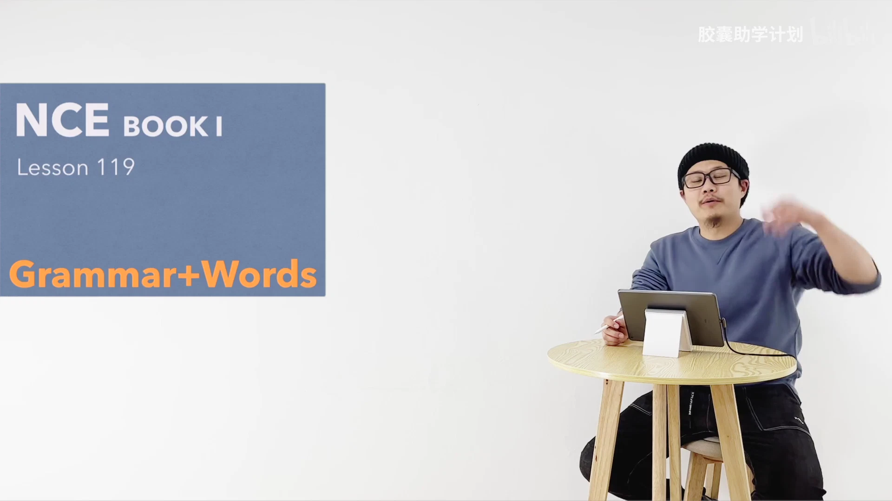

文字识别：计划 / NCE / BOOKI / Lesson 119 / Grammar+Words

### 画面 00:00:06

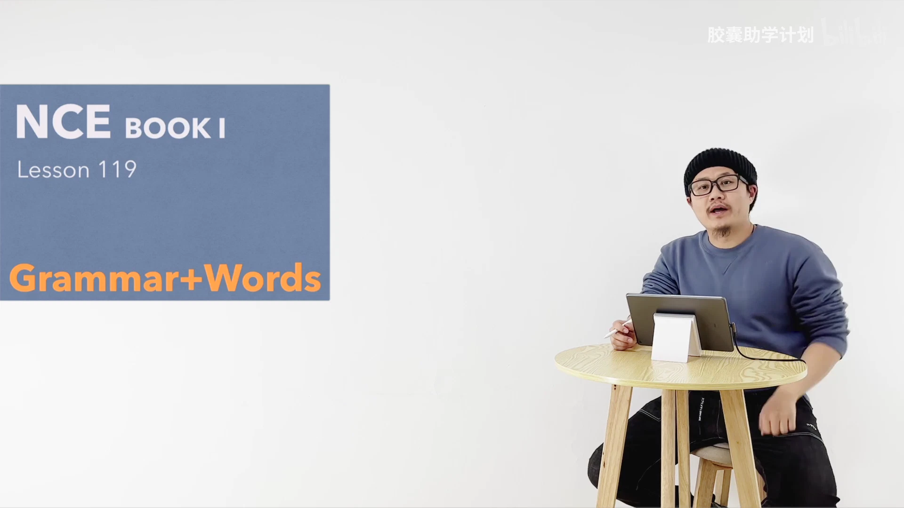

文字识别：胶囊助学计划 / NCE / BOOKI / Lesson 119 / Grammar+Words

### 画面 00:00:10

文字识别：胶囊助学计划

### 画面 00:00:12

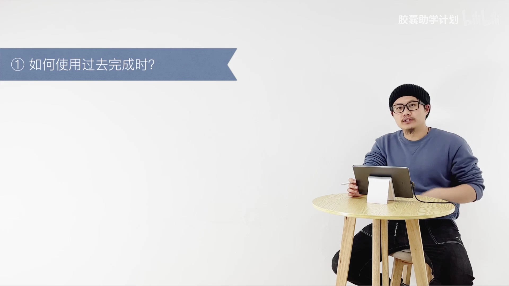

文字识别：胶囊助学计划 / ①如何使用过去完成时？

### 画面 00:00:24

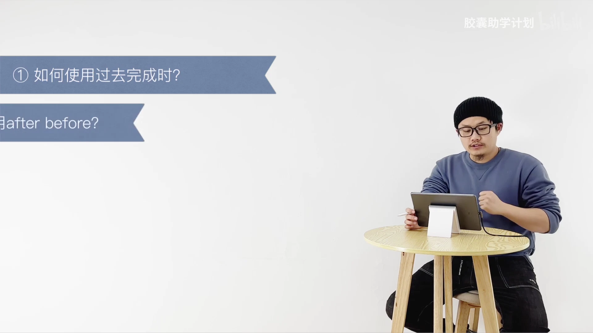

文字识别：胶囊助学计划 / ①如何使用过去完成时？ / after before?

### 画面 00:00:26

文字识别：胶囊助学计划 / ①如何使用过去完成时？ / 如何使用after before?

### 画面 00:00:29

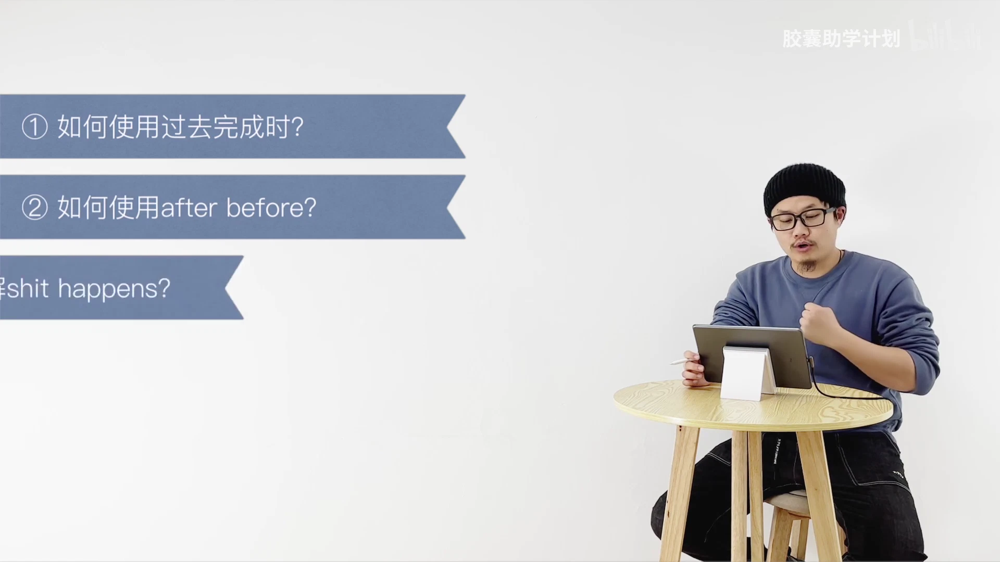

文字识别：胶囊助学计划 / ①如何使用过去完成时？ / 如何使用after before？ / shit happens?

## 00:00:30–00:01:00

如何去理解 she happens 这样的一个小的口语表达？那带着这三个问题， hope you guys enjoy it. 好，那我们先说过去完成时啊。一提过去完成时，我们一定绕不开现在完成时，对吧？那我们先迅速的回顾一下现在完成时的基本结构，两个单词 have 再加 done，这个事儿就搞定了，对吧？这叫现

### 画面 00:00:31

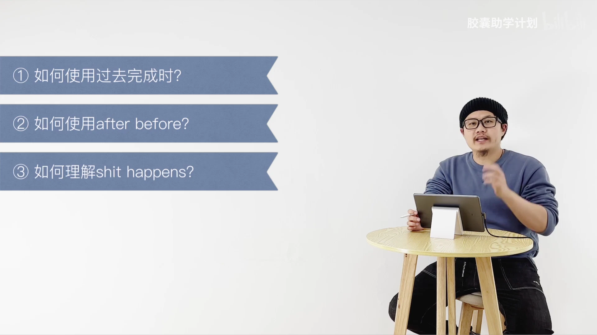

文字识别：胶囊助学计划 / ①如何使用过去完成时？ / 如何使用after before？ / 如何理解shit happens?

### 画面 00:00:37

文字识别：胶囊助学计划bl出 / • / •

### 画面 00:00:41

文字识别：胶囊助学计划

### 画面 00:00:43

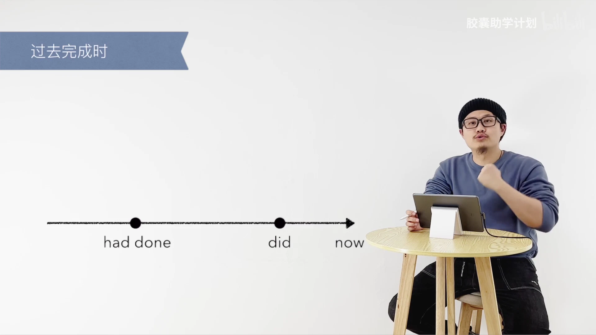

文字识别：胶囊助学计划 / 过去完成时 / had done / did / now

### 画面 00:00:55

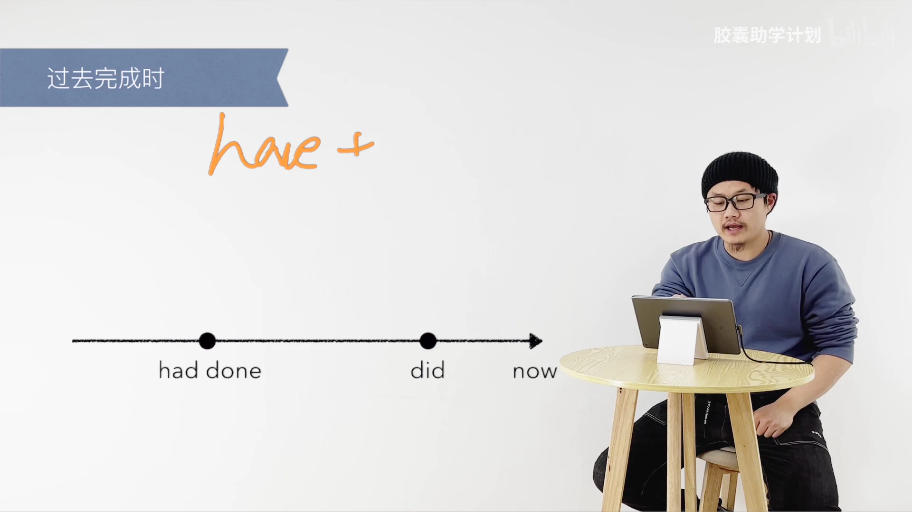

文字识别：胶囊助学计划 / 过去完成时 / hae + / had done / did / now

### 画面 00:00:57

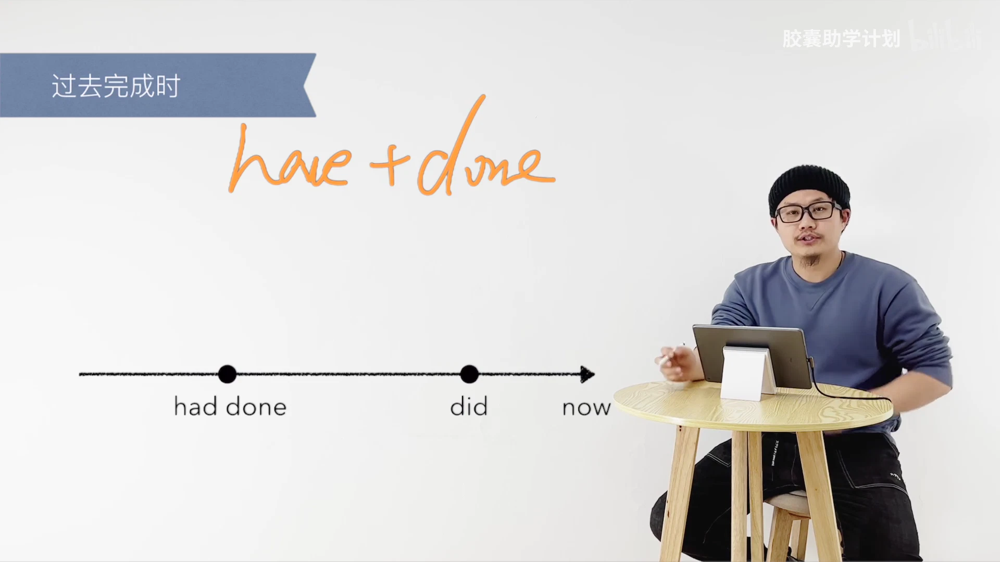

文字识别：胶囊助学计划 / 过去完成时 / hae fdome / had done / did / now

## 00:01:00–00:01:30

在完成时。那如何把它过变成过去完成时呢？我给大家提一个思路，您回想一下。在讲过去进行时的时候，不可避免的我提到了现在进行时。现在进行时是 am is are 这三个单词再加上 doing。然后怎么变过去进行时呢？我们把 am is are 换成了 was were，于是 was were 加 doing 就叫过去进行时。在这里是完全相同的变法。所

### 画面 00:01:27

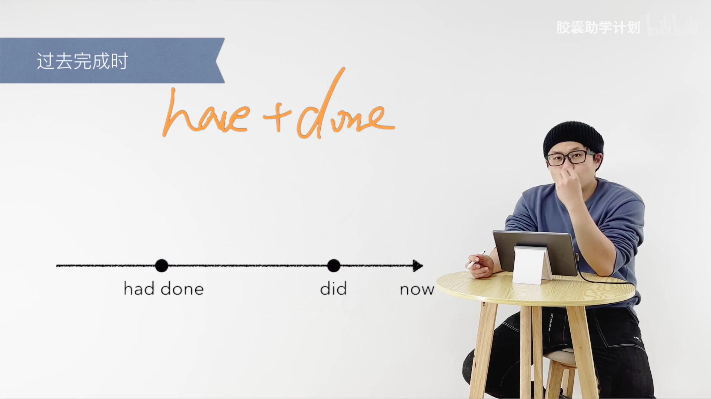

文字识别：胶囊助学计划 / 过去完成时 / hae tdome / had done / did / now

## 00:01:30–00:02:00

以呢，从结构上来说，have其实这个地方还有一个叫has，对吧？三单的情况，have has再去加上done的时候，它是现在完成时。这个结构表示两个用法。八十三课我们学过一个，八十九课我们学过一个。那如果我现在想把现在完成时变成过去完成时，其实就是把have和has这两个单词给它换成它们的过去式就可以了。于是就是在这里显示的叫had

### 画面 00:01:34

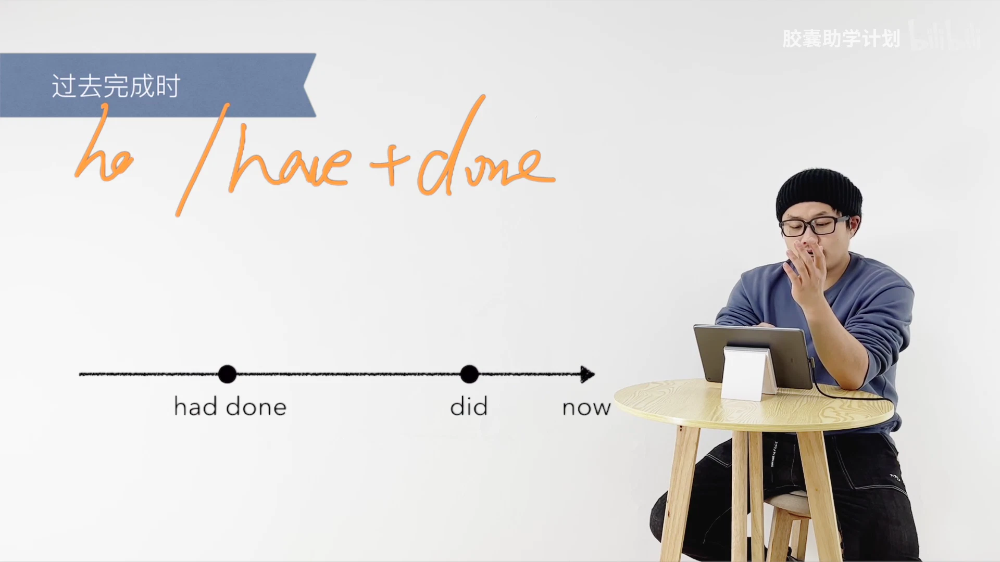

文字识别：胶囊助学计划 / 过去完成时 / hae +dme / had done / did / now

### 画面 00:01:39

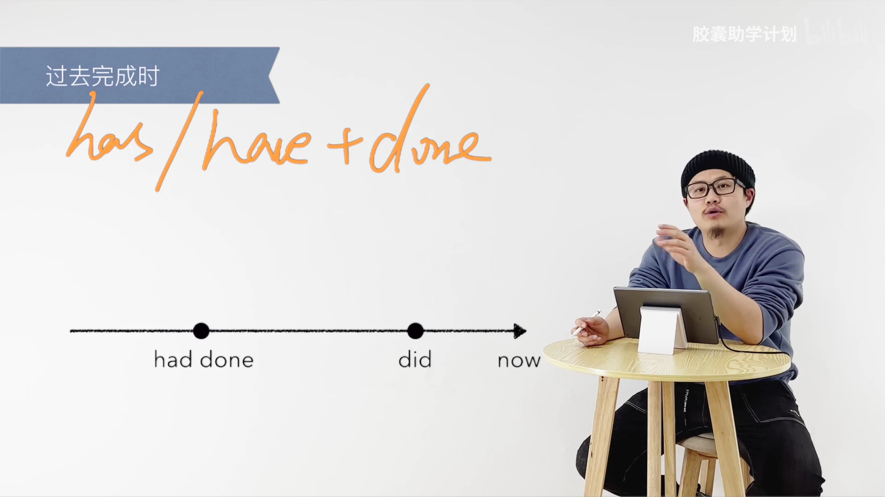

文字识别：胶囊助学计划 / 过去完成时 / hae f dme / had done / did / now

### 画面 00:01:55

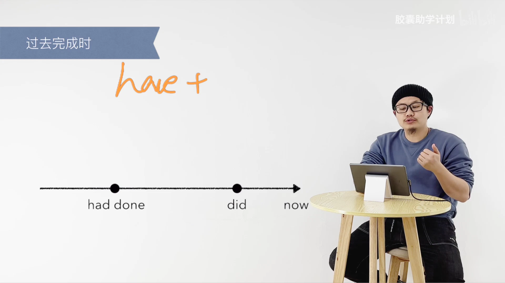

文字识别：胶囊助学计划 / 过去完成时 / hae + / had done / did / now

### 画面 00:01:57

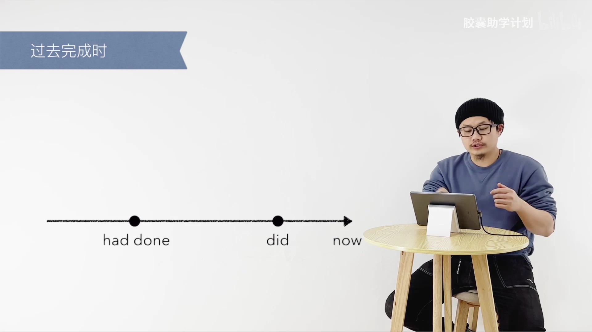

文字识别：胶囊助学计划 / 过去完成时 / had done / did / now

### 画面 00:01:59

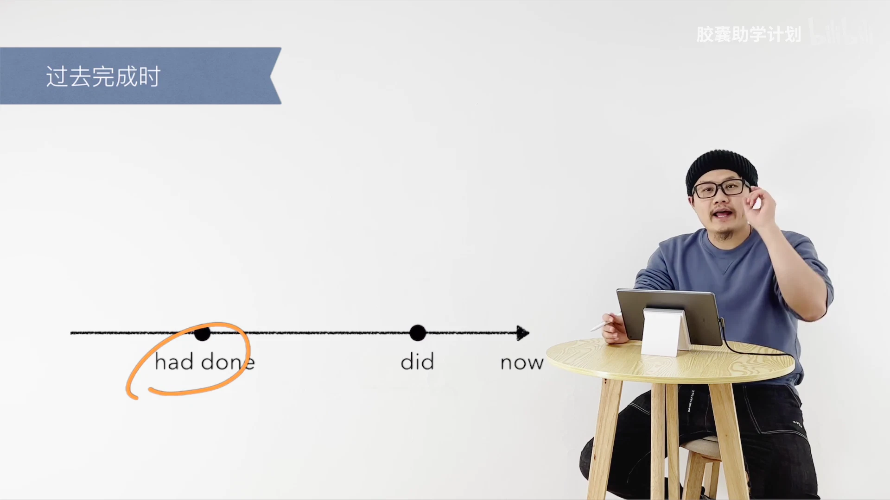

文字识别：胶囊助学计划 / 过去完成时 / had don / did / now

## 00:02:00–00:02:30

加上但，那它就叫做过去完成时。那我们想说学一个时态，除了要学习它的结构，那它的结构包含了肯定句、否定句、一般疑问句和特殊疑问句，对吧？除了结构以外，我们还一定要提到的一个东西叫什么呢？叫它的含义。好，那我们现在直接看一下它的含义。过去完成时强调过去某一个动作发生在另一个动作或者状

### 画面 00:02:02

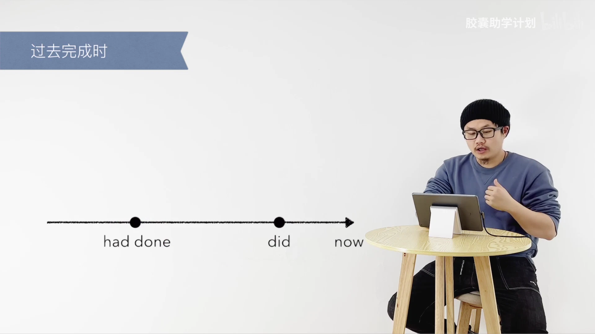

文字识别：胶囊助学计划 / 过去完成时 / had done / did / now

### 画面 00:02:06

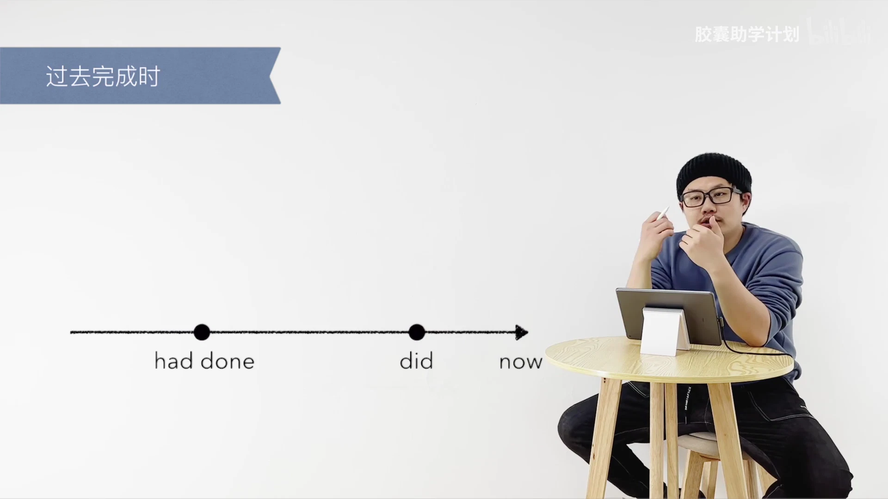

文字识别：胶囊助学计划 / 过去完成时 / had done / did / now

### 画面 00:02:21

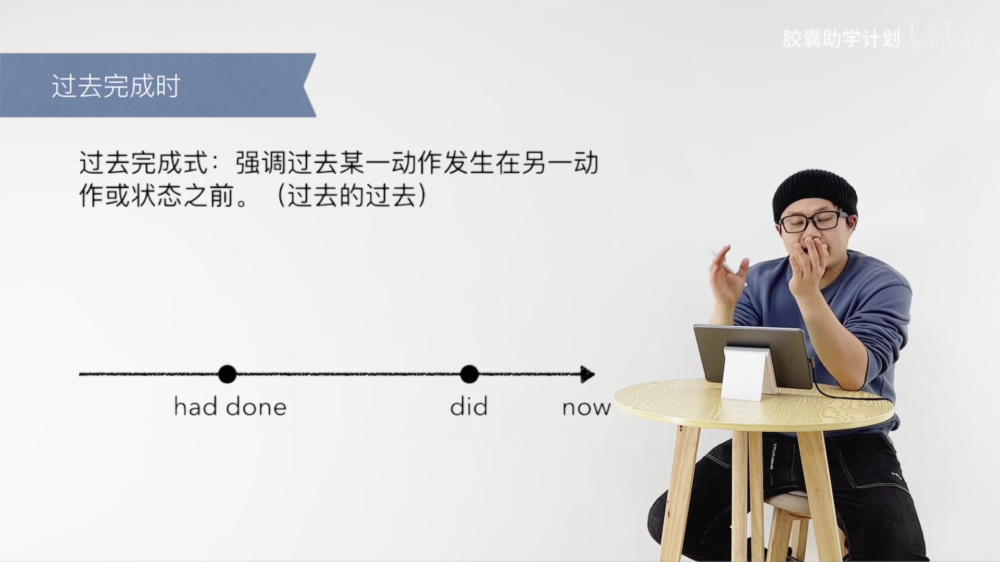

文字识别：胶囊助学计划 / 过去完成时 / 过去完成式：强调过去某一动作发生在另一动 / 作或状态之前。( / (过去的过去) / had done / did / now

## 00:02:30–00:03:00

态之前，我们再读一遍，强调过去的某一个动作在另一个动作或状态之前。OK，我们看啊，看底下这个时间轴，这里是 now 是现在，这里是 did 是一般过去时，这里是 had 加 done 叫过去完成时，had done 这个时态其中之一的用法就是今天我们要讲到的，强调的是这个动作在

### 画面 00:02:46

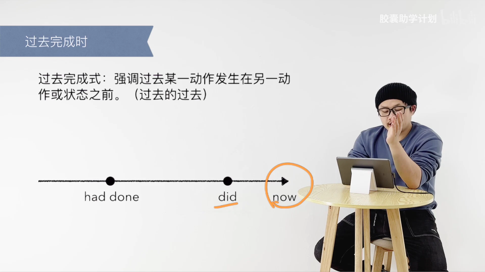

文字识别：胶囊助学计划 / 过去完成时 / 过去完成式：强调过去某一动作发生在另一动 / 作或状态之前。 / (过去的过去) / had done / did / now

### 画面 00:02:52

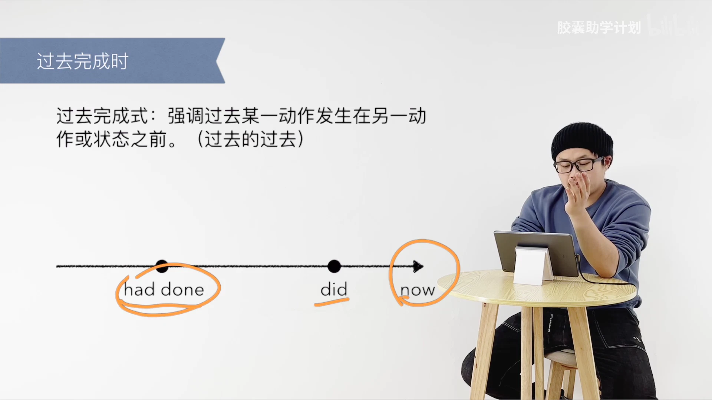

文字识别：胶囊助学计划 / 过去完成时 / 过去完成式：强调过去某一动作发生在另一动 / 作或状态之前。 / (过去的过去) / had done / did / now

## 00:03:00–00:03:30

另一个动作之前，所以如果过去有两个动作，我在英文当中、汉语当中判断谁前谁后，你必须要把句子完全读懂才行，对吧？那在英文当中呢，某种程度上，你看到 had 加 but，你就能确定了，但这个动作应该是在另一个动作之前发生的啊，至少在这个用法之下，对吧？所以，我们给它简称为叫过去

### 画面 00:03:00

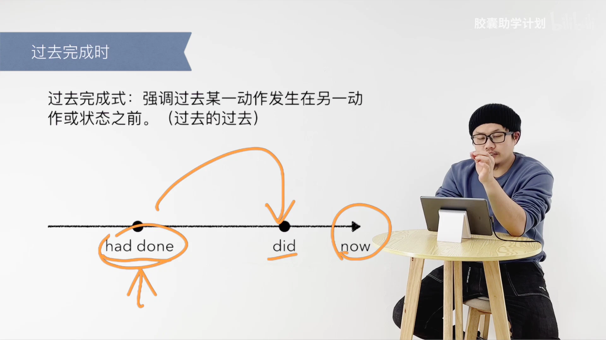

文字识别：胶囊助学计划 / 过去完成时 / 过去完成式：强调过去某一动作发生在另一动 / 作或状态之前。 / (过去的过去) / had done / did / now

### 画面 00:03:28

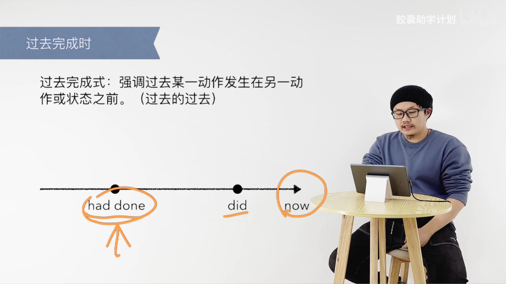

文字识别：胶囊助学计划 / 过去完成时 / 过去完成式：强调过去某一动作发生在另一动 / 作或状态之前。 / (过去的过去) / had done / did / now

## 00:03:30–00:04:00

过去，好吧？你看 did 是过去，那过去的过去就是 had 加 dan， OK。好，其次呢，它的基本结构刚才我们提到了，肯定句当中肯定是 had 加 dan，那它的否定句怎么办呢？非常的简单，对吧？不管是呃 have has，对吧？还是 had，我们都是，尤其它组成完成时的时候啊，注意不是说见到它就后边加 not 啊，它组成完成时的时候，我们在 had

### 画面 00:03:30

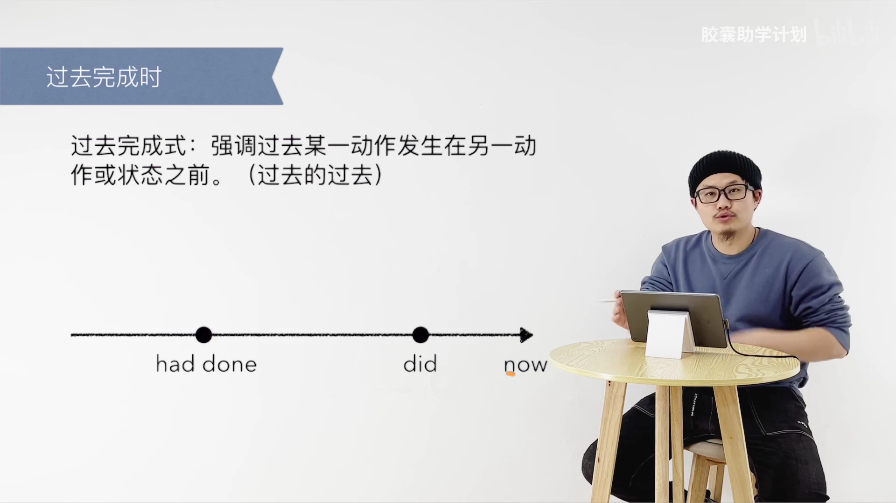

文字识别：胶囊助学计划 / 过去完成时 / 过去完成式：强调过去某一动作发生在另一动 / 作或状态之前。 / (过去的过去) / had done / did / now

### 画面 00:03:33

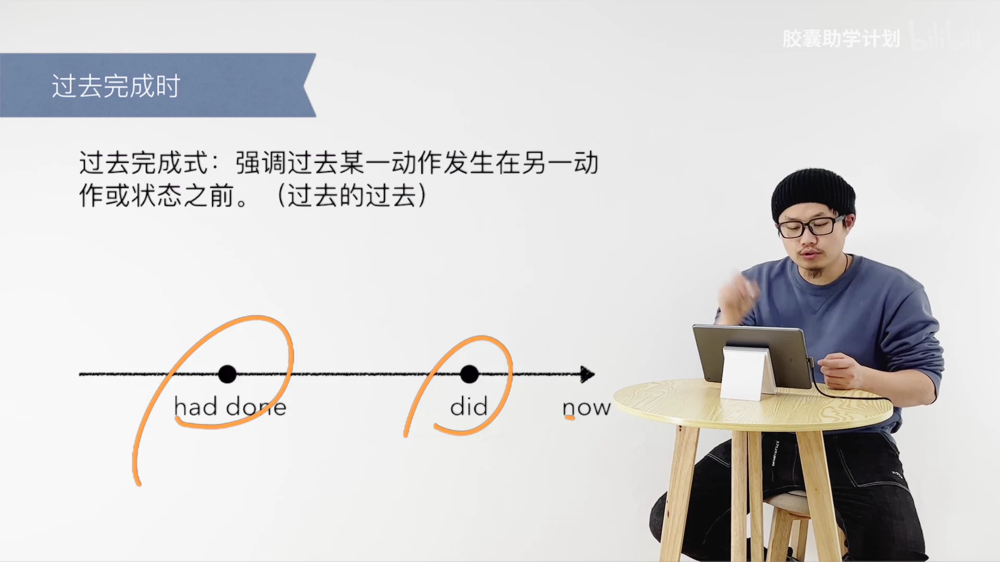

文字识别：胶囊助学计划 / 过去完成时 / 过去完成式：强调过去某一动作发生在另一动 / 作或状态之前。 / (过去的过去) / had dore / did / now

### 画面 00:03:35

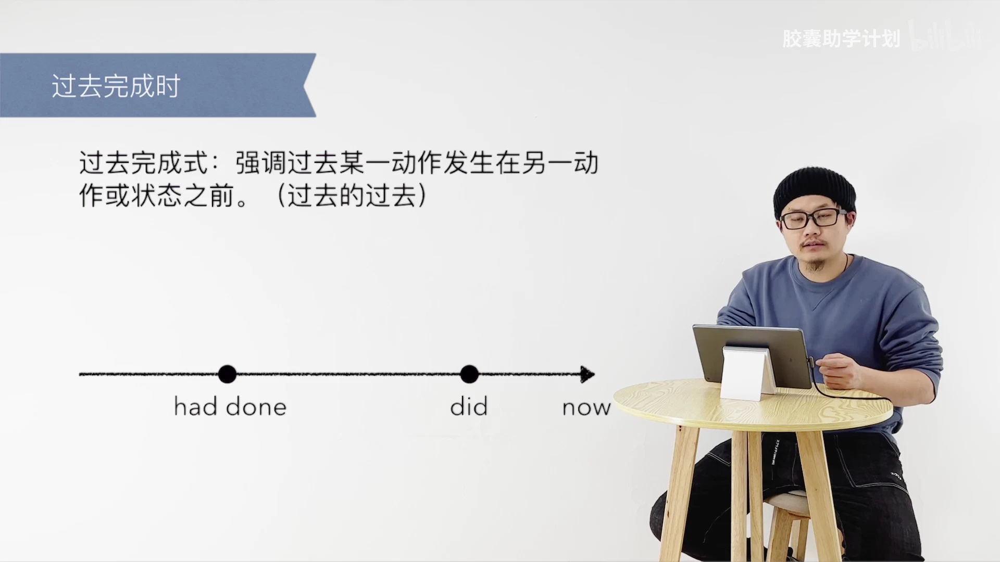

文字识别：胶囊助学计划 / 过去完成时 / 过去完成式：强调过去某一动作发生在另一动 / 作或状态之前。 / (过去的过去) / had done / did / now

### 画面 00:03:48

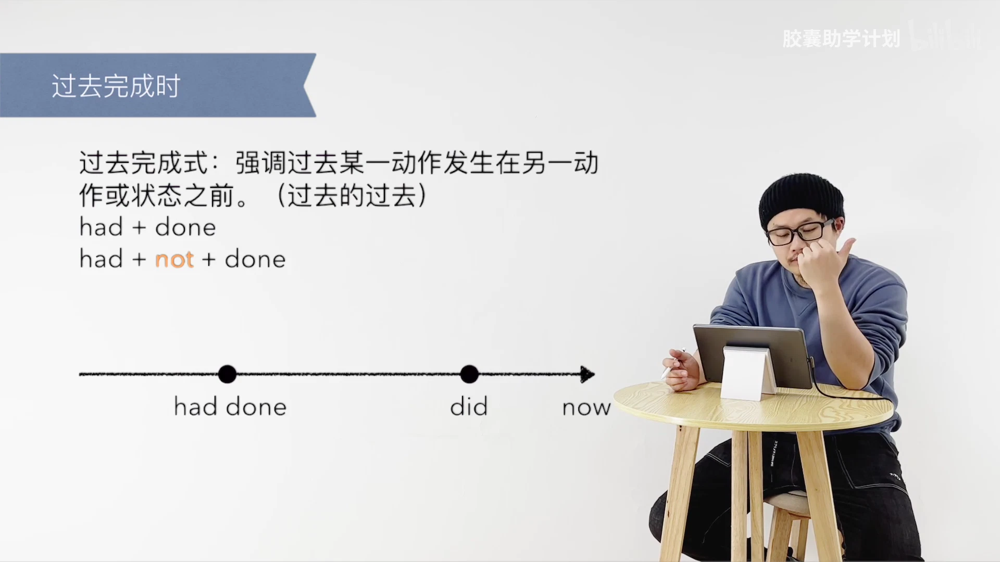

文字识别：胶囊助学计划 / 过去完成时 / 过去完成式：强调过去某一动作发生在另一动 / 作或状态之前。 / (过去的过去) / had + done / had + not + done / had done / did / now

## 00:04:00–00:04:30

这个单词后边加上一个 not，所以这是它的否定句。我们之前又给大家分享过一个规则，在英文当中几乎是有这样一个规则，就是你在哪个单词后边加 not，就把哪个单词提到句首去变一般疑问句。那在这里同理，您把 had 提到句首去，剩下的照抄，对吧？一般疑问句就出来了，就这么简单。OK，那这个时态最重要的其实不是它本身，是什么呢？

### 画面 00:04:18

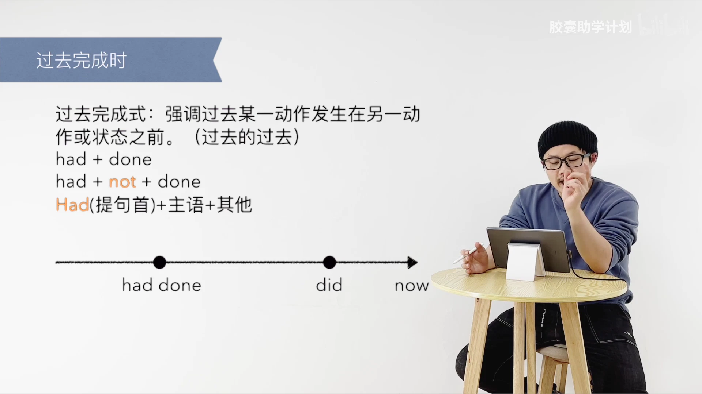

文字识别：胶囊助学计划 / 过去完成时 / 过去完成式：强调过去某一动作发生在另一动 / 作或状态之前。 / (过去的过去) / had + done / had + not + done / Had(提句首)+主语+其他 / had done / did / now

### 画面 00:04:27

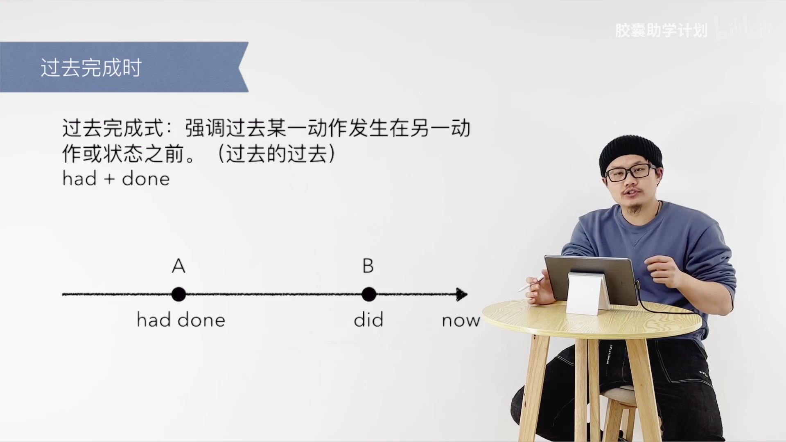

文字识别：胶囊助学计划 / 过去完成时 / 过去完成式：强调过去某一动作发生在另一动 / 作或状态之前。 / (过去的过去) / had + done / A / B / had done / did / now

## 00:04:30–00:05:00

是它经常与 after 与 before 这两个单词连用。这两个单词它的意思其实某种程度上，我相信各位是知道的。 after 叫在什么什么之后，那 before 叫在什么什么之前。那在这个地方呢，它起到了一个另一个词性的作用，我们管它叫连词，对吧？连接一个句子，比如说 after a ，逗号 b 等于 b after a 。我们看一下这两个公式啊，我在这给各位标了一下，前面这个动作叫 a ，后面这

### 画面 00:04:32

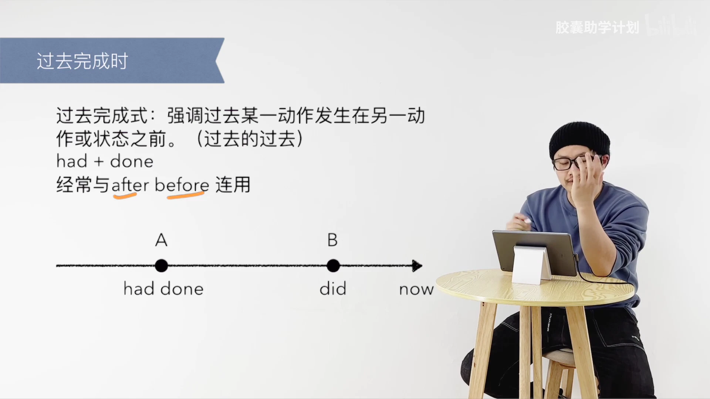

文字识别：胶囊助学计划 / 过去完成时 / 过去完成式：强调过去某一动作发生在另一动 / 作或状态之前。 / (过去的过去) / had + done / 经常与after before 连用 / A / B / had done / did / now

### 画面 00:04:51

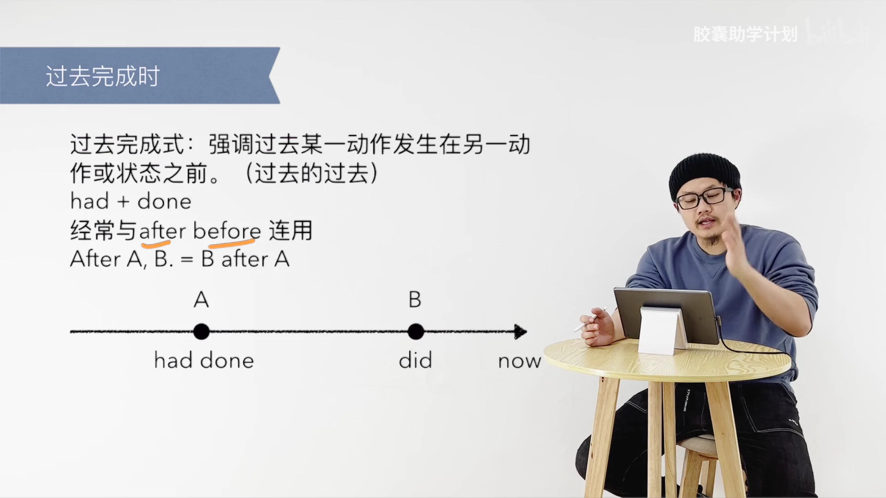

文字识别：胶囊助学计划 / 过去完成时 / 过去完成式：强调过去某一动作发生在另一动 / 作或状态之前。 / (过去的过去) / had + done / 经常与after before 连用 / After A, B. = B after A / A / B / had done / did / now

### 画面 00:04:59

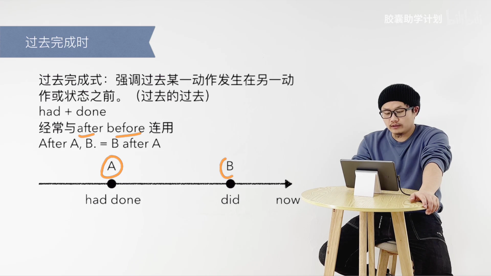

文字识别：胶囊助学计划 / 过去完成时 / 过去完成式：强调过去某一动作发生在另一动 / 作或状态之前。 / (过去的过去) / had + done / 经常与after before 连用 / After A, B. = B after A / B / had done / did / now

## 00:05:00–00:05:30

个动作叫B。那什么叫after A逗号B呢？就是在A这个事情结束了之后，after A对吧？在A结束了之后发生了B这个动作，OK没问题，非常舒服对吧？那什么叫B after A呢？注意啊，B after A不是B after再加A，是B after A，所以它其实是完全一样的意思，它只不过先说发生了B这个动作，然

### 画面 00:05:05

文字识别：胶囊助学计划 / 过去完成时 / 过去完成式：强调过去某一动作发生在另一动 / 作或状态之前。 / (过去的过去) / had + done / 经常与after before 连用 / After A, B. = B after A / had done / did / now

### 画面 00:05:14

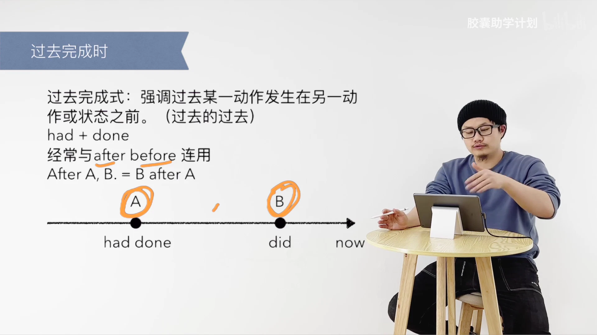

文字识别：胶囊助学计划 / 过去完成时 / 过去完成式：强调过去某一动作发生在另一动 / 作或状态之前。 / (过去的过去) / had + done / 经常与after before 连用 / After A, B. = B after A / had done / did / now

### 画面 00:05:22

文字识别：胶囊助学计划 / 过去完成时 / 过去完成式：强调过去某一动作发生在另一动 / 作或状态之前。 / (过去的过去) / had + done / 经常与after before 连用 / After A, B. = B after A / had done / did / now

### 画面 00:05:24

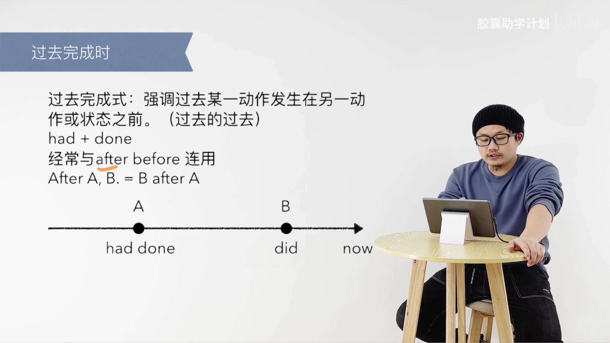

文字识别：胶囊助学计划 / 过去完成时 / 过去完成式：强调过去某一动作发生在另一动 / 作或状态之前。 / (过去的过去) / had + done / 经常与after before 连用 / After A, B. = B after A / A / B / had done / did / now

## 00:05:30–00:06:00

后呢，after A在A这件事情之后发生的B，只不过它的语序稍微调整了一下。这样讲非常的抽象，各位容易懵。那我们直接上例子。好，我们先看第一句汉语啊，叫看完电影之后我就去看书了。这句汉语读完了之后，你一定能判断出来谁在A这个地方，谁在B这个地方。那我们假设这两个动作都发生在过去的话，对吧？

### 画面 00:05:32

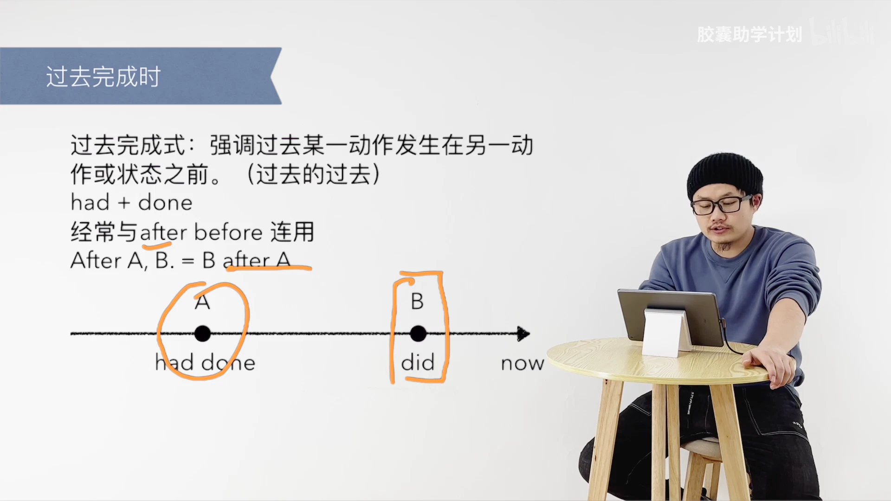

文字识别：胶囊助学计划 / 过去完成时 / 过去完成式：强调过去某一动作发生在另一动 / 作或状态之前。 / (过去的过去) / had + done / 经常与after before 连用 / After A, B. = B after A / had dohe / did / now

### 画面 00:05:36

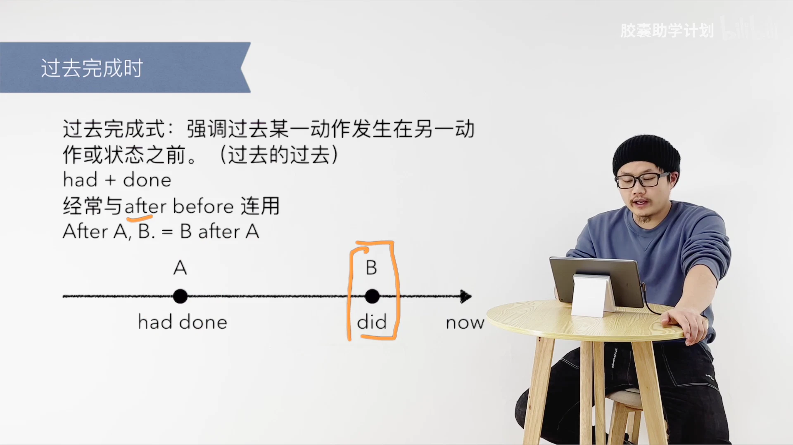

文字识别：胶囊助学计划 / 过去完成时 / 过去完成式：强调过去某一动作发生在另一动 / 作或状态之前。 / (过去的过去) / had + done / 经常与after before 连用 / After A, B. = B after A / A / had done / did / now

### 画面 00:05:39

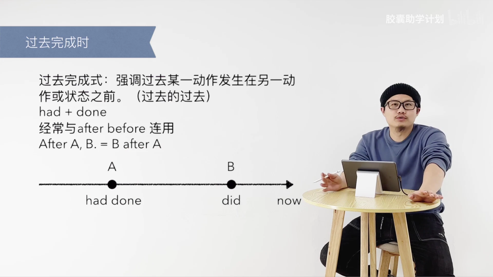

文字识别：胶囊助学计划 / 过去完成时 / 过去完成式：强调过去某一动作发生在另一动 / 作或状态之前。 / (过去的过去) / had + done / 经常与after before 连用 / After A, B. = B after A / A / B / had done / did / now

### 画面 00:05:42

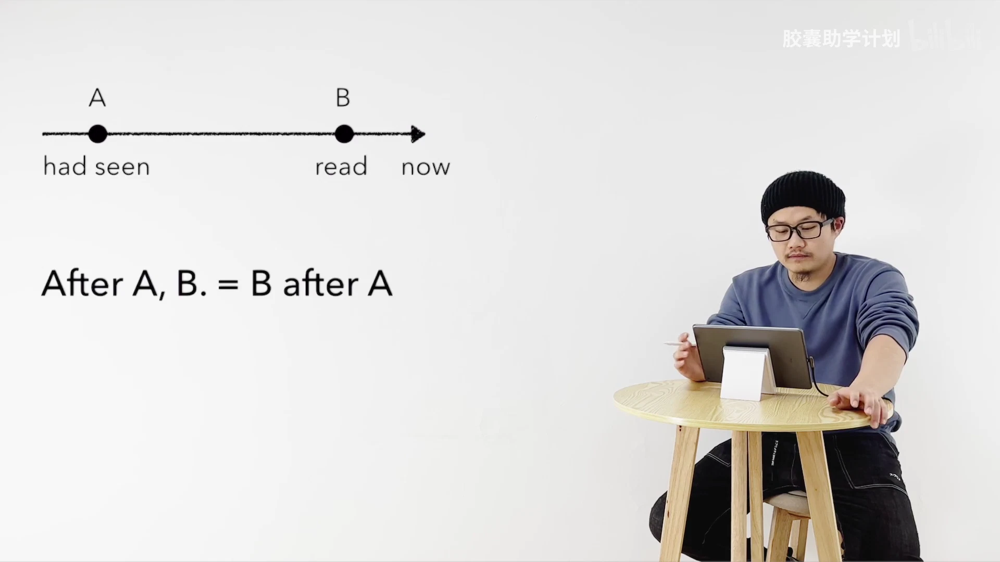

文字识别：胶囊助学计划 / A / B / had seen / read / now / After A, B. = B after A

### 画面 00:05:49

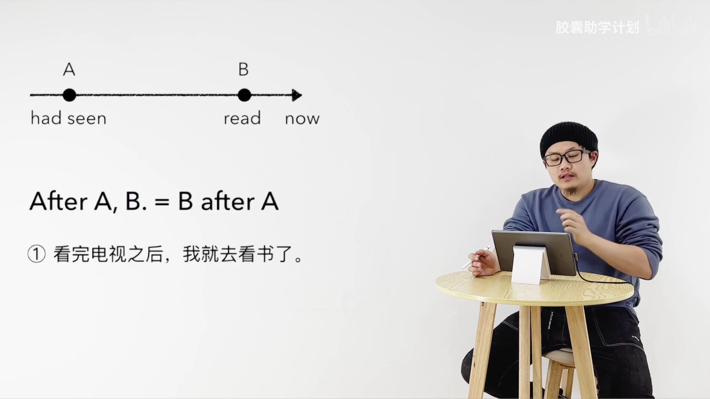

文字识别：胶囊助学计划 / A / B / had seen / read / now / After A, B. = B after A / ① 看完电视之后，我就去看书了。

### 画面 00:05:54

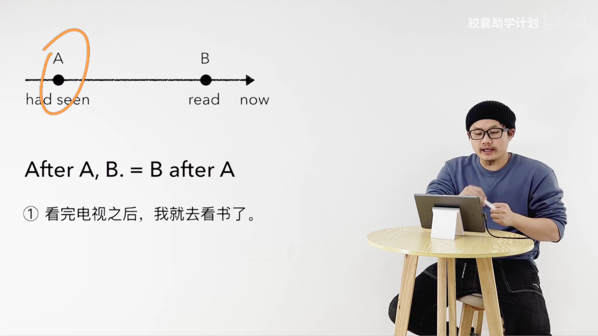

文字识别：胶囊助学计划 / B / had seen / read / now / After A, B. = B after A / ① 看完电视之后，我就去看书了。

## 00:06:00–00:06:30

那谁发生在 A 呢？看完电影之后，我去看书了。肯定是先看的电视，对吧？或者电影，然后呢，我们才去看的书。那我们先用 after A ,逗号 B。我们看一下，after A 是 I had seen the film。啊，那我们比如说这个电视就是电影吧，好吧？在我看完电影之后，after A , B 是什么呢？I read the book。我读了这本书。after A ,逗号 B。它等于 B after A。啊，

### 画面 00:06:07

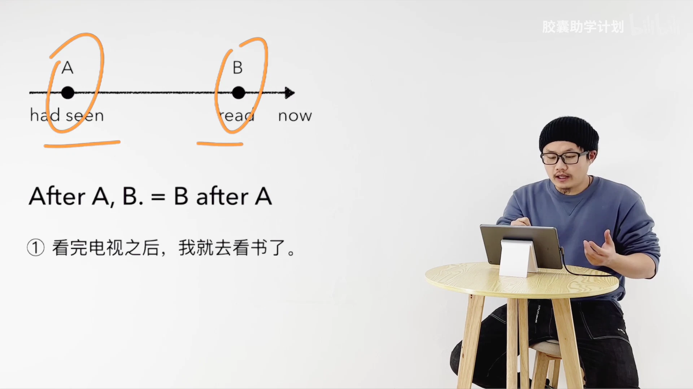

文字识别：胶囊助学计划 / B / A / had seen / eag / now / After A, B. = B after A / ① 看完电视之后，我就去看书了。

### 画面 00:06:13

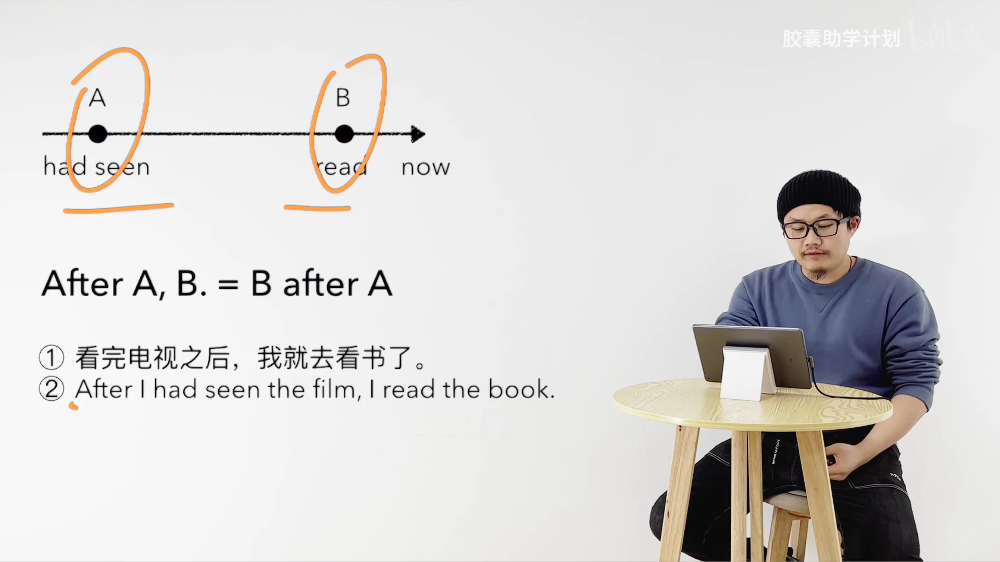

文字识别：胶囊助学计划 / A / B / had seen / reag / now / After A, B. = B after A / ① 看完电视之后，我就去看书了。 / ② After I had seen the film, I read the book.

### 画面 00:06:17

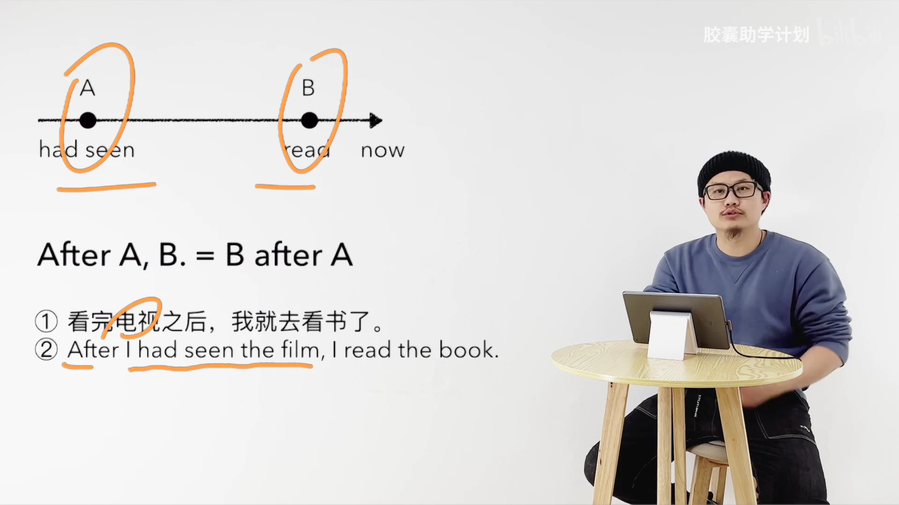

文字识别：胶囊助学计划 / B / A / had seen / eag / now / After A, B. = B after A / ①看完电视之后，我就去看书了。 /  AfterThad seen the film, I read the book.

### 画面 00:06:26

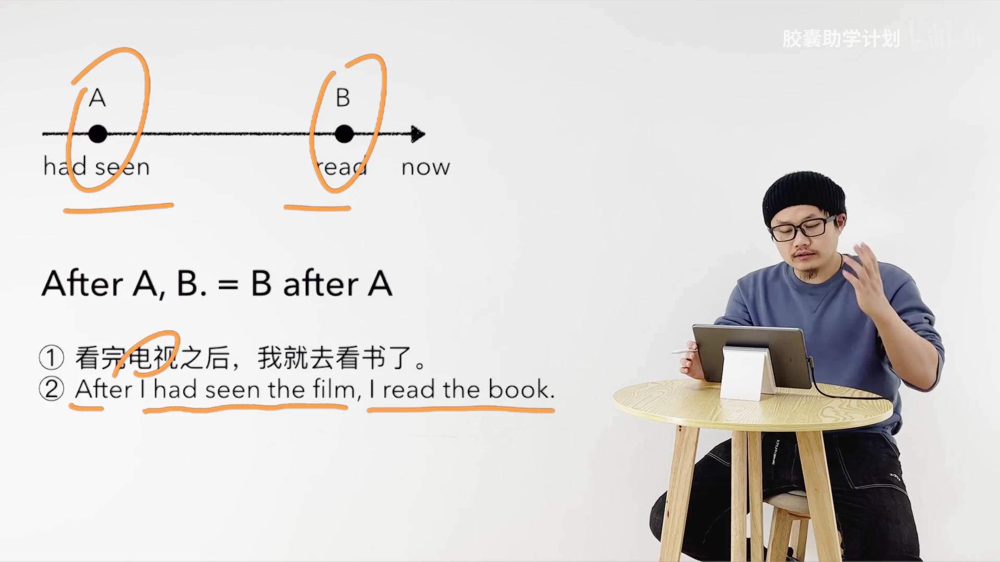

文字识别：胶囊助学计划 / A / B / had seen / eag / now / After A, B. = B after A / ①看完电视之后，我就去看书了。 /  After Thad seen the film, I read the book.

## 00:06:30–00:07:00

we look at it, right? We take it over. Let's do another one. I read the book. I read the book. Exactly the same. Both are B, right? Then after A, I had seen the film. I had seen the film. These two sentences are exactly the same. I don't know if you guys understand them now, right? I think it's a little bit of a feeling. Secondly, well, these two sentences are completely in line with this formula, right? Ah, let's talk about it this way. Secondly, you guys should pay attention to a small point. After A, if we write it.

### 画面 00:06:31

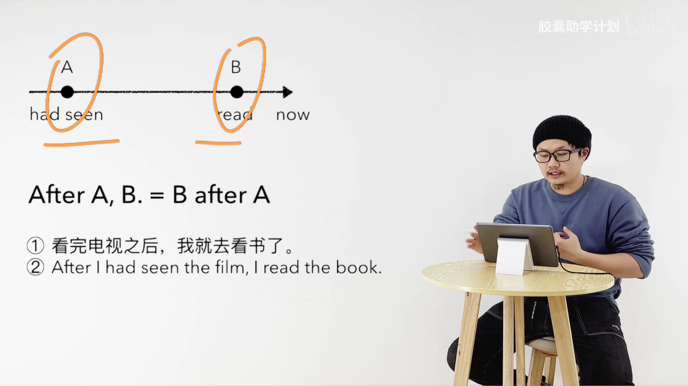

文字识别：胶囊助学计划 / A / B / had seen / eag / now / After A, B. = B after A / ①看完电视之后，我就去看书了。 /  After I had seen the film, I read the book.

### 画面 00:06:33

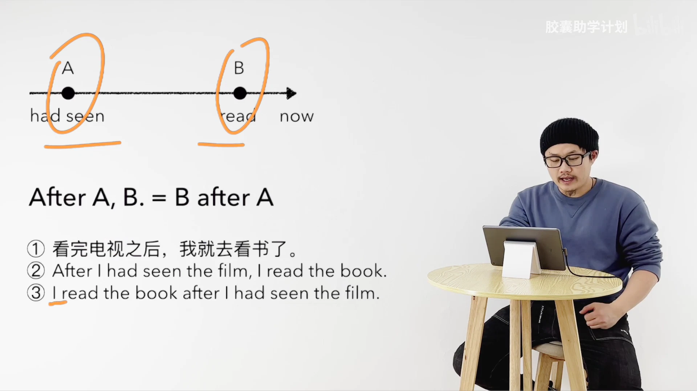

文字识别：胶囊助学计划 / A / B / had seen / eag / now / After A, B. = B after A / ①看完电视之后，我就去看书了。 / ② After I had seen the film, I read the book. /  Lread the book after I had seen the film. / 3

### 画面 00:06:35

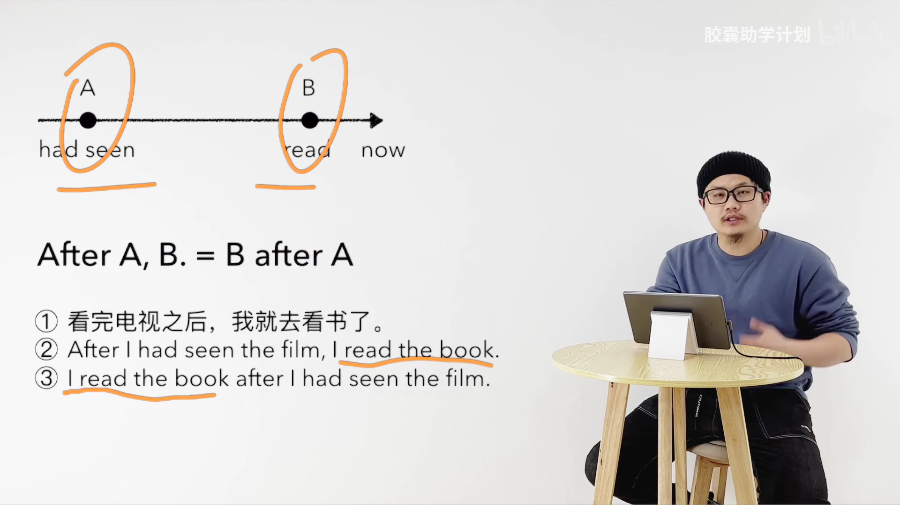

文字识别：胶囊助学计划 / A / had seen / reag / now / After A, B. = B after A / 看完电视之后，我就去看书了。 / ② After I had seen the film, I read the book. / I read the book after I had seen the film.

### 画面 00:06:39

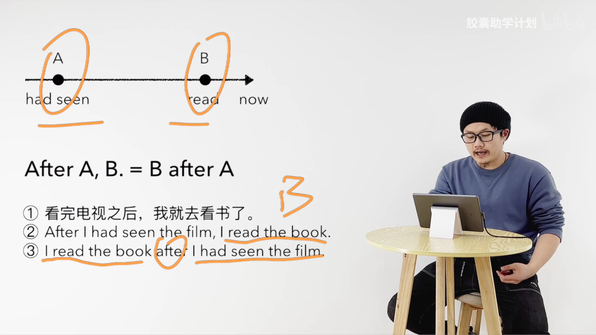

文字识别：胶囊助学计划 / had seen / eag / now / After A, B. = B after A / 看完电视之后，我就去看书了。 / ② After I had seen the film, I read the book. / I read the bookafte / I had seen the film

### 画面 00:06:42

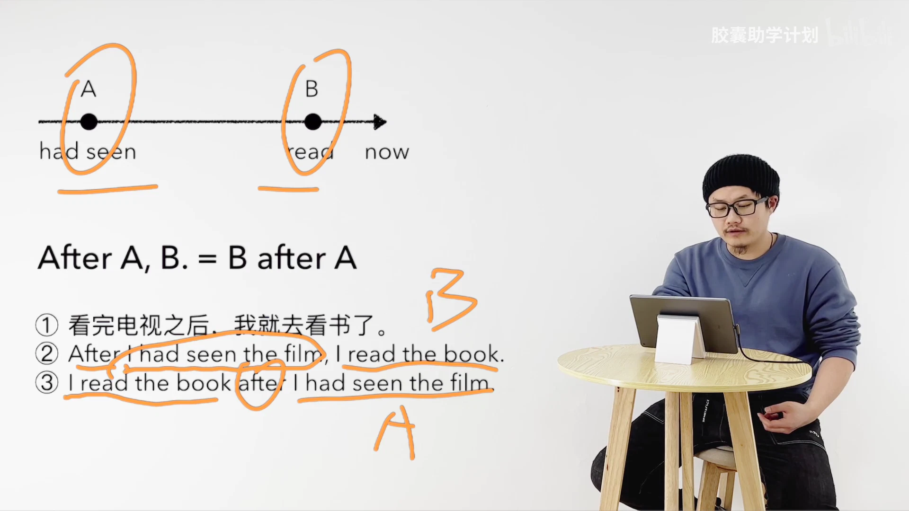

文字识别：胶囊助学计划 / A / had seen / eag / now / After A, B. = B after A / 看完电视之后、我就去看书了。 /  After  had seen the film, I read the book. / 2） / I read the book afte I had seen the film

### 画面 00:06:48

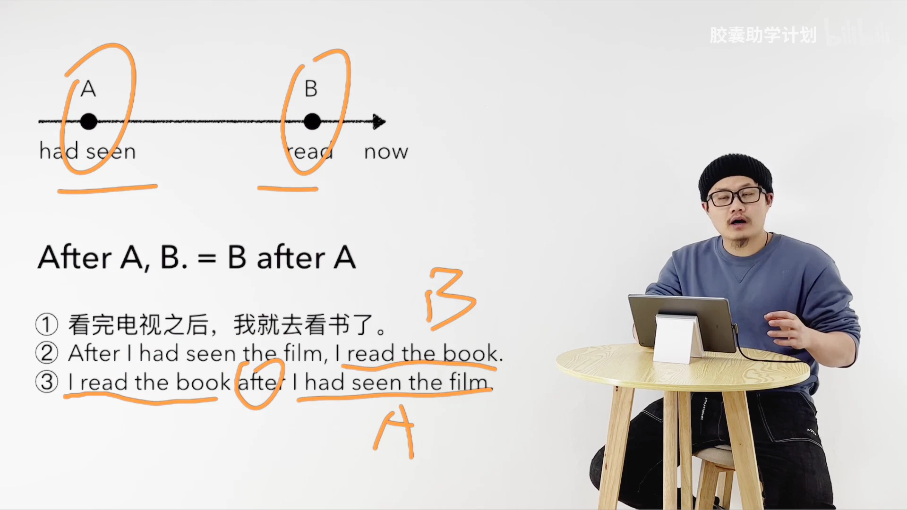

文字识别：胶囊助学计划 / A / B / had seen / reag / now / After A, B. = B after A / 看完电视之后，我就去看书了。 / ② After I had seen thefilm, I read the book. / I read the bookafte / I had seen the film

### 画面 00:06:50

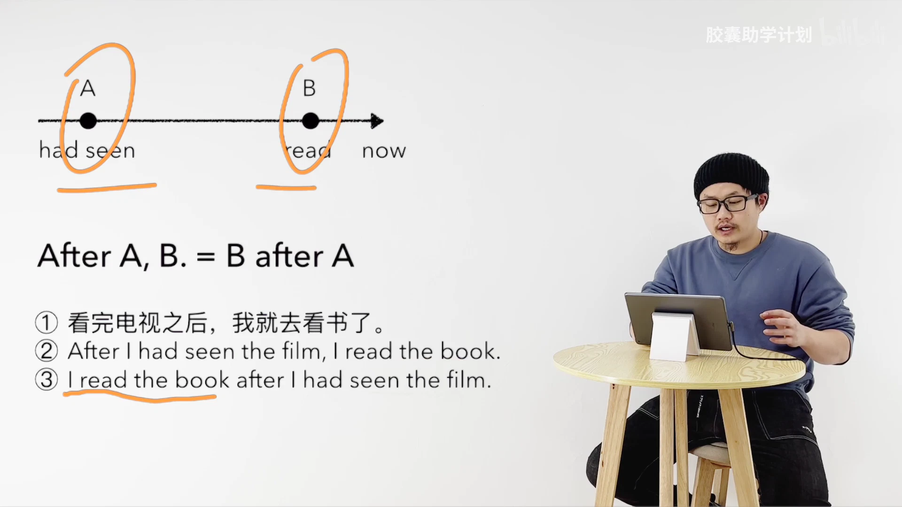

文字识别：胶囊助学计划 / A / B / had seen / reag / now / After A, B. = B after A / 看完电视之后，我就去看书了。 / ② After I had seen the film, I read the book. / I read the book after I had seen the film.

### 画面 00:06:53

文字识别：胶囊助学计划 / A / had seen / reag / now / After A, B. = B after A / 看完电视之后，我就去看书了。 /  After I had seen the film, I read the book. / I read the book after I had seen the film.

## 00:07:00–00:07:30

后，如果我们把它书写出来，这儿一般来说习惯上可能要加一个小的逗号。而如果B这句话在前面，那After A这句话的前面您就不需要再加一个小的逗号了。这是英文的一个小习惯。但是呢，对于大部分情况来说，您可能根本就用不到，是吧？大多数人不会那么那么的严谨，是吧？你放心的去用就好了。好，接下来比如说我们再看，我把旧车卖了，然后买辆新的。

### 画面 00:07:00

文字识别：胶囊助学计划 / A / B / had seen / eag / now / After A, B. = B after A / 看完电视之后，我就去看书了。 / After I had seen the film, I read the book. / I read the book after I had seen the film.

### 画面 00:07:09

文字识别：胶囊助学计划 / A / had seen / eag / now / After A, B. = B after A / 看完电视之后，我就去看书了。 / After I had seen the film, I read the book. / I read the book after I had seen the film.

### 画面 00:07:13

文字识别：胶囊助学计划 / A / B / had seen / reay / now / After A, B. = B after A / ① 看完电视之后，我就去看书了。 /  After I had seen the film, I read the book. / I read the book after I had seen the film.

### 画面 00:07:16

文字识别：胶囊助学计划 / A / B / had seen / read / now / After A, B. = B after A / ①看完电视之后，我就去看书了。 / ② After I had seen the film, I read the book. / ③ I read the book after I had seen the film.

### 画面 00:07:25

文字识别：胶囊助学计划 / A / B / had sold / bought / now / After A, B. = B after A

## 00:07:30–00:08:00

你注意，你看啊，我们为什么要学习今天这个语法？原因是过去两件事情，有的时候谁先发生，谁后发生是不重要的，但有的时候格外的重要。我们举一个例子，比如说在这里，他明明是先把旧车卖了，然后才买了一辆新车。那这和他先买了一辆新车，后来又买一辆旧车，首先事实上是完全不一

### 画面 00:07:32

文字识别：胶囊助学计划 / A / B / had sold / bought / now / After A, B. = B after A / ）我把旧车卖了，然后买了辆新的。

## 00:08:00–00:08:30

样的，对吧？其次中间可能有很多复杂的事情，比如说在这儿如果还不好理解的话，我们举个例子啊，小孩儿经常说的一句话是他先骂我，我才去打他的。虽然这个合理性也不一定对，对吧？但是孩子尝试在告诉你的是，两个动作发生在过去，谁先谁后非常重要，至少在他看来，对吧？他的打人的合理性是因为他先骂了我，这是孩子吵架或者跟爸妈诉苦的时候经常

### 画面 00:08:02

文字识别：胶囊助学计划 / A / B / had sold / bought / now / After A, B. = B after A / ）我把旧车卖了，然后买了辆新的。

## 00:08:30–00:09:00

说的一句话，对吧？你先骂了我，所以我才打了你。OK，所以 after a 逗号 b，所以还是那句话，我们要学新的语法，一个非常重要的原因是我们表达上有这个需求。当然了，一个次要的原因是我们考试也会考到，对吧？OK，当然如果你是学生啊，主要的原因可能就是考试能考到。OK，好，我把旧车卖了，然后买一辆新的，所以先卖再买，对吧？好，我们 after a 逗号 b， after I has sold the old

### 画面 00:08:32

文字识别：胶囊助学计划 / A / B / had sold / bought / now / After A, B. = B after A / ）我把旧车卖了，然后买了辆新的。

### 画面 00:08:37

文字识别：胶囊助学计划 / A / B / had sold / bought / now / After A, B. = B after A / ）我把旧车卖了，然后买了辆新的。

### 画面 00:08:56

文字识别：胶囊助学计划 / A / B / had sold / bought / now / After A, B. = B after A / 我把旧车卖了，然后买了辆新的。 / After I had sold the old car, I bought a new one.

## 00:09:00–00:09:30

car, I bought a new one. 哎，在我卖了旧车之后，我买了一辆新车。那你再给它反过来，b after a就很正常了，对吧？就很舒服了。I bought a new one after I had sold the old car. Okay. 好，那然后注意还是这个逗号的问题，对吧？这就我们提一点就可以了。再来一个例子，下车之后，他向出租车司机告别了。下车之后告别了，先下车再告别。After a, dot b, very

### 画面 00:09:01

文字识别：胶囊助学计划 / A / B / had sold / bought / now / After A, B. = B after A / 我把旧车卖了，然后买了辆新的。 / After I had sold the old car, I bought a new one.

### 画面 00:09:09

文字识别：胶囊助学计划 / A / B / had sold / bought / now / After A, B. = B after A / 我把旧车卖了，然后买了辆新的。 / ② After I had sold the old car, I bought a new one. / ③ I bought a new one after I had sold the old car.

### 画面 00:09:18

文字识别：胶囊助学计划 / A / B / had got / said / now / After A, B. = B after A

## 00:09:30–00:10:00

常舒服 After he had got out of the car，在他下车之后，A这个动作先发生，然后又发生了另一个动作，叫 He said goodbye to the taxi driver. 他对出租车司机说了拜拜，对吧？好，接下来，刚才我们说到的叫 After A逗号B，对吧？过去完成时，刚才我们也提到了，它跟 After跟 Before都能连用，那我们就再说一下，它跟 Before连用的时候长成什么样子呢？叫 Before

### 画面 00:09:30

文字识别：胶囊助学计划 / A / B / had got / said / now / After A, B. = B after A / 下车之后他向出租车司机告别。 / After he had got out of the car, he said goodbye to / the taxi driver.

### 画面 00:09:34

文字识别：胶囊助学计划 / A / B / had got / said / now / After A, B. = B after A / 下车之后他向出租车司机告别。 / After he had got out of the car, he said goodbye to / the taxi driver.

### 画面 00:09:40

文字识别：胶囊助学计划 / A / B / had got / said / now / After A, B. = B after A / 下车之后他向出租车司机告别。 / After he had got out of the car, he said goodbye to / the taxi driver.

### 画面 00:09:46

文字识别：胶囊助学计划 / 过去完成时 / 过去完成式：强调过去某一动作发生在另一动 / 作或状态之前。 / (过去的过去) / had + done / A / B / had done / did / now

### 画面 00:09:56

文字识别：胶囊助学计划 / 过去完成时 / 过去完成式：强调过去某一动作发生在另一动 / 作或状态之前。 / (过去的过去) / had + done / 经常与after before 连用 / Before B, A. = A before B. / A / B / had done / did / now

## 00:10:00–00:10:30

b，逗号 a，或者是 a before b，听上去又懵了是吧？不用着急，我们先看，过去有两个动作 a 与 b，那 before 叫在什么什么之前，所以 before b 我们就可以翻译成叫在 b 这件事情之前 a 发生了 a，很舒服对吧？和我们认知上也是保持一致的 a before b 是什么意思呢？就先发生了 a 这件事情，但是它是发生在 b 之前的，

### 画面 00:10:03

文字识别：胶囊助学计划 / 过去完成时 / 过去完成式：强调过去某一动作发生在另一动 / 作或状态之前。 / (过去的过去) / had + done / 经常与after before 连用 / Before B, A. = A before B. / A / B / had done / did / now

### 画面 00:10:18

文字识别：胶囊助学计划 / 过去完成时 / 过去完成式：强调过去某一动作发生在另一动 / 作或状态之前。 / (过去的过去) / had + done / 经常与after before 连用 / Before B, A. = A before B. / B / had done / did / now

### 画面 00:10:23

文字识别：胶囊助学计划 / 过去完成时 / 过去完成式：强调过去某一动作发生在另一动 / 作或状态之前。 / (过去的过去) / had + done / 经常与after befre连用 / Before B, A. = / before B. / A / B / had done / did / now

### 画面 00:10:25

文字识别：胶囊助学计划 / 过去完成时 / 过去完成式：强调过去某一动作发生在另一动 / 作或状态之前。 / (过去的过去) / had + done / 经常与after before连用 / Before B, A. =Abefore B. / B / had done / did / now

### 画面 00:10:28

文字识别：胶囊助学计划 / 过去完成时 / 过去完成式：强调过去某一动作发生在另一动 / 作或状态之前。 / (过去的过去) / had + done / 经常与after before连用 / Before B, A. =Abefore B. / had done / did / now

## 00:10:30–00:11:00

这样讲依旧抽象，我们还是直接上例子来了啊。比如说 before b 好 they at the dinner b 就是这里用一般过去式，好吧？然后这是 b 对吧？我们确定了。然后 before b ，逗号 a a 这句话就是这里叫 they had washed their hands，叫做在他们吃晚饭之前，之前哎，他们已经洗

### 画面 00:10:31

文字识别：胶囊助学计划 / A / B / had wash / ate / now / Before B, A. = A before B. / ① Before they ate the dinner, they had washed / their hands.

### 画面 00:10:37

文字识别：胶囊助学计划 / A / B / had wash / ate / now / Before B, A. = A before B. / ① Before they ate the dinner, they had washed / their hands.

### 画面 00:10:45

文字识别：胶囊助学计划 / A / B / had wash / ate / now / Before B, A. =A before B. / ① Before they ate the dinner, they had washed / their hands.

### 画面 00:10:48

文字识别：胶囊助学计划 / A / B / had wash / ate / now / Before B, A. =A before B. / P / D Before they ate the dinner, they had washed / their hands.

### 画面 00:10:56

文字识别：胶囊助学计划 / A / had wash / ate / now / Before B, A. = A before B. / D Before they ate the dinner, they Had washed / their hands.

## 00:11:00–00:11:30

好了手，这个很重要，对吧？你吃完晚饭再去洗手，这个感觉又不一样了，对不对？好，饭前便后要洗手，对吧？They had washed their hands before they ate dinner. 好，注意啊，They had washed their hands before they ate the dinner. 各位看到了吧？B啊还是B这句话，然后before A对吧？B先发生啊，后发生了啊。OK，Sorry，这个地方有一个小的问题啊，说错

### 画面 00:11:05

文字识别：胶囊助学计划 / A / had wash / ate / now / Before B, A. = A before B. / N / ① Before they ate the dinner, they had washed / their hands. / They had washed their hands before they / ate the dinner.

### 画面 00:11:09

文字识别：胶囊助学计划 / A / B / had wash / ate / now / Before B, A. =A before B. / 2 / ① Before they ate the dinner, they had washed / their hands. / They had washed their hands before they / ate the dinner.

### 画面 00:11:11

文字识别：胶囊助学计划 / A / B / had wash / ate / now / Before B, A. = A before B. / ① Before they ate the dinner, they had washed / their hands. / They had washed their hands before they / ate the dinner.

### 画面 00:11:14

文字识别：胶囊助学计划 / A / B / had wash / ate / now / Before B, A. = A before B. / ① Before they ate the dinner, they had washed / their hands. / Jhey had washed their hands before they / ate the dinner.

### 画面 00:11:20

文字识别：胶囊助学计划 / A / B / had wash / ate / now / Before B, A. = A before B. / ① Before they ate the dinner, they had washed / their hands. / They had washed their handsbefore they / ate the dinner.

### 画面 00:11:29

文字识别：胶囊助学计划 / A / B / had wash / ate / now / Before B, A. = A before B. / ① Before they ate the dinner, they had washed / their hands. / They had washed their hands before they / ate the dinner.

## 00:11:30–00:12:00

了，应该这里是A啊，然后后边是B啊。说先发生了A这个动作，叫他们先洗了手，在什么之前呢？在他们吃晚饭之前，对吧？OK，再来再来个例句啊。说Before you knew it, I had already run far away.好，我们先看时态，先确定时态一确定，它就是它，它就是它，对吧？那叫做在你知道之前，我已经跑远了。非常好，

### 画面 00:11:31

文字识别：胶囊助学计划 / A / B / had wash / ate / now / Before B, A. = A before B. / ① Before they ate the dinner, they had washed / their hands. / Ihey had washed thleir hands before they / ate the dinner.

### 画面 00:11:33

文字识别：胶囊助学计划 / A / B / had wash / ate / now / Before B, A. = A before B. / ① Before they ate the dinner, they had washed / their hands. / They had washed thleir hands before thl / ate the dinner.

### 画面 00:11:42

文字识别：胶囊助学计划 / A / B / had run / knew / now / Before B, A. = A before B.

### 画面 00:11:50

文字识别：胶囊助学计划 / A / B / had run / knew / now / Before B, A. = A before B. / ① Before you knew it, I had already run far away.

### 画面 00:11:52

文字识别：胶囊助学计划 / A / B / had run / now / Before B, A. =A before B. / ① Before you knew it, I had already run far away.

### 画面 00:11:54

文字识别：胶囊助学计划 / A / B / had run / now / Before B, A. =A before B. / ① Before you knew it, I had already run far away.

### 画面 00:11:57

文字识别：胶囊助学计划 / A / B / had run / now / Before B, A. =A before B. / ① Before you knew it, I had already run far away.

## 00:12:00–00:12:30

在你知道之前我已经跑远了。我先跑远了，你才知道，对吧？所以先跑远了，用的是 had 加单啊。OK，好，那你同理可以把它变成 A before B，对吧？叫 I had already run far away before he knew it. OK，注意一下时态就可以了啊。我们再来一个叫 Before we realized it, it had been too late. OK, very good. 那我们先看这儿，realize，不管它，一看到一般过去时就是 B，对吧？好，看

### 画面 00:12:09

文字识别：胶囊助学计划 / A / B / had run / now / Before B, A. =A before B. / ① Before you knew it, I had already run far away. / I had already run far away / before you knew it. / 2

### 画面 00:12:17

文字识别：胶囊助学计划 / A / B / had been / realized now / Before B, A. = A before B.

### 画面 00:12:25

文字识别：胶囊助学计划 / A / B / had been / realized now / Before B, A. = A before B. / ① Before we realized it, it had been too late.

## 00:12:30–00:13:00

到这里就是A对吧？叫做在我们意识到这件事情之前，我们意识到是在B这个点发生的，在它之前已经太晚了，对吧？已经很晚了。OK，玩一个好。刚才本课非常重要的语法我们讲完了，接下来呢进入文章和偶数课练习的时候，我们依旧能见得到。接下来呢，我们先处理一下本课的单词啊，各位张嘴跟我读，我们一起去造一点句子。

### 画面 00:12:30

文字识别：胶囊助学计划 / A / B / had been / realized now / Before B, A. =A before B. / ① Before we realized it, it had been too late.

### 画面 00:12:38

文字识别：胶囊助学计划 / A / B / had been / realized now / Before B, A. =/A before B. / ① Before we realized it, it had been too late.

### 画面 00:12:44

文字识别：胶囊助学计划 / /'sto:ri/ / story n.

## 00:13:00–00:13:30

第一，故事别忘了浊化，跟我一起读 story story。 OK，补一个小短语叫 tell a story，叫讲一个故事。新二我们也会见到这个习惯用法。好，再来，那接下来我造句子，各位张嘴跟我读就好了啊。来，My father told us a story last night。我选择用了一般过去式。再来，My father tell us a story every night。每晚都给我们讲一般

### 画面 00:13:14

文字识别：胶囊助学计划 / /'sto:ri/ / story n. / ① tell a story / ② My father told us a story last night.

## 00:13:30–00:14:00

现在时。好，再来，Their father is telling them a story now。啊，他们的父亲正在给他们讲一个故事，现在进行时。三个肯定句造出来了，各位，我让各位再造三句话就不难了，哪怕是十三句话，可能也不费劲了。为什么呢？因为这三个肯定句背后都有至少一个一般疑问句，一个否定句和 n 个特殊疑问句，对吧？这都

### 画面 00:13:31

文字识别：胶囊助学计划 / /'sto:ri/ / story n. / ① tella story / My father told us a story last night. / My father tell us a story every night. / Their father is telling them a story now.

## 00:14:00–00:14:30

算上十个句子，很容易就出来了，好吧？OK，不多说。接下来我们看一个生活当中、英文当中经常用到很有意思的小短语，叫“shit happens”。那“shit”指的是我们大号排泄物，是吧？“happens”指的是发生。那什么叫便便会发生？它其实指的意思就是什么呢？人生啊，总会有一些不如意的事情，经常会有一些破事儿啊，难

### 画面 00:14:01

文字识别：胶囊助学计划 / /'sto:ri/ / story n. / ① tell a story / My father told us a story last night. / My father tell us a story every night. / Their father is telling them a story now.

### 画面 00:14:03

文字识别：FROM / THE / DIRECTOR OF / OLD / DME GUYS JUST CAN'T HANDLE / 胶囊助学计划 / / ' h æep an / / shit happens / HANG / THE / 宿醉 The Hangover (2009) / FEEL IT

### 画面 00:14:05

文字识别：FROM / THE / DIRECTOR OF / OLD / DMEGUYS JUSTCAN'T HANDLE / 胶囊助学计划 / / ' h æep a n / / shit happens / HANG / THE / 宿醉The Hangover (2009) / FEELIT

### 画面 00:14:11

文字识别：FROM / THE / DIRECTOR OF / OLD / DMEGUYS / JUST / CAN'T HANDLE / 胶囊助学计划 / / ' h æe pa n / / shit / happens / HANG / THE / 宿醉The Hangover (2009) / FEEL IT

### 画面 00:14:14

文字识别：FROM / THE / DIRECTOR OF / OLD / S / DMEGUYS JUST / CAN'THANDLE / 胶囊助学计划 / / h æ pa n / / shit / happens / HANG / THE / 宿醉The Hangover (2009) / FEELIT / J

### 画面 00:14:21

文字识别：FROM / THE / DIRECTOR OF / OLD / DMEGUYS / SJUSTCAN'THANDLE / 胶囊助学计划 / / ' h æpan / / shit / happens / HANG / THE / 宿醉The Hangover (2009) / FEELIT

### 画面 00:14:24

文字识别：FROM / THE / DIRECTOR OF / OLD / DMEGUYS / JUST / CAN'T HANDLE / 胶囊助学计划 / / ' h æ p a n / / shit / happens / HANG / THE / 宿醉The Hangover (2009) / FEEL IT

### 画面 00:14:29

文字识别：FROM / THE / DIRECTOR OF / OLD / S / DME GUYS / JUST / CAN'T HANDLE / 胶囊助学计划 / / ' h æ pa n / / shit / happens / HANG / THE / 宿醉The Hangover (2009) / FEELIT

## 00:14:30–00:15:00

很难一帆风顺，总有一些乱七八糟的事情出来，是吧？屋漏偏偏啊，这个叫什么？屋漏偏逢连日雨，是吧？大概就是这样一种感觉，就祸啊，这个福福不双至，祸不单行，是吧？OK，就是这样一种感觉。所以 shit happens，就是当你遇到一些不好的事情的时候啊，安慰自己，唉，就是人生总是会踩到狗屎的，是吧？总会有这样一种感觉。我们接下来看一下这个电影

### 画面 00:14:34

文字识别：FROM / THE / DIRECTOR OF / OLD / DMEGUYS / SJUSTCAN'THANDLE / 胶囊助学计划 / /  h æ pan / / shit /  happens / HANG / THE / 宿醉The Hangover (2009) / FEELIT

### 画面 00:14:39

文字识别：FROM / THE / DIRECTOR OF / OLD / DMEGUYS / JUST / CAN'T HANDLE / 胶囊助学计划 / / ' h æ pan / / shit / happens / HANG / THE / 宿醉The Hangover (2009) / FEELIT

### 画面 00:14:47

文字识别：FROM / THE / DIRECTOR OF / OLD / DME GUYS / SJUST / CAN'THANDLE / 胶囊助学计划 / /  h æpan / / shit / happens / HANG / THE / 宿醉The Hangover (2009) / FEELIT

### 画面 00:14:51

文字识别：FROM / THE / DIRECTOR OF / 'OLD / DMEGUYS / SJUST / CAN'THANDLE / 胶囊助学计划 / / ' h æpan / / shit / happens / HANG / THE / 宿醉The Hangover(2009) / FEEL IT / J

### 画面 00:14:59

文字识别：FROM / THE / DIRECTOR OF / "OLD / DME GUYS JUSTCAN'T HANDLE / 胶囊助学计划 / / ' h æep an / / shit / happens / HANG / THE / 宿醉The Hangover (2009) / FEELIT

## 00:15:00–00:15:30

You look seriously happy here, man. Oh, that's it. My life is over. Stu, it's okay. Look, shit happens. Come on, Louis is not going to know anything about this.啊，然后你看他说 shit happens，他说没事儿，come on，没事儿是吧？这个谁还没会谁还没点事儿了，这辈子对吧？大概就是这样一种感觉。Shit happens. Okay, 我举个例子啊，比如说您走在马路上，然后突然间哎绊了一跤，

### 画面 00:15:01

文字识别：Biibili / 胶囊助学计划

### 画面 00:15:03

文字识别：bilibili / 胶囊助学计划 / 看起来你昨晚在这儿嗨极了 / I'll tell you one thing. you look seriously happy here. man.

### 画面 00:15:05

文字识别：Bilibili / 胶囊助学计划

### 画面 00:15:07

文字识别：bilbli / 胶囊助学计划 / 就这样我完蛋了 / That's it. Mylife is over.

### 画面 00:15:09

文字识别：bilibli / 胶囊助学计划 / 斯图没事 / 谁也不一帆风顺 / Stu. it'sokay.Look. shit happens.

### 画面 00:15:11

文字识别：bilibili / 胶囊助学计划 / 斯图 / 没事 / 大家都有倒霉的时候 / 梅丽莎不会知道的 / Come on. Melissa's not gonna know anything about this.

### 画面 00:15:13

文字识别：Biibili / 胶囊助学计划

### 画面 00:15:15

文字识别：FROM / THE / DIRECTOR OF / OLD / DME GUYS / SJUSTCAN'THANDLE / 胶囊助学计划 / shit happens / HANG / THE / 宿醉The Hangover (2009) / FEELIT / J

### 画面 00:15:19

文字识别：FROM / THE / DIRECTOR OF / OLD / DME GUYS JUSTCAN'T HANDLE / 胶囊助学计划 / shit happens / HANG / THE / 宿醉The Hangover(2009) / FEELIT

## 00:15:30–00:16:00

摔地上了，哎，shit happens，OK，好，或者开车剐蹭了一下，shit happens，这事儿就过去了啊。玩一个，下一个单词，跟我们一起读一下，叫做thieves，thieves，这是它的单数，复数呢，这是我们前二十课学的，对吧？一个语法就是名词变复数啊，f变成ves了，来跟我读一下thieves，OK，玩一个，那我们造句，来说That thief was looking at the picture in the living room when someone

### 画面 00:15:37

文字识别：胶囊助学计划 / /θi:f1 / thief-thieves n.

### 画面 00:15:52

文字识别：胶囊助学计划 / /θi: f / / thief-thieves n. /  That thief was looking at the / picture in the living room when / someone knocked at the door. / L117

## 00:16:00–00:16:30

knocked at the door,没有生词，我就不解释了，只是提醒一下，这是我们一百一十七课学的两个关键语法。OK，接下来造句说This thief is taller than that one.说这个比那个高。一百零八课的语法。OK，next one, like enter, enter进入，对不对？好，我们造句说When the woman was entering the room, she dropped everything on the floor.说当这个女人进入这个房间

### 画面 00:16:06

文字识别：胶囊助学计划 / /θi: f / / thief-thieves n. /  That thief was looking at the / picture in the living room when / someone knocked at the door. / L117

### 画面 00:16:10

文字识别：胶囊助学计划 / /θi:f / / thief-thieves n. / ) That thief was looking at the / picture in the living room when / someone knocked at the door. / L117 / This thief is taller than that one. / L108

### 画面 00:16:16

文字识别：胶囊助学计划 / /'ental / enter v.

### 画面 00:16:20

文字识别：胶囊助学计划 / /'enta/ / enter v. / ① When the woman was entering the / room, she dropped everything on / the floor. L117

## 00:16:30–00:17:00

的时候，她把手上所有的东西都掉在地板上了。一百一十七克，咱们刚学的，对吧？Next one,说She entered the room two hours ago.非常简单，选择用了一个一般过去时肯定句给各位了。接下来这些事情应该是你手到擒来的了。加上作业，瞬间完成，对吧？OK，您顺手一写就可以了。不要忘了动词换回原形。Next one，下一个单词跟我一起读一下，叫做dark，dark啊，就昏

### 画面 00:16:44

文字识别：胶囊助学计划 / /'ental / enter v. / ① When the woman was entering the / room, she dropped everything on / the floor. L117 / She entered the room 2 hours ago. / ) did/when/who...

### 画面 00:16:46

文字识别：胶囊助学计划 / /'enta/ / enter v. / ① When the woman was entering the / room, she dropped everything on / the floor. L117 / She entered the room 2 hours ago. / did/when/who...

### 画面 00:16:54

文字识别：胶囊助学计划 / /da:k/ / dark adj.

## 00:17:00–00:17:30

的，昏暗的，对吧？比如说, it's dark outside. Be careful, ah,说外面很黑，小心一点。OK, next one,说this room is darker than that one,说这个房间比那个房间还昏暗。OK,一百零八课学的，对吧？Next one,说this is the darkest night I've ever seen,说今晚啊，是最黑的一天晚上，啊，月黑风高是最黑的一晚我所见过的。

### 画面 00:17:08

文字识别：胶囊助学计划 / /da:k/ / dark adj. / ① It's dark outside. Be careful. / This room is darker than that one.

## 00:17:30–00:18:00

Okay, 111克应该是咱们学的。Okay,好，next one，再来说，说It's dark enough to see the stars in the sky。你看每个单词我们都认得，并且这个结构是咱们在一百零三课、一百零四课学的。Enough和to那一刻，对吧？Okay, next one，下一个单词，张嘴跟我读，来，torch，torch。好，torch可以指我们这个家用电器，手电筒啊，名词，

### 画面 00:17:33

文字识别：胶囊助学计划 / /da:k/ / dark adj. / ① It's dark outside. Be careful. / This room is darker than that one. / This is the darkest night I've ever seen. / It's dark enough to see the stars in the sk

### 画面 00:17:43

文字识别：胶嚢助学计划 / /da:k/ / dark adj. / ① It's dark outside. Be careful. / This room is darker than that one. / This is the darkest night I've ever seen. / It's dark enough to see the stars in the sky

### 画面 00:17:50

文字识别：胶囊助学计划 / /to:t∫/ / torch n.

## 00:18:00–00:18:30

造句子呗。来，Can you give me a torch, please？你看我在这儿一定是找动词，名词想造句一定是找动词。各位先有这么一个概念，好吧？Next one，说We must buy a new torch tomorrow。我们必须明天要买一个新的手电筒了。Next one，I have had this torch for ten years。说我已经拥有这个手电筒啊十年了。典型的现在完

### 画面 00:18:04

文字识别：胶囊助学计划 / /to:t∫/ / torch n. / ① Can you give me a torch, please?

### 画面 00:18:11

文字识别：胶嚢助学计划 / /to:t∫/ / torch n. / ① Can you give me a torch, please? / ) We must buy a new torch tomorrow.

## 00:18:30–00:19:00

成时第二个用法，八十九课咱学的，您忘了翻回去再看一遍那个语法，好吧？Next one，跟我一起读来，voice，voice啊，嗓音声音对吧？好，我们拿它先来一个小短语叫 hear a voice啊，听到某个人说话了。我们造个句子来，叫 Did you hear a voice？啊，你听到有人说话吗？就 Did you hear a voice？OK，very good。再来，Can you hear a voice？啊，你能听到有人说

### 画面 00:18:37

文字识别：胶囊助学计划 / / V3I s / / voice n.

### 画面 00:18:57

文字识别：胶囊助学计划 / voice n. / ① hear a voice / ② Did you hear a voice? / ③ Can you hear a voice?

## 00:19:00–00:19:30

话吗？这两句话的区别，各位不妨给自己简单讲一下，就从did和can这两个单词入手就可以了，好吧？Next one.接下来我们看一个小的电影片段，当中出现了，It's good to hear your voice.哎，听到你的声音，我非常的开心，感觉非常的好。叫It's good to hear your voice. Okay. Operator, tank. God

### 画面 00:19:05

文字识别：胶囊助学计划 / voice n. / ① heaa voice / ②Did you hear a voice? / 2 / Can you hear a voice?

### 画面 00:19:08

文字识别：ANU REEVES / LAURENCE FL / 胶囊助学计划 / It's good to hear your voice. / MATRIX / 黑客帝国The Matrix(1999) / ON APRIL ZN THE FIGHT / FO

### 画面 00:19:26

文字识别：bilibili / 胶囊助学计划

### 画面 00:19:28

文字识别：bilibili / 胶囊助学计划 / 坦克 / Tank.

## 00:19:30–00:20:00

damn, it's good to hear your voice, sir. Need an exit. Got one ready. Subway station. Staten Island. Very good. Ah, it's good to hear your voice. Uh,这怎么什么时候用呢？非常简单。比如说，你想一下，你什么时候听到别人的声音，你会特别开心。比如说，你老朋友给你打了个电话，你就可以说，Oh my God, it's good to hear your voice. Haven't seen you for quite a long time. Haven't heard from you for quite a long time. Okay. Very good. 接下来下一个单词，注意跟我一起读，叫 parrot，

### 画面 00:19:30

文字识别：bilibili / 胶囊助学计划 / 听到你的声音真好 / It's good to hear your voice.-We need an exit.

### 画面 00:19:32

文字识别：bilbili / 胶囊助学计划 / 我们需要出口-有了，州立街和包威街地铁站 / Got one ready. Subway station,State and Balboa.

### 画面 00:19:34

文字识别：bilbili / 胶囊助学计划 / X6 / 我们需要出口-有了，州立街和包威街地铁站 / Got one readv. Subway station,State and Balboa.

### 画面 00:19:36

文字识别：ANU REEVES / LAURENCEFL / 胶囊助学计划 / It's good to hear your voice. / MATRIX / 黑客帝国The Matrix(1999) / ON APRIL ZN THE FIGHT / FO

### 画面 00:19:55

文字识别：胶囊助学计划 / /'pærat/ / parrot n.

### 画面 00:19:59

文字识别：胶囊助学计划 / pærat/ / parrot n.

## 00:20:00–00:20:30

鹦鹉，parrot，OK，读说 this parrot is too old to fly，太老了，飞不起来了。一百零三课啊，next one说 everybody likes this parrot，这地方为什么加 s 呢？各位不妨留言互相说一下啊，这是我们之前学过的一个语法。next one说 my son wants to buy a parrot，啊，应该是咱们一百零五课学的，说我儿子想怎么怎么样，want to do something，

### 画面 00:20:09

文字识别：胶囊助学计划 / pæerat/ / parrot n. /  This parrot is too old to fly. / 1 / Everybody likes this parrot.

### 画面 00:20:14

文字识别：胶囊助学计划 / pæerat/ / parrot n. / This parrot is too old to fly. / 1 / Everybody likes this parrot.

### 画面 00:20:20

文字识别：胶囊助学计划 / pærat/ / parrot n. /  This parrot is too old to fly. / Everybody likes this parrot. / My son wants to buy a parrot.

### 画面 00:20:28

文字识别：胶囊助学计划 / pæerat/ / parrot n. / This parrot is too old to fly. / Everybody likes this parrot. / My son wants to buy a parrot.

## 00:20:30–00:21:00

对吧？哎，这样一个小的结构。Recap,本期视频还很重要。我们不仅简单看了一下head加done的结构，更重要的是学会了这两个公式，对吧？After a逗号b和before b逗号a以及后面他们两个小的变体啊，这个在接下来的文章和偶数课当中都是非常重要的东西，也是我们新二也会专门花时间学习的东西，好吧？OK，然后呢，我

### 画面 00:20:32

文字识别：Recap / 胶囊助学计划 / Patterns / had + done / AfterA, B.=B after A / Grammar / Before B, A. = A before B. / Words / shit happens / Expression / hear a voice

### 画面 00:20:47

文字识别：Recap / 胶囊助学计划 / Patterns / Chad + done / & / AfterA, B. =Bafter A / Grammar / Before B, A. / Abefore B / Words / shit I / happens / Expression / hear a voice

## 00:21:00–00:21:30

们补了两个小的短语，一个叫 shit happens，对吧？另外一个叫 hear a voice，玩一个。接下来呢，看一下家庭作业。首先单词造句老习惯，红皮书初级，各位试着去查一下过去完成时。有能力的同学啊，您把左边讲解看完，右面做练习，然后对答案啊。不懂的问题您直接留言就好了。Next one，说请给自己讲解一遍今天的核心知识点。那如果大

### 画面 00:21:07

文字识别：胶囊助学计划

### 画面 00:21:29

文字识别：胶囊助学计划

## 00:21:30–00:22:00

家喜欢我们的课程呢？欢迎大家关注、订阅、一键三连、分享给那些需要的朋友，来帮助我们快速成长。最后，我们再来看一句名人名言。The great thing about social media was how it gave a voice to voiceless people. See you next time.

### 画面 00:21:37

文字识别：胶囊助学计划 / The great thing about social media was / how it gave a voice to voiceless people. / - Jon Ronson

### 画面 00:21:49

文字识别：The great thing about social media was / how it gave a voice to voiceless people. / -Jon Ronson

### 画面 00:21:51

文字识别：CAPSULEACADEMY / 胶囊助学计划 / 小红书 / Lecturer / □ / Leo / OE

### 画面 00:21:54

文字识别：CAPSULEACADEMY / 胶囊助学计划 / 『 / 小红书 / 品 / Berlin

### 画面 00:21:57

文字识别：CAPSULEACADEMY / 胶囊助学计划 / 『 / 小红书 / Creator / Leo & Berlin

### 画面 00:21:59

文字识别：胶囊助学计划 / CAPSULEACADEMY / 胶囊助学计划 / 小红书 / OE

## 00:22:00–00:22:02

### 画面 00:22:01

文字识别：bilibili / 胶囊助学计划

