# 119 文章

快速机器解析：语音为单模型转写，未进行独立交叉校对或人工复核；画面每秒采样并按变化选帧，短时文字和标记可能遗漏。截图时间约有 1 秒误差。图片有损压缩；遇到疑点请按时间查看 Google Drive 原视频。

## 00:00:00–00:00:30

Hello everyone, welcome to Capsule Academy. This is Leo. Today we're going to learn new concept English book one lesson one hundred and nineteen story. Hope you gonna enjoy it.好，那咱们直接看文章啊。来，第一句话叫 Do you like stories? 问你喜欢故事吗？好，非常简单的一个一般现在时，陈述客观事实，对吧？哎，就就跟 Do you like apple 一样的啊。 I want

### 画面 00:00:00

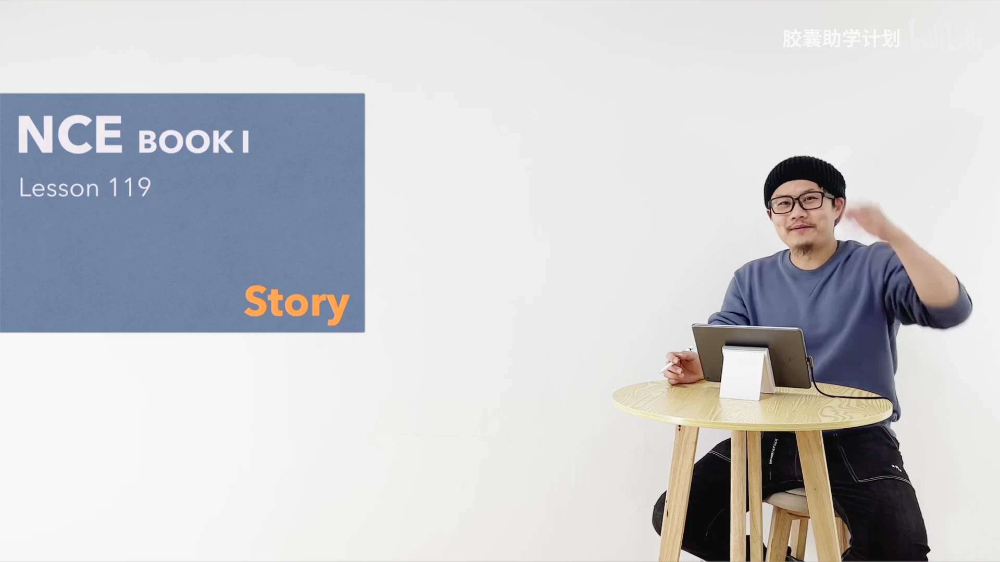

文字识别：胶囊助学计划 / NCE / BOOKI / Lesson 119 / Story

### 画面 00:00:02

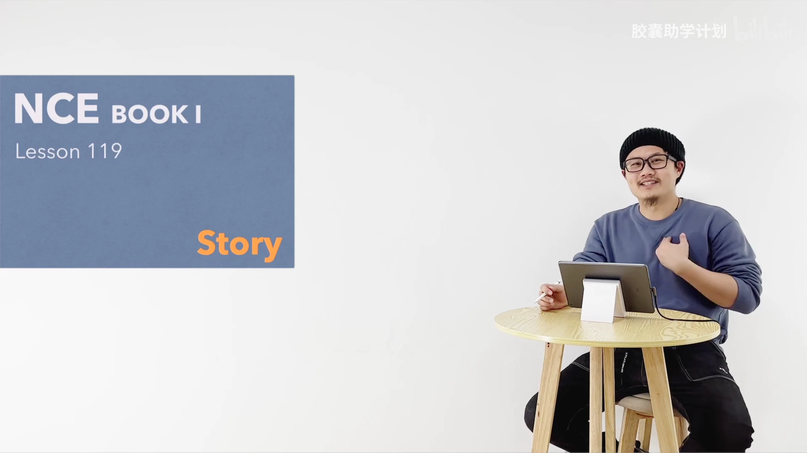

文字识别：胶囊助学计划 / NCE / BOOKI / Lesson 119 / Story

### 画面 00:00:10

文字识别：胶囊助学计划bill

### 画面 00:00:14

### 画面 00:00:16

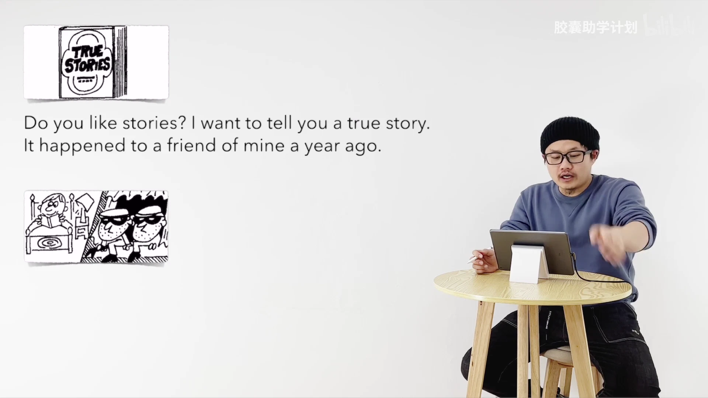

文字识别：胶囊助学计划 / TRUE / STORIES / Do you like stories? I want to tell you a true story. / It happened to a friend of mine a year ago.

## 00:00:30–00:01:00

to tell want to do something. 咱们之前学过的，说想给你讲 tell you a true story，讲给你听一个真实的故事 true story. It happened to it happened to. 它发生在谁的身上？注意 happened 加了个一 d，后边还有 a year ago，一般过去式，对吧？一年前发生在谁身上呢？A friend of mine. Mine 其实就等于 my friend，

### 画面 00:00:46

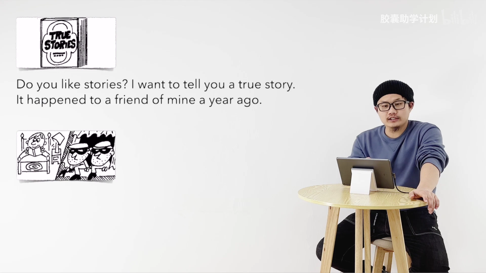

文字识别：胶囊助学计划 / TRUE / STORES / Do you like stories? I want to tell you a true story. / It happened to a friend of mine a year ago.

## 00:01:00–00:01:30

对吧？就是我朋友的一个朋友身上，是吧？我我的一个朋友身上啊。 Okay, 我的一个朋友身上. Next one, Well, my friend 说当我的朋友 George, 哎，我们之前提过了, my friend 和 George 是同位语，对吧？一个人 was reading in bed. 一百一十七个，咱们刚学，正在床上阅读呢. Two thieves, 两个贼, climbed into his kitchen, 爬进了他的厨

### 画面 00:01:08

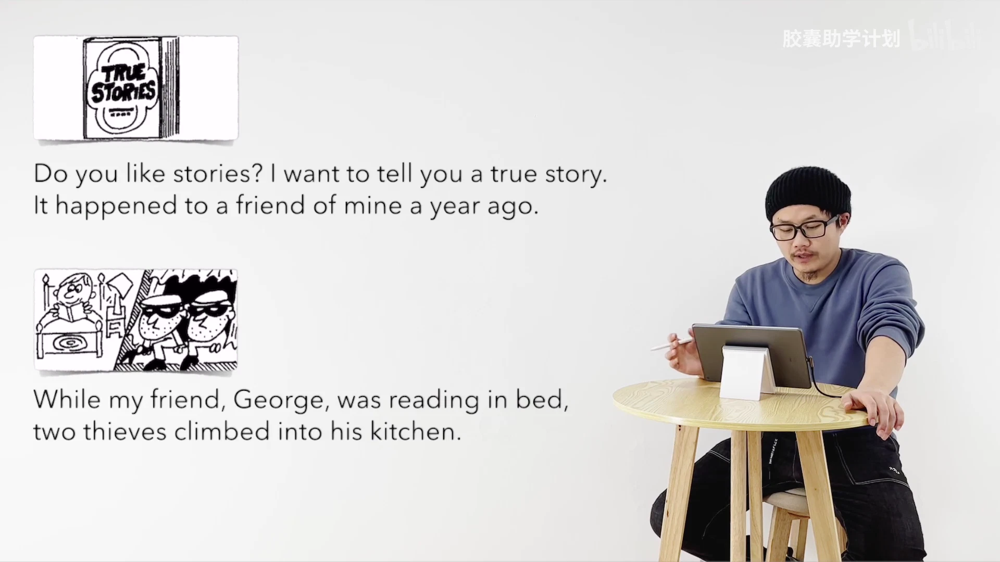

文字识别：胶囊助学计划 / TRUE / STORIES / Do you like stories? I want to tell you a true story. / It happened to a friend of mine a year ago. / While my friend, George, was reading in bed, / two thieves climbed into his kitchen.

## 00:01:30–00:02:00

房，一般过去时，对吧？OK，哎，过去进行时，对吧？哎，他在床上正读书呢，两个贼翻进来了。Next one，after A非常关键，这个单词一出来，我预计接下来会出现had加done和did，非常好。After A，逗号B是吧？那我们看一下它符不符合。说after在什么之后呢？在这两个贼had entered the house，在进入这个房间之后，they went into the

### 画面 00:01:37

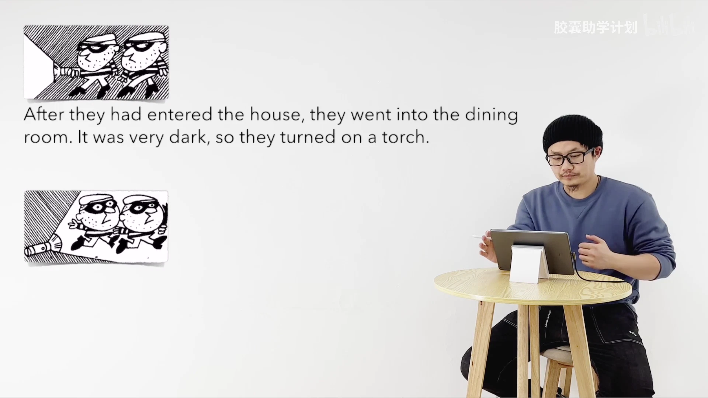

文字识别：胶囊助学计划 / After they had entered the house, they went into the dining / room. It was very dark, so they turned on a torch.

### 画面 00:01:44

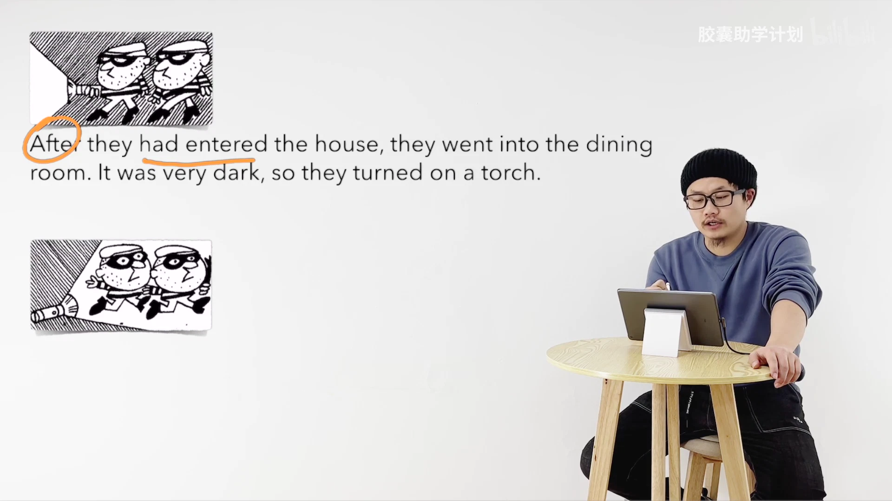

文字识别：胶囊助学计划 / Afte they had entered the house, they went into the dining / room. It was very dark, so they turned on a torch.

### 画面 00:01:47

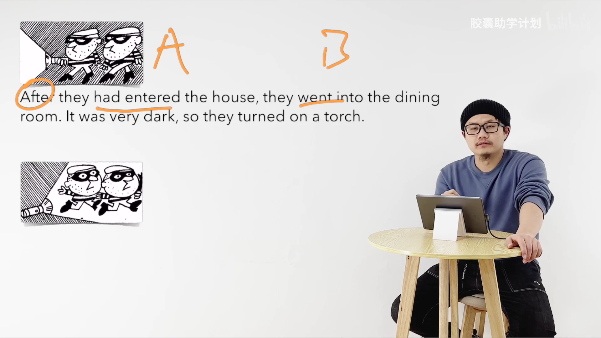

文字识别：胶囊助学计划 / Afte they had entered the house, they wentinto the dining / room. It was very dark, so they turned on a torch.

## 00:02:00–00:02:30

dining room.他们进入了这个餐厅，没问题，特别符合逻辑，肯定是先进入房。逻辑上来说，也只能先进入房子才进入餐厅，是吧？餐厅在房子里面嘛。It was very dark.说当时啊，特别的昏暗黑暗，对吧？So所以啊，they turned on a torch. Turned on.这早在咱们呃二十九三十课，应该是三十课，咱们就学过了，对

### 画面 00:02:17

文字识别：胶囊助学计划 / Afte they had entered the house, they went into the dining / room. It was very dark, so they turned on a torch.

## 00:02:30–00:03:00

吧？打开电器用 turned on。各位回想一下啊，呃，如果您忘了，不妨回去翻看一下，或者看一下那课的视频。打开了一个手电筒。Suddenly，突然间，they heard a voice。哎，我们讲单词的时候讲了它，对吧？他们听到了一个声音。Behind，在他们身后。What's up？What's up？Someone called。Okay，我们先说后面叫某个人喊道、叫道啊、说到。那What's up？What's

### 画面 00:02:40

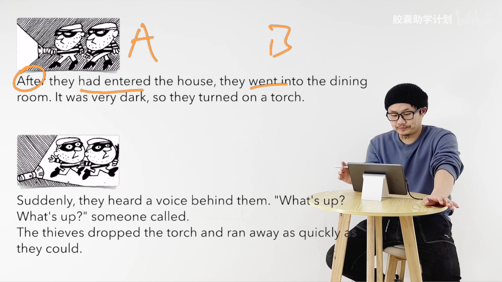

文字识别：胶囊助学计划 / Afte they had entered the house, they went into the dining / room. It was very dark, so they turned on a torch. / Suddenly, they heard a voice behind them. "What's up? / What's up?"someone called. / The thieves dropped the torch and ran away as quickly as / they could.

## 00:03:00–00:03:30

up? 其实 What's up? 它有一个意思在这里指的是什么呢？就怎么了？怎么了？啊？OK。那其实，在西方国家当中啊，人和人有的时候打交道，一般是年轻人就比较酷的一种方式，说 What's up, man? What's up, man? OK，啊，就 How are you? 啊，基本是一个意思。稍微上一点岁数的，我很少听到有人会这么用。但是年轻人之间，对吧？What's up, man? 哎，还是会的啊。尤其比如说健身房，

### 画面 00:03:01

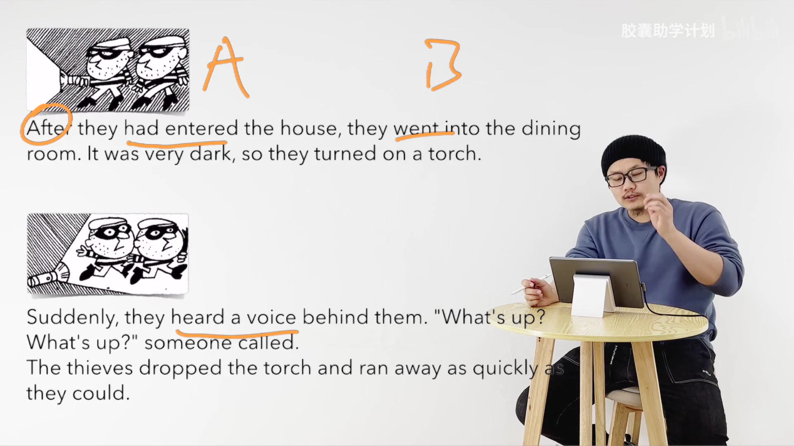

文字识别：胶囊助学计划 / Afte they had entered the house, they went into the dining / room. It was very dark, so they turned on a torch. / Suddenly, they heard a voice behind them. "What's up? / What's up?"someone called. / The thieves dropped the torch and ran away as quickly as / they could.

## 00:03:30–00:04:00

What's up, man？就可以了，就是 How are you？啊，但在这儿明显不是这个意思，就怎么了？怎么了？The thieves dropped the torch，哎，扔了这个手电筒啊，就掉了这手电筒一下啊，一哆嗦手就掉了，掉下来了。Ran away，逃跑了。注意后面叫 as quickly as they could。首先各位完全就可以把它们当做一个小的习惯用法，以后经常会出现叫 as quickly

### 画面 00:03:31

文字识别：胶囊助学计划 / Afte they had entered the house, they went into the dining / room. It was very dark, so they turned on a torch. / Suddenly, they heard a voice behind them. "What's up? / What's up?"someone called. / The thieves dropped the torch and ran away as quickly as / they could.

### 画面 00:03:50

文字识别：胶囊助学计划 / Afte they had entered the house, they wentinto the dining / room. It was very dark, so they turned on a torch. / Suddenly, they heard a voice behind them. "What's up? / What's up?"someone called. / The thieves dropped the torch and ran away as quickly as / they could.

## 00:04:00–00:04:30

as they could，是吧？或者什么 as soon as possible，就可以当做一个经常出现的小短语，叫做尽可能快的跑了。OK啊，那叫跑，因为是前面是 ran嘛，对吧？那你也可以说完成了家庭作业 as as as quickly as they could，也可以，对吧？完成了工作 as quickly as they could 也行。但 as quickly as they could 就是尽他们可能的快啊，就尽快去搞定一件事情，好吧？那我们实际上从一百一十一课

### 画面 00:04:10

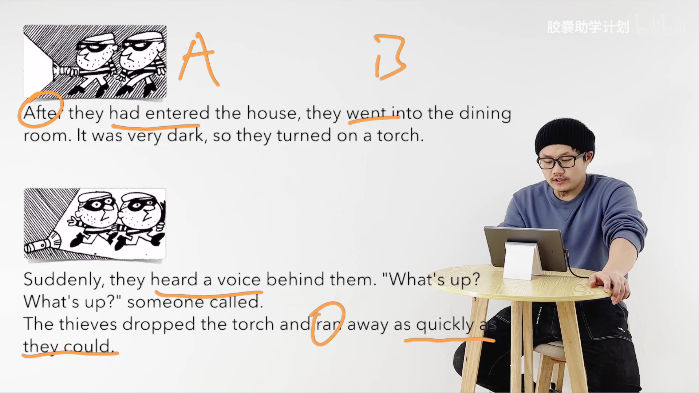

文字识别：胶囊助学计划 / Afte they had entered the house, they wentinto the dining / room. It was very dark, so they turned on a torch. / Suddenly, they heard a voice behind them. "What's up? / What's up?"someone called. / The thieves dropped the torch and rar away as quickly as / they could.

## 00:04:30–00:05:00

学过的这两个 as 呢，某种程度上来说，也可以推导出来。比如说，第一个 as 我们经常翻译成叫同样的，对吧？说同样的快。第二个叫像，像他们能的那样，就他们能多快，他们就做到了多快，其实就是尽快，好理解吧？哈，翻译成汉语俩字儿就可以了。Next one, George heard the noise. 听到了这个，你注意，它不就是 voice 了？ noise 是噪音，对吧？这个

### 画面 00:04:31

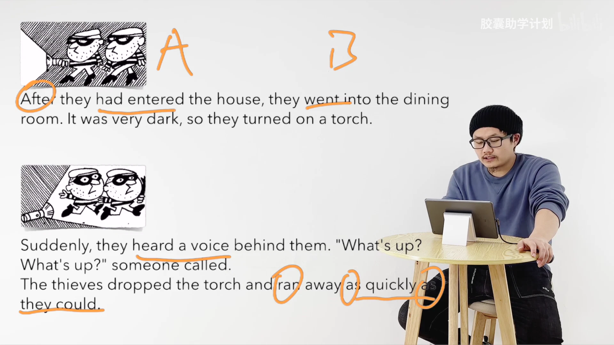

文字识别：胶囊助学计划 / Afte they had entered the house, they went into the dining / room. It was very dark, so they turned on a torch. / Suddenly, they heard a voice behind them. "What's up? / What's up?"someone called. / The thieves dropped the torch andrar away / quicklye / they could.

### 画面 00:04:40

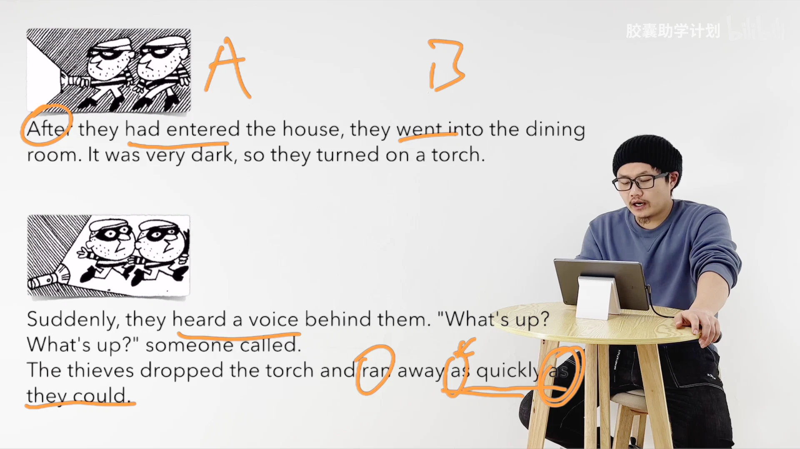

文字识别：胶囊助学计划 / Afte they had entered the house, they went into the dining / room. It was very dark, so they turned on a torch. / Suddenly, they heard a voice behind them. "What's up? / What's up?"someone called. / The thieves dropped the torch andraraway / quickly / they could.

### 画面 00:04:50

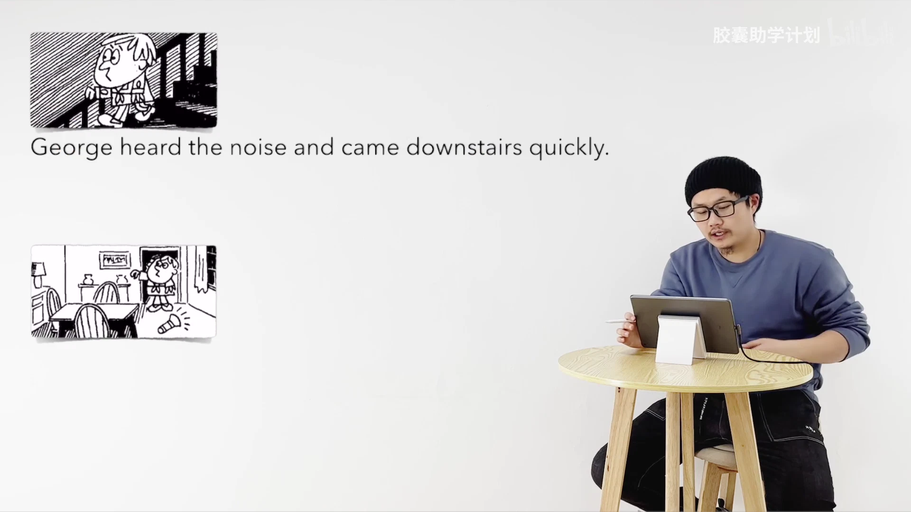

文字识别：胶囊助学计划 / George heard the noise and came downstairs quickly.

## 00:05:00–00:05:30

声音，voice是嗓音。他们没说话。这个掉地上了之后是一些噪音。And came downstairs quickly，然后迅速就下楼了。He turned down the light，哎，他打开了这个灯。But he couldn't see anyone，但是他看不到任何人。Anyone，any加one叫任何人啊，他没有办法看到任何人。Couldn't一百零三课咱们学过，对吧？Can的过去式，当然也能用在

### 画面 00:05:10

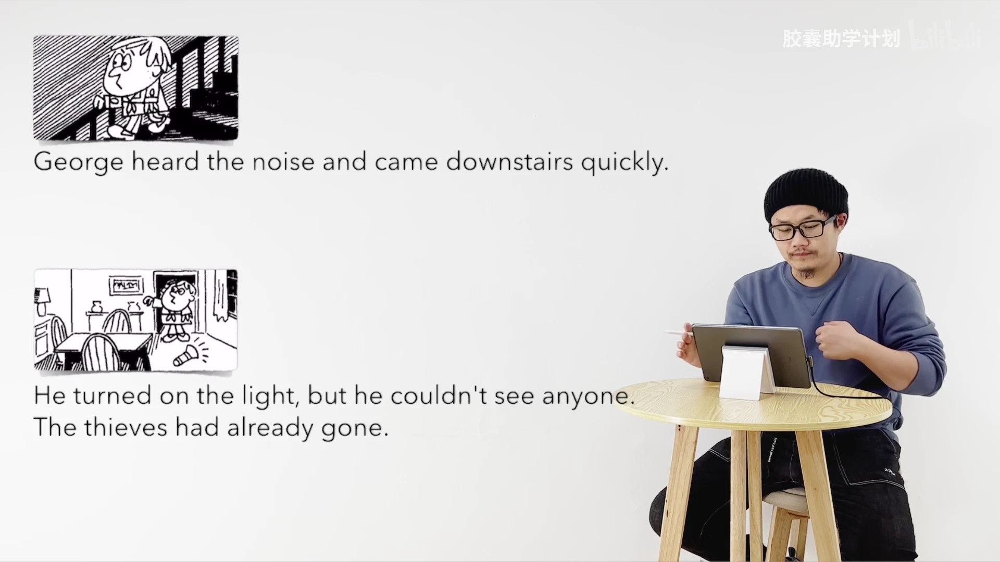

文字识别：胶囊助学计划 / George heard the noise and came downstairs quickly. / He turned on the light, but he couldn't see anyone. / The thieves had already gone.

## 00:05:30–00:06:00

现在啊。The thieves had already gone. 贼们已经跑了，已经走了，不在了。But George's parrot, 注意来了啊，谁说 What's up? 那 George's parrot, 他的这个鹦鹉 Henry, 同位语非常舒服。Was still there, 依旧还在那里。What's up, George? 啊，他说怎么了，George? He called, 他喊道。Nothing, Henry. 啥事儿也没有，Henry.

### 画面 00:05:38

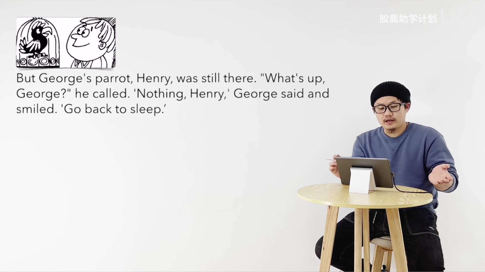

文字识别：胶囊助学计划 / But George's parrot, Henry, was stillthere. "What's up, / George?" he called.'Nothing, Henry,' George said and / smiled.'Go back to sleep.'

## 00:06:00–00:06:30

Ah, George said. George说道，and smiled，然后笑道，然后说，Go back to sleep.那go to sleep叫去睡觉，go back to sleep就是回去接着睡吧，对吧？Okay, very good.文章咱们讲完了，接下来口语听力练习啊来了，各位认真听了来了。How long ago did this story happen? It happened a year ago. Next one.

### 画面 00:06:08

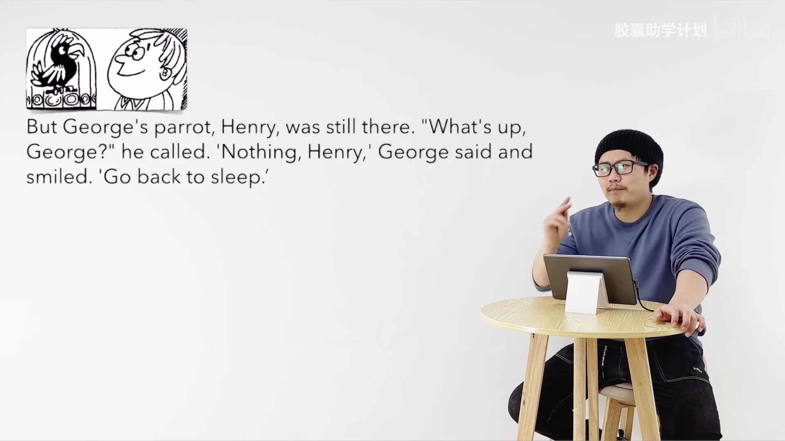

文字识别：胶囊助学计划 / But George's parrot, Henry, was stillthere. "What's up, / George?"he called.'Nothing, Henry,' George said and / smiled.'Go back to sleep.'

### 画面 00:06:12

文字识别：胶囊助学计划 / Comprehension

### 画面 00:06:20

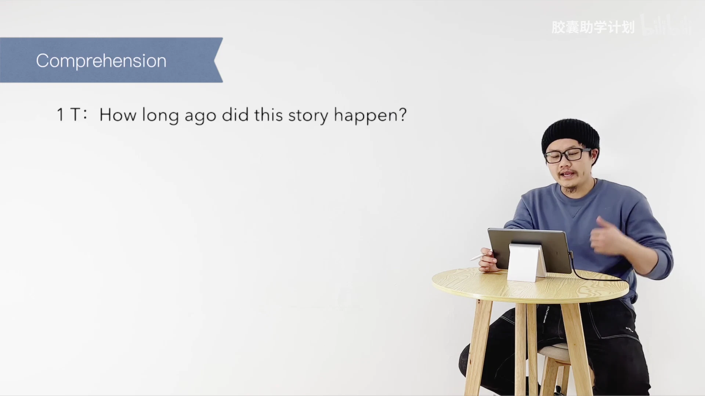

文字识别：胶囊助学计划 / Comprehension / 1 T: How long ago did this story happen?

### 画面 00:06:28

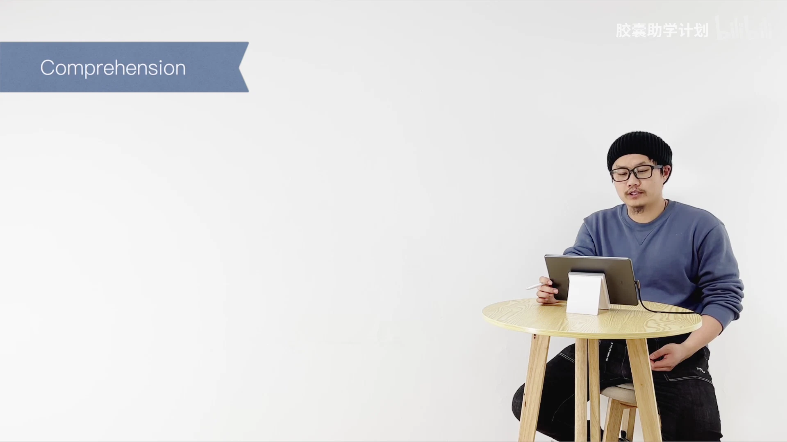

文字识别：胶囊助学计划 / Comprehension

## 00:06:30–00:07:00

What was George doing when two thieves climbed into his kitchen? He was reading in bed. Next one. Where did they go after they had entered the house? They went into the dining room. Next one. What kind of light did they have with them? Now, what kind of light? I'll simply say, what kind of light? What

### 画面 00:06:36

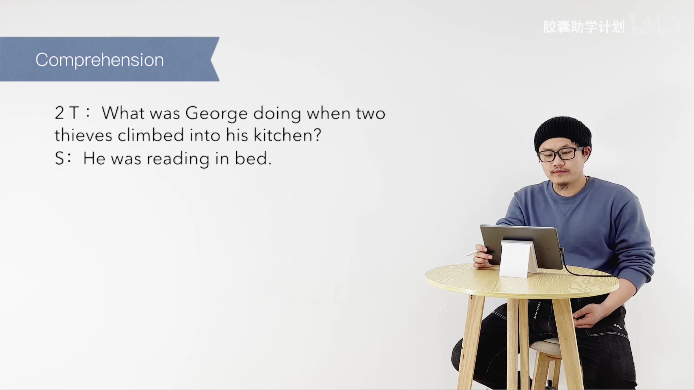

文字识别：胶囊助学计划 / Comprehension / 2T: What was George doing when two / thieves climbed into his kitchen? / S: He was reading in bed.

### 画面 00:06:40

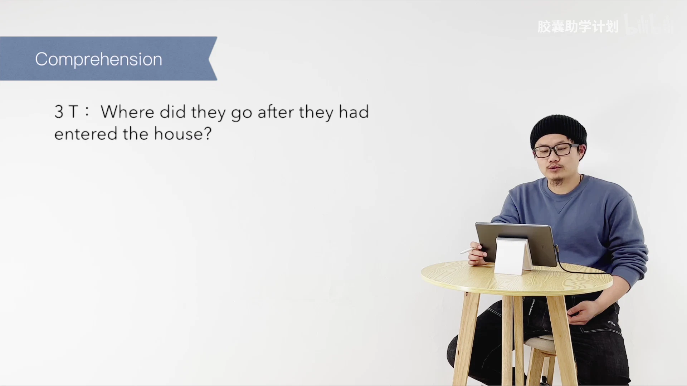

文字识别：胶囊助学计划 / Comprehension / 3 T: Where did they go after they had / entered the house?

### 画面 00:06:50

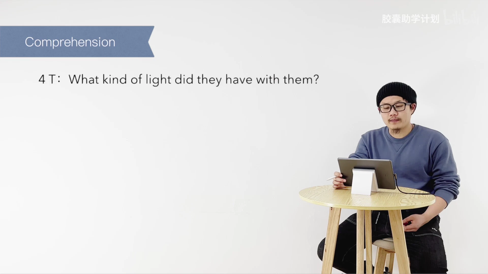

文字识别：胶囊助学计划 / Comprehension / 4 T: What kind of light did they have with them?

## 00:07:00–00:07:30

源啊，就 a torch，对吧？Next one. What did they hear suddenly? They heard a voice behind them. Next one. What did the thieves do? They dropped the torch and ran away as quickly as they could. Next one. What could George see when he came downstairs? He couldn't see anyone.

### 画面 00:07:07

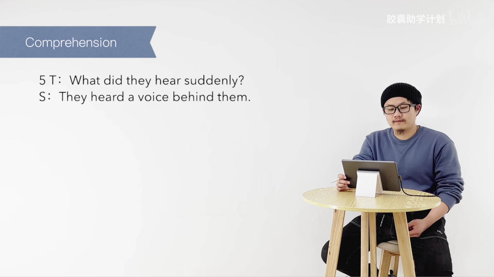

文字识别：胶囊助学计划 / Comprehension / 5 T: What did they hear suddenly? / S: They heard a voice behind them.

### 画面 00:07:15

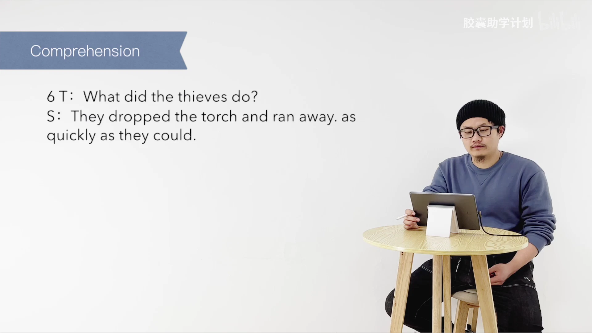

文字识别：胶囊助学计划 / Comprehension / 6 T: What did the thieves do? / S: They dropped the torch and ran away. as / quickly as they could.

### 画面 00:07:21

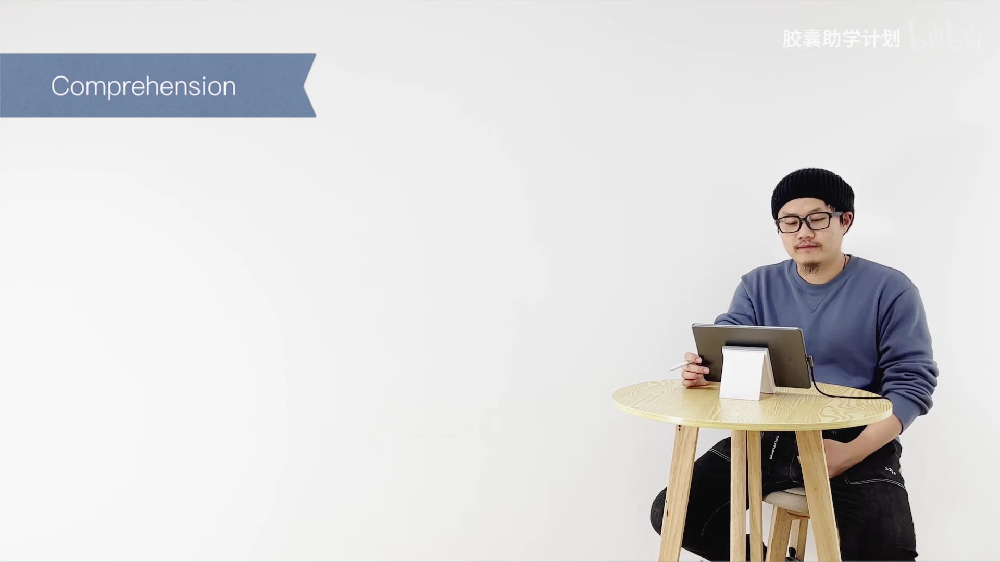

文字识别：胶囊助学计划 / Comprehension

## 00:07:30–00:08:00

Next one, who had called out in the dark? Called out,其实就是called. Okay, George's parent Henry asking questions.肯定句，一般疑问句，特殊疑问句来了. Ask me if it happened to a friend of mine.一般疑问句. Did it happen to a friend of yours? What What happened to a friend of yours? What

### 画面 00:07:35

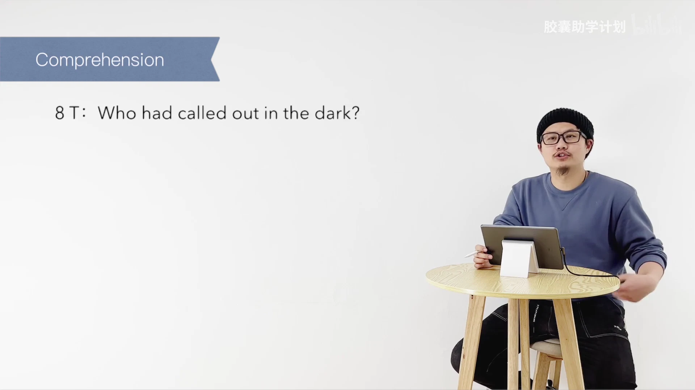

文字识别：胶囊助学计划 / Comprehension / 8 T: Who had called out in the dark?

### 画面 00:07:40

文字识别：胶囊助学计划 / Asking questions

### 画面 00:07:46

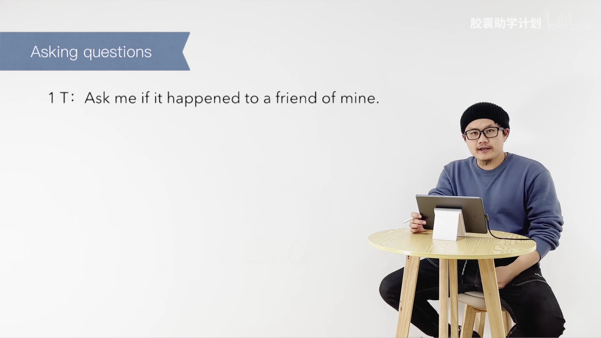

文字识别：胶囊助学计划 / Asking questions / 1 T: Ask me if it happened to a friend of mine.

### 画面 00:07:51

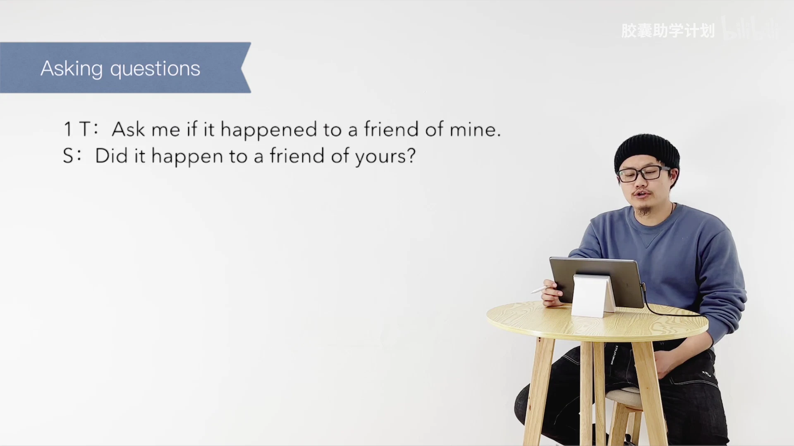

文字识别：胶囊助学计划 / Asking questions / 1 T: Ask me if it happened to a friend of mine. / S: Did it happen to a friend of yours?

## 00:08:00–00:08:30

对主语提问。 It, it指的就是 the story, 对吧？或者呃 the thing, 啊这件事情啊。 Next one, ask me if George was reading in bed. Was George reading in bed? When? When was George reading in bed? Next one, ask me if the thieves went into the dining room. Did

### 画面 00:08:00

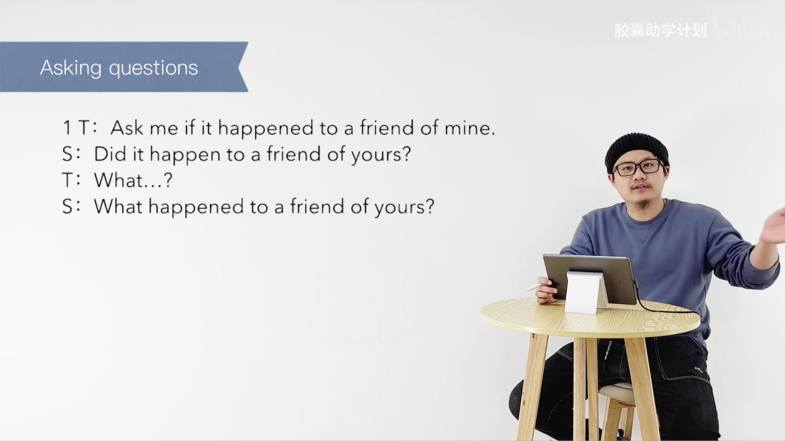

文字识别：胶囊助学计划 / Asking questions / 1 T: Ask me if it happened to a friend of mine. / S: Did it happen to a friend of yours? / T: What...? / S: What happened to a friend of yours?

### 画面 00:08:09

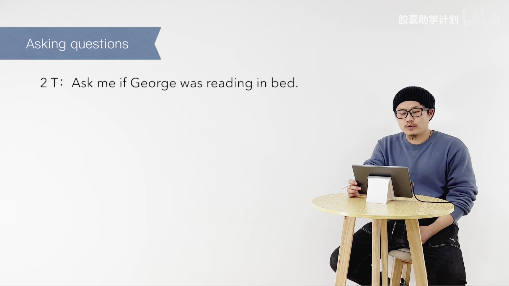

文字识别：胶囊助学计划 / Asking questions / 2 T: Ask me if George was reading in bed.

### 画面 00:08:18

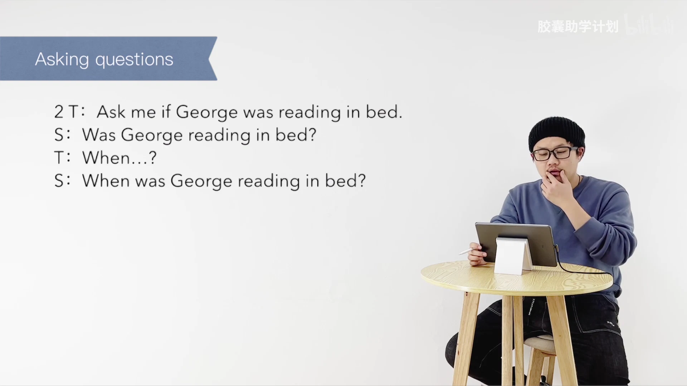

文字识别：胶囊助学计划 / Asking questions / 2 T: Ask me if George was reading in bed. / S: Was George reading in bed? / T: When...? / S: When was George reading in bed?

### 画面 00:08:22

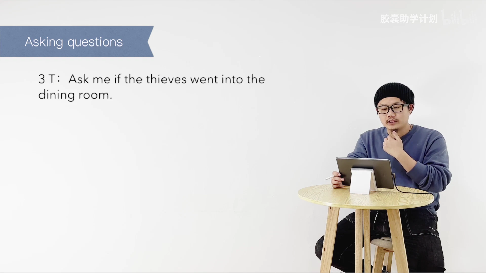

文字识别：胶囊助学计划 / Asking questions / 3 T: Ask me if the thieves went into the / dining room.

## 00:08:30–00:09:00

the thieves go into the dining room? Where? Where did the thieves go? Next one. Ask me if they heard a voice behind them. Did they hear a voice behind them? What? What did they hear behind them? Next one. Ask me if George came downstairs.

### 画面 00:08:34

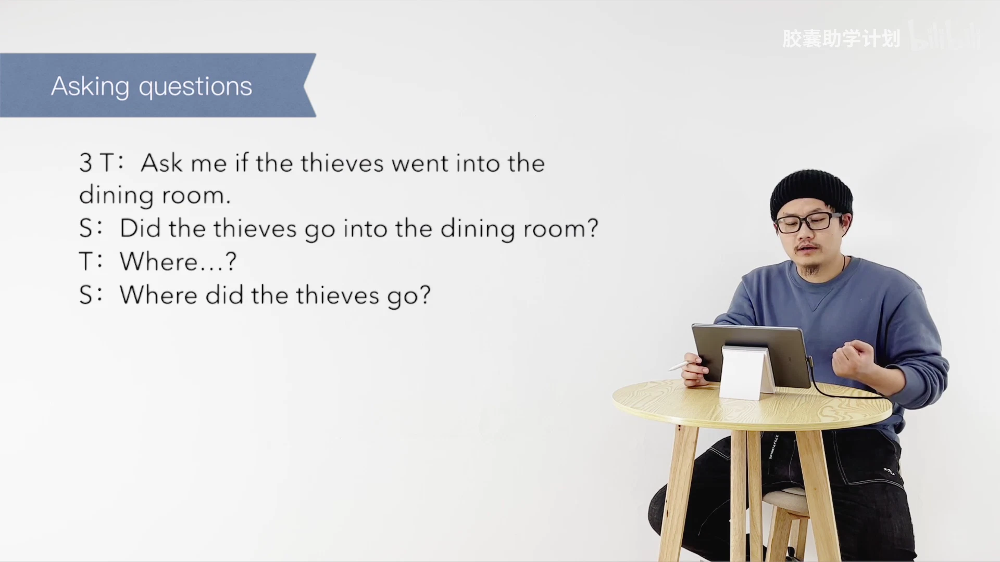

文字识别：胶囊助学计划 / Asking questions / 3 T: Ask me if the thieves went into the / dining room. / S: Did the thieves go into the dining room? / T: Where...? / S: Where did the thieves go?

### 画面 00:08:39

文字识别：胶囊助学计划 / Asking questions / 4T : Ask me if they heard a voice behind them.

### 画面 00:08:49

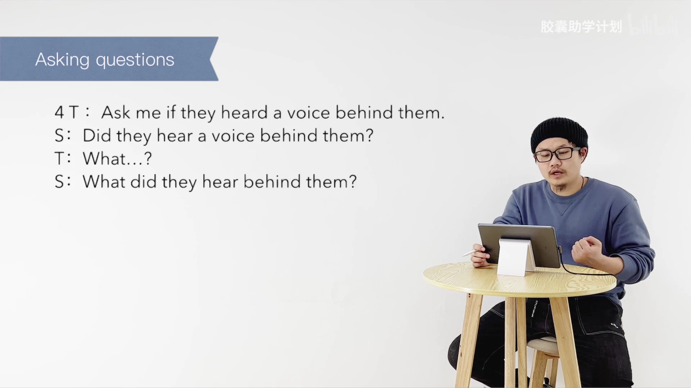

文字识别：胶囊助学计划 / Asking questions / 4T : Ask me if they heard a voice behind them. / S: Did they hear a voice behind them? / T: What...? / S: What did they hear behind them?

### 画面 00:08:54

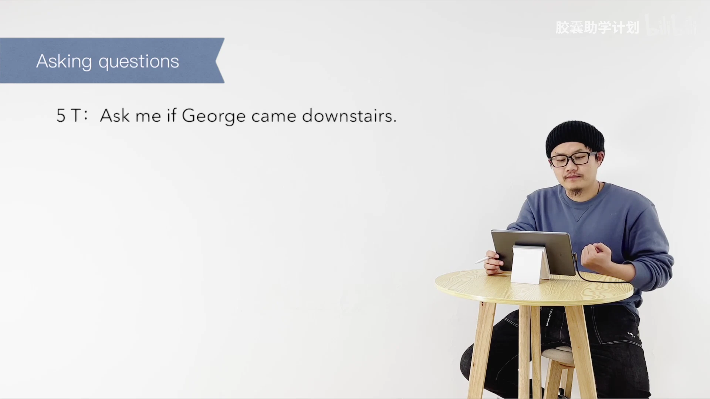

文字识别：胶囊助学计划 / Asking questions / 5 T: Ask me if George came downstairs.

## 00:09:00–00:09:30

Did George come downstairs? When? When did George come downstairs? Okay, very good.好，加呃，recap啊，本课其实最关键的就还是这两个东西，对吧？Had加and和after before. Okay,好，然后呢，加上作业绿皮书幺幺九，我们可以写了文章跟读至熟读成诵。老习惯，给自己讲解一遍今天的核心知识点。然后呢，如

### 画面 00:09:05

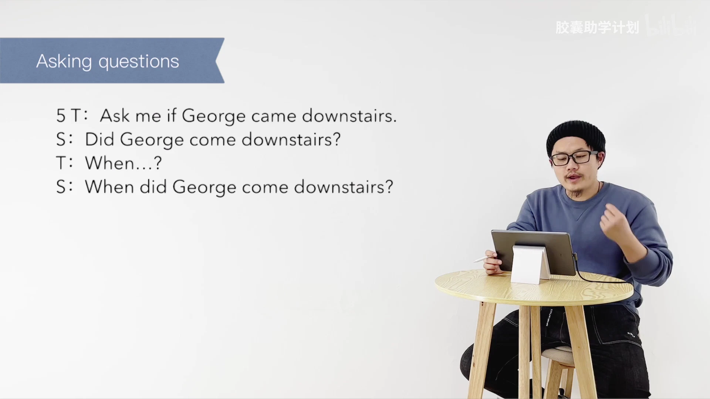

文字识别：胶囊助学计划 / Asking questions / 5 T: Ask me if George came downstairs. / S: Did George come downstairs? / T: When...? / S: When did George come downstairs?

### 画面 00:09:10

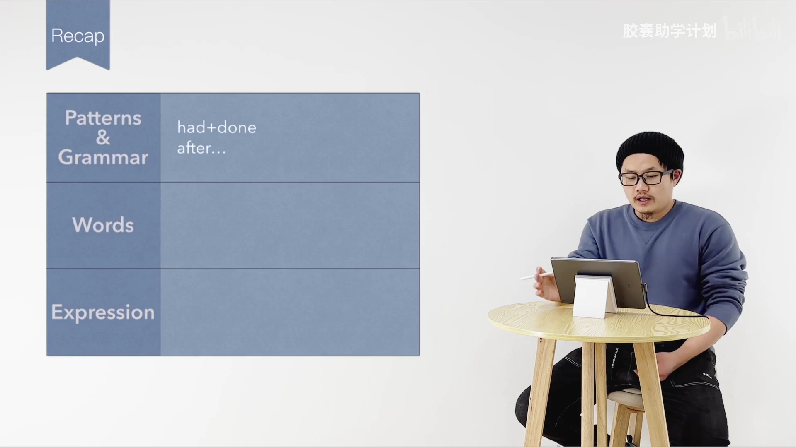

文字识别：Recap / 胶囊助学计划 / Patterns / had+done / after.. / Grammar / Words / Expression

### 画面 00:09:19

文字识别：胶囊助学计划 / 绿皮书第119课的写作练习

### 画面 00:09:27

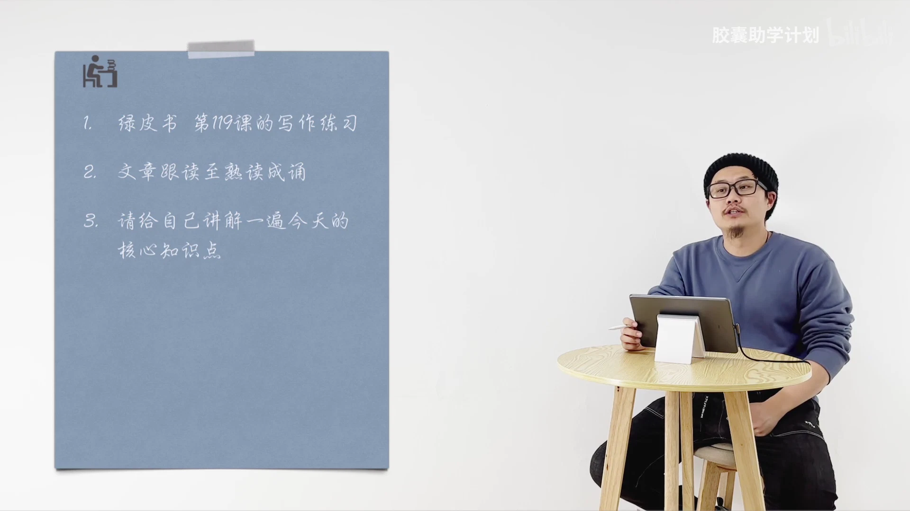

文字识别：胶囊助学计划 / 绿皮书第119课的写作练习 / 文章跟读至熟读成诵 / 3.请给自己讲解一遍今天的 / 核心知识点

### 画面 00:09:29

文字识别：胶囊助学计划

## 00:09:30–00:10:00

果大家喜欢我们的课程，欢迎大家关注、订阅、一键三连，分享给那些需要的朋友，来帮助我们快速成长。最后，我们再来看一句名人名言：“If you want a happy ending, that depends, of course, on where you start your story.” 好，再见，See you next time.

### 画面 00:09:37

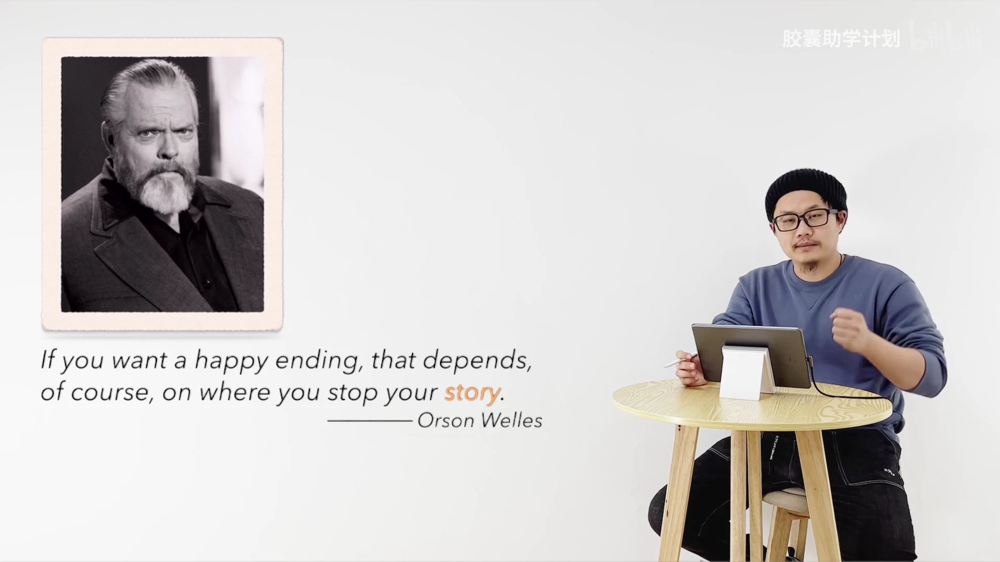

文字识别：胶囊助学计划 / If you want a happy ending, that depends, / of course, on where you stop your story. / - Orson Welles

### 画面 00:09:49

### 画面 00:09:51

文字识别：CAPSULEACADEMY / 胶囊助学计划 / 小红书 / Lecturer / □ / Leo / OE

### 画面 00:09:54

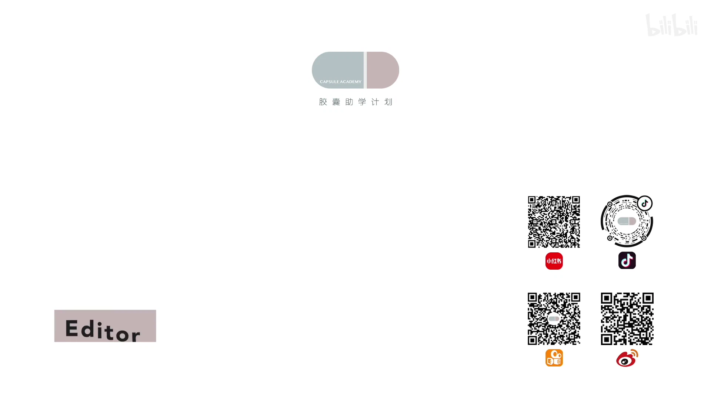

文字识别：CAPSULEACADEMY / 胶囊助学计划 / 『 / 小红书 / □ / Editor / OE

### 画面 00:09:57

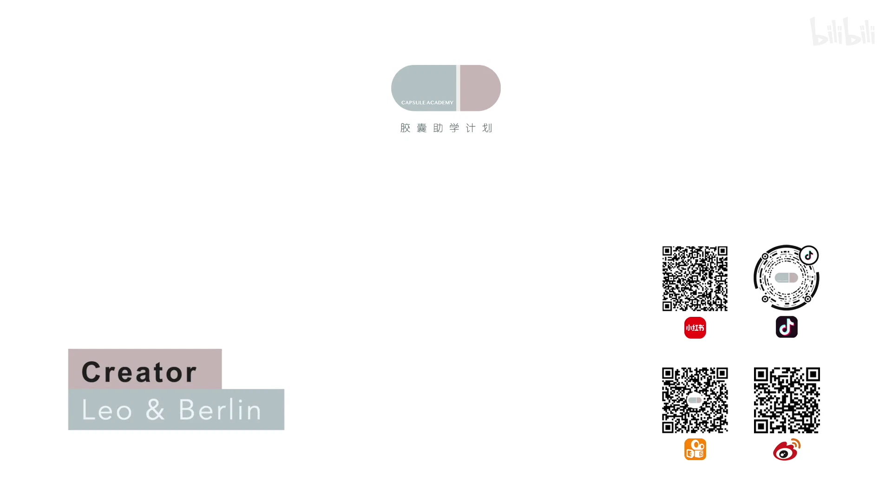

文字识别：CAPSULEACADEMY / 胶囊助学计划 / 『 / 小红书 / Creator / Leo & Berlin / OE

### 画面 00:09:59

文字识别：bilibili / 胶囊助学计划 / 胶囊助学计划 / 小红书 / 控□ / OE

## 00:10:00–00:10:01

### 画面 00:10:01

文字识别：bilibili / 胶囊助学计划

