# 120 练习

快速机器解析：语音为单模型转写，未进行独立交叉校对或人工复核；画面每秒采样并按变化选帧，短时文字和标记可能遗漏。截图时间约有 1 秒误差。图片有损压缩；遇到疑点请按时间查看 Google Drive 原视频。

## 00:00:00–00:00:30

Hello, everyone. Welcome to Capsule Academy. This is Leo. Today we are going to learn New Concept English Book One Lesson One Hundred and Twenty Practices. Hope you guys enjoy it.好，那本课的练习啊，特别的重要。我们重点练的就是 after a , b 以及 had 加 done，对吧？所以各位不妨其实多走几遍这个本课的这个视频啊，一遍也许不够。来啊，

### 画面 00:00:00

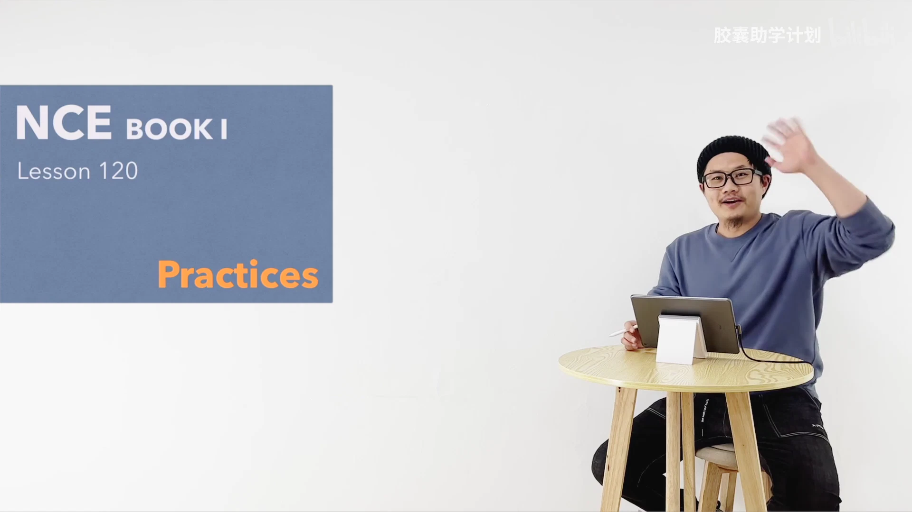

文字识别：胶囊助学计划 / NCE / BOOKI / Lesson 120 / Practices

### 画面 00:00:10

文字识别：胶囊助学计划bill / •

### 画面 00:00:14

文字识别：胶囊助学计划

### 画面 00:00:16

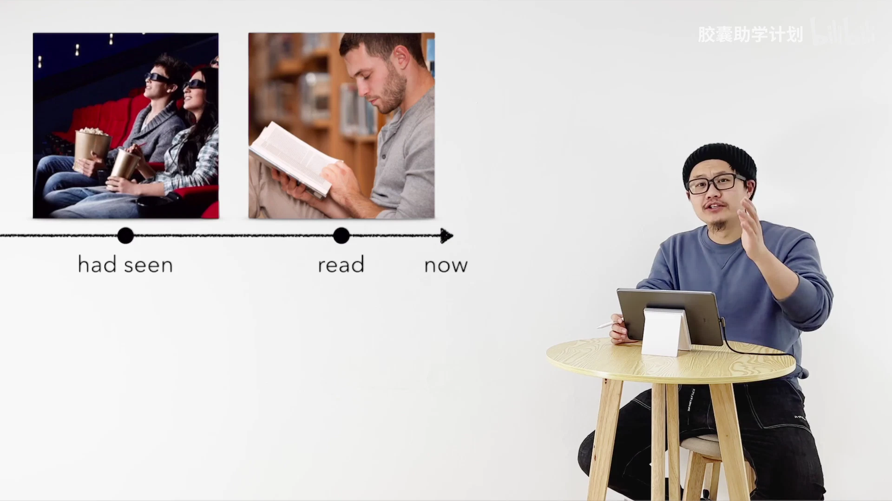

文字识别：胶囊助学计划 / had seen / read / now

## 00:00:30–00:01:00

我带着各位读。Did you read the book? Yes, but I saw the film first.你看，两句话，我读了书，但我先看的电影。我们把这两句话给它连到一起，叫在我看完电影之后，我去读了书，对吧？跟我一起来。I read the book after I had seen the film.哎，注意，现在是B after A，对吧？这个是A嘛？这个是B，对

### 画面 00:00:33

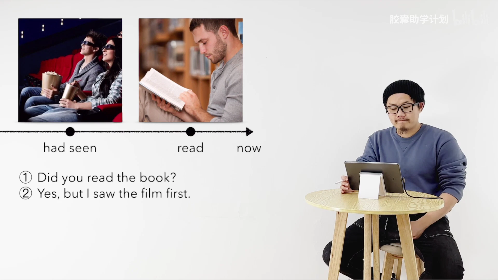

文字识别：胶囊助学计划 / had seen / read / now / ① Did you read the book? / ② Yes, but I saw the film first.

### 画面 00:00:48

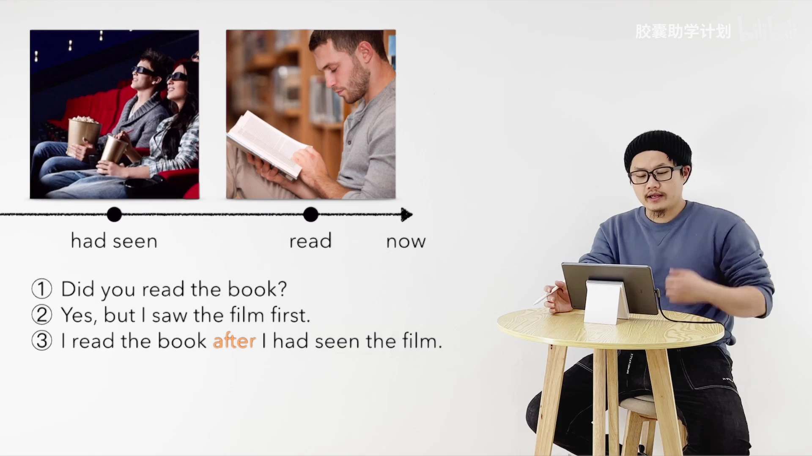

文字识别：胶囊助学计划 / had seen / read / now / ① Did you read the book? / ② Yes, but I saw the film first. / ③ I read the book after I had seen the film.

## 00:01:00–00:01:30

吧？OK，玩一个，全是这个套路啊！各位，接下来，呃，我个人一个小的建议，对于这个视频，您不妨在每一个地方暂停，然后重点看一下第三句话以及这个图例啊，这是非常用心给大家去做的啊！各位结合起来就能感受到了。还有一个明显的前后顺序啊！来， next one. Did you go to the doctor? Yes, but I made an appointment

### 画面 00:01:18

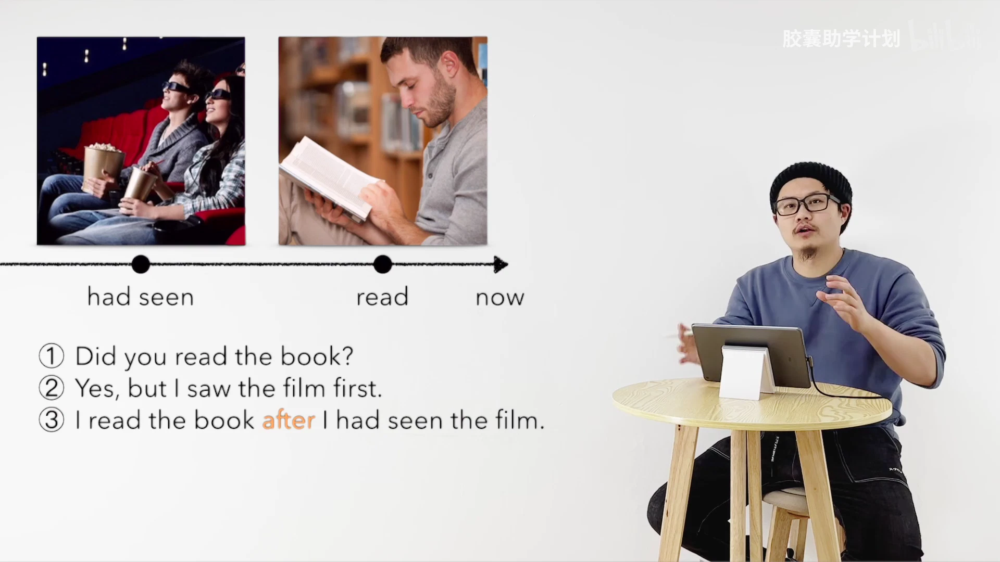

文字识别：胶囊助学计划 / had seen / read / now / ① Did you read the book? / ② Yes, but I saw the film first. / ③ I read the book afterI had seen the film.

### 画面 00:01:20

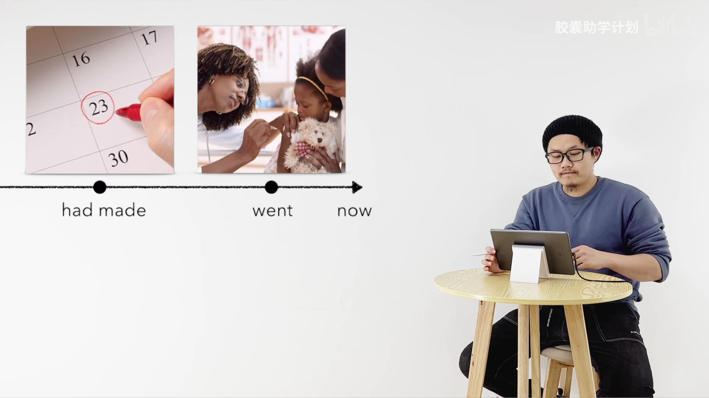

文字识别：胶囊助学计划 / 17 / 16 / 23 / 2 / 30 / had made / went / now

### 画面 00:01:26

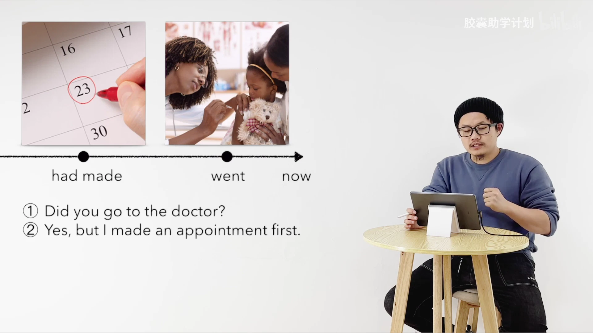

文字识别：胶囊助学计划 / 17 / 16 / 23 / 2 / 30 / had made / went / now / ① Did you go to the doctor? / ② Yes, but I made an appointment first.

## 00:01:30–00:02:00

I went to the doctor after I had made an appointment. Make an appointment.之前我们学的短语对吧？与. Next one. Did the boss leave the office? Yes, but he finished his work first. He left the office after he had finished his work. Next one. Did your wife go out? Yes, but she finished

### 画面 00:01:39

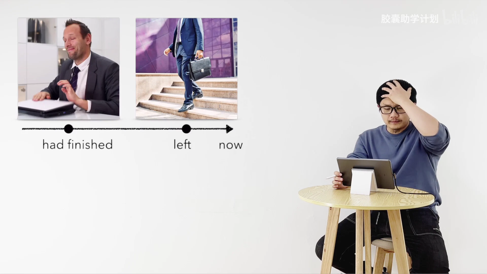

文字识别：胶囊助学计划 / had finished / left / now

### 画面 00:01:48

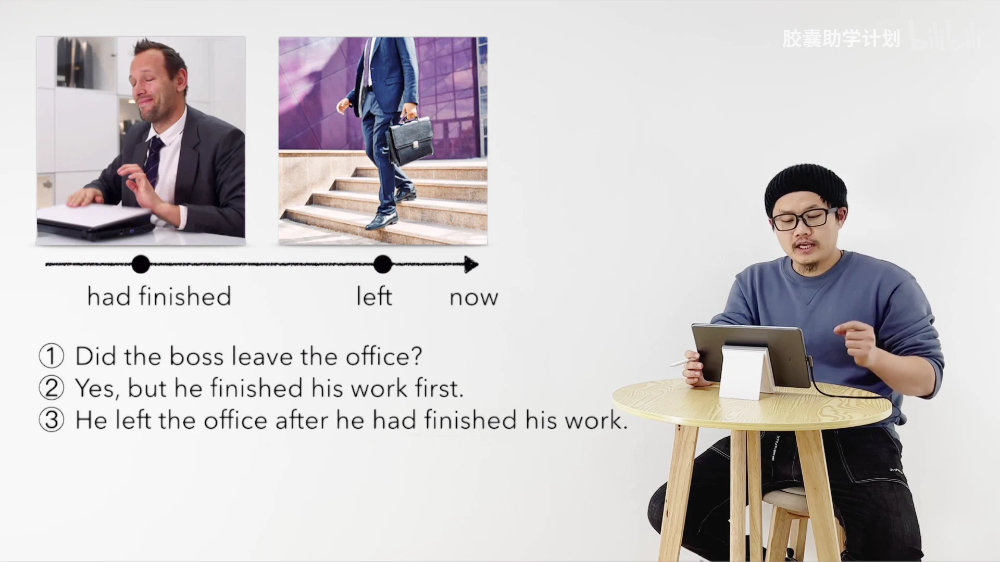

文字识别：胶囊助学计划 / had finished / left / now / ① Did the boss leave the office? / ② Yes, but he finished his work first. /  He left the office after he had finished his work.

### 画面 00:01:54

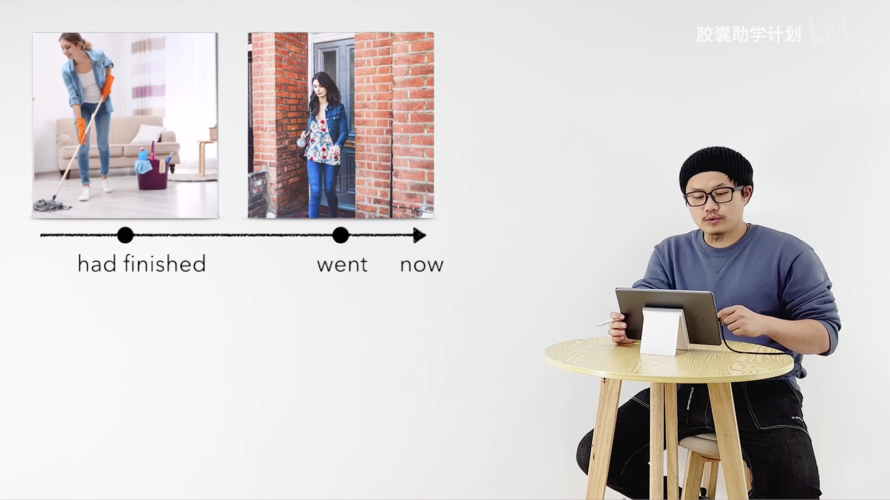

文字识别：胶囊助学计划 / had finished / went / now

## 00:02:00–00:02:30

the housework first. She went out after she had finished the housework. Next one, did your teacher give you your exercise book? Yes, but he corrected it first. Corrected it first. This place has a little reading. Pay attention, corrected it. He gave me my exercise book after he had corrected it.

### 画面 00:02:01

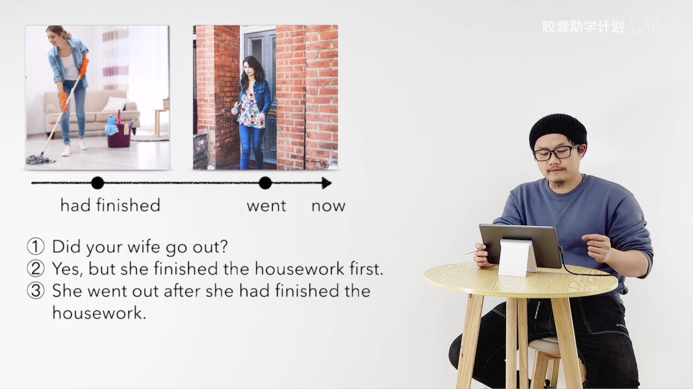

文字识别：胶囊助学计划 / had finished / went / now / ① Did your wife go out? / ② Yes, but she finished the housework first. /  She went out after she had finished the / 3 / housework.

### 画面 00:02:07

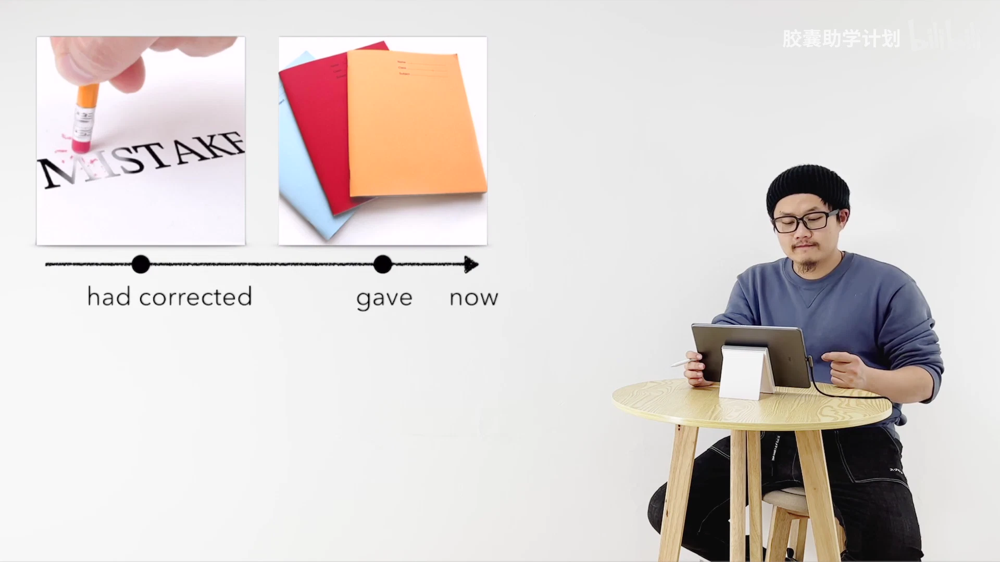

文字识别：胶囊助学计划 / MISTAKF / had corrected / gave / now

### 画面 00:02:20

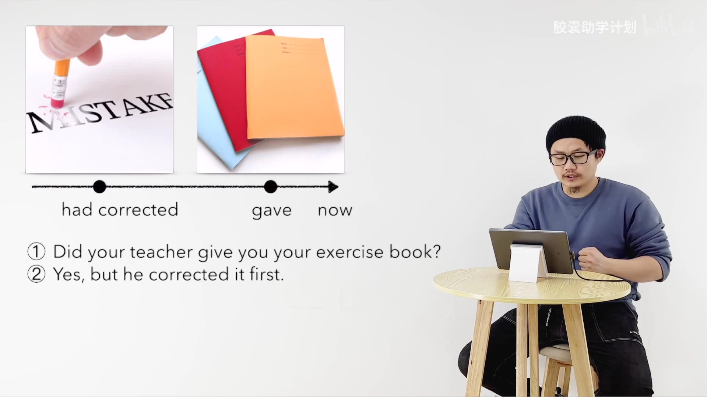

文字识别：胶囊助学计划 / NISTAKF / had corrected / gave / now / ① Did your teacher give you your exercise book? / ② Yes, but he corrected it first.

### 画面 00:02:25

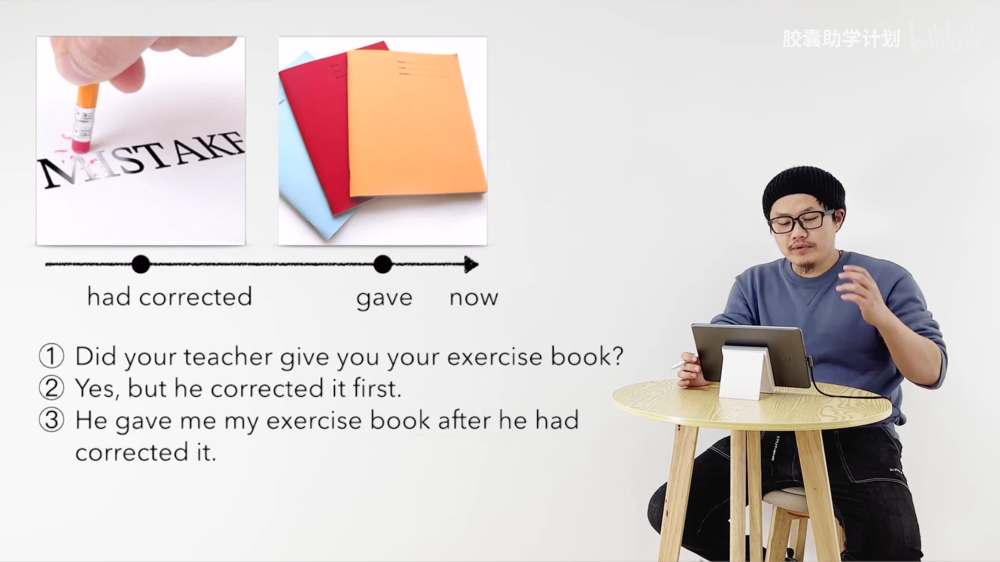

文字识别：胶囊助学计划 / MISTAKF / had corrected / gave / now / ① Did your teacher give you your exercise book? / ② Yes, but he corrected it first. / He gave me my exercise book after he had / corrected it.

## 00:02:30–00:03:00

Next one. Did your sister go on holiday? Yes, but she took the examination first. Took the examination, 考试啊. Next one. She went on holiday after she had taken the examination. Next one. Did you buy a new car? Yes, but I sold my old one first. I bought the new car

### 画面 00:02:32

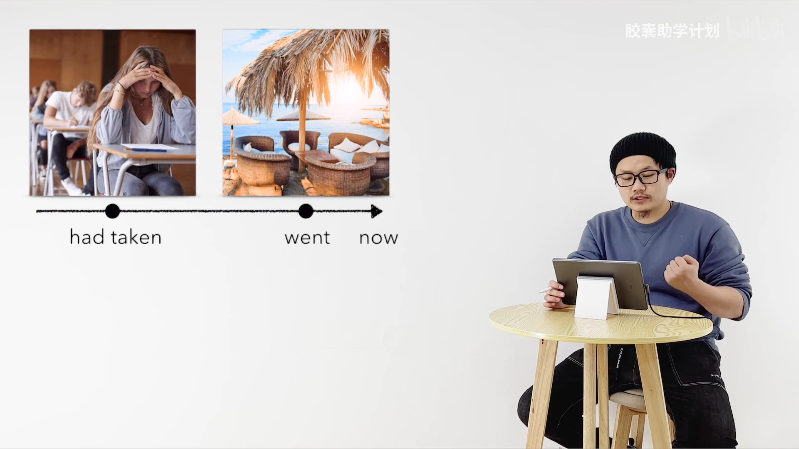

文字识别：胶囊助学计划 / had taken / went / now

### 画面 00:02:43

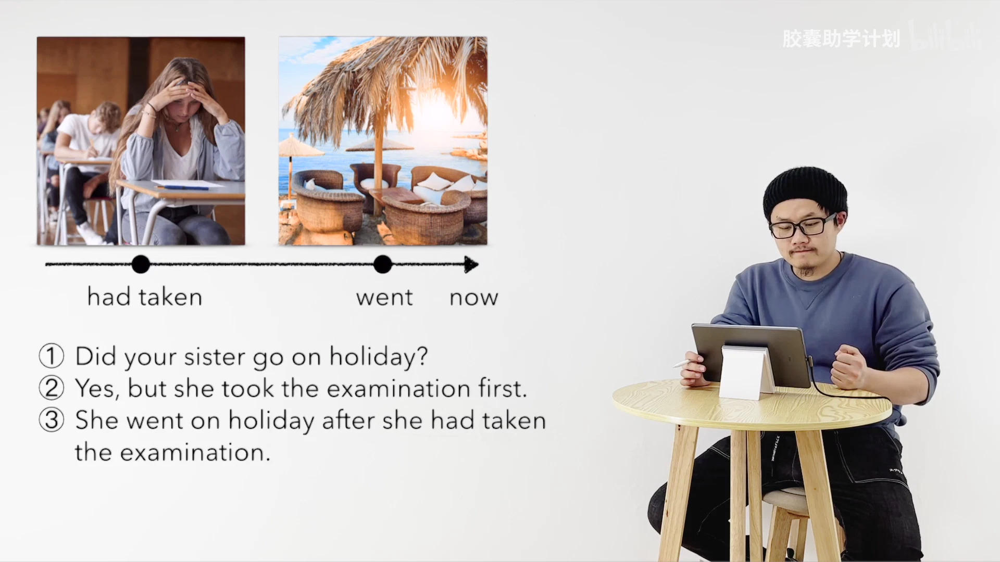

文字识别：胶囊助学计划 / had taken / went / now / ① Did your sister go on holiday? / ② Yes, but she took the examination first. / ) She went on holiday after she had taken / 3 / the examination.

### 画面 00:02:50

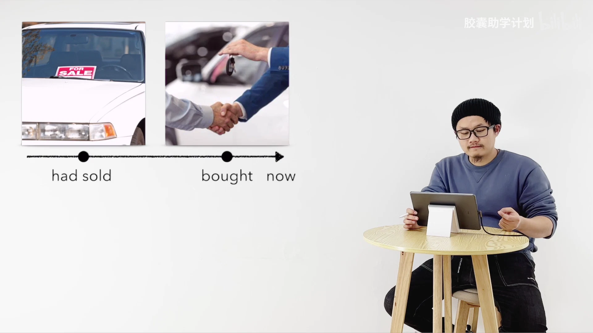

文字识别：胶囊助学计划 / SAOL / had sold / bought / now

### 画面 00:02:57

文字识别：胶囊助学计划 / SAOLE / had sold / bought / :now / ① Did you buy a new car? / ② Yes, but I sold my old one first. / ③ I bought a new car after I had sold my old one.

## 00:03:00–00:03:30

after I had sold my old one. Next one, did your mother sweep the floor? Yes, but she dusted the cupboard first.看图啊，she swept the floor after she had dusted the cupboard.啊，张嘴跟我读啊，大声朗读。Next one, did you drink the milk? Yes, but I boiled it first.我先把它煮沸了。I drank

### 画面 00:03:04

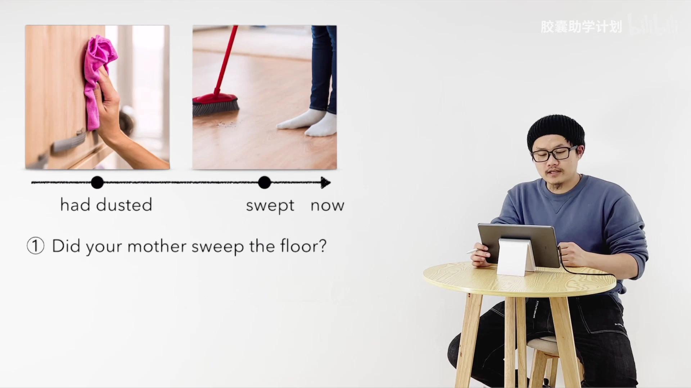

文字识别：胶囊助学计划 / had dusted / swept / now / ① Did your mother sweep the floor?

### 画面 00:03:12

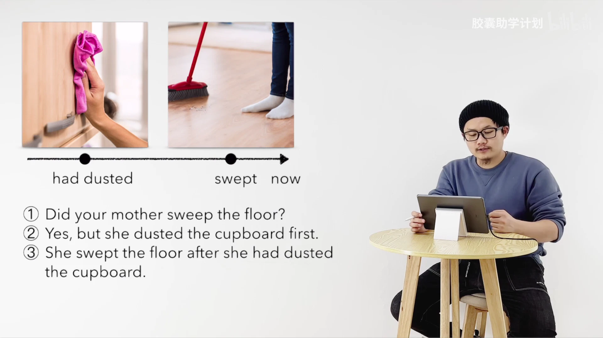

文字识别：胶囊助学计划 / had dusted / swept now / ① Did your mother sweep the floor? / ② Yes, but she dusted the cupboard first. / ③ She swept the floor after she had dusted / the cupboard.

### 画面 00:03:21

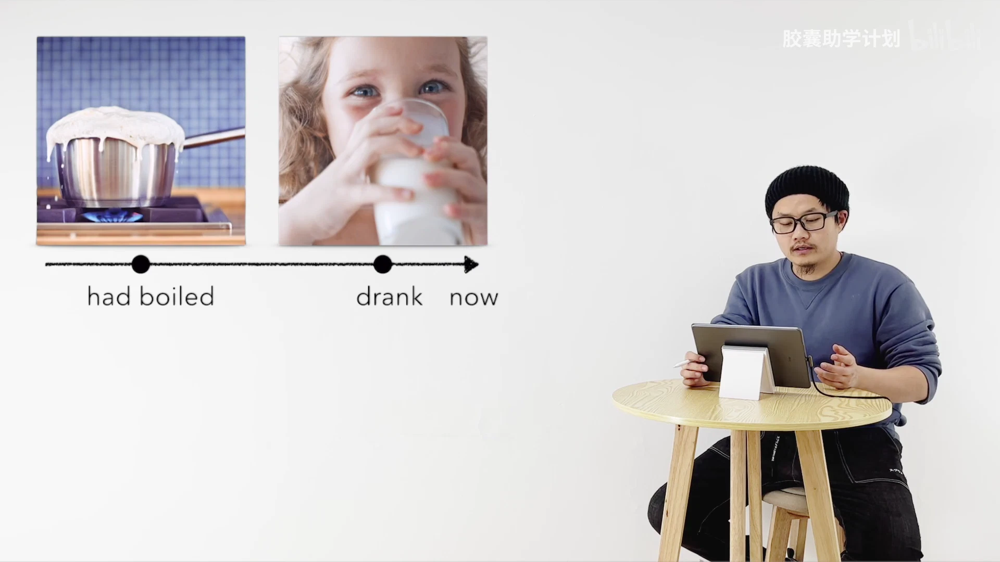

文字识别：胶囊助学计划 / had boiled / drank / now

### 画面 00:03:29

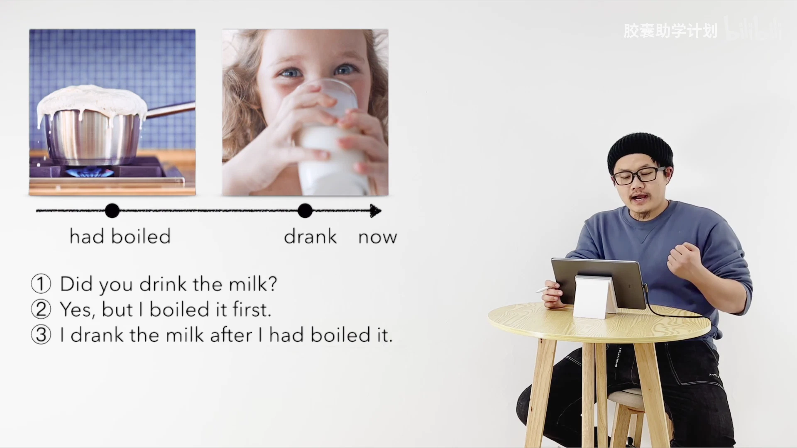

文字识别：胶囊助学计划 / had boiled / drank now / ① Did you drink the milk? / ② Yes, but I boiled it first. / ③ I drank the milk after I had boiled it.

## 00:03:30–00:04:00

the milk after I had boiled it. Next one, did the children go to bed? Yes, but they had a bath first. The children went to bed after they had had a bath. Okay, very good. Ah, recap, 本课练习的 had 加 but after a, ,

### 画面 00:03:34

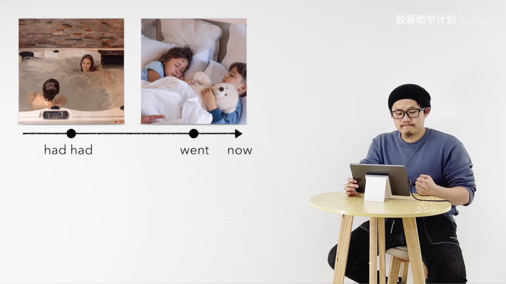

文字识别：胶囊助学计划 / had had / went / now

### 画面 00:03:42

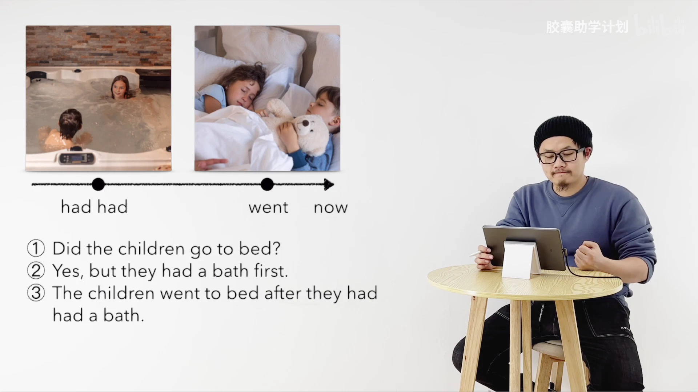

文字识别：胶囊助学计划 / had had / went / now / ① Did the children go to bed? / ② Yes, but they had a bath first. / ) The children went to bed after they had / had a bath.

### 画面 00:03:49

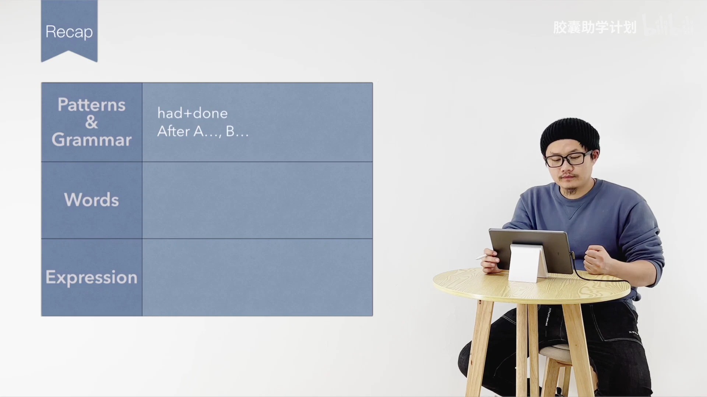

文字识别：Recap / 胶囊助学计划 / Patterns / had+done / AfterA..., B. / Grammar / Words / Expression

### 画面 00:03:58

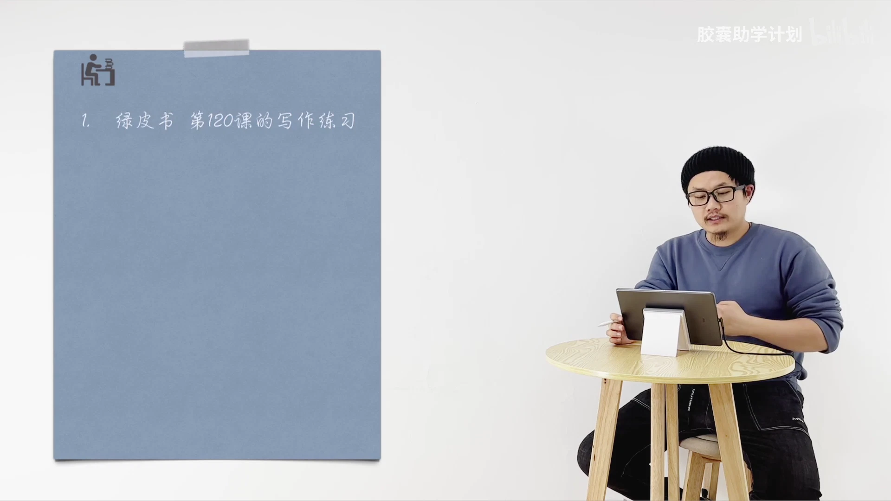

文字识别：胶囊助学计划 / 绿皮书第120课的写作练习

## 00:04:00–00:04:30

十课，各位可以写了，给自己讲解一遍今天的核心知识点，反复跟读本视频中的例句啊，这个特别的重要，各位多读几遍，好吧？好，那如果各位喜欢我们的课程呢，欢迎大家关注、订阅、一键三连啊，分享给那些需要的朋友，来帮助我们快速成长。最后，我们再来看一句名人名言：Nobody on this earth is perfect. Everybody has their flaws. Everybody has their dark

### 画面 00:04:11

文字识别：胶囊助学计划

### 画面 00:04:20

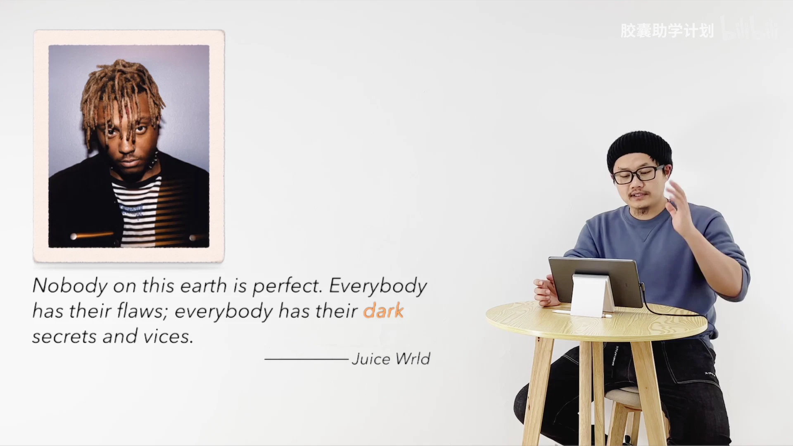

文字识别：胶囊助学计划 / Nobody on this earth is perfect. Everybody / has their flaws; everybody has their dark / secrets and vices. / -Juice Wrld

## 00:04:30–00:04:46

secrets and vices. See you next time.

### 画面 00:04:34

### 画面 00:04:36

文字识别：CAPSULEACADEMY / 胶囊助学计划 / 『 / 小红书 / Lecturer / Leo / OE

### 画面 00:04:38

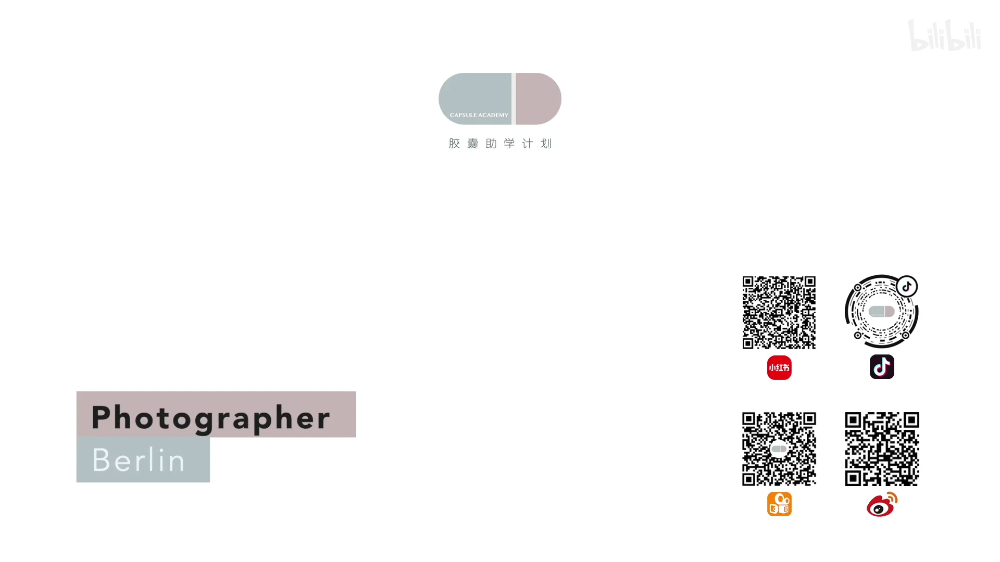

文字识别：CAPSULEACADEMY / 胶囊助学计划 / 『 / 小红书 / Photographer / Berlin / OE

### 画面 00:04:40

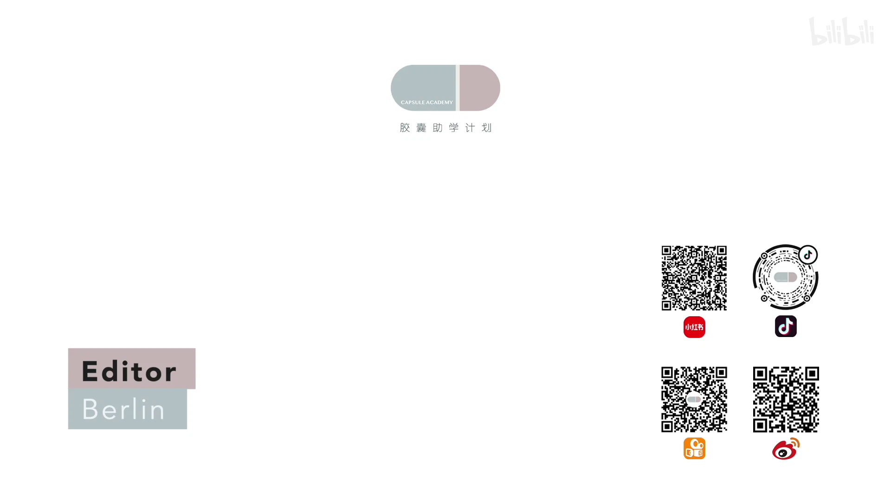

文字识别：CAPSULEACADEMY / 胶囊助学计划 / 『 / 小红书 / Editor / Berlin / OE

### 画面 00:04:43

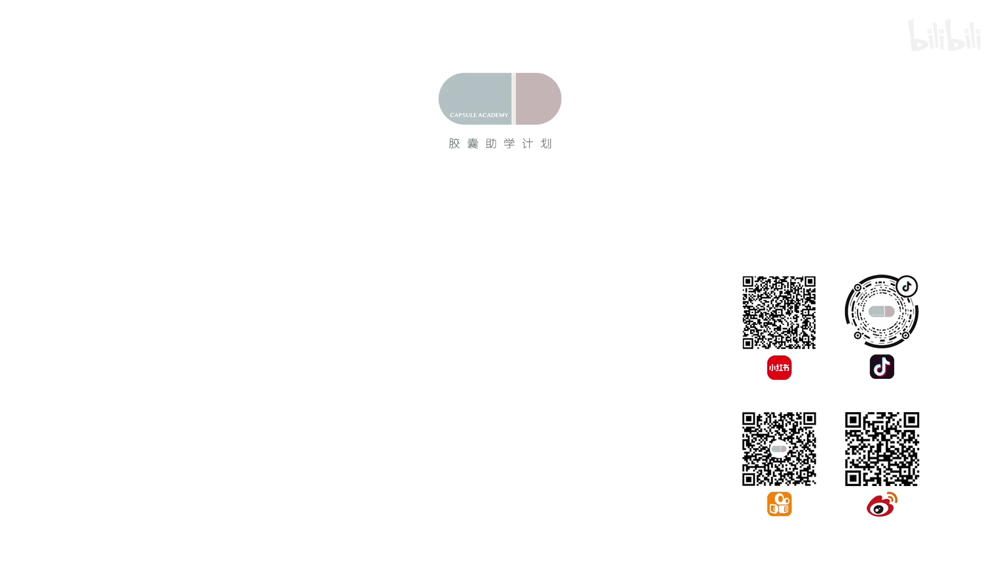

文字识别：CAPSULEACADEMY / 胶囊助学计划 / 小红书 / 品

### 画面 00:04:45

文字识别：bilibili / 胶囊助学计划

### 画面 00:04:46

文字识别：bilibili / 胶囊助学计划

