# 121 单词

快速机器解析：语音为单模型转写，未进行独立交叉校对或人工复核；画面每秒采样并按变化选帧，短时文字和标记可能遗漏。截图时间约有 1 秒误差。图片有损压缩；遇到疑点请按时间查看 Google Drive 原视频。

## 00:00:00–00:00:30

Hello, everyone. Welcome to Capsule Academy. This is Leo. Today, we're going to learn New Concept English Book One Lesson One Hundred and Twenty One Words. Hope you gonna enjoy it. Okay, 那我们先来看第一个单词，跟我一起读一下，叫 customer, customer, customer. Okay, 指的是顾客的意思。比如说，我们经常说的这个呃客服中心叫

### 画面 00:00:00

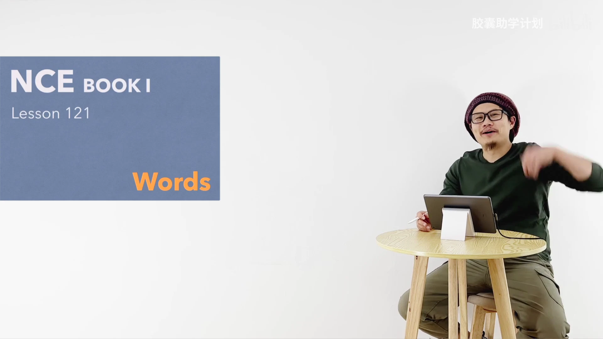

文字识别：NCE / BOOKI / Lesson 121 / Words

### 画面 00:00:09

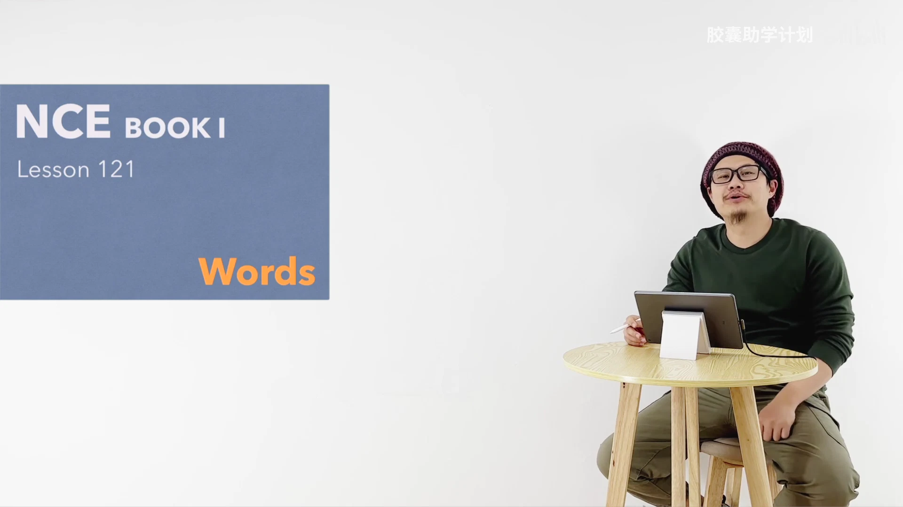

文字识别：NCE / BOOKI / Lesson 121 / Words

### 画面 00:00:11

文字识别：胶囊助学计划bli / • / •

### 画面 00:00:15

### 画面 00:00:17

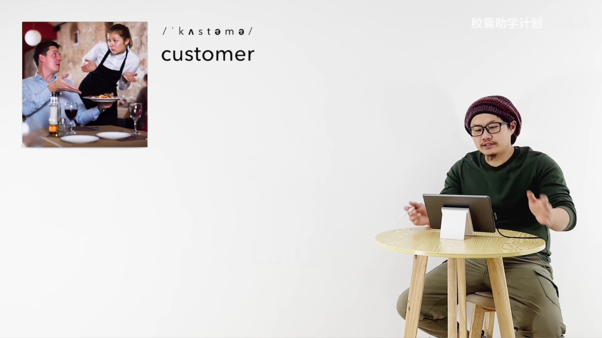

文字识别：2 / /'knstama/ / customer

## 00:00:30–00:01:00

customer services. Okay, customer services. Okay, very good.那我们经常说说上帝，这个顾客就是上帝啊。顾客永远是对的，叫 the customer is always right.你看，都是我们会的单词，对吧？哎，还同时复习了一个小的语法点，always放在什么地方？五十一课、五十三课咱们学的，一般放在be动词的后面，对吧？Okay,那接下来呢，我们再造一句话，说 this customer is rich enough

### 画面 00:00:34

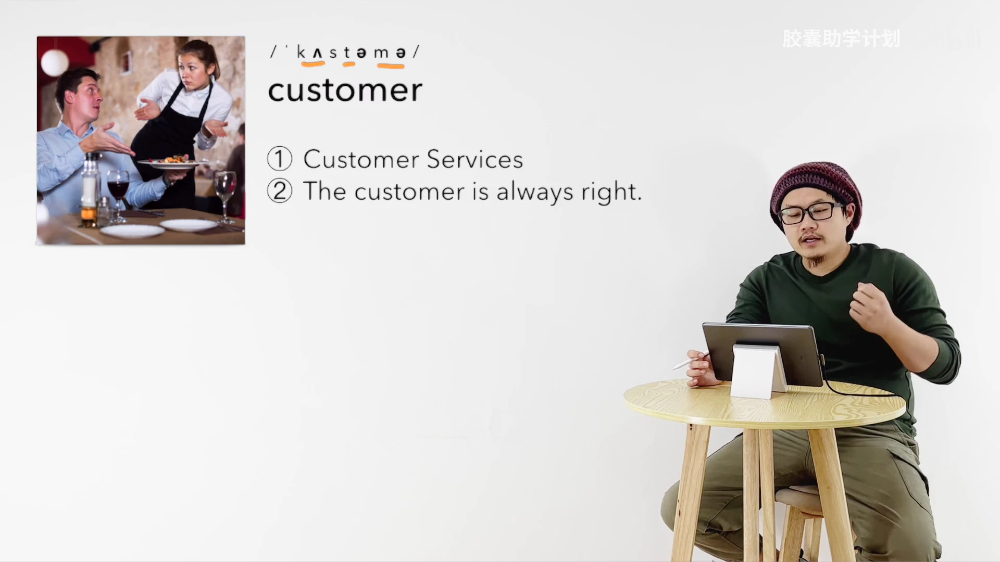

文字识别：/'kastama/ / customer / ① Customer Services / The customer is always right.

### 画面 00:00:54

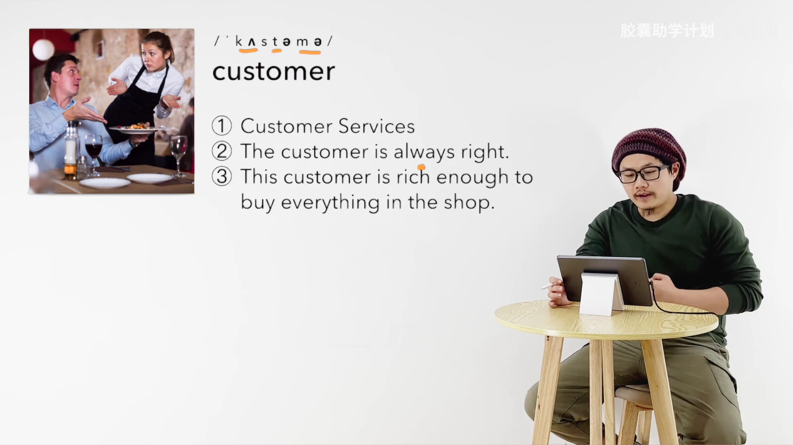

文字识别：/ 'kastama / / customer / ① Customer Services / The customer is always right. / This customer is rich enough to / buy everything in the shop.

## 00:01:00–00:01:30

to buy everything in the shop. Okay,他足够的富有可以买这个商店当中所有的东西。那注意一个小点，在这个地方叫rich enough to do something，对吧？形容词加enough加to do something。一百零三一百零四课的核心语法点，好吧。再来下一个，忘记啊，跟我一起读一下，叫forget forget。那它的过去式forgot，过去分词forgotten。OK，过去式forgot，过去

### 画面 00:01:00

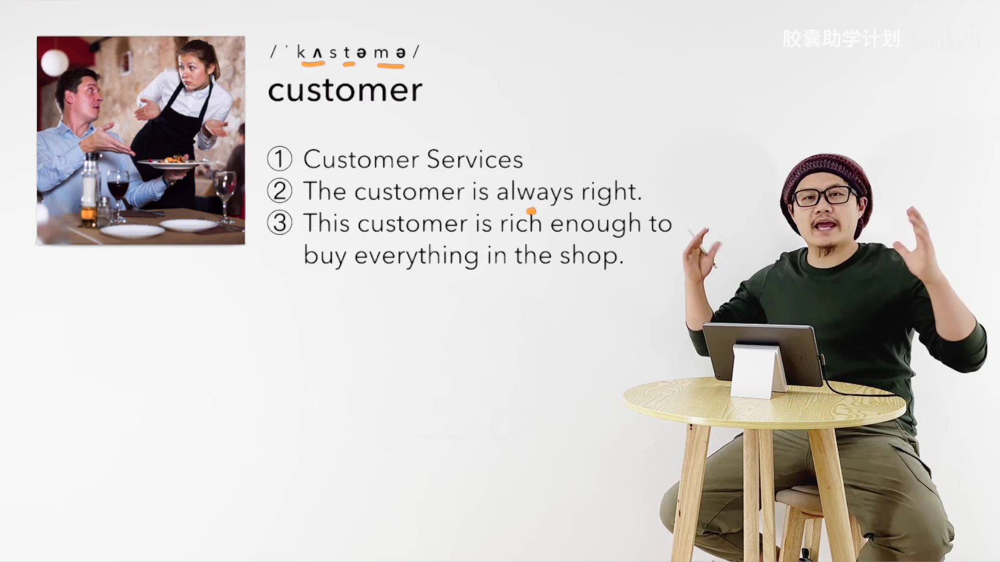

文字识别：/ 'kast am a / / customer / ① Customer Services / The customer is always right. / This customer is rich enough to / buy everything in the shop.

### 画面 00:01:17

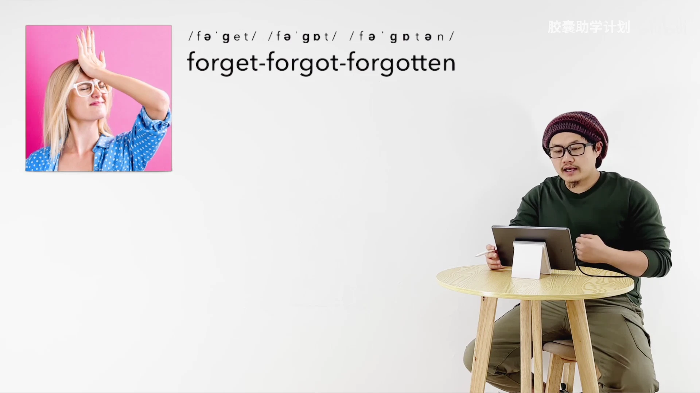

文字识别：/fa'get/ /fa'gpt/ /fa'gptan/ / forget-forgot-forgotten

## 00:01:30–00:02:00

分词 forgotten? 那我们拿它去造句子，说 Oh no, I forgot to take my pills. Okay, one more. 那 take my medicine, take my pills, 都不是拿啊，指的是吃。说 Oh, 完了，我忘记吃药了。 Forget to do something, 对吧？忘记去做某件事情。比如说 I forgot to take an umbrella with me. 哎，我忘记去随身带一把伞了。还有说 I forgot to cook dinner for him. 我忘记去给他做

### 画面 00:01:35

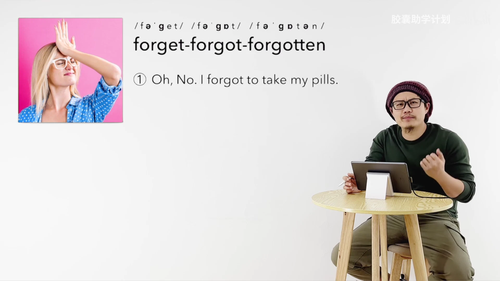

文字识别：/fa'get/ /fa'gpt/ /fa'gptan/ / forget-forgot-forgotten / ① Oh, No. I forgot to take my pills.

### 画面 00:01:39

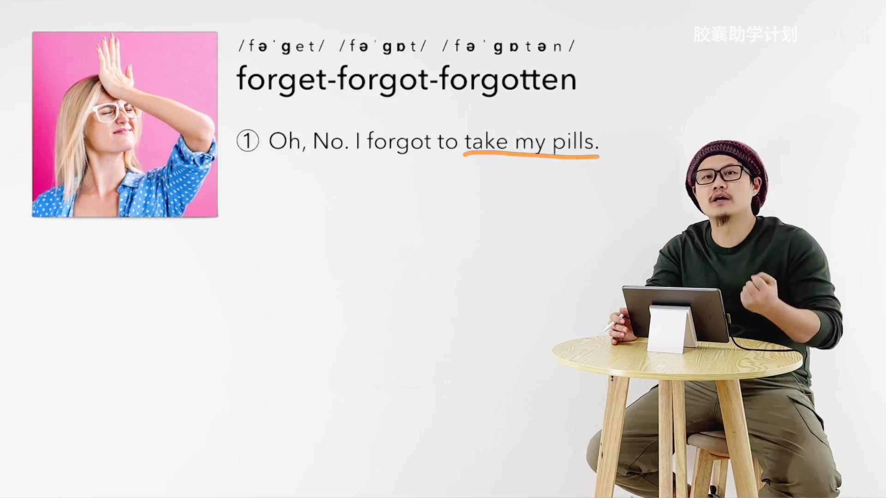

文字识别：/fa'get/ /fa'gpt/ /fa'gptan/ / forget-forgot-forgotten / ① Oh, No.I forgot to take my pills.

### 画面 00:01:48

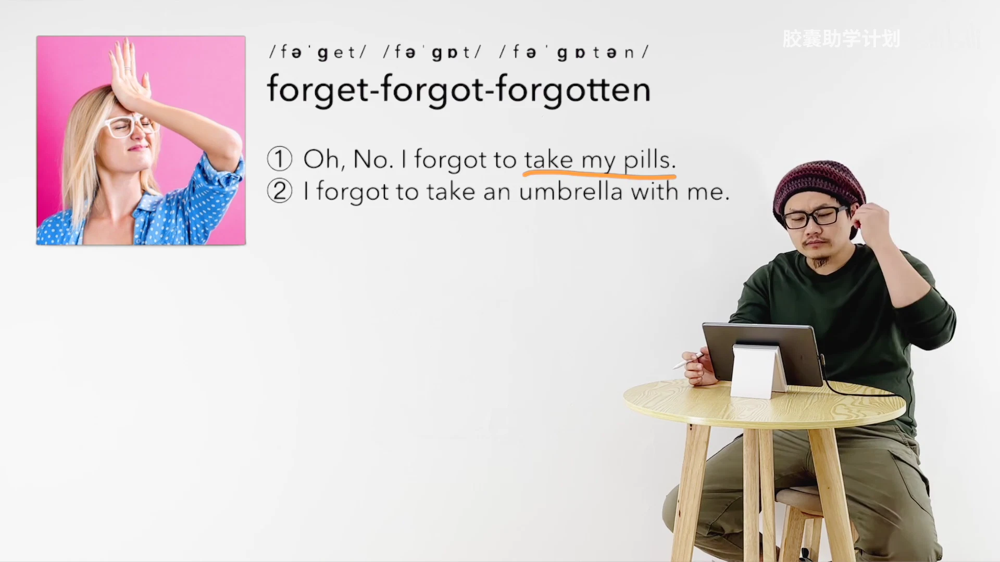

文字识别：/fa'get/ /fa'gpt/ /fa'gptan/ / forget-forgot-forgotten / ① Oh, No.I forgot to take my pills. / ② I forgot to take an umbrella with me.

## 00:02:00–00:02:30

晚饭了。你看，这其实这里面用的语法都是咱们之前呃这个短语啊，都是咱们之前学过的，只不过今天又加上了一个 forget to do something 放到这个里边来了，对吧？我们把它们融合到一起去造句子，肯定句都有了，剩下的四句型转换就是您的家庭作业。Next one，跟我读，叫 manager，manager，OK，那 manager 指的是经理啊，比如说 he is the hotel manager，他是这个

### 画面 00:02:03

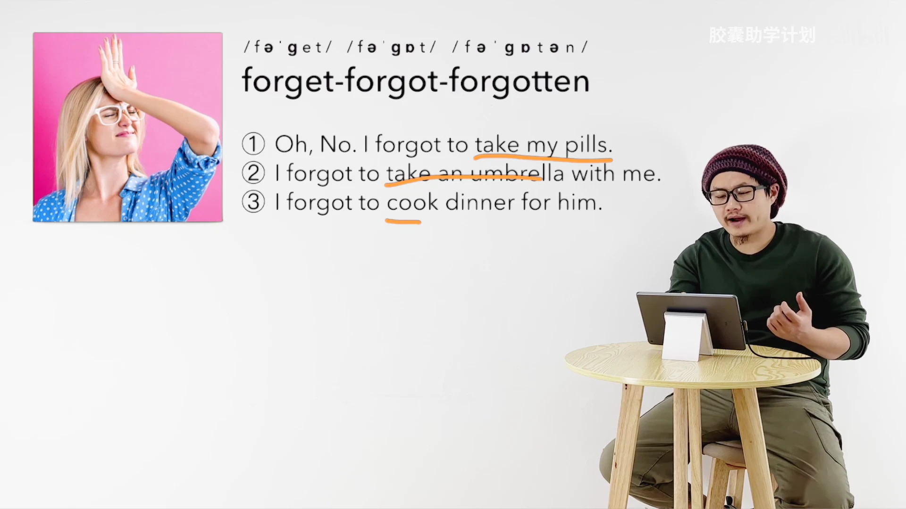

文字识别：/fa'get/ /fa'gpt/ /fa'gptan/ / forget-forgot-forgotten / ① Oh, No.I forgot to take my pills. / ② I forgot to take an umbrella with me. / ③ I forgot to cook dinner for him.

### 画面 00:02:19

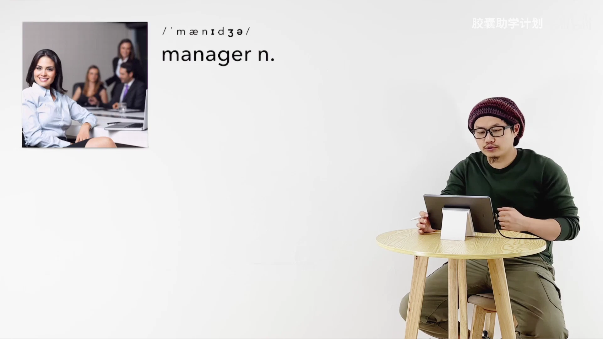

文字识别：/'mænid3a/ / manager n.

## 00:02:30–00:03:00

manager. Very good. 再来说, the hotel manager cleaned every room yesterday. 啊, 他昨天啊没有人手了, 他自己把每一个房间都打扫了一遍, 非常大的任务量, 一个典型的一般过去时。 再来说, the manager has lived in New York for two years. 八十九课现在完成时的第二个用法, have加lived, 对吧? Has加lived, 因为主语是三单, 对吧? OK, 从过去持续到现在, 已经持续了

### 画面 00:02:31

文字识别：/'mænid3a/ / manager n. / ① He is the hotel manager. / The hotel manager cleaned / every room yesterday.

### 画面 00:02:46

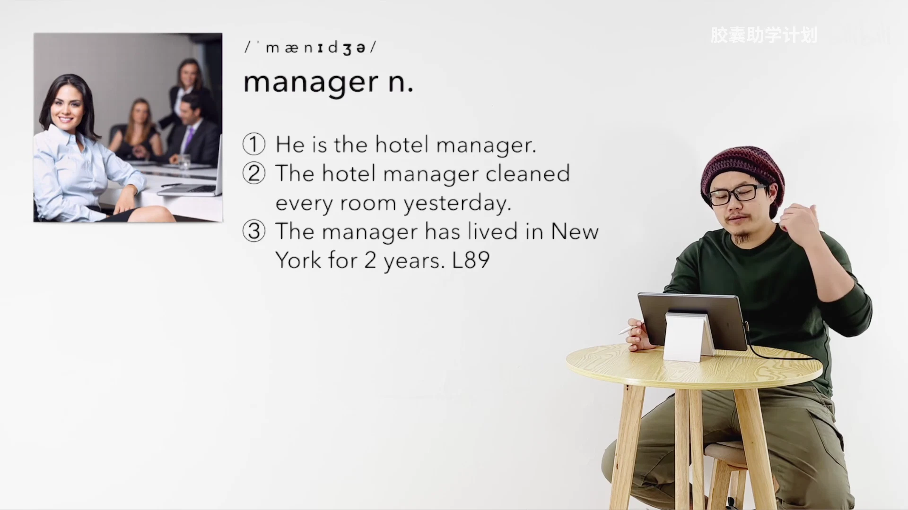

文字识别：/ 'mænid3a/ / manager n. / ① He is the hotel manager. / The hotel manager cleaned / every room yesterday. / The manager has lived in New / York for 2 years. L89

## 00:03:00–00:03:30

两年了。Next one，下一个单词跟我一起读一下，叫 serve，serve，啊，叫服务的意思，对吧？它是一个动词。比如说，After he had served us some food， he went back home。在他给我们提供了一些服务，提供了一些食物之后呢，他就回家了。你看，after a，逗号 b，是咱们上一课刚刚学过的非常核心的语法点，希望各位还记得，对吧？Next one，说 I served him

### 画面 00:03:01

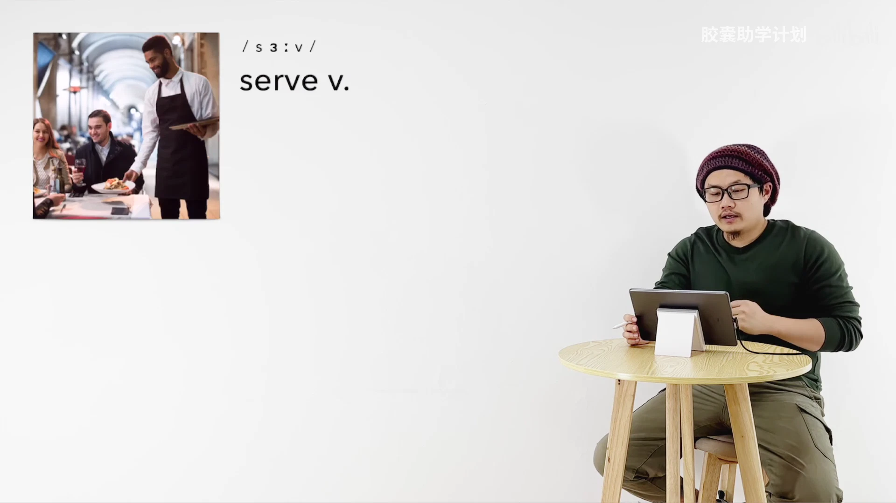

文字识别：/ s 3 : v 1 / serve v.

### 画面 00:03:20

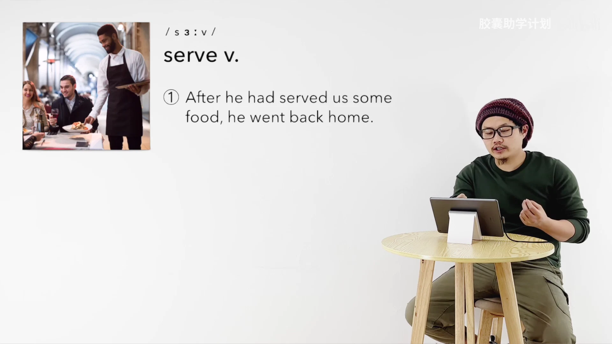

文字识别：/ s 3 : v 1 / serve v. / ① After he had served us some / food, he went back home.

## 00:03:30–00:04:00

an hour ago. Say I one hour ago served him. I remember, right? I provided him with service. General past tense, subject-verb inversion, don't forget. Ah, come again. Then you see, did you serve him an hour ago? Come again. Then all kinds of special question words. Homework is easy to do. Right? Next one, the next word, read it together. It's called counter. Counter. Okay. Then its meaning refers to the counter. Ah, for example, our salesperson is at the counter on this side. He collects money. Ah, he gives you things.

### 画面 00:03:39

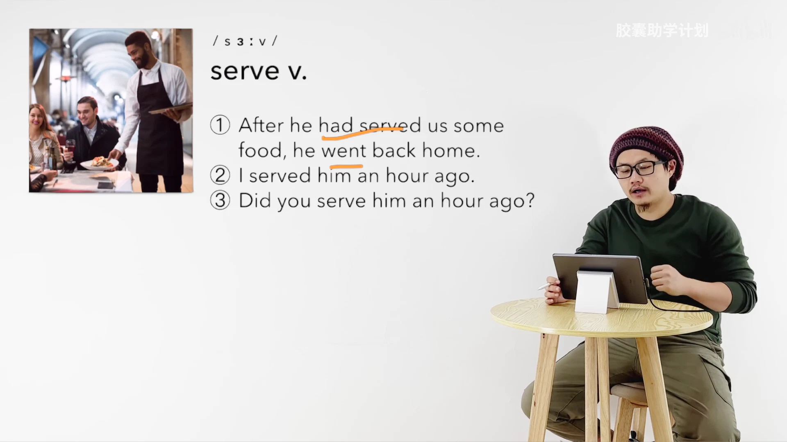

文字识别：/ s 3 : v 1 / serve v. / ① After he had served us some / food, he went back home. / I served him an hour ago. /  Did you serve him an hour ago?

### 画面 00:03:49

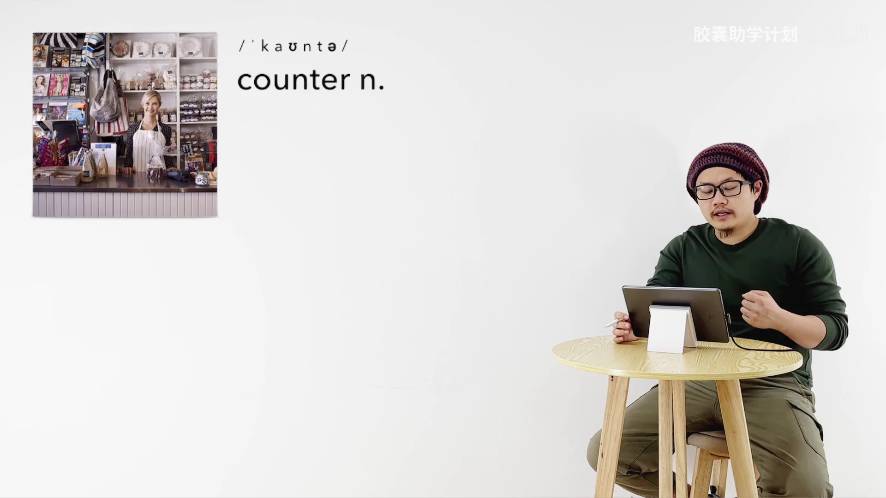

文字识别：/ 'kaunta/ / counter n.

## 00:04:00–00:04:30

边，他收钱啊，给您拿东西啊。您在柜台的另一面对吧？啊，这个柜台就叫做 counter. Very good. 那我们造一个句子说，The lady is standing behind the counter. 说这名女士正站在柜台的后面。OK. 好，那再来说，After she had cleaned the counter, she closed the store. 一百十九课，After A.逗号B. A是先发生过去的过去，所以用过去完成时。你看，这实际上是我们进入新二的时候会

### 画面 00:04:15

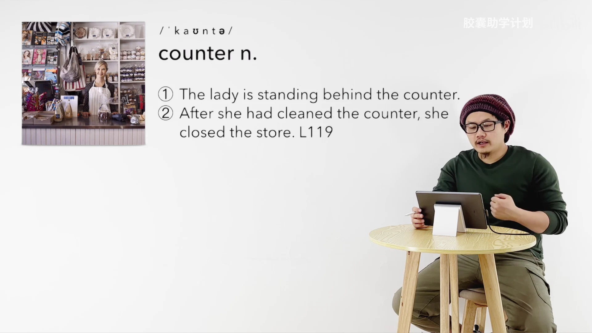

文字识别：/ 'kaunta/ / counter n. / ① The lady is standing behind the counter. / ② After she had cleaned the counter, she / 2 / closed the store. L119

## 00:04:30–00:05:00

系统性教各位的，就是如何用单词去造句。但实际上现在我已经开始给各位渗透了。如果您自己是吧，足够有灵性，那已经可能某种程度上能总结出来了。就是我要拿之前学过的语法，这是这是造句的其中一个啊原则，去配合今天的单词去造句，对吧？我们刚刚学过 after a 点号 b very good next one 说 this counter is higher than the old one

### 画面 00:04:45

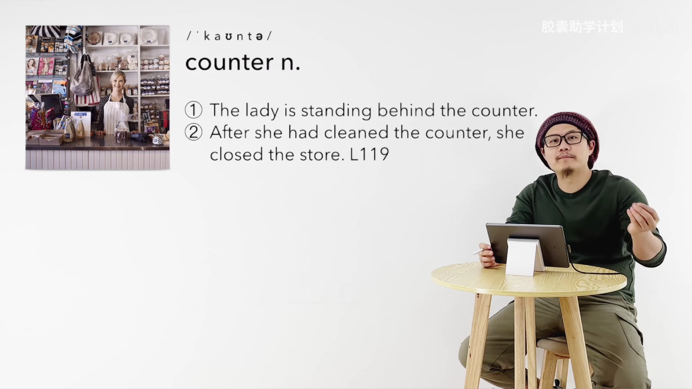

文字识别：/ 'kaunta/ / counter n. / ① The lady is standing behind the counter. / ② After she had cleaned the counter, she / closed the store. L119

## 00:05:00–00:05:30

说这个柜台感觉比原来的要高一点点。 OK, one more again. Next one,跟我一起读，叫 recognize, recognize. 啊，三个音节，对吧？三个音节啊。学到今天，各位音节，如果您还不会，一定要去看一下我之前给大家录的那个呃音标的四个视啊，包括自然拼读法则的四个视频，对吧？元音一个视频，辅音一个视频，呃，音节划分一个视频，外加一个自然拼读法则。 OK，

### 画面 00:05:00

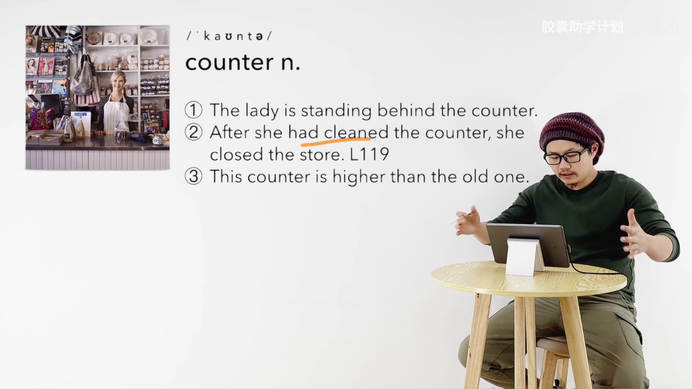

文字识别：/ 'kaunta / / counter n. / ① The lady is standing behind the counter. / ② After she had cleaned the counter, she / closed the store. L119 / This counter is higher than the old one.

### 画面 00:05:02

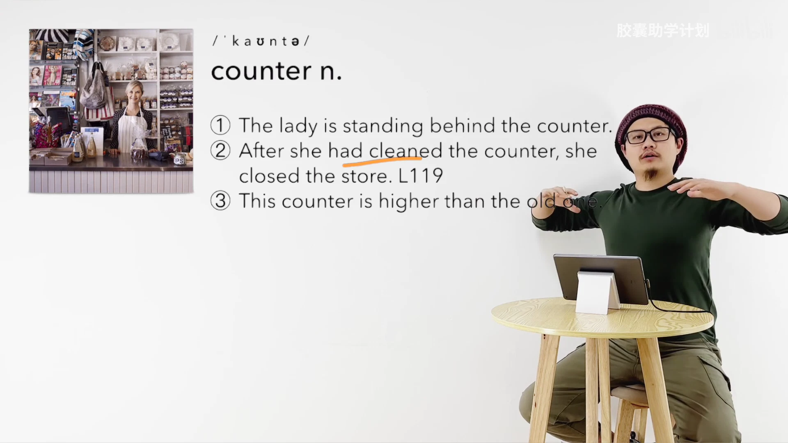

文字识别：/ 'kaunta/ / counter n. / ① The lady is standing behind the counter. / ② After she had cleaned the counter, she / closed the store. L119 / This counter is higher than the plaf o

### 画面 00:05:04

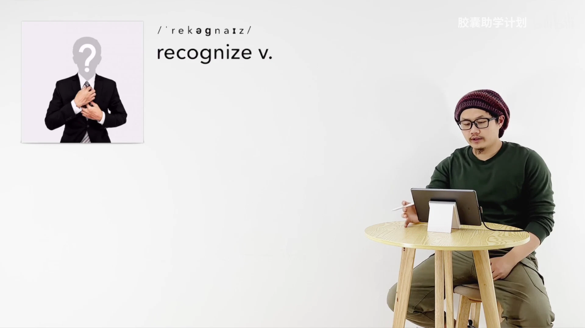

文字识别：/rekagnaiz/ / recognize v.

## 00:05:30–00:06:00

好，跟我一起读一下，叫 recognize，recognize，叫做识别啊，认出。比如说，I can recognize him，我能认得他，呃，我能识别出来他。再来说，Can you recognize him？你能认得他吗？认出来他吗？以及 Can't you recognize him？这是咱们很容易忘的另一个语法点，六十七课学的，对吧？啊， Didn't you don't you lucky？好像是这一句话，就是难道你不幸运吗？啊，那 Can't you recognize

### 画面 00:05:34

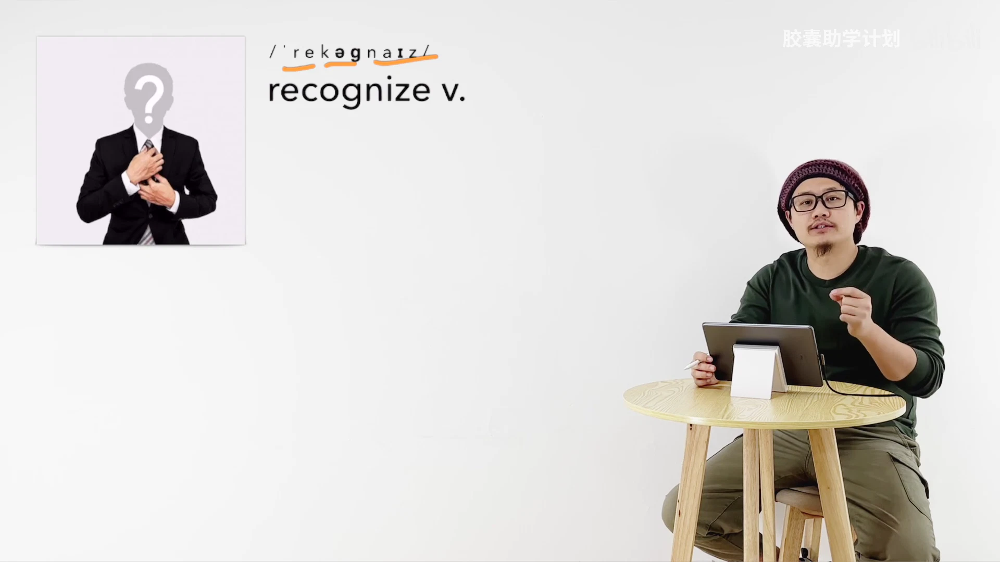

文字识别：/'rekagnaizl / recognize v.

### 画面 00:05:47

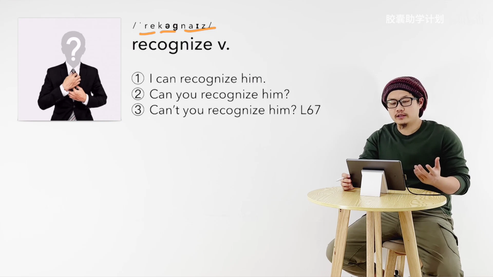

文字识别：/'rekagnaizl / recognize v. / ①I can recognize him. / Can you recognize / e him? / 2 / Can't you recognize / him? L67

## 00:06:00–00:06:30

him? 难道你认不出来他吗？就在你面前，是吧？这么大一明星，哈，OK，啊，没化妆，看不出来。Next one, say you can recognize him, can't you? 说你能认出来他吧？哎，can't you? 一百零三课学的，right? 对吧？前肯后否，对吧？OK，时态人称保持一致，这是咱们一百零三课学的，不知道各位还记不记得？如果您忘了，一定要回去看一下那课的语法，好吧？好，那 recap

### 画面 00:06:17

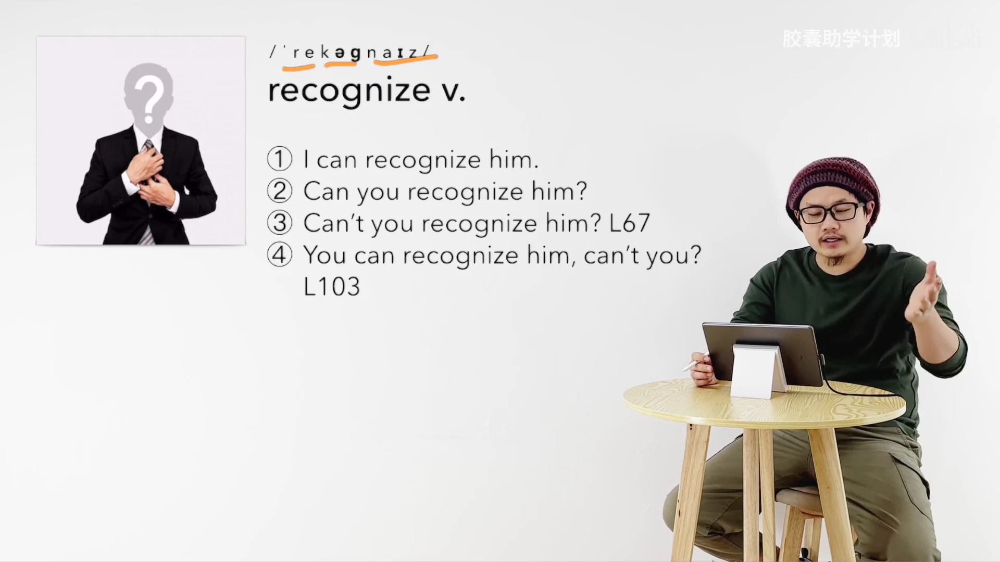

文字识别：/'rekagnaizl / recognize v. / ①I can recognize him. / Can you recognize / him? / 2 / Can't you recognize / him? L67 / You can recognize /  him, can't you? / L103

### 画面 00:06:28

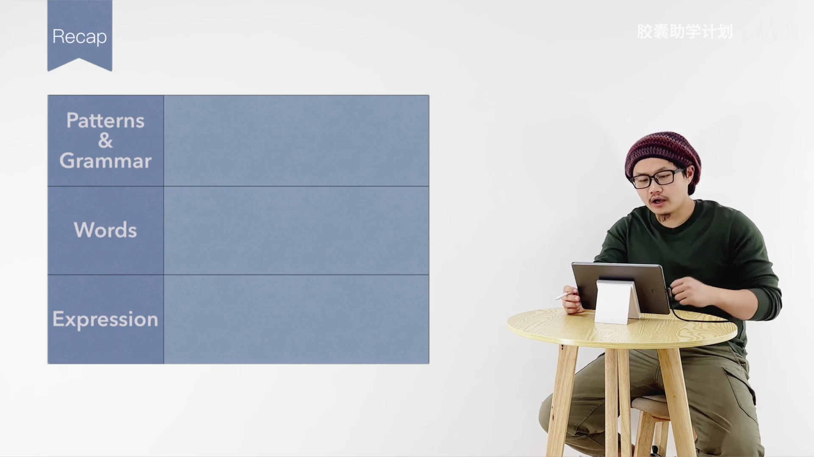

文字识别：Recap / Patterns / Grammar / Words / Expression

## 00:06:30–00:07:00

本课没有什么太多的 expression 啊，语法我们单独给大家录一个视频，因为本课的语法非常的重要啊，也并且并不简单。那所以这个视频当中最重要的就只有单词了，各位那老习惯单词造句，每个单词尽可能去造三个啊。如果您能多造，那多造是您自己多得，对不对啊？但至少我建议是三个，讲解一遍今天的核心知识点。如果大家喜欢我们的课程呢，欢迎大家关注、订阅、一键三连，分享给

### 画面 00:06:43

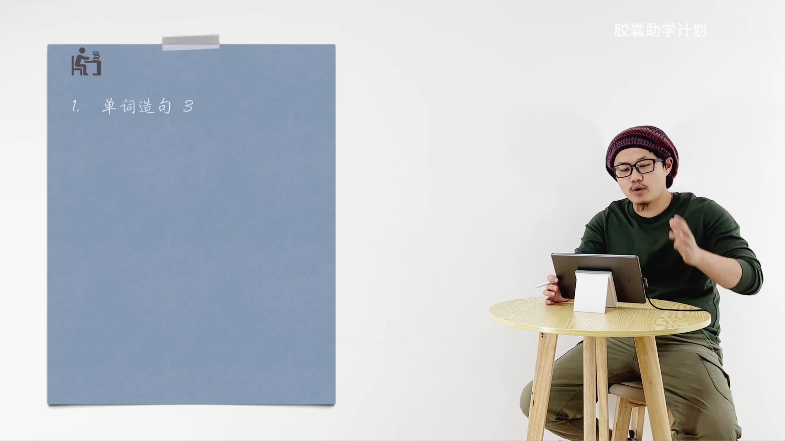

文字识别：单词造句3

### 画面 00:06:55

## 00:07:00–00:07:28

那些需要的朋友啊！那最后我们再来看一句啊，Benjamin Franklin啊，富兰克林的一句名人名言：Tell me and I forget, teach me and I remember, involve me and I learn. See you next time.

### 画面 00:07:02

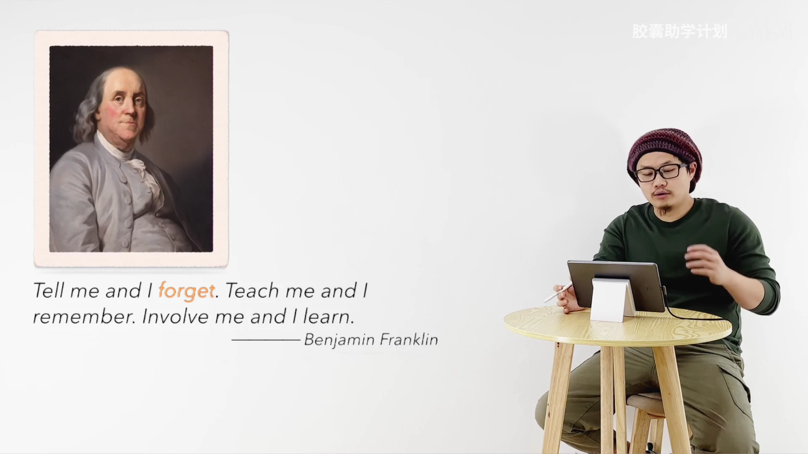

文字识别：Tell me and I forget. Teach me and I / remember. Involve me and I learn. / -Benjamin Franklin

### 画面 00:07:16

### 画面 00:07:18

文字识别：CAPSULEACADEMY / 胶囊助学计划 / 小红书 / Lecturer / Leo / OE

### 画面 00:07:21

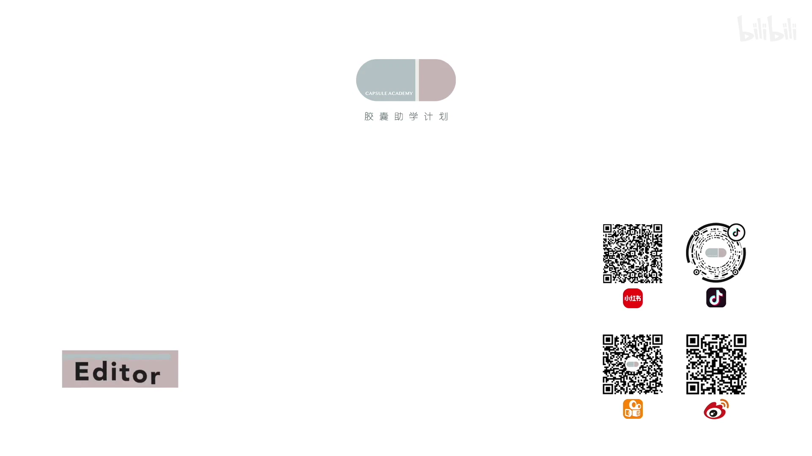

文字识别：CAPSULEACADEMY / 胶囊助学计划 / 『 / 小红书 / Editor / OE

### 画面 00:07:24

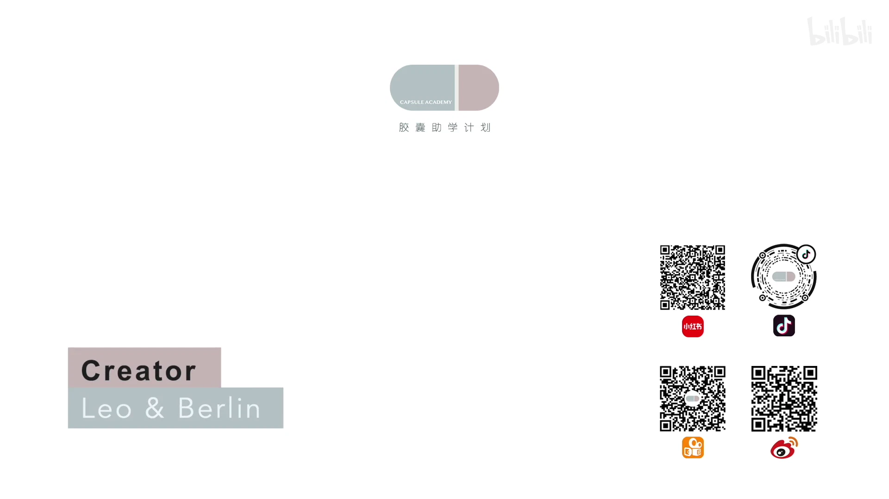

文字识别：CAPSULEACADEMY / 胶囊助学计划 / 『 / 小红书 / Creator / Leo & Berlin / OE

### 画面 00:07:26

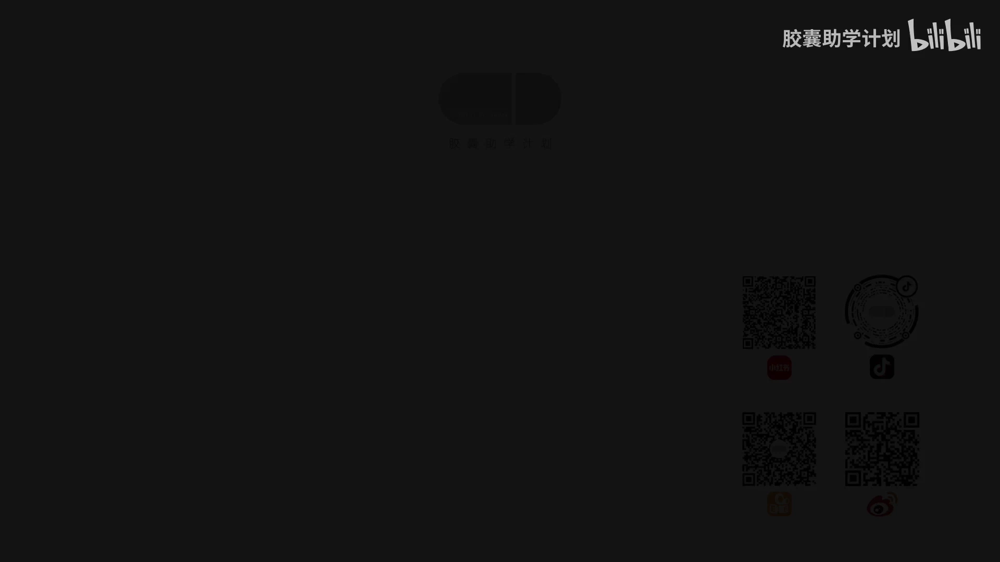

文字识别：bilibili / 胶囊助学计划

### 画面 00:07:28

文字识别：bilibili / 胶囊助学计划

