# 121 文章

快速机器解析：语音为单模型转写，未进行独立交叉校对或人工复核；画面每秒采样并按变化选帧，短时文字和标记可能遗漏。截图时间约有 1 秒误差。图片有损压缩；遇到疑点请按时间查看 Google Drive 原视频。

## 00:00:00–00:00:30

Hello everyone, welcome to Capsule Academy. This is Leo. Today we're going to learn New Concept English Book One Lesson One Hundred and Twenty One Story. Hope you gonna enjoy it.好，那我们直接进入文章啊。Customer,首先我们确定这个单词指的是顾客，对吧？顾客说了一句话，说 I bought bought.单词一出来，提醒你这个事儿发生在过去，我之前买的。Two expensive

### 画面 00:00:00

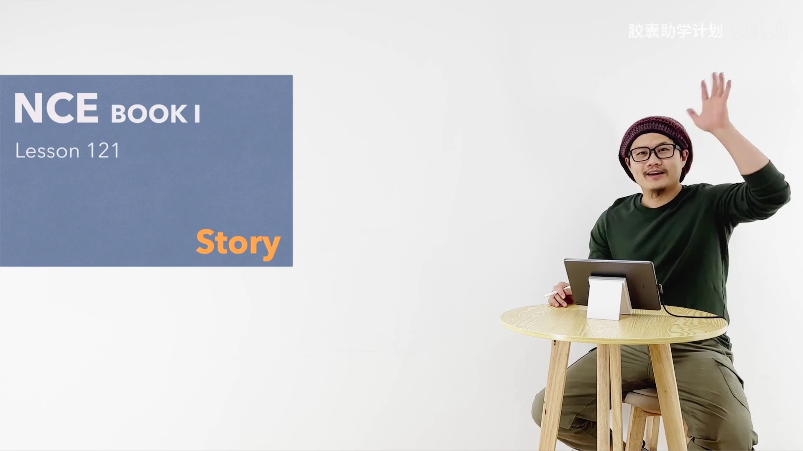

文字识别：NCE / BOOKI / Lesson 121 / Story

### 画面 00:00:02

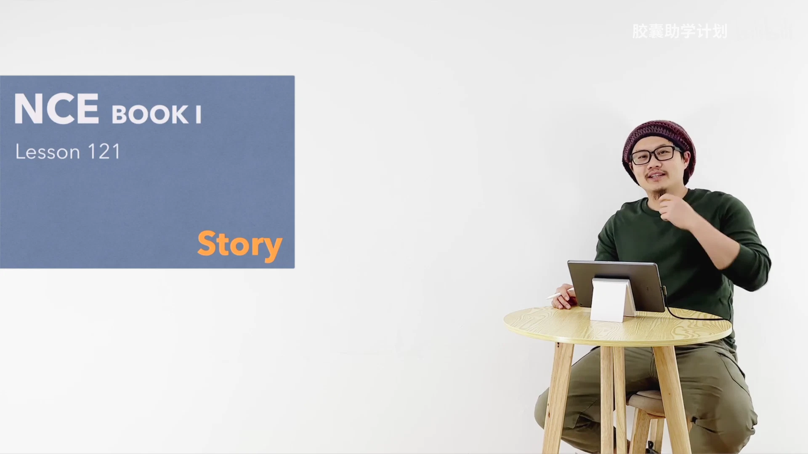

文字识别：NCE / BOOKI / Lesson 121 / Story

### 画面 00:00:09

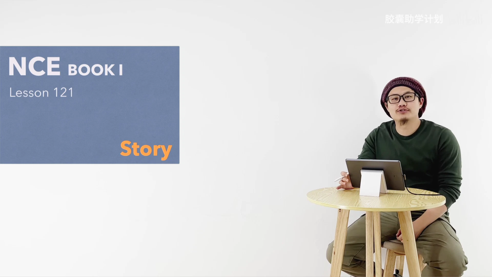

文字识别：NCE / BOOKI / Lesson 121 / Story

### 画面 00:00:11

文字识别：胶囊助学计划bill

### 画面 00:00:14

文字识别：胶囊助学计划

### 画面 00:00:16

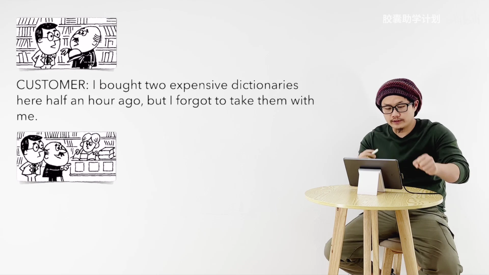

文字识别：CUSTOMER: I bought two expensive dictionaries / here half an hour ago, but I forgot to take them with / me. / /

## 00:00:30–00:01:00

dictionaries here. 两本非常昂贵的字典在这里。时间呢？Half an hour ago. Okay,半个小时之前。An hour ago, 一个小时之前。Half an hour ago, 半个小时之前。但是呢？But I forgot to take them with me. 但是我忘记去做一件事情了。Take them with me. 带着他们和我，就是我忘记把他们随身

### 画面 00:00:46

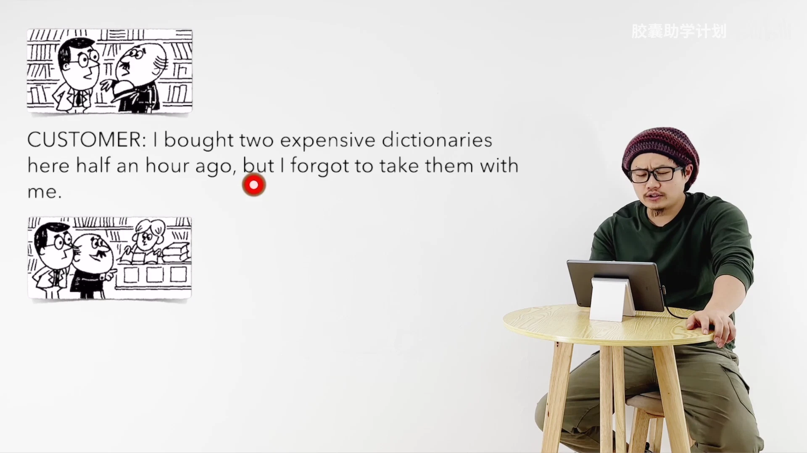

文字识别：CUSTOMER: I bought two expensive dictionaries / here half an hour ago, but I forgot to take them with / me. / /

## 00:01:00–00:01:30

携带了啊，也就换一句话来说，我遗留在了这个地方。OK，再来，那manager就是这里的经理啊，可能是一个书店的经理说，Who served you, sir？那谁服务的您？换一句话来说，谁给您结的账啊，Sir？然后customer说了一句话叫做The lady who is standing behind the counter。好，首先我们通过语法那个视频的学习，各位应该非常清楚，这里就是一个定语从句，但它缺了

### 画面 00:01:04

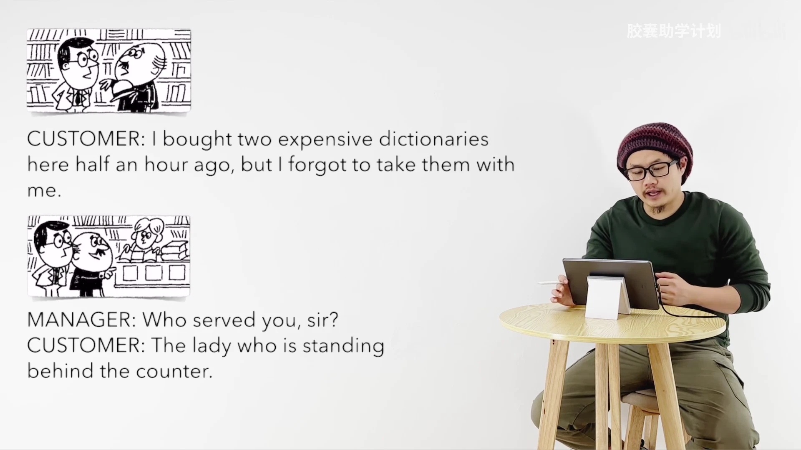

文字识别：CUSTOMER: I bought two expensive dictionaries / here half an hour ago, but I forgot to take them with / me. / MANAGER: Who served you, sir? / CUSTOMER: The lady who is standing / behind the counter.

### 画面 00:01:20

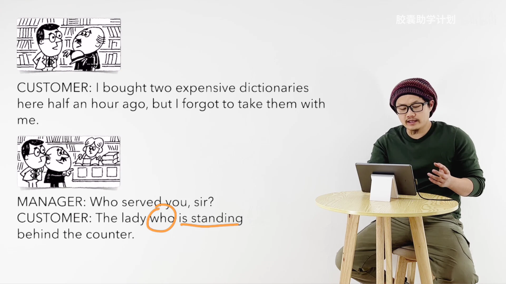

文字识别：CUSTOMER: I bought two expensive dictionaries / here half an hour ago, but I forgot to take them with / me. / MANAGER: Who serveg you, sir? / CUSTOMER: The lady / whoi / is standing / behind the counter.

## 00:01:30–00:02:00

几个小的单词。这句话它应该说的是，the lady who is standing behind the counter served me. OK, served me啊，服务的我啊，说哪个女士呢？现在站在柜台后面的那名女士服务的我。那我们看 who 指代的就是这个 lady。为什么用 who 而不用 which 呢？因为 lady 是人，对吧？人我们用 who，不用 which。Very good。接下

### 画面 00:01:31

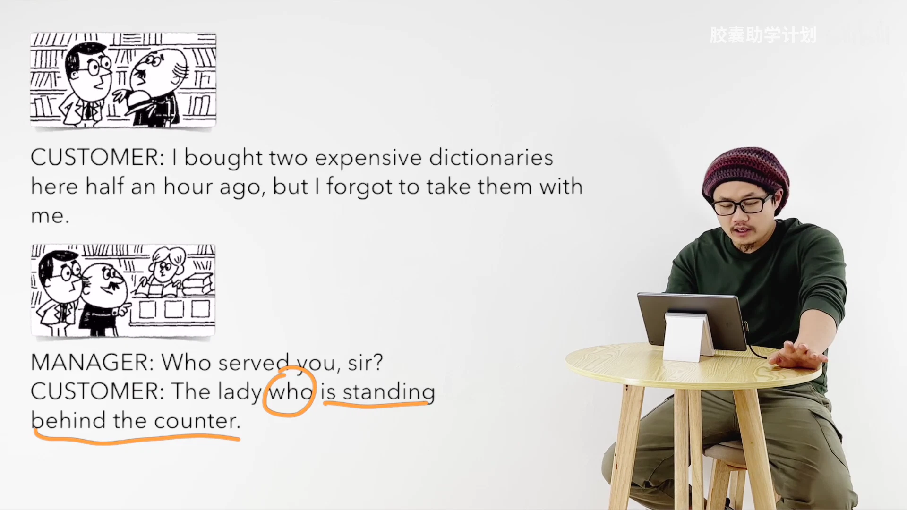

文字识别：CUSTOMER: I bought two expensive dictionaries / here half an hour ago, but I forgot to take them with / me. / MANAGER: Who servedyou, sir? / CUSTOMER: The lady / whoi / is standing / behind the counter.

### 画面 00:01:38

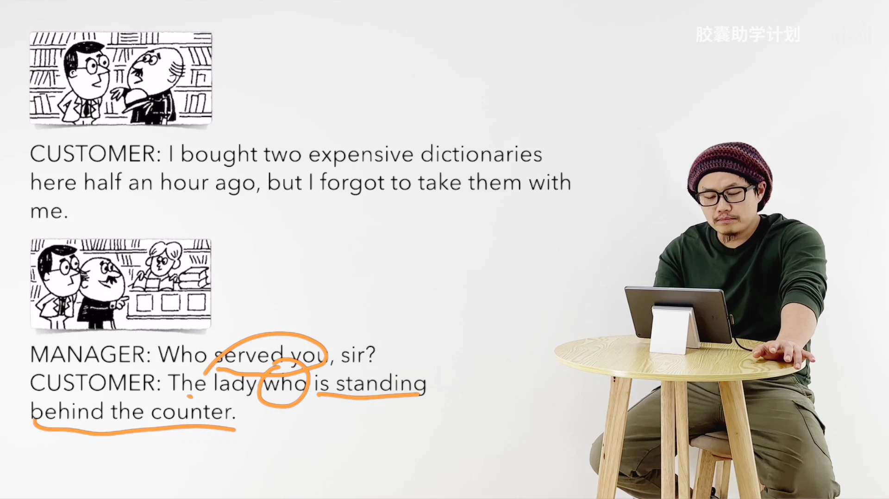

文字识别：CUSTOMER: I bought two expensive dictionaries / here half an hour ago, but I forgot to take them with / me. / MANAGER: Who perveg yoD, sir? / CUSTOMER: The lady / whd / is standing / behind the counter.

## 00:02:00–00:02:30

来, which books did you buy? 那您买的哪些书呢? Customer说, the books which are on the counter. 好, 又来了, which一出现, 后边这句话很可能是定语从句。本课我们学的就是定语从句啊, 您放心, 就是定语从句。说那些啊在柜台上的书。那所以这个the book其实前面还省了几个单词, 叫I bought the books. 我买了这些书,

### 画面 00:02:00

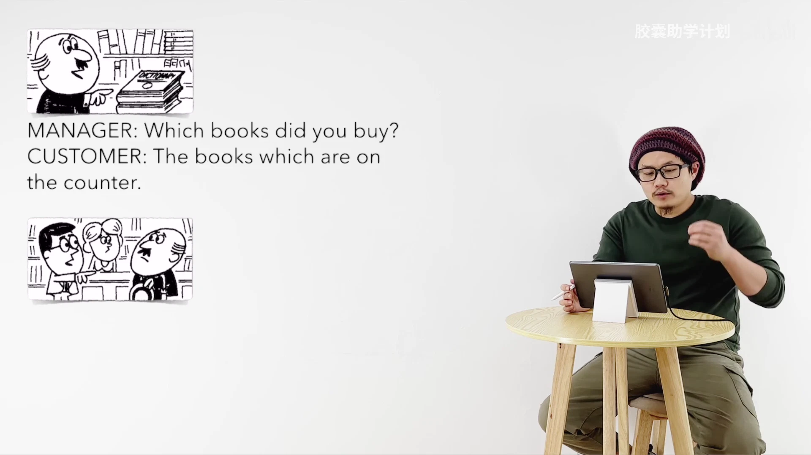

文字识别：MANAGER: Which books did you buy? / CUSTOMER: The books which are on / the counter.

### 画面 00:02:11

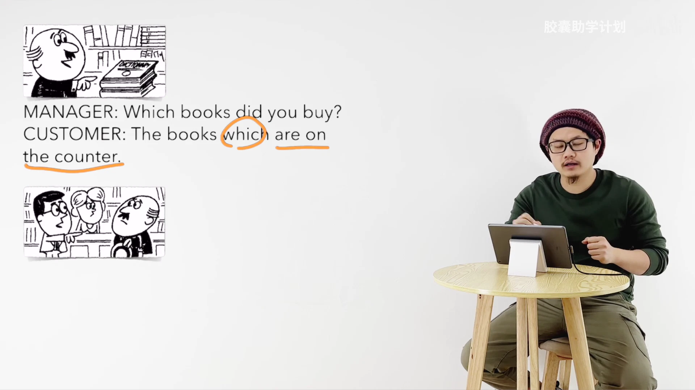

文字识别：MANAGER: Which books did you buy? / CUSTOMER: The books Whic are on / the counter.

## 00:02:30–00:03:00

The books on the counter, right? So we connect them together. I bought the books on the counter. Very good. Next one. Okay, let's ask a question. Why is it which? Because the previous one refers to books. Books is a thing, so we don't use who, right? The manager continues, "Did you serve this gentleman half an hour ago?" It's the general question of the previous sentence. "Half an hour ago," was the gentleman you served? Yes, the gentleman.

### 画面 00:02:39

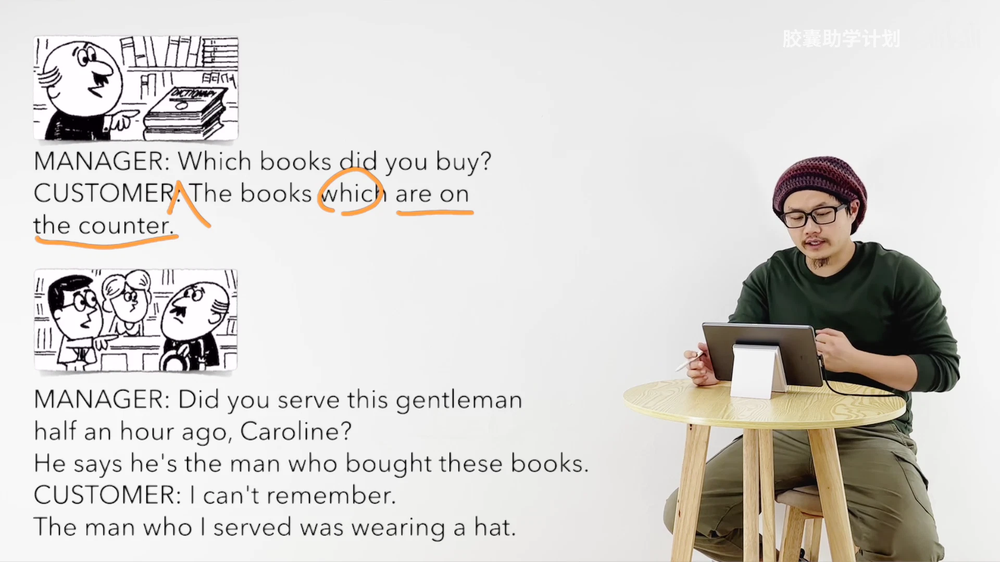

文字识别：MANAGER: Which books did you buy? / CUSTOMERAThe books Whic are on / the counter. / MANAGER: Did you serve this gentleman / half an hour ago, Caroline? / He says he's the man who bought these books. / CUSTOMER: I can't remember. / The man who I served was wearing a hat.

## 00:03:00–00:03:30

gentleman，绅士是吧？就这名男士嘛，Caroline. He says, "好，very good." He says, "到后边这句话，一个典型的宾语从句，对吧？一个句子做宾语叫宾语从句，一个句子做定语叫定语从句，一个句子做时间叫时间从句，对吧？我们目前至少学了这三种从句了。他说，他就是这个男人，什么样的男人呢？Who bought those books? Bought these books? 啊，他就是买这些书的那个男人。Who替代

### 画面 00:03:08

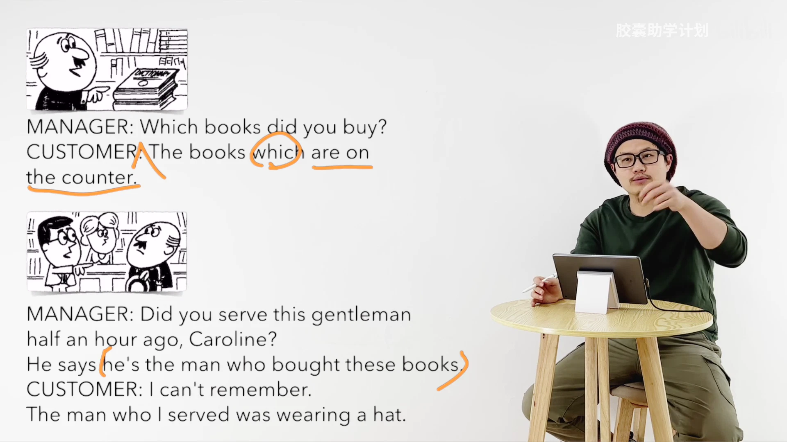

文字识别：MANAGER: Which books did you buy? / CUSTOMERAThe books whic are on / the counter. / MANAGER: Did you serve this gentleman / half an hour ago, Caroline? / He says he's the man who bought these books, / CUSTOMER: I can't remember. / The man who I served was wearing a hat.

### 画面 00:03:20

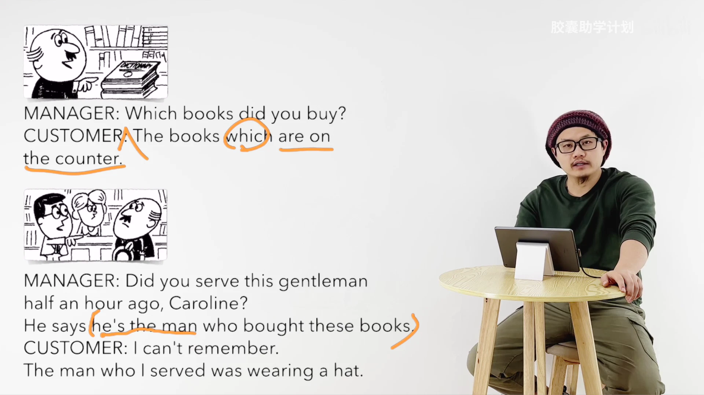

文字识别：MANAGER: Which books did you buy? / CUSTOMERAThe books whic are on / the counter. / MANAGER: Did you serve this gentleman / half an hour ago, Caroline? / He says he's the man who bought these books, / CUSTOMER: I can't remember. / The man who I served was wearing a hat.

### 画面 00:03:23

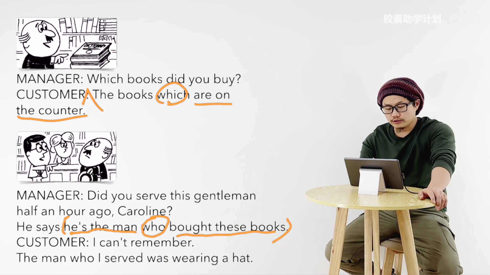

文字识别：MANAGER: Which books did you buy? / CUSTOMERAThe books whic are on / the counter. / MANAGER: Did you serve this gentleman / half an hour ago, Caroline? / He sayshe's the man / whobought these books. / CUSTOMER: I can't remember. / The man who I served was wearing a hat.

## 00:03:30–00:04:00

的是the man，对不对？好，然后呢？以及为什么用who呢？因为是人。当然，我们还有另外一种呃方式，把这句话给它断开，叫he's the man，句号，就他就是这个男人。第二，who替代的the man直接带过去，叫the man bought those these books，说这个男的买的这些书，对吧？OK，那一个。Customer说，I can't remember，我记不清了。The man who I served was wearing a hat。这三个单词定语从

### 画面 00:03:53

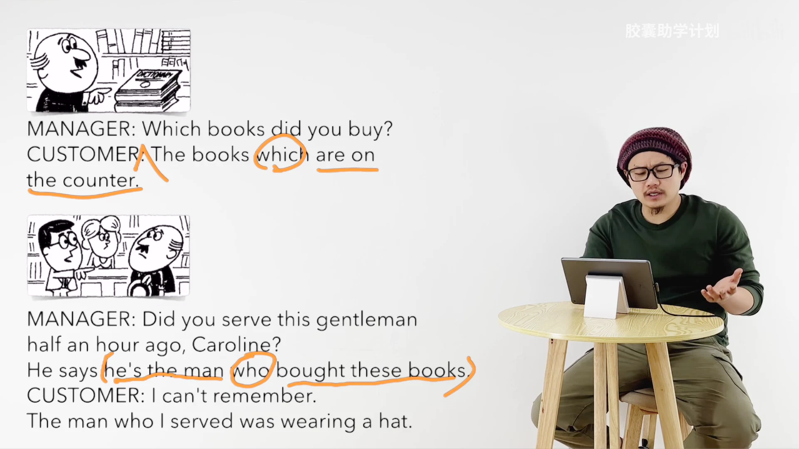

文字识别：MANAGER: Which books did you buy? / CUSTOMERAThe books whic are on / the counter. / MANAGER: Did you serve this gentleman / half an hour ago, Caroline? / He sayshe's the man / whobought these books. / CUSTOMER: I can't remember. / The man who I served was wearing a hat.

## 00:04:00–00:04:30

句修饰前面的 the man，这就是我们在讲语法的时候重点强调的那个点。各位希望各位还记得，就是你修饰谁，一定要紧跟着谁，不要放离他很远的地方，对吧？OK，你要把它放在 hat 的后面，别人会以为你是想说我服务的帽子吗？就翻译不通了，对不对？就是我服务的那名男士当时正戴着一个帽子啊，就像我一样，是吧？Very good.那所以 the man who I served was wearing a hat.

### 画面 00:04:00

文字识别：MANAGER: Which books did you buy? / CUSTOMERAThe books whic are on / the counter. / MANAGER: Did you serve this gentleman / half an hour ago, Caroline? / He sayshe's the man / whobought these books. / CUSTOMER: I can't remember. / The man who I served was wearing a hat.

## 00:04:30–00:05:00

Okay, continue. Say, have you got a hat, sir? 那您有帽子吗，先生？ Yes, I have. Have got, 对吧？ Do you have? 一样的啊，这是一个之前我们学过的小的句型。 Would you put it on? 你愿意把它戴上吗？玩一个 please, 拜托了. All right, 没有问题呀。好，第一个小点. Would, Would you put it on? I would. You do something. 你可以当做其实它类似于 could you,

### 画面 00:04:30

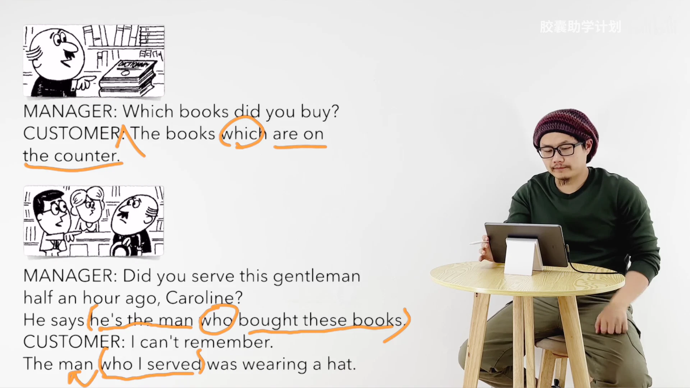

文字识别：MANAGER: Which books did you buy? / CUSTOMERAThe books whic are on / the counter. / MANAGER: Did you serve this gentleman / half an hour ago, Caroline? / He sayshe's the man / whobought these books. / CUSTOMER: I can't remember. / The man who I served was wearing a hat.

### 画面 00:04:32

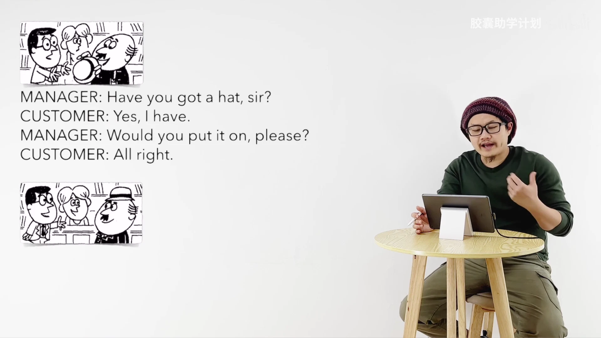

文字识别：MANAGER: Have you got a hat, sir? / CUSTOMER: Yes, I have. / MANAGER: Would you put it on, please? / CUSTOMER: All right.

### 画面 00:04:40

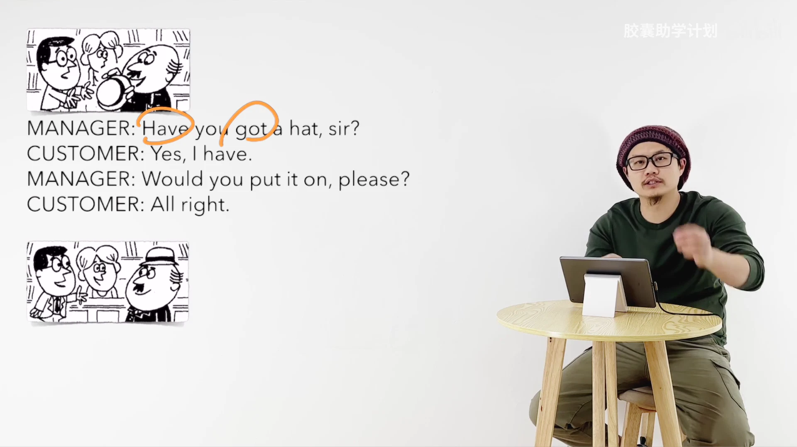

文字识别：MANAGER:Have yov gota hat, sir? / CUSTOMER: Yes, I have. / MANAGER: Would you put it on, please? / CUSTOMER: All right.

## 00:05:00–00:05:30

you, can you, 啊，基本是差不多类似的意思啊，就是你愿意怎么的，你能怎么怎么样吗？你可以怎么怎么样吗？都是一样的啊。 Okay, all right, 没问题啊。接下来又问说, Is this the man that you served, Caroline? How that you served修饰的是这个 the man, 对吧？所以这句话它本质上就是新一前二十个咱学的句型，叫 is this the man? Okay, 非常简单的

### 画面 00:05:10

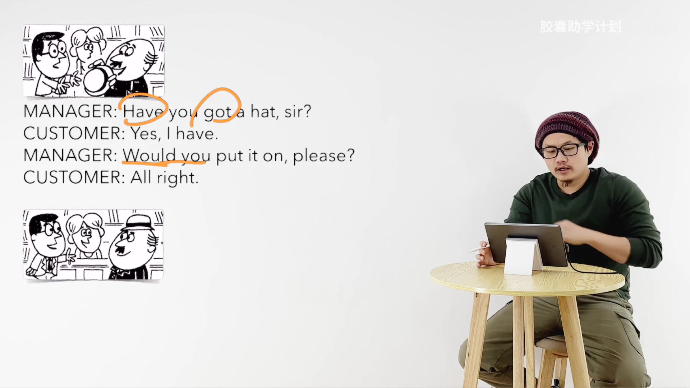

文字识别：MANAGER:Have yov gota hat, sir? / CUSTOMER: Yes, I have. / MANAGER: Would you put it on, please? / CUSTOMER: All right.

### 画面 00:05:12

文字识别：MANAGER:Have yoV gota hat, sir? / CUSTOMER: Yes, I have. / MANAGER: Would you put it on, please? / CUSTOMER: All right. / MANAGER: Is this the man that you / served, Caroline? / CUSTOMER: Yes.I recognize him now.

### 画面 00:05:17

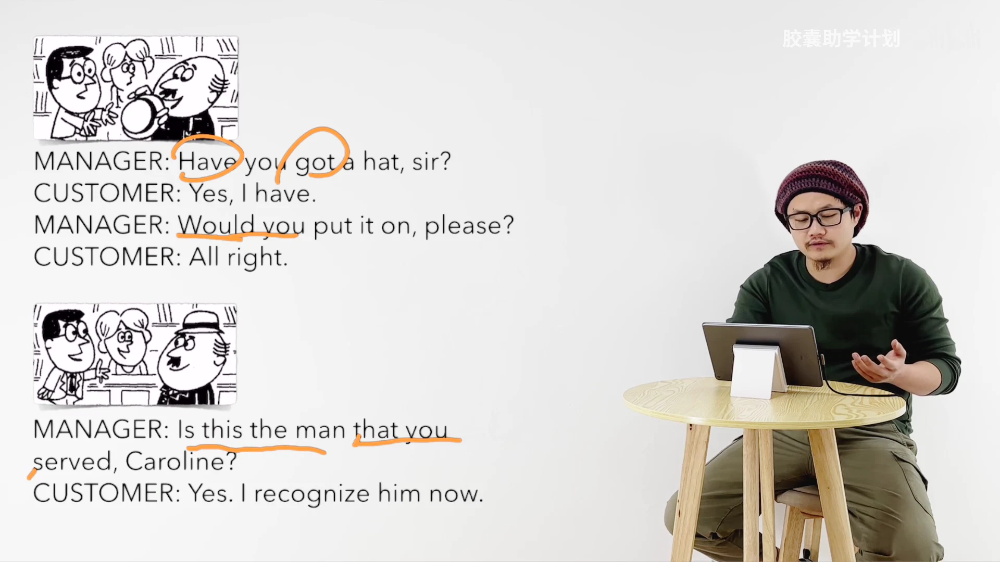

文字识别：MANAGER:Have yoV gota hat, sir? / CUSTOMER: Yes, I have. / MANAGER: Would you put it on, please? / CUSTOMER: All right. / MANAGER: Is this the man that you / served, Caroline? / CUSTOMER: Yes.I recognize him now.

### 画面 00:05:20

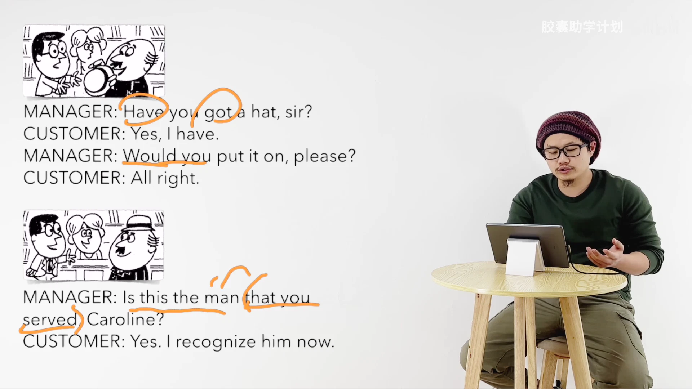

文字识别：MANAGER:Have yoV gota hat, sir? / CUSTOMER: Yes, I have. / MANAGER: Would you put it on, please? / CUSTOMER: All right. / MANAGER: Is this the man / that vou / Caroline? / served / CUSTOMER: Yes.I recognize him now.

### 画面 00:05:23

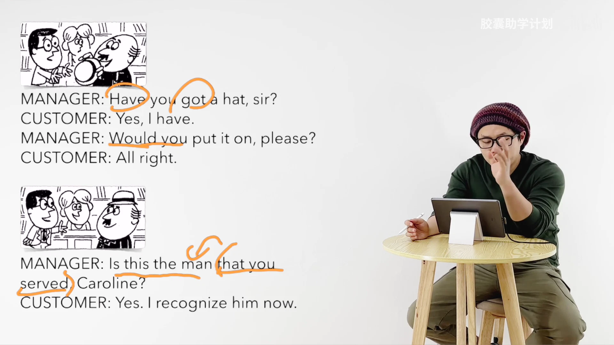

文字识别：MANAGER:Haveyov gota hat, sir? / CUSTOMER: Yes, I have. / MANAGER: Would you put it on, please? / CUSTOMER: All right. / MANAGER: Is this the man / that vou / Caroline? / served / CUSTOMER: Yes.I recognize him now.

## 00:05:30–00:06:00

的一个一般疑问句，只不过后边又加了一个定语从句修饰the man，说这是那个男人吗？你服务的那名男士啊，这是你服务的那名男士吗？OK，Very good, Caroline. Yes, I recognize him now.是的，哎，我现在认出来了。一戴上帽子很不一样，对吧？现在就认出来了。Very good.文章讲完了，接下来咱们做一些口语听力练习啊，各位可以看着文章去找答案，对吧？但我们尽量

### 画面 00:05:43

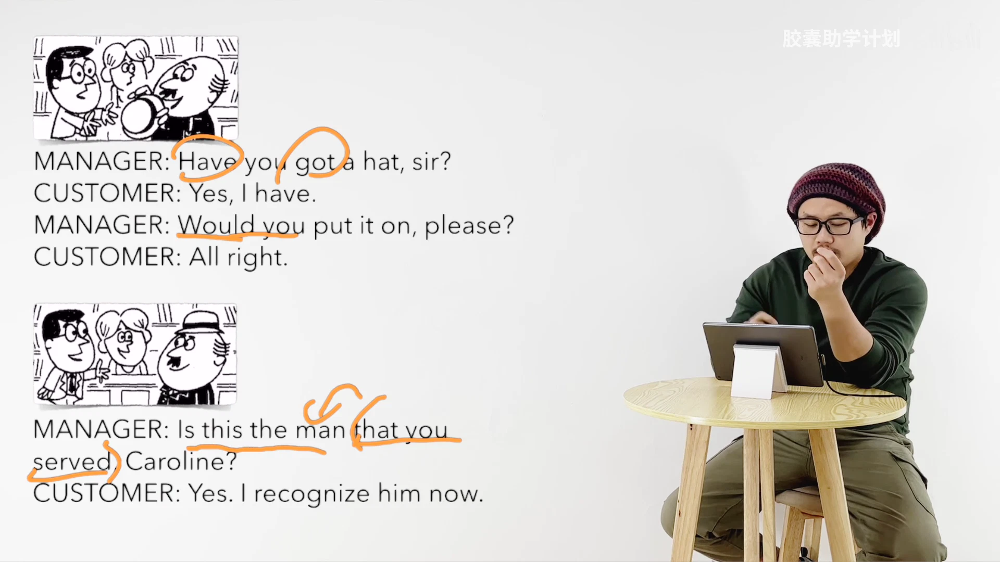

文字识别：MANAGER:Haveyov gota hat, sir? / CUSTOMER: Yes, I have. / MANAGER: Would you put it on, please? / CUSTOMER: All right. / MANAGER: Is this the man / that vou / Caroline? / served) / CUSTOMER: Yes.I recognize him now.

### 画面 00:05:52

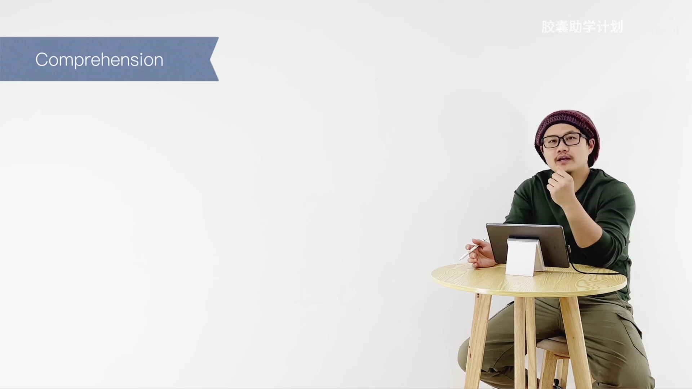

文字识别：Comprehension

## 00:06:00–00:06:30

去做听力练习啊！我问您答，这是一个非常好的这个材料啊！来了，第一题，Why had the customer come back to the shop? Because he had forgotten his books. Next one, When had he bought the two dictionaries? Half an hour earlier. Next one, Could he recognize the lady who served him?

### 画面 00:06:04

文字识别：Comprehension / 1 T: Why had the customer come back to / the shop?

### 画面 00:06:21

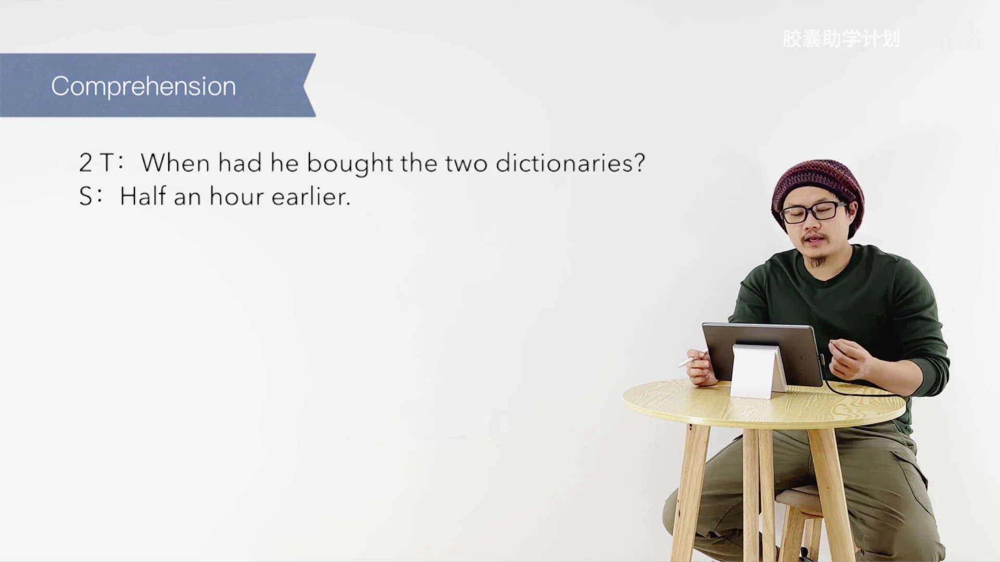

文字识别：Comprehension / 2 T: When had he bought the two dictionaries? / S: Half an hour earlier.

### 画面 00:06:25

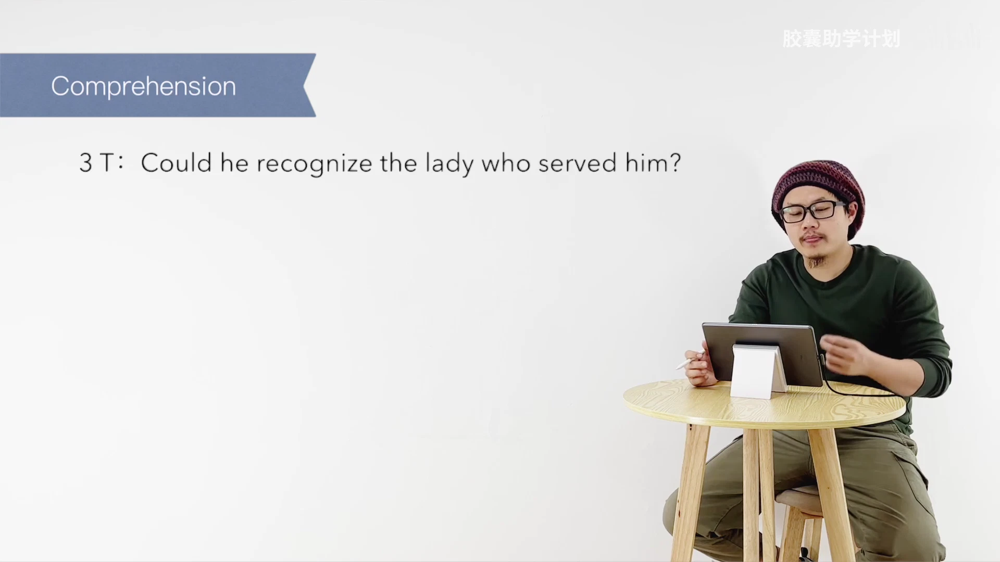

文字识别：Comprehension / 3 T: Could he recognize the lady who served him?

## 00:06:30–00:07:00

Yes, he could. Next one, could he see the books which he had bought? Yes, he could. Next one, where were the books? They were on the counter. Next one, did Caroline remember the person who had bought the book dictionaries? No, she didn't. Next one,

### 画面 00:06:38

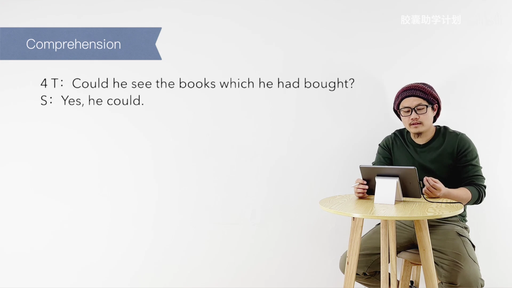

文字识别：Comprehension / 4T: Could he see the books which he had bought? / S: Yes, he could.

### 画面 00:06:41

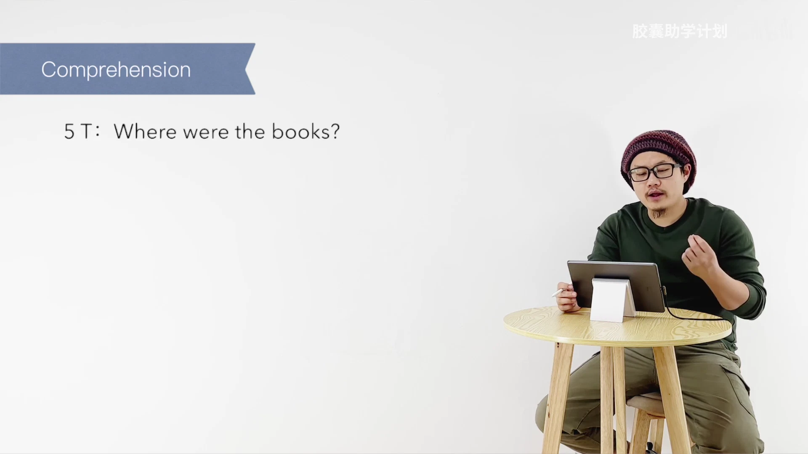

文字识别：Comprehension / 5 T: Where were the books?

### 画面 00:06:48

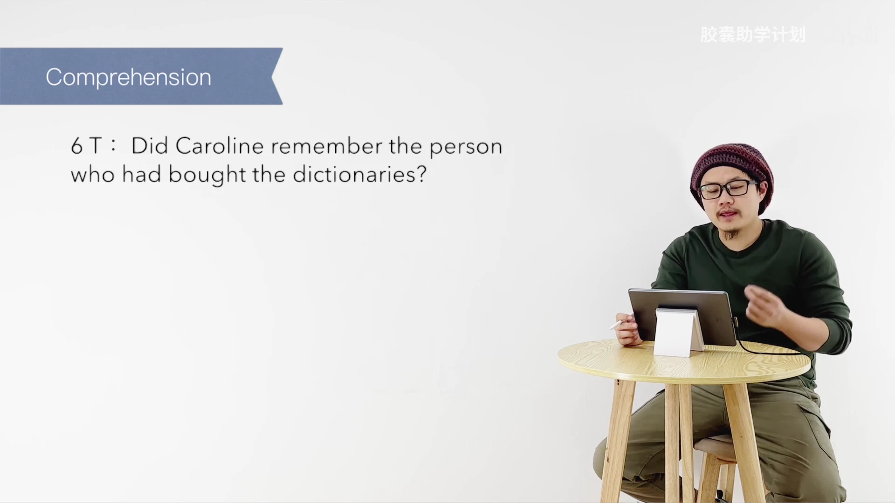

文字识别：Comprehension / 6 T : Did Caroline remember the person / who had bought the dictionaries?

## 00:07:00–00:07:30

How did she recognize him as the man who whom she had served? Okay, 我再读一遍啊. How did she recognize him as the man whom she had served? 好，我简单翻译一下这句话。这句话对于各位来说稍微有一点点难。他是如何认出这名男士的？Whom she had served叫做他服务的这名男士。那整句连起来就是他是如何

### 画面 00:07:00

文字识别：Comprehension / 7 T: How did she recognize him as the man / whom she had served?

### 画面 00:07:21

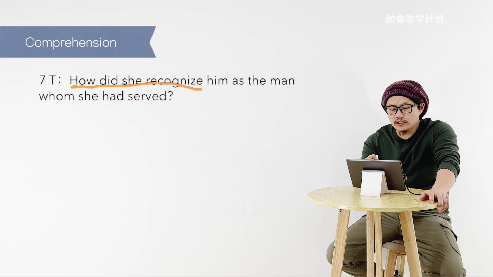

文字识别：Comprehension / 7 T: How did she recognize him as the man / whom she had served?

### 画面 00:07:24

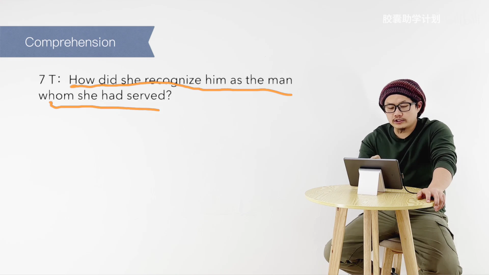

文字识别：Comprehension / 7 T: How did she recognize him as the man / whom she had served?

### 画面 00:07:28

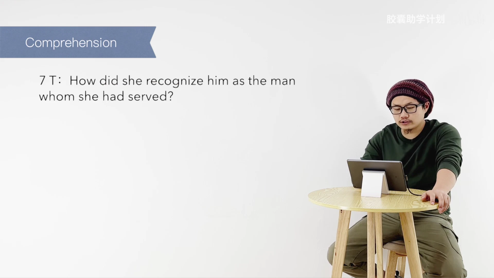

文字识别：Comprehension / 7 T: How did she recognize him as the man / whom she had served?

## 00:07:30–00:08:00

认出这名他服务过的男士的啊？She recognized him when she put on put his hat on. 哎，当他把他帽子戴出来的时候，他就认识了。好吧，next one, asking questions. 我给肯定句，您变一般疑问句，变特殊疑问句啊。第一题，Ask me if the man bought two dictionaries, 对吧？这就是基本功了。看见 bought, 提 do does did, am is are

### 画面 00:07:43

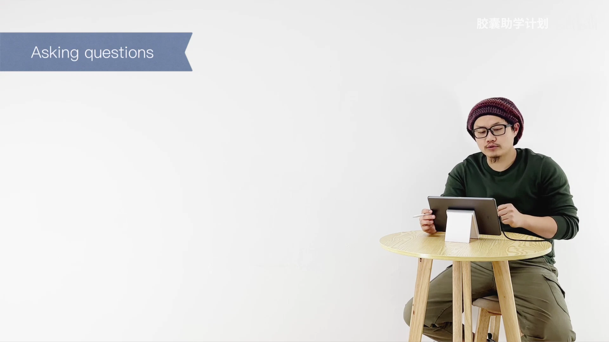

文字识别：Asking questions

## 00:08:00–00:08:30

was, were, can, must, may.这么多单词都可以提前。您要提谁，对吧？包括have, has, had啊，这么多单词都可以提。提did一般过去时，对吧？Did the man buy two dictionaries? Next one. What?那What did the man buy? Next one. Ask me if he forgot to take them with him. Did he forget to take them with him? Why?

### 画面 00:08:07

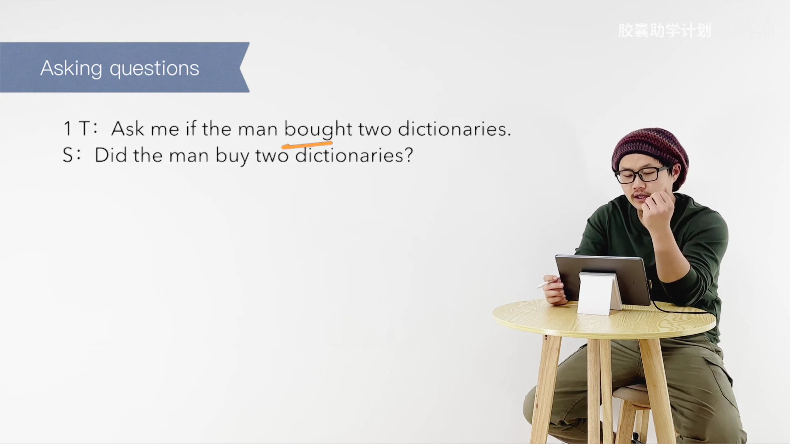

文字识别：Asking questions / 1 T: Ask me if the man bought two dictionaries. / S: Did the man buy two dictionaries?

### 画面 00:08:18

文字识别：Asking questions / 2 T: Ask me if he forgot to take them with him.

## 00:08:30–00:09:00

why did he forget to take them with him? Very good. Next one. Ask me if Caroline served him. Did Caroline serve him? Who, who served him? 好，who其实可以对Caroline和him提问，对吧？但如果你对主语提问，不要忘了不用变一般疑问句，对吧？如果对宾语提问，也就是him去提问的时候，一定要变一般疑问句。

### 画面 00:08:30

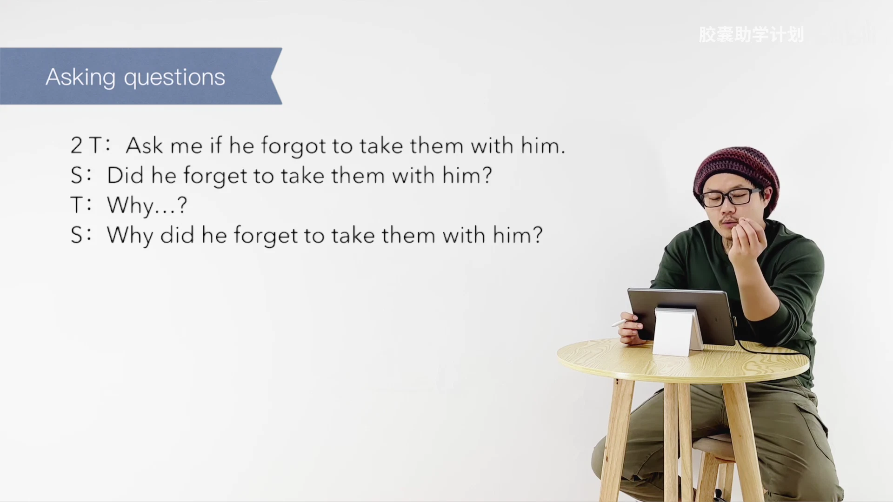

文字识别：Asking questions / 2 T: Ask me if he forgot to take them with him. / S: Did he forget to take them with him? / T:Why...? / S: Why did he forget to take them with him?

### 画面 00:08:35

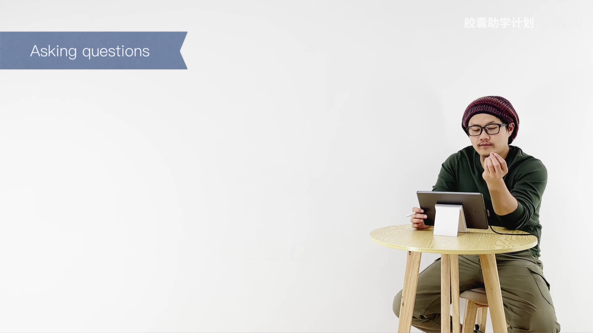

文字识别：Asking questions

### 画面 00:08:48

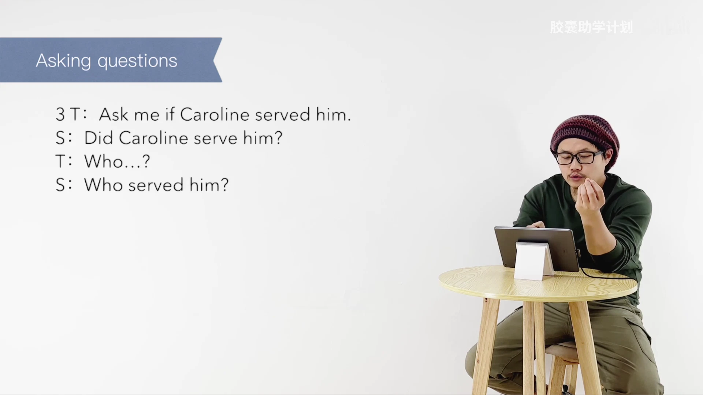

文字识别：Asking questions / 3 T: Ask me if Caroline served him. / S: Did Caroline serve him? / T: Who...? / S: Who served him?

## 00:09:00–00:09:30

这是我们早在三十一课就学过了啊。Next one, ask me if she can remember him. Can she remember him? Why can't? 直接加在句首。Why can't she remember him? Next one, ask me if he was wearing a hat. Was he wearing a hat? What? What was he wearing? Very good.

### 画面 00:09:01

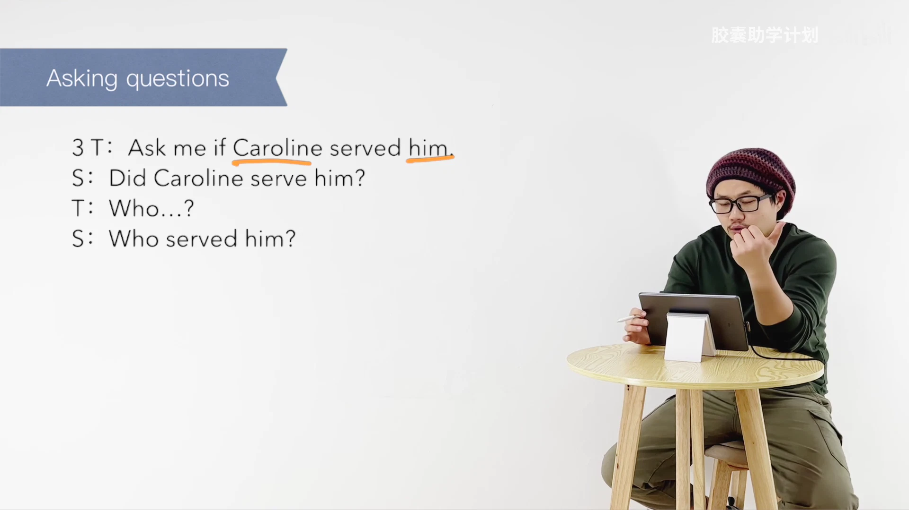

文字识别：Asking questions / 3 T: Ask me if Caroline served him. / S: Did Caroline serve him? / T: Who...? / S: Who served him?

### 画面 00:09:03

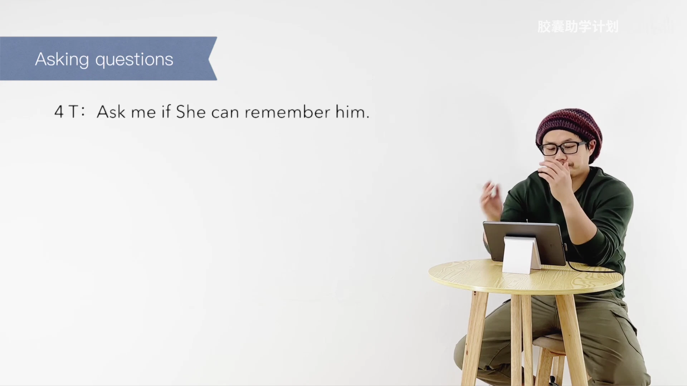

文字识别：Asking questions / 4 T: Ask me if She can remember him.

### 画面 00:09:08

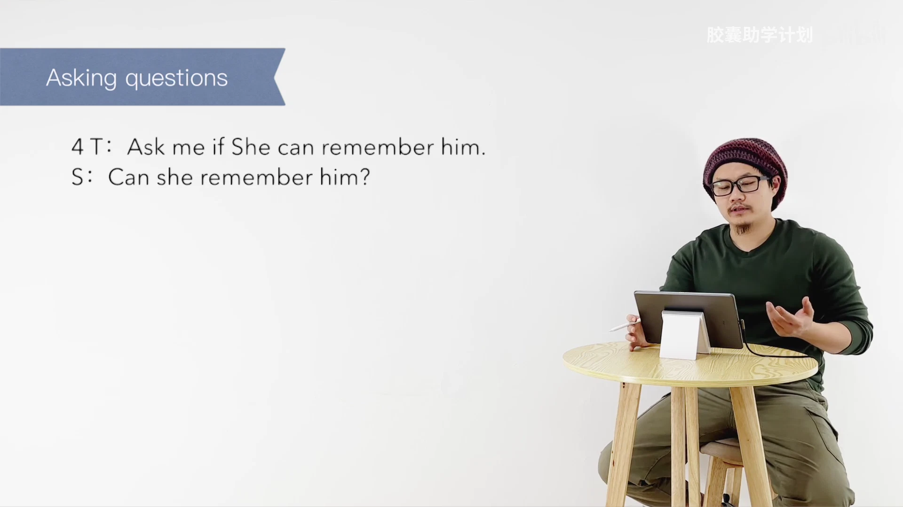

文字识别：Asking questions / 4T: Ask me if She can remember him. / S: Can she remember him?

### 画面 00:09:21

文字识别：Asking questions / 5 T: Ask me if he was wearing a hat. / S: Was he wearing a hat?

### 画面 00:09:29

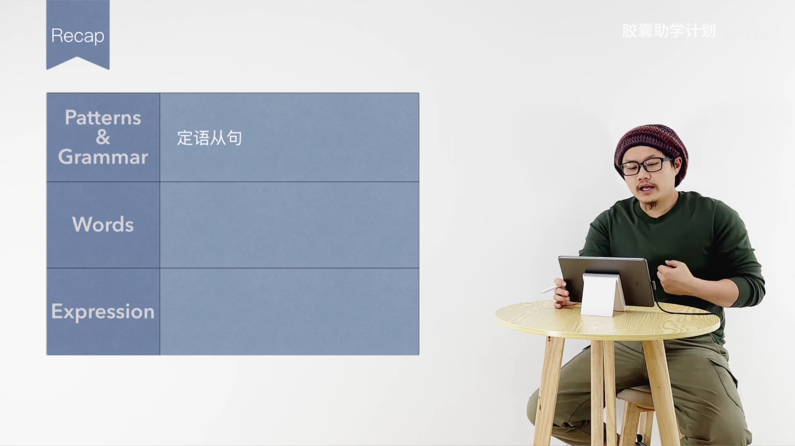

文字识别：Recap / Patterns / 定语从句 / Grammar / Words / Expression

## 00:09:30–00:10:00

Recap.那本课其实就是把我们核心的定语从句，哎，在文章当中又看了一遍，对吧？接下来偶数课我们继续会看到啊。家庭作业呢，绿皮书各位可以写了。其次，文章一定要跟读至熟读成诵，对吧？然后给自己讲解一遍今天的核心知识点。OK，那如果大家喜欢我们的课程呢，欢迎大家关注、订阅、一键三连、分享给那些需要的朋友啊，来帮助我们快速成长。最

### 画面 00:09:34

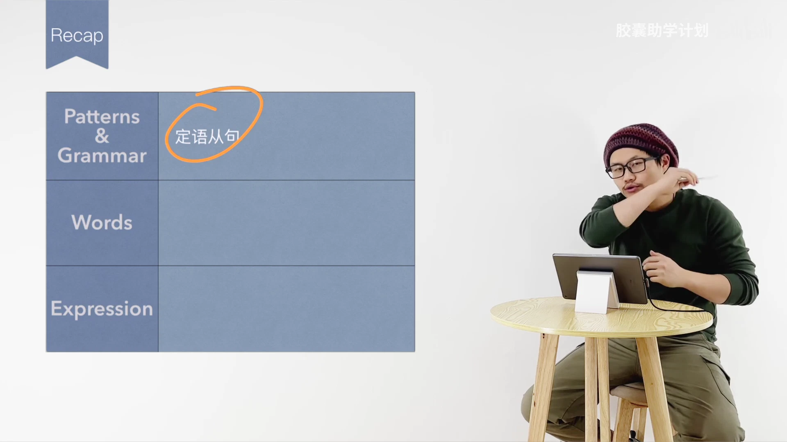

文字识别：Recap / Patterns / 定语从句 / Grammar / Words / Expression

### 画面 00:09:40

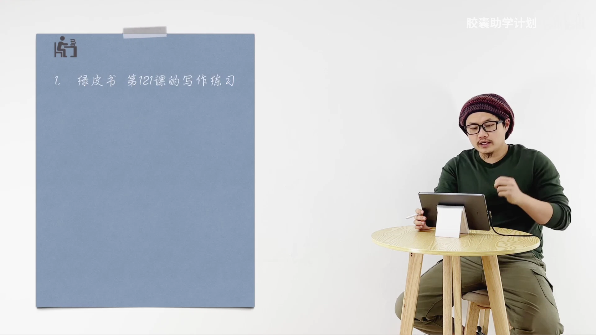

文字识别：绿皮书第121课的写作练习

### 画面 00:09:51

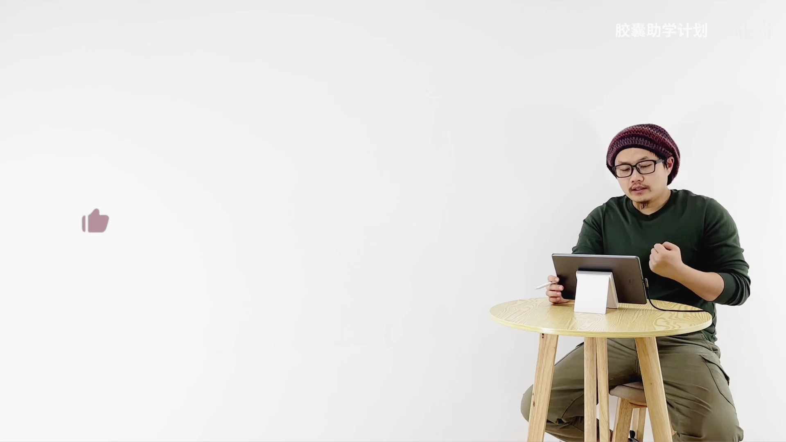

文字识别：👍

### 画面 00:09:59

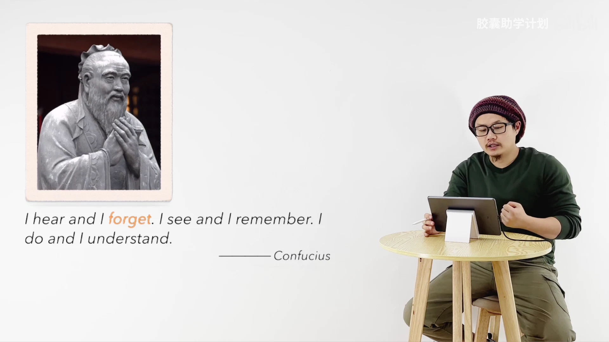

文字识别：I hear and I forget. I see and I remember. I / do and I understand. / Confucius

## 00:10:00–00:10:23

后，我们再来看一句名人名言：I hear and I forget, I see and I remember, I do and I understand. See you next time.

### 画面 00:10:11

### 画面 00:10:13

文字识别：CAPSULEACADEMY / 胶囊助学计划 / 『 / 小红书 / Lecturer / □ / 口 / Leo / OE

### 画面 00:10:15

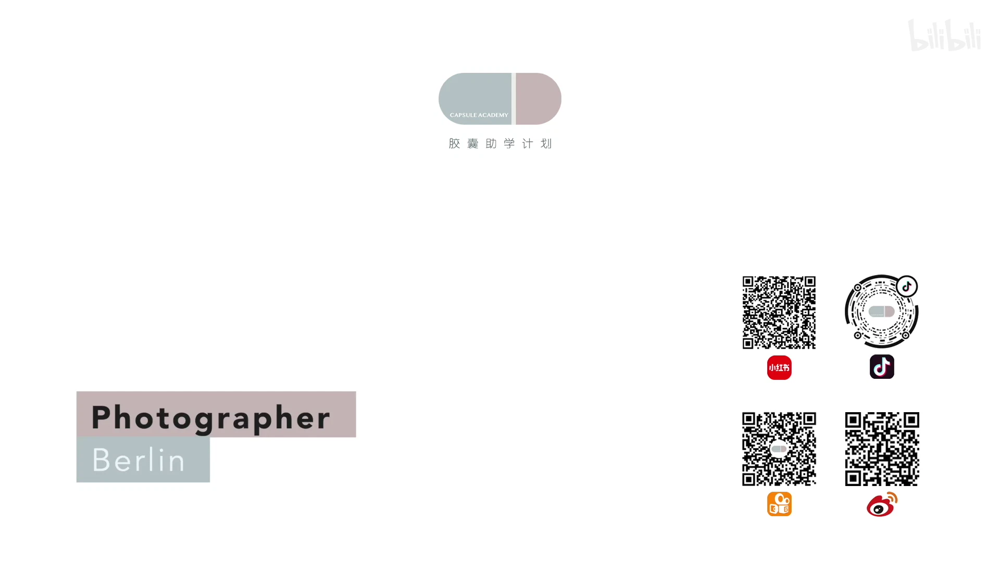

文字识别：CAPSULEACADEMY / 胶囊助学计划 / 『 / 小红书 / Photographer / Berlin

### 画面 00:10:17

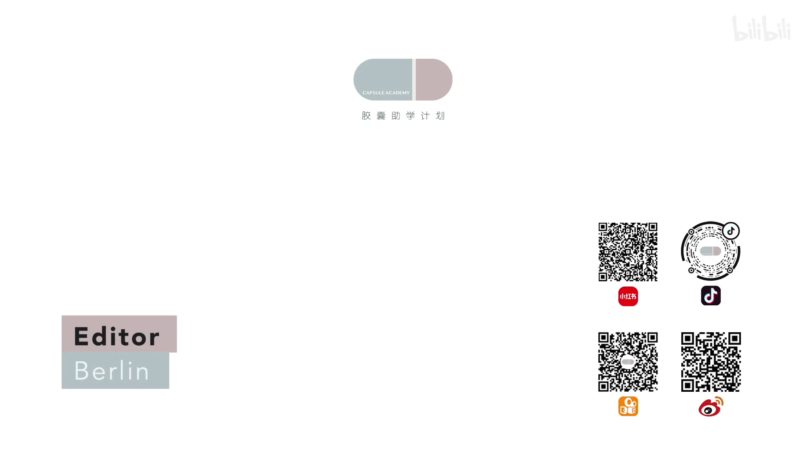

文字识别：CAPSULEACADEMY / 胶囊助学计划 / 『 / 小红书 / Editor / □ / Berlin / OE

### 画面 00:10:20

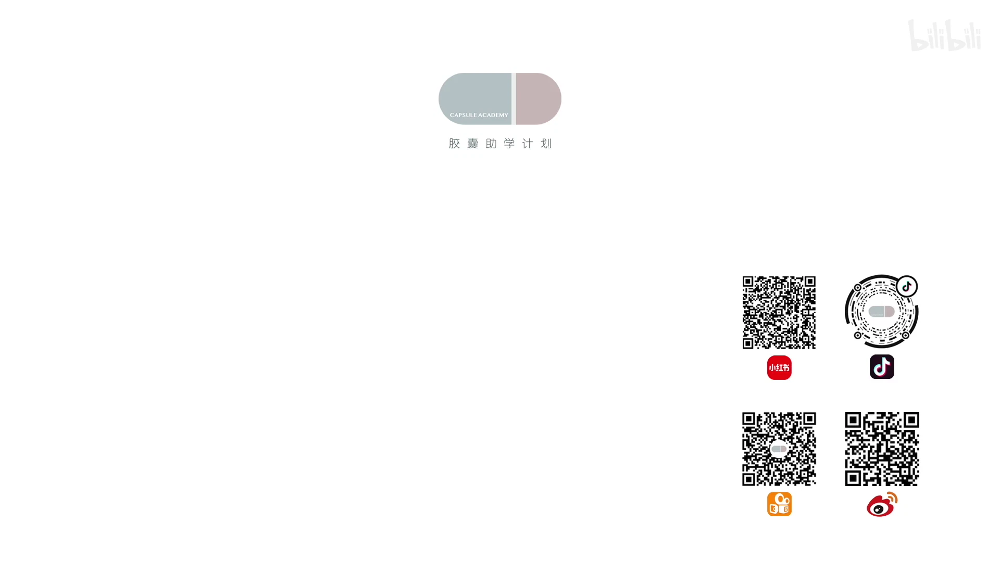

文字识别：CAPSULEACADEMY / 胶囊助学计划 / 小红书

### 画面 00:10:22

文字识别：bilibili / 胶囊助学计划

