# 122 单词 练习

快速机器解析：语音为单模型转写，未进行独立交叉校对或人工复核；画面每秒采样并按变化选帧，短时文字和标记可能遗漏。截图时间约有 1 秒误差。图片有损压缩；遇到疑点请按时间查看 Google Drive 原视频。

## 00:00:00–00:00:30

Hello everyone, welcome to Capsule Academy. This is Leo. Today we're going to learn New Concept English Book One Lesson One Hundred and Twenty Two Practices and Words. Hope you're gonna enjoy it.好，那我们先看第一个单词。第一个单词，咱们直接就用歌啊带着各位去听一遍就可以了。好，我们先说这个单词，看音标，一起读一下，叫做 road road啊，叫做路是吧？最简单、最

### 画面 00:00:00

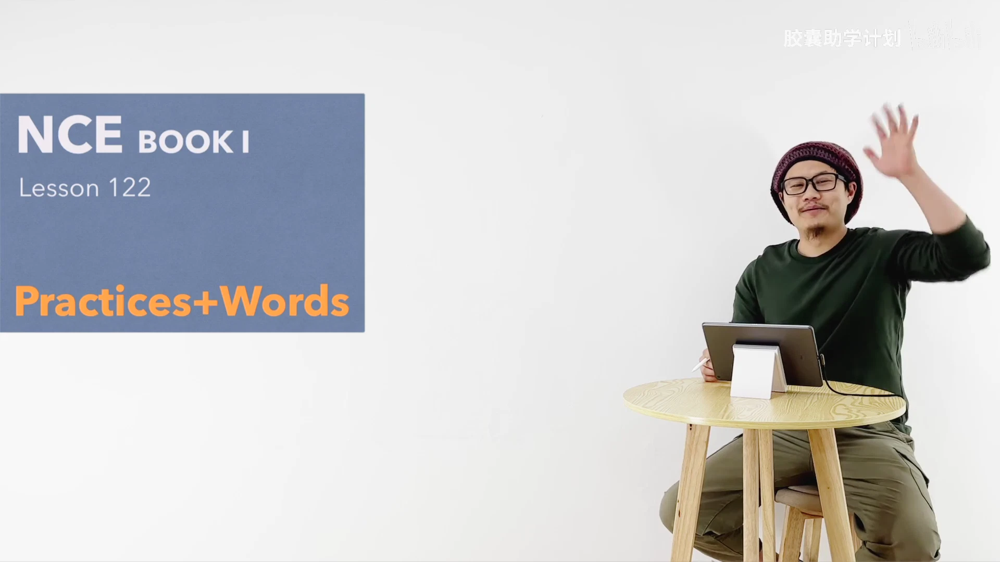

文字识别：胶囊助学计划 / NCE / BOOKI / Lesson 122 / Practices+Words

### 画面 00:00:02

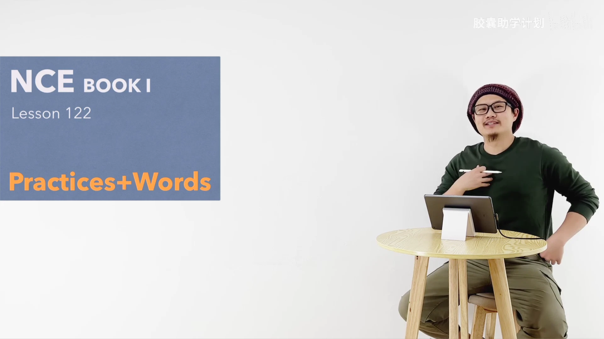

文字识别：胶囊助学计划 / NCE / BOOKI / Lesson 122 / Practices+Words

### 画面 00:00:08

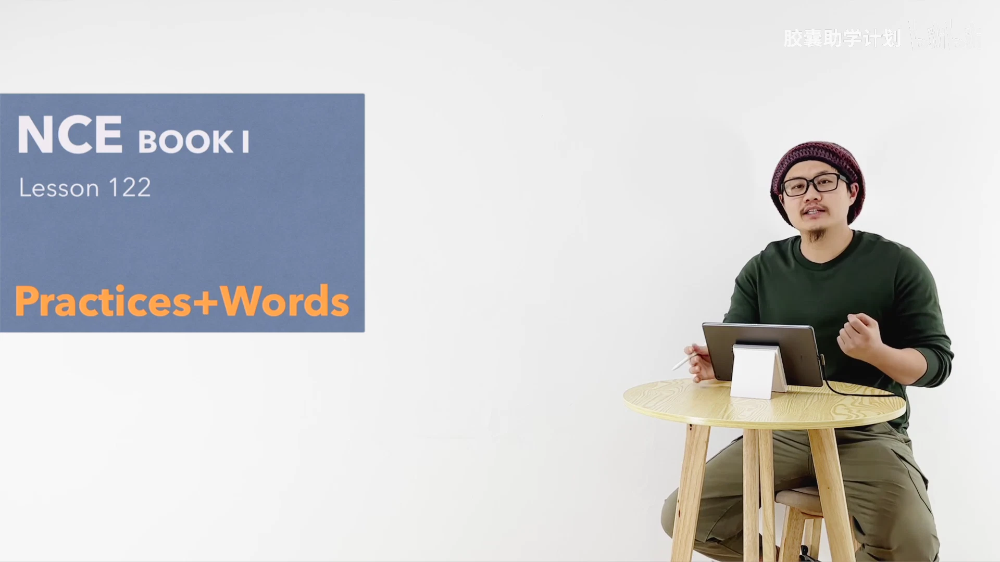

文字识别：胶囊助学计划 / NCE / BOOKI / Lesson 122 / Practices+Words

### 画面 00:00:11

文字识别：胶囊助学计划 bii

### 画面 00:00:15

### 画面 00:00:17

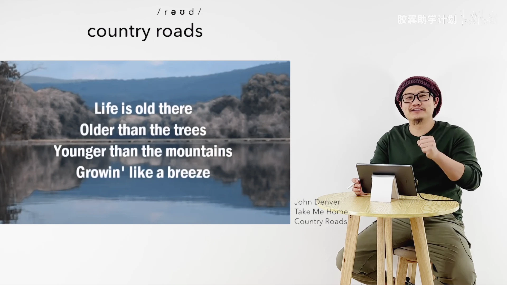

文字识别：/rau d / / 胶囊助学计划 / country roads / Lifei / isold / there / Older / than / the / trees / Younger / than / the / mountains / Growin' / like a breeze / John / Denver / Take / Me / Home / Country / Roads

## 00:00:30–00:01:00

直接的意思就是我们那个马路啊的路，OK。好，那 country road 就是乡间小路啊。有这么一首歌，呃， John Denver 啊唱的叫 Take Me Home, Country Roads，特别的朗朗上口，直接让各位听一下啊。我们用这个歌把这个单词带一下就可以了。来了。

### 画面 00:00:47

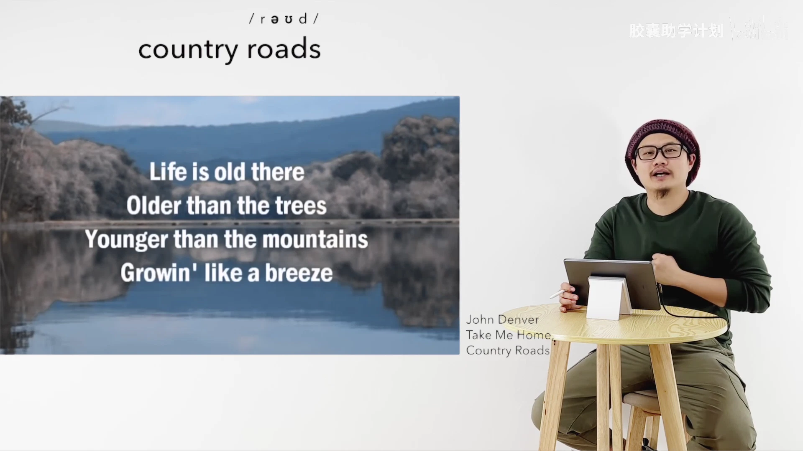

文字识别：/raud/ / 胶囊助学计划 / country roads / Life is old / there / Older / than / the / trees / Younger / than / the / mountains / Growin' / like a breeze / John / Denver / Take / Me / Home, / Country / Roads

### 画面 00:00:50

文字识别：/raud / / 胶囊助学计划 / country roads / Lifei / isoldt / there / Older / than / the / trees / Younger / than / the / mountains / Growin' / like a breeze / John / Denver / Take / Me / Home, / Country / Roads

### 画面 00:00:52

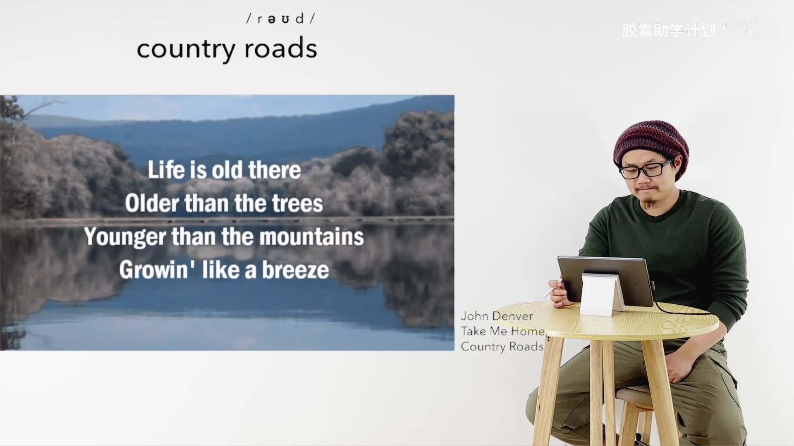

文字识别：/raud / / 胶囊助学计划 / country roads / Life is old there / Older / than / the / trees / Younger / than / the / mountains / Growin' / like a breeze / John / Denver / Take / Me / Home, / Country / Roads

### 画面 00:00:54

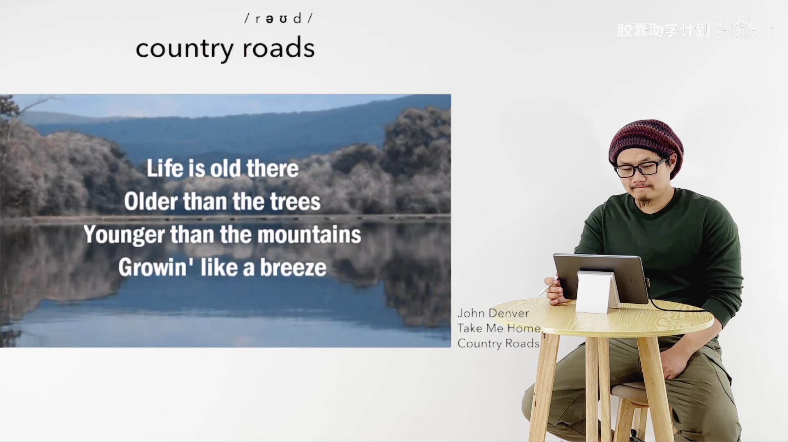

文字识别：/raud / / 胶囊助学计划 / country roads / Life is old there / Older / than / the / trees / Younger / than / the / mountains / Growin' /  like a breeze / John / Denver / Take / Me / Home, / Country / Roads

### 画面 00:00:56

文字识别：/raud / / 胶囊助学计划 / country roads / Life is old there / Older / than / the / trees / Younger / than / the / mountains / Growin' / like a breeze / John / Denver / Take / Me / Home, / Country / Roads

### 画面 00:00:59

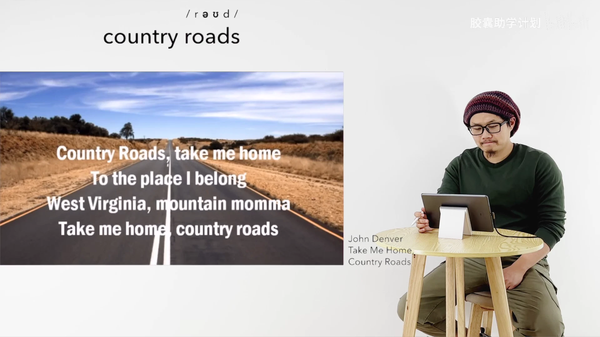

文字识别：/raud / / 胶囊助学计划 / country roads / Country / Roads, / take me / home / To the / plage / I belong / West / Virginia, / m ountain / momma / Take / me / home / country / roads / John / Denver / Take / Me / Home, / Country / Roads

## 00:01:00–00:01:30

very good. Ah,那再跟我读一遍这个单词 road, ah, country road,乡间

### 画面 00:01:01

文字识别：/raud/ / 胶囊助学计划 / country roads / Country / Roads, / take / me / home / To the / plage / I belong / West /  Virginia, / mountain / momma / Take / me / home / country / roads / John / Denver / Take / Me / Home, / Country / Roads

### 画面 00:01:03

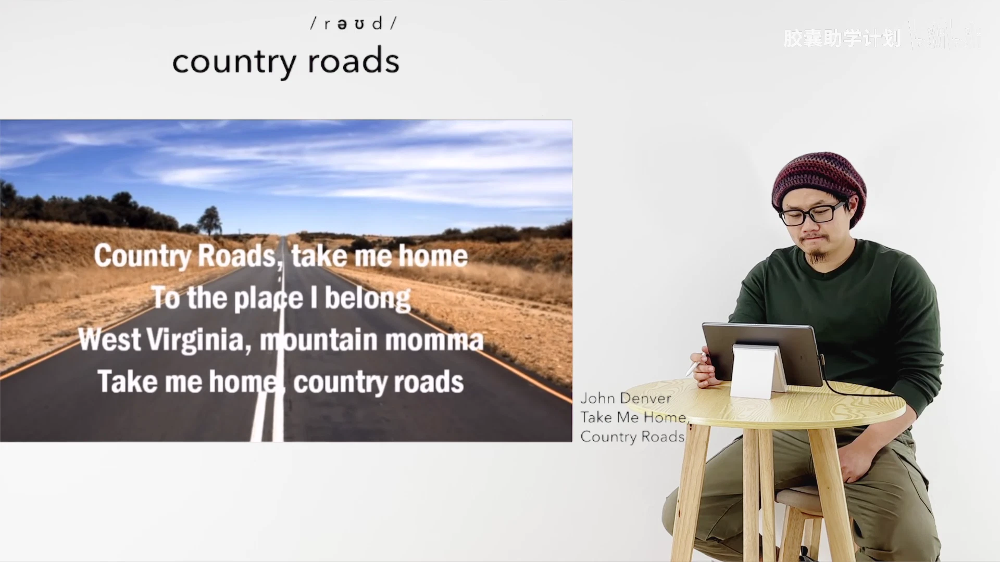

文字识别：/raud/ / 胶囊助学计划 / country roads / Country / Roads, / take / eme / home / Tothe / plage / I belong / West / t Virginia, / mountain / momma / Take / me / home / country / roads / John / Denver / Take / Me / Home, / Country / Roads

### 画面 00:01:05

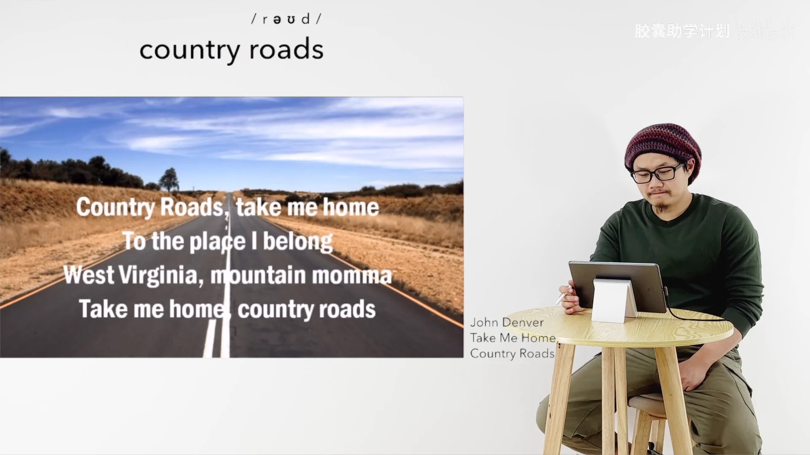

文字识别：/raud / / 胶囊助学计划 / country roads / Country / Roads, / take / me / home / Tothe / plagel / I belong / West Virginia, / mountain / momma / Take / me / home / country / roads / John / Denver / Take / Me / Home, / Country / Roads

### 画面 00:01:07

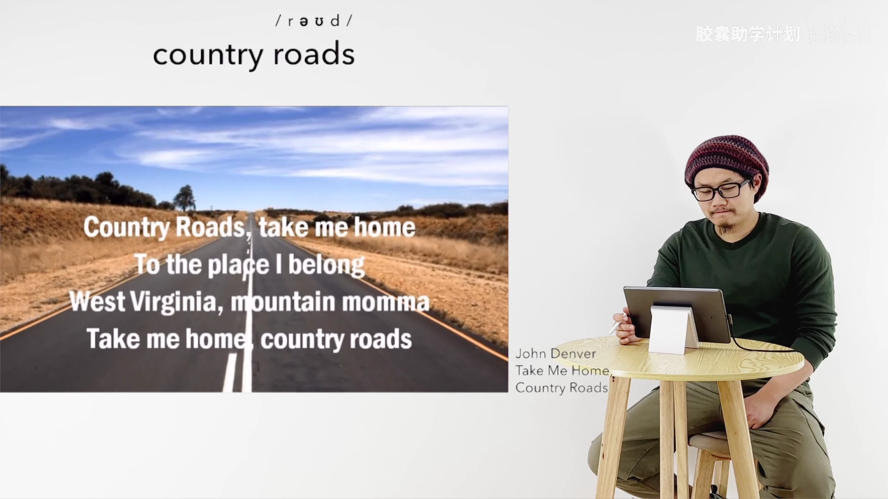

文字识别：/raud/ / 胶囊助学计划 / country roads / Country / Roads, / take me / home / Tothe / plage / I belong / West / Virginia, / mountain / momma / Take / me / home / country / roads / John / Denver / Take / Me / Home, / Country / Roads

### 画面 00:01:09

文字识别：/raud / / 胶囊助学计划 / country roads / Country / Roads, / take me / home / Tothe / plage / I belong / West / Virginia, / mountain / momma / Take / me / home / country / roads / John / Denver / Take / Me / Home, / Country / Roads

### 画面 00:01:11

文字识别：/raud/ / 胶囊助学计划 / country r / roads / Country / Roads, / take me home / To the / plage / I belong / West / t Virginia, / mountain / momma / Take / me / home / country / roads / John / Denver / Take / Me / Home, / Country / Roads

### 画面 00:01:13

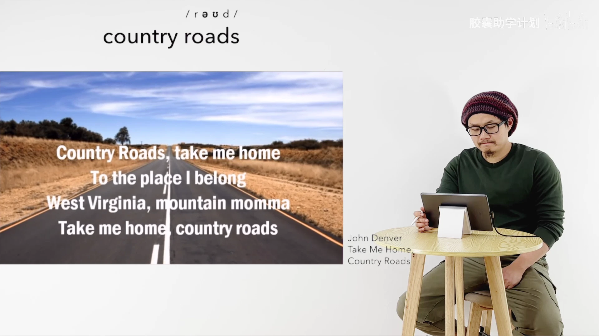

文字识别：/raud/ / 胶囊助学计划 / country r / roads / Country / Roads, / take me home / To the / plage / I belong / West / Virginia, / mountain / momma / Take / me / home / country / roads / John / Denver / Take / Me / Home, / Country / Roads

### 画面 00:01:15

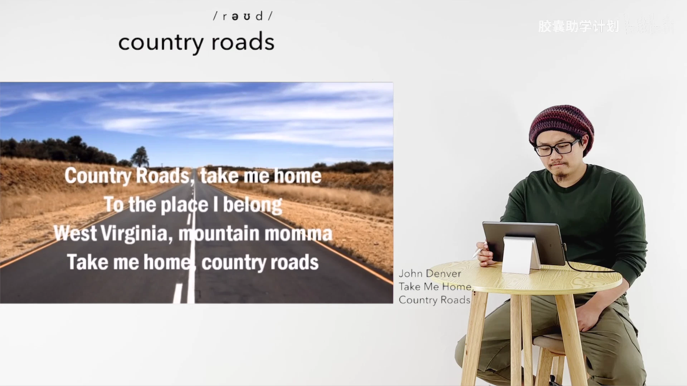

文字识别：/raud/ / 胶囊助学计划 / country r / roads / Country / Roads, / take me home / To the / plage / I belong / West / t Virginia, / mountain / momma / Take / me / home / country / roads / John / Denver / Take / Me / Home, / Country / Roads

### 画面 00:01:17

文字识别：/raud / / 胶囊助学计划 / country r / roads / Country / Roads, / take me home / To the / plage / I belong / West / t Virginia, / mountain / momma / Take / me / home / country / roads / John / Denver / Take / Me / Home, / Country / Roads

### 画面 00:01:19

文字识别：/rau / d/ / 胶囊助学计划 / country / roads / Country / Roads, / take me home / To the / place / I belong / West Virginia, / mountain / momma / Take / me / home / country / roads / John / Denver / Take / Me / Home, / Country / Roads

### 画面 00:01:21

文字识别：/rau / d/ / 胶囊助学计划 / country / roads / Country / yRoads, / take me home / To the / place / I belong / West Virginia, / mountain / momma / Take / me / home / country / roads / John / Denver / Take / Me / Home, / Country / Roads

### 画面 00:01:23

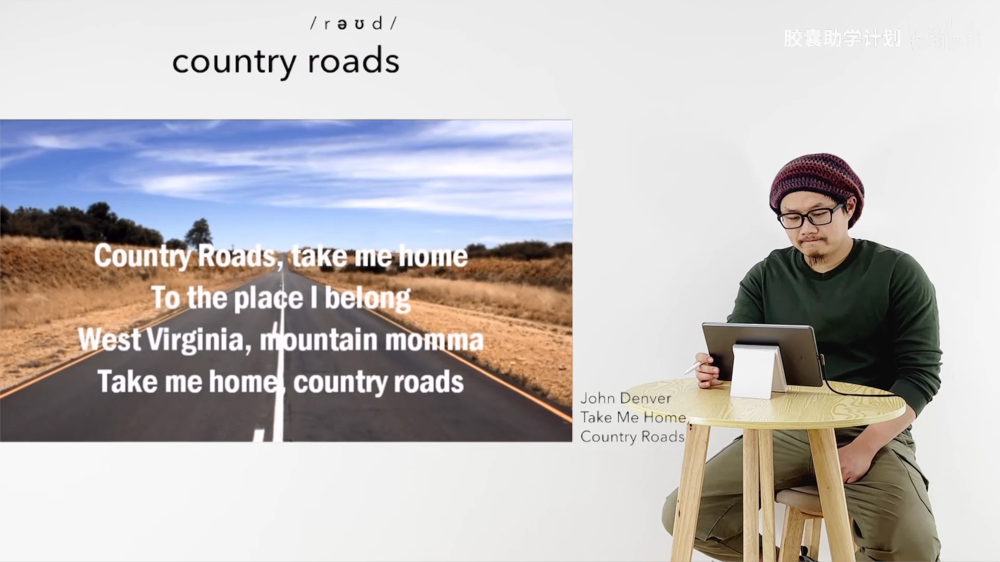

文字识别：/rau / d/ / 胶囊助学计划 / country r / roads / Country / Roads, / take me home / To / the / eplace / I belong / West Virginia, / nountain / momma / Take / me / home / country / roads / John / Denver / Take / Me / Home, / Country / Roads

### 画面 00:01:25

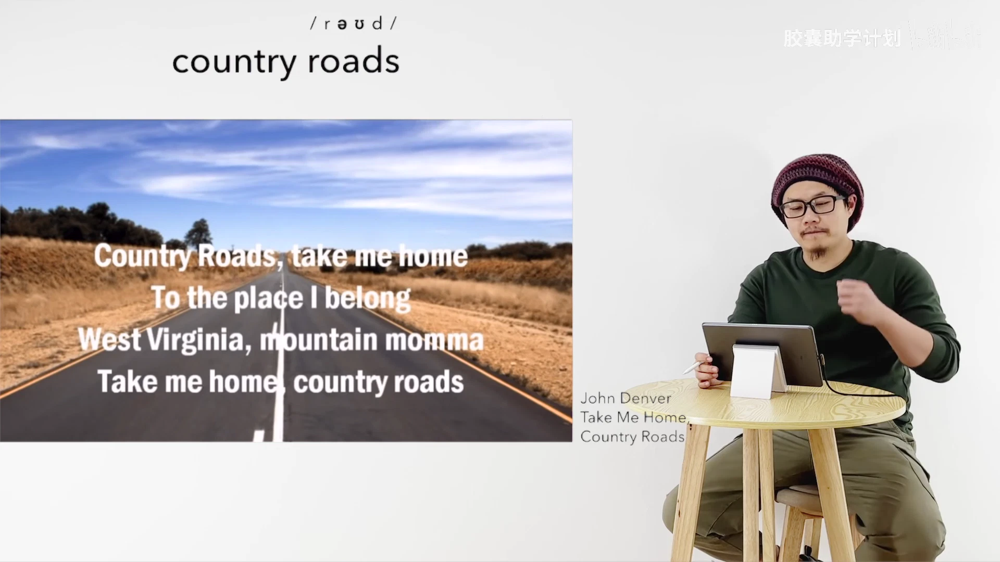

文字识别：/rau / d/ / 胶囊助学计划 / country r / roads / Country / yRoads, / take me home / To / the / place / I belong / West Virginia, / nountain / momma / Take / me / home / country / roads / John / Denver / Take / Me / Home, / Country / Roads

## 00:01:30–00:02:00

的路。Okay,好，那接下来我们直接进入本课的练习。本课的练习重点就是定语从句啊。我们稍微慢一点来了，先来两句话啊。我们先熟悉一下这个过程啊。来，Isn't he the mechanic?那他不就是那个机械修理师吗？Didn't he repair your car?啊，我记得就是他修理你的车呀。好，那其实这两句话你把它变成两句话。第一句话叫He is the mechanic。第二句话叫做He repaired your car，对吧？

### 画面 00:01:31

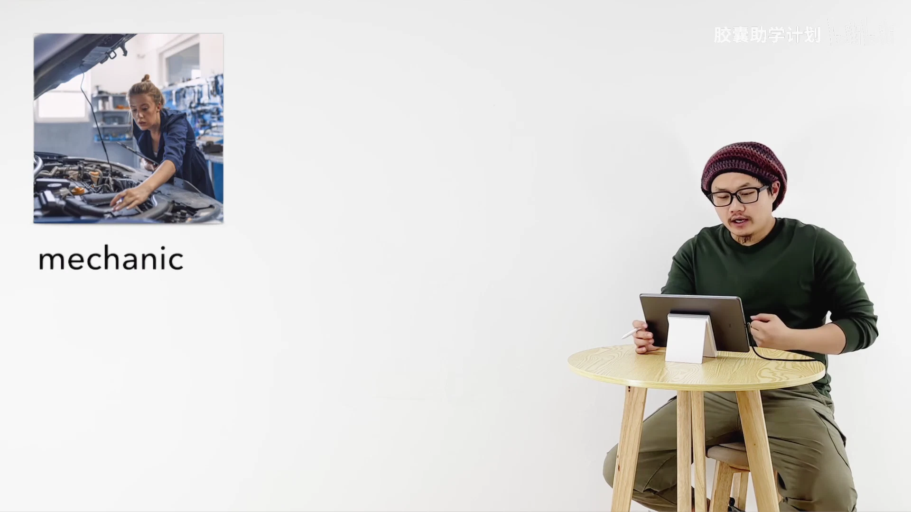

文字识别：胶囊助学计划 / mechanic

### 画面 00:01:47

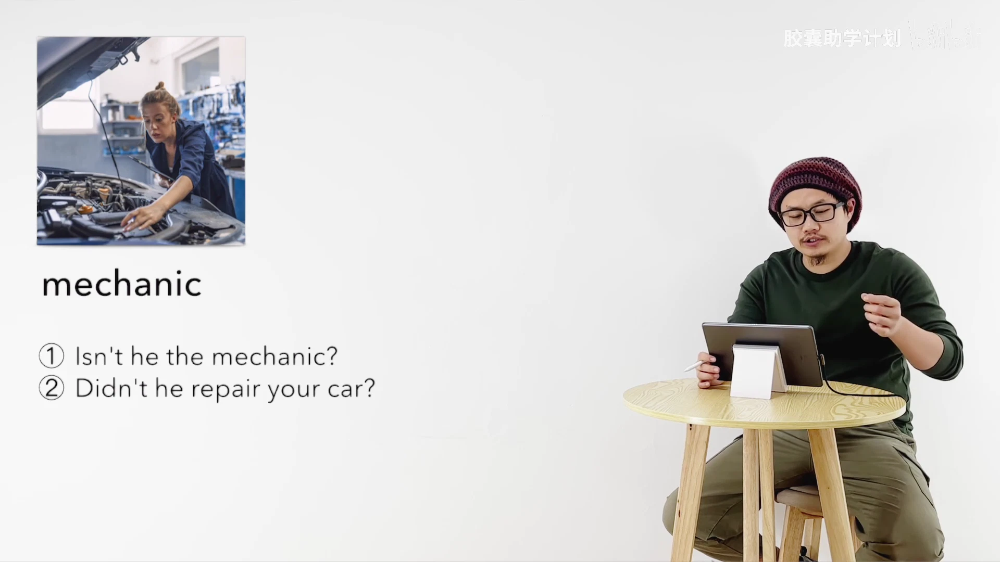

文字识别：胶囊助学计划 / mechanic / ) Isn't he the mechanic? / Didn't he repair your car?

### 画面 00:01:54

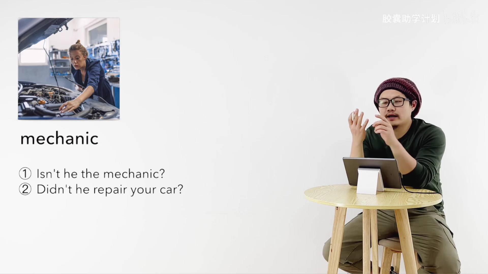

文字识别：胶囊助学计划 / mechanic / ) Isn't he the mechanic? / Didn't he repair your car?

## 00:02:00–00:02:30

那你把它连起来就是Yes, he's the mechanic who repaired my car.他就是那个修理我车的那个机械师，对吧？那另一种方式我们说过，对于各位来说更直观的就是他就是那个机械修理师，他修理的我的车，对吧？给它拆成两句话。One,然后注意人用who啊，也可以用that，勿用which或that，对吧？就可以了。接下来呢，我们稍微快一点，各位张嘴跟我读就可以了。然后注意力重点

### 画面 00:02:01

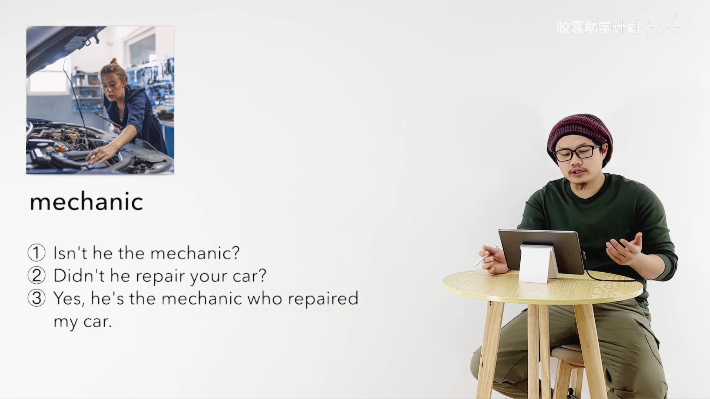

文字识别：胶囊助学计划 / mechanic / ) Isn't he the mechanic? /  Didn't he repair your car? / ③ Yes, he's the mechanic who repaired / my car.

### 画面 00:02:06

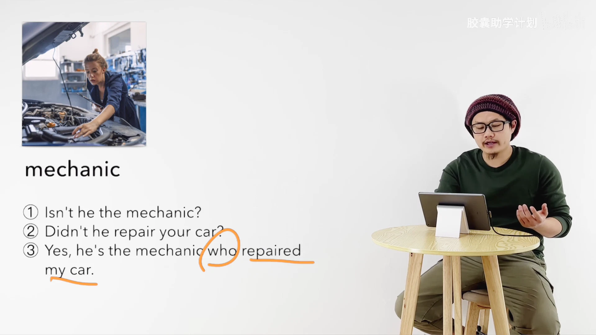

文字识别：胶囊助学计划 / mechanic / ) Isn't he the mechanic? / Didn't he repair your car /  Yes, he's the mechanigwhorepaired / my car.

### 画面 00:02:25

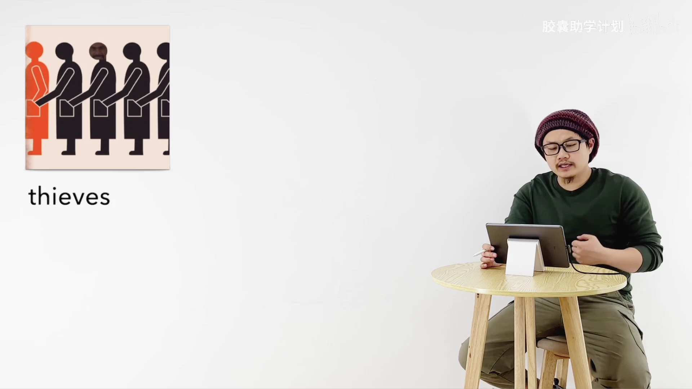

文字识别：胶囊助学计划 / thieves

## 00:02:30–00:03:00

放在定语从句的第三句话上啊，就呃第三句话是定语从句嘛，对吧？我们重点放在这里来了。Aren't they the thieves? Didn't the police catch them? Yes, they are the thieves whom the police caught. 好，这个 whom 其实就是我们提过，就是已经特别罕见了。只有当这个 whom 去替代在后边这句话当中起到宾语作用的时候，才用 whom，但完全

### 画面 00:02:37

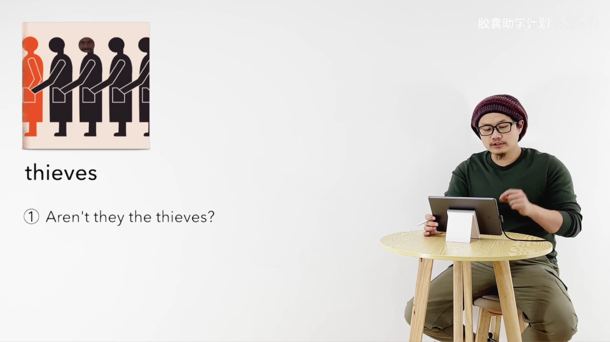

文字识别：胶囊助学计划 / thieves / ① Aren't they the thieves?

### 画面 00:02:42

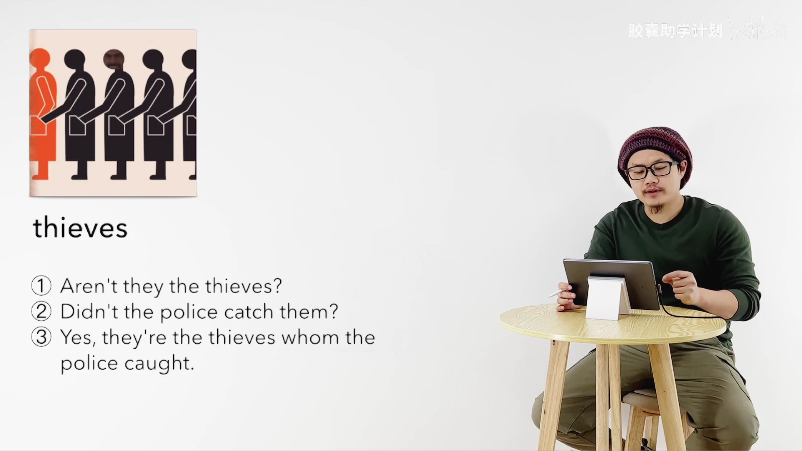

文字识别：胶囊助学计划 / thieves / ① Aren't they the thieves? / Didn't the police catch them? /  Yes, they're the thieves whom the / police caught.

### 画面 00:02:49

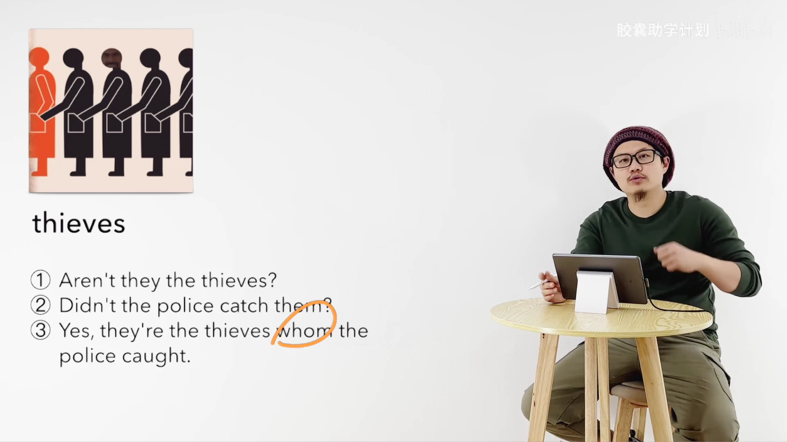

文字识别：胶囊助学计划 / thieves / ① Aren't they the thieves? / Didn't the police catch them / Yes, they're the thieves Whom the / police caught.

### 画面 00:02:56

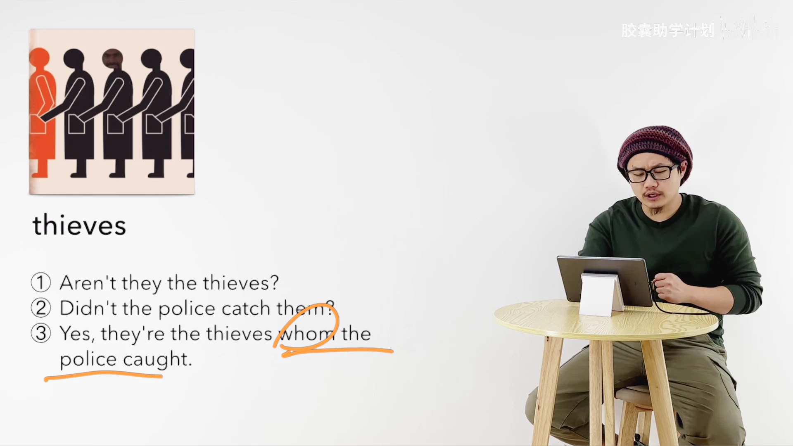

文字识别：胶囊助学计划洲 / thieves / ① Aren't they the thieves? / Didn't the police catch them: / Yes, they're the thieves Whom the / police caught.

## 00:03:00–00:03:30

可以用 who 去替代，对吧？这个一点问题没有啊。OK，那下一个来，Isn't that the car? Didn't you sell it last year? Yes, that's the car which I sold last year. 好，你看 which 就不存在这个问题，对吧？Which 其实在这后边这句话当中，你看后边这句话 I sold last year 缺的是宾语嘛， so 缺的是 the car，对不对？所以应该后边这句话叫 I sold that car last year，对不对？

### 画面 00:03:05

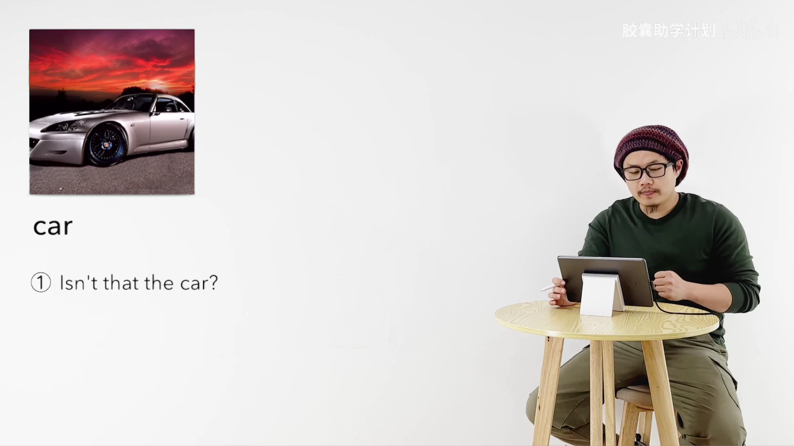

文字识别：胶囊助学计划 / car / ① Isn't that the car?

### 画面 00:03:11

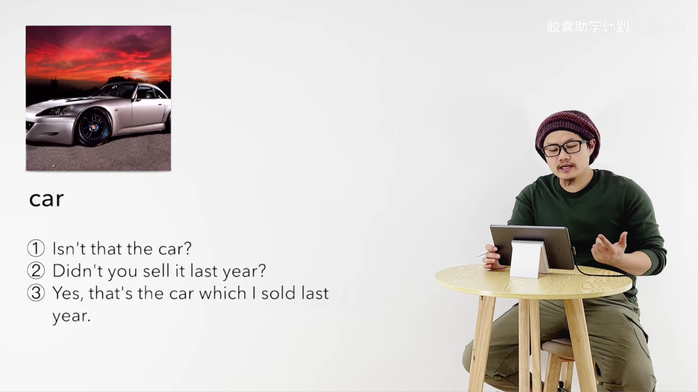

文字识别：胶囊助学计划 / car / ) Isn't that the car? /  Didn't you sell it last year? /  Yes, that's the car which I sold last / year.

### 画面 00:03:19

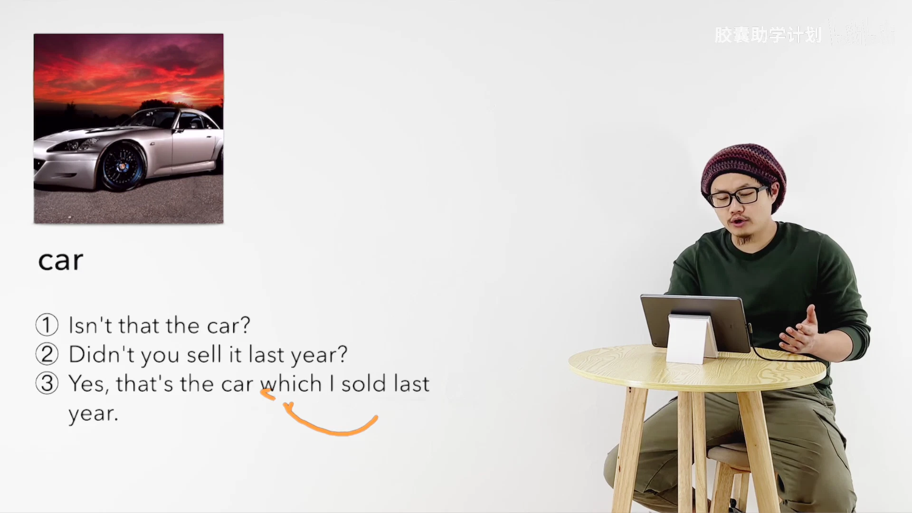

文字识别：胶囊助学计划 / car / ) Isn't that the car? /  Didn't you sell it last year? /  Yes, that's the car which I sold last / year.

### 画面 00:03:21

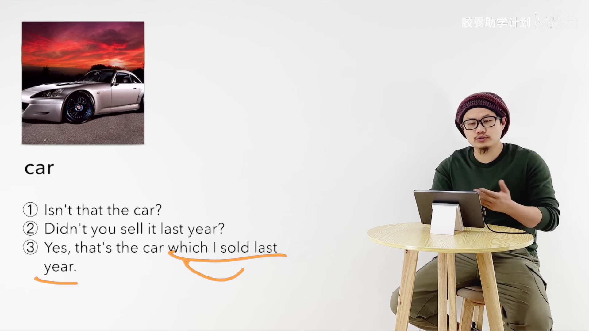

文字识别：胶囊助学计划 / car / ) Isn't that the car? / Didn't you sell it last year? / ) Yes, that's the car which I sold last / year.

## 00:03:30–00:04:00

它只不过是 which 要提到句首去，然后引导定语从句。那你看它就不存在一个什么别的变体了，只有 which. Okay. Next one. Aren't they the children? Don't they live next door? Yes, they are the children who live next door. Next one. Isn't that the porter? Didn't he carry your suitcase? Yes, he is the porter who carried my suitcase. Next one.

### 画面 00:03:31

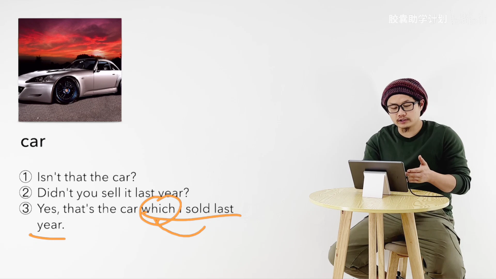

文字识别：胶囊助学计划 / car / ) Isn't that the car? / Didn't you sell it last year? / Yes, that's the carwhich / sold last / year.

### 画面 00:03:39

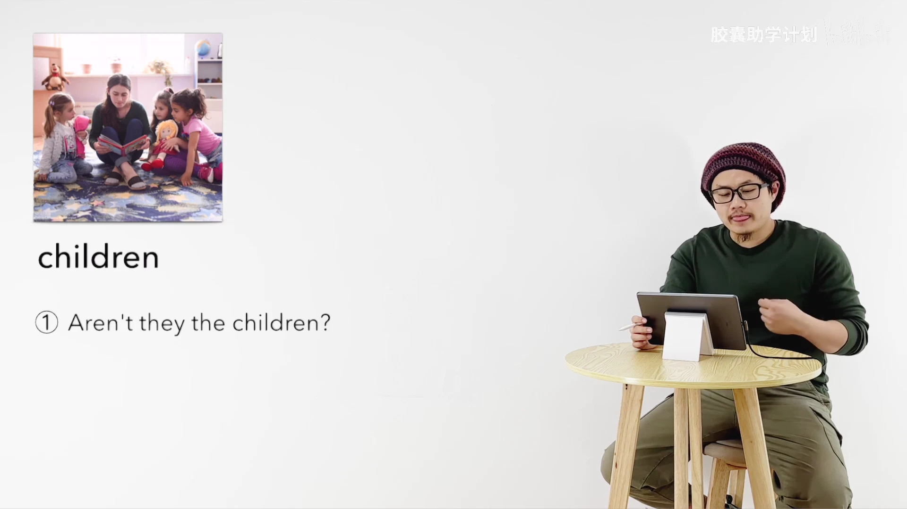

文字识别：胶囊助学计划 / children / ① Aren't they the children?

### 画面 00:03:43

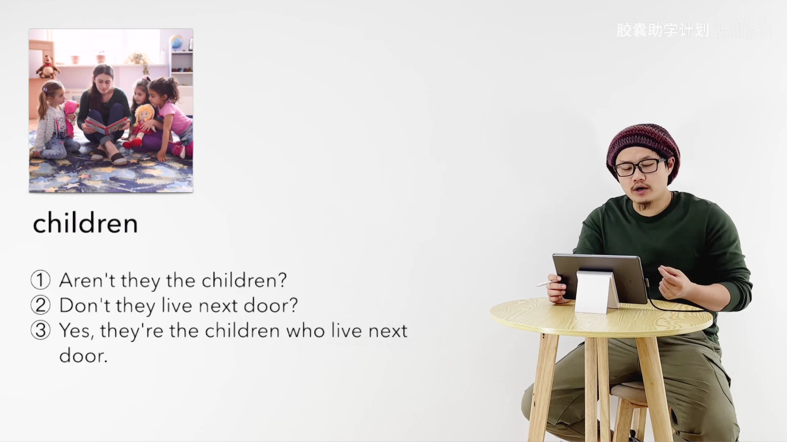

文字识别：胶囊助学计划 / children / ① Aren't they the children? / ② Don't they live next door? / ③ Yes, they're the children who live next / door.

### 画面 00:03:48

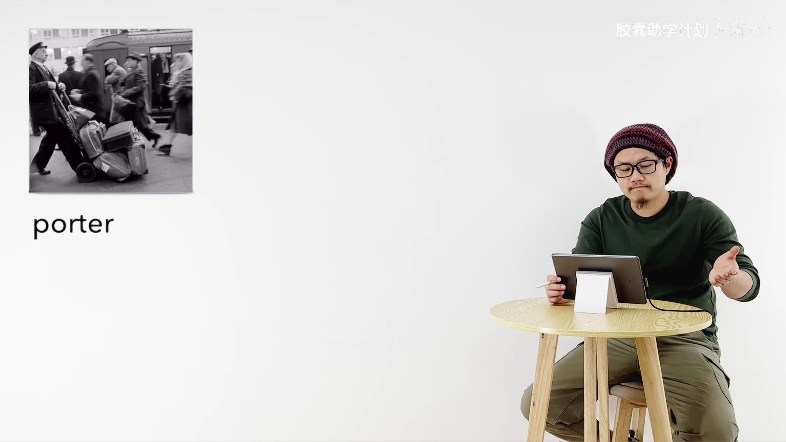

文字识别：胶囊助学计划 / porter

### 画面 00:03:54

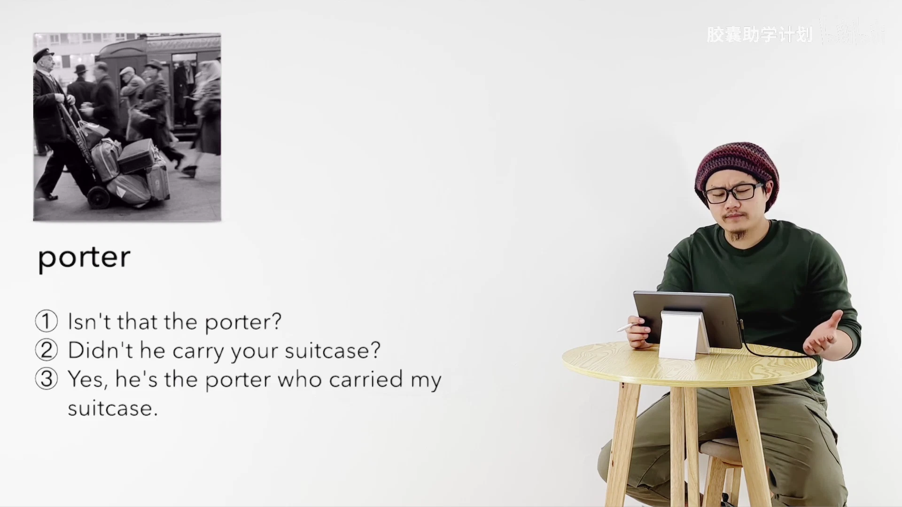

文字识别：胶囊助学计划 / porter /  Isn't that the porter? / 1 /  Didn't he carry your suitcase? / ③ Yes, he's the porter who carried my / suitcase.

### 画面 00:03:59

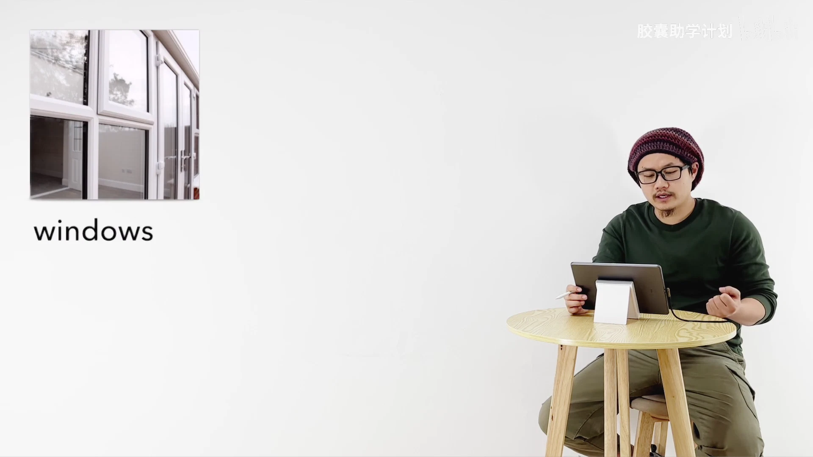

文字识别：胶囊助学计划 / windows

## 00:04:00–00:04:30

aren't they the windows? Didn't the children break them yesterday? Yes, they are the windows which the children broke yesterday. Next one, isn't that the coin? Didn't you find it in the garden? Yes, that's the coin which I found in the garden. Which替代the coin，对吧？在后边这句话当中做宾语，因为I found后边缺了个宾语，对不对？

### 画面 00:04:06

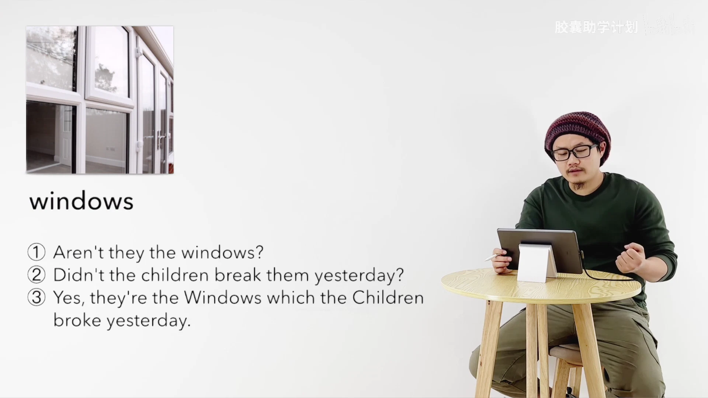

文字识别：胶囊助学计划 / windows / ① Aren't they the windows? /  Didn't the'children break them yesterday? / 2） / ③ Yes, they're the Windows which the Children / 3 / broke yesterday.

### 画面 00:04:13

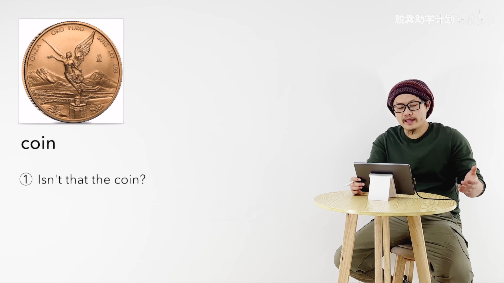

文字识别：胶囊助学计划 / PURO / ORO / coin / ① Isn't that the coin?

### 画面 00:04:16

文字识别：胶囊助学计划 / PURO / ORO / coin / ) Isn't that the coin? / Didn't you find it in the garden?

### 画面 00:04:20

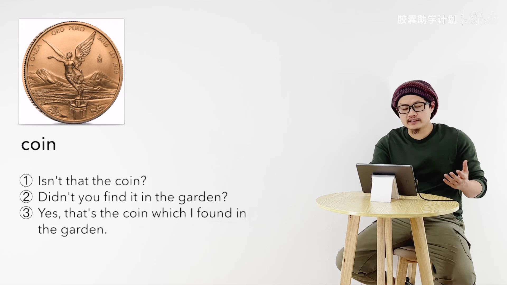

文字识别：胶囊助学计划 / PURO / ORO / coin / ) Isn't that the coin? /  Didn't you find it in the garden? / ③ Yes, that's the coin which I found in / 3 / the garden.

### 画面 00:04:23

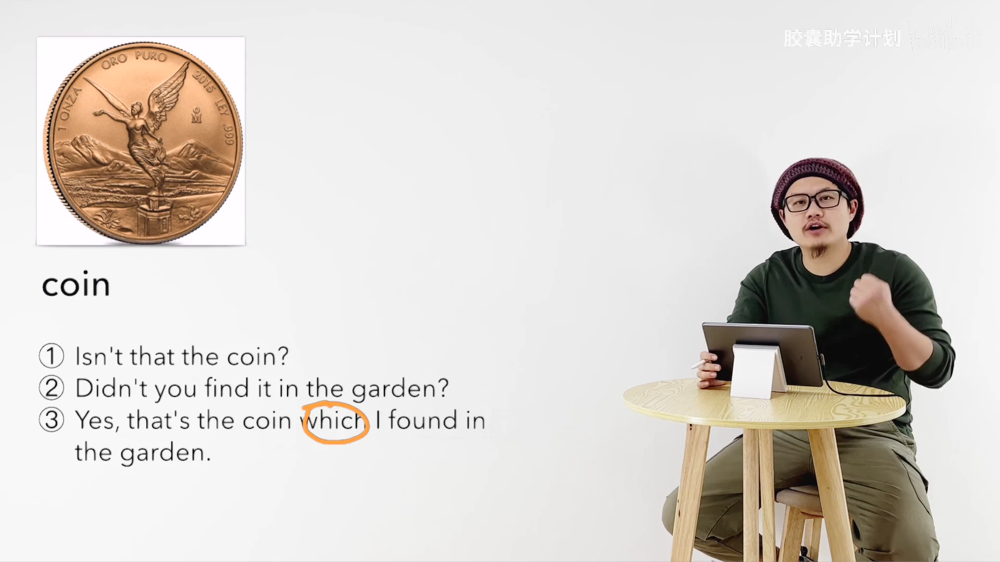

文字识别：胶囊助学计划 / PURO / coin / ) Isn't that the coin? /  Didn't you find it in the garden? / 2 / ③ Yes, that's the coin Which I found in / 3 / the garden.

## 00:04:30–00:05:00

玩一个 next one. Isn't she the woman? Didn't you drive her to London? 张嘴跟我读啊。Yes, she is the woman whom I drove to London. 应该是 I drove her to London, 对吧？所以说 whom 完全可以用 who 替代啊。Whom 现在出现的频率已经非常非常低了啊。各位完全不用啊。就是你可能考试，万一可能会考到，但大部分实际应用当中没有人要求，

### 画面 00:04:31

文字识别：胶囊助学计划 / woman / ① Isn't she the woman?

### 画面 00:04:38

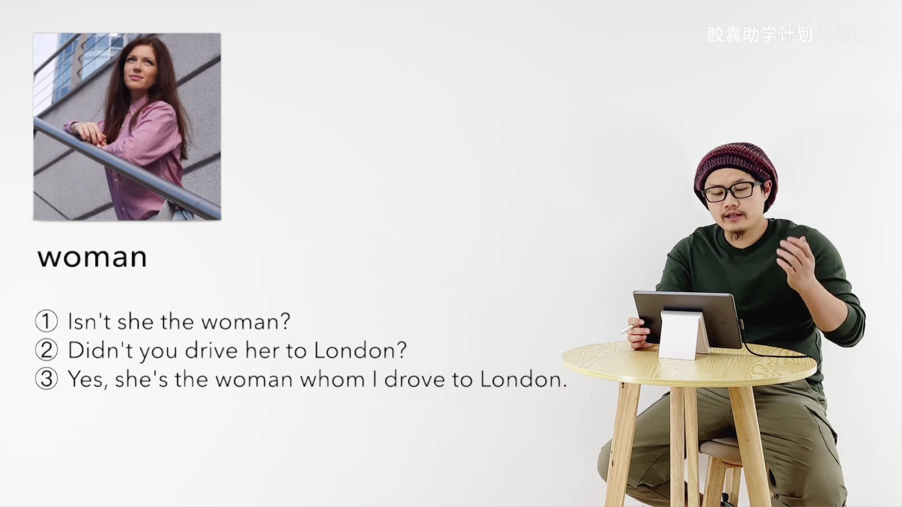

文字识别：胶囊助学计划 / woman / ) Isn't she the woman? / ② Didn't you drive her to London? / 2 / ③ Yes, she's the woman whom I drove to London.

## 00:05:00–00:05:30

好吧，没有人有这个要求啊。Next one, on these the books, didn't you buy them last week? Yes, they are the books which I bought last week. Next one, on they the people, didn't you invite them to your party? Yes, they are the people who I invited to my party. Ah,用who替代whom，好吧。好，

### 画面 00:05:02

文字识别：胶囊助学计划 / books / ① Aren't these the books?

### 画面 00:05:06

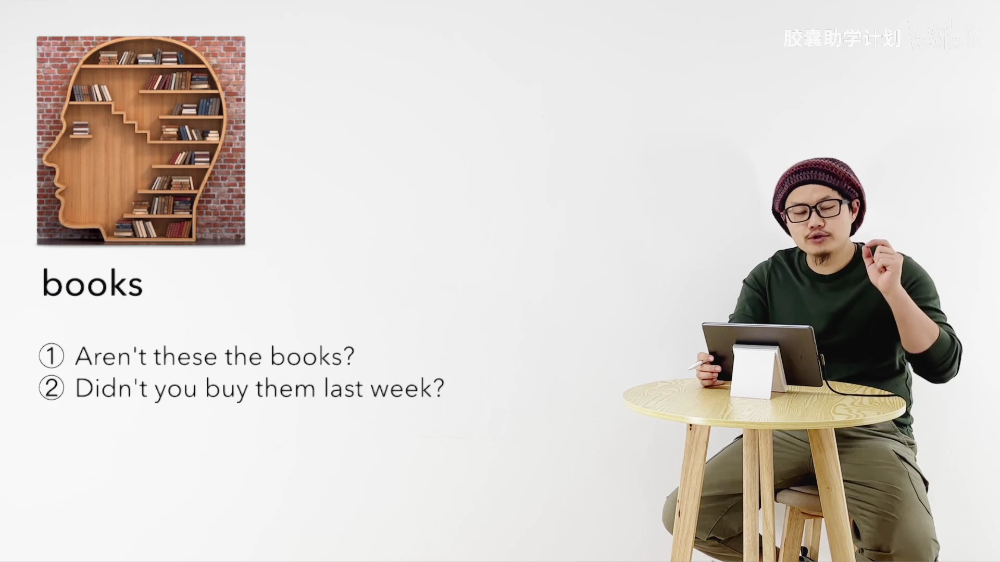

文字识别：胶囊助学计划 / books / ① Aren't these the books? / ② Didn't you buy them last week?

### 画面 00:05:10

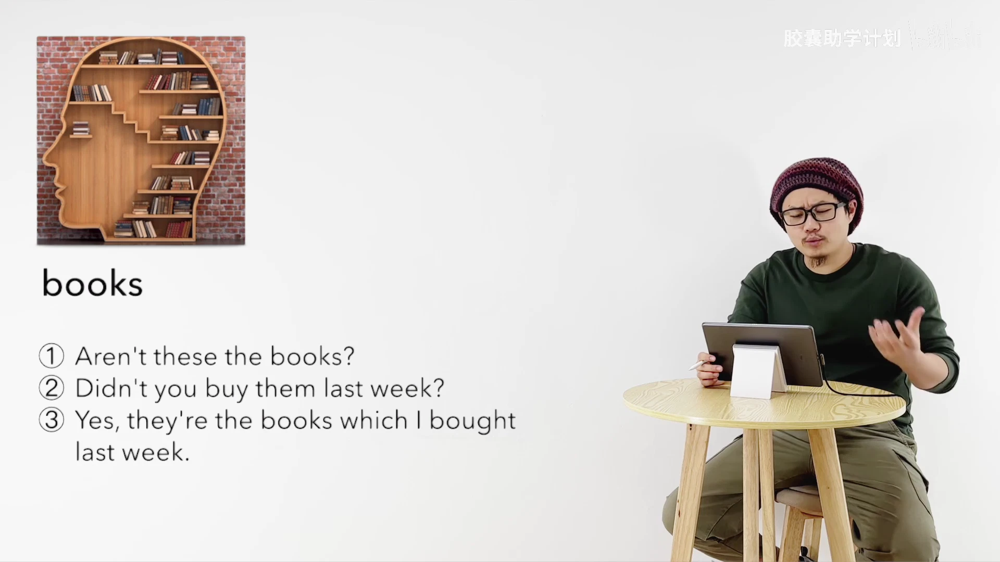

文字识别：胶囊助学计划 / books / ① Aren't these the books? / ② Didn't you buy them last week? / ③ Yes, they're the books which I bought / last week.

### 画面 00:05:14

文字识别：胶囊助学计划 / people / ① Aren't they the people?

### 画面 00:05:18

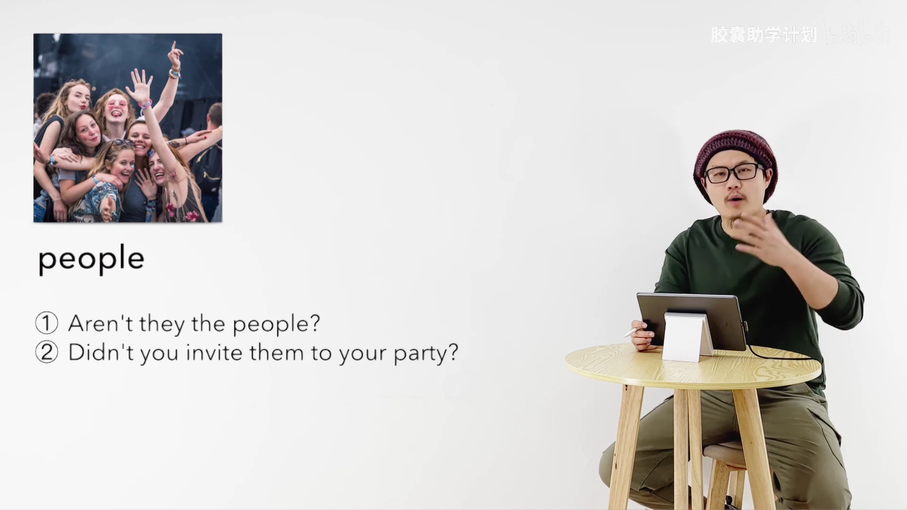

文字识别：胶囊助学计划 / people / ① Aren't they the people? / Didn't you invite them to your party?

### 画面 00:05:27

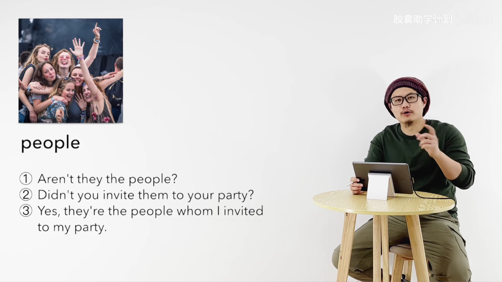

文字识别：胶囊助学计划 / people / ① Aren't they the people? / Didn't you invite them to your party? / ③ Yes, they're the people whom I invited / 3 / to my party.

### 画面 00:05:29

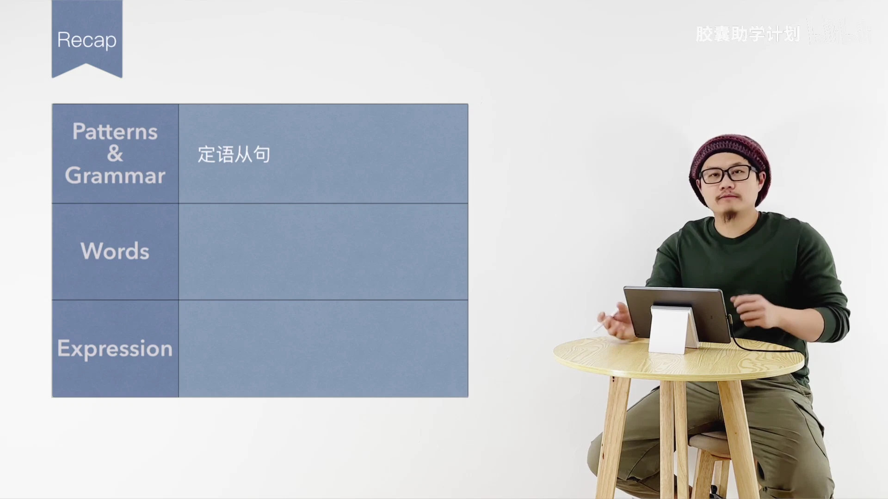

文字识别：胶囊助学计划 / Recap / Patterns / 定语从句 / Grammar / Words / Expression

## 00:05:30–00:06:00

recap本课的练习还是定语从句啊，这个就是重中之重啊，下一课还是定语从句啊。那对于各位来说呢，绿皮书重点一百二十二课，各位可以写了，给自己讲解一遍今天的核心知识点，最好您把本课的这个视频再反复看几遍，对吧？保证各位对本课的定语从句有一个特别熟悉的，多练，对吧？也就是说，我们通过这种方式去多练一下啊，多看几遍。那如果各位喜欢我们的课程呢，欢迎大家关注、

### 画面 00:05:34

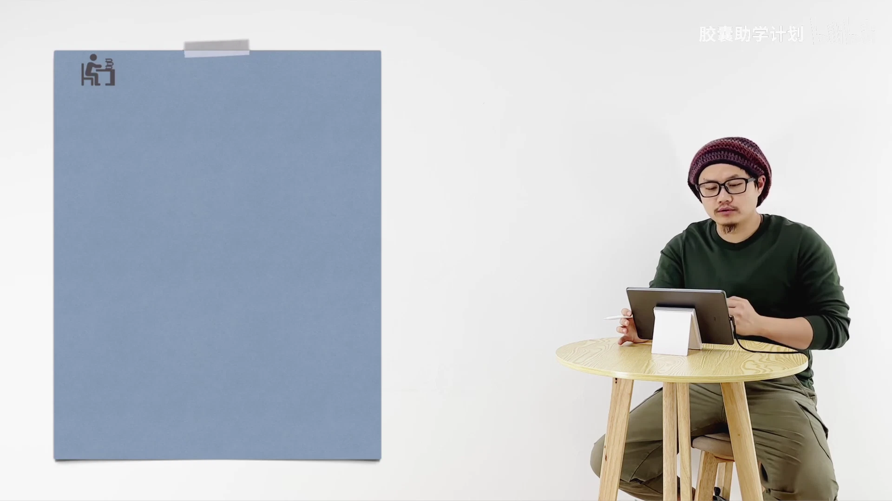

文字识别：胶囊助学计划

### 画面 00:05:57

文字识别：胶囊助学计划

## 00:06:00–00:06:27

注、订阅、一键三连，分享给那些需要的朋友，来帮助我们快速成长。最后，我们再来看一句名人名言：If you don't like the road you are walking, start paving another one. OK, see you next time.

### 画面 00:06:05

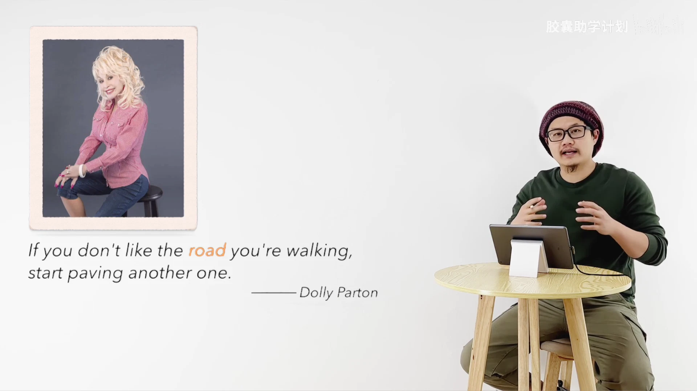

文字识别：胶囊助学计划 / If you don't like the road you're walking, / start paving another one. / -Dolly Parton

### 画面 00:06:15

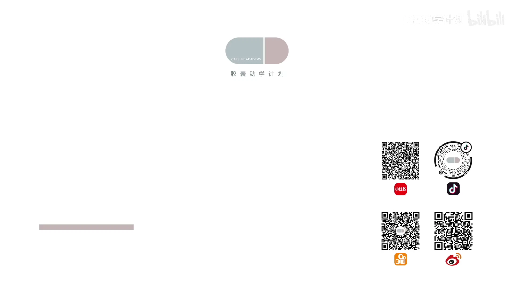

文字识别：CAPSULEACADEMY / 胶囊助学计划 / 『 / 小红书

### 画面 00:06:17

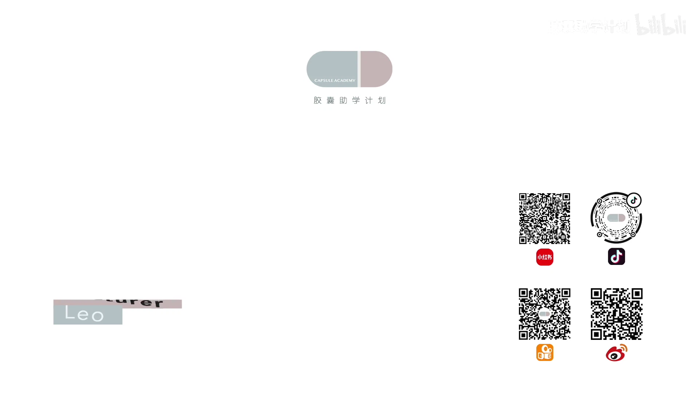

文字识别：CAPSULEACADEMY / 胶囊助学计划 / 小红书 / Leo

### 画面 00:06:23

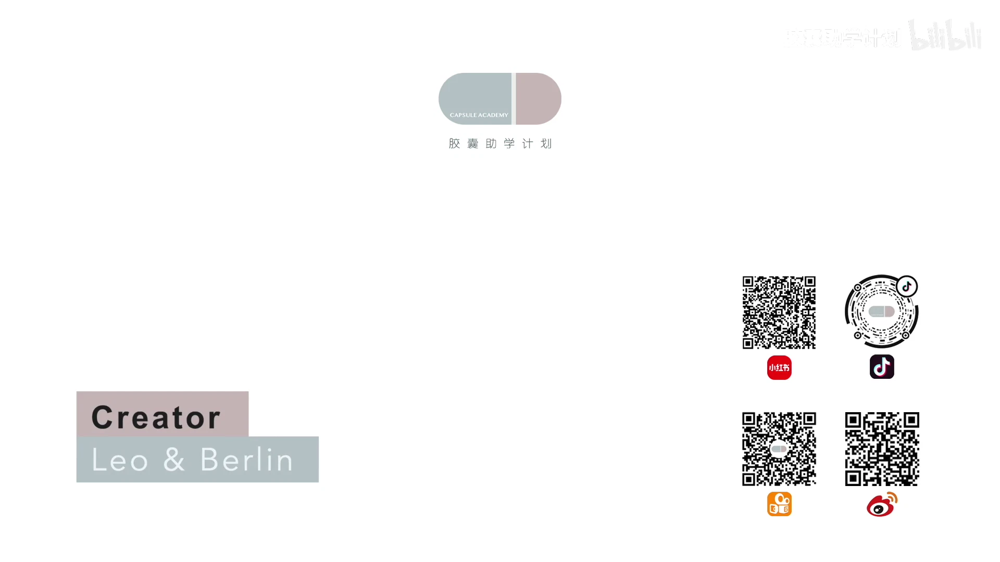

文字识别：CAPSULEACADEMY / 胶囊助学计划 / 小红书 / Creator / □ / Leo & Berlin / OE

### 画面 00:06:25

文字识别：bilibili / 胶囊助学计划

### 画面 00:06:26

文字识别：bilbili / 胶囊助学计划

