# 123 文章

快速机器解析：语音为单模型转写，未进行独立交叉校对或人工复核；画面每秒采样并按变化选帧，短时文字和标记可能遗漏。截图时间约有 1 秒误差。图片有损压缩；遇到疑点请按时间查看 Google Drive 原视频。

## 00:00:00–00:00:30

Hello everyone, welcome to Capsule Academy. This is Leo. Today we're going to learn New Concept English Book One, Lesson One Hundred and Twenty Three, Story. 那老习惯进入正式课程之前，我们先看一个问题：如何使用英文的感叹句？ Hope you gonna enjoy. 好，那我们直接进入文章啊。 第一个人 Mike 说说 Look Scott， 那我们就知道第二个人叫 Scott，对吧？说乔 Scott，

### 画面 00:00:00

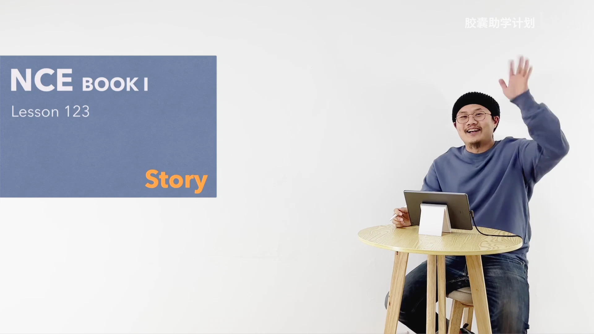

文字识别：NCE / BOOKI / Lesson 123 / Story

### 画面 00:00:02

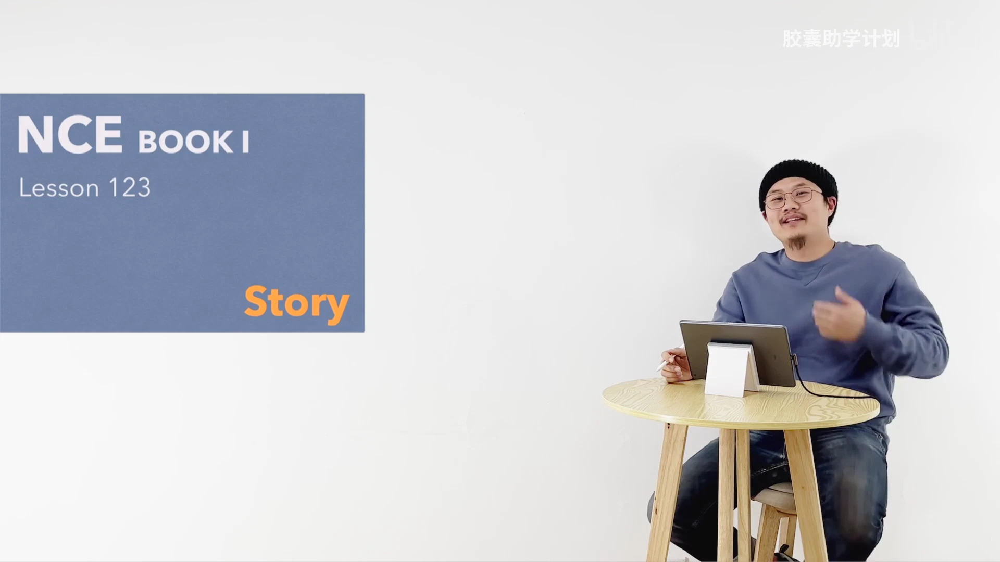

文字识别：NCE / BOOKI / Lesson 123 / Story

### 画面 00:00:10

文字识别：英文感叹句？

### 画面 00:00:12

文字识别：① 如何使用英文感叹句？

### 画面 00:00:17

文字识别：胶囊助学计划 blbl / •

### 画面 00:00:21

### 画面 00:00:23

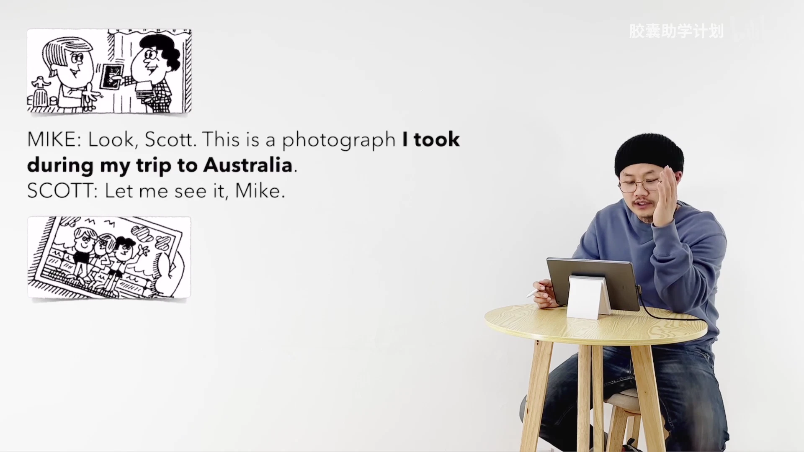

文字识别：MIKE: Look, Scott. This is a photograph Itook / during my trip to Australia. / SCOTT: Let me see it, Mike.

## 00:00:30–00:01:00

this is a photograph. 好，您设想一下啊，如果这是汉语，你会有一种什么感觉，对吧？您在我旁边，我拿着一张照片跟你说，您瞧，这是一张照片。我只说到这个地方，你是不是有一种想抽我的冲动？为什么呢？就这明显就是一张照片，对吧？就侮辱我的智商。但英文当中，因为它的定语从句放在了 photograph 的前面还是后面？后面，所以它翻译成汉

### 画面 00:00:41

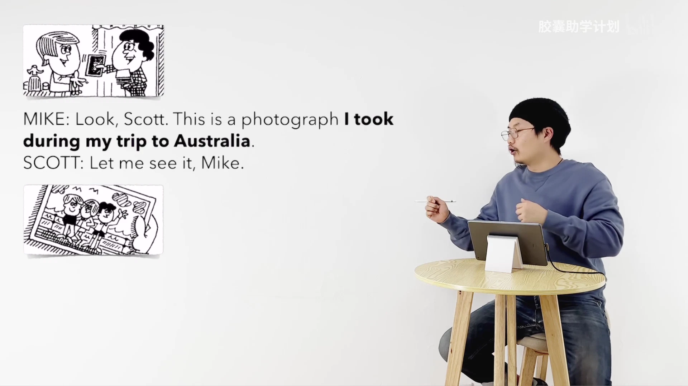

文字识别：MIKE: Look, Scott. This is a photograph Itook / during my trip to Australia. / SCOTT: Let me see it, Mike.

### 画面 00:00:45

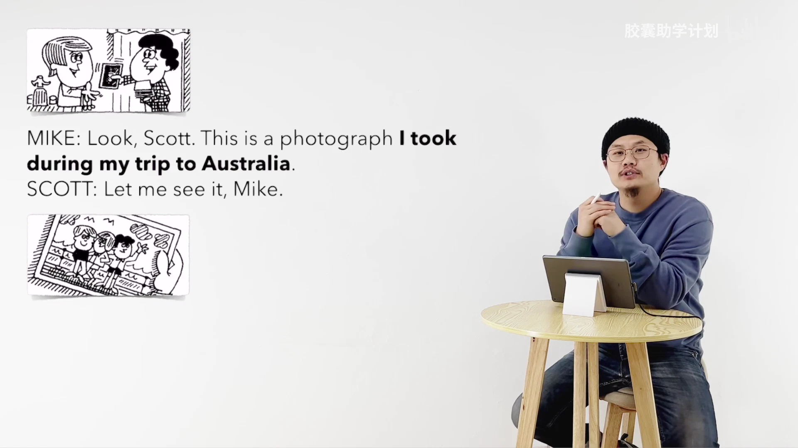

文字识别：MIKE: Look, Scott. This is a photograph Itook / during my trip to Australia. / SCOTT: Let me see it, Mike.

## 00:01:00–00:01:30

语的时候就会有这样一种感觉。我们中国人说话的时候说的是“说这是一张我在澳洲旅游期间拍摄的照片”，看见了吧？你就不会觉得怪。但是英文是“这是一张照片”，那你是不是会觉得很怪，对吧？就好比我给你指，我说各位啊，这是一个帽子，你是不是觉得很怪？这是你很小很小就知道的知识点，对吧？但如果我说“这是一个啊我在澳洲旅游期间购买的帽子”，哎，这句话就突然间好像听

### 画面 00:01:15

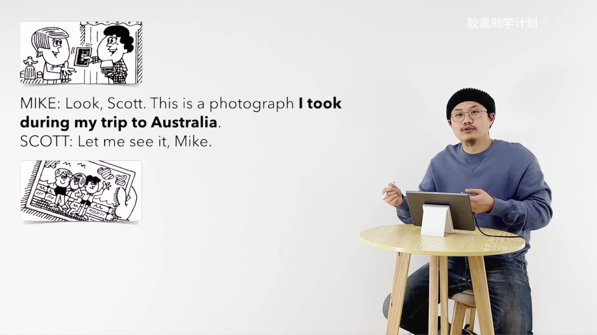

文字识别：MIKE: Look, Scott. This is a photograph Itook / during my trip to Australia. / SCOTT: Let me see it, Mike.

### 画面 00:01:18

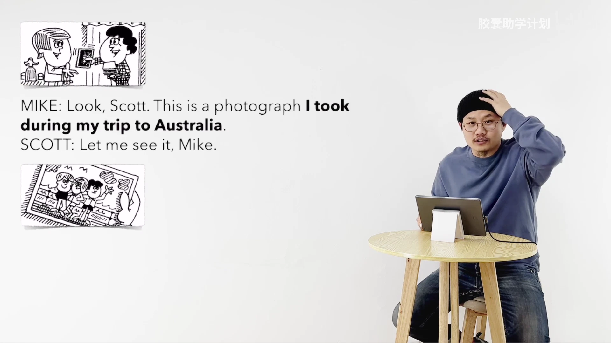

文字识别：MIKE: Look, Scott. This is a photograph Itook / during my trip to Australia. / SCOTT: Let me see it, Mike.

## 00:01:30–00:02:00

上去对劲儿了，是不是？好，那我们看后面，它跟了一句定语从句，叫做 I took during my trip to Australia。其实这句话当中，它省略了 which。为什么可以省略呢？原因是它在定语从句当中，其实它首先我们确定啊，它判断它替代的是前面的 photograph。其次，你看后边那句话 I took during my trip to Australia，缺的是宾语，也就是

### 画面 00:01:41

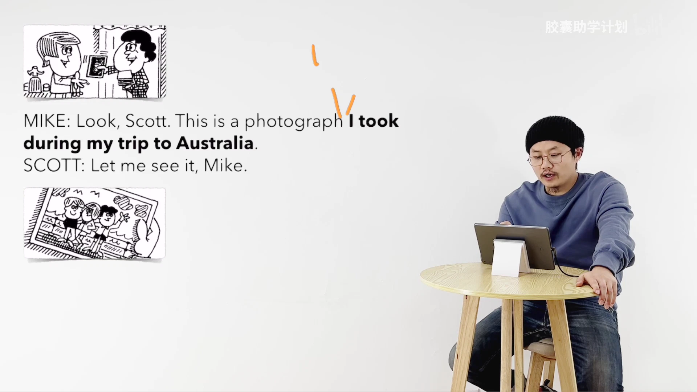

文字识别：MIKE: Look, Scott. This is a photograph ltook / during my trip to Australia. / SCOTT: Let me see it, Mike.

### 画面 00:01:43

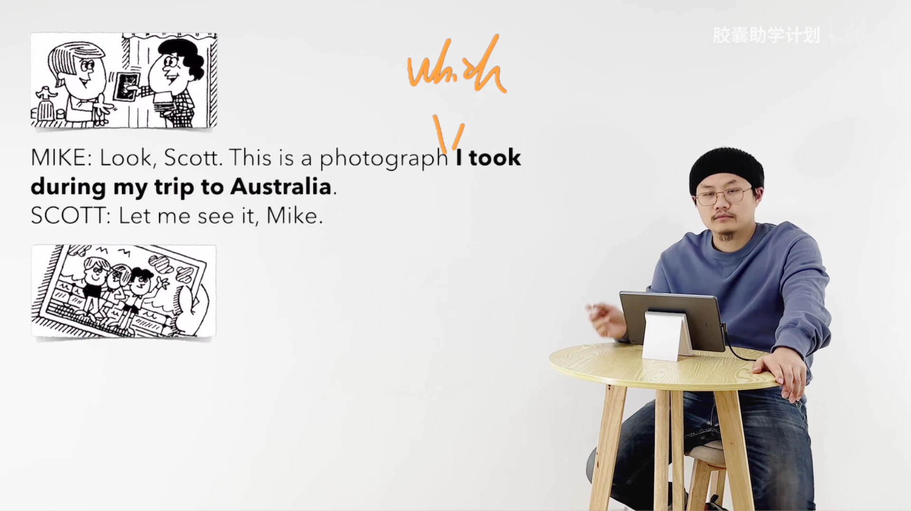

文字识别：wh.oh / MIKE: Look, Scott. This is a photograph ltook / during my trip to Australia. / SCOTT: Let me see it, Mike.

## 00:02:00–00:02:30

I took this photograph during my trip to Australia, 对吧？好，那 a photograph 被 which 替代了，又是宾语，它提到句首，但同时也可以把它省略掉。我们在一百二十一课、一百二十三课那个语法定语从句那那个视频当中，有给各位解释过，所以这儿的 which 就被省略掉了，对吧？OK，那这句定语从句，希望各位看懂了。说 Let me see it, 啊，让我看一下它。 Mike 没什么可讲的，继续说 This is

### 画面 00:02:00

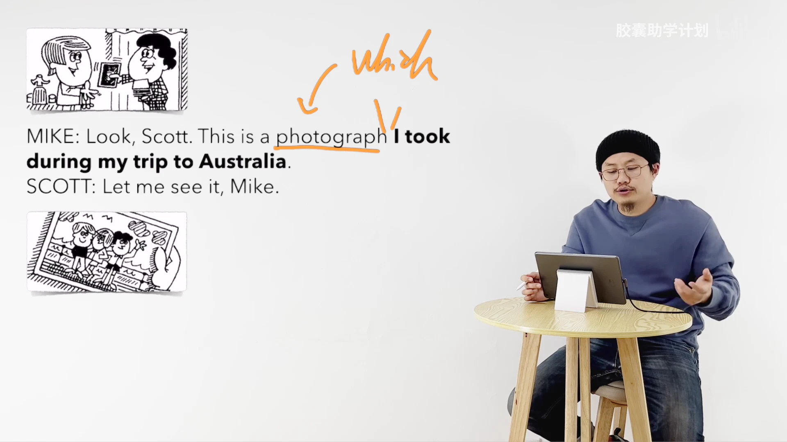

文字识别：wh.oh / MIKE: Look, Scott. This is a photograph I took / during my trip to Australia. / SCOTT: Let me see it, Mike.

### 画面 00:02:27

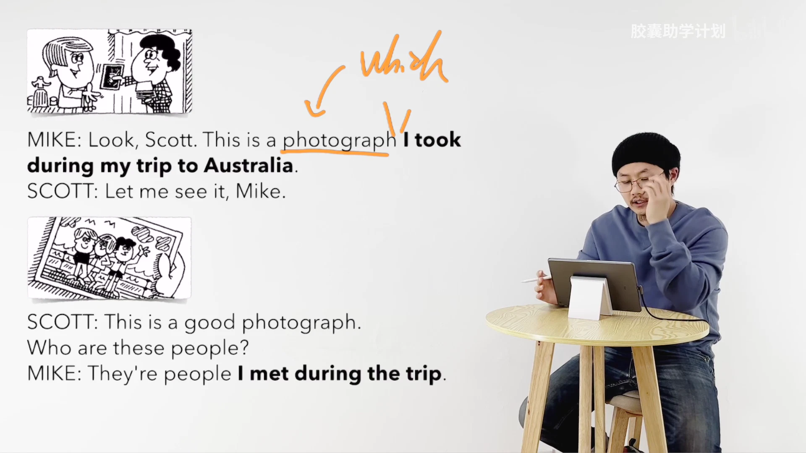

文字识别：whoh / MIKE: Look, Scott. This is a photographI took / during my trip to Australia. / SCOTT: Let me see it, Mike. / SCOTT: This is a good photograph. / Who are these people? / MIKE: They're people I met during the trip.

## 00:02:30–00:03:00

a good photograph.哎，这是一张不错的照片。Who are these people?这些人是谁？They are people.你看，如果他是汉语，你是不是又想偷人了？为什么？我说这是一张我们汉语对话。你设想一下啊，我跟您说，我说这是一张好照片儿。你问我说，呃，这些人是谁？啊，然后我跟你说，这些人是人啊，是不是就觉得很怪了？他后边一定是跟了一个定语从句。再说，这些人是巴拉巴拉巴拉巴

### 画面 00:02:57

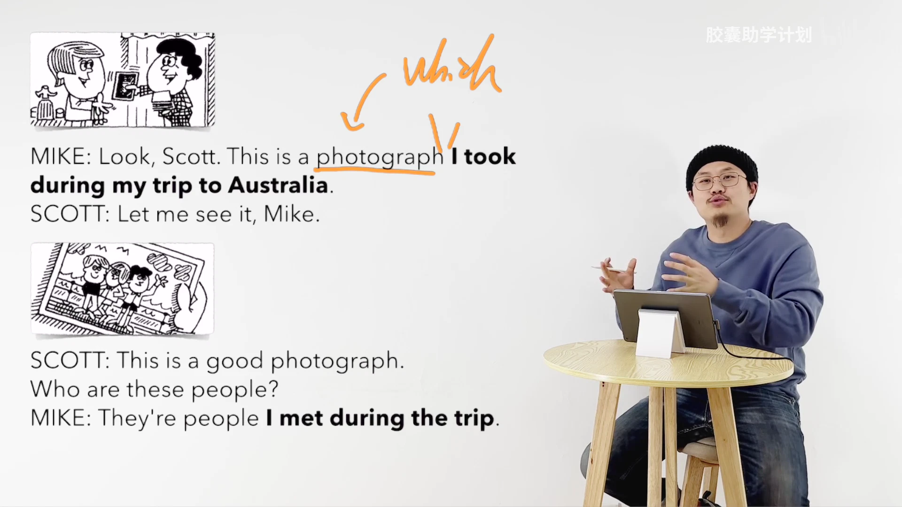

文字识别：whoh / MIKE: Look, Scott. This is a photograph I took / during my trip to Australia. / SCOTT: Let me see it, Mike. / SCOTT: This is a good photograph. / Who are these people? / MIKE: They're people I met during the trip.

## 00:03:00–00:03:30

什么样的人能理解哈？这是我们汉语的习惯，英语的习惯是放在 people 的后面定语从句，对不对？所以后面接了一个定语从句，叫 I met during the trip。我遇见的在旅行期间遇见的这些人，他们是我在旅行期间遇到的人，理解吧？其次呢，我们再看一下这个地方，其实省略了一个 who，这个 who 在底后边这句话当中，其实它是替代了宾语，对不对？

### 画面 00:03:01

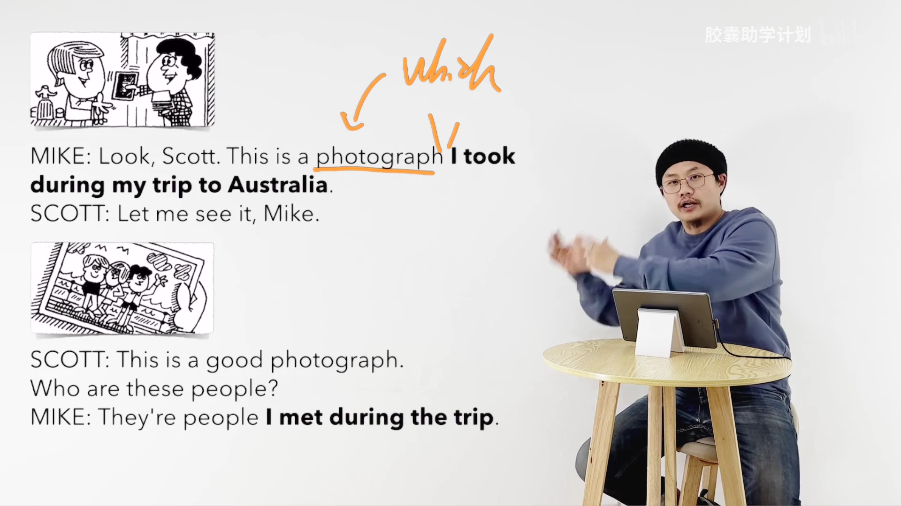

文字识别：wh.h / MIKE: Look, Scott. This is a photograph I took / during my trip to Australia. / SCOTT: Let me see it, Mike. / SCOTT: This is a good photograph. / Who are these people? / MIKE: They're people I met during the trip.

### 画面 00:03:07

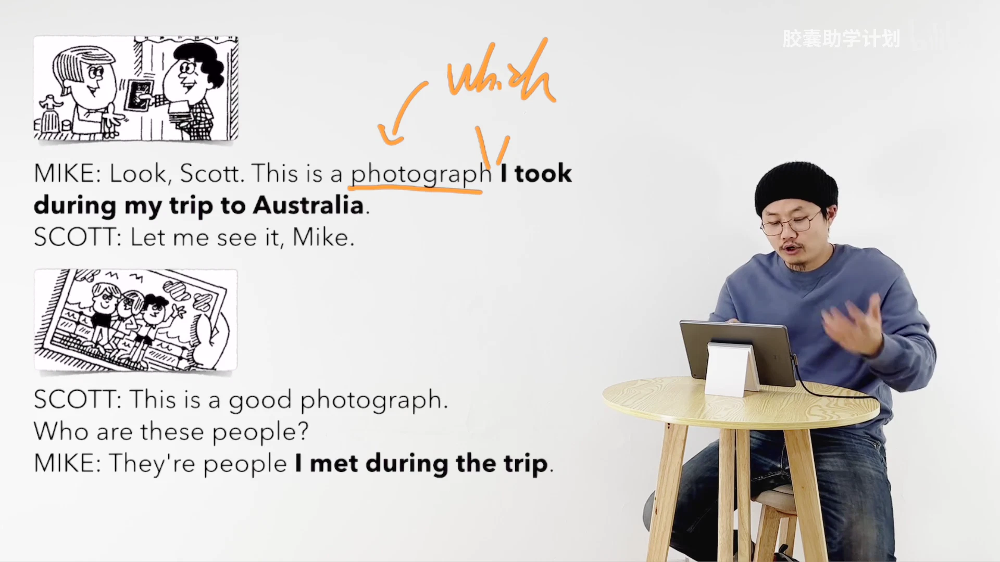

文字识别：whoh / MIKE: Look, Scott. This is a photograph I took / during my trip to Australia. / SCOTT: Let me see it, Mike. / SCOTT: This is a good photograph. / Who are these people? / MIKE: They're people I met during the trip.

### 画面 00:03:23

文字识别：whoh / MIKE: Look, Scott. This is a photograph I took / during my trip to Australia. / SCOTT: Let me see it, Mike. / SCOTT: This is a good photograph. / Who are these people? / MIKE: They're peoplAI met during the trip. / Wo

### 画面 00:03:26

文字识别：whoh / MIKE: Look, Scott. This is a photograph I took / during my trip to Australia. / SCOTT: Let me see it, Mike. / SCOTT: This is a good photograph. / Who are these people! / MIKE: They're peopl I met during the trip. / Wo

### 画面 00:03:29

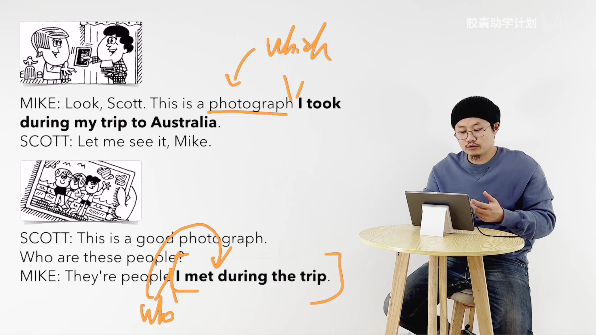

文字识别：whoh / MIKE: Look, Scott. This is a photograph I took / during my trip to Australia. / SCOTT: Let me see it, Mike. / SCOTT: This is a gooa photograph. / Who are these people! / MIKE: They're peopld I met during the trip.

## 00:03:30–00:04:00

I met them during the trip. Okay,玩一个，下一个说That's the ship.又拿了一张图片，上面有一张船床的船，对吧？然后给你讲说，你瞧，哎，那是一艘船，那是吧？又崩又崩溃了，是吧？好，后面又加了个定语从句，叫We traveled on啊，所以前面这个地方其实还是省略了一个which定语从句，叫Which we traveled on，给它还原回去，因为which替代的是前面的the

### 画面 00:03:33

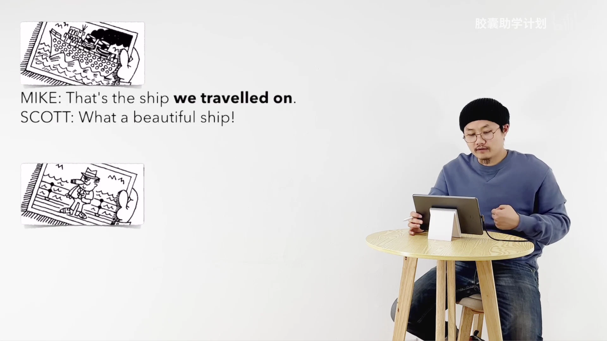

文字识别：MIKE: That's the ship we travelled on. / SCOTT: What a beautiful ship!

### 画面 00:03:47

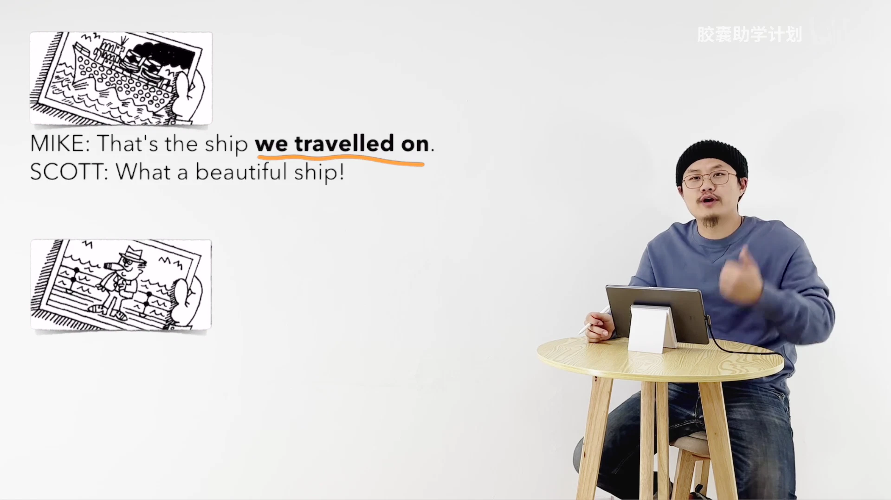

文字识别：MIKE: That's the ship we travelled on. / SCOTT: What a beautiful ship!

### 画面 00:03:51

文字识别：WhV / MIKE: That's the ship we travelled on. / SCOTT: What a beautiful ship!

### 画面 00:03:59

文字识别：Mhrh / MIKE: That's the ship we travelled on. / SCOTT: What a beautiful ship!

## 00:04:00–00:04:30

ship，所以这句话叫做 we traveled on the ship，好理解哈。Okay， what a beautiful ship！好，这句话你看就有点懵了。What 开头，然后后边是一个感叹号结尾，这个就是我们在开篇的时候啊，最开始的时候问过大家一个问题，叫英语的呃这个感叹句啊长成什么样子，就长成这个样子。怎么翻译呢？叫做多么美丽的一艘船呐！好

### 画面 00:04:29

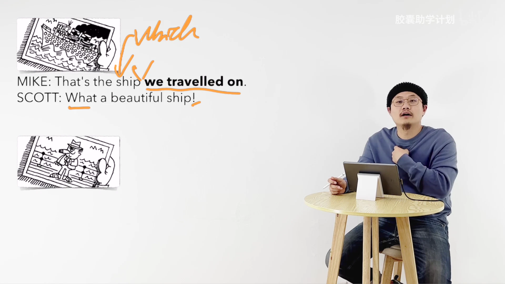

文字识别：Mhrh / MIKE: That's the /  ship we travelled on. / SCOTT: What a beautiful ship!

## 00:04:30–00:05:00

美丽的一艘船呐！哎，用英文读叫做 What a beautiful ship! OK, where you go? 好，那注意看一下它的这个句式啊。首先，what 开头，我告诉各位可以不变，a 那是由后边这个单词决定 a 还是 an，对不对？然后 beautiful 是一个形容词，ship 是一个名词，所以非常简单来说就是 what 加 a an 加形容词加名词。比如说这姑娘真高，怎么说？

### 画面 00:04:34

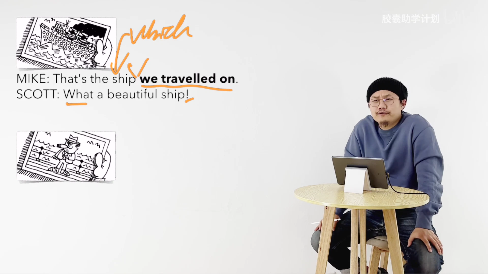

文字识别：Mhh / V/ / MIKE: That's the / ship we travelled on. / SCOTT: What a beautiful ship!

### 画面 00:04:38

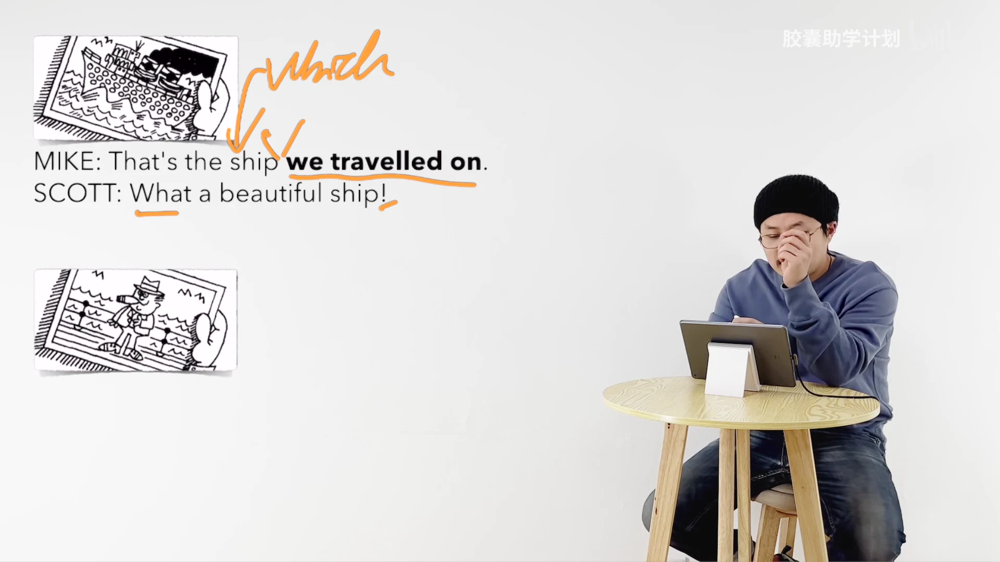

文字识别：Mhrh / V/ / MIKE: That's the / ship we travelled on. / SCOTT: What a beautiful ship!

### 画面 00:04:44

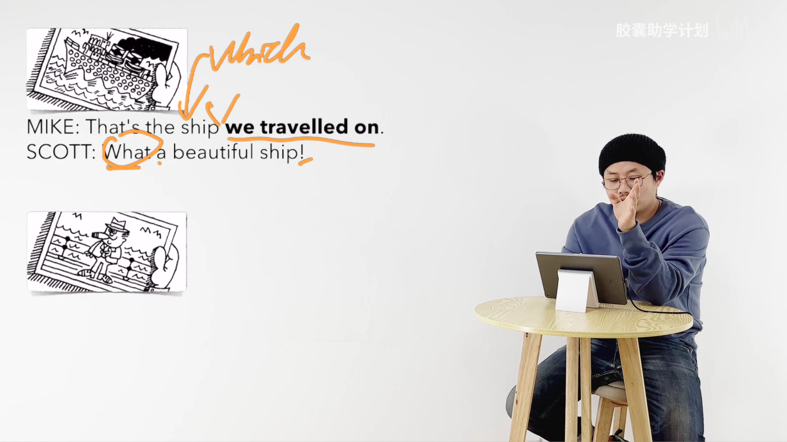

文字识别：Mhrh / V/ / MIKE: That's the / ship we / travelled on. / SCOTT: / Whata beautiful  / ship!

### 画面 00:04:50

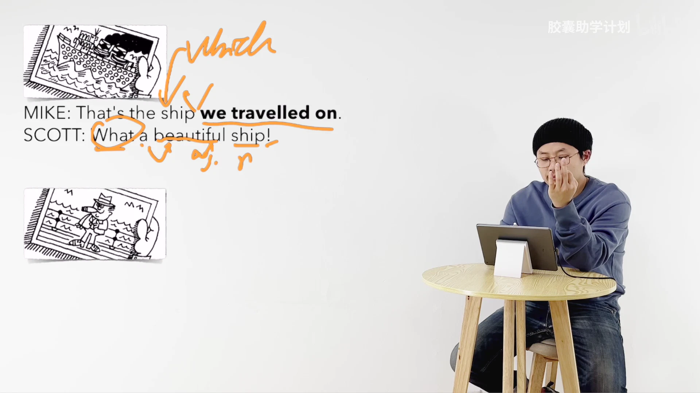

文字识别：Mhrh / V / MIKE: That's the / ship we / travelled on. / Whata / SCOTT: / ship!

## 00:05:00–00:05:30

What a，真高 tall girl. What a tall girl, 对吧？Okay, 啊，说他好有钱呢。What a rich man. Okay, 一会儿我们再做练习啊。现在先给大家在这讲清楚。接下来又问了，说 Who's this? 说这是谁呀？That's the man. 说这是一个男人啊。你是不是又怪了？就觉得对吧？我这还看不出来是个男的吗？Okay, I told you about. 所以这

### 画面 00:05:15

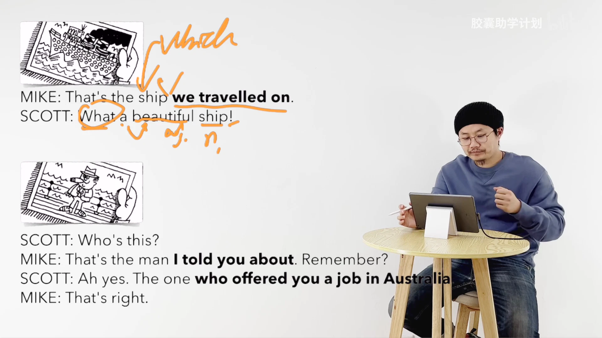

文字识别：Mhh / MIKE: That's the ship we travelled on. / Whata beautifuls / SCOTT: / ship! / . / n / SCOTT: Who's this? / MIKE: That's the man Itold you about. Remember? / SCOTT: Ah yes. The one who offered you a job in Australia / MIKE: That's right.

### 画面 00:05:21

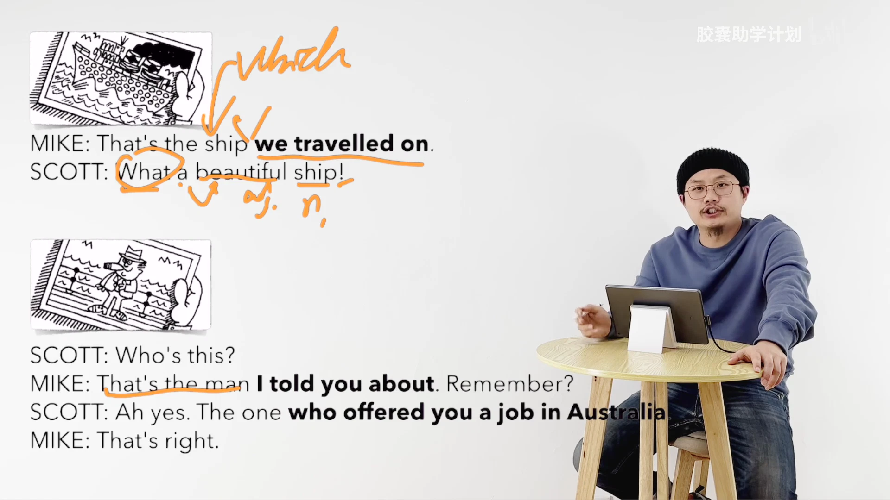

文字识别：Mhh / MIKE: That's the / ship we t / travelled on. / Whatah / SCOTT: / beautiful / ship! / y / n / SCOTT: Who's this? / MIKE: That's the man Itold you about. Remember? / SCOTT: Ah yes. The one who offered you a job in Australia / MIKE: That's right.

## 00:05:30–00:06:00

a who. Then I want to ask a question. You can answer me in the video below. Here, can we use whom, that is, add an am? Can we? Okay, good. Uh, I told you about, right? He who because he replaced the object, so he uh directly omitted. Say this is the person I told you about. Remember, is it remembered? Yes, I remember. The one is such a person. What kind of person? Who offered you a

### 画面 00:05:30

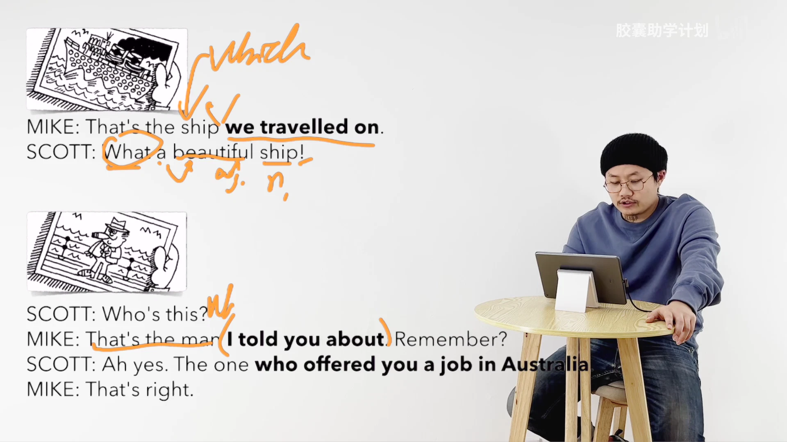

文字识别：Mhrh / MIKE: That's the / ship we / travelled on. / Whatal / SCOTT: / ship! / n / SCOTT: Who's this? / I you about Remember? / MIKE: That's the marI told / SCOTT: Ah yes. The one / whoc / offered you a job in Australia / MIKE: That's right.

### 画面 00:05:53

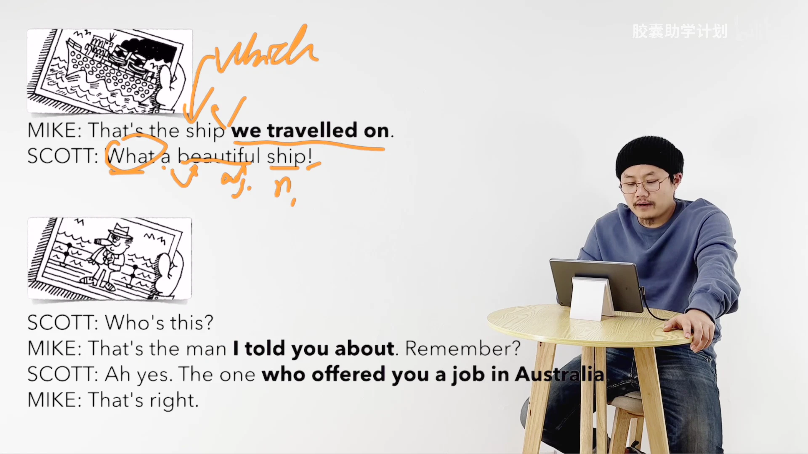

文字识别：Mhrh / MIKE: That's the ship we travelled on. / Whata beautifuls / SCOTT: / ship! / n / SCOTT: Who's this? / MIKE: That's the man Itold you about. Remember? / SCOTT: Ah yes. The one who offered you a job in Australia / MIKE: That's right.

### 画面 00:05:59

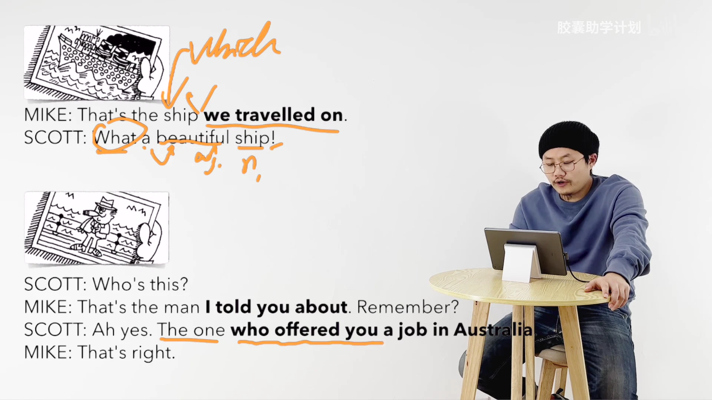

文字识别：Mhrh / MIKE: That's the / ship we t / travelled on. / SCOTT: / Whata h / beautiful / ship! / n / SCOTT: Who's this? / MIKE: That's the man I told / I you about. Remember? / SCOTT: Ah yes. The one who offered you a job in Australila / MIKE: That's right.

## 00:06:00–00:06:30

a job in Australia?其实the one就是he对吧？就是the man就是he就是he offered you a job in Australia. Okay,就是他在澳洲给你提供了一份工作啊。他说That's right,没问题。哎，你说的是对的。Okay,那接下来我们先看一下感叹句啊，很简单。比如说我们两个人对话，一个人说It's a beautiful ship, isn't it?另一个人回答说What a beautiful ship!好，首先It's a beautiful ship, isn't

### 画面 00:06:01

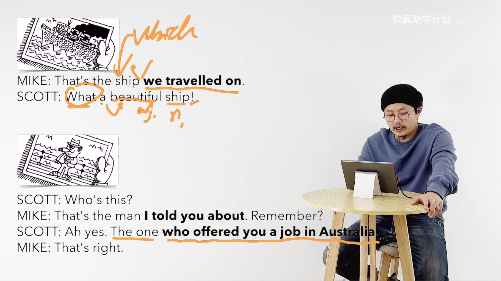

文字识别：Mhrh / MIKE: That's the / ship we t / travelled on. / Whata beautiful / SCOTT: / ship! / n / SCOTT: Who's this? / MIKE: That's the man Itold you about. Remember? / SCOTT: Ah yes. The one who offered you a job in Australia / MIKE: That's right.

### 画面 00:06:05

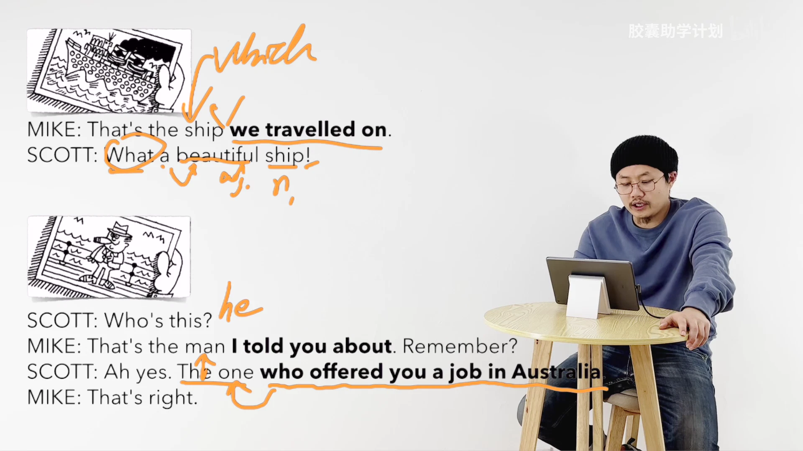

文字识别：Mhh / MIKE: That's the / shipwe / travelled on. / SCOTT: / ship! / n / he / SCOTT: Who's this? / MIKE: That's the man I told / you about. Remember? / SCOTT: Ah yes. ThE one who o / offered you a job in Australia / MIKE: That's right.

### 画面 00:06:08

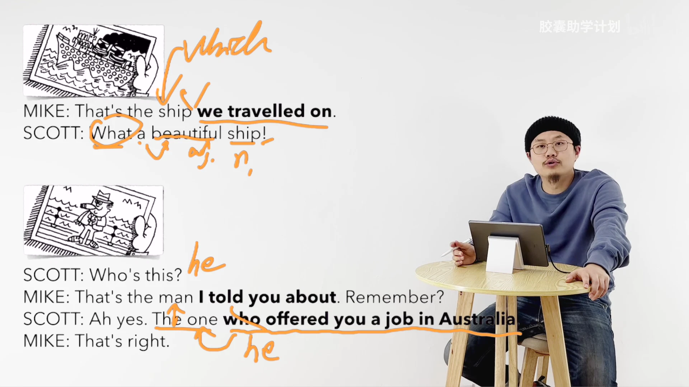

文字识别：Mhrh / MIKE: That's the / shipwe / travelled on. / SCOTT: / ship! / n / he / SCOTT: Who's this? / MIKE: That's the man I told / I you about. Remember? / SCOTT: Ah yes. Th≥ one Who offered you a job in Australia / Che / MIKE: That's right.

### 画面 00:06:15

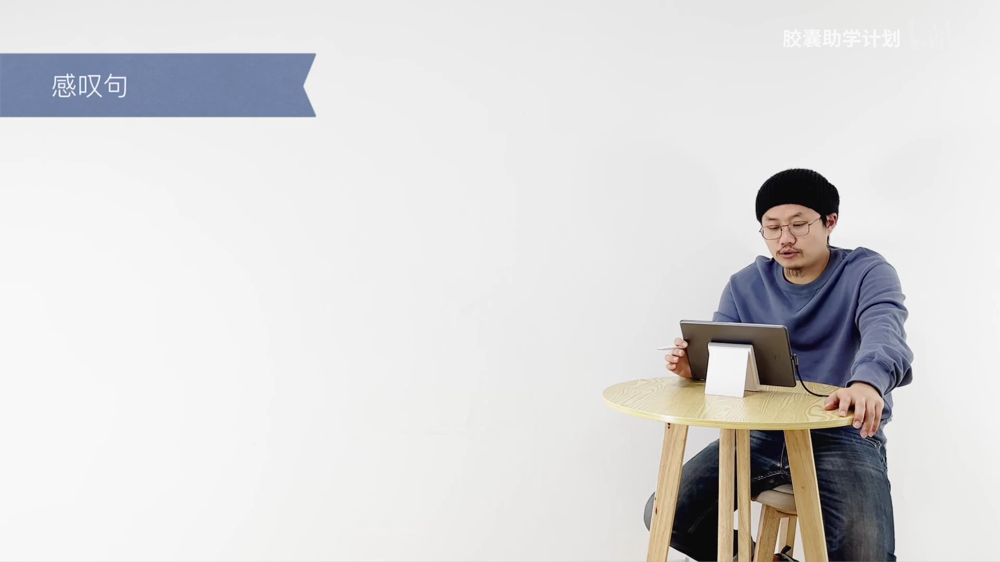

文字识别：感叹句

## 00:06:30–00:07:00

it? 这是我们管它叫反义疑问句，之前学过的一个语法。今天新学的语法是 what 加 a an 加形容词加名词，对吧？加形容词加名词这样的一个感叹句啊。接下来各位可以做的事情是把底下我给各位标上的这些东西往里去替代。比如说，我们说 terrible film，怎么办呢？ Terrible 很烂的，很糟糕的 film 叫电影。我们先带进去这两句话啊。

### 画面 00:06:35

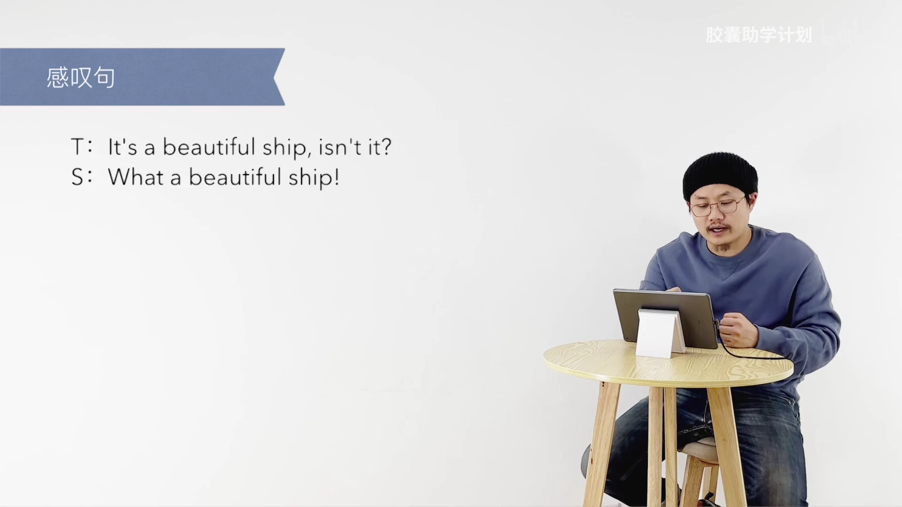

文字识别：感叹句 / T: It's a beautiful ship, isn't it? / S:What a beautiful ship!

### 画面 00:06:39

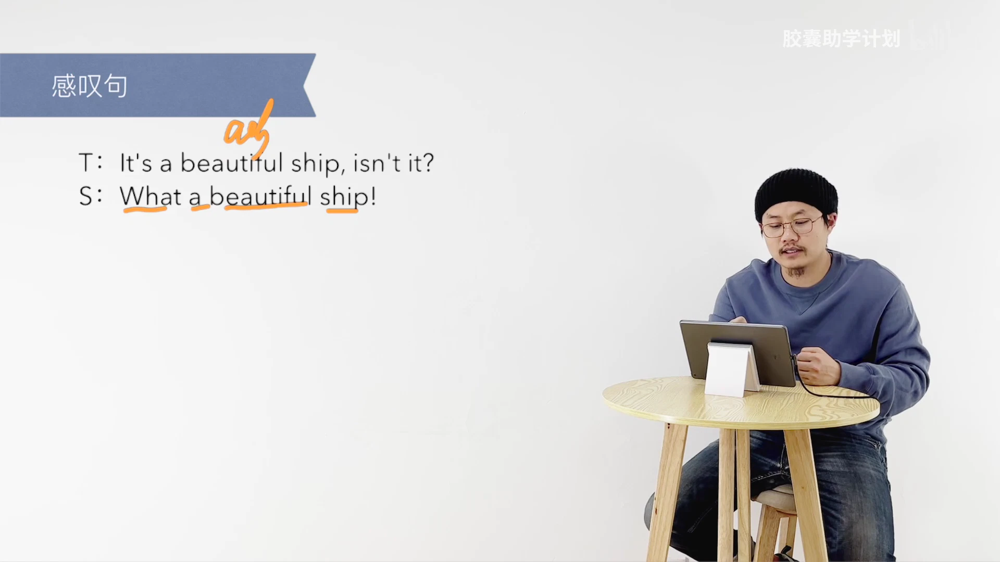

文字识别：感叹句 / T: It's a beautiful ship, isn't it? / S：What abeautiful / ship!

### 画面 00:06:46

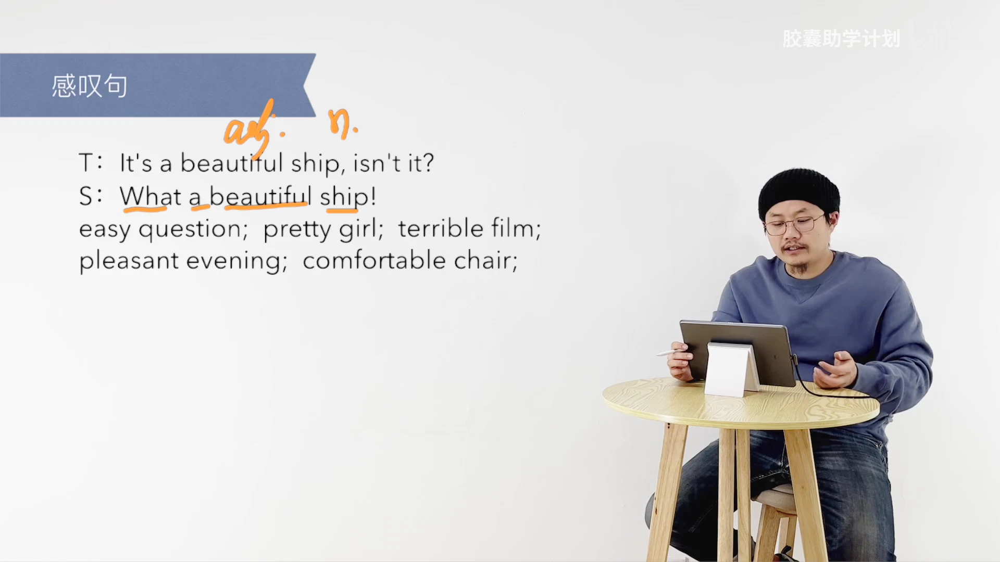

文字识别：感叹句 / ay / n / T:lt'sa / beautiful / ship, isn't it? / S: / What / abeautiful / ship! / easy / question; / pretty / girl; / terrible / film; / pleasant e / evening; / comfortable / chair;

### 画面 00:06:48

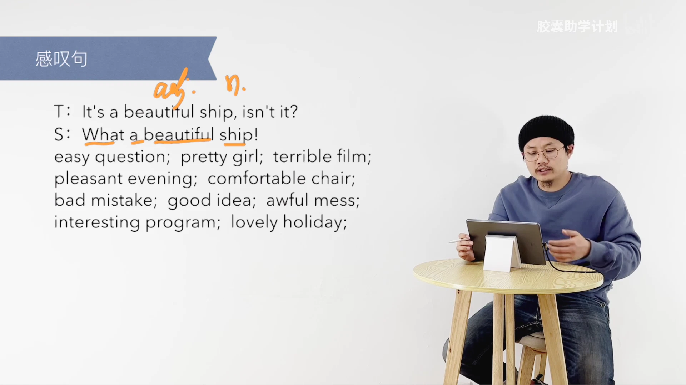

文字识别：感叹句 / ay / T:It's a beautiful / ship, isn't it? / S：What abeautiful / ship! / easy / question; / pretty / girl; / terrible / film; / pleasant evening; c / comfortable / chair; / bad mistake; good idea; awful / mess; / interesting program; lovely holiday;

### 画面 00:06:52

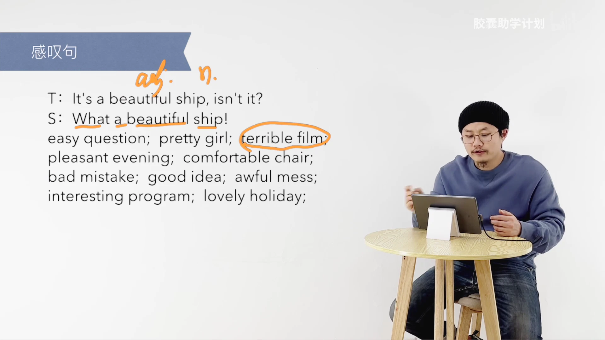

文字识别：感叹句 / ay / n / T:lt'sa / beautiful / ship, isn't it? / S:What / abeautiful / ship! / easy / question; / pretty / girl; / terrible / film: / pleasant e / evening; / comfortable / chair; / bad / mistake;good idea; awful / mess; / interesting program; lovely holiday;

## 00:07:00–00:07:30

第一句话叫做 "Is a terrible film, isn't it?" 然后第二个人说 "What a terrible film!" 就是这个电影真烂。OK，那比如说我们再换一个 easy question，叫做 "Is an easy question, isn't it?" 对吧？What an easy question! 为什么用 an？各位自己去想一下，好不好？好，那这个呢就是今天各位的家庭作业

### 画面 00:07:13

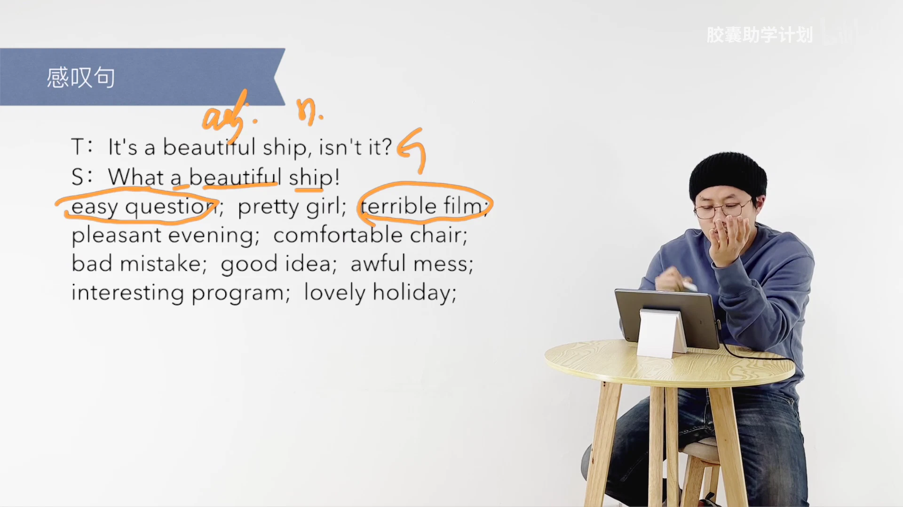

文字识别：感叹句 / ay / n / T:lt's a beautiful / ship, isn't it? / S:What  / abeautiful / ship! / easy / questior; / pretty / girl; / terrible / film: / pleasant / evening; / comfortable / chair; / bad / I mistake;good idea; awful / mess; / interesting program; lovely holiday;

### 画面 00:07:28

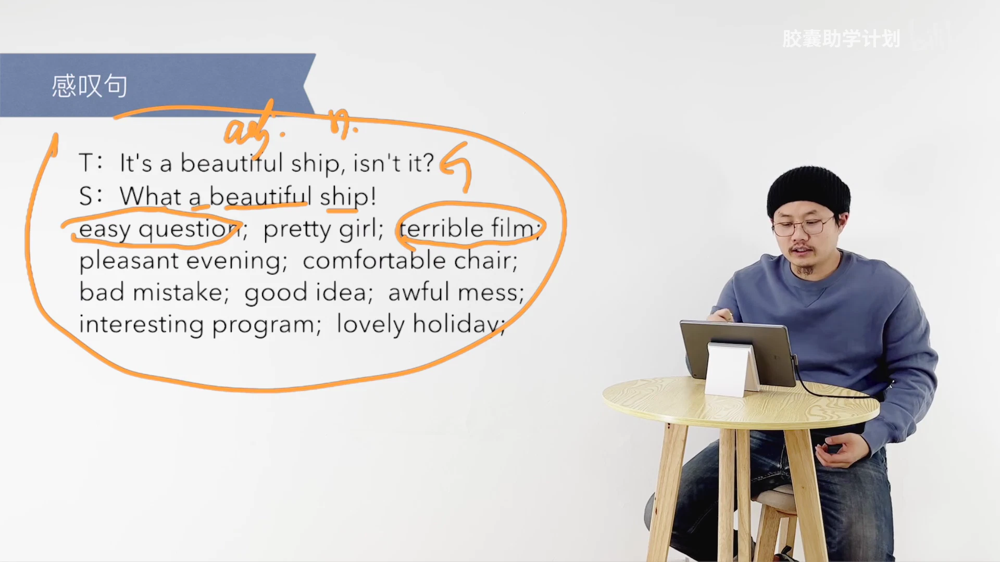

文字识别：感叹句 / n. / a / - / T:It'sa / beautiful / ship, isn't it? / S： / What / abeautiful / ship! / easy / questior; / pretty / girl; / terrible / film: / pleasant / evening; / comfortable / chair; / bad / mistake;good idea; / awful / mess; / interesting / program; lovely h / holiday;

## 00:07:30–00:08:00

之一，您要把底下的这些带上去，反复多练几个，好吧？那我相信您练完这些感叹句，您就肯定会了，至少记下来了。OK，好，接下来我们再看一个小的电影片段中啊，这个电影片段中出现了 What a beautiful home，叫你们家真漂亮。来，我们一起看。 Nick, what a beautiful

### 画面 00:07:32

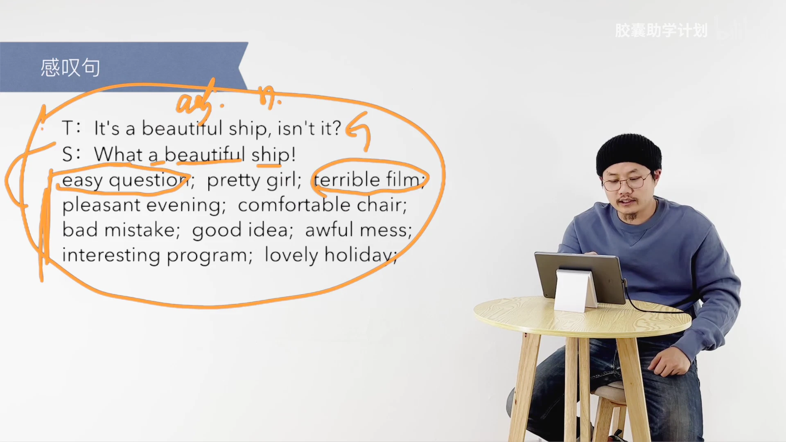

文字识别：感叹句 / au / T: It'sa / beautiful / ship, isn't it? / S: / What / abeautiful / ship! / easy / questior; / pretty / girl; / terrible / film: / pleasant / evening; / comfortable / chair; / bad / mistake;good idea; / awful / mess; / interesting / program; lovely h / holiday

### 画面 00:07:41

文字识别：BEN AFFLECK ROSAMUND / GONE / GIRL / What a beautiful home! / 消失的爱人 Gone Girl (2014)

### 画面 00:07:52

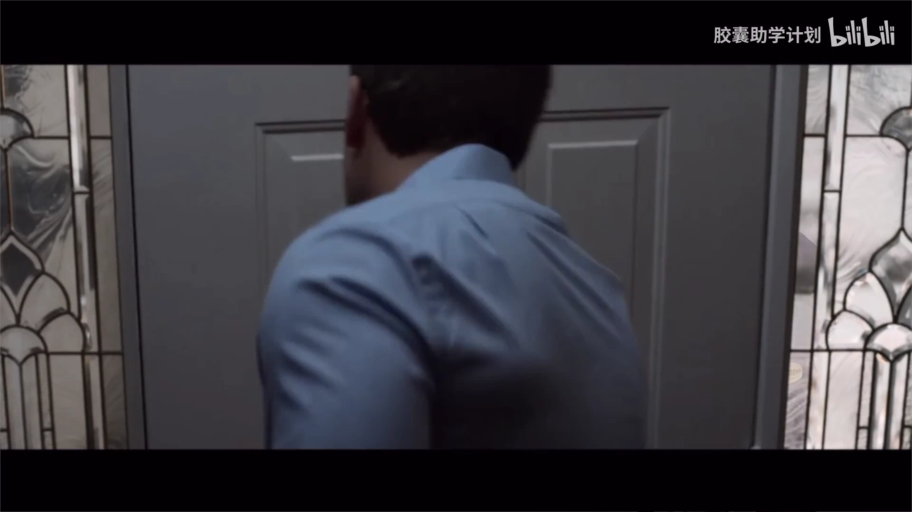

文字识别：biibili / 胶囊助学计划

### 画面 00:07:54

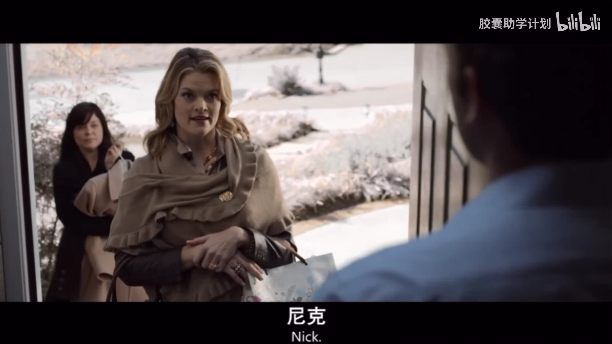

文字识别：Bilbii / 胶囊助学计划 / 尼克 / Nick.

### 画面 00:07:56

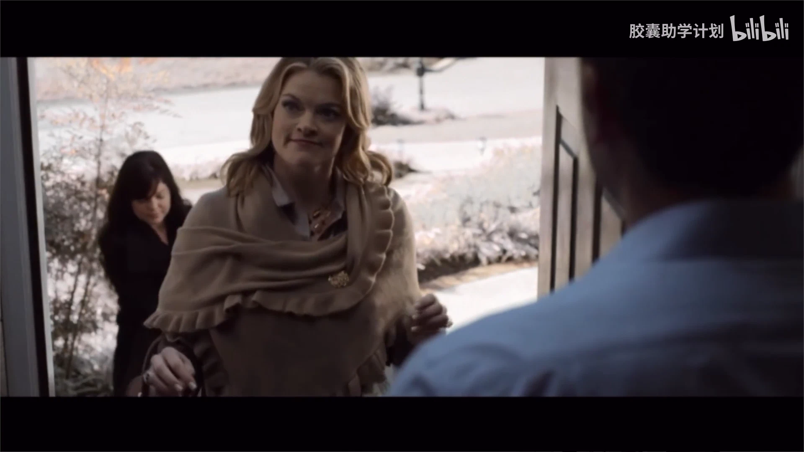

文字识别：Bilbii / 胶囊助学计划

### 画面 00:07:58

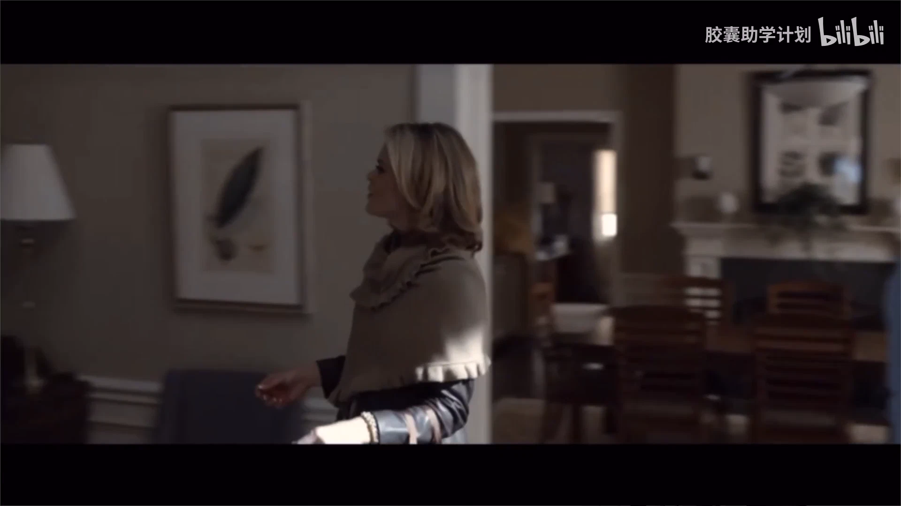

文字识别：biibili / 胶囊助学计划

## 00:08:00–00:08:30

home! I so appreciate you giving us this time, Nick. Okay, very good.啊，很简单就夸说What a beautiful home!啊，真漂亮的家。Very good.啊，接下来我们继续看文章说Who's this?就是这是谁啊？Guess猜一下吧。It's not you, is it?不是你对吧？不能是你吧？That's right.哎，就是我啊。Continue说I grew a beard.啊，如果我留了胡子，during the trip，在这个

### 画面 00:08:00

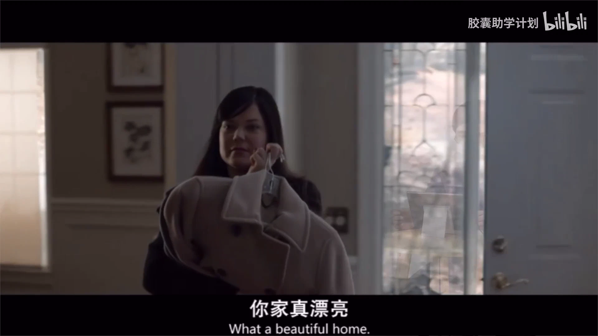

文字识别：bilibili / 胶囊助学计划 / 你家真漂亮 / What a beautiful home.

### 画面 00:08:02

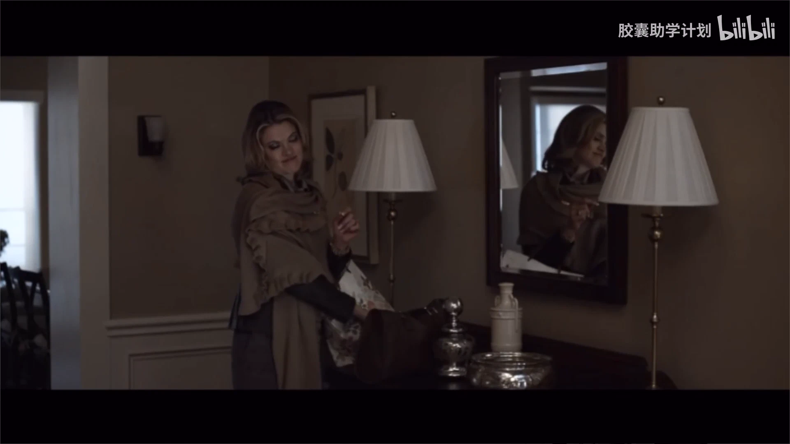

文字识别：Biibili / 胶囊助学计划

### 画面 00:08:04

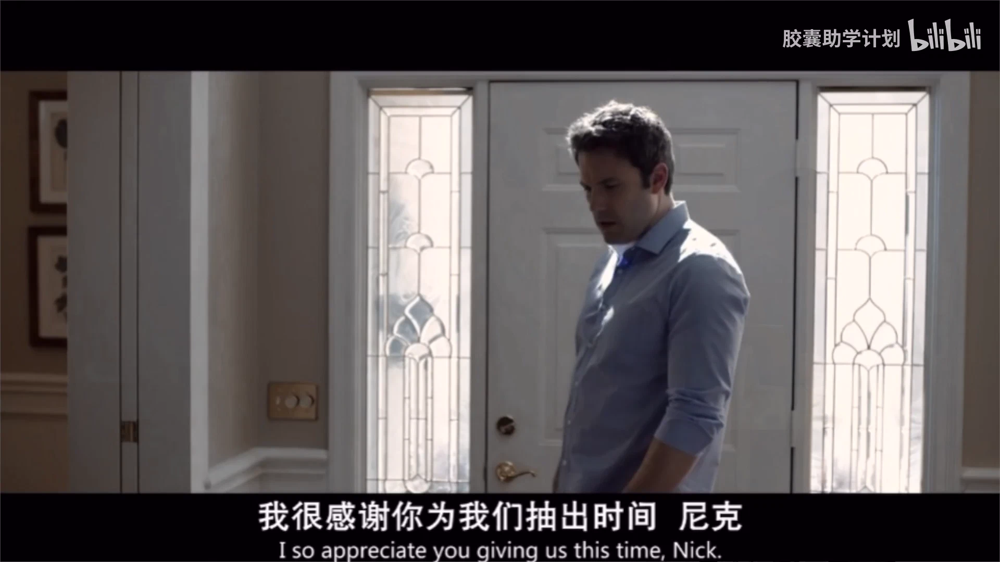

文字识别：bilibli / 胶囊助学计划 / 我很感谢你为我们抽出时间尼克 / I so appreciate you giving us this time, Nick.

### 画面 00:08:06

文字识别：BEN AFFLECK ROSAMUND / GONE / GIRL / What a beautiful home! / 消失的爱人 Gone Girl(2014)

### 画面 00:08:11

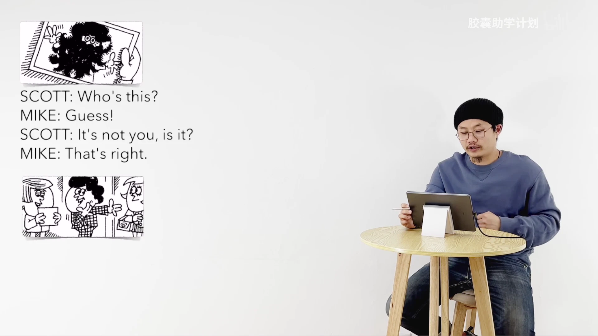

文字识别：100 / SCOTT: Who's this? / MIKE: Guess! / SCOTT: It's not you, is it? / MIKE: That's right.

### 画面 00:08:24

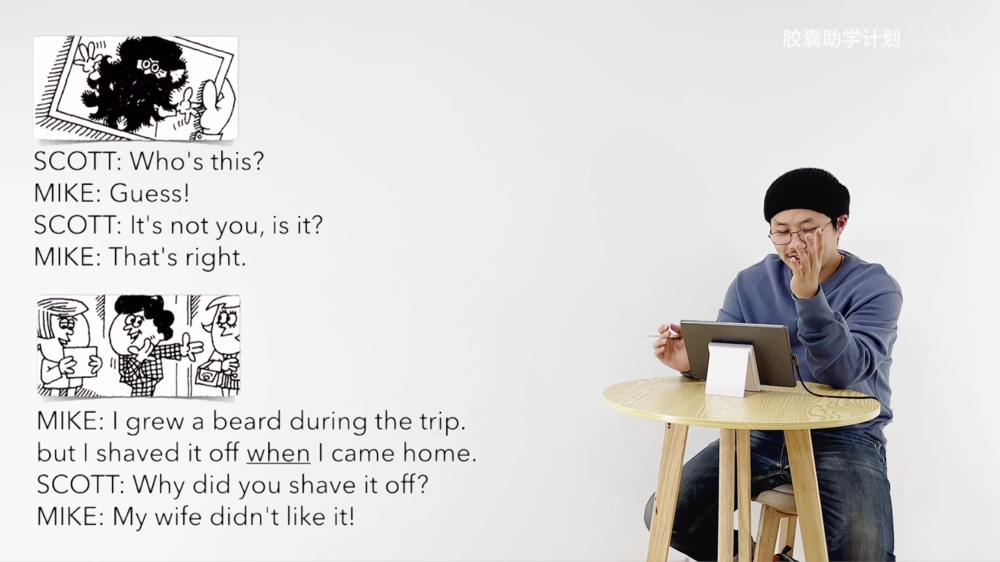

文字识别：SCOTT: Who's this? / MIKE: Guess! / SCOTT: It's not you, is it? / MIKE: That's right. / MIKE: I grew a beard during the trip. / but I shaved it off when I came home. / SCOTT: Why did you shave it off? / MIKE: My wife didn't like it!

## 00:08:30–00:09:00

旅行期间，but I shaved it off，但是我把它刮下来了。When I came home，当我回家的时候，Scott问了一个问题，说 Why did you shave it off？啊，你为什么把它给刮下来了呢？My wife didn't like it，说我媳妇儿啊，我老婆不喜欢它。OK，二一个。那文章讲完了之后呢，接下来我们做一些小的听力口语练习，我问您答，可以看文章啊。来了，第一题，

### 画面 00:08:51

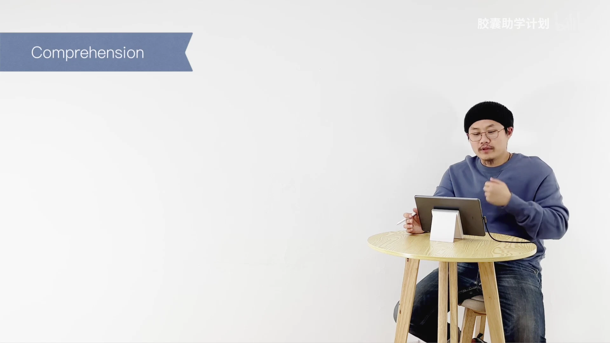

文字识别：Comprehension

## 00:09:00–00:09:30

What photographs were these? They were the ones Mike took during his trip to Australia. Next one. Who did Scott ask about? He asked about some people Mike met during the trip. Next one. What was in the next photograph?

### 画面 00:09:05

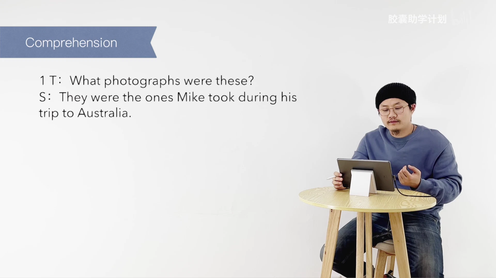

文字识别：Comprehension / 1 T: What photographs were these? / S: They were the ones Mike took during his / trip to Australia.

### 画面 00:09:12

文字识别：Comprehension

### 画面 00:09:18

文字识别：Comprehension / 2 T: Whom did Scott ask about? / S: He asked about some people Mike met / during the trip.

### 画面 00:09:25

文字识别：Comprehension / 3 T: What was in the next photograph?

## 00:09:30–00:10:00

It was the ship Mike traveled on. Next one. Who was the man Mike had told Scott about? He was the one who offered Mike a job in Australia. Next one. Who was the man with the beard? It was Mike. Next one.

### 画面 00:09:37

文字识别：Comprehension / 4 T: Who was the man Mike had told Scott about?

### 画面 00:09:44

文字识别：Comprehension / 4 T: Who was the man Mike had told Scott about? / S: He was the one who offered Mike a job in Australia.

### 画面 00:09:51

文字识别：Comprehension / 5 T: Who was the man with the beard?

## 00:10:00–00:10:30

why had he shaved it off when he came home? Because his wife didn't like it. Very good. Asking questions,肯定句，一般疑问句和特殊疑问句啊来了。第一题，Ask me if Mike took this photograph. Took一般过去式，did提前，Did Mike take this photograph? Next one, when啊整句话，When did Mike take this

### 画面 00:10:05

文字识别：Comprehension / 6 T: Why had he shaved it off when he came home? / S: Because his wife didn't like it.

### 画面 00:10:09

文字识别：Asking questions

### 画面 00:10:16

文字识别：Asking questions / 1 T: Ask me if Mike took this photograph.

### 画面 00:10:21

文字识别：Asking questions / 1 T: Ask me if Mike took this photograph. / S: Did Mike take this photograph?

## 00:10:30–00:11:00

photograph? Next one, ask me if Mike met these people during the trip. Did Mike meet these people during the trip? Who, who did Mike meet during the trip? 关于 whom 我们在语法那课已经讲过了，对吧？各位不用管他，见到能懂就行了。您自己可以永远不用，没有任何问题啊。 Next one, 啊，你能见到他的几率也

### 画面 00:10:31

文字识别：Asking questions / 2 T: Ask me if Mike met these people during the trip.

### 画面 00:10:43

文字识别：Asking questions / 2 T: Ask me if Mike met these people during the trip. / S: Did Mike meet these people during the trip? / T:Who(m)...? / S: Who(or Whom)did Mike meet during the trip?

### 画面 00:10:58

文字识别：Asking questions / 3 T: Ask me if he travelled on a beautiful ship.

## 00:11:00–00:11:30

会非常非常的低. Next one. Ask me if he traveled on a beautiful ship. Did he travel on a beautiful ship? What kind of, what kind of ship did he travel on? Next one. Ask me if the man offered him a job in Australia.一般过去时. Did the man offer him a job in Australia? Who, who offered him a job in

### 画面 00:11:11

文字识别：Asking questions / 3 T: Ask me if he travelled on a beautiful ship. / S: Did he travel on a beautiful ship? / T: What kind of...? / S: What kind of ship did he travel on?

### 画面 00:11:16

文字识别：Asking questions / 4T : Ask me if the man offered him a job in Australia.

### 画面 00:11:27

文字识别：Asking questions / 4T: Ask me if the man offered him a job in Australia. / S: Did the man offer him a job in Australia? / T: Who...? / S: Who offered him a job in Australia?

## 00:11:30–00:12:00

Australia.注意，who可以对the man提问，也可以对him提问，区别是是否变一般疑问句啊。Next one, ask me if he shaved off his beard. Did he shave off his beard? Why? Why did he shave off his beard? Very good.那recap本课我们重点第一先复习了一下啊，又再次见到了定语从句，只不过

### 画面 00:11:38

文字识别：Asking questions / 5 T: Ask me if he shaved off his beard.

### 画面 00:11:47

文字识别：Asking questions / 5 T: Ask me if he shaved off his beard. / S: Did he shave off his beard? / T：Why...? / S: Why did he shave off his beard?

### 画面 00:11:52

文字识别：Recap / Patterns / 定语从句 / 感叹句 / Grammar / Words / Expression

## 00:12:00–00:12:30

本课都是把那些连词给它省略掉了，引导词对吧？然后我们又新学会了一个小的语法，叫做英语的感叹句啊。那我们看一下家庭作业，绿皮书幺二三可以写了。文章老习惯跟读制，熟读成诵，一定要去练习感叹句。怎么练呢？各位，我专门给各位做了那一页练习，各位记得啊，然后把它带进去练一下，好吧？然后呢，给自己讲解一遍今天的核心知识点。如果大家喜欢

### 画面 00:12:10

文字识别：绿皮书第123课的写作练习

### 画面 00:12:28

## 00:12:30–00:13:00

我们的课程呢，欢迎大家关注、订阅、一键三连，分享给那些需要的朋友啊，来帮助我们快速成长。最后，我们再来看一句名人名言。I guess real maturity, which most of us never achieve, is when you realize that you're not the center of the universe. See you next time.

### 画面 00:12:35

文字识别：VITVO / I guess real maturity, which most of us / never achieve, is when you realize that / you're not the center of the universe. / Ellie Goulding

### 画面 00:12:43

文字识别：NTTNO / I guess real maturity, which most of us / never achieve, is when you realize that / you're not the center of the universe. / Ellie Goulding

### 画面 00:12:51

### 画面 00:12:53

文字识别：CAPSULEACADEMY / 胶囊助学计划 / 小红书 / Lecturer / Leo / OE

### 画面 00:12:55

文字识别：CAPSULEACADEMY / 胶囊助学计划 / 小红书 / Photographer / □ / Berlin / OE

### 画面 00:12:57

文字识别：CAPSULEACADEMY / 胶囊助学计划 / 小红书 / Editor / □ / Berlin / OE

## 00:13:00–00:13:03

### 画面 00:13:00

文字识别：CAPSULEACADEMY / 胶囊助学计划 / 小红书

### 画面 00:13:02

文字识别：bilibili / 胶囊助学计划

### 画面 00:13:03

文字识别：bilibili / 胶囊助学计划

