# 123 单词

快速机器解析：语音为单模型转写，未进行独立交叉校对或人工复核；画面每秒采样并按变化选帧，短时文字和标记可能遗漏。截图时间约有 1 秒误差。图片有损压缩；遇到疑点请按时间查看 Google Drive 原视频。

## 00:00:00–00:00:30

Hello everyone, welcome to Capsule Academy. This is Leo. Today we're going to learn New Concept English Book One, Lesson One Hundred and Twenty Three Words. Hope you gonna enjoy it.好，那我们先看啊，两个单词放在一起。第一个单词叫做 during, during. Okay, during 叫在什么什么期间啊？它往往跟时间连用。后面呢，这个单词我们管它叫 trip,

### 画面 00:00:00

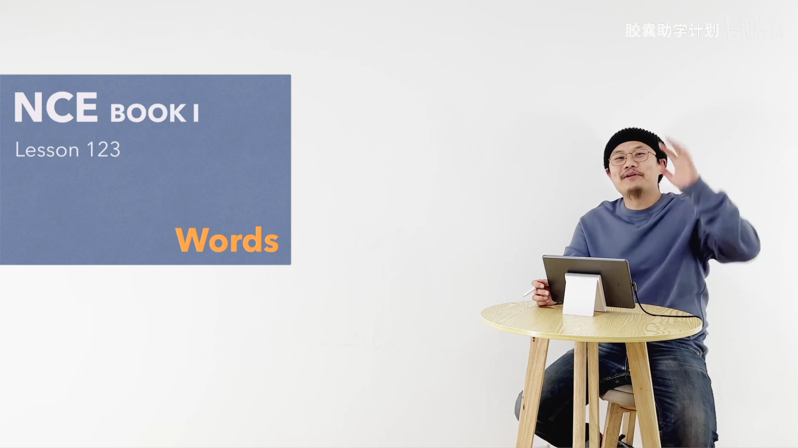

文字识别：胶囊助学计划 / NCE / BOOKI / Lesson 123 / Words

### 画面 00:00:10

文字识别：Bibi / 胶囊助学计划 / • / •

### 画面 00:00:14

### 画面 00:00:16

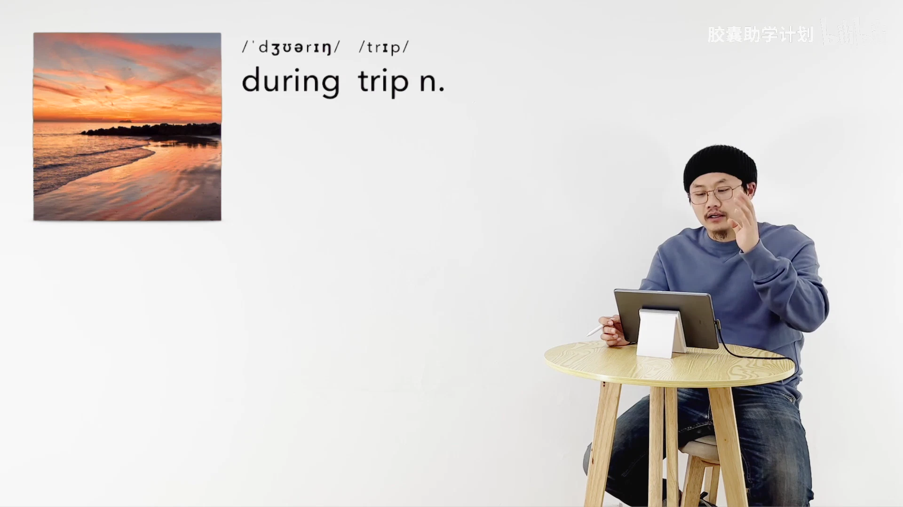

文字识别：胶囊助学计划 / /'dzuarin/ / /trip/ / during / trip n.

### 画面 00:00:29

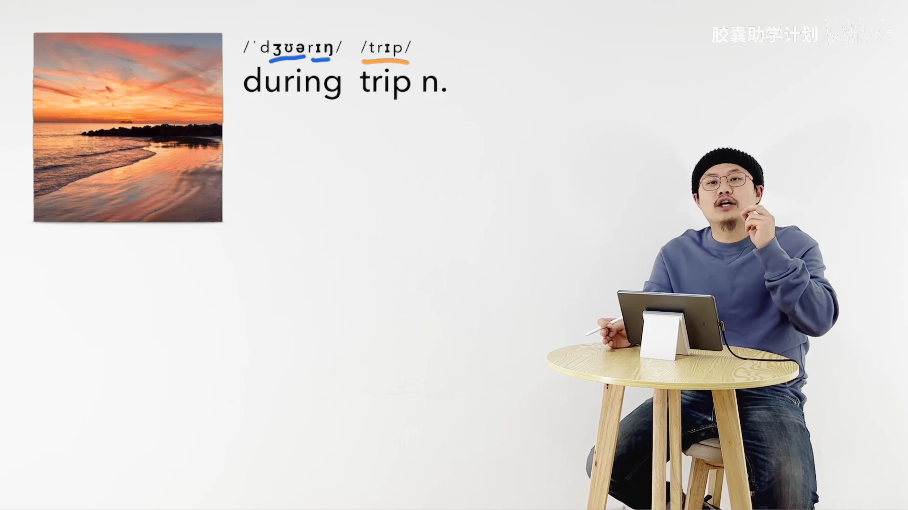

文字识别：胶囊助学计划 / /'d3uarin/ / /trip/ / during / trip n.

## 00:00:30–00:01:00

trip 叫做旅行旅游啊。比如说我们造一个句子，比如说 I met him during my trip to New York. 好，我遇到了他 during my trip. 其实它虽然加的在这儿是一个不是一个时间，但你想它是一个时间概念，叫在我去旅行期间，对吧？在什么什么期间？去哪呢？去纽约的这个旅行期间。OK，我遇到了他。那这样的肯定句出来了，我给大家造出来一个。然后各

### 画面 00:00:41

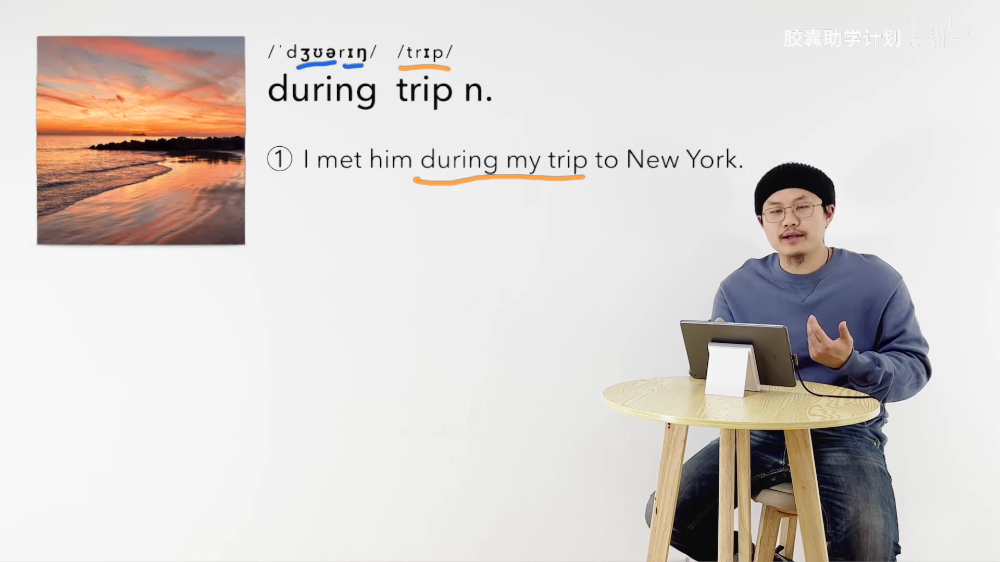

文字识别：胶囊助学计划 / /'d3uarin/ / /trip/ / during / trip n. / ① I met him during my trip to New York.

### 画面 00:00:55

文字识别：胶囊助学计划 / /'d3uarin/ / /trip/ / during / trip n. / ① I met him during my trip to New York.

### 画面 00:00:58

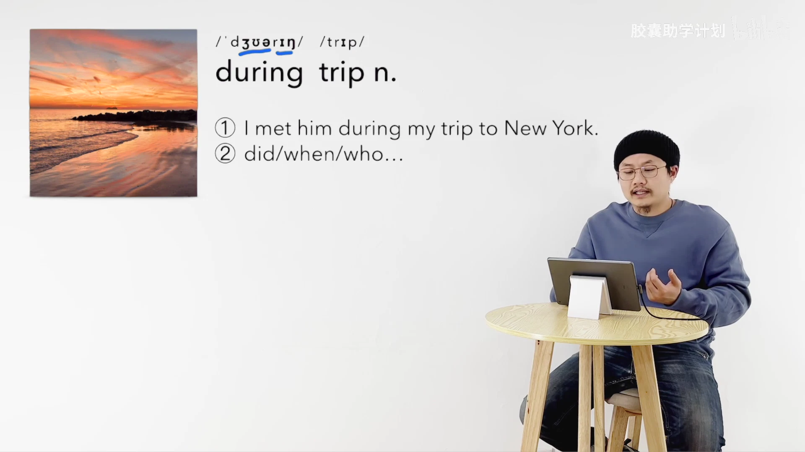

文字识别：胶囊助学计划 / /'d3uarin/ / /trip/ / during / trip n. / ① I met him during my trip to New York. / did/when/who...

## 00:01:00–00:01:30

位要做的事情就是一般疑问句和各种特殊疑问句就行了，我们不多说了啊。然后呢，我们也可以再造一句话，说 We didn't speak during the meal 啊，在吃饭期间我们没有说话，对吧？OK，那注意一个小点，其实 during 后边加一个名词，对吧？我们可以理解为它就是表示在这个时间之内啊，在这一段时间，那你拿它去造句的时候，其实前面要想一个动

### 画面 00:01:17

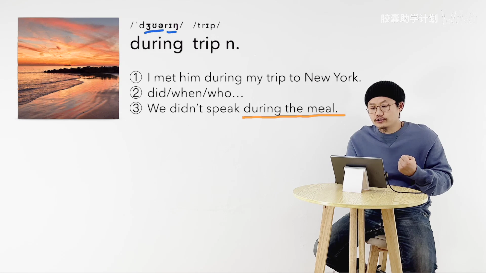

文字识别：胶囊助学计划 / /'d3uarin/ / /trip/ / during / trip n. / ① I met him during my trip to New York. / did/when/who... / We didn't speak during the meal.

### 画面 00:01:29

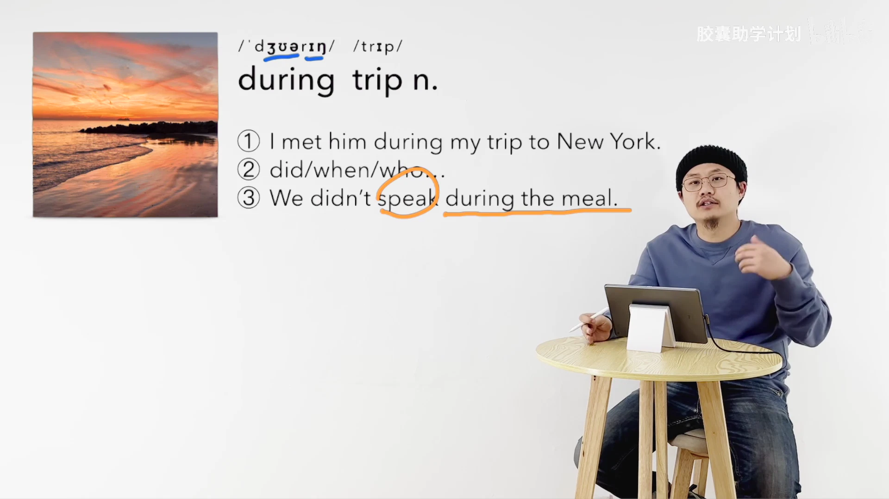

文字识别：胶囊助学计划 / /'d3uarin/ / /trip/ / during / trip n. / ① I met him during my trip to New York. / did/when/wh / We didn't speak / during the meal.

## 00:01:30–00:02:00

词，然后至于它是肯定还是否定，这就不是很重要了啊。这句话其实就出来了啊。包括那你看，我们再把这句话深化一下，说声 Why didn't you speak during the meal？啊，你为什么在吃饭期间没有说话呢？OK，very good。下一个单词，动词啊，注意它还是旅行的意思啊。它其实类似于我去了什么地方，我旅游去了什么地方。跟我读一下，叫做 travel travel。OK，very good。比如说 I would like to travel

### 画面 00:01:45

文字识别：胶囊助学计划 / /'træeval/ / travel v.

## 00:02:00–00:02:30

there. 哎，我很愿意去那里旅游一下。OK, would like to do something. 一百零七课咱们学的啊，那它其实和我们一百课、一百零五课学那个 want to do something 基本上是一码事儿啊。I want to travel there 也可以啊。Next one，接着说说，I traveled with my girlfriend last summer. 啊，说去年夏天啊，我和我女朋友一起旅行了一下。OK, traveled with my girlfriend last

### 画面 00:02:05

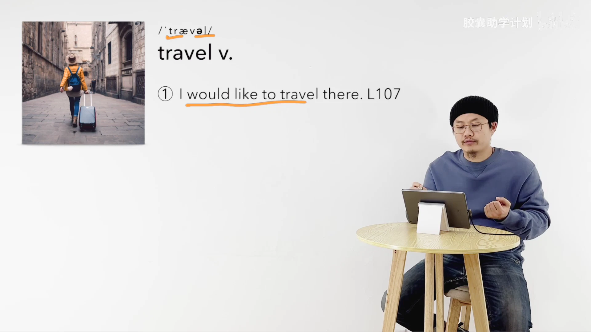

文字识别：胶囊助学计划 / /'træevall / travel v. / ① I would like to travel there. L107

### 画面 00:02:10

文字识别：胶囊助学计划 / /'træevall / travelv. want / ① I would like to travel there. L107

### 画面 00:02:12

文字识别：胶囊助学计划 / /'træevall / travelv. want / ① I would like to travel there. L107

### 画面 00:02:28

文字识别：胶囊助学计划 / /'træevall / travelv. want / ① I would like to travel there. L107 / I travelled with my girlfrieno / last summ

## 00:02:30–00:03:00

summer. Okay,一起旅行了一下。那注意这个肯定句出来又是各种句型，我们就可以往下去处理了，对吧？啊，我们在这不多说了。要么您暂停屏幕，口语变一下；要么家庭作业造句的时候自己把它写一下，好吧？Next one，接下来两个单词我们放到一起去讲。第一个叫offer，offer，offer，叫提供啊，它是一个动词。然后下一个单词是我们很久之前就学过的啊，What's your job？对吧？工

### 画面 00:02:33

文字识别：胶囊助学计划 / /'træevall / travelv. want / ① I would like to travel there. L107 / I travelled with my girlfriend last summ

### 画面 00:02:46

文字识别：胶囊助学计划 / / 'pfa/ / /d3ob/ / offer v. job

## 00:03:00–00:03:30

作啊。那我们在这个地方给大家补一个小的习惯用法，叫文章当中也出现了，叫 offer somebody a job，叫提供给某人一个工作啊。那我们造一句话说，She offered me a job last year. 去年她给我提供了一份工作，一般过去时。然后各种句型就又来了，对吧？这是我们去造句的时候，某种程度上甚至可以说相对比较偷懒的一种方式，就是您造一个肯定

### 画面 00:03:16

文字识别：胶囊助学计划 / / pfa/ / /d3ob/ / offer v. job / ① offer sb.a job / She offered me a job last year.

## 00:03:30–00:04:00

句，然后进行四句型转化，一个单词您就造了那么四五句话了，对不对？OK。其次呢，最后我们再提一下，就是 offer 这个单词还有一个特别常用的意思啊，它是一个名词，它的意思呢，比如说啊，像当年我申请了新西兰的三所学校，其中有一所学校叫奥克兰大学，对吧？他给了我一个叫做 offer，这个 offer 是什么呢？就可以理解为叫入入学通知书啊，告诉您您被录取了，或者叫录取通知

### 画面 00:03:46

文字识别：胶囊助学计划 / / 'pfa/ / /d3ob/ / offer v. job / ① offer sb.a job / She offered me a job last year. / did/when/who... / offer n.

## 00:04:00–00:04:30

书啊。那工作呢？别人也给你一个 offer 是什么意思呢？就是哎，我们录用您了，您可以来我们这儿工作了。这个东西也管它叫做 offer。 OK，好。嗯，那接下来呢，我们再看一个小的单词，我们直接用电影去学这个单词，跟我一起读一下，叫做 guess guess。 OK，叫做猜。那我们先看一下这句话，叫 I guess I'm too old。哦，注意 too old，一百零三课学的，对吧？叫过于怎么怎么样了，我太老

### 画面 00:04:11

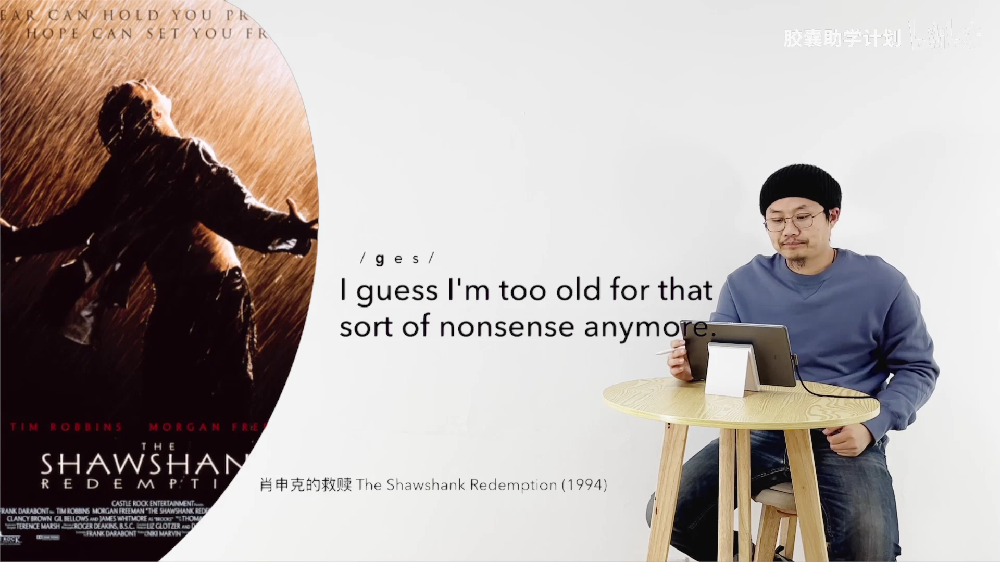

文字识别：CKNHOLDYOUPR / CANSETYOU FR / 胶囊助学计划 / /ｇes / / I guess I'm too old for that / sort of nonsense anymore / H / SHAWSHAN / RED E M PTI / 肖申克的救赎 The Shawshank Redemption (1994) / CASTLEROOK ENTERTANMENT / RANKDARABONTTIMROSBINSMORGANFREEMAN "THE SHAIWSHANKREDP / CLANCY BROWN GILBELLOWSND JAMES WHTMORE ATOOR / "THOM / TERENCE MARSH / ROCERDEAKING,B.S.C.LZGLOTZERANO / AOSK. / FRANKDARABONT"ENKIMARVIN

### 画面 00:04:15

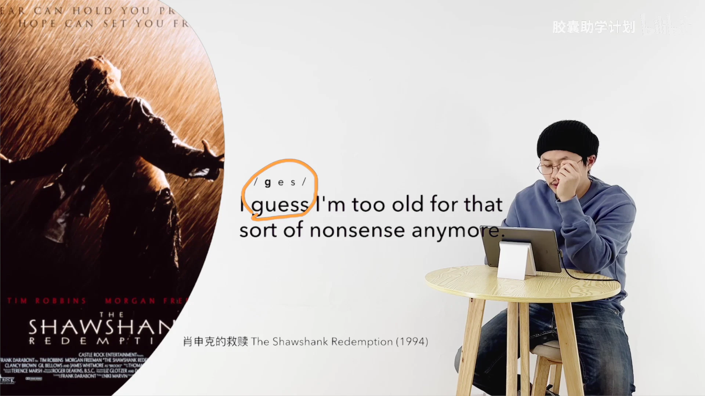

文字识别：CKNHOLDYOUPR / CANSETYOU FR / 胶囊助学计划 / ｇｅｓ/ / guess I'm too old for that / sort of nonsense anymore / H / SHAWSHAN / RE D E M PTI / 肖申克的救赎The Shawshank Redemption(1994) / CASTLEROOKENTERTAINMENT / RANK DARABONTTIMROBBINSMORGANFREEMAN "THE SHAIWSHANK REDS / CLANCY BROWN GILBELLOWSAND JAMES WHTMOREASTROO / THOM / TERENCEMARSH / ROGERDEAKIN,B.S.C.LZGOTZERAO / KOCK. / FRANKDARABONTNKIMARVN

### 画面 00:04:27

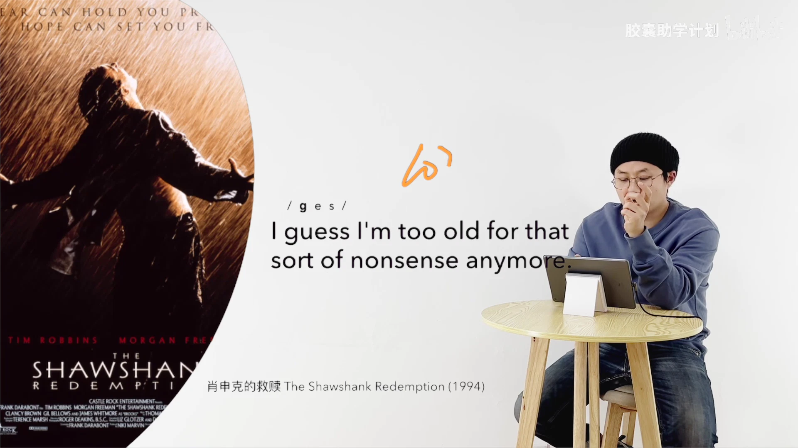

文字识别：CKNHOLDYOU PR / CANSETYOUFR / 胶囊助学计划 / /ge s / / I guess I'm too old for that / sort of nonsense anymore / H / E / SHAWSHAT / REDE M PTI / 肖申克的救赎The Shawshank Redemption (1994) / CASTLEROOK ENTERTANMENT / RANK DARABONTTIMROBBINSMORGANFREEMAN "THESHAIWSHANK REDO / CLANCY BROWN GILBELLOWSND JAMES WHTMORE ATOOG / THOM / TERENCE MARSH / ROCERDEAKINEB.S.C.LZGLOTZERA / KOCK. / FRANKDARABONTNKIMARVIN

## 00:04:30–00:05:00

了，for that sort of nonsense anymore. 啊，说对于那种毫无意义的事情，我觉得我呀，我猜我已经太老了。好，那不多说，我们直接进入这个视频的片段啊，我们一起来看一下他是如何运运用这句话的。 I have trouble sleeping at night. I have bad dreams like I'm falling. I wake up scared.

### 画面 00:04:32

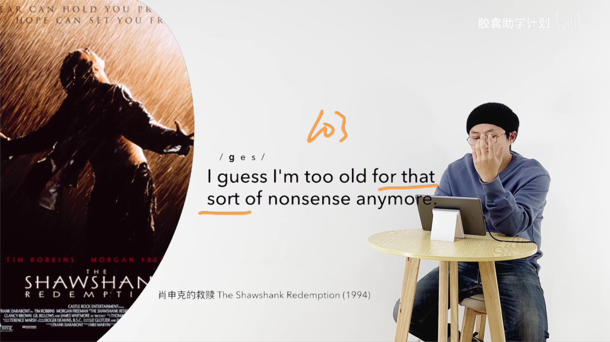

文字识别：CKNHOLDYOUPR / CANSETYOU FR / 胶囊助学计划 / /ｇes / / I guess I'm too old for that / sort of nonsense anymore / H / E / SHAWSHAI / REDEM PTI / 肖申克的救赎The Shawshank Redemption(1994) / CASTLEROOK ENTERTAINMENT / RANK DARABONTTIMROEBINSMORGAN FREEMAN"THE SHAIWSHANK REDG / CLANCY BROWN GILBELLOWSD JAMES WHTMORE ASTOO / THOM / TERENCEMARSH / ROGERDEAKINS.B.SC / LZGLOTZERAO / KOCK / FRANKDARABONTNKIMARVN

### 画面 00:04:34

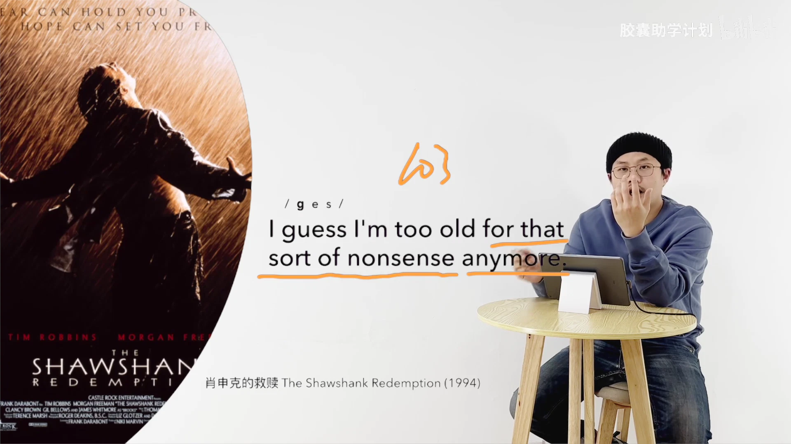

文字识别：CKNHOLDYOU PR / CANSETYOUFR / 胶囊助学计划州 / /ges / / I guess I'm too old for that / sort of nonsense anymore. / H / E / SHAWSHAN / REDEM PTI / 肖申克的救赎 The Shawshank Redemption(1994) / CASTLEROOK ENTERTAINMENT / RANK DARABONTTIMROEBINSMORGAN FREEMAN "THESHAIWSHANK REDG / CLANCY BROWN GLBELLOWSD JAMES WHTMORE ASTOOG / THOM / TERENCEMARSH / CROGERDEAKINE,B.S.C. / LZGLOTZERAO / MOCK. / FRANKDARABONTNKIMARVN

### 画面 00:04:50

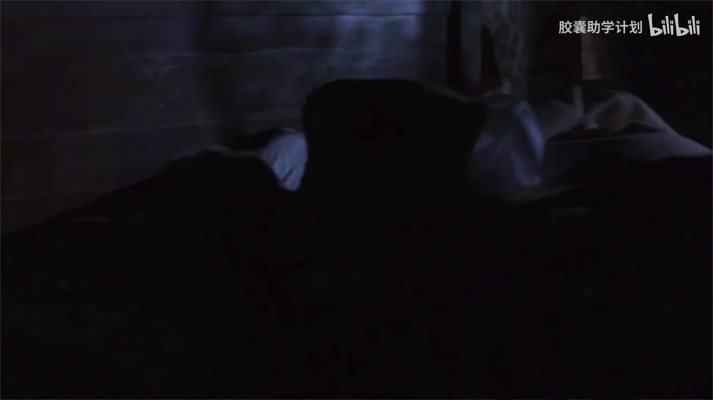

文字识别：bilbili / 胶囊助学计划

### 画面 00:04:52

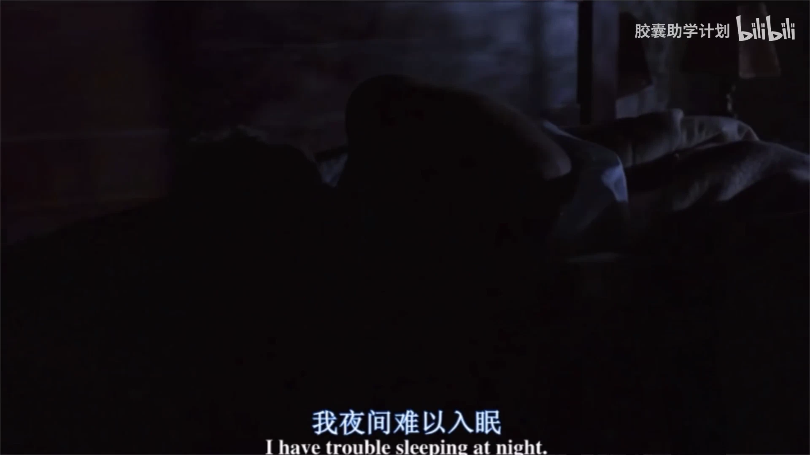

文字识别：bilibili / 胶囊助学计划 / 我夜间难以入眠 / I have trouble sleeping at night.

### 画面 00:04:54

文字识别：bilibili / 胶囊助学计划 / 做着从高处坠落的恶梦 / I have bad dreams like I'm falling.

### 画面 00:04:56

文字识别：bilibili / 胶囊助学计划 / 做着从高处坠落的恶梦 / I have bad dreams like I'm falling.

### 画面 00:04:58

文字识别：bilibili / 胶囊助学计划 / 醒时恐惧莫名 / I wake up scared.

## 00:05:00–00:05:30

Sometimes it takes me a while to remember where I am. Maybe I should get me a gun and rob the foodway, so they'd send me home. I could shoot the manager while I'm at it, sort of like a a bonus. I guess I'm too old for that sort of nonsense anymore.那他翻译的时候，我觉得我已经太老了，没法再这么胡闹了，对吧？Nonsense就是无理，对吧？啊，OK，胡

### 画面 00:05:00

文字识别：bilibili / 胶囊助学计划 / 有时记不起身在何方 / Sometimes it takes me a while to remember where I am.

### 画面 00:05:02

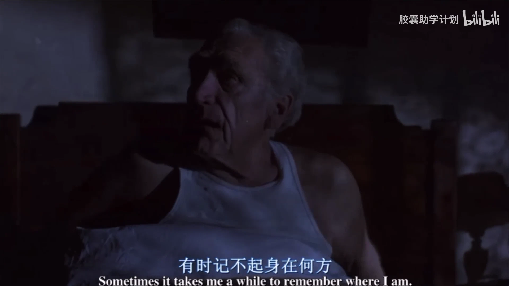

文字识别：bilibili / 胶囊助学计划 / 有时记不起身在何方 / Sometimes it takes me a while to remember where I am.

### 画面 00:05:04

文字识别：bilibili / 胶囊助学计划

### 画面 00:05:06

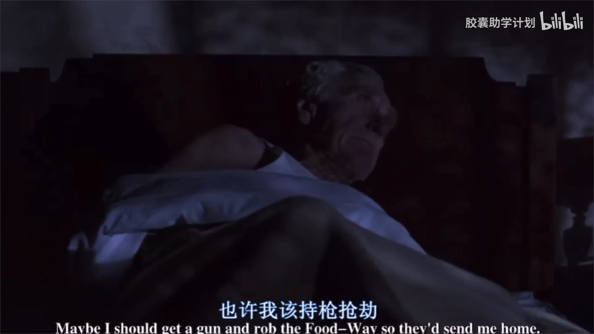

文字识别：bilibili / 胶囊助学计划 / 也许我该持枪抢劫 / Mavbe I should get a gun and rob the Food-Wav so they'd send me home.

### 画面 00:05:08

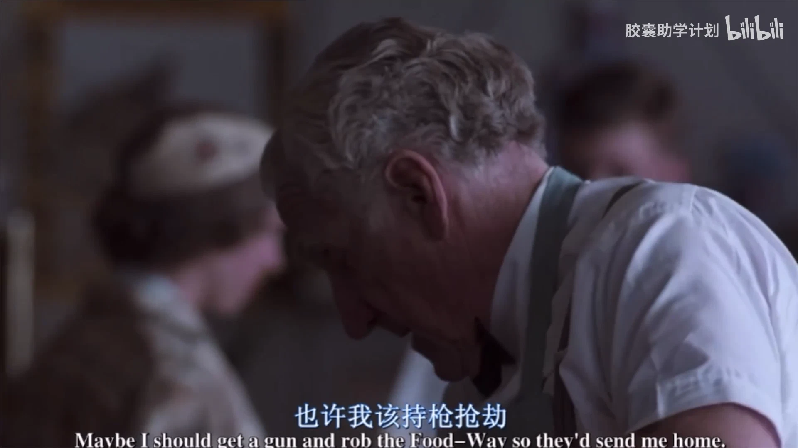

文字识别：bilibili / 胶囊助学计划 / 也许我该持枪抢劫 / Mavbe I should get a gun and rob the Food-Way so they'd send me home.

### 画面 00:05:10

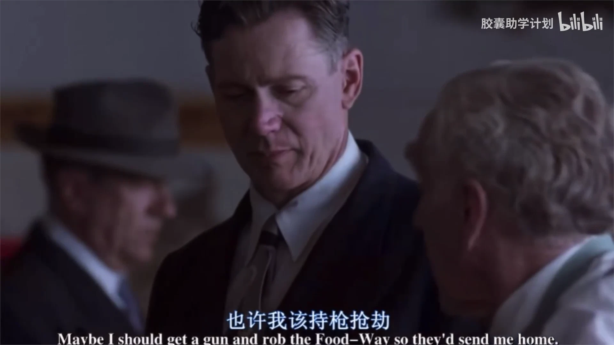

文字识别：bilibili / 胶囊助学计划 / 也许我该持枪抢劫 / Mavbe I should get a gun and rob the Food-Way so they'd send me home.

### 画面 00:05:12

文字识别：bilibili / 胶囊助学计划 / 毙了店长 / 重回肖申克 / 杀了他锦上添花 / I could shoot the manager while I was at it. Sort of like a bonus.

### 画面 00:05:14

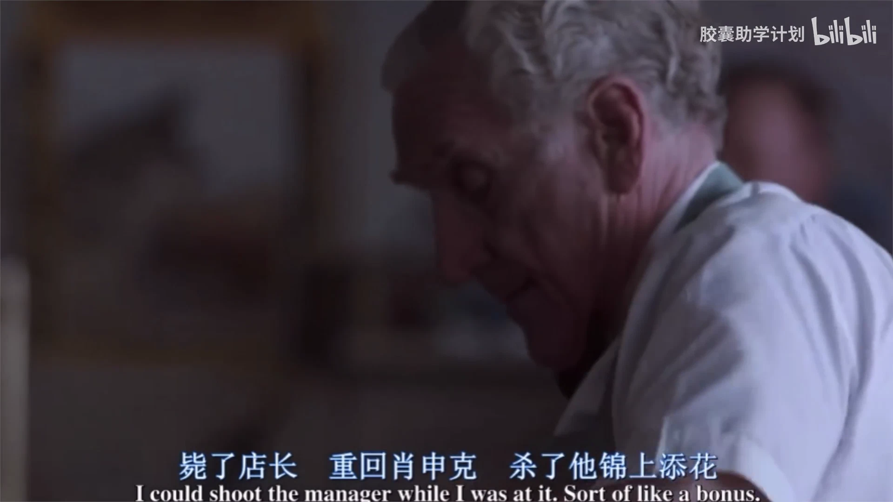

文字识别：bilibili / 胶囊助学计划 / 毙了店长 / 重回肖申克 / 杀了他锦上添花 / I could shoot the manager while I was at it. Sort of like a bonus.

### 画面 00:05:16

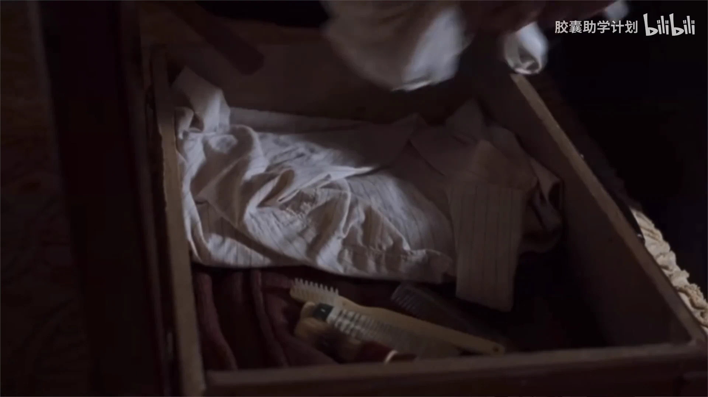

文字识别：bilibili / 胶囊助学计划

### 画面 00:05:18

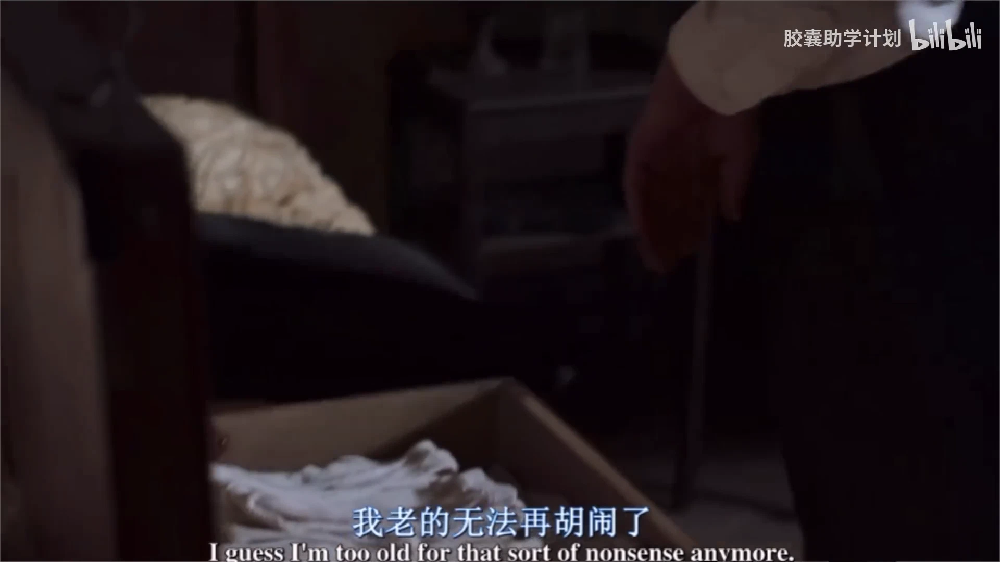

文字识别：bilbli / 胶囊助学计划 / 我老的无法再胡闹了 / guess I'm too old for that sort of nonsense anvmore.

### 画面 00:05:20

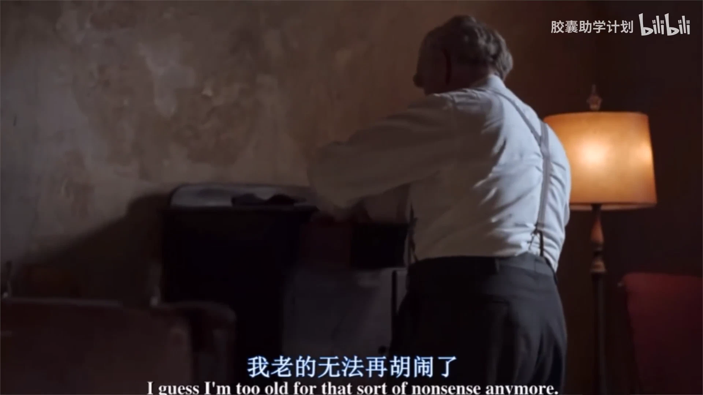

文字识别：bilibili / 胶囊助学计划 / 我老的无法再胡闹了 / guess I'm too old for that sort of nonsense anvmore.

### 画面 00:05:22

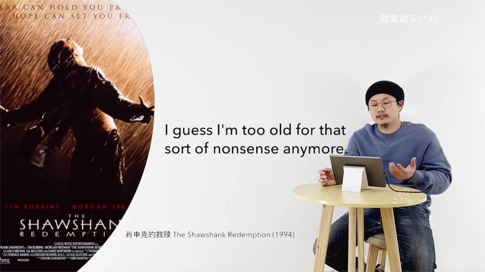

文字识别：CKNHOLDYOUPR / CANSETYOU FR / 胶囊助学计划 / I guess I'm too old for that / sort of nonsense anymore / H / SHAWSHAT / RED E M PTI / 肖申克的救赎The Shawshank Redemption(1994) / CASTLEROOK ENTERTANMENT / RANKDARABONT-TIMROBBINSMORGANFREEMAN "THESHAIWSHANK REDS / CLANCY BROWN GLBELLOWSND JAMES WHTMORETOOG / THOM / TERENCEMARSH / ROCERDEAKING,B.S.C.LZGLOTZERAO / KOCK / FRANKDARABONT"ENKIMARVIN

### 画面 00:05:27

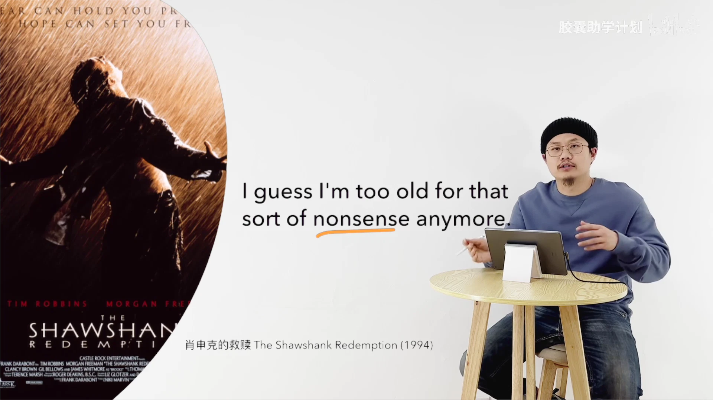

文字识别：CKN HOLDYOU PR / CANSETYOUFR / 胶囊助学计划 / I guess I'm too old for that / sort of nonsense anymore. / H / SHAWSHAN / RE D E M PTI / 肖申克的救赎The Shawshank Redemption (1994) / CASTLEROOK ENTERTANMENT / RANKDARABONTTIMROBBINSMORGAN FREEMAN"THESHAIWSHANK REDE / CLANCY BROWN GILBELLOWSD JAMES WHTMORE ATEOOG / THOM / TERENCEMARSH / ROGERDEAKINE,B.SC.ELZGLOTZERAO / ROCK. / FRANKDARABONT"NKIMARVIN

## 00:05:30–00:06:00

闹。There we go。接下来下面又是两个单词，我们放到一起去讲。一个动词，一个名词。我们先看后边这个单词，一起读一下，叫做beard，beard啊，大胡子对吧？络腮胡叫beard啊。我这个还不太像beard啊。OK，那下一个呢？前面动词叫grow，grow，grown啊。原型第一个原型，第二个过去式，第三个过去分词叫做长或者生长

### 画面 00:05:30

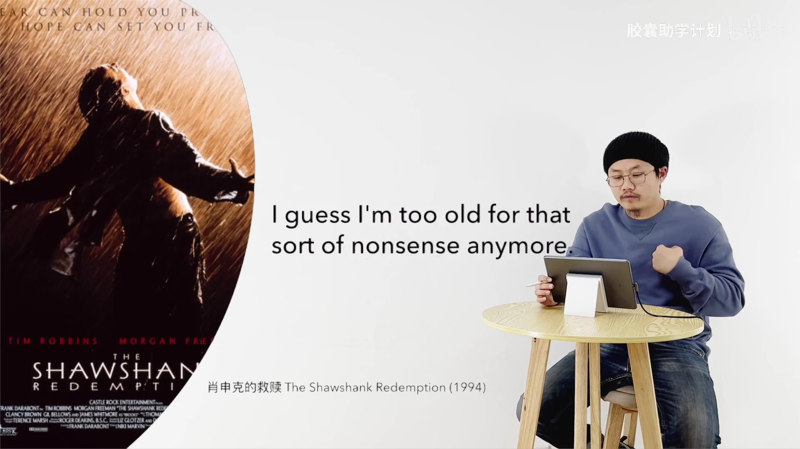

文字识别：CKNHOLDYOUPR / CANSETYOU FR / 胶囊助学计划 / I guess I'm too old for that / sort of nonsense anymore. / H / SHAWSHAN / R ED E M PTI / 肖申克的救赎 The Shawshank Redemption(1994) / CASTLEROOKENTERTAINMENT / RANK DARABONTTIMROBBINSMORGANFREEMAN "THE SHAWSHANK REDE / CLANCYBROWN GLBELLOWSOJAMES WHTMORETOOS / THOM / TERENCEMARSH. / ROGERDEAKINB.S.C.ELZGOTZERANO / AOSK. / CFRANKDARABONTENKIMARVIN

### 画面 00:05:32

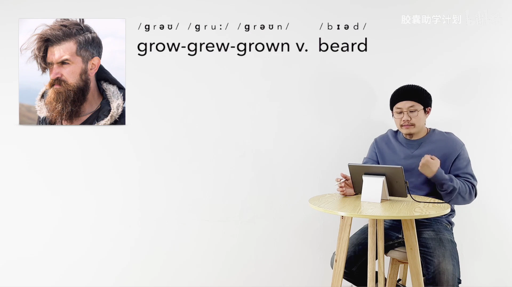

文字识别：胶囊助学计划 / /grａu/ /grui/ /graun/ / / bia d / / grow-grew-grown v. beard

### 画面 00:05:51

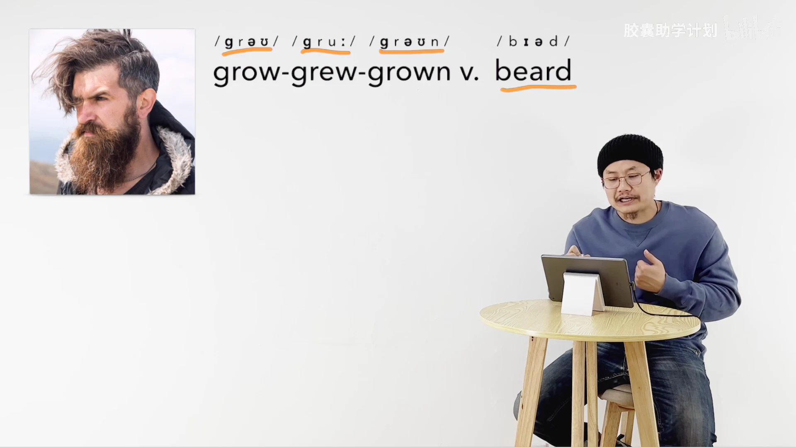

文字识别：胶囊助学计划 / /grau/ /gru:/ /graun/ / / bⅠa d / / . beard / grow-grew-grown v.

## 00:06:00–00:06:30

啊，比如说动物长也是用啊，这植物长也是用 grow 啊。我们说人长，然后说胡子长也用 grow 啊。我们造一句话说 I grew a beard during my trip. 在我旅行期间呢，哎，我蓄了一个胡子，或者我留了一个胡子啊。那它其实本身就是长的意思，对吧？然后再来，注意这是一般过去式，对吧？说的是之前的事情，在 during my trip，对吧？在我旅行期间，接下来呢，我可以说

### 画面 00:06:21

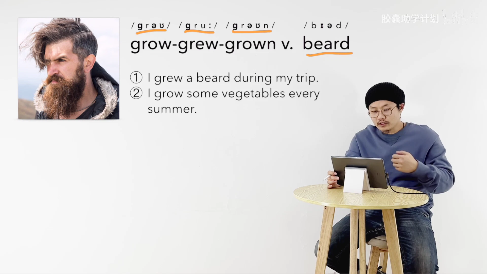

文字识别：胶囊助学计划 / /grau/ /gru:/ /graun/ / /biad / / beard / grow-grew-grown v. / ① I grew a beard during my trip. / I grow some vegetables every / summer.

## 00:06:30–00:07:00

I grew some vegetables every summer. 一般现在时，我的个人习惯，每年夏天我都会种植一些蔬菜，对吧？Very good. 那呃，肯定句给各位了，各位把一般疑问句对吧？然后这个特殊疑问句做出来就行了。我在这儿呢，用了一个 did，用了一个 do，您自己去想第一个、第二个谁用 did，谁用 do。刚才时态我已经解释清楚了，对吧？哎，您可以在视频下方留下这个答案。OK，

### 画面 00:06:51

文字识别：胶囊助学计划 / /grau/ /gru:/ /graun/ / /biad / / beard / grow-grew-grown v. / O① I grew a beard during my trip. / I grow some vegetables every / summer. / did/do/when...

## 00:07:00–00:07:30

one again.那recap本课除了本身它单词很重要以外，我们多补了一个习惯用法，叫offer somebody a job，叫做提供给某人一份工作。家庭作业，单词造句，老习惯，给自己讲解一遍今天的核心知识点。然后呢，如果各位喜欢我们的课程，欢迎各位啊关注、订阅、一键三连啊，然后长按点赞来支持我们。呃，并且把我们的课程分享给那些需要学习英语的朋友们。

### 画面 00:07:00

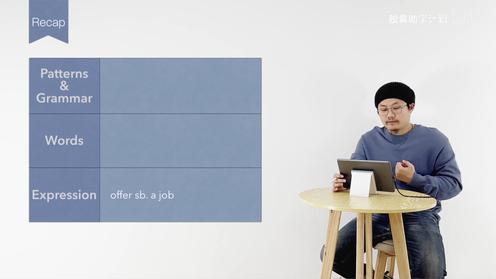

文字识别：胶囊助学计划 / Recap / Patterns / Grammar / Words / Expression / offer sb.a job

### 画面 00:07:11

文字识别：胶囊助学计划 / 单词造句3

### 画面 00:07:17

文字识别：胶囊助学计划

## 00:07:30–00:07:50

最后我们再来看一句名人名言：Out of difficulties grow miracles. See you next time.

### 画面 00:07:30

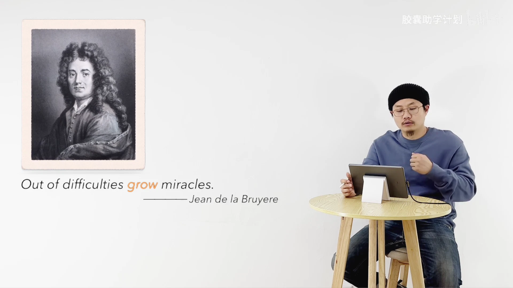

文字识别：胶囊助学计划 / Out of difficulties grow miracles. / -Jean de la Bruyere

### 画面 00:07:38

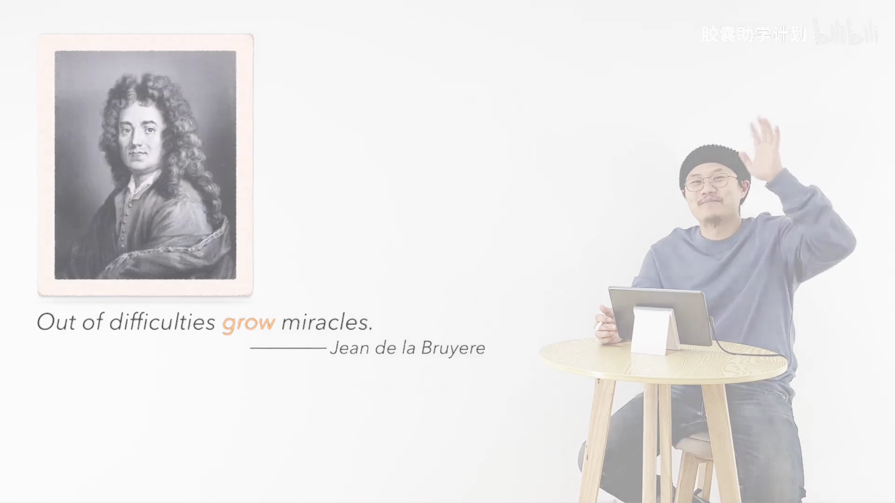

文字识别：Out of difficulties grow miracles. / -Jean de la Bruyere

### 画面 00:07:40

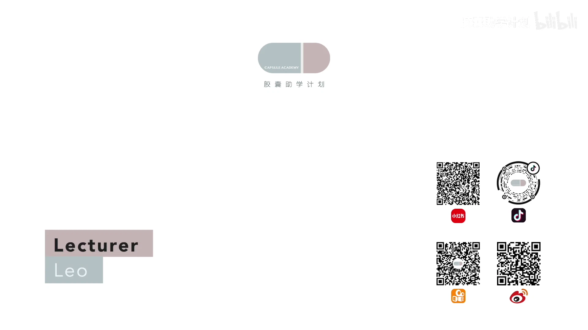

文字识别：運動学計划 / CAPSULEACADEMY / 胶囊助学计划 / 小红书 / Lecturer / □ / Leo / OE

### 画面 00:07:43

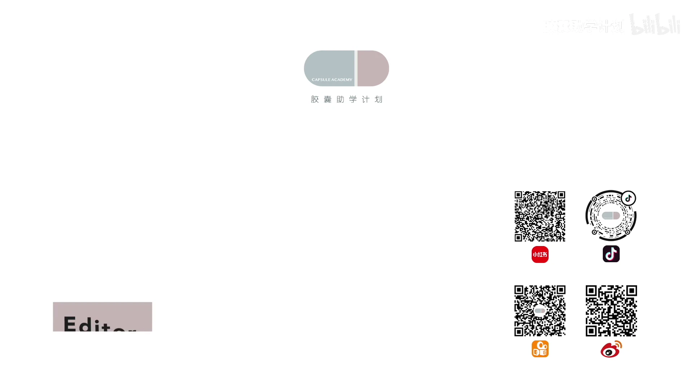

文字识别：CAPSULEACADEMY / 胶囊助学计划 / 小红书 / Edit~.

### 画面 00:07:46

文字识别：臺聖珈字計切 / CAPSULEACADEMY / 胶囊助学计划 / 小红书 / Creator / □ / Leo & Berlin

### 画面 00:07:48

文字识别：bilibili / 胶囊助学计划 / CAPSULEACADEMY / 胶囊助学计划 / 小红书 / OE

### 画面 00:07:50

文字识别：bilbili / 胶囊助学计划

