# 125 文章

快速机器解析：语音为单模型转写，未进行独立交叉校对或人工复核；画面每秒采样并按变化选帧，短时文字和标记可能遗漏。截图时间约有 1 秒误差。图片有损压缩；遇到疑点请按时间查看 Google Drive 原视频。

## 00:00:00–00:00:30

Hello everyone, welcome to Capsule Academy. This is Leo. Today we're going to learn New Concept English Book One Lesson One Hundred and Twenty Five Story. Hope you gonna enjoy it. Okay,好，那我们看一下这个场景啊，呃，女人Susan啊在屋里边，然后呢，外面有一个男人啊，应该是在拿水啊浇他的花园，对吧？他叫Peter啊。然后Susan问了一句话说，

### 画面 00:00:00

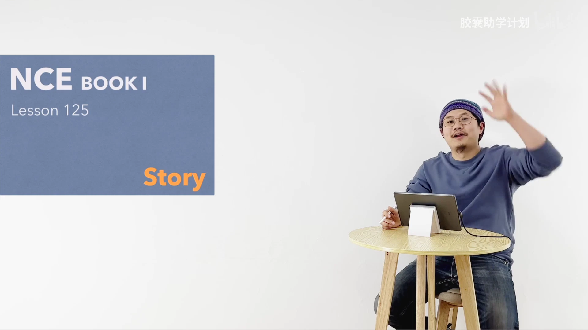

文字识别：胶囊助学计划 / NCE / BOOKI / Lesson 125 / Story

### 画面 00:00:02

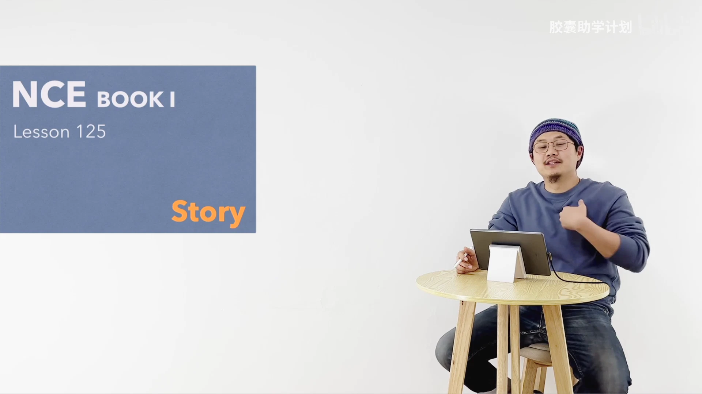

文字识别：胶囊助学计划 / NCE / BOOKI / Lesson 125 / Story

### 画面 00:00:08

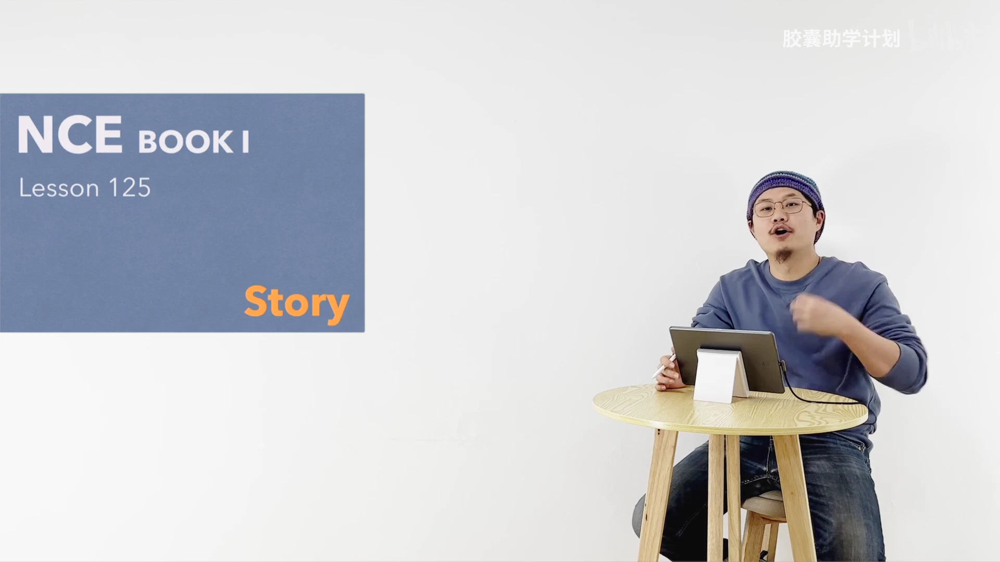

文字识别：胶囊助学计划 / NCE / BOOKI / Lesson 125 / Story

### 画面 00:00:10

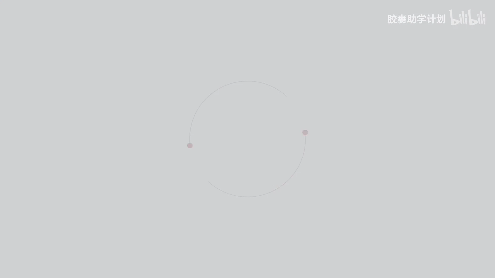

文字识别：胶囊助学计划b出l / •

### 画面 00:00:14

### 画面 00:00:16

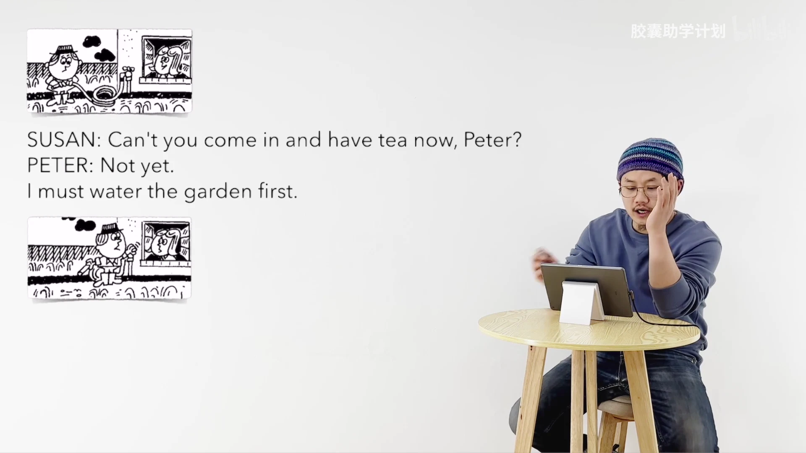

文字识别：胶囊助学计划 / SUSAN: Can't you come in and have tea now, Peter? / PETER: Not yet. / I must water the garden first. / mmm

## 00:00:30–00:01:00

Can't you come in? 好，就难道你不能进来吗？六十七课反义疑问句对吧？难道你不能进来吗？ And have tea now. 然后现在喝口茶。 Have 万能动词对吧？ Have lunch, have dinner, have tea, have milk, have a drink 等等。我们曾经学过很多关于 have 引导的这个小的短语。 OK，喝茶，Peter 啊说，Peter 说 Not yet. 好，Not yet. 就各位可以直接把这两个单词放到一起。 Not 就是

### 画面 00:00:46

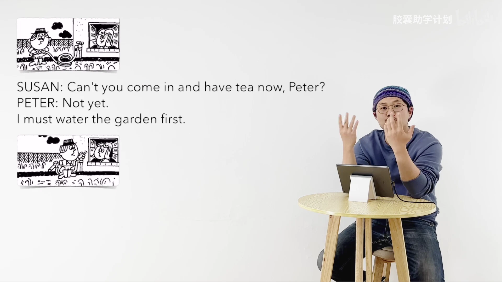

文字识别：胶囊助学计划 / m / SUSAN: Can't you come in and have tea now, Peter? / PETER: Not yet. / I must water the garden first.

## 00:01:00–00:01:30

不，对吧？Yet就是还啊，not yet经常出现，叫还不行啊，还不可以。Okay, not yet. I must water the garden first.说我必须要先给这个花园浇点水啊。First叫做第一，对吧？哎，其实它有另一个常见的意思，叫首先啊。首先我要给这个花园要必须先浇点水。Okay, very good.那我们回顾一下，我们在一百二十五课语法和单词那个视频当中给各位讲过，

### 画面 00:01:16

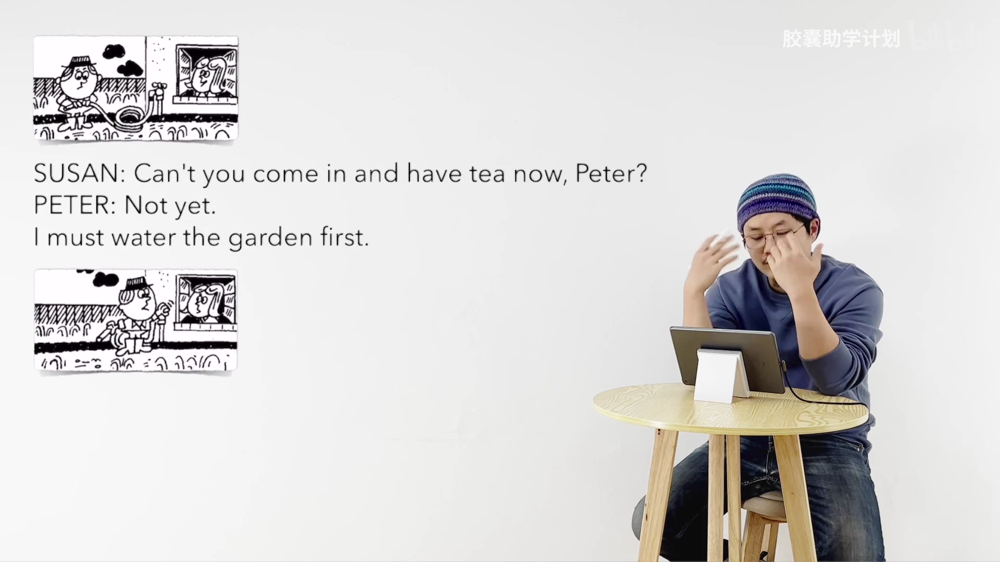

文字识别：胶囊助学计划 / SUSAN: Can't you come in and have tea now, Peter? / PETER: Not yet. / I must water the garden first. / ()C

## 00:01:30–00:02:00

must其实有另一个小的短语可以替代它，叫做have to，对吧？我不得不啊。Okay，Susan说，Do you have to water it now？说你现在必须要now现在你必须要现在去浇花园吗？Peter说，I'm afraid I must。我恐怕我必须现在浇。Look at it。Okay，你瞧啊。Okay，这地方有一个小的连读

### 画面 00:01:38

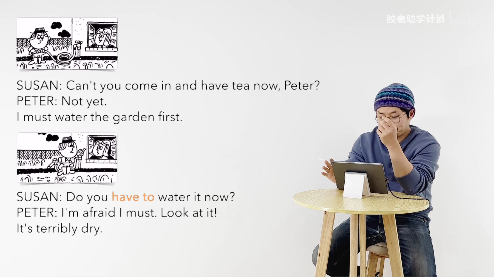

文字识别：胶囊助学计划 / SUSAN: Can't you come in and have tea now, Peter? / PETER: Not yet. / I must water the garden first. / mmm / SUSAN: Do you have to water it now? / PETER: I'm afraid I must. Look at it! / It's terribly dry.

## 00:02:00–00:02:30

啊，又其实 k 和 a 连起来，t 跟后边连起来，所以它读出了读出来的感觉是 look at it 啊， look at it OK，而不是 look at it。虽然这样也不算错啊，各位要注意对吧？不连读不算错，但是外国人去把它连读的时候，您可能听不懂。比如说你习惯上天天读 look at it，那别人读 look at it，你可能反应不过来他在说什么，对吧？OK，说 is terribly

### 画面 00:02:08

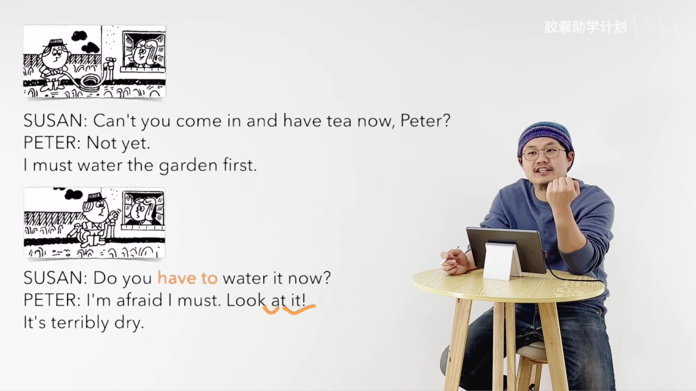

文字识别：胶囊助学计划 / SUSAN: Can't you come in and have tea now, Peter? / PETER: Not yet. / I must water the garden first. / m / SUSAN: Do you have to water it now? / PETER: I'm afraid I must. Look at it! / It's terribly dry.

### 画面 00:02:28

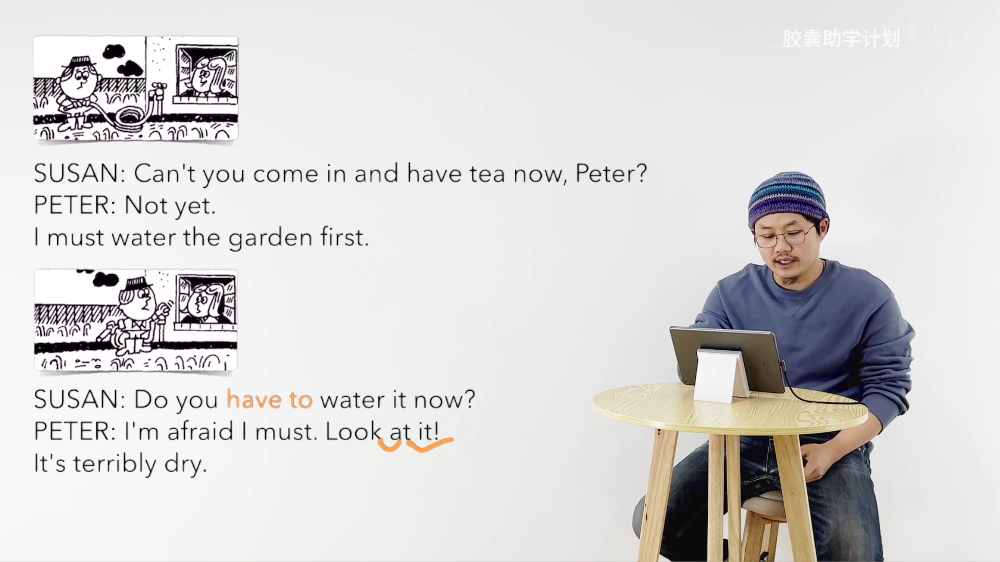

文字识别：胶囊助学计划 / SUSAN: Can't you come in and have tea now, Peter? / PETER: Not yet. / I must water the garden first. / SUSAN: Do you have to water it now? / PETER: I'm afraid I must. Look at it! / It's terribly dry.

## 00:02:30–00:03:00

dry. Ah, this is too dry. Actually, it's very dry. But terribly, this adverb, because it's from terrible, so it has a bad, negative, or negative emotional color. Ah, let's continue. What a nuisance! When we talk about words, we mentioned it, and in the 123rd lesson we also learned this called, uh, exclamatory sentence. What a nuisance! Ah, it's so annoying. It's

### 画面 00:02:39

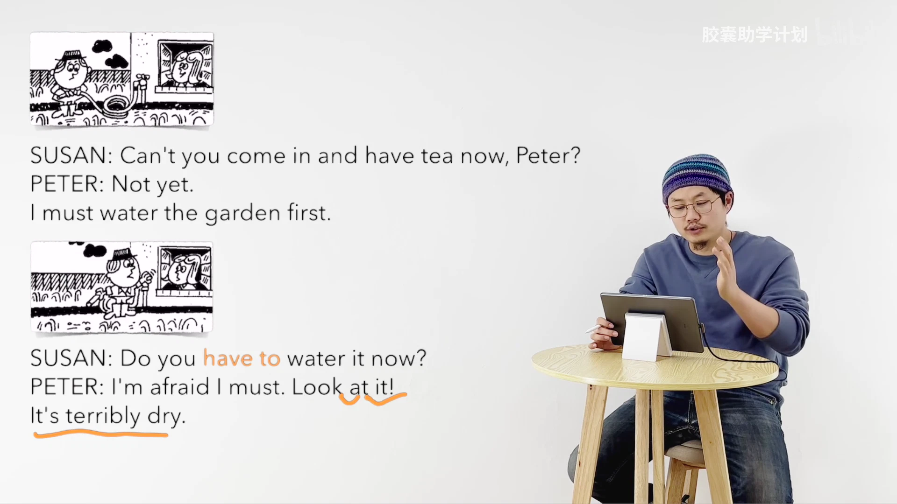

文字识别：胶囊助学计划 / m / SUSAN: Can't you come in and have tea now, Peter? / PETER: Not yet. / I must water the garden first. / mmm / SUSAN: Do you have to water it now? / PETER: I'm afraid I must. Look at it! / It's terribly dry.

### 画面 00:02:44

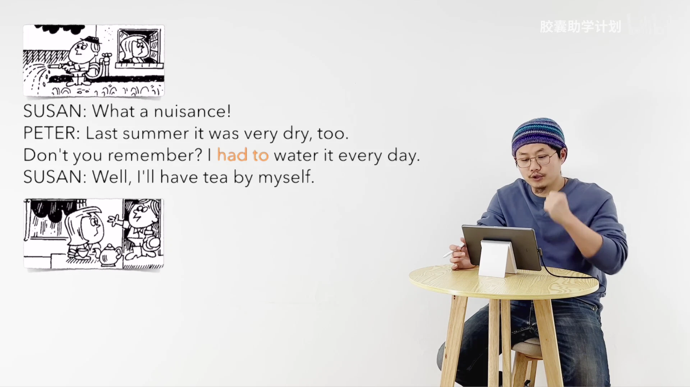

文字识别：2 / SUSAN: What a nuisance! / PETER: Last summer it was very dry, too. / Don't you remember? I had to water it every day. / SUSAN: Well, I'll have tea by myself. / ：川

## 00:03:00–00:03:30

Peter说，Last summer，去年夏天，注意接下来肯定跟一般过去时有关系了。It was very dry too，说当时也是特别的干的。注意各位这个地方，was一般过去时，对吧？So don't you remember？说难道你想不起来了吗？还是六十七课那个反义疑问句啊，否定疑问句，对吧？OK，说I had to water it every day。你看这地方有一个小的

### 画面 00:03:08

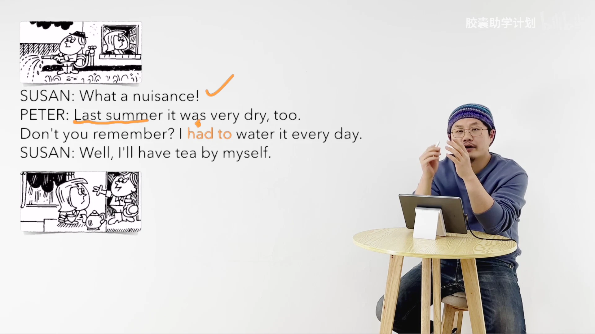

文字识别：胶囊助学计划 / 2 / SUSAN: What a nuisance! / PETER: Last summer it was very dry, too. / Don't you remember? I had to water it every day. / SUSAN: Well, I'll have tea by myself.

## 00:03:30–00:04:00

问题，它明明是 every day，为什么前面还是 had to？ Every day 不是一种生活习惯吗？不应该是一般现在时吗？那各位仔细再去想一下，他说的是 last summer，对吧？ The every day， OK，所以它是过去的之前的么一天？那它还是本质上一个一般过去时。其次，我们回想一下 I had to water it every day 这句话，我们想把它变成一般过去时怎么办呢？啊，想把它变成一

### 画面 00:03:33

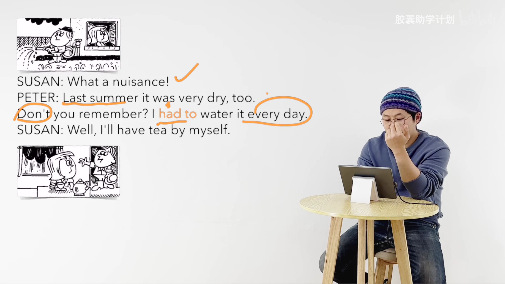

文字识别：胶囊助学计划 / 2 / SUSAN: What a nuisance! / PETER: Last summer it was very dry, too. / Don't you remember? I had to water it every day. / SUSAN: Well, I'll have tea by myself.

### 画面 00:03:35

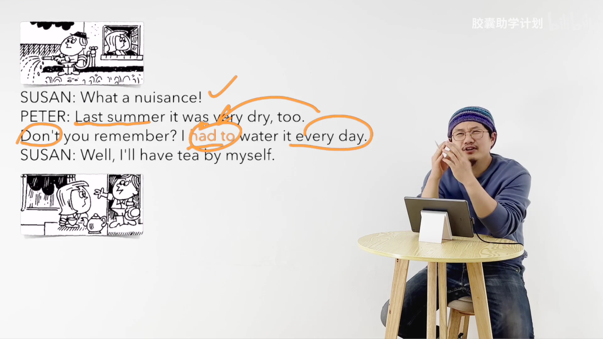

文字识别：胶囊助学计划 / 2 / SUSAN: What a nuisance! / PETER: Last summer it was Vry dry, too. / Pon'tyou remember?I / fad to water it every day. / SUSAN: Well, I'll have tea by myself.

## 00:04:00–00:04:30

般疑问句怎么办呢？我不小心把答案说漏嘴了，对吧？它是一般过去时，所以我们要用 did 提前 had 换回原形，所以这句话叫 Did you have to water it every day? Okay, very good. Susan接着说 Well, I'll have tea by myself. 说好吧，我将 have tea 啊，我将喝茶 by myself。好，注意这是一个小的短语，各位可以把它记下来啊，在我们书中给它画一下。

### 画面 00:04:05

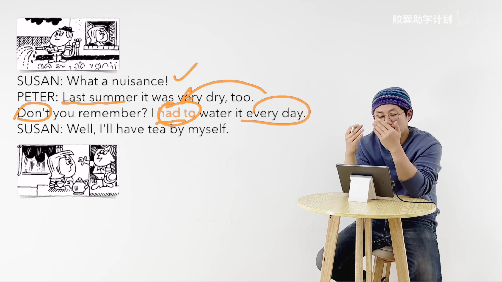

文字识别：胶囊助学计划 / 2 / SUSAN: What a nuisance! / PETER: Last summer it was vary dry, too. / Pon'tyou remember?l / had to water it every day. / SUSAN: Well, I'll have tea by myself.

## 00:04:30–00:05:00

比如说 by myself 叫做我自己，那 by himself 叫他自己， by herself 叫叫做让他自己，对吧？OK，那好吧，Well，就是一个口头禅啊，这个小的单词，Well，Well，Well，好吧，好吧，好吧，啊，我自己喝茶。Susan说，That was quick。你注意场景变了，刚才在这个地方实际上还是一个人在屋内，一个人在屋外，然后现在呢，呃，Peter

### 画面 00:04:35

文字识别：胶囊助学计划 / 2 / SUSAN: What a nuisance! / PETER: Last summer it was vry dry, too. / Pon'tyou remember?l / had to water it every day. / SUSAN: Well, I'll have tea by myself.

### 画面 00:04:48

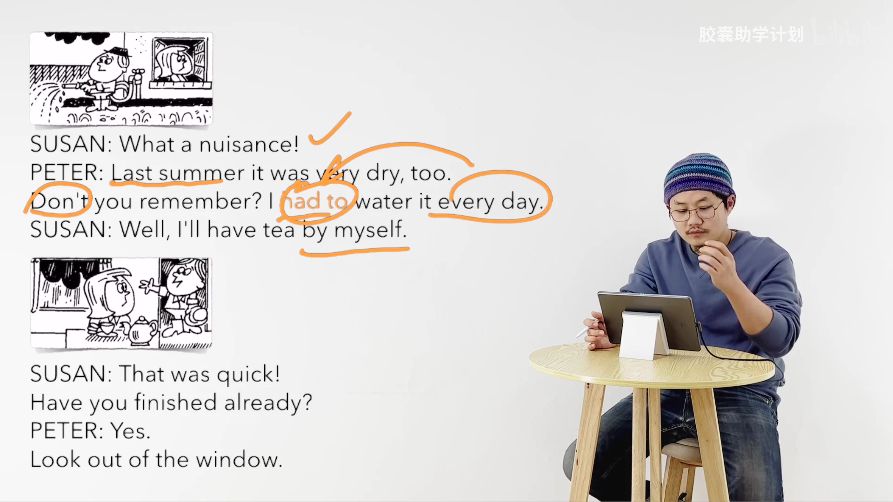

文字识别：胶囊助学计划 / 2 / SUSAN: What a nuisance! / PETER: Last summer it was vry dry, too. / Oon'tyou remember?l / fad to water it every day. / SUSAN: Well, I'll have tea by myself. / SUSAN: That was quick! / Have you finished already? / PETER: Yes. / Look out of the window.

### 画面 00:04:55

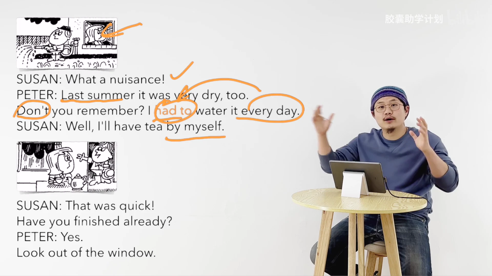

文字识别：胶囊助学计划 / 2 / SUSAN: What a nuisance! / PETER: Last summer it was vry dry, too. / Oon'tyou remember?l / had to water it every day. / SUSAN: Well, I'll have tea by myself. / SUSAN: That was quick! / Have you finished already? / PETER: Yes. / Look out of the window.

## 00:05:00–00:05:30

现在开屋啊，进啊开门进屋了。然后呢，Susan一看，哎，这么快就进来，说还挺快。说That was quick。说你刚才干这件事儿啊，干的还挺快。所以是一般过去时。当然了，我个人的语感啊，不是完全的语法啊，语感在新西兰去用的时候，你说That is quick，好像从语法上有一点问题，但是实际上别人听起来差别没有那么的大啊。说Have you finished already? Already

### 画面 00:05:25

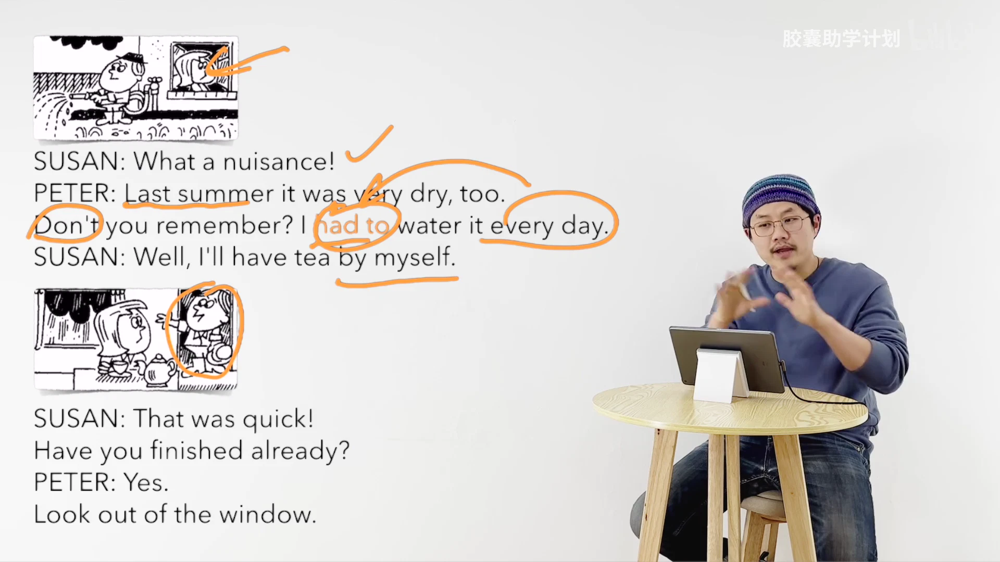

文字识别：胶囊助学计划 / 2 / SUSAN: What a nuisance! / PETER: Last summer it was vry dry, too. / Oon'tyou remember?l / fad to water it every day. / SUSAN: Well, I'll have tea by myself. / SUSAN: That was quick! / Have you finished already? / PETER: Yes. / Look out of the window.

### 画面 00:05:29

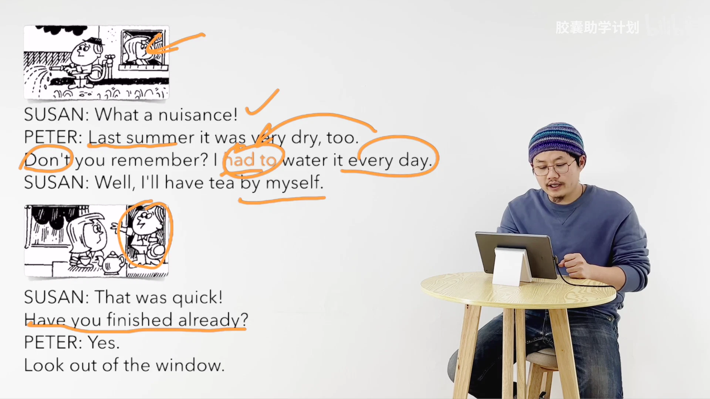

文字识别：胶囊助学计划 / SUSAN: What a nuisance! / PETER: Last summer it was vry dry, too. / Oon'tyou remember?l / fad to water it every day. / SUSAN: Well, I'll have tea by myself. / SUSAN: That was quick! / Have you finished already? / PETER: Yes. / Look out of the window.

## 00:05:30–00:06:00

叫已经啊，一个现在完成时叫你已经完成了吗？Peter说Yes. Look out of the window啊，说你瞧出窗外。Look叫瞧，out of叫什么什么的外面，对吧？瞧出窗外。It's raining. Susan说说哎，正在下雨。Susan说呢，That means说那意味着后面这样一件事儿叫做You don't need to water the garden. I don't need

### 画面 00:05:45

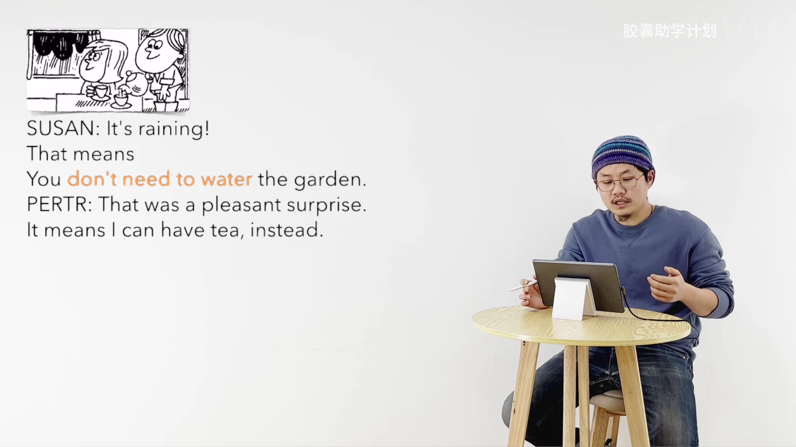

文字识别：胶囊助学计划 / SUSAN: It's raining! / That means / You don't need to water the garden. / PERTR: That was a pleasant surprise. / It means I can have tea, instead.

## 00:06:00–00:06:30

to need. 我们想一下什么意思，叫做需要。那 don't need 叫不需要。哎，其实和不必是类似的。所以其实啊， don't need to water the garden 这地方，我们完全可以把它换成，各位可以直接写旁边啊，叫做 you don't have to water the garden。只不过 have to 是两个单词，它不是字面意思，对吧？它实际上某种程度上是一个结构去表达了这个含义。而 need to water the

### 画面 00:06:15

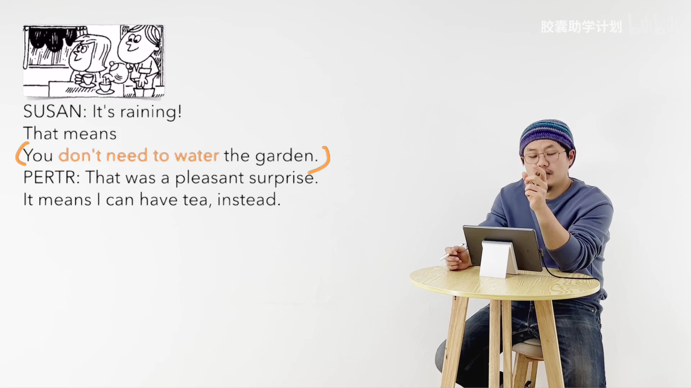

文字识别：胶囊助学计划 / SUSAN: It's raining! / That means / You don't need to water the garden. / PERTR: That was a pleasant surprise. / It means I can have tea, instead.

## 00:06:30–00:07:00

garden 这个地方呢，实际上它字面意思叫 need to do something，叫做需要去做某件。 I need to do something，啊，需要去做某件事情。 Okay，说你不必去浇这个花园了。 Peter 说 that was a pleasant surprise。 讲单词的时候我们提到了，对吧？这句话我们直接拿出来用了。说哎，那还是一个令人非常愉悦的惊喜。 It means，说它意味着什么呢？后

### 画面 00:06:35

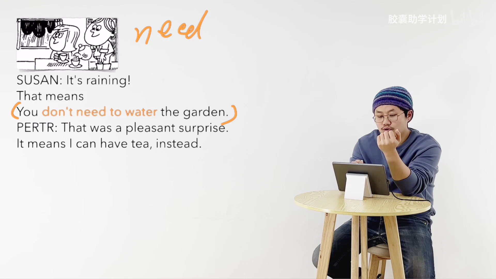

文字识别：胶囊助学计划 / ne e / SUSAN: It's raining! / That means / You don't need to water the garden." / PERTR: That was a pleasant surprise. / It means I can have tea, instead.

### 画面 00:06:37

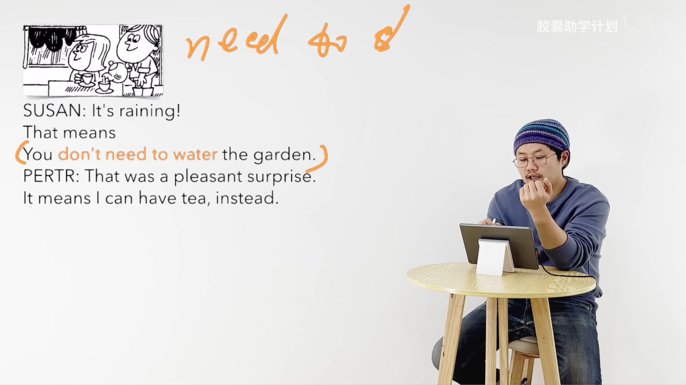

文字识别：nee / 胶囊助学计划 / SUSAN: It's raining! / That means / You don't need to water the garden. / PERTR: That was a pleasant surprise. / It means I can have tea, instead.

### 画面 00:06:39

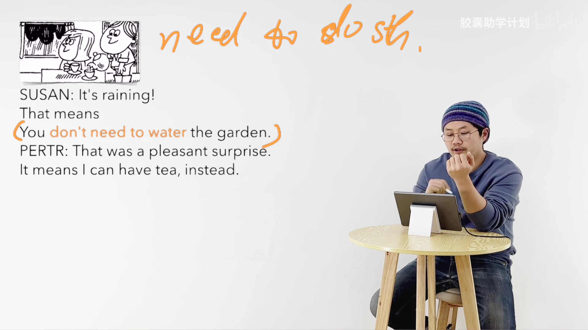

文字识别：4o olo sth. / nee / 胶囊助学计划 / SUSAN: It's raining! / That means / You don't need to water the garden.) / PERTR: That was a pleasant surprise. / It means I can have tea, instead.

## 00:07:00–00:07:30

边一个小的宾语从句叫 I can have tea instead. 说我能喝茶了。 Instead 就是替代。那替代的是什么呢？这里边是有一个潜台词的。替代的就是我去浇这个花园。 OK，好，那文章讲完了。接下来我们做一些小的听力口语练习。我问，您答啊。第一题， What does Susan want Peter to do? Next one, she wants him to come in and

### 画面 00:07:09

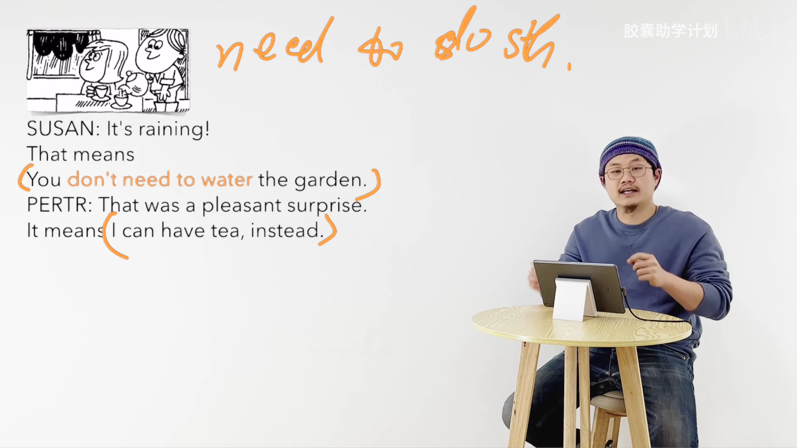

文字识别：4o olo sth. / nee / 胶囊助学计划 / SUSAN: It's raining! / That means / You don't need to water the garden.) / PERTR: That was a pleasant surprise. / It means(I can have tea, instead.

### 画面 00:07:14

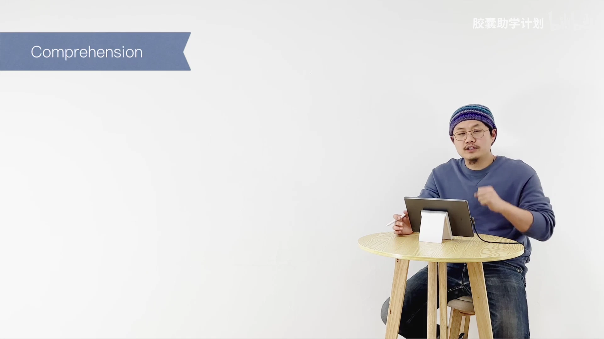

文字识别：胶囊助学计划 / Comprehension

### 画面 00:07:16

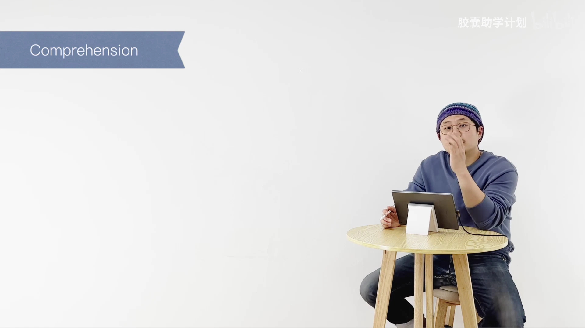

文字识别：胶囊助学计划 / Comprehension

### 画面 00:07:18

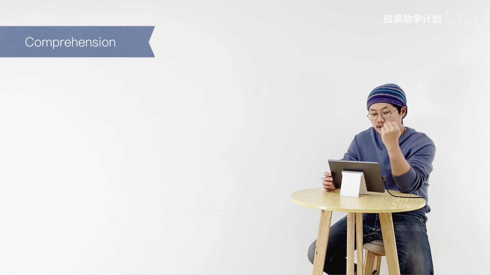

文字识别：胶囊助学计划 / Comprehension

### 画面 00:07:25

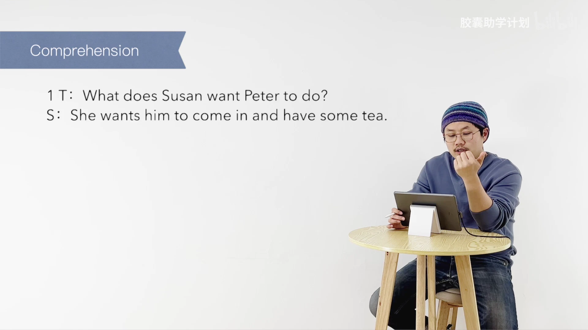

文字识别：胶囊助学计划 / Comprehension / 1 T: What does Susan want Peter to do? / S: She wants him to come in and have some tea.

## 00:07:30–00:08:00

have some tea. Next one, why does he say he can't come in yet? Because he must water the garden first. Next one, does he have to water it now? Yes, he does, 对吧? 下一题, why does Peter have to water the garden? Next one, because

### 画面 00:07:33

文字识别：胶囊助学计划 / Comprehension / 2 T: Why does he say he can't come in yet?

## 00:08:00–00:08:30

it is terribly dry. Next one, what was the weather like last summer? It was dry too. Next one, how often did Peter have to water the garden last summer? Every day, 对吧？那整句话叫做 he had to water it every day. There you go. Next one, what can Susan see when she looks out

### 画面 00:08:03

文字识别：胶囊助学计划 / Comprehension

### 画面 00:08:19

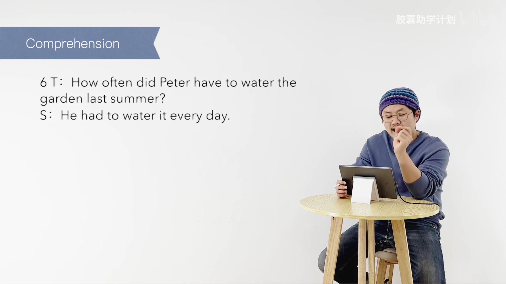

文字识别：胶囊助学计划 / Comprehension / 6 T: How often did Peter have to water the / garden last summer? / S: He had to water it every day.

### 画面 00:08:25

文字识别：胶囊助学计划 / Comprehension / 7 T: What can Susan see when she looks out / of the window?

## 00:08:30–00:09:00

of the window,很简单, raining,对吧？或者说is raining啊。Next one, does Peter need to water the garden? No, he doesn't. Next one, asking questions啊，肯定句，然后各位一般疑问句、特殊疑问句啊来了。第一题, ask me if Peter must water the garden. Must六十一和六十三课咱们学的，回顾一

### 画面 00:08:44

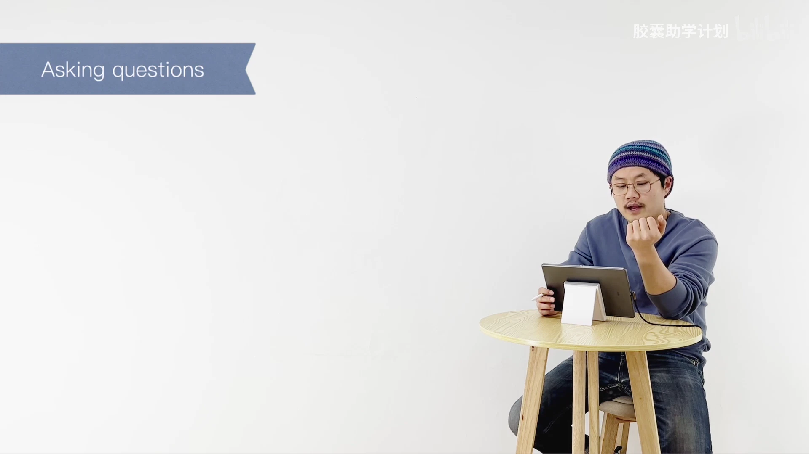

文字识别：胶囊助学计划 / Asking questions

## 00:09:00–00:09:30

下，must提前，must Peter water the garden? Next one, what do do? 啊，这是标准的，叫做 what must Peter do? Next one, ask me if he has to water it now. Does he have to water it now? What do do? What does he have to do now? Next one,

### 画面 00:09:04

文字识别：胶囊助学计划 / Asking questions / 1 T: Ask me if Peter must water the garden. / S: Must Peter water the garden? / T: What...do?

### 画面 00:09:10

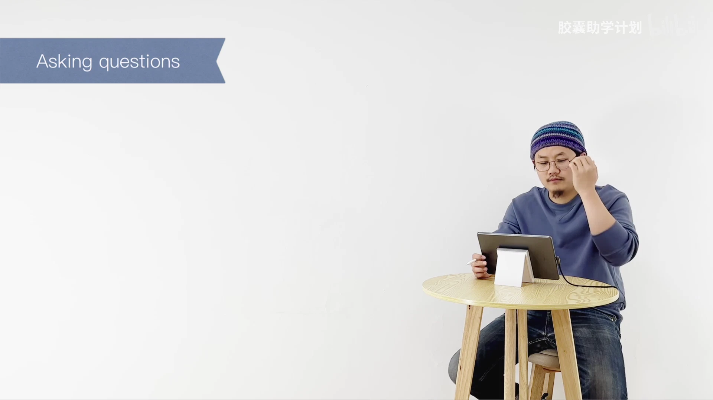

文字识别：胶囊助学计划 / Asking questions

### 画面 00:09:24

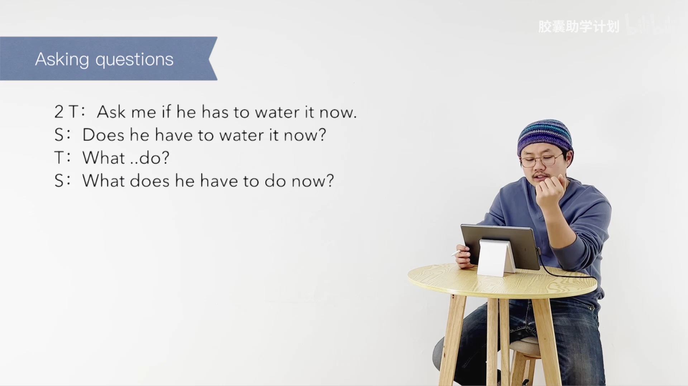

文字识别：胶嚢助学计划 / Asking questions / 2 T: Ask me if he has to water it now. / S: Does he have to water it now? / T: What ..do? / S: What does he have to do now?

### 画面 00:09:29

文字识别：胶囊助学计划 / Asking questions / 3 T: Ask me if he had to water the garden / every day last summer.

## 00:09:30–00:10:00

ask me if he had to water the garden every day last summer. Did he have to water the garden every day last summer? When? When did he have to water the garden every day? Answer last summer, right? Okay, next one, ask me if this means he doesn't have to water the garden. 好，注意这句话是一个否定句。您

### 画面 00:09:44

文字识别：胶囊助学计划 / Asking questions / 3 T: Ask me if he had to water the garden / every day last summer. / S: Did he have to water the garden every / day last summer? / T: When...? / S: When did he have to water the garden / every day?

### 画面 00:09:50

文字识别：胶囊助学计划 / Asking questions / 4 T: Ask me if this means he doesn't have to / water the garden.

## 00:10:00–00:10:30

先想一下它的肯定句长成什么样子，对吧？叫 He has to 啊，This means he oh OK 啊，这地方啊注意一个小点啊，我刚才在这儿说错了，是一个肯定句啊，只不过后边宾语从句是一个否定句，不用管它，直接 does 提前，对吧？Does this means he doesn't have to water the garden？啊，看到了哈，This 主语 means 位于后面是一个宾语从句，不用管，

### 画面 00:10:13

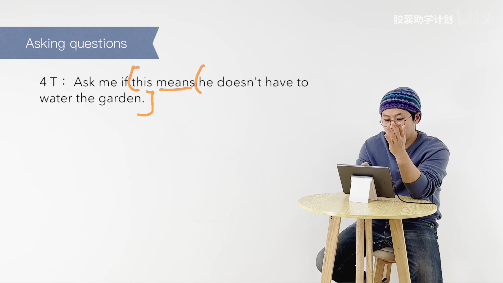

文字识别：胶囊助学计划 / Asking questions / 4T: Ask me if this meanshe doesn't have to / water the garden.7

### 画面 00:10:24

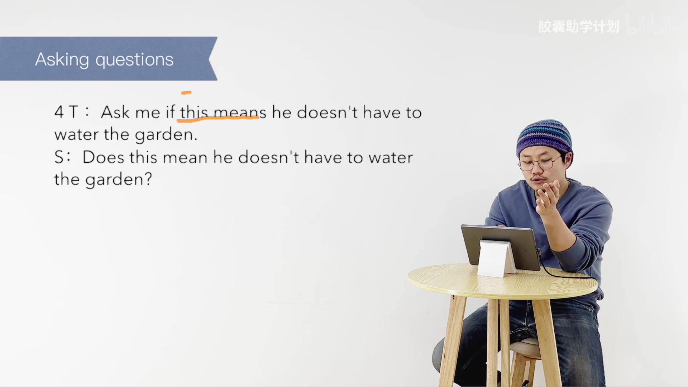

文字识别：胶囊助学计划 / Asking questions / 4 T : Ask me if this means he doesn't have to / water the garden. / S: Does this mean he doesn't have to water / the garden?

### 画面 00:10:26

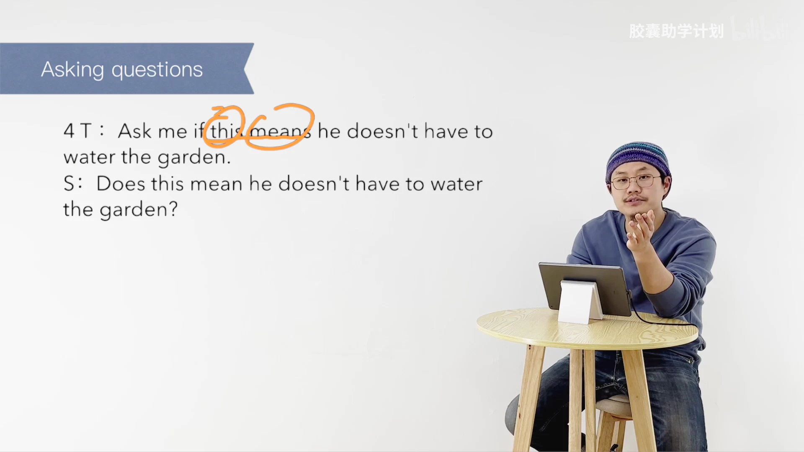

文字识别：胶囊助学计划 / Asking questions / 4T: Ask me ifthi mean / he doesn't have to / water the garden. / S: Does this mean he doesn't have to water / the garden?

## 00:10:30–00:11:00

对吧？我们变一般疑问句的时候不看从句，对吧？Okay, what? 那我们可以直接对 he doesn't have to water the garden 提问，所以这句话就变成 what does this mean? Okay, there you go. Next one, ask me if he can have tea instead. 一般疑问句, can he have tea instead? What? What do? 标准答案, what can he do

### 画面 00:10:39

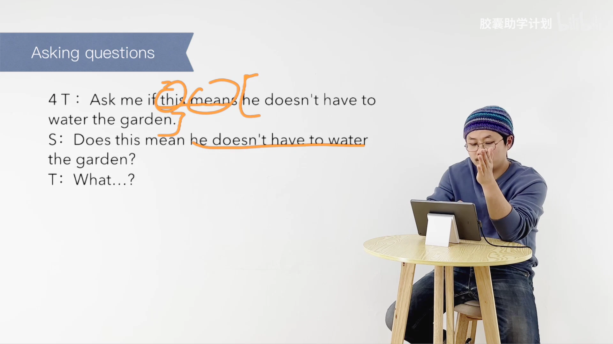

文字识别：胶囊助学计划 / Asking / questions / 4 T: Ask me ifthi eanahe  / doesn't have to / water the / garden.7 / S:Does t / this / mean he doesn't have to water / the garden? / T: What...?

### 画面 00:10:45

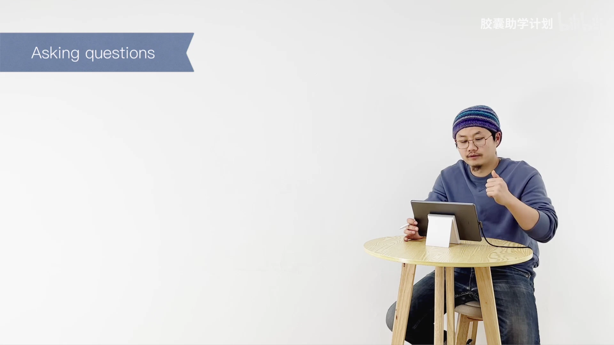

文字识别：胶囊助学计划 / Asking questions

### 画面 00:10:57

文字识别：胶囊助学计划 / Asking questions / 5 T: Ask me if he can have tea instead. / S: Can he have tea instead? / T: What...do? / S: What can he do instead?

## 00:11:00–00:11:30

instead?他能做什么去替代浇花这件事情？OK，浇他的花园。Very good. Recap.本视频又是在我们复习了一下have to啊，放到文章当中实际的场景当中去运用了，见一下它啊。然后呢，家庭作业绿皮书一百二十五课文章跟读至熟读成诵，给自己讲解一遍今天的核心知识点。各位不妨对吧？再给自己讲一遍have to和must的区别和异同，对吧？OK，

### 画面 00:11:05

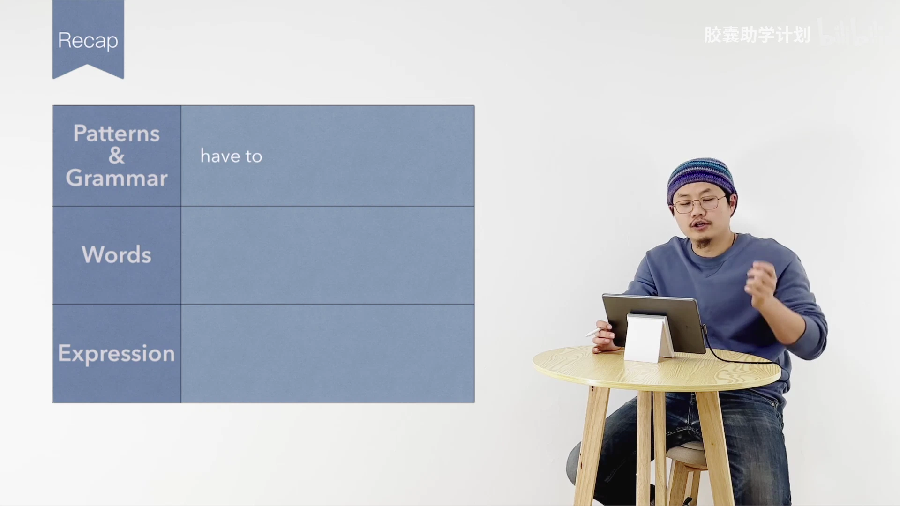

文字识别：胶囊助学计划 / Recap / Patterns / & / have to / Grammar / Words / Expression

### 画面 00:11:09

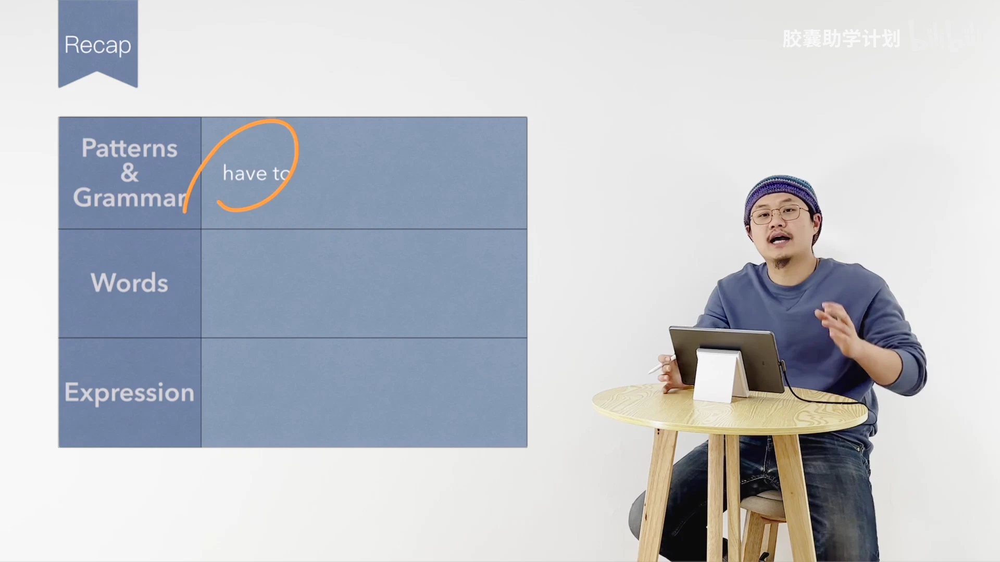

文字识别：Recap / 胶囊助学计划 / Patterns / & / have to / Grammal / Words / Expression

### 画面 00:11:15

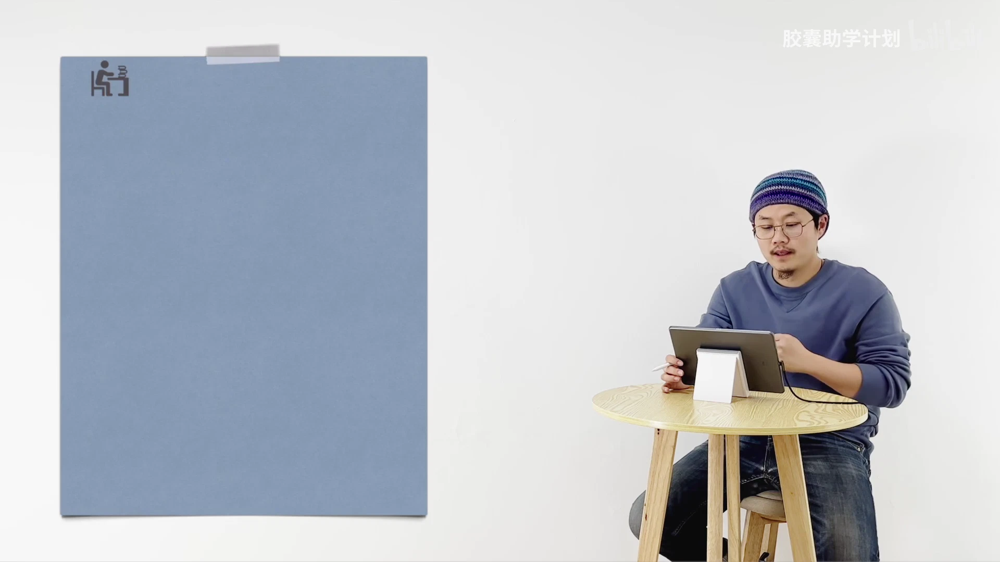

文字识别：胶囊助学计划

### 画面 00:11:24

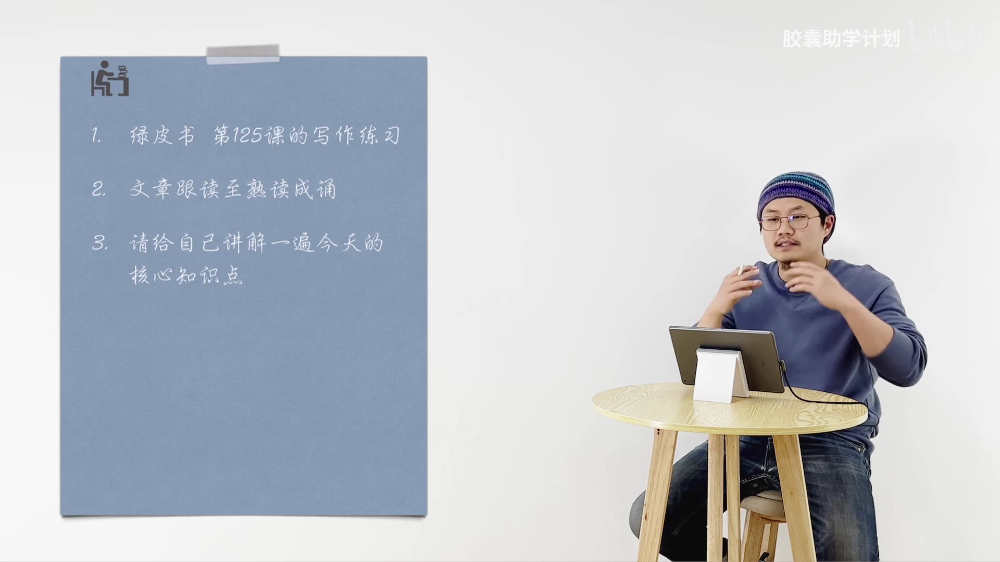

文字识别：胶囊助学计划 / 绿皮书第125课的写作练习 / 2.文章跟读至熟读成诵 / 3.请给自己讲解一遍今天的 / 核心知识点

### 画面 00:11:29

文字识别：胶囊助学计划

## 00:11:30–00:12:00

那如果各位喜欢我们的课程呢，欢迎各位关注、订阅、一键三连，分享给那些需要的朋友，来帮助我们快速成长。最后，我们再来看一句名人名言：Strive for continuous improvement instead of perfection. See you next time.

### 画面 00:11:38

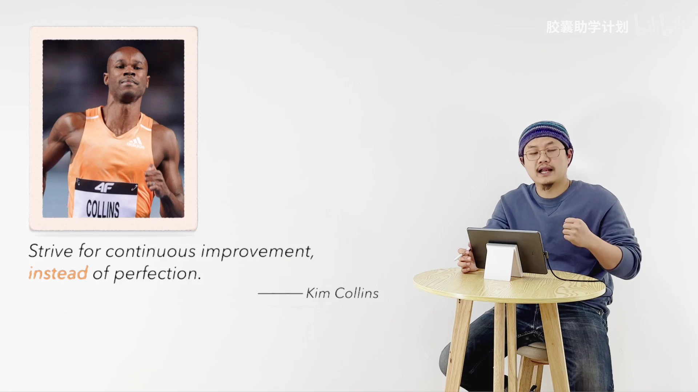

文字识别：胶囊助学计划 / 4F / COLLINS / Strive for continuous improvement, / instead of perfection. / - Kim Collins

### 画面 00:11:48

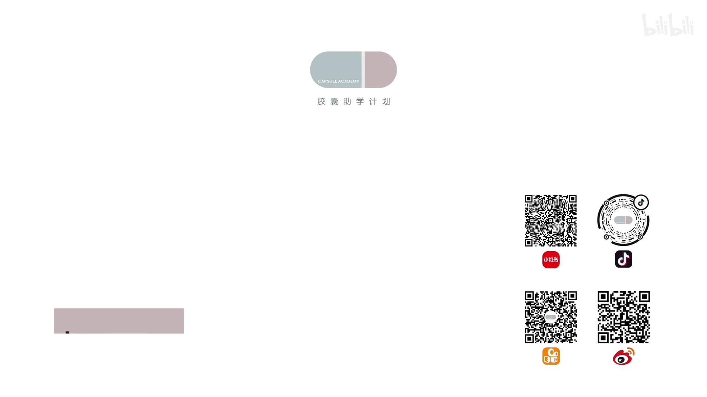

文字识别：CAPSULEACADEMY / 胶囊助学计划 / 小红书 / 证 / OE

### 画面 00:11:50

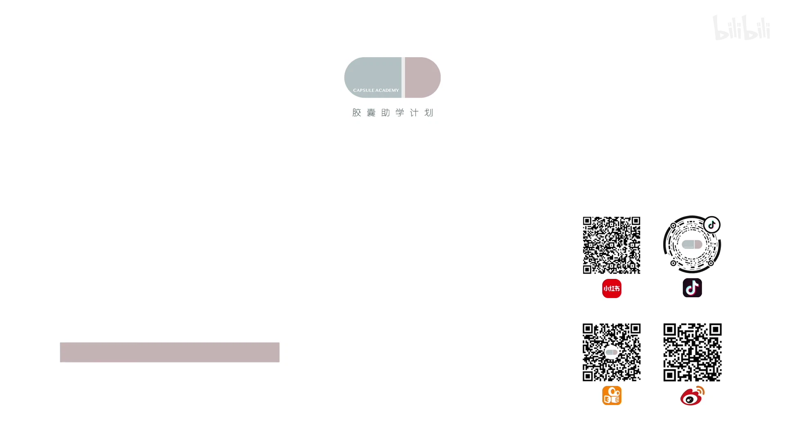

文字识别：CAPSULEACADEMY / 胶囊助学计划 / 『 / 小红书

### 画面 00:11:53

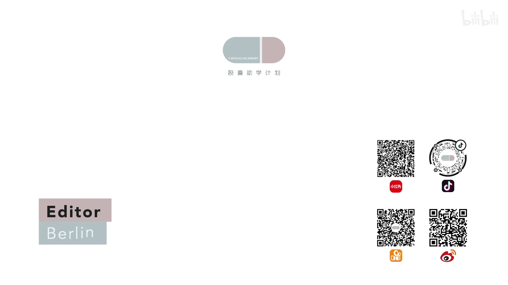

文字识别：CAPSULEACADEMY / 胶囊助学计划 / 『 / 小红书 / Editor / □ / Berlin / OE

### 画面 00:11:55

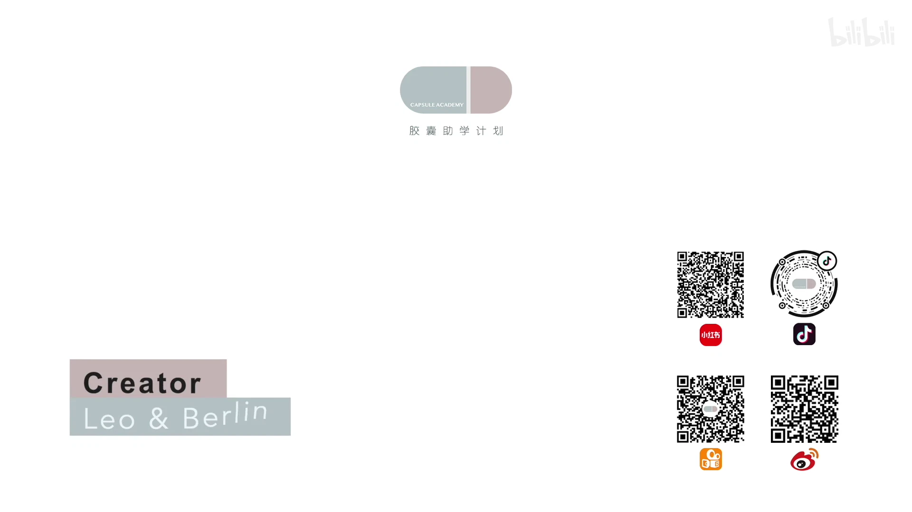

文字识别：CAPSULEACADEMY / 胶囊助学计划 / 小红书 / Creator / Leo & Berlin / OE

### 画面 00:11:57

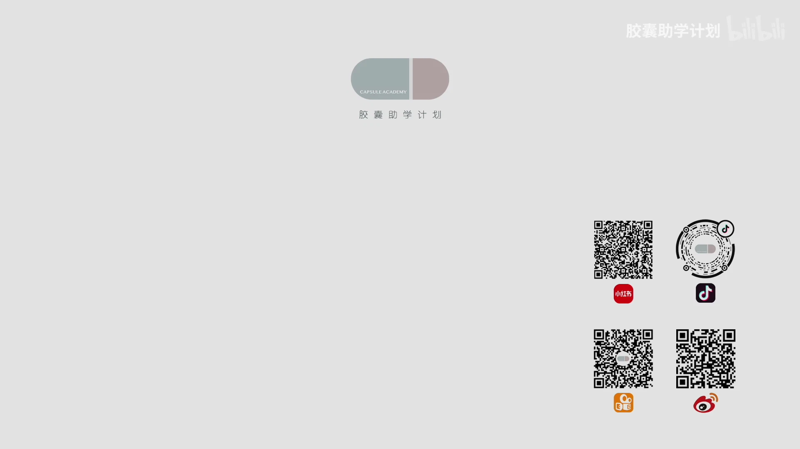

文字识别：胶囊助学计划 / CAPSULEACADEMY / 胶囊助学计划 / 小红书 / OE / 0

### 画面 00:11:59

文字识别：bilibili / 胶囊助学计划

## 00:12:00–00:12:00

