# 127 文章

快速机器解析：语音为单模型转写，未进行独立交叉校对或人工复核；画面每秒采样并按变化选帧，短时文字和标记可能遗漏。截图时间约有 1 秒误差。图片有损压缩；遇到疑点请按时间查看 Google Drive 原视频。

## 00:00:00–00:00:30

Hello everyone, welcome to Capsule Academy. This is Leo. Today we are going to learn the Concept English Book One Lesson One Hundred and Twenty Seven Story. Hope you gonna enjoy it.好，那我们直接看文章啊。在文章当中最重要的，对于各位来说需要辨识的，就是我们在上一个视频当中刚刚给各位教过的 must be 和 can be 这样的句型啊，这样的语法来了。

### 画面 00:00:00

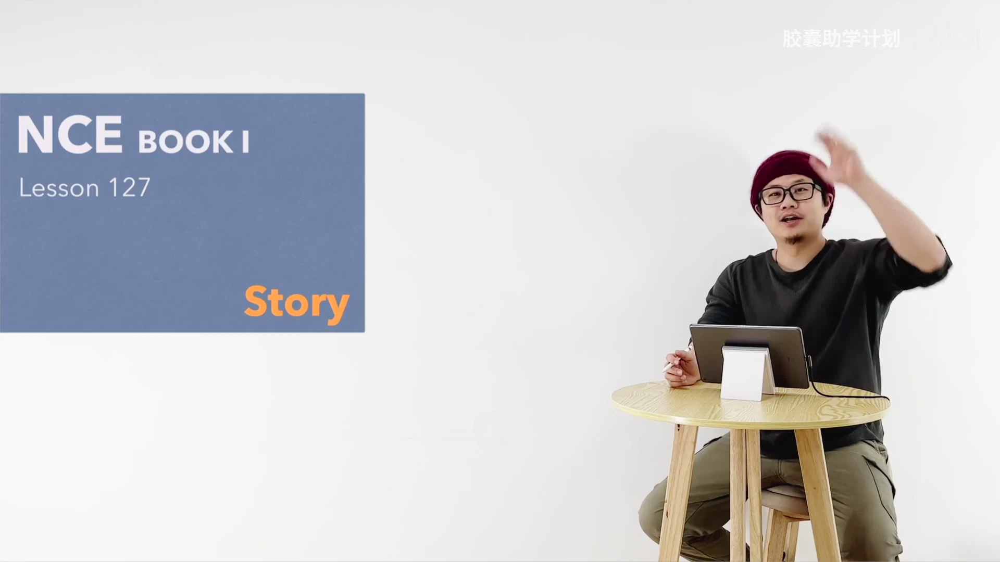

文字识别：NCE / BOOKI / Lesson 127 / Story

### 画面 00:00:02

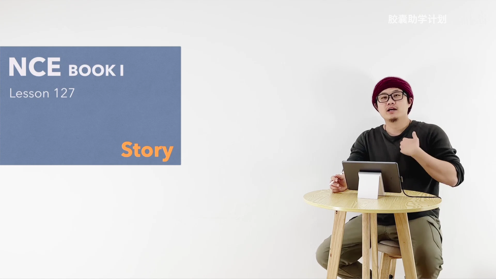

文字识别：NCE / BOOKI / Lesson 127 / Story

### 画面 00:00:11

文字识别：胶囊助学计划bill / •

### 画面 00:00:15

### 画面 00:00:17

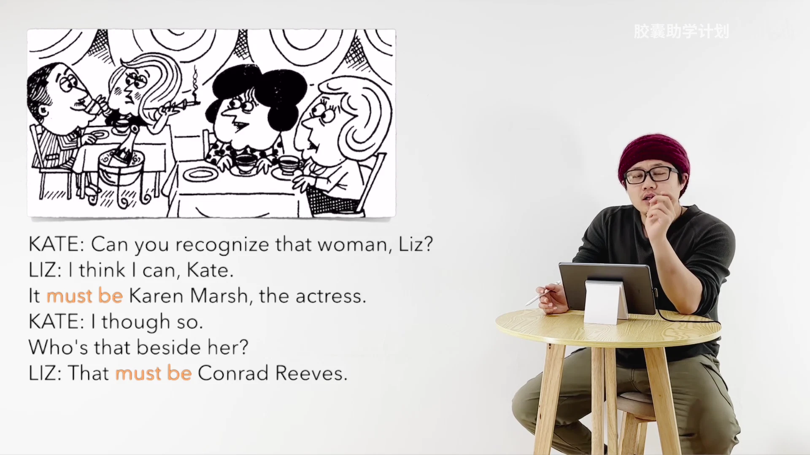

文字识别：KATE: Can you recognize that woman, Liz? / LIZ: I think I can, Kate. / It must be Karen Marsh, the actress. / KATE: I though so. / Who's that beside her? / LIZ: That must be Conrad Reeves.

### 画面 00:00:19

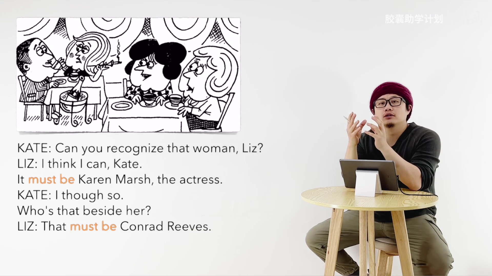

文字识别：KATE: Can you recognize that woman, Liz? / LIZ: I think I can, Kate. / It must be Karen Marsh, the actress. / KATE: I though so. / Who's that beside her? / LIZ: That must be Conrad Reeves.

### 画面 00:00:21

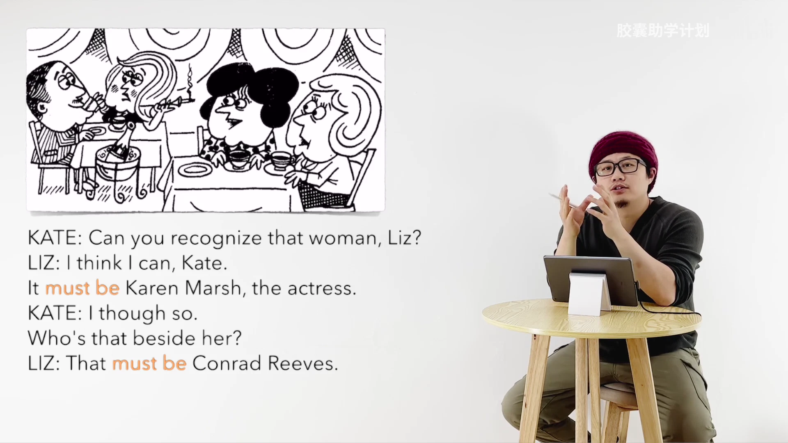

文字识别：KATE: Can you recognize that woman, Liz? / LIZ: I think I can, Kate. / It must be Karen Marsh, the actress. / KATE: I though so. / Who's that beside her? / LIZ: That must be Conrad Reeves.

## 00:00:30–00:01:00

Kate啊，我们先看一下这个场景啊，一男一女啊，一呃一男一女在这个地方吃饭，然后呢，旁边还坐着一桌两位女人，是吧？两个女人，我们看一下，Kate说了一句话，说，Can you recognize that woman, Liz?好，一个是Kate，一个是Liz，对吧？说你能识别出那个女人吗？I think I can, Kate. 我认为啊，我能。It must be Carrie

### 画面 00:00:51

文字识别：KATE: Can you recognize that woman, Liz? / LIZ: I think I can, KatO / It must be Karen Marsh, the actress. / KATE: I though so. / Who's that beside her? / LIZ: That must be Conrad Reeves.

## 00:01:00–00:01:30

Marsh, the actress.她一定是K M这个人啊，the actress那个女演员。注意must be啊，叫做一定是，对吧？Okay, I thought so.啊，哎，这个地方缺了一个小的t，对吧？I thought so.我刚才也是这样认为的。Think so，对吧？So，那在这个地方就表示的是如此啊，我也刚才是认为如此的。

### 画面 00:01:21

文字识别：KATE: Can you recognize that woman, Liz? / LIZ: I think I can, Kate. / It must be Karen Marsh, the actress. / KATE: I thougrfso. / Who's that beside her? / LIZ: That must be Conrad Reeves.

## 00:01:30–00:02:00

Who's that beside her? 说那个是谁？Beside her，在她旁边紧挨着她坐的那个人是谁？That must be C二啊，Conrad Raves. Okay, 啊，C二这个人说那呀，一定是C二这个人。我们不知道他是谁，我们接着看。说Conrad Raves, the actor. 说哎，是这个男演员吗？It can't be. 一定不是。其实

### 画面 00:01:50

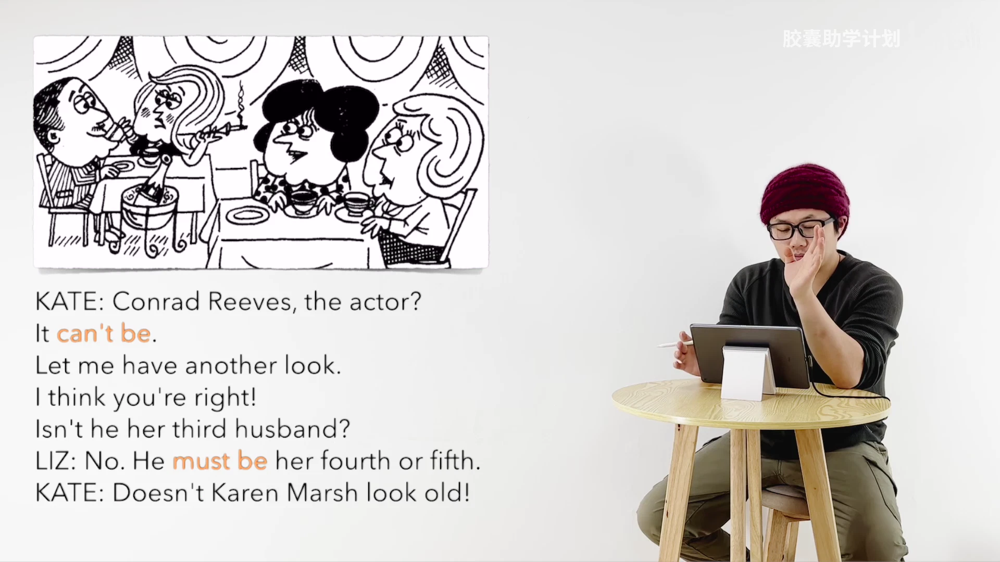

文字识别：KATE: Conrad Reeves, the actor? / It can't be. / Let me have another look. / I think you're right! / Isn't he her third husband? / LIZ: No. He must be her fourth or fifth. / KATE: Doesn't Karen Marsh look old!

## 00:02:00–00:02:30

can't be后边还缺了一个省略了，Conrad Raves，对吧？啊，或者it can't be that actor. Let me have another look. Okay,让我再看一眼。比如说let me go，叫让我走，对吧？Let me in，叫让我进去。那let me后边加一个have another look。那have a look叫看一下，have another look叫再看一下，再让我看一下。I think you are right.说我认为你

### 画面 00:02:20

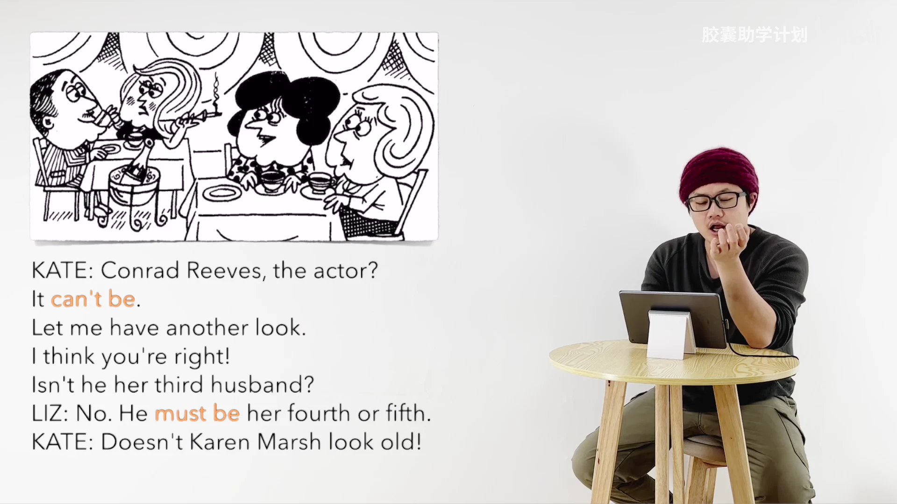

文字识别：KATE: Conrad Reeves, the actor? / It can't be. / Let me have another look. / I think you're right! / Isn't he her third husband? / LIZ: No. He must be her fourth or fifth. / KATE: Doesn't Karen Marsh look old!

## 00:02:30–00:03:00

是对的啊。两个人吃瓜啊，这个心情特别的激动啊。八卦说，Isn't her? Isn't he her third husband?说难道他不是他的第三任老公吗？也就是说，哇塞，他已经是他的第三任老公了，对吧？两个人八卦的那个心情就上来了。Isn't OK.这是我们六十七课就学过的语法，反义疑问句啊。说No，不是啊。He must be.他一定

### 画面 00:02:50

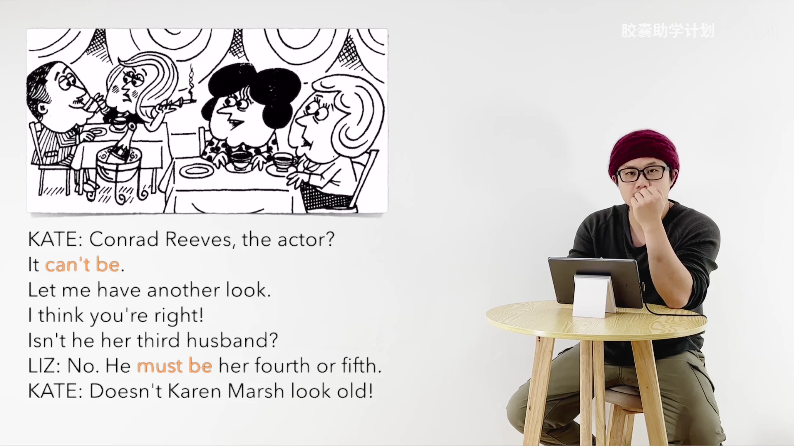

文字识别：KATE: Conrad Reeves, the actor? / It can't be. / Let me have another look. / I think you're right! / Isn't he her third husband? / LIZ: No. He must be her fourth or fifth. / KATE: Doesn't Karen Marsh look old!

## 00:03:00–00:03:30

### 画面 00:03:20

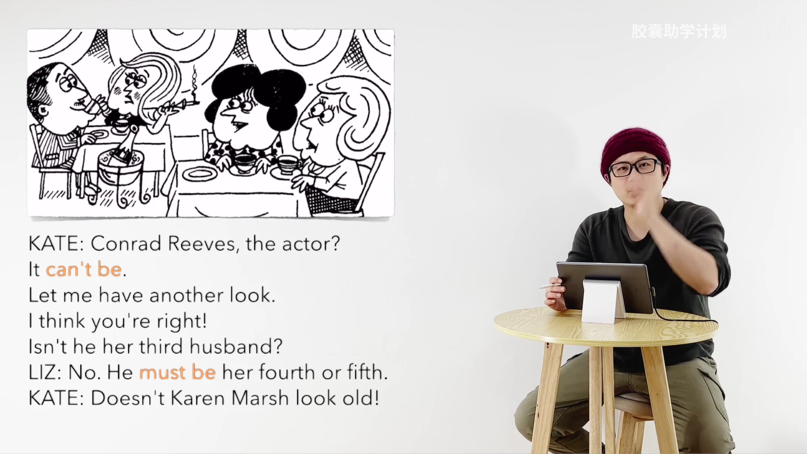

文字识别：KATE: Conrad Reeves, the actor? / It can't be. / Let me have another look. / I think you're right! / Isn't he her third husband? / LIZ: No. He must be her fourth or fifth. / KATE: Doesn't Karen Marsh look old!

### 画面 00:03:24

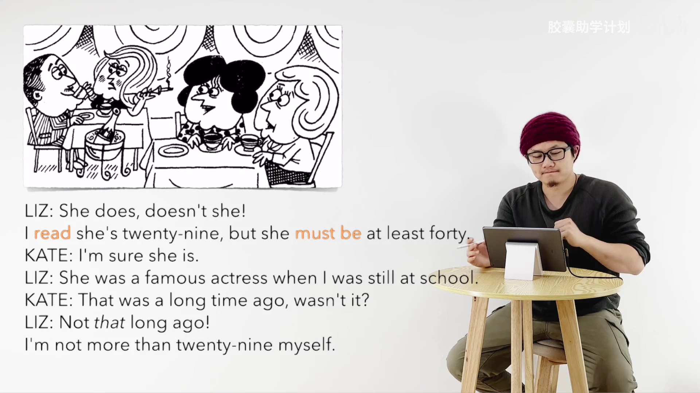

文字识别：LIZ: She does, doesn't she! / I read she's twenty-nine, but she must be at least forty / KATE: I'm sure she is. / LIZ: She was a famous actress when I was still at school. / KATE: That was a long time ago, wasn't it? / LIZ: Not that long ago! / I'm not more than twenty-nine myself.

## 00:03:30–00:04:00

### 画面 00:03:54

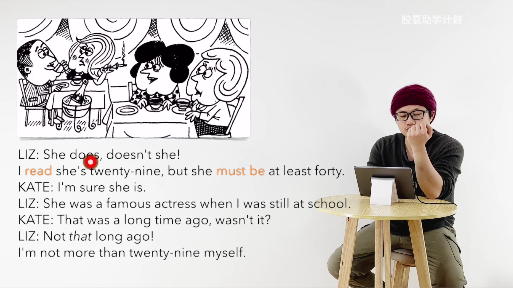

文字识别：LIZ: She does, doesn't she! / I read she's twenty-nine, but she must be at least forty. / KATE: I'm sure she is. / LIZ: She was a famous actress when I was still at school. / KATE: That was a long time ago, wasn't it? / LIZ: Not that long ago! / I'm not more than twenty-nine myself.

## 00:04:00–00:04:30

但是啊，他一定是注意还是推测，对吧？至少四十岁了。He说，I'm sure she is.我很确定她是。She was a famous actress.她是一个特别有名的女演员。When一百一十七个咱们学的叫当什么什么时候？当什么时候呢？I was still at school.说，当我依旧还在学校的时候啊，她就是一个特别有名的

### 画面 00:04:24

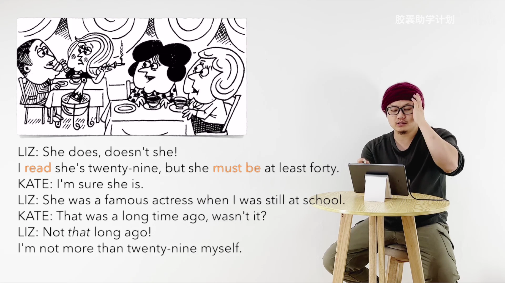

文字识别：LIZ: She does, doesn't she! / I read she's twenty-nine, but she must be at least forty. / KATE: I'm sure she is. / LIZ: She was a famous actress when I was still at school. / KATE: That was a long time ago, wasn't it? / LIZ: Not that long ago! / I'm not more than twenty-nine myself.

## 00:04:30–00:05:00

女演员了。That was a long time ago, wasn't it? 注意这句话，这个打炸了话匣子是吧？看我们看一下是怎么回事啊？说那是很长时间之前的事情了吧？对吧？Wasn't it? 等于 right，对吧？反义疑问句，前肯后否，前否后肯，时态人称保持一致。List，赶紧说说，Not that long ago，没有那么长时间以前。

### 画面 00:04:39

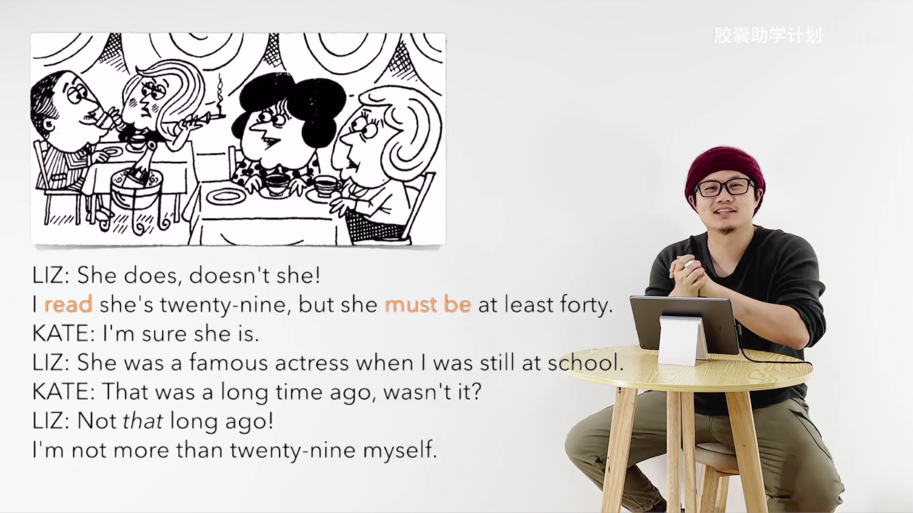

文字识别：LIZ: She does, doesn't she! / I read she's twenty-nine, but she must be at least forty. / KATE: I'm sure she is. / LIZ: She was a famous actress when I was still at school. / KATE: That was a long time ago, wasn't it? / LIZ: Not that long ago! / I'm not more than twenty-nine myself.

### 画面 00:04:43

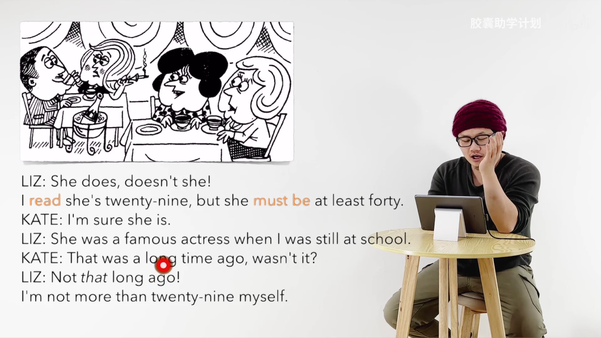

文字识别：LIZ: She does, doesn't she! / I read she's twenty-nine, but she must be at least forty. / KATE: I'm sure she is. / LIZ: She was a famous actress when I was still at school. / KATE: That was a lo / time ago, wasn't it? / LIZ: Not that long ago! / I'm not more than twenty-nine myself.

## 00:05:00–00:05:30

你看为什么呢？你想啊，他说还是我在学校的时候，然后他说这一定是很长时间之前的事儿了吧？其实俩人想说的是，为了通过这件事情证明那个女演员有多老，对吧？但你这么一说，不就说明自己也很老了吗？你看他怎么说的？没有那么长时间之前，I'm not more than twenty nine myself。我还没有 more than 叫超过 twenty nine 二十九 myself 叫我自己，就我自己

### 画面 00:05:13

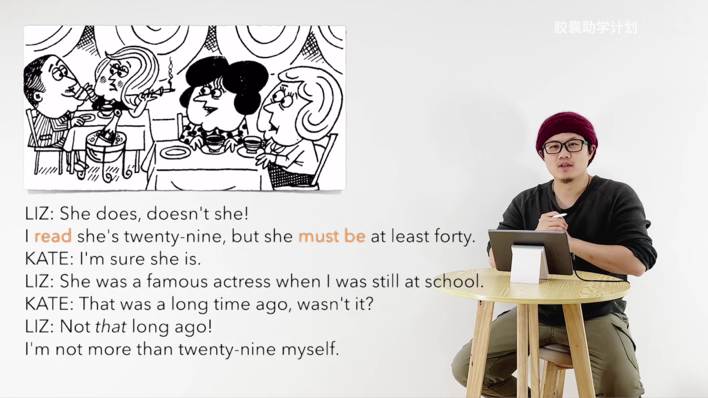

文字识别：LIZ: She does, doesn't she! / I read she's twenty-nine, but she must be at least forty. / KATE: I'm sure she is. / LIZ: She was a famous actress when I was still at school. / KATE: That was a long time ago, wasn't it? / LIZ: Not that long ago! / I'm not more than twenty-nine myself.

## 00:05:30–00:06:00

还没有超过二十九岁呢啊！他这个地方其实开了一个小的玩笑，就呃，刻板印象当中啊，我们会认为女性对自己的年年龄一般都不希望报超过三十岁，对吧？有这样一个西方的类似于我们不轻易问别人年龄这样一个隐私的小的点。OK，好，那文章讲完了之后，接下来我们做一些口语听力训练啊。那我问您答，伊迪，您可以看文章里找答案啊。

### 画面 00:05:43

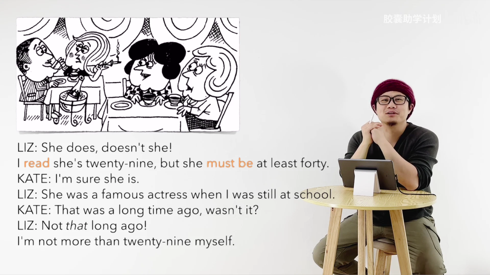

文字识别：LIZ: She does, doesn't she! / I read she's twenty-nine, but she must be at least forty. / KATE: I'm sure she is. / LIZ: She was a famous actress when I was still at school. / KATE: That was a long time ago, wasn't it? / LIZ: Not that long ago! / I'm not more than twenty-nine myself.

### 画面 00:05:51

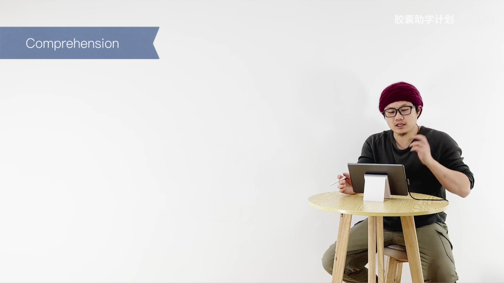

文字识别：Comprehension

### 画面 00:05:58

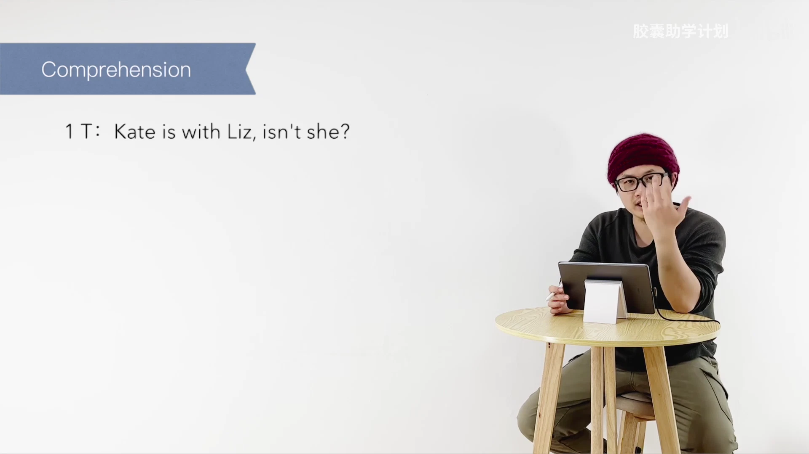

文字识别：Comprehension / 1 T: Kate is with Liz, isn't she?

## 00:06:00–00:06:30

Kate is with Liz, isn't she? Yes, she is. Next one. Can Liz recognize Karen Marsh? Yes, she can. Next one. Who is Karen Marsh? She is a famous actress. Next one. Who is the man beside Karen Marsh? That's Conrad Raves.

### 画面 00:06:12

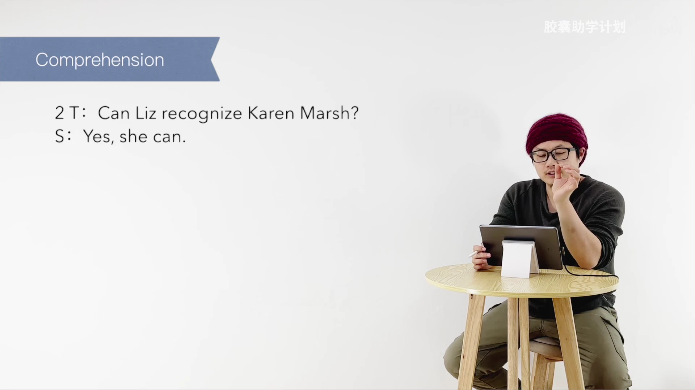

文字识别：Comprehension / 2 T: Can Liz recognize Karen Marsh? / S: Yes, she can. / 25

### 画面 00:06:22

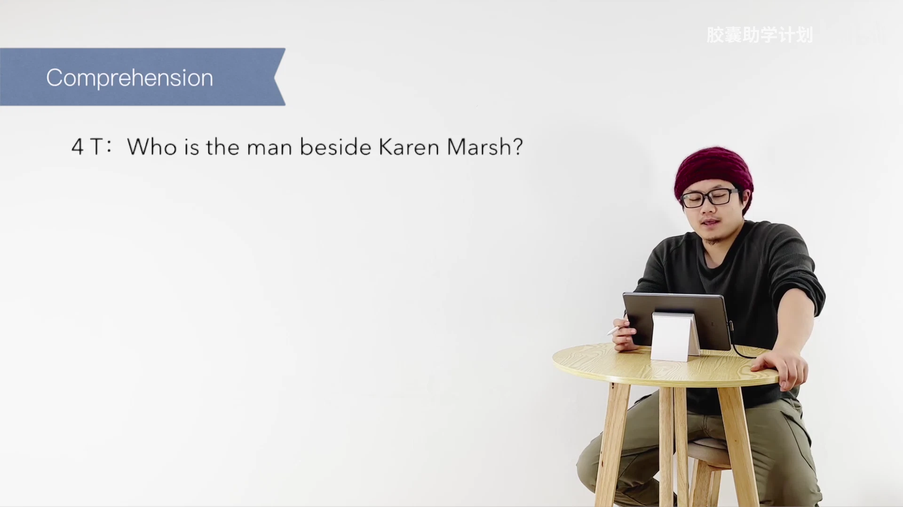

文字识别：Comprehension / 4 T: Who is the man beside Karen Marsh?

### 画面 00:06:27

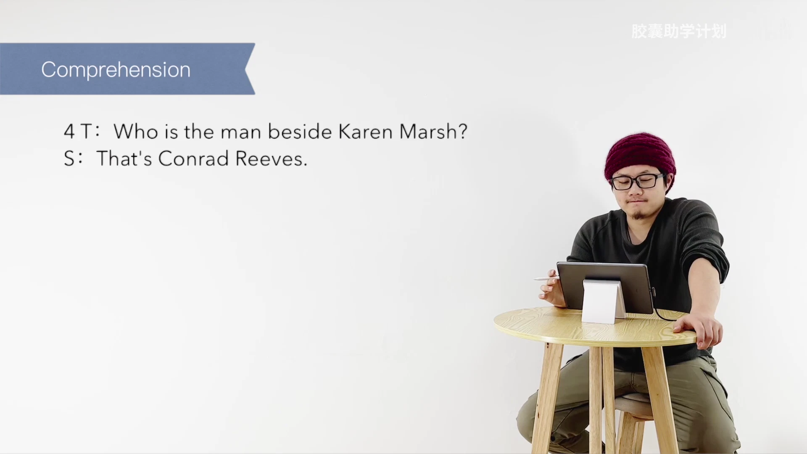

文字识别：Comprehension / 4 T: Who is the man beside Karen Marsh? / S: That's Conrad Reeves.

## 00:06:30–00:07:00

next one is he Karen Marsh's third or fourth husband. Liz thinks she he must be her fourth or fifth.他问的是他是他第三任还是第四任呢？他的回答其实我们是不知道的，但我们知道说 Liz 认为他是他的第四任或第五任老公，对吧？这个题只能这样回答。

### 画面 00:06:32

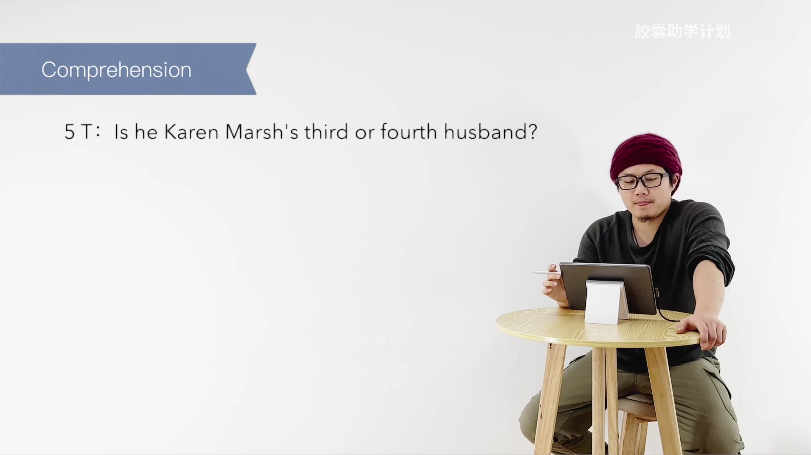

文字识别：Comprehension / 5 T: Is he Karen Marsh's third or fourth husband?

## 00:07:00–00:07:30

Next one, how old does Liz think Karen Marsh is? She thinks she must be at least forty. Next one, why does Liz say Karen Marsh must be at least forty?哎，你看，这就是我们说推测，你一定要是背后有原因的，对吧？我现在就问一下原因，为什么你这样认为这么肯定的一个推测，叫做 because Karen

### 画面 00:07:02

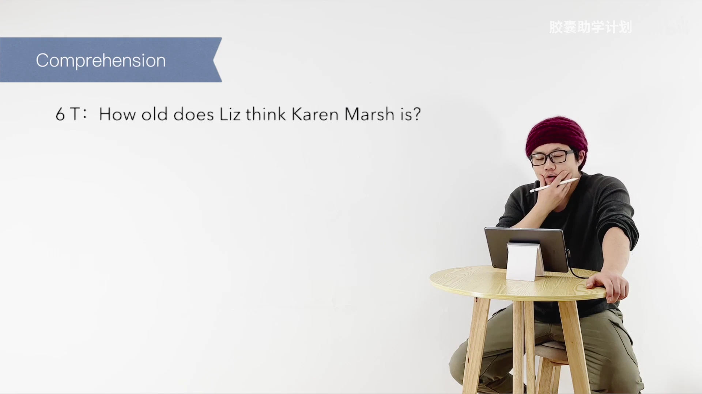

文字识别：Comprehension / 6 T: How old does Liz think Karen Marsh is?

### 画面 00:07:12

文字识别：Comprehension / 7 T: Why does Liz say Karen Marsh must be / at least forty?

### 画面 00:07:28

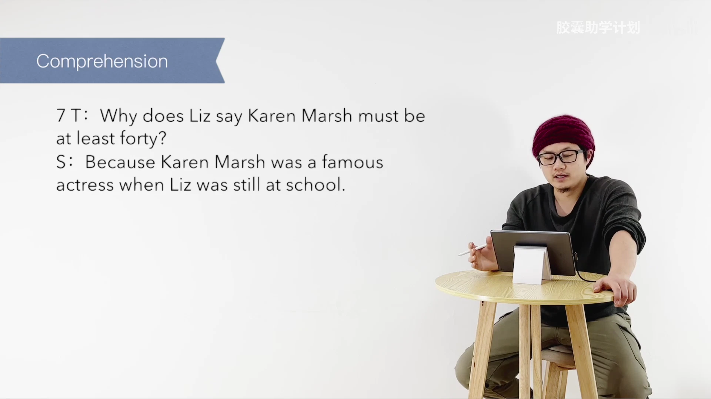

文字识别：Comprehension / 7 T: Why does Liz say Karen Marsh must be / at least forty? / S: Because Karen Marsh was a famous / actress when Liz was still at school.

## 00:07:30–00:08:00

Marsh was a famous actress when Liz was still at school. Next one, does Kate think that was a long time ago? 注意啊，问的是 Kate, Kate 回答的是 Yes, she does. 那注意，那 How old is Liz now? 注意答案是 She says she is not more than twenty nine herself. 但注意前面那两个单词非常重要，叫 She

### 画面 00:07:36

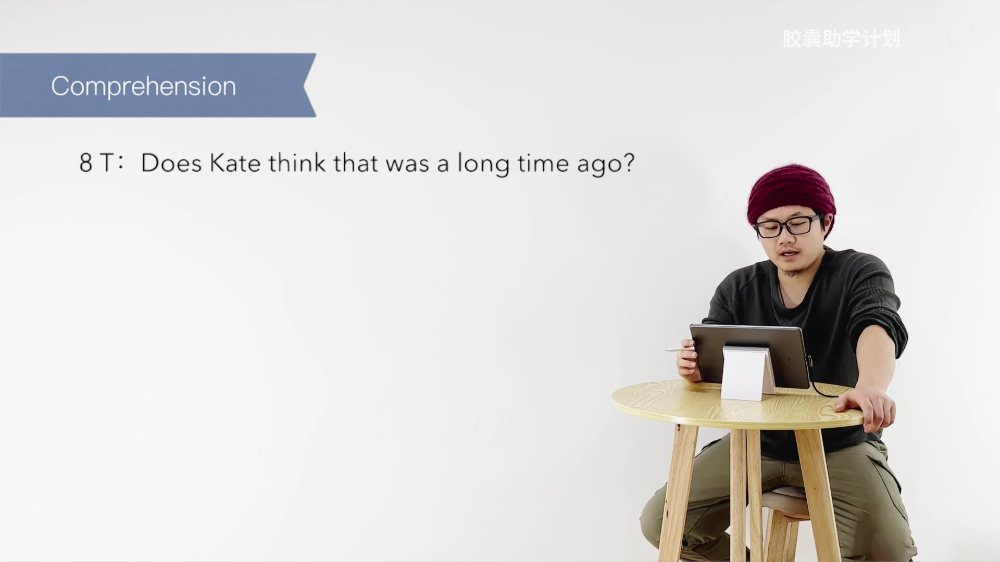

文字识别：Comprehension / 8 T: Does Kate think that was a long time ago?

### 画面 00:07:50

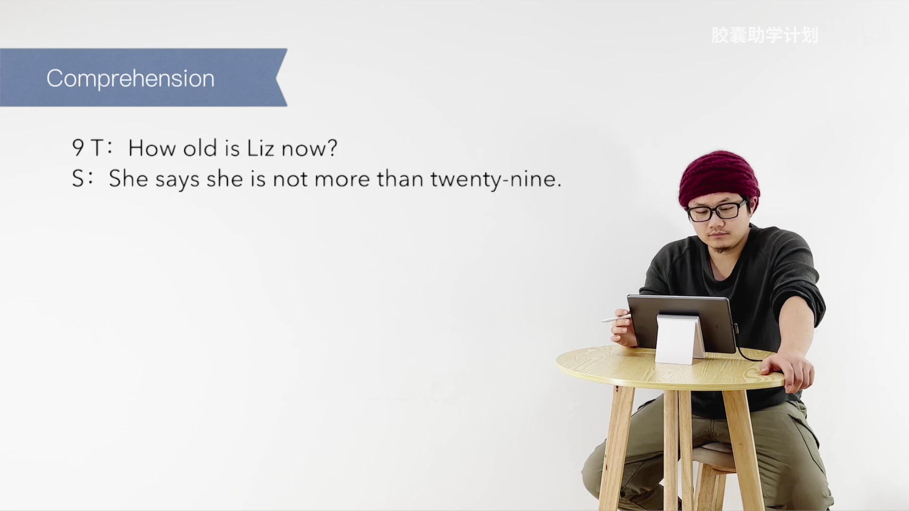

文字识别：Comprehension / 9 T: How old is Liz now? / S: She says she is not more than twenty-nine.

## 00:08:00–00:08:30

says，对吧？是她自己说的，她自己没超过二十九。那她至于真正多大了，文章是没有给的啊。OK，那 asking questions，肯定句、一般疑问句、特殊疑问句老习惯。第一题， ask me if Liz recognized Karen Marsh。注意 recognized 后边是加 e d 的啊，所以 did Liz recognize Karen Marsh？ Next one， how，直接加前面就行了，对吧？叫 how did Liz recognize Karen

### 画面 00:08:07

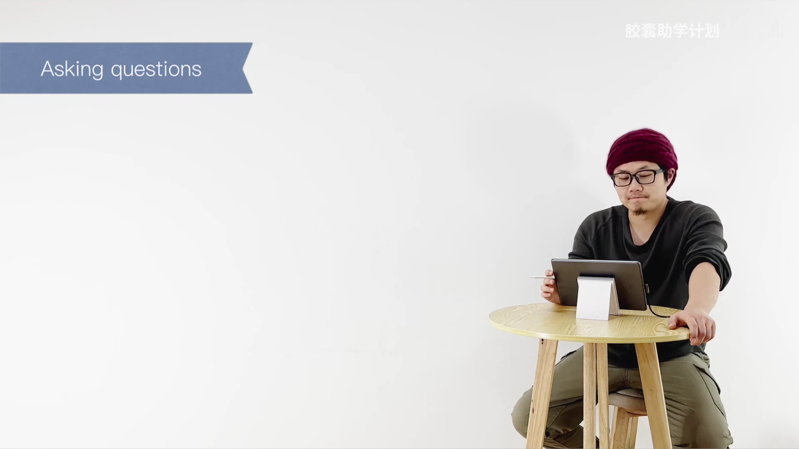

文字识别：Asking questions

### 画面 00:08:19

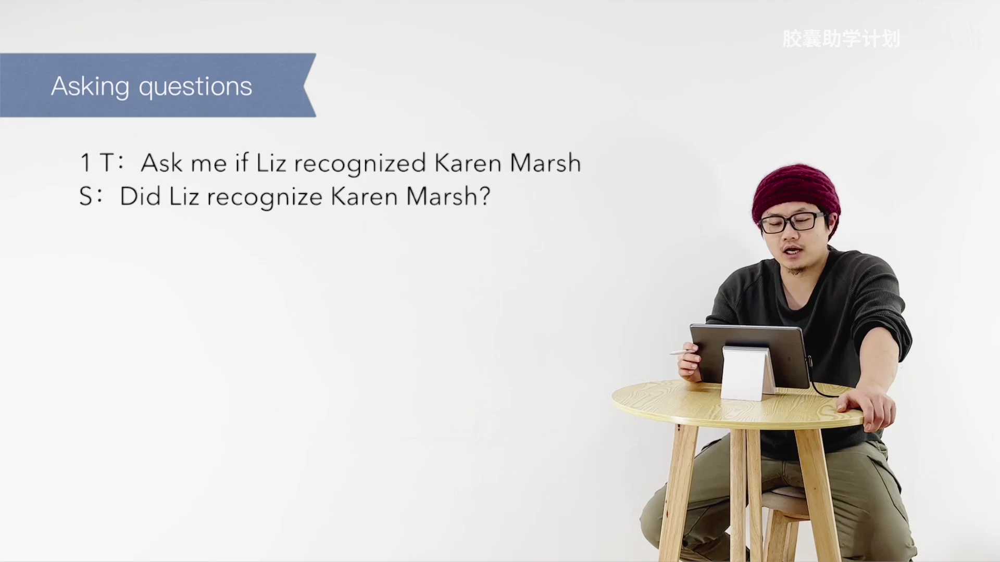

文字识别：Asking questions / 1 T: Ask me if Liz recognized Karen Marsh / S: Did Liz recognize Karen Marsh?

## 00:08:30–00:09:00

Marsh. Next one, ask me if Karen Marsh has had a lot of husbands. Has the Karen Marsh had a lot of husbands? How many? How many is just对a lot of提问对吧？所以How many husbands has Karen Marsh had? Next one, ask me if Conrad is her fifth husband. Is Conrad her fifth husband?

### 画面 00:08:31

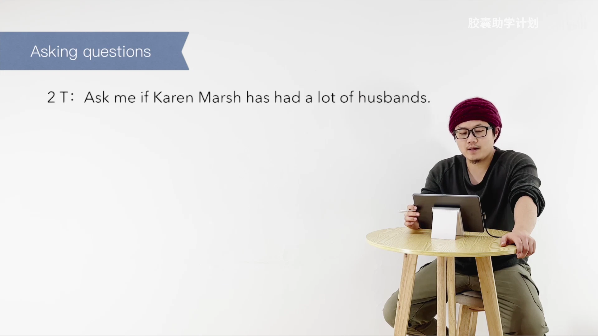

文字识别：Asking questions / 2 T: Ask me if Karen Marsh has had a lot of husbands.

### 画面 00:08:39

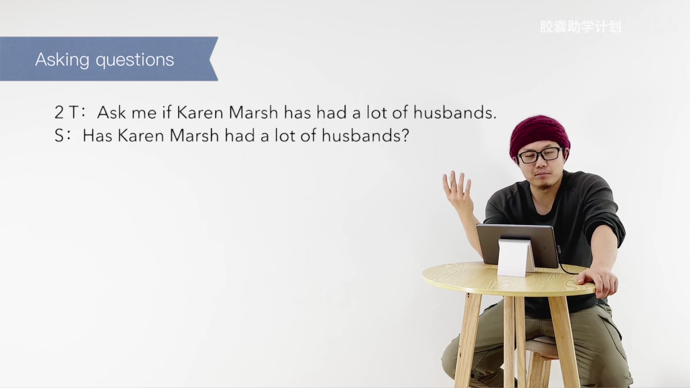

文字识别：Asking questions / 2 T: Ask me if Karen Marsh has had a lot of husbands. / S: Has Karen Marsh had a lot of husbands?

### 画面 00:08:46

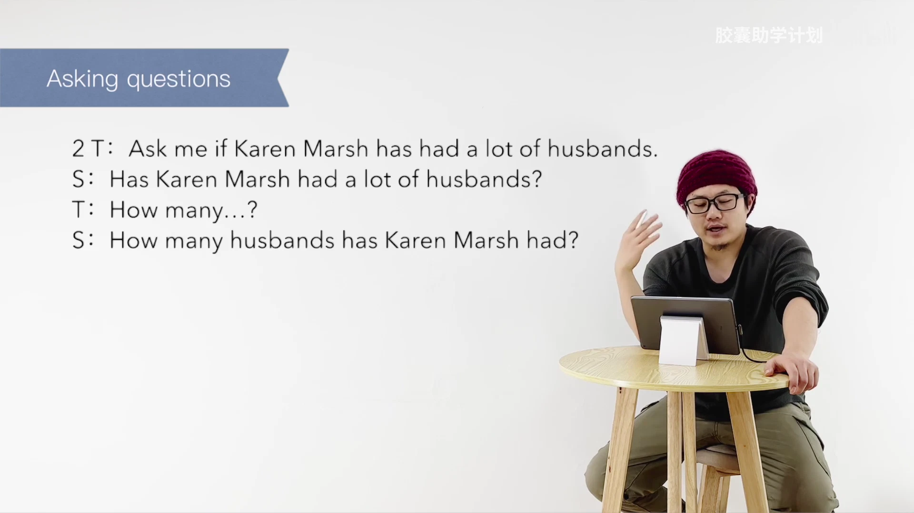

文字识别：Asking questions / 2 T: Ask me if Karen Marsh has had a lot of husbands. / S: Has Karen Marsh had a lot of husbands? / T: How many..? / S: How many husbands has Karen Marsh had?

### 画面 00:08:50

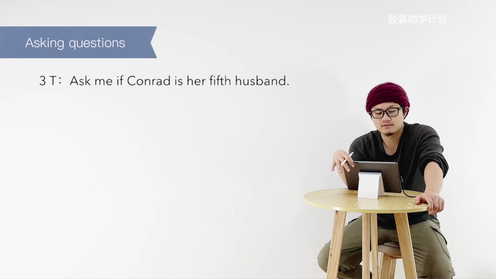

文字识别：Asking questions / 3 T: Ask me if Conrad is her fifth husband.

## 00:09:00–00:09:30

which, so which husband is Conrad? Ah, fifth, ah, third or ah fourth? Okay. Next one, ask me if Karen Marsh must be forty. Must Karen be forty? How old? How old must Karen be? Is right. She must be forty. How old? How old must Karen be? Is right. She must be

### 画面 00:09:01

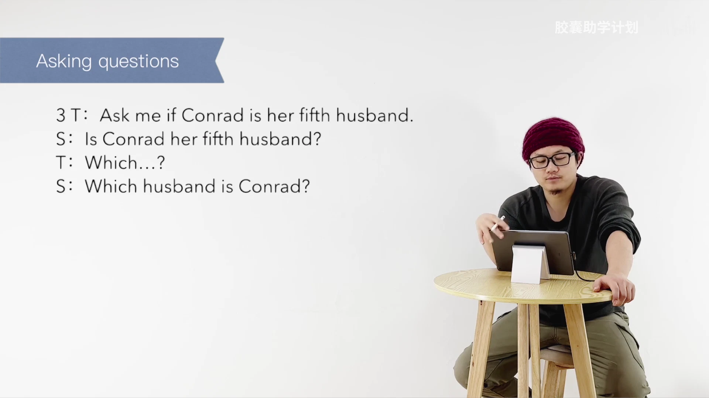

文字识别：Asking questions / 3 T: Ask me if Conrad is her fifth husband. / S: Is Conrad her fifth husband? / T: Which...? / S: Which husband is Conrad?

### 画面 00:09:11

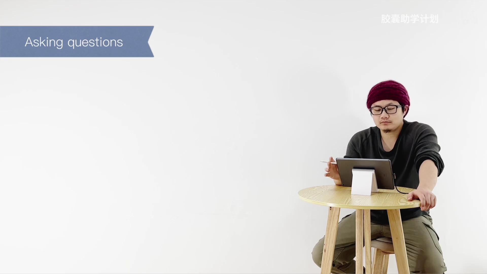

文字识别：Asking questions

### 画面 00:09:21

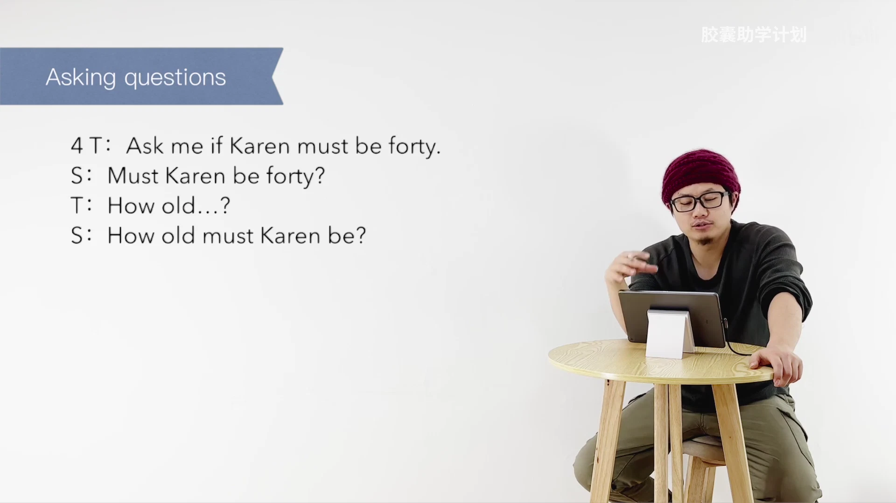

文字识别：Asking questions / 4T: Ask me if Karen must be forty. / S: Must Karen be forty? / T: How old...? / S: How old must Karen be?

### 画面 00:09:27

文字识别：Asking questions

## 00:09:30–00:10:00

if Liz is twenty nine. Is Liz twenty nine? How old? Very simple. How old is Liz? Very good.家庭作业啊, recap.对于各位来说，这个地方最重要的依旧跟上一个视频是一样。文章当中各位把这些东西摘出来搞定，能看懂就OK了，是吧？那剩下的就是老习惯，绿皮书一百二十七课，各位可以写了。文章跟读至熟读成诵，给自己讲解一遍今天的核

### 画面 00:09:37

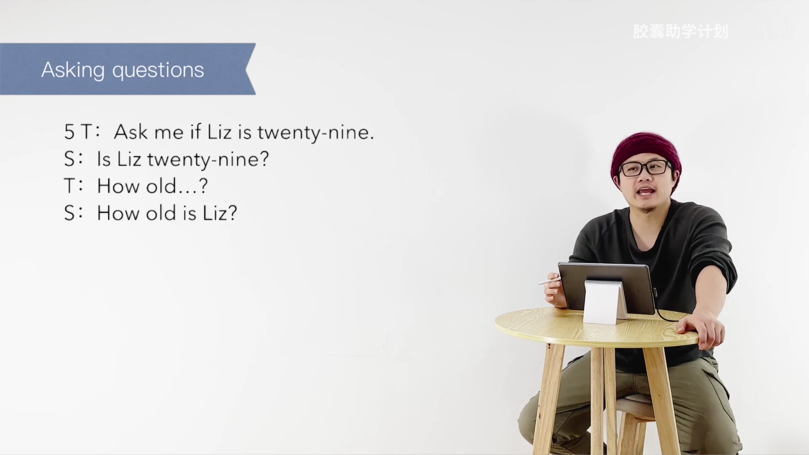

文字识别：Asking questions / 5 T: Ask me if Liz is twenty-nine. / S: Is Liz twenty-nine? / T: How old...? / S: How old is Liz?

### 画面 00:09:40

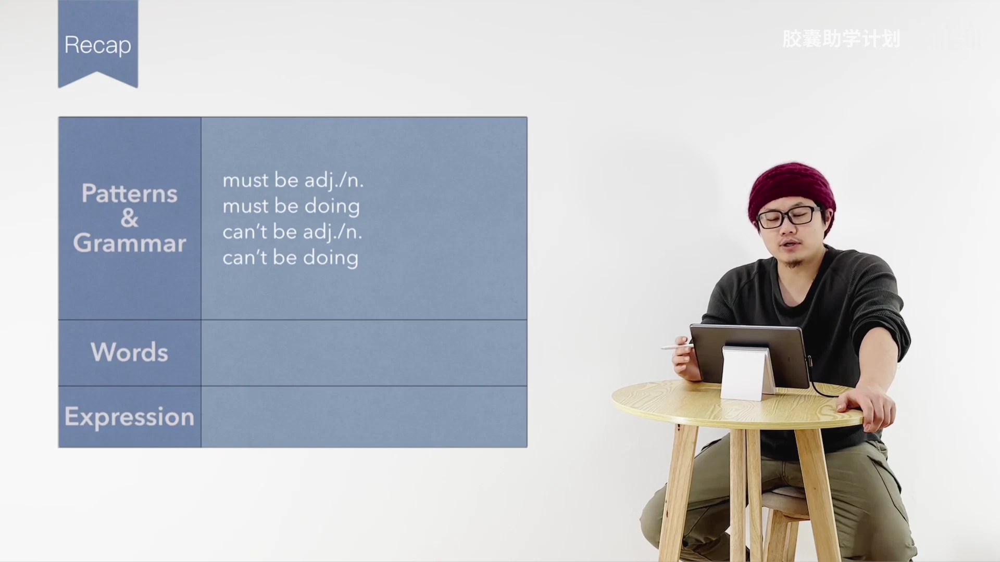

文字识别：Recap / must be a / adj./n. / Patterns / must be / doing / 8 / can't be a / adj./n. / Grammar / can't be / doing / Words / Expression

### 画面 00:09:52

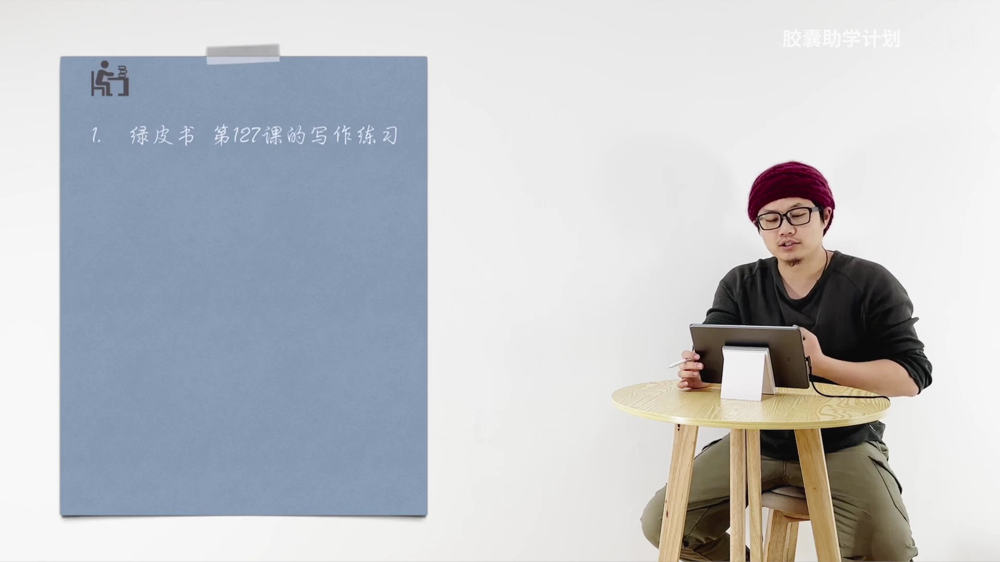

文字识别：绿皮书第127课的写作练习

## 00:10:00–00:10:30

心知识点。那如果各位喜欢我们的课程呢，欢迎各位关注、订阅、一键三连，分享给那些需要的朋友，来帮助我们快速成长。那最后我们再来看一句名人名言：I'm more interested in being good than being famous. See you next time.

### 画面 00:10:01

### 画面 00:10:10

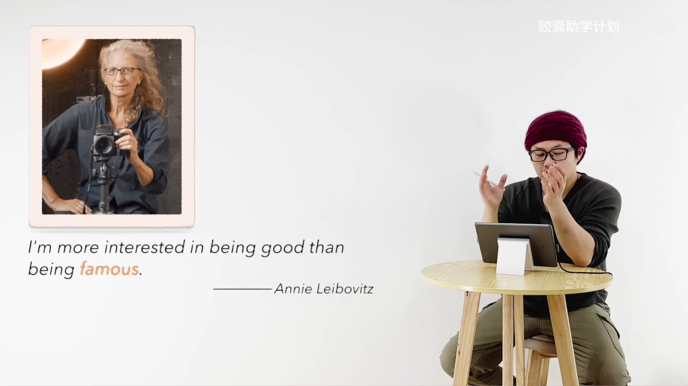

文字识别：I'm more interested in being good than / being / famous. / -Annie Leibovitz

### 画面 00:10:19

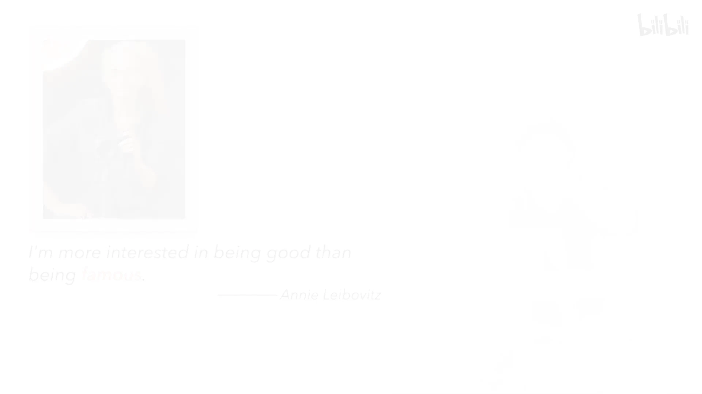

### 画面 00:10:21

文字识别：CAPSULEACADEMY / 胶囊助学计划 / 小红书 / Lecturer / Leo / OE

### 画面 00:10:24

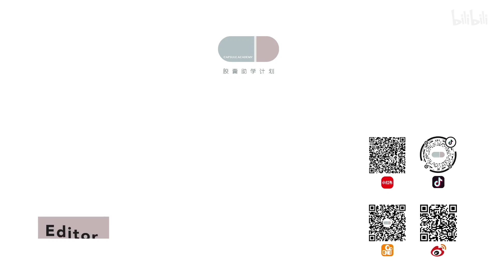

文字识别：CAPSULEACADEMY / 胶囊助学计划 / 小红书 / Editor / OE

### 画面 00:10:27

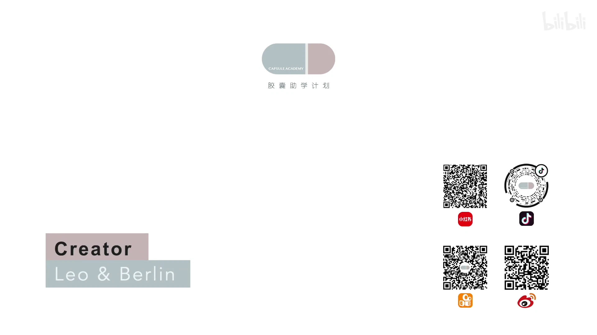

文字识别：CAPSULEACADEMY / 胶囊助学计划 / 小红书 / Creator / Leo & Berlin

### 画面 00:10:29

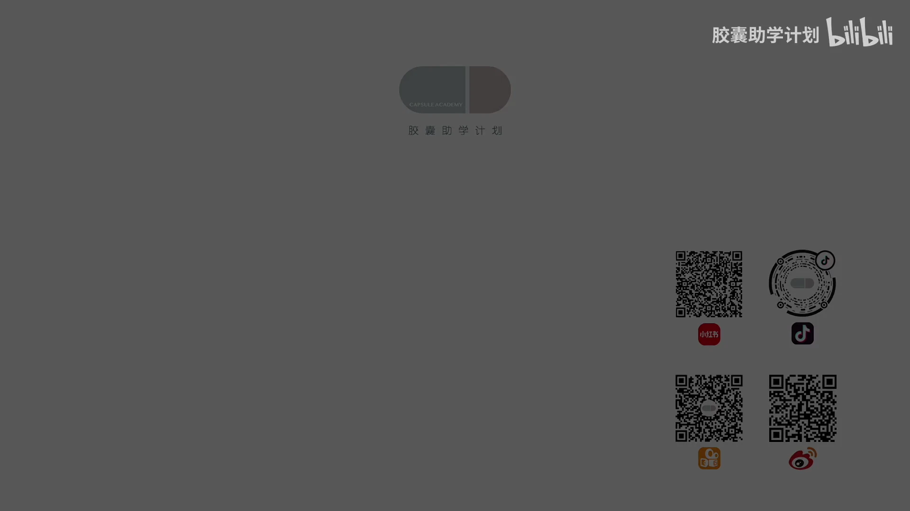

文字识别：bilibili / 胶囊助学计划 / 胶囊助学计划 / 小红书 / OE

## 00:10:30–00:10:31

### 画面 00:10:31

文字识别：bilibili / 胶囊助学计划

