# 129 单词 语法

快速机器解析：语音为单模型转写，未进行独立交叉校对或人工复核；画面每秒采样并按变化选帧，短时文字和标记可能遗漏。截图时间约有 1 秒误差。图片有损压缩；遇到疑点请按时间查看 Google Drive 原视频。

## 00:00:00–00:00:30

Hello, everyone. Welcome to Capsule Academy. This is Leo. Today, we are going to learn New Concept English Book One, Lesson One Hundred and Twenty Nine, Grammar and Words. 那老习惯进入正式课程之前呢，我们先看一个问题，就是 must 与 can't 对过去表推测应该如何去说？那这对应的是咱们刚刚学过的对现在表推测应该如何去说？那带着这个问题，Hope you guys enjoy. 好，

### 画面 00:00:00

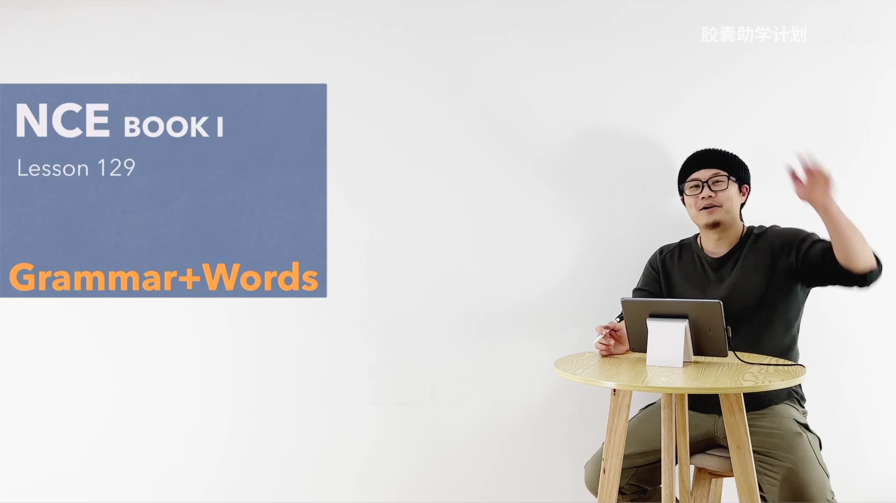

文字识别：NCE / BOOKI / Lesson 129 / Grammar+Words

### 画面 00:00:02

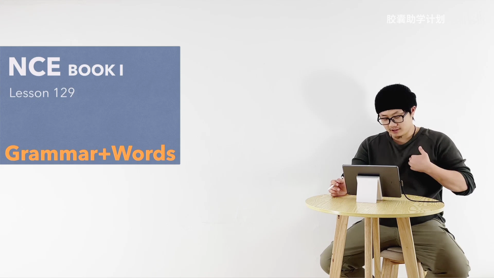

文字识别：NCE / BOOKI / Lesson 129 / Grammar+Words

### 画面 00:00:05

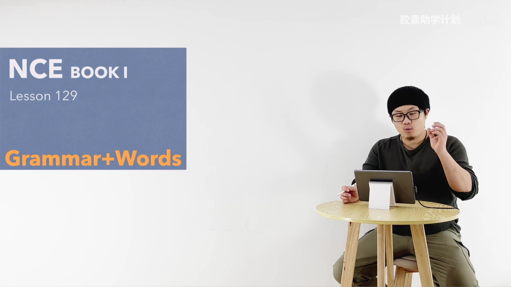

文字识别：NCE / BOOKI / Lesson 129 / Grammar+Words

### 画面 00:00:10

### 画面 00:00:12

文字识别：①must ＆ can't 对过去推测？

### 画面 00:00:26

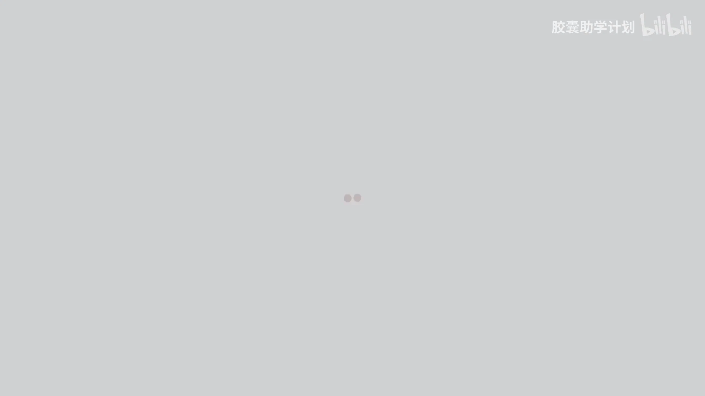

文字识别：胶囊助学计划 bibl / ••

## 00:00:30–00:01:00

好，那我们先看一下啊。首先，我们上节课其实学的和这节课学的有很多类似的地方，比如说，首先不管是 must 还是 can't，只要出现了，如果是表推测，它的确信度就是高的，对吧？那它对应的就是确信度低，也就是一百三十一课咱们马上要学到的那些。再然后呢，他们都是今天咱们学的是表示对过去的推测，而上一节课咱们学的是对现在的推测，而

### 画面 00:00:30

文字识别：胶囊助学计划

### 画面 00:00:32

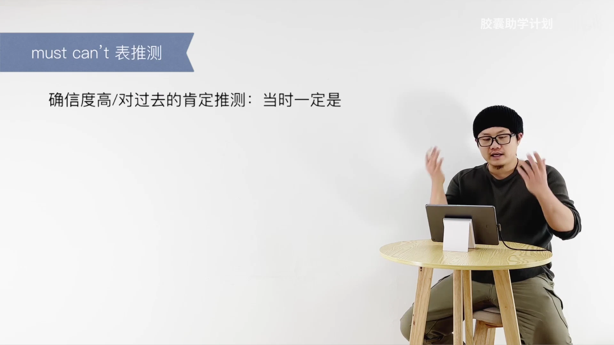

文字识别：must can't表推测 / 确信度高/对过去的肯定推测：当时一定是

### 画面 00:00:39

文字识别：must can't 表推测 / 确信度高/对过去的肯定推测：当时一定是

### 画面 00:00:43

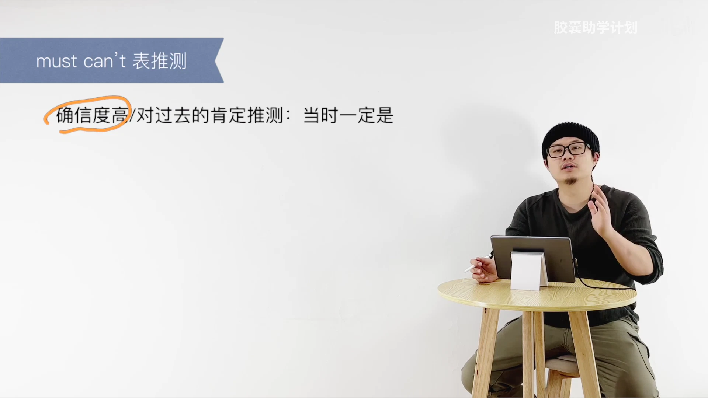

文字识别：must can't 表推测 / 确信度高/对过去的肯定推测：当时一定是

### 画面 00:00:52

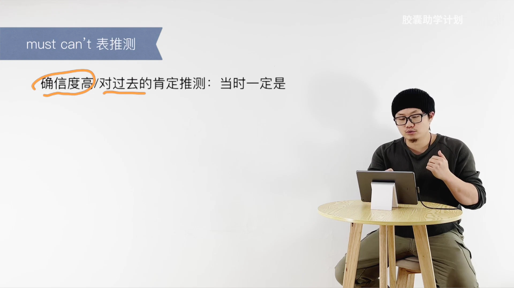

文字识别：must can't 表推测 / 确信度高/对过去的肯定推测：当时一定是

## 00:01:00–00:01:30

我们英文又是这样一门语言，叫做结构决定了它的含义，对吧？那同理，我想表达不同的含义，往往可能就会出现不同的结构。于是各位期待的是，接下来我们一会儿可能会看到不同的结构。接下来呢，它是一个肯定推测，表示当时一定是，那这个就是 must。如果是否定呢，那就是 can't，表示的是当时一定不是。我们先给大家三个小

### 画面 00:01:18

文字识别：must can't 表推测 / 确信度高/对过去的肯定推测：当时一定是

### 画面 00:01:29

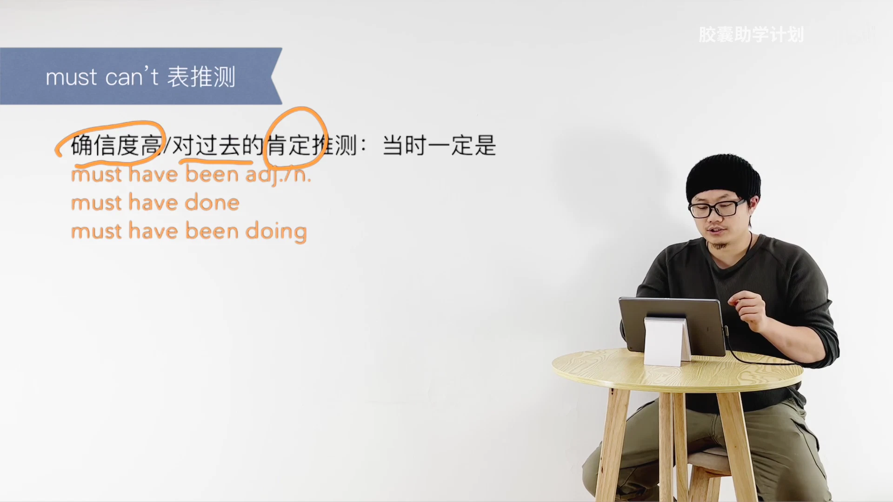

文字识别：must can't 表推测 / 确信度高 / /对过去的肯定推测：当时一定是 / must have / been adj.n. / must / thave / done / must have / been doing

## 00:01:30–00:02:00

的公式，我们先一起看一下。看第一个公式啊，叫做 must have been 形容词加名词。您看这个地方，其实如果是对现在推测的话，那其实就是 must 加 be，然后再加形容词名词，对吧？现在变成了 must have been 加形容词名词。这个地方我想提一句，如果您基础特别的好，八十三课到九十课这几课啊学的很棒，那你在这儿可能会有一个疑惑，叫做 have been 这两个单词

### 画面 00:01:31

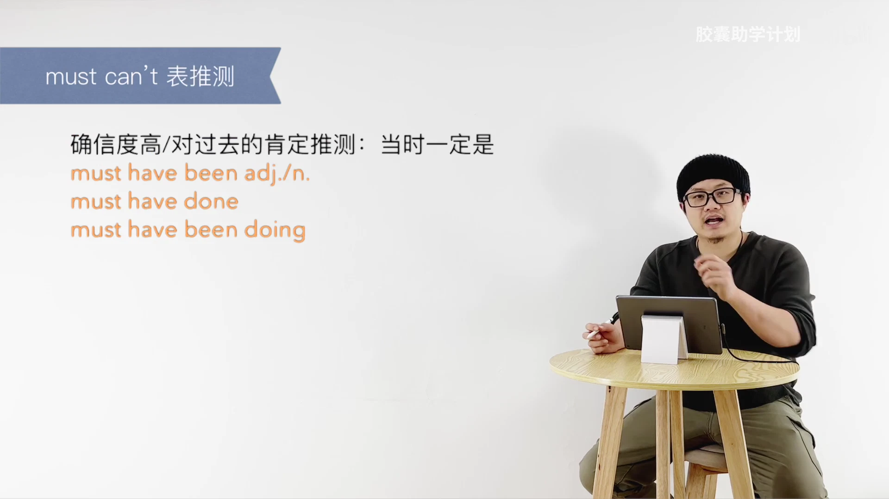

文字识别：must can't 表推测 / 确信度高/对过去的肯定推测：当时一定是 / must have been adj./n. / must have / done / must have k / been doing

### 画面 00:01:38

文字识别：must can't 表推测 / 确信度高/对过去的肯定推测：当时一定是 / must have been adj./n. / must have C / done / must have been doing

### 画面 00:01:46

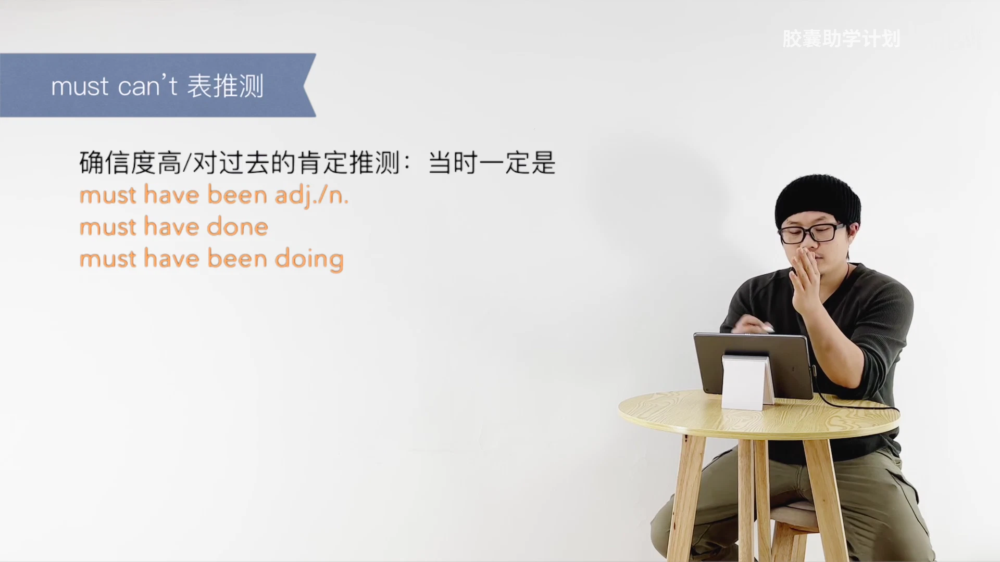

文字识别：must can't 表推测 / 确信度高/对过去的肯定推测：当时一定是 / must have been adj./n. / must have / done / must have k / been doing

### 画面 00:01:49

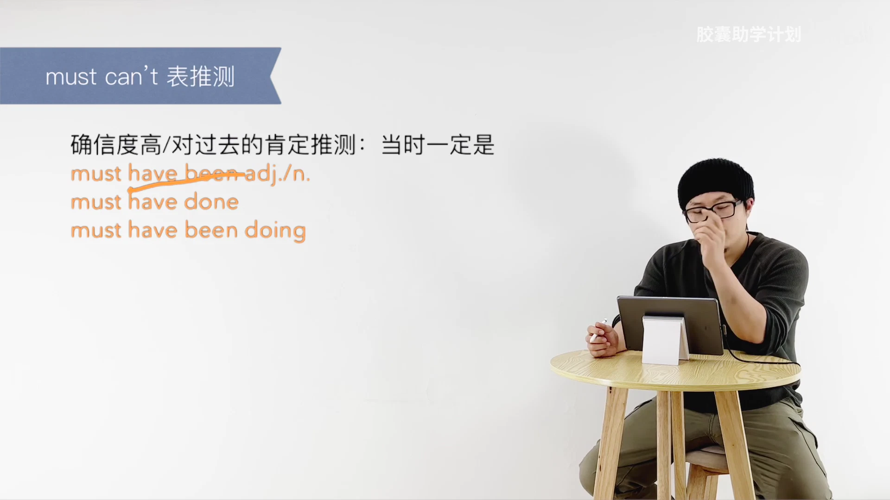

文字识别：must can't / 表推测 / 确信度高/对过去的肯定推测： / : / 当时一定是 / have beenadj./n. / must / must / have / done / must / have / been doing

## 00:02:00–00:02:30

出现的时候，不是往往指的是叫现在完成时吗？那在这儿跟那个时态有关系吗？好，注意啊，我回答各位，注意没有任何关系，就是这个结构是 must 加 have 加 been 后边加形容词加名词，您不用往现在完成时那个地方去连，OK？那同理，其实你像第二个叫 must have done，其实啊，但就是所有动词的过去分词，我不知道各位

### 画面 00:02:12

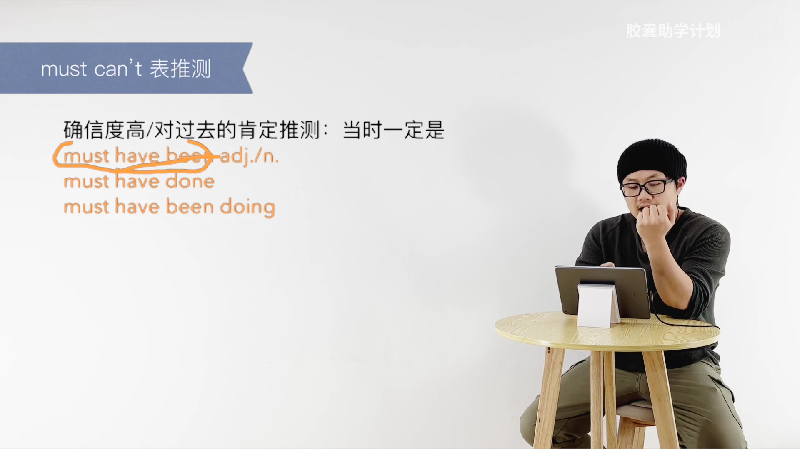

文字识别：must / can't / 表推测 / 确信度高/对过去的肯定推测： / 当时一定是 / must have bee -adj./n. / must / have / done / must / have / been / doing

### 画面 00:02:15

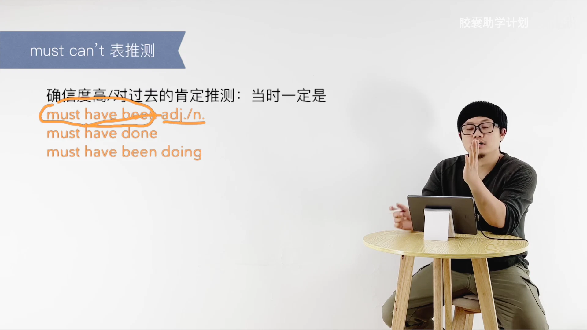

文字识别：must / can't / 表推测 / 确信度高/对过去的肯定推测： / 当时一定是 / must / have boey-adi./n. / must / have / done / must / have / been / doing

### 画面 00:02:17

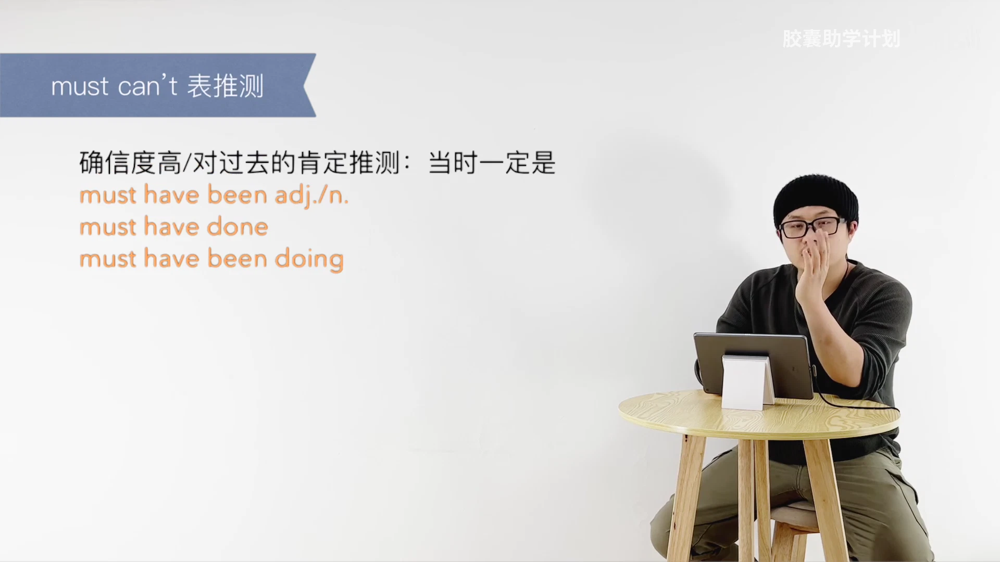

文字识别：must can't 表推测 / 确信度高/对过去的肯定推测：当时一定是 / must have been adj./n. / must have C / done / must have been doing

## 00:02:30–00:03:00

能不能理解。其实第一个例子就是第二个例子的一个特殊情况，也就是说，当这个动词它不是一个具体的动词，它想描述一个状态的时候，我们在这儿就不要用动词了，对吧？我们在这儿就用 was, were 的那个原型叫 be，对不对？ be 本身也叫动词，我们管它叫 be 动词嘛，对吧？那 be 动词的过去分词就是 been，所以第一个公式其实是第二个公式的

### 画面 00:02:33

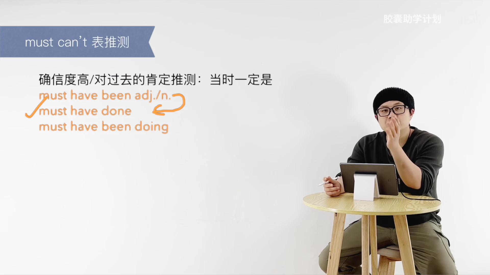

文字识别：must can't / 表推测 / 确信度高/对过去的肯定推测： / 当时一定是 / must / have / been adj./n. / /must / have / done / must / thave / been doing

## 00:03:00–00:03:30

特殊变体，对吧？OK，呃，第三个公式呢叫 must have been doing，表示当时一定正在做某件事情。那我们先看一些例子，比如说 I must have been crazy，那这就是一句话说，哎，我当时也不知道我怎么想的，我当时一定是疯了，是吧？当时一定是疯了才这么去做的，或者说 He must have been tired，叫做他当时一定是特别的累。好，注意，首先您看到

### 画面 00:03:03

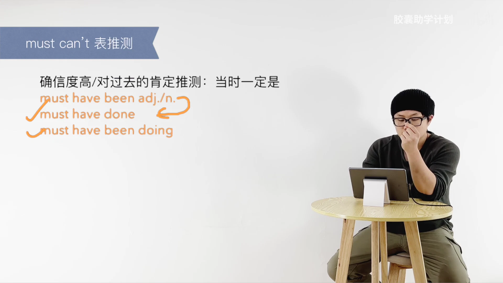

文字识别：must can't / 表推测 / 确信度高/对过去的肯定推测： / 当时一定是 / mustl / t have / been adj./n. / /must / have / done / Cmust l / t have / been doing

### 画面 00:03:21

文字识别：must can't 表推测 / 确信度高/对过去的肯定推测：当时一定是 / must have k / been adj./n.- / must have / done / Cmust have / been doing / I must have / been crazy. / He must have / been tired.

## 00:03:30–00:04:00

了 must have been 再加了一个形容词，这个结构一出现，脑海当中立刻要反映出来几个关键词：，第一叫确信度高，第二叫对过去，第三叫肯定推测。所以它翻译成叫当时一定是 OK 啊，叫它当时一定是特别的累啊。再来，比如说 They must have been having a party 啊，他们当时一定是正在举办一个聚会，他们当时一定是正在 party 对吧？ OK good，

### 画面 00:03:31

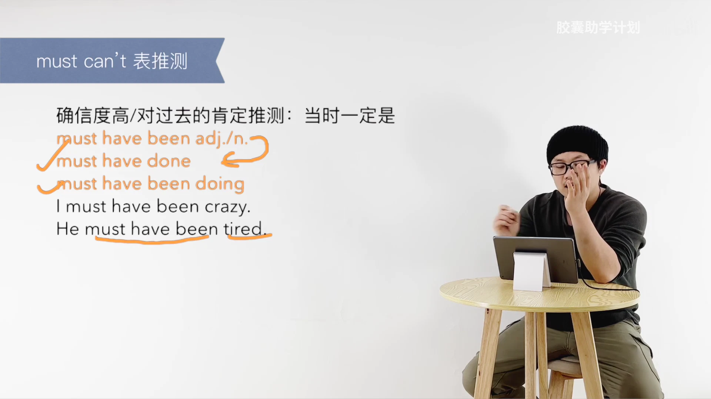

文字识别：must can't / 表推测 / 确信度高/对过去的肯定推测： / 当时一定是 / must / have / been adj./n. / must / have / done / Cmust / have / been / doing / I must have / been crazy. / He must have / been tired.

### 画面 00:03:38

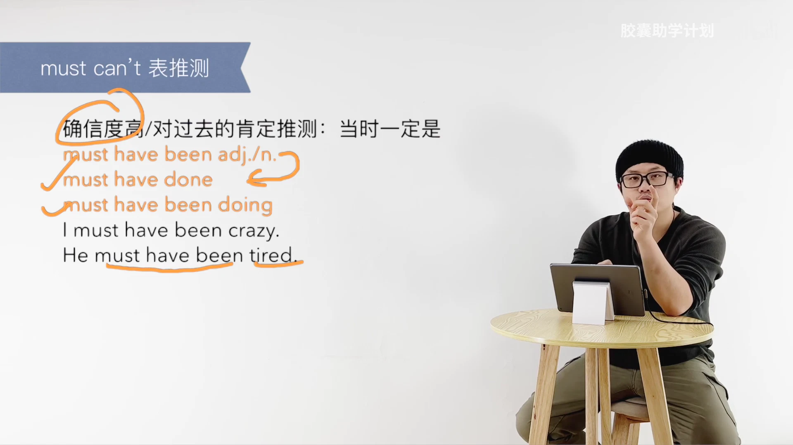

文字识别：must can't / 表推测 / 确信度高/对过去的肯定推测： / 当时一定是 / must / have / been adj./n. / /must / have / done / Cmust / have / been / doing / I must have / beenc / crazy. / He / e must have / been tired.

### 画面 00:03:41

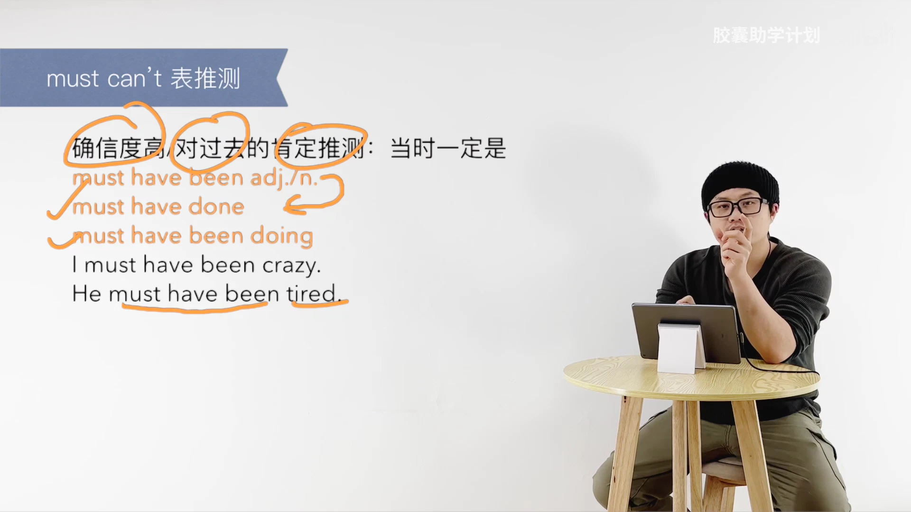

文字识别：must can't / 表推测 / 确信度高 / 对过去的肯定推测： / 当时一定是 / adj./n. / must / have / been / /must / have / done / Cmust / have / been / doing / I must have / been / crazy. / He / must have / been / tired.

### 画面 00:03:49

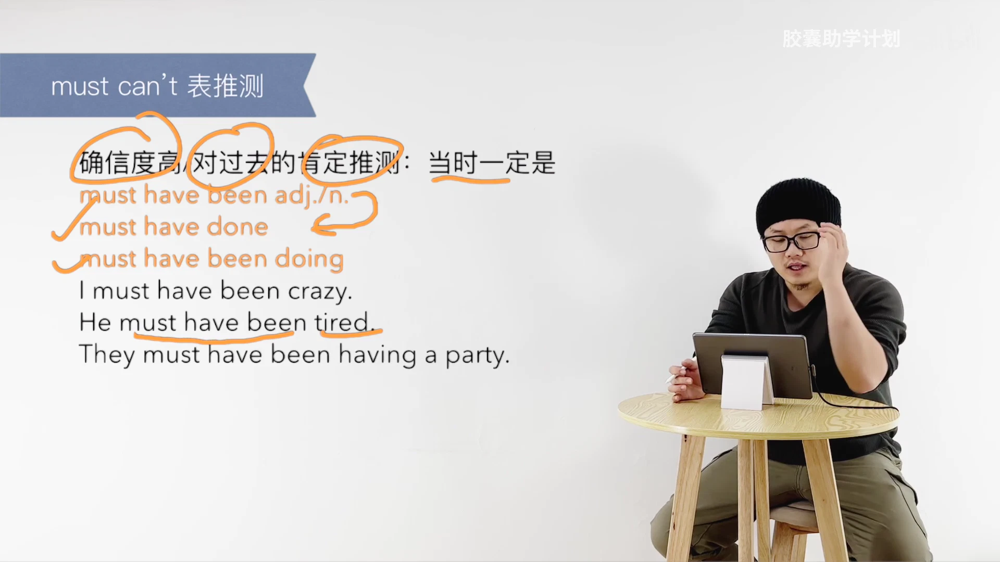

文字识别：must can't / 表推测 / 确信度高 / 对过去的肯定推测 / 当时一定是 / adj./n. / must / have / been / /must / have / done / Cmust / have / been / doing / Imust / have / been / crazy. / He / must / have / been / tired. / They / must have / been I / having a party.

## 00:04:00–00:04:30

所以结构都满足了，含义我们也说清楚了。接下来我们看一下 can't, can't 跟 must 在上一个视频当中啊，在上一课当中我们已经见到了，他们都表示确信度高，对吧？那这地方就不是肯定推测了，是一个叫否定推测，对吧？否定推测，然后呢，表示过去，表示当时一定不是。我们看结构，can't have been 形容词名词，以及 can't have

### 画面 00:04:03

文字识别：must can't 表推测 / 全

### 画面 00:04:11

文字识别：must can't表推测 / 确信度高/对过去的肯定推测：当时一定不是

### 画面 00:04:17

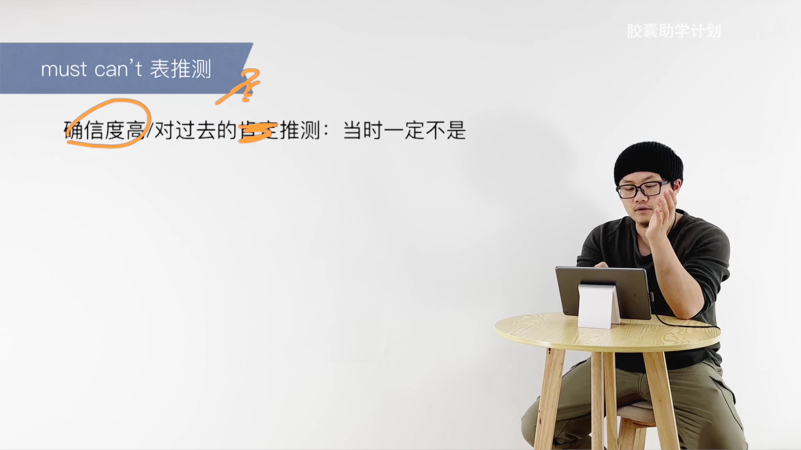

文字识别：must can't 表推测 / 确信度高/对过去的岂推测：当时一定不是

### 画面 00:04:20

文字识别：must can't 表推测 / 确信度高对过去的推测：当时一定不是

## 00:04:30–00:05:00

done，再然后叫 can't have been doing。其实不知道各位注没注意到，就是把 must 上一页当中的 must 换成了这一页的 can't，于是它就变成了叫当时一定不是啊，也就是说是上一个的否定，对不对？用法呢是类似的，比如说 she can't have been ill。那这句话看到结构，我们反映出来的含义叫她当时一定不是病

### 画面 00:04:30

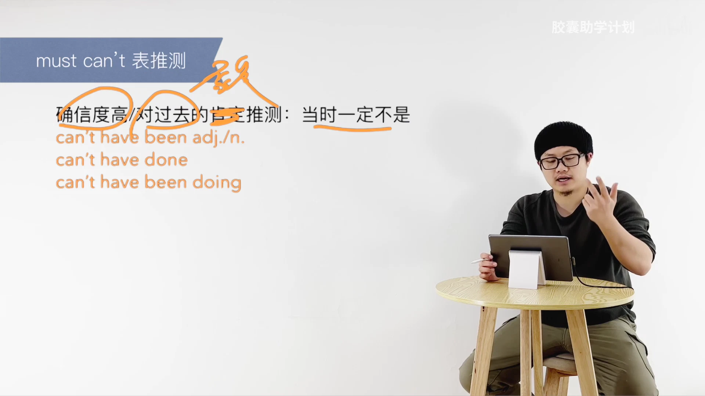

文字识别：must / can't / 表推测 / 确信度高对过去的节推测： / 当时一定不是 / can't have / been / adj./n. / can't have / done / can't have / been / doing

### 画面 00:04:35

文字识别：can't / 表推测 / must / 确信度高对过去的告推测： / 当时一定不是 / Can't have / been / adj./n. / can't/have / done / can'thave / been / doing

### 画面 00:04:55

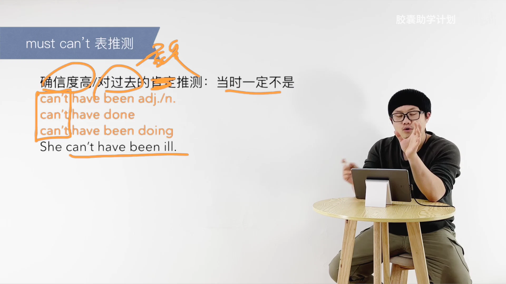

文字识别：can't / 表推测 / must / 确信度高对过去的节推测： / 当时一定不是 / Can'thave / been / adj./n. / can't/have / done / can'thave / been / doing / She / can't have / been ill.

## 00:05:00–00:05:30

啊！那我注意一个小点，这个当时是不是一定要加着呢？并不是，这由我们上下文语境去决定。因为现在没有上下文语境，只给了这样一句话。比如说，我问我说，What happened to her yesterday？啊，她昨天怎么了？你说啊，她可能啊啊哎，一定是累了。所以你加不加“当时”是无所谓的。你也可以说，她昨天一定是累了，对不对？在这个地方的“当时”两个字，只是想提醒各

### 画面 00:05:03

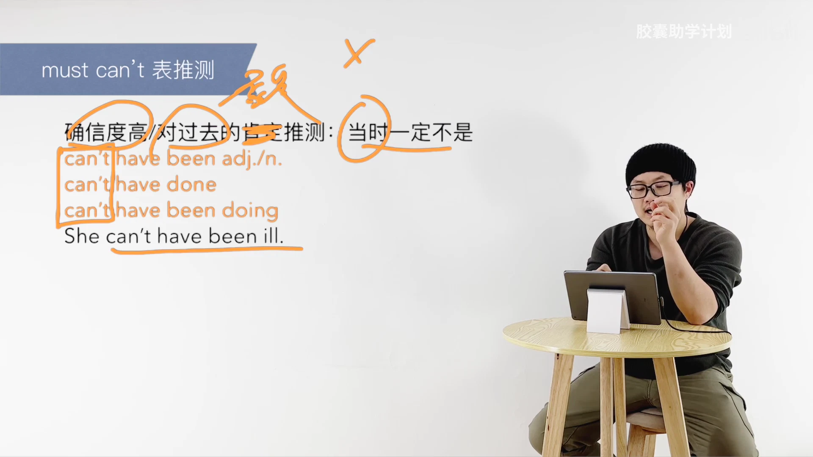

文字识别：must / can't / 表推测 / 确信度高对过去的告推测： / 当时 / 一定不是 / Canthave / been / adj./n. / can't/have / done / can'thave / been / doing / She / can't have / been ill.

## 00:05:30–00:06:00

位这件事情，注意是对过去的一个推测，对吧？再来说，They can't have been having dinner，说他们当时一定不是正在吃晚饭。OK， can't have been doing。OK， very good。那接下来呢，我们就拿这些公式往里面去套一套，尝试去做一些小的练习。讲完了，咱们立刻练啊！来了，跟我读。说，He can't have been thirty， he must have been thirty two。说，

### 画面 00:05:33

文字识别：can't / 表推测 / must / 确信度高对过去的告推测： / 当时 / 一定不是 / Can'thave / been / adj./n. / can't/have / done / can'thave / been / doing / She / can't have / been ill.

### 画面 00:05:44

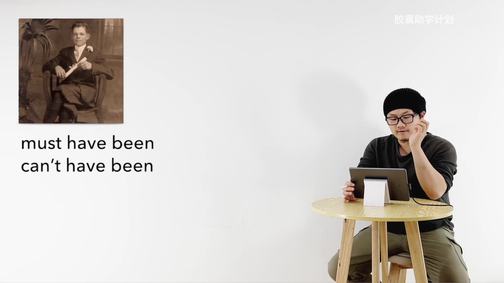

文字识别：must have been / can't have been

## 00:06:00–00:06:30

我现在回想一下，我认识他的时候啊，他当时应该啊，一定不是三十岁，他当时一定是二十二岁啊。我怎么推的？根据我一些对吧？我们上节课提到了，叫我们在进行推测的时候，也是有一些客观情况，对吧？如果表示这种肯定推测，有一些客观数据掌握在我们手里面的，对不对？再来说，He must have been at school.说他当时一定是在学校。He can't have been at the restaurant.他当时一

### 画面 00:06:00

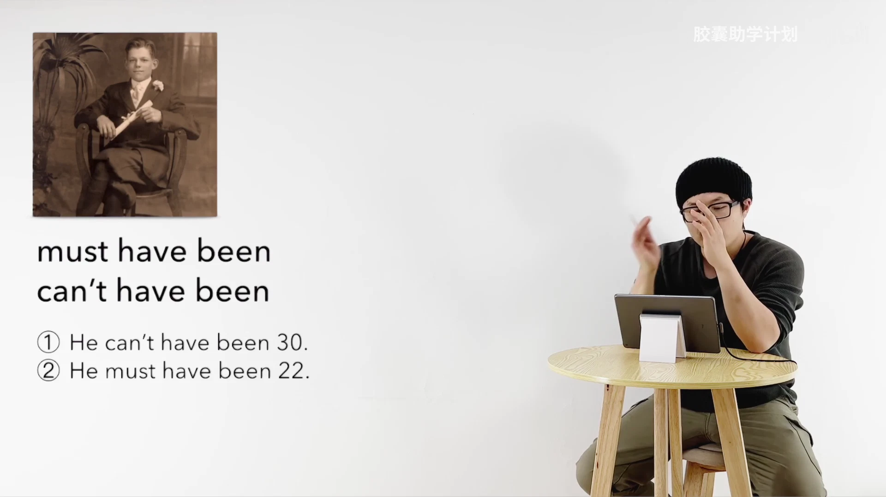

文字识别：must have been / can't have been / ① He can't have been 30. / ② He must have been 22.

### 画面 00:06:22

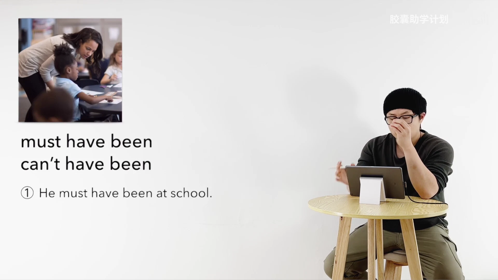

文字识别：must have been / can't have been / ① He must have been at school.

## 00:06:30–00:07:00

### 画面 00:06:31

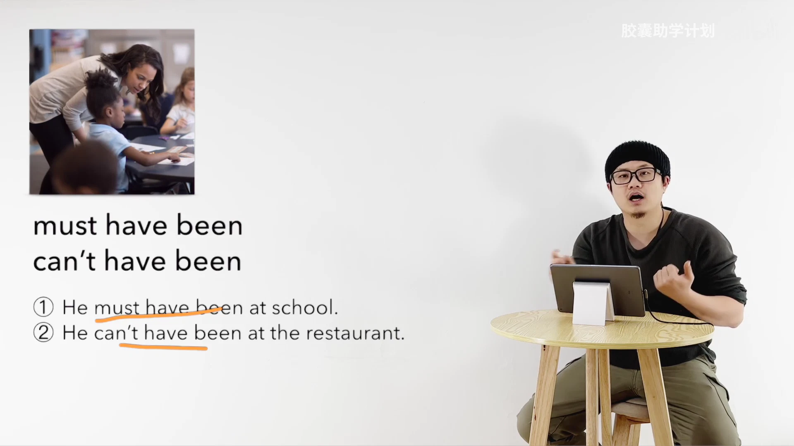

文字识别：must have been / can't have been / ① He must have been at school. / ② He can't have been at the restaurant.

### 画面 00:06:35

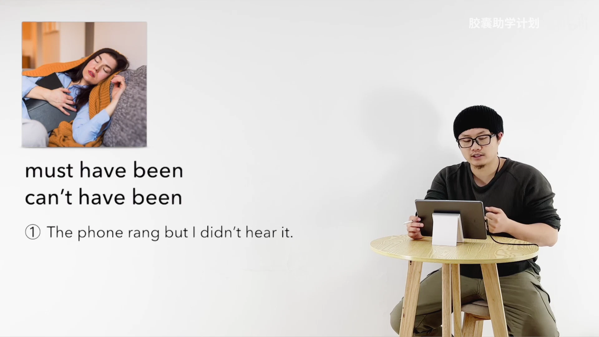

文字识别：must have been / can't have been / ① The phone rang but I didn't hear it.

### 画面 00:06:41

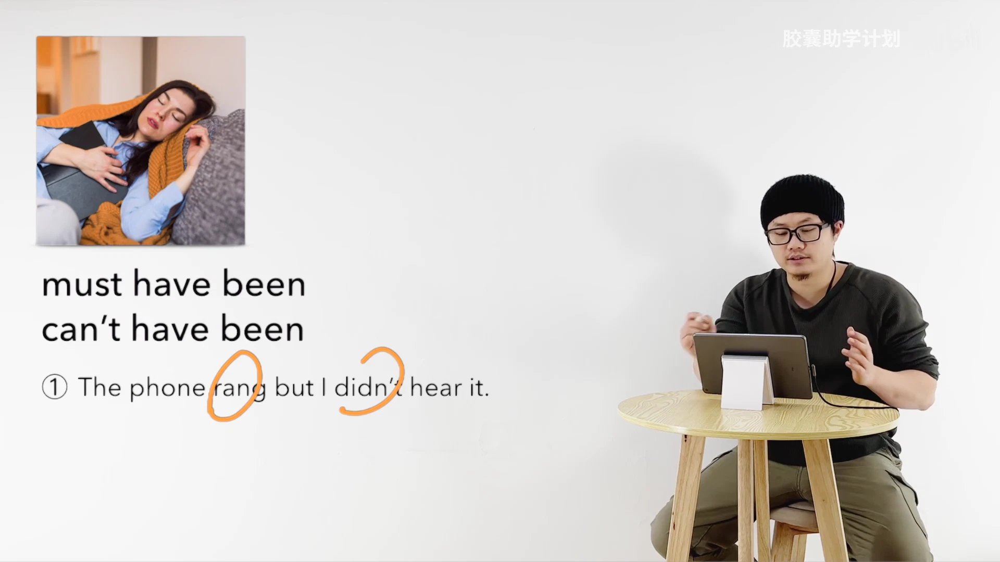

文字识别：must have been / can't have been / ① The phone rang k / butI didn' hear it.

### 画面 00:06:53

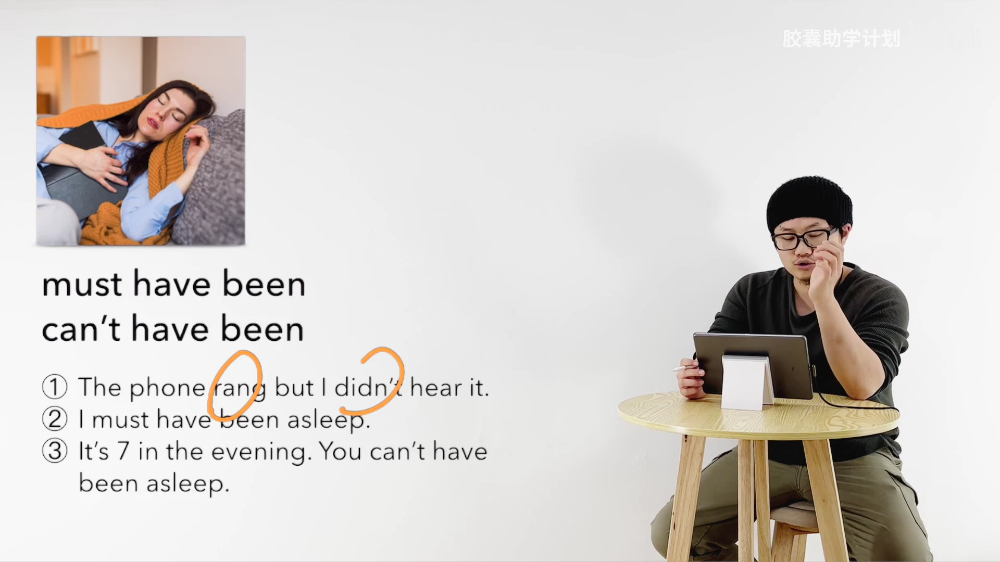

文字识别：must have been / can't have been / ① The phone rang but I didn'l hear it. / ② I must have been asleep. /  It's 7 in the evening. You can't have / been asleep.

## 00:07:00–00:07:30

睡觉呢。你看我加不加当时其实已经无所谓了，因为说话人和听话人，对吧？或者说这两个人在沟通的过程当中都知道他们说的是过去的事情，这就够了，对不对？好，Next one, you can't have been on the bus. 说你当时一定不是在公交车上。You must have been on the bus. 那就是同理，我把 can't have been 换成了 must have been，对不对？Okay, next one. 说 she didn't hear the phone. 她没有

### 画面 00:07:13

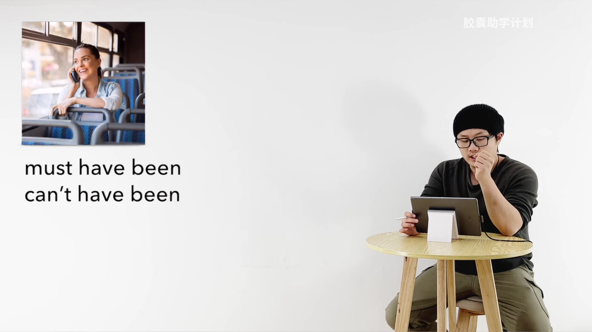

文字识别：must have been / can't have been

### 画面 00:07:22

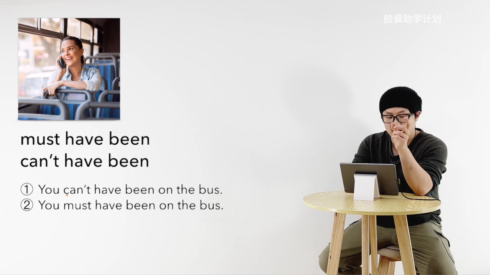

文字识别：must have been / can't have been / ① You can't have been on the bus. / ② You must have been on the bus.

### 画面 00:07:24

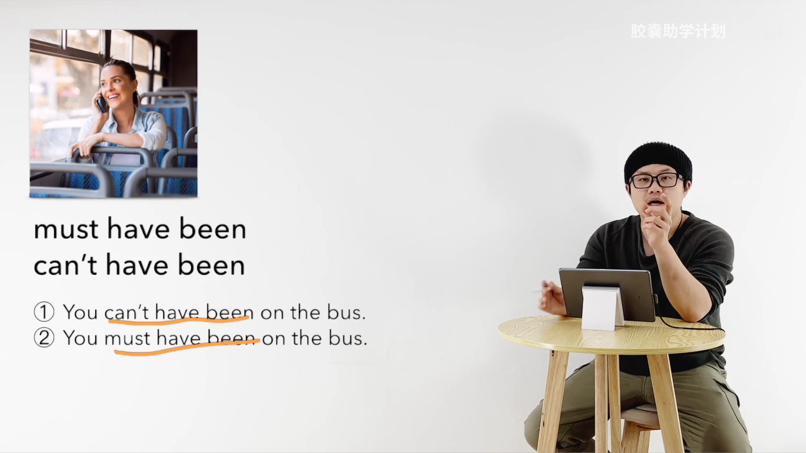

文字识别：must have been / can't have been / ① You can't have been on the bus. / ② You must have been on the bus.

### 画面 00:07:26

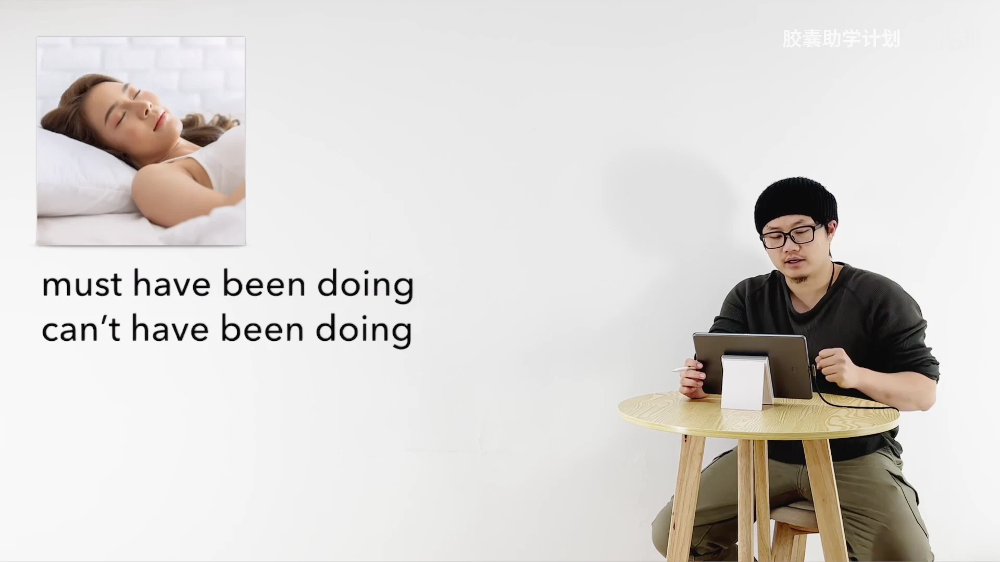

文字识别：must have been doing / can't have been doing

## 00:07:30–00:08:00

sleeping. 我现在回顾啊，她当时一定是正在睡觉。 She can't have been cooking. Can't have been doing something, 对吧？她当时一定不是正在做饭。如果我想表达她当时正在做饭怎么办呢？你看啊，结构不同带来往往是含义不同啊。当我想去表达不同含义的时候，我往往要用到不同的结构。于是我们要把 can't have been 换成什么呢？

### 画面 00:07:34

文字识别：must have been doing / can't have been doing / ① She didn't hear the phone. / ② She must have been sleeping.

### 画面 00:07:58

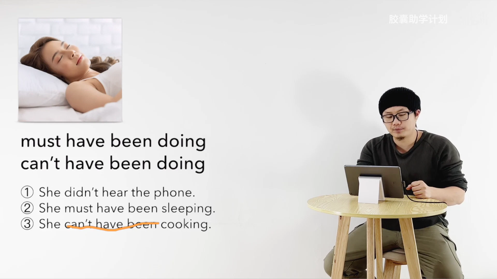

文字识别：must have been doing / can't have been doing / She didn't hear the phone. / She must have been sleeping. / 2 / She can't have been cooking.

## 00:08:00–00:08:30

叫做 she was cooking，叫做她当时正在做饭，对吧？这就是一个非常典型的，一百一十七课我们学过的叫做过去进行时。 Okay，好，continue。接下来我们看一个小的电影片段，这个片段当中出现了叫做 It must have been dark last night。说昨天晚上啊，一定是非常的暗。注意，这是表示一个推测，对不对？接下来我们看这个小的电影片段。 Mike， that's not her door. What are you talking about？

### 画面 00:08:02

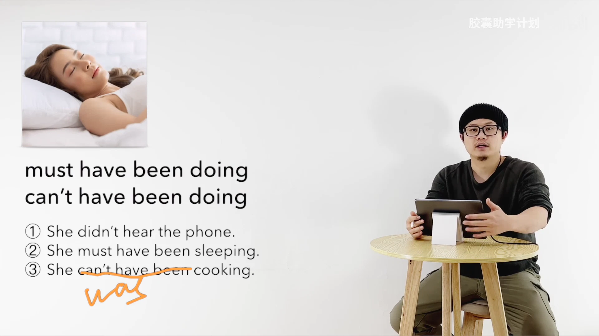

文字识别：must have been doing / can't have been doing / She didn't hear the phone. / She must have been sleeping. / She can't have bcen cooking. / wry

### 画面 00:08:11

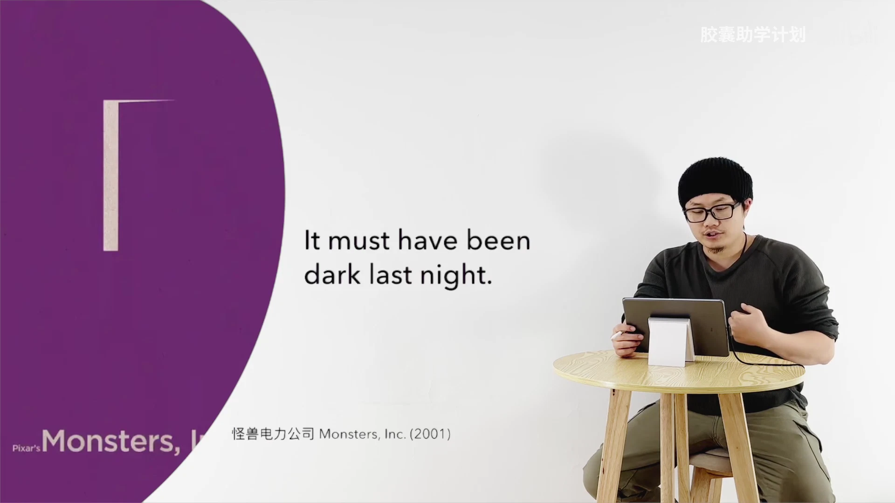

文字识别：It must have been / dark last night. / Monsters, / 怪兽电力公司Monsters, Inc.(2001) / Pixar's

### 画面 00:08:28

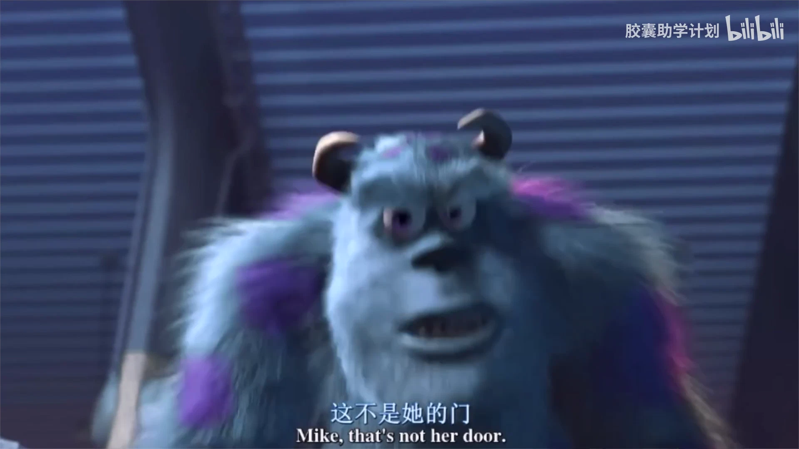

文字识别：bilibili / 胶囊助学计划 / 这不是她的门 / Mike, that's not her door.

## 00:08:30–00:09:00

Of course it's her door. It's her door. No, her door was white. No, and it had flowers on it. No, it must have been dark last night because this is its door. Okay, very good. It must have been dark last night. 当然他说的比我快很多，尤其是 last night 这两个单词，对吧？那不多说，我们接下来看一下本课的单词啊。呃，首先第一个单词跟我一起读一下，叫做 wave wave. Okay, very good. 那你看啊，我们在这儿再重申一下，很长时间没有

### 画面 00:08:30

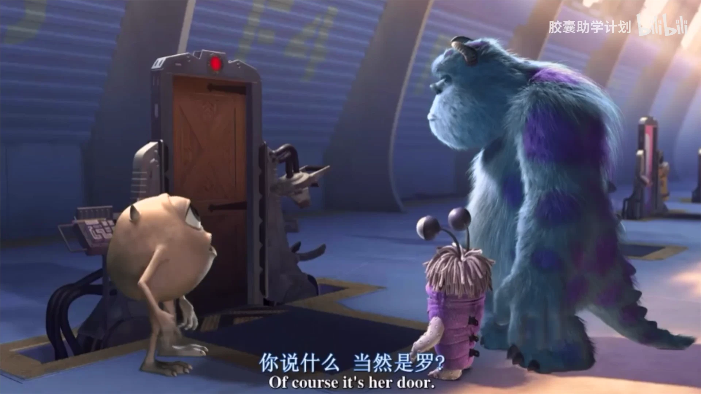

文字识别：Lib / 胶囊助学计划 / 你说什么 当然是罗？ / Of course it's her door.

### 画面 00:08:32

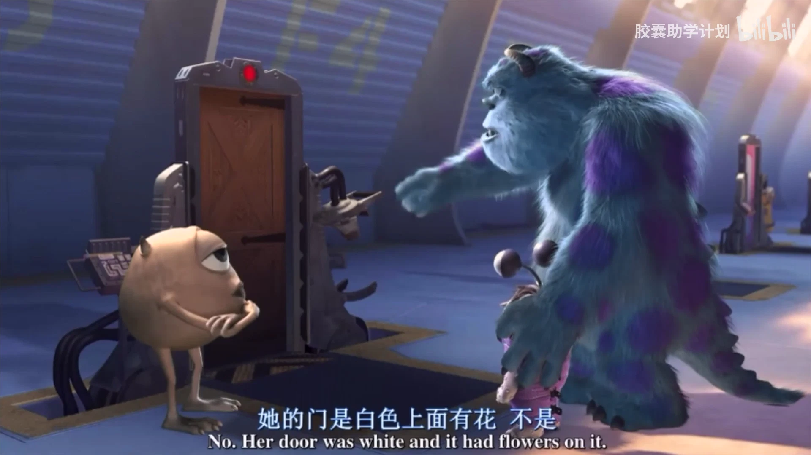

文字识别：胶囊助学计划Li出 / 她的门是白色上面有花不是 / No. Her door was white and it had flowers on it.

### 画面 00:08:34

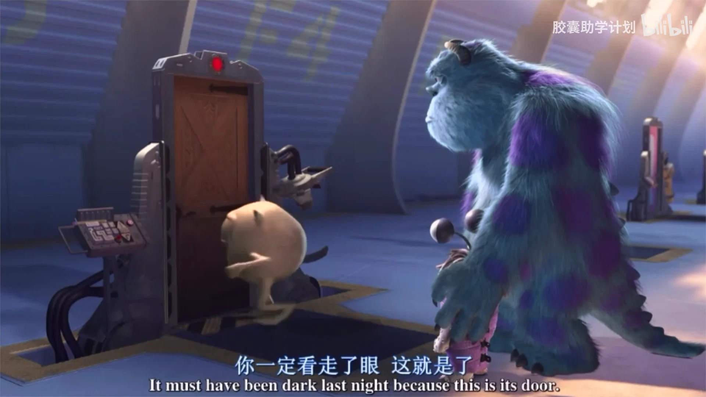

文字识别：胶囊助学计划iD出 / 你一定看走了眼这就是了 / It must have been dark last night because this is its door.

### 画面 00:08:36

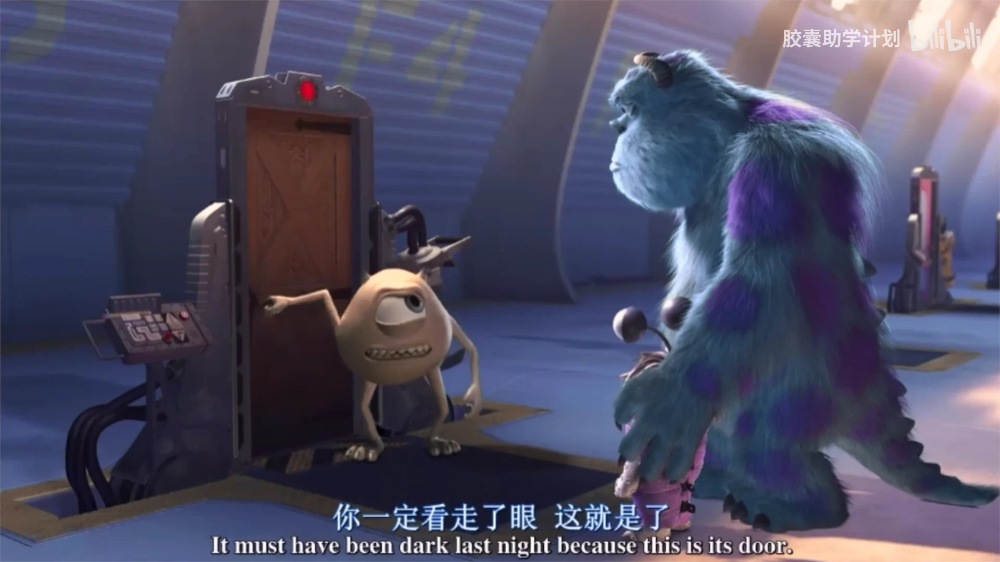

文字识别：Libi / 胶囊助学计划 / 你一定看走了眼这就是了 / It must have been dark last night because this is its door.

### 画面 00:08:38

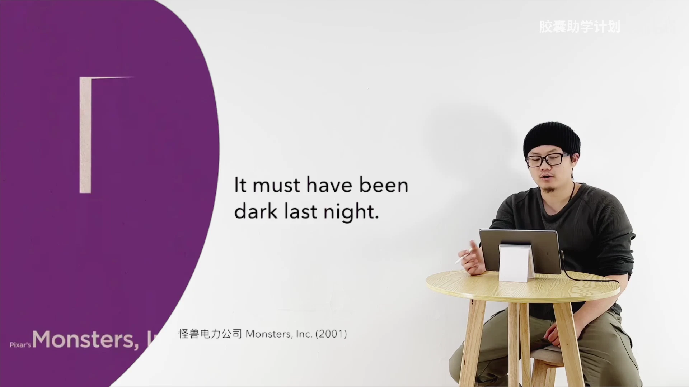

文字识别：It must have been / dark last night. / Monsters, / 怪兽电力公司Monsters, Inc.(2001) / Pixar's

### 画面 00:08:46

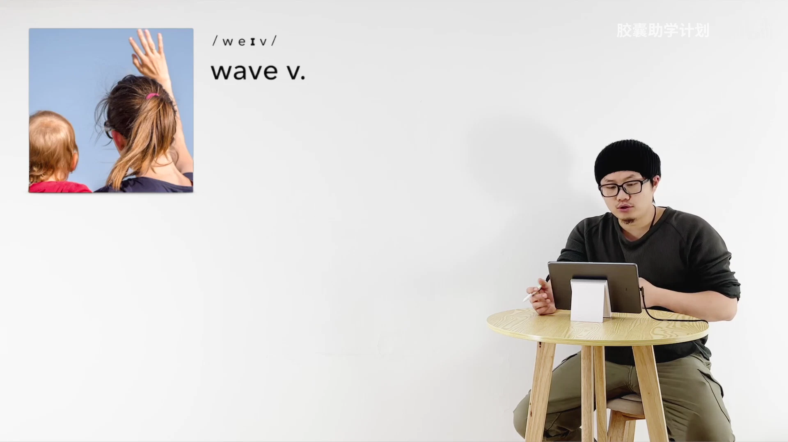

文字识别：IweIvl / wave v.

## 00:09:00–00:09:30

提这件事儿了。如果学到今天这个点您还没有完全拿下来，对吧？一定要回去再重新看一下我们之前给各位录的那四个视频，关于音标的三个视频和关于自然拼读法则的一个视频啊。比如说像这个单词，如果通过音标我会读了，其实拼写基本就差不多了。wave啊，一定能确定的是w跟v这两个字母，对吧？跟我一起读一下，wave。OK，那它叫做招手挥手的意思。给大家补一个小

### 画面 00:09:16

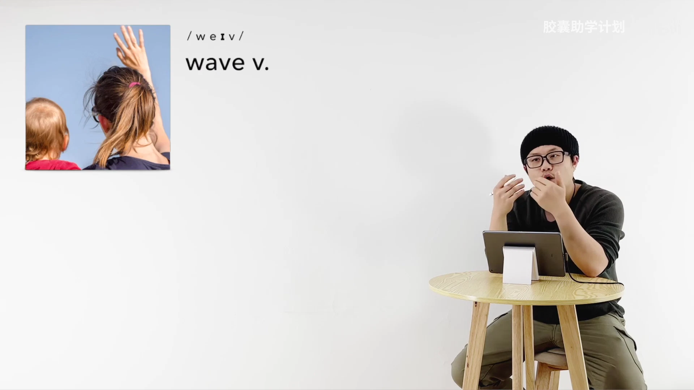

文字识别：IweIvl / wave v.

### 画面 00:09:29

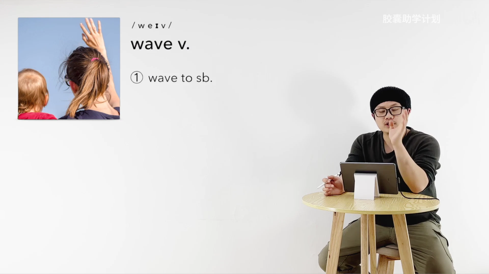

文字识别：IweIvl / wave v. / ① / wave to sb.

## 00:09:30–00:10:00

短语，叫 wave to somebody，叫做冲某人招手。比如说，Look, they are waving to you。这是一个很简单的语法，叫做瞧，他们正在冲你招手。再来说，The policeman waved to you。 waved后边加了个d，一般过去时，说这事儿是之前发生，刚才的冲你招手了，对不对？肯定句都给各位了，各种一般疑问句和特殊疑问句，就是各位能自己去处理的了。处理好了，

### 画面 00:09:37

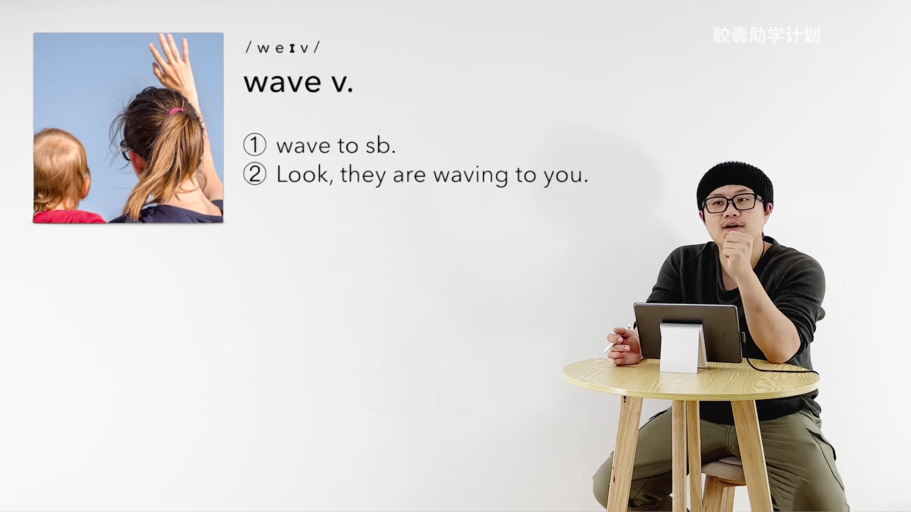

文字识别：/weIv/ / wave v. / wave to sb. / ② Look, they are waving to you.

### 画面 00:09:44

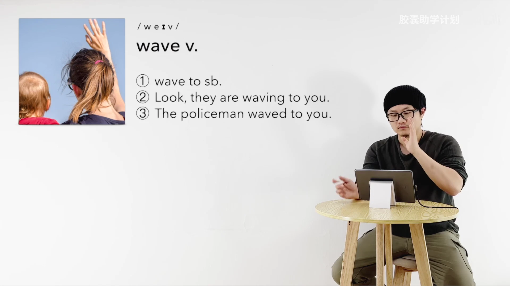

文字识别：/weIvl / wave v. / wave to sb. / Look, they are waving to you. / The policeman waved to you. / 3

### 画面 00:09:55

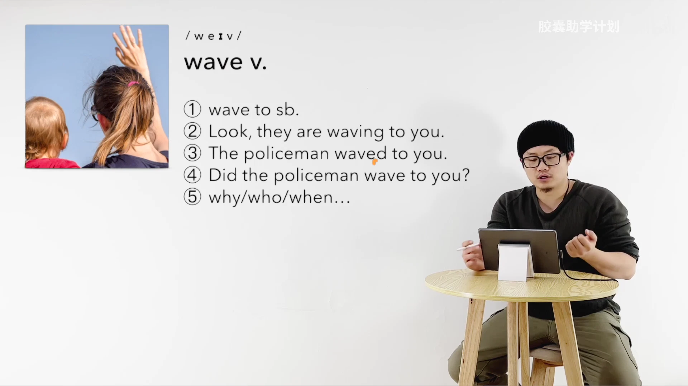

文字识别：/weIv/ / wave v. / wave to sb. / Look, they are waving to you. / The policeman waved to you. / Did the policeman wave to you? / why/who/when... / 5

## 00:10:00–00:10:30

哎，单词造句这个任务，本视频的家庭作业您其实基本也就完成了，好吧，我们不多说了啊。OK，Next one，两个单词我们放在一起去读，第一个叫做track，track，track，最基本的意思叫做轨道啊，各位先记住这个意思。Race指的是比赛，那race track，比如说on the race track，比赛的轨道其实就是赛道啊，希望各位好理解，对吧？

### 画面 00:10:07

文字识别：/træk/ / /reis/ / track n.race

### 画面 00:10:11

文字识别：/træk/ / /reis/ / track n. race

### 画面 00:10:24

文字识别：/ tr æe k / / /reis/ / track n. race / ① My brother is driving a car on the race track.

## 00:10:30–00:11:00

那我们造一个句子说，My brother is driving a car on the racetrack. Okay，说我兄弟啊正在开着一辆车在这个比赛赛道上。Okay，玩一个肯定句给各位了，还是各种句型，您换一换呗。那你看，我们刚才用的是 is 加 driving，这是三十一课咱们刚刚学过的。如果我用 must be 加 cleaning 呢？这是我们上一课刚刚学过，也就是一百二十七课刚刚学过 must be doing 表示一个动作现在

### 画面 00:10:51

文字识别：/ træe k / / /reIs/ / track n.race / ① My brother is driving a car on the race track. / ) They must be cleaning the race track now.

## 00:11:00–00:11:30

一定正在发生，这个是我的一个推测，它和它是正在发生还是不太一样的。如果我们非要把它量化一下，那就是 is cleaning是这件事情发生的概率是百分之百，而 must be cleaning是这件事情发生的概率是百分之九十或者百分之九十五，对吧？哎，反正总之不是百分之百。OK，说他们一定是正在打扫清理这个 racetrack now，正在打扫清理这

### 画面 00:11:21

文字识别：/ tr æe k / / /reis/ / track n. race / ① My brother is driving a car on the race track. / ) They must be cleaning the race track now.

### 画面 00:11:28

文字识别：/ tr æe k / / /reis/ / track n.race / ① My brother is driving a car on the race track. /  They must be cleaning the race track now.

## 00:11:30–00:12:00

个赛道。Okay,再然后说 the racetrack which they cleaned yesterday is full of bottles. Now, very good.那首先定语从句我还是给各位加黑加粗，对吧？放到了这个地方。我想问的问题依旧是 which 在这个地方能不能省略？能省略的标准那个规则又是什么？您能不能在视频下方留言告诉我呢？Okay, very good.那我们翻译一下这句话。哎，先把它拆成两句话。第一句

### 画面 00:11:31

文字识别：/ tr æe k / / /reis/ / track n. race / ① My brotheris driving a car on the race track. / They must be cleaning the race track now. / The race track which they cleaned yesterdlay / is full of bottles now.

### 画面 00:11:40

文字识别：/ tr æe k / / /reis/ / track n. race / ① My brotheris driving a car on the race track. / They must be cleaming the race tra / The race track which they cleaned yesterdlay / is full of bottles now.

### 画面 00:11:42

文字识别：/ tr æe k / / /reis/ / track n. race / ① My brother is driving a car on the race track. / They must be cleaning the race track now. / The race track which they cleaned yestergay / is full of bottles now.

### 画面 00:11:44

文字识别：/træk/ / /reisl / track n. race / ① My brother is driving a car on the race track. / They must be cleaning the race track now. / 2 / The race track which they cleaned yesterday / is full of bottles now.

### 画面 00:11:49

文字识别：/ tr æe k / / /reis/ / track n. race / ① My brother is driving a car on the race track. / They must be cleaning the race track now. / The race track which they cleaned yesterday / is full of bottles now.

## 00:12:00–00:12:30

话，the the racetrack is full of bottles now。现在充满了这些啊瓶子，也就是垃圾，对吧？瓶子。然后 they cleaned the racetrack yesterday。他们昨天把这个赛道刚刚清理干净，一般过去时，对吧？Okay, one more.下一个单词，供你读一下，叫做 mile mile。啊，它是一个英制单位，叫的英里啊。比如说，我们会在路标上看到这样一句话，叫 next four miles。啊，接下来

### 画面 00:12:00

文字识别：/ tr æe k / / /reis/ / track n. race / ① My brother is driving a car on the race track. / They must be cleaning the race track now. / The race track which they cleaned yesterday / is full of bottles now.

### 画面 00:12:08

文字识别：/ tr æe k / / /reis/ / track n. race / ① My brother is driving a car on the race track. / They must be cleaning the race track now. / The race track which they cleaned yesterday / is full of bottles now.

### 画面 00:12:17

文字识别：/mail/ / mile / NEXT / 4 / MILES

### 画面 00:12:27

文字识别：/mail/ / mile / NEXT / MILES

## 00:12:30–00:13:00

四英里的位置开始会出现很多的啊，大面积的这种转弯、急转弯，对吧？哎，好，那我们造一句话说，The railway station is four miles away. 好，说火车站大概是四英里远的地方。再来说，She is driving at seventy miles an hour. Okay, 那我们看一下 seventy miles an hour，其实就是每小时七十英里啊，或者七十英里每小时。她正在开，现在

### 画面 00:12:39

文字识别：/mail/ / mile / NEXT / ① The railway station is 4 miles away. / 4 MILES

### 画面 00:12:50

文字识别：/mail/ / mile / NEXT / ① The railway station is 4 miles away. / 4 MILES / She is driving at seventy miles an hour.

### 画面 00:12:52

文字识别：/mail/ / mile / NEXT / ① The railway station is 4 miles away. / 4 MILES / She is driving at seventy miles an hour.

## 00:13:00–00:13:30

开的速度是，哎，这个七十英里每小时。那我们把 is 加 driving。如果我们看到那个表了，对吧？写着七十英里每小时，那就是 is driving，对吧？如果我们感觉很确定，说那就是 he must be driving at fifty miles an hour。他一定正在开，对吧？Must be doing。我们一百二十七课语法刚刚学过 continue。接下来一个单词跟我一起读一下，叫做

### 画面 00:13:05

文字识别：/mail/ / mile / NEXT / 4 MILES / 1 / The r / railway station is 4 miles / away. / SheIs drivinga / at seventy / miles / an hour. / He / must / be / driving at tifty / miles / an hou

### 画面 00:13:18

文字识别：/mail/ / mile / NEXT / 4 MILES / 1 / The r / railway station is 4 miles / away. / es driving / 2 / She / at seventy / miles / an hour. / He / must / be / driving at titty / miles / an hou

### 画面 00:13:25

文字识别：/auva'teik/ /auva'tuk/ / /'teikan/ / overtake-overtook-overtaken

## 00:13:30–00:14:00

overtake, overtake. 它的过去式 overtook 和过去分词 overtaken. OK, 那它的意思就是在这儿可以理解为叫做超车啊，超越，超车. OK, 比如说我们看图造一句话，叫做 the white car overtook the red one a minute ago. 说这辆白车一分钟之前超过的这辆红车. 肯定句给您了，您实在自己拿 overtake 造不出句子来了. 哎，一个非常简

### 画面 00:13:43

文字识别：/auva'teik/ /auva'tuk/ / /'teikan/ / overtake-overtook-overtaken / ① The white car overtook the red one a / minute ago.

## 00:14:00–00:14:30

单粗暴的方式就是把这个肯定句给它变成一般疑问句和各种特殊疑问句啊，各位不要小瞧这个动作，对吧？你不要觉得这这不是有点偷懒吗？我不会认为您偷懒啊，这是一个非常好的造句思路。OK，接下来哎，我把它变成了一般疑问句，有一个小的点注意，过去式要换成原形，对吧？OK，Next one，然后各种特殊疑问词，比如说 how long ago，这个我们见到的频率

### 画面 00:14:13

文字识别：/auva'teik/ /auva'tuk/ / /'teikan/ / overtake-overtook-overtaken / ① The white car overtook the red one a / minute ago.

### 画面 00:14:18

文字识别：/auva'teik/ /auva'tuk/ / /'teikan/ / overtake-overtook-overtaken / ① The white car overtook the red one a / minute ago. / Did the white car overtake the red one / a minute ago?

## 00:14:30–00:15:00

相对来说会低一点点。多久之前？那答案叫 a minute ago，对吧？我都说了，下面两个小单词放在一起。这个是各位如果出国自驾过，对吧？你像我和 Berlin，我们就在新西兰自驾过。那我就会注意到路边上有这样的一些标志，叫做 speed limit。那 speed 叫做速度，limit 叫限制，其实翻译成汉语就是我们所谓的限速，对吧？Speed limit，啊，六十五英里每小时。OK，

### 画面 00:14:33

文字识别：/auva'teik/ /auva'tuk/ / /'teikan/ / overtake-overtook-overtaken / ① The white car overtook the red one a / minute ago. / Did the white car overtake the red one / a minute ago? / when/how long ago

### 画面 00:14:35

文字识别：/ spi:d/ /'limit/ / speed limit / SPEED / LIMIT / 6.5

## 00:15:00–00:15:30

那拿它去造句来说，He can't have seen the speed limit. 好，注意 can't have done 表示的是当时一定是对吧？说他当时一定是没看啊，不，当时一定不是对吧？他当时一定没有看到这个限速。 Very good，这是我们今天刚刚学的 can't have done，对不对？然后说 she saw the speed limit，那叫做她看到了。如果说她没看到呢？很简单，您把这句话变否定不就行了吗？

### 画面 00:15:05

文字识别：/ spi:d / /'lImit/ / speed limit / SPEED / LIMIT / ① He can't have seen the speed limit. / 6.5

### 画面 00:15:08

文字识别：/ spi:d / /'lImit/ / speed limit / SPEED / LIMIT / ① He can't have seen the speed limit. / 6.5

## 00:15:30–00:16:00

我直接说一句啊，叫做 She didn't see the speed limit. OK，玩一个 next one。一般疑问句，did 提前，各种特殊疑问词又放到这儿了。这是各位最基础的事情。新一、新二最核心的练习就是把这个点，各位张嘴能就说出来，对吧？OK，玩一个 next one。下一个单词跟我一起读一下，叫做 dream dream. OK，呃，它最常见的一个意思就是做梦啊。但本课当中

### 画面 00:15:30

文字识别：/ spi:d/ /'limit/ / speed limit / SPEED / LIMIT /  He can't have seen the speed limit. / 6.5 / 1 / She saw the speed limit.

### 画面 00:15:49

文字识别：/ dri :m / / dream v.

## 00:16:00–00:16:30

它是个动词，那就是做梦这个动作，对吧？那梦想呢，它就变成了名词。OK，好，比如说 she waved to you，她冲你招手了，我们之前学的，对吧？But you didn't see her，但是你没有看见她。You must have been dreaming，是吧？你当时一定是做梦的吧？是吧？白日梦呢，对不对？走神了。Next one，说 I dreamed about you last night，我昨天晚上梦到你了。哎，一般过去式，对吧？然后呢，再来说 she dreamed about

### 画面 00:16:06

文字识别：/ d r i :m / / dream V. / ① She waved to you, but you didn't see / her. You must have been dreaming.

### 画面 00:16:15

文字识别：/ d r i :m / / dream v. / ① She waved to you, but you didn't see / her. You must have been dreaming.

### 画面 00:16:27

文字识别：/ d r i :m / / dream v. / ① She waved to you, but you didn't see / her. You must have been dreaming. / I dreamed about you last night. / She dreamed about some bad things / last night.

## 00:16:30–00:17:00

some bad things last night. 她昨天晚上梦到了一些不好的事情。两个肯定句都可以把它变成一般疑问句和各种特殊疑问句。 Next one，下一个单词。刚才其实我们在 speed limit 和 four miles miles 这个单词，mile 这个单词，我们都见到了路标啊，各种各样的标。这个路标用英文就叫做 sign，对吧？OK， sign， OK，标志啊。比如说

### 画面 00:16:36

文字识别：/ d r i : m / / dream V. / ① She waved to you, but you didn't see / her. You must have been dreaming. / ② I dreamed about you last night. /  She dreamed about some bad things / last night.

### 画面 00:16:38

文字识别：/sain/ / sign n. / ROAD / CLOSED / DETOUR

### 画面 00:16:53

文字识别：/sain/ / sign n. / ROAD / CLOSED / DETOUR

### 画面 00:16:58

文字识别：/sain/ / sign n. / ROAD / CLOSED / DETOUR / ① The sign which they put up yesterday / was / not there / this morning.

## 00:17:00–00:17:30

the sign which they put up yesterday was not there this morning.还是第一句，各位要自己将来把这个黑字部分拆出来，然后把它变成两句话。第一句话叫 the sign was not there this morning，这个标志今儿早晨已经不在那里了。第二句话叫做 they put up the sign yesterday，他们昨天把这个标志给竖起来立起来的，对吧？今儿早晨就没了。OK，典型的定语从句。同理，

### 画面 00:17:28

文字识别：sain/ / sign n. / ROAD / CLOSED / DETOUR / 1 / The / signwhicht /  they put up yesterday / was / not there / e this morning.

## 00:17:30–00:18:00

我要问的是这个 which 能省略吗？ Okay, next one. Say she must be cleaning the sign right now. How must be doing, 对吧？ Must be doing, 这儿一个表示现在正在进行。一百二十七课刚学。When he was cleaning the sign on the street yesterday, I waved to him. 当他昨天在马路上正在清洗、正在打扫这个 sign 的时候呢，我冲他招了招手。你看这句话，

### 画面 00:17:32

文字识别：sain/ / sign n. / ROAD / CLOSED / DETOUR / 1 / The / sign / whicl they put up yesterday / was / not there / : this morning.

### 画面 00:17:38

文字识别：/sain/ / sign n. / ROAD / CLOSED / DETOUR / 1 / The / sign / whicl they put up yesterday / was / not / there / this / morning. / She / must / be / cleaning the / sign right now

### 画面 00:17:41

文字识别：/sain/ / sign n. / ROAD / CLOSED / DETOUR / 1 / The / sign / whicl they put up yesterday / was / not / there / this / morning. / She / must / be / cleaning / the / sign right no / 3 / When he / was / cleaning / the / sign on the / street / yesterday, I waved to / him.

### 画面 00:17:52

文字识别：/sain/ / sign n. / ROAD / CLOSED / DETOUR / 1 / The / sign / whicl they put up yesterday / was / not / there / this / morning. / She / must / be / cleaning / the / sign right nov / 3 / When he / was / cleaning / the / sign on the / street / yesterday, / waved / to / him.

## 00:18:00–00:18:30

其实我在尝试去造的时候，我就要想一些东西。这些东西包括了第一，一百一十七课咱们学过了，when和was cleaning。第二，我们单词第一个单词刚刚学过了，wave to somebody。那我在造下一个单词的时候，为什么不把他们都拿过来尝试用一下呢？对吧？语法这个东西和单词这个东西都是这样的。我越用，我肯定越熟；我越不用，我很可能就忘掉了，对吧？这也是我们

### 画面 00:18:00

文字识别：/sain/ / sign n. / ROAD / CLOSED / DETOUR / ① The sign / whicl they put up yesterday / was / not there / this morning. / She / must k / be( / cleaning / the / sign right now / When he / was / cleaning / the. / sign on the / street / yesterday, I waved to / him.

### 画面 00:18:08

文字识别：/sain/ / sign n. / ROAD / CLOSED / DETOUR / 1 / The / sign / whicl they put up yesterday / was / not / t there / this 1 / morning. / She / must / be / cleaning / the / sign right now / Wher he / was / cleaning / the / sign on the / stree / yesterday, I waved to / him.

### 画面 00:18:10

文字识别：/sain/ / sign n. / ROAD / CLOSED / DETOUR / 1 / The / sign / whicl they put up yesterday / was / not there / this / morning. / She must / be / cleaning / the / sign right now / Mherhe / was / cleaning / the / sign on the / street / 「 / yesterday, / I waved to / him.

## 00:18:30–00:19:00

二第一课就会教各位叫做单词造句的具体思路啊。OK， next one，下一个单词，跟我一起读一下，叫做 driving license。 driving license 叫做驾照，对吧？那基本它就是一个名词在这地方。我们放点动词呗，比如说 I had to 一百二十五个刚学的，当时不得不 give please give somebody something give please my driving license yesterday。 OK，

### 画面 00:18:30

文字识别：/sain/ / sign n. / ROAD / CLOSED / DETOUR / 1 / The / sign / whicl they put up yesterday / was / not there / this / morning. / She must / be / cleaning / the / sign right no / Mherhe / was / cleaning / the / sign on t / the street / yesterday, / I waved to him.

### 画面 00:18:36

文字识别：/'laisans/ / driving license / D: / FUHRERSCHEIN / Schroder / LUNOESIRRKDEUSOUAND / Eoanuel Stofan Markus / 06.11.15 / 22.06.95 / sttaaenvetkenrsbehorde / stadtverw. / K25025G1X31 / 05.11.30 / E.hlider / AM/EVL

### 画面 00:18:49

文字识别：/'laisans/ / driving / license / FUHRERSCHEINBUNDESRGUBLKDBVISOLANO / D: / Sehr5der / Eeanuel Steran Markus / 06.11.15 / 22.06.95 / sttaaenverkehrsbenotde / Stadtverw. / K2502501X31 / ① I had to give police my driving / E.blider / RM/BL / license yesterday.

### 画面 00:18:59

文字识别：/laisans/ / driving / license / D: / FUHRERSCHEIN BUNOESRERUEUKDEUTSOEAND / Schroder / Eaanuei staran Markus / 06.11.15 / 22.06.95 / Stranenverkenrsbehorde / Stadtverw. / WOT / K2502501X31 / ① I had to give police my driving / E.blider / PM/VL / license yesterday. / Did you have to give police your / driving license yesterday?

## 00:19:00–00:19:30

肯定句给您了，一般疑问句和各种特殊疑问句，各位家庭作业自己去处理啊。下一个单词，我们一起读一下，叫做charge charge. OK, charged意思就是罚款。各位看这个地方啊，如果你停车，比如说停错地儿了，就可能会出现这个东西叫做penalty charge notice啊。注意啊，这个地方要有一些罚款了，charge罚款。比如说，the police will charge

### 画面 00:19:07

文字识别：/t∫a:d3/ / 280 / ENALTY CHARGE NOTICE (PCN) / d by an / charge V. / mainta / PENALTY CHARGE / rea anc / estricti / NOTICE / eorp / reing / NARNING

### 画面 00:19:10

文字识别：/t∫a:d3/ / 280 / PENALTY CHARGE NOTICE (PCN) / d by an / mainta / PENALTY CHARGE / charge V. / rea anc / estricti / NOTICE / eorp / eing / WARNING

### 画面 00:19:15

文字识别：/t∫a:d3/ / 280 / PENALTY CHARGE NOTICE (PCN) / d by an / mainta / PENALTY CHARGE / charge V. / rea anc / estricti / NOTICE / eorp / reing / AN OFFENCE FOR ANY PERSON / WARNING

### 画面 00:19:26

文字识别：/t∫a:d31 / 280 / PENALTY CHARGE NOTICE (PCN) / d by an / charge V. / mainta / PENALTY CHARGE / rea anc / estricti / NOTICE / eorp / eing / WARNING

## 00:19:30–00:20:00

you this time.哎，time，对于各位来说最熟悉的是时间的意思。我印象当中，我们在七十一课学过它的另一个含义，叫做次，对吧？比如说，two times, three times，对吧？那 this time 就是这一次啊。那警察这一次将罚款。一般疑问句啊，否定句说 the police won't charge you this time。这次就不罚你的款了。然后一般疑问句，然后各种特殊疑问句。我只

### 画面 00:19:32

文字识别：/t∫a:d31 / PENALTY CHARGE NOTICE (PCN) / 280 / d by an / charge V. / mainta / PENALTY CHARGE / rea anc / estricti / NOTICE / eorp / reing / ① The police will charge you this time / NARNING

### 画面 00:19:41

文字识别：/t∫a:d3/ / 280 / PENALTY CHARGE NOTICE (PCN) / d by an / charge V. / mainta / PENALTY CHARGE / rea anc / estricti / NOTICE / eor p / reing / ① The police will charge you this time / WARNING

### 画面 00:19:50

文字识别：/t∫a:d3/ / ENALTY CHARGE NOTICET / d by an / charge V. / mainta / PENALTY CHARGE / rea anc / ostricti / NOTICE / eorp / reing / ① The police will charge you this time / WARNING / The police won't charge you this time.

### 画面 00:19:55

文字识别：/t∫a:d3/ / PENALTY CHARGE NOTICE (PCN) / d by an / charge V. / mainta / PENALTY CHARGE / rea anc / estricti / NOTICE / eorp / reing / ① The police will charge you this time / WARNING / The police won't charge you this time.

### 画面 00:19:57

文字识别：/tfa:d3/ / PENALTY CHARGE NOTICE (PCN) / 280 / d by an / charge V. / mainta / PENALTY CHARGE / rea anc / ostricti / NOTICE / eorp / veing / ① The police will charge you this time / WARNING / The police won't charge you this time. / Will the police charge me this time? / why won't/who...

## 00:20:00–00:20:30

在这个点多提一句，叫 Why won't Why won't？您就把 Will 去掉，直接加在前面，叫 Why won't the police charge me this time？他这次为什么不罚我款了呢？下一个单词很简单啊，各位如果长期看电影，这个单词您可能都是认得的，跟我一起读一下，叫做 Darling Darling Darling，就亲爱的，是吧？亲爱的，那我们看一个小的电影片段，练一下听力啊。

### 画面 00:20:00

文字识别：/t∫a:d3/ / PENALTY CHARGE NOTICE (PCN) / 280 / d by an / charge V. / mainta / PENALTYCHARGE / rea anc / estricti / NOTICE / eorp / reing / ① The police will charge you this time / WARNING / The police won't charge you this time. / Will the police charge me this time? / why won't/who...

### 画面 00:20:08

文字识别：/tfa:d3/ / PENALTY CHARGE NOTICE / d by an / charge V. / mainta / PENALTY CHARGE / rea anc / estricti / NOTICE / eorp / reing / WARNING / ① The police will charge you this time / The police won't charge you this time. / TO / Willthe police charge me this time? / why won't/who...

### 画面 00:20:13

文字识别：Gerry? / Darling, look at you. / HUGH JACKMAN / CHRISTIAN BAV / SCARLETTJO / MICHAELCA / THEPRF / 致命魔术The Prestige(2006) / AREYOV

### 画面 00:20:16

文字识别：Gerry? / Darling, look at you. / HUGHJACKMAN / CHRISTIAN BAV / SCARLETTJO / MICHAELCA / THEPRF / 致命魔术The Prestige(2006) / ARE YOV

### 画面 00:20:20

文字识别：Gerry? / Darling, look at you. / HUGHJACKMAN / CHRISTIAN BAV / SCARLETTJO / MICHAELCA / THEPRF / 致命魔术 The Prestige(2006) / ARE YOV

### 画面 00:20:26

文字识别：:` / Gerry? / Darling, look at you. / HUGH JACKMAN / CHRISTIAN BAI / SCARLETTJO / MICHAELCA / THEPRF / 致命魔术 The Prestige (2006) / ARE YOV

## 00:20:30–00:21:00

Jerry， darling， look at you， Mr. Carson， Mr. Angie， I'd like you to meet Gerald Root，嗯，a pleasure， pleasure to meet you， fine， Gerald， OK，啊， darling， look at you，啊，亲爱的，瞧瞧你啊， OK， recap，本课最重要的就是这些呃公式，对吧？这些公式会伴随着各位一直往下去走，

### 画面 00:20:30

文字识别：bilibili / 胶囊助学计划

### 画面 00:20:32

文字识别：b#bili / 胶囊助学计划 / 傑瑞 / Gerry?

### 画面 00:20:34

文字识别：bilibili / 胶囊助学计划 / 亲爱的 看看你 / Darling, look at you.

### 画面 00:20:36

文字识别：bilibili / 胶囊助学计划 / 两位 这是傑瑞路特 / Mr. Cutter, Mr. Angier, I'd like you to meet Gerald Root.

### 画面 00:20:38

文字识别：bilibili / 胶囊助学计划

### 画面 00:20:40

文字识别：Bilbili / 胶囊助学计划

### 画面 00:20:42

文字识别：bilibili / 胶囊助学计划

### 画面 00:20:44

文字识别：bilibli / 胶囊助学计划 / 幸会了很荣幸认识你们 / A pleasure. Pleasure to meet you fine gentlemen.

### 画面 00:20:46

文字识别：Bilbili / 胶囊助学计划

### 画面 00:20:48

文字识别：Gerry? / Darling, look at you. / HUGH JACKMAN / CHRISTIAN BAV / SCARLETTJO / MICHAELCA / THEPRF / 致命魔术The Prestige(2006) / ARE YOU

### 画面 00:20:50

文字识别：Recap / must / have / been adj./n. / must / have / done / Patterns / must / have / been / doing / can't have / been / adj./n. / Grammar / can't have / done / can't have / been doing / Words / Expression

### 画面 00:20:54

文字识别：Recap / must / have / been adj./n. / must / have / done / Patterns / must / have / been / doing / can't have / been / adj./n. / Grammar / can't have / done / Can't have / been / doing / Words / Expression

## 00:21:00–00:21:30

我们在新一呃新二的十七十九还会再次讲到。OK，不多说了。那家庭作业、单词造句、初级红皮书，各位尝试去找一下今天的语法点，给自己最好讲解一遍。这个会让各位吸收效率特别的高。越难的语法，您越应该给自己讲一遍，好吧？那如果各位喜欢我们的课程呢，欢迎各位关注、订阅、一键三连，分享给那些需要的朋友，来帮助我们快速成长。

### 画面 00:21:07

文字识别：单词造句3

### 画面 00:21:21

## 00:21:30–00:21:55

最后，我们再来看一句名人名言：Life is a dream for the wise, a game for the fool, a comedy for the rich, a tragedy for the poor. See you next time.

### 画面 00:21:30

文字识别：Life is a dream for the wise, a game for the / fool, a comedy for the rich, a tragedy for / the poor. / -Sholom Aleichem

### 画面 00:21:42

文字识别：Life is a dream for the wise, a game for the / fool, a comedy for the rich, a tragedy for / the poor. / Sholom Aleichem

### 画面 00:21:44

文字识别：CAPSULEACADEMY / 胶囊助学计划 / 『 / 小红书 / Lecturer / Leo / OE

### 画面 00:21:47

文字识别：CAPSULEACADEMY / 胶囊助学计划 / 小红书 / 品

### 画面 00:21:50

文字识别：CAPSULEACADEMY / 胶囊助学计划 / 小红书 / Creator / □ / Leo & Berlin / OE

### 画面 00:21:52

文字识别：bilbili / 胶囊助学计划 / CAPSULEACADEMY / 胶囊助学计划 / 小红书 / OE

### 画面 00:21:54

文字识别：bilibili / 胶囊助学计划

