# 129 文章

快速机器解析：语音为单模型转写，未进行独立交叉校对或人工复核；画面每秒采样并按变化选帧，短时文字和标记可能遗漏。截图时间约有 1 秒误差。图片有损压缩；遇到疑点请按时间查看 Google Drive 原视频。

## 00:00:00–00:00:30

Hello everyone, welcome to Capsule Academy. This is Leo. Today we're going to the New Concept English Book One Lesson One Hundred and Twenty Nine Story. Hope you're gonna enjoy it.好，那我们直接看文章啊。呃，首先我们看一下场景啊，这个是一个交警是吧？然后车上有呃两个人，一男一女，然后旁边有一个限速四十，对吧？我们大概知道这个场景发生在什么地方。And女人的名

### 画面 00:00:00

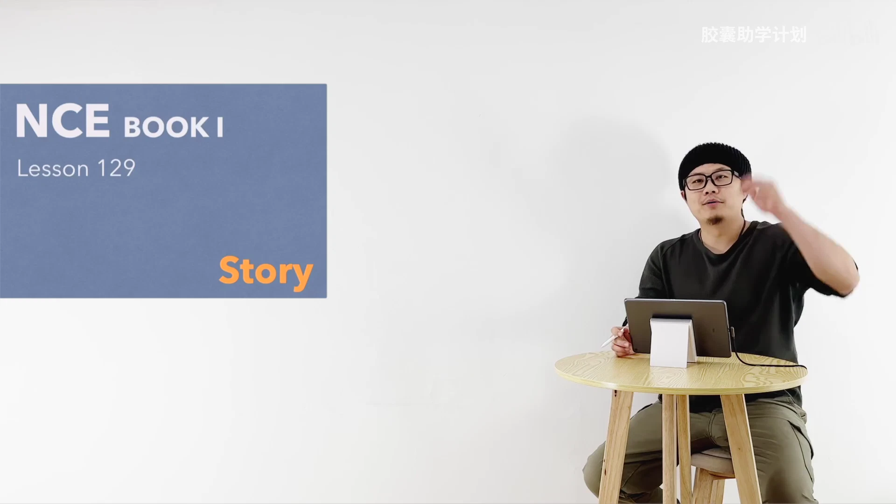

文字识别：NCE / BOOKI / Lesson 129 / Story

### 画面 00:00:02

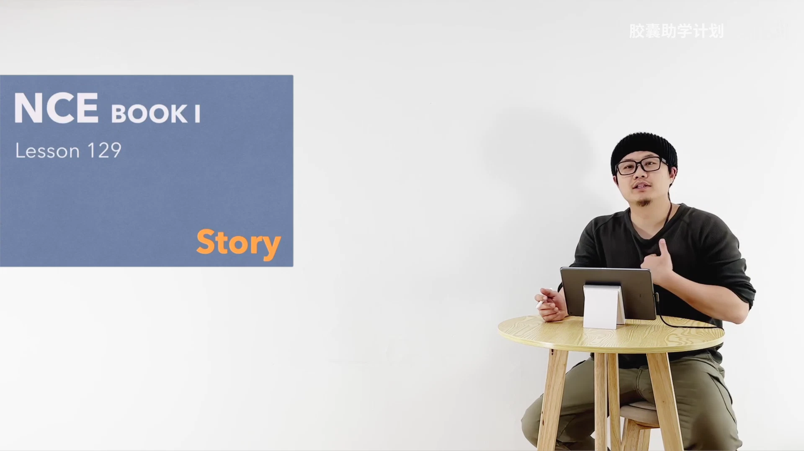

文字识别：NCE / BOOKI / Lesson 129 / Story

### 画面 00:00:08

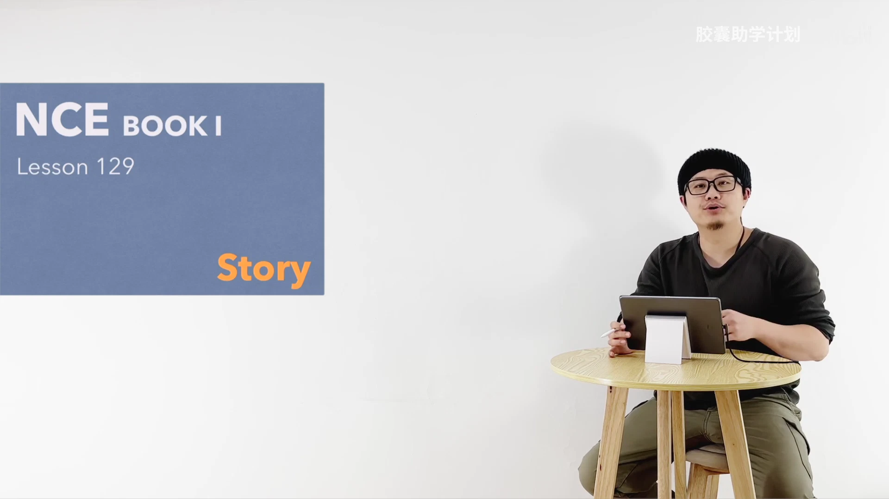

文字识别：NCE / BOOKI / Lesson 129 / Story

### 画面 00:00:10

文字识别：胶囊助学计划b出l

### 画面 00:00:13

文字识别：胶囊助学计划

### 画面 00:00:15

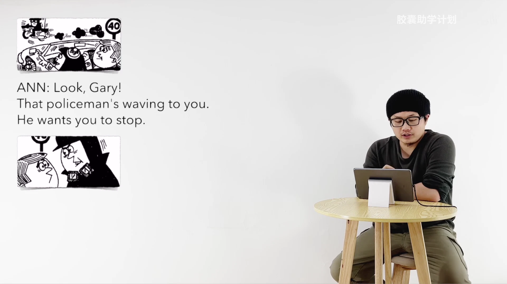

文字识别：3 / ANN: Look, Gary! / That policeman's waving to you. / He wants you to stop.

## 00:00:30–00:01:00

字。女人说，Look, Gary, Gary。男人，瞧，Gary。That policeman's waving to you. Waving一出来，那基本前面这个p s就是is了，对吧？叫做正在冲你招手，wave to somebody. He wants you to stop.他想让你停下来。陈述客观事实，一般现在时，continuing. Policeman说，Where do you think you are? Where do you think you

### 画面 00:00:45

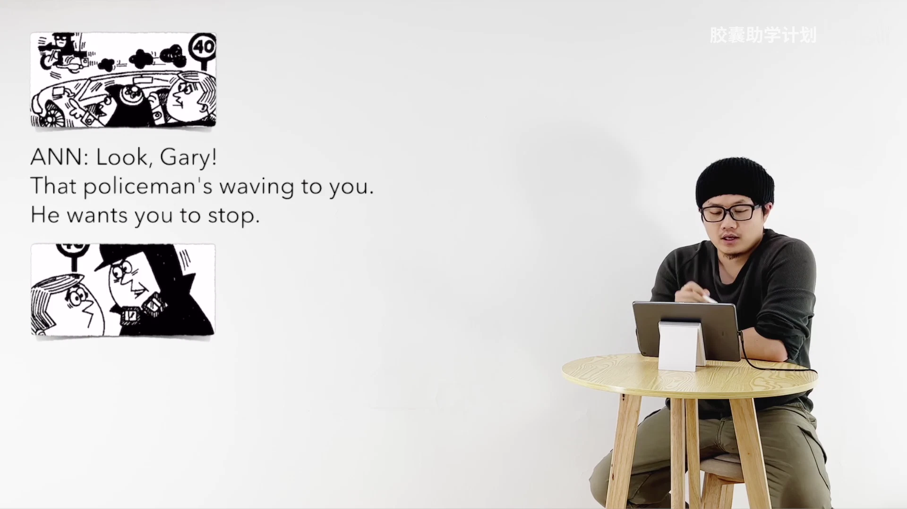

文字识别：1 / 3 / ANN: Look, Gary! / That policeman's waving to you. / He wants you to stop.

### 画面 00:00:51

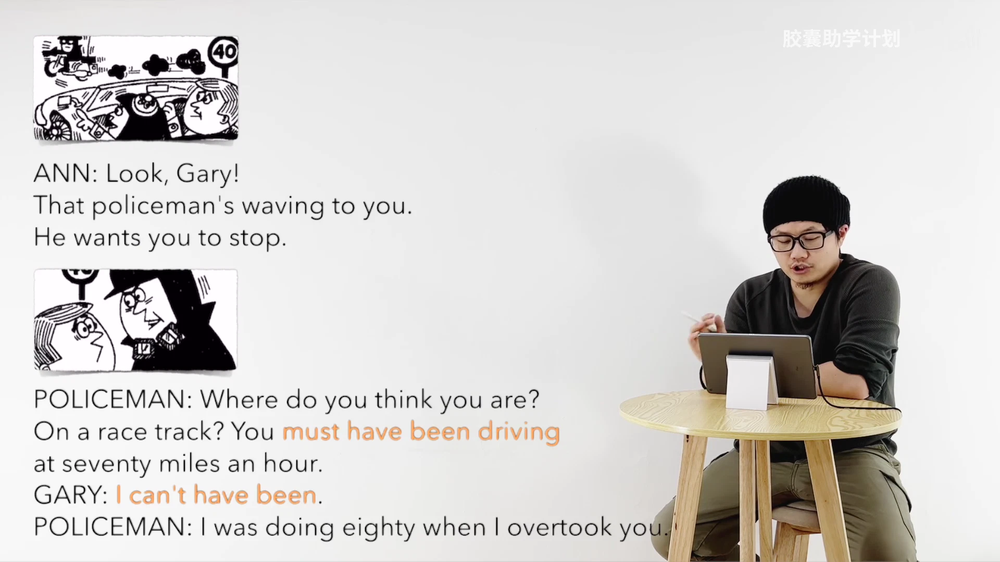

文字识别：ANN: Look, Gary! / That policeman's waving to you. / He wants you to stop. / POLICEMAN: Where do you think you are? / On a race track? You must have been driving / at seventy miles an hour. / GARY: I can't have / been. / POLICEMAN: I was doing eighty when I overtook you.

## 00:01:00–00:01:30

are? 就你认为你现在在哪里呀？ On a race track? 在赛道上吗？ You must have been driving at seventy miles an hour. 说你呀，之前一定是因为现在停车了嘛，他俩才能聊天，对不对？所以这个时态是被假设的啊，被被这个不能叫假设，被呃默认为它一定是过去的，对不对啊？说你当时刚之前开的时候啊，

### 画面 00:01:21

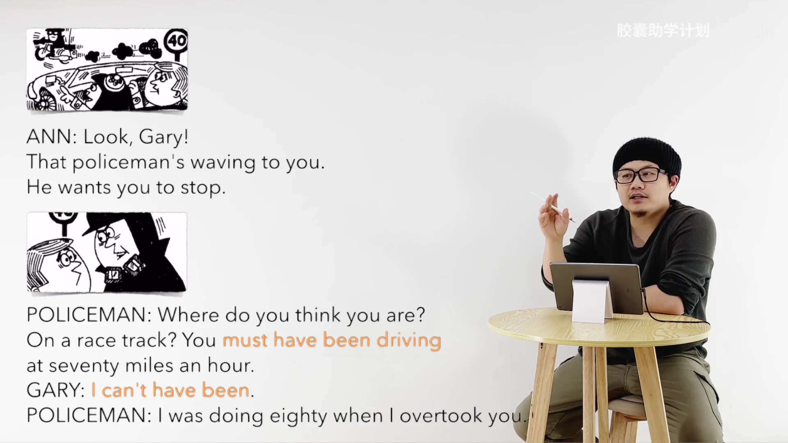

文字识别：ANN: Look, Gary! / That policeman's waving to you. / He wants you to stop. / POLICEMAN: Where do you think you are? / On a race track? You must have been driving / at seventy miles an hour. / GARY: I can't have / been. / POLICEMAN: I was doing eighty when I overtook you.

## 00:01:30–00:02:00

一定是开到了 must have been driving，叫当时一定是对吧？当时一定是正在开多少呢？ Seventy miles an hour，七十英里每小时啊，他这是限速四十。 Gary说嘴犟，I can't have been，说我一定没有吧？ Policeman说，I was doing eighty when I overtook you。哎，当我took you，当我超过你的时候，I was doing eighty啊，我正在开到八十

### 画面 00:01:51

文字识别：ANN: Look, Gary! / That policeman's waving to you. / He wants you to stop. / POLICEMAN: Where do you think you are? / On a race track? You must have / e been driving / at seventy  / miles an hour. / GARY: I can't have / been. / POLICEMAN: I was doing eighty when I overtook you.

## 00:02:00–00:02:30

英里每小时。你看这个地方的 doing 的用法就很有意思。完全我们可以把它换成换成 I was driving eighty when I overtook you。但是他把 driving 换成了 doing，是吧？OK，没问题。Next one， policeman said， didn't you see the speed limit？说难道你就没看见这个限速的牌子吗？对吧？Didn't，否定疑问句啊。I'm afraid I didn't， officer。我恐怕我没看见

### 画面 00:02:14

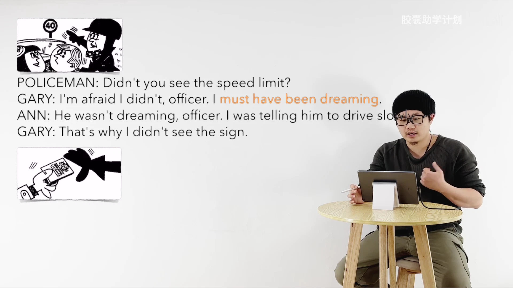

文字识别：POLICEMAN: Didn't you see the speed limit? / GARY: I'm afraid I didn't, officer. I must have been dreaming. / ANN: He wasn't dreaming, officer. I was telling him to drive slo / GARY: That's why I didn't see the sign.

## 00:02:30–00:03:00

啊，警官。I must have been dreaming，说我当时一定是做白日梦呢，对吧？He wasn't dreaming， officer。哎，他老婆立刻拆台，说他才没睡觉呢，是吧？他才没做白日梦呢，是吧？才没走神呢。哎，警官，I was telling him to drive slowly，说我之前就正在告诉他 tell somebody to do something，对吧？我之前就正在告诉他，一百零五课咱学的，我记得是啊，要慢一点点开。Gary说，哎，That's

### 画面 00:02:44

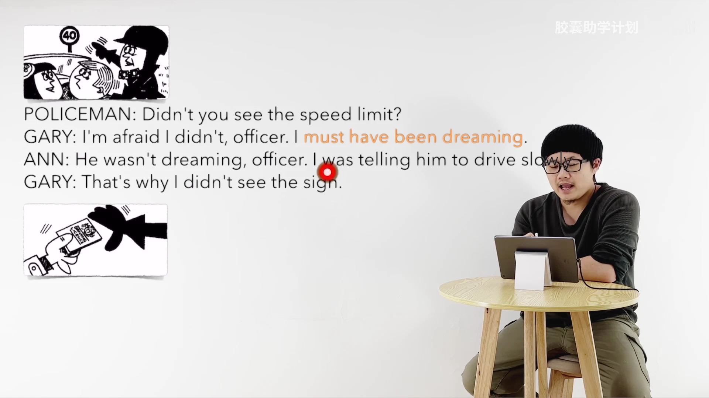

文字识别：POLICEMAN: Didn't you see the speed limit? / GARY: I'm afraid I didn't, officer.I must have been dreaming. / ANN: He wasn't dreaming, officer. I was telling him to drive slo / GARY: That's why I didn't see the sign. / /

## 00:03:00–00:03:30

why I didn't see the sign.说那就是为什么我没看到这个标志。好，首先这句话确实有一个语法，我们管它叫表语从句。但今天我们先不学啊，这个对于新一来说稍微还有一点点难，尤其是当我们宾语从句啊、主语从句啊这些还都没学完的时候。但是这句话其实不用语法，对于各位来说也很容易读懂。比如说that叫做那，is叫做是，

### 画面 00:03:14

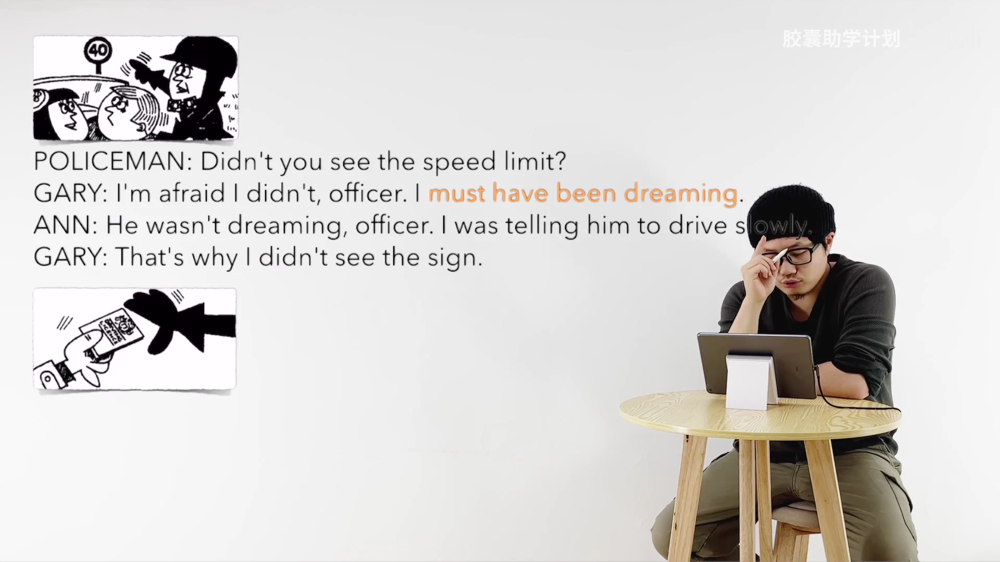

文字识别：POLICEMAN: Didn't you see the speed limit? / GARY: I'm afraid I didn't, officer. I must have been dreaming. / ANN: He wasn't dreaming, officer. I was telling him to drive s lwly. / GARY: That's why I didn't see the sign.

## 00:03:30–00:04:00

why 叫做为什么我没有看到这个标志，对吧？就跟汉语语序几乎一样，您就一个字儿一个字儿翻译就行了。至于 why I didn't，而不是 why didn't I 这个语序啊，我相信第一很多同学可能我不提您都没意识到，对吧？那第二我提了之后，这个又跟一百三十九课宾语从句那个语法有点关系。等我们宾语从句学完了之后，将来进入新二新三，我们再说表语从句的事儿啊。今天各位知道

### 画面 00:03:44

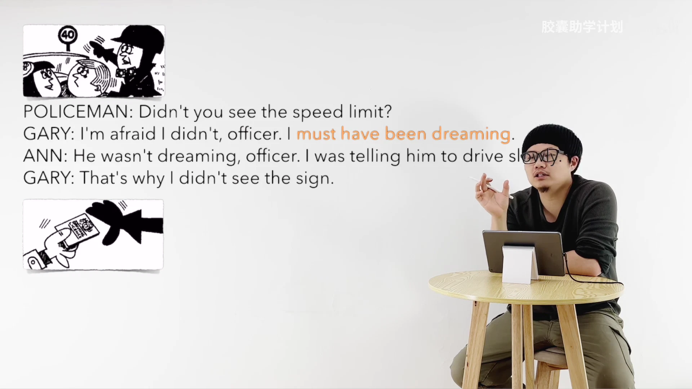

文字识别：POLICEMAN: Didn't you see the speed limit? / GARY: I'm afraid I didn't, officer.I must have been dreaming. / ANN: He wasn't dreaming, officer. I was telling him to drive slwy. / GARY: That's why I didn't see the sign.

## 00:04:00–00:04:30

有这么个语法就行了啊。而且这个语法呢，往往您不会，对于您读懂这句话影响不大，听懂这句话影响也不是很大，对吧？我们一点点来啊。Okay, policeman说，Let me see your driving license.说让我看一下你的驾照。Let me，对吧？Okay, policeman说，I won't charge you this time.说这次我就不罚你款了。But you'd better

### 画面 00:04:12

文字识别：POLICEMAN: I won't charge you this time. / But you'd better not do it again! / GARY: Thank you. / I'll certainly be more careful. / "

### 画面 00:04:22

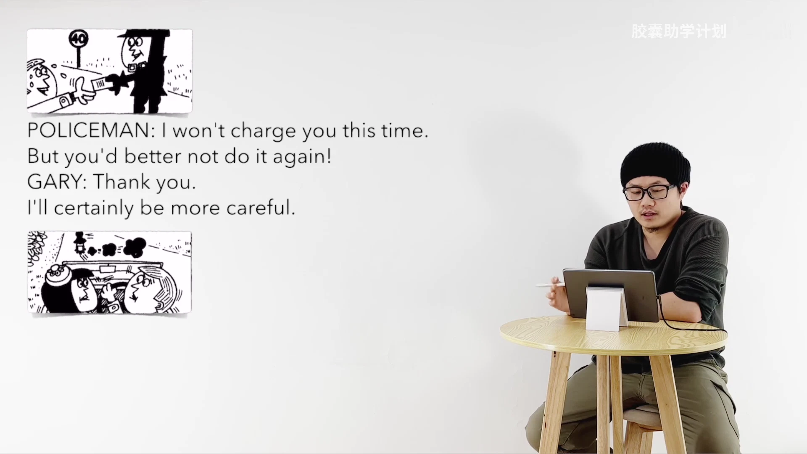

文字识别：11 / POLICEMAN: I won't charge you this time. / But you'd better not do it again! / GARY: Thank you. / I'll certainly be more careful. / 1

## 00:04:30–00:05:00

not do it again. 九十五课咱们学的 had better do something and had better not do something.叫最好做某件事情，否则会有麻烦、困难、危险。那在这地方就是最好别做某件事情，否则会有麻烦、困难、危险，对吧？比如说我吊销你执照什么的啊。Gary说，Thank you. I will certainly be more careful. Ah, more careful. 形容词比较级，对吧？我会叫更加的小心的啊。I certainly就是一定啊，我一定

### 画面 00:04:52

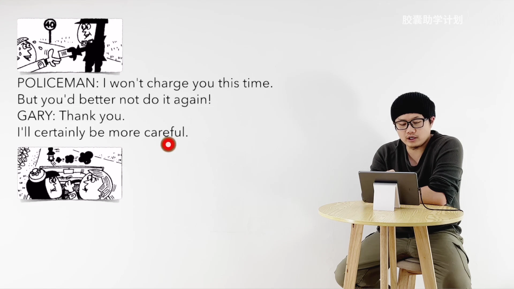

文字识别：POLICEMAN: I won't charge you this time. / But you'd better not do it again! / GARY: Thank you. / I'll certainly be more careful.

## 00:05:00–00:05:30

将更加的小心的，没问题。Policeman走了，两个人还在斗嘴啊。他跟他女朋友也好，或妻子也好，说，I told you to drive slowly, Gary。啊，就我之前就告诉你了，就我早告诉你了，要慢点开，Gary。那Gary是怎么说的呢？说，Well, you always tell me to drive slowly。说你总是告诉我要慢点开。那你看，俩人斗嘴了，对吧？Darling，还亲爱的，说亲爱的，你总是告诉

### 画面 00:05:03

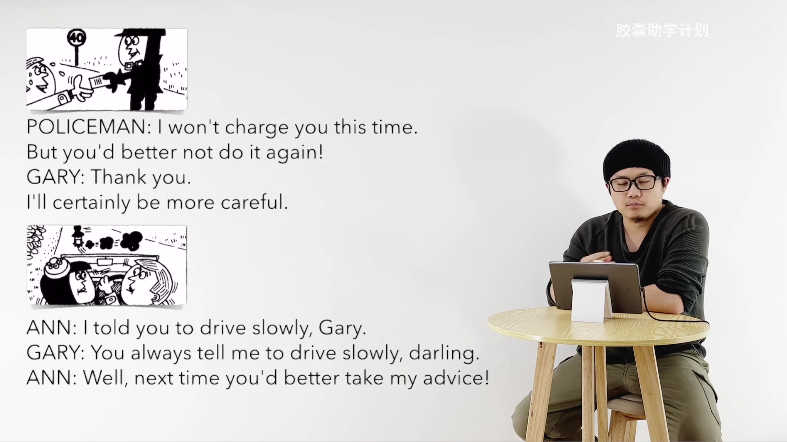

文字识别：11 / POLICEMAN: I won't charge you this time. / But you'd better not do it again! / GARY: Thank you. / I'll certainly be more careful. / ANN: I told you to drive slowly, Gary. / GARY: You always tell me to drive slowly, darling. / ANN: Well, next time you'd better take my advice!

## 00:05:30–00:06:00

我要慢点开。你说慢点开的时候，其实对于我来说就是巴拉巴拉巴拉巴拉，听不进去了，对不对？然后 Anne 说，Well，说好吧。Next time you'd better take my advice。他说那好吧，他说下一次你最好还是拿我的这个建议，叫做听从我的建议吧。但它不是字面意思，不是说听从叫做 hear my advice，或者说 listen to my advice。一般说叫 take my advice。OK，

### 画面 00:05:30

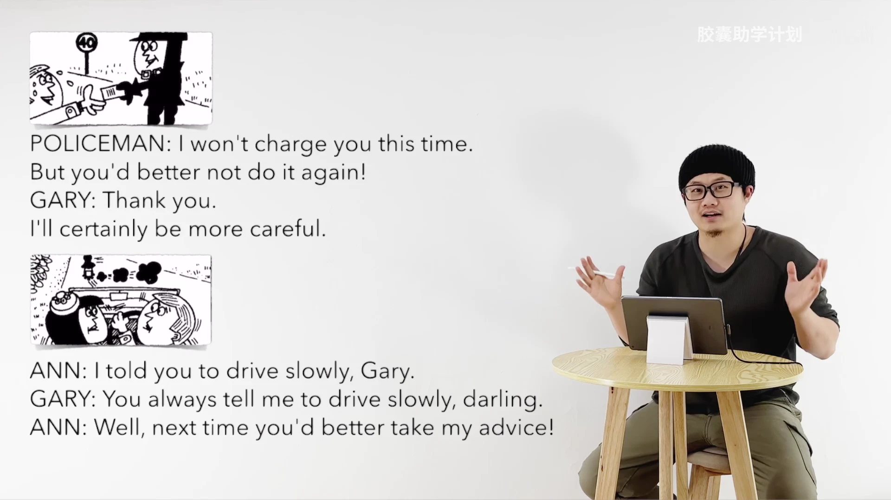

文字识别：111 / POLICEMAN: I won't charge you this time. / But you'd better not do it again! / GARY: Thank you. / I'll certainly be more careful. / ANN: I told you to drive slowly, Gary. / GARY: You always tell me to drive slowly, darling. / ANN: Well, next time you'd better take my advice!

### 画面 00:05:52

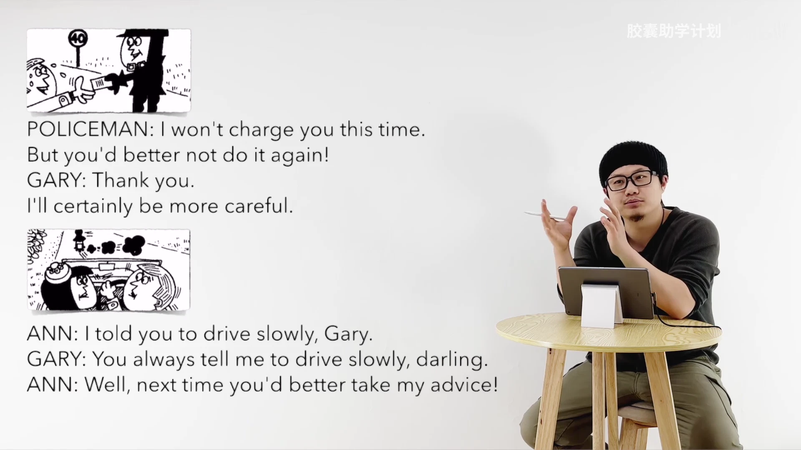

文字识别：11 / POLICEMAN: I won't charge you this time. / But you'd better not do it again! / GARY: Thank you. / I'll certainly be more careful. / ANN: I told you to drive slowly, Gary. / GARY: You always tell me to drive slowly, darling. / ANN: Well, next time you'd better take my advice!

## 00:06:00–00:06:30

好文章结束了。接下来我们做一些口语听力练习。您可以看着文章，带口语回答我，好吧？来第一题，Who is waving to Ann and Gary?啊，答案很明显了，The policeman. Next one, Why is the policeman waving?答案也很简单了，Because he wants Gary to stop. Next one, How fast must Gary have been driving?

### 画面 00:06:00

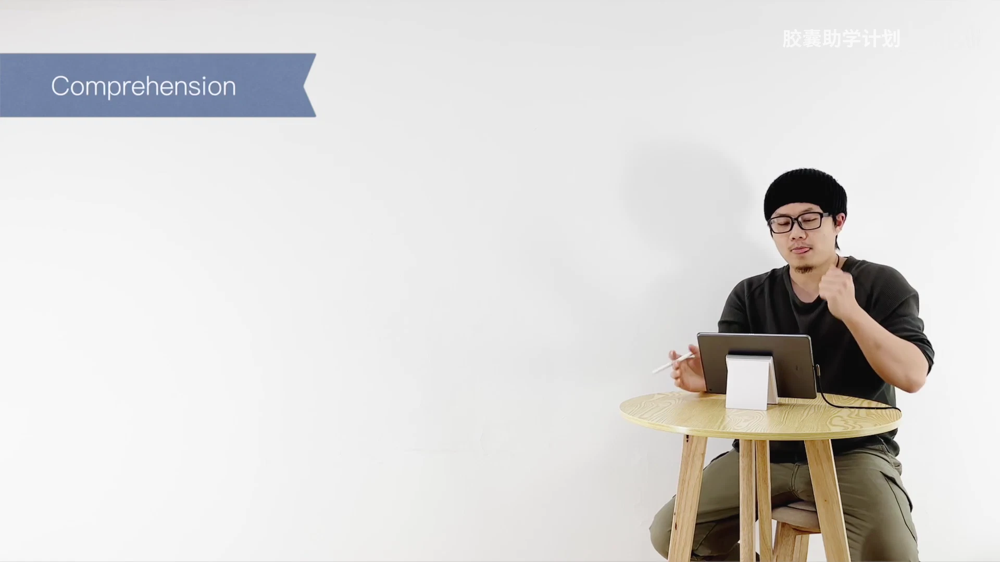

文字识别：Comprehension

### 画面 00:06:09

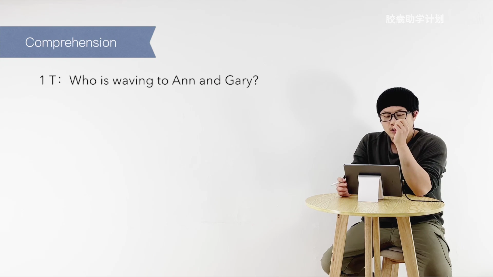

文字识别：Comprehension / 1 T: Who is waving to Ann and Gary?

### 画面 00:06:20

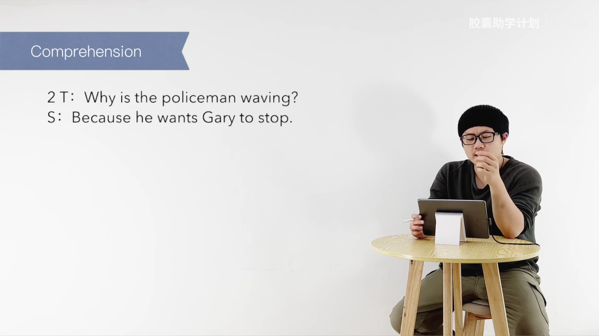

文字识别：Comprehension / 2 T: Why is the policeman waving? / S: Because he wants Gary to stop.

### 画面 00:06:25

文字识别：Comprehension / 3 T: How fast must Gary have been driving?

## 00:06:30–00:07:00

He must have been driving at seventy miles an hour. Next one. Why does the policeman say so? 注意这个 so 就是跟咱们之前刚刚学到的 I thought so 是吧？很很像啊。那这个 so 就是如此这般或 this 或者这啊。为什么会这样认为？ Because he was driving at eighty when he overtook Gary, 对吧？ Next

### 画面 00:06:41

文字识别：Comprehension / 4 T: Why does the policeman say so?

### 画面 00:06:53

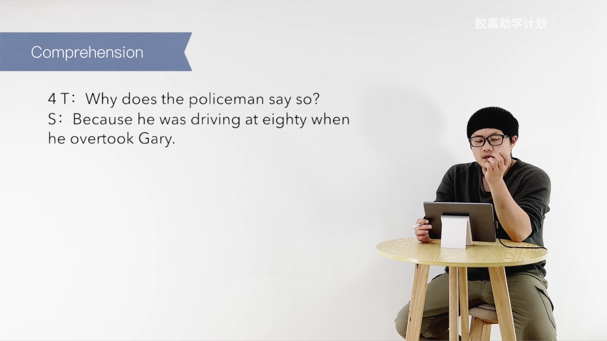

文字识别：Comprehension / 4 T: Why does the policeman say so? / S: Because he was driving at eighty when / he overtook Gary.

## 00:07:00–00:07:30

one. Why didn't Gary see the speed limit? He must have been dreaming. He当时一定是. Next one. Does Anne think Gary was dreaming? No, she doesn't. Next one. What was Anne doing? She was telling Gary to drive slowly. Very good. Next one. What does the policeman ask Gary for?

### 画面 00:07:00

文字识别：Comprehension / 5 T: Why didn't Gary see the speed limit?

### 画面 00:07:13

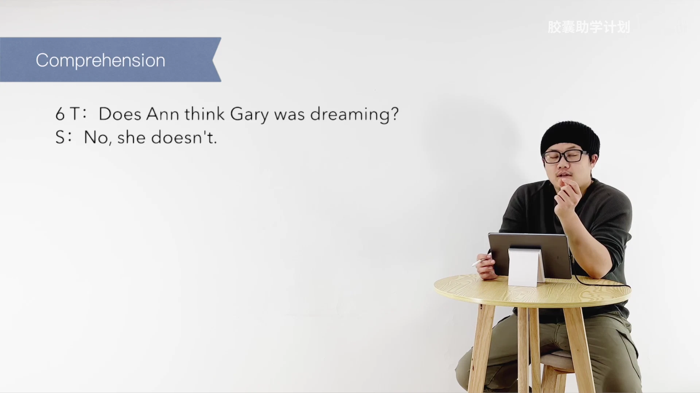

文字识别：Comprehension / 6 T: Does Ann think Gary was dreaming? / S: No, she doesn't.

### 画面 00:07:17

文字识别：Comprehension / 7 T: What was Ann doing?

### 画面 00:07:20

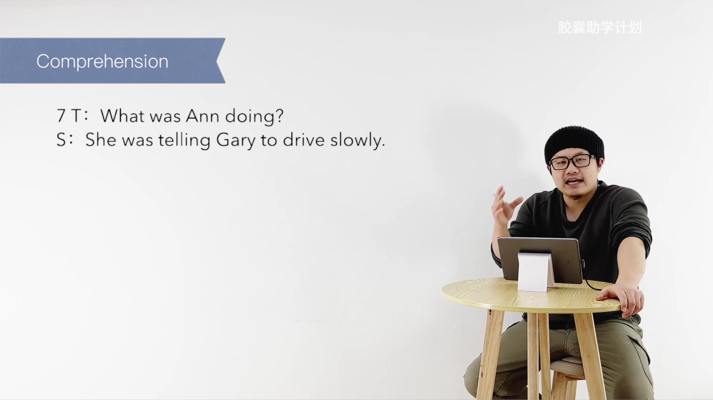

文字识别：Comprehension / 7 T: What was Ann doing? / S: She was telling Gary to drive slowly.

### 画面 00:07:24

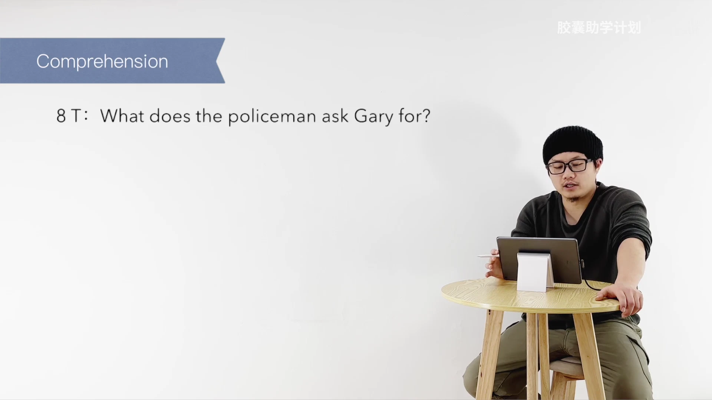

文字识别：Comprehension / 8 T: What does the policeman ask Gary for?

## 00:07:30–00:08:00

he asks to see Gary's driving license. Next one, will the policeman charge Gary this time? No, he won't. Okay, next one. What does Ann always tell Gary to drive slowly? 对吧？那我们整句话叫做 She always tells Gary to drive slowly. Okay. 那 asking questions,肯定句，一般疑问句，特殊疑问句，这是各位最基础的一些练

### 画面 00:07:37

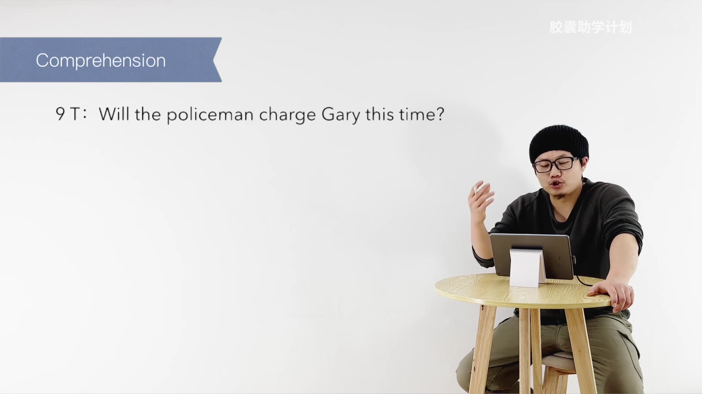

文字识别：Comprehension / 9 T: Will the policeman charge Gary this time?

### 画面 00:07:43

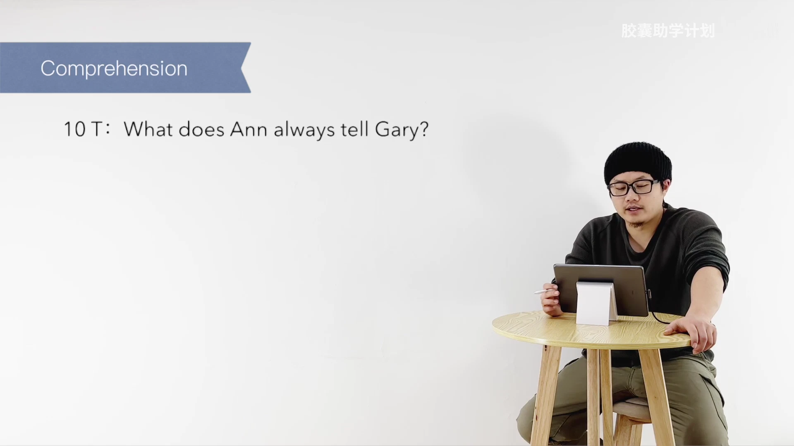

文字识别：Comprehension / 10T: What does Ann always tell Gary?

### 画面 00:07:50

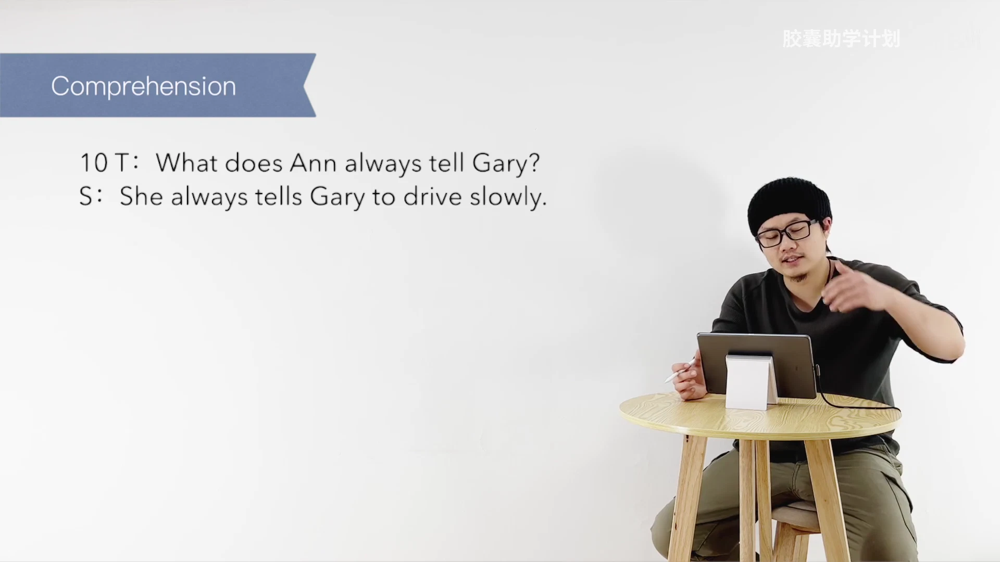

文字识别：Comprehension / 10 T: What does Ann always tell Gary? / S: She always tells Gary to drive slowly.

### 画面 00:07:54

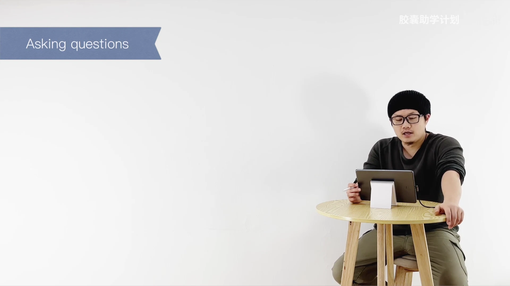

文字识别：Asking questions

## 00:08:00–00:08:30

练习啊。来第一题，Ask me if the policeman wants Gary to stop. 一般现在是第三人称单数，Does提前，Does the police want Gary to stop? What点点do标准答案，What does the policeman want Gary to do? 啊，OK. Next one, Ask me if he must have been driving at seventy miles an hour. Must提前，Must he have been driving at seventy miles an hour? How

### 画面 00:08:08

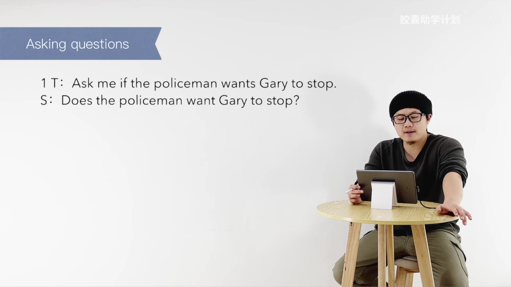

文字识别：Asking questions / 1 T: Ask me if the policeman wants Gary to stop. / S: Does the policeman want Gary to stop?

### 画面 00:08:18

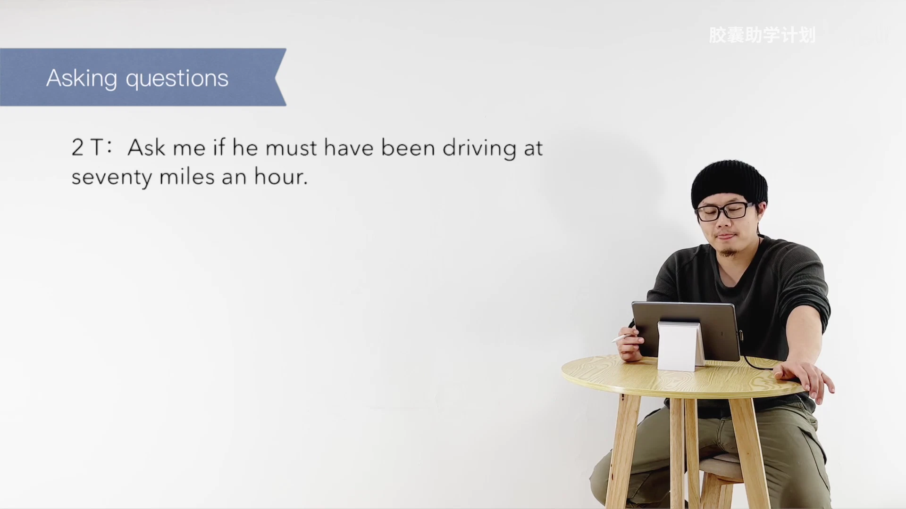

文字识别：Asking questions / 2 T: Ask me if he must have been driving at / seventy miles an hour.

### 画面 00:08:29

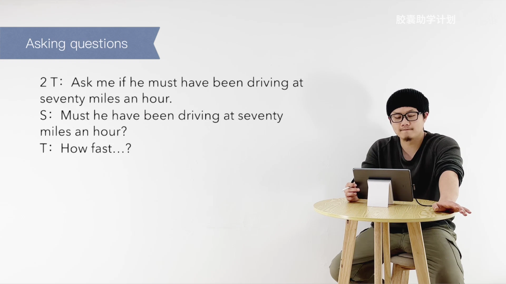

文字识别：Asking questions / 2 T: Ask me if he must have been driving at / seventy miles an hour. / S: Must he have been driving at seventy / miles an hour? / T: How fast...?

## 00:08:30–00:09:00

fast? That肯定是对. At seventy miles an hour,提问对吧？叫做How fast must he have been driving? Next one, ask me if Gary saw the speed limit. Saw啊, did提前? Did Gary see the speed limit?啊，各位张开嘴是吧？张开嘴去读啊，把答案说出来。您可以暂停视频，如果我这个速度有点快的话。Why didn't?直接把did

### 画面 00:08:39

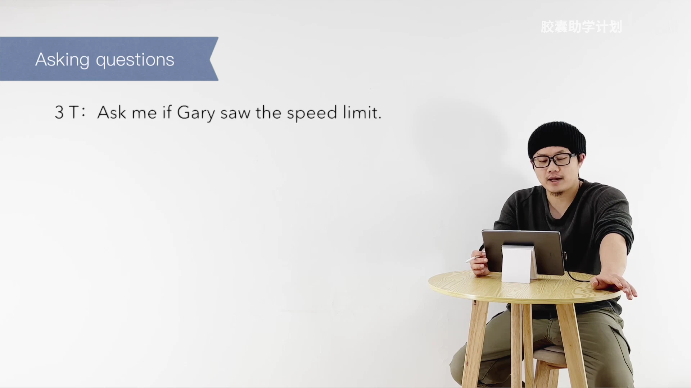

文字识别：Asking questions / 3 T: Ask me if Gary saw the speed limit.

### 画面 00:08:59

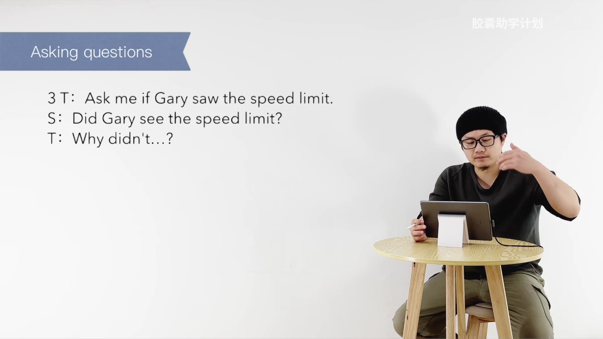

文字识别：Asking questions / 3 T: Ask me if Gary saw the speed limit. / S: Did Gary see the speed limit? / T: Why didn't..?

## 00:09:00–00:09:30

put didn't off and add in front. Called why didn't Gary see the speed limit? Next one, ask me if the policeman will charge him. Will the policeman charge him? Why won't?刚才我们讲到了叫 why won't the policeman charge him?对吧？我们在上一个视频单词部分讲到了. Next one, ask me if an always tells Gary to drive slowly.

### 画面 00:09:04

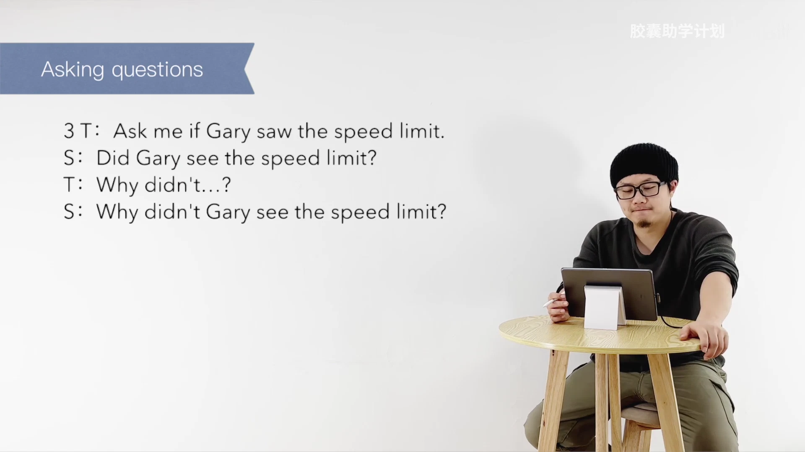

文字识别：Asking questions / 3 T: Ask me if Gary saw the speed limit. / S: Did Gary see the speed limit? / T: Why didn't...? / S: Why didn't Gary see the speed limit?

### 画面 00:09:06

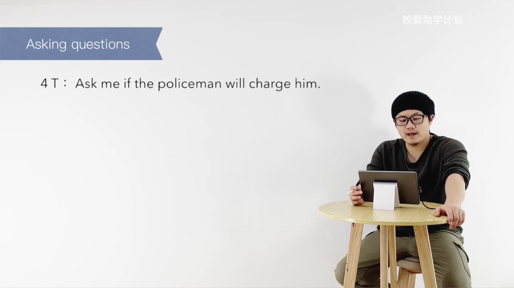

文字识别：Asking questions / 4T: Ask me if the policeman will charge him.

### 画面 00:09:17

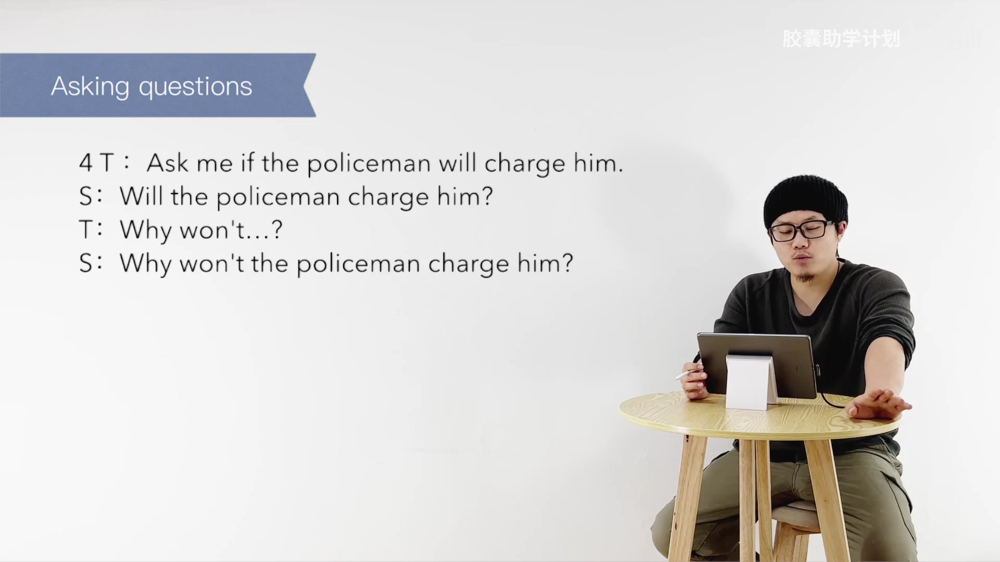

文字识别：Asking questions / 4 T: Ask me if the policeman will charge him. / S: Will the policeman charge him? / T: Why won't...? / S: Why won't the policeman charge him?

### 画面 00:09:22

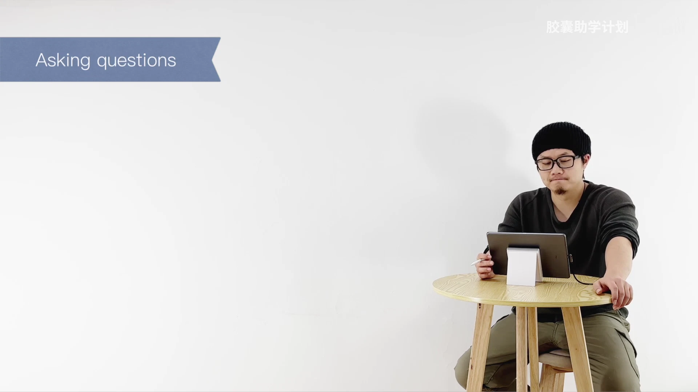

文字识别：Asking questions

## 00:09:30–00:10:00

Does Ann always tell Gary to drive slowly? What What does Ann always tell Gary? Okay, recap. 本课还是这些公式，各位一定要把它们尽可能去造句，去红皮书当中做额外的作业，好吧？加上作业，好，我们一起看一下绿皮书幺二九，各位可以写了。文章老习惯，一定要跟读至熟读成诵。最后呢，给自己讲解一遍今天的核

### 画面 00:09:30

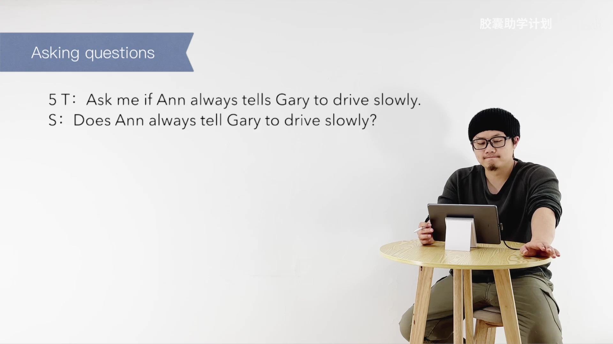

文字识别：Asking questions / 5 T: Ask me if Ann always tells Gary to drive slowly. / S: Does Ann always tell Gary to drive slowly?

### 画面 00:09:40

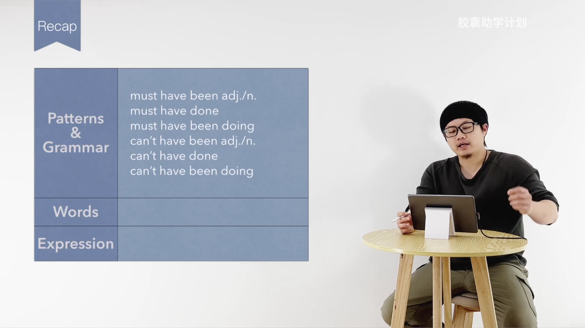

文字识别：Recap / must / have / been / adj./n. / must / have / done / Patterns / must / have / been / doing / & / can't / have / been / adj./n. / Grammar / can't have / done / can't have / been / doing / Words / Expression

### 画面 00:09:50

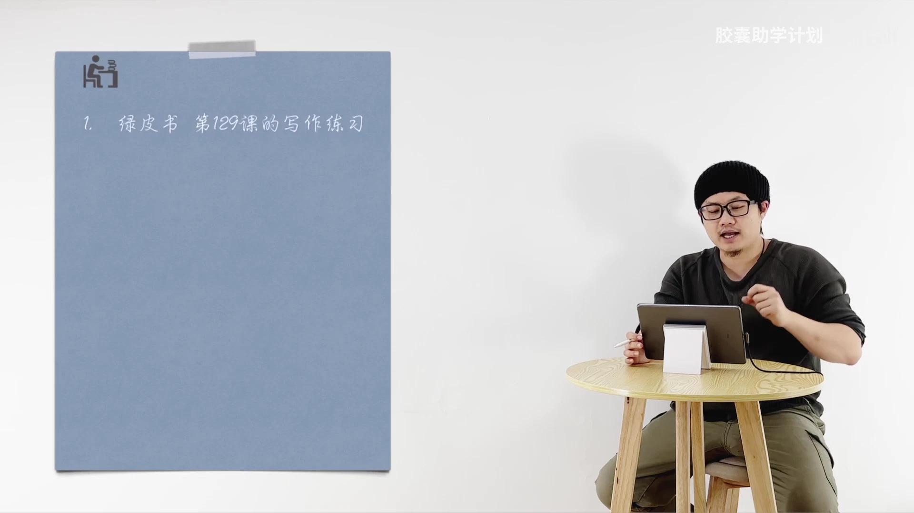

文字识别：绿皮书第129课的写作练习

### 画面 00:09:59

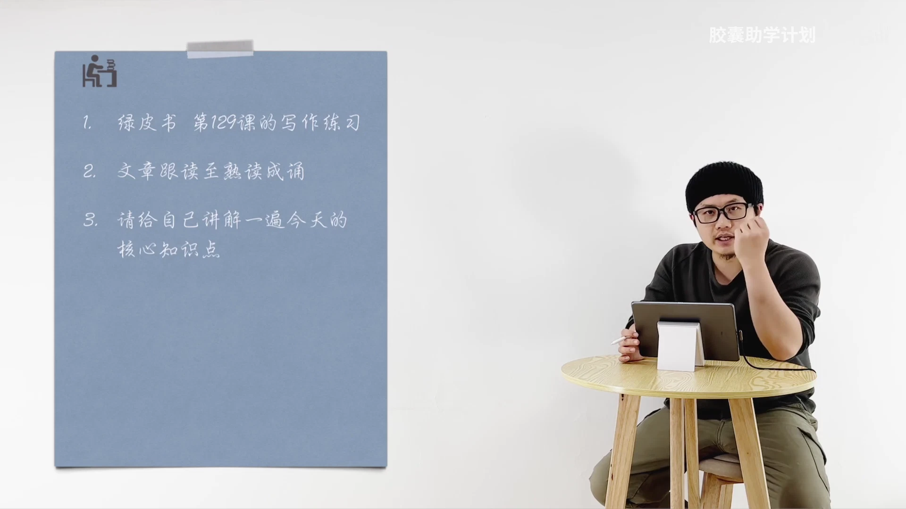

文字识别：绿皮书第129课的写作练习 / 2.文章跟读至熟读成诵 / 3.请给自己讲解一遍今天的 / 核心知识点

## 00:10:00–00:10:29

心知识点。好，呃，如果各位喜欢我们的课程，欢迎各位关注、订阅、一键三连、分享给那些需要的朋友，来帮助我们快速成长。我们再来看一句名人名言：If you can dream it, you can do it. See you next time.

### 画面 00:10:01

### 画面 00:10:10

文字识别：If you can dream it, you can do it. /  Walt Disney

### 画面 00:10:17

### 画面 00:10:19

文字识别：CAPSULEACADEMY / 胶囊助学计划 / 小红书 / Lecturer / Leo / OE

### 画面 00:10:22

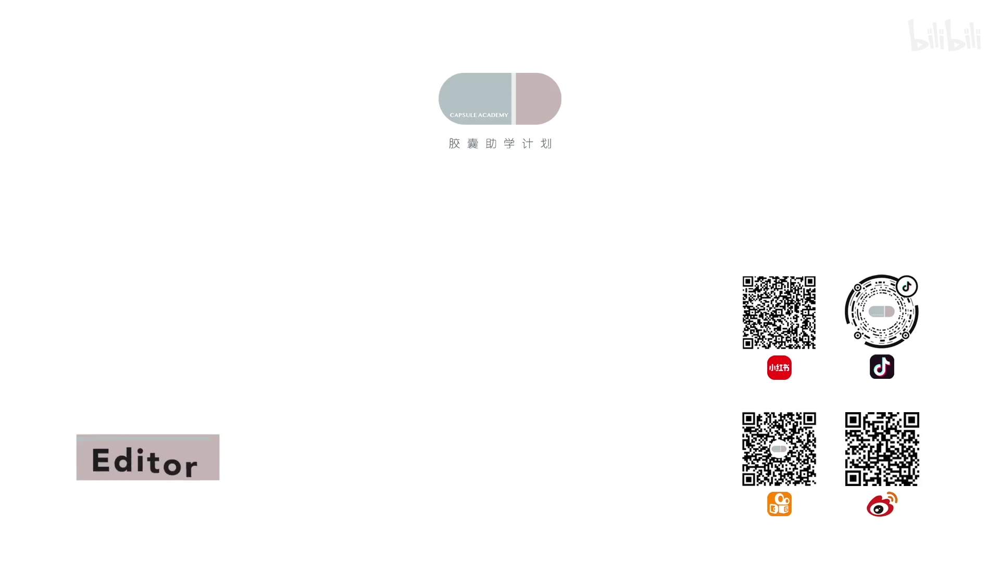

文字识别：CAPSULEACADEMY / 胶囊助学计划 / 小红书 / Editor / OE

### 画面 00:10:25

文字识别：CAPSULEACADEMY / 胶囊助学计划 / 小红书 / Creator / Leo & Berlin / OE

### 画面 00:10:27

文字识别：Bilibili / 胶囊助学计划 / ひ / 小红书

### 画面 00:10:29

文字识别：bilibili / 胶囊助学计划

