# 131 单词 语法

快速机器解析：语音为单模型转写，未进行独立交叉校对或人工复核；画面每秒采样并按变化选帧，短时文字和标记可能遗漏。截图时间约有 1 秒误差。图片有损压缩；遇到疑点请按时间查看 Google Drive 原视频。

## 00:00:00–00:00:30

Hello everyone, welcome to Capsule Academy. This is Leo. Today we're going to learn New Concept English Book One, Lesson One Hundred and Thirty One, Grammar and Words. 那老习惯，进入正式课程之前呢，咱们先看一个问题，May和Might表推测如何去应用？OK，那带着这个问题，Hope you guys enjoy. 好，那本课的语法实际上和一百二十

### 画面 00:00:00

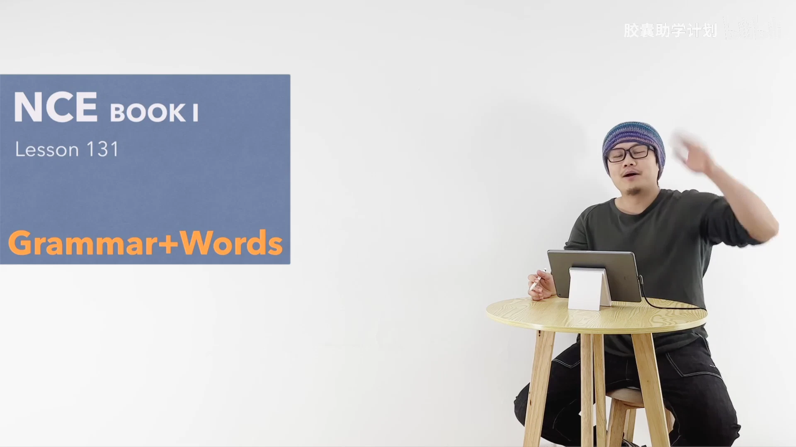

文字识别：胶囊助学计划 / NCE / BOOKI / Lesson 131 / Grammar+Words

### 画面 00:00:02

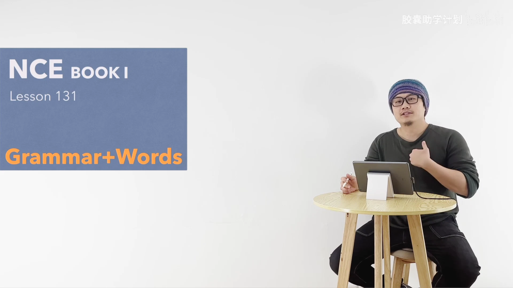

文字识别：胶囊助学计划 / NCE / BOOKI / Lesson 131 / Grammar+Words

### 画面 00:00:11

文字识别：胶囊助学计划

### 画面 00:00:13

文字识别：胶囊助学计划 / ①may & might 表推测？

### 画面 00:00:21

文字识别：胶囊助学计划bilbi

### 画面 00:00:25

文字识别：助字計划 / 胶囊助学计划

### 画面 00:00:27

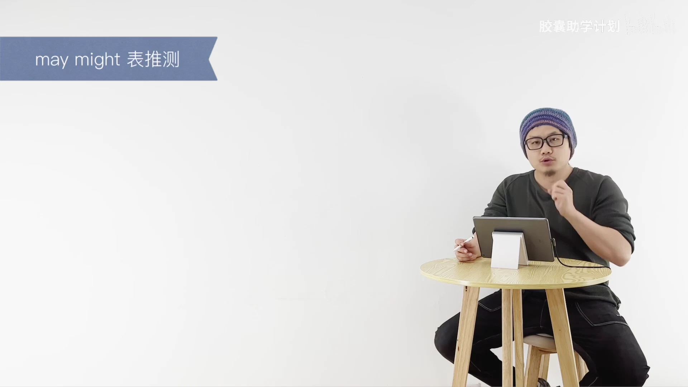

文字识别：胶囊助学计划 / may might 表推测

## 00:00:30–00:01:00

七克、一百二十九克某种程度上是紧密相连的。那我们现在以非常快的速度先迅速回顾一下。那我们在刚刚学过的这两课当中呢，分别学到了 must 与 can't 去表示推测。那后面接不同的东西，有的时候可以表示对现在的推测，有的时候可以表示对过去的推测。但不管怎么样，它们共同的特点都是确信度非常的高。而

### 画面 00:00:57

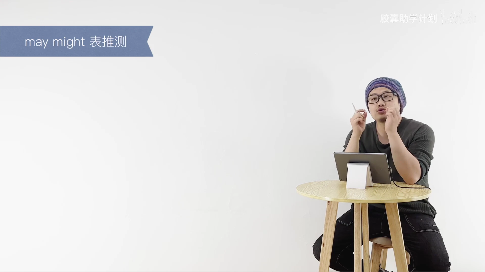

文字识别：胶囊助学计划 / may might 表推测

### 画面 00:00:59

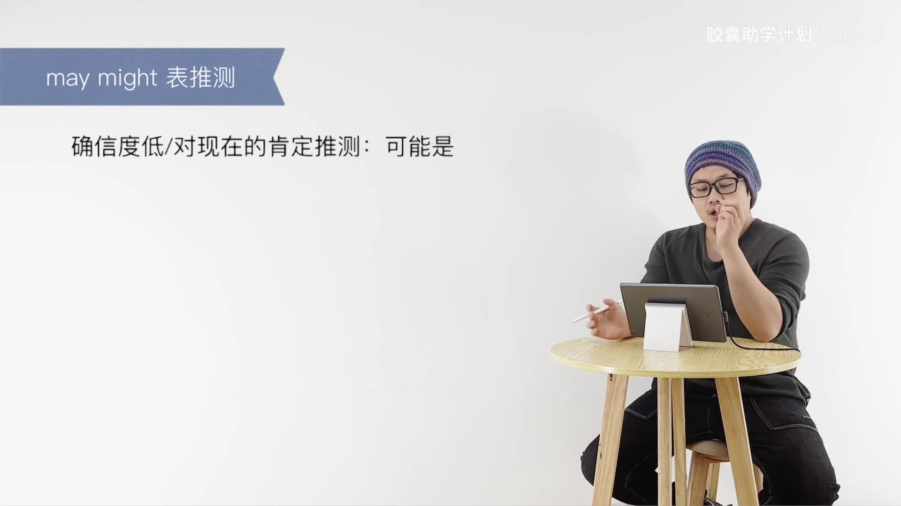

文字识别：胶囊助学计划 / may might 表推测 / 确信度低/对现在的肯定推测：可能是

## 00:01:00–00:01:30

may 和 might 与 must 和 can't 最本质的区别是什么呢？就是它们的确信度都很低，所以它翻译成可能或也许啊。 OK，然后呢，由后边的结构决定了它是对现在还是对过去推测，由有没有后边 not 这个单词决定它是肯定还是否定。那我们先看一下公式啊，并不是非常的难。我们先看公式是 may 或 might 都可以。注意

### 画面 00:01:06

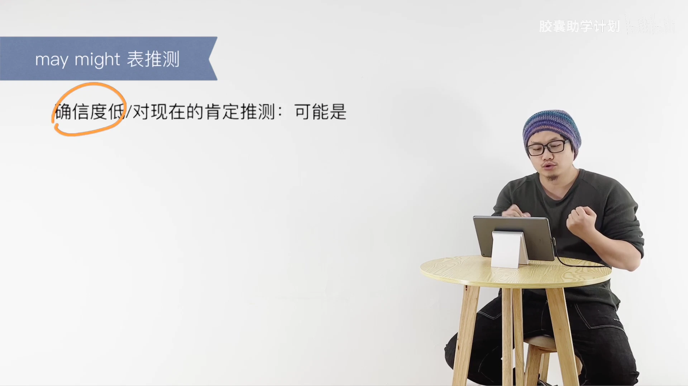

文字识别：胶囊助学计划關 / may might 表推测 / 确信度低/对现在的肯定推测：可能是

### 画面 00:01:28

文字识别：胶囊助学计划 / may might 表推测 / 确信度低/对现在的肯定推测：可能是 / may/might be adj./n.

## 00:01:30–00:02:00

啊，虽然理论上来说，might这个单词是may的过去式，但是它用在现在是完全没有问题的。记住这句话啊，所以might完全可以表示对现在的肯定推测。那关于这个知识点，如果我现在这样一讲，您拿不是特别清楚，对吧？在我们的语法单项那个合集视频当中啊，有非常清楚的情态动词的一个视频合集，各位去看就可以了，好吧？

### 画面 00:01:58

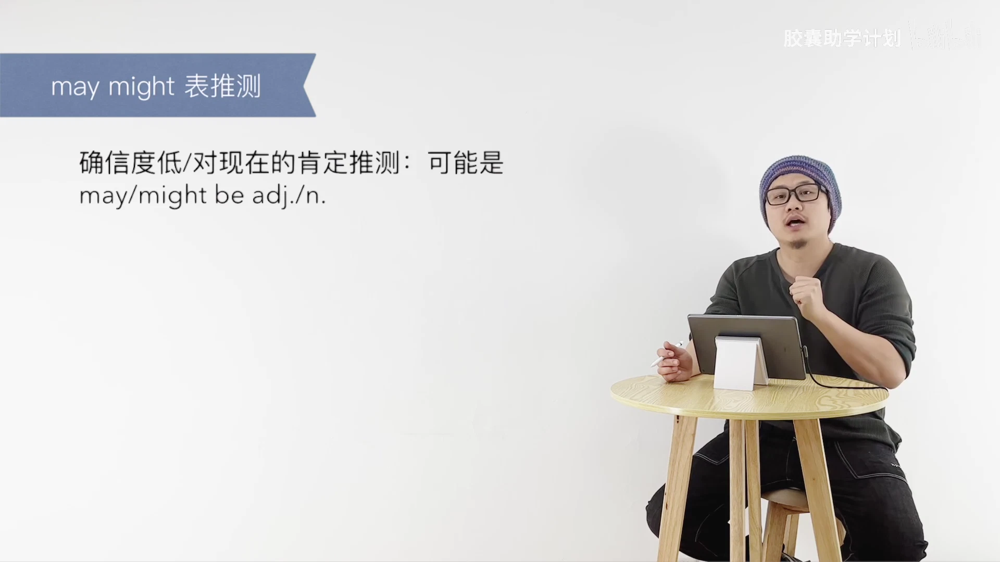

文字识别：胶囊助学计划 / may might 表推测 / 确信度低/对现在的肯定推测：可能是 / may/might be adj./n.

## 00:02:00–00:02:30

好，那我们看这里说 may 和 might 都可以后边加 be 加形容词名词。那您看，您把 may 和 might 换成 must 或 can't，是不是就跟之前学的是一样的了？对吧？我们之前学的是 must be 加形容词名词，或者是 can't be 加形容词名词。今天我们把 must 和 can't 换成了 may 和 might，那表示的叫做对现在的一个呃确信度低的一个推测啊，肯定推测。当然，它翻译成

### 画面 00:02:28

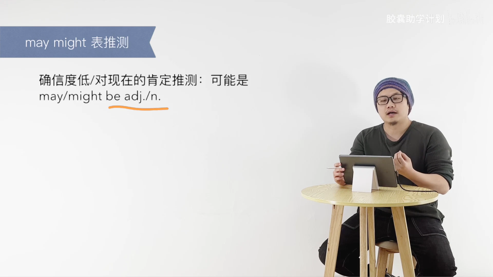

文字识别：胶囊助学计划 / may might 表推测 / 确信度低/对现在的肯定推测：可能是 / may/might be adj./n.

## 00:02:30–00:03:00

叫可能是。当然了，你也可以是 may 和 might 加 do，这跟 must 和 can 的是一样的，也可以叫后边加 be doing。你看，完全一样。我们造一个句子吧，给大家举一个练习啊。哦，当然了，比如说它的否定呢，您就不用换另一个单词了，直接在 may 和 might 后边加 not 就可以了。那接下来我们去看一些小的练习。我们举个例子，比如说我们看这幅图，那我就会问叫 Where is he from？注意我用的是 is，表示的是现

### 画面 00:02:42

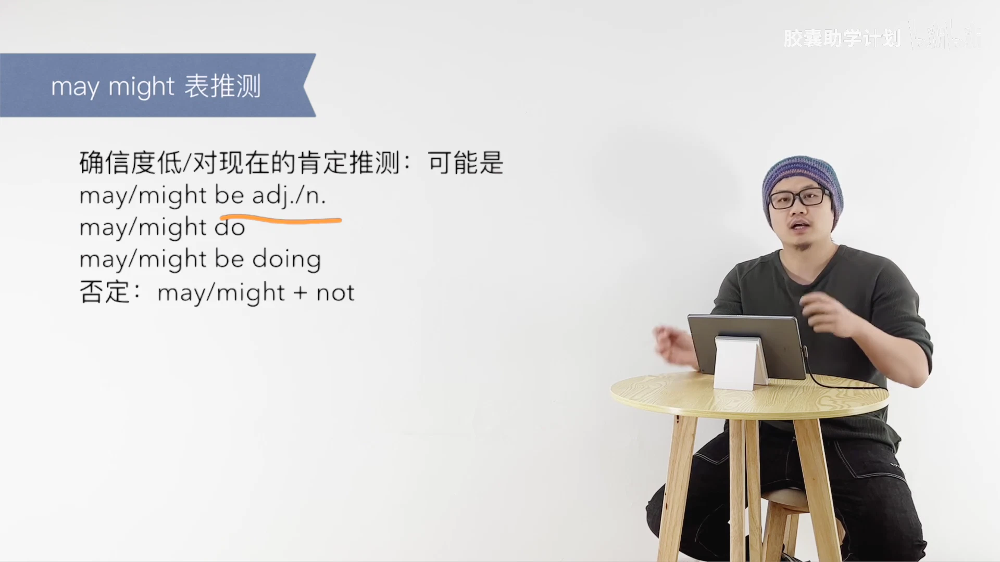

文字识别：胶囊助学计划 / may might 表推测 / 确信度低/对现在的肯定推测：可能是 / may/might be adj./n. / may/might do / may/might be doing / 否定：may/might + not

### 画面 00:02:51

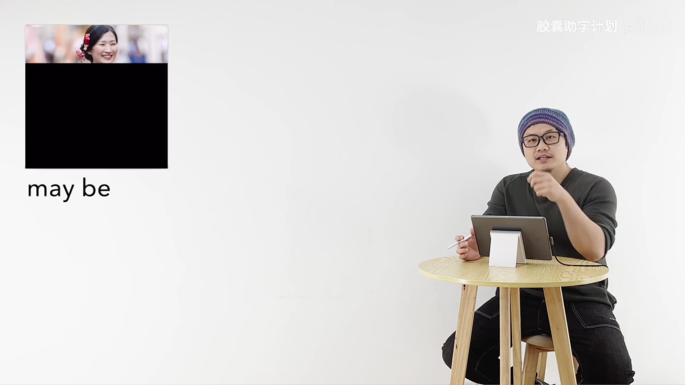

文字识别：胶囊助学计划 / may be

## 00:03:00–00:03:30

在对吧？那接下来你可以你只看一个头，我怎么知道？那叫做 she may be from China. 哎，它叫她 may be 啊，对吧？她可能是来自于中国。 She may be from Korea. She may be from Japan, 对吧？我们就是纯猜测。还是那句话，各位，我们把 may be 换成 must be 或 can't be，那是由你手中掌握的信息决定的。比如说，哎，我们看多了

### 画面 00:03:03

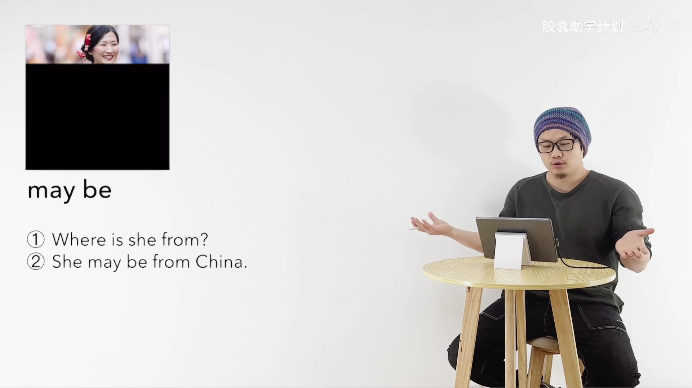

文字识别：胶囊助学计划 / may be / ① Where is she from? / ② She may be from China.

### 画面 00:03:14

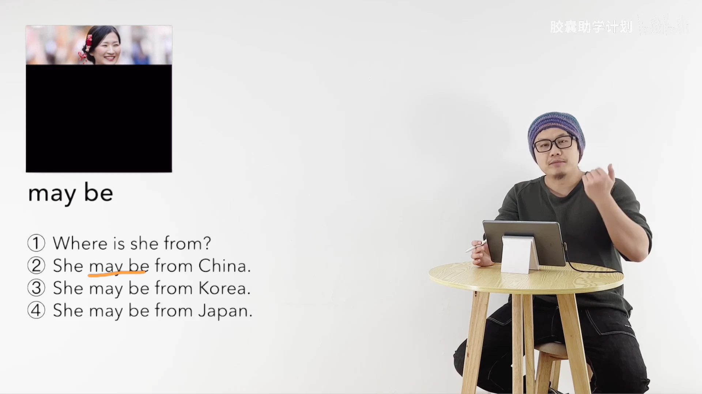

文字识别：胶囊助学计划 / may be / Where is she from? / 1 / ② / She mav be from China. / ③ She may be from Korea. / ④ She may be from Japan.

### 画面 00:03:28

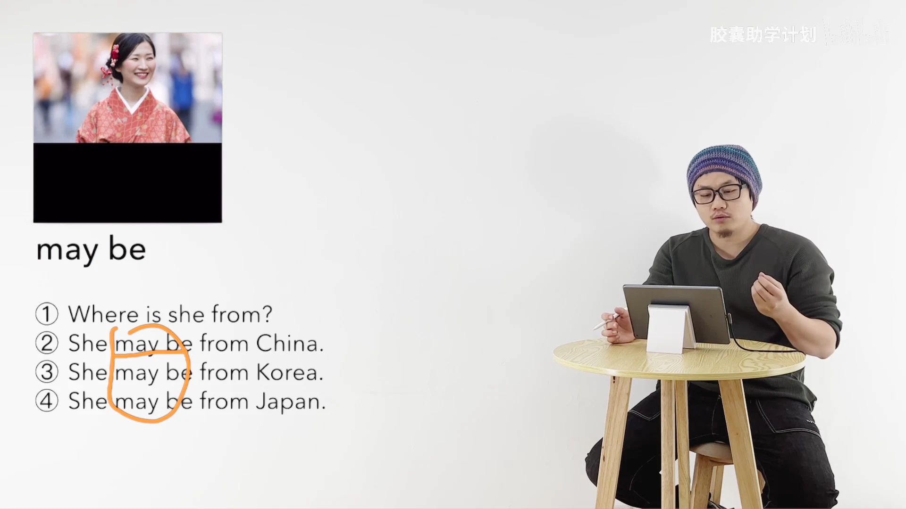

文字识别：胶囊助学计划 / may be / Where is she from? / 1 / 2 / Shemav bef / from China. / ③ Shemay befrom Korea. /  She may be from Japan. / 4

## 00:03:30–00:04:00

一点点信息，看着这个服装不太像我们现在比较流行的那个叫汉服是吧？哎，不太像那个服装，有点像和服是吧？有点像日本人穿的那个。那我这样一看，我就还是猜不能完全确定，对吧？因为我不确定下面是什么样子，所以我说 she must be from Japan。由我所有的推测，都由手中掌握信息的多少去进行一个评判。那比如说我现在看到了整个样子，我一看

### 画面 00:03:40

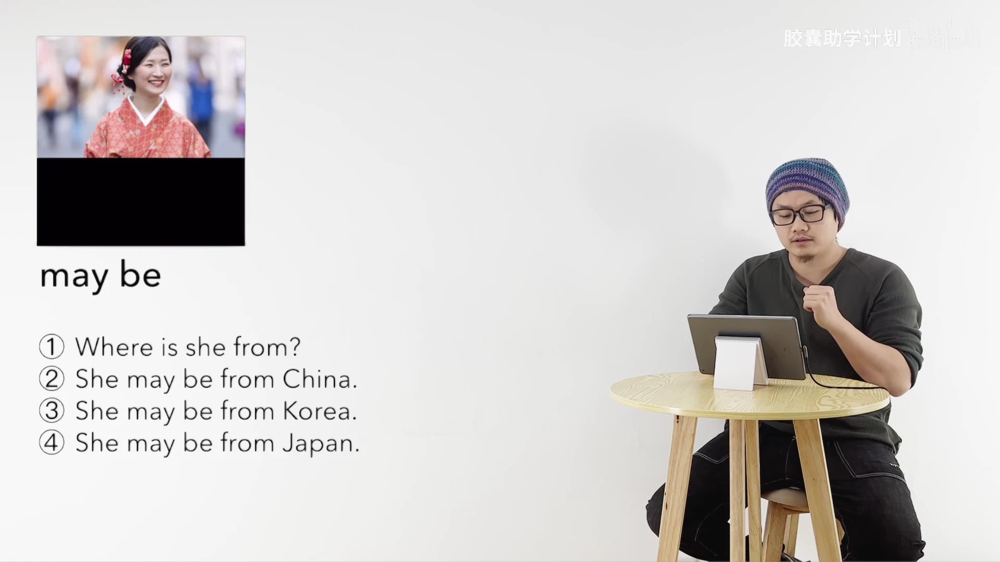

文字识别：胶囊助学计划 / may be / ① / ) / Where is she from? / ② / She may be from China. / ③ She may be from Korea. / ④ She may be from Japan.

### 画面 00:03:57

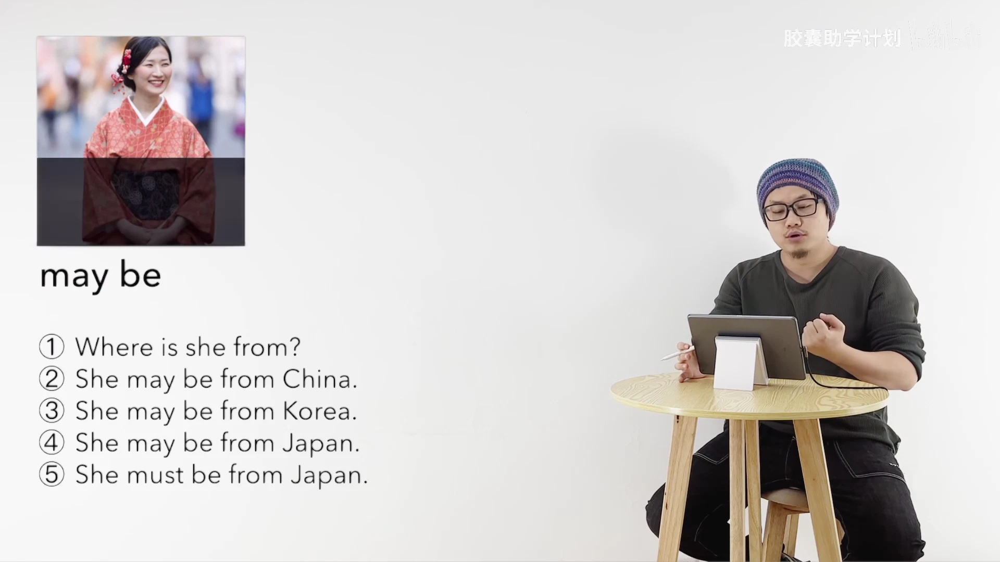

文字识别：胶囊助学计划 / may be / ① Where is she from? / ② / She may be from China. / ③ / She may be from Korea. / ④ / She may be from Japan. / ⑤ She must be from Japan.

### 画面 00:03:59

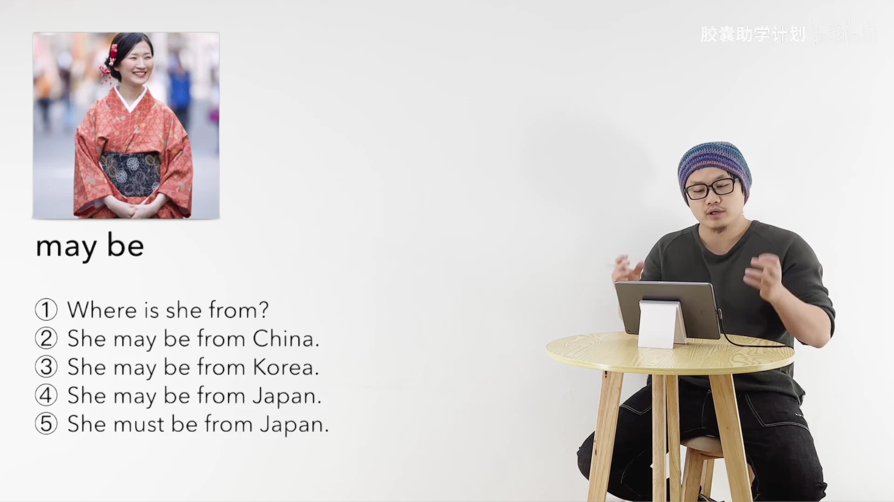

文字识别：胶囊助学计划 / may be / ① Where is she from? / ② / She may be from China. / ③ / She may be from Korea. / 4 / She may be from Japan. / 5 / She must be from Japan.

## 00:04:00–00:04:30

没没跑了，所以这句话变成了叫 she is from Japan. 看到了吧？这就不是推测了，这是陈述客观事实了。好，接下来 may be doing 又是我们刚才学到非常关键的一个结构。说 what is he doing？你看现在这个样子，那我完全不知道。说 he may be eating, he may be drinking, he may be cooking. I don't know, 对吧？He may be doing something. I don't know, 是吧？我不确定，他可能也许是在

### 画面 00:04:09

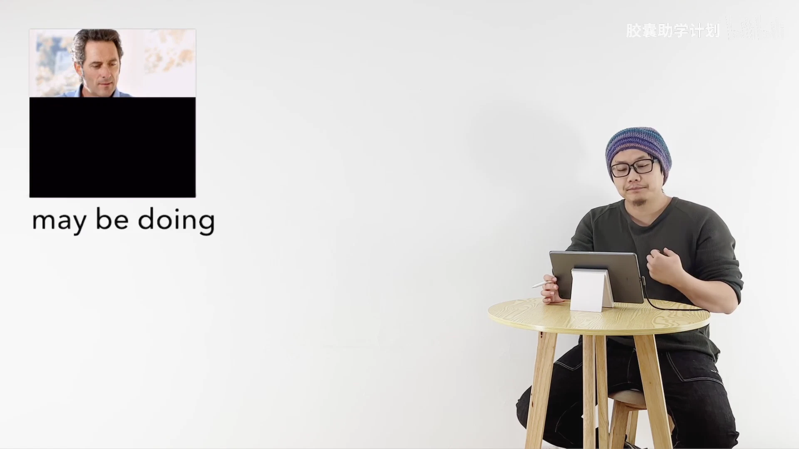

文字识别：胶囊助学计划 / may be doing

### 画面 00:04:21

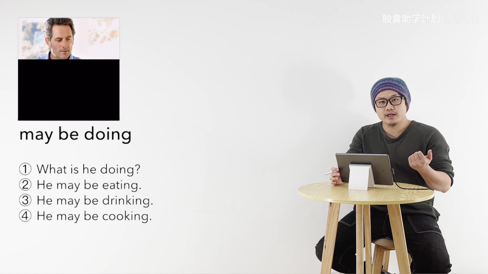

文字识别：胶囊助学计划 / may be doing / What is he doing? / 1 / He may be eating. / 2 / He may be drinking. / 3 /  He may be cooking.

## 00:04:30–00:05:00

做这件事情吧，确信度非常的低，对吧？Okay，我们在进行推测的时候，但如果我们又多了一个，那我看这幅图，我肯定叫 he must be drinking。那那杯子都举了呢，他一定是正在喝东西，比如说 drinking tea， drinking coffee or drinking water。Okay，但我们再来一点信息。Oh，他原来不是正在喝茶，叫做 he is reading his newspaper。Okay，他正在读报 or

### 画面 00:04:36

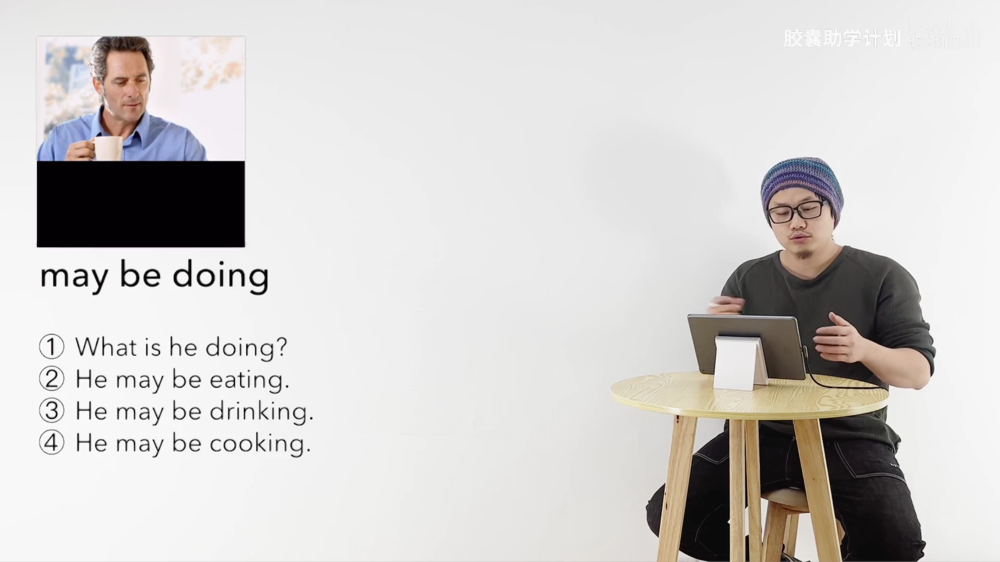

文字识别：胶囊助学计划 / may be doing / What is he doing? / 1 / He may be eating. / 2 / He may be drinking. / 3 / He may be cooking.

### 画面 00:04:50

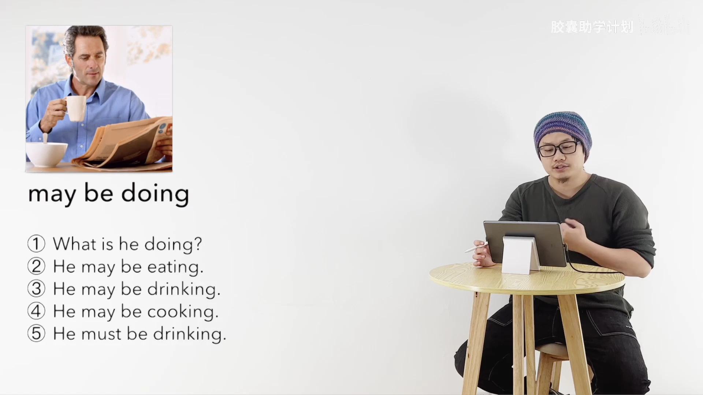

文字识别：胶囊助学计划 / may be doing / What is he doing? / 1 / He may be eating. / 2 / He may be drinking. / 3 / He may be cooking. / 4 / He must be drinking.

## 00:05:00–00:05:30

magazine, 对吧？我们不太确定啊。看着这幅图，OK。那 Anyway, he is reading. 这个是我们可以确定的。依旧是这些结构，各位注意一下，对吧？我们从一百二十七课到今天一百三十一课，非常重要学到的就是这些结构。 Maybe doing, can't be doing, might be doing, must be doing. OK。那接下来，刚才我们见到那些公式呢？呃，其实就是类似，各位去想一下，把一百二十

### 画面 00:05:11

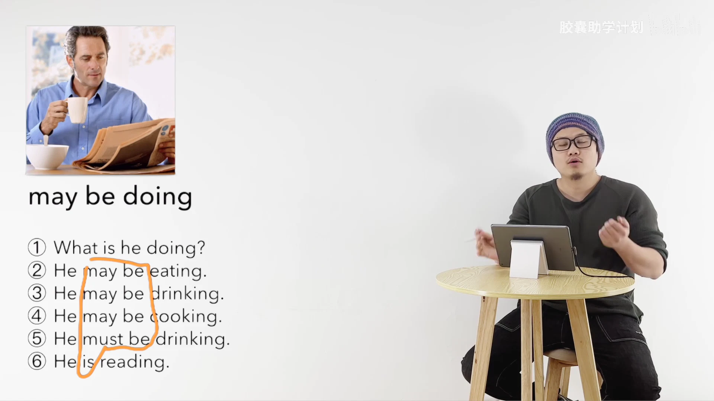

文字识别：胶囊助学计划 / may be doing / What is he doing? / 1 / 2 / He may / beeating. / 3 / Hemay k / beb / brinking. / Hemay be (ooking. / 4 / Hemust bedrinking. / 5 / Heisreading. / 6

### 画面 00:05:22

文字识别：胶囊助学计划 / may might 表推测

## 00:05:30–00:06:00

七克的 must 和 can't 换成了 may 和 might，对吧？那我们接下来要学的还是确信度低，但是时间变成了过去，于是翻译成叫当时可能是。类比一下，简单来说，我们就是把一百二十九克的 must 与 can't 换成了什么呢？换成了 may 和 might。各位注意啊，比如说 may 或 might have been 加形容词名词。您看啊，如果我

### 画面 00:05:35

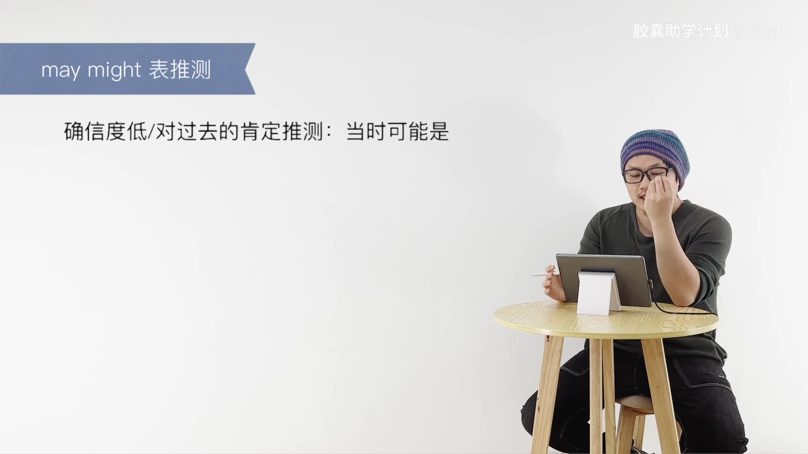

文字识别：胶囊助学计划 / may might 表推测 / 确信度低/对过去的肯定推测：当时可能是

### 画面 00:05:41

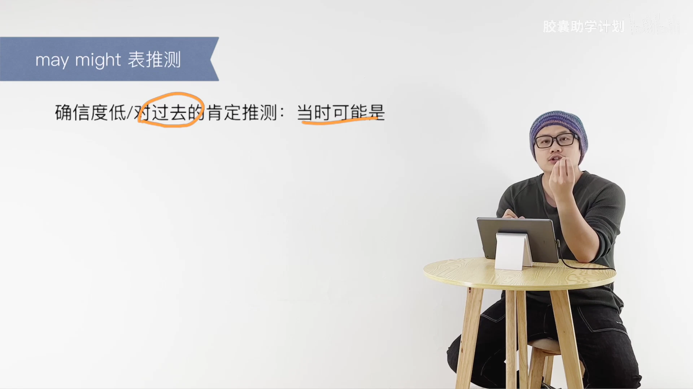

文字识别：胶囊助学计划間 / may might 表推测 / 确信度低/对过去的肯定推测：当时可能是

## 00:06:00–00:06:30

把 may 和 might 换成了 must 和 can，后边加 have been 形容词名词 have done 或者 have been doing，哎，各位是不是后边这些这些结构是我们非常熟悉的？一百二十九课我们刚刚学过，无非就是把前面的 must can 换成了 may 和 might，于是它确信度就低了，但还是过去，还是肯定的一个推测，翻译成当时可能是好吧？好，那 may 和 might have been 形

### 画面 00:06:04

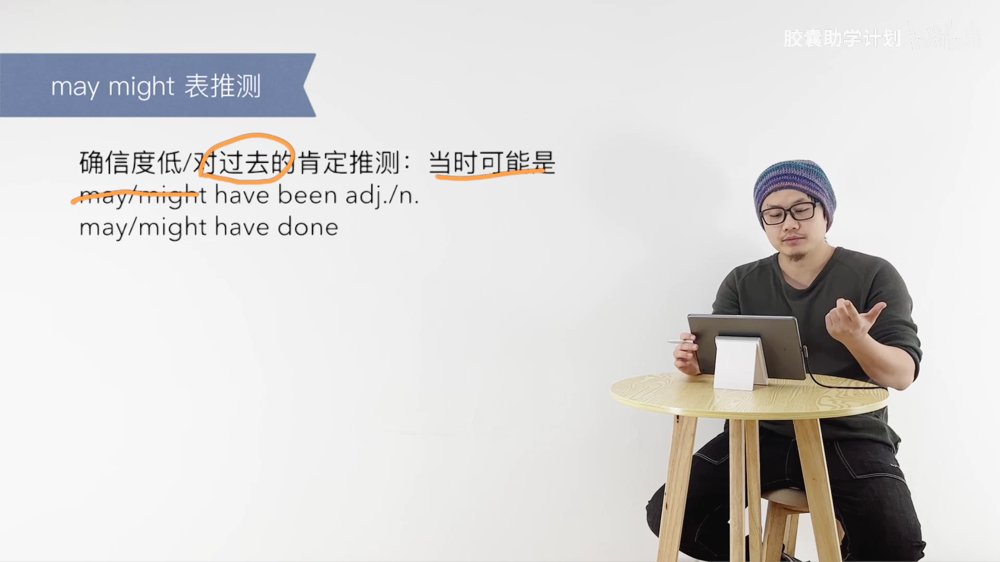

文字识别：胶囊助学计划 / may might 表推测 / 确信度低/过去的肯定推测： / 当时可能是 / ayhmight have been adj./n. / may/might have done

### 画面 00:06:09

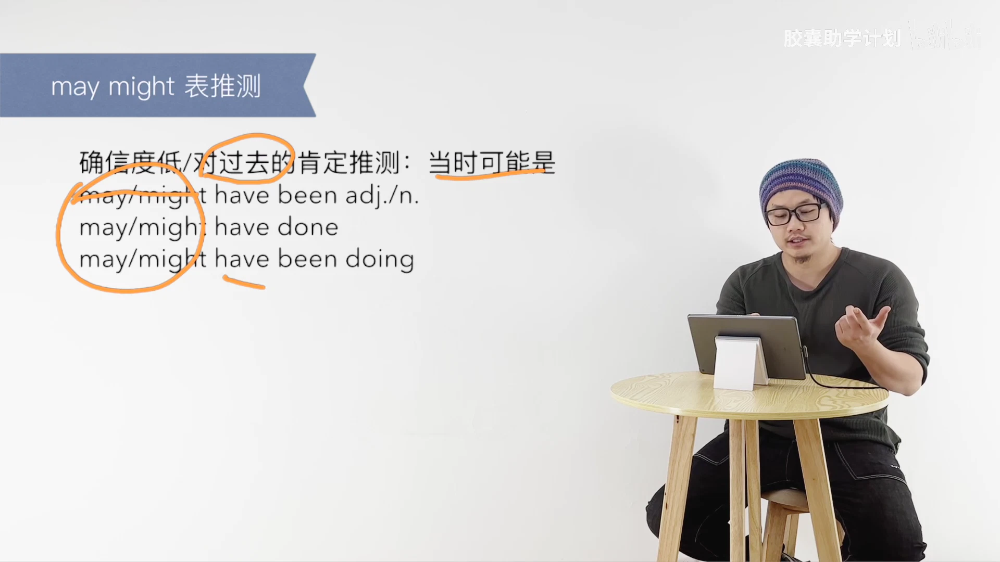

文字识别：胶囊助学计划 / may might 表推测 / 确信度低/对过去的肯定推测： / 当时可能是 / t have / been adj./n. / may/migh / have / done / may/migh't have been doing

### 画面 00:06:11

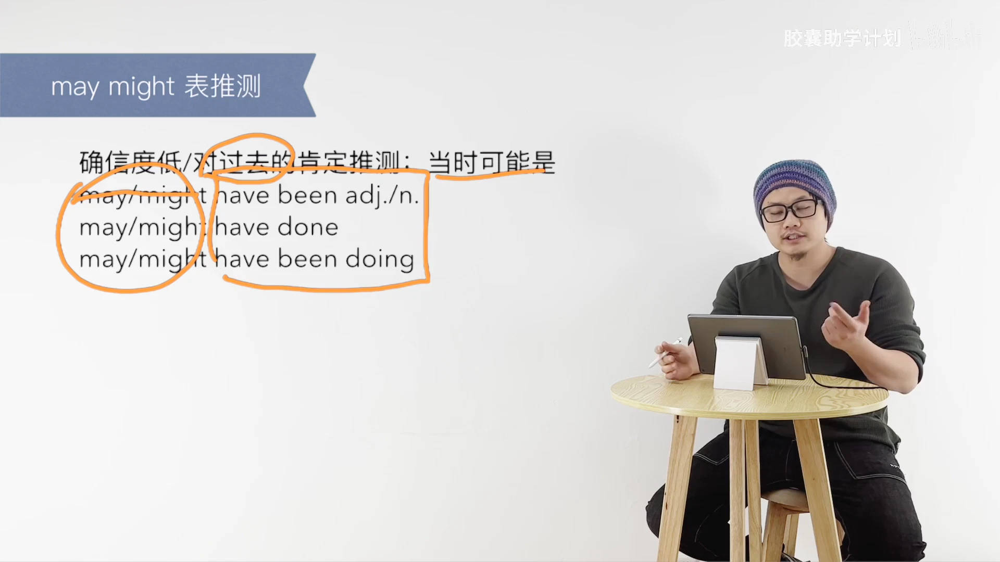

文字识别：胶囊助学计划 / may / might / 表推测 / 确信度低/过去的肯定推测：当时可能是 / nave / been / adj./n. / may/mighjhave / done / may/migbthave / been doing

### 画面 00:06:16

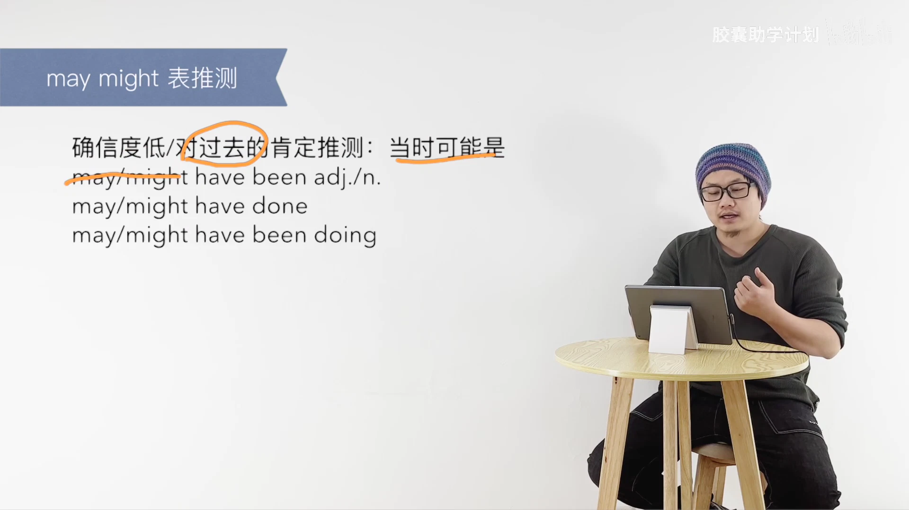

文字识别：胶囊助学计划 / may might 表推测 / 确信度低/过去的肯定推测： / 当时可能是 / t have been adj./n. / ayhmight / may/might have / done / may/might have been doing

### 画面 00:06:28

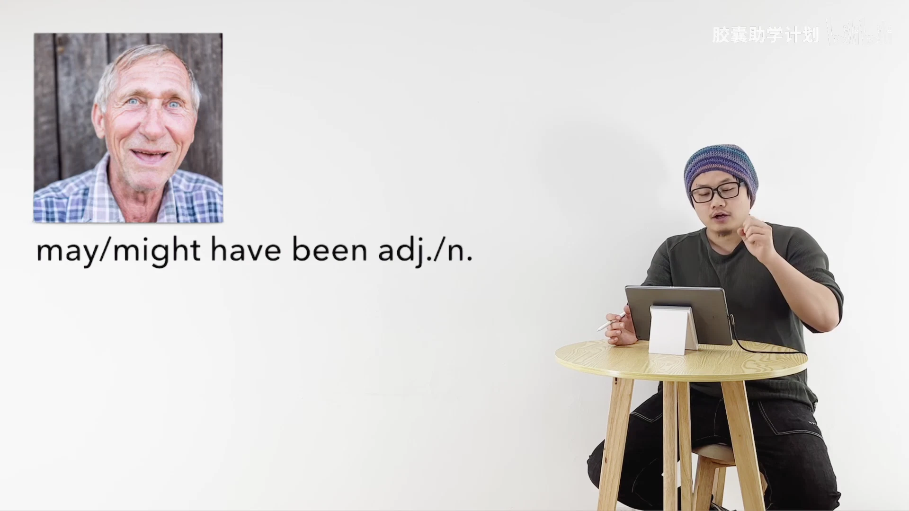

文字识别：胶囊助学计划 / may/might have been adj./n.

## 00:06:30–00:07:00

词名词，对吧？好，我们直接往下走，说 What was his job？注意，你看我问的是 was，叫做曾经，对吧？他曾经的工作是什么？一看是一个老爷子，说 I don't know. He may have been a doctor. 他当时可能是个医生。 He may have been a teacher. 他当时是个老师。 Or he may have been a bus driver. 或者是他是开公交车司机。 I don't know，是吧？我不清楚。我就是对过去的一个推测。 OK，好，

### 画面 00:06:42

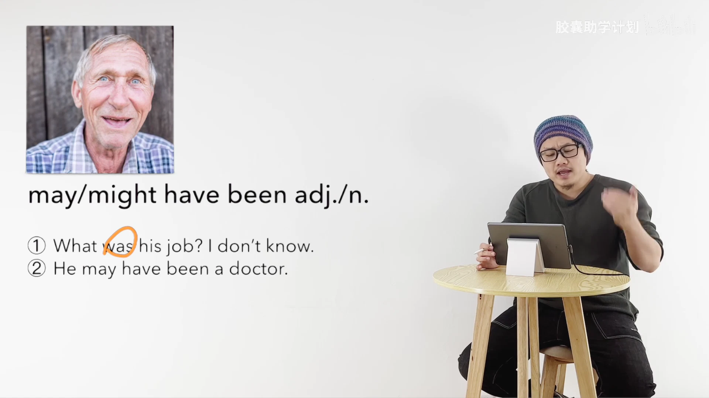

文字识别：胶囊助学计划 / may/might have been adj./n. / ① What Nashis job? I don't know. / ② He may have been a doctor.

### 画面 00:06:50

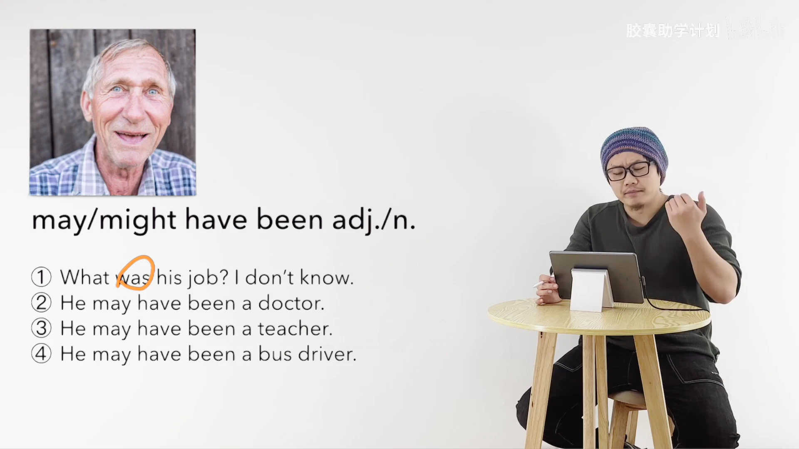

文字识别：胶囊助学计划 / may/might have been adj./n. / ① What Nashis job? I don't know. / 2 / He may have been a doctor. / 3 / He may have been a teacher. / ④ He may have been a bus driver.

### 画面 00:06:59

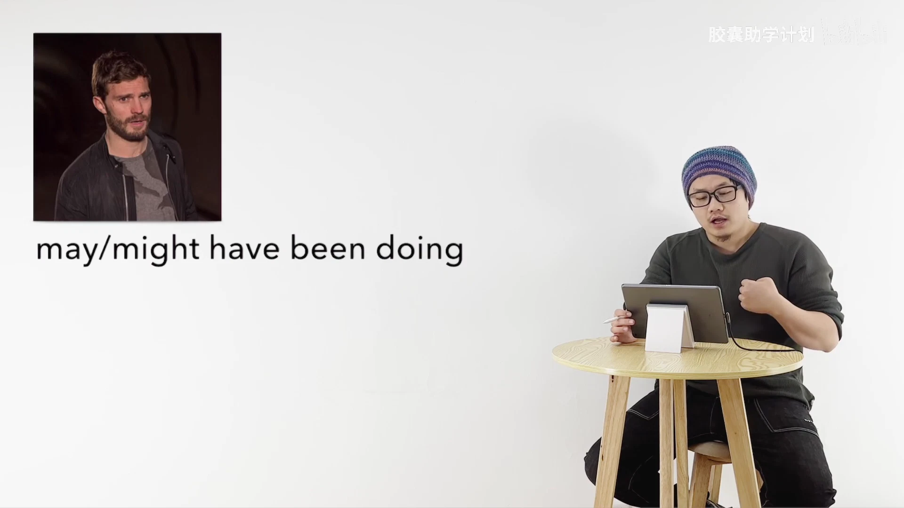

文字识别：胶囊助学计划 / may/might have been doing

## 00:07:00–00:07:30

continue.那may have been doing或might have been doing，比如说What was he doing？我们只看这幅图，我们完全不知道他之前可能在做什么，于是就是乱猜了，对吧？可能性比较低。说He may have been repairing his car. He may have been reading a book. He may have been having dinner. OK, very good.接下来我们看一个小电影片段，连续出现了must have been和may have been。于是我们只只要见

### 画面 00:07:16

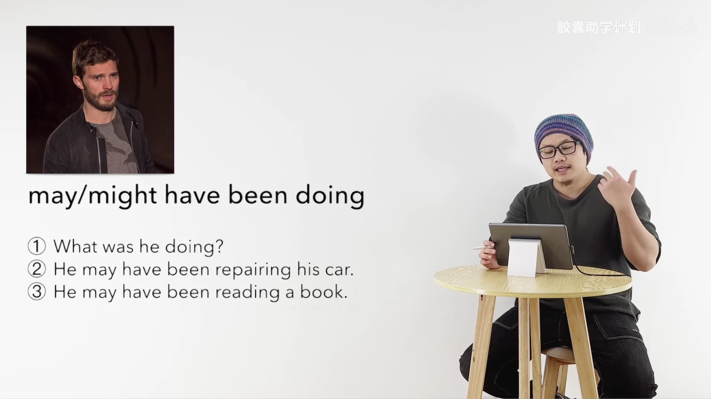

文字识别：胶囊助学计划 / may/might have been doing / What was he doing? / 1 / He may have been repairing his car. / 2 / ③ He may have been reading a book.

### 画面 00:07:21

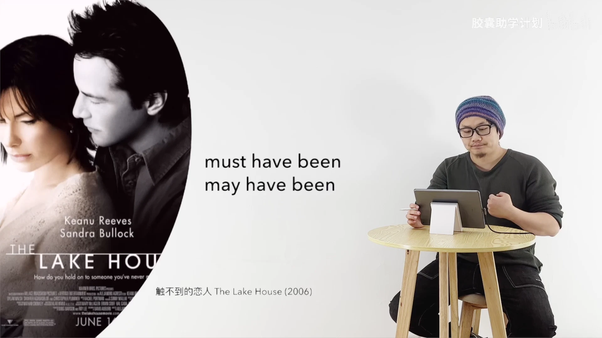

文字识别：胶囊助学计划 / must have been / may have been / Keanu Reeves / Sandra Bullock / THE / LAKE HOU / How do you hold on to someone you've never / 触不到的恋人 The Lake House (2006) / JUNE

## 00:07:30–00:08:00

I don't know. I. He may have been. I didn't last long enough for me to find out. Yeah. Truth is, I. I can't remember what he looked like. Really? Yeah. Too bad. Okay. Very good. Ah, must

### 画面 00:07:41

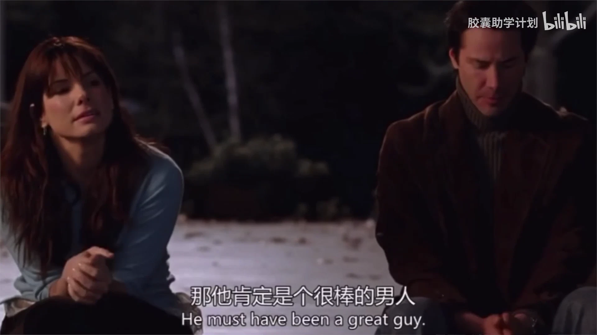

文字识别：bilibili / 胶囊助学计划 / 那他肯定是个很棒的男人 / He must have been a great guy.

### 画面 00:07:43

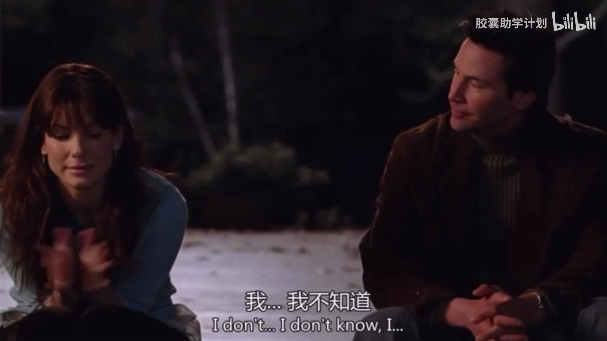

文字识别：Bilibili / 胶囊助学计划 / 我我不知道 / I don't.Idon't know, .

### 画面 00:07:45

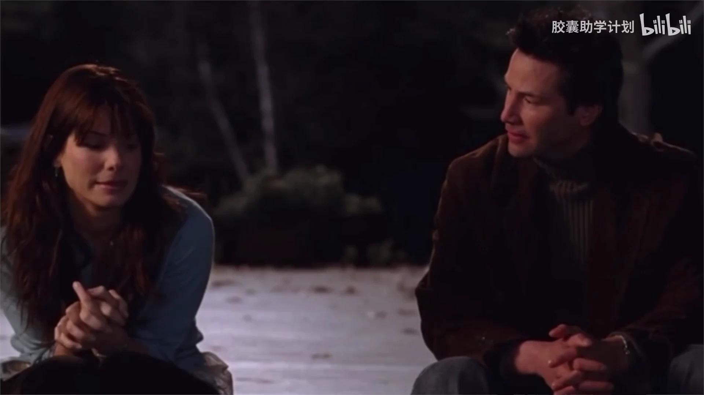

文字识别：bilibili / 胶囊助学计划

### 画面 00:07:47

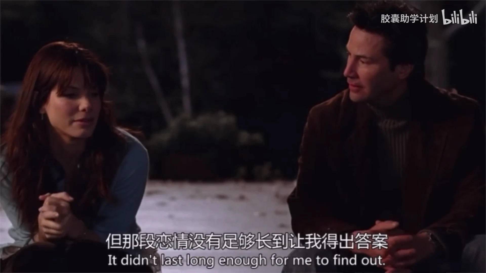

文字识别：bilibili / 胶囊助学计划 / 但那段恋情沒有足夠长到让我得出答案 / It didn't last long enough for me to find out.

### 画面 00:07:49

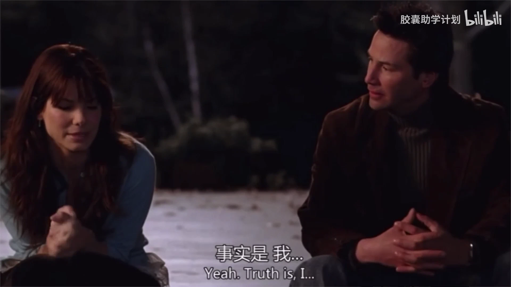

文字识别：bilibili / 胶囊助学计划 / 事实是我 / Yeah. Truth is, I..

### 画面 00:07:51

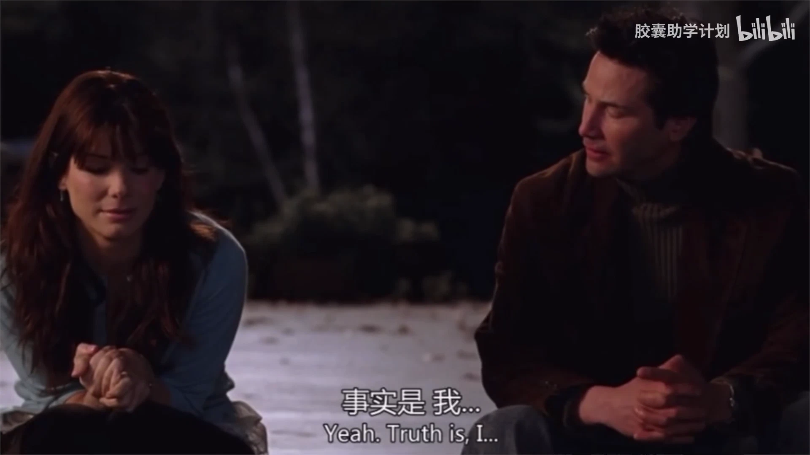

文字识别：Bilibili / 胶囊助学计划 / 事实是我 / Yeah. Truth is, I..

### 画面 00:07:53

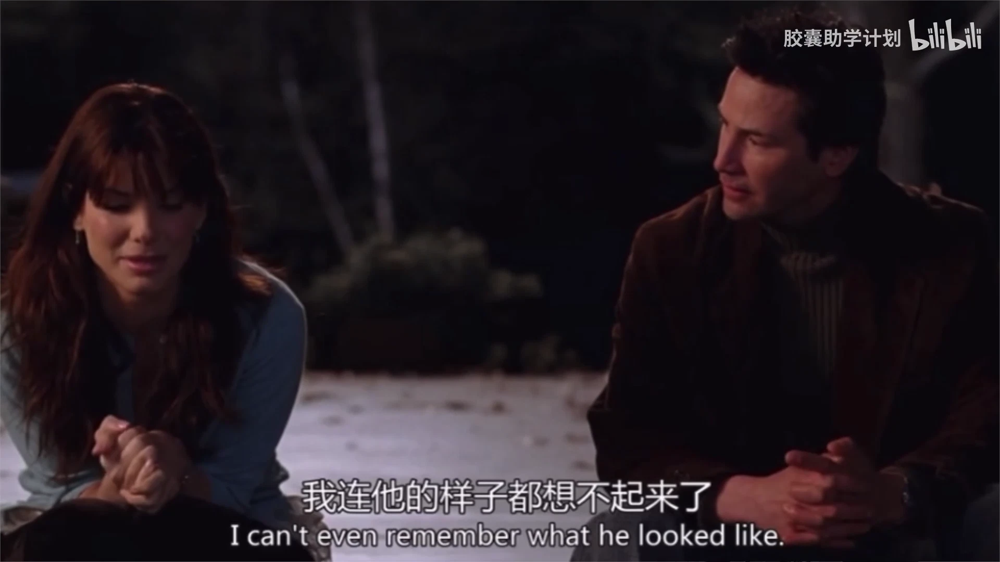

文字识别：bilibili / 胶囊助学计划 / 我连他的样子都想不起来了 / I can't even remember what he looked like.

### 画面 00:07:55

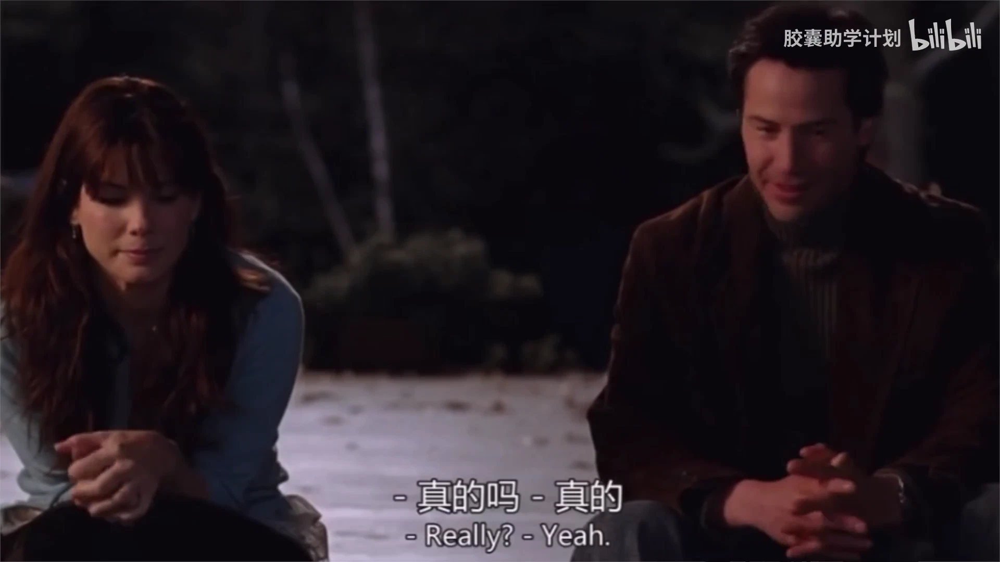

文字识别：bilibili / 胶囊助学计划 / 真的吗-真的 / Really? -Yeah.

### 画面 00:07:57

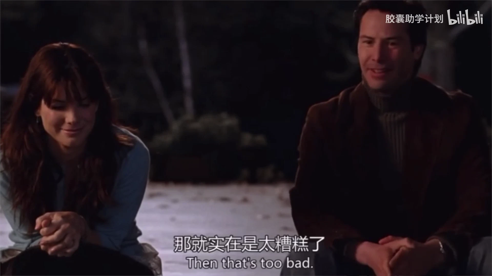

文字识别：bilibili / 胶囊助学计划 / 那就实在是太糟糕了 / Then that's too bad.

### 画面 00:07:59

文字识别：bilibili / 胶囊助学计划

## 00:08:00–00:08:30

very good. Ah, must have been a great guy.说当时我去想这个人，他当时一定是一个特别好的人，对吧？He may have been.他可能是吧。I don't know,是吧？我不能完全确定了，已经，因为我现在已经不记得他长成什么样子了。都。Okay, very good.接下来我们看一下本课的单词，非常简单。第一个埃及，跟我一起读一下，叫做Egypt, Egypt. Okay,非常简单。那我们拿它去造句，就Go to Egypt.比如说They went to Egypt last week.一

### 画面 00:08:01

文字识别：胶囊助学计划 / must have been / may have been / Keanu Reeves / Sandra Bullock / THE / LAKE HOU / How do you hold on to someone you've never / 触不到的恋人The Lake House (2006) / JUNE

### 画面 00:08:16

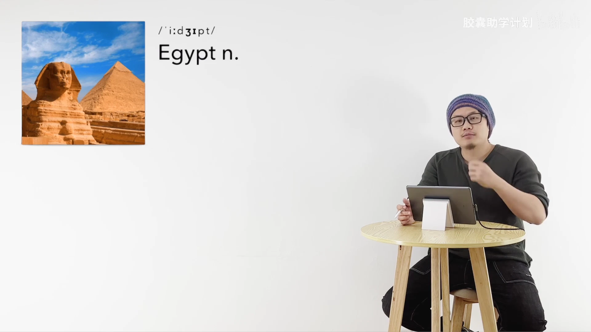

文字识别：胶囊助学计划 / /'i:d3ipt/ / Egypt n.

## 00:08:30–00:09:00

般过去式肯定句给各位了。哎，您剩下的四句型转换家庭作业就搞定了，对不对？好，再然后呢？比如说我们结合一个定语从句，叫The man who you met in Egypt bought himself a new car。啊，你在埃及见到的那个哥们儿是吧？那个男的，他给自己买了一辆新车。好，这有一个小的问题，你要自己去回答一下，who能不能被省略？如果您忘了的话，请去查看一下一百二十一

### 画面 00:08:31

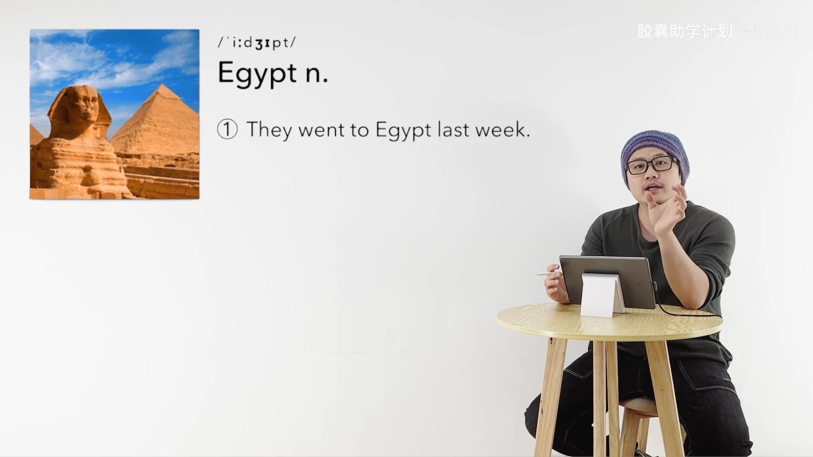

文字识别：胶囊助学计划 / /'i:d3ipt/ / Egypt n. / ① They went to Egypt last week.

### 画面 00:08:37

文字识别：胶囊助学计划 / /'i:d3ipt/ / Egypt n. / ① They went to Egypt last week. / did/when/where/who... / The man who you met in Egypt / bought himself a new car. L12i

### 画面 00:08:54

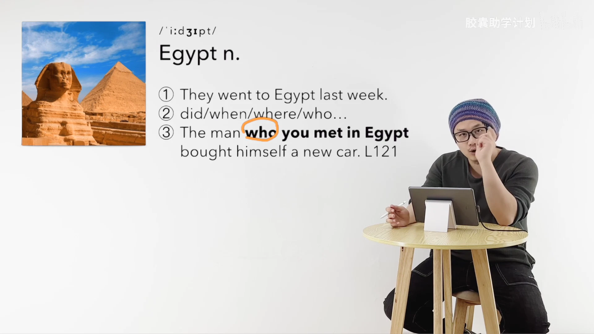

文字识别：胶囊助学计划 / /'i:d3ipt/ / Egypt n. / D They went to Egypt last week. / 1 / did/when/where/who... / The man whoyou met in Egypt / bought himself a new car. L121

## 00:09:00–00:09:30

一课、一百二十三课的语法视频，好吧？定语从句。Next one说，When he was traveling in Egypt, he met his future wife。说当他在埃及旅游的时候，他见到了他未来的妻子。哎，一百一十七课，when和过去进行时。Next one，下一个单词跟我读一下，叫abroad。abroad。好，注意这个动词啊，这个不是一个动词啊，它本身是翻译成叫国外。那我们经常可以跟它

### 画面 00:09:18

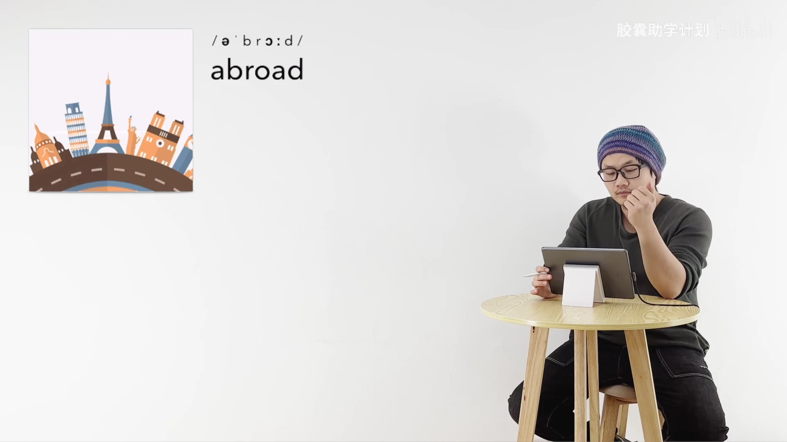

文字识别：胶囊助学计划 / /a'bro:d/ / abroad / 811

## 00:09:30–00:10:00

连起来的一些动词呢，叫做 go abroad，叫做出国或者去国外，study abroad，啊，就像我在国外留学，那就叫 study abroad，live abroad，叫在国外生活，对吧？OK，那我们拿动词有了，接无非接下来就是来一些时态加一些主语，对不对？比如说 he has lived abroad for fifteen years，OK，八十九课现在完成时的第二个用法，各位还记不记得？从过去持续到

### 画面 00:09:48

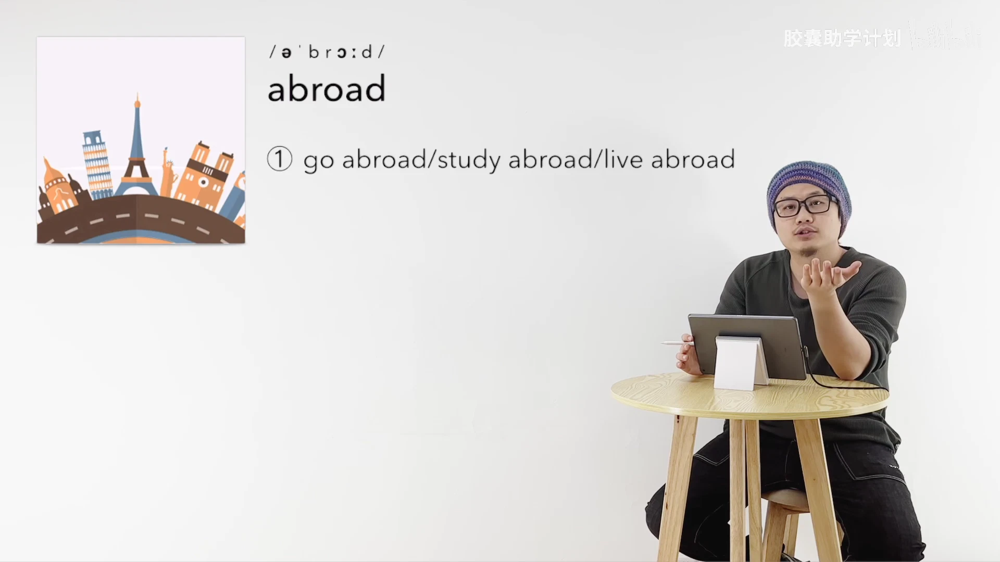

文字识别：胶囊助学计划 / /a'bro:d/ / abroad / ① go abroad/study abroad/live abroad

## 00:10:00–00:10:30

现在？OK, next one说 they went abroad last winter. 肯定句给各位了，又是各种句型的转换。OK, next one下一个单词跟我一起读一下，叫做 worry worry，叫做担心。注意这个地方它是一个动词，我们经常会有一个小的短语叫 worry about somebody or worry about something，叫做担心某人或担心某件物品或某

### 画面 00:10:01

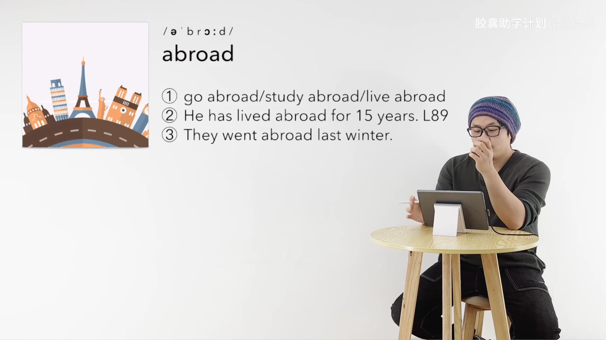

文字识别：胶囊助学计划 / /a'bro:d/ / abroad / ① go abroad/study abroad/live abroad / He has lived abroad for 15 years. L89 / They went abroad last winter.

### 画面 00:10:11

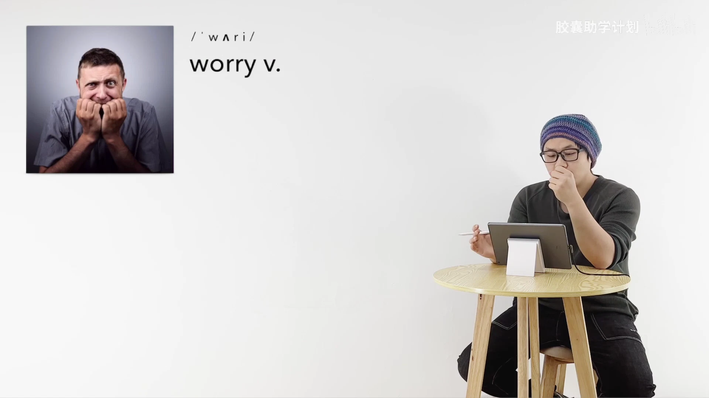

文字识别：胶囊助学计划 / /'wΛri/ / worry V.

## 00:10:30–00:11:00

事情，对吧？我们造句说 He worries about his job every day. 说他每天都会很担心他的工作，已经变成了他的一种不健康的生活习惯了，都对吧？所以，我们用的是一般现在时。 Next one，肯定句给各位了各种句型。哎，在这儿提一个小点，当 does 提前的时候，worries 一定要换回原形，这是我们最容易忘记的一个小语法点。 OK，

### 画面 00:10:41

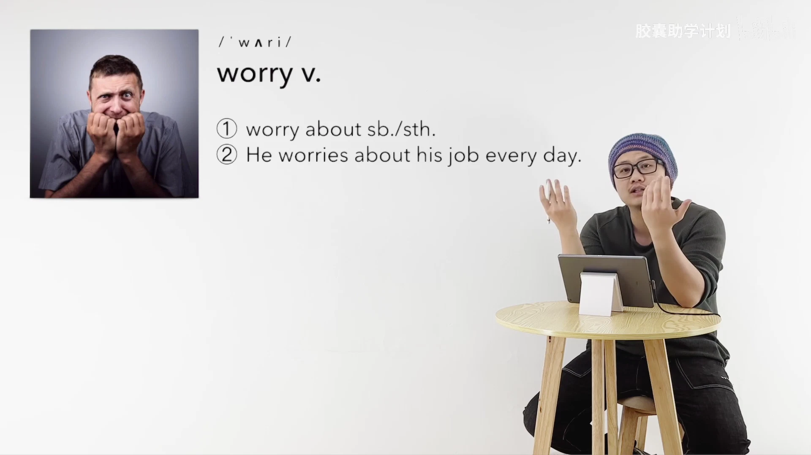

文字识别：胶囊助学计划 / / 'wΛri / / worry V. / worry about sb./sth. / He worries about his job every day.

## 00:11:00–00:11:30

next one. Say your mom worried about you last night. Say where were you? Ah,昨天晚上你在哪儿呢？你妈妈很担心你，你一晚上没有回来。注意一般过去时，然后又是四句型的转换，对吧？ Okay, very good. 接下来我们看一个小的电影片段啊，《阿甘正传》里面讲到了叫 worry about 这个小的短语，我们当做一个小的听力训练啊，叫做担心。

### 画面 00:11:00

文字识别：胶囊助学计划 / / 'wΛri/ / worry V. / worry about sb./sth. / He worries about his job every day. / does/why/how often/what... / Your mom worried about you last night.

### 画面 00:11:16

文字识别：胶囊助学计划 / The world / will never be the same / once youve / Tom / seen it through the eyes of / Forrest Gump. / HankSis / Forrest / Gump / worry / about... / Jp / 阿甘正传Forrest Gump(1994) / T/ / s Ses S SidCo / WentyFinem Se Tish Se Sakey

### 画面 00:11:28

文字识别：bilibili / 胶囊助学计划 / 一个好小" / "A good little..

## 00:11:30–00:12:00

me learn how to read, and I showed her how to swing. Sometimes we just sit out, wait for the stars. Mama's gonna worry about me. Just stay a little longer. For some reason, Jenny didn't ever want to go home. Okay, Jenny, I'll stay. She was my most special friend.

### 画面 00:11:30

文字识别：囊助学计划 / 她帮我学怎么认字 / She helped me learn how to read,

### 画面 00:11:32

文字识别：胶囊助学计划

### 画面 00:11:34

文字识别：bilibili / 胶囊助学计划 / 我教她怎么倒挂 / and I showed her howto swing.

### 画面 00:11:36

文字识别：bitbili / 胶囊助学计划

### 画面 00:11:38

文字识别：bilibili / 胶囊助学计划 / 有时我们就那么坐着 / Sometimes,we'd just sitout

### 画面 00:11:40

文字识别：Bilibili / 胶囊助学计划 / 等着看星星 / and wait for the stars.

### 画面 00:11:42

文字识别：Bilbili / 胶囊助学计划 / 妈妈会担心我的 / Mama'sgoing to worry / y about me

### 画面 00:11:44

文字识别：biibili / 胶囊助学计划 / 再呆一会儿 / just stayla little longer.

### 画面 00:11:46

文字识别：胶囊助学计划ibll / 再呆一会儿 / Just stay a little longer.

### 画面 00:11:48

文字识别：biibili / 胶囊助学计划 / 不知为何詹妮从来不爱回家 / For some reason,Jenny didn't never want to go home.

### 画面 00:11:50

文字识别：胶囊助学计划bilibil / 不知为何 詹妮从来不爱回家 / For some reason,Jenny didn't never want to go home.

### 画面 00:11:52

文字识别：bilibili / 胶囊助学计划 / 好吧詹妮 我再呆一会儿 / O.K.,Jenny,Ill stay.

### 画面 00:11:54

文字识别：胶囊助学计划bilibi / 她是我最特别的朋友 / She was my most special friend.

### 画面 00:11:56

文字识别：bilibili / 胶囊助学计划 / 她是我最特别的朋友 / She was my most special friend.

### 画面 00:11:58

文字识别：Bilibili / 胶囊助学计划

## 00:12:00–00:12:30

Okay, very good. Ah, that this movie clip, the speed is still relatively slow. You can listen to it repeatedly. There are actually many points that we will learn in the future. For example, for some reason, and the knowledge points we have learned before, except worry about. Okay, good. That recap, these six formulas are very important for you. We will learn them again in the second and the nineteenth lessons of the new concept. According to my many years of teaching experience, I feel that actually everyone is very

### 画面 00:12:00

文字识别：胶囊助学计划 / The world / will never be the same / once youve / Tom / seen it through the ees of / Forrest Gump. / HankSis / Forrest / Gump / worry / about... / Jp / 阿甘正传Forrest Gump(1994) / snASsS Si / Wendy Fiem Se Tich Se StakeyR

### 画面 00:12:16

文字识别：胶囊助学计划 / Recap / 现在： / may/ / /might / be / adj./n. / may/might / do / Patterns / may/might / doing / & / 过去： / Grammar / may/might / have / beena / adj./n. / may/might / have / done / may/mightl / have / been / doing / Words / Expression

## 00:12:30–00:13:00

啊，我感受到其实大家对于这些结构也是最容易遗忘的。您不妨多拿它去造一造句子啊，拿我们的红皮书一起去查一查，好吧？那接下来我们看家庭作业，单词造句，这是您老习惯了，初级红皮书去查一下本课的语法，好吧？接下来呢，给自己讲解一遍今天的核心知识点。那如果各位喜欢我们的课程呢，欢迎各位关注、订阅、一键三连、分享给那些需要的朋友，来帮助

### 画面 00:12:40

文字识别：胶囊助学计划

### 画面 00:12:52

文字识别：胶囊助学计划

## 00:13:00–00:13:27

我们快速成长。最后，我们再来看一句名人名言：Life is too short to worry about anything. You had better enjoy it because the next day promises nothing. See you next time.

### 画面 00:13:01

文字识别：胶囊助学计划 / Dodgers / Life is too short to worry a / about anything. / You had better enjoy it because the next / day promises nothing. / Eric Davis

### 画面 00:13:15

### 画面 00:13:17

文字识别：臺動字計划 / CAPSULEACADEMY / 胶囊助学计划 / 小红书 / Lecturer / □ / 口 / Leo

### 画面 00:13:19

文字识别：CAPSULEACADEMY / 胶囊助学计划 / 小红书 / Photographer / Berlin / OE

### 画面 00:13:22

文字识别：CAPSULEACADEMY / 胶囊助学计划 / 小红书 / Creator / OE

### 画面 00:13:25

文字识别：bilbili / 胶囊助学计划

### 画面 00:13:27

文字识别：bilibili / 胶囊助学计划

