# 131 文章

快速机器解析：语音为单模型转写，未进行独立交叉校对或人工复核；画面每秒采样并按变化选帧，短时文字和标记可能遗漏。截图时间约有 1 秒误差。图片有损压缩；遇到疑点请按时间查看 Google Drive 原视频。

## 00:00:00–00:00:30

Hello, everyone. Welcome to Capsule Academy. This is Leo. Today we're going to learn New Concept English Book One, Lesson One Hundred and Thirty One Story. Hope you guys enjoy. Good. Then we directly一起来看一下本课的文章。两个人在对话，对吧？那我们看，第一个人说说 Where are you going to spend your holidays this year, Gary?

### 画面 00:00:00

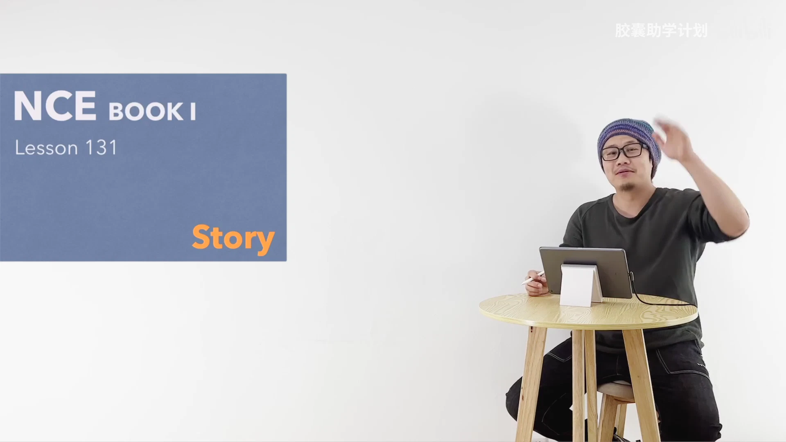

文字识别：NCE BOOKI / Lesson 131 / Story

### 画面 00:00:02

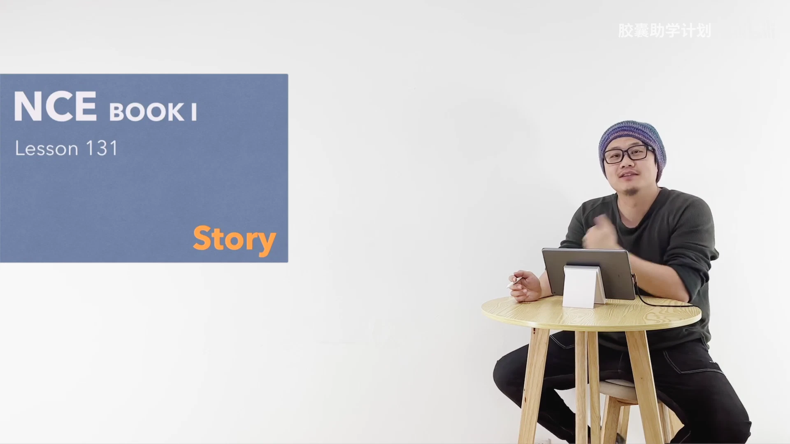

文字识别：NCE / BOOKI / Lesson 131 / Story

### 画面 00:00:10

文字识别：胶囊助学计划bill / •

### 画面 00:00:14

文字识别：胶囊助学计划

### 画面 00:00:16

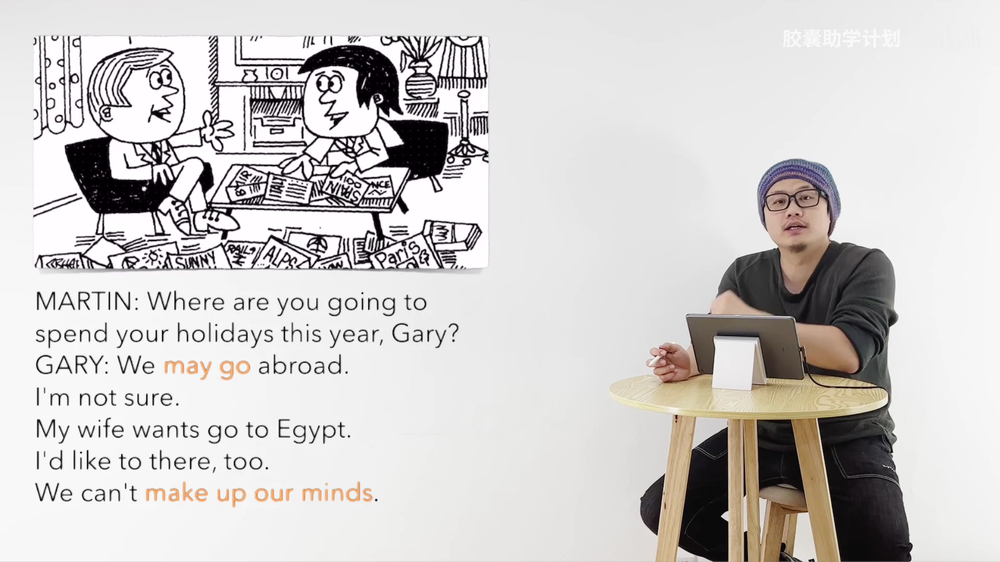

文字识别：3101 / MARTIN: Where are you going to / spend your holidays this year, Gary? / GARY: We may go abroad. / I'm not sure. / My wife wants go to Egypt. / I'd like to there, too. / We can't make up our minds.

## 00:00:30–00:01:00

好, where,对吧？到哪里你要去准备去 be going to do？三十七课、三十九课咱们学的计划打算. Spend your holidays.度过你的假期。六十七课我没记错，咱们学过 this year.叫做今年，对吧？今年你准备去哪儿度假呢？Gary回答，他说 We may go abroad. How may加do表示一种可能，对不对？表示对现在或未来的一个推测，叫做我们可能会出国。这儿还有一个小的短语

### 画面 00:00:46

文字识别：83101 / MSN / MARTIN: Where are you going to / spend your holidays this year, Gary? / GARY: We may go abroad. / I'm not sure. / My wife wants go to Egypt. / I'd like to there, too. / We can't make up our minds.

## 00:01:00–00:01:30

叫 go abroad。在讲 abroad 这个单词的时候，我们在上一个视频当中刚刚给各位拓展过。我们可能会出国，I'm not sure。这是一个不确定的推测，或者确信度很低的推测，对吧？我不，我也不太清楚，我不太确信。Sure，对吧？Are you sure？ Yes， I'm sure，对吧？ I'm not sure，我不确定。My wife wants to go to Egypt。说我媳妇儿，我老婆啊想去埃及。你看，my

### 画面 00:01:16

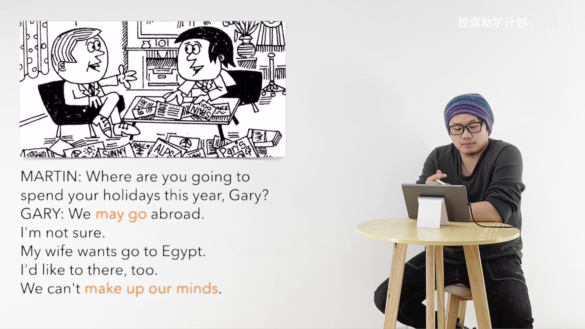

文字识别：1y / 83101 / MSNNY / MARTIN: Where are you going to / spend your holidays this year, Gary? / GARY: We may go abroad. / I'm not sure. / My wife wants go to Egypt. / I'd like to there, too. / We can't make up our minds.

## 00:01:30–00:02:00

wife，第三人称单数，所以后边的 want 后边加了个 s，对不对？说他想去埃及，I'd like to go there too。之前我们学过，应该是一百零七课，would like to do something，叫做想，其实跟 want 基本是一个含义，对吧？就 I want to go there，I want to go there，啊，等于 I would like to go there too。说我也想去那里。We can't make up our minds。这是一个小的短语啊，我们新一

### 画面 00:01:46

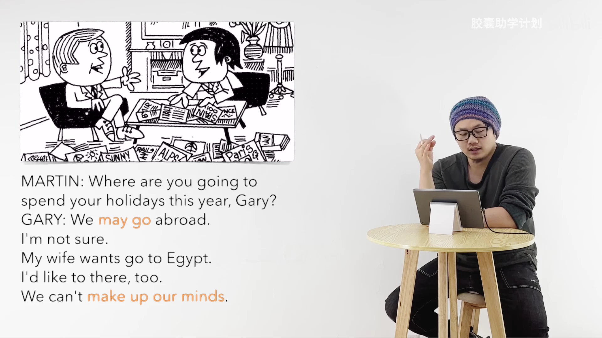

文字识别： 11y / 3101 / MSN / MARTIN: Where are you going to / spend your holidays this year, Gary? / GARY: We may go abroad. / I'm not sure. / My wife wants go to Egypt. / I'd like to there, too. / We can't make up our minds.

## 00:02:00–00:02:30

跟新二一个相对比较大的区别就是我们啊，新一都学快结束了，对吧？我们正好可以提前了解一下新二。进入新二的时候会有大量这样的一些小的搭配变成的习惯用法，比如说 make up our minds，简单来说就是下决心，对吧？ Decide decision make a decision，对吧？我们还没有办法去下定决心。继续问说，Will you travel by sea or by

### 画面 00:02:16

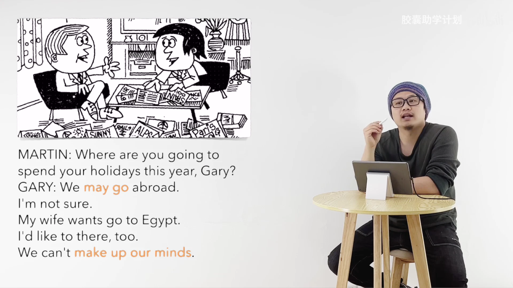

文字识别：1 11 y / 3101 / MSNNY / MARTIN: Where are you going to / spend your holidays this year, Gary? / GARY: We may go abroad. / I'm not sure. / My wife wants go to Egypt. / I'd like to there, too. / We can't make up our minds.

### 画面 00:02:25

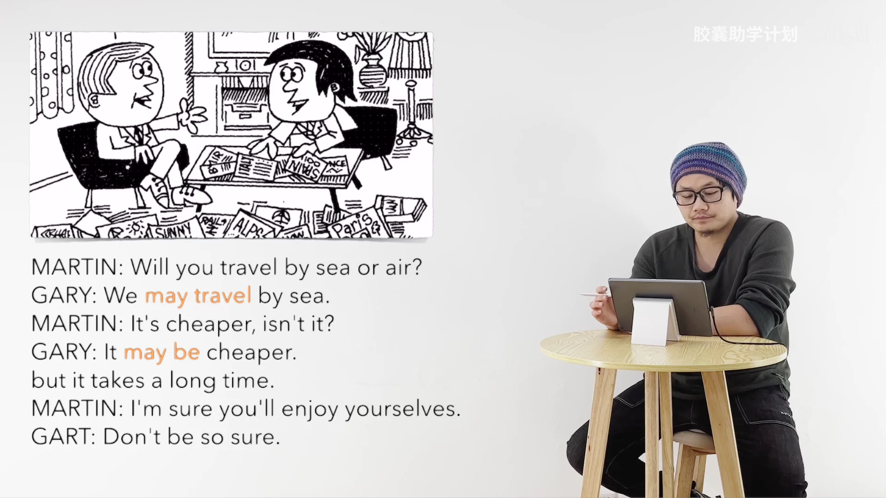

文字识别：3101 / MARTIN: Will you travel by sea or air? / GARY: We may travel by sea. / MARTIN: It's cheaper, isn't it? / GARY: It may be cheaper. / but it takes a long time. / MARTIN: I'm sure you'll enjoy yourselves. / GART: Don't be so sure.

## 00:02:30–00:03:00

air?说那你们是打算 by sea 还是 by air呢？你看我们最熟悉的用法叫做 on foot，对吧？叫步行或 by bus，啊叫 by car，对吧？ by train，啊那 by sea，用海肯定就是坐船嘛。Air 叫空气，对吧？哎，那 by air，airplane，对吧？ by air 简单来说就是坐飞机啊。那你们是会打算坐飞机啊，坐船还是坐飞机呢？Gary 回答说 We may

### 画面 00:02:55

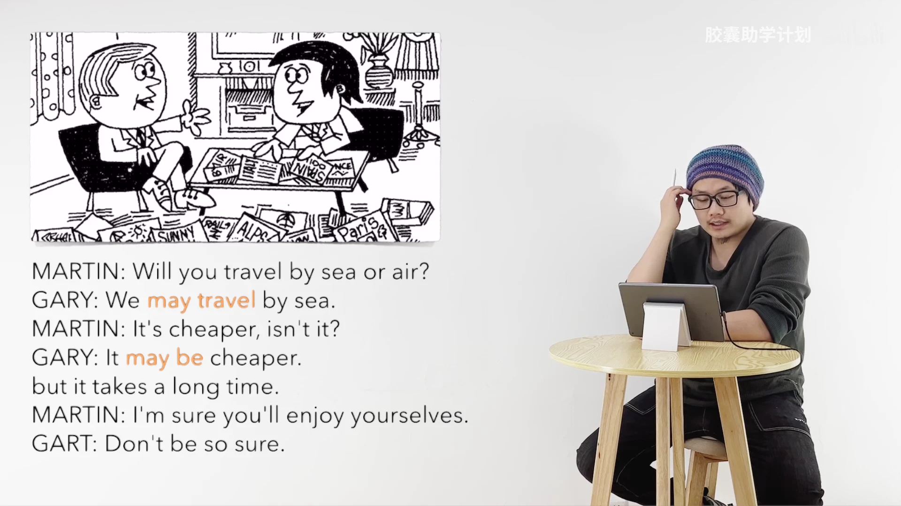

文字识别：111y / 3101 / MARTIN: Will you travel by sea or air? / GARY: We may travel by sea. / MARTIN: It's cheaper, isn't it? / GARY: It may be cheaper. / but it takes a long time. / MARTIN: I'm sure you'll enjoy yourselves. / GART: Don't be so sure.

## 00:03:00–00:03:30

travel by sea.我们可能坐船吧。哦，你注意may加do，依旧又到这个地方了。什么问题呢？就不确定，对吧？这是我们刚刚在上一个视频当中学到的一个关键结构。Is cheaper, isn't it?啊，这个Martin说了，说哎更便宜，isn't it？前口后否，前肯后否，前前肯后否，前否后肯，对吧？时态人称保持一致，反义疑问

### 画面 00:03:25

文字识别：111y / 3101 / SN / MARTIN: Will you travel by sea or air? / GARY: We may travel by sea. / MARTIN: It's cheaper, isn't it? / GARY: It may be cheaper. / but it takes a long time. / MARTIN: I'm sure you'll enjoy yourselves. / GART: Don't be so sure.

## 00:03:30–00:04:00

句等于一个单词，right啊？说更便宜，对吧？It may be cheaper，可能是更便宜，就什么我都不确定，是吧？可能是更便宜吧，但是呢，but it takes a long time啊啊，takes花费啊，要花费了更长的时间。I'm sure you will enjoy yourself。说我很确定，I'm sure，哎，我很确定的是，you will enjoy yourself，

### 画面 00:03:55

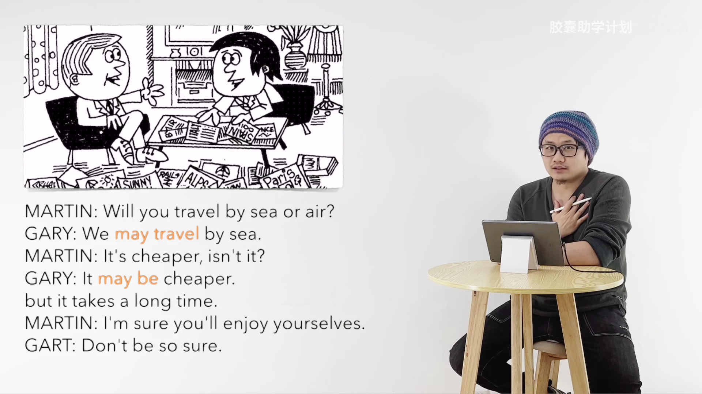

文字识别：11y / 3101 / MARTIN: Will you travel by sea or air? / GARY: We may travel by sea. / MARTIN: It's cheaper, isn't it? / GARY: It may be cheaper. / but it takes a long time. / MARTIN: I'm sure you'll enjoy yourselves. / GART: Don't be so sure.

## 00:04:00–00:04:30

你将玩的很开心。 Gary说，Don't be so sure. 哎，你可别太确定，是吧？你看这 Gary 很有意思，说我什么都不确定，是吧？你可别太确定啊，别如此的确信。我们看一下为什么。他说，We might not go anywhere. 你看啊，我们之前在这地方讲过了，may 和 might 在这地方随便互换，在这个用法之下，推测用法之下随便互换，含义没有任何区别，

### 画面 00:04:13

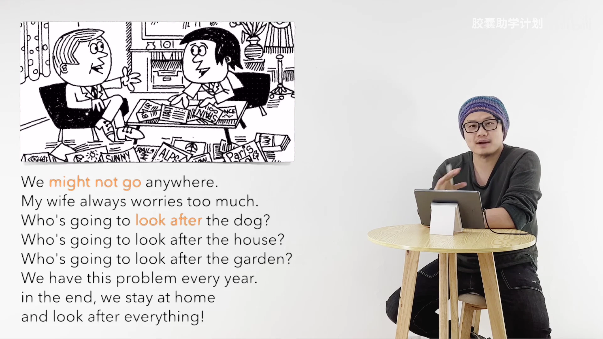

文字识别：1y / 3101 / Pol / MRSNNY / We might not go anywhere. / My wife always worries too much. / Who's going to look after the dog? / Who's going to look after the house? / Who's going to look after the garden? / We have this problem every year. / in the end, we stay at home / and look after everything!

## 00:04:30–00:05:00

对吧？然后呢，如果想说否定，后边加个 not 就可以了。那 we might not go anywhere，叫我们可能哪儿也去不了。哎，看一下为什么说 my wife always worries too much。哎，我老婆有一个习惯，对吧？有一种思维上的习惯叫总是担心的 too much，叫过多。Who's going to look after the dog? Who's going to look after the house?

### 画面 00:04:43

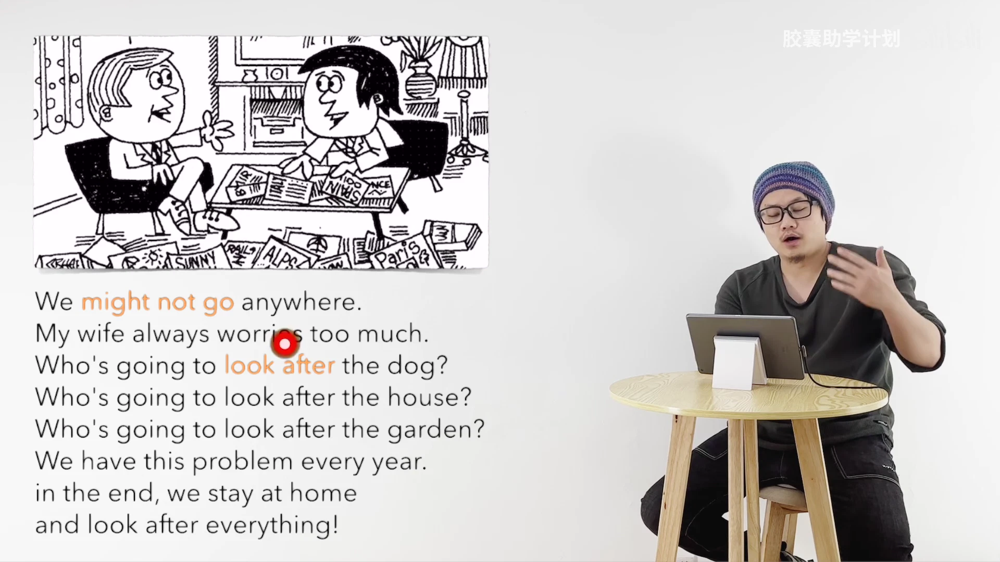

文字识别：y / 83101 / Po / MSNN / We might not go anywhere. / My wife always worrios / too much. / Who's going to look after the dog? / Who's going to look after the house? / Who's going to look after the garden? / We have this problem every year. / in the end, we stay at home / and look after everything!

## 00:05:00–00:05:30

Who's going to look after the garden? Okay, look after叫做照顾、照料、照看啊。就谁照顾狗、房子和花园呢？都是麻烦的事情。We have this problem every year. Every year,每一年。所以您看这句话，have用的是一般现在时。我们每一年都会有这个问题。In the end,哎，这个小短语各位也可以记一下。新二我们经常会见到，叫做最后，

### 画面 00:05:13

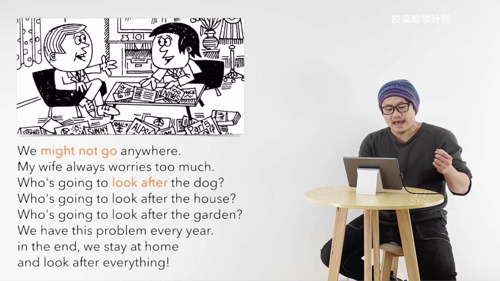

文字识别：1y / 3101 / Po / MRSNNY / We might not go anywhere. / My wife always worries too much. / Who's going to look after the dog? / Who's going to look after the house? / Who's going to look after the garden? / We have this problem every year. / in the end, we stay at home / and look after everything!

### 画面 00:05:27

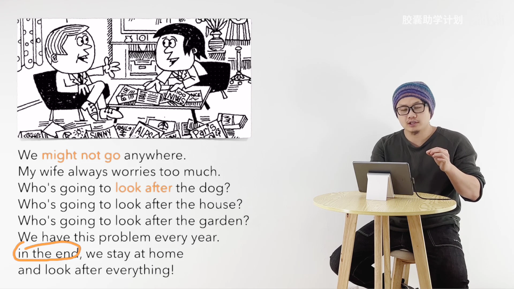

文字识别：1y / 3101 / Po / 三 / MSNN / We might not go anywhere. / My wife always worries too much. / Who's going to look after the dog? / Who's going to look after the house? / Who's going to look after the garden? / We have this problem every year. / in the end, we stay at home / and look after everything!

## 00:05:30–00:06:00

at last 等同语啊。We stayed at home，我们待在家里 and look after everything，然后照顾照看一切。OK，所以在这个地方呢，还有另一个小的短语，您需要记住叫 look after，叫照顾照料照看。好，那文章讲完了，我们结合文章来一些听力口语练习。我问您答，在文章当中去找答案，好吧？好，第一题，

### 画面 00:05:36

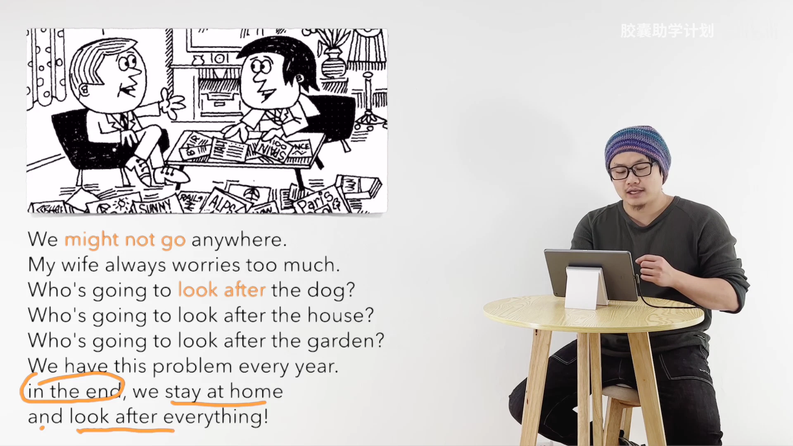

文字识别：1y / 3101 / Po / MRSNN / We might not go anywhere. / My wife always worries too much. / Who's going to look after the dog? / Who's going to look after the house? / Who's going to look after the garden? / We have this problem every year. / in the end, we stay at home / and look after everything!

### 画面 00:05:43

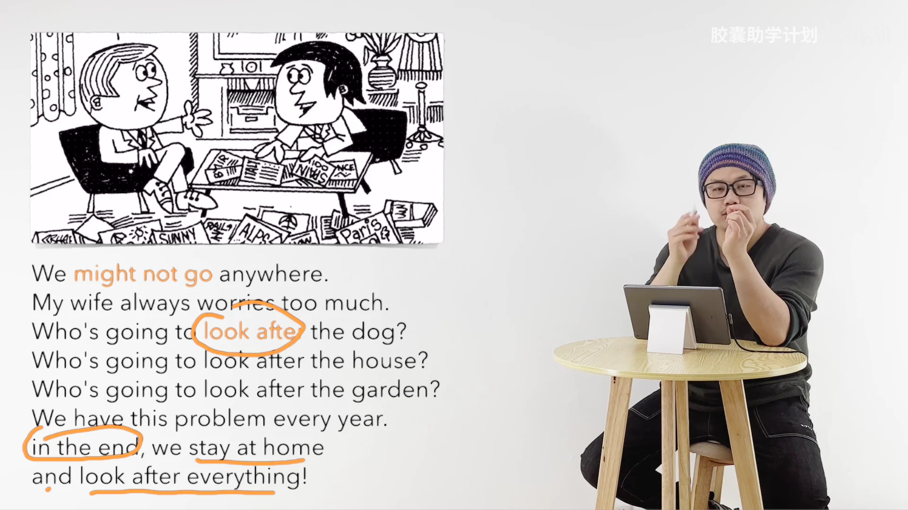

文字识别：101 / MSNN / We might not go anywhere. / My wife always worrics too much. / Who's going tc Took afte the dog? / Who's going to look atter the house? / Who's going to look after the garden? / We have this problem every year. / in the end, we stay at home / and look after everything!

### 画面 00:05:49

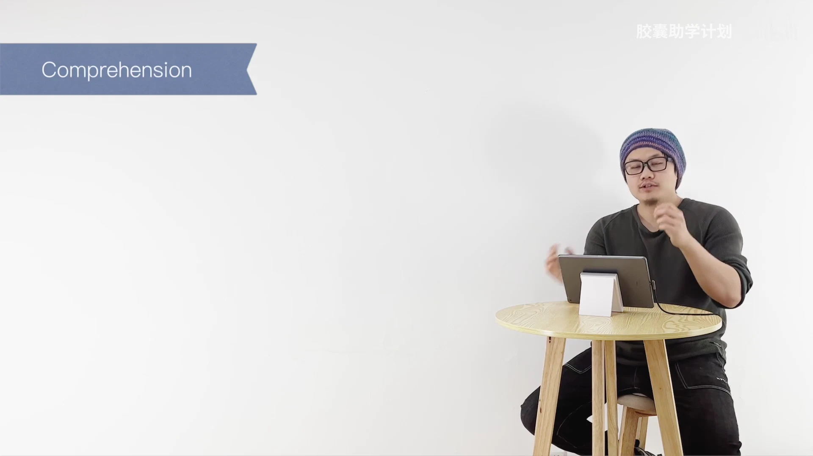

文字识别：Comprehension

### 画面 00:05:58

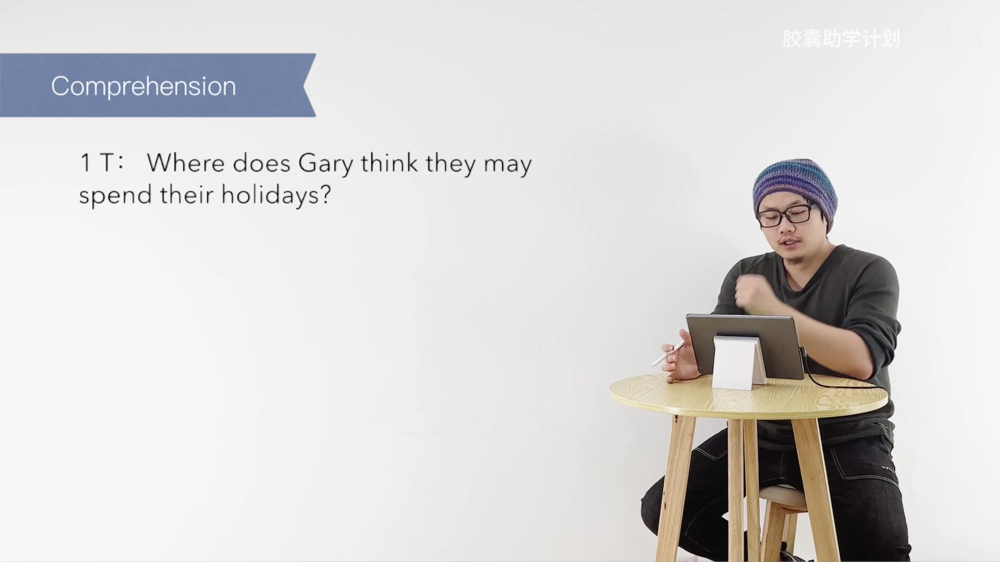

文字识别：Comprehension / Where does Gary think they may / 1T： / spend their holidays?

## 00:06:00–00:06:30

Where does Gary think they may spend their holidays?很简单，They may go abroad.当然，您直接说Egypt，我觉得也对啊。Next one,说Where does Gary's wife want to go? She wants to go to Egypt. Next one, Would Gary like to go there too? Yes, he would. Next one, Have they made

### 画面 00:06:11

文字识别：Comprehension / 2 T: Where does Gary's wife want to go?

## 00:06:30–00:07:00

up their minds yet? No, they haven't. Next one. How does Gary think they will travel? He thinks they may travel by sea. Next one. What is Martin sure of? He is sure that Gary and his wife will enjoy himself themselves. Next one. Why does Gary say

### 画面 00:06:39

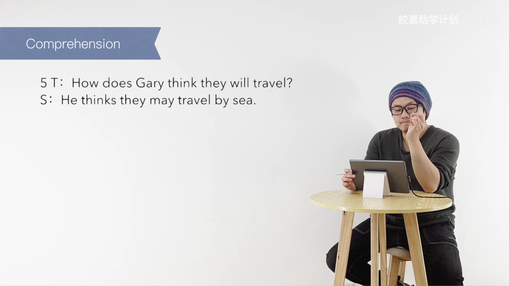

文字识别：Comprehension / 5 T: How does Gary think they will travel? / S: He thinks they may travel by sea.

### 画面 00:06:45

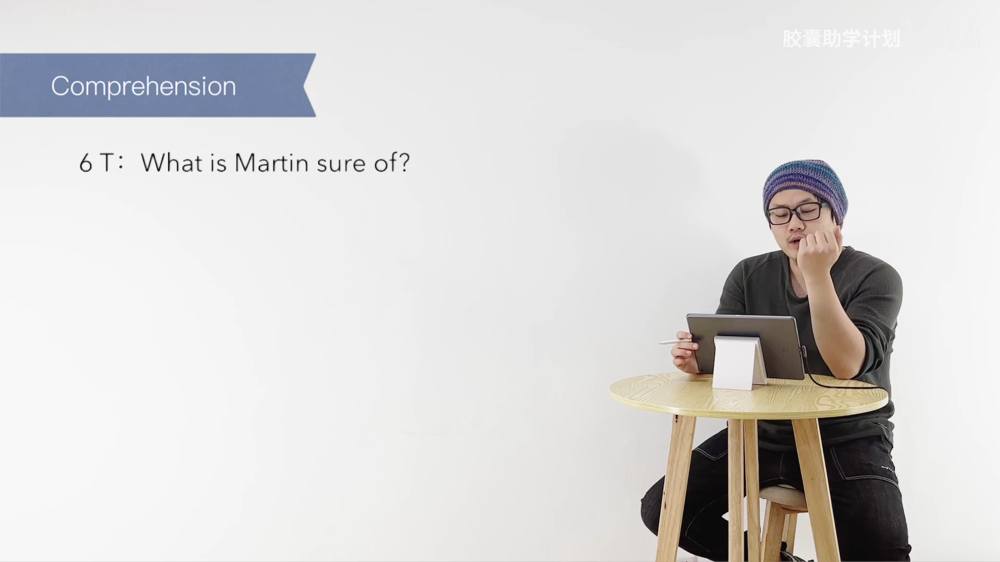

文字识别：Comprehension / 6 T: What is Martin sure of?

### 画面 00:06:58

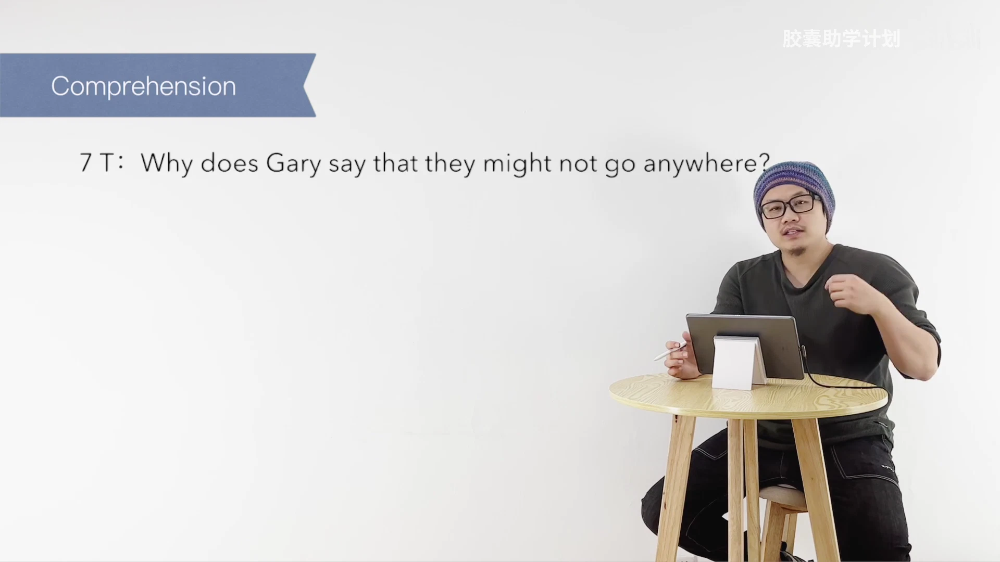

文字识别：Comprehension / 7 T: Why does Gary say that they might not go anywhere?

## 00:07:00–00:07:30

that they might not go anywhere? Because his wife always worries too much. Next one, what problem do they have every year? They don't know who is going to look after the dog, the house, and the garden, 对吧? Next one, asking questions,老习惯肯定句、一般疑问句和特殊疑问句啊。我问您答。

### 画面 00:07:06

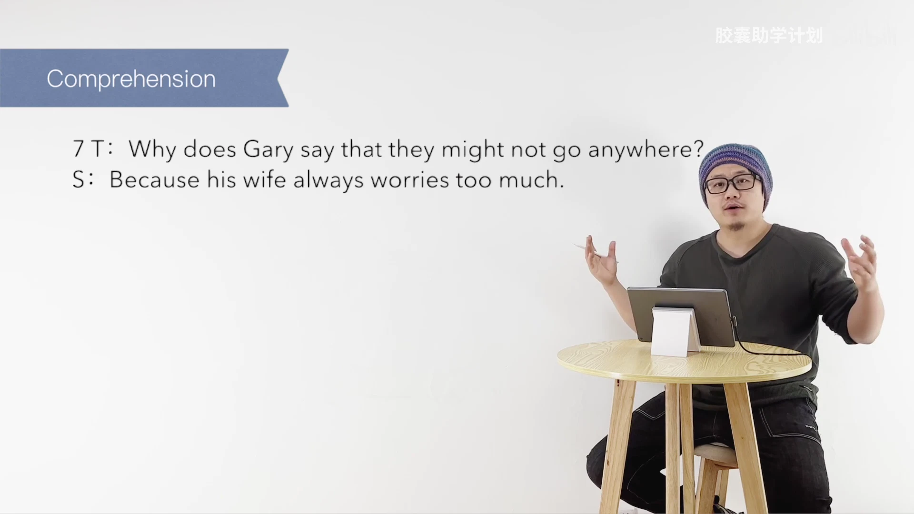

文字识别：Comprehension / 7 T: Why does Gary say that they might not go anywhere? / S: Because his wife always worries too much.

### 画面 00:07:09

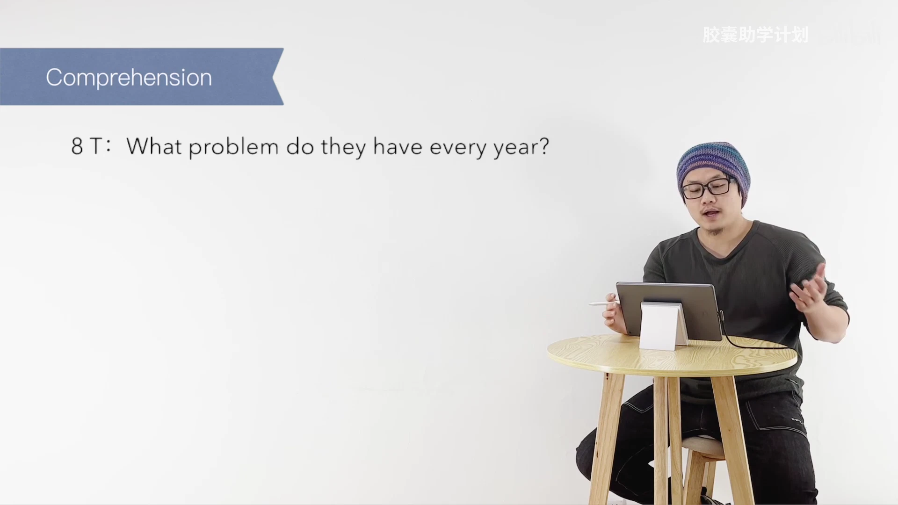

文字识别：Comprehension / 8 T: What problem do they have every year?

### 画面 00:07:17

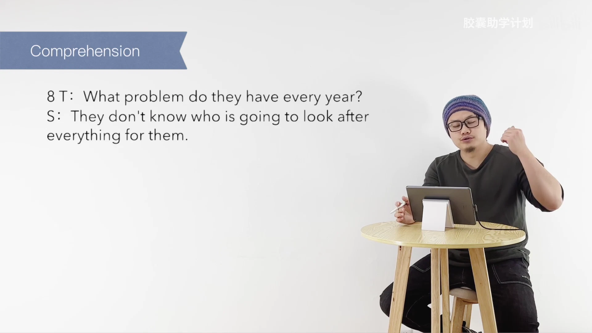

文字识别：Comprehension / 8 T: What problem do they have every year? / S: They don't know who is going to look after / everything for them.

### 画面 00:07:23

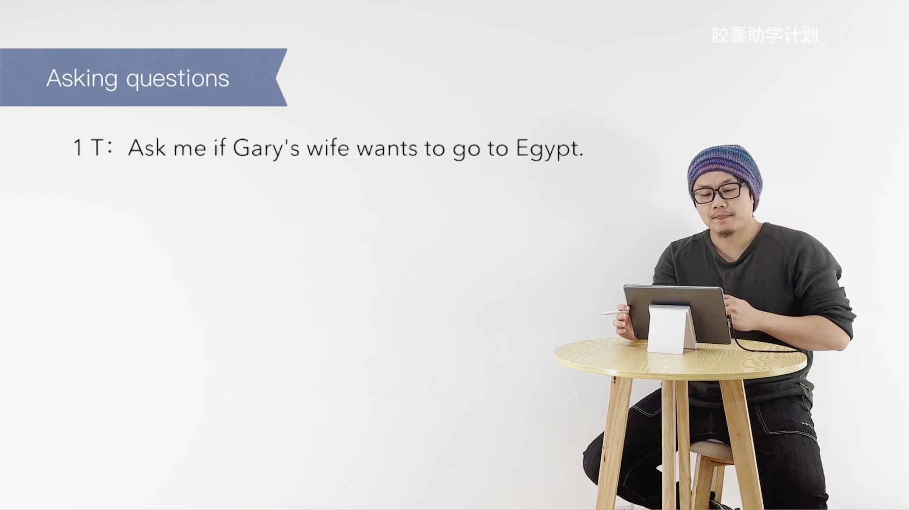

文字识别：Asking questions / 1 T: Ask me if Gary's wife wants to go to Egypt.

## 00:07:30–00:08:00

如果速度太快了呢？您暂停屏幕，自己练啊。第一题，Ask me if Gary's wife wants to go to Egypt. Does Gary's wife want to go to Egypt? Where? Where does Gary's wife want to go? Next one, Ask me if they can't make up their minds. Can't

### 画面 00:07:42

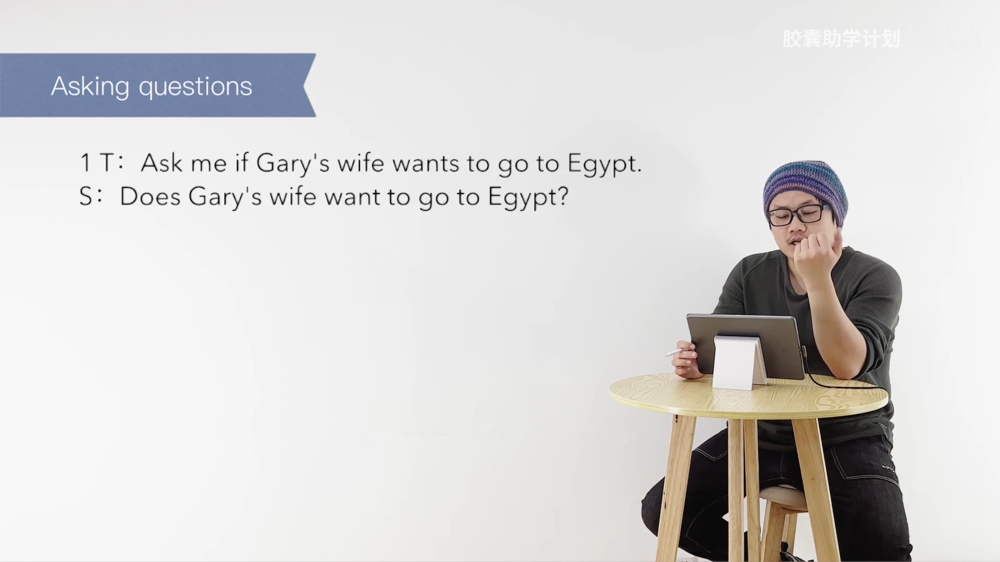

文字识别：Asking questions / 1 T: Ask me if Gary's wife wants to go to Egypt. / S: Does Gary's wife want to go to Egypt?

### 画面 00:07:52

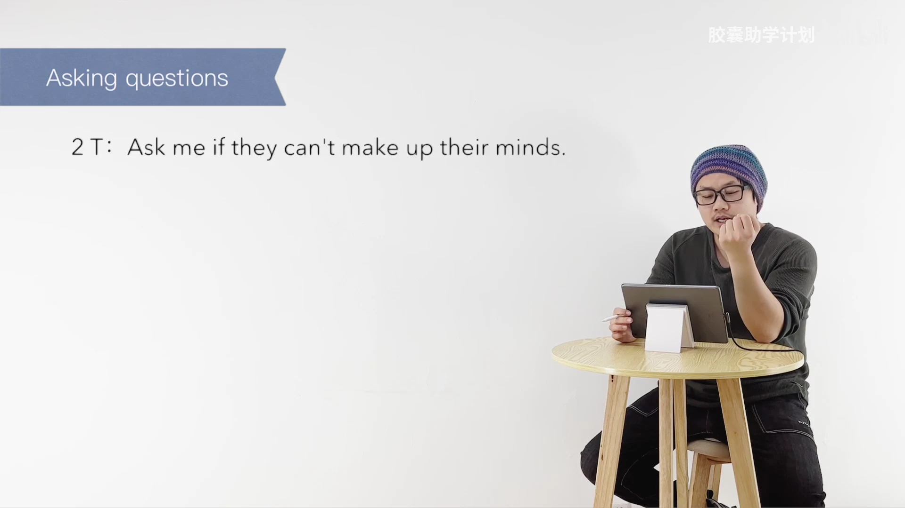

文字识别：Asking questions / 2 T: Ask me if they can't make up their minds.

## 00:08:00–00:08:30

they make up their minds? Why? Why can't they make up their minds? Next one, ask me if they may travel by sea. May they travel by sea? How? How may they travel? Next one, ask me if it takes a long time. Does it take a long time? How long?

### 画面 00:08:04

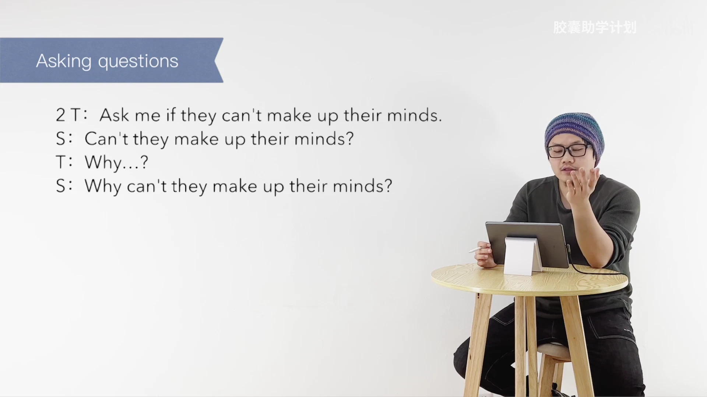

文字识别：Asking questions / 2 T: Ask me if they can't make up their minds. / S: Can't they make up their minds? / T:Why...? / S: Why can't they make up their minds?

### 画面 00:08:08

文字识别：Asking questions / 3 T: Ask me if they may travel by sea.

### 画面 00:08:26

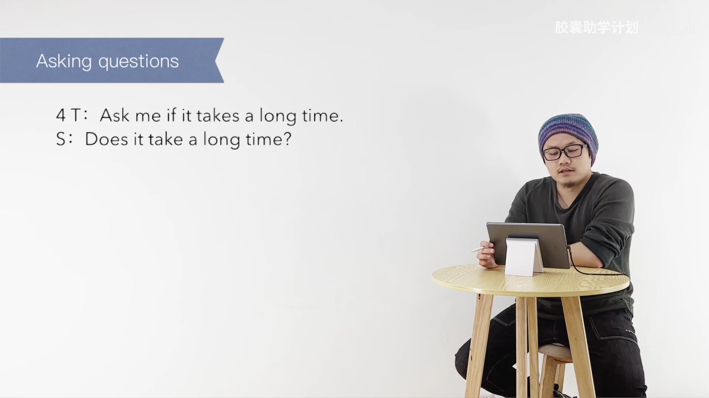

文字识别：Asking questions / 4T: Ask me if it takes a long time. / S: Does it take a long time?

## 00:08:30–00:09:00

多长时间？那就 How long does it take? The final one. Ask me if Anne worries too much. Does Anne worry a a lot? Why? Why does Anne worry a lot? Anne, uh, is Gary's wife. Okay. 好, recap 本课啊没有我全部出现在偶数课当中，我们出现了，对吧？然后在上一个视频讲语法

### 画面 00:08:44

文字识别：Asking questions / 5 T: Ask me if Ann worries a lot. / S: Does Ann worry a lot? / T: Why...?

### 画面 00:08:51

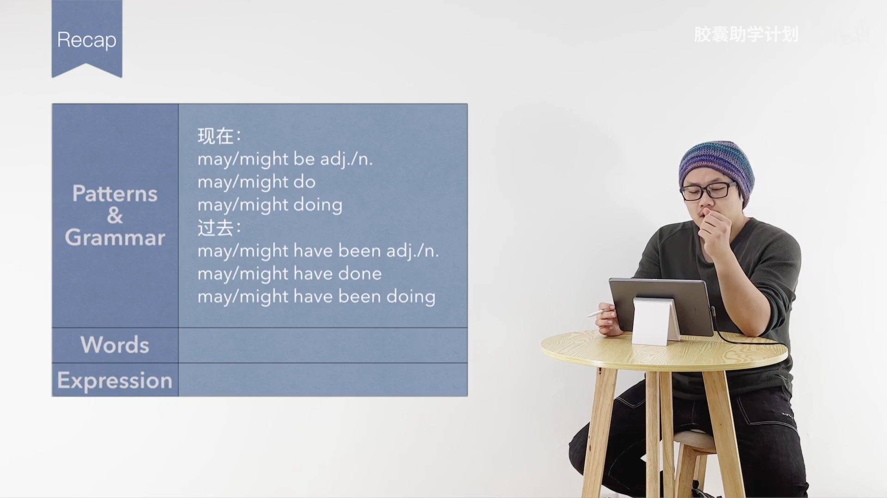

文字识别：Recap / 现在： / may/ / /might / be / adj./n. / may/might / do / Patterns / may/might / doing / & / 过去： / Grammar / may/might / have / been / adj./n. / may/might / have / done / may/might / have / been / doing / Words / Expression

## 00:09:00–00:09:30

的时候，我们练了一部分，但还远远不够。各位还要在绿皮书和冲击红初级红皮书当中继续去进行一个练习啊。OK，那加上作业，绿皮书幺三幺文章跟读至熟读成诵，讲解一遍核心语法知识点。OK，那如果各位喜欢我们的课程呢，欢迎各位关注订阅，一键三连，分享给那些需要的朋友来帮助我们快速成长。最后我们再来看一句名人名言。You're only here for a short

### 画面 00:09:10

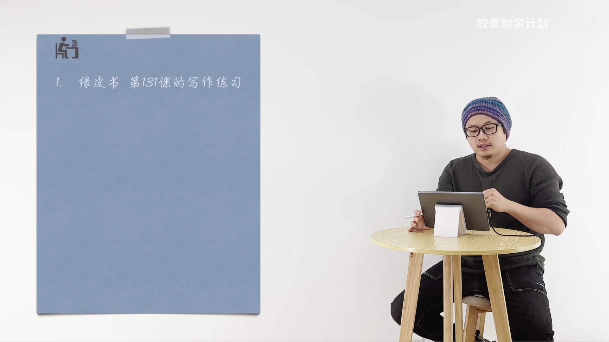

文字识别：绿皮书第131课的写作练习

### 画面 00:09:17

### 画面 00:09:25

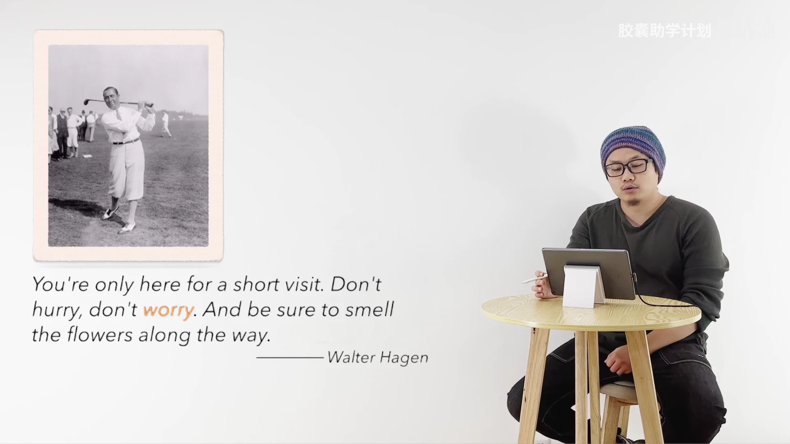

文字识别：You're only here for a short visit. Don't / hurry, don't worry. And be sure to smell / the flowers along the way. / Walter Hagen

## 00:09:30–00:09:50

visit. Don't hurry, don't worry, and be sure to smell the flowers along the way. See you next time.

### 画面 00:09:38

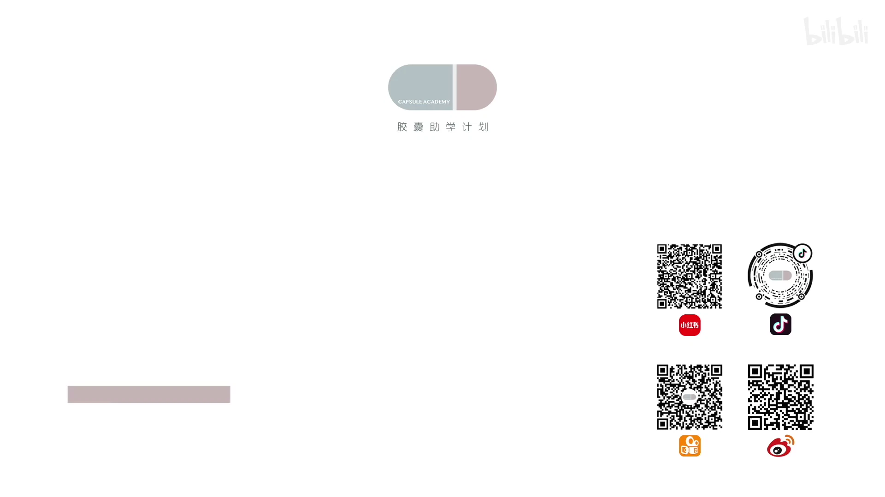

文字识别：CAPSULEACADEMY / 胶囊助学计划 / 小红书

### 画面 00:09:40

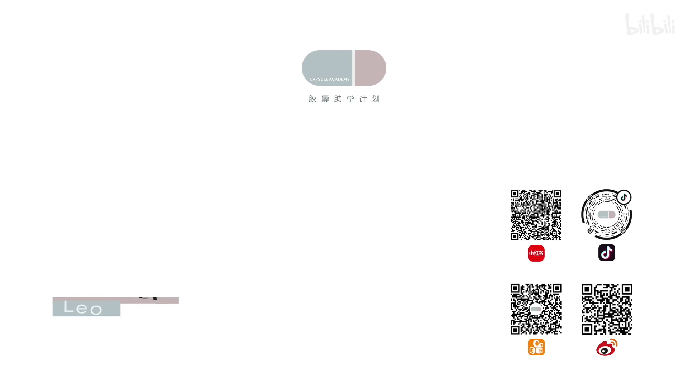

文字识别：CAPSULEACADEMY / 胶囊助学计划 / 小红书 / 品 / Leo / OE

### 画面 00:09:46

文字识别：CAPSULEACADEMY / 胶囊助学计划 / 小红书 / Creator / Leo & Berlin / OE

### 画面 00:09:48

文字识别：bilibili / 胶囊助学计划

### 画面 00:09:49

文字识别：bilibili / 胶囊助学计划

