# 132 练习

快速机器解析：语音为单模型转写，未进行独立交叉校对或人工复核；画面每秒采样并按变化选帧，短时文字和标记可能遗漏。截图时间约有 1 秒误差。图片有损压缩；遇到疑点请按时间查看 Google Drive 原视频。

## 00:00:00–00:00:30

Hello everyone, welcome to Capsule Academy. This is Leo. Today we're going to learn New Concept English Book One, Lesson One Hundred and Thirty Two Practices. Hope you can enjoy it.好，那偶数课我们最重要的练习就是练之前我们学到的那些非常重要的语法，就 recap 那个表格当中出现的六个公式。OK，那各位要做的事情就是大声张

### 画面 00:00:00

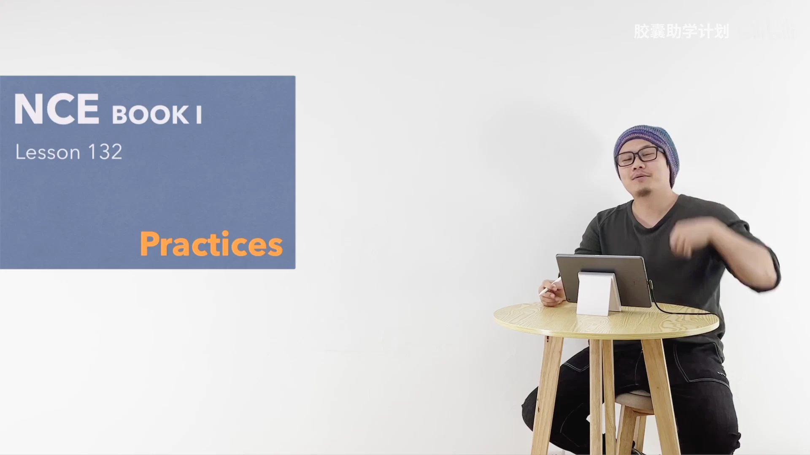

文字识别：NCE / BOOKI / Lesson 132 / Practices

### 画面 00:00:09

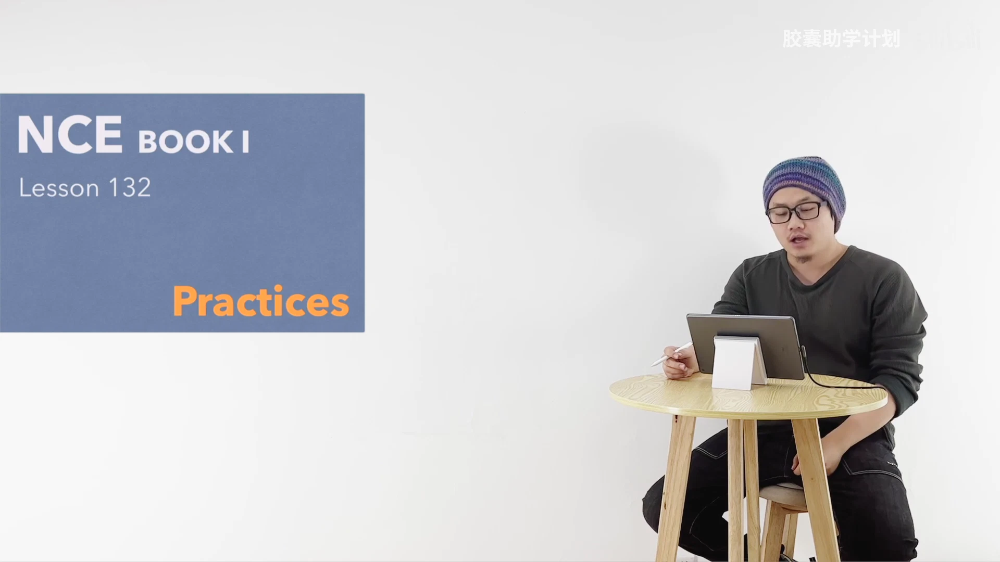

文字识别：NCE / BOOKI / Lesson 132 / Practices

### 画面 00:00:11

文字识别：胶囊助学计划 bilbl

### 画面 00:00:15

### 画面 00:00:17

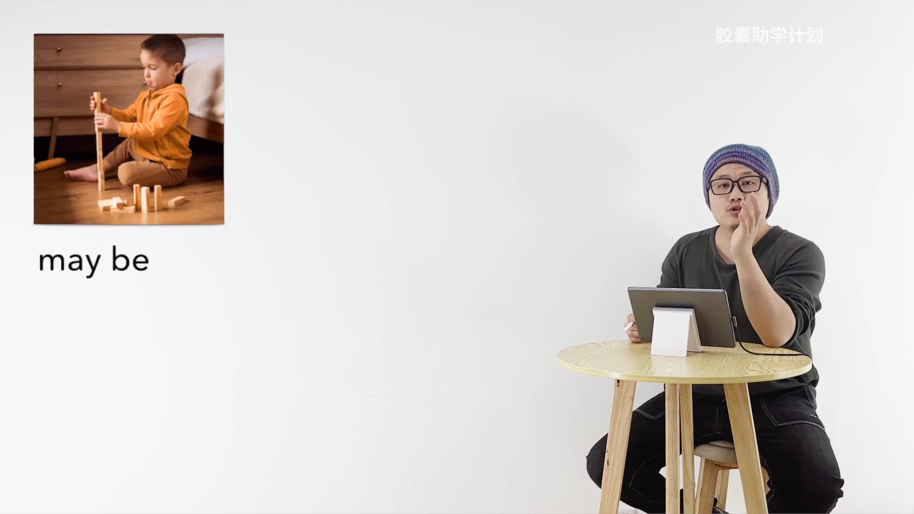

文字识别：may be

### 画面 00:00:20

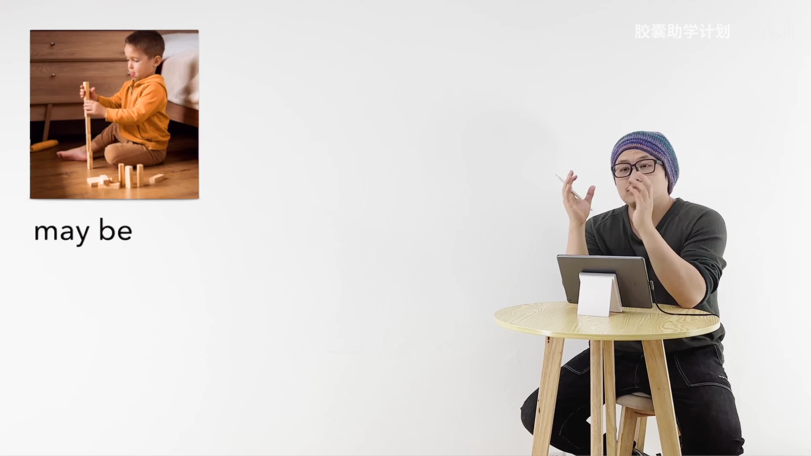

文字识别：may be

## 00:00:30–00:01:00

开嘴跟我读就好了。OK，那来了，Do you think he's in his room? I'm not sure. He may be in his room. Next one, Do you think they were reading? I'm not sure. They may have been reading. 张开嘴啊。Next one, Do you think they were in the garden?

### 画面 00:00:32

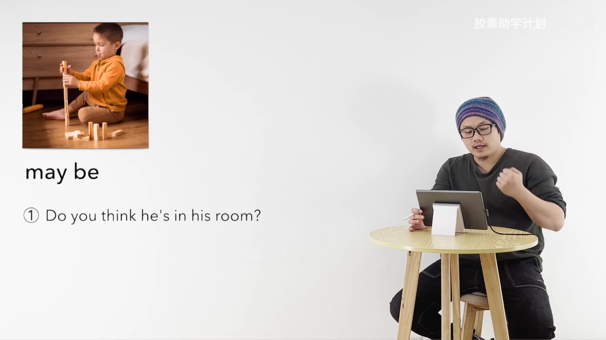

文字识别：may be / ① Do you think he's in his room?

### 画面 00:00:36

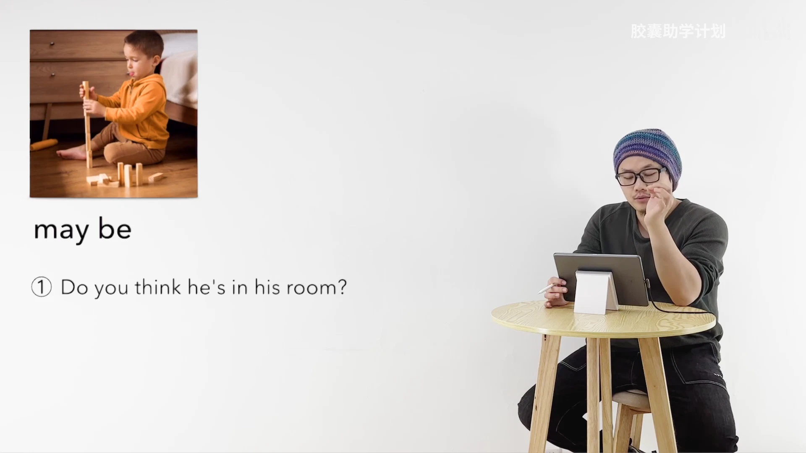

文字识别：may be / ① Do you think he's in his room?

### 画面 00:00:40

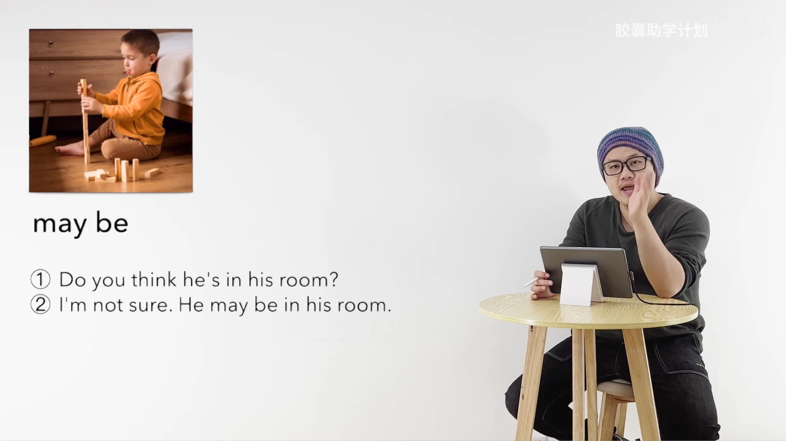

文字识别：may be / ① Do you think he's in his room? / ② I'm not sure. He may be in his room.

### 画面 00:00:43

文字识别：may have been v.ing

### 画面 00:00:54

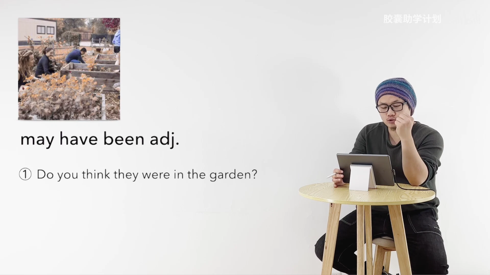

文字识别：may have been adj. / ① Do you think they were in the garden?

## 00:01:00–00:01:30

I'm not sure they may have been in the garden. Next one. Do you think this bread is fresh? I'm not sure it may be fresh. Next one. Do you think she was Danish? I'm not sure she may have been Danish. Next one. Do you think he was

### 画面 00:01:06

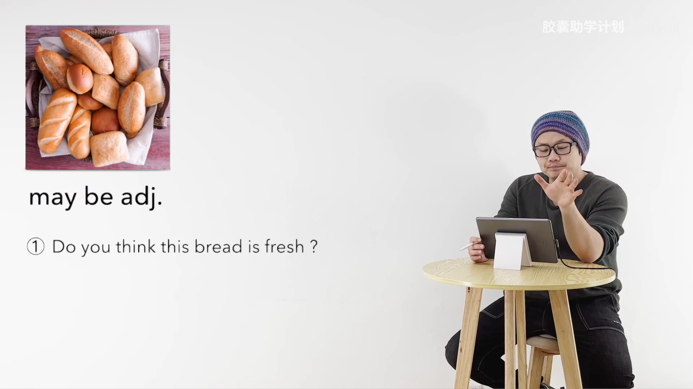

文字识别：may be adj. / ① Do you think this bread is fresh ?

### 画面 00:01:16

文字识别：may have been adj.

### 画面 00:01:27

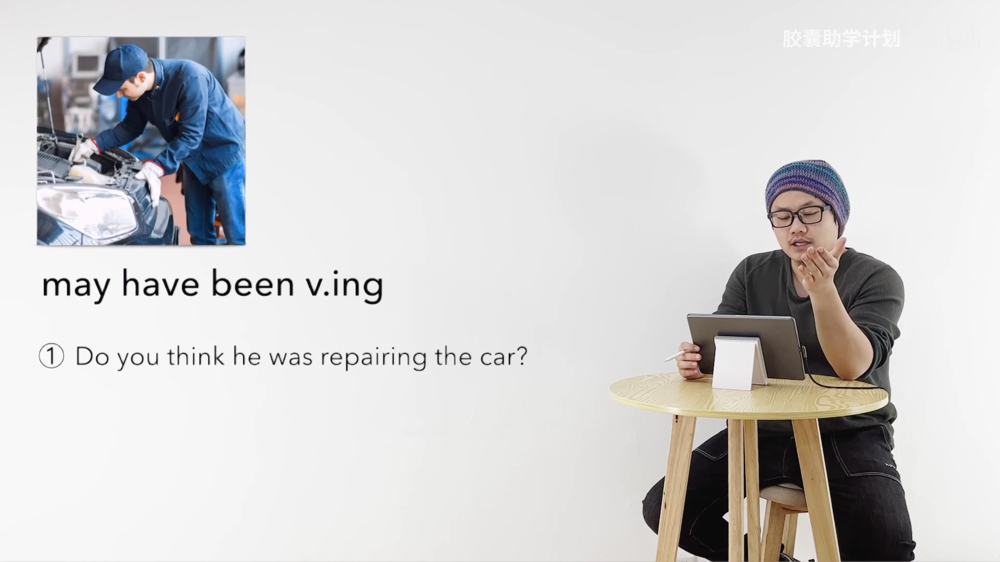

文字识别：may have been v.ing / ① Do you think he was repairing the car?

## 00:01:30–00:02:00

repairing the car? I'm not sure. He may have been repairing the car. Next one. Do you think they are playing in the garden? I'm not sure. They may be playing in the garden.来，张开嘴啊！Do you think they will offer you a job? I'm not sure.

### 画面 00:01:39

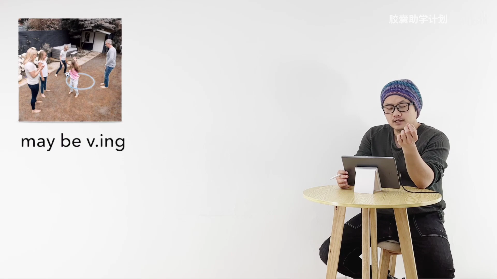

文字识别：may be v.ing

### 画面 00:01:46

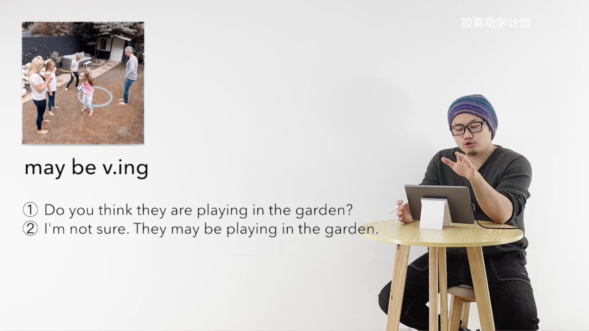

文字识别：may be v.ing / ① Do you think they are playing in the garden? / ② I'm not sure. They may be playing in the garden.

### 画面 00:01:51

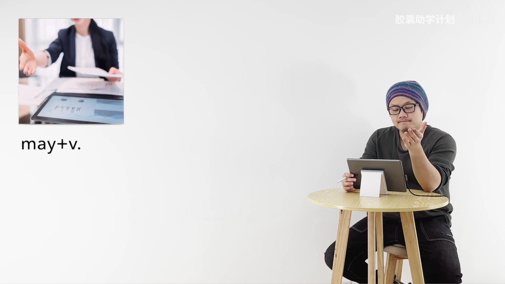

文字识别：may+v.

## 00:02:00–00:02:30

they may offer me a job. Next one, do you think she's only twenty nine? I'm not sure she may be only twenty nine. Next one, do you think my answer was right? I'm not sure it may have been right. Okay, recap. Ah,就是这六个公式非常的重要啊。一百二十七

### 画面 00:02:03

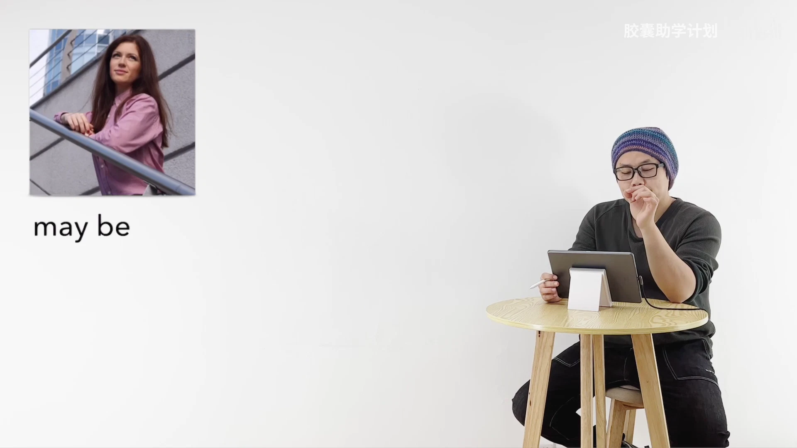

文字识别：may be

### 画面 00:02:13

文字识别：may have been adj.

### 画面 00:02:23

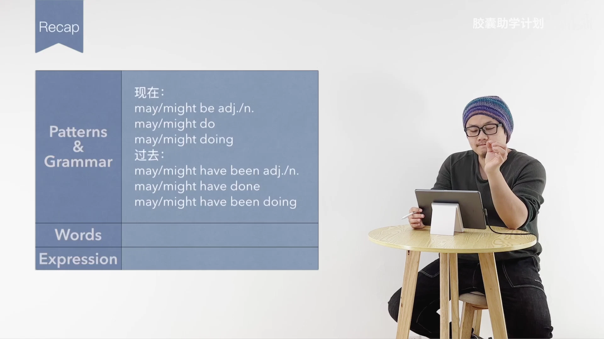

文字识别：Recap / 现在： / may/might / be / adj./n. / may/might / do / Patterns / may/might / doing / & / 过去： / Grammar / may/might / have / been / adj./n. / may/ / /might / have / done / may/mightl / have / been / doing / Words / Expression

## 00:02:30–00:03:00

课、一百二十九课、一百三十一课这三课的公式，我建议各位总结一下，放到一起去学，好吧？OK，家庭作业呢？绿皮书幺三二可以写了，给自己讲解一遍今天的核心知识点。那如果各位喜欢我们的课程，欢迎各位关注、订阅、一键三连，分享给那些需要的朋友，来帮助我们快速成长。那最后我们再来看一句名人名言：I never worry about the problem, I worry about the

### 画面 00:02:37

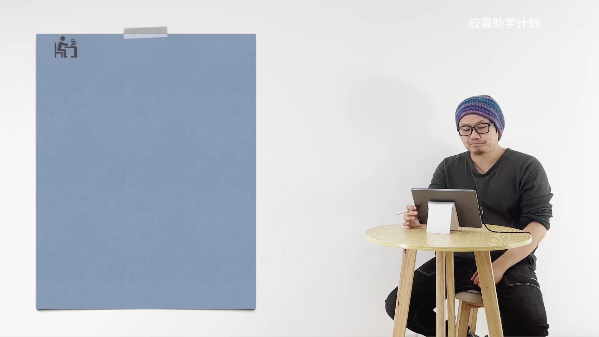

### 画面 00:02:40

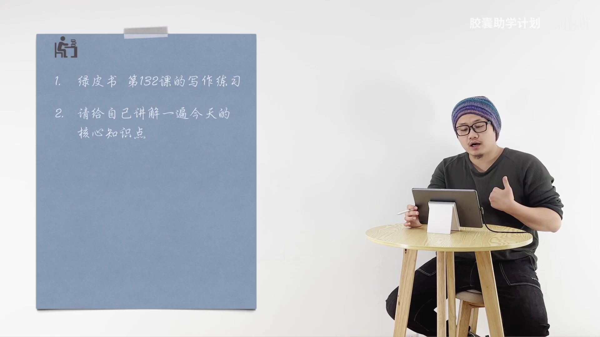

文字识别：绿皮书第132课的写作练习 / 请给自己讲解一遍今天的 / 核心知识点

### 画面 00:02:43

文字识别：👍

### 画面 00:02:52

文字识别：SPAIDING / I never worry about the problem. I worry / about the solution. / Shaquille O'Neal

## 00:03:00–00:03:14

See you next time.

### 画面 00:03:02

### 画面 00:03:04

文字识别：CAPSULEACADEMY / 胶囊助学计划 / 小红书 / Lecturer / Leo / OE

### 画面 00:03:07

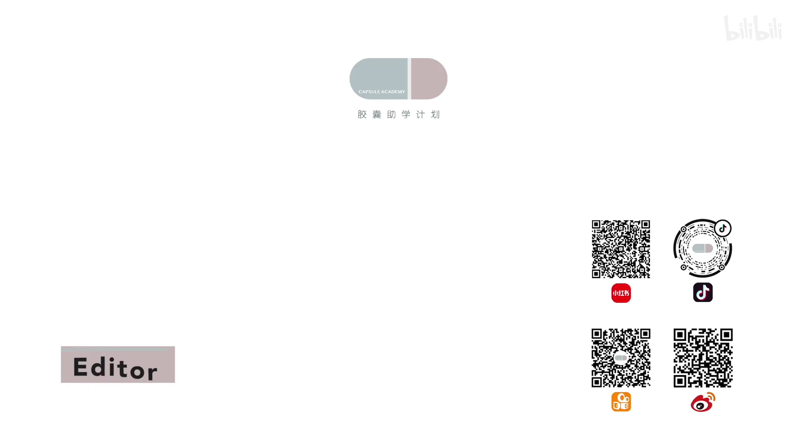

文字识别：CAPSULEACADEMY / 胶囊助学计划 / 小红书 / Editor / OE

### 画面 00:03:10

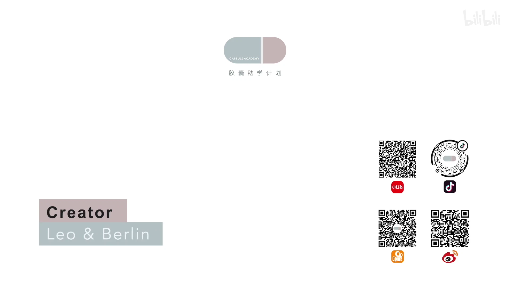

文字识别：CAPSULEACADEMY / 胶囊助学计划 / 小红书 / Creator / □ / Leo & Berlin / OE

### 画面 00:03:12

文字识别：Bilibili / 胶囊助学计划 / 小红书

### 画面 00:03:14

文字识别：bilibili / 胶囊助学计划

