# 133 单词 语法

快速机器解析：语音为单模型转写，未进行独立交叉校对或人工复核；画面每秒采样并按变化选帧，短时文字和标记可能遗漏。截图时间约有 1 秒误差。图片有损压缩；遇到疑点请按时间查看 Google Drive 原视频。

## 00:00:00–00:00:30

Hello everyone, welcome to Capsule Academy. This is Leo. Today we are going to learn New Concept English Book One, Lesson One Hundred and Thirty Three, Grammar and Words. 那老习惯进入正式课程之前呢，我们先看一个问题，直接引语变成间接引语时候的一些时态变化。那带着这个问题，Hope you guys enjoyed. 好，那我们上一次提到直接引语和间接引语，还

### 画面 00:00:00

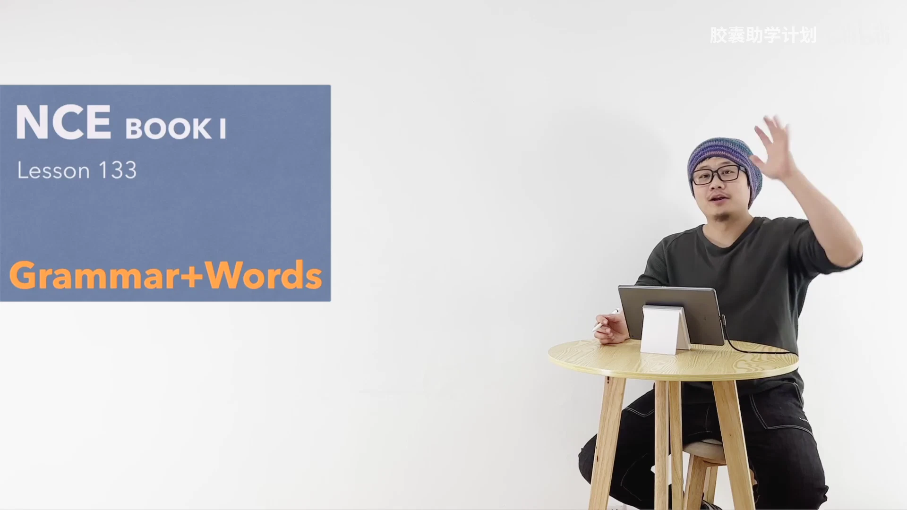

文字识别：NCE / BOOKI / Lesson 133 / Grammar+Words

### 画面 00:00:09

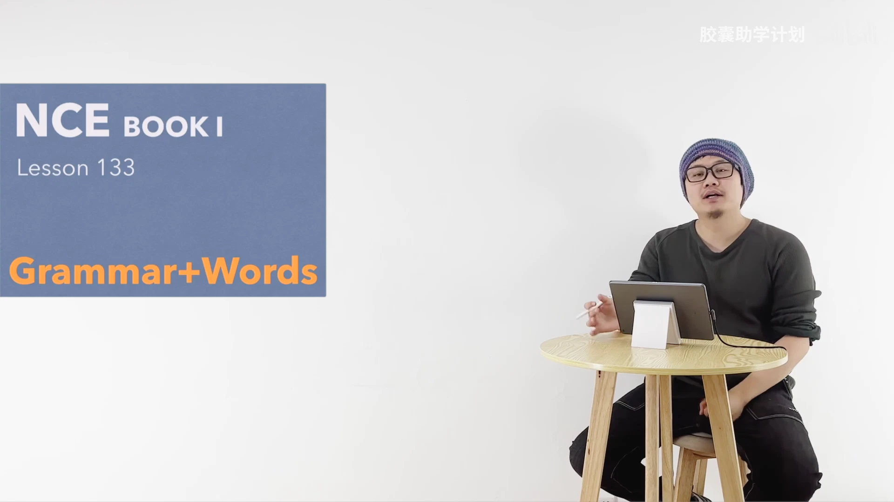

文字识别：NCE / BOOKI / Lesson 133 / Grammar+Words

### 画面 00:00:11

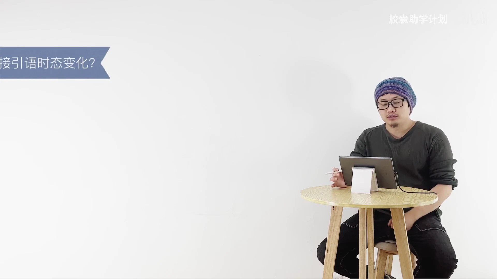

文字识别：接引语时态变化?

### 画面 00:00:13

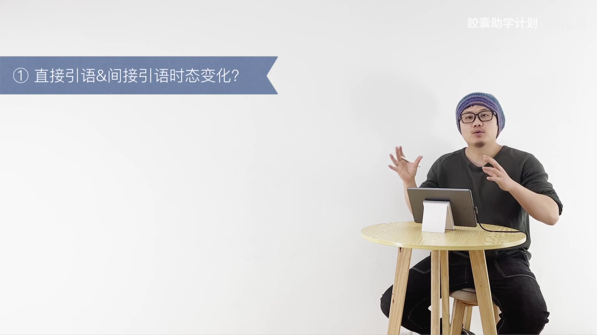

文字识别：①直接引语&间接引语时态变化?

### 画面 00:00:21

文字识别：胶囊助学计划blbl / •

### 画面 00:00:25

文字识别：胶囊助学计划

### 画面 00:00:27

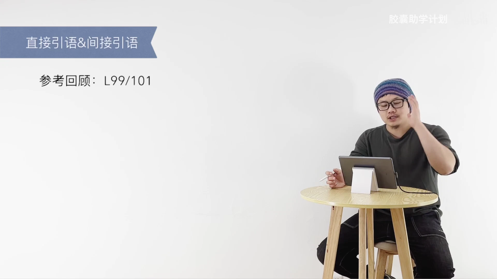

文字识别：直接引语&间接引语 / 参考回顾：L99/101

## 00:00:30–00:01:00

是在九十九课和一百零一课，对吧？更准确一点说，我们是在一百零一课见到的直接引语和间接引语这两个不同的学术名词，对吧？啊，这个语法词，呃，我们当时给大家总结了一下，说直接引语一般就是在引号里的，间接引语就是把别人说的话转化成这个把引号去掉，对吧？你要做一些时态上的一些啊，人称上的一些变化，对不对？好，然后我们当时也举了，呃，也提到了这样一个点，对吧？结合了九

### 画面 00:00:57

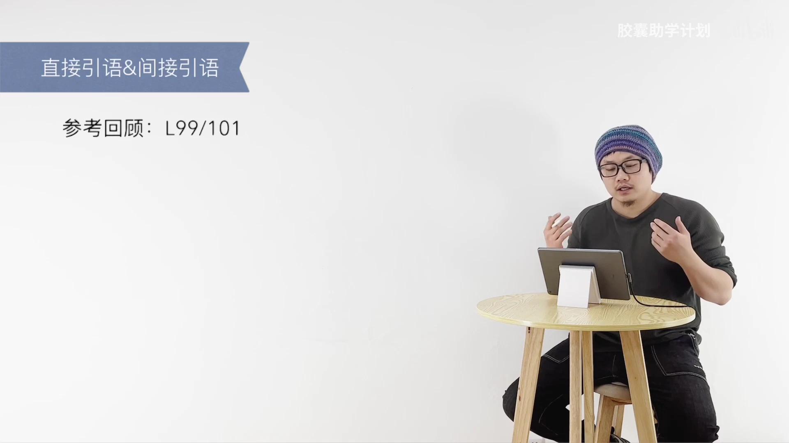

文字识别：直接引语&间接引语 / 参考回顾：L99/101

## 00:01:00–00:01:30

十九课说，间接引语实际上本质上就是一个宾语从句。那今天我们要学什么呢？今天我们要学的是一个更新的东西，就是当主句是一般过去时的时候，如果直接引语是一般现在时啊，比如说 I'm easy to dance，那间接引语在去变的时候，您不仅需要变人称，这是一百零一课咱们学过的，今天要教各位的叫做时态也要变，你需要把一般现在时变成一般过去

### 画面 00:01:11

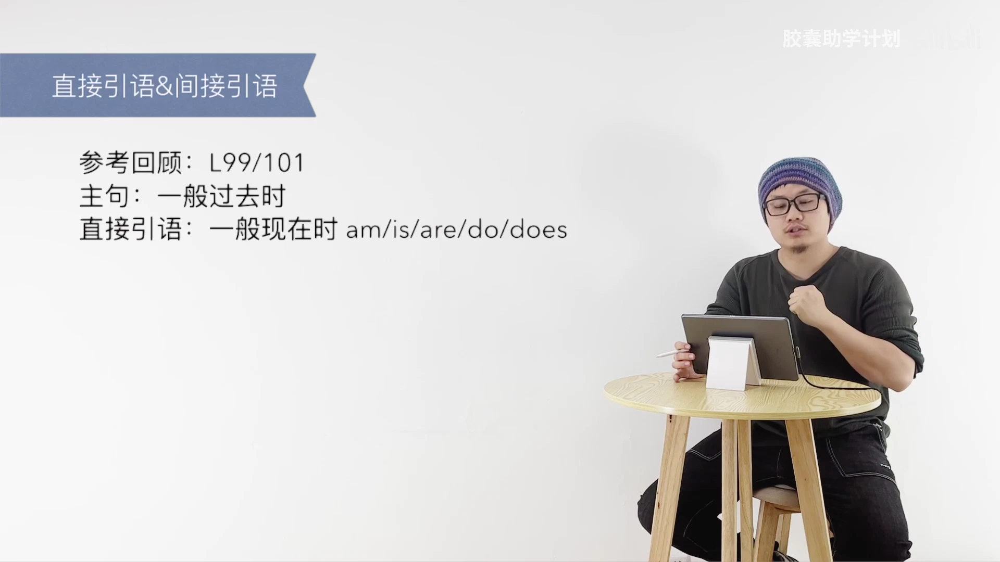

文字识别：直接引语&间接引语 / 参考回顾：L99/101 / 主句：一般过去时 / 直接引l语：一般现在时 am/is/are/do/does

## 00:01:30–00:02:00

时，这么讲还是有点抽象。给大家一个例子，比如说有一个人说了一句话叫 I feel tired。比如说这句话是他五分钟之前说的，然后呢您没听见，然后你现在突然间想问说，哎，What did she say？他之前说那句话是什么来着？我没听清。于是你要说的叫做 She said，她说，间接引语叫做 That she felt tired。注意 feel 变成了 felt，

### 画面 00:01:31

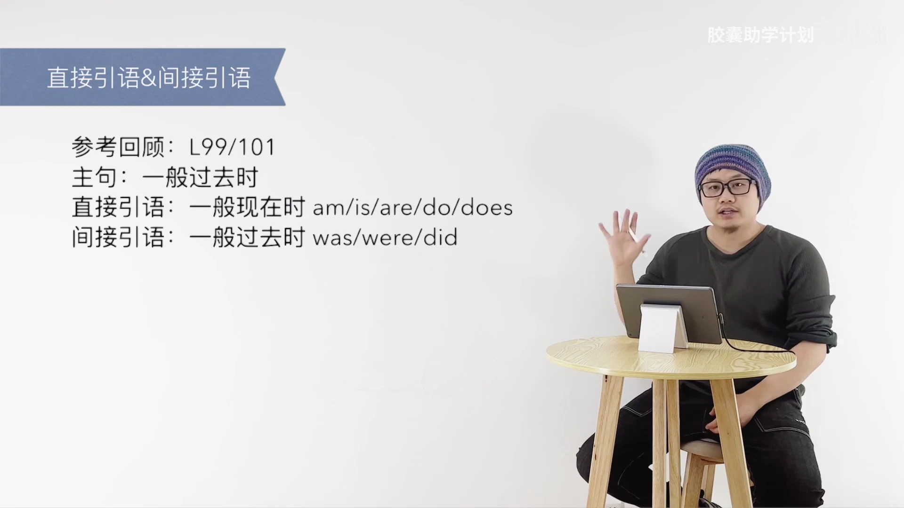

文字识别：直接引语&间接引语 / 参考回顾：L99/101 / 主句：一般过去时 / 直接引l语：一般现在时 am/is/are/do/does / 间接引语：一般过去时was/were/did

### 画面 00:01:49

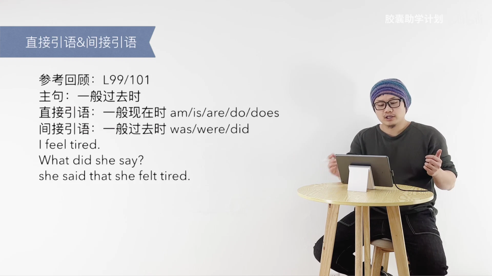

文字识别：直接引语&间接引语 / 参考回顾：L99/101 / 主句：一般过去时 / 直接引l语：一般现在时 am/is/are/do/does / 间接引语：一般过去时was/were/did / I feel tired. / What did she say? / she said that she felt tired.

## 00:02:00–00:02:30

felt，看到了吧？OK，直接引语如果是一般现在时，间接引语要变成一般过去时，并且主句She said是一般过去时，这三个是吧？是同时要成立的啊。那我们看一些小的变化，比如说I am tired.五分钟之前你说了这样一句话，在引号当中的原话，对吧？然后他没听清，于是别人问了一句

### 画面 00:02:00

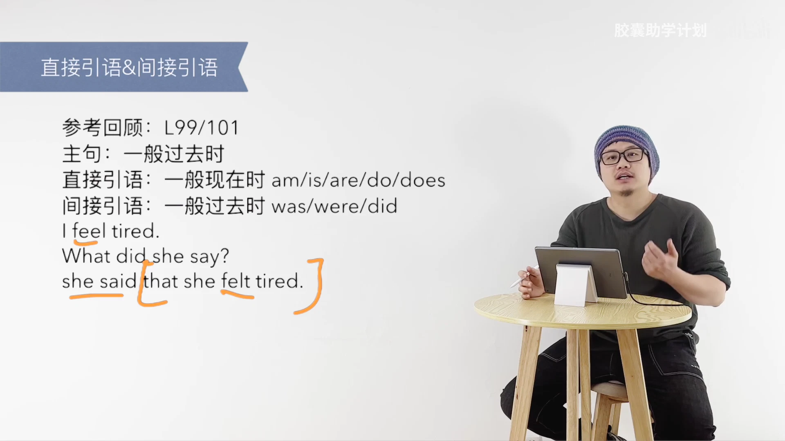

文字识别：直接引语&间接引语 / 参考回顾：L99/101 / 主句：一般过去时 / 直接引|语：一般现在时 am/is/are/do/does / 间接引语：一般过去时was/were/did / I feel tired. / What did she say? / she saidthat she felt tired.

### 画面 00:02:07

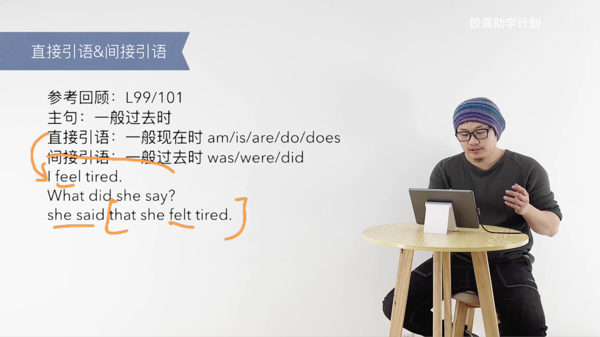

文字识别：直接引语&间接引语 / 参考回顾：L99/101 / 主句：一般过去时 / 直接引l语：一般现在时 am/is/are/do/does / 词接引语：一般过去时was/were/did / feel tired. / What did she say? / she saidthat she felt tired.

### 画面 00:02:12

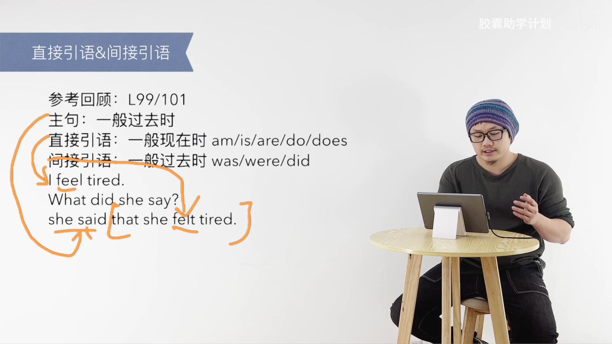

文字识别：直接引语&间接引语 / 参考回顾：L99/101 / 主句：一般过去时 / 直接引l语：一般现在时 am/is/are/do/does / 司接引语：一般过去时was/were/did / 可按於 / feel tired. / What did she say? / she saidthat she felt tired.

### 画面 00:02:19

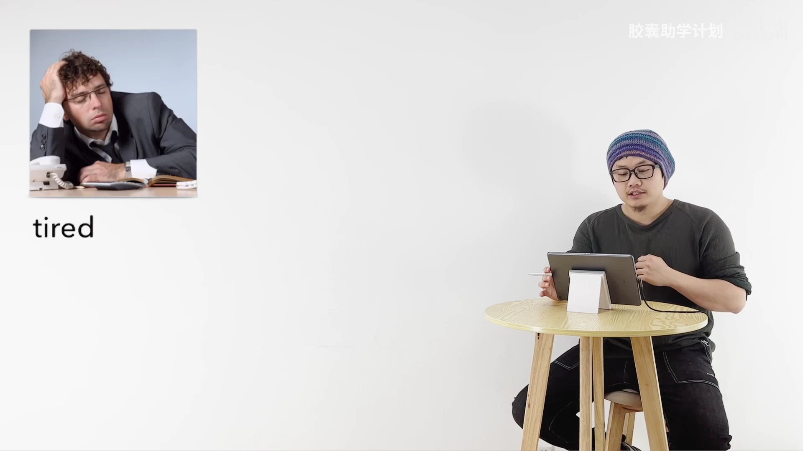

文字识别：tired

## 00:02:30–00:03:00

说 What did he say? 他说的是什么？您的回答叫 He said that he was tired. 这是不是很好理解？就是说我五分钟之前说的，肯定是我五分钟之前说，我当他当时很累，对不对啊？那不代表他现在说的这句话。 OK，所以主句是一般过去时，您的时态要有一个后退，把一般现在时变成一般过去时啊，这是一个习惯。

### 画面 00:02:36

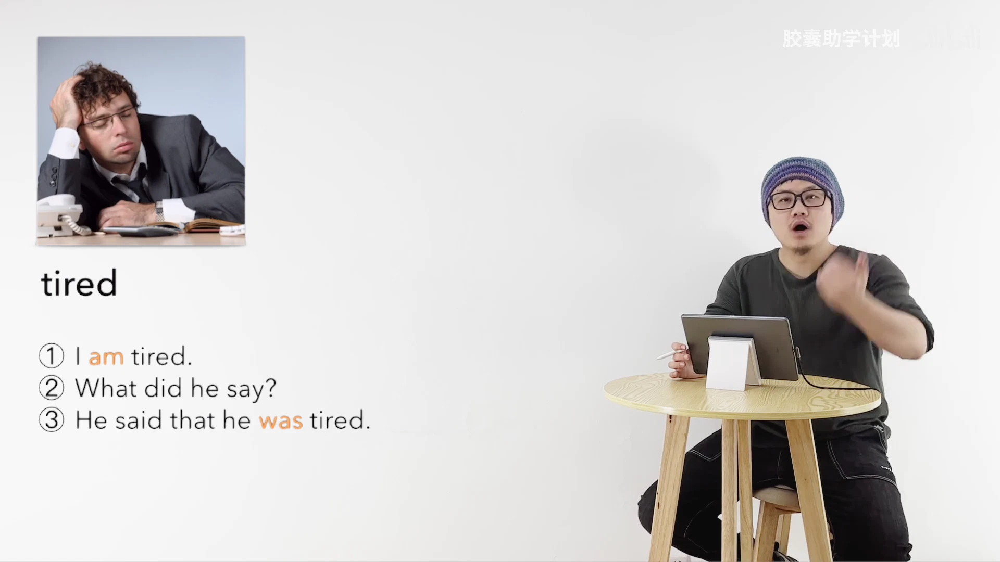

文字识别：tired / ① I am tired. /  What did he say? / He said that he was tired.

### 画面 00:02:54

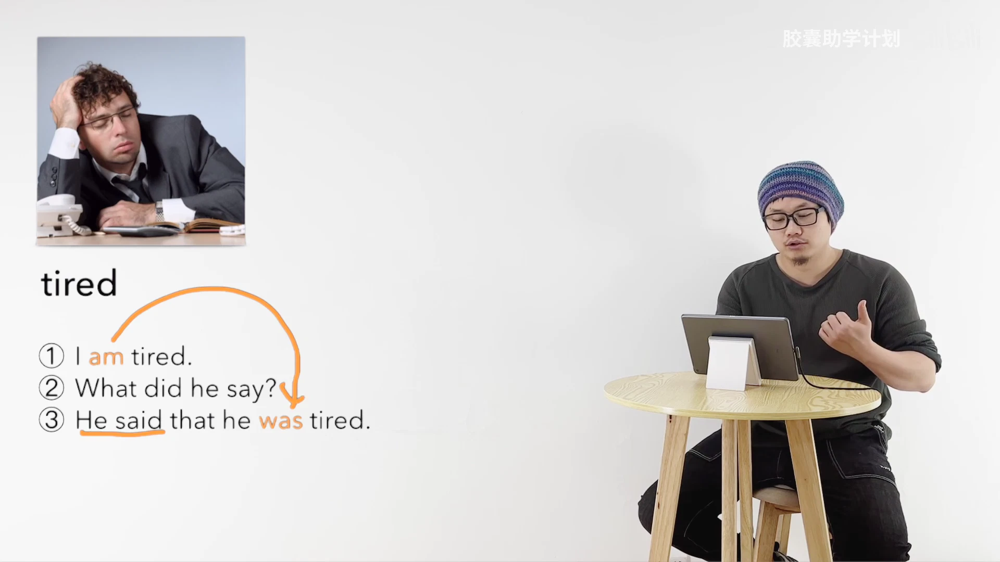

文字识别：tired / ① I am tired. / What did he say? / He said that he was tired.

### 画面 00:02:59

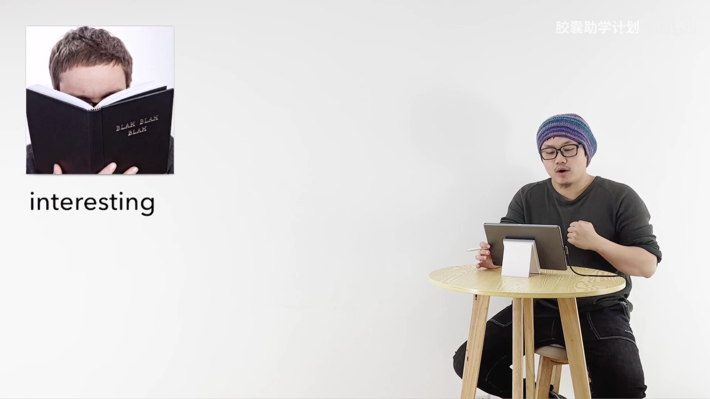

文字识别：BLAH BLAE / BLAH / interesting

## 00:03:00–00:03:30

接下来呢，我们都以相同的方式去练，跟我张嘴读啊。说 The book is interesting. What did she say? She said that the book was interesting. Very good. 那直接英语变间接英语，还有一些其他的时态变化，我们一个一个讲啊。前面是不变的。如果直接英语是现在进行时，am is are加doing，那间接英语就变成过去进行

### 画面 00:03:08

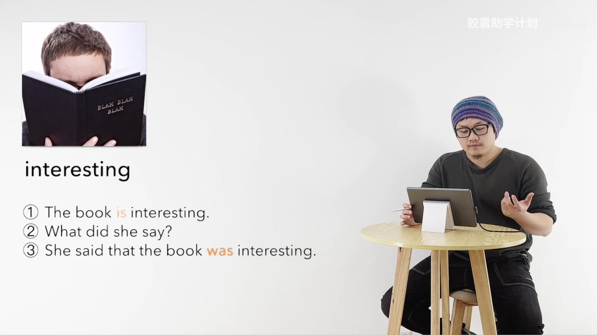

文字识别：BLAE BLAET / BLAE / interesting / ) The book is interesting. / What did she say? / She said that the book was interesting.

### 画面 00:03:14

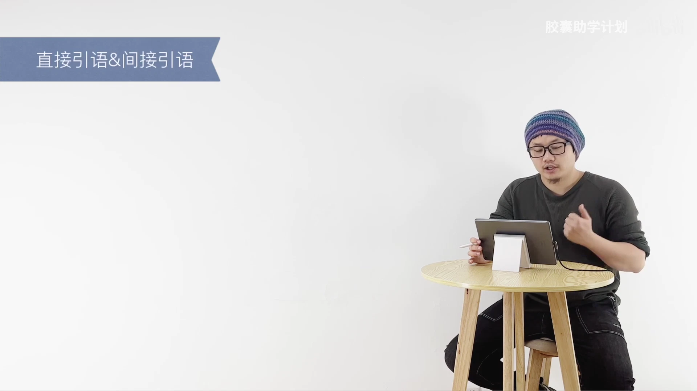

文字识别：直接引语&间接引语

### 画面 00:03:21

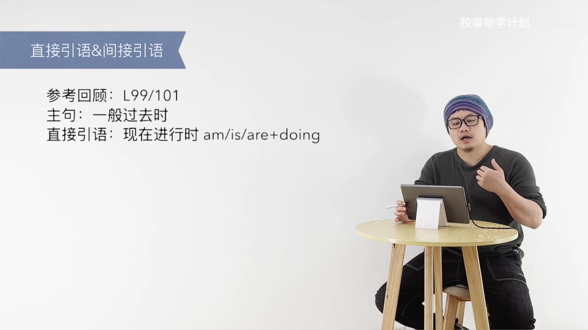

文字识别：直接引语&间接引语 / 参考回顾：L99/101 / 主句：一般过去时 / 直接引|语：现在进行时 am/is/are+doing

## 00:03:30–00:04:00

时，对吧？我五分钟之前说的，我正在做某件事情，然后五分钟之后你问我说，哎，他刚才说什么来着？肯定是他刚才正在做什么，对吧？所以就变成了过去进行时。还是给大家例子，比如说 I'm waiting for the taxi，引号当中的直接引语，然后 What did she told you？她只刚才告诉你什么了？She told me that she was waiting for the taxi，对吧？她当时正在等这

### 画面 00:03:43

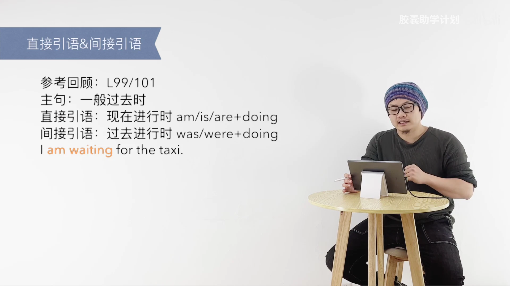

文字识别：直接引语&间接引语 / 参考回顾：L99/101 / 主句：一般过去时 / 直接引|语：现在进行时 am/is/are+doing / 间接引l语：过去进行时 was/were+doing / I am waiting for the taxi.

### 画面 00:03:54

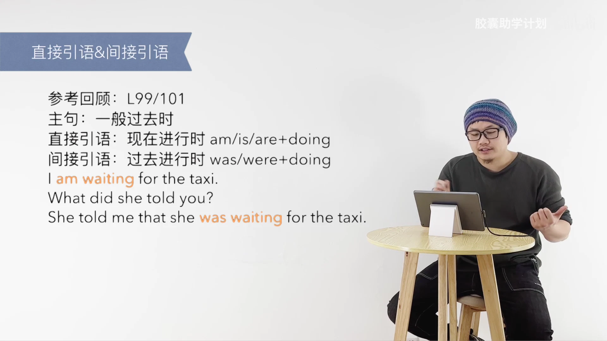

文字识别：直接引语&间接引语 / 参考回顾：L99/101 / 主句：一般过去时 / 直接引|语：现在进行时 am/is/are+doing / 间接引语：过去进行时 was/were+doing / I am waiting for the taxi. / What did she told you? / She told me that she was waiting / for the taxi.

### 画面 00:03:56

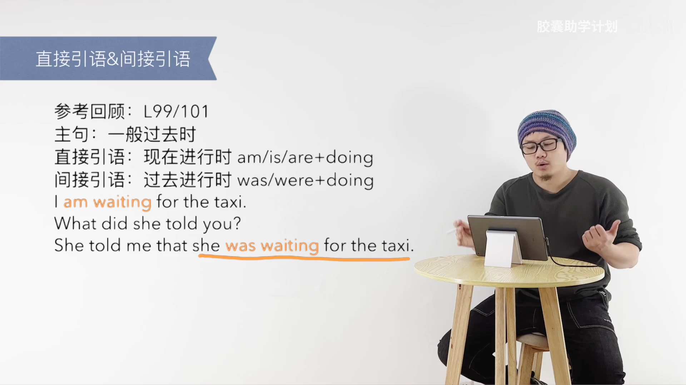

文字识别：直接引语&间接引语 / 参考回顾：L99/101 / 主句：一般过去时 / 直接引|语：现在进行时 am/is/are+doing / 间接引l语：过去进行时 was/were+doing / I am waiting for the taxi. / What did she told you? / She told me that she was waiting / for the taxi.

## 00:04:00–00:04:30

个出租车，是不是很容易理解？你看前面叫 she told me，主句是一般过去时，你们把现在进行时要变成过去进行时。如果你从直接引语变成间接引语的时候，其实某种程度上这就是一个很简单的时态转变啊！各位去想一下，好吧？还是我们做练习，张嘴跟我读，we are having dinner，这是五分钟之前他说的原话，对吧？然后

### 画面 00:04:03

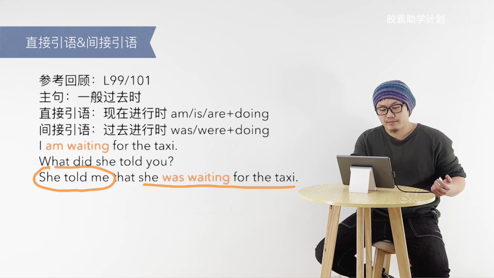

文字识别：直接引语&间接引语 / 参考回顾：L99/101 / 主句：一般过去时 / 直接引语：现在进行时 / am/is/are+doing / 间接引语：过去进行时 / was/were+doing / I am waiting for the taxi. / What did she told you? / She told me hat she was waiting / for the taxi.

### 画面 00:04:07

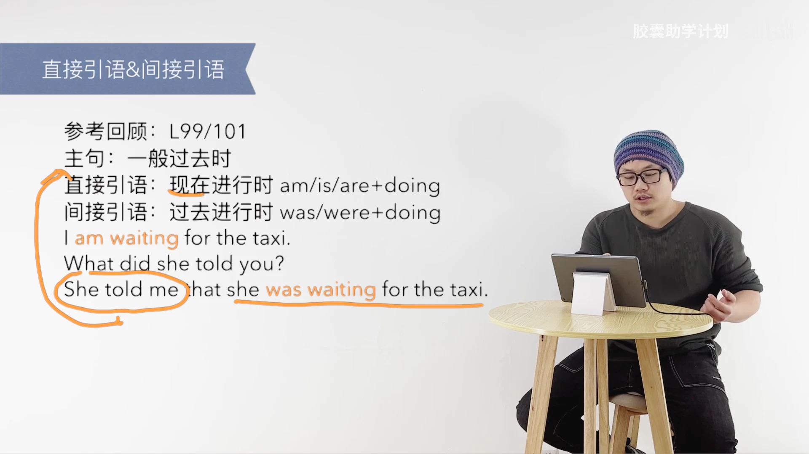

文字识别：直接引语&间接引语 / 参考回顾：L99/101 / 主句：一般过去时 / 直接引语：现在进行时 / am/is/are+doing / 间接引语： / 过去进行时 / was/were+doing / I am waiting f / for the taxi. / What did she told you? / She told mehat she / was waiting / for the taxi.

### 画面 00:04:09

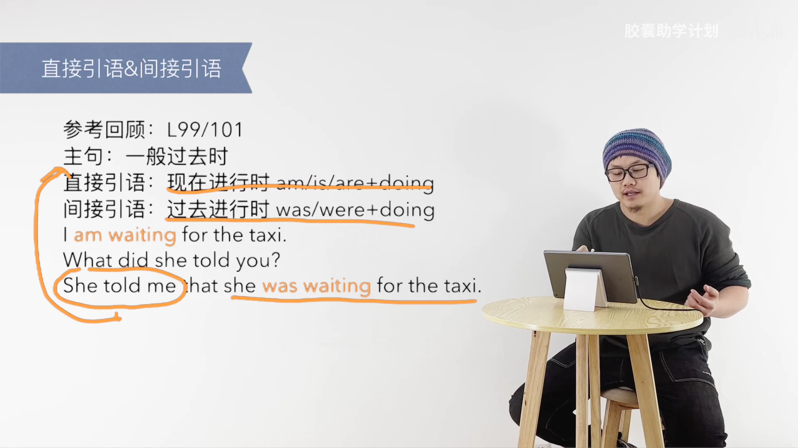

文字识别：直接引语&间接引语 / 参考回顾：L99/101 / 主句：一般过去时 / 直接引语： / 现在进行时 / t am/is/are+doing / 间接引语： / 过去进行时 / was/were+doing / I am waiting / for the / taxi. / What did she told you? / She told me hat she / was waiting / for the taxi.

### 画面 00:04:21

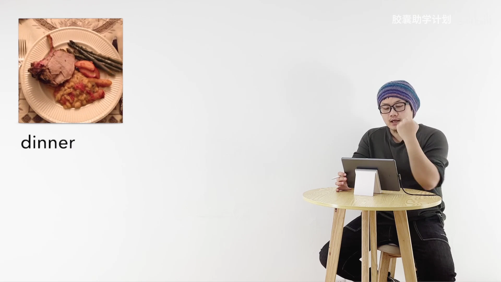

文字识别：dinner

## 00:04:30–00:05:00

What did they told you? 他们刚才告诉你什么了？那他们刚才告诉我的叫他们刚才正在吃，对吧？过去进行时。 They told me that they were having dinner. Very good. Next one. 说 I am working. What did he told you? 说 He told me that he was working. Very good. 好，还是一模一样。如果直接引语现在变成了现

### 画面 00:04:34

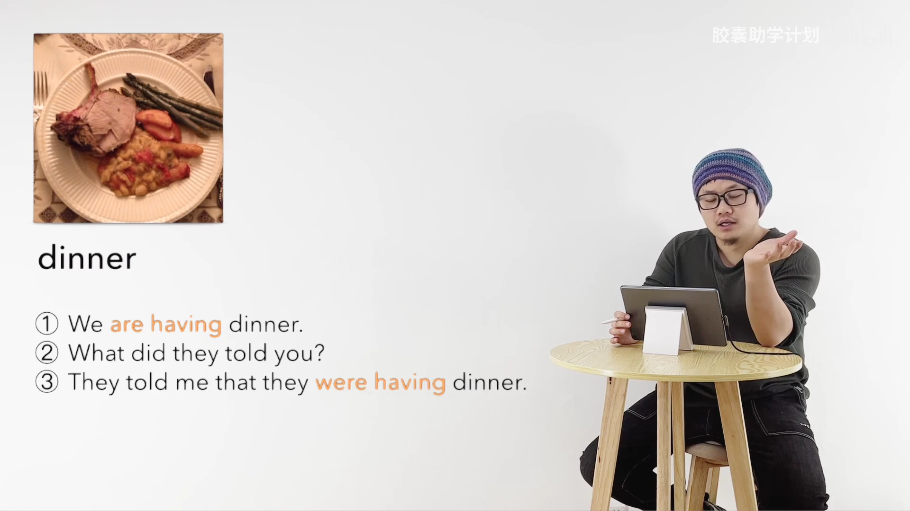

文字识别：dinner / 1 / We are having / dinner. / What did t / they told you? / They told /  me that they / were having / dinner.

### 画面 00:04:43

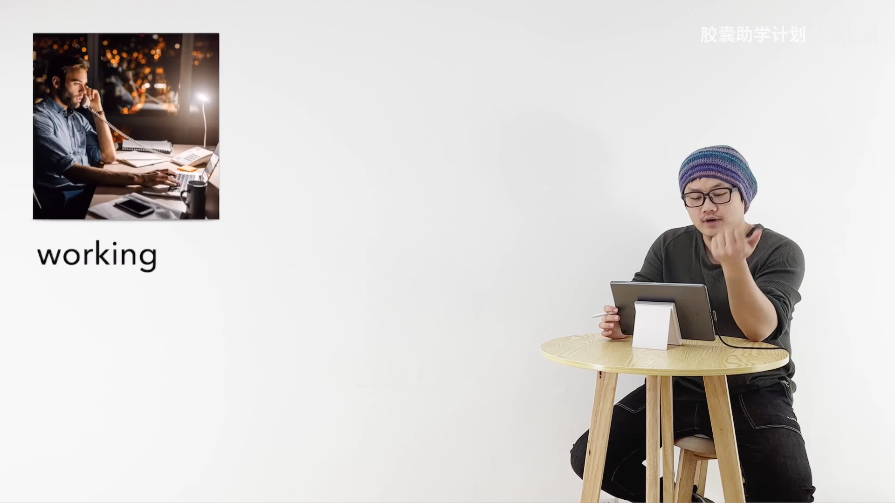

文字识别：working

### 画面 00:04:49

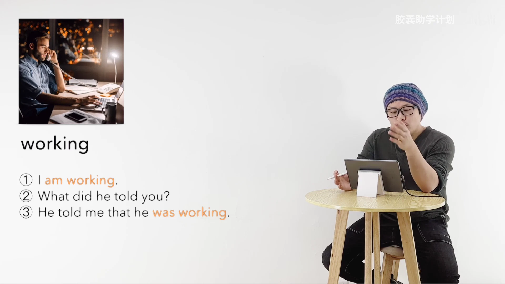

文字识别：working / ① I am working. / What did he told you? / He told me that he was working.

### 画面 00:04:54

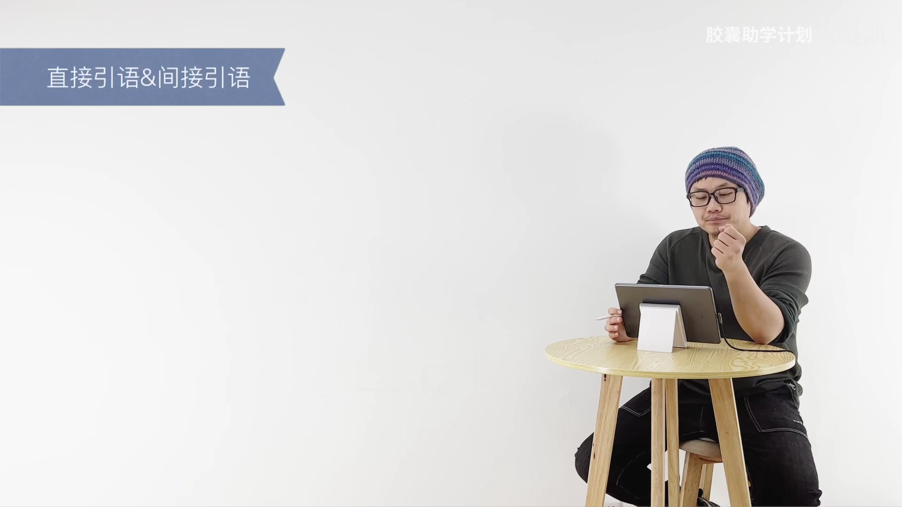

文字识别：直接引语&间接引语

### 画面 00:04:56

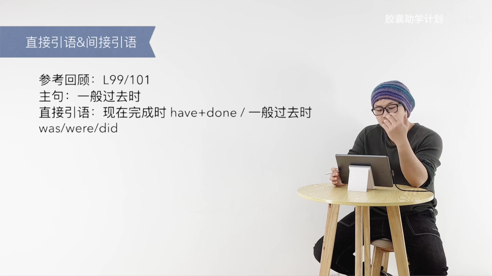

文字识别：直接引语&间接引语 / 参考回顾：L99/101 / 主句：一般过去时 / 直接引语：现在完成时have+done／一般过去时 / was/were/did

## 00:05:00–00:05:30

在完成时或一般过去时，注意这两个时态是一样的啊，都要把它们变成过去完成时。不管你是现在完成时还是一般过去时，都统一变成了过去完成时。我们举个例子，比如说他刚才说了一句话叫 I have finished my homework。那 What did she say？他说什么了？She said that she had finished her homework。

### 画面 00:05:00

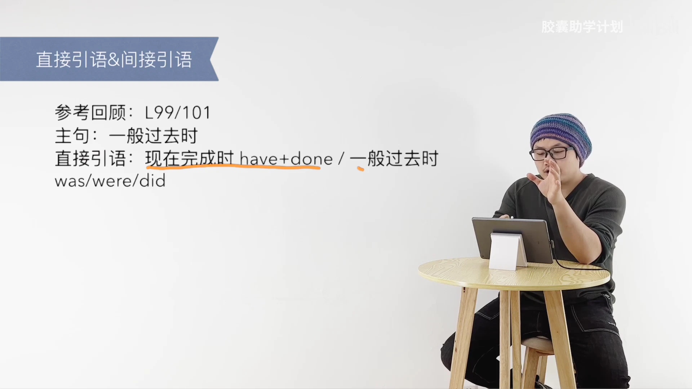

文字识别：直接引语&间接引语 / 参考回顾：L99/101 / 主句：一般过去时 / 直接引l语：现在完成时have+done／一般过去时 / was/were/did

### 画面 00:05:02

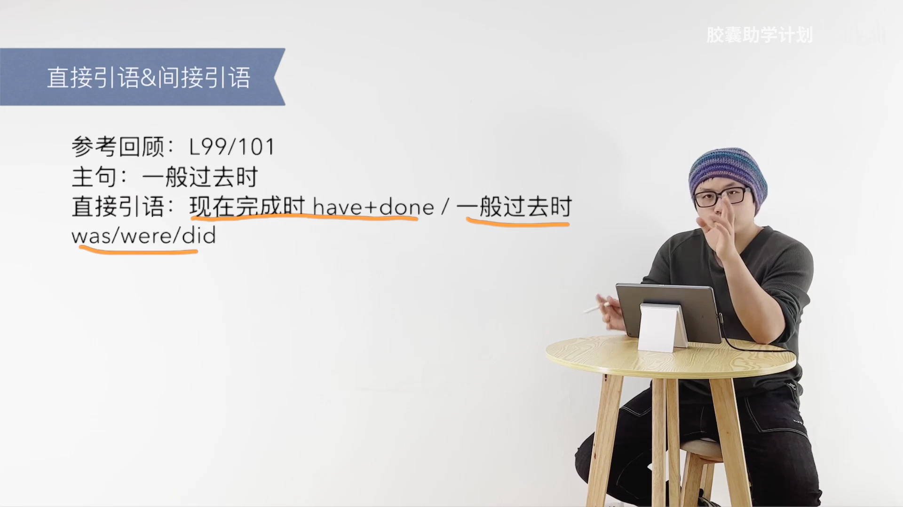

文字识别：直接引语&间接引语 / 参考回顾：L99/101 / 主句：一般过去时 / 直接引l语：现在完成时have+done／一般过去时 / was/were/did

### 画面 00:05:07

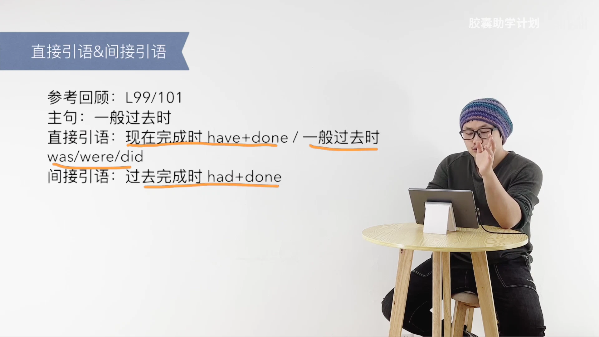

文字识别：直接引语&间接引语 / 参考回顾：L99/101 / 主句：一般过去时 / 直接引l语：现在完成时have+done／一般过去时 / was/were/did / 间接引l语：过去完成时 had+done

### 画面 00:05:18

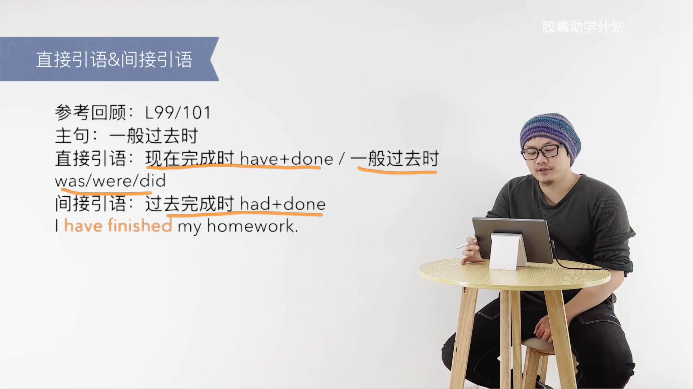

文字识别：直接引语&间接引语 / 参考回顾：L99/101 / 主句：一般过去时 / 直接引l语：现在完成时have+done／一般过去时 / was/were/did / 间接引l语：过去完成时 had+done / I have finished my homework.

### 画面 00:05:23

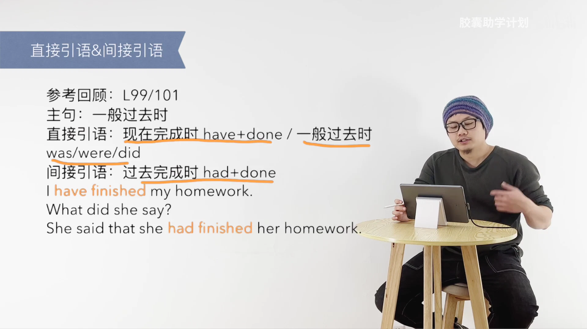

文字识别：直接引语&间接引语 / 参考回顾：L99/101 / 主句：一般过去时 / 直接引l语：现在完成时have+done/一般过去时 / was/were/did / 间接引l语：过去完成时 had+done / I have finished my homework. / What did she say? / She said that she had finished her homework.

## 00:05:30–00:06:00

This is English的习惯。你要把现在完成时和一般过去时变成过去完成时啊。直接引语变成间接引语的时候，好吧。那我们还是做练习啊。来说，I've lost my key. What did he say? He said that he had lost his key. 现在完成时变成了过去完成时，对吧？我们再来一个一般过去时的。I did my homework

### 画面 00:05:37

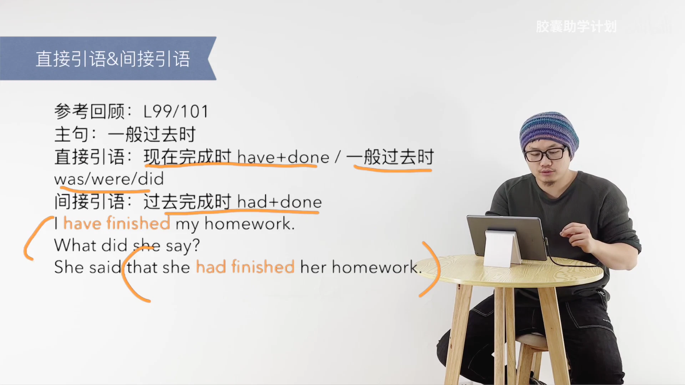

文字识别：直接引语&间接引语 / 参考回顾：L99/101 / 主句：一般过去时 / 直接引l语：现在完成时have+done/一般过去时 / was/were/did / 间接引语：过去完成时 had+done / I have finished my homework. / What did she say? / She saidthat she had finished her homework.

### 画面 00:05:39

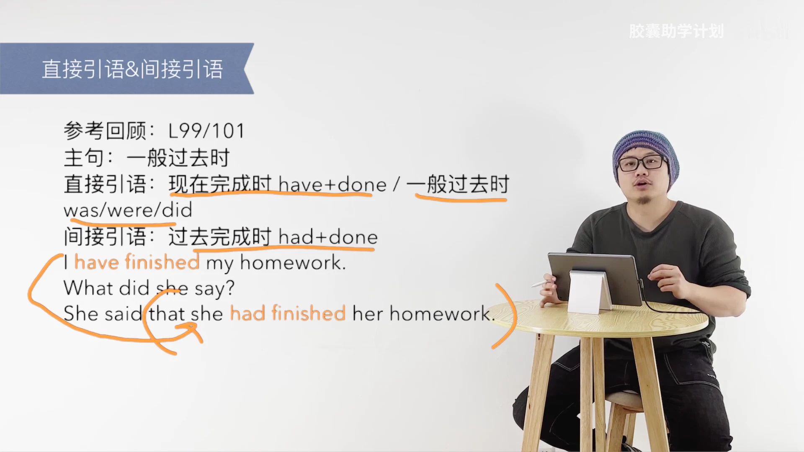

文字识别：直接引语&间接引语 / 参考回顾：L99/101 / 主句：一般过去时 / 直接引l语：现在完成时have+done/一般过去时 / was/were/did / 间接引语：过去完成时 had+done / I have finished my homework. / What did she say? / She said that she had finished her homework.

### 画面 00:05:41

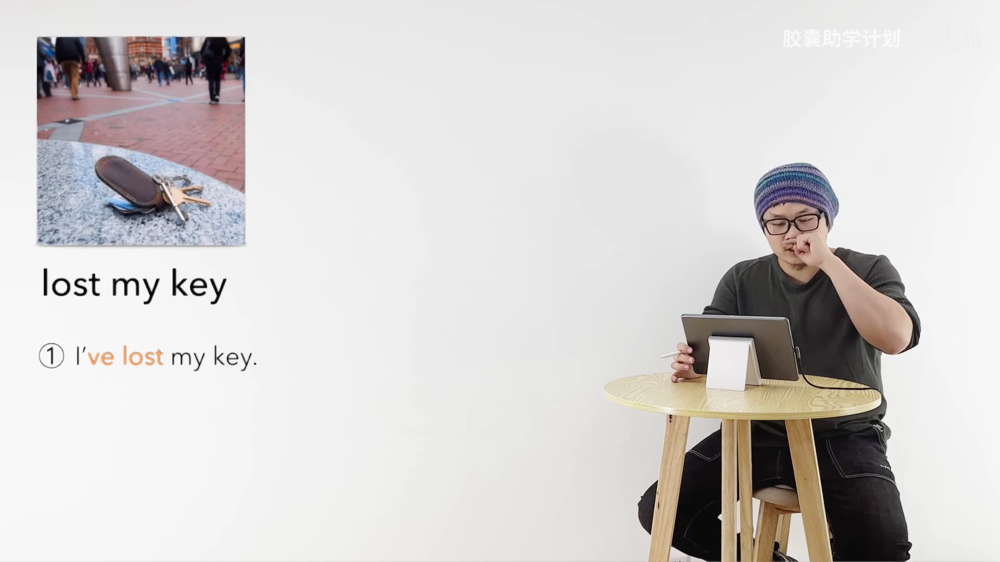

文字识别：lost my key / ① I've lost my key.

### 画面 00:05:47

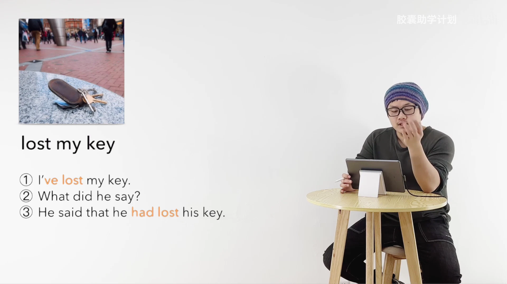

文字识别：lost my key / ① I've lost my key. / What did he say? / He said that he had lost his key.

### 画面 00:05:53

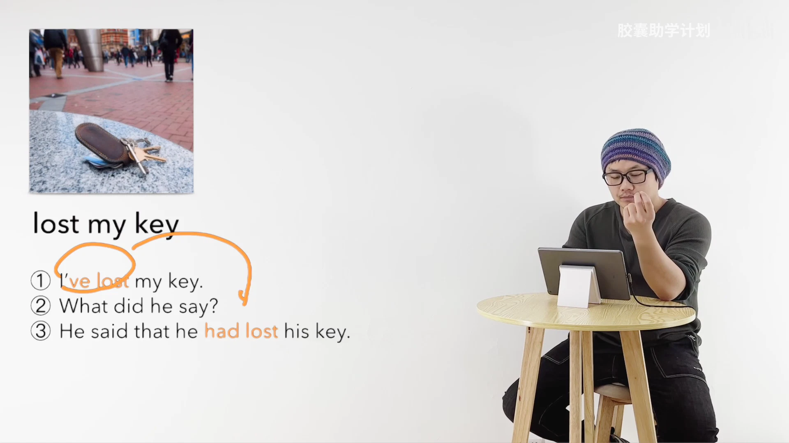

文字识别：lost my / key / 've lost my key. / What did he say? / He said that he had lost his key.

### 画面 00:05:55

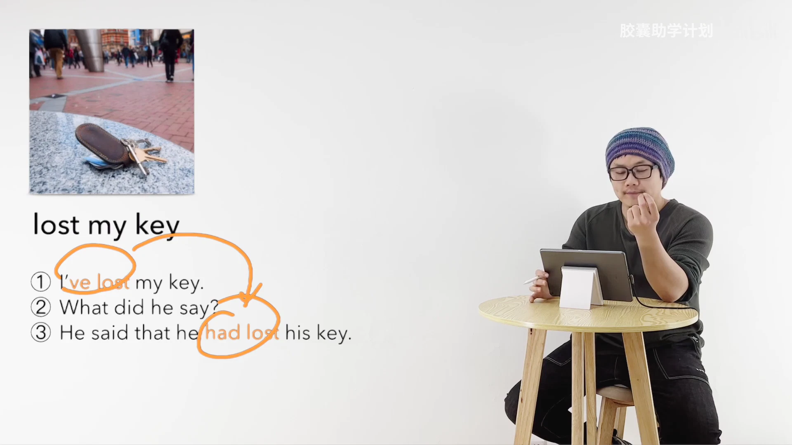

文字识别：lost my key / 've lost my key. / What did he say / He said that hehad lod his key.

### 画面 00:05:57

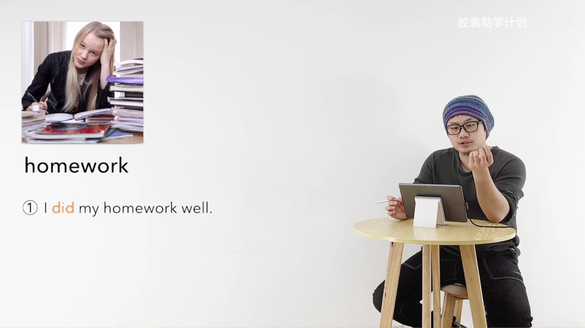

文字识别：homework / ① I did my homework well

## 00:06:00–00:06:30

well. Okay,好，然后呢？What did she say? She said that she had done her homework well.您看，我们是把一般过去时变成了过去完成时，对吧？Very good.再来，还有一个状态就是，如果是一般将来时是 am/is/are going to do，那你肯定要把它变成 was/were going to do，叫过去将来时。那这个时态我们之前并没有学过，对吧？各位只要清楚，其实就是 am/is/are换成 was/were

### 画面 00:06:04

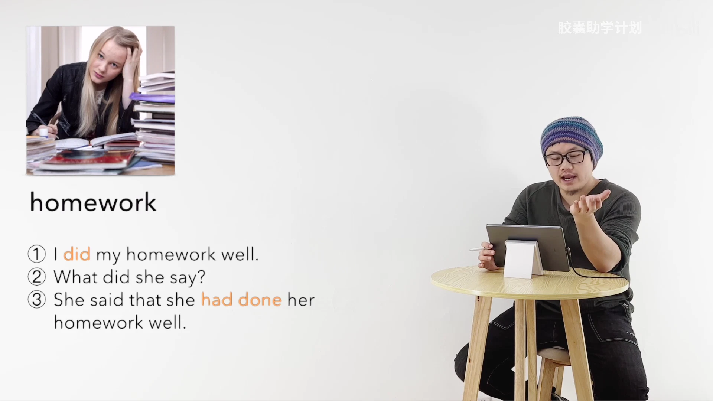

文字识别：homework / ① I did my homework well. /  What did she say? / She said that she had done her / homework well.

### 画面 00:06:11

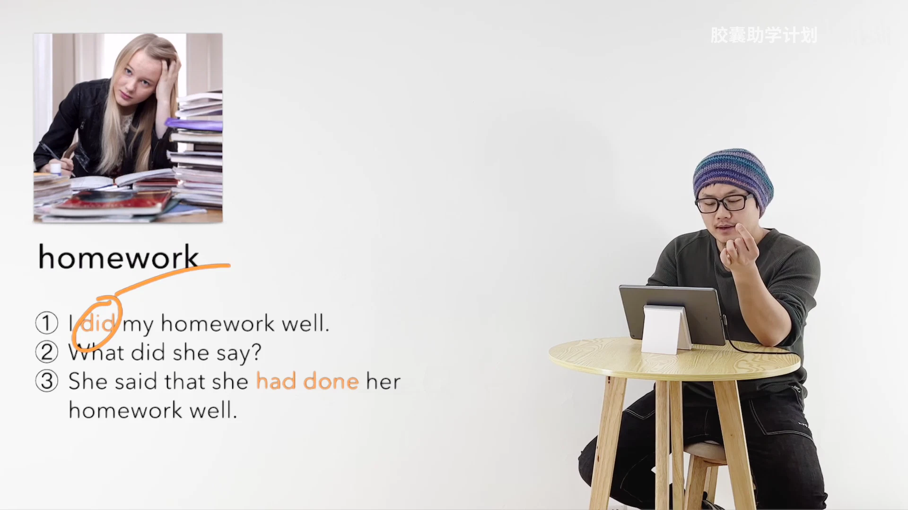

文字识别：homework / ldidmy homework well. / What did she say? / She said that she had done her / homework well.

### 画面 00:06:13

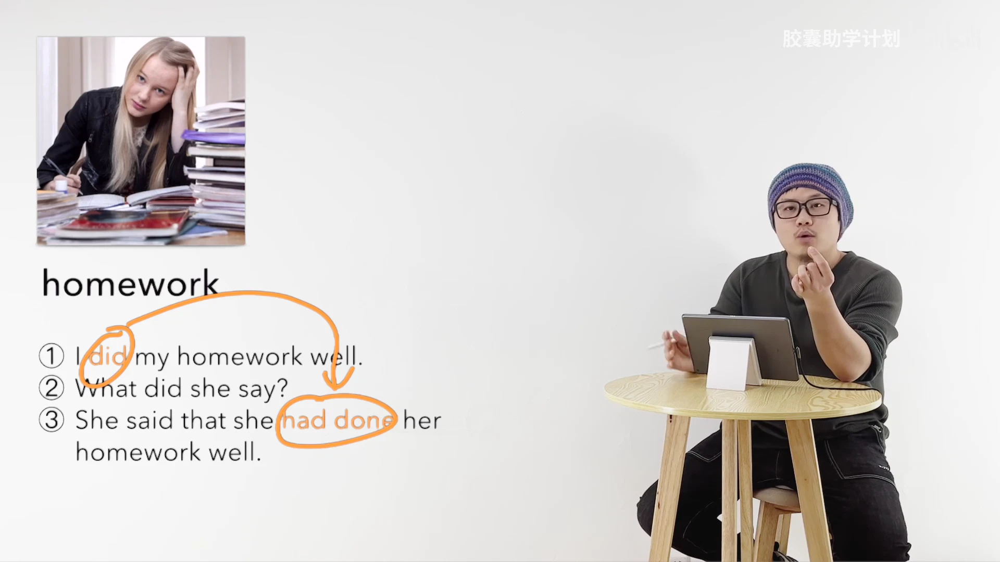

文字识别：homework / ldidmy homework wlell. / What did she say? / She said that she / ehad done / her / homework well.

### 画面 00:06:15

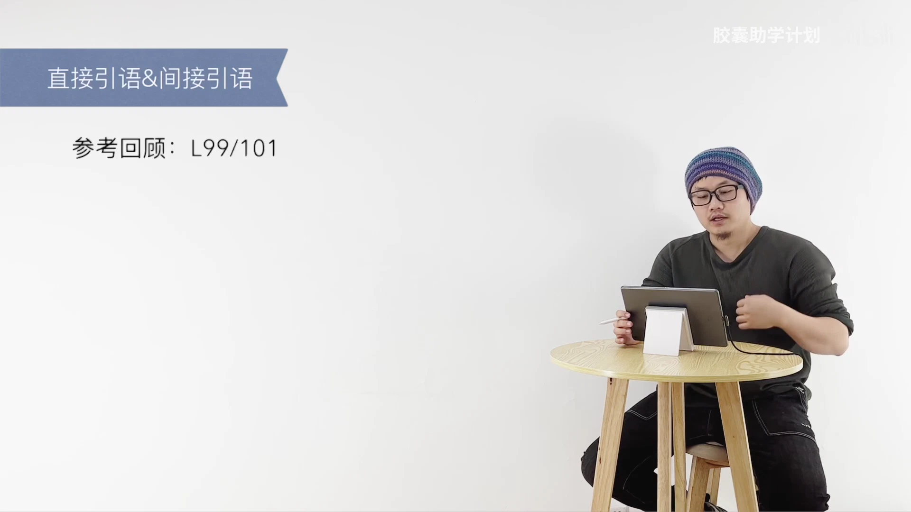

文字识别：直接引语&间接引语 / 参考回顾：L99/101

### 画面 00:06:17

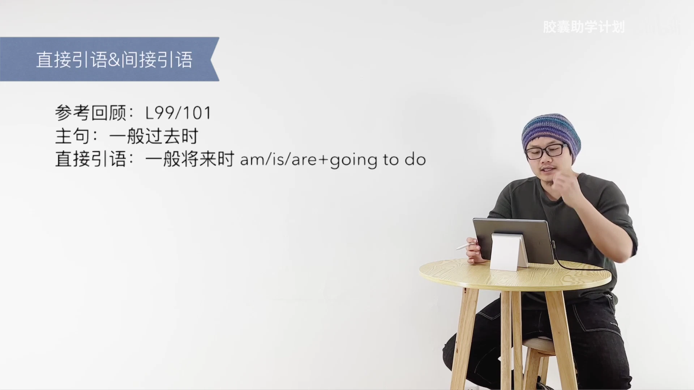

文字识别：直接引语&间接引语 / 参考回顾：L99/101 / 主句：一般过去时 / 直接引|语：一般将来时 am/is/are+going to do

### 画面 00:06:24

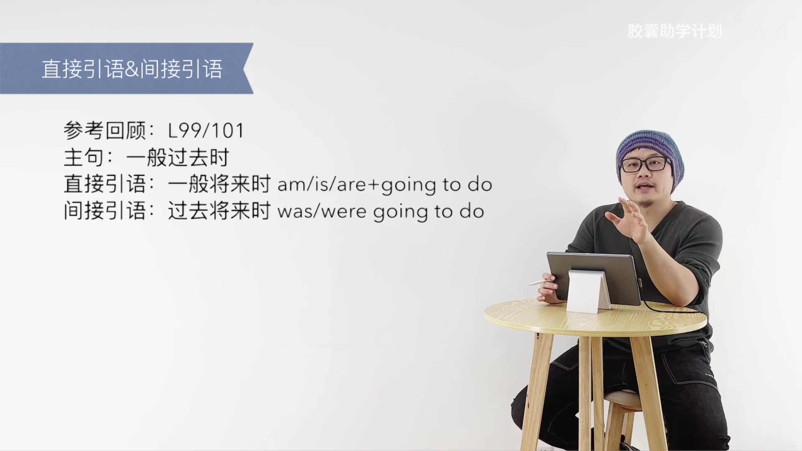

文字识别：直接引语&间接引语 / 参考回顾：L99/101 / 主句：一般过去时 / 直接引l语：一般将来时 am/is/are+going to do / 间接引语：过去将来时 was/were going to do

## 00:06:30–00:07:00

就可以了。好，我们还是给大家例子，比如说 I'm going to take a bath. What did she say? She said that she was going to take a bath. 看，把 am 换成了 was，对吧？OK, very good. 接下来我们做一些小的练习。说 I'm going to sleep. 五分钟之前说的。说 What did he tell you? 他刚才告诉你什么了？说 He told me that he was going to

### 画面 00:06:38

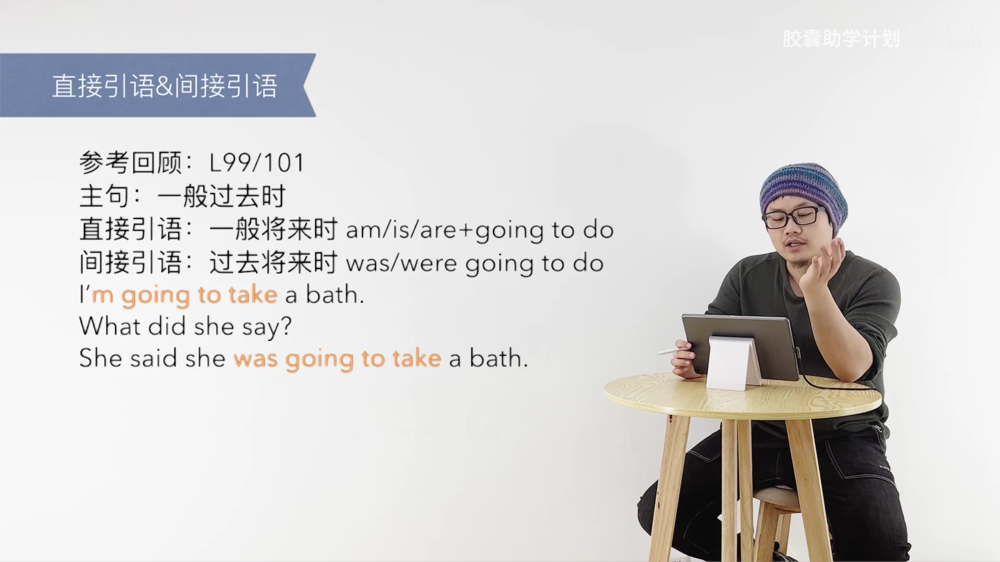

文字识别：直接引语&间接引语 / 参考回顾：L99/101 / 主句：一般过去时 / 直接引|语：一般将来时 am/is/are+going to do / 间接引语：过去将来时 was/were going to do / I'm going to take a bath. / What did she say? / She said she was going to take a bath.

### 画面 00:06:47

文字识别：sleep

### 画面 00:06:55

文字识别：sleep / ①I'm going to / sleep. / What did he tell you? / He told me / that he / was / going to sleep.

## 00:07:00–00:07:30

sleep,对吧？Okay, very good.本课的单词不多，跟我一起读一下。第一个叫做 reporter, reporter，叫记者，一个人，对吧？那我们结合一百一十一的一个句叫做 She is the best reporter I've ever seen. 她是我见过最棒的记者了。再来说 The reporter who was on TV last night went abroad this morning. 我想问的问题很简单，Who 能不能被省略掉啊？这

### 画面 00:07:01

文字识别：/ri'poita/ / reporter n.

### 画面 00:07:19

文字识别：/ri'po:ta/ / reporter n. / ① She is the best reporter I've ever seen. L111 / The reporter who was on TV last nigh / abroad this morning. L121

## 00:07:30–00:08:00

是一个很简单定语从句。再来说，After the reporter got out of the building, it began to rain.幺幺九，我们学的对吧？说 reporter 出了这个呃这个建筑之后就开始下雨了啊，出了这个大楼就开始下雨了。Next one，跟我一起读一下，叫做 sensational, sensational啊，叫骇人听闻的，耸人听闻的。比如说，This is the most sensational

### 画面 00:07:31

文字识别：/ri'po:ta/ / reporter n. / ① She is the best reporter I've ever seen. L111 / The reporter whd was on TV last night / abroad this morning. L121 / After the reporter got out of the building it / began to rain. L119

### 画面 00:07:46

文字识别：/sen'sel∫anal/ / sensational adj.

### 画面 00:07:56

文字识别：/sen'sei∫anal/ / sensational adj. / ① This is the most sensational news / I've ever heard. L111

## 00:08:00–00:08:30

news I've ever heard. But if I put is换成了 maybe,您看是不是立刻就从幺幺幺我们学的那个句型换成了幺幺幺加幺三幺我们刚刚学过的 maybe这个可能是啊我听过的最耸人听闻的消息了，对不对？OK, very good. 下一个单词其实是两个单词放到了一起，coat这个单词我们早就学过了，外套，mink啊就

### 画面 00:08:08

文字识别：/sen'sei∫anal/ / sensational adj. / ① This is the most sensational news / I've ever heard. L111 / This may be the most sensational / news I've ever heard. L131

### 画面 00:08:22

文字识别：/mink/ / mink coat n.

## 00:08:30–00:09:00

是皮子对吧？简单来说，那 mink coat 说 this is the mink coat which I bought last winter. Okay，说这是我去年冬天买的那个皮衣对吧？Okay，啊貂皮大衣啊裘皮大衣。Okay，再来，那我想问这个 which 能不能被省略掉啊？这是幺幺幺二幺和幺二三，我们学过非常重要的一个语法。再来说 this mink coat is longer

### 画面 00:08:32

文字识别：/mInk/ / mink coat n. / ① This is the mink coat which I / bought last winter. L121&123

## 00:09:00–00:09:30

than that one. 形容词比较级啊。再来说，She must have been wearing that main coat last night. 她昨天晚上一定是正穿着那个外套来着，对吧？ Must have been doing. 幺二九我们学的，Very good. Recap. 本视频我们学到了一个不是非常难的语法，就是直接英语变间接英语。当主句是一般过去时，说他之前说什么的时候，您时态一定要有一

### 画面 00:09:02

文字识别：/mink/ / mink coat n. / ① This is the mink coat which I / bought last winter. L121&123 / This mink coat is longer than that / one.L108 / She must have been wearing / that mink coat last night. L129

### 画面 00:09:16

文字识别：Recap / Patterns / 直接引语变间接引语：时态转换 / Grammar / Words / Expression

## 00:09:30–00:10:00

个转换，对吧？然后呢，您可以用笔记本把这几个时态的转换记在那儿。比如说，一般现在时变一般过去时，现在进行时变过去进行时，现在完成时和一般过去时变过去完成时，而一般将来时变成过去将来时。OK，好，那家庭作业呢？单词造句，给自己讲解一遍今天的核心知识点。如果各位喜欢我们的课程，欢迎各位关注、订阅、一键三

### 画面 00:09:30

文字识别：Recap / Patterns / & / 直接引语变间接引语 / 时态转换 / Grammar / Words / Expression

### 画面 00:09:49

### 画面 00:09:54

## 00:10:00–00:10:30

连，分享给那些需要的朋友，来帮助我们快速成长。最后，我们再来看一句名人名言：When fake news is repeated, it becomes difficult for the public to discern what's real. OK, see you next time.

### 画面 00:10:05

文字识别：When fake news is repeated, it becomes / difficult for the public to discern what's / real. / - Jimmy Gomez

### 画面 00:10:19

### 画面 00:10:21

文字识别：CAPSULEACADEMY / 胶囊助学计划 / 小红书 / Lecturer / Leo / OE

### 画面 00:10:24

文字识别：CAPSULEACADEMY / 胶囊助学计划 / 小红书 / Editor / OE

### 画面 00:10:27

文字识别：CAPSULEACADEMY / 胶囊助学计划 / 小红书 / Creator / Leo & Berlin

### 画面 00:10:29

文字识别：Bilibili / 胶囊助学计划 / 红书 / 1

## 00:10:30–00:10:31

### 画面 00:10:31

文字识别：bilibili / 胶囊助学计划

