# 133 文章

快速机器解析：语音为单模型转写，未进行独立交叉校对或人工复核；画面每秒采样并按变化选帧，短时文字和标记可能遗漏。截图时间约有 1 秒误差。图片有损压缩；遇到疑点请按时间查看 Google Drive 原视频。

## 00:00:00–00:00:30

Hello, everyone. Welcome to Capsule Academy. This is Leo. Today, we're going to learn New Concept English Book One, Lesson One Hundred and Thirty-Three Story. Hope you gonna enjoy it. Good. Okay, let's start

### 画面 00:00:00

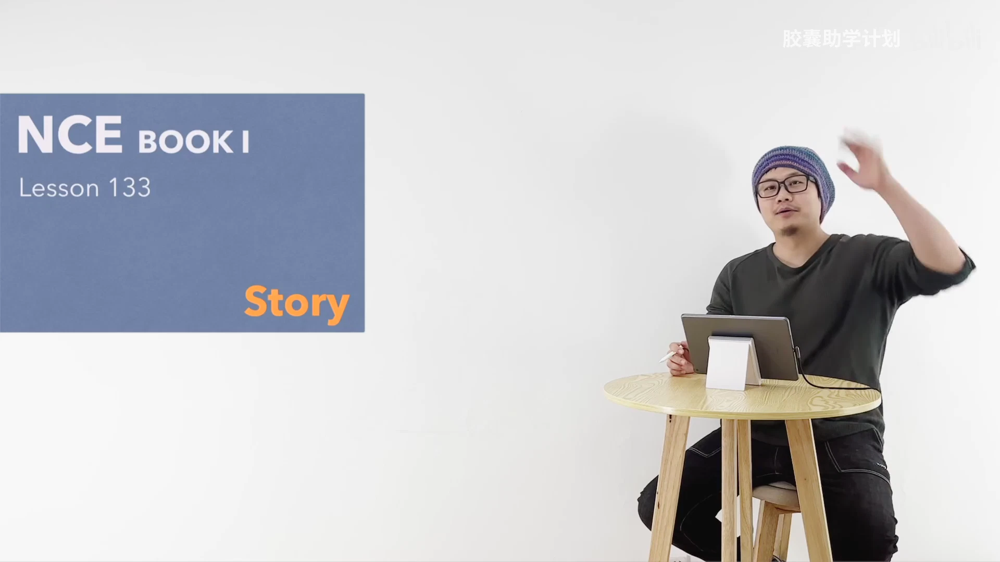

文字识别：NCE / BOOKI / Lesson 133 / Story

### 画面 00:00:02

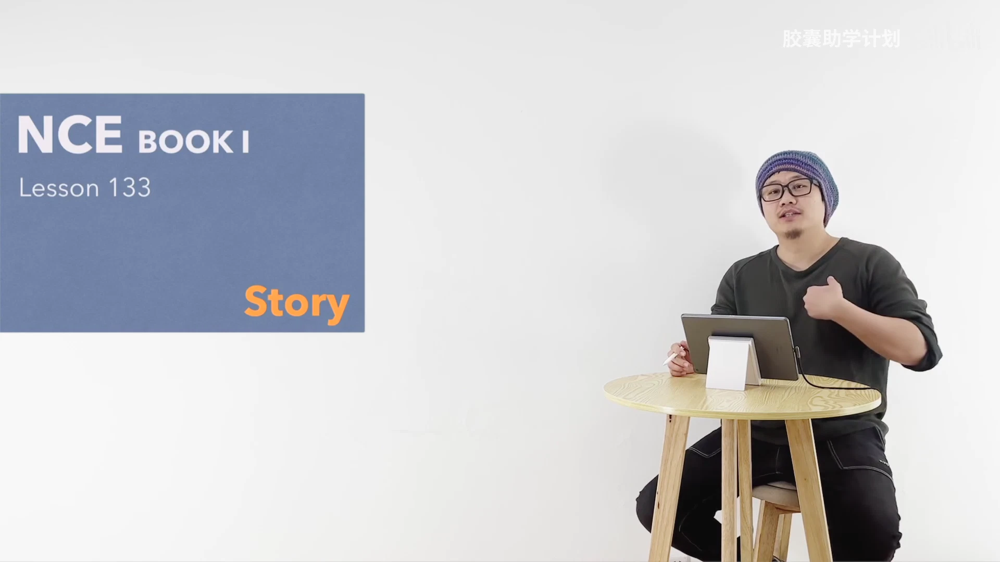

文字识别：NCE / BOOKI / Lesson 133 / Story

### 画面 00:00:11

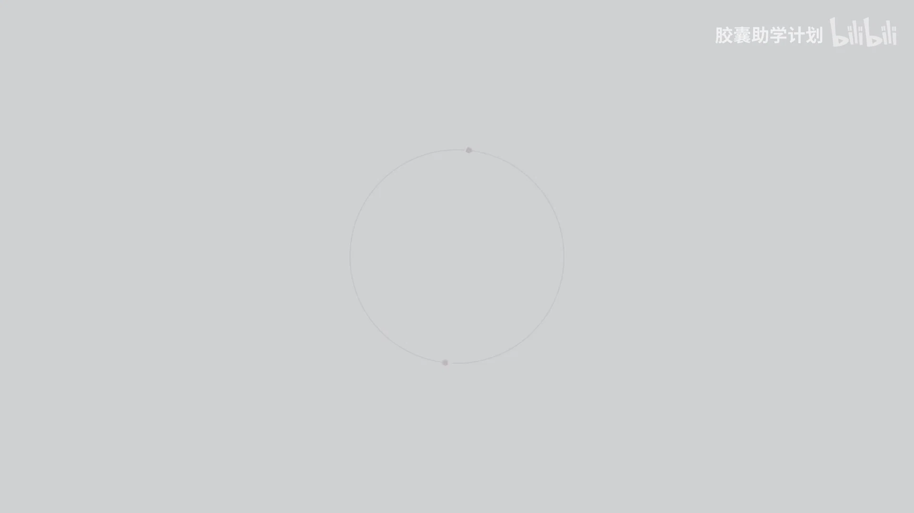

文字识别：胶囊助学计划bl出

### 画面 00:00:14

文字识别：胶囊助学计划 / 胶囊助学计划

### 画面 00:00:16

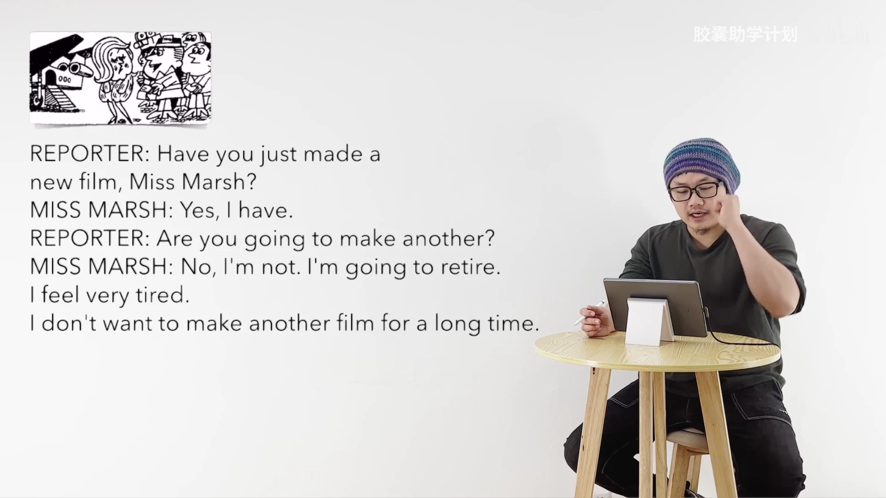

文字识别：000 / REPORTER: Have you just made a / new film, Miss Marsh? / MISS MARSH: Yes, I have. / REPORTER: Are you going to make another? / MISS MARSH: No, I'm not. I'm going to retire. / I feel very tired. / I don't want to make another film for a long time.

## 00:00:30–00:01:00

Marsh女士，你是不是刚刚做呃拍摄了一部新的电影呢？Miss Marsh说，Yes, I have.是的，我是啊。然后reporter接着问说，Are you going to make another？说你要去做另一个吗？Miss Marsh说，No, I'm not. I'm going to retire.说我准备要退休了啊，不拍了。I feel very tired.我感觉非常的累。I don't want to make another film for a

### 画面 00:00:46

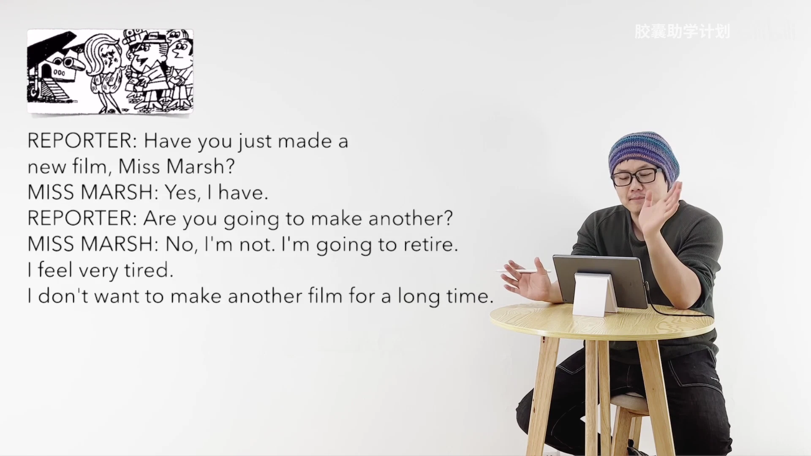

文字识别：000 / REPORTER: Have you just made a / new film, Miss Marsh? / MISS MARSH: Yes, I have. / REPORTER: Are you going to make another? / MISS MARSH: No, I'm not. I'm going to retire. / I feel very tired. / I don't want to make another film for a long time.

## 00:01:00–00:01:30

long time.我不想拍摄任何新的电影 for a long time叫很长一段时间。在这个地方，我们注意几个小的单词啊。Yes, I have. No, I am not. I am going to. I feel and I don't want to.接下来，它都会根据我上一个视频语法当中刚刚讲过的进行时态的迁移。我们看一下它是如何进行的。来了啊，Kate，就还是那两个人对吧？我

### 画面 00:01:15

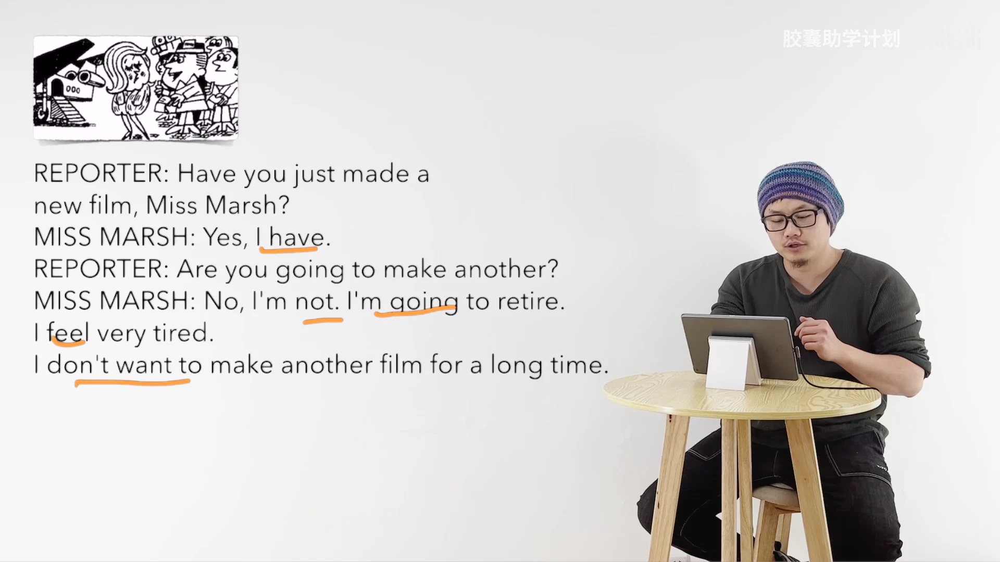

文字识别：000 / REPORTER: Have you just made a / new film, Miss Marsh? / MISS MARSH: Yes, Ihave. / REPORTER: Are you going to make another? / MISS MARSH: No, I'm not. I'm going to retire. / I feel very tired. / I don't want to make another film for a long time.

### 画面 00:01:26

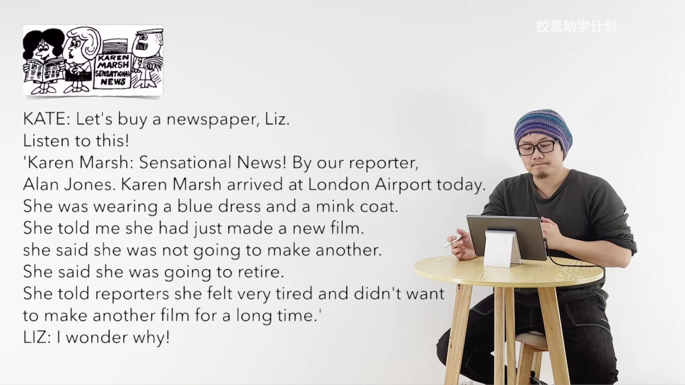

文字识别：KAREN / MARSH / SENSATIONAL / NEWS / KATE: Let's buy a newspaper, Liz. / Listen to this! / 'Karen Marsh: Sensational News! By our reporter, / Alan Jones. Karen Marsh arrived at London Airport today. / She was wearing a blue dress and a mink coat. / She told me she had just made a new film. / she said she was not going to make another. / She said she was going to retire. / She told reporters she felt very tired and didn't want / to make another film for a long time.' / LIZ: I wonder why!

## 00:01:30–00:02:00

不知道各位记没记得八卦他的那两个人吃饭的时候对吧？他们买了个报纸，说Let's buy a newspaper, Liz.啊，Kate和Liz说让我们一起买一个，让我们买一个报纸吧。Listen to this.听啊，Carrie Marsh, sensational news.啊，这个标题写的啊，这个这个大新闻，大新闻了啊。By our reporter,啊，由我们的这个记者说Alan Jones啊写出来的。说Carrie Marsh arrived at London

### 画面 00:01:47

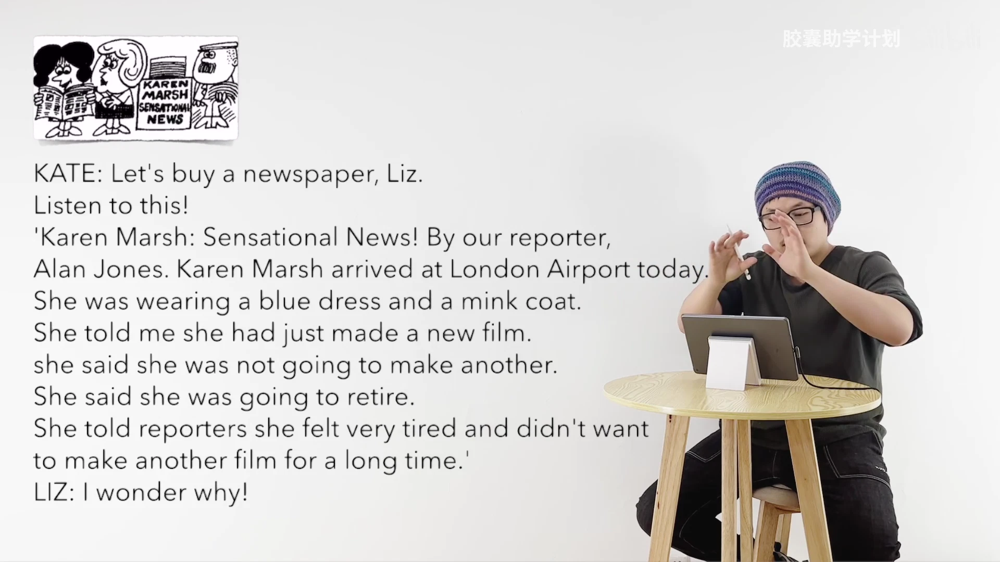

文字识别：KAREN / MARSH / SENSATIONAL / NEWS / KATE: Let's buy a newspaper, Liz. / Listen to this! / 'Karen Marsh: Sensational News! By our reporter, / Alan Jones. Karen Marsh arrived at London Airport today. / She was wearing a blue dress and a mink coat. / She told me she had just made a new film. / she said she was not going to make another. / She said she was going to retire. / She told reporters she felt very tired and didn't want / to make another film for a long time.' / LIZ: I wonder why!

## 00:02:00–00:02:30

Airport today.今天到达了伦敦机场。哎，注意还是一般过去时嘛，对吧？你想，你新闻都发出来的时候，那肯定是人家早已经到了。She was wearing a blue dress and a mink coat.说她当时，你看当时穿着的是一个蓝色的裙子和一个哎这个貂皮大衣，是吧？She told me.她告诉我，注意你看是told，对不对？所以后边时态迁移了。She had just made

### 画面 00:02:17

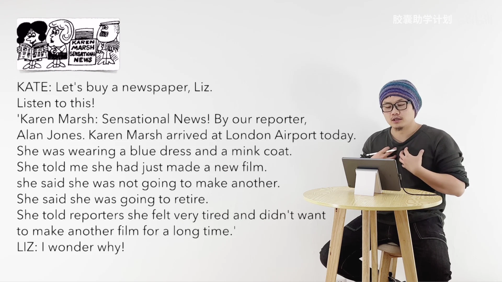

文字识别：KAREN / MARSH / SENSATIONAL / NEWS / KATE: Let's buy a newspaper, Liz. / Listen to this! / 'Karen Marsh: Sensational News! By our reporter, / Alan Jones. Karen Marsh arrived at London Airport today. / She was wearing a blue dress and a mink coat. / She told me she had just made a new film. / she said she was not going to make another. / She said she was going to retire. / She told reporters she felt very tired and didn't want / to make another film for a long time.' / LIZ: I wonder why!

### 画面 00:02:25

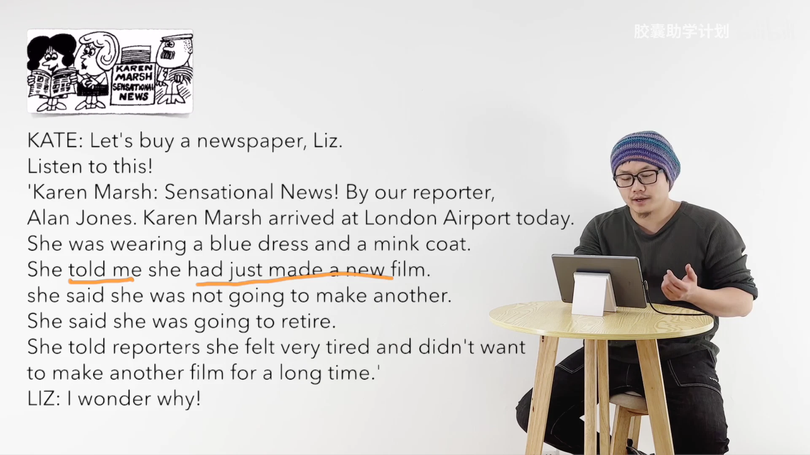

文字识别：KAREN / MARSH / SENSATIONAL / NEWS / KATE: Let's buy a newspaper, Liz. / Listen to this! / 'Karen Marsh: Sensational News! By our reporter, / Alan Jones. Karen Marsh arrived at London Airport today. / She was wearing a blue dress and a mink coat. / She told me she had just made a new film. / she said she was not going to make another. / She said she was going to retire. / She told reporters she felt very tired and didn't want / to make another film for a long time.' / LIZ: I wonder why!

## 00:02:30–00:03:00

a new film, she said she was not going to make another. She said she was going to retire.您结合上一页对吧？您书结合上一段去看，它的时态都做了往后的一个迁移，对不对？说 she told reporters,她告诉记者 she felt你看，本来是 feel，现在变成 felt very tired and didn't，本来是 don't，现在变成了 didn't

### 画面 00:02:38

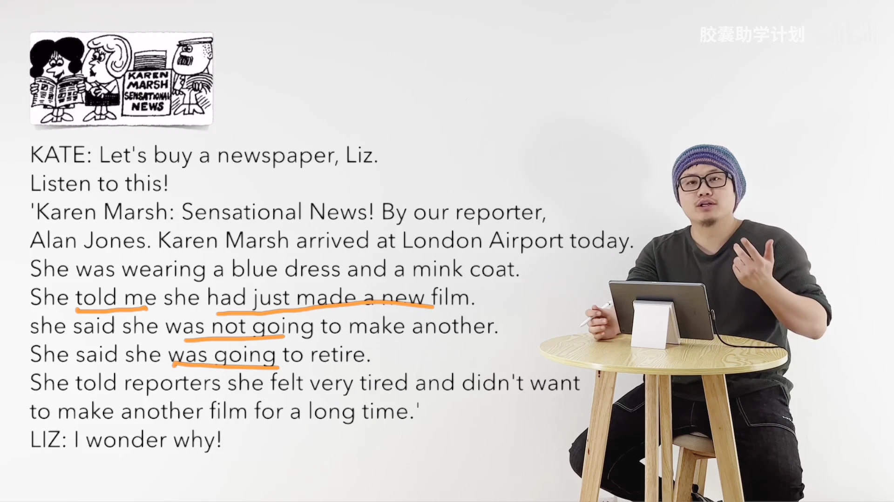

文字识别：KAREN / MARSH / SENSATIONAL / NEWS / KATE: Let's buy a newspaper, Liz. / Listen to this! / 'Karen Marsh: Sensational News! By our reporter, / Alan Jones. Karen Marsh arrived at London Airport today. / She was wearing a blue dress and a mink coat. / She told me she had just made a new film. / she said she was not going to make another. / She said she was going to retire. / She told reporters she felt very tired and didn't want / to make another film for a long time.' / LIZ: I wonder why!

## 00:03:00–00:03:30

want to make another film for a long time. 啊，两段整个含义其实没有什么差别，只是时态做了一下变化，对不对？啊， Liz 问了一句话叫 I wonder why. 啊，我很好奇为什么。 OK，那文章呢？很快我们就看完了。接下来我们做一些小的听力口语训练。第一题， What has Karen Marsh just done?

### 画面 00:03:08

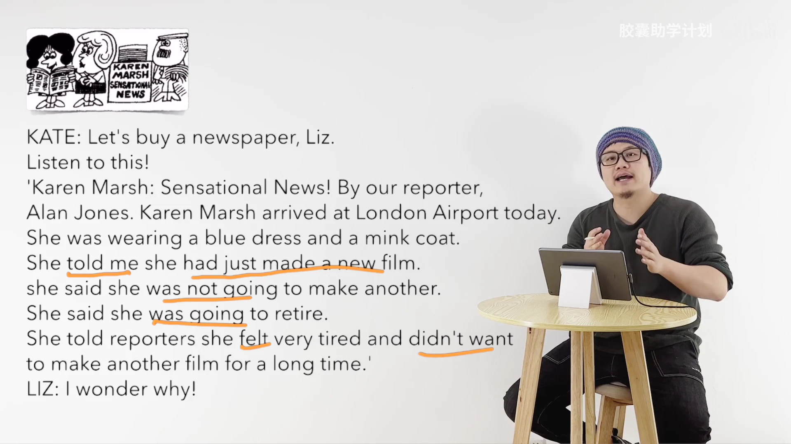

文字识别：KAREN / MARSH / SENSATIONAL / NEWS / KATE: Let's buy a newspaper, Liz. / Listen to this! / 'Karen Marsh: Sensational News! By our reporter, / Alan Jones. Karen Marsh arrived at London Airport today. / She was wearing a blue dress and a mink coat. / She told me she had just made a new film. / she said she was not going to make another. / She said she was going to retire. / She told reporters she felt very tired and didn't want / to make another film for a long time.' / LIZ: I wonder why!

### 画面 00:03:16

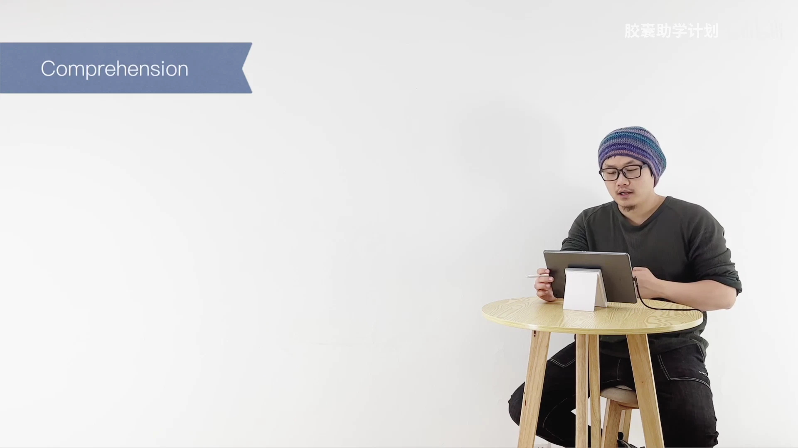

文字识别：Comprehension

### 画面 00:03:29

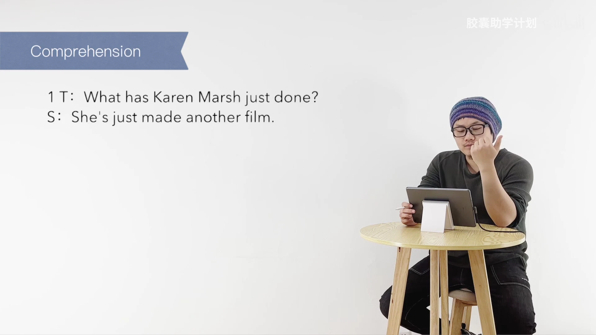

文字识别：Comprehension / 1 T: What has Karen Marsh just done? / S: She's just made another film.

## 00:03:30–00:04:00

She's just made another film. Next one. Who is interviewing her? A interview叫采访. A reporter. Next one. Does she think she will make another? Another后边省略了film,对吧? No, she doesn't. Next one. What does she say she's going to do? She says she's going to

### 画面 00:03:42

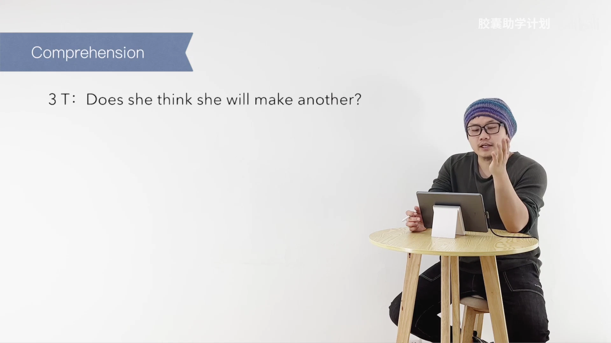

文字识别：Comprehension / 3 T: Does she think she will make another?

### 画面 00:03:57

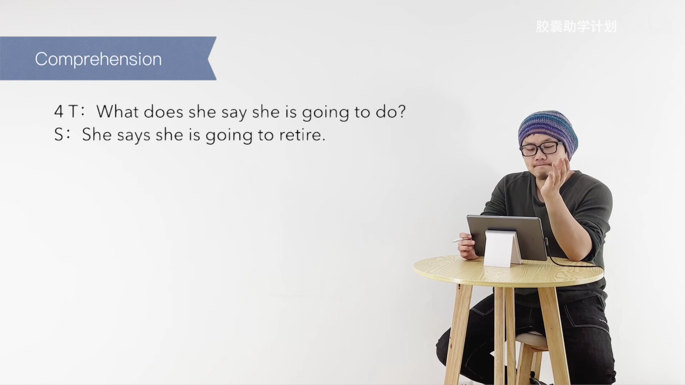

文字识别：Comprehension / 4 T: What does she say she is going to do? / S: She says she is going to retire.

## 00:04:00–00:04:30

retire. Next one, what does she say she's go? A why does she say she's going to retire? She says she feels very tired. 注意，你看这儿就不用做时态迁移，因为主句不是一般过去式，对吧？ Next one, when did the reporter say Carrie Marsh arrived at London Airport? 一个单词嘛，today，对吧？您用整句话也OK

### 画面 00:04:02

文字识别：Comprehension / 5 T: Why does she say she is going to retire?

### 画面 00:04:19

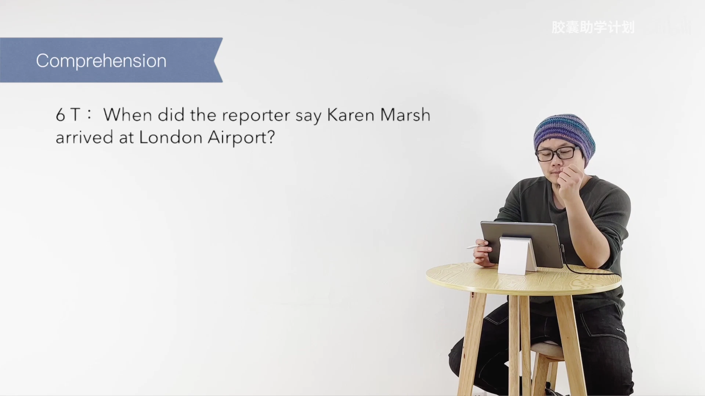

文字识别：Comprehension / 6 T: When did the reporter say Karen Marsh / arrived at London Airport?

## 00:04:30–00:05:00

Next one. What did he say she was wearing? She said she was wearing a blue dress and a min coat. Next one. What did she tell the reporter? She told the reporter that she had just made a new film. Next one. Did she say she was going to make another film?

### 画面 00:04:31

文字识别：Comprehension / 7T: What did he say she was wearing?

### 画面 00:04:48

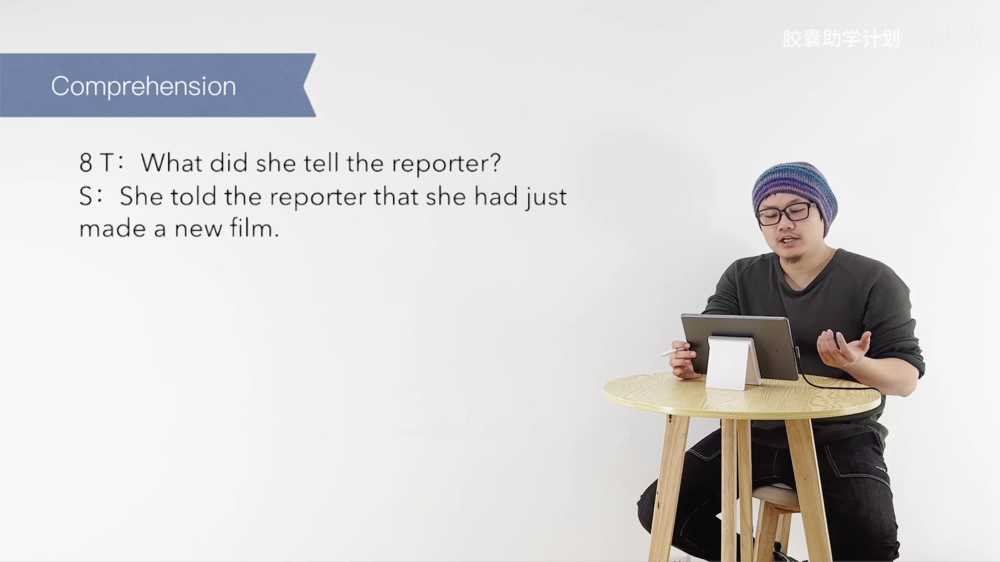

文字识别：Comprehension / 8 T: What did she tell the reporter? / S: She told the reporter that she had just / made a new film.

### 画面 00:04:54

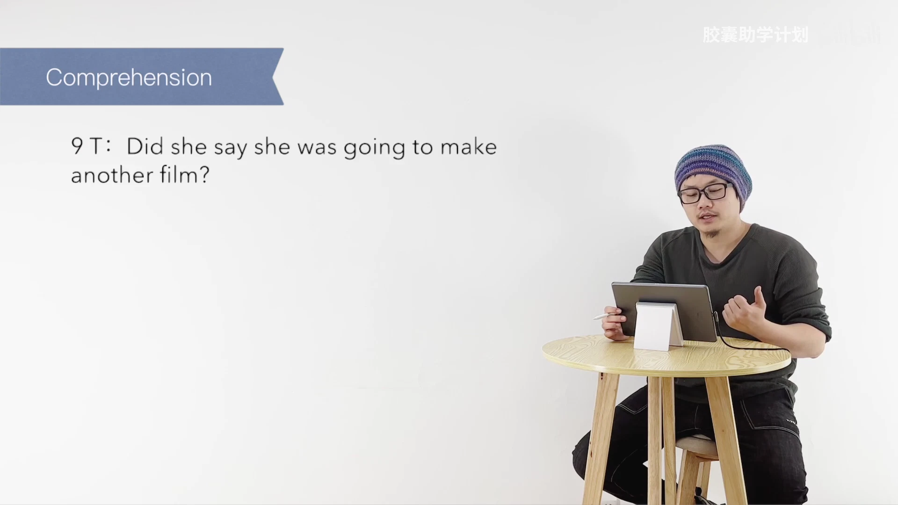

文字识别：Comprehension / 9 T: Did she say she was going to make / another film?

## 00:05:00–00:05:30

No, she said that she was not going to make another. Next one, what else did she tell the reporter? She told the reporter that she felt very tired. Okay, asking questions, 四句型转换啊，来，Ask me if Karen Marsh is going to make another film. Is Karen

### 画面 00:05:11

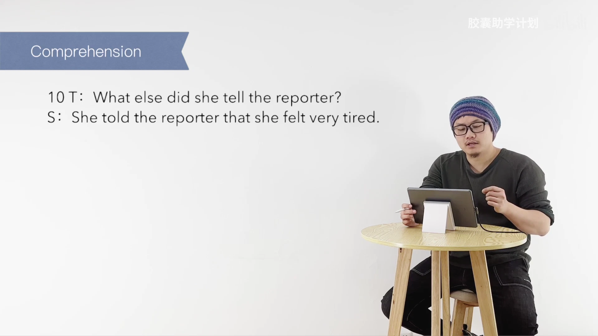

文字识别：Comprehension / 10 T: What else did she tell the reporter? / S: She told the reporter that she felt very tired.

### 画面 00:05:17

文字识别：Asking questions

### 画面 00:05:23

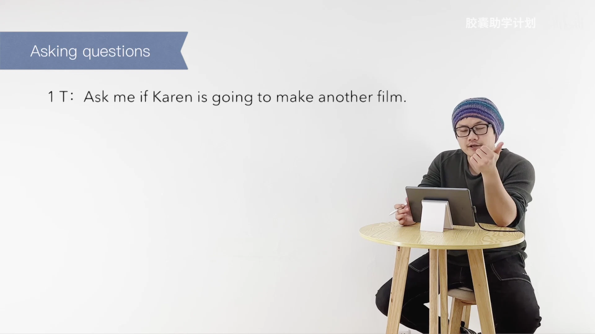

文字识别：Asking questions / 1 T: Ask me if Karen is going to make another film.

## 00:05:30–00:06:00

going to make another film? Why isn't直接把is去掉，对吧？直接把is去掉。Why isn't Karen going to make another film? Next one, ask me if Karen Marsh arrived at London Airport today. Did的提前，动词换回原形啊，不多说了。Where对At London Airport提问，叫做Where did Karen Marsh arrive today? Next one, ask me

### 画面 00:05:32

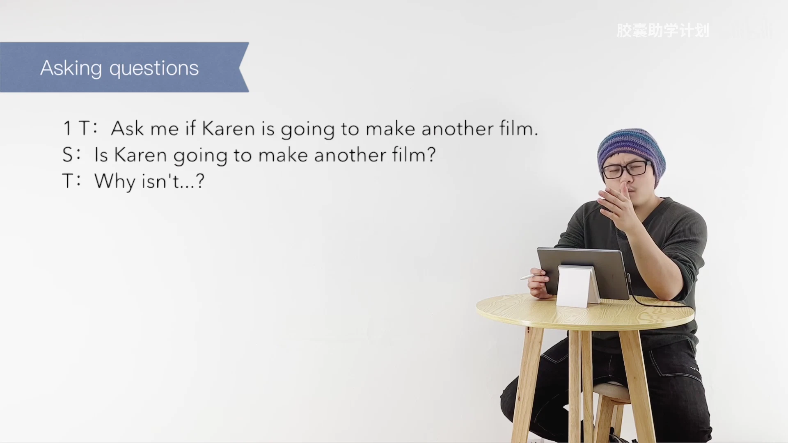

文字识别：Asking questions / 1 T: Ask me if Karen is going to make another film. / S: Is Karen going to make another film? / T: Why isn't..?

### 画面 00:05:41

文字识别：Asking questions / 2 T: Ask me if Karen Marsh arrived at London Airport today

### 画面 00:05:53

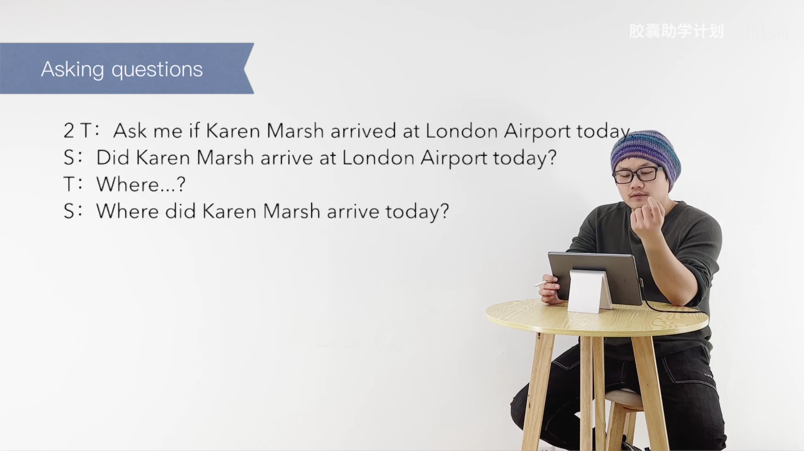

文字识别：Asking questions / 2 T: Ask me if Karen Marsh arrived at London Airport today / S: Did Karen Marsh arrive at London Airport today? / T:Where...? / S: Where did Karen Marsh arrive today?

### 画面 00:05:58

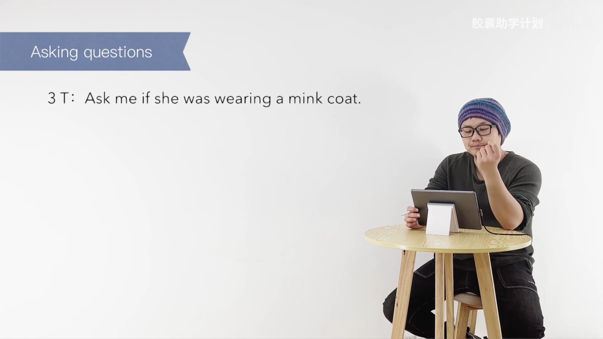

文字识别：Asking questions / 3 T: Ask me if she was wearing a mink coat.

## 00:06:00–00:06:30

if she was wearing a min coat. That was directly before past continuous, right?叫做Was she wearing a min coat? What? What was she wearing? Next one, ask me if she told Alan Jones about her new film. Did she tell Alan Jones about her new film? The Alan Jones是谁?是那个reporter,对吧? What? What did she tell Alan Jones?最后一

### 画面 00:06:18

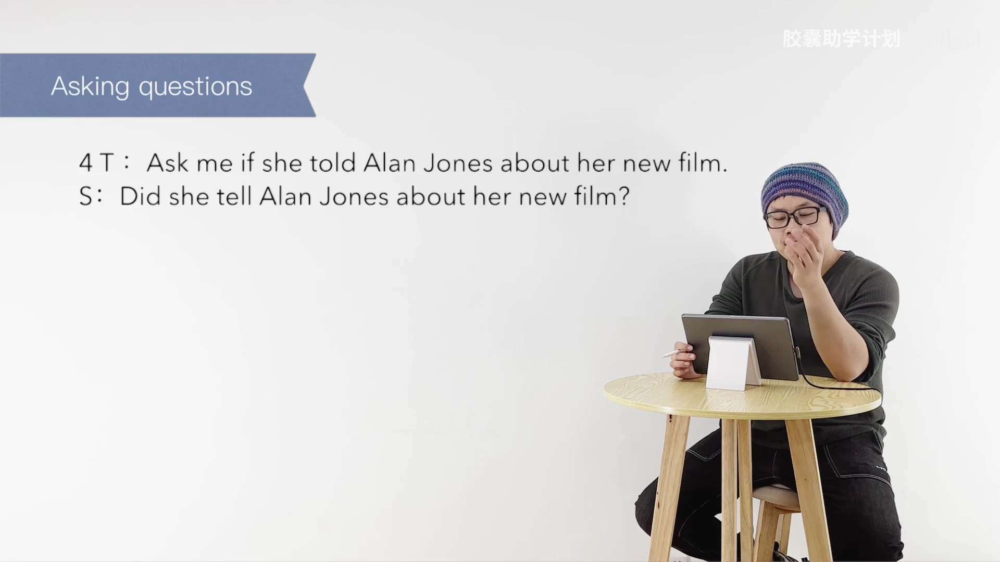

文字识别：Asking questions / 4T : Ask me if she told Alan Jones about her new film. / S: Did she tell Alan Jones about her new film?

### 画面 00:06:29

文字识别：Asking questions / 5 T: Ask me if she is going to retire.

## 00:06:30–00:07:00

ask me if she is going to retire. Is以前很简单, when直接加正句话, when is she going to retire?非常好, recap本课啊和上一个视频的核心语法没有任何区别,还是时态转换这件事情,好吧?家庭作业呢,绿皮书幺三八各位可以写了,文章跟读至熟读成诵,给自己讲解一遍今天的核心知识点。

### 画面 00:06:41

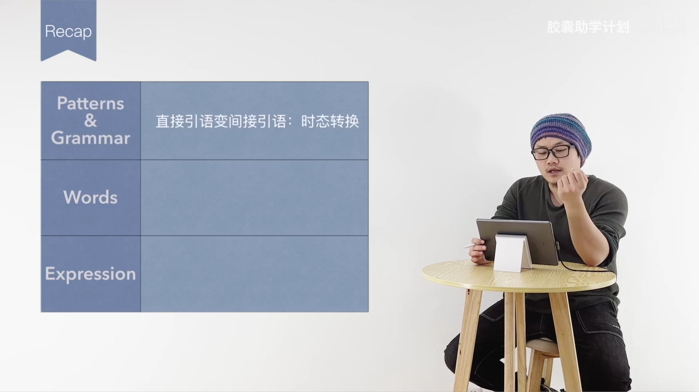

文字识别：Recap / Patterns / 直接引语变间接引语：时态转换 / Grammar / Words / Expression

### 画面 00:06:51

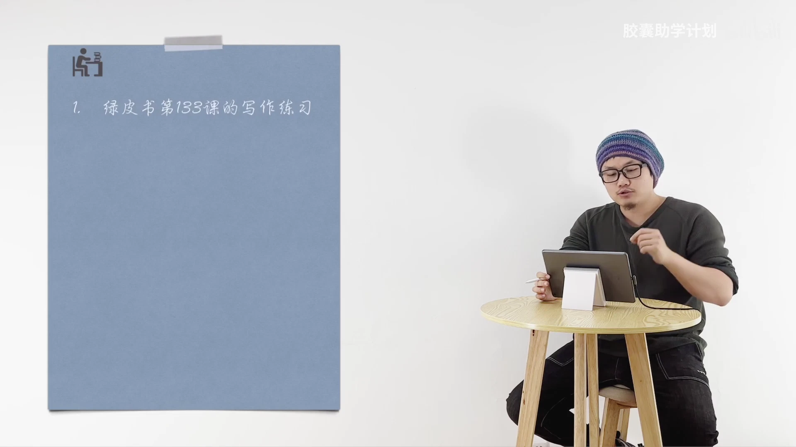

文字识别：绿皮书第133课的写作练习

### 画面 00:06:59

## 00:07:00–00:07:30

呃，如果各位喜欢我们的课程呢，欢迎各位关注、订阅、一键三连，分享给那些需要的朋友，来帮助我们快速成长。最后，我们再来看一句名人名言：Honesty is the first chapter in the book of wisdom. See you next time.

### 画面 00:07:08

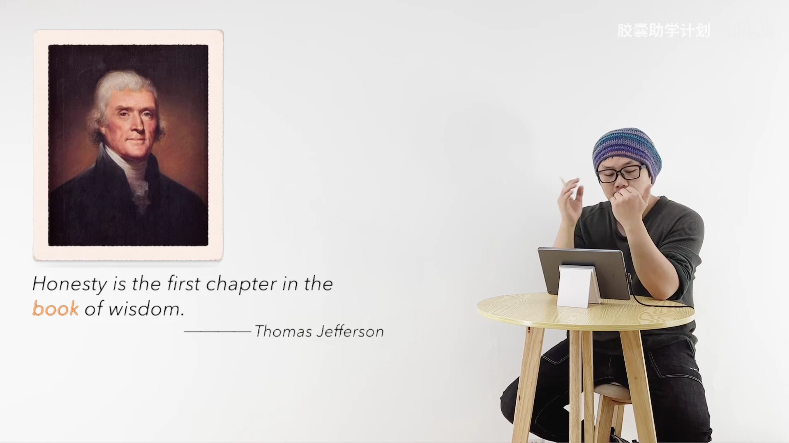

文字识别：Honesty is the first chapter in the / book of wisdom. / Thomas Jefferson

### 画面 00:07:19

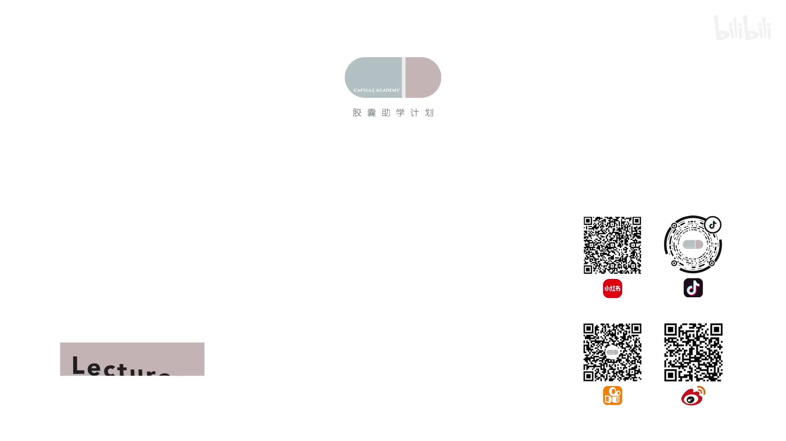

文字识别：CAPSULEACADEMY / 胶囊助学计划 / 小红书 / Lectur

### 画面 00:07:21

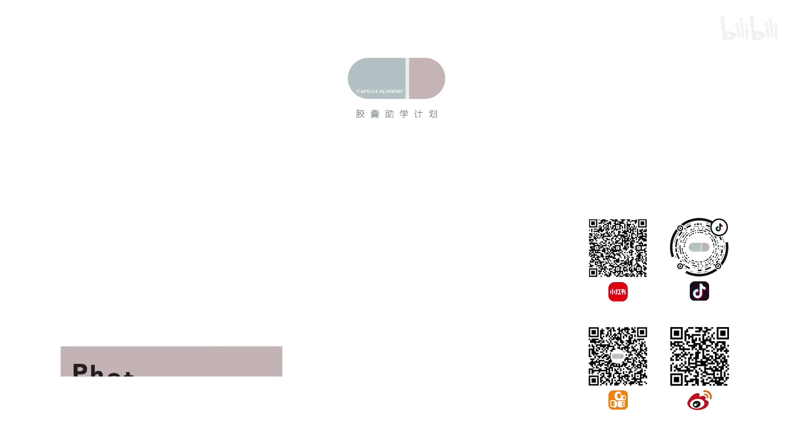

文字识别：CAPSULEACADEMY / 胶囊助学计划 / 『 / 小红书 / Ph

### 画面 00:07:24

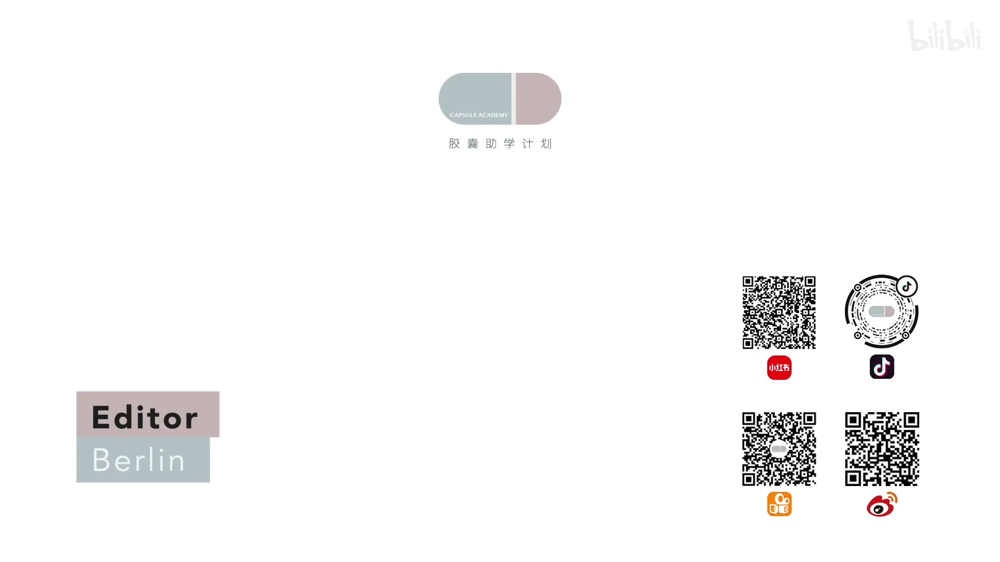

文字识别：CAPSULEACADEMY / 胶囊助学计划 / 小红书 / Editor / □ / 口 / Berlin / OE

### 画面 00:07:27

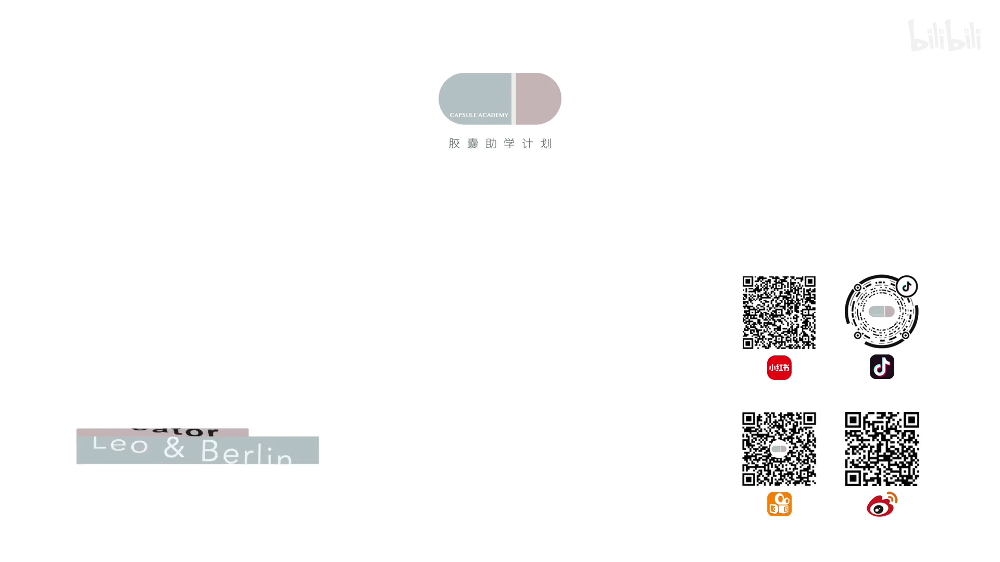

文字识别：CAPSULEACADEMY / 胶囊助学计划 / 小红书 / Leo & Berlin

### 画面 00:07:29

文字识别：bilibili / 胶囊助学计划

## 00:07:30–00:07:31

### 画面 00:07:30

文字识别：bilibili / 胶囊助学计划

