# 134 练习

快速机器解析：语音为单模型转写，未进行独立交叉校对或人工复核；画面每秒采样并按变化选帧，短时文字和标记可能遗漏。截图时间约有 1 秒误差。图片有损压缩；遇到疑点请按时间查看 Google Drive 原视频。

## 00:00:00–00:00:30

Hello everyone, welcome to Capsule Academy. This is Leo. Today we're going to learn new concept English book one lesson one hundred and thirty-four practices. Hope you guys enjoy it.那我们偶数课最重要的就是练习本课啊，也就是它的单数课的这个核心语法，也就是直接英语变间接英语时候的时态转换。OK，各位大声张嘴跟我读就行了啊。

### 画面 00:00:00

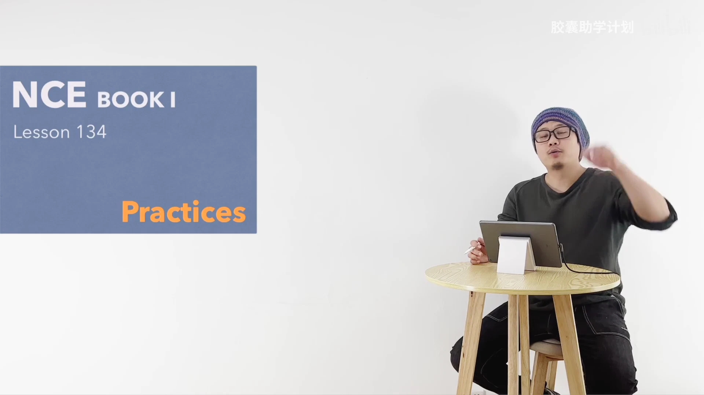

文字识别：NCE / BOOKI / Lesson 134 / Practices

### 画面 00:00:10

文字识别：胶囊助学计划bill

### 画面 00:00:14

文字识别：胶囊助学计划

### 画面 00:00:16

文字识别：tired

## 00:00:30–00:01:00

来，I'm tired. What did he say? He said he was tired.哎，am变成了was. Next one, I'm reading. What did she tell you? She told me she was reading.现在进行时变成了过去进行时。Next one, I want to leave. What did he say? He said he wanted

### 画面 00:00:35

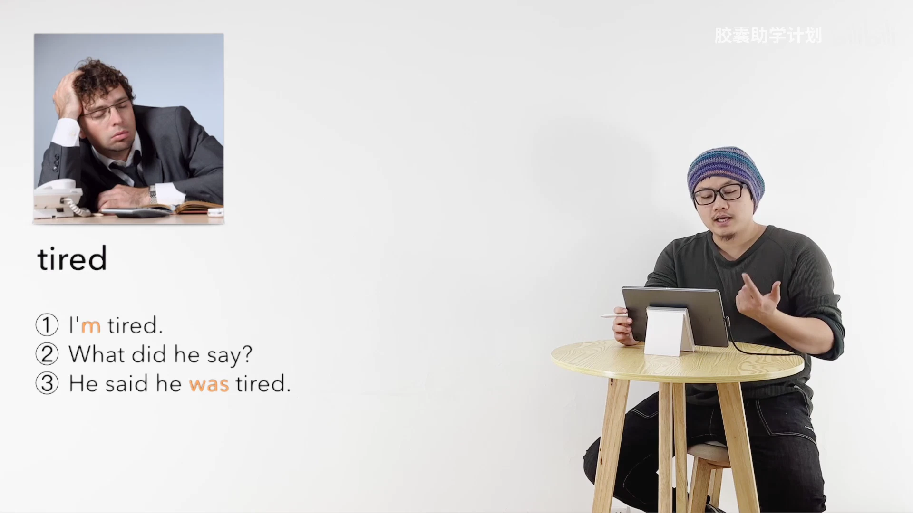

文字识别：tired / ① I'm tired. / What did he say? / He said he was tired.

### 画面 00:00:40

文字识别：Q / reading

### 画面 00:00:52

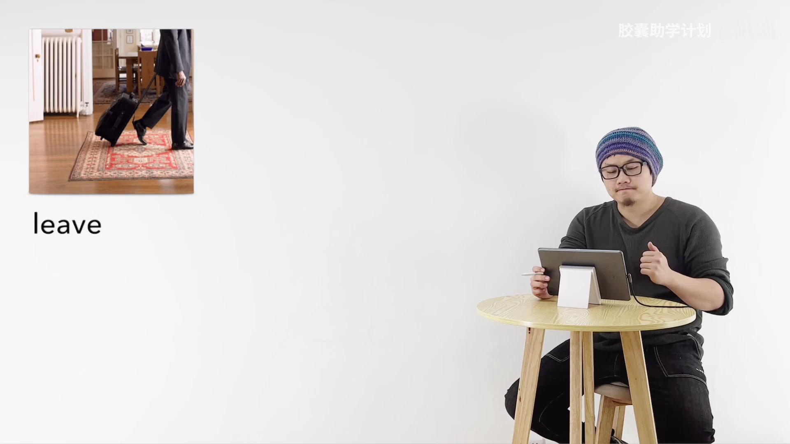

文字识别：leave

## 00:01:00–00:01:30

to leave. Next one, I don't want to go to the cinema. What did she tell you? She told me she didn't want to go to the cinema. Next one is expensive. What did he say? He said it was expensive. Next one, Tom is waiting for you.

### 画面 00:01:03

文字识别：cinema / ①I don't want to go to the cinema.

### 画面 00:01:09

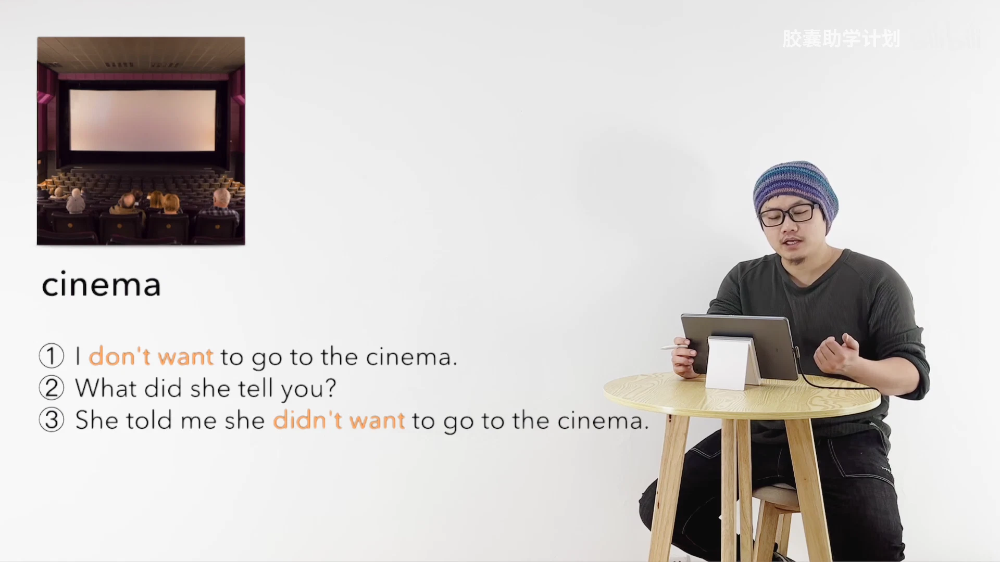

文字识别：cinema / ① I don't want to go to the cinema. / What did she tell you? / She told me she didn't want to go to the cinema.

### 画面 00:01:14

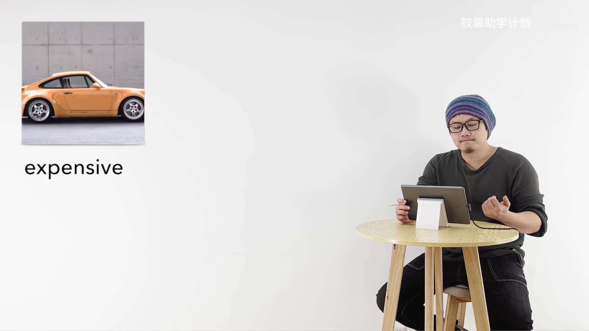

文字识别：expensive

### 画面 00:01:26

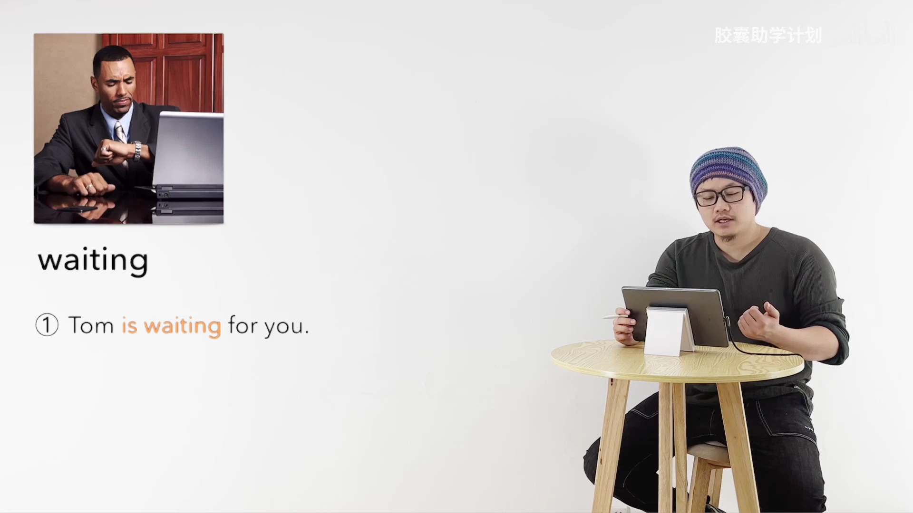

文字识别：waiting / ① Tom is waiting for you.

## 00:01:30–00:02:00

What did she tell you? She told me Tom was waiting for me. Next one, Alice feels tired. What did he say? He said Alice felt tired. Next one, it isn't urgent. What did she tell you? She told me it wasn't

### 画面 00:01:38

文字识别：tired / ①Alice feels tired.

### 画面 00:01:49

文字识别：12. / 3 / urgent

### 画面 00:01:57

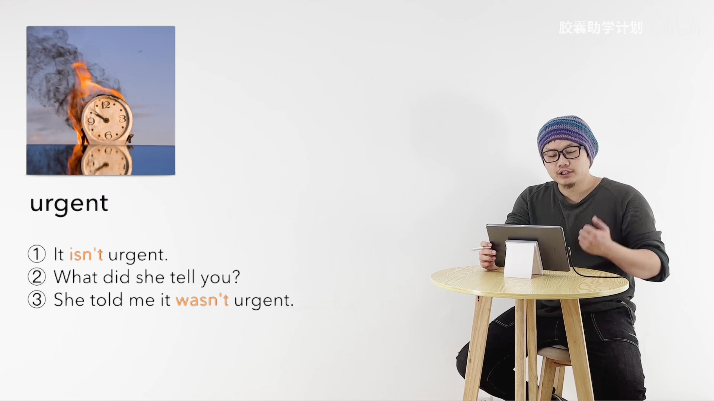

文字识别：12· / urgent / ① It isn't urgent. / What did she tell you? / She told me it wasn't urgent.

## 00:02:00–00:02:30

urgent. Next one, I'm not joking. What did he say? He said he wasn't joking. Next one, the children aren't hungry. What did she tell you? She told me the children weren't hungry.好，recap，直接英语变间接英语，时态要做变化。

### 画面 00:02:01

文字识别：joking

### 画面 00:02:11

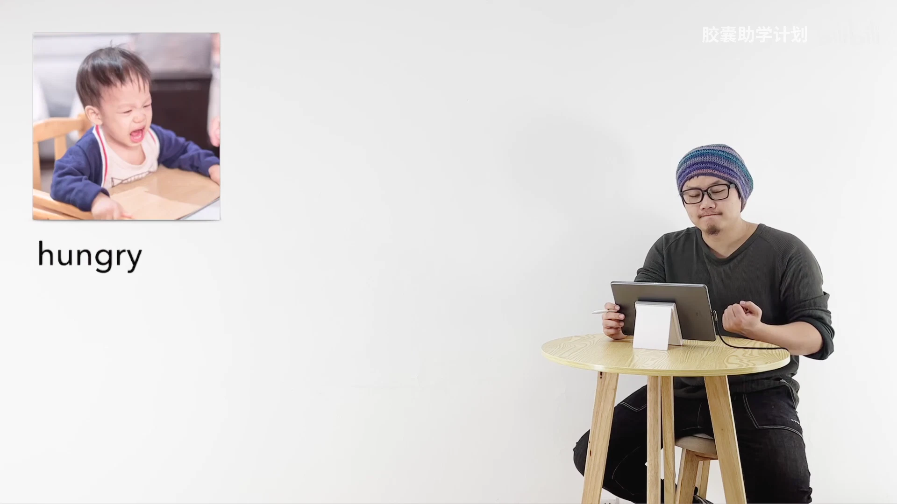

文字识别：hungry

### 画面 00:02:18

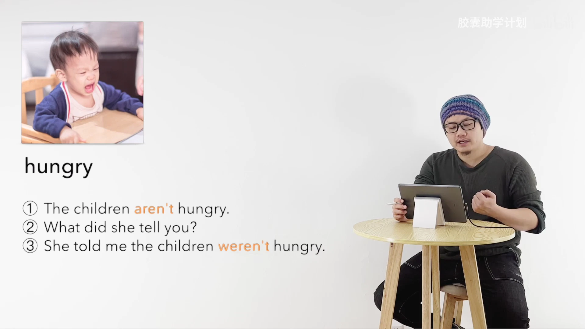

文字识别：hungry / The children aren't hungry. / What did she tell you? / She told me the children weren't hungry.

### 画面 00:02:24

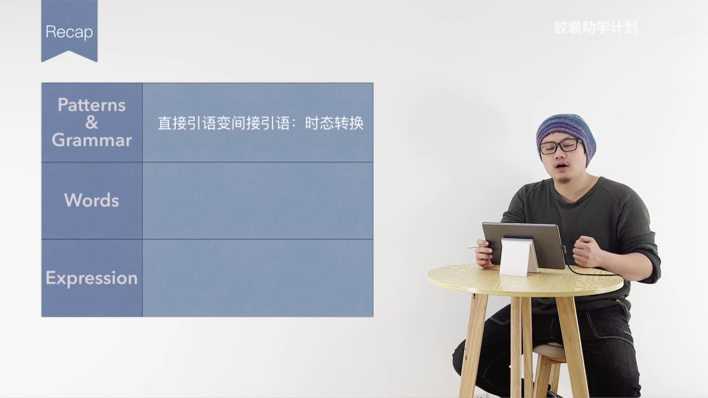

文字识别：Recap / Patterns / 直接引语变间接引语：时态转换 / Grammar / Words / Expression

## 00:02:30–00:03:00

本课您拿到这个知识点就可以了，好吧？家庭作业绿皮书幺三四，各位可以写了，讲解一遍核心知识点。如果各位喜欢我们的课程呢，欢迎各位关注、订阅、一键三连，分享给那些需要的朋友，好吧？那最后我们再来看一句名人名言，Benjamin Franklin：Some people die at twenty-five and aren't buried until seventy-five. See you next time.

### 画面 00:02:33

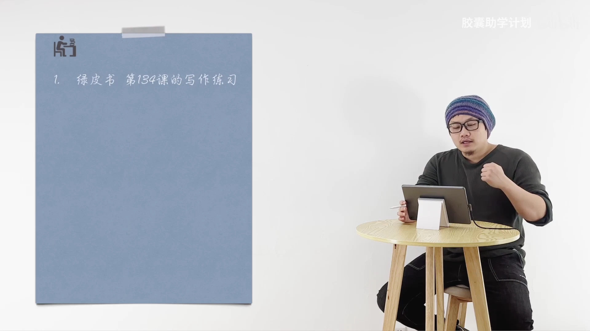

文字识别：绿皮书第134课的写作练习

### 画面 00:02:38

文字识别：👍 / -

### 画面 00:02:46

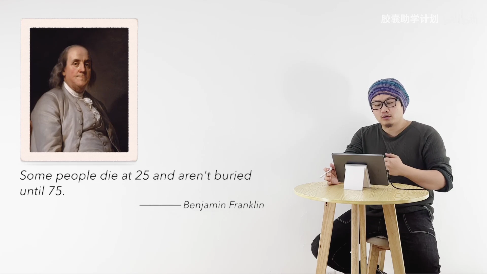

文字识别：Some people die at 25 and aren't buried / until 75. / Benjamin Franklin

### 画面 00:02:59

## 00:03:00–00:03:11

### 画面 00:03:01

文字识别：CAPSULEACADEMY / 胶囊助学计划 / 小红书 / Lecturer / Leo / OE

### 画面 00:03:03

文字识别：CAPSULEACADEMY / 胶囊助学计划 / 小红书 / Photographer / Berlin / OE

### 画面 00:03:06

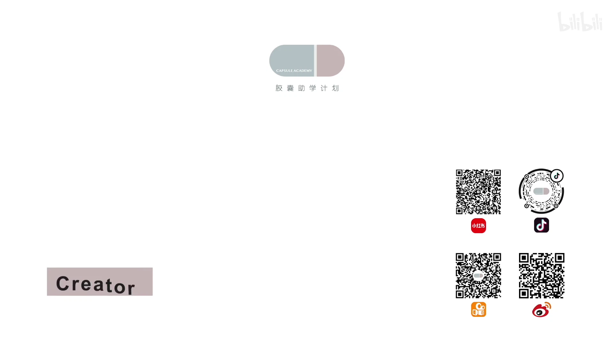

文字识别：CAPSULEACADEMY / 胶囊助学计划 / 小红书 / Creator

### 画面 00:03:09

文字识别：bilibili / 胶囊助学计划

### 画面 00:03:11

文字识别：bilibili / 胶囊助学计划

