# 135 单词 语法

快速机器解析：语音为单模型转写，未进行独立交叉校对或人工复核；画面每秒采样并按变化选帧，短时文字和标记可能遗漏。截图时间约有 1 秒误差。图片有损压缩；遇到疑点请按时间查看 Google Drive 原视频。

## 00:00:00–00:00:30

Hello everyone, welcome to Capsule Academy. This is Leo. Today we're going to learn new concept English book one lesson one hundred and thirty five grammar and words. 那老习惯，进入正式课程之前呢，我们先看一个小的问题。直接引语去变间接引语的时候，情态动词要做哪些变化？那本课适合各位可以对应着一百三十三课一起去学习。OK，那带着这个问题，我们开始， enjoy.

### 画面 00:00:00

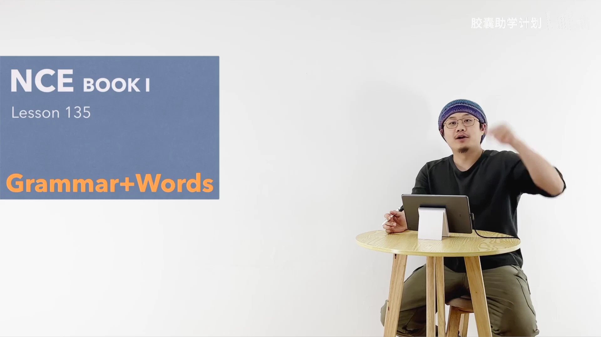

文字识别：胶囊助学计划 / NCE / BOOKI / Lesson 135 / Grammar+Words

### 画面 00:00:02

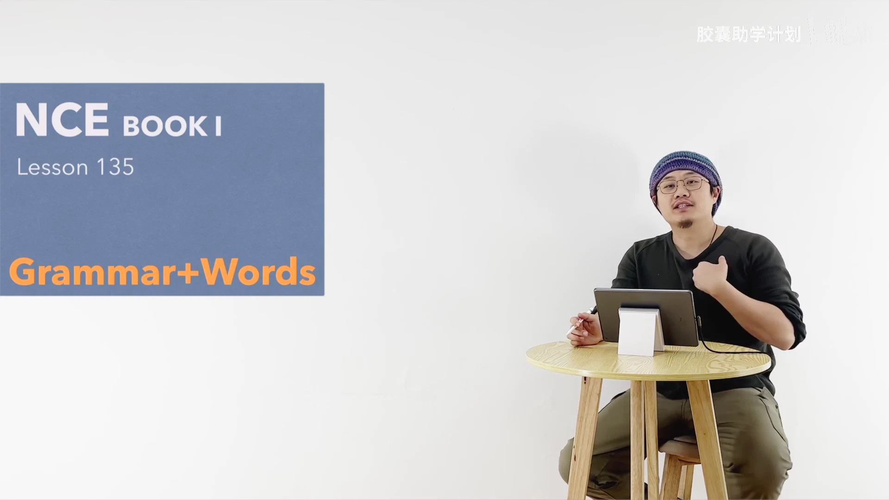

文字识别：胶囊助学计划 / NCE / BOOKI / Lesson 135 / Grammar+Words

### 画面 00:00:10

文字识别：胶囊助学计划

### 画面 00:00:12

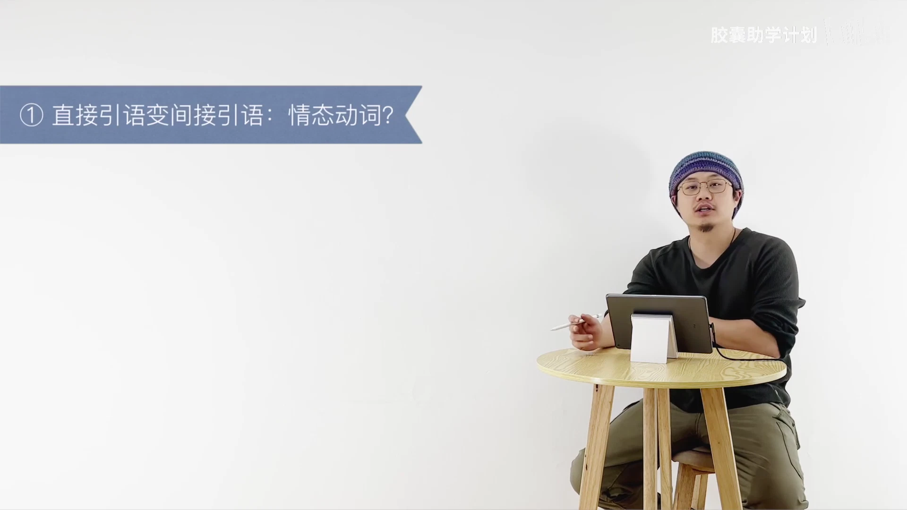

文字识别：胶囊助学计划 / ①直接引语变间接引语：情态动词?

### 画面 00:00:27

文字识别：胶囊助学计划bill / •

## 00:00:30–00:01:00

好，那我们先一起看一下啊，就是说目前为止涉及到直接引语和间接引语的课啊，是九十九课、一百零一课和我们刚刚学过的一百三十三课，那还有本课，当然对吧？那我们现在先迅速回顾一下一百三十三课告诉我们的事情是，当主句是一般过去时的时候，时态要做一些改变，对吧？OK，那其实同理，情态动词也要做一些改变。

### 画面 00:00:31

### 画面 00:00:33

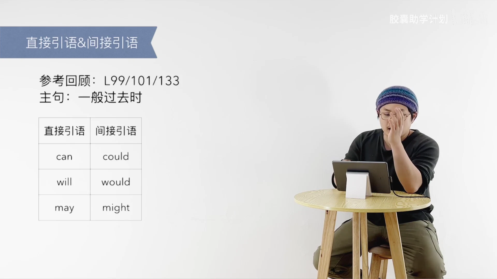

文字识别：胶囊助学计划 / 直接引语&间接引语 / 参考回顾：L99/101/133 / 主句：一般过去时 / 直接引语 / 间接引语 / could / can / will / would / may / might

## 00:01:00–00:01:30

直接引语如果用的是 can，那把它去变成间接引语的时候，因为是过去的事情，所以要变成 could。 OK，那 will 变成 would， may 和 may 变成 might。那还是我们给大家一些例句啊，各位试着去理解一下。比如说，五分钟之前别人说了一句话叫 I can recognize him，那这是引号当中的直接引语，然后你没听清，你问了一句说 What did he say？那别人要告诉你的叫做 He

### 画面 00:01:03

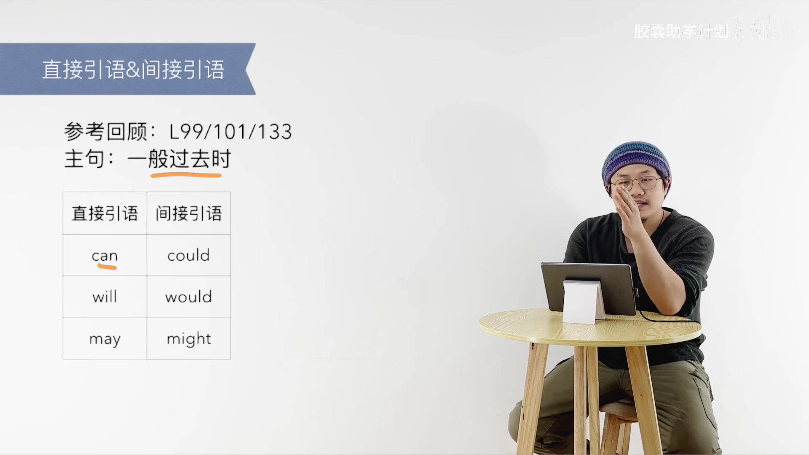

文字识别：胶囊助学计划 / 直接引语&间接引语 / 参考回顾：L99/101/133 / 主句：一般过去时 / 直接引语 / 间接引语 / can / could / will / would / may / might

### 画面 00:01:12

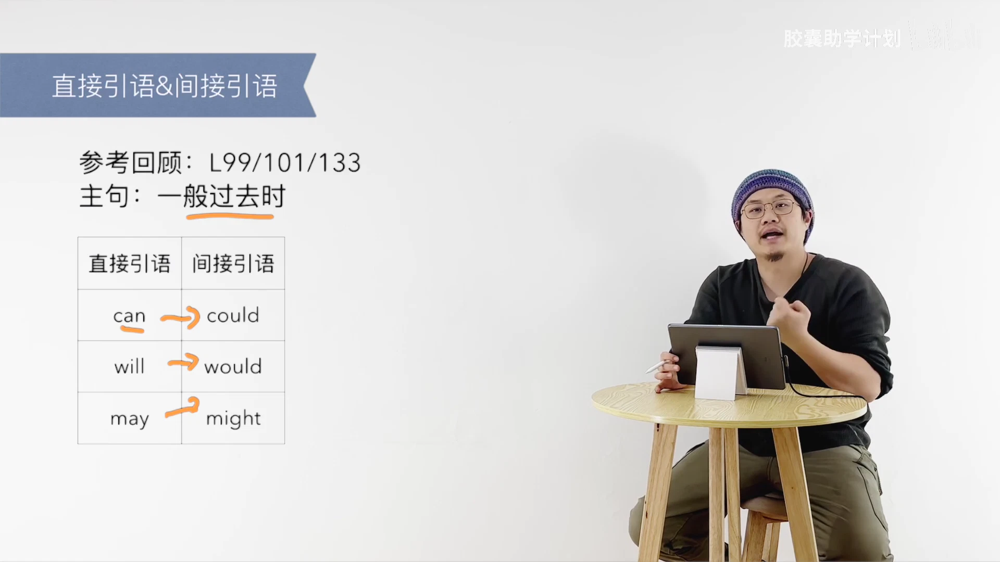

文字识别：胶囊助学计划 / 直接引语&间接引语 / 参考回顾：L99/101/133 / 主句：一般过去时 / 直接引语 / 间接引语 / could / can / will / would / may / might

### 画面 00:01:14

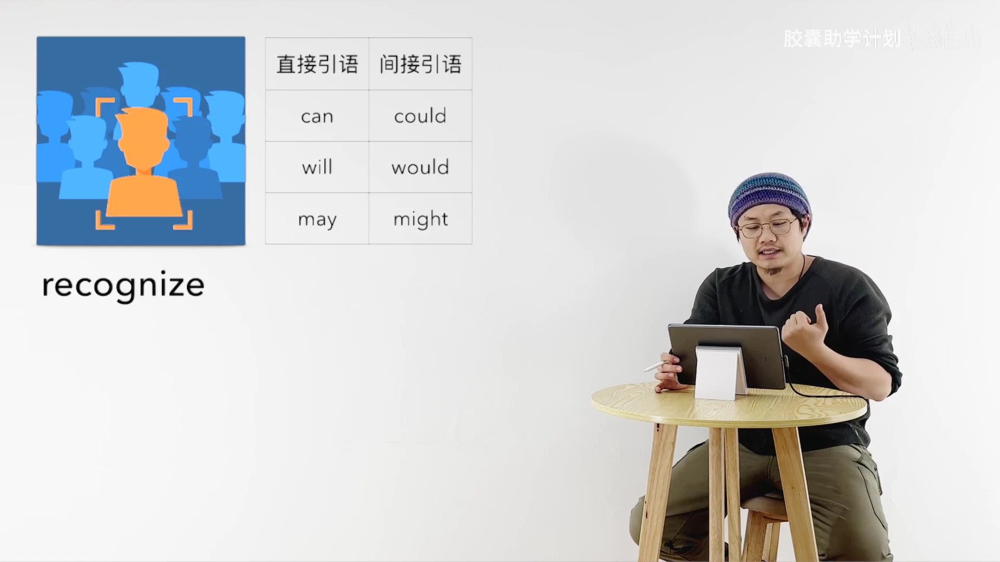

文字识别：胶囊助学计划 / 直接引语 / 间接引语 / can / could / will / would / may / might / recognize

### 画面 00:01:21

文字识别：胶囊助学计划 / 直接引语 / 间接引语 / can / could / will / would / may / might / recognize / ①I can recognize him.

### 画面 00:01:29

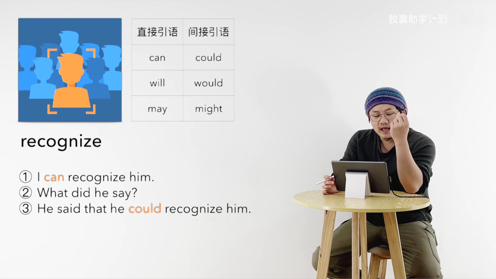

文字识别：胶囊助学计划 / 直接引语 / 间接引语 / can / could / will / would / may / might / recognize / ①I can recognize him. / What did he say? / He said that he could recognize him.

## 00:01:30–00:02:00

said that 注意你看 said 是主句的主句对吧主句的动词于是它就翻译成一啊它就是一个一般过去式对吧然后我们看后面是一个变成了直接引语变成了间接引语也就是我们一百零一课和九十九课结合起来曾经告诉各位的对吧间接引语实际上某种程度上它就是个定语从句啊就是个宾语从句啊好那放到这地方呢各位去看说 he said that he

### 画面 00:01:58

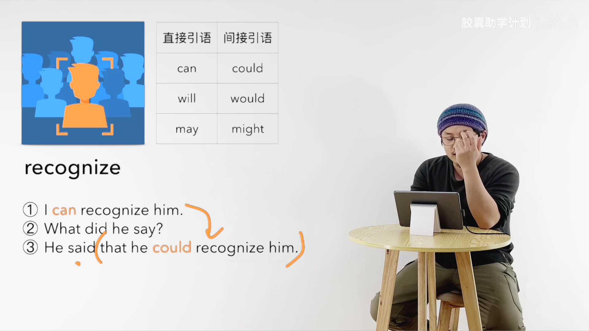

文字识别：胶囊助学计划 / 直接引语 / 间接引语 / can / could / will / would / may / might / recognize / ① I can recognize him. / What did he say? / He saidthat he could recognize him.

## 00:02:00–00:02:30

could recognize him can变了 could对吧 ok啊结合这个图下一个例子说 I will go to the supermarket说我会去超市的那 what did she tell you她刚才告诉你什么了呢叫做 she told me that好直接引语变间接引语除了人称你要改变这是在一百零一课就学过的今天告诉各位的是形态动词也要做一些改变 will要变成

### 画面 00:02:03

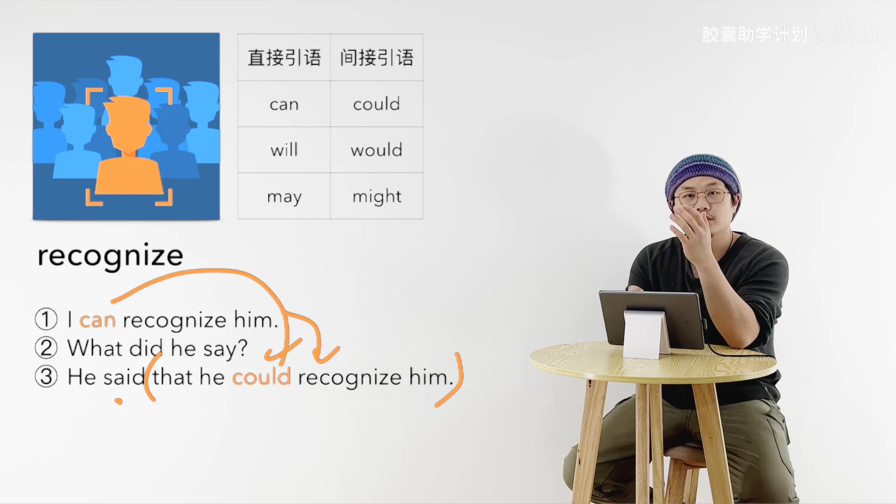

文字识别：胶囊助学计划 / 直接引语 / 间接引语 / can / could / will / would / may / might / recognize / ① I can recognize him. / What did he say? / He saidthat he could recognize him.

### 画面 00:02:06

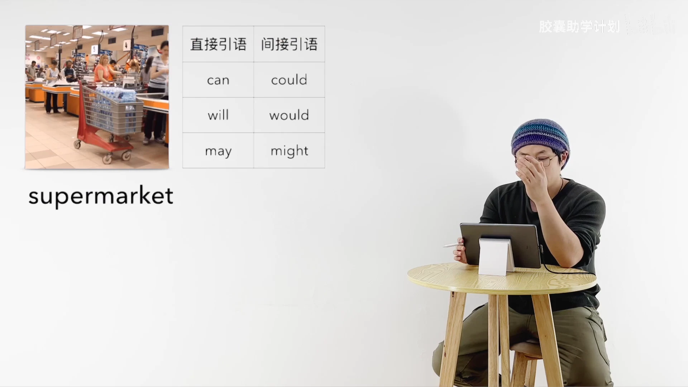

文字识别：胶囊助学计划 / 直接引语 / 间接引语 / can / could / will / would / may / might / supermarket

### 画面 00:02:11

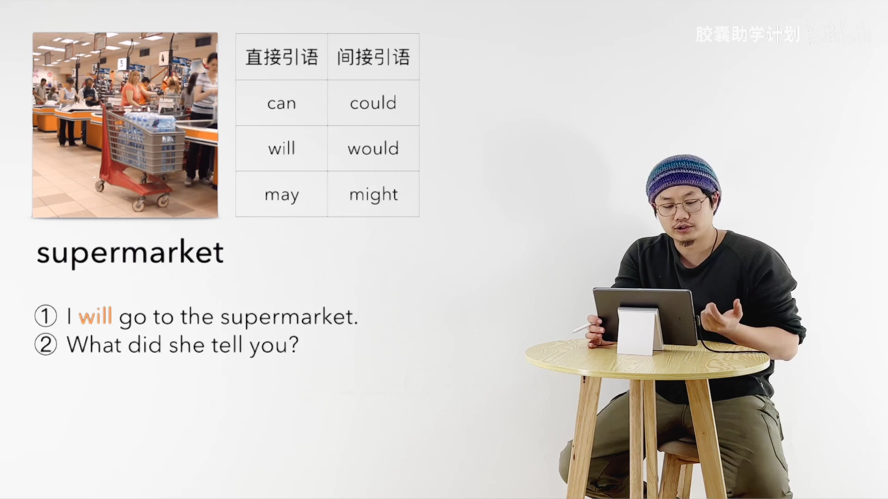

文字识别：胶囊助学计划 / 直接引语 / 间接引语 / can / could / will / would / may / might / supermarket / ① I will go to the supermarket. /  What did she tell you?

### 画面 00:02:17

文字识别：胶囊助学计划 / 直接引语间 / 间接引语 / can / could / will / would / may / might / supermarket / ① I will go to the supermarket. / ② What did she tell you? / ③ She told me that she would go to the supermarket. / 3

### 画面 00:02:21

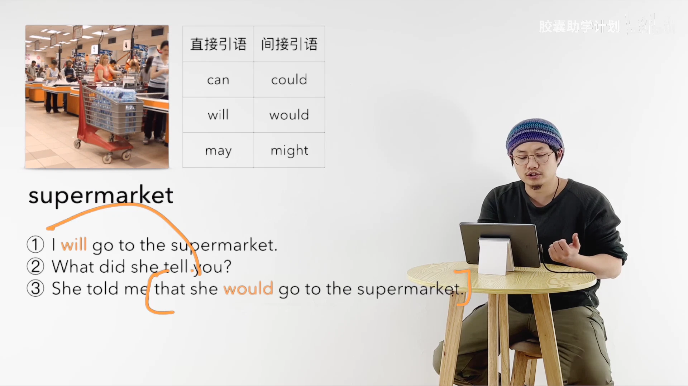

文字识别：胶囊助学计划 / 直接引语 / 间接引语 / can / could / will / would / may / might / supermarket / ① I will go to the supermarket. /  What did she tellou? / ③ She told methat she would go to the supermarket. / 3

### 画面 00:02:26

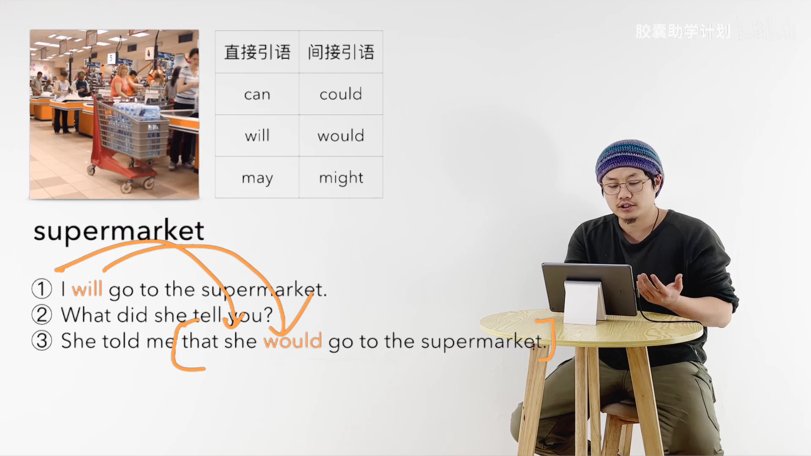

文字识别：胶囊助学计划 / 直接引语 / 间接引语 / can / could / will / would / may / might / supermarket / ① I will go to the supermarket. / What did she tellsou? /  She told methat she would go to the supermarket.

## 00:02:30–00:03:00

would 对吧 he she would go to the supermarket okay next one they may arrive tomorrow okay very good so here we use may and next 说 what did he say then you will answer something like he said that they might arrive tomorrow okay very good 注意 may 就换成了 might 所以本课学完了之后各位只要记住这些我觉得就完全够用

### 画面 00:02:35

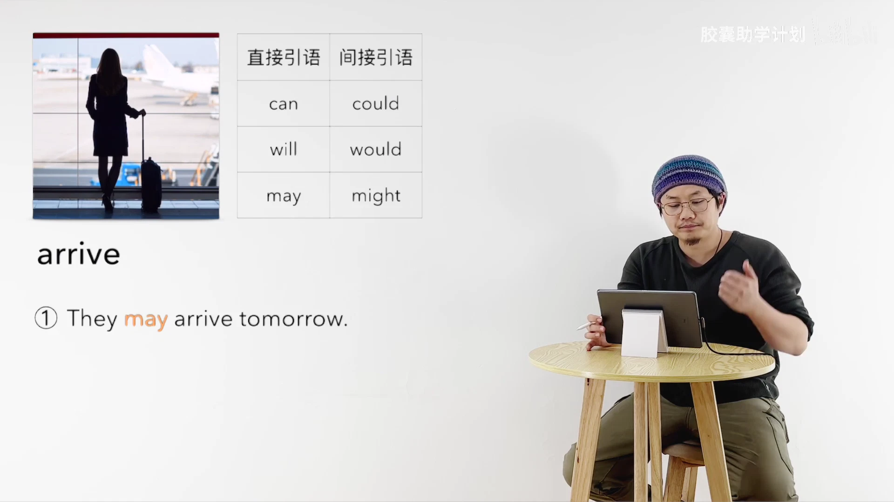

文字识别：胶囊助学计划 / 直接引语 / 间接引语 / can / could / will / would / may / might / arrive / ① They may arrive tomorrow.

### 画面 00:02:45

文字识别：胶囊助学计划 / 直接引语 / 间接引语 / can / could / will / would / may / might / arrive / ) They / may / arrive tomorrow. / What did he say? / He said that they might arrive tomorrow.

### 画面 00:02:53

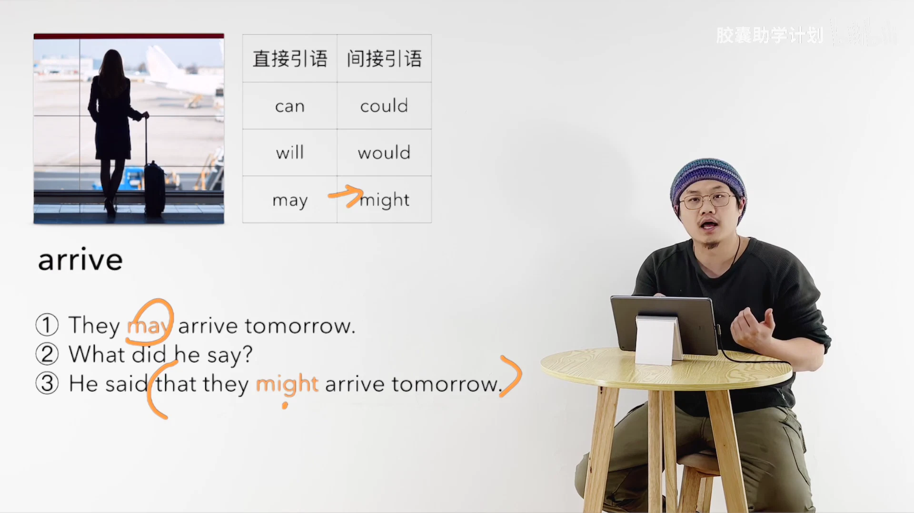

文字识别：胶囊助学计划 / 直接引语 / 间接引语 / can / could / will / would / may / might / arrive / They / ① / may / arrive tomorrow. / What did he say? / He saidthat they might arrive tomorrow.

### 画面 00:02:57

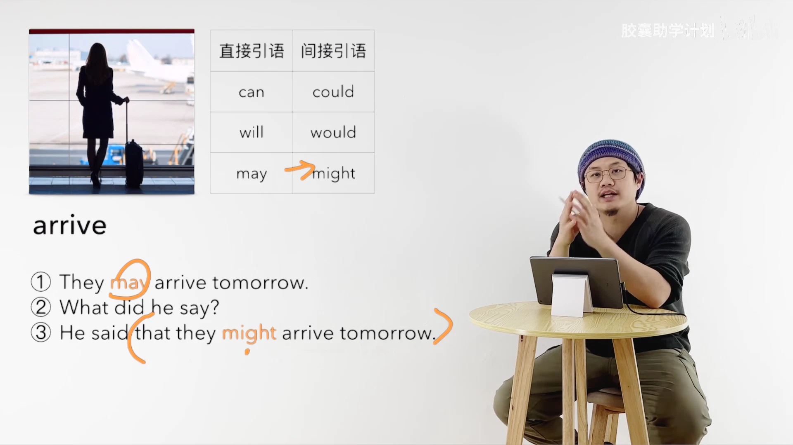

文字识别：胶囊助学计划 / 直接引语 / 间接引语 / can / could / will / would / may / might / arrive /  They / 1 / may / arrive tomorrow. / What did he say? / He saidthat they might arrive tomorrow.

## 00:03:00–00:03:30

好吧？好，那接下来我们看一下本课的单词。第一个单词我们之前见过，应该啊讲时态总会提到这个单词。那我们一起读一下，叫做 future。 future，那它对应的现在就是 now，过去就是 past， OK，未来就是 future， OK。好，那接下来比如说我们 future 本身是个形容词，叫做未来的。那我们配合一个叫 future husband 或者 future wife，就是我未来的老公或未来的妻子，对吧？某种程

### 画面 00:03:01

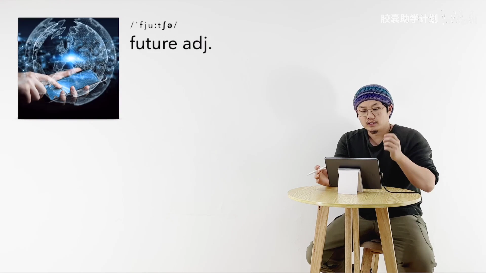

文字识别：胶囊助学计划 / /'fjuitfa/ / future adj.

### 画面 00:03:05

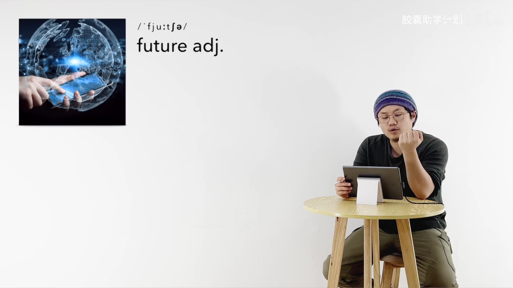

文字识别：胶囊助学计划 / /'fjuitfa/ / future adj.

### 画面 00:03:20

文字识别：胶囊助学计划 / /'fju:tfa/ / future adj. / ① future husband/wife

## 00:03:30–00:04:00

度上就类似于未婚妻或未婚夫，但未婚妻和未婚夫在英文当中还有专门对应的英文单词啊，但是意思大概是相似的。OK，好，那我们造句子，比如说很简单，我要介绍别人说，This is my future husband，这是我未来的老公，对吧？或者说说While my future wife was having a bath， someone knocked on the door。啊，是一百一十一课啊，一百一十七课咱们学过的While

### 画面 00:03:31

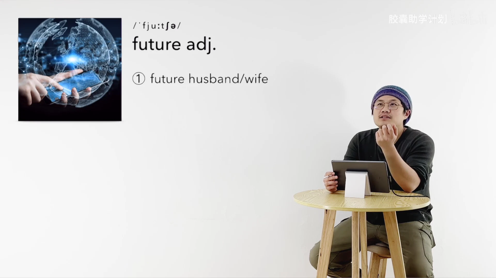

文字识别：胶囊助学计划 / /'fju:tfa/ / future adj. / ① future husband/wife

### 画面 00:03:45

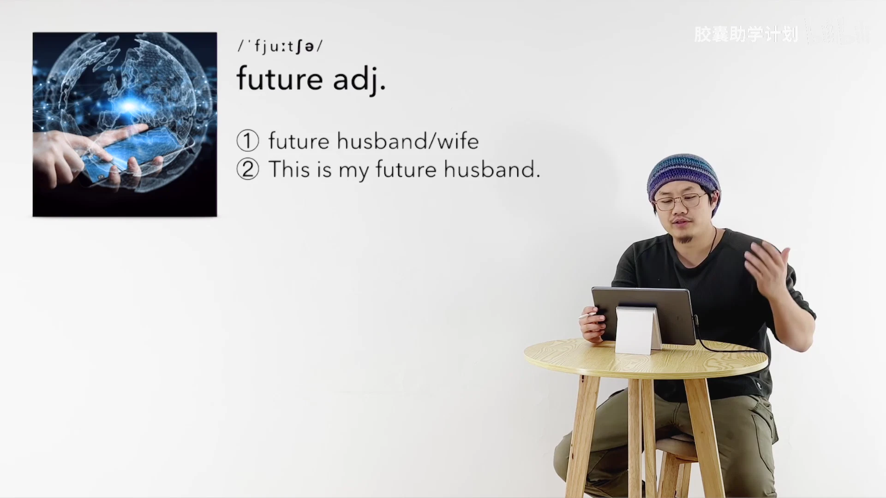

文字识别：胶囊助学计划 / /'fju:tfa/ / future adj. / ① future husband/wife / This is my future husband.

### 画面 00:03:49

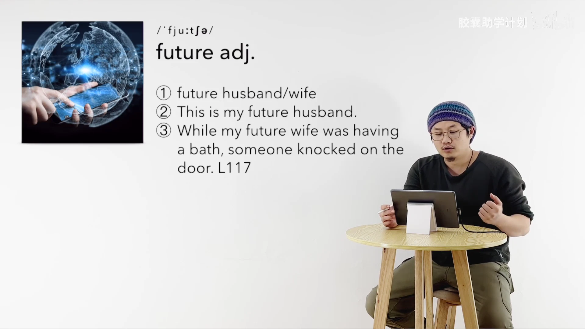

文字识别：胶囊助学计划 / /'fju:tfa/ / future adj. / ① future husband/wife / This is my future husband. / While my future wife was having / a bath, someone knocked on the / door. L117

## 00:04:00–00:04:30

和 was having a bath 过去进行时 very good，再来说 my future husband is taller than your future wife 啊，我未来的老公比你未来妻子是要高的，一百零七克 taller 形容词比较级。 Next one，接下来两个单词，各位可以把它当做一个动词短语去处理，叫 get married。 OK，那合起来翻译成的叫做结婚。比如说 they are going to get married

### 画面 00:04:04

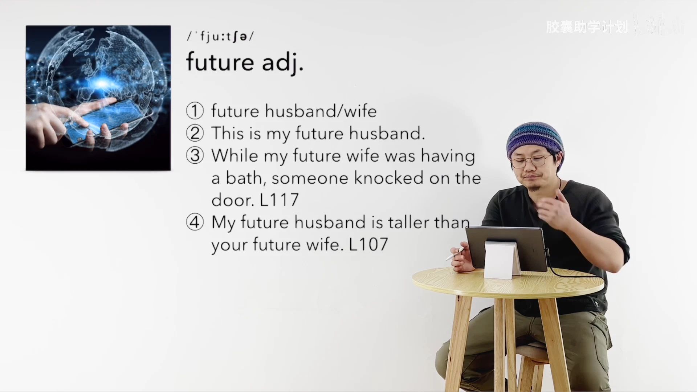

文字识别：校囊助学计划 / /'fjuitfa/ / future adj. / ① future husband/wife / This is my future husband. / While my future wife was having / 3 / a bath, someone knocked on the / door. L117 / ④ My future husband is taller than / your future wife. L107

### 画面 00:04:09

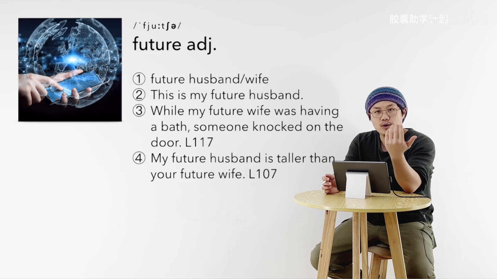

文字识别：胶囊助学计划 / /'fjuitfa/ / future adj. / ① future husband/wife / This is my future husband. / While my future wife was having / a bath, someone knocked on the / door. L117 / ④ My future husband is taller than / your future wife. L107

### 画面 00:04:14

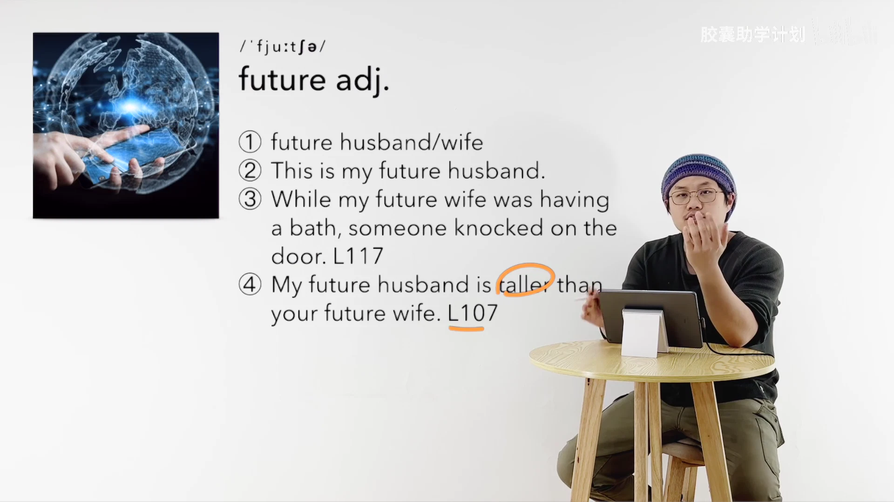

文字识别：胶囊助学计划 / /'fjuitfa/ / future adj. / ① future husband/wife / This is my future husband. / While my future wife was having / a bath, someone knocked on the / door. L117 / ④ My future husband is (allethan / your future wife. L107

### 画面 00:04:16

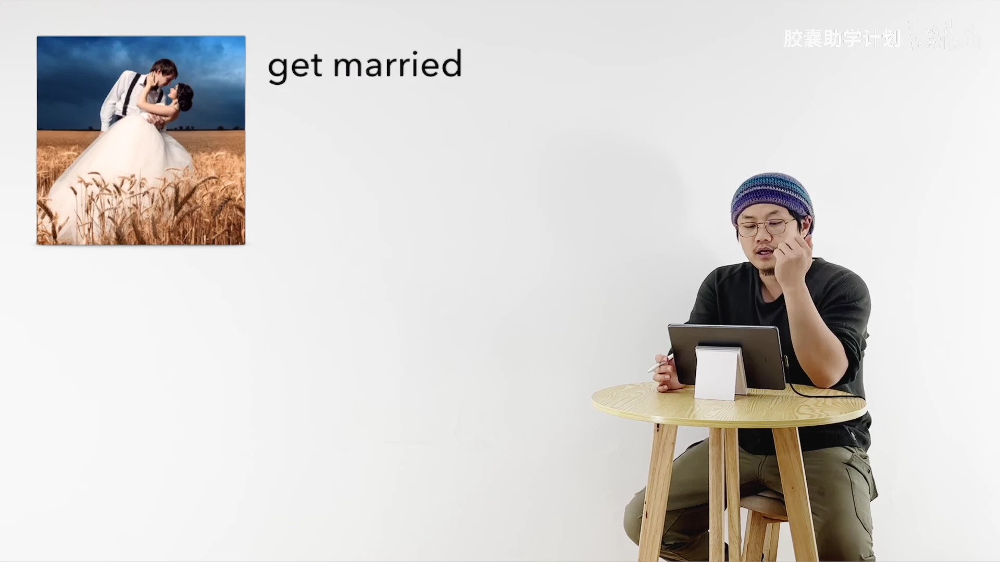

文字识别：胶囊助学计划 / get married

### 画面 00:04:18

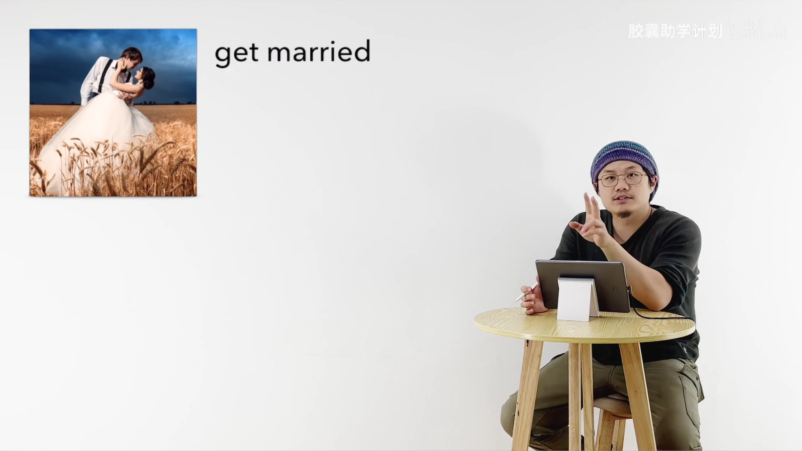

文字识别：胶囊助学计划 / get married

### 画面 00:04:20

文字识别：胶囊助学计划 / get married / √.

### 画面 00:04:25

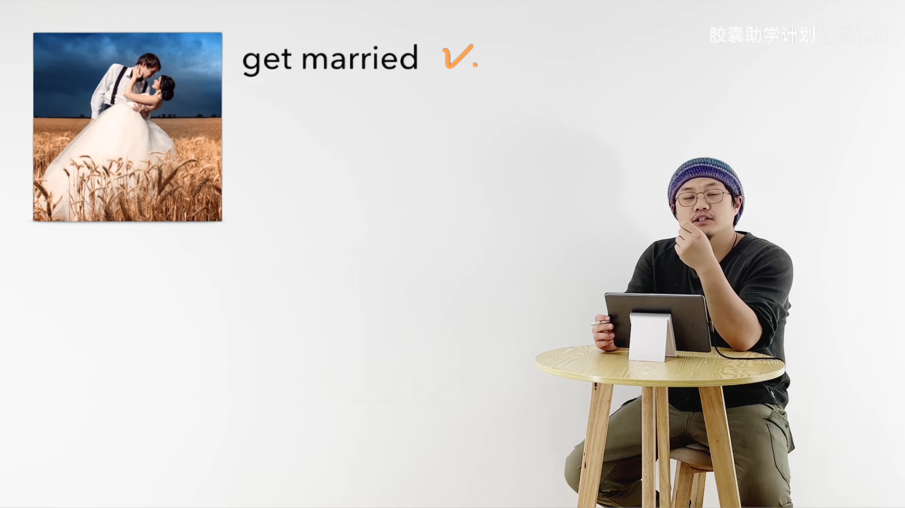

文字识别：胶囊助学计划 / get married / √.

### 画面 00:04:29

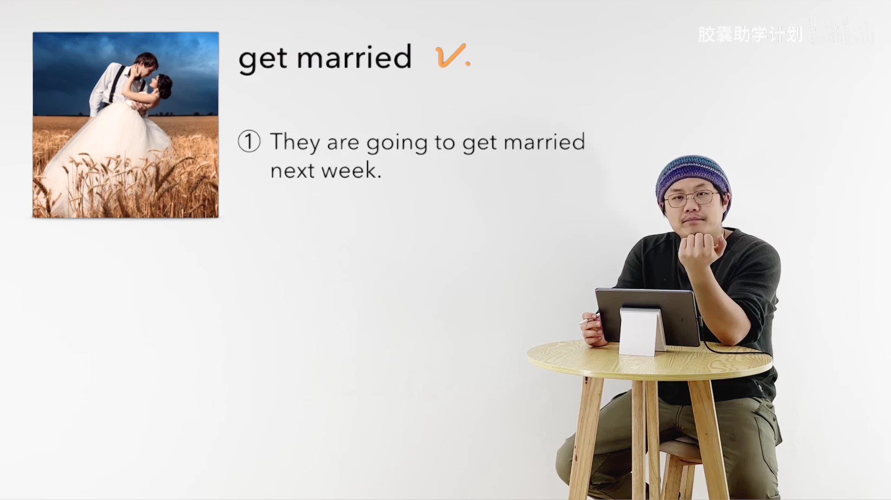

文字识别：胶囊助学计划 / get married / V. / ① They are going to get married / next week.

## 00:04:30–00:05:00

next week.他们下周要结婚了。那你看，如果我们这个地方用的是 begin to do，如果我们把 get 换成了 go，说 they got married last week，那我们就是不是换了个时态，叫做他们上周结的婚。OK， very good。说，哎， they got married last summer，对吧？你看，我们其实整个句子改变，只是改变了动词的这个时态，对吧？那伴随

### 画面 00:04:33

文字识别：胶囊助学计划 / get married / √. / ① They are going to get married / next week.

### 画面 00:04:35

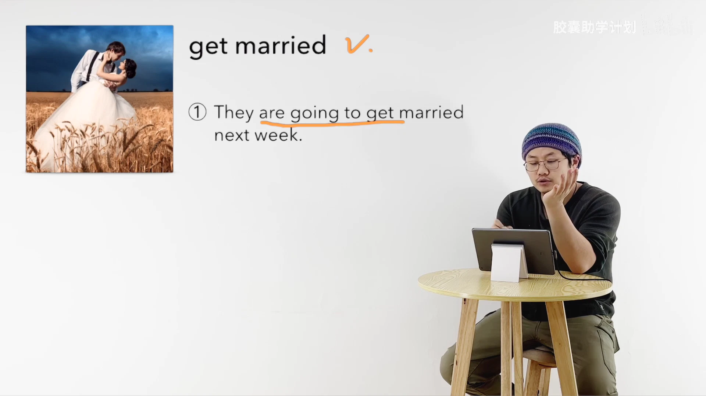

文字识别：胶囊助学计划 / get married / V. / ① They are going to get married / next week.

### 画面 00:04:40

文字识别：胶囊助学计划 / get married / V / ① They are going to get married / next week.

### 画面 00:04:47

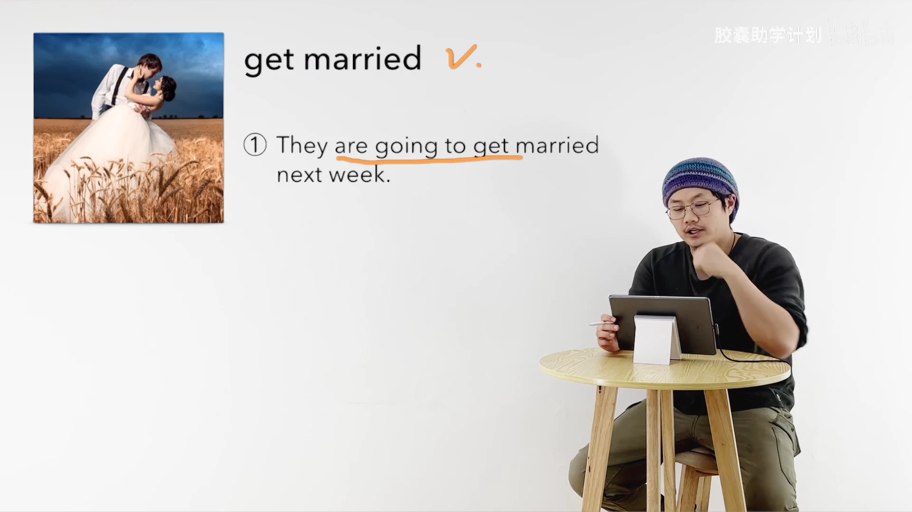

文字识别：胶囊助学计划 / get married / √. / ① They are going to get married / next week.

### 画面 00:04:50

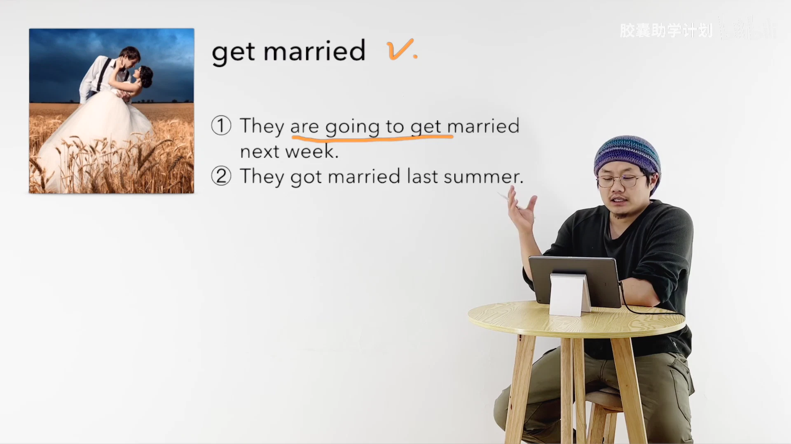

文字识别：胶囊助学计划 / get married / V / ① They are going to get married / next week. / They got married last summer.

## 00:05:00–00:05:30

着动词时态的改变，您还需要改变一些时间。肯定句都出来了，剩下一般疑问句和特殊疑问句，各位完全就可以当家庭作业去写出来了，好吧？OK，啊，比如说 did when who，我都说了。再来说 the man who you met last month got married a month ago。好，各位这句话想去读的时候拆成两句话，黄线标的是一句话，叫做 you met him last night，昨天晚上你见到他了，对吧？那第

### 画面 00:05:09

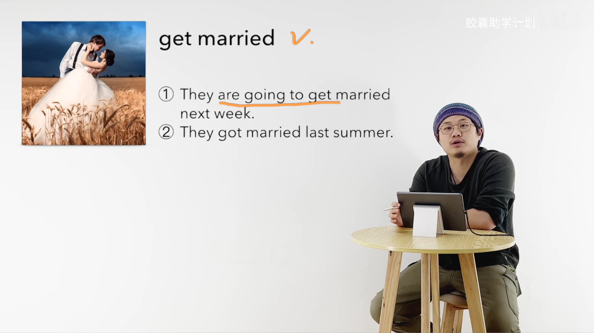

文字识别：胶囊助学计划 / get married / √. / ① They are going to get married / next week. / They got married last summer.

### 画面 00:05:13

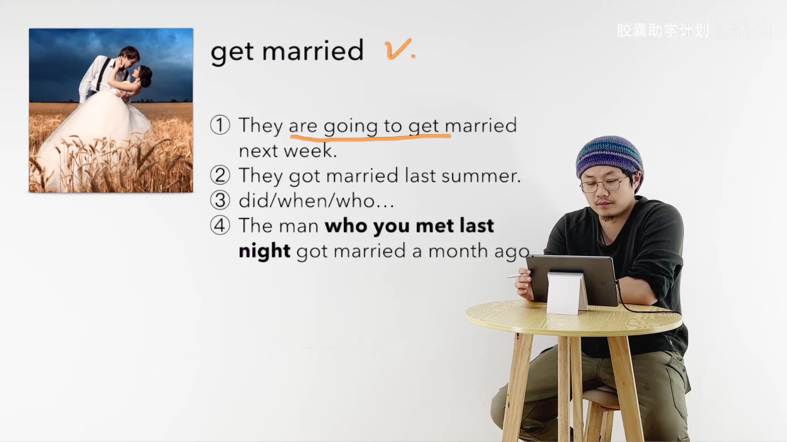

文字识别：胶囊助学计划 / get married / V / ① They are going to get married / next week. / They got married last summer. / did/when/who... / The man who you met last / night got married a month ago

### 画面 00:05:15

文字识别：胶囊助学计划 / get married / V / ① They are going to get married / next week. / They got married last summer. / did/when/who... / The man who you met last / night got married a month ago

### 画面 00:05:22

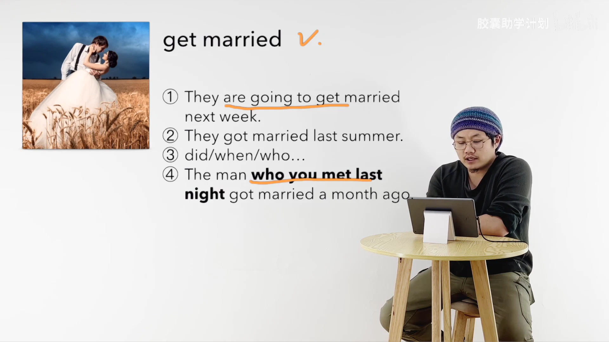

文字识别：胶囊助学计划 / get married / V / ① They are going to get married / next week. / They got married last summer. / did/when/who... / The man who you met last / night got married a month ago.

### 画面 00:05:26

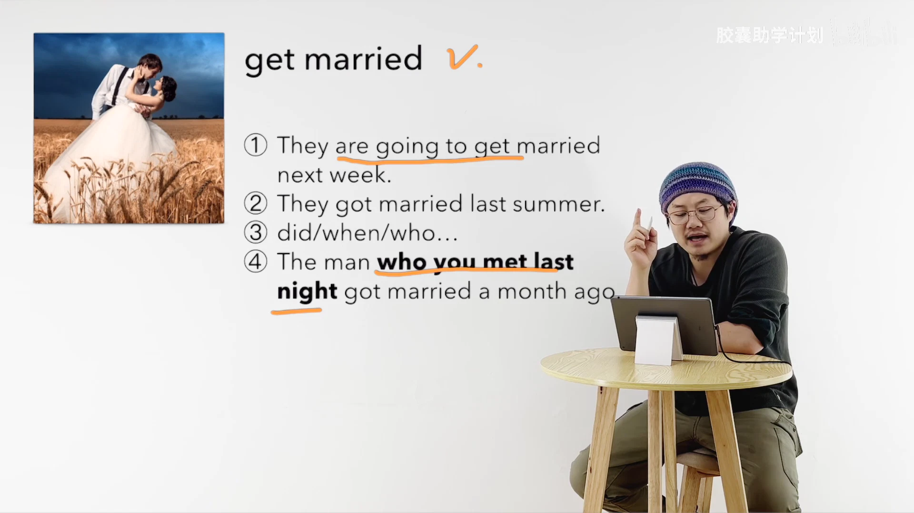

文字识别：胶囊助学计划 / get married / V / ① They are going to get married / next week. / They got married last summer. / did/when/who... / The man who you met last / night got married a month ago.

## 00:05:30–00:06:00

二句话叫 The man got married a month ago. 他呀，一个月之前结的婚。好，两句话定语从句。想问的问题还是同样的，叫做这里的 who 能不能被省略掉呢？ Next one，下一个单词很简单啊，跟我一起读一下，叫做 hotel hotel。 OK，那它的意思叫做宾馆，对吧？好，那我们造一句话说 This is the hotel. 说这个就是那个宾馆， which I told you about。 一百二十

### 画面 00:05:43

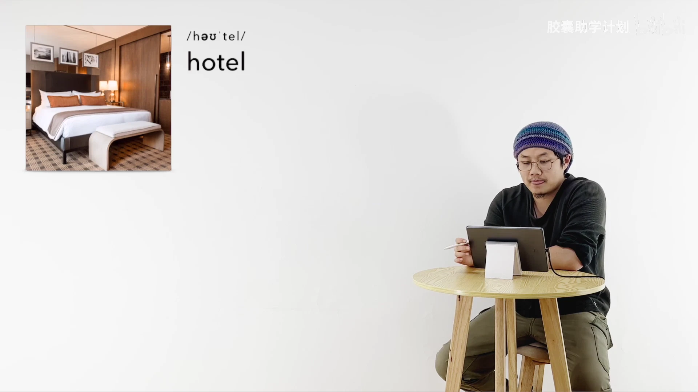

文字识别：胶囊助学计划 / /hau'tel/ / hotel

## 00:06:00–00:06:30

### 画面 00:06:02

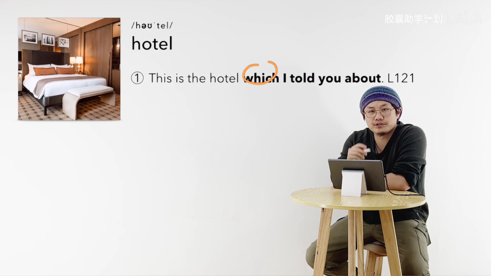

文字识别：胶囊助学计划 / /hau'tel/ / hotel / which Itold you about. 121 / ① This is the hotel

### 画面 00:06:16

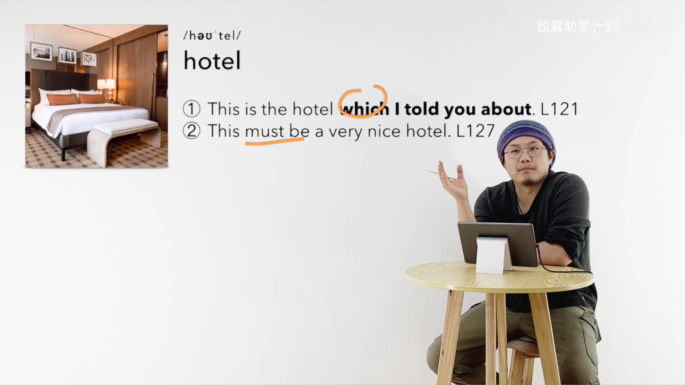

文字识别：胶囊助学计划 / /hau'tel/ / hotel / which I told you about. L121 / This is the hotel / This must be a very nice hotel. L127

## 00:06:30–00:07:00

旅店当中，叫 can't have been doing 啊，这些结构就是一百二十七、一百二十九和一百三十一，咱们学的结构对于各位来说是最容易忘的。接下来 continue 说 they may be sleeping in that hotel，这就是一百三十一了， may be doing。当然了，一百三十一咱们还学了叫 may have been doing，对吧？ may have been sleeping，当时可能是正在那里睡觉。 One year。下一个单词，跟我一起读一下，叫做 latest， latest，

### 画面 00:06:31

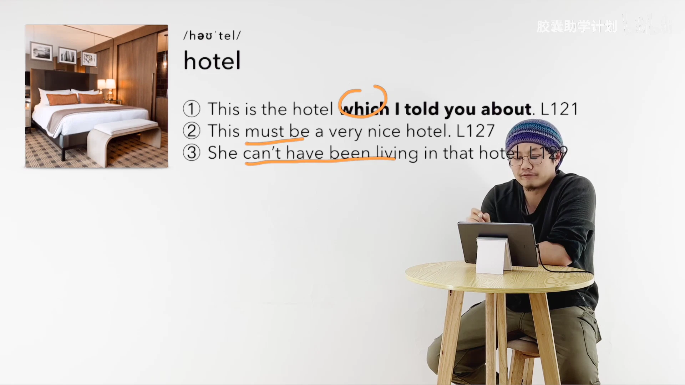

文字识别：校囊助学计划 / /hau'tel/ / hotel / which I told you about. L121 / This is the hotel / This must be a very nice hotel. L127 / She can't have been living in that hoteE

### 画面 00:06:45

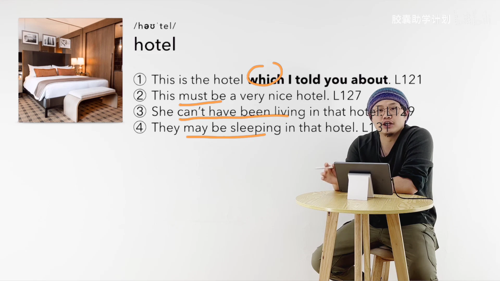

文字识别：交囊助学计划 / /hau'tel/ / hotel / whichItold you about. L121 / This is the hotel / This must be a very nice hotel. L127 / She can't have been living in that hoteF t129 / They may be sleeping in that hotel. L13

### 画面 00:06:55

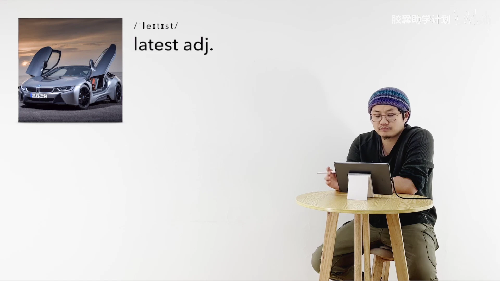

文字识别：胶囊助学计划 / /'leitist/ / latest adj. / MEV8842E

## 00:07:00–00:07:30

latest,有点像 newest啊. latest就是最新的、最近的.注意它是个形容词嘛，对吧？所以我们可以说 latest model，最新的模型，OK，最近的模型。我们就可以造一句话说 This is the latest model. 啊， the newest model. 形容词最高级，复习一下。再然后说 The model which you saw yesterday is the latest one. 好，你看 which you saw yesterday. 我们回顾一下，这

### 画面 00:07:13

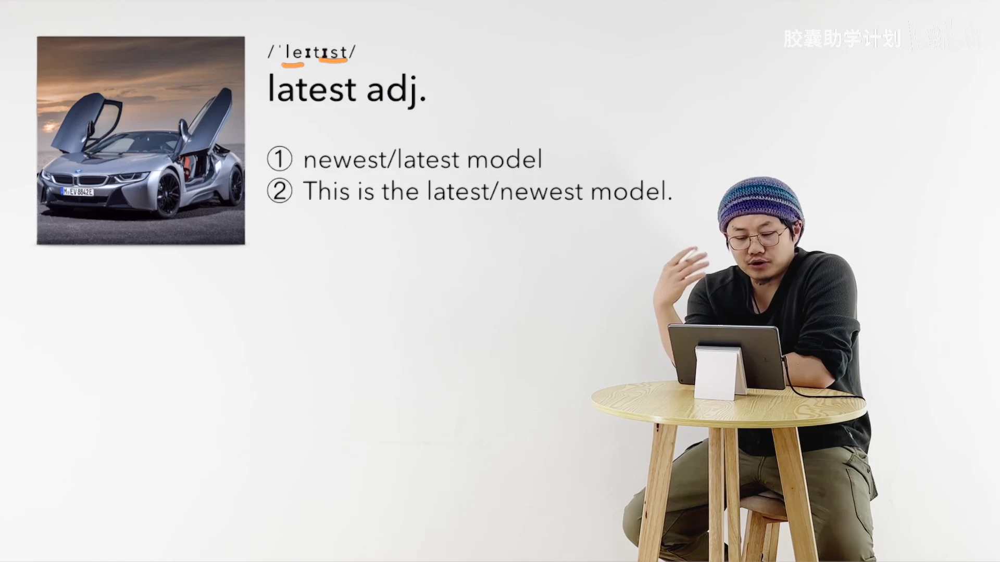

文字识别：胶囊助学计划 / /'leitist/ / latest adj. / newest/latest model / This is the latest/newest model. / MEV8842E

### 画面 00:07:20

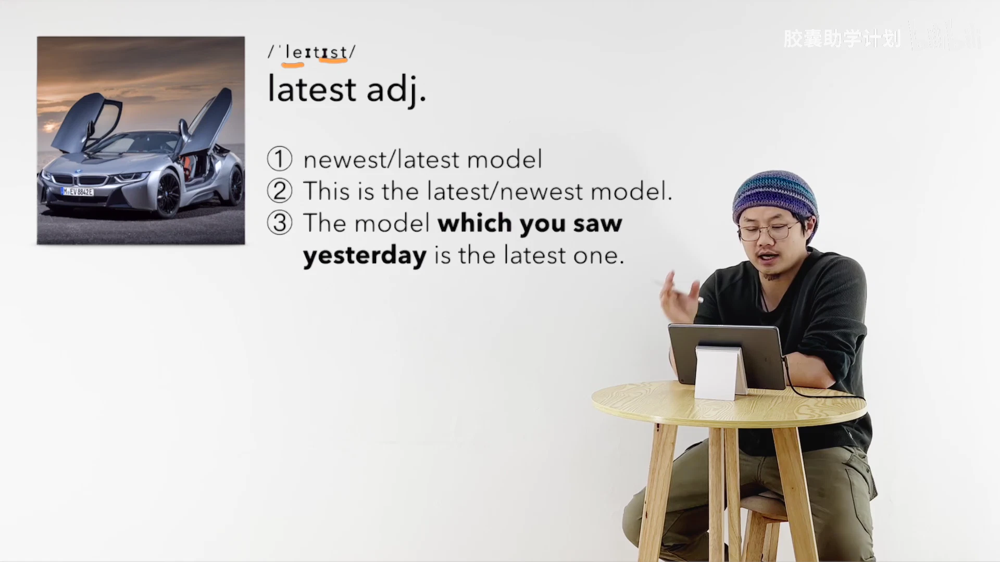

文字识别：胶囊助学计划 / /'leitist/ / latest adj. / newest/latest model / This is the latest/newest model. / MEV8842E / The model which you saw / yesterday is the latest one.

### 画面 00:07:27

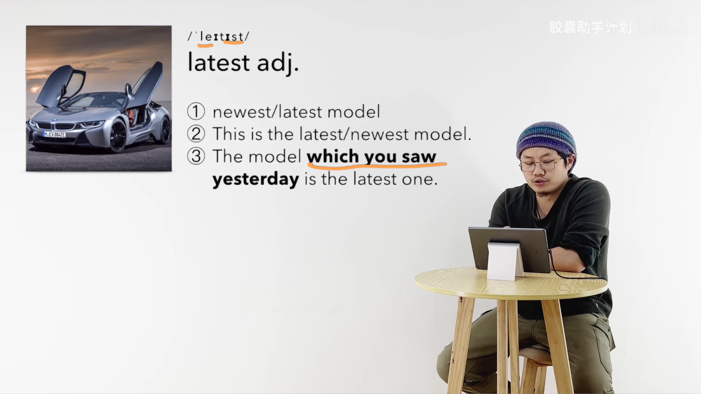

文字识别：胶囊助学计划 / /'leitist/ / latest adj. / newest/latest model / This is the latest/newest model. / MEV8842E / The model which you saw / yesterday is the latest one.

## 00:07:30–00:08:00

里的which一定是替代了它前面的model，对吧？OK，啊，模型，汽车模型。说You saw it yesterday.你昨天看到了它，是最新的那一款。OK，定语从句，所以这里的which它实际上在定语从句当中是一个宾语，对吧？然后呢，我们是可以把它省略掉的。Next one, continue.跟我一起读一下这个单词，叫做

### 画面 00:07:55

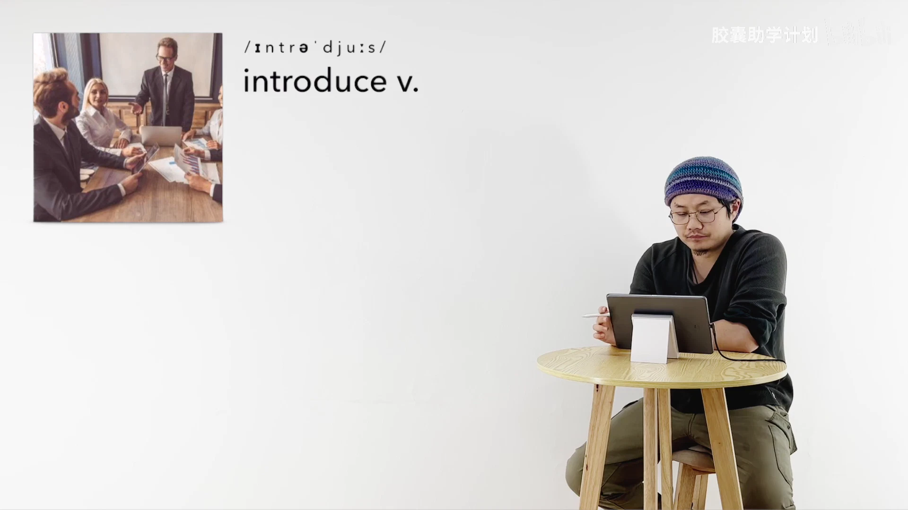

文字识别：胶囊助学计划 / /intra'djuis/ / introduce v.

## 00:08:00–00:08:30

introduce introduce。注意重音在后面啊。我们造句子说，I would like to introduce my boss. Introduce叫介绍啊。哎，我愿意去介绍一下我的老板。一百零七课，would like to do something，类似于 want to do something。一百二十五课呢，我们学过了，叫 had to 或 have to，叫当时不得不。比如说，I had to introduce it to my boss yesterday。我昨天不得不把这个东

### 画面 00:08:16

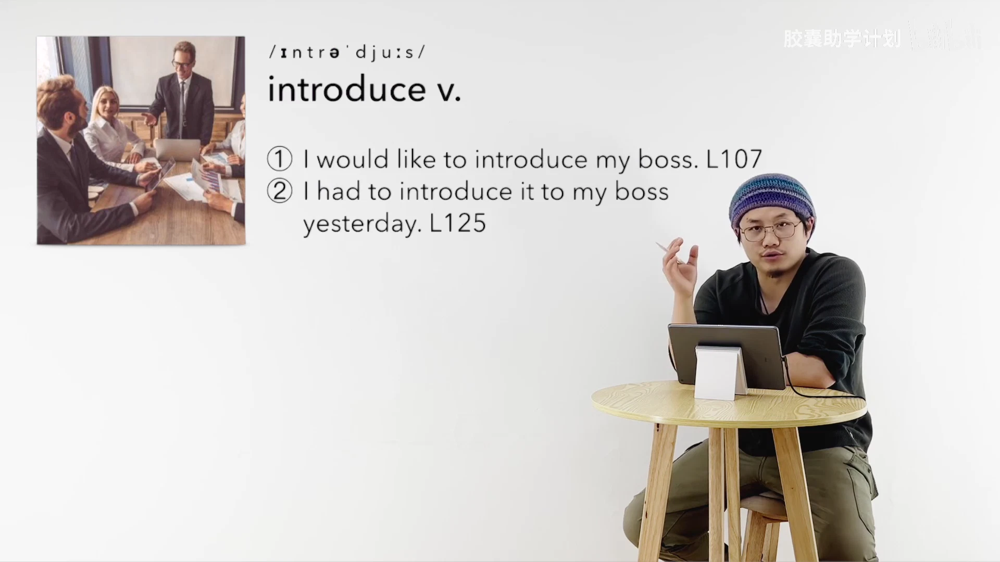

文字识别：胶囊助学计划 / /intra'djuis/ / introduce v. / ① I would like to introduce my boss. L107 / ) I had to introduce it to my boss / yesterday. L125

## 00:08:30–00:09:00

西给我老板介绍一遍，但是我可能并不想，对吧？OK，肯定句出来了，一般疑问句，did提前，动词换回原形，各种特殊疑问句啊，各位就可以造了，对吧？好，why啊，when啊，who啊，都OK的。Recap啊，本科啊，最重要的语法就是直接引语变间接引语的时候，情态动词要做一些小的转换啊，

### 画面 00:08:39

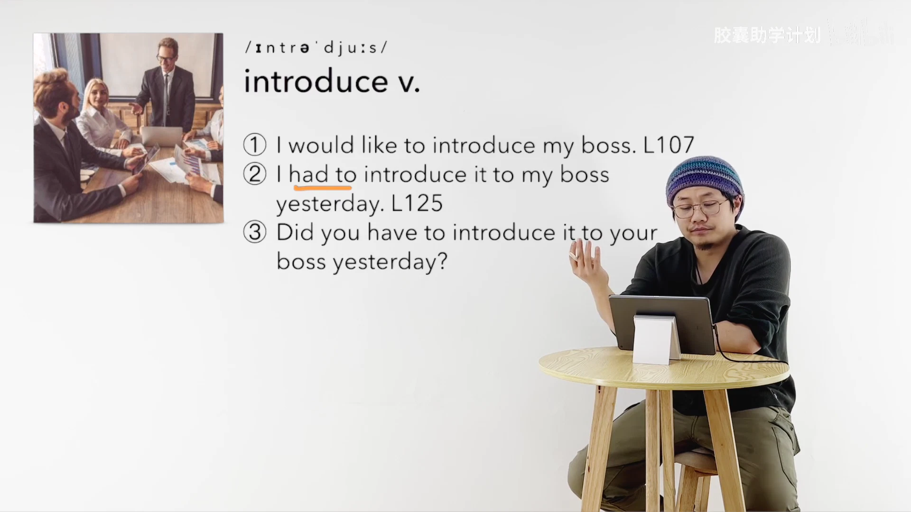

文字识别：胶囊助学计划 / /intra'djuis/ / introduce v. / ① I would like to introduce my boss. L107 / ② I had to introduce it to my boss / yesterday. L125 / Did you have to introduce it to your / boss yesterday?

### 画面 00:08:50

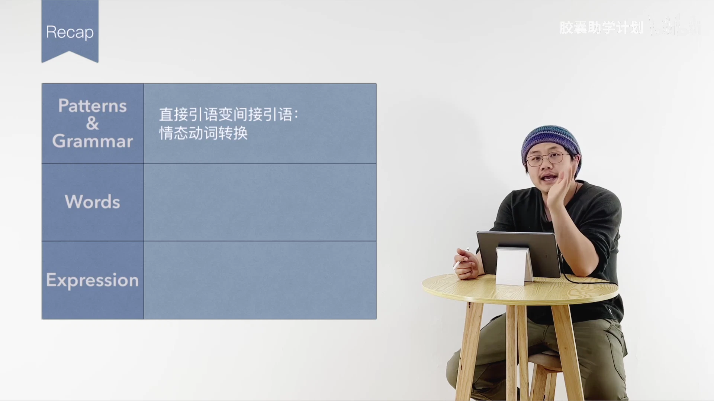

文字识别：Recap / 胶囊助学计划 / Patterns / 直接引语变间接引语： / & / 情态动词转换 / Grammar / Words / Expression

### 画面 00:08:55

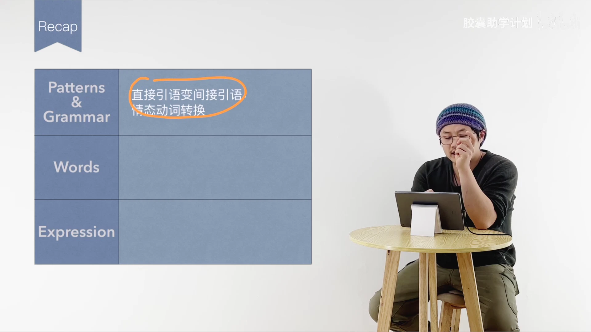

文字识别：胶囊助学计划 / Recap / Patterns / 直接引语变间接引语 / 情态动词转换 / Grammar / Words / Expression

## 00:09:00–00:09:30

很简单，can变could，will变would啊，may变might，就这么简单，好吧。样作业，单词造句，老习惯，初级红皮书，查找一下本课的语法，然后给自己讲解一遍今天的核心知识点。那如果大家喜欢我们的课程呢，欢迎大家关注、订阅，一键三连，分享给那些需要的朋友，来帮助我们快速成长。最后，我们再来看一句名人名言：If I get

### 画面 00:09:05

文字识别：胶囊助学计划

### 画面 00:09:15

文字识别：胶囊助学计划

### 画面 00:09:23

文字识别：胶囊助学计划 / 🌟

### 画面 00:09:25

文字识别：胶囊助学计划 / If I get married in the future, I want to have / a relationship like friends with my other / half. It'd be best if we can communicate / often. / Lee Min-ho

### 画面 00:09:28

文字识别：胶囊助学计划 / If I get married in the future, I want to have / a relationship like friends with my other / half. It'd be best if we can communicate / often. / - Lee Min-ho

## 00:09:30–00:09:56

in the future, I want to have a relationship like friends with my other half. It would be best if we can communicate often. Okay, see you next time.

### 画面 00:09:43

文字识别：If I get married in the future, I want to have / a relationship like friends with my other / half. It'd be best if we can communicate / often. / -Lee Min-ho

### 画面 00:09:45

文字识别：CAPSULEACADEMY / 胶囊助学计划 / 小红书 / Lecturer / Leo

### 画面 00:09:48

文字识别：CAPSULEACADEMY / 胶囊助学计划 / 小红书 / 品 / OE

### 画面 00:09:51

文字识别：CAPSULEACADEMY / 胶囊助学计划 / 小红书 / Creator / Leo & Berlin / OE

### 画面 00:09:53

文字识别：bilbili / 胶囊助学计划 / CAPSULEACADEMY / 胶囊助学计划 / 小红书 / OE

### 画面 00:09:55

文字识别：bilibili / 胶囊助学计划

