# 135 文章

快速机器解析：语音为单模型转写，未进行独立交叉校对或人工复核；画面每秒采样并按变化选帧，短时文字和标记可能遗漏。截图时间约有 1 秒误差。图片有损压缩；遇到疑点请按时间查看 Google Drive 原视频。

## 00:00:00–00:00:30

Hello everyone, welcome to Capsule Academy. This is Leo. Today we are going to learn New Concept English Book One Lesson One Hundred and Thirty Five Story. Hope you gonna enjoy it.好，那我们直接来一起看一下这个文章啊。首先我们看这个人叫 reporter 啊，那就是记者对吧？记者问说 Are you really going to retire? 你真的计划打算要退休了吗，Miss Marsh? 好，注意一个小点，

### 画面 00:00:00

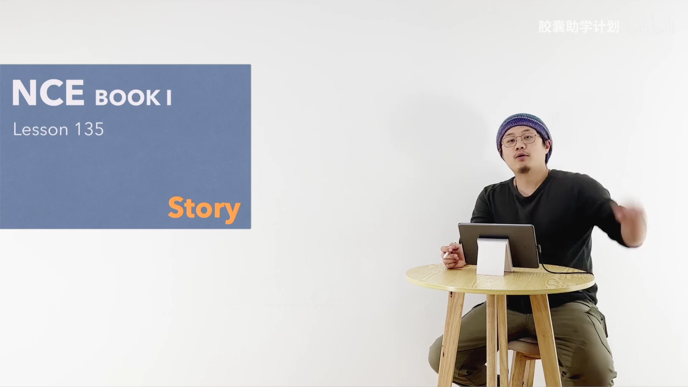

文字识别：NCE / BOOKI / Lesson 135 / Story

### 画面 00:00:02

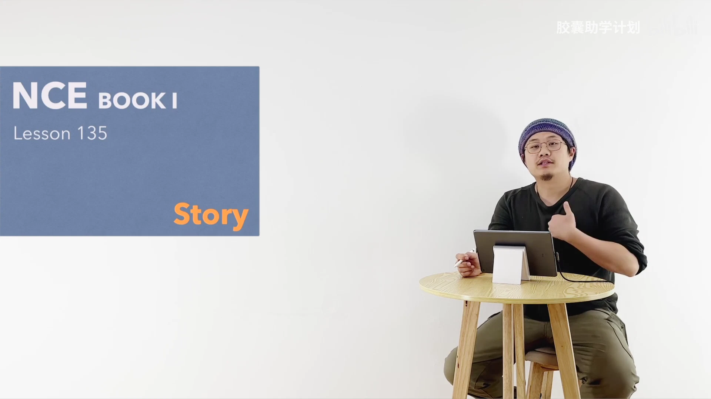

文字识别：NCE / BOOKI / Lesson 135 / Story

### 画面 00:00:05

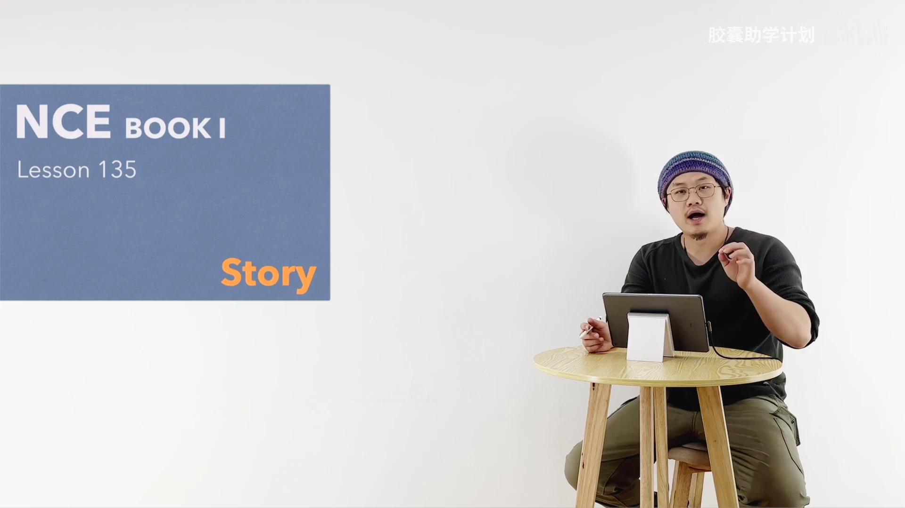

文字识别：NCE / BOOKI / Lesson 135 / Story

### 画面 00:00:09

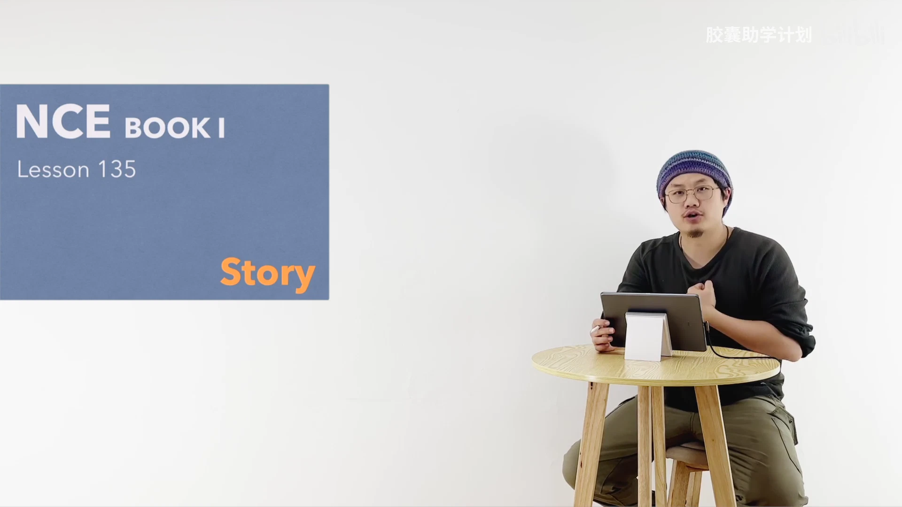

文字识别：NCE / BOOKI / Lesson 135 / Story

### 画面 00:00:11

文字识别：胶囊助学计划 bilbl

### 画面 00:00:14

### 画面 00:00:16

文字识别：REPORTER: Are you really going to retire, miss Marsh? / MISS MARSH: I may. I can't make up my mind. / I will have to ask my future husband. He won't let me / make another film.

## 00:00:30–00:01:00

be going to do，对吧？计划打算。三十七课咱们学的，Miss Marsh说，I may，其实I may后边还缺了一个动词，叫I may retire。一百三十一课咱们学过，may加do，对吧？我可能会这么这么去做，叫做I can't make up my mind。啊，这之前学过了，make up somebody's mind，下定决心。我还没有办法下定决心。I will have to，一百二十五课，我将不得

### 画面 00:00:40

文字识别：REPORTER: Are you really going to retire, miss Marsh? / MISS MARSH: I may. I can't make up my mind. / I will have to ask my future husband. He won't let me / make another film.

### 画面 00:00:54

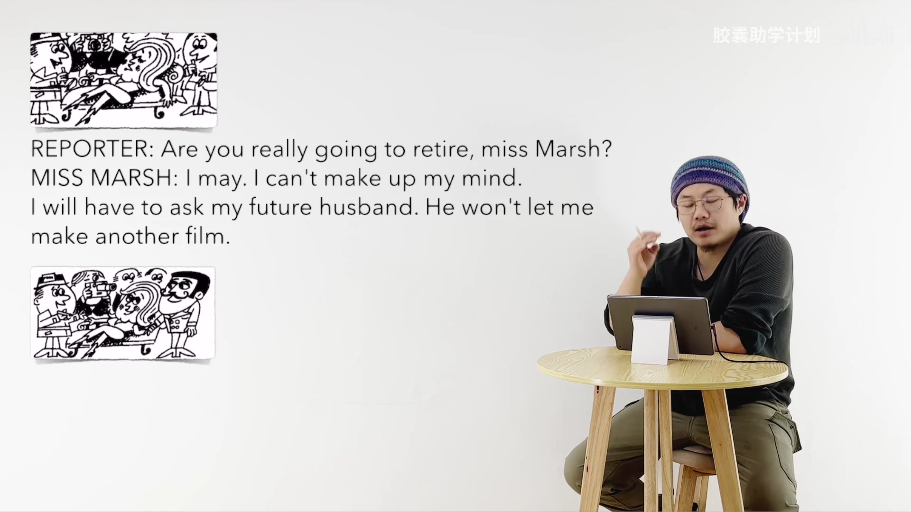

文字识别：REPORTER: Are you really going to retire, miss Marsh? / MISS MARSH: I may. I can't make up my mind. / I will have to ask my future husband. He won't let me / make another film.

## 00:01:00–00:01:30

ask my future husband. Say, I want to ask my future husband. He won't let me make another film. Say, he won't let me make another film. He won't let me make another film. He won't let me make another film. He won't let me make another film. He won't let me make another film. He won't let me make another film. He won't let me make another film. He won't let me make another film. He won't let me make another film. He won't let me make another film. He won't let me make another film. He won't let me make another film. He won't let me make another film. He won't let me make another film. He won't let me make another

### 画面 00:01:20

文字识别：REPORTER: Are you really going to retire, miss Marsh? / MISS MARSH: I may. I can't make up my mind. / I will have to ask my future husband. He won't let me / make another film. / REPORTER: Your future husband, Miss Marsh? / MISS MARSH: Yes. Let me introduce him to you. / His name is Carlos. / We're going to get married next week.

## 00:01:30–00:02:00

公吗？哎，Marsh女士，Yes，当然了。Let me introduce him to you.说让我来介绍他给您。这个地方可以当做一个小的习惯用法，叫introduce somebody to somebody，对吧？把A介绍给B啊，很简单。说He's not. His name is Carlos.啊，他的名字是Carlos. We're going to get married next week.好，We are going to do.我们计划打算get

### 画面 00:01:41

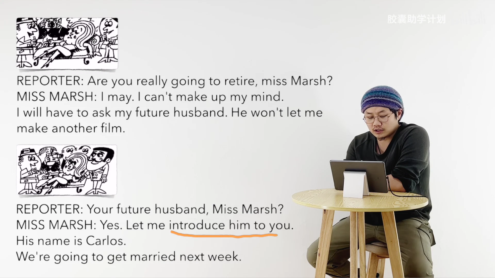

文字识别：REPORTER: Are you really going to retire, miss Marsh? / MISS MARSH: I may. I can't make up my mind. / I will have to ask my future husband. He won't let me / make another film. / REPORTER: Your future husband, Miss Marsh? / MISS MARSH: Yes. Let me introduce him to you. / His name is Carlos. / We're going to get married next week.

## 00:02:00–00:02:30

married next week. Next week, next week. Next

### 画面 00:02:08

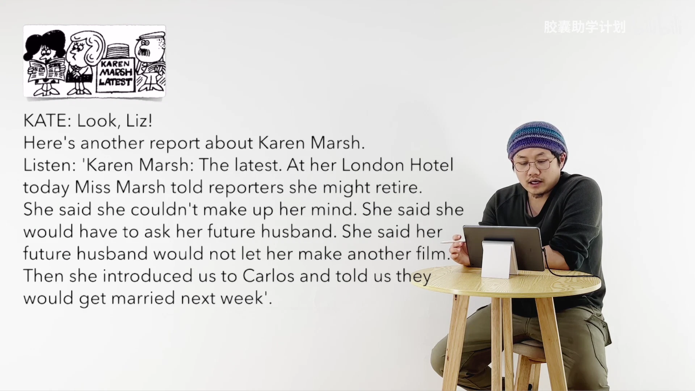

文字识别：() / KAREN / MARSH / LATEST / KATE: Look, Liz! / Here's another report about Karen Marsh. / Listen: 'Karen Marsh: The latest. At her London Hotel / today Miss Marsh told reporters she might retire. / She said she couldn't make up her mind. She said she / would have to ask her future husband. She said her / future husband would not let her make another film. / Then she introduced us to Carlos and told us they / would get married next week'.

## 00:02:30–00:03:00

关于 Karen Marsh 的报道。Listen, 听 Karen Marsh, the latest, 啊最新消息 at her London hotel, 在她伦敦的这个酒店报道的位置啊来了啊。接下来内容是什么呢？说 Today, Miss Marsh told reporters she might retire. May 变 might 了，对吧？她可能会退休。She said, 她说 she couldn't make up her mind.

### 画面 00:02:38

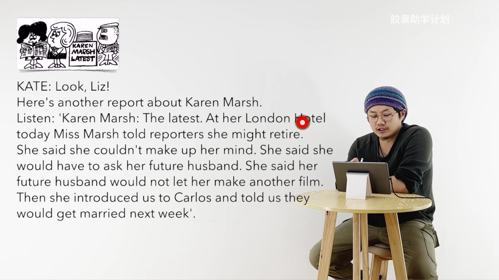

文字识别：( / KAREN / MARSH / LATEST / KATE: Look, Liz! / Here's another report about Karen Marsh. / Listen: 'Karen Marsh: The latest. At her London / tel / today Miss Marsh told reporters she might retire. / She said she couldn't make up her mind. She said she / would have to ask her future husband. She said her / future husband would not let her make another film. / Then she introduced us to Carlos and told us they / would get married next week'.

## 00:03:00–00:03:30

Mind,本来说的是can对吧？她没有办法下定决心。其实都是完全一样的。这两段话就是改变了一下小的时态，改变了一下小的情态动词。She said,她说，She would have to.她将不得不。你看，本来是will have to, will变would了，对吧？Would have to ask her future husband. She said her future,呃her future husband would not.哎，本来说的是won't，现在

### 画面 00:03:08

文字识别：KAREN / MARSH / LATEST / KATE: Look, Liz! / Here's another report about Karen Marsh. / Listen: 'Karen Marsh: The latest. At her London Hotel / today Miss Marsh told reporters she might retire. / She said she couldn't make up her mind. She said she / would have to ask her future husband. She said her / future husband would not let her make another film. / Then she introduced us to Carlos and told us they / would get married next week'.

## 00:03:30–00:04:00

是 wouldn't，对吧？Would not let her make another film. 啊，跟刚才一样，没区别。Then she introduced us to Carlos and told us. 然后告诉我们什么呢？They would get married next week. 本来是呃，am going to do。当然，你也可以换成 was going to do，对吧？但是他在这儿把 am going to do 换成了 would，啊，也没问题。Okay, very good. Liz said了一句话，说That's sensational

### 画面 00:03:38

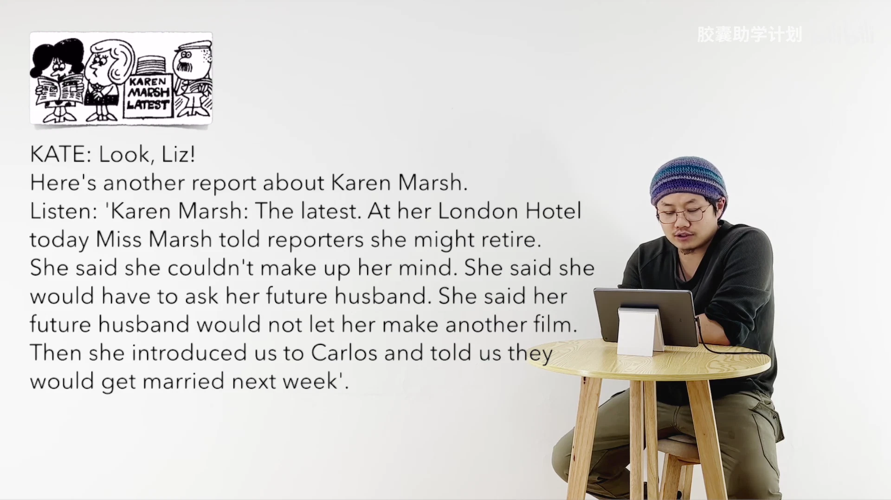

文字识别：KAREN / MARSH / LATEST / KATE: Look, Liz! / Here's another report about Karen Marsh. / Listen: 'Karen Marsh: The latest. At her London Hotel / today Miss Marsh told reporters she might retire. / She said she couldn't make up her mind. She said she / would have to ask her future husband. She said her / future husband would not let her make another film. / Then she introduced us to Carlos and told us they / would get married next week'.

### 画面 00:03:55

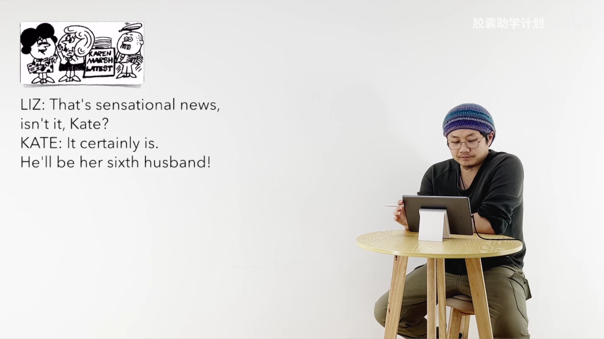

文字识别：KAREN / MARSH / LATEST / LIZ: That's sensational news, / isn't it, Kate? / KATE: It certainly is. / He'll be her sixth husband!

## 00:04:00–00:04:30

news! Ah, this news is big, isn't it?难道不是吗，Kate? Ah, so shocking! Ah, so exciting, right? It certainly is. Certainly, he will be her sixth husband.说他将是他第六任老公啊。然后配这个图，帽子都惊起来了。你看是不是第六任呢？其实并不知道。他俩第一次不知道各位没有印象，从一百二十七课吧，还是一百三十一课开始的，是吧？那篇文章当中就讲到了，说是

### 画面 00:04:25

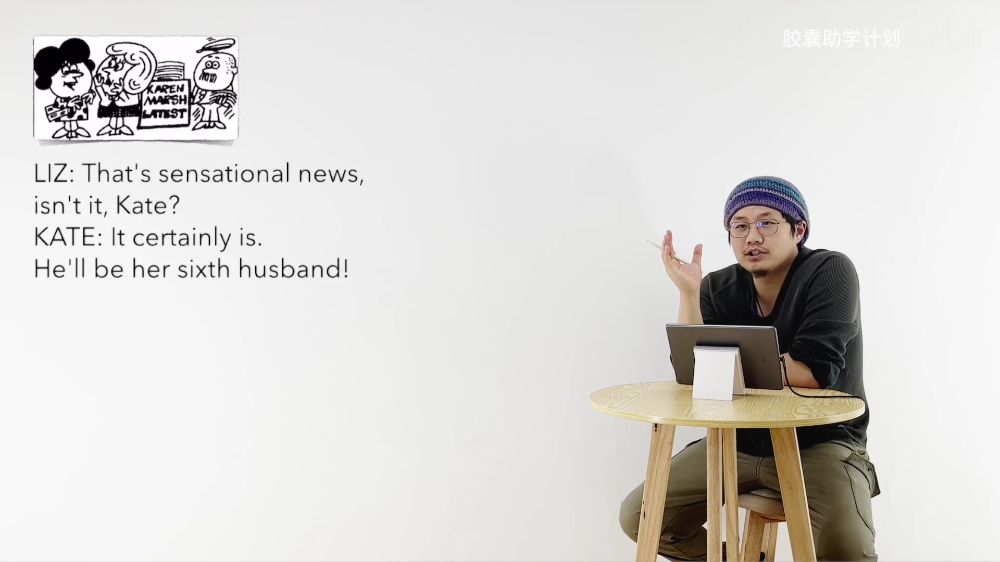

文字识别：KAREN / MARSH / LAMEST / LIZ: That's sensational news, / isn't it, Kate? / KATE: It certainly is. / He'll be her sixth husband!

## 00:04:30–00:05:00

是他的第三任、第四任，他说不是，他一定是他的第四任或第五任。然后到这儿他又变成了说他将是他的第六任老公。 Okay, very good. 那文章讲完了，接下来我们做一些口语听力练习啊。我问，您答。Does Karen Marsh say she's going to retire? She says she might. Next one. Who does she say

### 画面 00:04:40

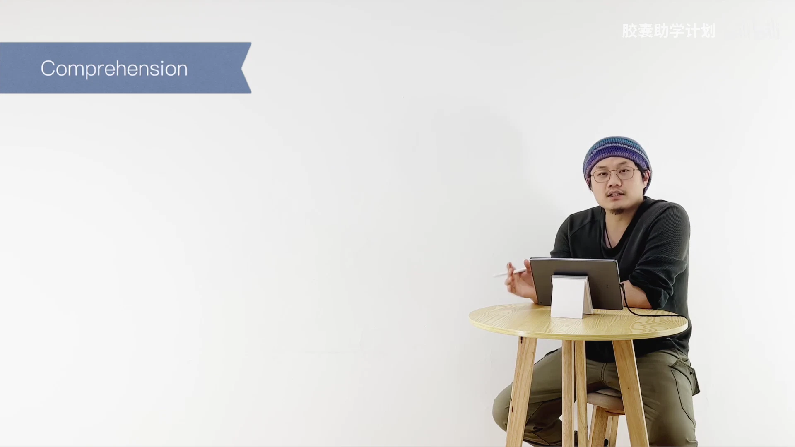

文字识别：Comprehension

### 画面 00:04:45

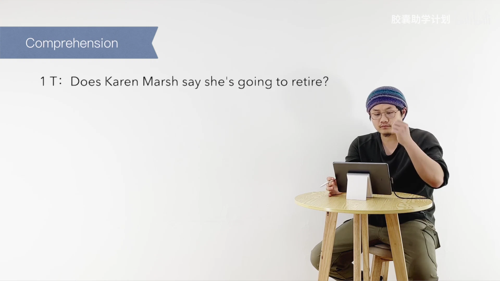

文字识别：Comprehension / 1 T: Does Karen Marsh say she's going to retire?

### 画面 00:04:47

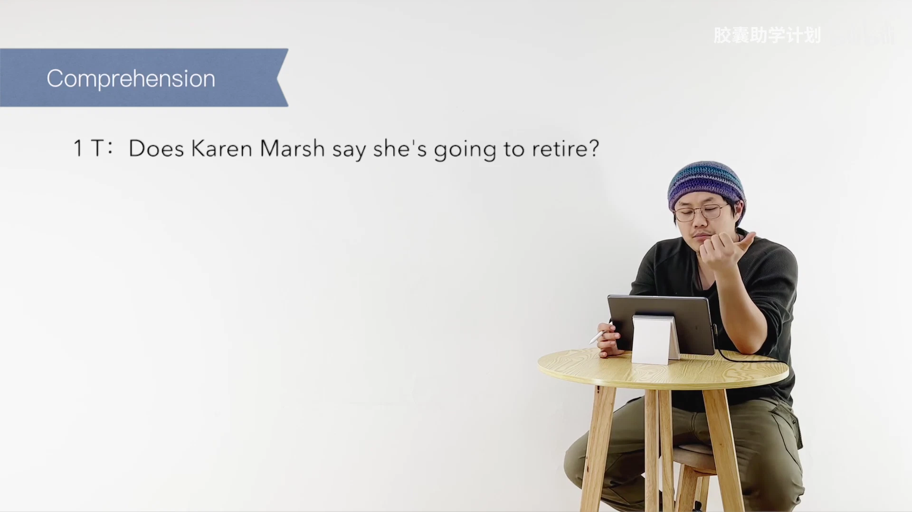

文字识别：Comprehension / 1 T: Does Karen Marsh say she's going to retire?

### 画面 00:04:50

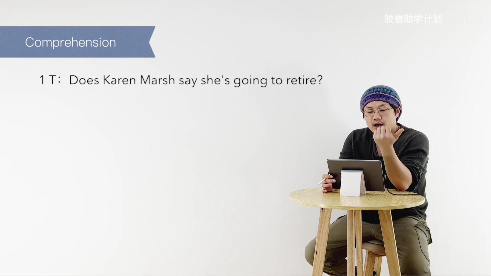

文字识别：Comprehension / 1 T: Does Karen Marsh say she's going to retire?

## 00:05:00–00:05:30

she will have to ask? She says she will have to ask her future husband. Next one. When does she say she's going to get married? She says she's going to get married next week. Did Karen Marsh tell reporters she might retire? Yes, she did.

### 画面 00:05:03

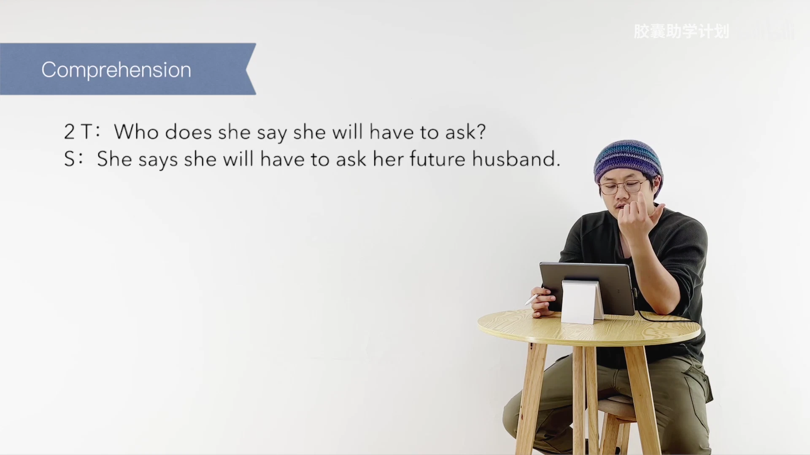

文字识别：Comprehension / 2 T: Who does she say she will have to ask? / S: She says she will have to ask her future husband.

### 画面 00:05:09

文字识别：Comprehension / 3 T: When does she say she's going to get married?

### 画面 00:05:27

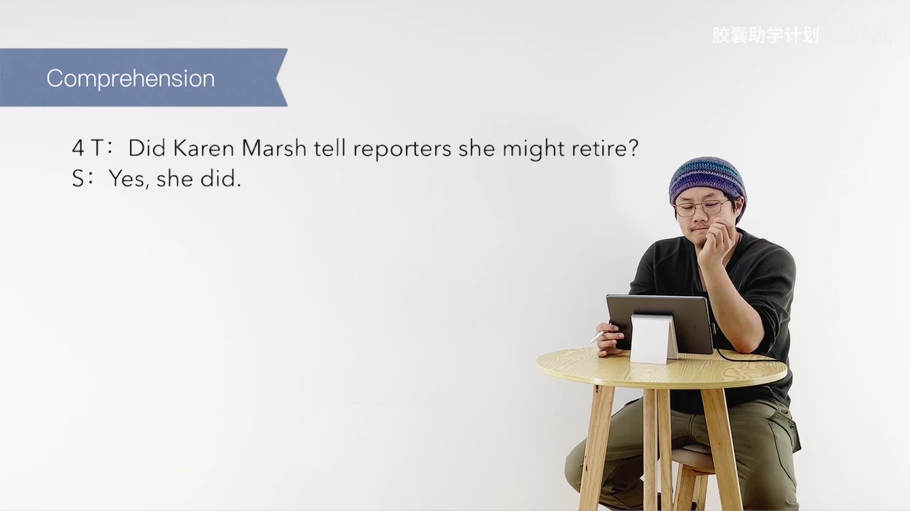

文字识别：Comprehension / 4 T: Did Karen Marsh tellreporters she might retire? / S: Yes, she did.

## 00:05:30–00:06:00

Next one, did she say she had made up her mind? No, she didn't. Who did she say she would have to ask? She said she would have to ask her future husband. Next one, when did she say she would get married? She said they would get married next week.好, asking

### 画面 00:05:32

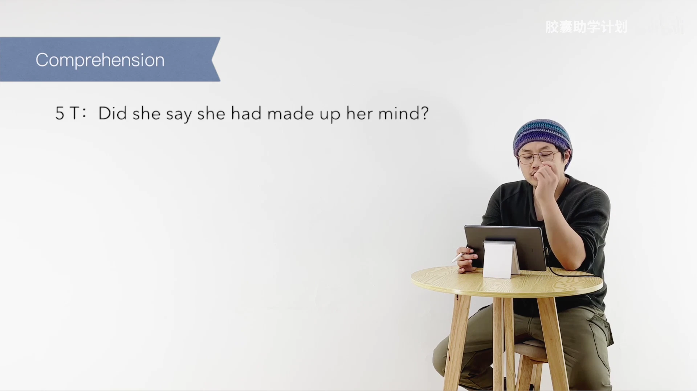

文字识别：Comprehension / 5 T: Did she say she had made up her mind?

### 画面 00:05:41

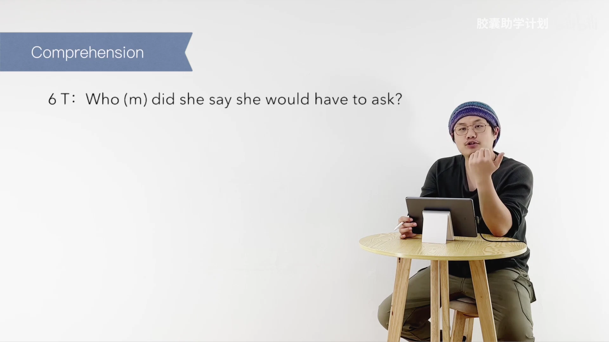

文字识别：Comprehension / 6 T: Who (m) did she say she would have to ask?

### 画面 00:05:46

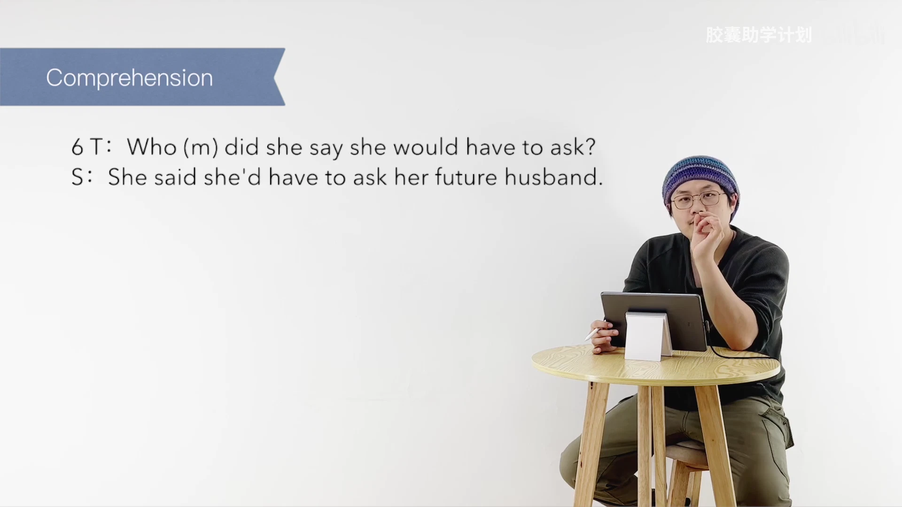

文字识别：Comprehension / 6 T: Who (m) did she say she would have to ask? / S: She said she'd have to ask her future husband.

### 画面 00:05:49

文字识别：Comprehension / 7 T: When did she say she would get married?

### 画面 00:05:53

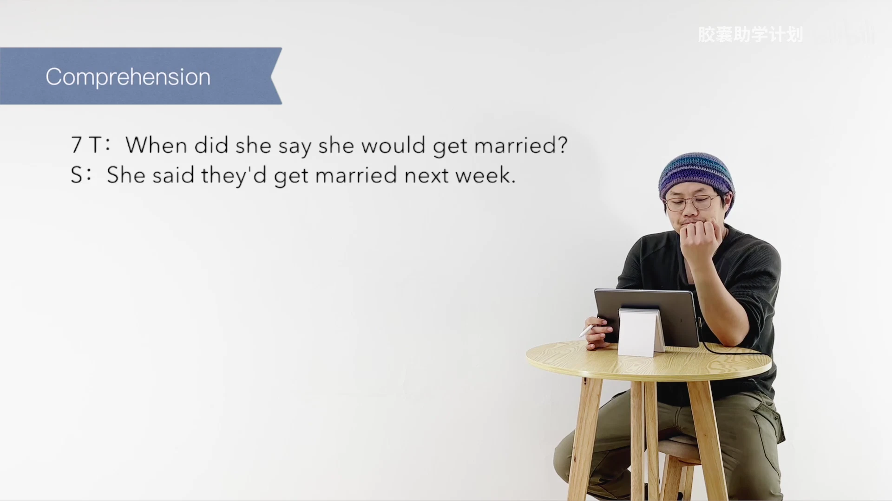

文字识别：Comprehension / 7 T: When did she say she would get married? / S: She said they'd get married next week.

### 画面 00:05:58

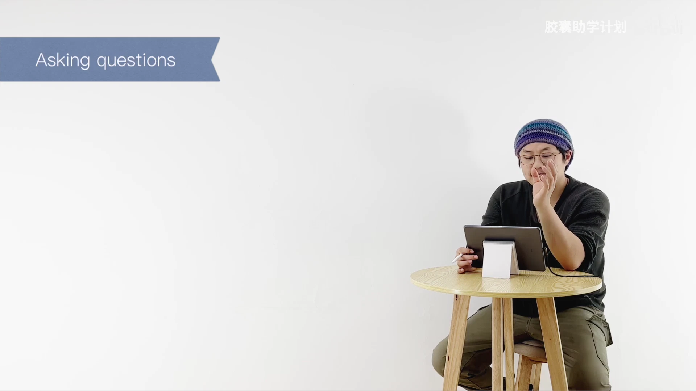

文字识别：Asking questions

## 00:06:00–00:06:30

questions,肯定句,一般疑问句,特殊疑问句,我问,你答啊,来了, ask me if Carolos will let her make another film.那will提前就可以了,对吧?非常简单,来, why won't直接把will去掉, why won't加句首,叫做why won't Carolos let her make another film? Next one, ask me if they are going to get

### 画面 00:06:00

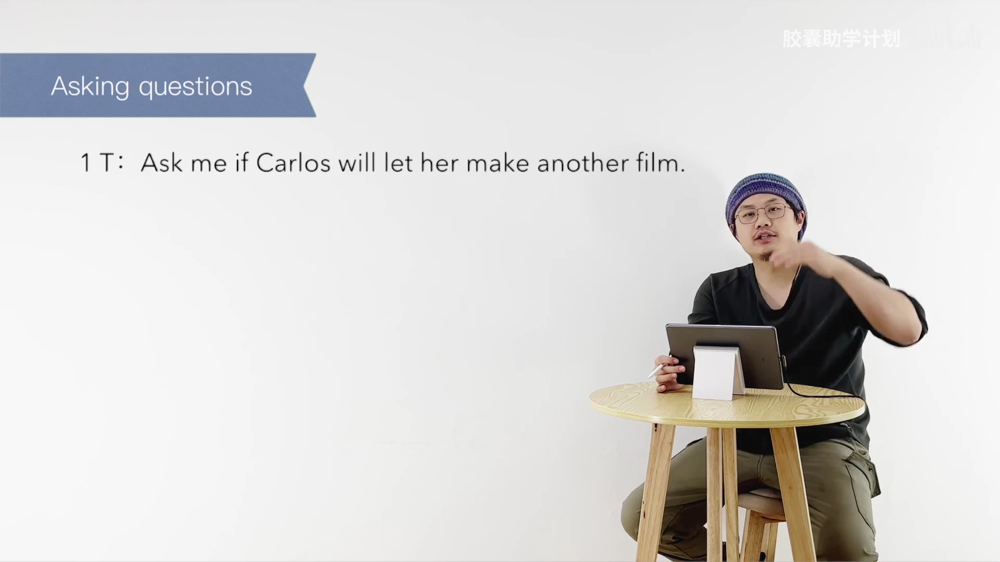

文字识别：Asking questions / 1 T: Ask me if Carlos will let her make another film.

### 画面 00:06:04

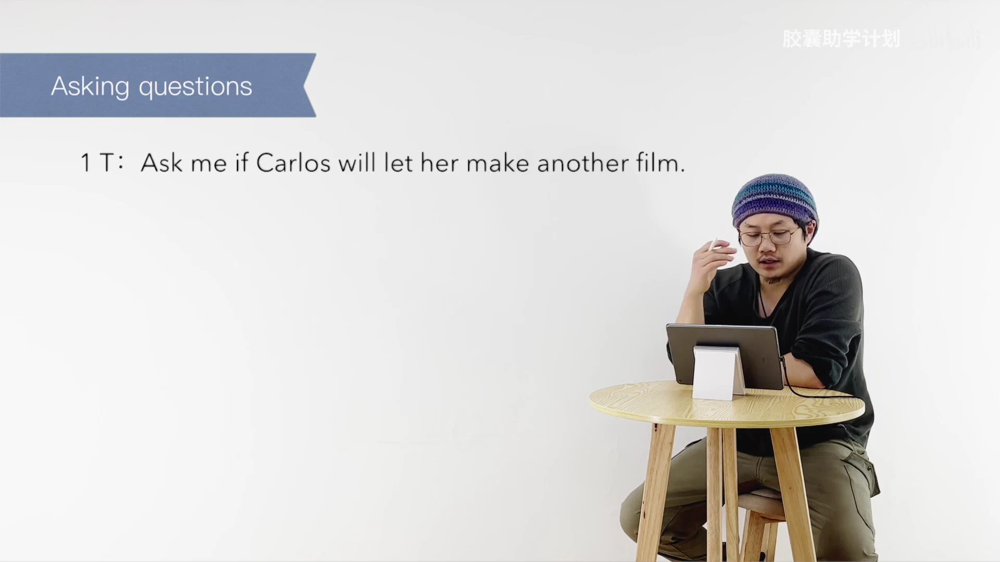

文字识别：Asking questions / 1 T: Ask me if Carlos will let her make another film.

### 画面 00:06:07

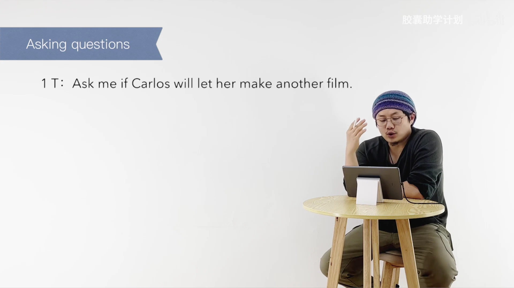

文字识别：Asking questions / 1 T: Ask me if Carlos will let her make another film.

### 画面 00:06:10

文字识别：Asking questions / 1 T: Ask me if Carlos will let her make another film.

### 画面 00:06:18

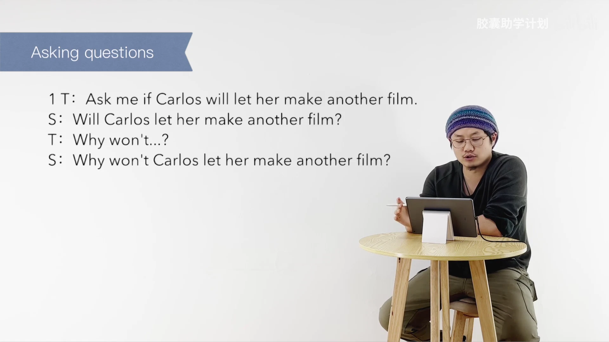

文字识别：Asking questions / 1 T: Ask me if Carlos will let her make another film. / S: Will Carlos let her make another film? / T:Why won't..? / S: Why won't Carlos let her make another film?

### 画面 00:06:24

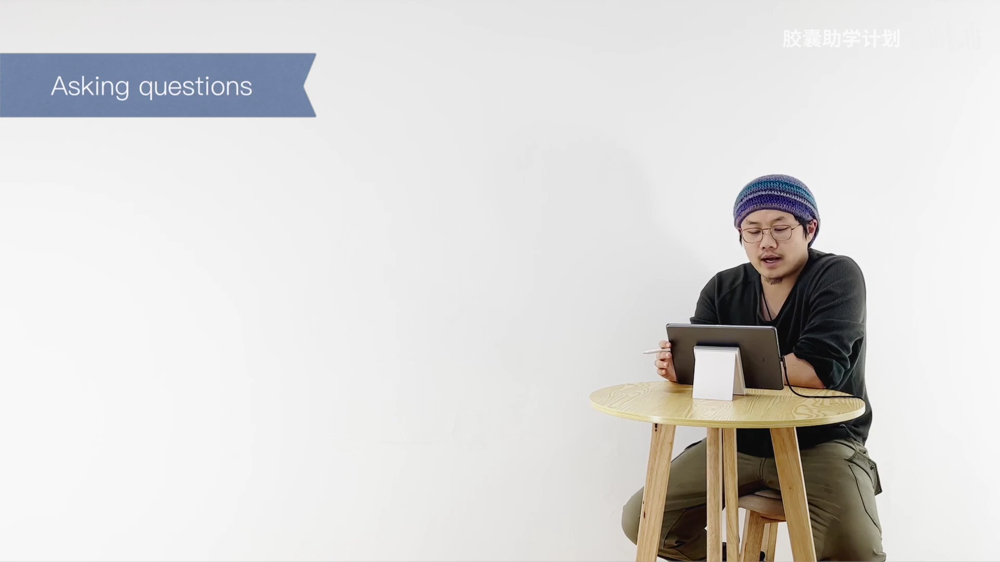

文字识别：Asking questions

## 00:06:30–00:07:00

married next week. Are they going to get married next week? When对next week提问对吧？那对它提问，把它去掉，直接加句首。When are they going to get married? Next one. Ask me if she might retire. Might she retire?非常简单啊。When? When might she retire? Next one. Ask me if she

### 画面 00:06:32

文字识别：Asking questions / 2 T: Ask me if they're going to get married next week. / S: Are they going to get married next week?

### 画面 00:06:44

文字识别：Asking questions

### 画面 00:06:53

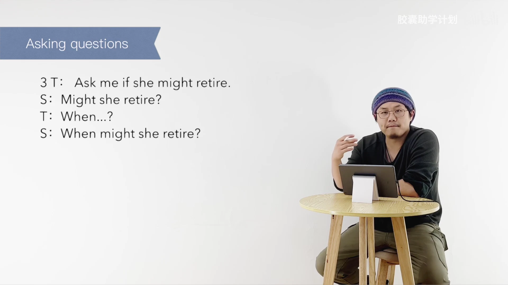

文字识别：Asking questions / 3 T: Ask me if she might retire. / S: Might she retire? / T:When...? / S: When might she retire?

### 画面 00:06:56

文字识别：Asking questions

## 00:07:00–00:07:30

would have to ask her future husband. Would跟will用法一样，直接提句首啊. Would she have to ask her future husband? What? What would she have to ask her future husband? 最后一个, ask me if she introduced them to Carlos. Did she introduce them to Carlos? Who? Who did she introduce

### 画面 00:07:06

文字识别：Asking questions / 4 T: Ask me if she would have to ask her future husband. / S: Would she have to ask her future husband?

### 画面 00:07:11

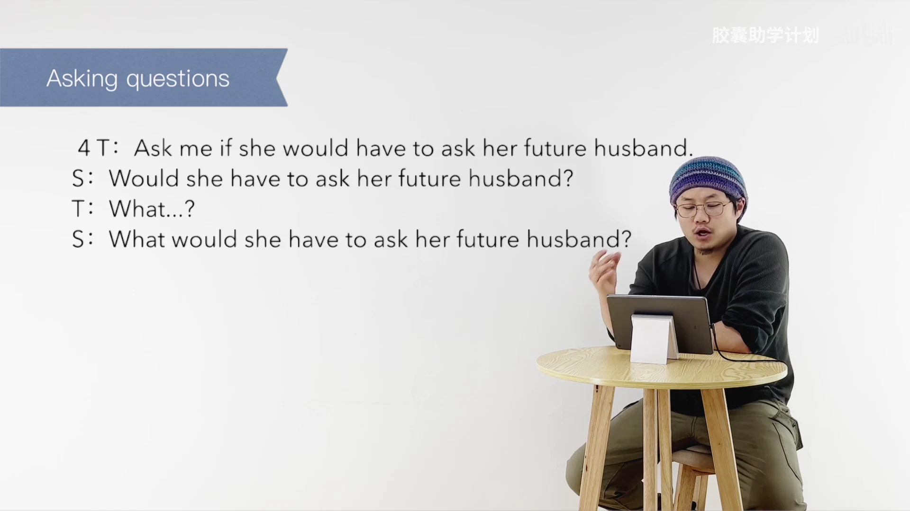

文字识别：Asking questions / 4 T: Ask me if she would have to ask her future husband. / S: Would she have to ask her future husband? / T:What...? / S: What would she have to ask her future husband?

### 画面 00:07:17

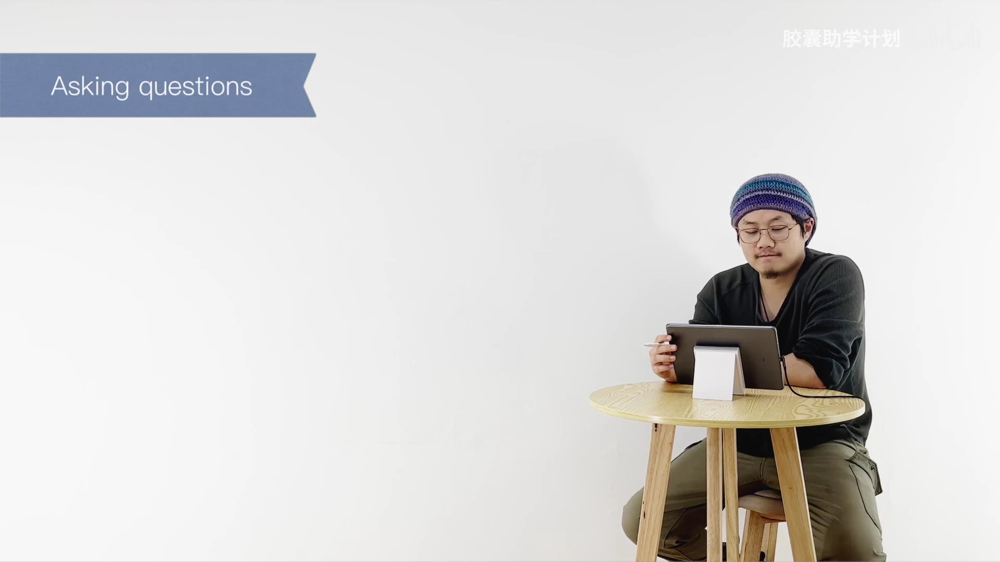

文字识别：Asking questions

### 画面 00:07:27

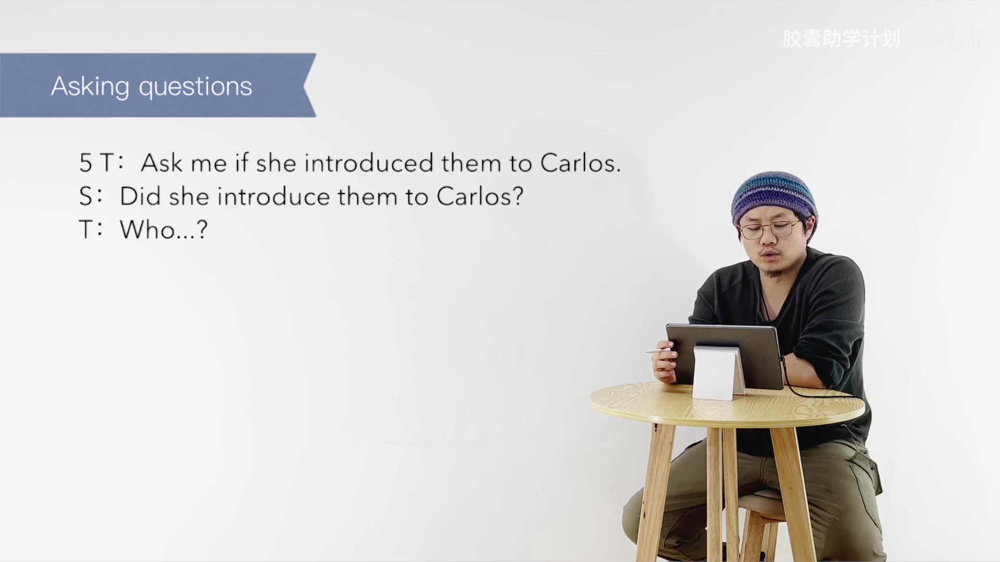

文字识别：Asking questions / 5 T: Ask me if she introduced them to Carlos. / S: Did she introduce them to Carlos? / T：Who...?

## 00:07:30–00:08:00

them to? Answer: Carlos. Okay, very good. 加呃 recap还是非常关键，直接英语变间接英语。情态动词有三个，我们提到了变化，对吧？好，家庭作业呢，绿皮书啊， one hundred and thirty five，你可以写了。文章跟读至熟读成诵，给自己讲解一遍今天的核心知识点。那如果大家喜欢我们的课程呢，欢迎大家关注、订阅、一键三连，分享给那些需要的朋友，来帮

### 画面 00:07:33

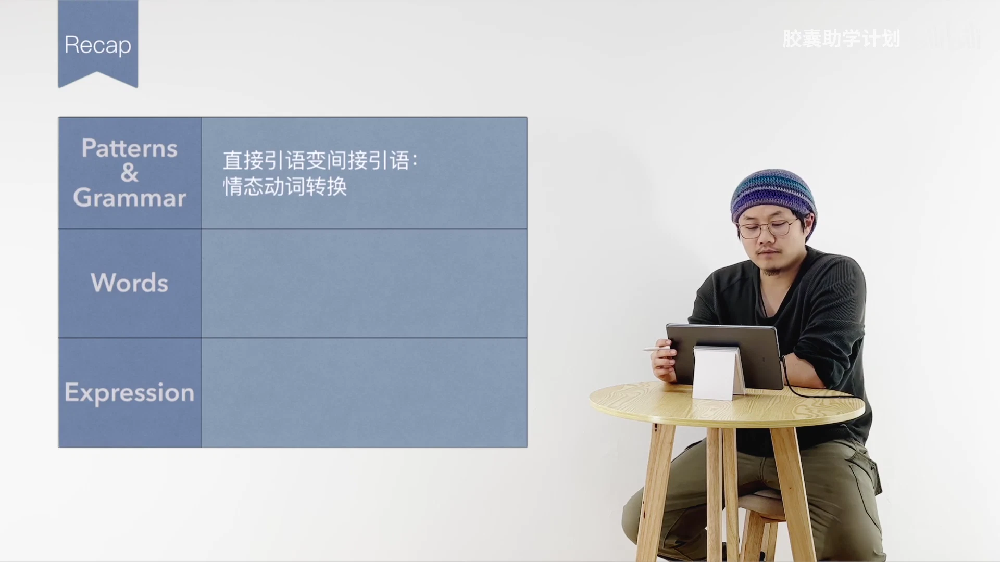

文字识别：Recap / Patterns / 直接引语变间接引语： / 情态动词转换 / Grammar / Words / Expression

### 画面 00:07:42

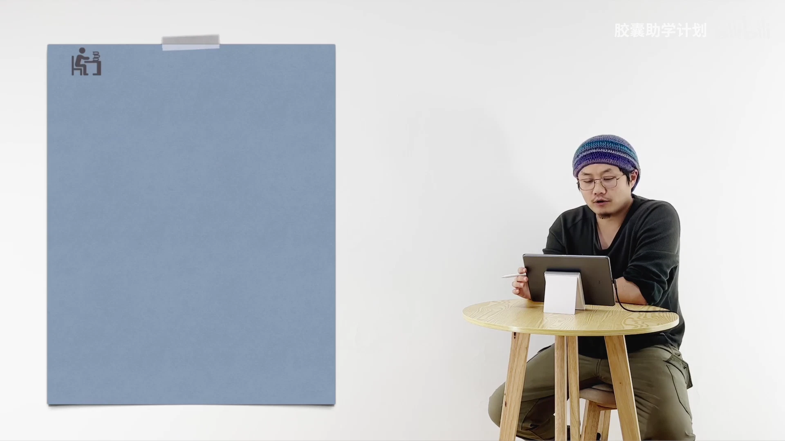

### 画面 00:07:53

### 画面 00:07:56

## 00:08:00–00:08:23

助我们快速成长。最后，我们再看一句名人名言：If you introduce kids to fishing, they become good citizens. See you next time.

### 画面 00:08:02

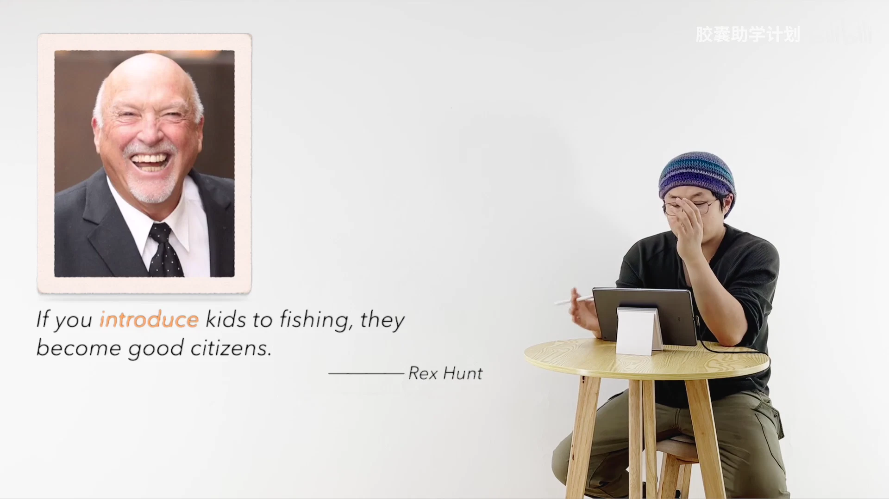

文字识别：If you introduce kids to fishing, they / become good citizens. / -Rex Hunt

### 画面 00:08:04

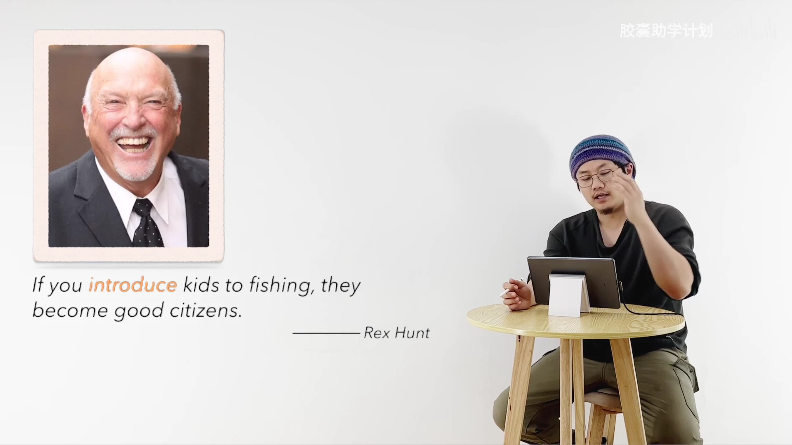

文字识别：If you introduce kids to fishing, they / become good citizens. / -Rex Hunt

### 画面 00:08:11

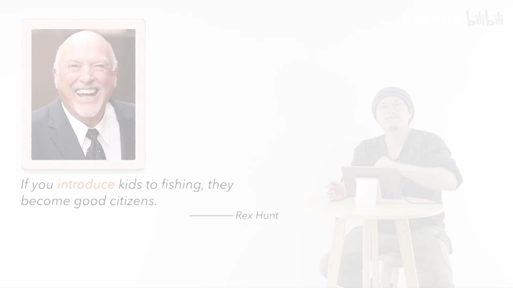

文字识别：If you introduce kids to fishing, they / become good citizens. / Rex Hunt

### 画面 00:08:13

文字识别：CAPSULEACADEMY / 胶囊助学计划 / 小红书 / Lecturer / Leo / OE

### 画面 00:08:16

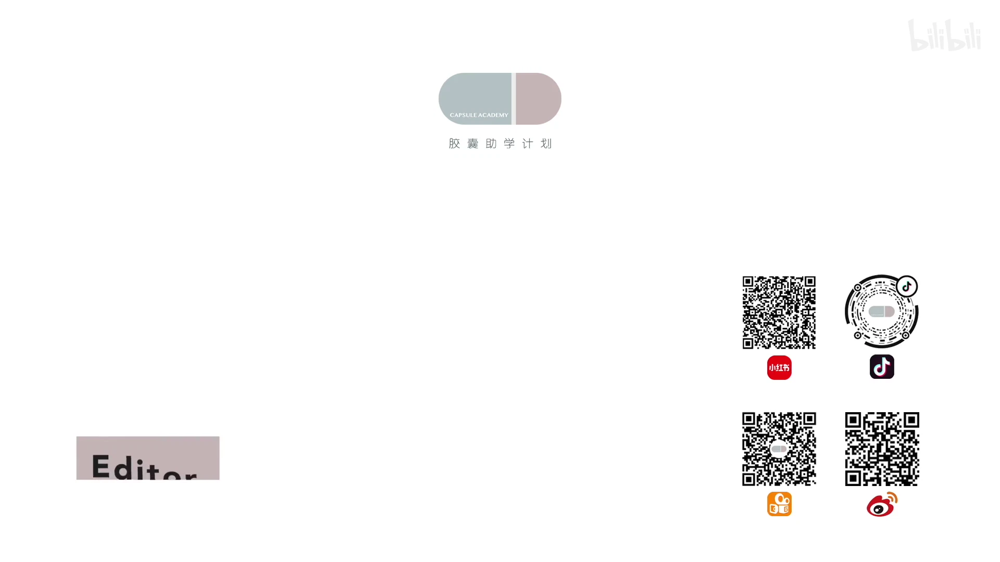

文字识别：CAPSULEACADEMY / 胶囊助学计划 / 小红书 / Editon / OE

### 画面 00:08:19

文字识别：CAPSULEACADEMY / 胶囊助学计划 / 小红书 / Creator / Leo & Berlin / OE

### 画面 00:08:21

文字识别：bilibili / 胶囊助学计划 / 胶囊助学计划 / 小红书 / OE

### 画面 00:08:23

文字识别：bilibili / 胶囊助学计划

