# 137 单词 语法

快速机器解析：语音为单模型转写，未进行独立交叉校对或人工复核；画面每秒采样并按变化选帧，短时文字和标记可能遗漏。截图时间约有 1 秒误差。图片有损压缩；遇到疑点请按时间查看 Google Drive 原视频。

## 00:00:00–00:00:30

Hello, everyone. Welcome to Capsule Academy. This is Leo. Today, we're going to learn new concept English Book One, Lesson One Hundred and Thirty-Seven, Grammar and Words. 那老习惯进入正式课程之前，我们先看一个问题：如何去表达如果怎么怎么样？OK，那带着这个问题，Hope you can enjoy. 那首先很简单，英文当中有一个单词表示的就是如果的意思。这个单

### 画面 00:00:00

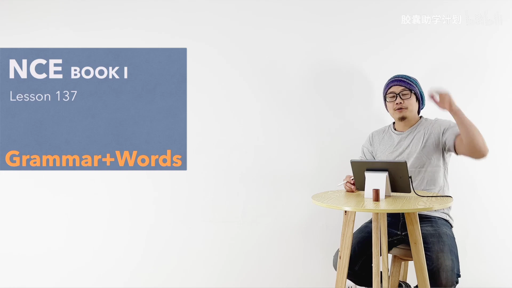

文字识别：胶囊助学计划 / NCE / BOOKI / Lesson 137 / Grammar+Words

### 画面 00:00:10

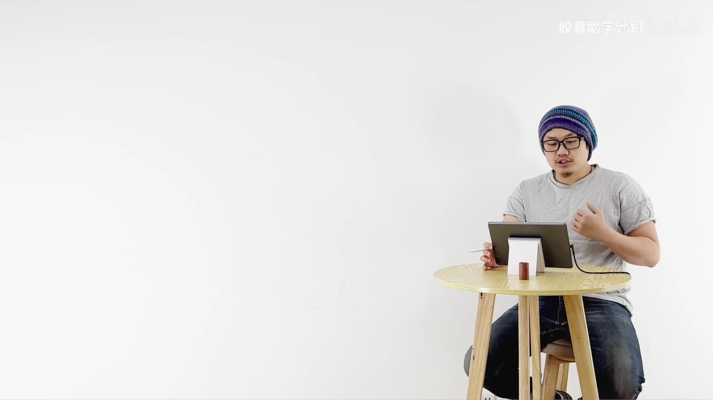

文字识别：胶囊助学计划

### 画面 00:00:12

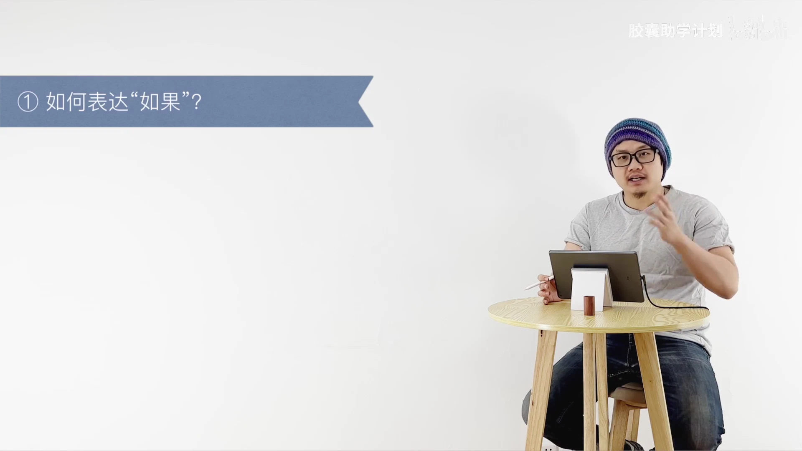

文字识别：胶囊助学计划 / ①如何表达“如果”？

### 画面 00:00:20

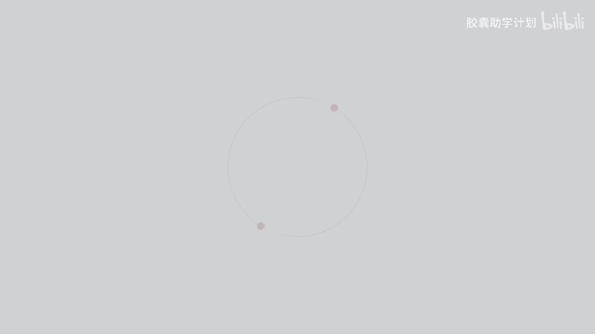

文字识别：bibli / 胶囊助学计划 / •

### 画面 00:00:24

### 画面 00:00:26

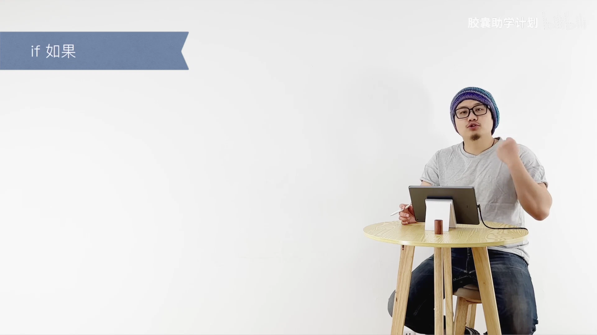

文字识别：胶囊助学计划 / if如果

## 00:00:30–00:01:00

词跟我一起读一下，很简单，叫做 if if。 OK，好，那如何去用它呢？我直接给大家先来一个公式，我们先一起看一下这个公式。if 点点点啊，就代表了一句话。我们先把这句话给它省略掉，叫如果发生了什么什么样的一个情况，后边的一个括弧叫做现，我们管它叫做一般现在时。一会儿我们会再给大家总结啊，就是这句话当中我们要用一般现在时。逗

### 画面 00:00:56

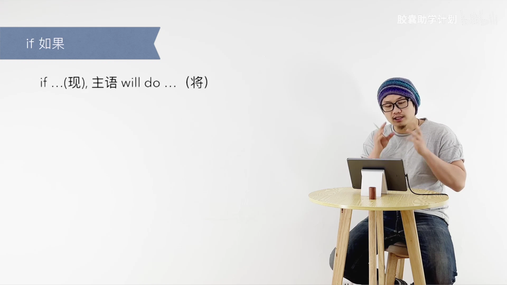

文字识别：胶囊助学计划 / if如果 / if …(现),主语 will do … (将)

## 00:01:00–00:01:30

号告诉各位这句话没有结束，接下来是主语啊，比如说什么某人啊等等等等啊，然后 will do 点点点，然后呢，括弧叫做将这句话想告诉各位，这是这句话要用到的时态是一般将来时，那 will 是我们九十一课学的吧，对吧？叫做一般将来时。比如说我们按照这个呃公式吧，对吧？或者说这样的一个呃例子啊，给大家套一个例子来，比如说 if you

### 画面 00:01:26

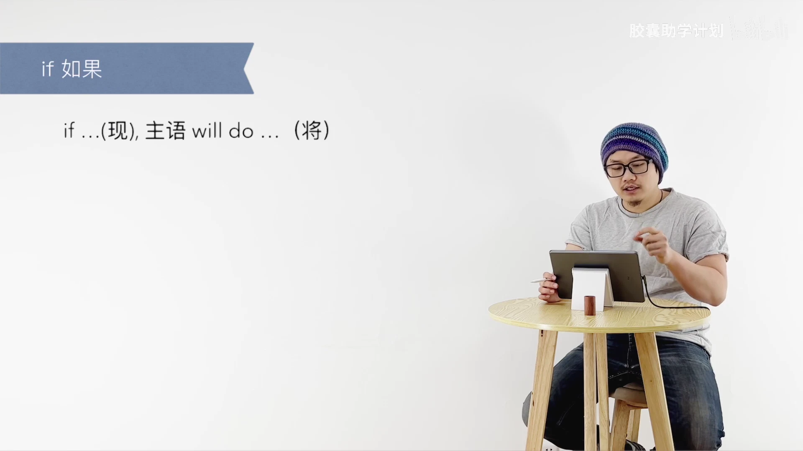

文字识别：胶囊助学计划 / if如果 / if …(现),主语 will do … (将)

## 00:01:30–00:02:00

cook dinner，好，我们注意 you cook dinner，这就是刚才我们说的 if 后边那个点儿点儿点儿，对吧？OK，我们看它用的时态是一般现在时，叫做如果你做晚饭，I will，我将怎么怎么样，I will wash， will do，对吧？好，这句话当中用的是一般将来时，叫我将去 wash the dishes，我将去洗碗。好，我们再看一下这句话，给大家直接再翻译一遍啊，如

### 画面 00:01:32

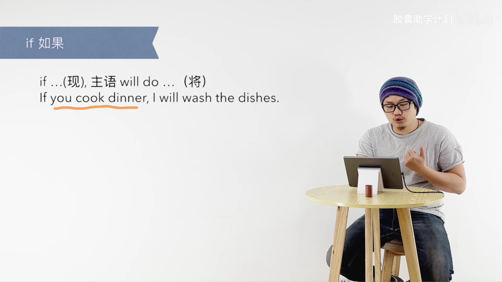

文字识别：胶囊助学计划 / if如果 / if ….(现),主语 will do … (将) / If you cook dinner, I will wash the dishes.

## 00:02:00–00:02:30

果你去做晚饭，我就去洗碗，对吧？非常简单的一句话，那它表示的是一个条件。所以英文当中呢，我们又管前面这半句话叫做条件从句或条件状语从句。那我们先回顾一下，我们在之前已经学过了很多从句了，对吧？比如说九十九课我们学过的叫宾语从句，呃，一百一十七课和一百一十九课我们学过的叫做时间

### 画面 00:02:00

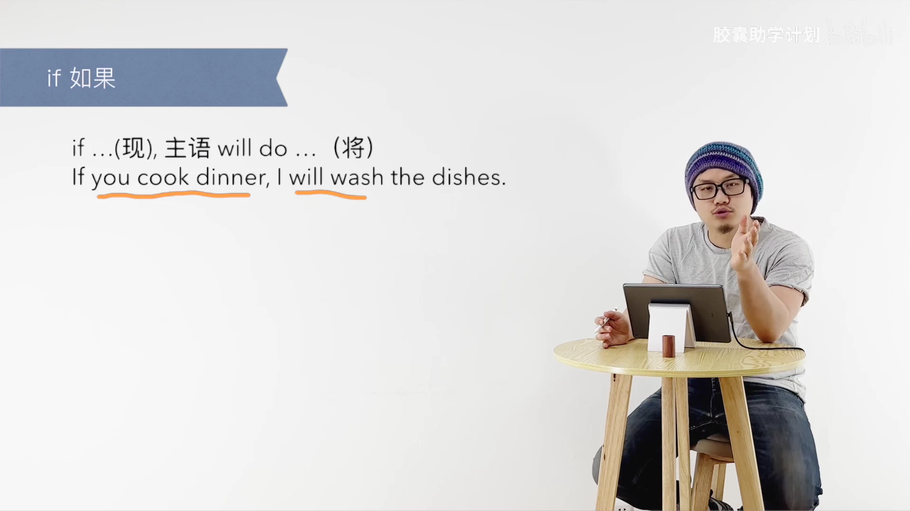

文字识别：胶囊助学计划淵 / if如果 / if …..(现),主语 will do … (将) / If you cook dinner, I will wash the dishes.

### 画面 00:02:19

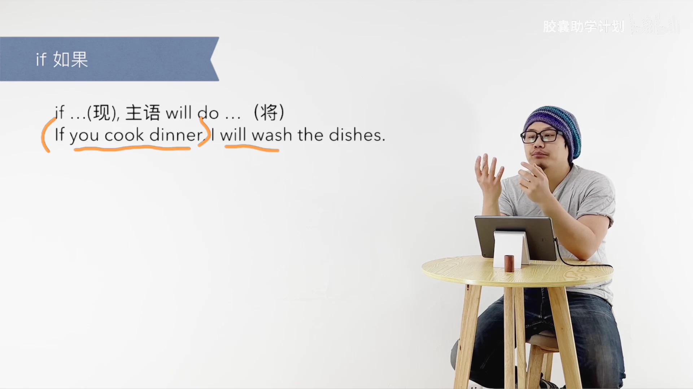

文字识别：胶囊助学计划洲 / if如果 / if …(现),主语 will do …(将) / If you cook dinnerI will wash the dishes.

## 00:02:30–00:03:00

从句或时间状语从句，对吧？那今天呢，我们学到了一个叫做条件从句或条件状语从句。状语这两个字对于各位来说不是很重要啊，最重要的是你知道这句话，首先它叫从句，对吧？所以呢，啊，OK，那其次啊，不着急，我们看 if 现在这句话引导的是放从句是放在前面了，对吧？英文这个语言啊，它也可以放后面，比如说 I will wash the dishes

### 画面 00:02:49

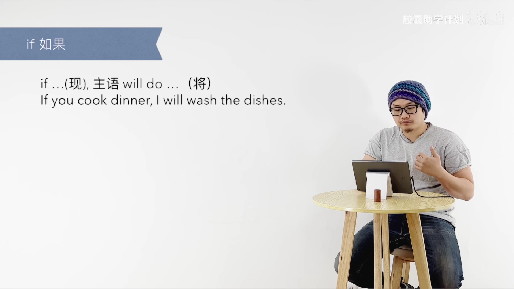

文字识别：胶囊助学计划 / if如果 / if ..(现),主语 will do…(将) / If you cook dinner, I will wash the dishes.

## 00:03:00–00:03:30

if you cook dinner. 叫我会去洗碗，如果你做晚饭的话，对吧？这是一个条件，叫做满足了你做晚饭这个条件，我就去洗碗。然后这个地方注意一小下，英文的，你如果是口语那就无所谓了。在书写当中注意，如果把 if 那个从句放前面呢，后边有个逗号啊。如果您放后边了，那就不用加这个逗号了，对吧？大多数情况下，呃，基本上各位不用过分的去关心啊，很少

### 画面 00:03:16

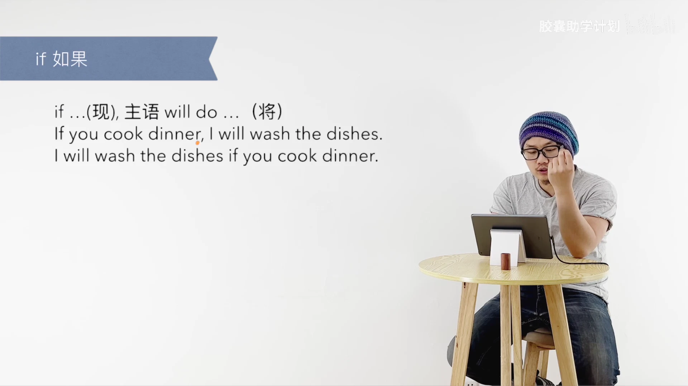

文字识别：胶囊助学计划 / if如果 / if …(现),主语 will do … (将) / If you cook dinner, I will wash the dishes. / I will wash the dishes if you cook dinner.

## 00:03:30–00:04:00

会因为这个去扣分的。OK，好，那我们就可以总结出来这样一句话啊，四个字叫主将从现，什么意思呢？就是在这个条件从句之下，其中一个方案叫做，如主句用一般将来时，从句用一般现在时，哪怕从句表述的是明天，它依旧用一般现在时。一会儿我们一起看，好吧？OK，那接下来我们看一些例子啊，比如

### 画面 00:03:34

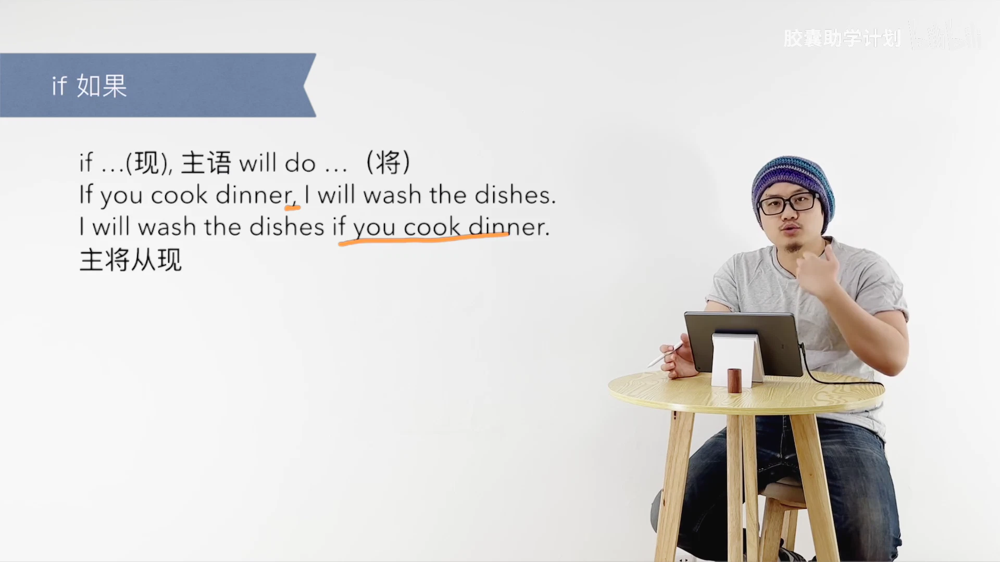

文字识别：胶囊助学计划 / if如果 / if …..(现),主语 will do… (将) / If you cook dinner, I will wash the dishes. / I will wash the dishes if you cook dinner. / 主将从现

### 画面 00:03:58

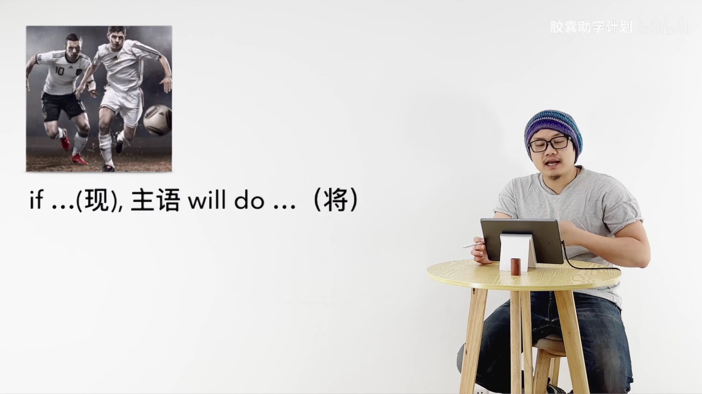

文字识别：胶囊助学计划 / if .(现),主语will do … (将)

## 00:04:00–00:04:30

说 I will play football with you tomorrow if my mom isn't at home. 你看这句话当中，首先我们先去翻译，它是很容易理解的，叫做我将和你踢足球，明天，明天我和你一起踢足球。如果我妈妈不在家，你注意，你看啊，你仔细去想，说我明天和你去踢足球，如果我妈妈不在家，这句话如果你是理解，如果我妈现在不在家，明天我和你去踢足球，是不是就不太通顺

### 画面 00:04:00

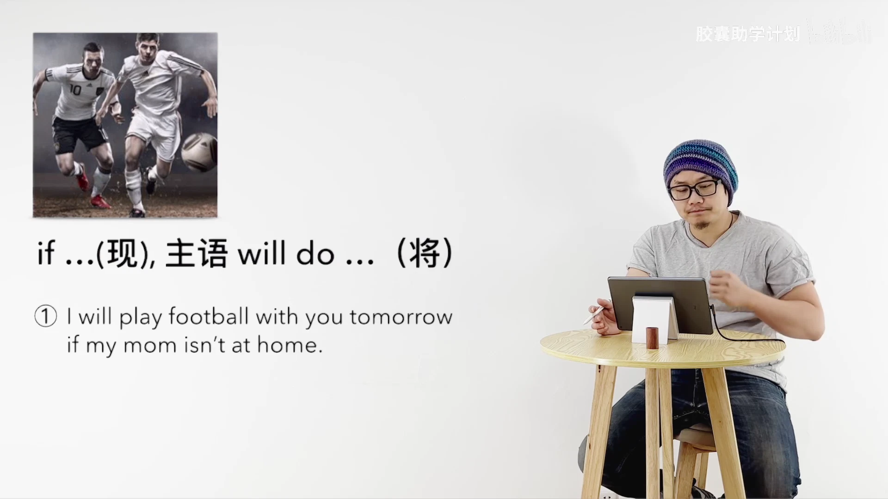

文字识别：胶囊助学计划 / if ..(现),主语 will do… (将) / ① I will play football with you tomorrow / if my mom isn't at home.

### 画面 00:04:20

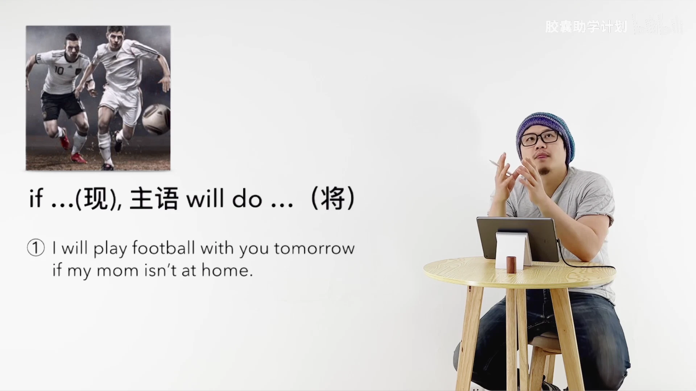

文字识别：胶囊助学计划 / if .(现),主语 will do… (将) / ① I will play football with you tomorrow / if my mom isn't at home.

## 00:04:30–00:05:00

能理解哈。Okay,所以它一定表达的是，如果我母亲我妈妈明天不在家，我明天就和你去踢足球。但你看它的时态，if my mom isn't at home，它依旧选择的时态是一般现在时。这就是刚才我们提到叫做主将，主句用的是一般将来时，从现从句用的是一般现在时。哪怕它表述的时间是将来，OK吧？好，Let's continue，再来说，

### 画面 00:04:41

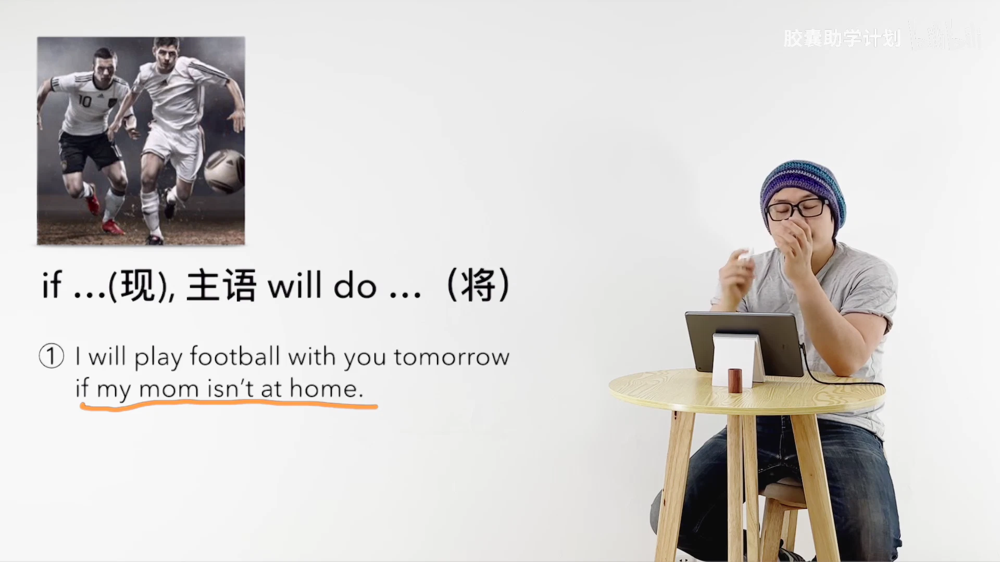

文字识别：胶囊助学计划 / if ..(现),主语 will do… (将) / ① I will play football with you tomorrow / if my mom isn't at home.

### 画面 00:04:52

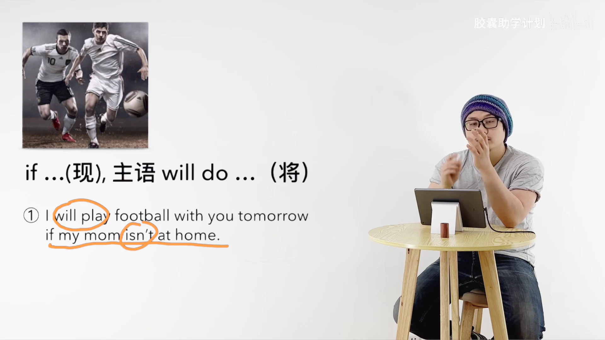

文字识别：胶囊助学计划 / if ..(现),主语will do… (将) / ①I will play football with you tomorrow / if my momisn't at home.

### 画面 00:04:58

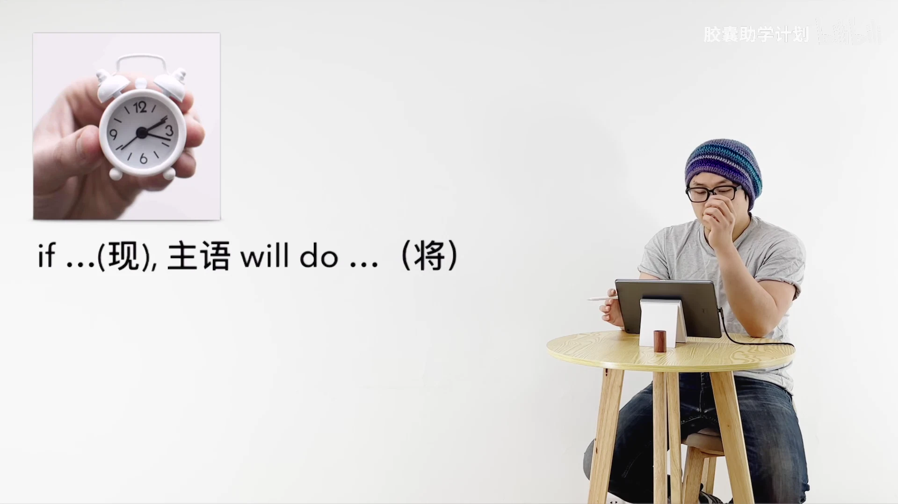

文字识别：胶囊助学计划 / 12 / if .(现),主语 will do … (将)

## 00:05:00–00:05:30

If I have enough time tomorrow, I will come to see you.啊，这句话就更夸张了。你看，我们直接把从句当中出现了tomorrow，但依旧我用的时态是一般现在时，叫做主将从现，对吧？主句是一般将来时，从句是一般现在时。OK, I will come to see you.我就会来见你的，非常的简单啊。Let's continue.说If I miss the bus, I

### 画面 00:05:11

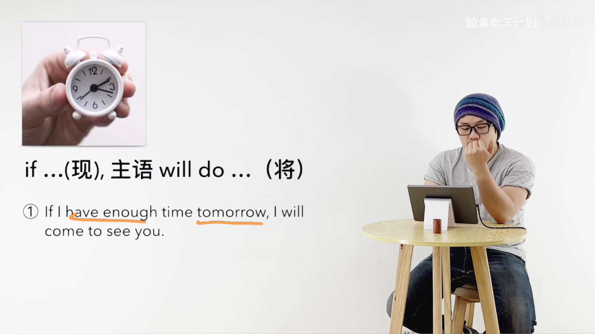

文字识别：胶囊助学计划 / 12 / if .(现), 主语will do… (将) / ① If I have enough time tomorrow, I will / come to see you.

### 画面 00:05:26

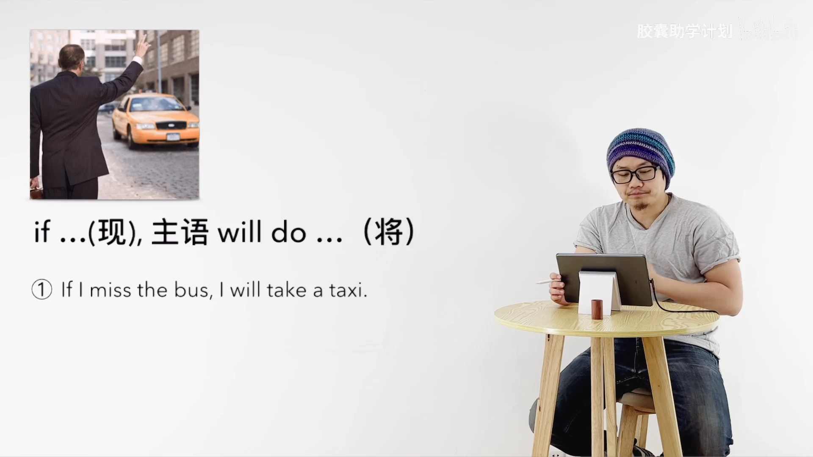

文字识别：胶囊助学计划 / if .(现),主语 will do… (将) / ① If I miss the bus, I will take a taxi.

## 00:05:30–00:06:00

will take a taxi. 如果我错过了这个公交车，那我就会去打一辆车。你放心，对吧？所以呢，这句话当中，注意主句是这句话叫 I will take a taxi。所以如果你想去变一般疑问句的时候，注意不是这个，不看这儿，要看主句，对吧？所以如果它变一般疑问句，就叫做 Will you take a taxi if you miss the bus? 是你愿

### 画面 00:05:44

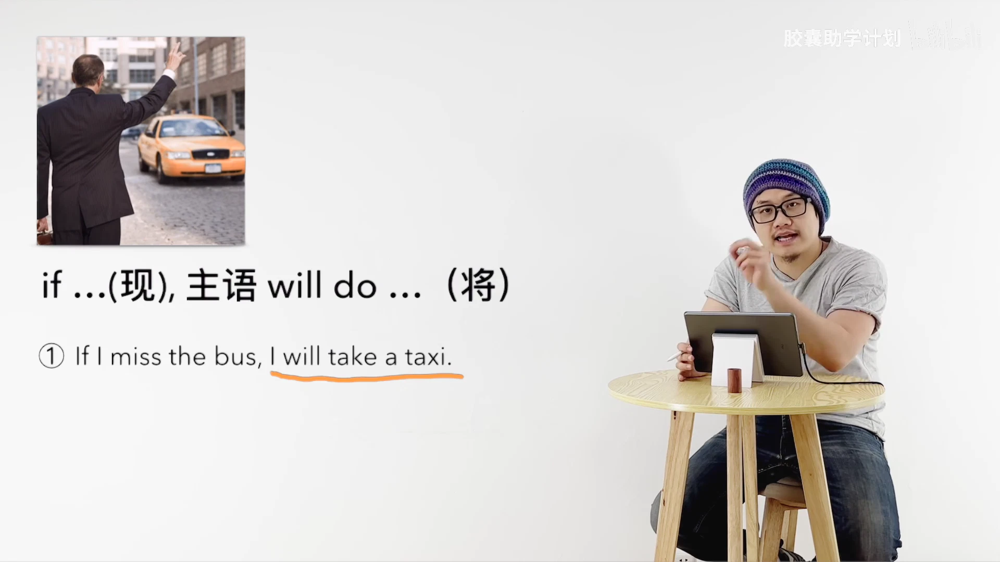

文字识别：胶囊助学计划 / if .(现),主语will do… (将) / ① If I miss the bus, I will take a taxi.

### 画面 00:05:54

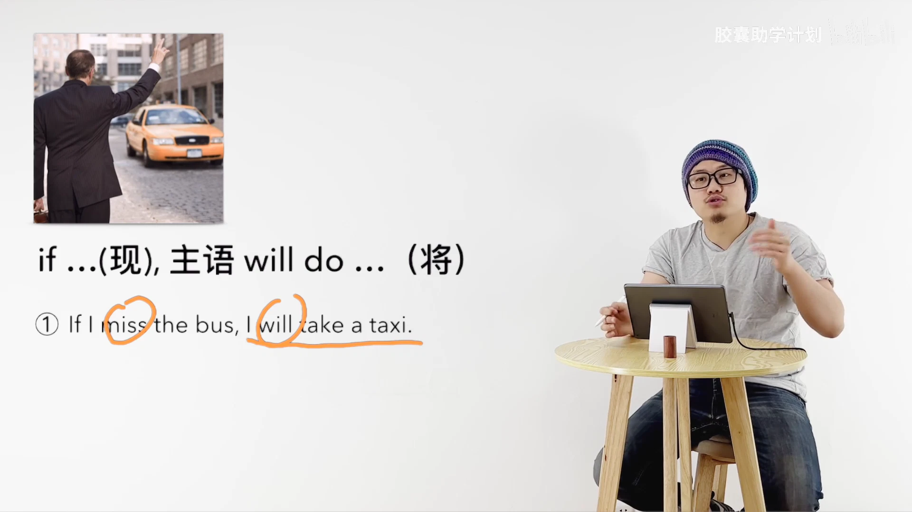

文字识别：胶囊助学计划 / if .(现), 主语 will do ….(将) / ① If l  / nissthe bus, I / will / ake a taxi.

## 00:06:00–00:06:30

意去打车吗？如果你错过公交车，OK啊，这个地方要注意一下，这很重要啊。Continue, say if it rains, we won't go shopping.那当然这就出现否定了，是will加not，我们就不去购物了。如果下雨，我们就不去购物。主将从现，对吧？OK, continue, say if it rains tomorrow.如果明天下雨，您看这儿还是选择用了一般现在时，这就是英文的语法习惯，

### 画面 00:06:06

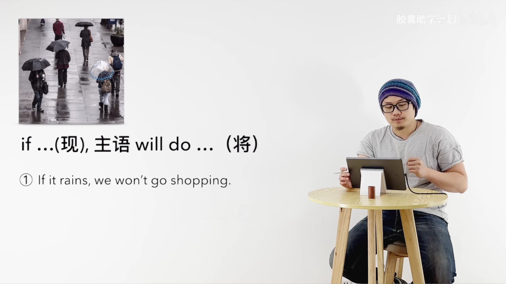

文字识别：胶囊助学计划 / if .(现), 主语 will do… (将) / ① If it rains, we won't go shopping.

### 画面 00:06:19

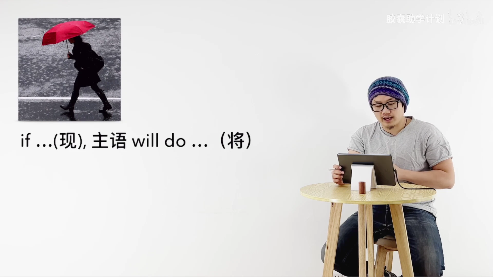

文字识别：胶囊助学计划 / if .(现), 主语 will do … (将)

## 00:06:30–00:07:00

吧。We will do nothing. 那我们什么也不做。Okay, very good. 好，那接下来呢？刚才这个语法很简单，我们简单浏览一遍了之后呢，进入文章和偶数课，我们会继续练得到。现在我们就看一下本课的单词。第一个单词对于各位来说，很可能您是认得的。跟我一起读一下，叫做 football。 football叫足球，对吧？比如说， this is the football。好看单看，如果只看

### 画面 00:06:35

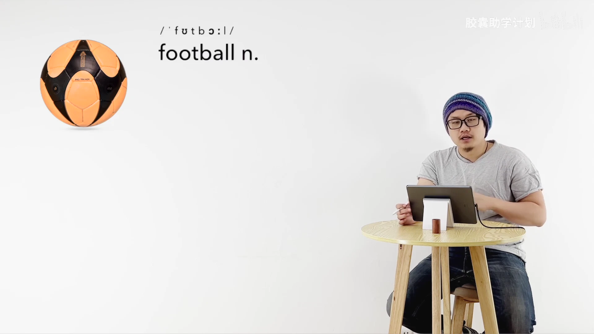

文字识别：胶囊助学计划 / /'futbo:l/ / football n.

### 画面 00:06:54

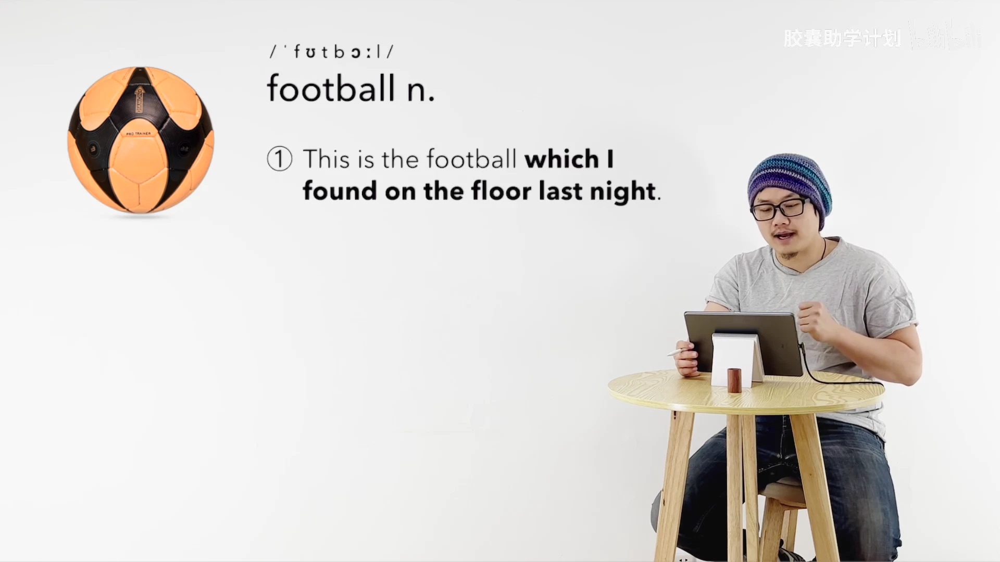

文字识别：胶囊助学计划 / / 'fut bo:l / / football n. / ① This is the football which I / found on the floor last night.

## 00:07:00–00:07:30

到这里，就会觉得很怪，对吧？这只有哪种可能性呢？叫做你教你们家小孩说，哎，这个就是足球，这个是篮球，对吧？你如果跟一个成人说这个是足球，就会很怪了。在一百二十三课和一百二十一课，我们提到了，它往往是因为后边其实连了一个定语从句，对吧？我们在这儿加了一个定语从句，叫做 which I found on the floor last night。说我昨天晚上在地板上看到的这个足球啊，我

### 画面 00:07:20

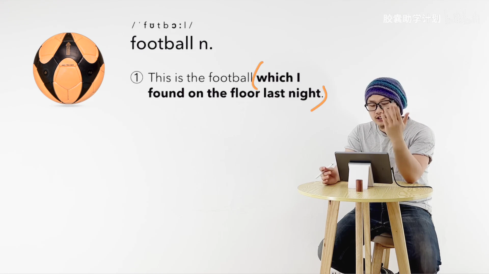

文字识别：胶囊助学计划 / / 'fut bo:l / / football n. / ① This is the footballwhich I / found on the floor last night.

## 00:07:30–00:08:00

找到的这个足球，对吧？那我的问题就是，which能不能被省略呢？Okay,啊，Continu说，When he was playing football yesterday afternoon, his mom called him,是吧？当他昨天下午正在踢足球的时候，他妈妈给他打了一个电话，或者叫了他一声。比如说他在院子里，那就不是打电话了，对不对？我们要结合具体的场景，具体去看这里的call翻译成什么意思。Continu说，What were they doing？他们当时正在干什么呢？Who knows？

### 画面 00:07:33

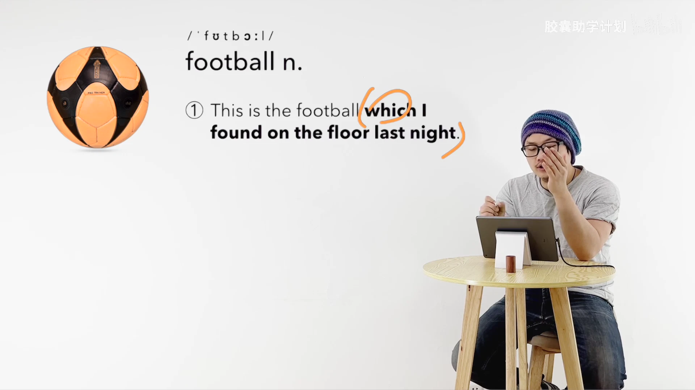

文字识别：胶囊助学计划 / / 'fut bo:l / / football n. / PROTRANEA / ① This is the footballWhich I / found on the floor last night.

### 画面 00:07:37

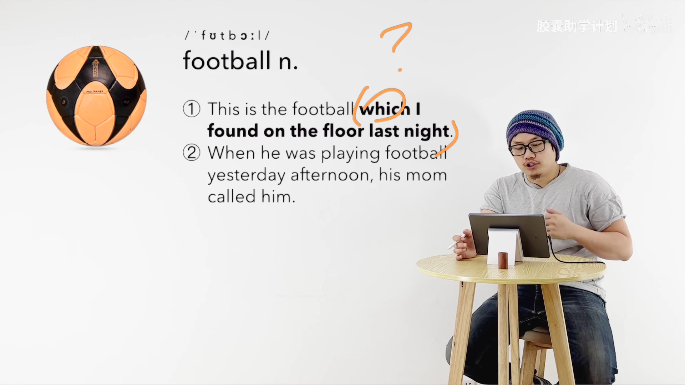

文字识别：胶囊助学计划 / / 'fut bo:l/ / football n. / ① This is the footballWhichI / found on the floor last night. / When he was playing football / yesterday afternoon, his mom / called him.

### 画面 00:07:45

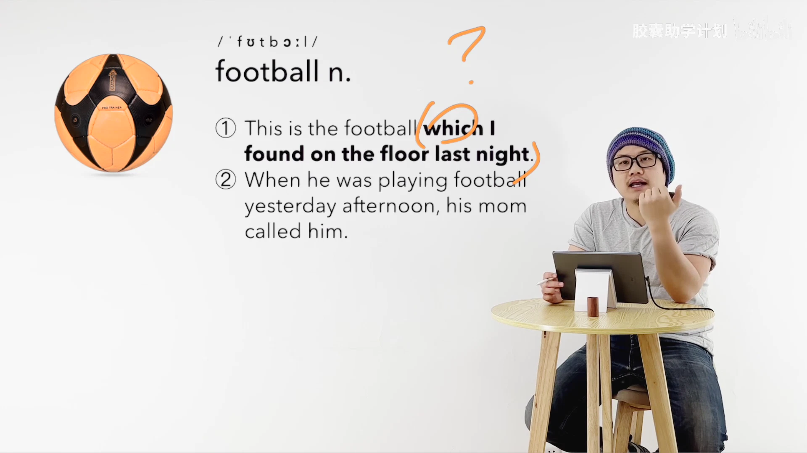

文字识别：胶囊助学计划 / / 'fut bo:l/ / football n. / This is the footballWhichI / 1 / found on the floor last night. / When he was playing football / yesterday afternoon, his mom / called him.

### 画面 00:07:55

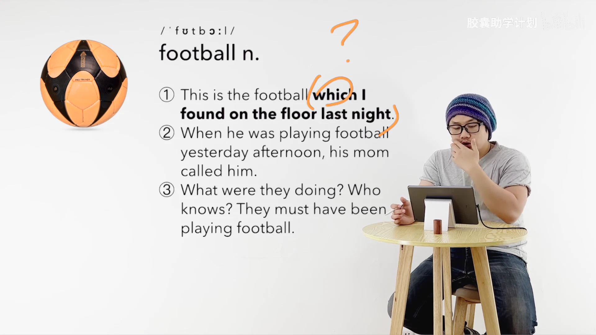

文字识别：胶囊助学计划！ / /'fut bo:l/ / football n. / ① This is the footballWhichI / found on the floor last night. / When he was playing footbalł / yesterday afternoon, his mom / called him. / What were they doing? Who / knows? They must have been / playing football.

## 00:08:00–00:08:30

谁知道啊？就 I don't know, actually. 所以那 they must have been playing football. 哎，他们当时一定是正在踢足球。当然了，Who knows? 我们也可以尝试把 must 去掉，变成 may have been. 哎，听上去好像又舒服一点点。那他们当时正在干什么呢？谁知道啊？当时可能正踢足球了吧？可能正在踢足球了吧？一百三十一课学过的，对吧？Next one，下一个

### 画面 00:08:04

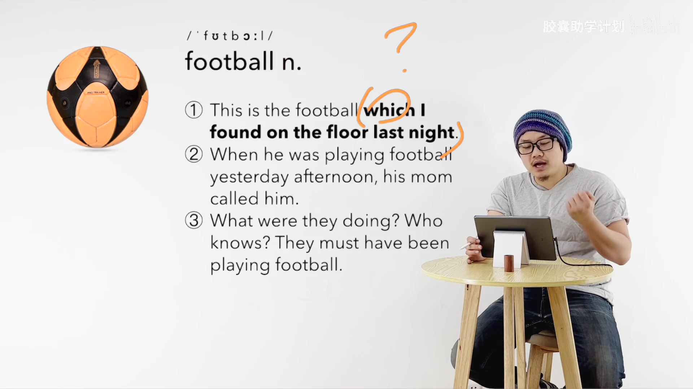

文字识别：胶囊助学计划 / /'fut bo:l/ / football n. / ① This is the footballWhichI / found on the floor last night. / When he was playing footbalł / yesterday afternoon, his mom / called him. / What were they doing? Who / knows? They must have been / playing football.

### 画面 00:08:16

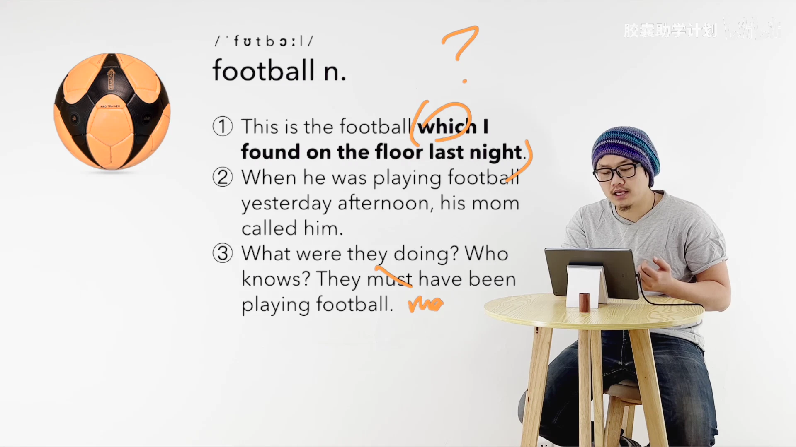

文字识别：胶囊助学计划 / /'futbo:l/ / football n. / ① This is the footballWhich I / found on the floor last night. / When he was playing football / yesterday afternoon, his mom / called him. / What were they doing? Who / knows? They must have been / playing football. / w

### 画面 00:08:28

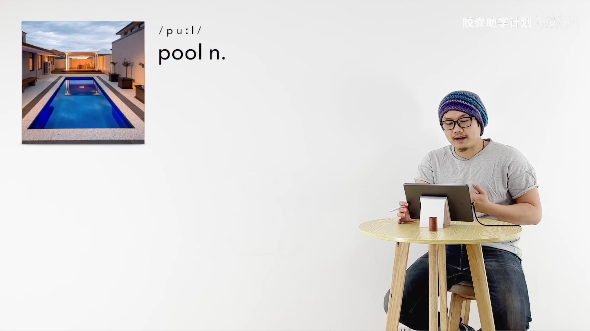

文字识别：胶囊助学计划 / /pu:l/ / pool n.

## 00:08:30–00:09:00

词，跟我一起读一下，叫做 pool， pool。好，在本课当中，它出现了一个意思，叫做这个赌池，是吧？叫赌注啊。那它比较常用的意思，我们本课学这个意思啊，叫做 swimming pool，叫做泳池，对吧？赌池啊，泳池 swimming pool。那我们造句子，说 This is the biggest swimming pool I've ever seen。一百一十一课我们学过的关键句型。OK， next one，

### 画面 00:08:37

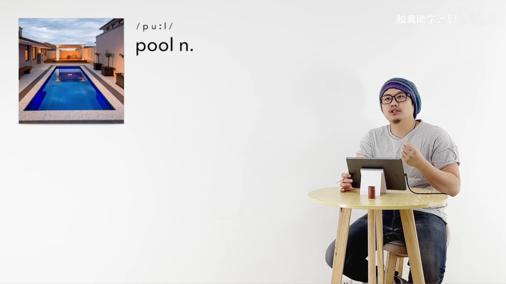

文字识别：胶囊助学计划 / /pu:l/ / pool n.

### 画面 00:08:49

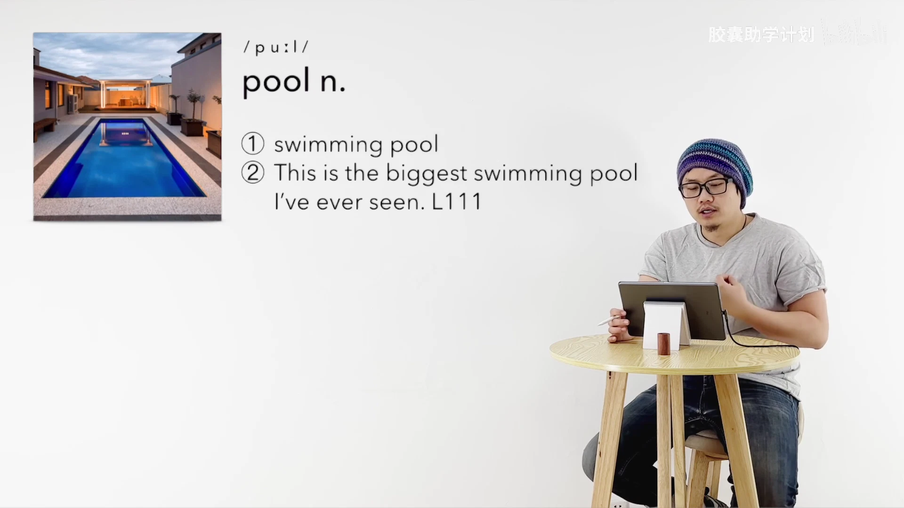

文字识别：胶囊助学计划 / /pu:l/ / pool n. / swimming pool / This is the biggest swimming pool / I've ever seen. L111

### 画面 00:08:59

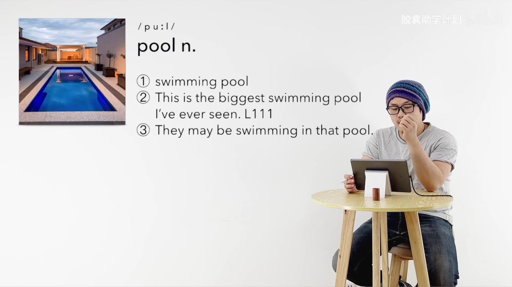

文字识别：胶囊助学计划 / /pu:l/ / pool n. / swimming pool / This is the biggest swimming pool / I've ever seen. L111 / They may be swimming in that pool.

## 00:09:00–00:09:30

说They may be swimming in that pool, may be doing一百三十一课学过的，表示当时啊现在可能是正在游泳。Next one说They must be swimming.那把may换成了must，就表示的是很确信的推测，他们现在一定是正在游泳。OK，那对于各位来说，在这个地方去造句的时候，您不妨参考一下三和四。比如说，我提一个例子，您把must换成can't，这句话就是您的了，叫They

### 画面 00:09:12

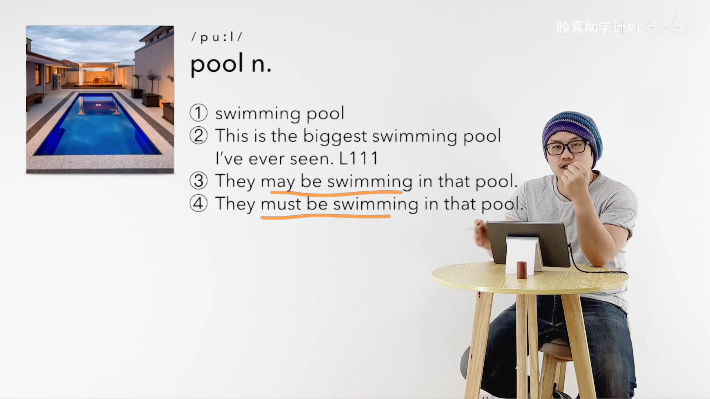

文字识别：胶囊助学计划 / /pu:l/ / pool n. / swimming pool / This is the biggest swimming pool / I've ever seen. L111 / They may be swimming in that pool. / They must be swimming in that pool.

## 00:09:30–00:10:00

can't be swimming in that pool，对吧？所以您不妨翻译一下一百二十七克、一百二十九克和一百三十一克，我们学过的那些核心的公式，表推测的那些公式，在在这个地方，哎，稍微变一下，您就造出句子来了。Next one，下一个单词，跟我一起读一下，原型 win，win，过去式，过去分词 won，won，啊，跟一那个单词基本上是一个发音啊。Win，叫做赢，比如说 I won the game，啊，我赢

### 画面 00:09:42

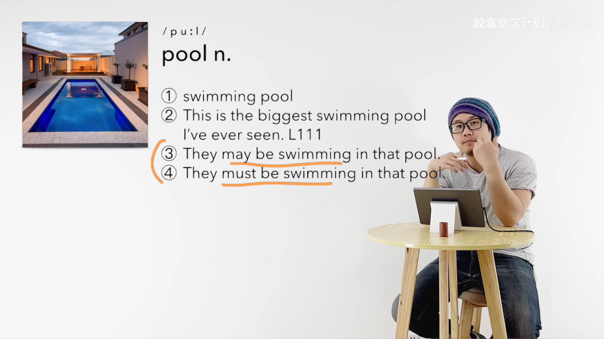

文字识别：胶囊助学计划 / /pu:l/ / pool n. / swimming pool / This is the biggest swimming pool / I've ever seen. L111 / They may be swimming in that pool. / They must be swimming in that poot

### 画面 00:09:45

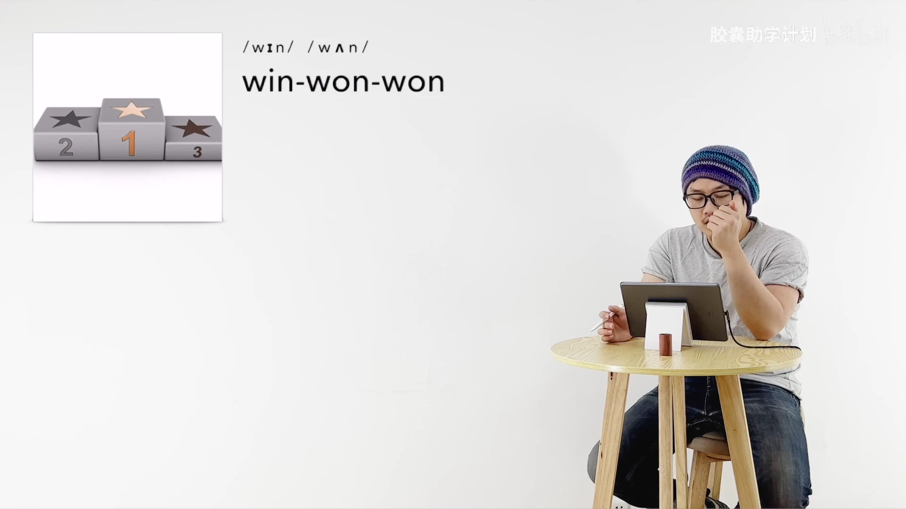

文字识别：胶囊助学计划 / /wIn/ /wan/ / win-won-won / 1

## 00:10:00–00:10:30

了这个比赛，对吧？一般过去式变成一般疑问句，Did you win the game? How did you win the game? 和 Who won the game? 你看，直接给大家又表现啊，表这个这个提了一下，对吧？肯定句变成一般疑问句，变成两个特殊疑问句啊。当然，我们也可以造这样一句话，叫 After they had won the game, they went to a bar, 对吧？这是我们九十五课 went to go to a bar，以及一百一十九课非常重要的 After

### 画面 00:10:05

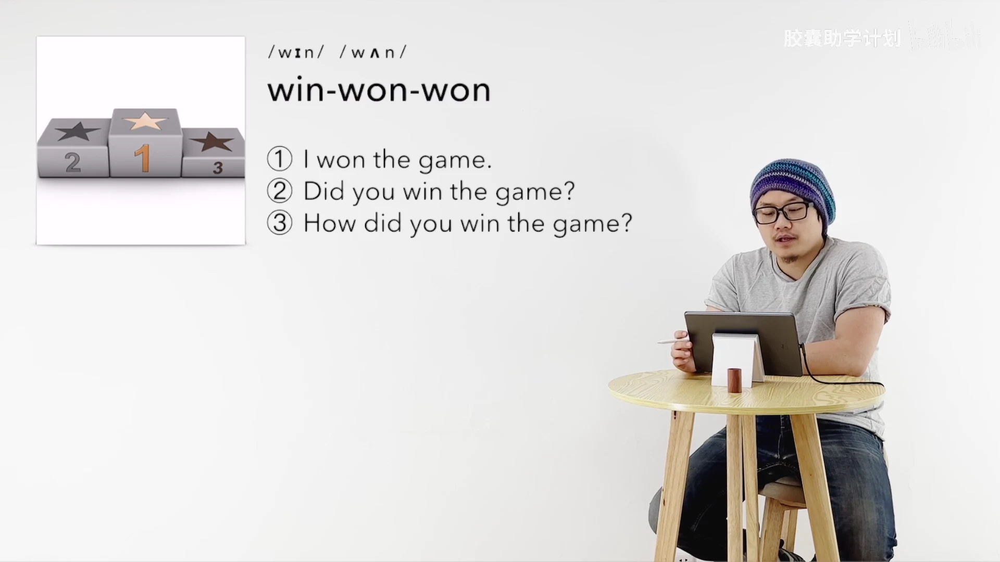

文字识别：胶囊助学计划 / /wIn/ /wan/ / win-won-won / ① I won the game. / Did you win the game? / 2 / How did you win the game? / 3

### 画面 00:10:18

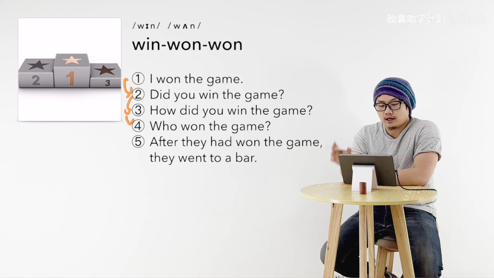

文字识别：胶囊助学计划 / /WIn/ /wΛn/ / win-won-won / ① I won the game. / 3 / Did you win the game? / 3 / How did you win the game? / Who won the game? / After they had won the game, / 5 / they went to a bar.

## 00:10:30–00:11:00

a逗号 b对吧 had加done叫做过去完成式。他们赢了比赛之后，他们去了一个酒吧。Okay, play一个庆祝一下嘛。Next one，下一个单词跟我一起读一下。注意这个地方舌尖要舔上牙龈啊，不能读成word对吧？Word都不对啊。World, world. Okay，好叫做世界。那比如说 travel round the world叫做环游世界啊。Travel不是旅游的

### 画面 00:10:38

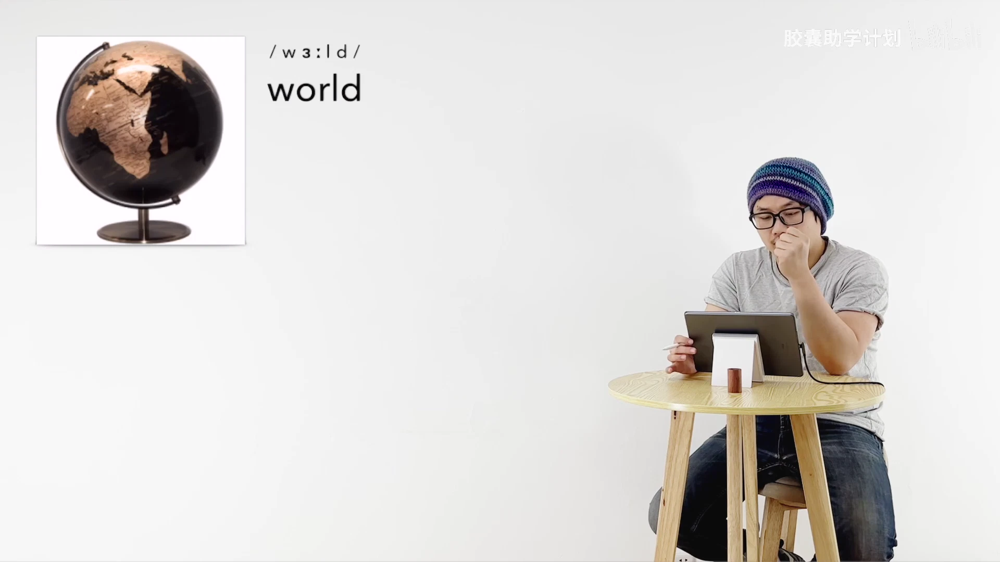

文字识别：胶囊助学计划 / /w3:ld/ / world

## 00:11:00–00:11:30

意思吗？Travel round the world，环游世界。那in the world叫做在这个世界当中。好，我们造句子啊，比如说，You are the best father in the world.啊，一百零九课咱们就学过了，best表示的是good的最高级，对不对？啊，你是全世界最棒的父亲。Next one，When I was very young，I always wanted to travel round the world.说当我还很小的时候，我总是想

### 画面 00:11:07

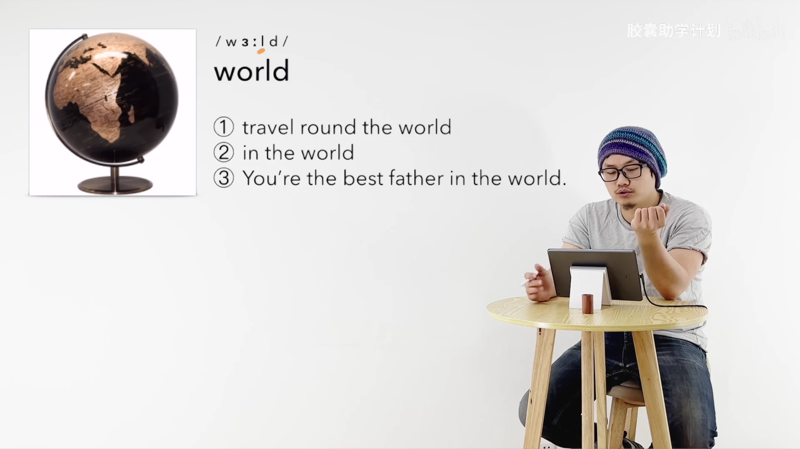

文字识别：胶囊助学计划淵 / /w3:1d/ / world / ① travel round the world / ② in the world / ③ You're the best father in the world.

### 画面 00:11:19

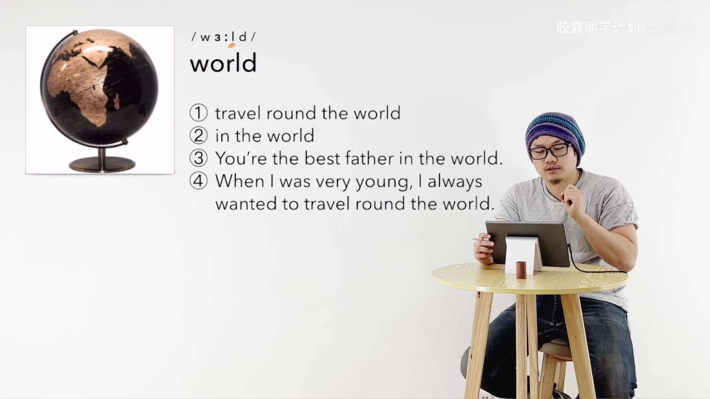

文字识别：胶囊助学计划 / /w3:1d / / world / ① travel round the world / ② /  in the world / You're the best father in the world. / 3 / When I was very young, I always / wanted to travel round the world.

## 00:11:30–00:12:00

去环游世界。Okay, very good. Next one,下一个单词跟我读一下，叫做poor, poor。之前我们学过rich, poor，对吧？rich有钱，poor贫穷啊，这个没钱，对吧？啊，穷啊。比如说，the poor guy who you met last year is very rich now，是吧？去年你见到的那个穷人，哎，定语从句是吧？指的是guide啊，那哥们儿，那家伙is very rich now，

### 画面 00:11:33

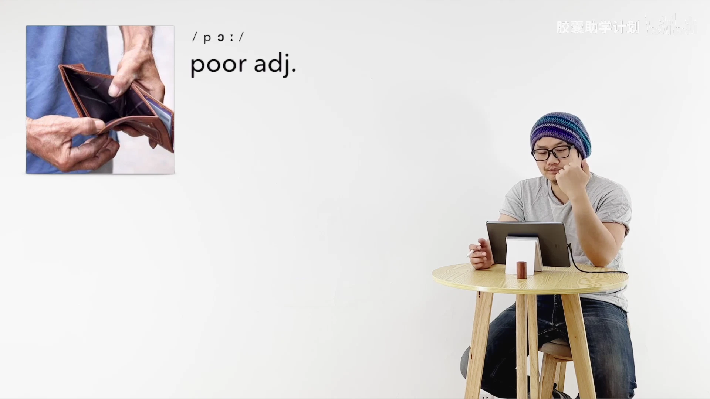

文字识别：胶囊助学计划 / / ρo:/ / poor adj.

### 画面 00:11:45

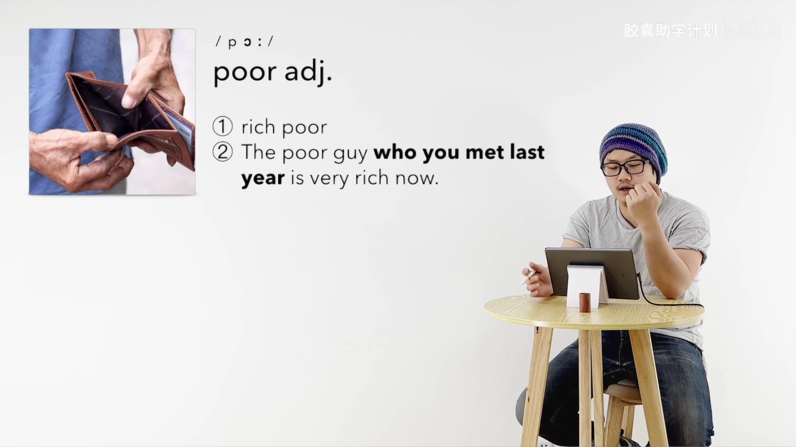

文字识别：胶囊助学计划 / / ρ o:/ / poor adj. / rich poor / The poor guy who you met last / year is very rich now.

### 画面 00:11:53

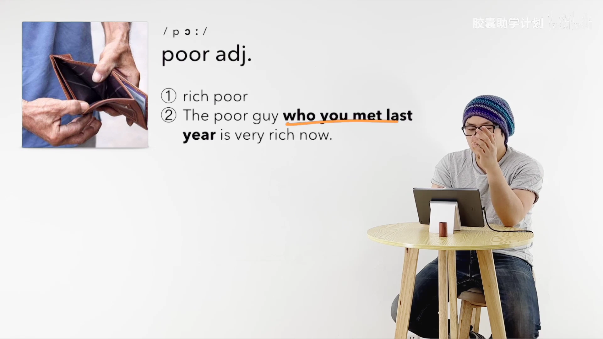

文字识别：胶囊助学计划 / / ρo:/ / poor adj. / rich poor / The poor guy who you met last / year is very rich now.

## 00:12:00–00:12:30

现在非常有钱了. Next one, 下一个单词跟我一起读一下，叫做 depend. depend 叫做依靠、依赖，它经常是跟 on 放到一起，放到一起去用啊。当然也可以单独出现，叫做 depend on，叫依赖某人或某物。比如说， if I need help, I can always depend on Leo. 说如果我需要帮忙，我总是可以依靠、

### 画面 00:12:02

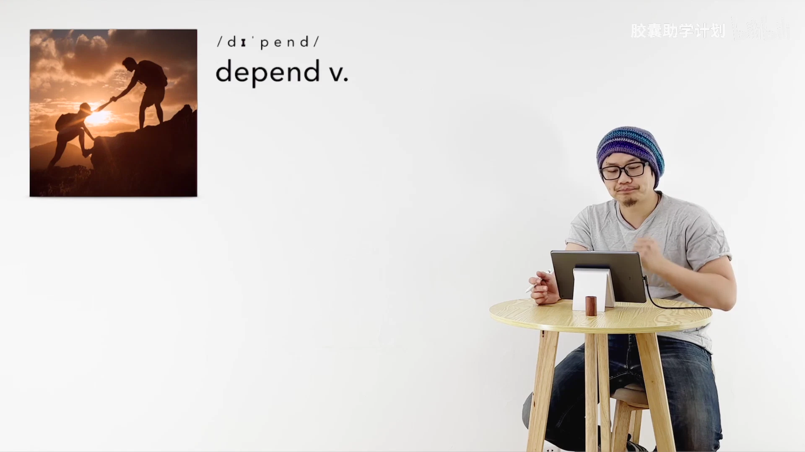

文字识别：胶囊助学计划 / /dI'pend / / depend v.

### 画面 00:12:07

文字识别：胶囊助学计划 / /dι'pend/ / depend v.

### 画面 00:12:20

文字识别：胶囊助学计划 / /di'pend/ / depend v. / ① depend on /  If I need help,I can always / depend on Leo.

## 00:12:30–00:13:00

依赖Leo的，对吧？放心来找他。所以您看这个地方，我们之前讲的是主将从现，那在这个地方我就稍微的拓展了一点点，叫做主情从现。主情从现就是主句用的是情态动词，从句还是用一般现在时。那这个呢语法呢，实际上我们要到新概念二册，我把它放到了新概念二册第十六课，我们一口气儿再给大家讲，好吧？啊，各位不妨坚

### 画面 00:12:37

文字识别：胶囊助学计划 / /di'pend/ / depend v. / ① depend on / If I need help, I can always / depend on Leo.

## 00:13:00–00:13:30

持往下学，continue。那还可以说说这事儿靠你了，it depends on you啊，或者说它其实还有另外一个意思，叫做这事儿取决于你啊，取决于你。注意，就不是依靠于你了，叫做 it depends on you，有点类似于你说了算的感觉，它不完全相同啊。OK， recap，本课最重要的除了单词以外，就是这个公式啊，叫做

### 画面 00:13:07

文字识别：胶囊助学计划 / /dI'pend/ / depend v. / ① depend on /  If I need help, I can always / depend on Leo. / ③ It depends on you.

### 画面 00:13:23

文字识别：胶囊助学计划 / Recap / Patterns / if …..(现),主语will do…(将) / Grammar / Words / Expression

### 画面 00:13:28

文字识别：胶囊助学计划 / Recap / Patterns / & / if ….(现),主语will do … / （将） / Grammar / Words / Expression

## 00:13:30–00:14:00

如果 A 发生， B 会发生，对吧？ OK， very good。交上作业，单词造句三啊三句话。初级红皮书您去查一下 if 这个单词啊。 Next one，然后给自己讲解一遍今天的核心知识点，您顺嘴造几个句子试一下呗。 OK，那如果各位喜欢我们的课程呢，欢迎各位关注、订阅、一键三连，分享给那些需要的朋友，来帮助我们快速成长。最后，我们再来看一句名人名言：

### 画面 00:13:34

文字识别：胶囊助学计划

### 画面 00:13:49

文字识别：胶囊助学计划

### 画面 00:13:57

文字识别：胶囊助学计划 / Whenever you do a thing, act as if all the / world were watching. / Thomas Jefferson

## 00:14:00–00:14:20

Whenever you do a thing, act as if all the world were watching. See you next time.

### 画面 00:14:08

### 画面 00:14:10

文字识别：臺珈学計切 / CAPSULEACADEMY / 胶囊助学计划 / 小红书 / Lecturer / □ / 口 / Leo / OE

### 画面 00:14:12

文字识别：CAPSULEACADEMY / 胶囊助学计划 / 小红书 / Photographer / Berlin / OE

### 画面 00:14:14

文字识别：CAPSULEACADEMY / 胶囊助学计划 / 小红书 / Editor / Berlin / OE

### 画面 00:14:17

文字识别：CAPSULEACADEMY / 胶囊助学计划 / 小红书

### 画面 00:14:19

文字识别：bilibili / 胶囊助学计划

