# 137 文章

快速机器解析：语音为单模型转写，未进行独立交叉校对或人工复核；画面每秒采样并按变化选帧，短时文字和标记可能遗漏。截图时间约有 1 秒误差。图片有损压缩；遇到疑点请按时间查看 Google Drive 原视频。

## 00:00:00–00:00:30

Hello everyone, welcome to Capsule Academy. This is Leo. Today we're going to learn New Concept English Book One Lesson One Hundred and Thirty Seven Story. 那老习惯进入正式课程之前，我们先看两个问题。第一，那如何去表达依赖某人或某物啊？接下来呢，如何表达环游世界？那带着这两个问题，Hope you guys enjoy it. 好了啊，那我们直接看文章。哎，两个人聊天

### 画面 00:00:00

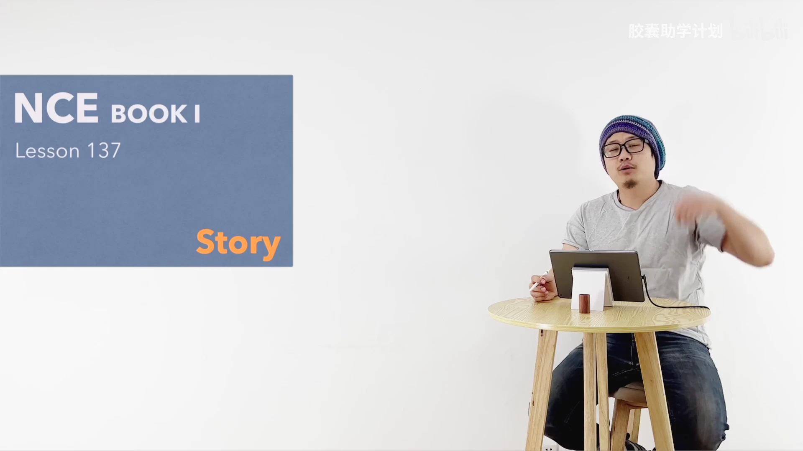

文字识别：NCE / BOOKI / Lesson 137 / Story

### 画面 00:00:02

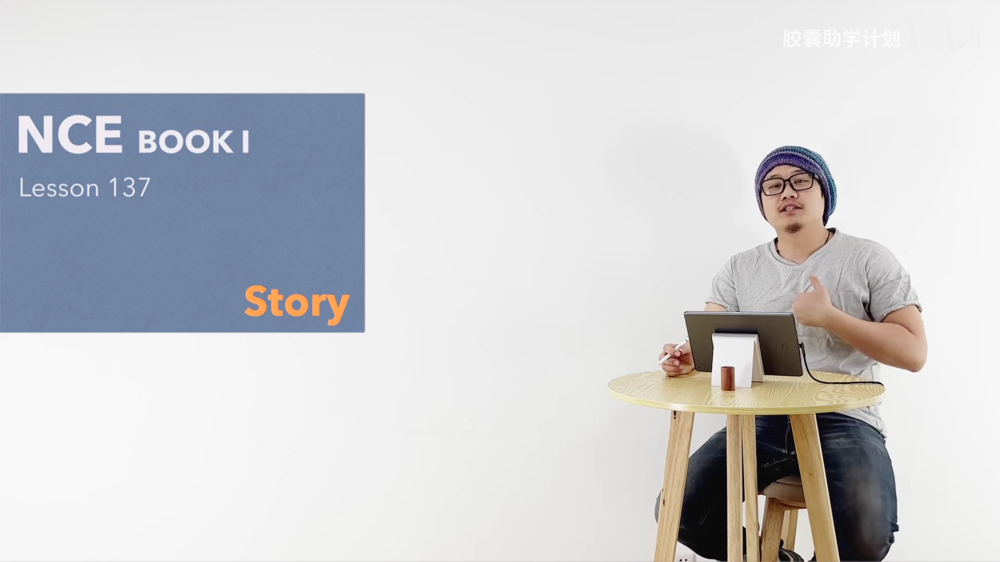

文字识别：NCE / BOOKI / Lesson 137 / Story

### 画面 00:00:10

文字识别：赖某人/某物”?

### 画面 00:00:12

文字识别：①如何表达“依赖某人/某物”?

### 画面 00:00:16

文字识别：①如何表达“依赖某人/某物”? / 何表达“环游世界”?

### 画面 00:00:18

文字识别：①如何表达“依赖某人/某物”? / 如何表达“环游世界”?

### 画面 00:00:22

文字识别：胶囊助学计划bll / • / •

### 画面 00:00:26

### 画面 00:00:28

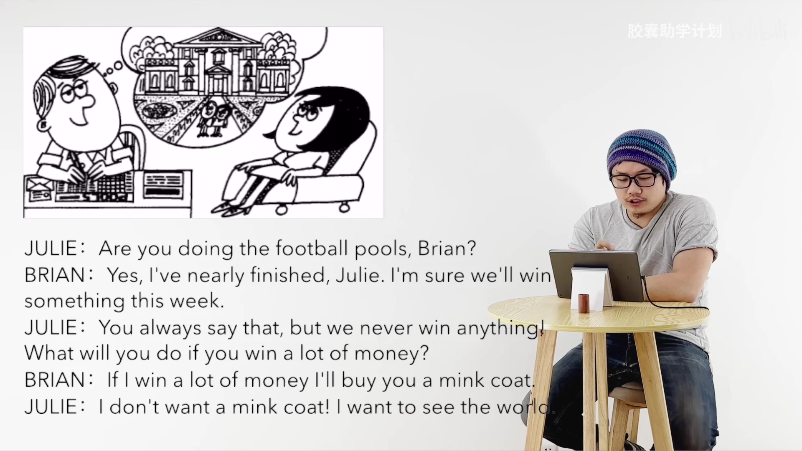

文字识别：JULIE: Are you doing the football pools, Brian? / BRIAN: Yes, I've nearly finished, Julie. I'm sure we'll win / something this week. / JULlE: You always say that, but we never win anything! / What will you do if you win a lot of money? / BRlAN: If I win a lot of money l'll buy you a mink coat. / JULlE: I don't want a mink coat! I want to see the world

## 00:00:30–00:01:00

对吧？一个人其实正在赌球啊，另一个人跟他对话，对吧？然后两个人想象了一些事情。我们看，说 Are you doing the football pose, Brian? 说你正在 doing the football pose。你看 do 这个单词在各位脑海当中叫做，对吧？那我们先翻译成做做足球的赌注，Brian。你正在做足球赌注吗？其实这个地方 doing the football pose 直接翻译成叫你正在赌球吗就可以了。OK，

### 画面 00:00:58

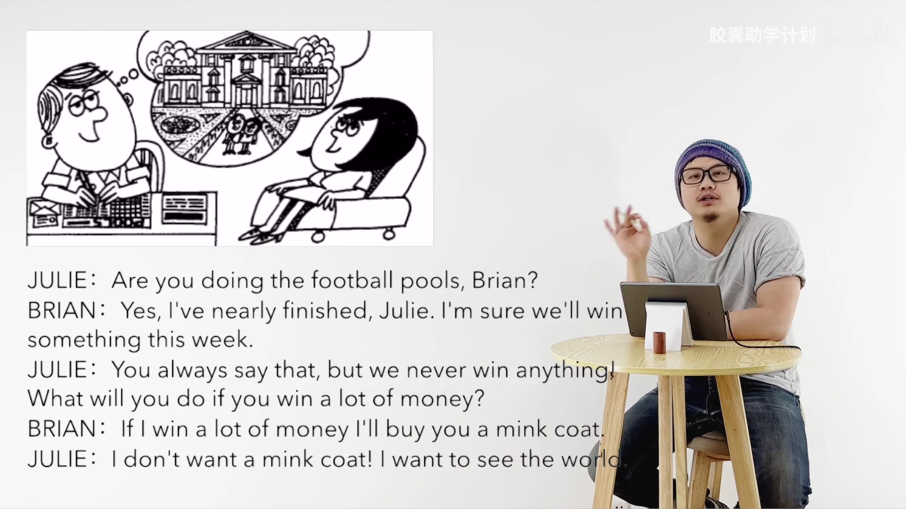

文字识别：JULIE: Are you doing the football pools, Brian? / BRIAN: Yes, I've nearly finished, Julie. I'm sure we'll win / something this week. / JULlE: You always say that, but we never win anything! / What will you do if you win a lot of money? / BRlAN: If I win a lot of money l'll buy you a mink coat. / JULlE: I don't want a mink coat! I want to see the world

## 00:01:00–00:01:30

yes, I've nearly finished.是的，我快要结束了。我都已经快要结束了。Julie说，I'm sure，我很确定。We will win something this week.我们将赢一些东西 this week，这周，对吧？You always say that.字面意思，你经常说这句话。那么说，你经常那么说。但是呢，We never win anything.我们从来什么都没有赢过。

### 画面 00:01:28

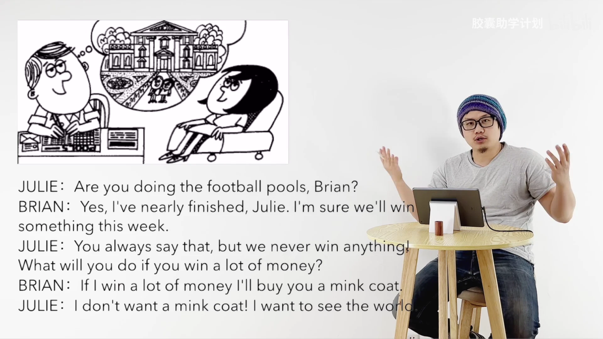

文字识别：JULlE: Are you doing the football pools, Brian? / BRIAN: Yes, I've nearly finished, Julie. I'm sure we'll win / something this week. / JULlE: You always say that, but we never win anything! / What will you do if you win a lot of money? / BRlAN: If I win a lot of money l'll buy you a mink coat. / JULlE: I don't want a mink coat! I want to see the world

## 00:01:30–00:02:00

What will you do? 你会去做什么呢？If 如果 you win a lot of money，如果你赢很多的钱，对吧？Okay，我跟你说，If I win a lot of money，如果我赢很多的钱，I'll buy you a winter coat。我就给你买一个大衣，对吧？哎，皮子大衣啊。我将，你看，这就是我们今天学的叫 if，对吧？主将从现

### 画面 00:01:58

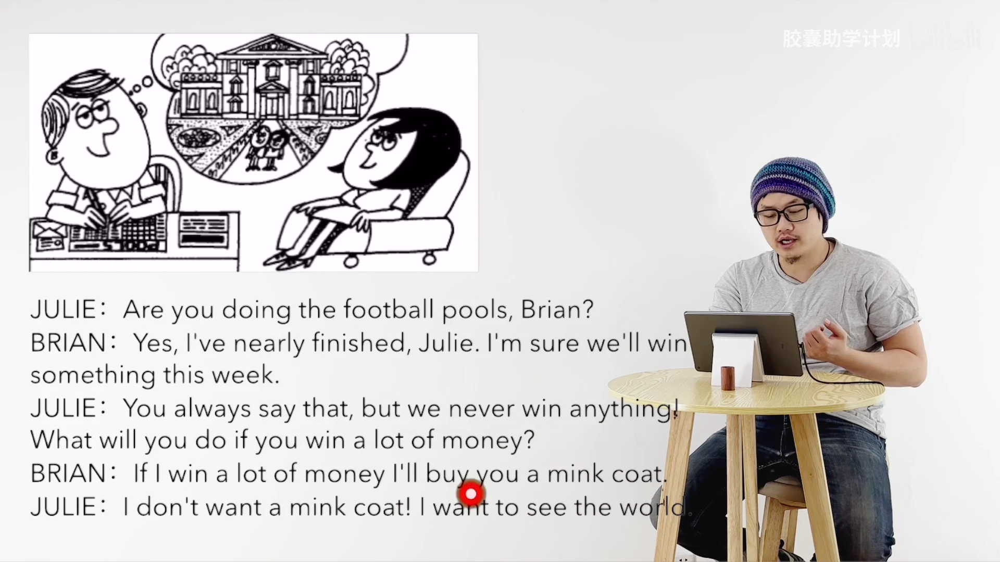

文字识别：JULlE: Are you doing the football pools, Brian? / BRIAN: Yes, I've nearly finished, Julie. I'm sure we'll win / something this week. / JULlE: You always say that, but we never win anything! / What will you do if you win a lot of money? / BRlAN: If I win a lot of money l'll buyyou a mink coat / JULlE: I don't want a mink coat! I want to see the world

## 00:02:00–00:02:30

啊！如果 A 发生， B 就会发生。如果我赢很多钱，我就给你买个大衣啊，皮子大衣，对吧？I don't want a min coat. 我才不想要 min coat 呢。I want to see the world. 我想看一看这个世界。Continue. 然后你说，All right. 啊，好，好，好，没问题啊。If we win a lot of money, 如果我们赢很多的钱，we will. 你看 will 被 P L L 缩写了，对吧？Travel around the world, 环游世界又

### 画面 00:02:14

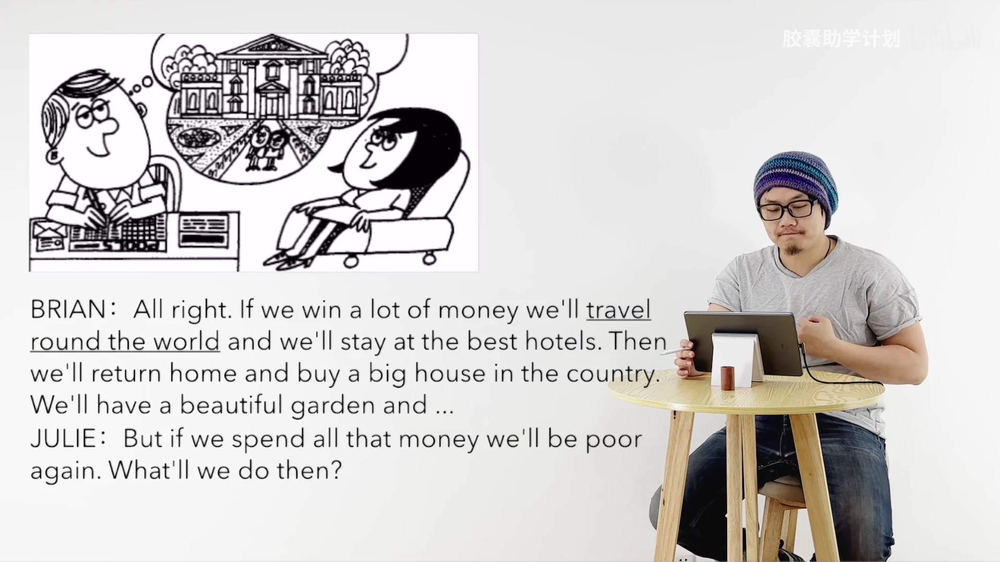

文字识别：BRIAN: All right. If we win a lot of money we'll travel / round the world and we'll stay at the best hotels. Then / we'll return home and buy a big house in the country. / We'll have a beautiful garden and .. / JULlE: But if we spend all that money we'll be poor / again. What'll we do then?

## 00:02:30–00:03:00

出现了. And we will stay at the best hotels.说我们会啊停留住在最好的那些hotels啊这个酒店对吧? Then然后呢, we will return home.其实你看接下来所有的we will, we will, we will, and we will都是由if去引导的，就都是前提建立在如果我们赢了很多的钱，对吧?

### 画面 00:02:44

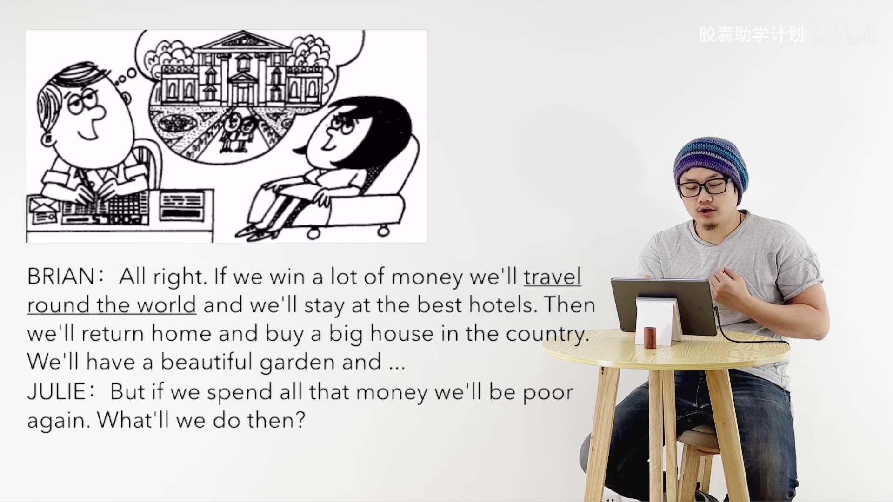

文字识别：BRIAN: All right. If we win a lot of money we'll travel / round the world and we'll stay at the best hotels. Then / we'll return home and buy a big house in the country. / We'll have a beautiful garden and .. / JULlE: But if we spend all that money we'll be poor / again. What'll we do then?

## 00:03:00–00:03:30

We will return home,然后我们就回家，and buy a big house in the country.然后买一个大house，对吧？就是我们国内理解为叫别墅，是吧？国外就是中产经常住的那些二层小楼，对不对？A big house,一个大的房子in the country在乡下。We'll have a beautiful garden and说我们将会有一个非常美丽的花园。然后呢，还没说完，Julie就打断他

### 画面 00:03:14

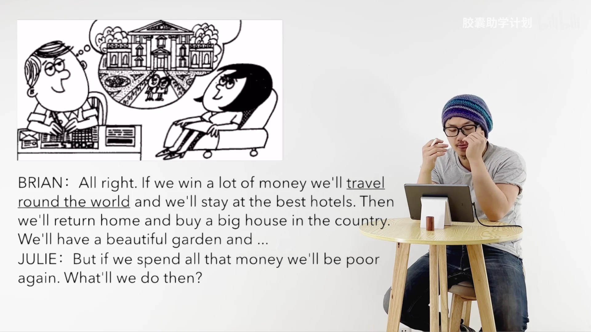

文字识别：BRlAN: All right. If we win a lot of money we'll travel / round the world and we'll stay at the best hotels. Then / we'll return home and buy a big house in the country. / We'll have a beautiful garden and .. / JULlE: But if we spend all that money we'll be poor / again. What'll we do then?

## 00:03:30–00:04:00

了，说 But if we spend all that money, we'll be poor again. 但是如果我们花掉了所有的那些钱，那我们就会又穷了呀。你看 What will we do then? 那我们到时候怎么办呢？Brian说 If we spend all the money, 你看总有赚钱的方法，对吧？说如果我们把那些钱都花了怎么办？We'll try. 那我们就再试一试。And when the

### 画面 00:03:44

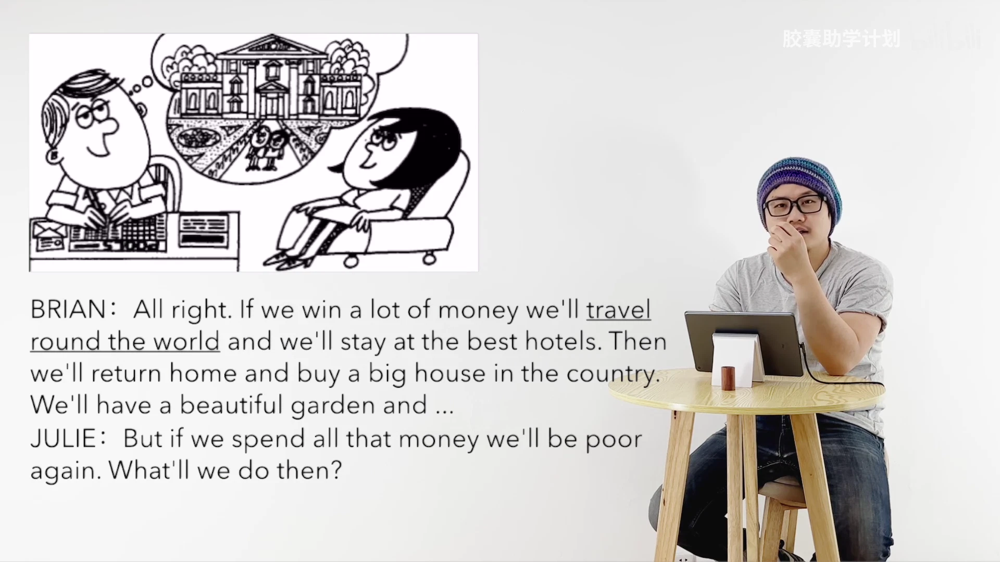

文字识别：BRlAN: All right. If we win a lot of money we'll travel / round the world and we'll stay at the best hotels. Then / we'll return home and buy a big house in the country. / We'll have a beautiful garden and .. / JULlE: But if we spend all that money we'll be poor / again. What'll we do then?

### 画面 00:03:47

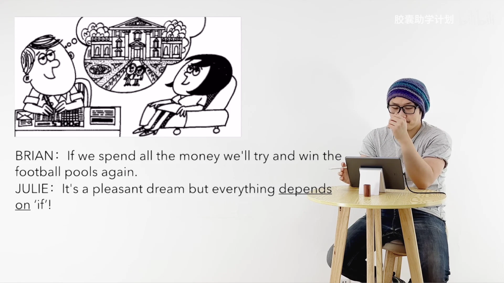

文字识别：BRlAN: If we spend allthe money we'lltry and win the / football pools again. / JULlE: It's a pleasant dream but everything depends / on'if'!

### 画面 00:03:53

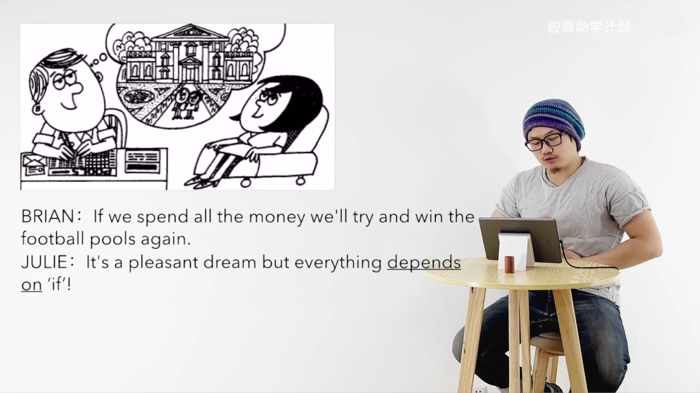

文字识别：BRlAN: If we spend allthe money we'lltry and win the / football pools again. / JULlE: It's a pleasant dream but everything depends / on'if'!

## 00:04:00–00:04:30

football pool again. 然后再赢一次这个赌球。哈，Julie说啊, it's a pleasant dream. 啊，他终于醒了。他说这是一个很好的梦。 But everything depends on if. 但是好像貌似我们说的所有的事情都要取决于或者说依赖于 if 如果假如这个单词。 Okay, 好，呃，接下来呢，我们看一个小的电影片段。这个电影片段当中正好就

### 画面 00:04:11

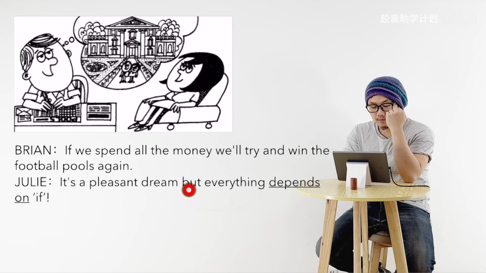

文字识别：BRIAN: If we spend all the money we'll try and win the / football pools again. / JULiE: It's a pleasant dream but everything depends / on'if'!

### 画面 00:04:25

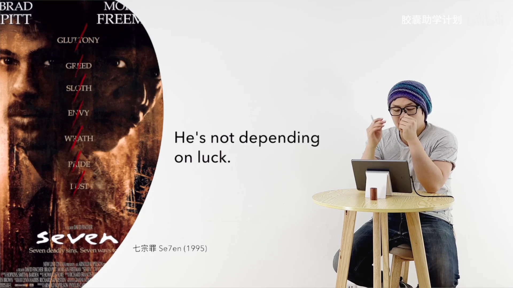

文字识别：BRAD / MO / PITT / FREEM / GLUTTONY / GRLED / SLOTH / ENVY / He's not depending / WBATH / on luck. / PI.IDE / LJST / LSN OWVDRNCHR / seveh / 七宗罪 Se7en(1995) / Seven deadly sins. Seven wayst

### 画面 00:04:27

文字识别：BRAD / MO / PITT / FREEN / GLUTONY / GRLED / SLOTH / ENVY / He's not depending / WBATH / on luck. / PI.IDE / LJST / LTDAWIDFINCHER / sever / 七宗罪 Se7en(1995) / Seven deadly sins. Seven wayst / LOPESO

## 00:04:30–00:05:00

出现了叫做 depend on，比如说 he is not depending on luck，指的就是他没有依赖于运气这件事情，好吧？那注意力集中，我们一起看一下。 Understand? I don't think so. His luck ran out. Not depending on luck. Okay, he's not depending on luck. Very good. 接下来我们做一些口语听力练习，我问您答

### 画面 00:04:30

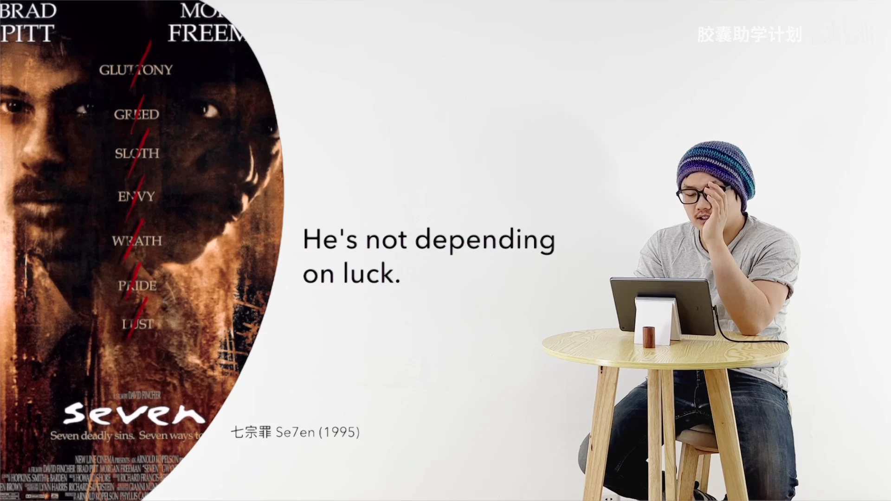

文字识别：BRAD / MO / PITT / FREEM / GLUTTONY / GRLED / SLOTH / ENVY / He's not depending / W3ATH / on luck. / PI.IDE / LJST / UNDWIDRNCHER / seveh / 七宗罪 Se7en(1995) / Seven deadly sins Seven wayst

### 画面 00:04:35

文字识别：BRAD / MO / PITT / FREEN / GLUTTONY / GRLED / SLOTH / ENVY / He's not depending / WRATH / on luck. / PIIDE / LJST / DDAWIDFNCHER / sever / 七宗罪 Se7en(1995) / Seven deadly sins Seven wayst / OPELSO

### 画面 00:04:40

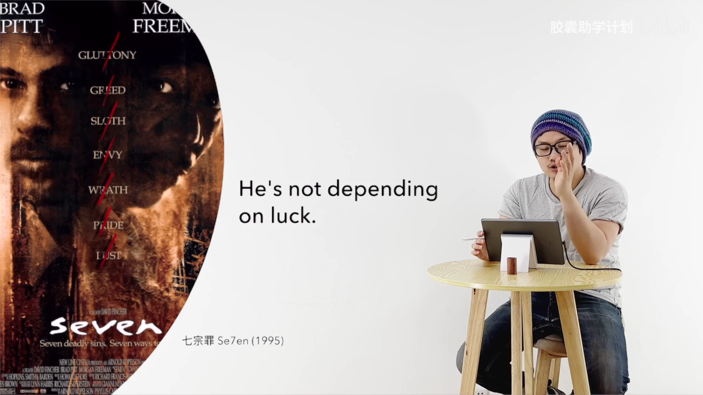

文字识别：BRAD / MO / PITT / FREEM / GLUTTONY / GRLED / SLOTH / ENVY / He's not depending / WRATH / on luck. / PFIDE / LJST / DINDAVIDRNCHER / sever / 七宗罪 Se7en(1995) / Seven deadly sins Seven ways t / OPESO

### 画面 00:04:42

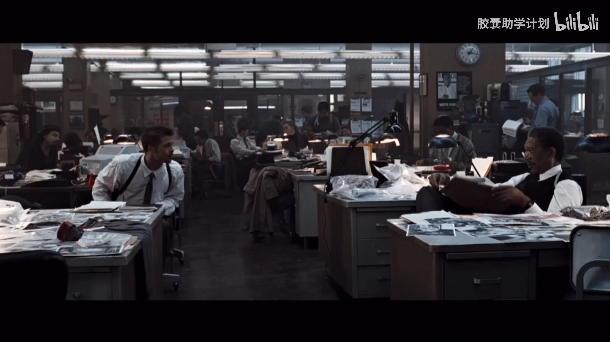

文字识别：bilibili / 胶囊助学计划

### 画面 00:04:44

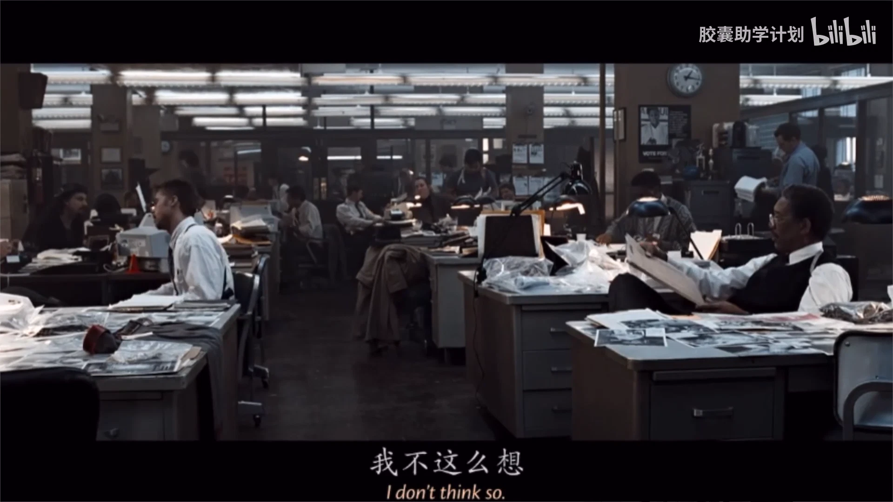

文字识别：Bilbii / 胶囊助学计划 / 我不这么想 / I don't think so.

### 画面 00:04:46

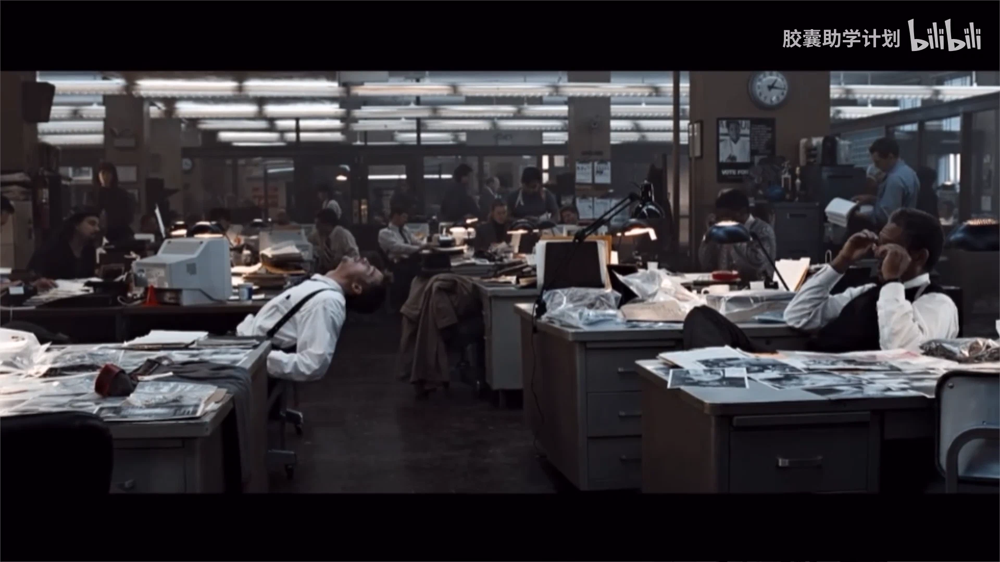

文字识别：Bilibili / 胶囊助学计划

### 画面 00:04:48

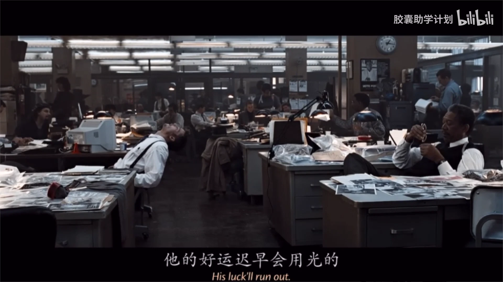

文字识别：bilibili / 胶囊助学计划 / 他的好运迟早会用光的 / His luck'll run out.

### 画面 00:04:50

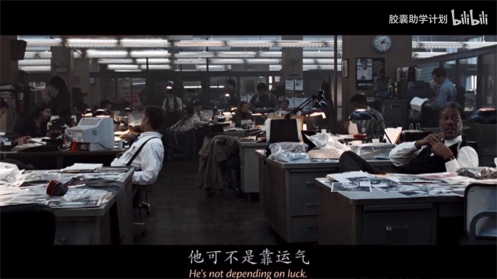

文字识别：Bilbii / 胶囊助学计划 / 他可不是靠运气 / He's not depending on luck.

### 画面 00:04:52

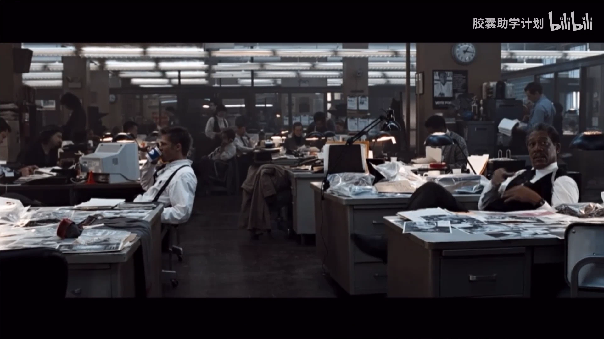

文字识别：Bilibili / 胶囊助学计划

### 画面 00:04:54

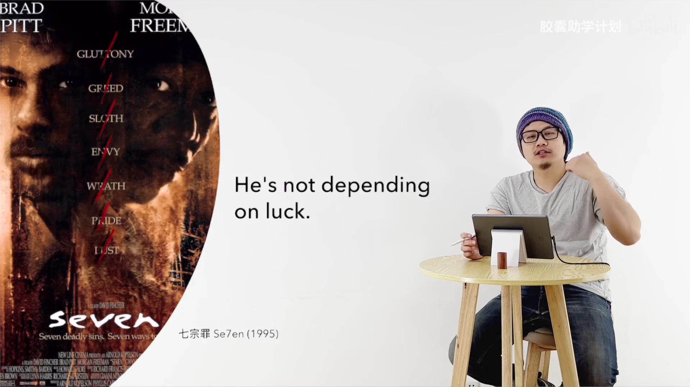

文字识别：BRAD / MO / PITT / FREEN / GLUTONY / GRLED / SLOTH / ENVY / He's not depending / W3ATH / on luck. / PFJDE / LJST / DINDAWIDFINCHER / sever / 七宗罪 Se7en(1995) / Seven deadly sins. Seven wayst

### 画面 00:04:56

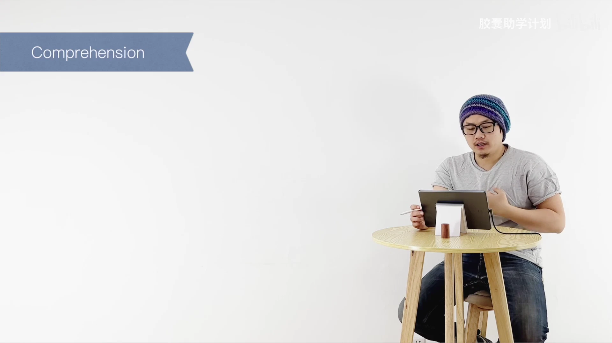

文字识别：Comprehension

## 00:05:00–00:05:30

啊，各位可以从书中去找答案。来了，第一题，What is Brian doing? He's doing the football pose. Next one, Has he finished doing the football pose? Not really,或者No, he has nearly finished.其实就是No啊。What is Brian sure of? He's sure they will win something this

### 画面 00:05:07

文字识别：Comprehension / 1 T: What is Brian doing? / S: He's doing the football pools.

### 画面 00:05:11

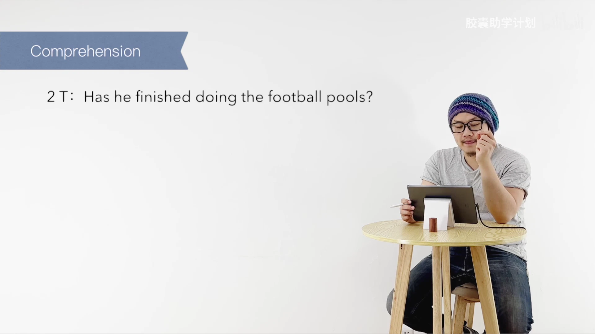

文字识别：Comprehension / 2 T: Has he finished doing the football pools?

### 画面 00:05:26

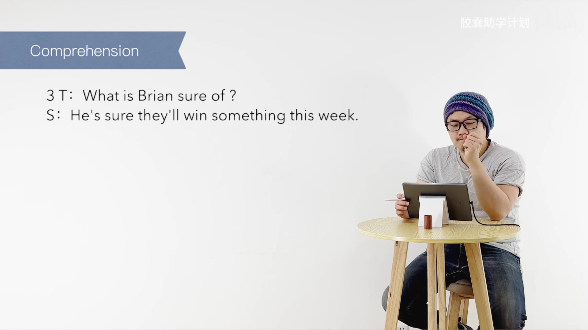

文字识别：Comprehension / 3 T: What is Brian sure of ? / S: He's sure they'l win something this week.

## 00:05:30–00:06:00

week. Next one. What does Julie ask Brian? She asks what Brian will do if he wins a lot of money.或者您直接把那句话告诉我就行了，对吧？叫做What will you do if, eh, you win a lot of money? Next one. What will Brian buy if he wins a lot of money? He will buy a min coat

### 画面 00:05:32

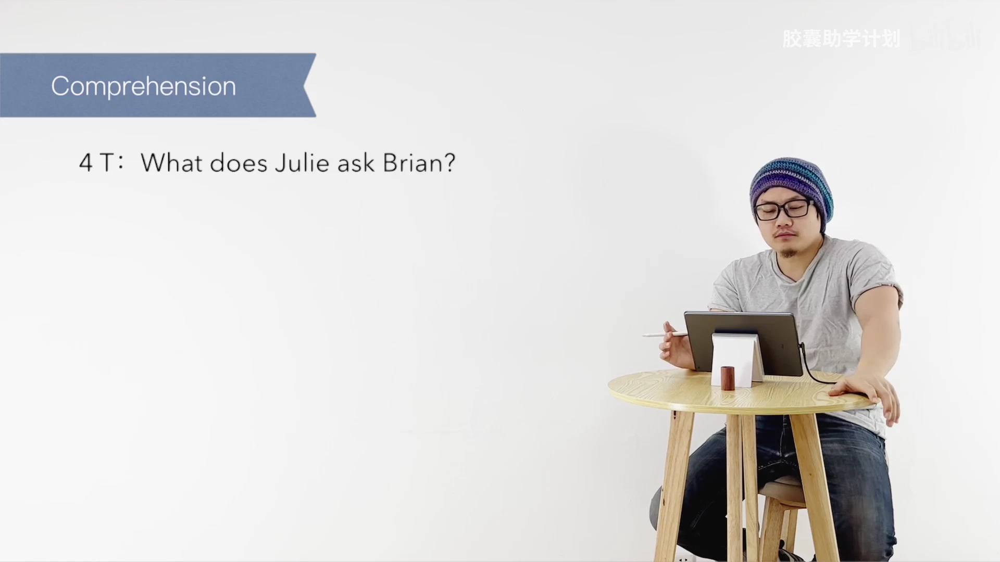

文字识别：Comprehension / 4 T: What does Julie ask Brian?

### 画面 00:05:38

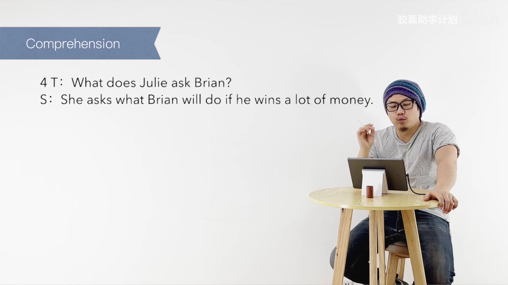

文字识别：Comprehension / 4 T: What does Julie ask Brian? / S: She asks what Brian will do if he wins a lot of money.

### 画面 00:05:50

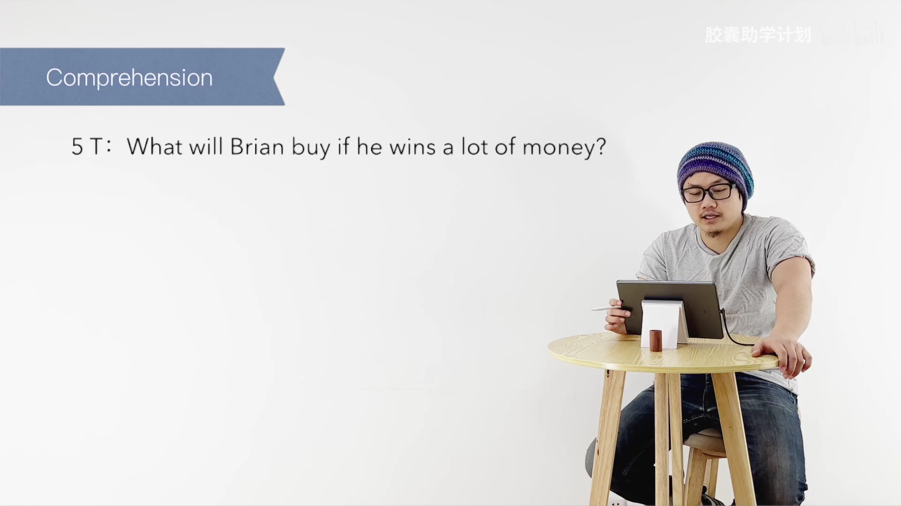

文字识别：Comprehension / 5 T: What will Brian buy if he wins a lot of money?

## 00:06:00–00:06:30

for Julie. Next one, what would Julie like better than a min coat? She would like to see the world. Next one, what does Brian say they will do if they win a lot of money? He says they'll travel around the world and stay at the best hotels.

### 画面 00:06:11

文字识别：Comprehension / 6 T: What would Julie like better than a mink coat? / S: She would like to see the world.

### 画面 00:06:15

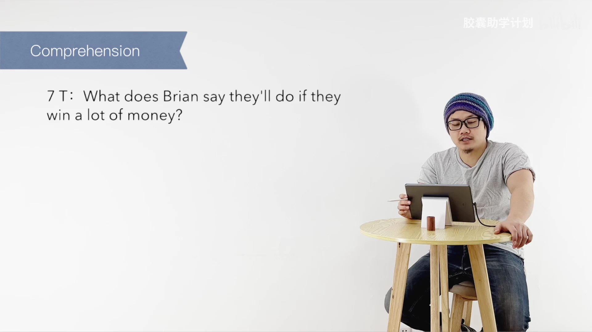

文字识别：Comprehension / 7 T: What does Brian say they'll do if they / win a lot of money?

### 画面 00:06:24

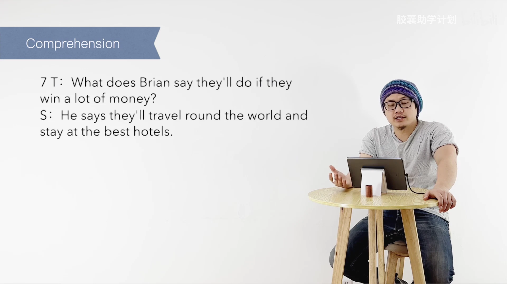

文字识别：Comprehension / 7 T: What does Brian say they'll do if they / win a lot of money? / S:He says / they'll travel round the world and / stay at the best hotels.

## 00:06:30–00:07:00

Next one, what will they do when they return home? They will buy a big house in the country. Next one, what does Julie say about spending all that money? She says if they spend all that money, they'll be poor again. Next one, what does everything depend on?

### 画面 00:06:31

文字识别：Comprehension / 8 T: What will they do when they return home?

### 画面 00:06:45

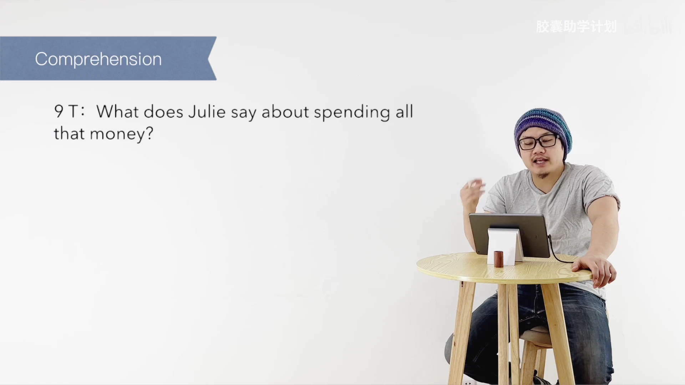

文字识别：Comprehension / 9 T: What does Julie say about spending all / that money?

### 画面 00:06:49

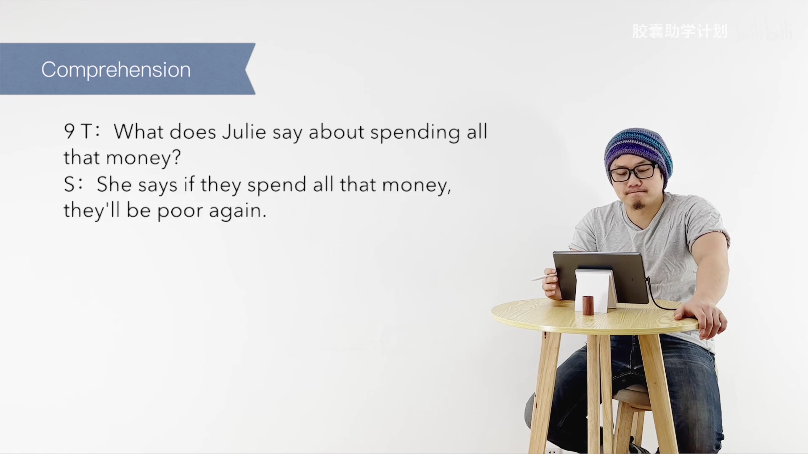

文字识别：Comprehension / 9 T: What does Julie say about spending all / that money? / S: She says if they spend allthat money, / they'll be poor again.

### 画面 00:06:56

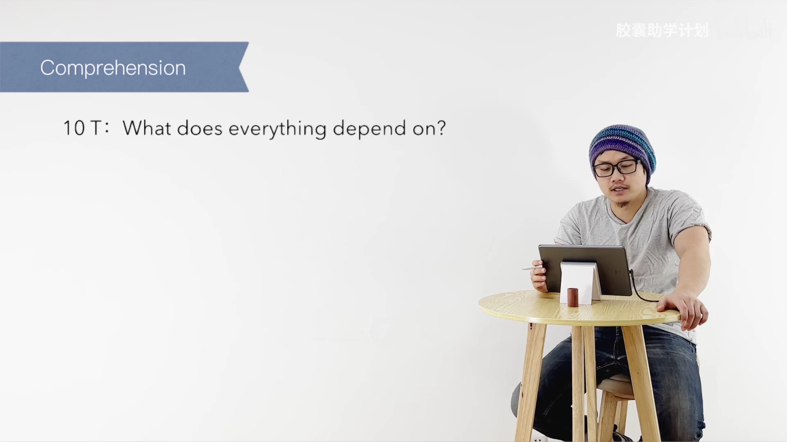

文字识别：Comprehension / 10T: What does everything depend on?

## 00:07:00–00:07:30

Everything depends on if. Very good. Asking questions,肯定句，一般疑问句，特殊疑问句来了. Ask me if Brian is doing the football polls. 很简单啊，现在进行时is提前。那what是对football polls football polls提问对吧？叫做What is Brian doing? Next one. Ask me if Brian always says he

### 画面 00:07:04

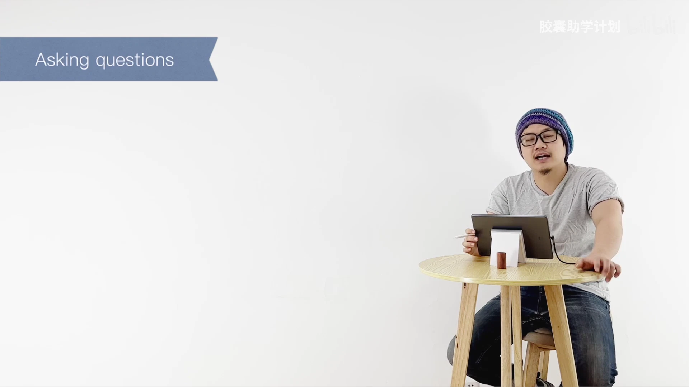

文字识别：Asking questions

### 画面 00:07:16

文字识别：Asking questions / 1 T: Ask me if Brian is doing the football pools. / S: Is Brian doing the football pools?

### 画面 00:07:24

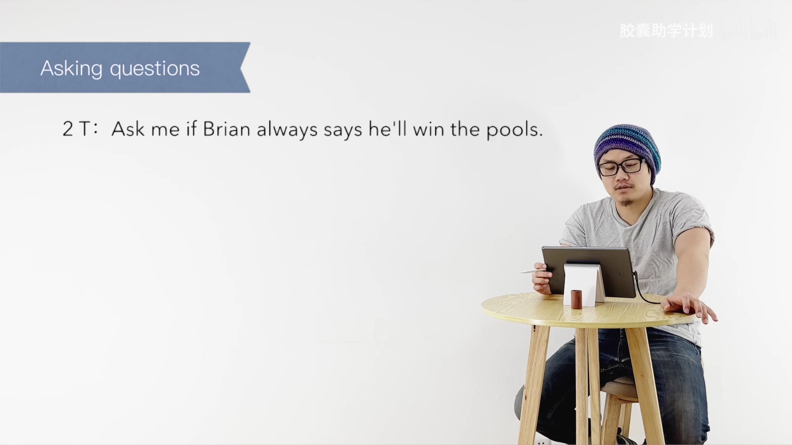

文字识别：Asking questions / 2 T: Ask me if Brian always says he'll win the pools.

## 00:07:30–00:08:00

will win the polls. 哎，注意这儿对吧？你看啊，我们先回去看一下这个地方非常重要，叫做 Brain always says he will win the polls. 你看是由 says 决定还是由 will 决定变一般疑问句呢？由主句决定，后边是宾语从句，不用它，所以把 does 提前，对吧？叫做 Does Brain always say he will win the polls? What？那就问他说的是

### 画面 00:07:46

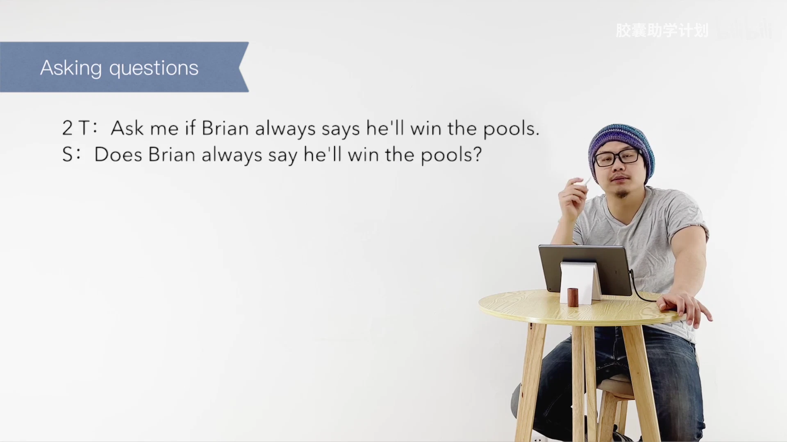

文字识别：Asking questions / 2 T: Ask me if Brian always says he'll win the pools. / S: Does Brian always say he'll win the pools?

## 00:08:00–00:08:30

什么，整句话提问，对吧？叫做 What does Brian always say? Next one, ask me if he will buy his wife a mink coat. 我要提前, Will he buy his wife a mink coat? What? What will he buy his wife? Next one, ask me if Julie wants to see the world. Wants? Does

### 画面 00:08:02

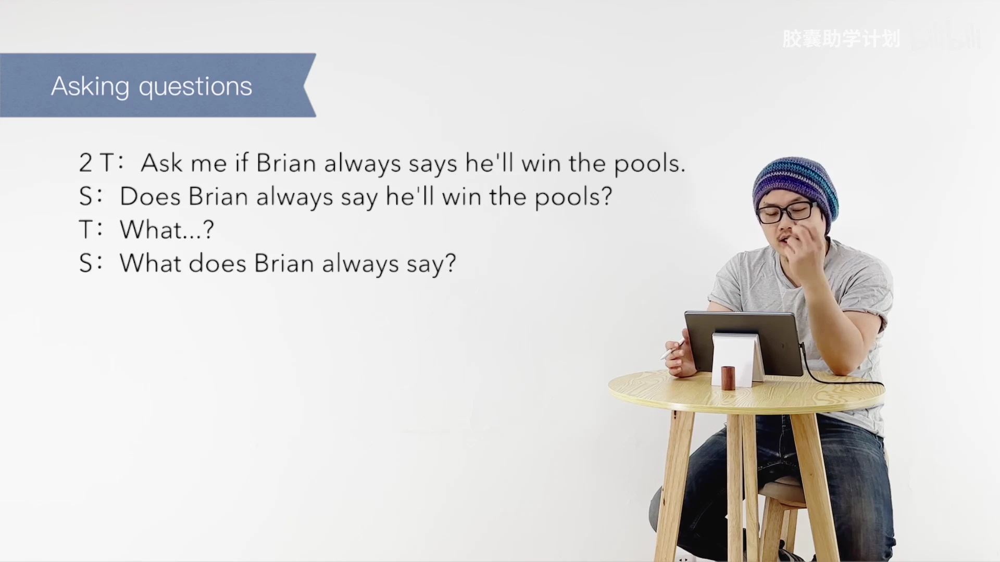

文字识别：Asking questions / 2 T: Ask me if Brian always says he'll win the pools. / S: Does Brian always say he'll win the pools? / T: What..? / S: What does Brian always say?

### 画面 00:08:05

文字识别：Asking questions / 3 T: Ask me if he'll buy his wife a mink coat.

### 画面 00:08:17

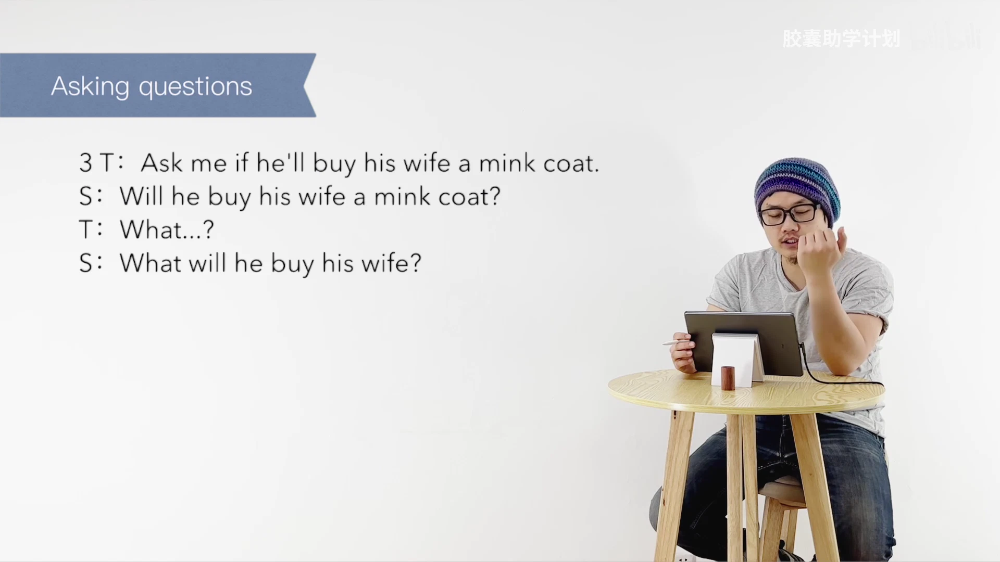

文字识别：Asking questions / 3 T: Ask me if he'll buy his wife a mink coat. / S: Will he buy his wife a mink coat? / T:What..? / S: What will he buy his wife?

### 画面 00:08:22

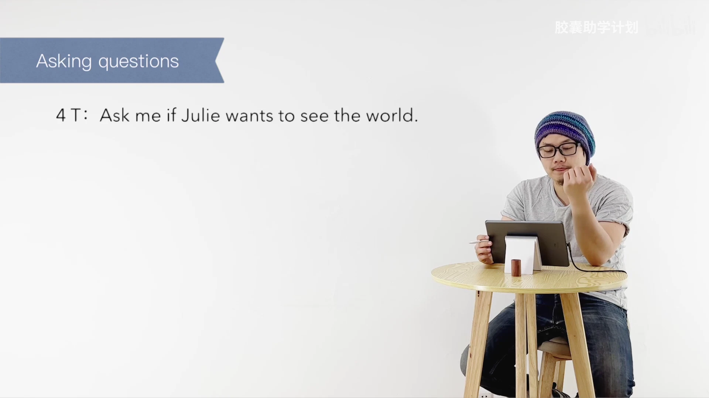

文字识别：Asking questions / 4T: Ask me if Julie wants to see the world.

## 00:08:30–00:09:00

Julie want to see the world? What does Julie want to see?最后一个, ask me if everything depends on if. Does everything depend on if? What what does everything depend on? Okay, recap.本课很重要的两个短语, travel around the world, depend on something or somebody.啊，

### 画面 00:08:32

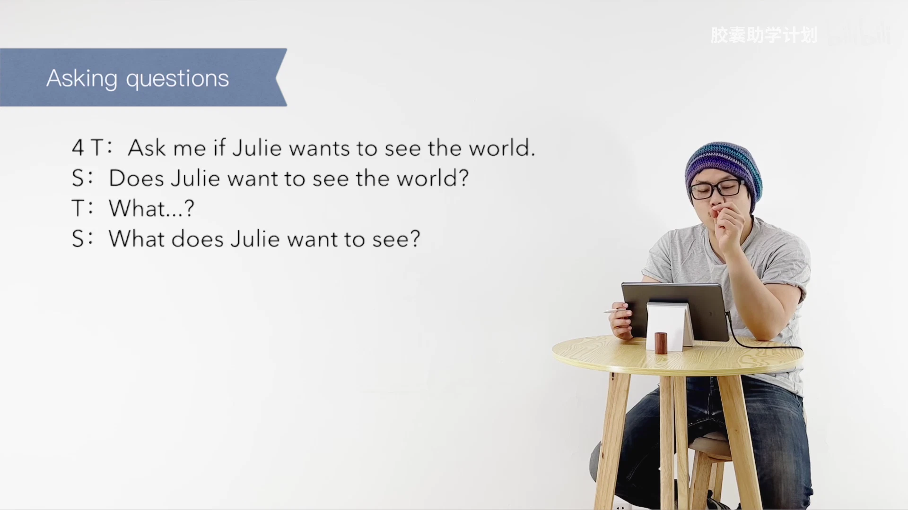

文字识别：Asking questions / 4T: Ask me if Julie wants to see the world. / S: Does Julie want to see the world? / T:What..? / S: What does Julie want to see?

### 画面 00:08:36

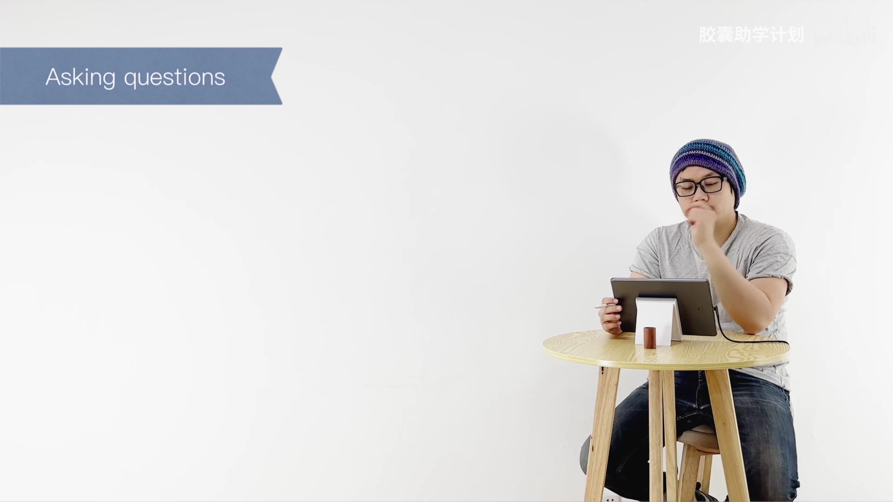

文字识别：Asking questions

### 画面 00:08:47

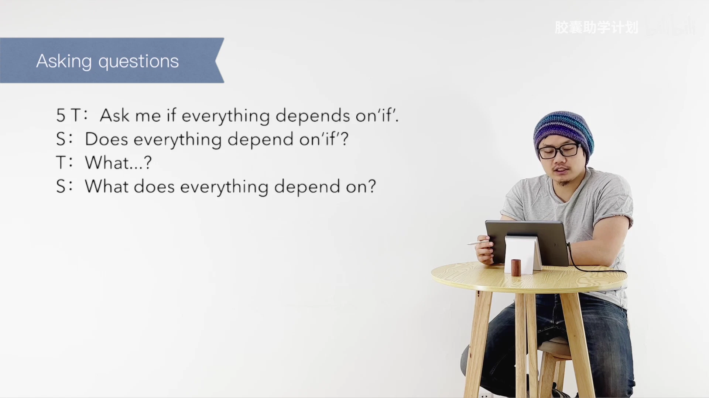

文字识别：Asking questions / 5 T: Ask me if everything depends on'if'. / S: Does everything depend on'if'? / T: What...? / S: What does everything depend on?

### 画面 00:08:52

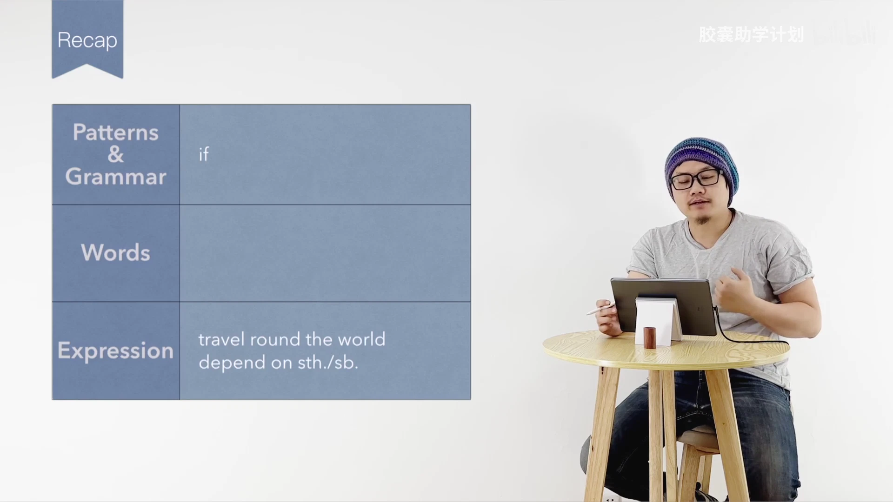

文字识别：Recap / Patterns / Grammar / Words / travel round the world / Expression / depend on sth./sb.

## 00:09:00–00:09:30

then there is if this word introduced conditional clause. Homework, green book, one three seven, article reading, reading and recitation, explain again the core knowledge points. If you like our course, please follow us, subscribe, and share with those who need it. Finally, let's look at a famous saying. You will never win if you never begin. OK, see you next time.

### 画面 00:09:05

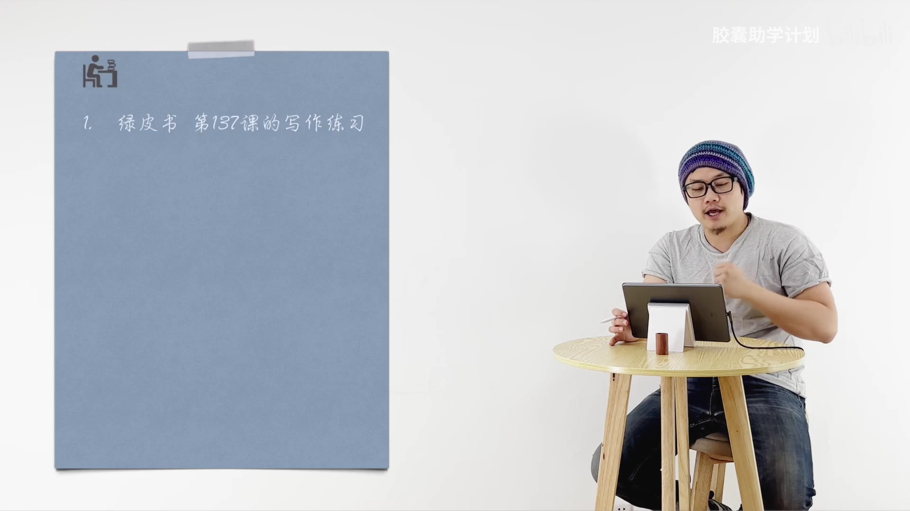

文字识别：绿皮书第137课的写作练习

### 画面 00:09:13

### 画面 00:09:21

文字识别：You will never win if you never begin. / -Helen Rowland

### 画面 00:09:29

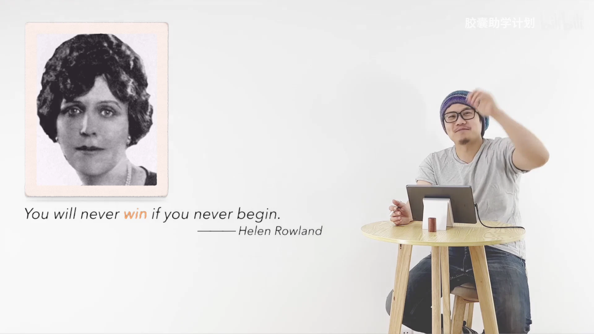

文字识别：You will never win if you never begin. / -Helen Rowland

## 00:09:30–00:09:42

### 画面 00:09:31

文字识别：CAPSULEACADEMY / 胶囊助学计划 / 小红书 / Lecturer / Leo / OE

### 画面 00:09:34

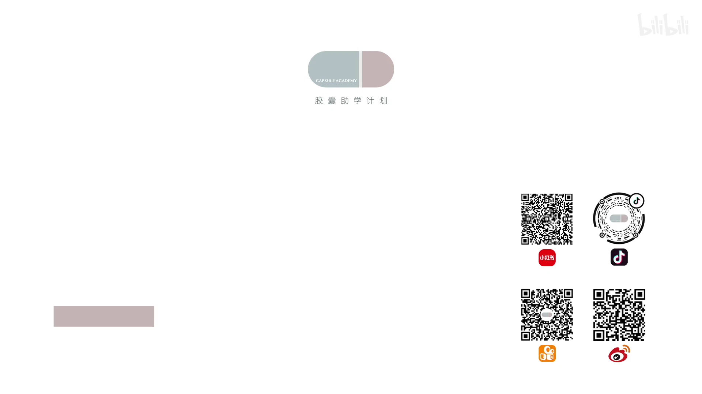

文字识别：CAPSULEACADEMY / 胶囊助学计划 / 小红书 / 品

### 画面 00:09:37

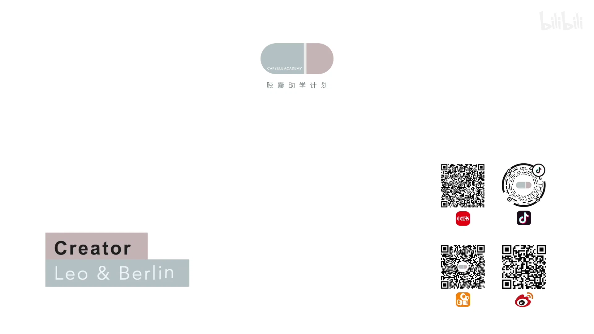

文字识别：CAPSULEACADEMY / 胶囊助学计划 / 小红书 / Creator / Leo & Berlin / OE

### 画面 00:09:39

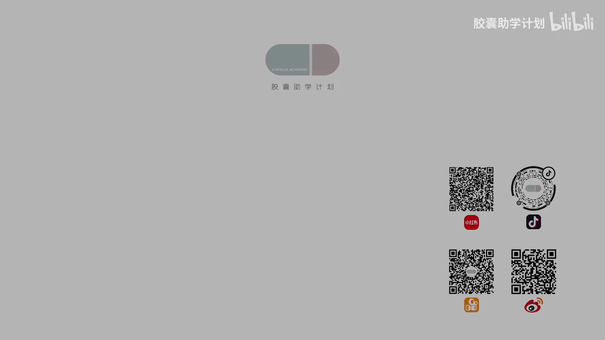

文字识别：Bilbili / 胶囊助学计划 / CAPSULEACADEMY / 胶囊助学计划 / 小红书 / 品 / OE

### 画面 00:09:41

文字识别：bilibili / 胶囊助学计划

