# 139 单词 语法

快速机器解析：语音为单模型转写，未进行独立交叉校对或人工复核；画面每秒采样并按变化选帧，短时文字和标记可能遗漏。截图时间约有 1 秒误差。图片有损压缩；遇到疑点请按时间查看 Google Drive 原视频。

## 00:00:00–00:00:30

Hello everyone, welcome to Capsule Academy. This is Leo. Today we're going to learn New Concept English Book One Lesson One Hundred and Thirty Nine Grammar and Words. 那老习惯进入正式课程之前呢，我们先看两个问题。那首先，一般疑问句做宾语从句应该怎么去使用？接下来呢，叫做特殊疑问句，如如何去做宾语从句？那带着这两个问题，Hope you guys enjoy it.

### 画面 00:00:00

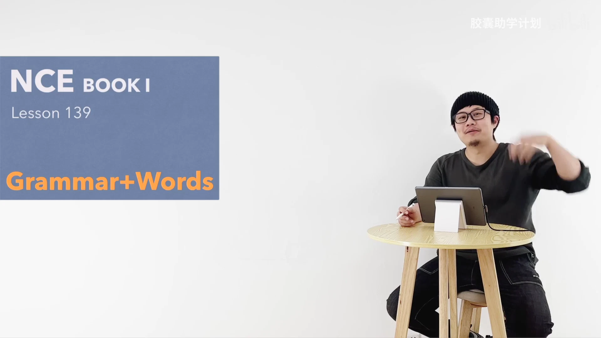

文字识别：NCE / BOOKI / Lesson 139 / Grammar+Words

### 画面 00:00:02

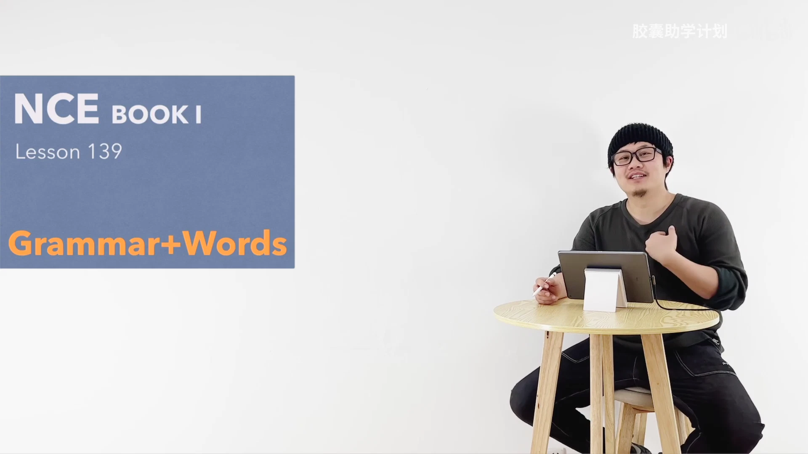

文字识别：NCE / BOOKI / Lesson 139 / Grammar+Words

### 画面 00:00:04

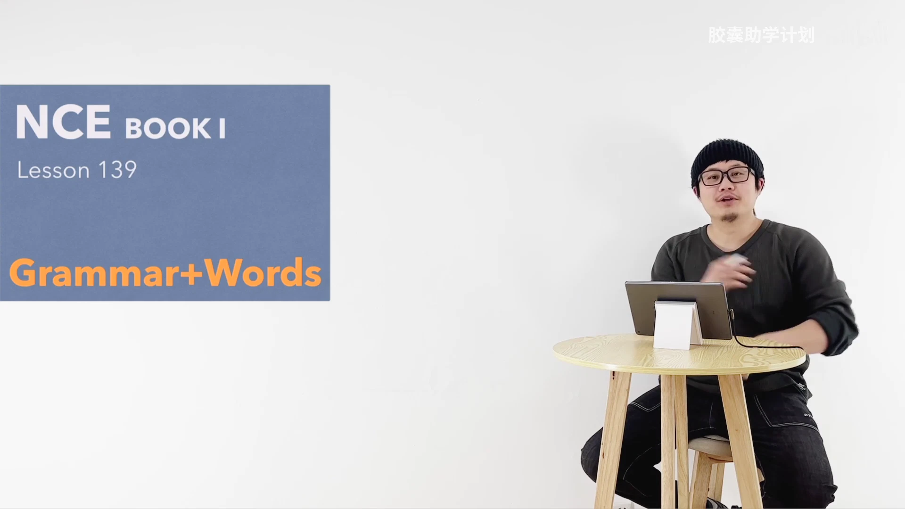

文字识别：NCE / BOOKI / Lesson 139 / Grammar+Words

### 画面 00:00:12

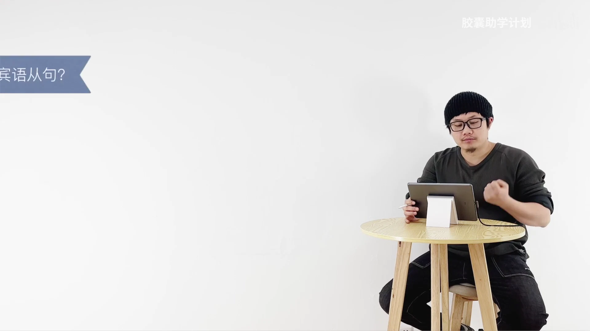

文字识别：宾语从句？

### 画面 00:00:14

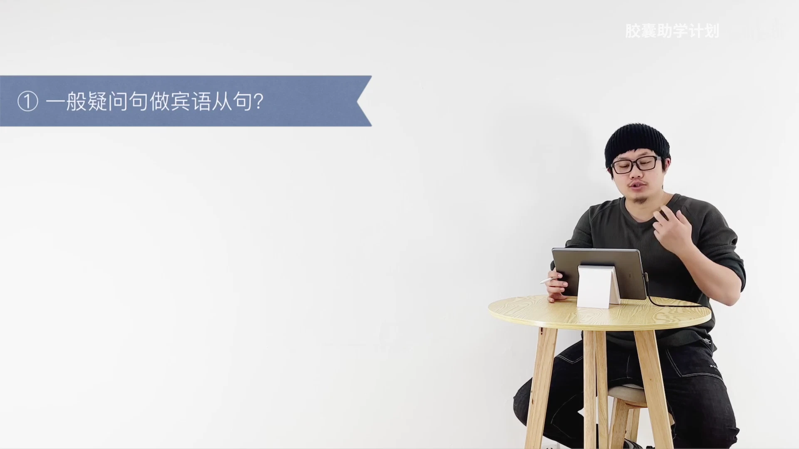

文字识别：① 一般疑问句做宾语从句？

### 画面 00:00:19

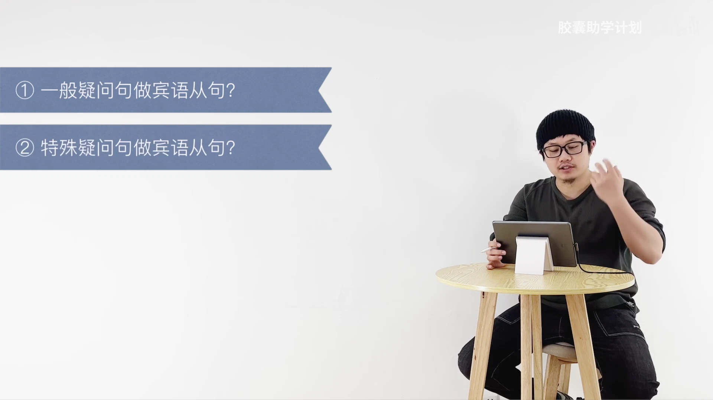

文字识别：①一般疑问句做宾语从句？ / 特殊疑问句做宾语从句?

### 画面 00:00:26

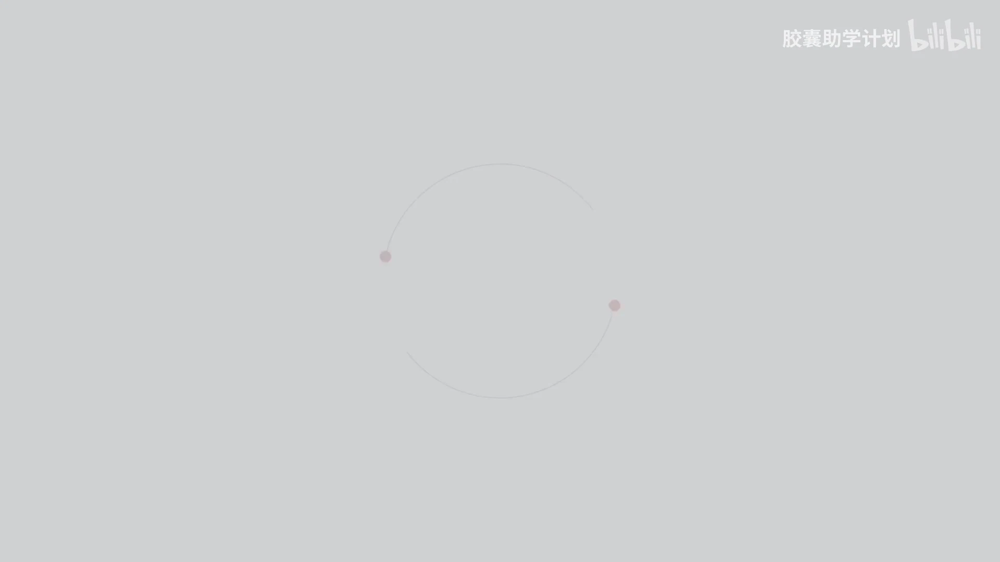

文字识别：胶囊助学计划bll / •

## 00:00:30–00:01:00

好，那我们上来先回顾一下宾语从句啊。我们在新概念一册九十九课、一百零一课、一百三十三课、一百三十五课分别学过定语从啊宾语从句，对吧？OK，那首先很简单，我们在九十九课就说过这个概念，如何去确定一个句子是宾语从句呢？很简单，你要知道这个句子它是在做宾语，我们在英文当中就管这个句子叫宾语从句。那我们之前从九十九一直

### 画面 00:00:30

### 画面 00:00:32

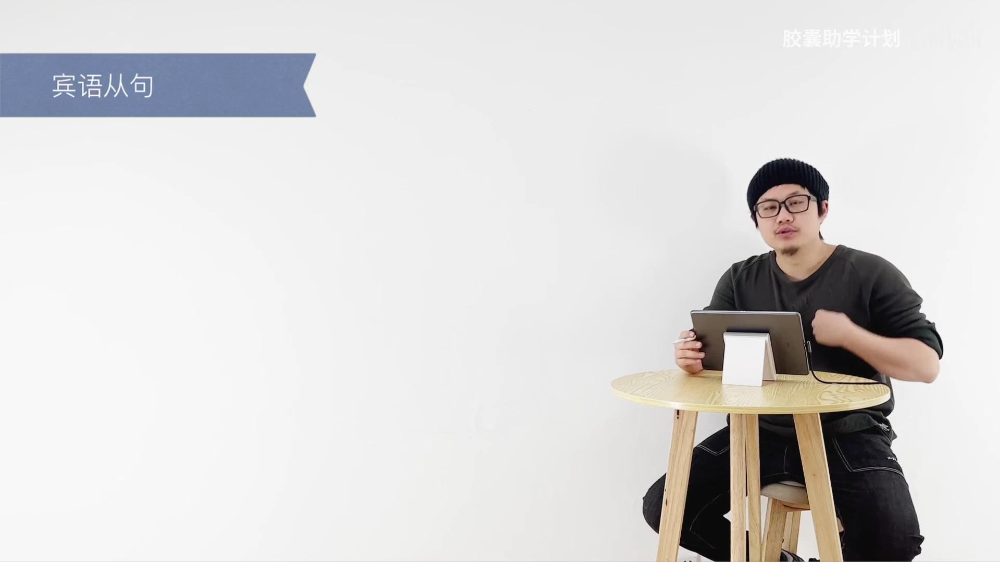

文字识别：宾语从句

### 画面 00:00:43

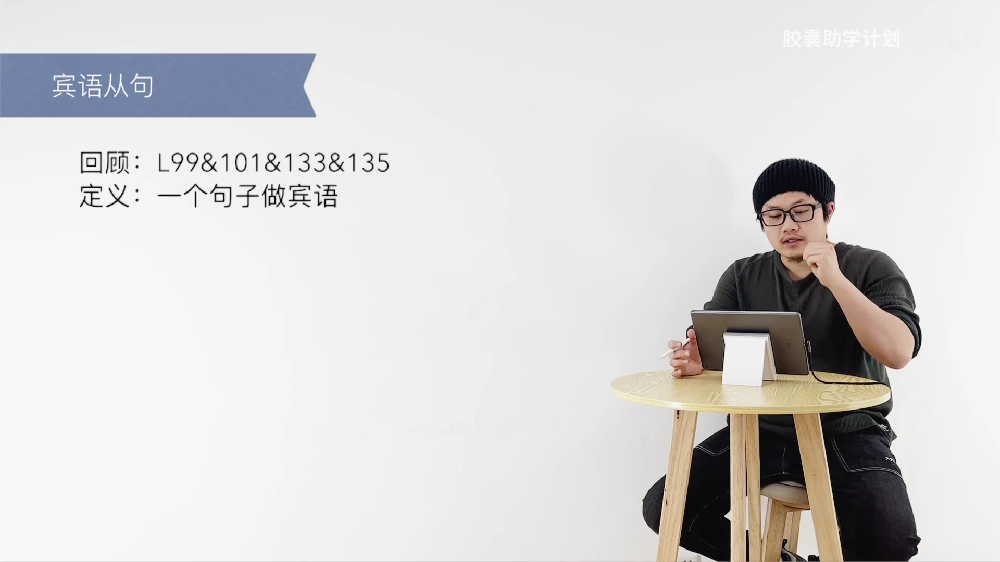

文字识别：宾语从句 / 回顾：L99&101&133&135 / 定义：一个句子做宾语

## 00:01:00–00:01:30

啊到一百三十五课这四课，实际上我们见到的都是陈述句做宾语从句，要么是肯定句，要么是否定句，我们统称它为叫陈述句，它不是疑问句，对吧？陈述一个客观事实，比如说 I think that he can win the game，那这就是一个肯定句，he can win the game去做了一个宾语从句，对吧？或者说 I believe that you are not loyal， you are not loyal，这实际上是一个否定句再去做

### 画面 00:01:08

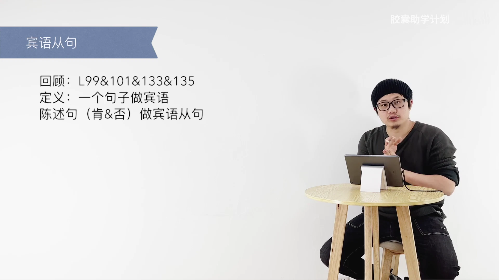

文字识别：宾语从句 / 回顾：L99&101&133&135 / 定义：一个句子做宾语 / 陈述句（肯&否）做宾语从句

### 画面 00:01:23

文字识别：宾语从句 / 回顾：L99&101&133&135 / 定义：一个句子做宾语 / 陈述句（肯&否）做宾语从句 / I think (that he can win the game. / I believe (that) you are not Leo.

## 00:01:30–00:02:00

做宾语从句，OK，那这个地方的 that 我们都加了一个括弧，这实际上也是早在九十九课咱们就学过的，叫做告诉各位，这种情况下的 that 往往是可以被省略掉的啊，事实是它也被省略掉了，OK，好，那接下来呢，我们今天要学的事情是一般疑问句，就像最开头说的那样，和特殊疑问句是如何去做宾语从句的。好，那我们先给大家一个非常简单的一般疑问句，叫

### 画面 00:01:47

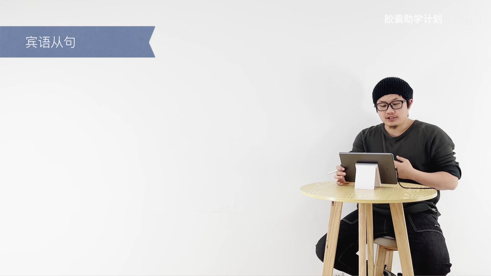

文字识别：宾语从句

## 00:02:00–00:02:30

做 Is she a nurse? 啊，非常简单，对吧？那它如何去做宾语从句呢？你不能把 Is she a nurse? 直接放在那个地方。很简单，第一步先把它变成陈述语序，注意不是陈述句，是吧？只是它显得和陈述句长得是一样的。比如说 She is a nurse. 这看上去就是个陈述句，对吧？OK，那什么叫陈述语序呢？这个地方就要涉及到咱们新一学了啊，练了几乎一本

### 画面 00:02:09

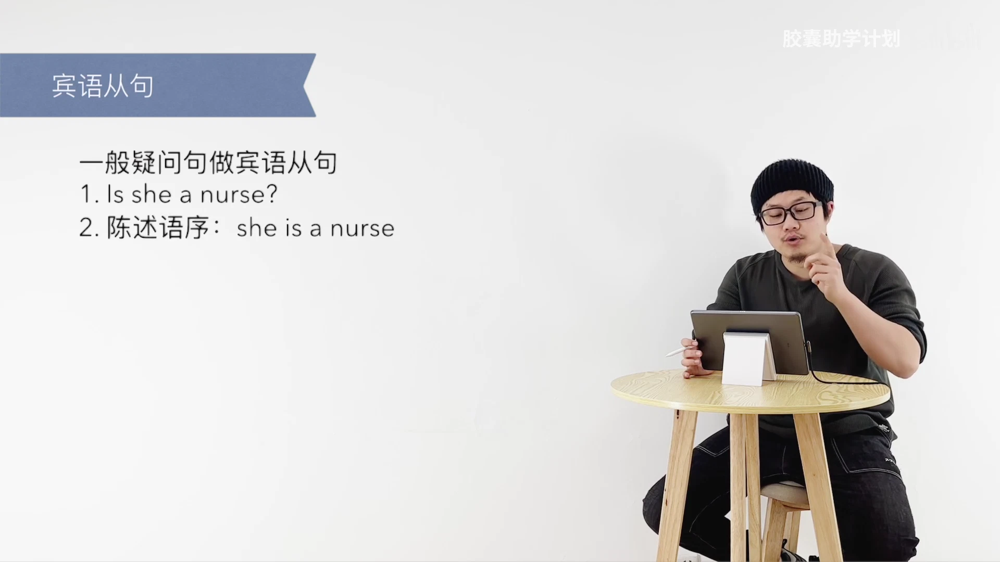

文字识别：宾语从句 / 一般疑问句做宾语从句 / 1. ls she a nurse? / 2. 陈述语序： she is a nurse

### 画面 00:02:20

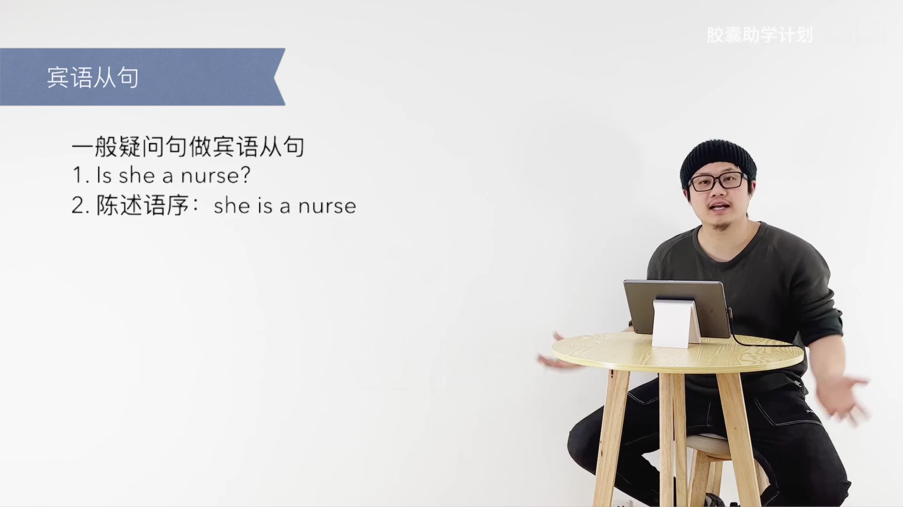

文字识别：宾语从句 / 一般疑问句做宾语从句 / 1. ls she a nurse? / 2. 陈述语序： she is a nurse

### 画面 00:02:26

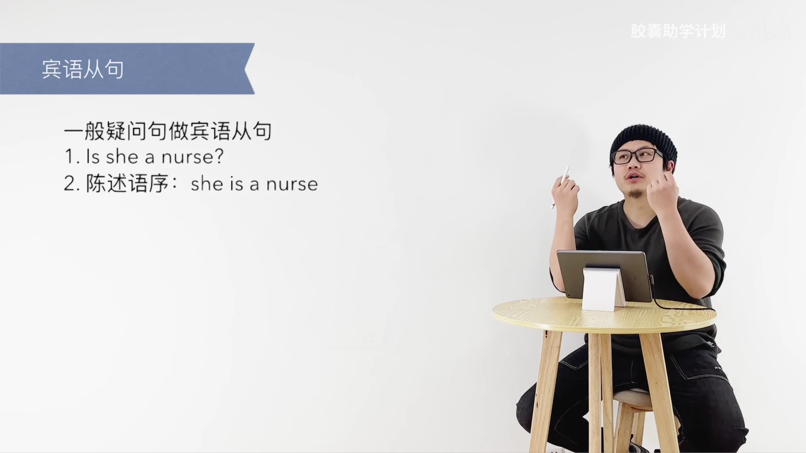

文字识别：宾语从句 / 一般疑问句做宾语从句 / 1. ls she a nurse? / 2.陈述语序：she is a nurse

## 00:02:30–00:03:00

书的一个知识点。各位回想一下，我们有一道题叫做 ask me if，对吧？那道题我们做的事情是口语听力练习，对吧？那道题我们做的事情是我给各位一个肯定句，各位把这个肯定句变成一般疑问句。这是各位学完新一了之后一定要掌握的知识点之一，就是各个句型、各个时态、各个情态动词之下如何去变一般疑问句。我们会把各种

### 画面 00:02:56

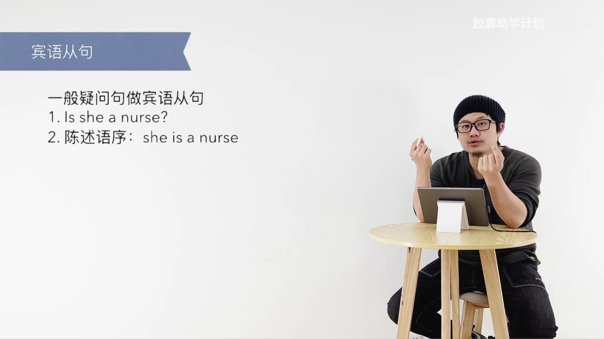

文字识别：宾语从句 / 一般疑问句做宾语从句 / 1. ls she a nurse? / 2. 陈述语序：she is a nurse

## 00:03:00–00:03:30

各样的东西提到句首去，对吧？所以我们就把一个肯定句或者陈述句变成了一个一般疑问句。那现在对于各位的要求，就是把当年我们从肯定句变成一般疑问句的这个动作，把一个单词提到句首去这个动作，哎，反方向再变回去就可以了。比如说，当年我们是把 she is a nurse is 提到句首去，变成一般疑问句，也就是第一句话 is she

### 画面 00:03:26

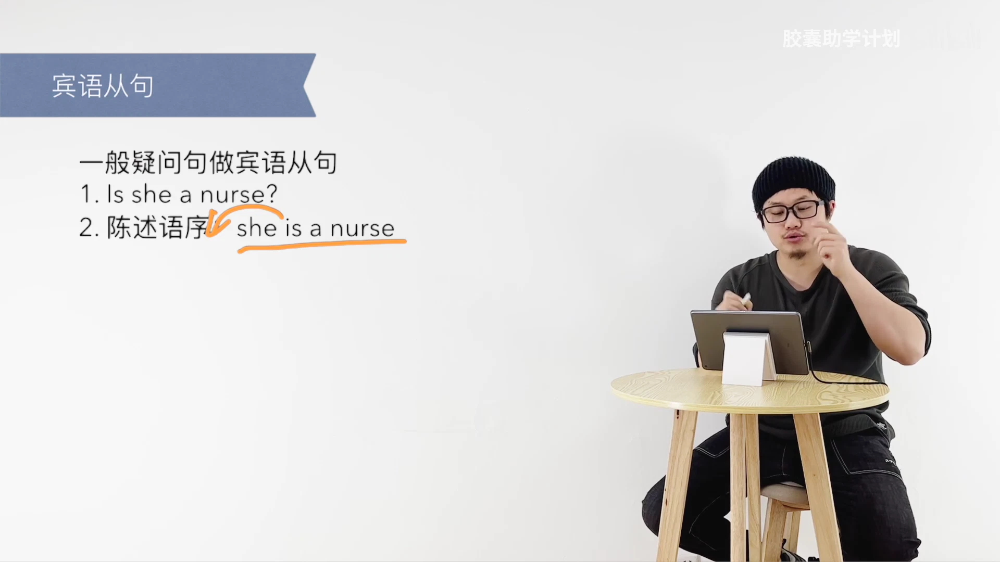

文字识别：宾语从句 / 一般疑问句做宾语从句 / 1. Is she a nurse? / 2.陈述语序 she is a nurse

## 00:03:30–00:04:00

nurse?今天对各位提出的要求是，你要明白 is 是从 she 后面提过来的。那您现在再给它提回去，它就变成了一个叫做陈述语序，叫 she is a nurse。然后呢，咱们还要添加一个连接词。这个地方的连接词就是这个单词，我们一百三十七课刚刚见过的，叫做 if。区别是什么？听清楚啊，这非常重要。区别是在一百三十七课咱们学 if 的时候，

### 画面 00:03:48

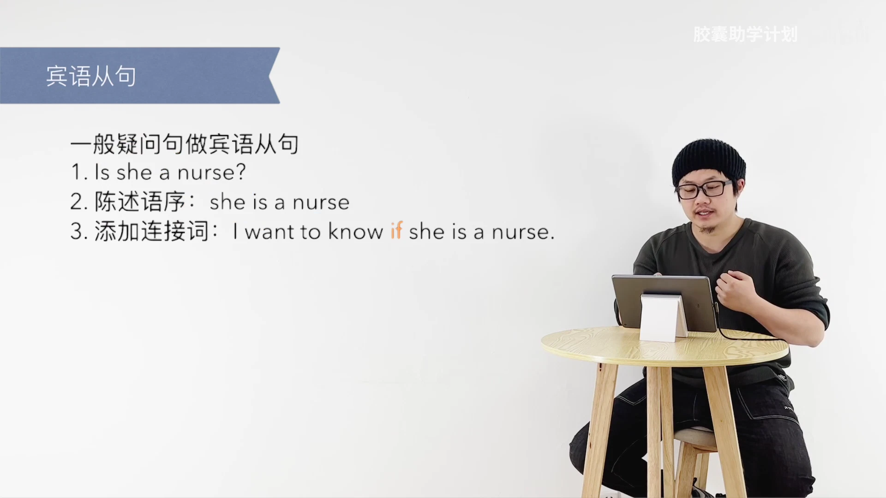

文字识别：宾语从句 / 一般疑问句做宾语从句 / 1. ls she a nurse? / 2.陈述语序：she is a nurse / 3.添加连接词：I want to know if she is a nurse.

## 00:04:00–00:04:30

它的含义叫做如果，对吧？如果 a 发生， b 就会发生啊。如果呃明天下雨，我们就不去逛街了，对不对？好，但是在这个地方，这个 if 不翻译成如果，它是 ask me if 里边的那个 if，对吧？它有第二个含义叫做是否，所以这句话它就翻译成叫我想知道是否他是一个护士。如果没有这个 if，各位想一下，叫做

### 画面 00:04:18

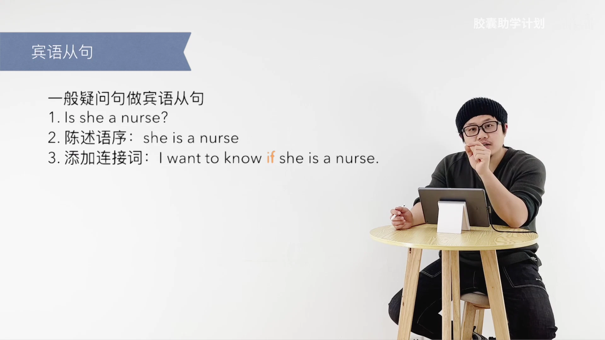

文字识别：宾语从句 / 一般疑问句做宾语从句 / 1. ls she a nurse? / 2. 陈述语序： she is a nurse / 3.添加连接词：I want to know if she is a nurse.

### 画面 00:04:23

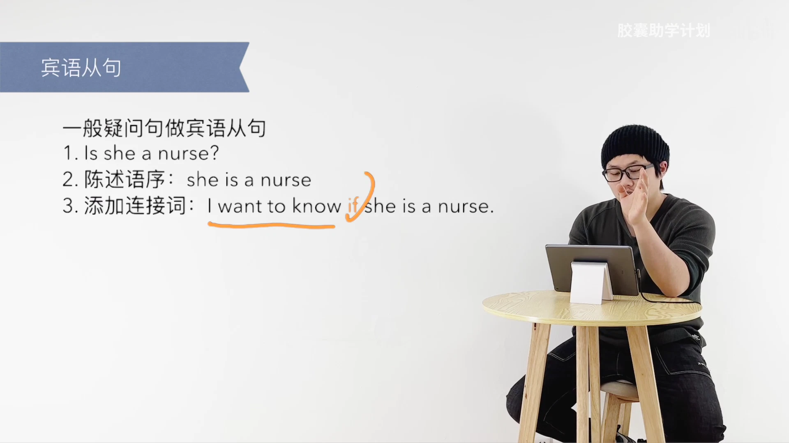

文字识别：宾语从句 / 一般疑问句做宾语从句 / 1. ls she a nurse? / 2. 陈述语序： she is a nurse / 3.添加连接词：Iwantto know / if she is a nurse.

### 画面 00:04:26

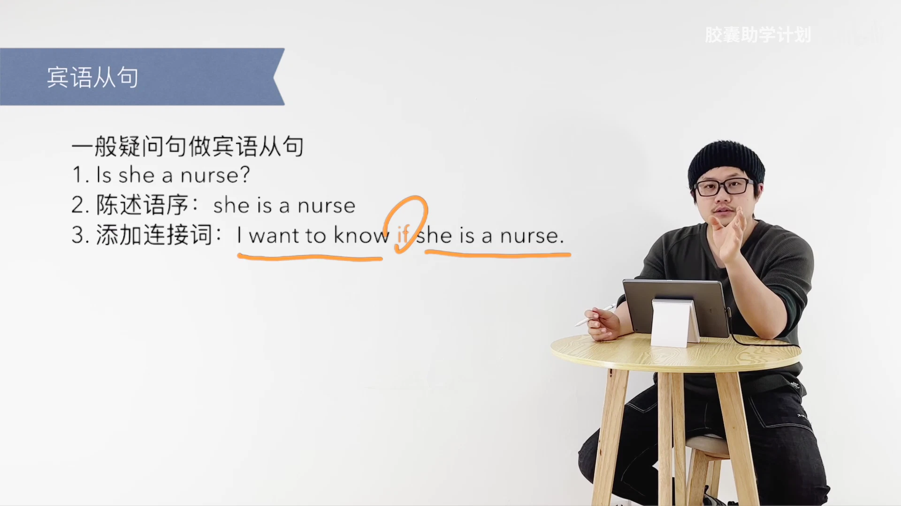

文字识别：宾语从句 / 一般疑问句做宾语从句 / 1. ls she a nurse? / 2. 陈述语序：she is a nurse / 3.添加连接词：I want to know / if she is a nurse.

## 00:04:30–00:05:00

想知道他是一个护士。你看这句话用任何语言它都是不通的，对不对？什么叫我想知道？我想知道肯定是他是否是一个护士，对不对？所以一般疑问句去变成宾语从句的时候，简单来说，第一步啊，你要先确定个一般疑问句，对吧？那第二步你要去把它的语序做一个调整，就是咱们做 ask me if 那个练习，对吧？您原来是把单词提到句首变一般疑问句，现在是你

### 画面 00:04:56

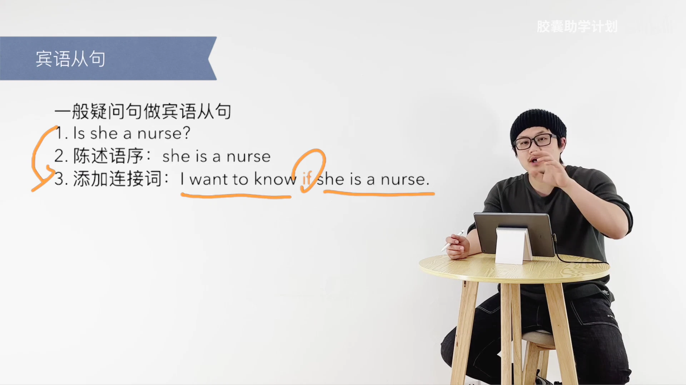

文字识别：宾语从句 / 一般疑问句做宾语从句 / 1.ls she a nurse? / 2. 陈述语序： sheis a nurse / 3.添加连接词：Iwant to know / if she is a nurse.

## 00:05:00–00:05:30

再给它放回去，给它变成肯定句，对不对？叫做 she is a nurse。第三步呢，您要加一个小的连词，就是引导啊，换一句话叫引导词也行，无所谓啊。呃，引导这个宾语从句的那个单词，原来呢咱们九十九课学的是 that，今天告诉各位的叫做这个单词 if，并且它翻译成了叫做是否。所以这句话我们一个单词一个单词翻译一下，叫我想知道是否她是一个护

### 画面 00:05:26

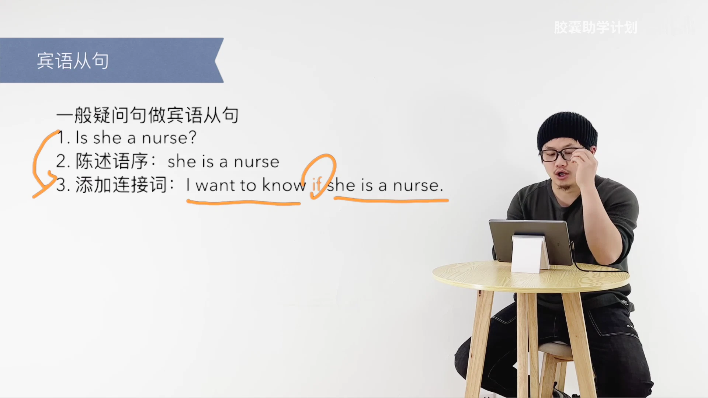

文字识别：宾语从句 / 一般疑问句做宾语从句 / 1.ls she a nurse? / 2.陈述语序： sheis a nurse / 3.添加连接词：Iwantto know / if she is a nurse.

## 00:05:30–00:06:00

士？您看这个疑问的感觉就留下来了，对不对？OK，那于是在这儿我想问一个问题啊，原来的that我们是可以被省略掉的。您现在带着这个疑问或者暂停屏幕，自己先回答一下这个问题。您觉得这个if能不能被省略掉呢？啊，一会儿我们揭晓答案，好吧？好，Let's continue。接下来我们做一些小的呃练习啊，就是按照刚才那三步走，对吧？那我们先看一下上面给大家这个公式，首先是

### 画面 00:05:50

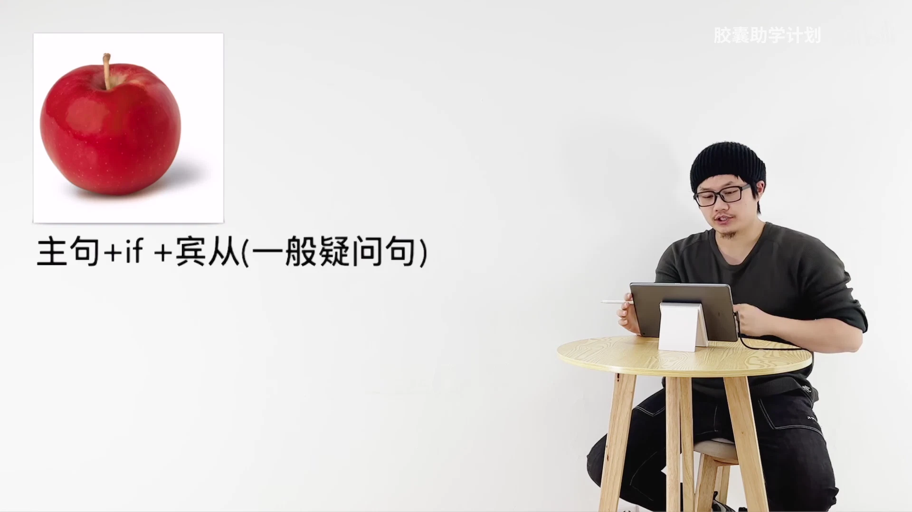

文字识别：主句+if+宾从(一般疑问句)

## 00:06:00–00:06:30

主句，对吧？就我们现在都给它确定了，就都用 I want to know，对吧？我想知道。If 呢，它的含义叫做是否。接下来呢，是一个宾从，这个宾从呢，我们今天现在要学的是一般疑问句去做这个宾从，对吧？比如说呢，我们先来一个一般疑问句，叫 Do you want an apple？叫你想要一个苹果吗？所以我们现在想把它变成的那句话叫做我想知道你是否想要一个苹果。所

### 画面 00:06:10

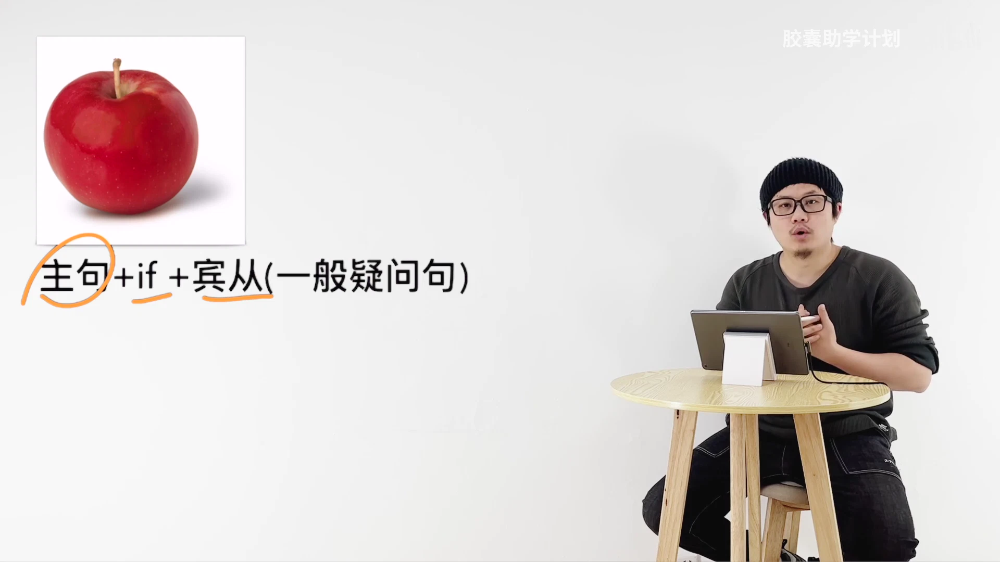

文字识别：主句+if+宾从(一般疑问句)

### 画面 00:06:13

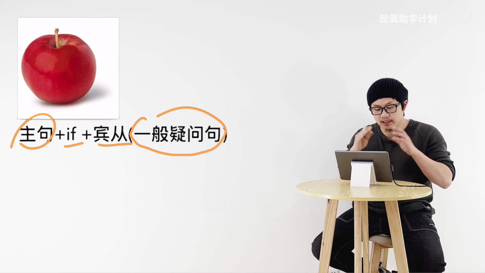

文字识别：主句+if+宾从一般疑问句

## 00:06:30–00:07:00

我们第二步要做的事情是把它先变成陈述句，这个地方就非常重要了。注意啊，Do you want an apple? 它当年理论上是从 I want an apple 或者 You want an apple 变过来的，对吧？那我们陈述语序就把它变成叫 You want an apple。那你说我能不能把它变成 I want an apple？我不想用 you，行不行呢？不着急，咱先往后看，下面添加连接

### 画面 00:06:39

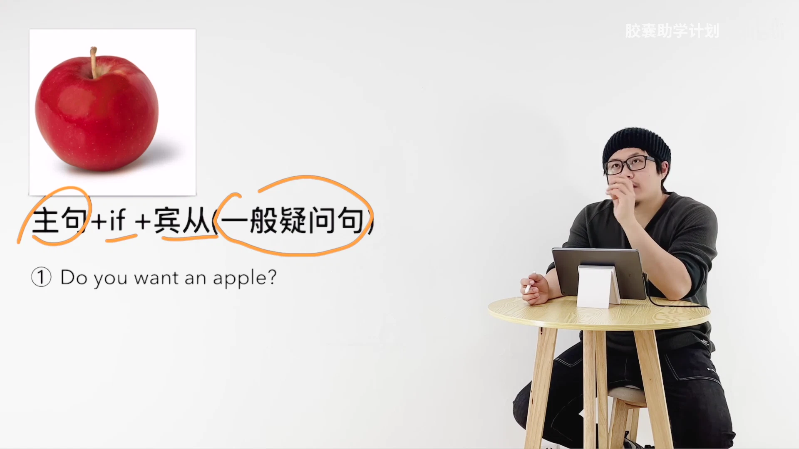

文字识别：主句+if+宾从一般疑问句 / ① Do you want an apple?

### 画面 00:06:52

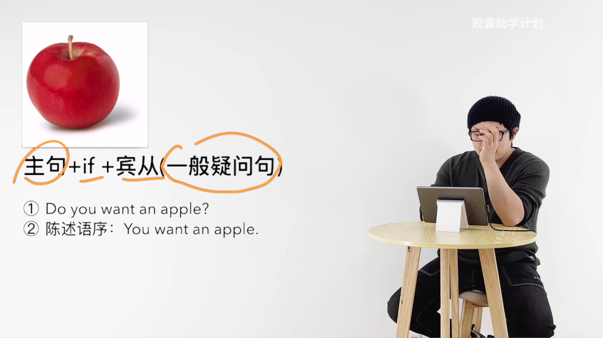

文字识别：主句+if+宾从 / 一般疑问句 / ① Do you want an apple? / 陈述语序： You want an apple.

### 画面 00:06:58

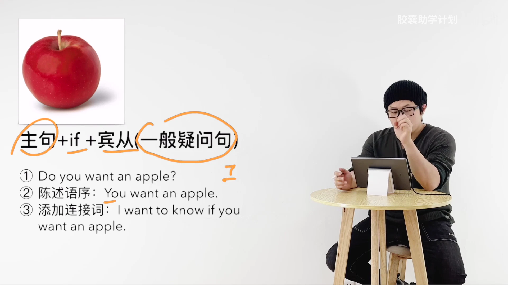

文字识别：主句+if+宾从 / 一般疑问句 / 7 / ① Do you want an apple? / 陈述语序： You want an apple. / 添加连接词：l want to know if you / want an apple.

## 00:07:00–00:07:30

词，对吧？就是 if 这个单词，这句话就翻译成叫我想知道是否你想要一个苹果，对吧？那于是在这个地方，我觉得你就能回答这个问题了，叫做这个地方的 you，我不想用 you，我想给它换成 I want an apple，叫 I want to know if I want an apple，行不行呢？从语法上来说，好像是没什么问题的。从语义上来说，对，注意啊，我们学的

### 画面 00:07:28

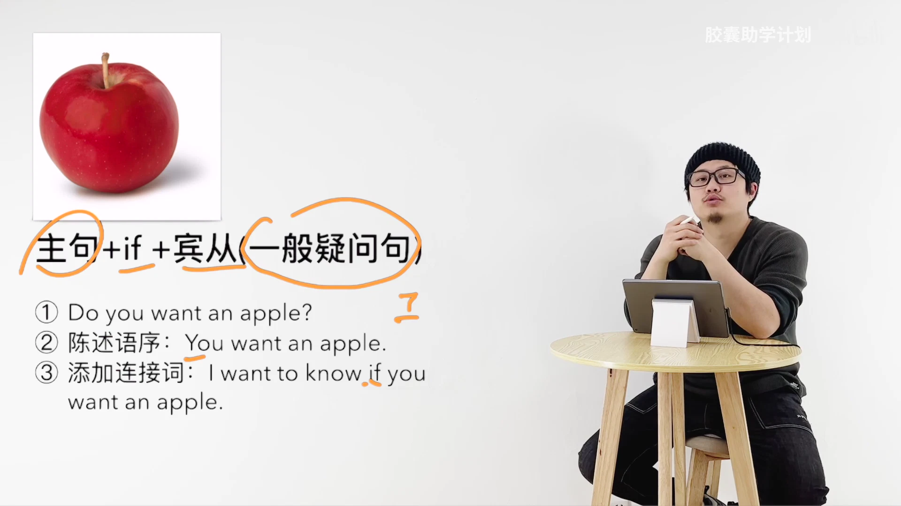

文字识别：主句+if+宾从( / 一般疑问句 / 7 / ① Do you want an apple? / 陈述语序： You want an apple. / 添加连接词：l want to know_if you / want an apple.

## 00:07:30–00:08:00

是语言，语法只是一个手段，目的本身是语言，对吧？语法没错，但语言本身好像不太对劲儿。叫我想知道我是否需要一个苹果，好像一般不这么问，一般是我想知道你是否需要一个苹果，对吧？叫 I want to know if you want an apple. Okay, there we go,非常简单，对不对？接下来，比如说 Is he ill？对于各位来说，还是那句话，如果您基础越好，在这反应速度越快，直接是 He

### 画面 00:07:51

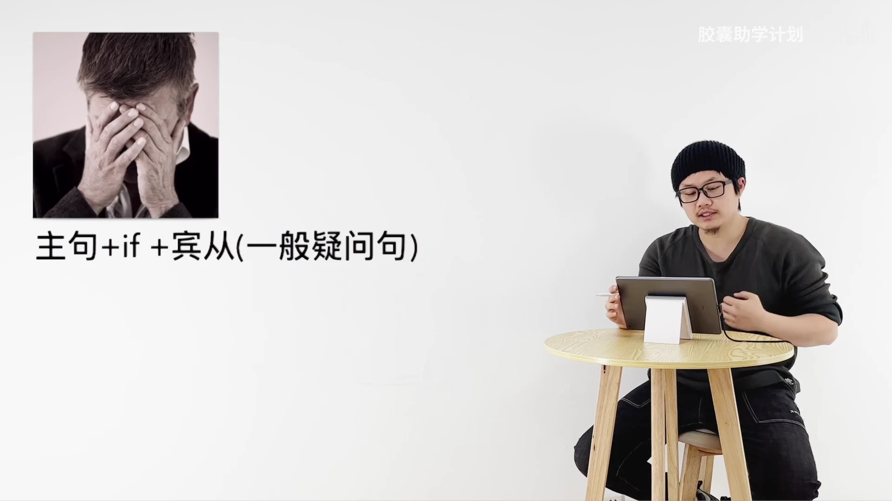

文字识别：主句+if +宾从(一般疑问句)

## 00:08:00–00:08:30

is ill，对吧？那我想知道的是他是否生病了。I want to know if he is ill. If 一定不能删除，各位在这一定要注意，好吧？OK， very good。接下来说 is he going to study English？好，把它变成什么陈述语序，对吧？也就是你当年肯定句怎么变过去问，先肯定句怎么变成的一般疑问句，你回想一下，再给它还原成肯定句，对吧？

### 画面 00:08:03

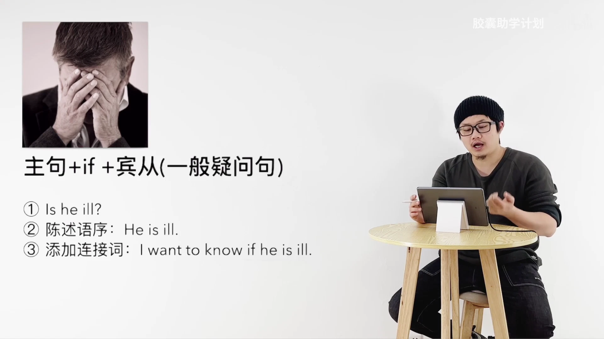

文字识别：主句+if +宾从(一般疑问句) / ① Is he ill? / 陈述语序：He is ill. / )添加连接词：I want to know if he is ill

### 画面 00:08:12

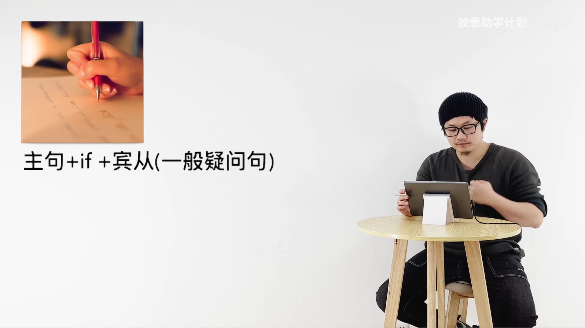

文字识别：主句+if +宾从(一般疑问句)

### 画面 00:08:16

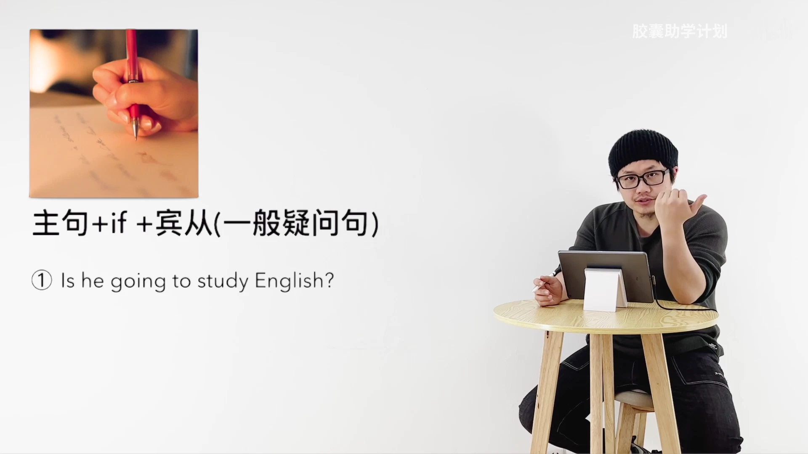

文字识别：主句+if +宾从(一般疑问句) / ① Is he going to study English?

## 00:08:30–00:09:00

那叫做 He is going to study English. 那很简单，接下来要做的事情 I want to know 放在前面，加一个 if。接下来这句话直接抄在这儿，叫 I want to know if he is going to study English. 我想知道的是，是否他打算学习英文，对吧？那在这儿我提一个小点，各位看一和三，一和三某种程度上来说，想表达的含义是非

### 画面 00:08:34

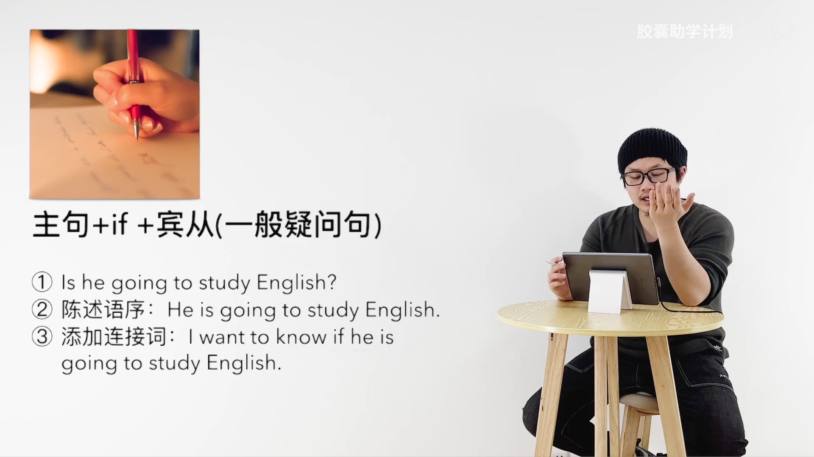

文字识别：主句+if +宾从(一般疑问句) / ① Is he going to study English? / 陈述语序：He is going to study English. / 添加连接词：I want to know if he is / going to study English.

### 画面 00:08:37

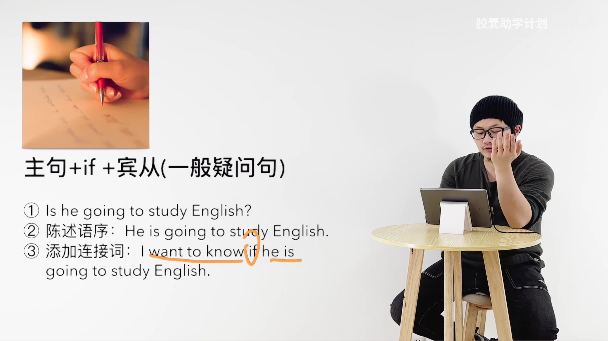

文字识别：主句+if +宾从(一般疑问句) / ① Is he going to study English? / 陈述语序：He is going to styy English. / 添加连接词：Iwant to know / (if / heis / going to study English.

### 画面 00:08:39

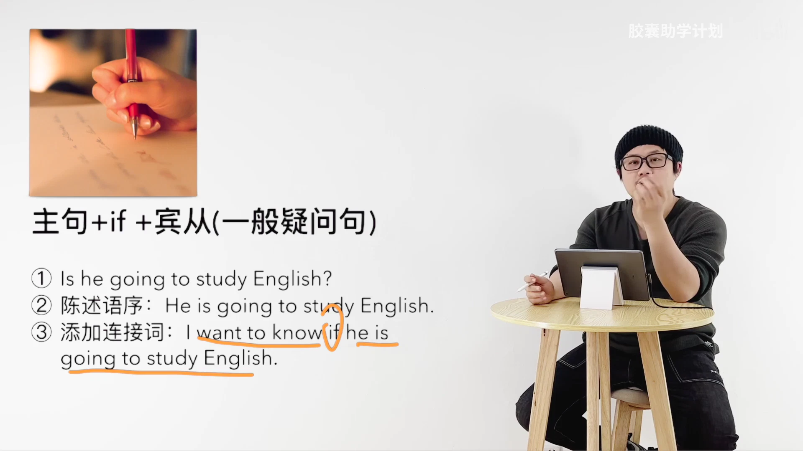

文字识别：主句+if +宾从(一般疑问句) / ① Is he going to study English? / 陈述语序：He is going to styly English. / 添加连接词：Iwant to know / Wifhe is / going to study English.

### 画面 00:08:51

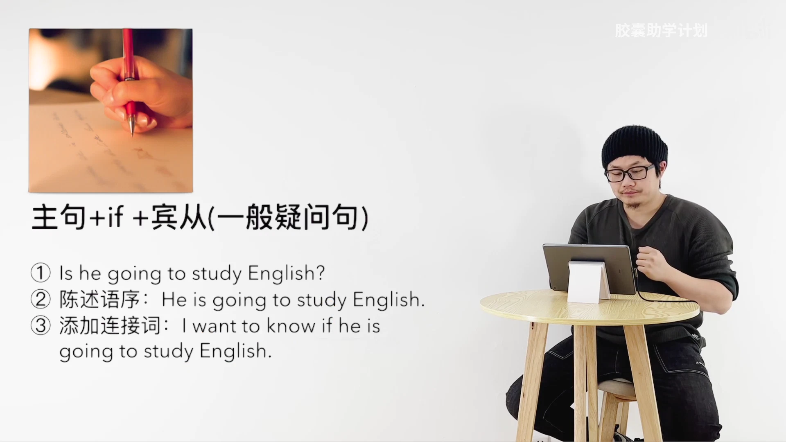

文字识别：主句+if+宾从(一般疑问句) / ① Is he going to study English? / 陈述语序：He is going to study English. / 添加连接词：Iwant to know if he is / going to study English.

### 画面 00:08:54

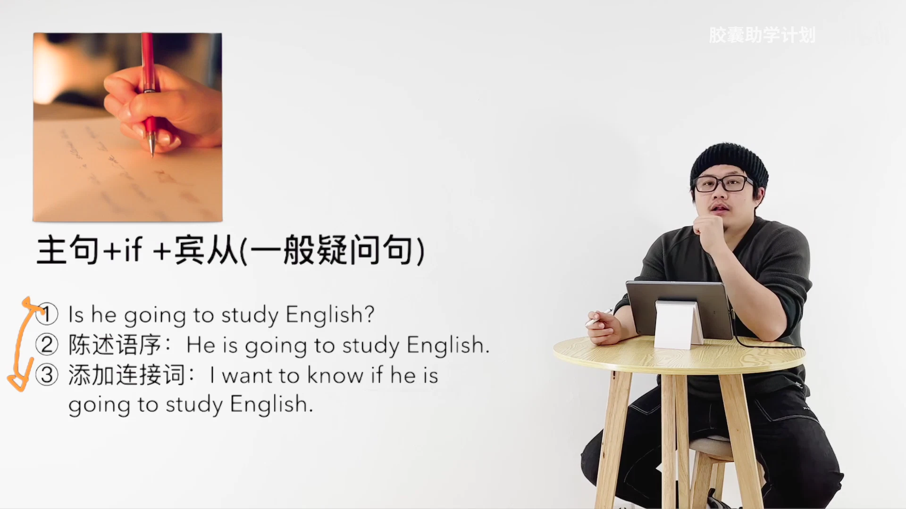

文字识别：主句+if +宾从(一般疑问句) / ① Is he going to study English? / 陈述语序：He is going to study English. / 添加连接词：I want to know if he is / going to study English.

## 00:09:00–00:09:30

常像的。我对着第三个人问说，Is he going to study English？和我对着他问，I want to know if he is going to study English。这讲这这两句话某种程度上的含义是非常相似的。对于各位来说，目前对各位的要求是：一，你必须要会；三，也就是今天我们新学的这个，对于各位来说，你可以暂时说不出来啊，但是你必须要能看懂，

### 画面 00:09:24

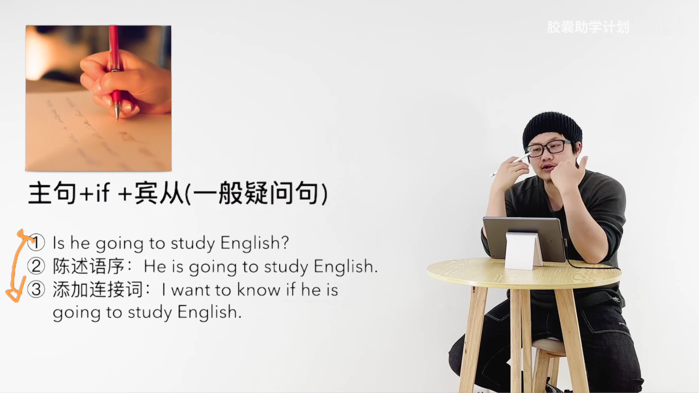

文字识别：主句+if +宾从(一般疑问句) / ① Is he going to study English? / 陈述语序：He is going to study English. / 添加连接词：I want to know if he is / going to study English.

## 00:09:30–00:10:00

必须要能听懂，对吧？你必须要知道。I want to know if这个if不是如果，而是翻译成是否，对吧？OK，好。接下来说Does she often go shopping？很简单，你把它换成肯定句，叫做She often goes shopping，对吧？很简单。I want to know if she often goes shopping. OK，好。接下来我们要说的是特殊疑问句做宾语从句怎么办呢？那我们先来一个特殊疑问句吧。

### 画面 00:09:39

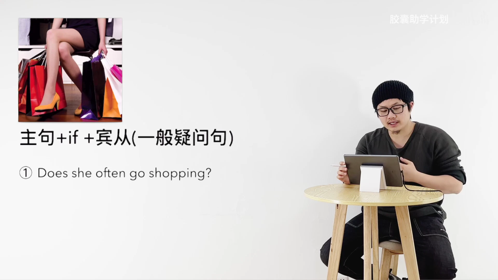

文字识别：主句+if +宾从(一般疑问句) / ① Does she often go shopping?

### 画面 00:09:44

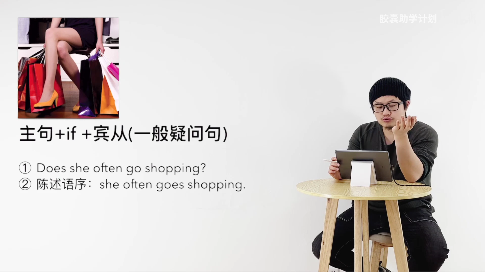

文字识别：主句+if+宾从(一般疑问句) / ① Does she often go shopping? / 陈述语序： she often goes shopping.

### 画面 00:09:48

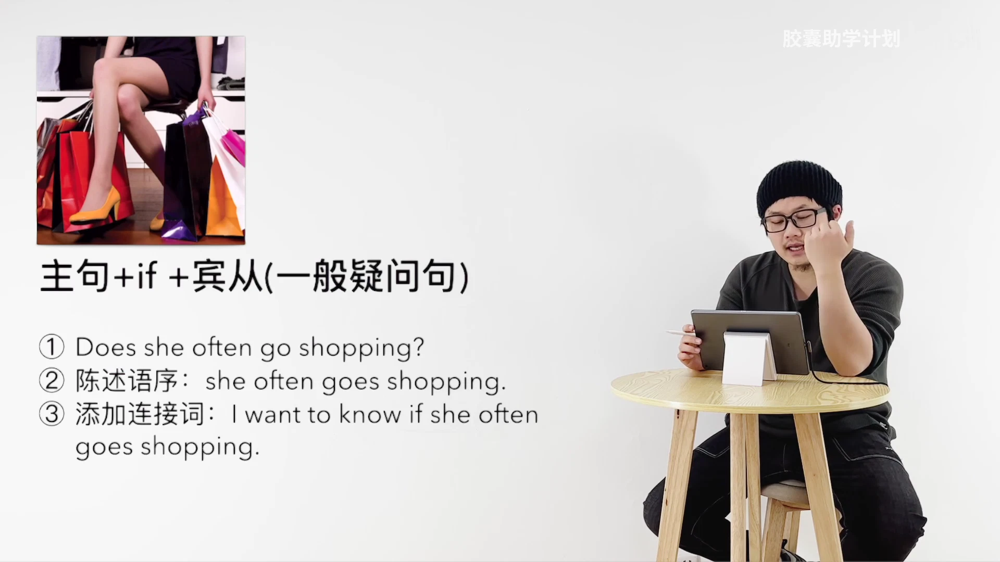

文字识别：主句+if +宾从(一般疑问句) / ① Does she often go shopping? / 陈述语序： she often goes shopping. / 添加连接词：I want to know if she often / goes shopping.

### 画面 00:09:53

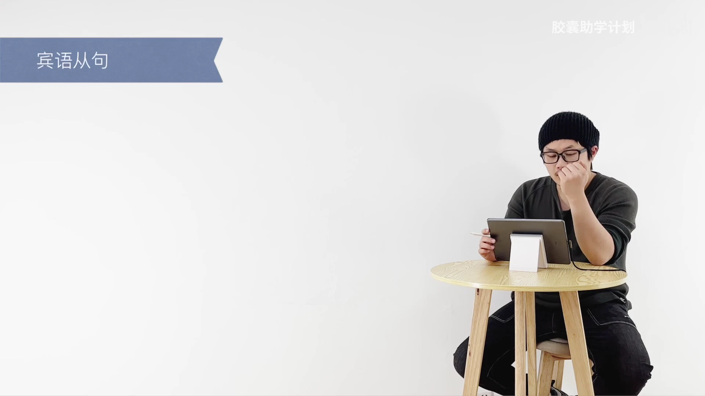

文字识别：宾语从句

### 画面 00:09:58

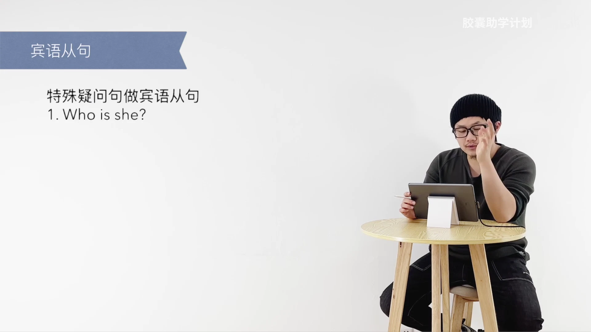

文字识别：宾语从句 / 特殊疑问句做宾语从句 / 1. Who is she?

## 00:10:00–00:10:30

很简单，Who is she？他是谁？说我现在想知道他是谁。这句话怎么办呢？注意啊，这儿就非常重要了。我们还是要把它换成陈述语序。陈述语序在换的时候，各位注意这个特殊疑问词，第一个词叫特殊疑问词，对吧？特殊疑问句的第一个词叫特殊疑问词。这个特殊疑问词你不能动它，还是放在句首。所以对于各位来说，换陈述语序的时候，只看啊，我们看一下

### 画面 00:10:28

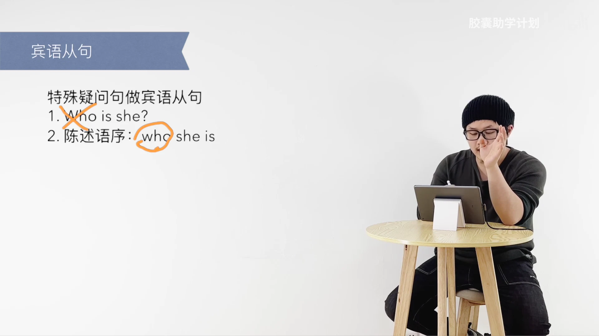

文字识别：宾语从句 / 特殊疑问句做宾语从句 / 1.Who is she? / 2.陈述语序:whgsheis

## 00:10:30–00:11:00

第一句话啊，不管特殊疑问词，只看后面的所有单词。在这句话当中很简单，只有两句单词，is she，把它变成陈述语序就是 she is，对吧？OK，好，然后很简单叫 I want to know who she is。所以在这个地方各位注意一个小点，我们在讲陈述句的时候，对吧？肯定句、否定句的时候，它

### 画面 00:10:31

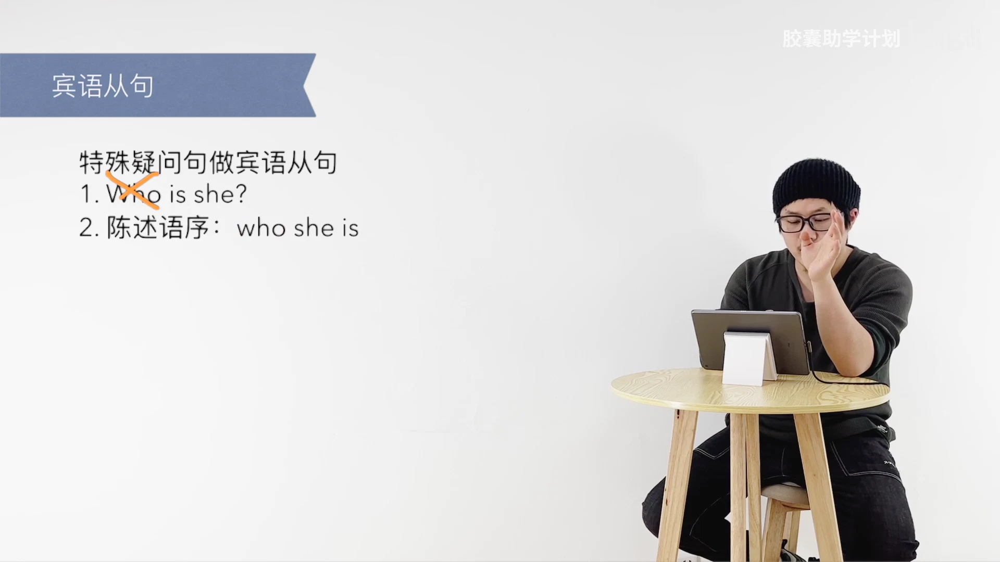

文字识别：宾语从句 / 特殊疑问句做宾语从句 / 1. WXo is she? / 2. 陈述语序：who she is

### 画面 00:10:39

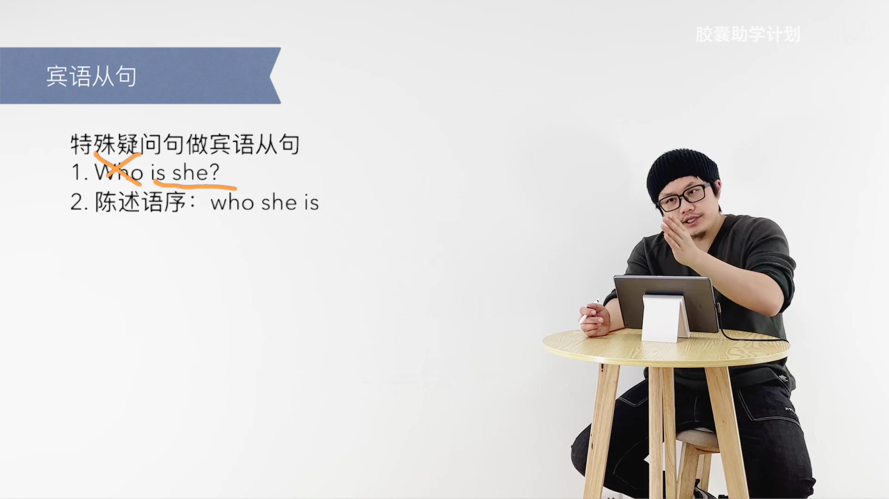

文字识别：宾语从句 / 特殊疑问句做宾语从句 / 1. Wo is she? / 2. 陈述语序：who she is

### 画面 00:10:54

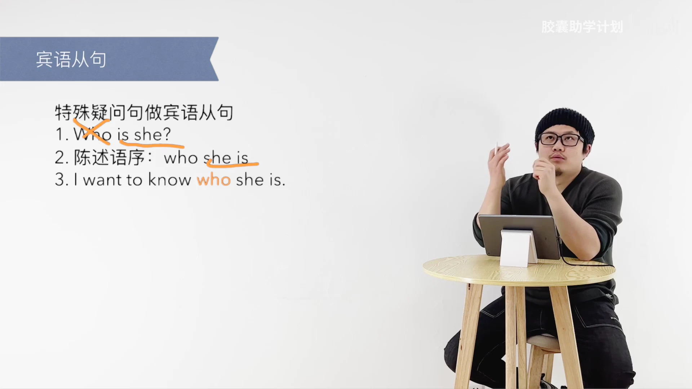

文字识别：宾语从句 / 特殊疑问句做宾语从句 / 1. WXo is she? / 2. 陈述语序：who she is / 3.I want to know who she is.

## 00:11:00–00:11:30

的连接词或者叫引导词是 that。一般疑问句的时候，不管你是什么一般疑问句，连接词是 if。而在特殊疑问句做宾语从句的时候，它的连接词是什么呢？就是你那个特殊疑问句的开头的那个单词，又叫特殊疑问词，放在那个地方不要变。所以这句话就变成了叫 I want to know who she is。在我们真正使用语言的过程当

### 画面 00:11:24

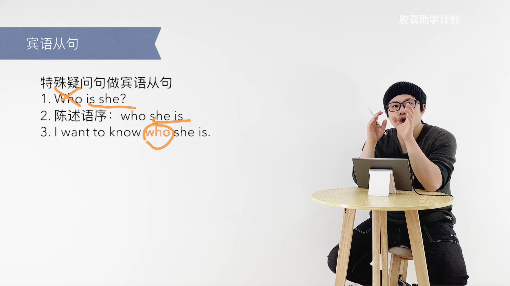

文字识别：宾语从句 / 特殊疑问句做宾语从句 / 1. WXo is she? / 2. 陈述语序： who she is / 3.I want to knowwhoshe is.

## 00:11:30–00:12:00

中，第一句话是会出现的，叫做 Who is she？她是谁？第三句话是会出现的，叫 I want to know who she is。这也是我们考试经常会考到的一个语法点，各位一定要注意啊。而第二句话说 Who she is？单独出这三个单词是不会出现的，它只是中间的一个我们在讲解这个怎么变化的过程当中的一个中间状态，它不会单独出现，它是错的，各位啊。好，那接下来

### 画面 00:11:36

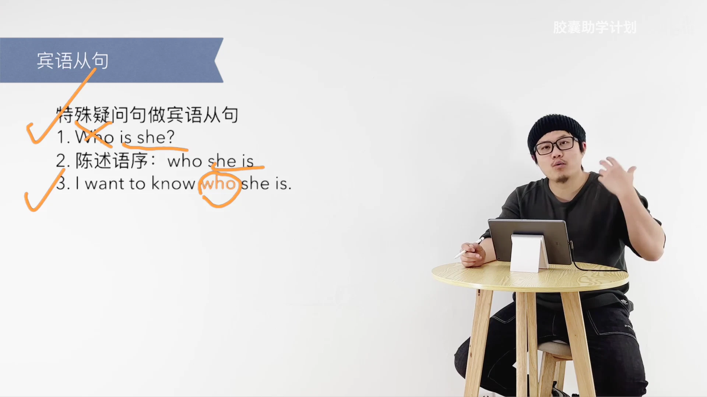

文字识别：宾语从句 / 特殊疑问句做宾语从句 / 1. WXo is she? / 2. 陈述语序：who she is / 3.I want to knowwho she is.

### 画面 00:11:59

文字识别：主句+特殊疑问词 +宾从(特殊疑问句)

## 00:12:00–00:12:30

我们试一下吧。比如说 What are you talking about？我们想把它变成陈述语序，第一步先不要管 What，What 是特殊疑问词，一定是放在句首的，对吧？因为它作为连接词，而后面的叫做 Are you talking about？这一句话怎么变成陈述语序呢？很简单，你回想一下，特殊疑问句等于什么来着？等于特殊疑问词加去掉答案之后的一

### 画面 00:12:09

文字识别：主句+特殊疑问词+宾从(特殊疑问句) / What are you talking about?

### 画面 00:12:17

文字识别：主句+特殊疑问词+宾从(特殊疑问句) / Whatare you talking about?

### 画面 00:12:28

文字识别：主句+特殊疑问词+宾从(特殊疑问句) / Whatare you talking about?

## 00:12:30–00:13:00

般疑问句，刚才您已经学习了如何把一般疑问句还原成肯定句。那现在特殊疑问词放在最前面不动，后边就是一个去掉答案之后的一般疑问句，对吧？那对于各位来说，你要做的事情无非就是把 are 放到 you 的后面去，叫做 you are talking about me，对吧？只不过 me 现在被省略掉了，对不对？所以您看这句话，它的陈述语序就是 what you are talking about，连

### 画面 00:12:30

文字识别：主句+特殊疑问词 +宾从(特殊疑问句) / What are you talking about?

### 画面 00:12:54

文字识别：主句+特殊疑问词 +宾从(特殊疑问句) / What are you talking about? / 陈述语序：what you are taiking about.

### 画面 00:12:56

文字识别：主句+特殊疑问词 +宾从(特殊疑问句) / Whatare you talking about? / 陈述语序：what you are talking about.

### 画面 00:12:58

文字识别：主句+特殊疑问词 +宾从(特殊疑问句) / What are you talking about? / 陈述语序：what you are talking about.

## 00:13:00–00:13:30

起来叫I want to know what you are talking about.同理啊，还是那句话，What are you talking about?是不能变的，它是一个典型的英文当中的特殊疑问句，叫特殊疑问词加一般疑问句。第三句话I want to know what you are talking about是特殊疑问句做宾语从句，对吧？所以它的语序也不能随便换。各位注意啊，就

### 画面 00:13:00

文字识别：主句+特殊疑问词 +宾从(特殊疑问句) / What are you talking about? / 陈述语序：what you are talking about. / ③ I want to know what you are talking about.

### 画面 00:13:20

文字识别：主句+特殊疑问词 +宾从(特殊疑问句) / What are you talking about? / 陈述语序：what you are talking about. / I want to know what you are talking about.

## 00:13:30–00:14:00

是 what you are talking about。而第二句话不会单独存在，好吧？好，往往第三句话是一个英文当中的考点。如果您要去参加考试的话，好吧，各种各样的考试都算是一个考点啊。Okay, let's continue. Say where are you from? 你看，特殊疑问词换了，但万变不离其宗，就不用管它，放在句首放着就可以了。而后边的叫 are you from？后边答案不是被去掉

### 画面 00:13:46

文字识别：Where / are / you / from? / 主句+特殊疑问词 +宾从(特殊疑问句)

### 画面 00:13:53

文字识别：Where / are / You / from? / 主句+特殊疑问词+宾从(特殊疑问句) / Whereare you from?

## 00:14:00–00:14:30

了吗？对吧？好，不用管它。但是你要知道的是，Are you from？怎么变成陈述语序呢？你要把 are 放到 you 的后面去。这不是今天学的，这是前啊，整整个新一我们学的东西，这就是基本功，对吧？如果听到这儿您懵了，那我我需要你质疑自己几个问题。第一，你是不是贸然就去没听前面的课，对吧？没认真做练习就直接听的这一课，或者是那你要你

### 画面 00:14:08

文字识别：Where / are / you / from? / 主句+特殊疑问词 +宾从(特殊疑问句) / Where / are you from?

## 00:14:30–00:15:00

如果说你前面的课都听了，那你要问的另一个问题是怎么听的？怎么到这个地方就懵了，对吧？跟之前学的没有任何区别啊，一定是跟之前学的紧密相连的，对吧？所以它的陈述语序叫做 Where you are from? OK, 好, Where you are from? 把 are 放到了 you 的后面去，然后 I want to know where you are from, 对吧？OK，第一句话常年存在，第三句话可以存在，第二句话不存在啊。OK，

### 画面 00:14:38

文字识别：Where / are / you / from? / 主句+特殊疑问词 +宾从(特殊疑问句) / Where / are you from?

### 画面 00:14:44

文字识别：Where / are / you / from? / 主句+特殊疑问词 +宾从(特殊疑问句) / Where are you from? / 陈还语序：where you are from.

### 画面 00:14:46

文字识别：Where / are / you / from? / 主句+特殊疑问词+宾从(特殊疑问句) / Where are you from? / 陈述语序：where you are from.

### 画面 00:14:50

文字识别：Where / are / you / from? / 主句+特殊疑问词 +宾从(特殊疑问句) / Where are you from? / 陈述语序：where you are from / ③ I want to know where you are from. / 3

### 画面 00:14:57

文字识别：Where / are / you / from? / 主句+特殊疑问词+宾从(特殊疑问句) / Where are you from? / 陈述语序：where you are fromX / ③ I want to know where you are from. / 3

### 画面 00:14:59

文字识别：主句+特殊疑问词 +宾从(特殊疑问句)

## 00:15:00–00:15:30

再来说 What's your job？这句话是很多人我原来在课上带着大家做练习的时候，大家都会错的。你注意啊，一般疑问句是怎么变来的？一般疑问句是把某一个单词提到主语的前面去，对吧？提到句首。那怎么变回来呢？也很简单，无非就是把这个单词放到主语的后面去就可以了，就这么简单。

### 画面 00:15:01

文字识别：主句+特殊疑问词 +宾从(特殊疑问句) / ① What's your job?

### 画面 00:15:04

文字识别：主句+特殊疑问词 +宾从(特殊疑问句) / D What's your job?

## 00:15:30–00:16:00

很多同学在这个地方犯的错误是什么呢？本来应该是把 is 这地方是 is 啊，很多同学放到了 your 这个单词的后面，而不是 job 这个单词的后面。首先给大家正确答案叫 what your job is。 your 加 job 合起来才是主语。 your 表示的是你的，可不是你呀。而且 you 如果真的是 you 啊，就 y o u 后边怎么能是

### 画面 00:15:34

文字识别：主句+特殊疑问词 +宾从(特殊疑问句) /  What's your job?

### 画面 00:15:42

文字识别：主句+特殊疑问词+宾从(特殊疑问句) / ) What's your job?

### 画面 00:15:45

文字识别：主句+特殊疑问词 +宾从(特殊疑问句) / 1 / What's your job? / 陈述语序：what your job is

### 画面 00:15:58

文字识别：主句+特殊疑问词 +宾从(特殊疑问句) / What's your job? / 陈述语序：what your job is

## 00:16:00–00:16:30

is呢？后边应该是什么？应该是are嘛？这不是新概念前二十课咱们就学过的语法吗？对吧？所以叫What your job is. Continue.叫I want to know what your job is.第一句话、第三句话都会存在，第二句话不存在啊。Okay, very good. Next one.说When will we go overseas?咱们什么时候出国？When不用动。Will we go overseas?这句话本身就已经是一个一般疑问句了，叫做咱们会

### 画面 00:16:04

文字识别：avo / 主句+特殊疑问词 +宾从(特殊疑问句) / What's your job? / 陈述语序：what your job is

### 画面 00:16:12

文字识别：arQ / 主句+特殊疑问词 +宾从(特殊疑问句) / What's your job? / 陈述语序：what your job is / ) I want to know what your job is.

### 画面 00:16:16

文字识别：USA / Australia / Canada / China / France / Germany / India / Italy / Japan / Russi / Sweden / 主句+特殊疑问词+宾从(特殊疑问句)

### 画面 00:16:24

文字识别：USA / Australia / Canada / China / France / Germany / India / Italy / Japan / Russia / Cweden / 主句+特殊疑问词 +宾从(特殊疑问句) / Wher will we go overseas?

## 00:16:30–00:17:00

出国吗？如何变成陈述语序呢？你肯定是要把 will 放到主语的后面去，We will go overseas，对吧？然后呢，人称改不改？您随便，由语义决定。我只是选择去改了，把它变成了叫做 When you will go overseas，你们什么时候出国？所以这句话就变成了 I want to know when you will go overseas。我想知道你们什么时候要出国。

### 画面 00:16:49

文字识别：USA / Australia / Canada / China / France / Germany / India / Italy / Japan / Russia / Sweden / 主句+特殊疑问词+宾从(特殊疑问句) / Wher will we go overseas? / 陈述语序：when you willgo overseas

### 画面 00:16:52

文字识别：USA / Australia / Canoda / China / France / Germany / India / Italy / Japan / Sweden / Russia / 主句+特殊疑问词 +宾从(特殊疑问句) / Wher will we go overseas? / 陈述语序：when you will go overseas / I want to know when you will go overseas.

## 00:17:00–00:17:30

你看连接词还是问，对不对？Will被放到了you的后面去，这个语法非常的重要啊。OK，我们总结一下，各位看这个表非常的重要。我们看一下怎么看啊？首先我们从左往右，先看几个东西，一定先出现的是主句，接下来出现的是连接词，然后才出现宾语从句。也就是英文跟汉语几乎是高度一致的，在语序上

### 画面 00:17:03

文字识别：USA / Australia / Canada / China / France / Germany / India / Italy / Japan / Sweden / Russia / 主句+特殊疑问词+宾从(特殊疑问句) / Wherwill we go overseas? / 陈述语序：when you will go overseas / I want to knowwhen you will / go overseas.

### 画面 00:17:08

文字识别：宾语从句 / 连接词 / 宾语从句 / that / 陈述句 / 可省略 / (肯&否) / 主句 / if / 一般疑问句 / 不可省略 / (陈述语序) / 特殊疑问词 / 特殊疑问句 / 不可省略 / (陈述语序)

## 00:17:30–00:18:00

啊，主谓宾对吧？OK啊，主句主谓宾，宾语从句，宾语从句前面加一个连接词，对不对？OK，玩一个。那连接词呢，在这个地方我们用三种可能性：that，if和特殊疑问词。that九十九课咱们就学了，它后边引导的是陈述句，可以是肯定句，可以是否定句，因为它本身没有任何含义，往往可以被省略掉。if，刚才我们说了，它翻

### 画面 00:17:38

文字识别：宾语从句 / 连接词 / 宾语从句 / that / 陈述句 / 可省略 / (肯&否) / 主句 / if / 一般疑问句 / 不可省略 / (陈述语序) / 特殊疑问词 / 特殊疑问句 / 不可省略 / (陈述语序)

## 00:18:00–00:18:30

译成叫是否的意思，对吧？所以它肯定不能省略掉。I want to know he is ill这句话别人不知道什么意思。I want to know if he is ill，别人才明白你什么意思。所以if不可被省略。if呢后边连的是一般疑问句，对吧？但是这个一般疑问句和特殊疑问句一样，都要用陈述语序。那同理，特殊疑问句的那个连接词引导词叫特殊疑问词嘛，对吧？肯定也不能省略，因为那个特

### 画面 00:18:08

文字识别：宾语从句 / 连接词 / 宾语从句 / that / 陈述句 / 可省略 / (肯&否) / 主句 / if / 一般疑问句 / 不可省略 / (陈述语序) / 特殊疑问词 / 特殊疑问句 / 不可省略 / (陈述语序)

## 00:18:30–00:19:00

殊疑问词本身是有含义的。who说的是谁，when说的是时间，对不对？所以也不可以被省略掉。这个表格很重要啊，各位初期可能需要看一个记一个过来，哎，对吧？就是您看到一句话，您拿不准了，然后到这个地方来，哎，去查一下这个表，好吧？那不多说了，接下来呢，我们花一点点的时间把本课的单词一起过一下。第一个，跟我一起读，叫做extra，extra

### 画面 00:18:38

文字识别：宾语从句 / 连接词 / 宾语从句 / that / 陈述句 / 可省略 / (肯&否) / 主句 / if / 一般疑问句 / 不可省略 / (陈述语序) / 特殊疑问词 / 特殊疑问句 / 不可省略 / (陈述语序)

### 画面 00:18:50

文字识别：/'ekstra/ / extra

## 00:19:00–00:19:30

extra, extra 啊，叫做额外的。那我们经常说的额外的，比如说 extra money, extra time，额外的钱或额外的时间。I need some extra money or I need some extra time. 我需要一些额外的钱或额外的时间。然后您就可以变成四句型转换了，对吧？这是各位的基础啊。到新二依旧是基础，到新三还是基础，好吧？Next one，这是 after

### 画面 00:19:16

文字识别：/'ekstra/ / extra / ① I need some extra money/time. / ② do/why/who...

### 画面 00:19:26

文字识别：/'ekstra/ / """ / extra / ① I need some extra money/time. / ② / do/why/who... / After my mom had given me / 3 / some extra money, I took a taxi / to school.

## 00:19:30–00:20:00

a逗号 b啊，说 after my mom had given me some extra time, my money, I took a taxi to school. 在他给了我一些额外的钱之后呢，我打车去上学了。Very good. 下一个单词跟我一起读，叫做 overseas. Overseas叫做国外，对吧？那我们常用的叫做 go overseas，叫出国去海外，对不对？好，比如说 they went overseas

### 画面 00:19:45

文字识别：/auva'si:z/ / overseas

### 画面 00:19:59

文字识别：/auva'siiz/ / overseas / go overseas / They went overseas 5 days ago.

## 00:20:00–00:20:30

five days ago.很简单一个肯定句，这基本上对于各位来说，您学到新概念一册七十三课这句话理论上就能造出来了，对不对？您回想一下，那然后各种各样的四句型转换，我们再来一个结合定语从句，说The man who went overseas five days ago works for a big bank now.现在在为一个大银行工作。你看，who哎，一直到

### 画面 00:20:14

文字识别：/auva'siiz/ / overseas / 1 / go overseas / They went overseas 5 days ago. / did/why/when... / The man who went overseas 5 / days ago works for a big bank now

## 00:20:30–00:21:00

ago给各位标出来了。新概念一册一百二十一课咱们学的叫做定语从句，对吧？这个语法也非常的重要。我们在不停的拿定语从句带着各位进行练习。OK，好，next one，接下来两个单词我们放在一起去学。首先，其实engineer我们新概念哎，这个这个前二十课咱就学过了，对吧？啊，就是工程。那engineering还是工程？那company叫做公司啊，工程公司叫做

### 画面 00:20:42

文字识别：/ｅnd3l'niarin/ /  /'kΛmpani/ / engineering / company

## 00:21:00–00:21:30

engineering company. Okay,好，比如说 my father has worked for an engineering company for thirty years. 那我自然就想问一个问题，叫做他的父亲现在还在为这个公司工作吗？他的公司现在啊，他的父亲现在还在为这个公司工作吗？你要自己去想一下，结合八十九课的那个现

### 画面 00:21:02

文字识别：/end3i'niarin/ /'knmｐａni/ / engineering / company / ① My father has worked for an / engineering company for 30 years.

### 画面 00:21:08

文字识别：/end3i'niarin/ / /'kΛmpani / / engineering / company / ① My father has worked for an / engineering company for 30 years.

## 00:21:30–00:22:00

在完成时的第二个用法，接下来注意，这是一般过去时了，叫做 My grandfather worked for an engineering company for thirty years。这八十九课咱也学过，对吧？只不过这不是八十九课学的，八十九课我们对比过，叫做一般过去时，叫做曾经为了这个建筑公司工作了三十年。那我的问题是同样的，叫他的 grandfather 现在还在为这个 engineering company 工作吗？

### 画面 00:21:31

文字识别：/ｅnd3i'niarīn/ / /'kΛmρani / / engineering / company / ① My father has worked for an / engineering company for 30 years. / My grandfather worked for an / engineering company for 30 years.

### 画面 00:21:35

文字识别：/end3i'niarin/ / / 'kΛmpani / / engineering / company / ① My father has workedfor an / engineering company f / for / 30 years. / My grandfather worked for / an / engineering /  company for 30 years.

## 00:22:00–00:22:30

好，您可以视频下方留言告诉我，好吧？哎，并给出一些您的解释最好啊。然后呢，各种各样的一般疑问句、特殊疑问句，我们就不说了。这是您的家庭作业，好吧？Next one，下一个单词，张嘴跟我一起读一下，叫做 line line. Okay, 那 line 其实最基本的意思就是线路啊，或者线啊，直线，对吧？比如说常见的 repair the telephone line，我们

### 画面 00:22:05

文字识别：/end3i'niarin/ / / 'kΛmｐａni/ / engineering / company / ① My father has worked for an / engineering company for 3 / 30 years. / My grandfather worked for / an / engineering company for 30 years.

### 画面 00:22:13

文字识别：/lain/ / line / e

### 画面 00:22:29

文字识别：/lain/ / line / ① repair the telephone line

## 00:22:30–00:23:00

### 画面 00:22:38

文字识别：/lain/ / line / ① repair the telephone line / After he had repaired the telephone / line, he went home.

### 画面 00:22:51

文字识别：/lain/ / line / ① repair the telephone line / After he had repaired the telephone / line, he went home. / The man who has just repaired the / telephone line is having a bath.

## 00:23:00–00:23:30

is having a bath,对吧？说哎，刚刚修理好电话线路的这个男的，现在正在洗澡，OK啊，正在泡澡玩一个啊。定语从句不难。Recap，除了本课的单词以外，我们今天重点学了一个语法，也是考试当中经常出现的，实际生活当中也会用到的。一般疑问句和特殊疑问句做宾语从句，OK。好，呃，家庭作业呢，

### 画面 00:23:13

文字识别：Recap / Patterns / 一般疑问句&特殊疑问句做宾语从句 / Grammar / Words / Expression

### 画面 00:23:18

文字识别：Recap / Patterns / 8 / 一般疑句&特殊疑问句做宾语从句 / Grammar / Words / Expression

### 画面 00:23:28

## 00:23:30–00:24:00

单词造句啊，对吧？老习惯，初级红皮书，各位去找一下本科的语法，然后给自己讲解一遍今天的核心知识点。那如果各位喜欢我们的课程，欢迎各位关注、订阅、一键三连，分享给那些需要的朋友，来帮助我们快速成长。最后呢，我们再来看一句名人名言：The bottom line is to have fun and enjoy life. See you next time.

### 画面 00:23:39

### 画面 00:23:48

文字识别：m / The bottom line is to have fun and enjoy / life. / -Rekha

### 画面 00:23:58

文字识别：The bottom line is to have fun and enjoy / life. / Rekha

## 00:24:00–00:24:10

### 画面 00:24:00

文字识别：CAPSULEACADEMY / 胶囊助学计划 / 小红书 / Lecturer / Leo / OE

### 画面 00:24:03

文字识别：CAPSULEACADEMY / 胶囊助学计划 / 小红书 / Editor / OE

### 画面 00:24:06

文字识别：CAPSULEACADEMY / 胶囊助学计划 / 小红书 / Creator / Leo & Berlin / OE

### 画面 00:24:08

文字识别：bilibili / 胶囊助学计划 / 胶囊助学计划 / 小红书 / OE

### 画面 00:24:10

文字识别：bilibili / 胶囊助学计划

