# 139 文章

快速机器解析：语音为单模型转写，未进行独立交叉校对或人工复核；画面每秒采样并按变化选帧，短时文字和标记可能遗漏。截图时间约有 1 秒误差。图片有损压缩；遇到疑点请按时间查看 Google Drive 原视频。

## 00:00:00–00:00:30

Hello everyone, welcome to Capsule Academy. This is Leo. Today we're going to learn New Concept English Book One Lesson One Hundred and Thirty Nine Story. Hope you gonna enjoy it.那我们直接进入文章啊，来两个人在对话。您看这两个人好像是中间被一条斜线切开了啊，在不同的物理空间当中，他们在打电话。一个人说 Is that you, John? 说哎，那是你吗？是你吗，John?

### 画面 00:00:00

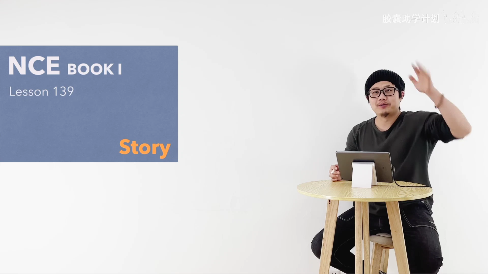

文字识别：胶囊助学计划 / NCE / BOOKI / Lesson 139 / Story

### 画面 00:00:02

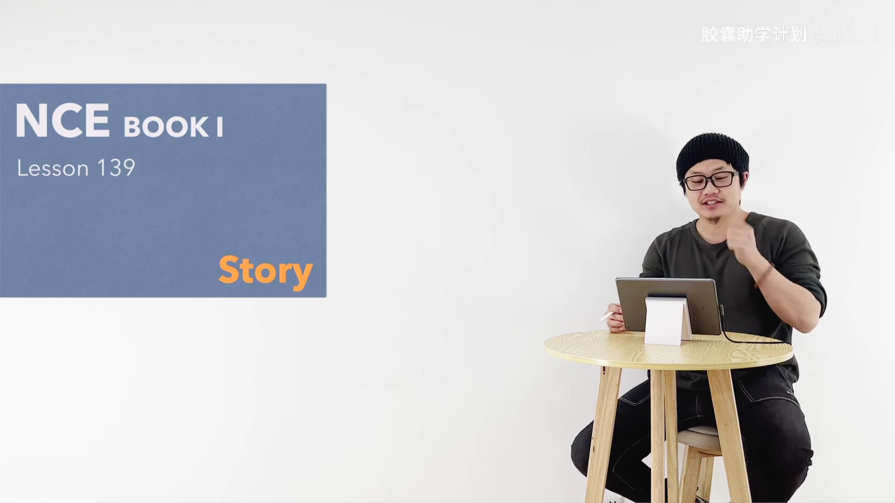

文字识别：胶囊助学计划 / NCE / BOOKI / Lesson 139 / Story

### 画面 00:00:10

文字识别： bibli / 胶囊助学计划

### 画面 00:00:14

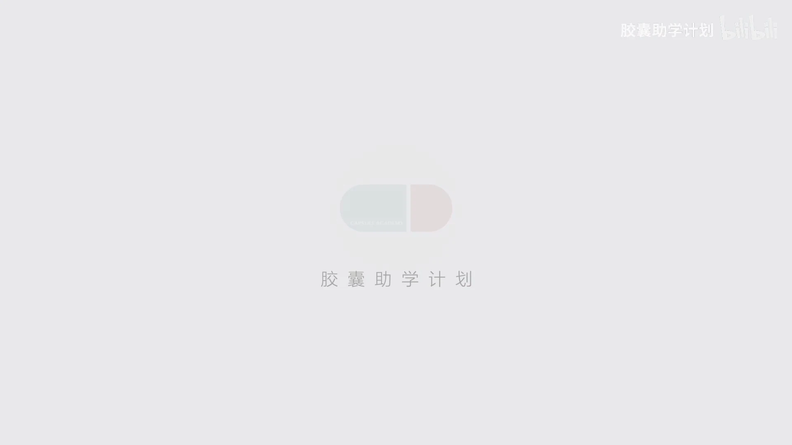

文字识别：胶囊助学计划 / 胶囊助学计划

### 画面 00:00:16

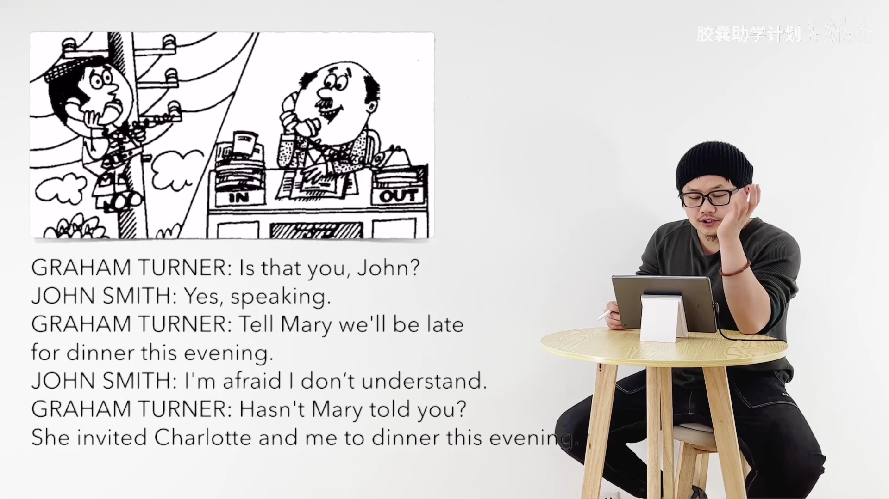

文字识别：胶囊助学计划 / GRAHAM TURNER: Is that you, John? / JOHN SMITH: Yes, speaking. / GRAHAM TURNER: Tell Mary we'll be late / for dinner this evening. / JOHN SMITH: I'm afraid I don't understand. / GRAHAM TURNER: Hasn't Mary told you? / She invited Charlotte and me to dinner this evenin

### 画面 00:00:21

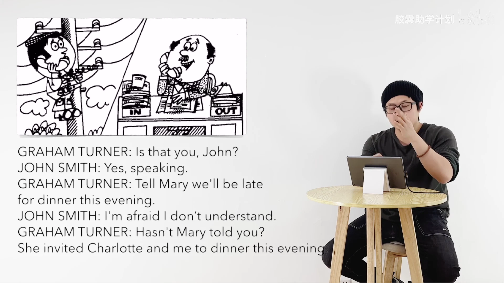

文字识别：胶囊助学计划 / GRAHAM TURNER: Is that you, John? / JOHN SMITH: Yes, speaking. / GRAHAM TURNER: Tell Mary we'll be late / for dinner this evening. / JOHN SMITH: I'm afraid I don't understand. / GRAHAM TURNER: Hasn't Mary told you? / She invited Charlotte and me to dinner this evening

## 00:00:30–00:01:00

啊，就是英文的电话，就是是你吗？Is that you, John? Okay. Yes, speaking.是的，正在说话。其实这句话如果给他补全了的话，就是Yes, John is speaking. Okay. Yes, speaking. 接下来说说Tell Mary，说你告诉Mary怎么样呢？We will be late.我们会迟到的。For dinner this evening，吃晚饭今晚吃晚饭我们会迟到的。John John

### 画面 00:00:51

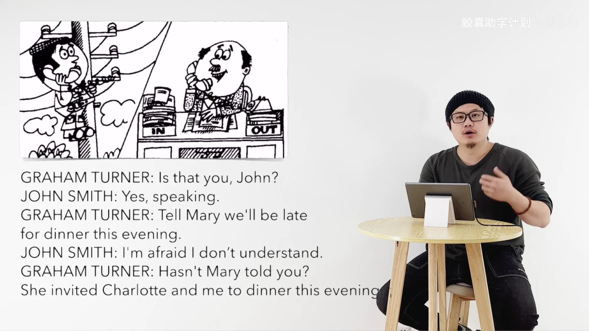

文字识别：胶囊助学计划 / GRAHAM TURNER: Is that you, John? / JOHN SMITH: Yes, speaking. / GRAHAM TURNER: Tell Mary we'll be late / for dinner this evening. / JOHN SMITH: I'm afraid I don't understand. / GRAHAM TURNER: Hasn't Mary told you? / She invited Charlotte and me to dinner this evening

## 00:01:00–00:01:30

Smith说了一句话说 I'm afraid I don't understand. 我恐怕呀，不知道你在说啥呢。他又说说 Hasn't Mary told you? 说难道Mary还没有告诉你吗？She invited Carole and me to dinner this evening. 说她邀请Carole和我去吃晚饭。 Invite somebody to dinner这咱们之前就学过了啊。 This evening叫做今晚。哎，目前还没有什么新的语

### 画面 00:01:10

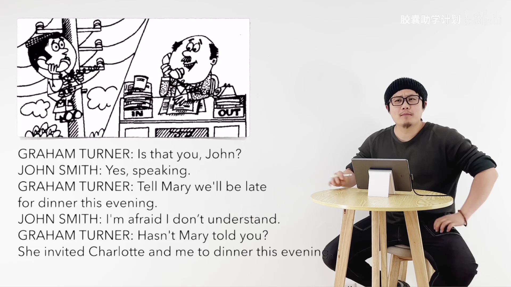

文字识别：胶囊助学计划！ / GRAHAM TURNER: Is that you, John? / JOHN SMITH: Yes, speaking. / GRAHAM TURNER: Tell Mary we'lI be late / for dinner this evening. / JOHN SMITH: I'm afraid I don't understand. / GRAHAM TURNER: Hasn't Mary told you? / She invited Charlotte and me to dinner this evenin

### 画面 00:01:12

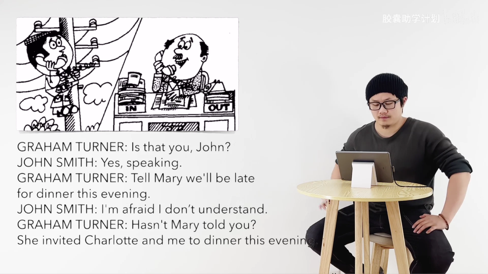

文字识别：胶囊助学计划！ / GRAHAM TURNER: Is that you, John? / JOHN SMITH: Yes, speaking. / GRAHAM TURNER: Tell Mary we'll be late / for dinner this evening. / JOHN SMITH: I'm afraid I don't understand. / GRAHAM TURNER: Hasn't Mary told you? / She invited Charlotte and me to dinner this evenin

### 画面 00:01:14

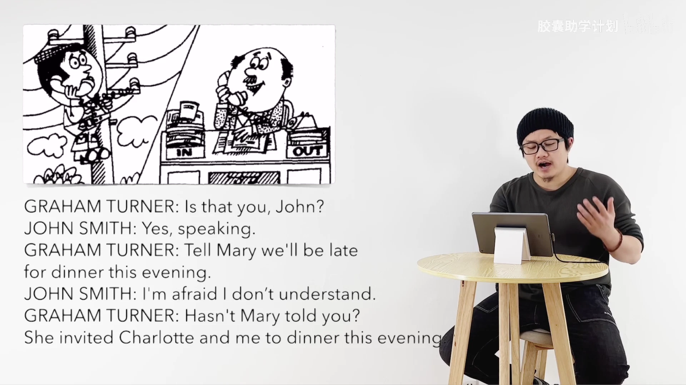

文字识别：胶囊助学计划 / GRAHAM TURNER: Is that you, John? / JOHN SMITH: Yes, speaking. / GRAHAM TURNER: Tell Mary we'll be late / for dinner this evening. / JOHN SMITH: I'm afraid I don't understand. / GRAHAM TURNER: Hasn't Mary told you? / She invited Charlotte and me to dinner this evening

## 00:01:30–00:02:00

法，很简单。继续，I said，我之前就说，注意，你看后边就是一个一百三十五课咱们学过的语法，宾语从句。如果主句是一般过去时，从句时态要怎么样？情情态动词要怎么样？Will要变成would，can要变成could，may要变成might，对吧？这儿的will就变成would了。说I would be，我将at your house，将在你家，

### 画面 00:01:30

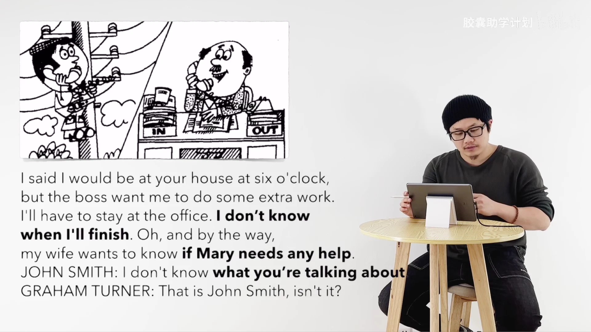

文字识别：胶囊助学计划 / I said I would be at your house at six o'clock, / but the boss want me to do some extra work. / I'll have to stay at the office.I don't know / when I'll finish. Oh, and by the way, / my wife wants to know if Mary needs any help. / JOHN SMITH: I don't know what you're talking about / GRAHAM TURNER: That is John Smith, isn't it?

### 画面 00:01:46

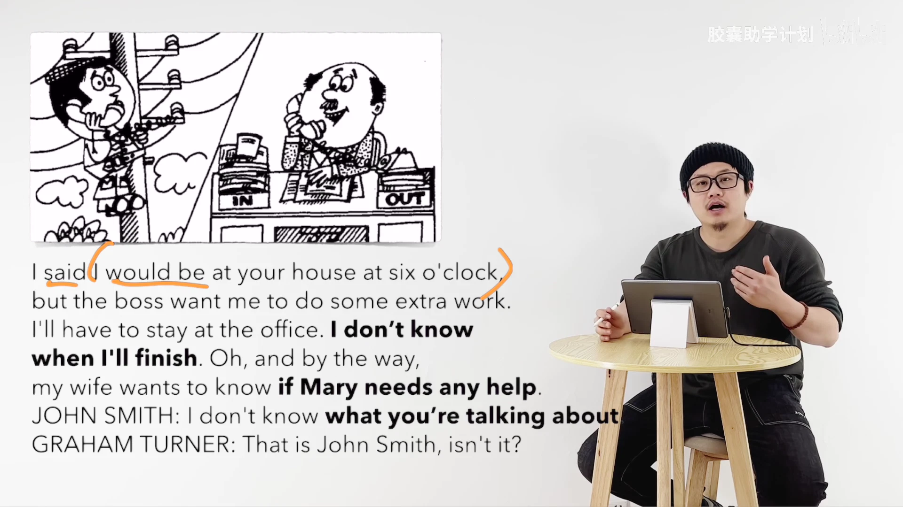

文字识别：胶囊助学计划 / I saidl would be at your house at six o'clock, / but the boss want me to do some extra work. / I'll have to stay at the office.I don't know / when I'll finish. Oh, and by the way, / my wife wants to know if Mary needs any help. / JOHN SMITH: I don't know what you're talking about / GRAHAM TURNER: That is John Smith, isn't it?

## 00:02:00–00:02:30

将到你家。At six o'clock, 我之前说我将六点钟到你家。But, 但是呢, the boss want me to do some extra work. 没办法，老板想让我去做一些额外的工作。I will have to. 一百二十五课咱们学的 have to, 叫不得不，对吧？说我将不得不 stay at the office, 待在办公室。I don't

### 画面 00:02:16

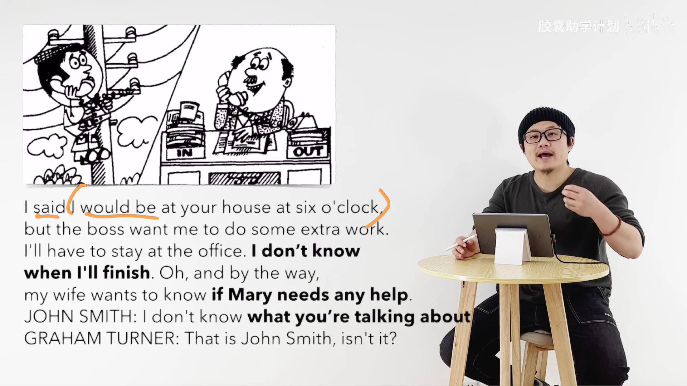

文字识别：胶囊助学计划 / I saidl would be at your house at six o'clock, / but the boss want me to do some extra work. / I'll have to stay at the office.I don't know / when I'll finish. Oh, and by the way, / my wife wants to know if Mary needs any help. / JOHN SMITH: I don't know what you're talking about / GRAHAM TURNER: That is John Smith, isn't it?

## 00:02:30–00:03:00

know。我不知道的事情是，注意看后边叫 when I will finish。你看，正常说我何时会结束叫 when will I finish，对吧？OK，只不过在这个地方，I don't know。主语是 I don't know，是 will 后边 when I will finish 是一个句子去做了宾语，叫宾语从句。这个句子叫特殊疑问句。所以谁是连接词呢？When 是连接词，后边一定不能

### 画面 00:02:46

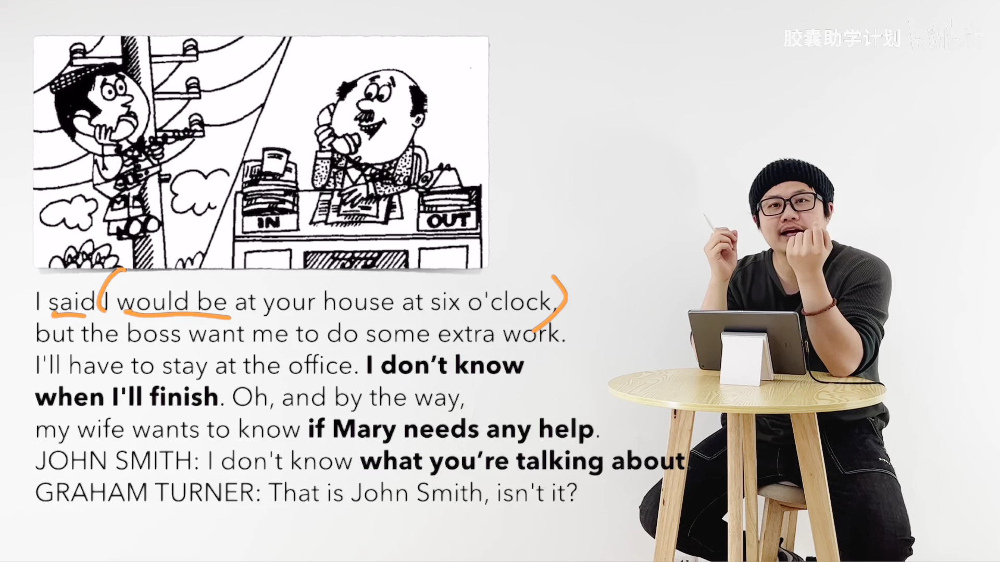

文字识别：胶囊助学计划 / I saidl would be at your house at six o'clock, / but the boss want me to do some extra work. / I'll have to stay at the office.I don't know / when I'll finish. Oh, and by the way, / my wife wants to know if Mary needs any help. / JOHN SMITH: I don't know what you're talking about / GRAHAM TURNER: That is John Smith, isn't it?

## 00:03:00–00:03:30

是 will I finish，一定要是一个陈述语序，叫 I will finish，叫 When I will finish. Okay, so I don't know when I will finish. 他说 Oh, and by the way, 他说哦哦哦，然后顺便说一句， by the way 是英文常见的一个小的短语，叫 by the way，哎，顺道说一句， My wife wants to know，说我媳妇儿啊，我老婆想知道 if Mary needs any help. 注意 if

### 画面 00:03:16

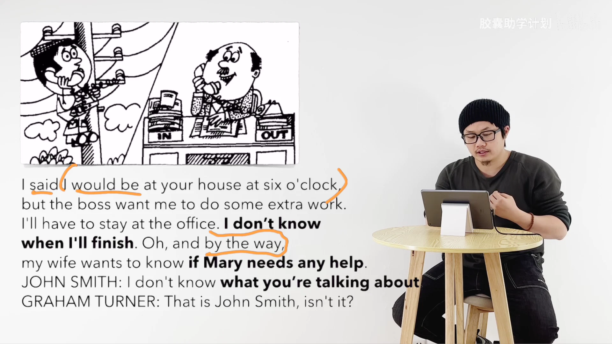

文字识别：胶囊助学计划 / I saidl would be at your house at six o'clock, / but the boss want me to do some extra work. / I'll have to stay at the office. I don't know / when I'll finish. Oh, and by the way, / my wife wants to know if Mary needs any help. / JOHN SMITH: I don't know what you're talking about / GRAHAM TURNER: That is John Smith, isn't it?

## 00:03:30–00:04:00

叫做是否Mary需要任何的帮忙，对吧？这是我们今天新学的一般疑问句做宾语从句。您看，Mary需要帮忙吗？那叫做Does Mary need any help？这本来是一般疑问句。哎，我们现在把它一般疑问句变成宾语从句，先换成陈述语序，if提到句首，对吧？If Mary needs any help, John Smith说，I don't know。说我不懂What you are talking about。

### 画面 00:03:46

文字识别：胶囊助学计划 / I saidl would be at your house at six o'clock, / but the boss want me to do some extra work. / I'll have to stay at the office. I don't know / when I'll finish. Oh, and by the way, / my wife wants to know if Mary needs any help. / JOHN SMITH: I don't know what you're talking about / GRAHAM TURNER: That is John Smith, isn't it?

## 00:04:00–00:04:30

We practiced it when we practiced. We look at it again. I, subject, don't know. Predicate. The sentence is the object. We call this sentence an object clause. It is a special interrogative sentence. Pay attention to two points. The first point, the conjunction is a special interrogative word. The second point, the sentence behind you should be changed into a declarative sentence. It is called you are talking about, right? So I don't know what you are talking about. Very good. Continue to say that is John Smith, isn't it? Say, hey, that you you you are John

### 画面 00:04:16

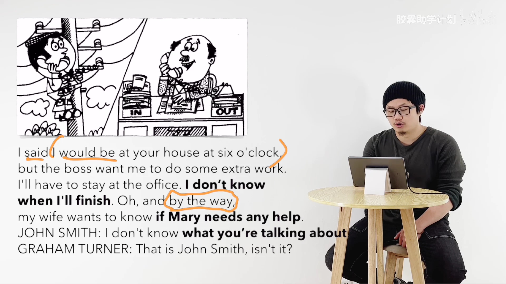

文字识别：胶囊助学计划 / I saidl would be at your house at six o'clock, / but the boss want me to do some extra work. / I'll have to stay at the office. I don't know / when I'll finish. Oh, and by the way, / my wife wants to know if Mary needs any help. / JOHN SMITH: I don't know what you're talking about / GRAHAM TURNER: That is John Smith, isn't it?

## 00:04:30–00:05:00

是John Smith对吧？Isn't it?就Right? Okay,对吧？他说Yes, I'm John Smith.是的，我是John Smith啊。他说You are John Smith, the engineer, aren't you？说你就是John Smith那个工程师，对吧？他说That's right.他说是啊。You work for?哎，work for小的短语，新二咱们经常会见到，前五课您就会见到啊。咱们新一该学完了，马上要进入新二了，对吧？提前预告一下，说你为什么工作

### 画面 00:04:34

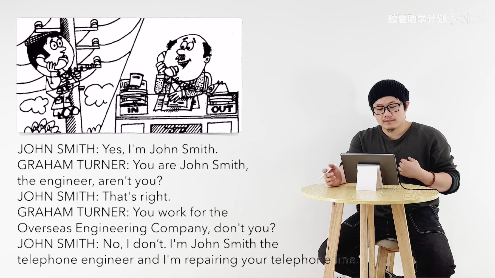

文字识别：胶囊助学计划 / JOHN SMITH: Yes, I'm John Smith. / GRAHAM TURNER: You are John Smith, / the engineer, aren't you? / JOHN SMITH: That's right. / GRAHAM TURNER: You work for the / Overseas Engineering Company, don't you? / JOHN SMITH: No, I don't. I'm John Smith the / telephone engineer and I'm repairing your telephone line.

## 00:05:00–00:05:30

呢？哎，Overseas Engineering Company, don't you？说你为海外工程公司工作，对吗？Don't you？就是 right？Okay？No, I don't.不，我不为那个工作。说I'm John Smith, the telephone engineer.说我是John Smith，一个电话工程师。And然后呢？I'm repairing your telephone line.说我现在正在修理你的电话线路，串线了，是吧？Okay？I am repairing.三十一课咱们学的现在

### 画面 00:05:04

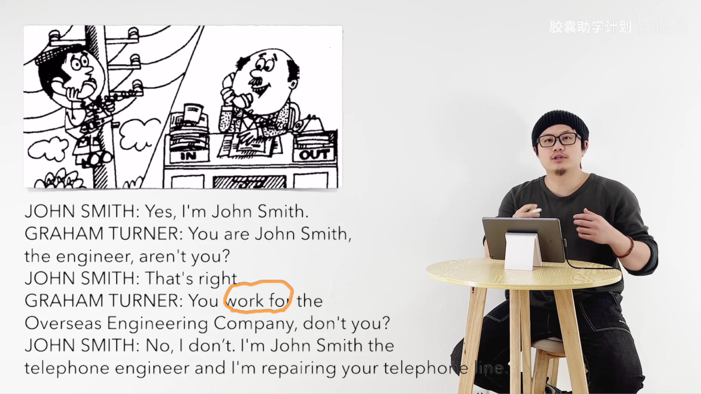

文字识别：胶囊助学计划 / JOHN SMITH: Yes, I'm John Smith. / GRAHAM TURNER: You are John Smith, / the engineer, aren't you? / JOHN SMITH: That's right / GRAHAM TURNER: You / uwork fo / the / Overseas Engineering Company, don't you? / JOHN SMITH: No, I don't. I'm John Smith the / telephone engineer and I'm repairing your telephone line.

## 00:05:30–00:06:00

进行时，我正在做这件事情。OK，来一个。接下来呢，文章哎，我们短平快解释了清楚出现的语法现象，呃，和习惯用法。接下来我们要做的事情呢，是我们要做一些听力口语练习，对吧？基于文章去问，我问您答啊，来了第一题。Isn't Graham Turner speaking to John Smith? Turner.

### 画面 00:05:34

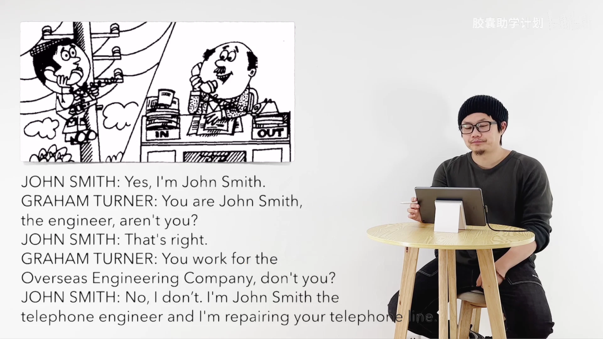

文字识别：胶囊助学计划 / JOHN SMITH: Yes, I'm John Smith. / GRAHAM TURNER: You are John Smith, / the engineer, aren't you? / JOHN SMITH: That's right. / GRAHAM TURNER: You work for the / Overseas Engineering Company, don't you? / JOHN SMITH: No, I don't. I'm John Smith the / telephone engineer and I'm repairing your telephone line.

### 画面 00:05:36

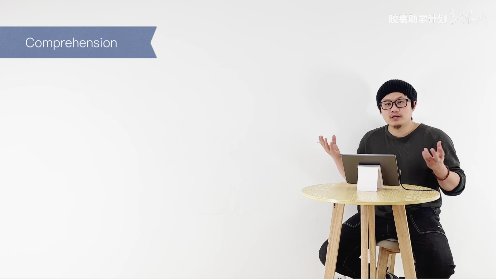

文字识别：胶囊助学计划 / Comprehension

### 画面 00:05:52

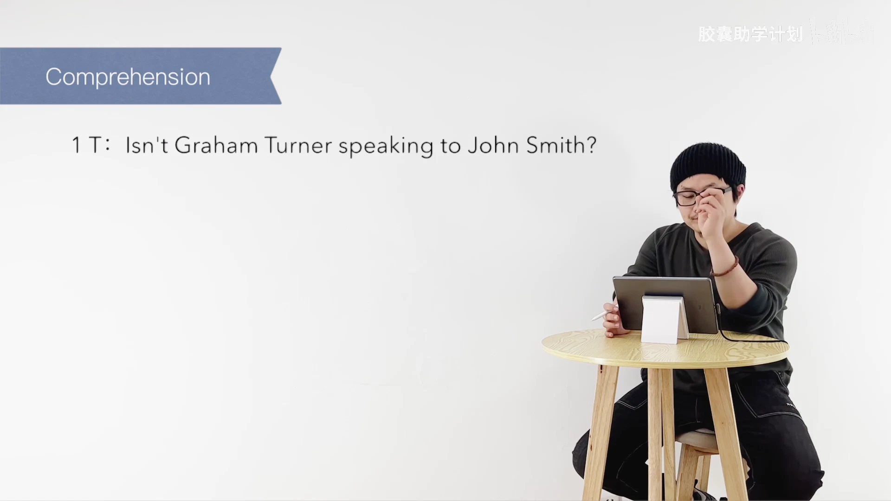

文字识别：胶囊助学计划旧 / Comprehension / 1 T: Isn't Graham Turner speaking to John Smith?

## 00:06:00–00:06:30

Yes, he is. Next one. What does Graham Turner ask John Smith to tell Mary? Ah,这就长了是吧？叫He asks John Smith to tell Mary they will be late for dinner this evening. Next one. What time did he say he would be at their house? Right. He said he'd be there at six.

### 画面 00:06:04

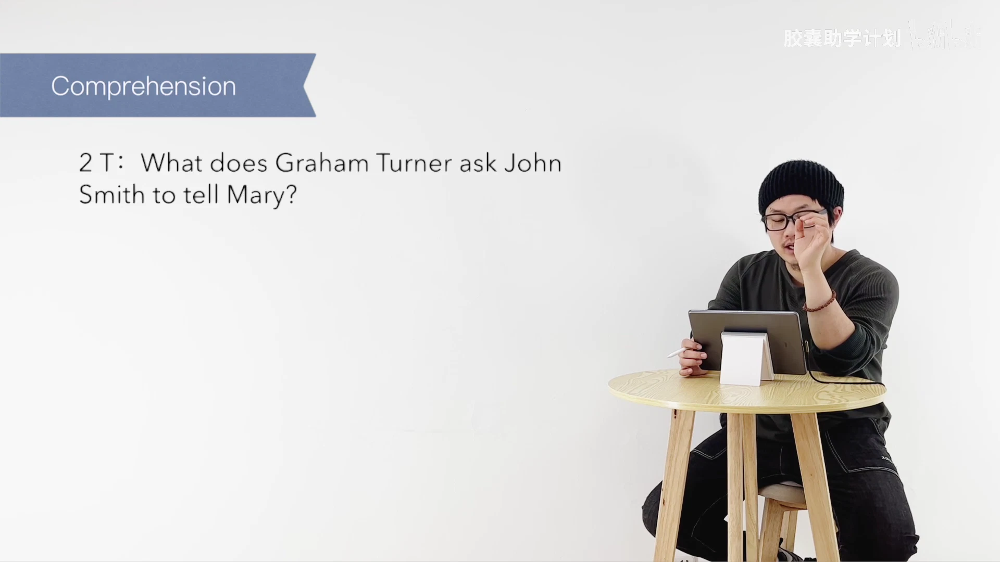

文字识别：胶囊助学计划 / Comprehension / 2 T: What does Graham Turner ask John / Smith to tell Mary?

### 画面 00:06:22

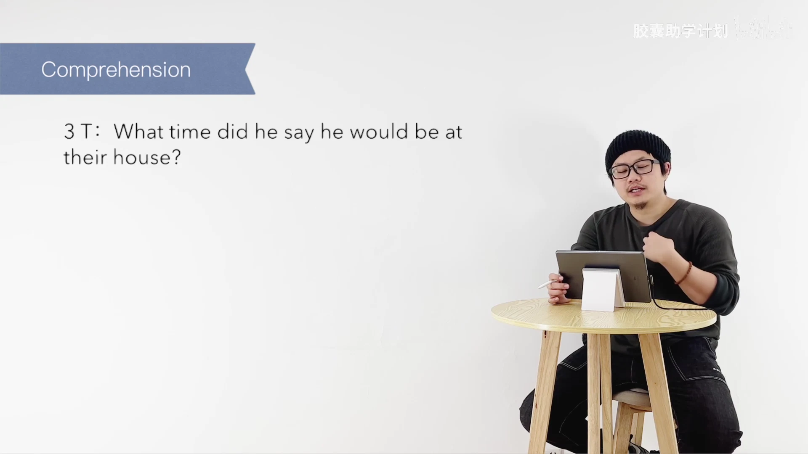

文字识别：胶囊助学计划 / Comprehension / 3 T: What time did he say he would be at / their house?

### 画面 00:06:26

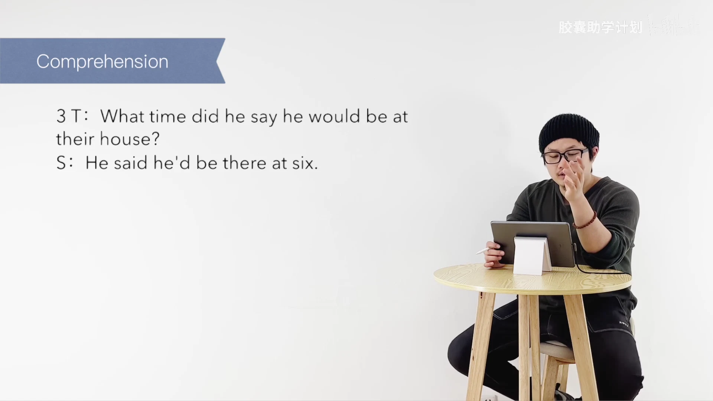

文字识别：胶囊助学计划调 / Comprehension / 3 T: What time did he say he would be at / their house? / S: He said he'd be there at six.

## 00:06:30–00:07:00

Next one, why does he say he will be late? Because the boss wants him to do some extra work. Next one, when will he finish? He doesn't know when he will finish. Next one, what does the speaker's wife want to know? She wants to know if Mary needs any help. Next one, asking

### 画面 00:06:31

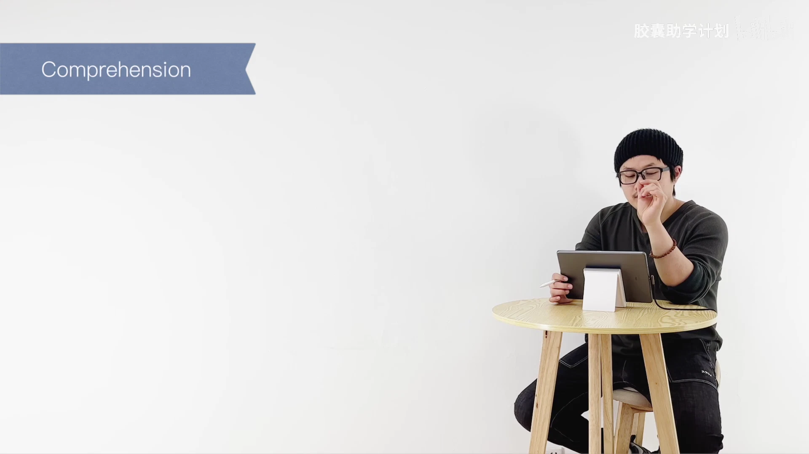

文字识别：胶囊助学计划 / Comprehension

### 画面 00:06:53

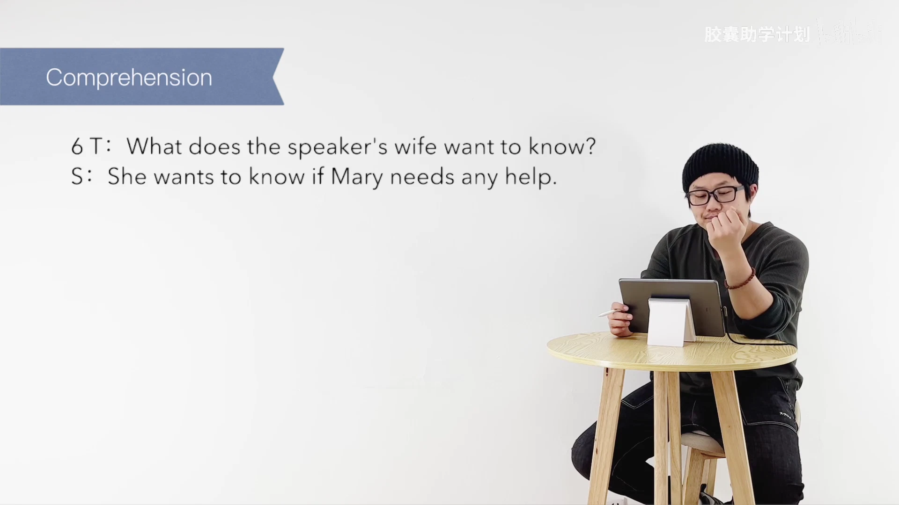

文字识别：胶囊助学计划 / Comprehension / 6 T: What does the speaker's wife want to know? / S: She wants to know if Mary needs any help.

### 画面 00:06:58

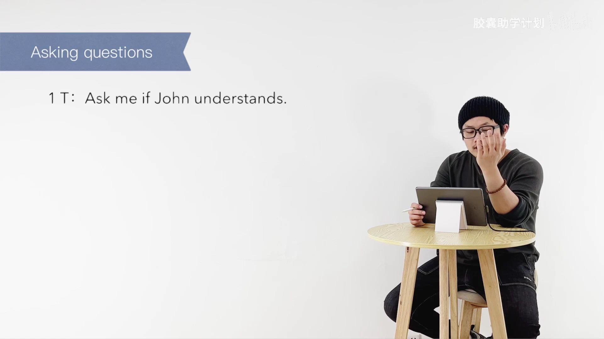

文字识别：胶囊助学计划 / Asking questions / 1 T: Ask me if John understands.

## 00:07:00–00:07:30

questions. You看，我们现在回来再看 asking questions. 各位是不是就能理解为什么叫 ask me if了？那其实前面还省略了一个主语，叫做 you, you, 对吧？哎，学员 you，你问我他是否懂了，对吧？那很简单，你就把它变成一般疑问句嘛，叫做 does John understand？所以您看，我们今天学的语法，只不过就是告诉各位，第二句话是如何变成第一句话的。各位仔细想我刚才说的这句话，好吧？

### 画面 00:07:07

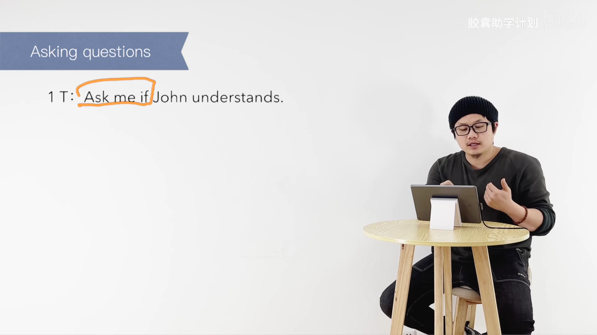

文字识别：胶囊助学计划 / Asking questions / 1 T: Ask me if John understands.

### 画面 00:07:11

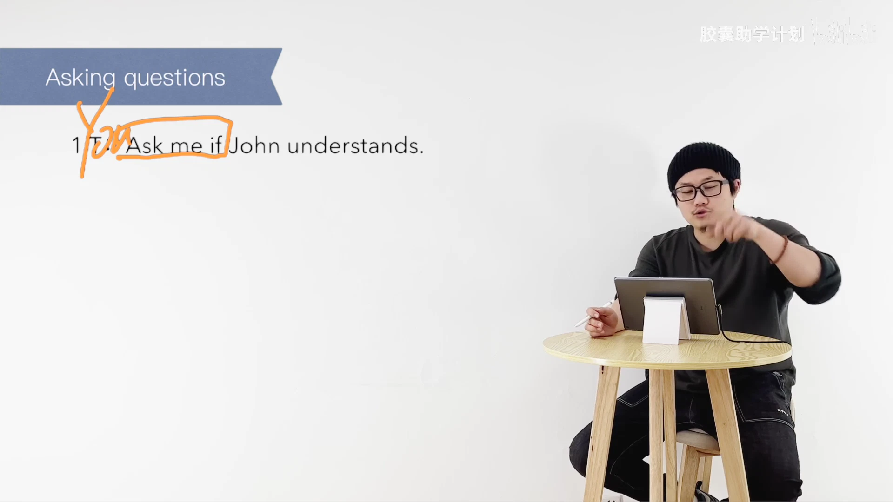

文字识别：胶囊助学计划 / Asking questions / Ask meif John understands.

### 画面 00:07:26

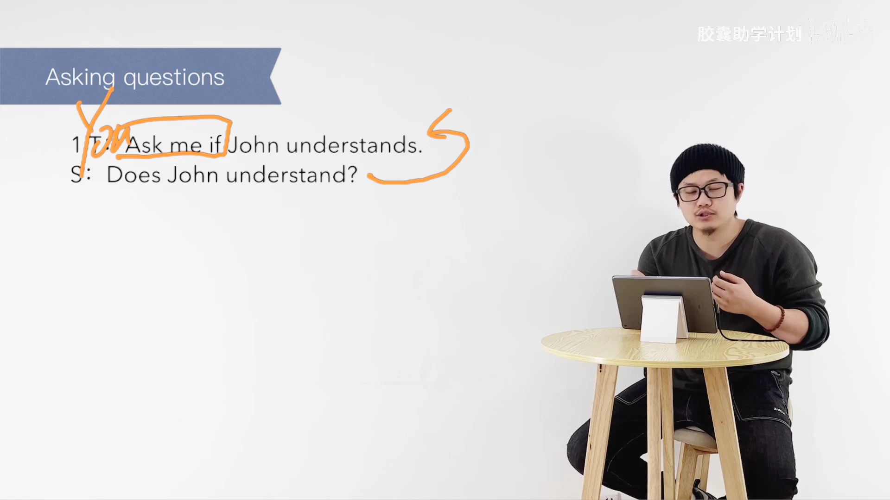

文字识别：胶囊助学计划 / Asking questions / Ask me ifJohn understands. / Does John understand?

## 00:07:30–00:08:00

Why doesn't直接加上叫Why doesn't John understand? Next one. Ask me if Mary invited them to dinner. Did Mary invite them to dinner? Who我们的主语提问Who invited them to dinner?不要变一般疑问句了。Next one. Ask me if Graham will have to stay at office. Will提前

### 画面 00:07:32

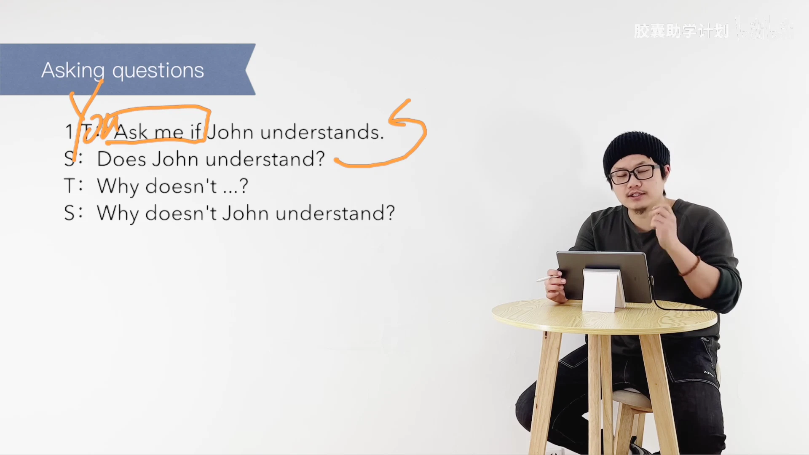

文字识别：胶囊助学计划 / Asking questions / Ask me ifJohn understands. / Does John understand? / T: Why doesn't ….? / S: Why doesn't John understand?

### 画面 00:07:35

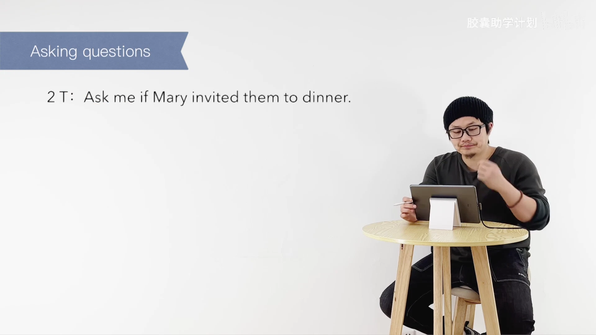

文字识别：胶囊助学计划關 / Asking questions / 2 T: Ask me if Mary invited them to dinner.

### 画面 00:07:45

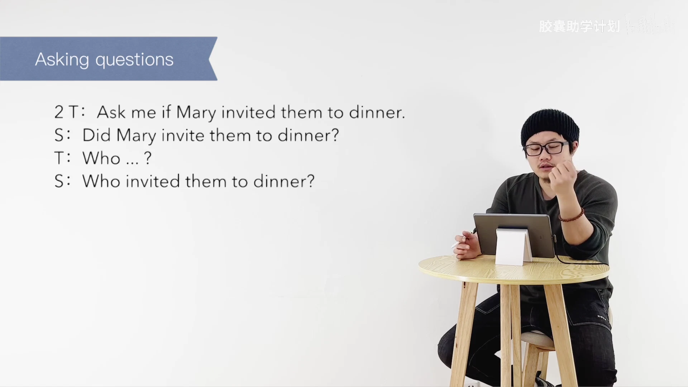

文字识别：胶囊助学计划 / Asking questions / 2 T: Ask me if Mary invited them to dinner. / S: Did Mary invite them to dinner? / T：Who .? / S: Who invited them to dinner?

### 画面 00:07:51

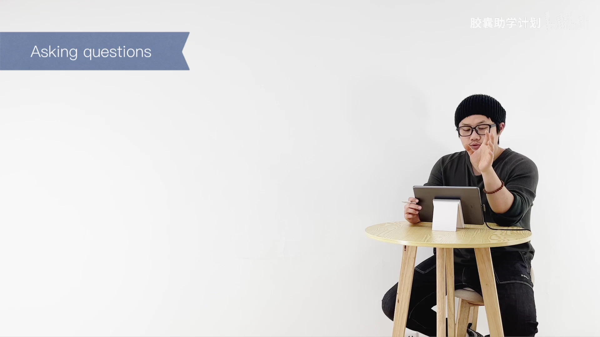

文字识别：胶囊助学计划 / Asking questions

## 00:08:00–00:08:30

Will Graham's uh have to stay at the office? Why? 整句话Why will Graham have to stay at the office? Very good. Next one. Ask me if John knows what Graham is talking about. 注意这里边有两个点knows和is talking about应该用谁？我们之前说过一定要用主句的，不要用从句的，对吧？Okay, so does提前Does John know

### 画面 00:08:00

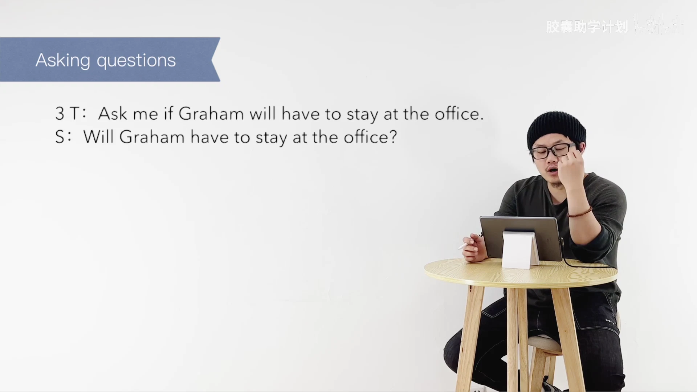

文字识别：胶囊助学计划 / Asking questions / 3 T: Ask me if Graham will have to stay at the office. / S: Will Graham have to stay at the office?

### 画面 00:08:10

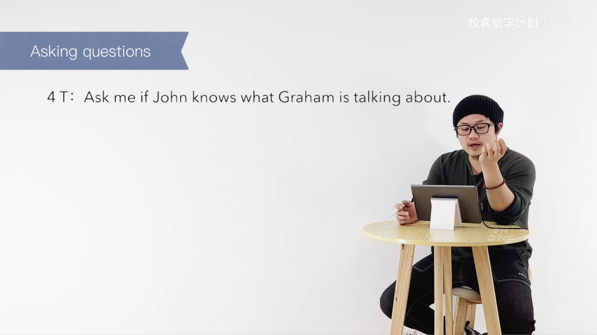

文字识别：胶囊助学计划调 / Asking questions / 4 T: Ask me if John knows what Graham is talking about.

### 画面 00:08:20

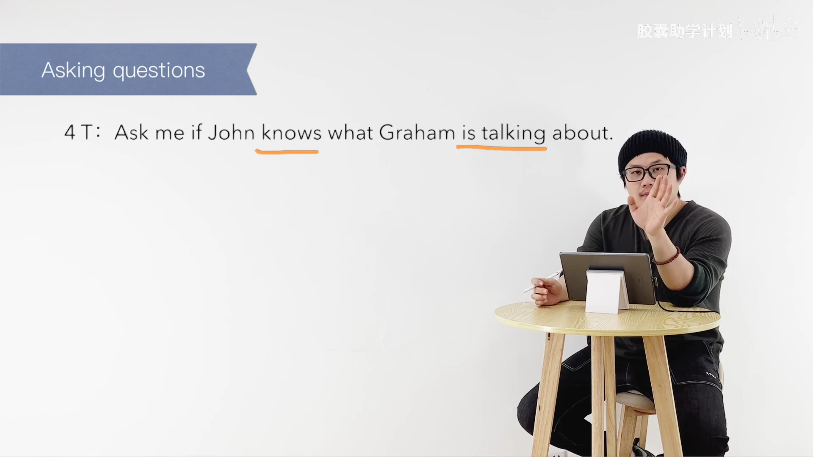

文字识别：胶囊助学计划 / Asking questions / 4 T: Ask me if John knows what Graham is talking about.

### 画面 00:08:24

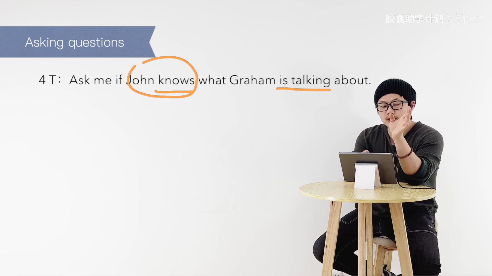

文字识别：胶囊助学计划 / Asking questions / 4T: Ask me if fohn knowswhat Graham is talking about.

### 画面 00:08:27

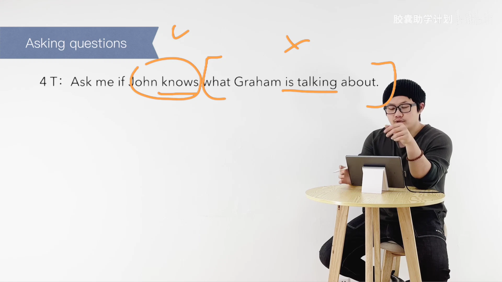

文字识别：胶囊助学计划 / Asking questions / 4T: Ask me if fohn knows)what Graham is talking about.

## 00:08:30–00:09:00

what Graham is talking about? Why doesn't Why doesn't John know what Graham is talking about? Next one. Ask me if John works for the overseas engineering company. Does John work for Ah the overseas engineering company? Who there are four? Ah,就是Who does John work for?他为谁工作，对吧？

### 画面 00:08:30

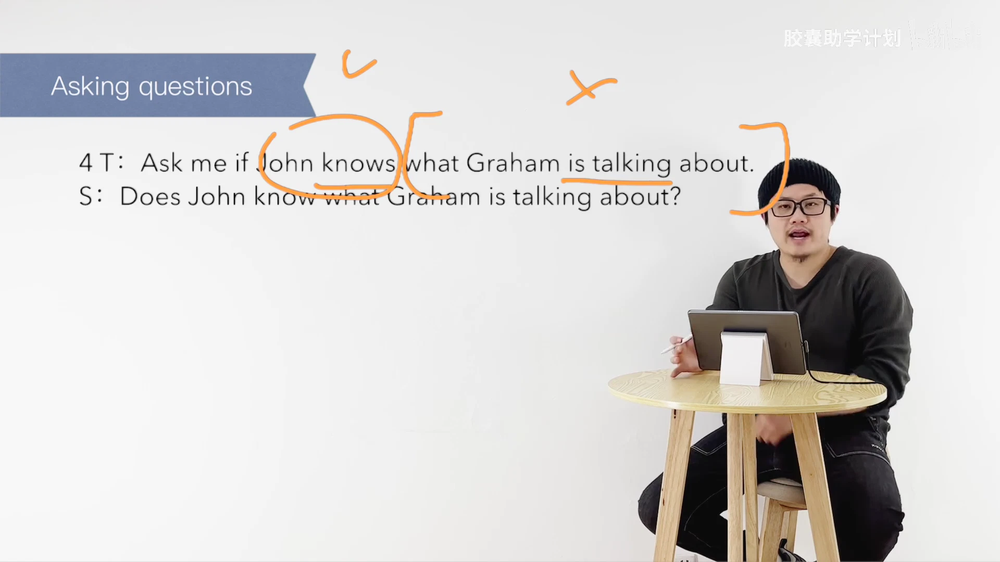

文字识别：胶囊助学计划 / Asking / questions / 4T: Ask me if . / f John knows)what Graham is talking / about. / S:Does John / know / Graham is talking about?

### 画面 00:08:35

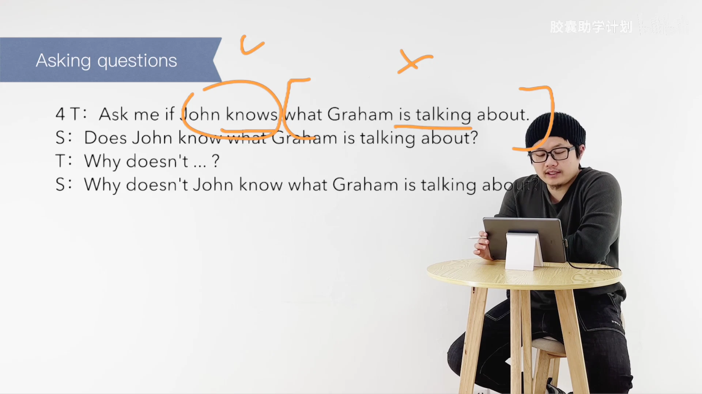

文字识别：胶囊助学计划 / Asking questions / 4T: Ask me if John knows)what Graham is talking about. / S: Does John k / knowv / Graham is talking about? / T: Why doesn't .? / S: Why doesn't John know what Graham is talking abol

### 画面 00:08:40

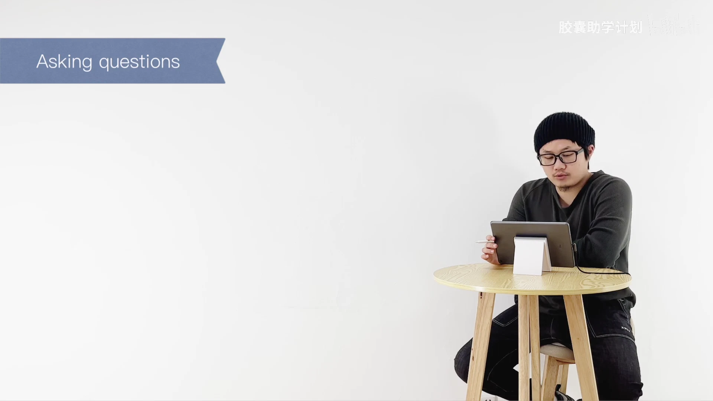

文字识别：胶囊助学计划 / Asking questions

### 画面 00:08:49

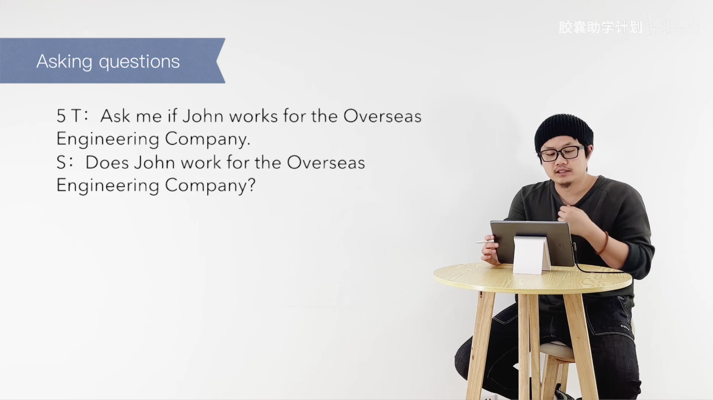

文字识别：胶囊助学计划 / Asking / questions / 5 T: Ask me if John works for the Overseas / Engineering / Company. / S: Does John work for the Overseas / Engineering / Company?

## 00:09:00–00:09:30

好，Recap没什么区别，一般疑问句、特殊疑问句做宾语从句啊，非常的重要，各位一定要反复给自己讲这个语法，是吧？这跟我们语言习惯特别的不一样啊。OK，家庭作业呢，绿皮书一百三十九课文章要跟读之，熟读成诵，给自己讲解一遍今天的核心知识点。呃，如果各位喜欢我们的课程呢，欢迎各位关注、订阅、一键三连，分享给那些需要的朋友，来帮助我们快速成长。

### 画面 00:09:00

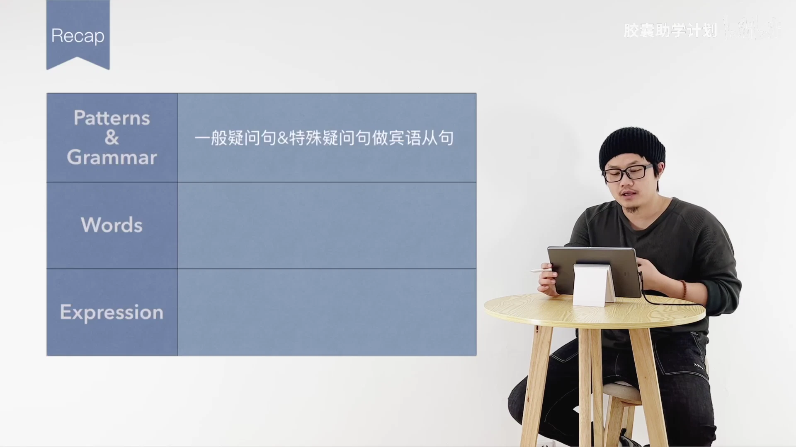

文字识别：胶囊助学计划 / Recap / Patterns / 一般疑问句&特殊疑问句做宾语从句 / Grammar / Words / Expression

### 画面 00:09:13

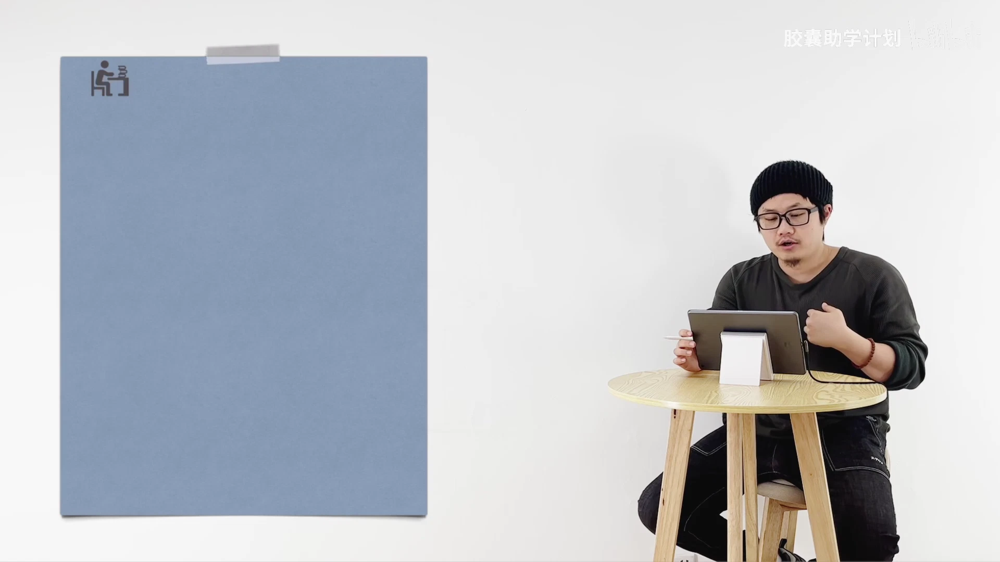

文字识别：胶囊助学计划

### 画面 00:09:21

文字识别：胶囊助学计划

## 00:09:30–00:09:54

最后，我们再来看一句名人名言：The difference between ordinary and extraordinary is that little extra. See you next time.

### 画面 00:09:30

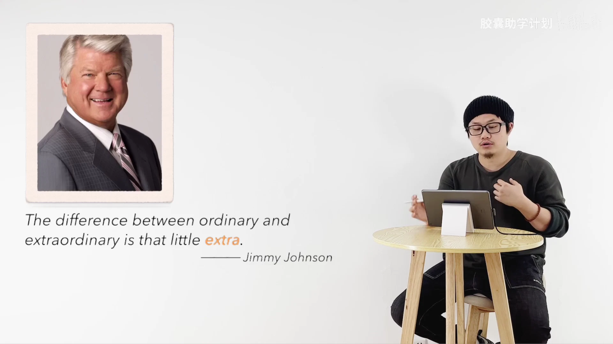

文字识别：胶囊助学计划 / The difference between ordinary and / extraordinary is that little extra. /  Jimmy Johnson

### 画面 00:09:42

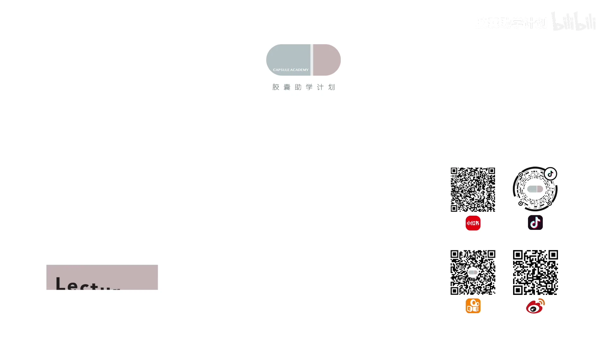

文字识别：CAPSULEACADEMY / 胶囊助学计划 / 『 / 小红书

### 画面 00:09:44

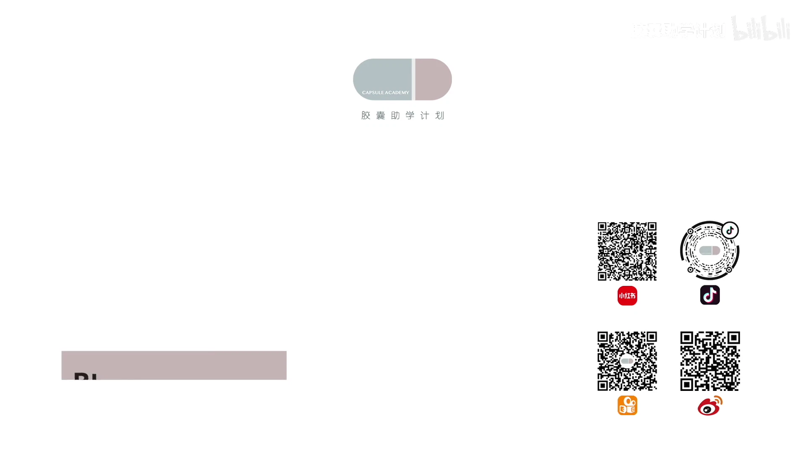

文字识别：臺字計切 / CAPSULEACADEMY / 胶囊助学计划 / 小红书

### 画面 00:09:47

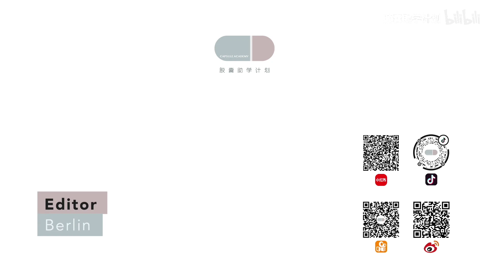

文字识别：CAPSULEACADEMY / 胶囊助学计划 / 小红书 / Editor / Berlin / OE

### 画面 00:09:50

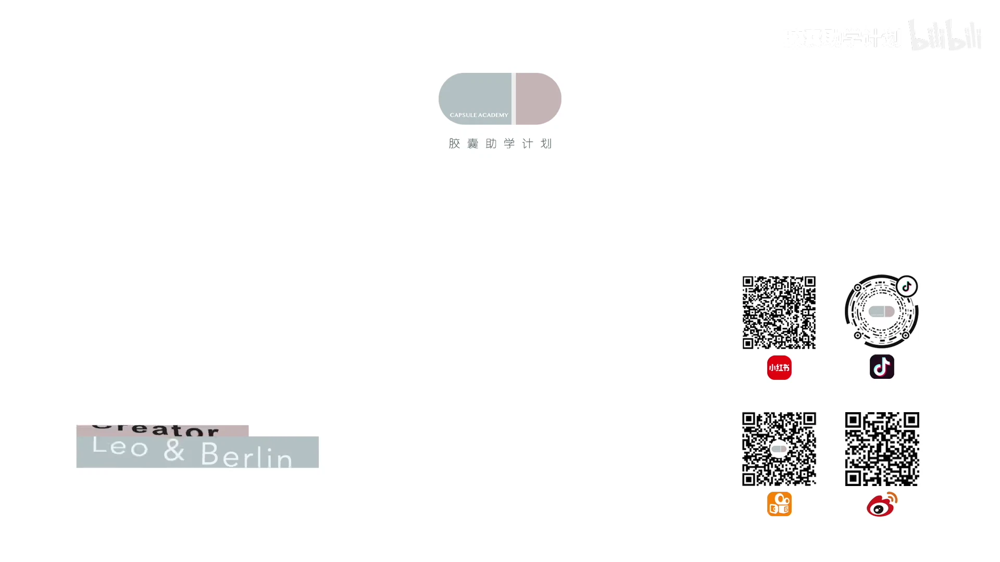

文字识别：CAPSULEACADEMY / 胶囊助学计划 / 小红书 / 品 / Leo & Berlin / OE

### 画面 00:09:52

文字识别：bilibili / 胶囊助学计划

### 画面 00:09:53

文字识别：bilibili / 胶囊助学计划

