# 141+142

快速机器解析：语音为单模型转写，未进行独立交叉校对或人工复核；画面每秒采样并按变化选帧，短时文字和标记可能遗漏。截图时间约有 1 秒误差。图片有损压缩；遇到疑点请按时间查看 Google Drive 原视频。

## 00:00:00–00:00:30

Hello everyone, welcome to Capsule Academy. This is Leo. Today we are going to learn New Concept English Book One Lesson One Hundred and Forty One Words. Hope you guys enjoyed.好，那我们上来先看第一个单词啊，看音标，先跟我一起读一下，叫做 excited，连起来 excited, excited 啊，表示很兴奋啊，非常的亢奋啊，这样一种情

### 画面 00:00:00

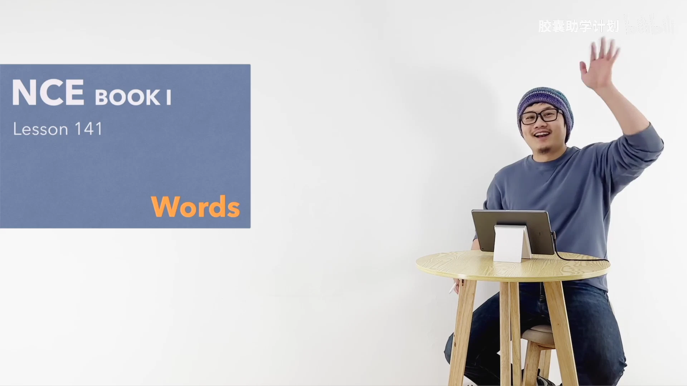

文字识别：交囊助学计划 / NCE / BOOKI / Lesson 141 / Words

### 画面 00:00:02

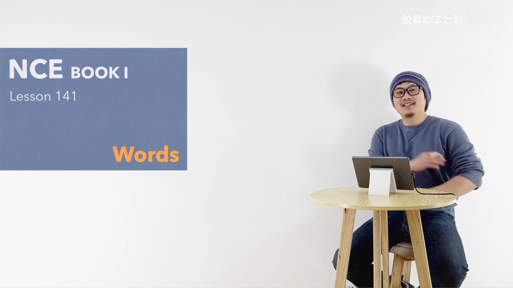

文字识别：胶囊助学计划 / NCE / BOOKI / Lesson 141 / Words

### 画面 00:00:11

文字识别： biibli / 胶囊助学计划

### 画面 00:00:15

文字识别：動字计划 / 胶囊助学计划

### 画面 00:00:17

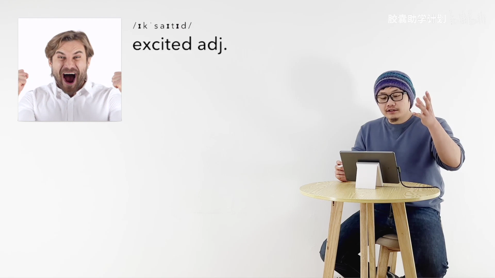

文字识别：胶囊助学计划 / /ik'saitid/ / excited adj.

## 00:00:30–00:01:00

绪，注意它的词性，这个点非常的重要，和今天的语法会在文章当中啊产生让各位感觉貌似冲突的一个感受，所以一定要注意，它虽然是 e d 结尾的，但它本身是个形容词，不要把它当成动词，好吧？OK，那我们拿它去造句，比如说，They were very excited，很简单，这样一句话，对吧？对于各位来造出来，但是注意，我后面又接上了一些东西，叫

### 画面 00:00:47

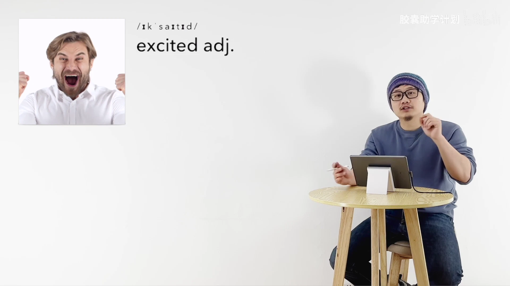

文字识别：胶囊助学计划 / /ik'saitid/ / excited adj.

### 画面 00:00:49

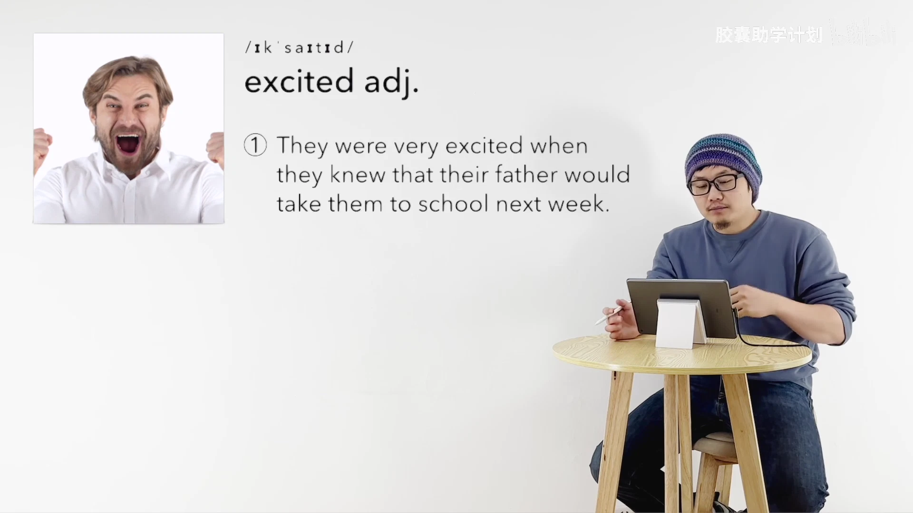

文字识别：胶囊助学计划 / /ik'saitid/ / excited adj. / ① They were very excited when / they knew that their father would / take them to school next week.

## 00:01:00–00:01:30

When they knew，当他们知道，当怎么怎么样，这是咱们一百一十七课学过的一个叫做时间状语从句，对吧？当他们知道什么事情呢？That，注意，你看后边又跟了个宾语从句，对吧？当他们知道这样一件事情，叫做 Their father would take them to school next week。说他们的父亲将在下周带他们去上学的时候，他们感觉到特别的兴奋。哎，这个几个孩子特别爱学习，对不对？

### 画面 00:01:19

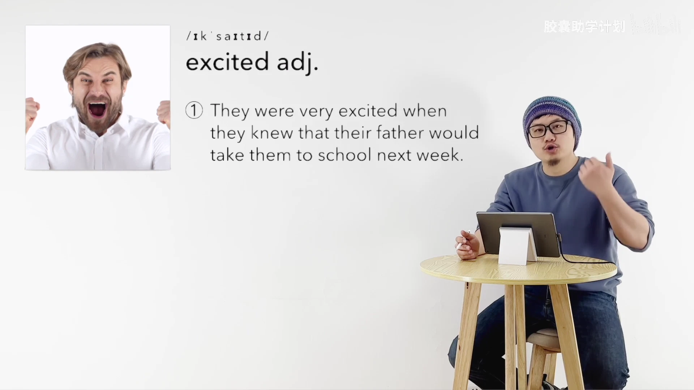

文字识别：胶囊助学计划 / /ik'saitid/ / excited adj. / ① They were very excited when / they knew that their father would / take them to school next week.

## 00:01:30–00:02:00

好，注意一个点，这里面实际上啊，某种程度上，从 when 到结尾，我们管它叫时间从句或时间状语从句。然后从 that 到结尾，结尾又是时间状语从句当中之内又嵌套了一个叫宾语从句。其实像这种语法难度，各位你看，我现在给各位讲讲完，都用的是各位会的语法，对吧？你听上去貌似很简单，但是实际上这样句子套句子，对吧？

### 画面 00:01:41

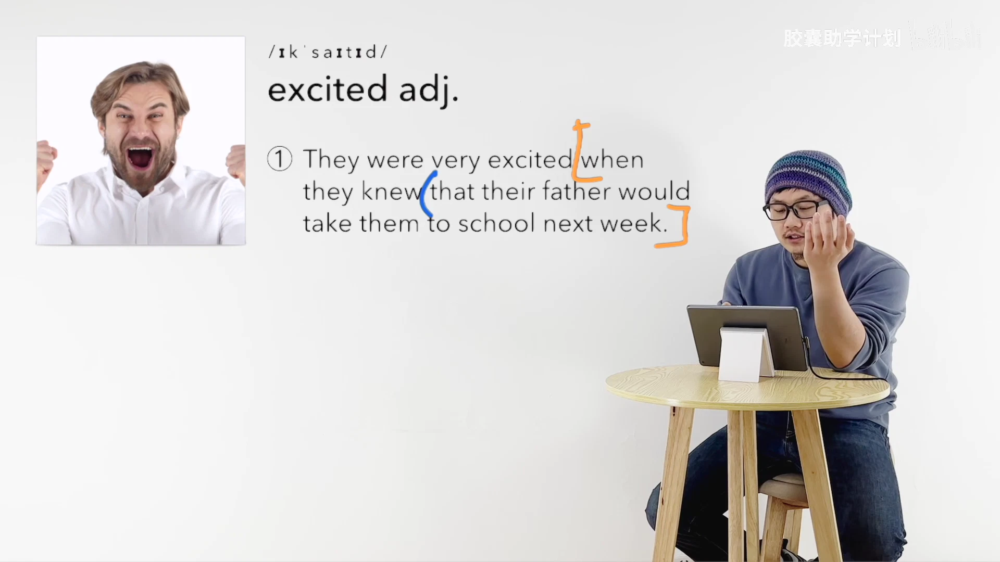

文字识别：胶囊助学计划 / /ik'saitid/ / excited adj. / ① They were yery excitedwhen / they knewthat their father would / take them to school next week.7

## 00:02:00–00:02:30

从句套从句的结构，可能对于各位来说，大面积接触到已经应该到了新概念二册的第四个单元，一共四个单元啊，到了最后一个单元，甚至要到新三新概念三册的第一课，各位才能接触到，对吧？所以我们知道，我们再往下去学的时候，英语的句子会变得越来越长啊。OK，再来，比如说，They must have been very excited when they heard the news。说，

### 画面 00:02:11

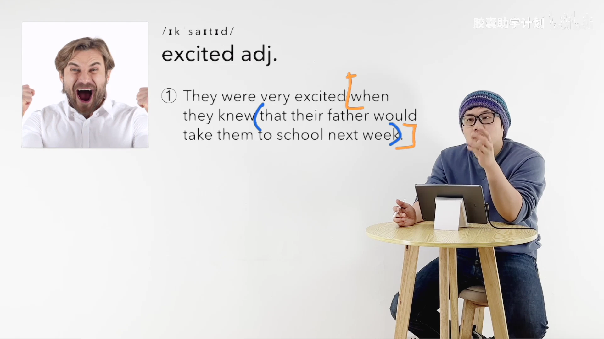

文字识别：胶囊助学计划 / /ik'saitid/ / excited adj. / ① They were yery excitedwhen / they knewthat their father would / take them to school next week

### 画面 00:02:24

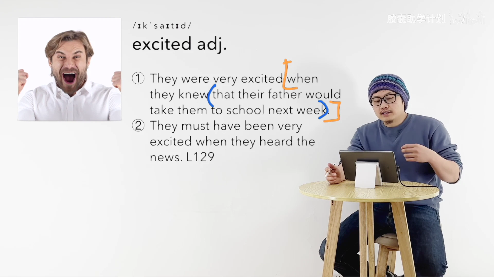

文字识别：校囊助学计划 / /ik'saitid/ / excited adj. / ① They were very excitedwhen / they knewthat their father would / take them to school next week / They must have been very / excited when they heard the / news.L129

## 00:02:30–00:03:00

哎，昨天他们当时他们一定是特别的激动，must have been that，对吧？OK啊，must have been啊，不，sorry，不是must have been，must have been形容词，must have been是新概念二册的语法，must have been形容词，然后后面叫做当他们听到之前听到这个消息的时候，对吧？这是我们新一百二十九课学的。再来，下面是一个小的短语，并不难，各位可以理解为是一个小的动词短语啊，叫做上车。比如说，she got on the

### 画面 00:02:51

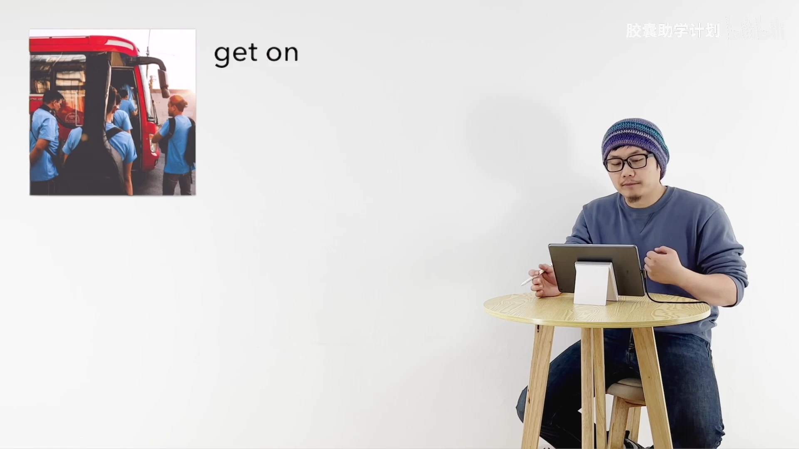

文字识别：胶囊助学计划 / get on

## 00:03:00–00:03:30

bus five minutes ago. 啊，这对于各位来说应该不是一个，不管是让各位去造这个句子，还是让各位自己去看懂这个句子，都不应该是太费劲的事情，对吧？我们学到今天，那对于各位来说呢，想造句，肯定去给您了。最简单一个，对于各位来说造句的思路就是变不同的句型。这也是我们其实我们在教新一的时候和很多其他的课一个很大的不同点在于，很多的课其实大

### 画面 00:03:21

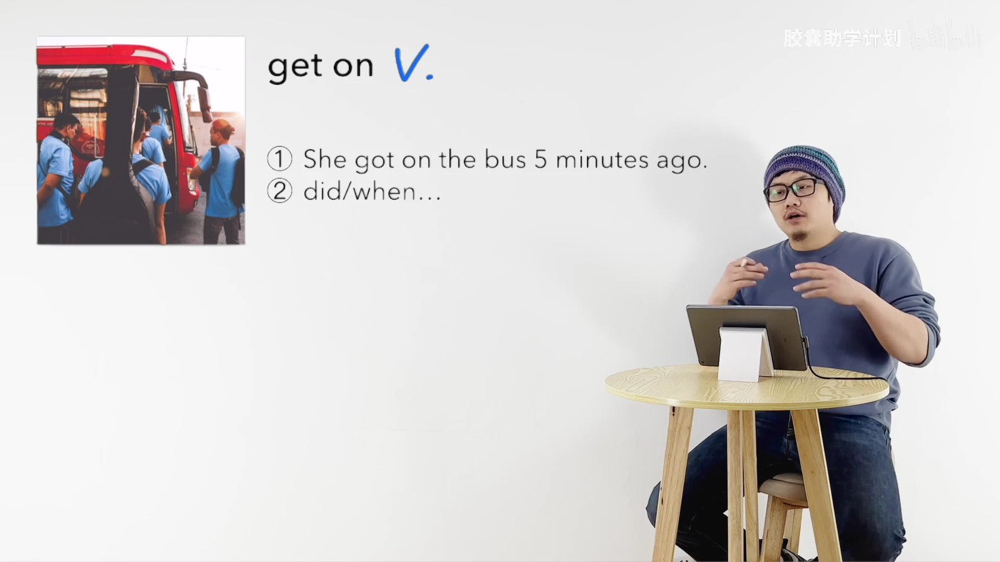

文字识别：胶囊助学计划淵 / V. / get on / ① She got on the bus 5 minutes ago. / did/when...

## 00:03:30–00:04:00

多数之前我听过的课啊，我实际上也去听过很多的课是关于肯定句的，只去讲肯定句啊。但我们人在去说话的时候，本来就至少包含了肯定句、否定句、一般疑问句和特殊疑问句，对吧？所以这是我们新一整个一本书的一个教学特点。所以那这也是各位造句的一个思路。OK，好，接下来比如说She wants to know when you got on the bus，说他现在想知道你之前什么时候上的

### 画面 00:03:51

文字识别：胶囊助学计划 / V. / get on / ① She got on the bus 5 minutes ago. / did/when...

## 00:04:00–00:04:30

公交车？一百三十九课咱们刚学过的特殊疑问句做宾语从句，对吧？玩一个复习一下，再说。If you can't get on the bus, if I can't get on the bus, I will take a taxi。一百三十七课，if引导的条件状语从句，对吧？OK， next one，下一个单词跟我读一下，叫做middle aged。其实这两个单词如果您都认的，其实我觉得能猜出来它什么意思。middle叫做中的，中间的，对吧？age的叫做年龄，中间的年

### 画面 00:04:03

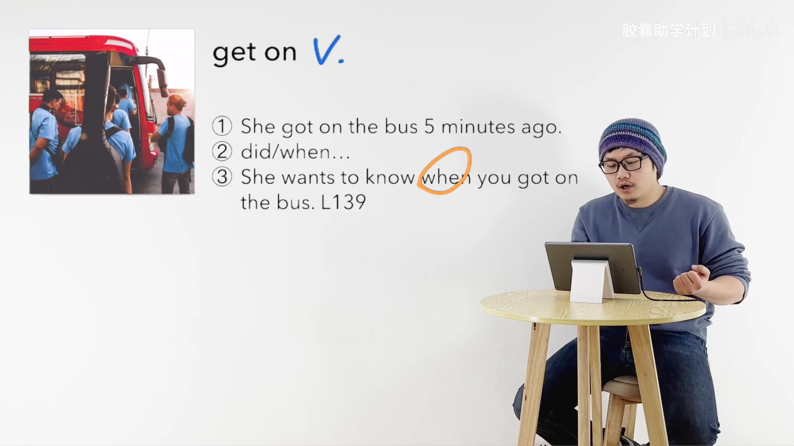

文字识别：胶囊助学计划 / get on / V. / ① She got on the bus 5 minutes ago. / did/when... / She wants to know whe you got on / the bus. L139

### 画面 00:04:06

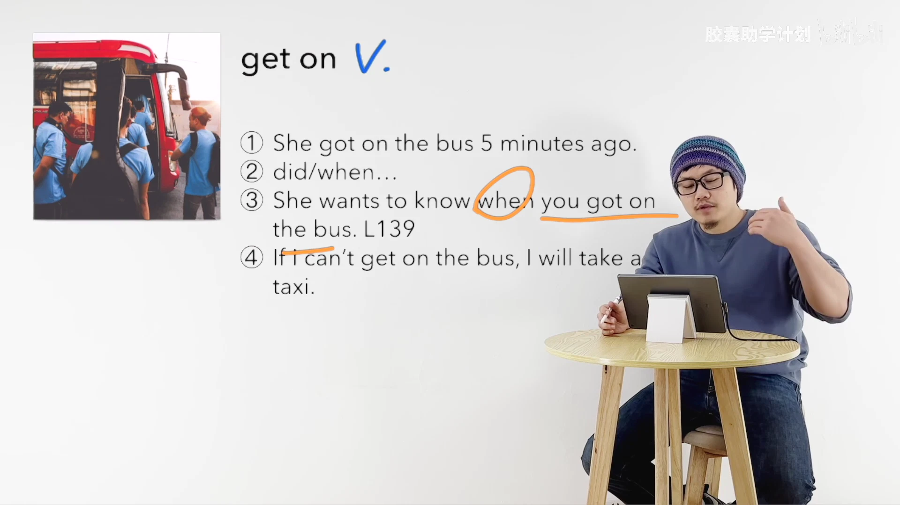

文字识别：胶囊助学计划 / get on / V / ① She got on the bus 5 minutes ago. / did/when... / She wants to know whe you got on / the bus. L139 / Ifi can't get on the bus, I will take a / taxi.

### 画面 00:04:16

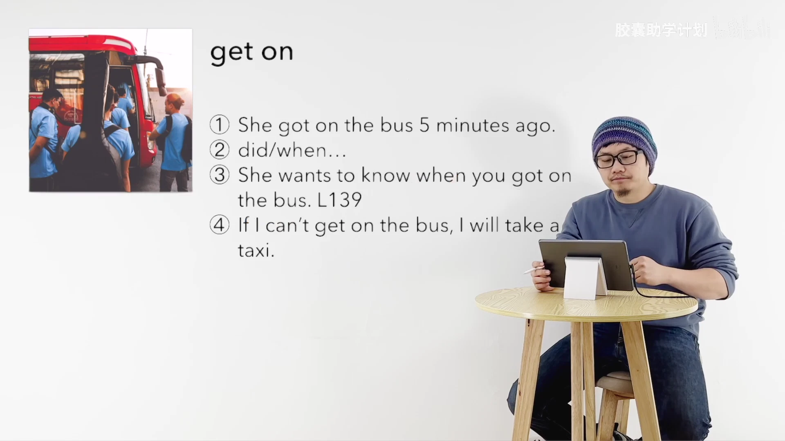

文字识别：胶囊助学计划 / get on / ① She got on the bus 5 minutes ago. / did/when... / She wants to know when you got on / the bus. L139 / ④ If I can't get on the bus, I will take a / taxi.

### 画面 00:04:18

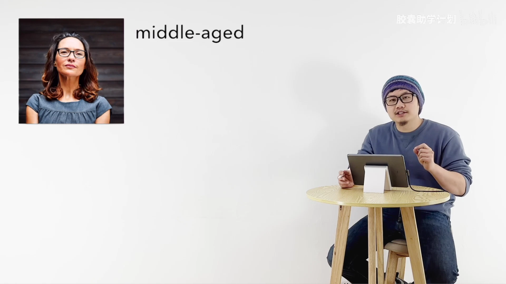

文字识别：胶囊助学计划 / middle-aged

## 00:04:30–00:05:00

龄中年是吧？OK，来，比如说 she is a middle aged woman，说她是一个中年主啊，这个中中年的女子对吧？OK，比如说 the middle aged woman，好，各位现在看到这个 middle aged 的这两个单词是吧？放到一起起到了类似于一个形容词的作用，它可以去比如说 middle aged man， middle aged woman，对吧？OK，说这个中年女子啊， who got on the bus five minutes ago，五分钟之前上公交车

### 画面 00:04:39

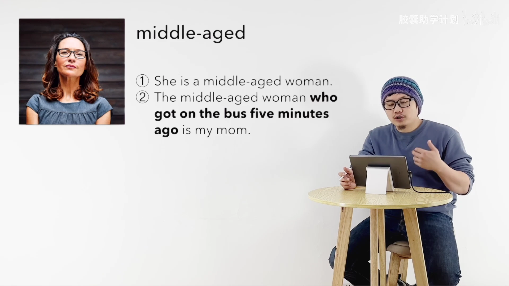

文字识别：胶囊助学计划 / middle-aged / ① She is a middle-aged woman. / The middle-aged woman who / got on the bus five minutes / ago is my mom.

## 00:05:00–00:05:30

的那个中年女子 is my mom. 她实际上是我的母亲，对吧？定语从句，very good. Continuing, 再来说 When the middle-aged old man was cooking in the kitchen, her husband was watching TV. 一百一十七课咱们学的语法，对不对？Okay, when 然后后边加上 was were doing 过去进行时啊，当一个事情发生的时候，另一个事情正在发生。Very good. 好，下一个单词，这是一个介词。介词我们大面积见

### 画面 00:05:06

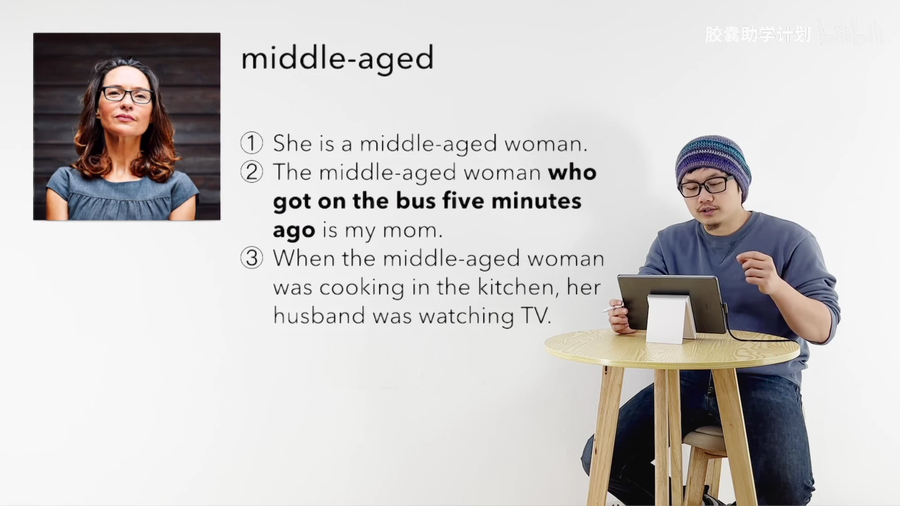

文字识别：胶囊助学计划 / middle-aged / ① She is a middle-aged woman. / The middle-aged woman who / got on the bus five minutes / ago is my mom. / When the middle-aged woman / was cooking in the kitchen, her / husband was watching TV.

### 画面 00:05:15

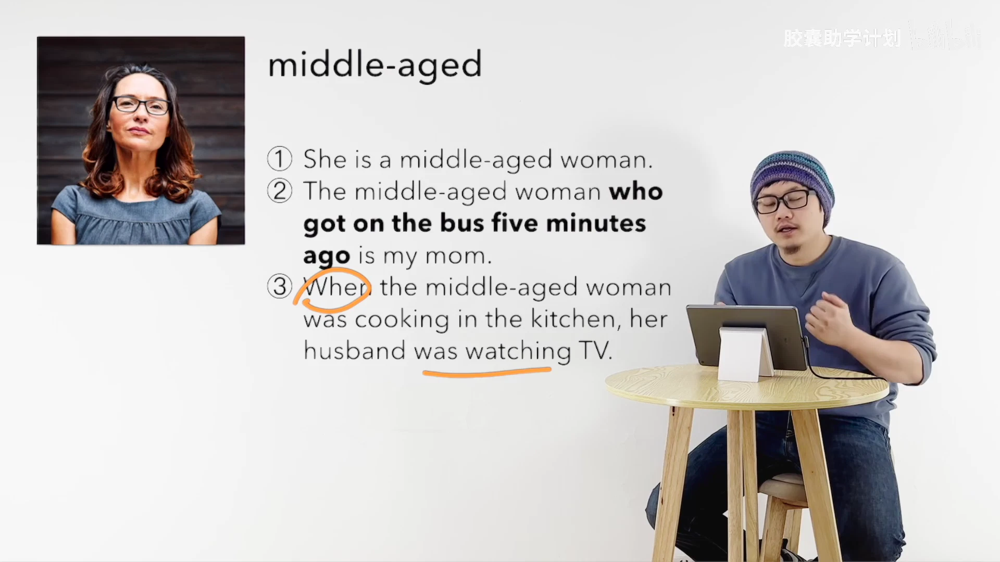

文字识别：胶囊助学计划 / middle-aged / ① / She is a middle-aged woman. / The middle-aged woman who / got on the bus five minutes / agois /  my mom. / 3 / Whed / the middle-aged / d woman / was cooking in the kitchen, her / husband was watching TV.

### 画面 00:05:26

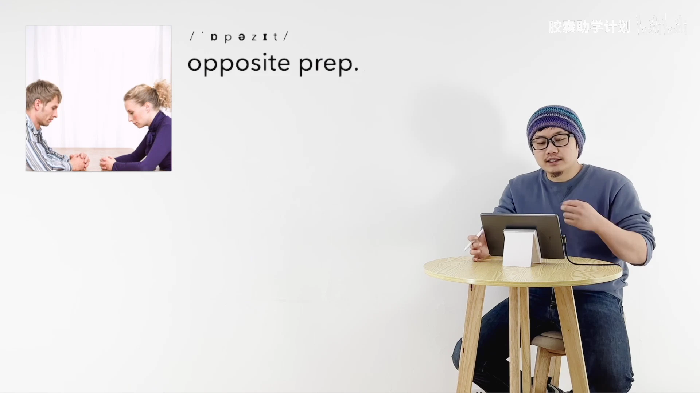

文字识别：胶囊助学计划 / / 'pｐazit / / opposite prep.

## 00:05:30–00:06:00

到是在还是早在三十五课了，对吧？后来再见到咱们没有单独去讲新二呢，我们的第九课每个单元的第九课也会专门带大家去学习介词，好吧？那跟我们一起读一下这个单词来，叫做 opposite， opposite， OK，叫做相反的 opposite， OK， very good。比如说 the middle aged woman sat opposite the little girl，说这个中年女子啊坐在这个小姑娘的对面，非常的简单一

### 画面 00:05:56

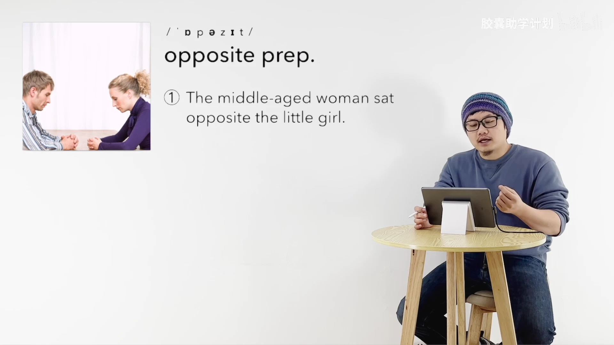

文字识别：胶囊助学计划 / /  pρ a z Ⅰ t / / opposite prep. / ① The middle-aged woman sat / opposite the little girl.

## 00:06:00–00:06:30

句话，这也是我们基本原文的一句话。那您看，肯定句出来了，又是各种句型。对于各位来说，middle啊，opposite这个单词，您又练了好多遍，对不对？这就是我教各位练单词的方式。单词最终一定是放在句子当中去的。我们从第一节课就开始说，所以在尽可能的前提之下，您尽量拿单词去造句，对不对？OK，我手把手在教各位啊。再来说，the school is opposite the park。其实像

### 画面 00:06:26

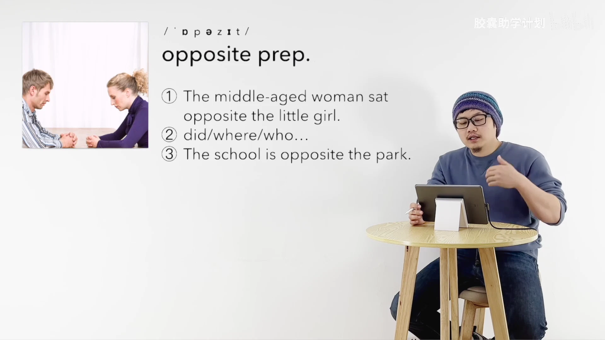

文字识别：胶囊助学计划 / /  pp a z I t / / opposite prep. / ① The middle-aged woman sat / opposite the little girl. / did/where/who... / The school is opposite the park.

## 00:06:30–00:07:00

这句话，各位如果第三十五课您学好了，对于各位来说，原来我们说的是The school is near the park.我没有记错的话，这是三十五课原文。您现在只是把near变成了opposite，对吧？就是说学校在公园的对面，完事儿了，对不对？OK，好，这是举一反三的能力啊。下一个单词看音标叫做curiously，curiously啊啊，这个地方curiously，curiously，OK，叫做

### 画面 00:06:47

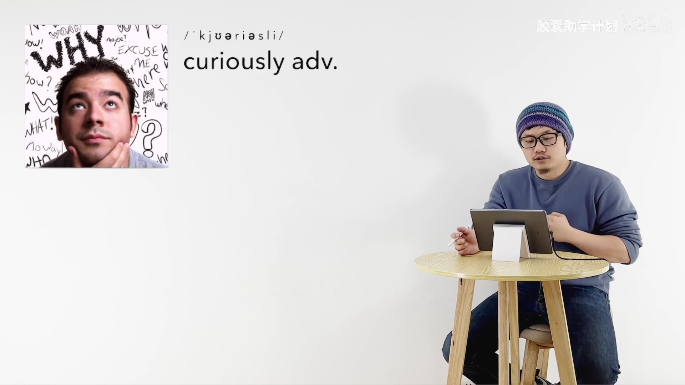

文字识别：V / 胶囊助学计划 / / kjuariasli/ / 1ow! / naybe? / WHY / curiously adv. / ME / 2ow? / NHAT! / Noway / HO

## 00:07:00–00:07:30

好奇心地，对吧？很有好奇心地。注意，它是一个副词啊。得的得是一个地，对吧？OK，比如说，那副词我们在七十三课说过了，一定跟动词连着。大多数情况下，对吧？偶尔也能修饰呃形容词，甚至能修饰副词，对吧？副词自己本身能修饰的东西是很多的。那我们最常见的是说动词，比如说，she looked at the picture curiously，是吧？哎，她充满好奇心地看着这张图片。肯定句给

### 画面 00:07:10

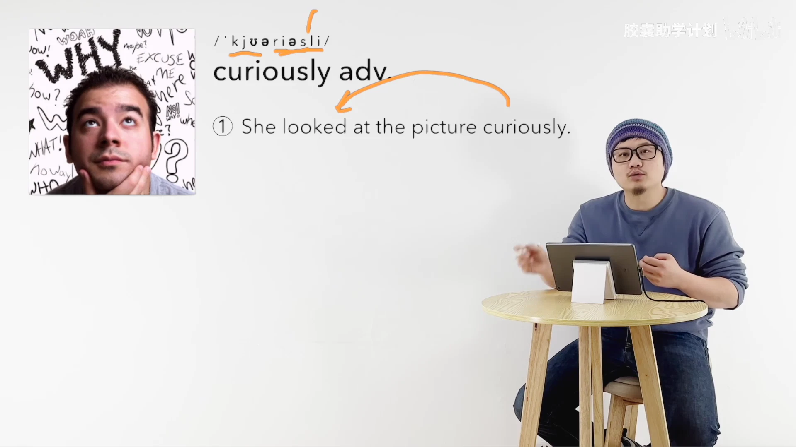

文字识别：V / 胶囊助学计划淵 / /  kjuariasli/ / Maybe? / 1ow! / WHY / curiously adv. / ME / 2ow? / whe / ① She looked at the picture curiously. / NHAT! / Noway / NHO

## 00:07:30–00:08:00

给您了，又是各种各样的特殊疑问句，我们就不再多说了。您自己要么暂停屏幕说一下，要么写一下，这就是您的家庭作业啊。我个人建议先写，然后再大声朗读，对吧？笔头啊，我们这个手头一定要勤快。Very good, continue. Next one，下一个单词跟我读一下，叫做 funny, funny 啊，那就很有很滑稽的，很有趣的，那就 funny 啊，一般指的是滑稽。比如说很简单，叫 he is funny 啊，他这个人很

### 画面 00:07:40

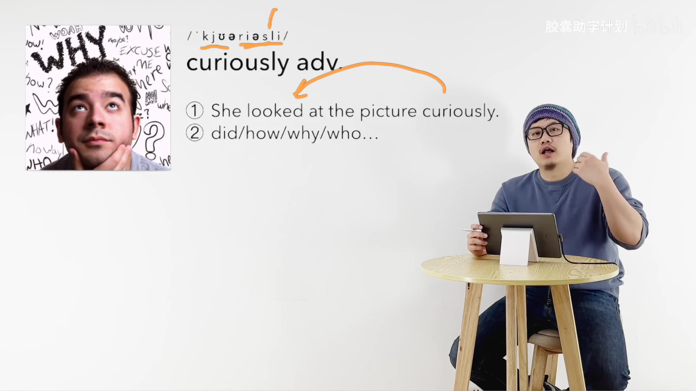

文字识别：V / 胶囊助学计划 / W / Maybe? / / kjuariasli/ / 1ow! / EXCUSEY / WHY / curiously adv / ME / 2ow? / wh / ① She looked at the picture curiously. / NHAT! / did/how/why/who... / Noway / JHO

### 画面 00:07:46

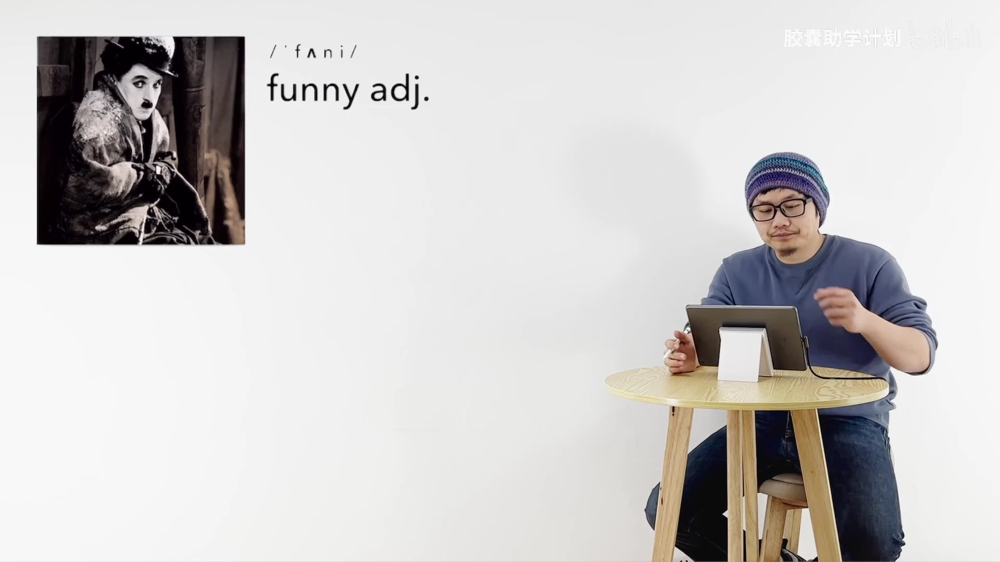

文字识别：胶囊助学计划 / / ' f Λni/ / funny adj.

## 00:08:00–00:08:30

很滑稽。注意，他不单纯指的是有趣，interesting 和 funny 是有一点区别的。一本书，比如说啊， moral moral philosophy 道德哲学，它可以读起来非常的 interesting，对吧？很有趣，但它一定不是滑稽的，对吧？但如果你看小丑，对吧？或者比如说我们看卓别林，那你大多数感受到的肯定指的是 funny 啊，呃，肯定也有 interesting，对吧？所以我们可以这样理解

### 画面 00:08:09

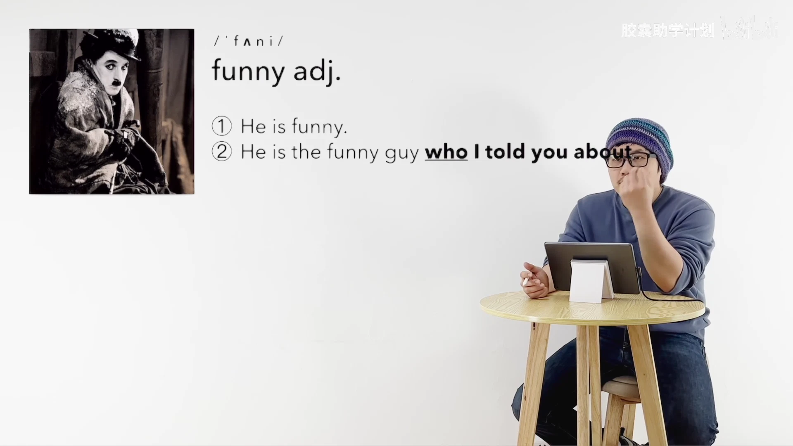

文字识别：胶囊助学计划 / /  f Λ n i / / funny adj. / ① He is funny. / He is the funny guy who Itold you abou

## 00:08:30–00:09:00

喜剧可以是 funny 的，也可以是 interesting 的。但是呢，比如说我们说一个悲剧可不可以 funny 呢？好像就不太容易了。但是悲剧可以 interesting，对吧？OK，再来说，He is the funny guy。哎，他就是那个特别滑稽的家伙。Who I told you about？我想问的问题就是这里面的 who 能不能被省略呢？回想一下啊，一百二十一个的语法定语从句。再来说，This is the funniest guy

### 画面 00:08:39

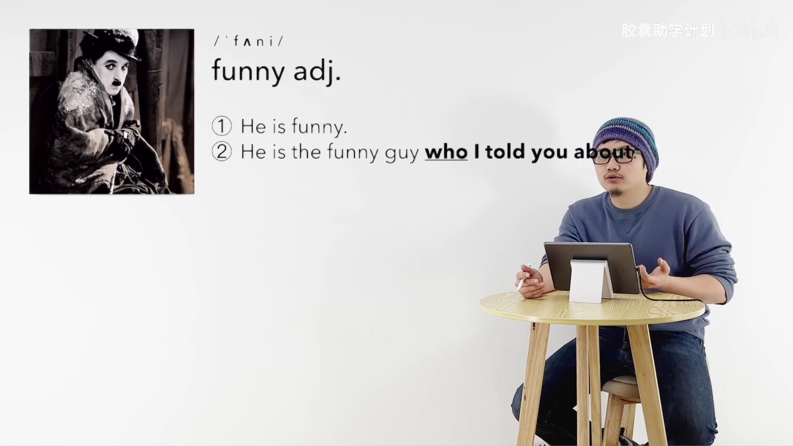

文字识别：胶囊助学计划 / / ' f Λ n i / / funny adj. / ① He is funny. / He is the funny guy who I told you about.

## 00:09:00–00:09:30

I've ever seen. 各位可以看到，其实我现在在拿这些单词造句的思路啊，就是用我们之前学过的语法或者特殊句型往里面去带。一方面复习了之前学的特殊句型，另一方面呢又学习了今天的新的单词，对吧？这是我们新概念二册第一课就会教各位的一个思路啊，叫做如何用单词去造句啊。 Okay, next one. Say the funny guy wants to know if you will

### 画面 00:09:03

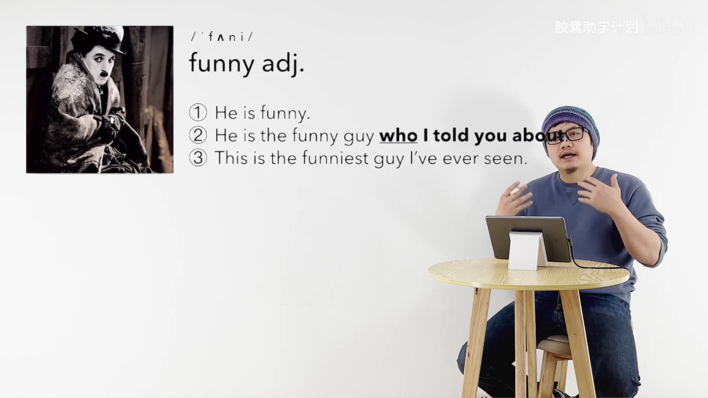

文字识别：胶囊助学计划 / / ' f Λn i / / funny adj. / ① He is funny. / He is the funny guy who I told you about / This is the funniest guy I've ever seen.

### 画面 00:09:27

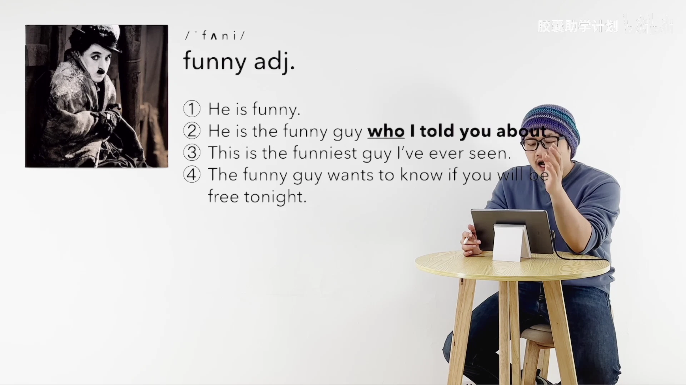

文字识别：胶囊助学计划 / / ' f Λ n i / / funny adj. / ① He is funny. / He is the funny guy who I told you abgut / This is the funniest guy I've ever seen. / The funny guy wants to know if you will b / free tonight.

## 00:09:30–00:10:00

be free tonight.说这个特别滑稽的人，这个家伙呀，想知道的事情是你今天晚上是否有空。哎，一百三十九课咱们刚学的一般疑问句做英语从句。More again, next one.跟我读，叫做powder compact compact啊，called powder compact. Okay,那powder其实就是粉的意思。比如说washing powder啊，洗东西的粉，洗衣粉是吧？那compact就

### 画面 00:09:36

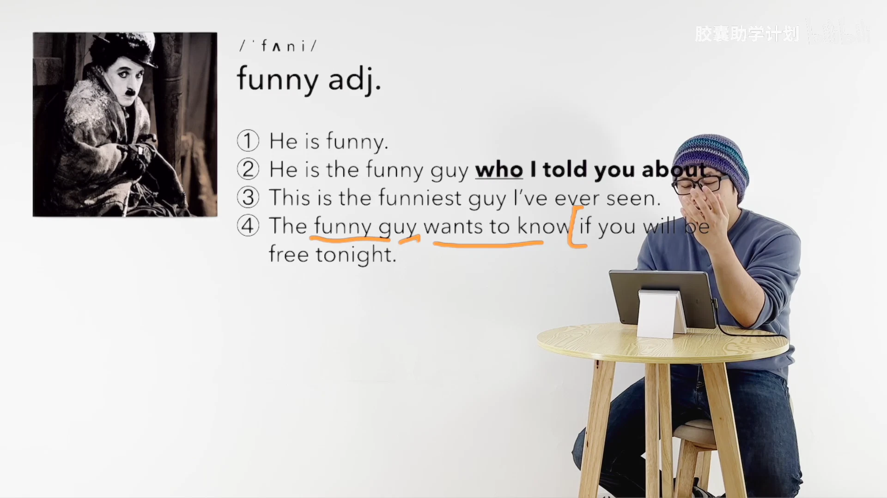

文字识别：胶囊助学计划 / / ' f Λ n i / / funny adj. / ① He is funny. / He is the funny guy who I told you about / This is the funniest guy I've ever seen. / The funny guy wants to know if you will bèe / free tonight.

### 画面 00:09:44

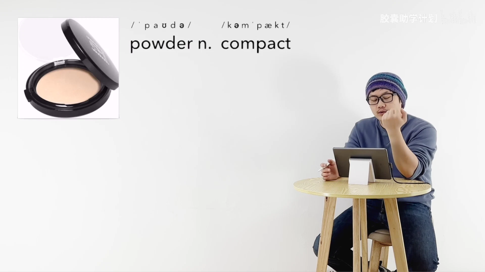

文字识别：胶囊助学计划 / / 'pauda / / / kam'pækt/ / powder n. compact

## 00:10:00–00:10:30

是我们现在图中这种带着一个小镜子，一打开这样一个小的化妆盒。那 powder compact 呢？各位就是就是基本是图中这样一个东西啊。比如说女士打粉底的时候，我也不知道我说的完不完准不准确啊。就是女士去打粉底的时候，比如说一哎这么一个圆的盒子，你把它一打开，这有个小镜子，对吧？拿东西一蹭，然后往脸上抹一抹，这个东西叫做 powder compact。 OK，那合起来其实还是个名词嘛。

### 画面 00:10:14

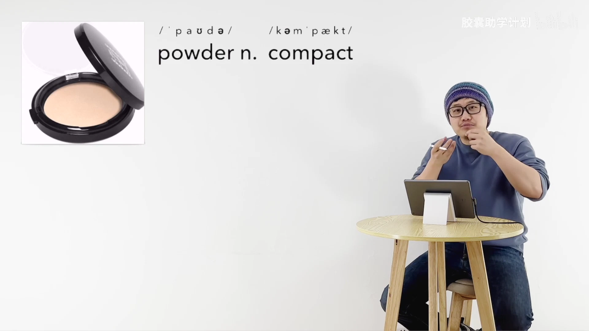

文字识别：胶囊助学计划 / / 'pauda / / / kam'pækt/ / powder n. compact

## 00:10:30–00:11:00

嘛。那我们造句子呗。说 I lost my powder compact last night. 很简单一句话，对吧？ I lost my way. I lost my powder compact. 无非我就加了个时间叫 last night. 肯定句出来了，各种各样的句型您自己去变。再来，我们结合幺幺九 after a逗号 b had done 这一课的语法造一个句子。 After I had lost my powder compact, my boyfriend bought me a new one. 是吧？我把这东西丢

### 画面 00:10:44

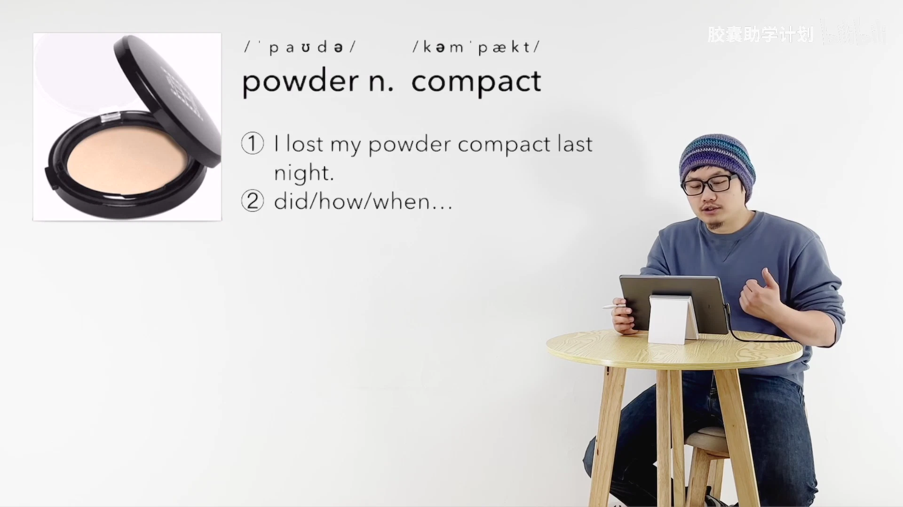

文字识别：胶囊助学计划 / / 'pauda / / /kam'pækt/ / powder n. compact / ① Ilost my powder compact last / night. / did/how/when...

### 画面 00:10:46

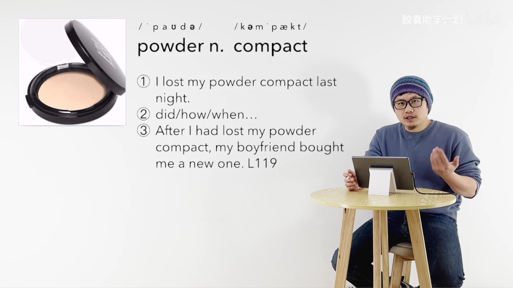

文字识别：胶囊助学计划 / / pauda / / /kam'pækt/ / powder n. compact / ① Ilost my powder compact last / night. / did/how/when... / After I had lost my powder / 3 / compact, my boyfriend bought / me a new one. L119

## 00:11:00–00:11:30

了，然后丢了之后呢，我男朋友给我买了个新的。Very good,是吧？Okay, very nice. Next one,下一个单词我们就不配图了，配个字儿，是吧？叫做跟我读这个单词叫ugly, ugly啊，就是这个字的意思啊，丑，对吧？美丑的丑。好，那它是个形容词，就可以连着名词，对不对？这也是我们新二要给大家总结出来的一个东西。单词造句的时候，你还要看一下这个单词的词性，很多的时候，对不对？来说

### 画面 00:11:06

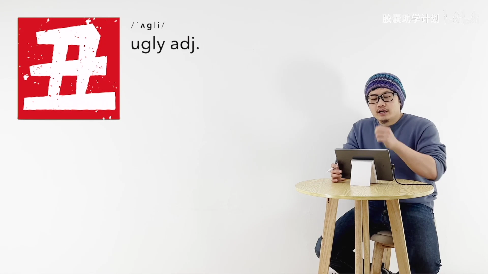

文字识别：胶囊助学计划 / /'agli/ / ugly adj.

### 画面 00:11:16

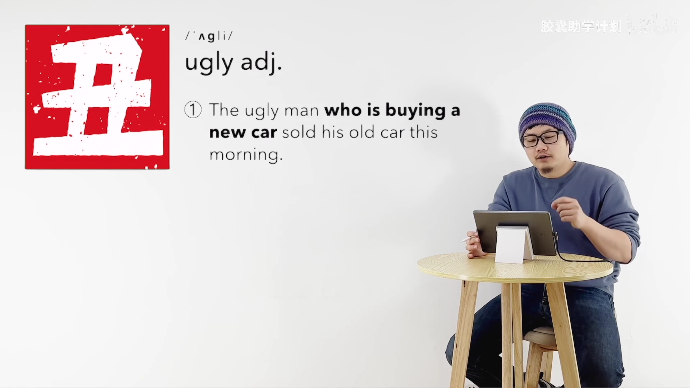

文字识别：胶囊助学计划 / /'Λgli/ / ugly adj. / ① The ugly man who is buying a / new car sold his old car this / morning.

## 00:11:30–00:12:00

ugly man who is buying a new car sold his old car this morning，对吧？那正在买车的这个特别丑的这这哥们儿啊，今儿早上刚把他原来那辆车给卖掉，对吧？Next one，说 he is the ugliest man I've ever seen，说他是最丑的这个男人啊，我见过的，是吧？OK，再来一百二十五个 had to，说 I had to meet that ugly man tonight，啊，就比如说相亲啊，今天晚

### 画面 00:11:46

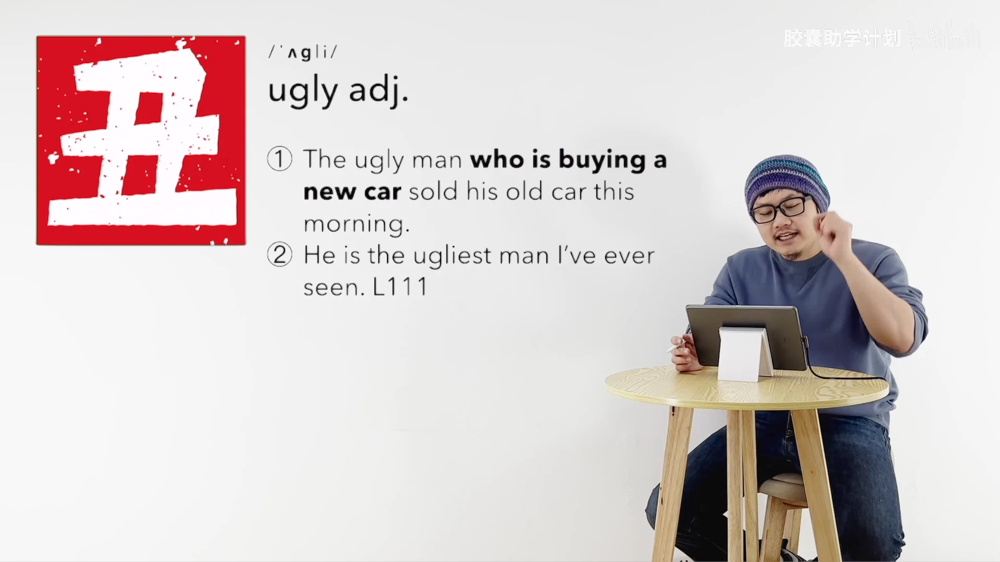

文字识别：胶囊助学计划 / /'Λgli/ / ugly adj. / ① The ugly man who is buying a / new car sold his old car this / morning. / He is the ugliest man I've ever / seen.L111

## 00:12:00–00:12:30

上必须得见那个丑爷们儿，啊啊，必须得见他啊，爸妈安排的。OK，肯定句出来了，又是各种呃四句型的转换，对不对？OK，好，下一个单词跟我读一下，叫做amused. Amused.注意这个单词依旧是千万记住啊，虽然是ed结尾，但它本身是个形容词词性啊，有趣的，很有意思的。比如说，she was amused.哎，她感到很有趣，

### 画面 00:12:12

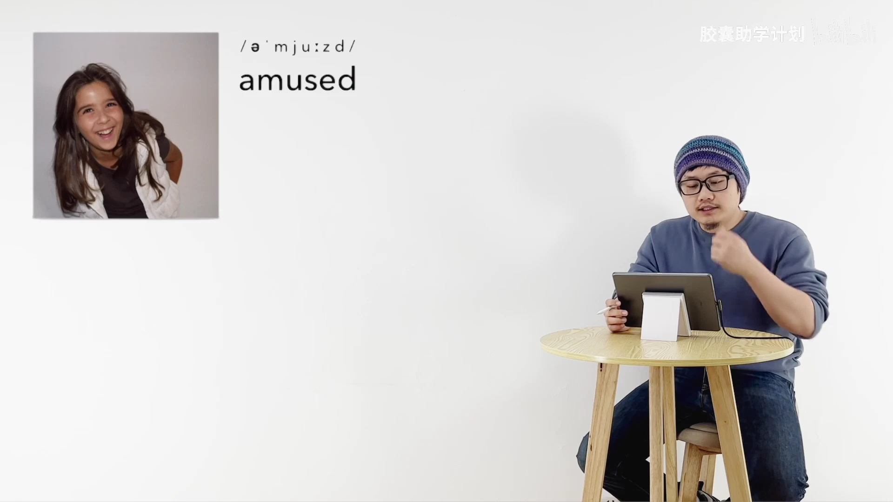

文字识别：胶囊助学计划 / /a'mjuizd/ / amused

### 画面 00:12:22

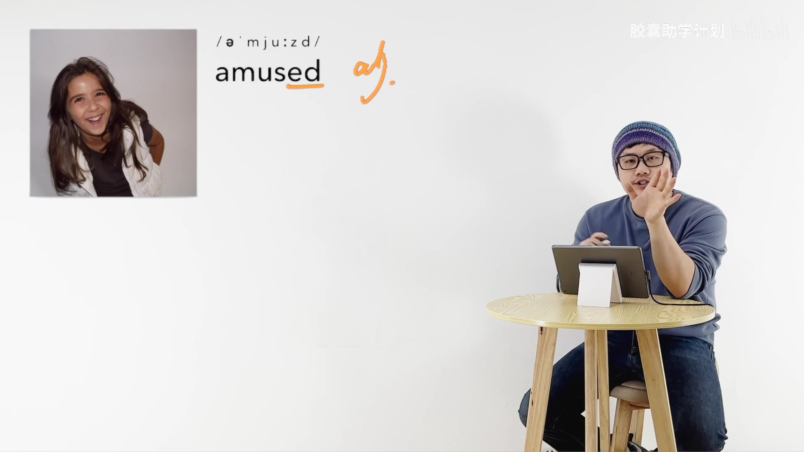

文字识别：胶囊助学计划 / /a'mjuizd/ / amused

## 00:12:30–00:13:00

就这么简单，对吧？那各种句型，您自己变一变就可以了，对吧？比如说，Why was she amused?哎，他当时为什么觉得很有趣呢？OK，不多说了啊。接下来两个单词，呃，七十三课或七十四课我们见过第一个单词，跟我一起读一下，叫做smile，smile叫微笑。Next one，下一个单词跟我读一下，叫做kindly，kindly啊，叫做呃很善良啊，呃最基本的意思就是很善良的啊。注意，

### 画面 00:12:40

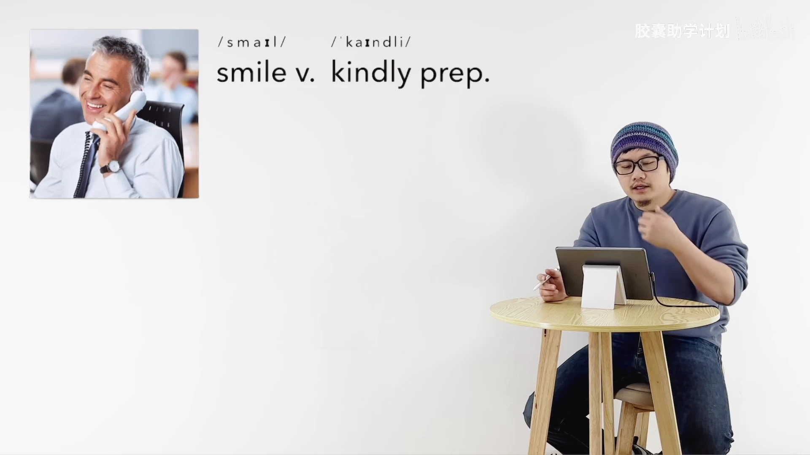

文字识别：胶囊助学计划 / /smail/ / /'kaindli/ / smile v. kindly prep.

### 画面 00:12:52

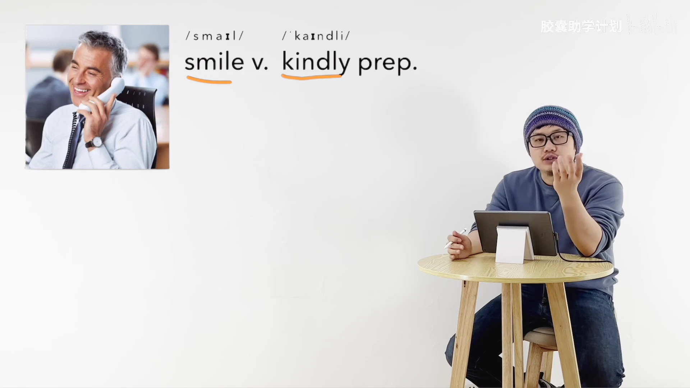

文字识别：胶囊助学计划 / /smail/ / /'kaindli/ / smile v. kindly prep.

## 00:13:00–00:13:30

它不是 preparation 啊，它是一个副词啊。这个地方有一个小的 typo 啊啊，preposition 啊，它应该是一个这个呃 adverb 是吧？它是一个副词啊啊，kindly 最常见的 kind 有善良的意思，但是在这儿呢，指的比如说是微笑的很亲切啊，很温暖，很和蔼可亲啊，大概是这样一个意思，对吧？来，比如说 she smiles every day，肯定句加上各种各样的特殊疑问句和一般疑问句。我们

### 画面 00:13:03

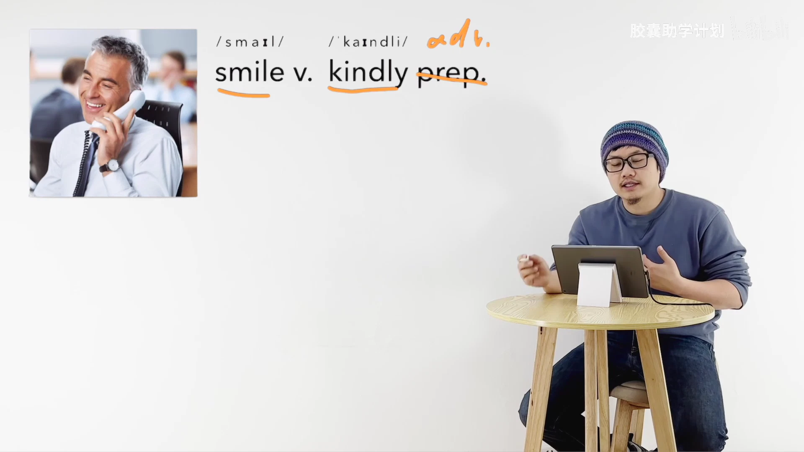

文字识别：αdv. / 胶囊助学计划 / /smail/ / /'kaindli/ / smile v. kindly / prep.

### 画面 00:13:29

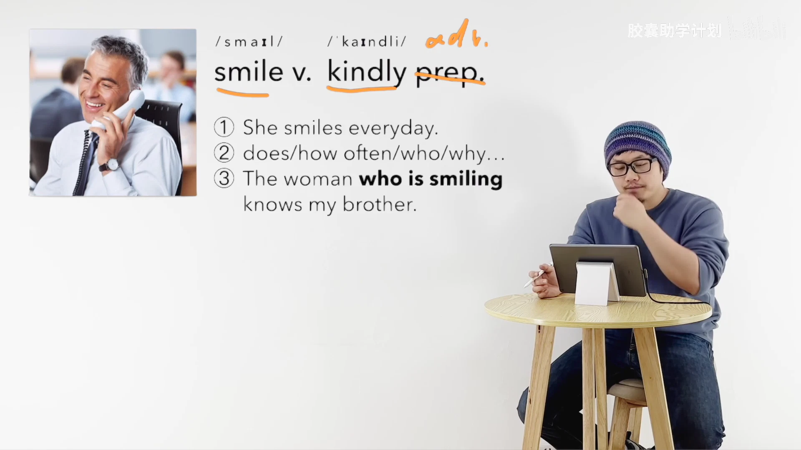

文字识别：adv. / 胶囊助学计划 / /smail/ / /'kaindli/ / smile v. kindly / prep. / ① She smiles everyday. / does/how often/who/why.. / The woman who is smiling / knows my brother.

## 00:13:30–00:14:00

再造一个句子，说The woman who is smiling knows my brother。正在笑的这个女人认识我兄弟。OK， next one，说She smiled kindly。我们刚刚说过，副词往往跟动词连在一起，对吧？是最常用的一个用法。所以她笑的很啊，这个这个这个这个很呃，这个很亲切，对吧？OK啊，然后再来一般疑问句，特殊疑问句。OK，

### 画面 00:13:59

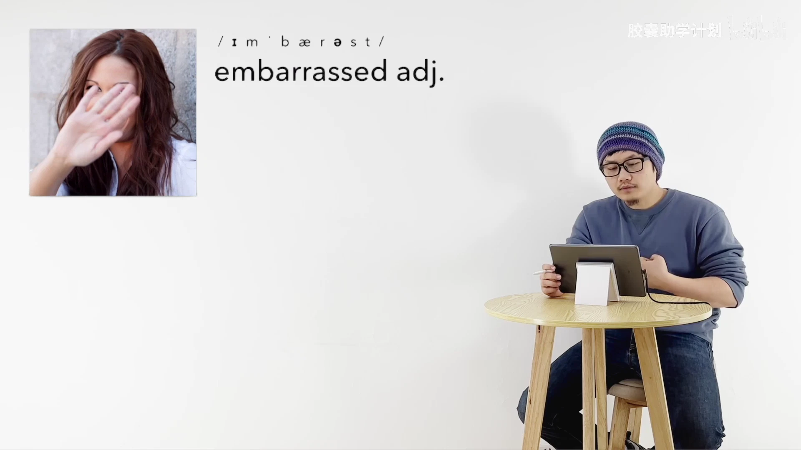

文字识别：胶囊助学计划淵 / / Ⅰ mb æera s t / / embarrassed adj.

## 00:14:00–00:14:30

下一个单词依旧是别看它虽然是ed结尾，但它是形容词。我们说了三个了，对吧？呃，这个单词amused，然后之前还有一个单词，对吧？Okay,啊，我们一会儿进入文章看啊，跟我读一下，叫做embarrassed, embarrassed, embarrassed，指的就是哎呦，好尴尬，好尴尬啊。Okay，比如说，哎，接下来我编了三个句子，我觉得还挺有意思的，我们一起看一下啊。以三个人的口吻写了三个句子。

### 画面 00:14:17

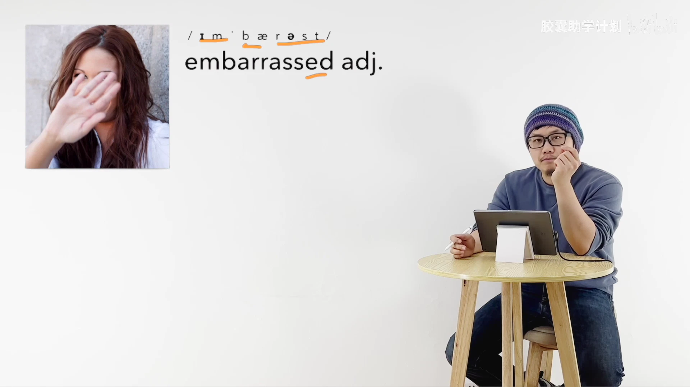

文字识别：胶囊助学计划 / Imbærast / embarrassed adj.

### 画面 00:14:23

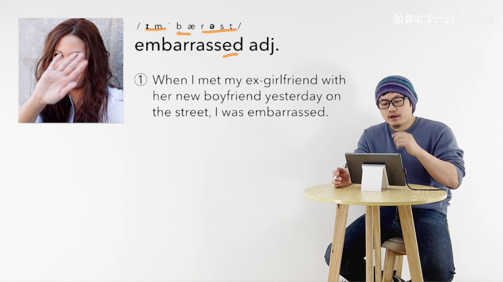

文字识别：胶囊助学计划 / Lm'bæerast / embarrassed adj. / ① When I met my ex-girlfriend with / her new boyfriend yesterday on / the street, I was embarrassed.

### 画面 00:14:25

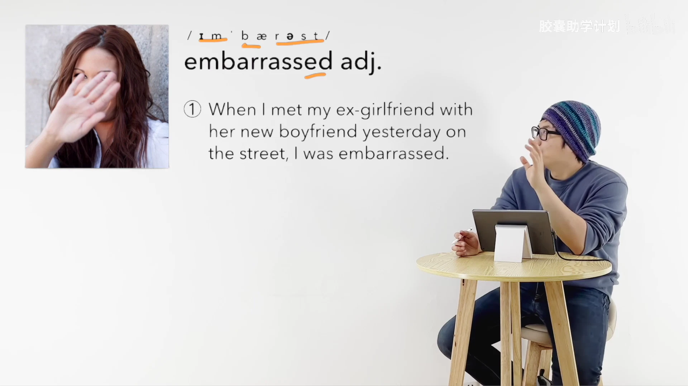

文字识别：胶囊助学计划 / m'b æer as t / embarrassed adj. / ① When I met my ex-girlfriend with / her new boyfriend yesterday on / the street, I was embarrassed.

## 00:14:30–00:15:00

第一个人说，When I met my ex-girlfriend with her new boyfriend yesterday on the street, I was embarrassed. Ah, I was embarrassed as hell. Ah, I was like, I'm embarrassed, is吧embarrassed.说当我遇到我的女朋友啊前女友和她新男朋友，昨天在马路上的时候呢，我感觉很尴尬，对吧？然后这个女的说了一句话，说The man who

### 画面 00:14:55

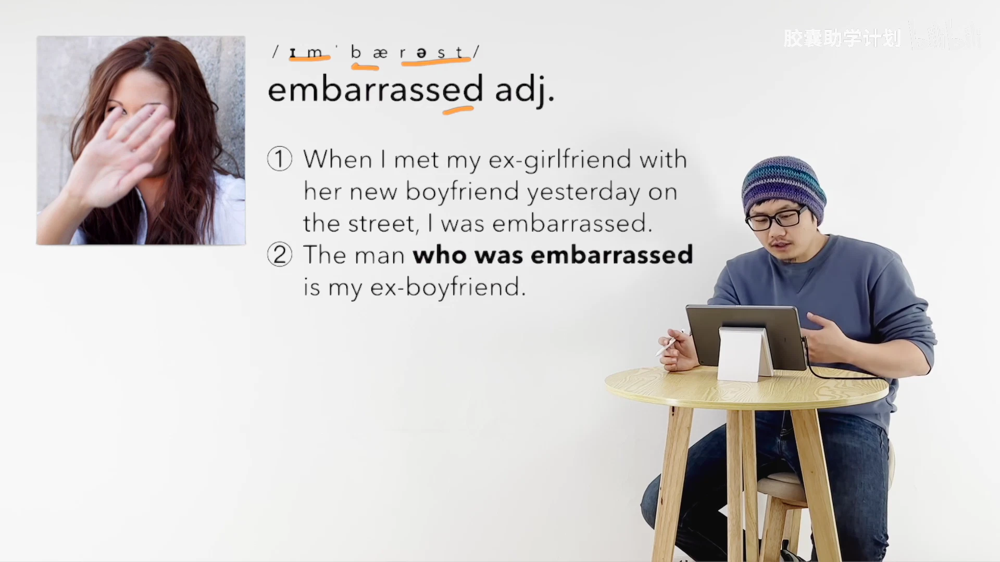

文字识别：胶囊助学计划 / m'b æer as t/ / embarrassed adj. / ① When I met my ex-girlfriend with / her new boyfriend yesterday on / the street, I was embarrassed. / The man who was embarrassed / is my ex-boyfriend.

## 00:15:00–00:15:30

who was embarrassed is my ex-boyfriend, 是吧？说这个感觉很尴尬的这个男的呀，他实际上是我前男友。那这一看就是女生说的。然后女生的现男友说了什么呢？说 When my girlfriend told me that the man who was embarrassed on the street was my girlfriend's ex-boyfriend, I was very embarrassed. 这句话就稍微有点难了。我们一点一点翻译啊。说，当我女朋友告

### 画面 00:15:10

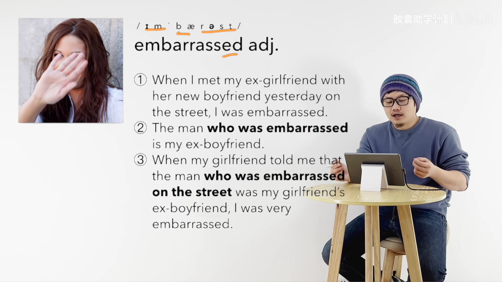

文字识别：胶囊助学计划 / m'b æeras t/ / embarrassed adj. / ① When I met my ex-girlfriend with / her new boyfriend yesterday on / the street, I was embarrassed. / The man who was embarrassed / is my ex-boyfriend. / When my girlfriend told me that / the man who was embarrassed / on the street was my girlfriend's / ex-boyfriend, I was very / embarrassed.

## 00:15:30–00:16:00

诉我，说昨天在马路啊在马路上特别尴尬的那个男生是我女朋友的前男友的时候，我感觉特别的尴尬，是吧？这句话稍微有点绕口啊，还是那句话，这是超纲了啊！你各位一看这个句子长度是吧，稍微有一点超纲。新概念二册第四单元，新概念三册第一课，我们就开始处理这么长的句子了，对吧？OK，那

### 画面 00:15:40

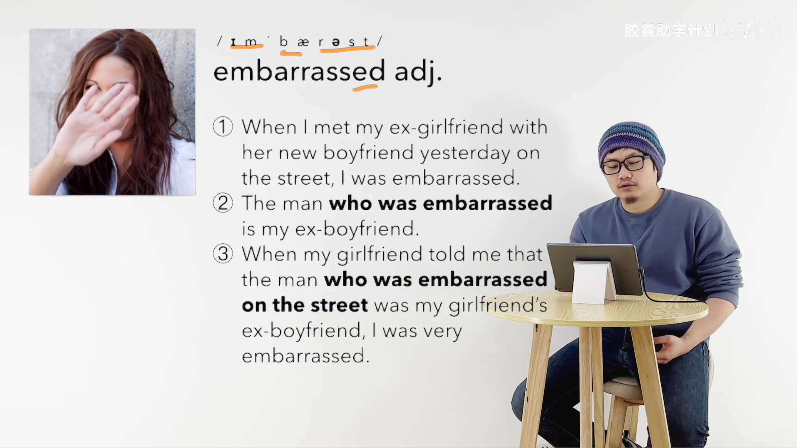

文字识别：胶囊助学计划 / Lm'b æeras t/ / embarrassed adj. / ① When I met my ex-girlfriend with / her new boyfriend yesterday on / the street, I was embarrassed. / The man who was embarrassed / is my ex-boyfriend. / When my girlfriend told me that / 3 / the man who was embarrassed / on the street was my girlfriend's / ex-boyfriend, I was very / embarrassed.

### 画面 00:15:58

文字识别：胶囊助学计划 / Recap / Patterns / & / Grammar / Words / Expression

## 00:16:00–00:16:30

recap本课啊，实际上最重要的事情就是这些单词啊，各位把这些单词处理好就可以了啊。Okay,那我们看一下家庭作业，首先单词造句对吧？老习惯，然后讲解一下这个核心知识点，关键点就是ed结尾那三个形容词，注意他们是形容词对吧？本课的单词呢比较的多，这个是我们进入新概念二册下半册，甚至进入新三了之后的一个常态啊。好，那

### 画面 00:16:10

文字识别：胶囊助学计划 / 单词造句3

### 画面 00:16:29

文字识别：胶囊助学计划

## 00:16:30–00:17:00

如果各位喜欢我们的课程，欢迎各位关注、订阅、一键三连，分享给那些需要的朋友，来帮助我们快速成长。最后，我们再来看一句名人名言：Don't cry because it's over. Smile because it happened. See you next time.

### 画面 00:16:38

文字识别：胶囊助学计划淵 / Don't cry because it's over. Smile because / it happened. / - Dr. Seuss

### 画面 00:16:47

文字识别：聖動字計划一新一 / Don't cry because it's over. Smile because / it happened. / Dr. Seuss

### 画面 00:16:49

文字识别：臺動字計划 / CAPSULEACADEMY / 胶囊助学计划 / 小红书 / Lecturer / Leo / OE

### 画面 00:16:52

文字识别：CAPSULEACADEMY / 胶囊助学计划 / 小红书 / OE

### 画面 00:16:55

文字识别：CAPSULEACADEMY / 胶囊助学计划 / 小红书 / Creator / Leo & Berlin / OE

### 画面 00:16:57

文字识别：bilbili / 胶囊助学计划 / APSULEACADEM / 胶囊助学计划 / 小红书 / 控 / OE

### 画面 00:16:59

文字识别：bilbili / 胶囊助学计划

## 00:17:00–00:17:30

Hello everyone, welcome to Capsule Academy. This is Leo. Today we're going to learn New Concept English Book One, Lesson One Hundred and Forty One Grammar. 那老习惯进入正式课程之前，我们看两个问题。第一，一般现在时的被动长成什么样子？第二，一般过去时的被动长成什么样子？带着这两个问题， hope you gonna enjoy. 好，那我们本课最重要的语法就两个字儿，我们管它叫做

### 画面 00:17:01

文字识别：胶囊助学计划 / NCE / BOOKI / Lesson 141 / Grammar

### 画面 00:17:10

文字识别：胶囊助学计划 / 皮动？

### 画面 00:17:12

文字识别：胶囊助学计划 / ①一般现在时的被动？

### 画面 00:17:15

文字识别：胶囊助学计划 / ①一般现在时的被动? / 去时的被动?

### 画面 00:17:17

文字识别：胶囊助学计划 / ①一般现在时的被动? / 一般过去时的被动?

### 画面 00:17:21

文字识别：胶囊助学计划bill

### 画面 00:17:25

### 画面 00:17:27

文字识别：胶囊助学计划 / 被动

## 00:17:30–00:18:00

被动啊。我们汉语有没有被动呢？我们举点例子吧。汉语的被动着实比英文复杂很多。举个例子，比如说我被打了，你看被这个字儿可以表示被动，对吧？好，我应邀出席，应可以表被动。我受到老师的表扬，受到可以表示被动。我遭到父母的批评，遭到也可以表示被动。而汉语最恐怖的地方不在这个地方，不在于有很多很多的

### 画面 00:17:50

文字识别：胶囊助学计划 / 被动 / 我 / 被打了 / 应邀出席 / 受到老师的表扬 / 遭到父母的批评

## 00:18:00–00:18:30

字可以表示被动，我在这儿其实还能点点点呢，对吧？还能点点点呢，还有很多汉字可以表被动。你要把这些汉字都记下来，才会知道什么时候是表被动，对吧？但汉语最恐怖的事情是什么呢？叫做没有任何一个表被动的字儿，你要根据实际场景去猜它是不是被动。比如说，我上课原来最常举的一个例子叫做“老头晒被子”，是主

### 画面 00:18:20

文字识别：胶囊助学计划 / 被动 / 我 / 被打了 / 应邀出席 / 受到老师的表扬 / 遭到父母的批评

## 00:18:30–00:19:00

动被动，这是主动对不对？是老头去晒被子，对不对？他去晒的是被子，被子是哎这个被晒的那个东西。但你想，如果是老头晒太阳，这里边好像就不是老头要把太阳晒出去了，是老头被太阳晒，是吧？类似于一个老头被太阳晒的感觉，对不对？OK，所以我们汉语当中呢，那我们不管这个例子是不是非常的合理啊，但是我们只是

### 画面 00:18:50

文字识别：胶囊助学计划 / 被动 / 我 / 被打了 / 应邀出席 / 受到老师的表扬 / 遭到父母的批评

## 00:19:00–00:19:30

想通过这个例子告诉各位，说汉语当中有非常多的情况。首先，表被动的字非常非常的多，我们在这一口气儿就举了四个，对吧？其次呢，汉语最恐怖的地方，比如说饭做好了，是吧？哎，你看这句话叫饭被我做好了，其实是吧？或者我把饭做好了，但你单说饭做好了的时候，大家都知道什么意思。你任何的被字这样的表示被动的字都不需要出现，依旧可以被动。英文其实比我们

### 画面 00:19:20

文字识别：胶囊助学计划 / 被动 / 我 / 被打了 / 应邀出席 / 受到老师的表扬 / 遭到父母的批评

## 00:19:30–00:20:00

汉语要简单很多。那我们先处理几个事儿。第一，英文的被动到底有没有时态？英文的被动有没有时态？我们可以先从汉语的角度去出发。我昨天被打了，经常被打，刚挨揍和明天要挨打。你看汉语的被动有没有时态？是有时态的。时态最简单来说，告诉你动作发生的时间和动作发生的状态。哪怕它是被动的，它也有时间，什么时候被发生的

### 画面 00:19:33

文字识别：胶囊助学计划 / 被动 / 被动有时态么？

### 画面 00:19:43

文字识别：胶囊助学计划 / 被动 / 被动有时态么？ / 我昨天被打了 / 我经常被打。 / 我刚挨揍。

## 00:20:00–00:20:30

和被发生时候它的状态是什么样的，对吧？英文一模一样，而英文跟我们汉语的区别是什么呢？在某种程度上，英语要比汉语还容易一点点，只是因为各位不会，你才觉得难，对吧？但你学会了，你去对比英汉的时候，你会发，比如像我，我就会发现，哎，英文的被动比汉语的被动整体上要简单那么一点点。比如说，我们看一下英文的被动的结构，很简单，就是两个

### 画面 00:20:09

文字识别：胶囊助学计划 / 被动

### 画面 00:20:27

文字识别：胶囊助学计划 / 被动 / 结构：be(表时态)+done (表被动)

## 00:20:30–00:21:00

单词组成，一个叫 be，一个叫 done。 be 对于各位来说，您现在见过它多少个结构了？ am is are was were，还有一个单词叫 been，对吧？那是我们下一课用到的。还有一个其实叫 being，咱们还没用到，下一课能用到。 done 对于各位来说很容易，我们管它叫过去分词。我们在至少两个地方见到过 done，一个叫现在完成时 have 加 done，一个叫过去完成时，一百一十九课学的

### 画面 00:20:57

文字识别：胶囊助学计划淵 / 被动 / 结构：be(表时态)+done (表被动)

## 00:21:00–00:21:30

had 加 but 对吧？那 but 叫过去分词。我们再看一下，在这地方我写了叫做，首先刚才我们确定了英文有被动，其次英文的被动跟汉语一样也有时态，对吧？我们汉语有时态，英语也有时态，被动啊。然后呢， be 我们懂的是什么？ but 我们懂的是什么？我们再看一下括弧当中的字， be 表时态。这么看各位可能不太理解， but 表被动。

### 画面 00:21:27

文字识别：胶囊助学计划 / 被动 / 结构：be(表时态)+done (表被动)

## 00:21:30–00:22:00

我们直接给大家举个例子，比如说一般现在时的被动，它的基本结构就叫 am is r 加动作的过去分词。但这两个东西放在一起，不管是 am 加 but is 加 but 还是 r 加 but，它就是一般现在时的被动。那我们看一下什么叫做 be 表时态，但表被动呢？很简单，am is r 是 be 的什么时态？是

### 画面 00:21:43

文字识别：胶囊助学计划 / 被动 / 结构：be(表时态)+done (表被动) / 一般现在时被动：am/is/are +done

## 00:22:00–00:22:30

一般现在时。在一般现在时的时候，我们的 be 用的是 am/is/are，对吧？所以 am/is/are 在这儿表示一般现在时，但表示的是什么呢？叫被动，那就放在那儿，它就是表示被动了，对吧？所以它叫做一般现在时的被动。我们造一个句子，比如说 My hair is cut every month. 我每个月都理发，那是你自己理吗？不是，它其实是类似于一个被动，叫我去找别人给我理

### 画面 00:22:13

文字识别：胶囊助学计划 / 被动 / 结构：be(表时态)+done (表被动) / 一般现在时被动：am/is/are +done

## 00:22:30–00:23:00

发，对吧？我每个月的头发都会被剪掉。OK，My hair现在是主语，然后 every month 提供了一个概念，叫做它是一个生活习惯，于是我们管它叫一般现在时。然后再来一个叫做 is 加 cut，那尝试告诉我们的事情就是 is 是一般现在时，cut 是 cut 的 done，对吧？那 is 加 cut 合起来就是一般现在时的被动，我的头

### 画面 00:22:37

文字识别：胶囊助学计划 / 被动 / 结构：be(表时态)+done (表被动) / 一般现在时被动：am/is/are +done / My hair is cut every month.

## 00:23:00–00:23:30

发每个月都会被剪。我们再来一点例子吧，比如说，我们先造一句主动的话，叫 Someone cleans the room every day。说有这么一个人呢，他每天都去哎打扫这个房间。然后您注意啊，Someone cleans the room every day。这里面的主语是 someone，动作叫做 clean，打扫的是 room，然后每一天。我们先判断了他

### 画面 00:23:03

文字识别：胶囊助学计划 / clean the room

### 画面 00:23:08

文字识别：胶囊助学计划 / clean the room / ① Someone cleans the room everyday.

### 画面 00:23:25

文字识别：胶囊助学计划 / clean the room / Someone cleans the room everyday.

## 00:23:30–00:24:00

的一个时态叫做一般现在时，没问题，对吧？然后我们想把它变成被动，变成被动的过程，其实首先要利用的是我们汉语的语感和汉语的基本常识由汉语建立起来的。就是这句话，如果想变成被动的时候，那谁是主语？这是小学咱们学的，叫把字句变被字句，我就不教您了，我直接给叫做应该是 the room，叫做房间，对吧？

### 画面 00:23:33

文字识别：胶囊助学计划 / clean the room / Someone cleans the room everyday.

### 画面 00:23:56

文字识别：胶囊助学计划 / clean the room / Someone cleans the room everyday. / 1 / The room is cleaned by someone everyday.

## 00:24:00–00:24:30

这是咱们小学语文学的啊。各位，这个地方要是没学好，那小学语文有问题，对吧？啊，不是你英语有问题，是你汉语有问题啊。这个知识点，要么你还没学到，要么你学到你给忘了，是吧？叫做房间，然后接下来是被打扫。被打扫的基本结构是M S R加上，注意叫动词的蛋过去分词。所以is啊蛋指的就是D O N E啊蛋它的发音啊就类

### 画面 00:24:02

文字识别：胶囊助学计划淵 / clean the room / ① Someone cleans the room everyday. / ② The room is cleaned by someone everyday.

### 画面 00:24:25

文字识别：胶囊助学计划 / clean the room / ① Someone cleans the room everyday. / The room / is / cleaned by someone everyday.

### 画面 00:24:28

文字识别：胶囊助学计划 / done / clean the room / ① Someone cleans the room everyday. / The room / is / cleaned by someone everyday.

## 00:24:30–00:25:00

似于咱们那鸡蛋的蛋啊，蛋那个发音。Is am is are由主语决定啊。The the room所以是is不是am不是are对吧？Is然后cleaned注意clean的原形是啊啊原形是clean过去分词是cleaned啊。然后by someone every day被某个人每一天。好，这儿注意一个小点，这里的by someone其实可以不用加。我是故意

### 画面 00:24:33

文字识别：胶囊助学计划 / done / clean the room / Someone cleans the room everyday. / ① / The room / is / cleaned by someone everyday.

### 画面 00:24:56

文字识别：胶囊助学计划 / done / clean the room / Someone cleans the room everyday. / 1 / The room / is / cleanedby someone everyday.

## 00:25:00–00:25:30

写到这个地方告诉各位，对吧？然后呢，因为你偶尔会看见 by 什么什么什么，这个叫做被谁谁谁，对吧？比如说有一个绘画，然后这个作品在最底下写一个叫 by Leo，那是什么意思呢？就是被 Leo 画出来的画，对吧？OK，再来，比如说 someone sells stamps in a post office，在邮局卖邮票，主动变成

### 画面 00:25:11

文字识别：胶囊助学计划 / done / clean the room / Someone cleans the room everyday. / 1 / The room / cleaned / dby someoneeveryday. / is / X

### 画面 00:25:14

文字识别：胶囊助学计划 / done / g heo / clean the room / Someone cleans the room everyday. / 1 / The room / cleaned / dby someoneeveryday. / is / X

### 画面 00:25:19

文字识别：胶囊助学计划 / sell stamps

## 00:25:30–00:26:00

被动的主语还是应该是 the stamps 叫做邮票，然后怎么样？因为它是复数，所以是 are sold. Am is are 加动词的过去分词，但对吧？Are sold in the post office. 如果你还想说被某人，那叫做 by someone. 但是在这句话当中，我换一句话来说，我们为什么用被动？也就是说，谁发出的这个动作其实并不重要啊！你想一下，大多数情况下谁卖这个邮票并不

### 画面 00:25:32

文字识别：胶囊助学计划 / sell stamps / ① Someone sells stamps in a post office. / ② The stamps are sold in a post office.

### 画面 00:25:43

文字识别：胶囊助学计划 / sell stamps / ① Someone sells stamps in a post office. /  The stamps are sold in a post office.

## 00:26:00–00:26:30

重要，我知道邮票在哪儿卖更重要，对不对啊？好，next one，再来说，someone repairs the car regularly啊，说就这个经常性的、有规律性的去修修这辆车习惯，对吧？那我把它变成被动的时候，肯定是车被修理，对吧？叫the car is repaired regularly。OK，very good啊，车经常要修，对吧？你看我们汉语其实大多呃很多的时候

### 画面 00:26:05

文字识别：胶囊助学计划 / repair the car

### 画面 00:26:26

文字识别：胶囊助学计划 / repair the car / ① Someone repairs the car regularly. / ② The car is repaired regularly.

## 00:26:30–00:27:00

不需要提供被这个字，而且有的时候加上还会有点怪。这车经常修啊！你看你说这句话的时候，这车经常修，它其实就是被动，叫这车经常被修，对吧？但我们不加那个被啊。OK，那我们刚才提到了一般现在时的被动，接下来就是一般过去时的被动了。一般过去时的被动是was/were加done。回想一下，被动的基本结构是be加done，be

### 画面 00:26:45

文字识别：胶囊助学计划淵 / 被动 / 结构：be(表时态)+done (表被动)

### 画面 00:26:52

文字识别：胶囊助学计划 / 被动 / 结构：be(表时态)+done (表被动) / 一般过去时被动：was/were +done

## 00:27:00–00:27:30

表时态。刚才我们表时态的时候用的是am is are，而was were是在一般过去时，这个时候这个时态之下用的。所以was were加蛋，它的就是一般过去时的被动的基本结构。我们来一个例句，My hair was cut last month。上个月我头发被剪掉了，对吧？啊，我们造几个小的例子吧。比如说武

### 画面 00:27:21

文字识别：胶囊助学计划 / 被动 / 结构：be(表时态)+done (表被动) / 一般过去时被动：was/were +done / My hair was cut last month.

### 画面 00:27:27

文字识别：胶囊助学计划 / kill the tiger

## 00:27:30–00:28:00

松 killed a tiger. 啊，说武松杀了这个老虎。那我想说老虎被武松杀了吧，叫做 the tiger was killed. 注意，然后你看一下这两个 killed，虽然长得一样，都是后边直接加了 e d，但你一定要明白它们的区别。第一个 killed 是一般过去时，第二个 killed 是过去分词，它们是动词的不同结构、不同样子，是吧？只是在这个地方巧了，长得一样。

### 画面 00:27:30

文字识别：胶囊助学计划 / kill the tiger / ① Wusong killed the tiger.

### 画面 00:27:36

文字识别：胶囊助学计划 / kill the tiger / Wusong killed the tiger. / ② The tiger was killed by Wusong.

### 画面 00:27:42

文字识别：胶囊助学计划 / kill the tiger / Wusongkilledt / the tiger. /  The tiger was killed by Wusong.

## 00:28:00–00:28:30

再来，说，Someone stole my wallet yesterday. 哎，有人偷了我的钱包。昨天，我不知道是谁，那我就可以说叫做我的钱包昨儿被偷了，对吧？OK，叫 my wallet was stolen. 啊，那你看，这是 stole，这是 stolen，这是 steal，原形，过去式，过去分词 was，一般过去时，但被

### 画面 00:28:01

文字识别：胶囊助学计划 / steal my wallet

### 画面 00:28:20

文字识别：胶囊助学计划 / steal my wallet / Someone stole my wallet yesterday. / ① / ② My wallet was stolen yesterday.

### 画面 00:28:24

文字识别：胶囊助学计划 / steal / myv / wallet / Someone / stole my wallet yesterday. / 1 / My wallet was stolen / yesterday. / 2

### 画面 00:28:26

文字识别：胶囊助学计划 / stea! / my / wallet / clrd / 1 / Someone / stole /  my wallet yesterday. / 2 / My wallet was / stolen / yesterday. / on

## 00:28:30–00:29:00

动，昨被偷了，对吧？非常舒服。再来说，someone booked the room yesterday。好，book这个单词特别的重要啊。呃，对于各位来说最常见，它是名词书的意思。今天补一个小的意思，动词预定的意思，对吧？那book the room叫做预定了这个房间。比如说，someone booked the room yesterday，叫做某人预定了这个房间昨天。然后您把它变一个被动，那叫做the room was

### 画面 00:28:33

文字识别：胶囊助学计划 / book the room / ① Someone booked the room yesterday.

## 00:29:00–00:29:30

booked yesterday, 对吧? Very good. 你看，一般过去式被动，昨天被预定了，对吧? OK, very good. Recap. 本视频最重要的就是告诉了各位这两个公式，围绕着它产生了一系列，比如说有没有时态呀， be 是表被啊，表什么呀？但是表什么呀？对吧? OK，然后再进行了一些练习。所以对于各位来说，家庭作业呢，红皮书去查找本课的语法。您有余力的同

### 画面 00:29:03

文字识别：胶囊助学计划 / book the room / ① Someone booked the room yesterday. / ② The room was booked yesterday.

### 画面 00:29:08

文字识别：胶囊助学计划 / Recap / Patterns / was/weretdone / am/is/are+done / Grammar / Words / Expression

### 画面 00:29:13

文字识别：胶囊助学计划 / Recap / Patterns / was/were+done / am/is/are+done / Grammar / Words / Expression

### 画面 00:29:24

文字识别：胶囊助学计划

## 00:29:30–00:30:00

学在左右左边看一下讲解，右边再写一下练习就非常重要了。然后呢，给自己讲解一遍今天的核心知识点。好，如果大家喜欢我们的课程呢，欢迎大家关注、订阅、一键三连，分享给那些需要的朋友。See you next time.

### 画面 00:29:40

文字识别：胶囊助学计划 / 不

### 画面 00:29:48

### 画面 00:29:50

文字识别：臺助字計切 / CAPSULEACADEMY / 胶囊助学计划 / 小红书 / Lecturer / Leo / OE

### 画面 00:29:52

文字识别：CAPSULEACADEMY / 胶囊助学计划 / 小红书 / Photographer / Berlin / OE

### 画面 00:29:54

文字识别：CAPSULEACADEMY / 胶囊助学计划 / 小红书 / Editor / Berlin / OE

### 画面 00:29:57

文字识别：CAPSULEACADEMY / 胶囊助学计划 / 小红书 / OE

### 画面 00:29:59

文字识别：bilibili / 胶囊助学计划

## 00:30:00–00:30:30

Hello everyone, welcome to Capsule Academy. This is Leo. Today we're going to learn New Concept English Book One Lesson One Hundred and Forty One Story. Hope you really enjoy it. 好，这是我们新概念一册倒数第二课文章，不短是吧？稍微有一点点长，我们有一些耐心，一点一点看。 Last week, 两个单词一出来，提醒各位这件事情发生在上

### 画面 00:30:01

文字识别：胶囊助学计划 / NCE / BOOKI / Lesson 141 / Story

### 画面 00:30:10

文字识别：J bitbli / 胶囊助学计划 / •

### 画面 00:30:14

文字识别：囊助学计划 / 胶囊助学计划

### 画面 00:30:16

文字识别：交囊助学计划！ / Last week, my four-year-old daughter, Sally, was / invited to a children's party. I decided to take her by / train. Sally was very excited because she had never / travelled on a train before. She sat near the window / and asked questions about everything she saw. / Suddenly, a middle-age lady got on the train and sat / opposite Sally.

## 00:30:30–00:31:00

周，所以时态往往都是跟过去相关的那些时态，比如说咱们学过了一般过去时、过去进行时和过去完成时，对吧？来，我们往下看一下啊。My four-year-old daughter，我四岁的女儿 Sally was invited to a children's party。好了，注意 was 加 invited 这两个单词放到一起，提醒了你这个地方是个被动啊。

### 画面 00:30:46

文字识别：交囊助学计划！ / Last week, my four-year-old daughter, Sally, was / invited to a children's party. I dided to take her by / train. Sally was very excited because she had never / travelled on a train before. She sat near the window / and asked questions about everything she saw. / Suddenly, a middle-age lady got on the train and sat / opposite Sally.

## 00:31:00–00:31:30

刚学过 was was 加 but，叫做被邀请。被邀请去哪儿呢？去一个孩子们的 party 啊聚会，对吧？I decided to take her by train. 说我决定啊，带着她 by train，坐火车去。哎，这地儿还不近。Sally was very excited. 好了，注意她被激动了。这个就是我们说单词那个视频加语法那个视频学完了之后，如果你

### 画面 00:31:16

文字识别：交囊助学计划！ / Last week, my four-year-old daughter, Sally, was / invited to a children's party. I decided to take her by / train. Sally was very excited because she had never / travelled on a train before. She sat near the window / and asked questions about everything she saw. / Suddenly, a middle-age lady got on the train and sat / opposite Sally.

## 00:31:30–00:32:00

学的还都一知半解的，到这儿就更会懵了。原因是单词那个地方我们讲过，excited本身是个形容词，而在语法的那个视频当中，我们又说了说was were加但，但是动词的过去分词，这是形容词，这不是被动，这就是一个非常简单的叫做，比如说she is tall啊，she was fat，跟这个话没什么本本质区别，只不过

### 画面 00:31:46

文字识别：校囊助学计划 / Last week, my four-year-old daughter, Sally, was / invited to a children's party. I decided to take her by / train. Sally was very excited because she had never / travelled on a train before. She sat near the window / and asked questions about everything she saw. / Suddenly, a middle-age lady got on the train and sat / opposite Sally.

## 00:32:00–00:32:30

把 fat 换成了 excited。各位能理解哈，它只是长的是 e d 结尾的啊。所以 Sally was very excited，就是一个肯定主动句，就是说他当时特别的兴奋，对吧？千万注意，它不是被动啊。因为 she had never traveled，因为 had traveled，她之前从来没有过去完成时，对吧？她从来没有旅行 on a train before，她以前从来没有在

### 画面 00:32:16

文字识别：校囊助学计划 / Last week, my four-year-old daughter, Sally, was / invited to a children's party. I decided to take her by / train. Sally was very excited because sh / e had never / travelled on a train before. She sat near the window / and asked questions about everything she saw. / Suddenly, a middle-age lady got on the train and sat / opposite Sally.

## 00:32:30–00:33:00

打火车旅行过。She sat near the window.她坐在窗户旁边，and asked questions about everything she saw.我们先一个一个翻译，问问题关于一切。后边又给了两个单词叫she saw。各位，如果您一眼就看出来这是什么语法，那说明你语法基础真的相当不错。如果您没看出来，完全有情

### 画面 00:32:46

文字识别：交囊助学计划 / Last week, my four-year-old daughter, Sally, was / invited to a children's party. I decided to take her by / train. Sally was very excited because she had never / travelled on a train before. She sat near the window / and asked questions about everything she saw. / Suddenly, a middle-age lady goPon the train and sat / opposite Sally.

## 00:33:00–00:33:30

可原，因为他省略了一个单词叫 that or which，对吧？但是这个语法呢，在这儿又有一点稍微有不同，我们就不说了啊。我们就比，比如说，我们就说他省略了 that 吧，行吧？啊，说 everything she saw 叫做定语从句，叫她她看到的一切，对不对？再来，Suddenly，突然间，a middle-aged lady，一个中年妇女 got on the train，哎，上了火

### 画面 00:33:16

文字识别：交囊助学计划！ / Last week, my four-year-old daughter, Sally, was / invited to a children's party.I decided to take her by / train. Sally was very excited because she had never / travelled on a train before. She sat near the window / and asked questions about everything she saw. / Suddenly, a middle-age lady got on the train and sat / opposite Sally.

## 00:33:30–00:34:00

车, and sat opposite Sally,坐在Sally的对面. Hello, little girl. Hi,小姑娘. She said.她说道. Sally did not answer.没回答. But looked at her curiously.但是特别好奇的看着她. The lady was dressed in a blue coat and a large funny hat. Okay,注意一个小点，你看这儿的was dressed

### 画面 00:33:36

文字识别：交囊助学计划 / 'Hello, little girl,'she said. Sally did not answer, but / looked at her curiously. The lady was dressed in a blue / coat and a large, funny hat. After the train had left the / station, the lady opened her handbag and took out her / power compact.

## 00:34:00–00:34:30

in，貌似又像被动了，是不是？好，还是我们不把它当做被动处理？不要只见到类似于 was 后边加了一个动词 e d 的玩意儿就一定是被动，不是啊？was dressed in 直接就把它可以理解为 wear，啊，穿着着，对吧？哎，说这个女士啊，穿着着什么呢？blue coat，蓝色的外套和一个特别大、特别滑稽的帽子啊。

### 画面 00:34:06

文字识别：胶囊助学计划 / 'Hello, little girl,'she said. Sally did not answer, but / looked at her curiously. The lady was dressed in a blue / coat and a large, funny hat. After the train had left the / station, the lady opened her handbag and took outher / power compact.

### 画面 00:34:18

文字识别：胶囊助学计划 / wear / 'Hello, little girl,'she said. Sally did not answer, but / looked at her curiously. The lady was dressed in a blue / coat and a large, funny hat. After the train had left the / station, the lady opened her handbag and took out her / power compact.

## 00:34:30–00:35:00

比如说盛装出席的那样的帽子。After the train had left the station, after a逗号b嘛，had left后边是个d的，对吧？一百一十九克，一百一十九克。您如果学的好，这句话那不瞬间就搞定了吗？火车离已经离开了这个，在他离开这个火车站之后，就开起来了。The lady opened her handbag,打开了她的手提包, and took out her powder compact.

### 画面 00:34:48

文字识别：胶囊助学计划 / wear / 'Hello, litle girl,' she said. Sally did not answer, but / looked at her curiously. The lady was dressed in a blue / coat and a large, funny hat. After the train had left the / station, the lady opened her handbag and took out her / power compact.

## 00:35:00–00:35:30

to count拿出对吧？拿出了她的这个这个化妆盒啊。She then began to make make up her face.她然后开始去make up her face。好，这是一个小的习惯用法，可以可以把它标下来。我印象当中课文的注释也有啊，注解也有。您简单的把它标一下就可以了，对

### 画面 00:35:07

文字识别：交囊助学计划 / She then began to make up her face. / 'Why are you doing that?' Sally asked.'To make / myself beautiful,' the lady answered. She put / away her compact and smiled kindly.'But you are / still ugly,' Sally said. Sally was amused, but I was / very embarrassed!

## 00:35:30–00:36:00

吧？叫做化妆啊，开始化妆。Why are you doing that, Sally asked? 你为什么正在做这件事情呢？赛丽问道。哎，这个女士很友好说，To make myself beautiful. 哎，让我自己变得更漂亮啊。The lady answered. 啊，这个女士回答道。She put away her compact and smiled kindly. 说她把她的这个化妆盒拿开，然后特

### 画面 00:35:37

文字识别：胶囊助学计划 / She then began to make up her face. / 'Why are you doing that?' Sally asked.'To make / myself beautiful,' the lady answered. She put / away her compact and smiled kindly.'But you are / stillugly,' Sally said. Sally was amused, but I was / very embarrassed!

## 00:36:00–00:36:30

别和蔼可亲的冲着他笑，很友善的冲着他笑。But you are still ugly. But但是你依旧非常的丑啊。Sally said. Sally说道。Sally was amused, but I was very embarrassed.说Sally当时感觉特别有趣，但是我呢感觉特别的尴尬，是吧？童言无忌。然后这个地方我虽然加粗了，但是想提醒各位，amused

### 画面 00:36:07

文字识别：胶囊助学计划 / She then began to make up her face. / 'Why are you doing that?' Sally asked.'To make / myself beautiful,' the lady answered. She put / away her compact and smiled kindly.'But you are / stillugly,' Sally said. Sally was amused, but I was / very embarrassed!

## 00:36:30–00:37:00

embarrassed,在这儿都是形容词，并不是被动，好吧，请各位注意一下啊。那文章讲完了，我们又是老习惯，口语听力练习，对吧？我问您答啊，OK来了。Who was invited to a children's party last week? Answer: Sally. Next one. How old is Sally?非常简单，文章当中一下就能找到，叫four. Next

### 画面 00:36:37

文字识别：交囊助学计划 / She then began to make up her face. / 'Why are you doing that?' Sally asked.'To make / myself beautiful,' the lady answered. She put / away her compact and smiled kindly.'But you are / still ugly,' Sally said. Sally was amused, but I was / very embarrassed!

### 画面 00:36:39

文字识别：胶囊助学计划 / Comprehension

### 画面 00:36:43

文字识别：胶囊助学计划 / Comprehension

### 画面 00:36:45

文字识别：胶囊助学计划 / Comprehension / 1 T: Who was invited to a children's party last week?

### 画面 00:36:58

文字识别：胶囊助学计划 / Comprehension / 2T: How old is Sally? / S: She's four.

## 00:37:00–00:37:30

one. How did the mother decide to go? She decided to take her by train. Next one. Why was Sally very excited? Because she had never traveled on a train before. Where did Sally sit on the train? She sat near the window. Next one.

### 画面 00:37:13

文字识别：胶囊助学计划 / Comprehension / 4 T: Why was Sally very excited? / S: Because she had never travelled on at / rain before.

### 画面 00:37:21

文字识别：胶囊助学计划淵 / Comprehension / 5 T: Where did Sally sit on the train?

## 00:37:30–00:38:00

how did she spend the time? She asked questions about everything she saw. Next one, who got on the bus and sat opposite Sally? A middle-aged lady. Next one, how was the lady dressed? Ah,就是she was dressed in a blue coat and a large funny hat. Next one,

### 画面 00:37:33

文字识别：胶囊助学计划 / Comprehension / 6 T: How did she spend the time? / S: She asked questions about everything / she saw.

### 画面 00:37:40

文字识别：胶囊助学计划 / Comprehension / 7 T: Who got on the train and sat opposite Sally?

### 画面 00:37:52

文字识别：胶囊助学计划 / Comprehension / 8 T: How was the lady dressed? / S: She was dressed in a blue coat and a / large, funny hat.

### 画面 00:37:59

文字识别：胶囊助学计划淵 / Comprehension / 9 T: What did the lady do after the train had / left the station?

## 00:38:00–00:38:30

what did the lady do after the train had left the station? She took out her comp a powder compact and began to make up her face. Next one, did Sally think the lady was beautiful? No, she didn't. Very good. Asking questions,肯定句，一般疑问句，特殊疑问句。我问，您答啊。Ask me if Sally was invited to a children's party. 好，这是被动对吧？

### 画面 00:38:02

文字识别：胶囊助学计划調 / Comprehension / 9 T: What did the lady do after the train had / left the station?

### 画面 00:38:04

文字识别：胶囊助学计划 / Comprehension / 9 T: What did the lady do after the train had / left the station? / S: She took out her powder compact and / began to make up her face.

### 画面 00:38:12

文字识别：胶囊助学计划 / Comprehension / 10T: Did Sally think the lady was beautiful?

### 画面 00:38:20

文字识别：胶囊助学计划 / Asking questions / 1 T: Ask me if Sally was invited to a children's party.

## 00:38:30–00:39:00

各位见到was把was提前就可以了。被动就是提am is are was were啊。至少在这一刻，Was Sally invited to a children's party? When, When was Sally invited to a children's party last week?对吧？Next one, ask me if she was excited. Was she excited? Why? Why was she excited? Next

### 画面 00:38:35

文字识别：胶囊助学计划 / Asking questions / 1 T: Ask me if Sally was invited to a children's party. / S: Was Sally invited to a children's party?

### 画面 00:38:48

文字识别：胶囊助学计划 / Asking questions / 2 T: Ask me if she was excited.

## 00:39:00–00:39:30

one, ask me if she sat near a window. Did she sit near a window? Where, where did she sit? Next one, ask me if the lady was dressed in a blue coat. Was the lady dressed in a blue coat? How, how was the lady dressed?

### 画面 00:39:11

文字识别：胶囊助学计划 / Asking questions / 3 T: Ask me if she sat near a window. / S: Did she sit near a window? / T: Where …..? / S: Where did she sit?

### 画面 00:39:16

文字识别：胶囊助学计划淵 / Asking questions / 4 T: Ask me if the lady was dressed in a blue coat.

## 00:39:30–00:40:00

Next one, ask me if the lady opened her handbag.一般过去时，did提前，Did the lady open her handbag? What What did the lady open? Okay, very good.那recap部分我们要处理的还是这两个公式，对吧？Okay.然后呢，讲作业，绿皮书幺四幺，各位可以写了。文章一定要熟读成诵，

### 画面 00:39:41

文字识别：胶囊助学计划 / Asking questions / 5 T: Ask me if the lady opened her handbag. / S: Did the lady open her handbag? / T: What …..?

### 画面 00:39:45

文字识别：胶囊助学计划 / Recap / Patterns / am/is/are+done / was/were+done / Grammar / Words / Expression

### 画面 00:39:52

文字识别：胶囊助学计划

## 00:40:00–00:40:30

给自己讲解一遍今天的核心知识点，尤其是那三个形容词，但是它们以ed结尾，很容易让各位处理成被动，对不对？好，呃，如果各位喜欢我们的课程呢，欢迎各位关注、订阅、一键三连，分享给那些需要的朋友，来帮助我们快速成长。那最后呢，我们再来看一句名人名言：If you are changing the world, you are working on important things. You are excited

### 画面 00:40:10

文字识别：胶囊助学计划

### 画面 00:40:20

文字识别：胶囊助学计划！ / If you're changing the world, you're / working on important things. You're / excited to get up in the morning. / - Larry Page

## 00:40:30–00:41:00

to get up in the morning. See you next time. Hello, everyone. Welcome to Capsule Academy. This is Leo. Today we're going to learn New Concept English Book One Lesson 142 Practices. Hope you gonna enjoy.

### 画面 00:40:34

文字识别：聖動字計切園 / CAPSULEACADEMY / 胶囊助学计划 / 小红书 / OE / 0

### 画面 00:40:36

文字识别：CAPSULEACADEMY / 胶囊助学计划 / 小红书 / 品 / OE

### 画面 00:40:39

文字识别：運動字計划 / CAPSULEACADEMY / 胶囊助学计划 / 小红书 / Editor / □ / 口 / Berlin / OE

### 画面 00:40:41

文字识别：英動学針划 / CAPSULEACADEMY / 胶囊助学计划 / 小红书 / Creator / Leo & Berlin / OE

### 画面 00:40:43

文字识别：胶囊助学计划出 / CAPSULEACADEMY / 胶囊助学计划 / 小红书 / OE / 0

### 画面 00:40:45

文字识别：bilbili / 胶囊助学计划

### 画面 00:40:47

文字识别：胶囊助学计划 / NCE / BOOKI / Lesson 142 / Practices

### 画面 00:40:56

文字识别：biibii / 胶囊助学计划 / ••

## 00:41:00–00:41:30

本课我们要练习的无非就是呃一般过去时的被动和一般现在时的被动，对吧？那各位还是老习惯，大声张开嘴跟我一起跟读啊！来，Does anyone ever open this window? Yes, it is opened regularly. Next one, Does anyone ever take him to school? Yes, he is taken to school

### 画面 00:41:00

文字识别：胶囊助学计划 / 胶囊助学计划

### 画面 00:41:02

文字识别：胶囊助学计划 / open this window

### 画面 00:41:18

文字识别：胶囊助学计划 / open this window / ① Does anyone ever open this window? / ② Yes, it is opened regularly.

### 画面 00:41:22

文字识别：胶囊助学计划 / take him to school

## 00:41:30–00:42:00

regularly. Next one, did anyone ever repair the car? Yes, it was repaired regularly. Next one, does anyone ever air this room? Yes, it is aired regularly. Next one, does anyone ever correct these exercise books? Yes, they are corrected

### 画面 00:41:31

文字识别：胶囊助学计划 / repair that car

### 画面 00:41:41

文字识别：胶囊助学计划淵 / air this room / ① Does anyone ever air this room?

### 画面 00:41:51

文字识别：胶囊助学计划 / correct these exercise books / ① Does anyone ever correct these / exercise books?

## 00:42:00–00:42:30

regularly. Next one, does anyone ever invite him to a party? Yes, he is invited regularly. Next one, does anyone ever meet them at the station? Yes, they are met at the station regularly. Next one, did anyone ever sharpen

### 画面 00:42:03

文字识别：胶囊助学计划 / invite him to a party / ① Does anyone ever invite him to a party?

### 画面 00:42:14

文字识别：胶囊助学计划 / meet them at the station

### 画面 00:42:26

文字识别：胶囊助学计划 / sharpen this knife / ① Did anyone ever sharpen this knife?

## 00:42:30–00:43:00

this knife? That ever就是在任何时候啊。我们八十五课应该学过never ever这个单词啊，两个单词。Yes, it was sharpened regularly. Next one, did anyone ever sharpen these knives? Yes, they were sharpened regularly. Okay,那recap本课练的就是这两个公式，不多说了啊，非常的重要。呃，绿皮书

### 画面 00:42:43

文字识别：胶囊助学计划 / sharpen these knives

### 画面 00:42:53

文字识别：胶囊助学计划 / Recap / Patterns / am/is/aretdone / was/were+done / Grammar / Words / Expression

### 画面 00:42:58

文字识别：胶囊助学计划

## 00:43:00–00:43:30

一百四十二课，各位可以写了。初级红皮书没来及查的，各位继续去查本课的语法，好吧？啊，包括做练习，然后讲解一遍今天的核心知识点，不妨多跟读几遍，好不好？一遍也许不够啊。如果各位喜欢我们的课程呢，欢迎各位关注、订阅、一键三连，分享给那些需要的朋友。最后，我们再来看一句名人名言：I'm excited about what the future will bring, and I think about the best

### 画面 00:43:14

文字识别：胶囊助学计划

### 画面 00:43:22

文字识别：胶囊助学计划 / I'm excited about what the future will bring / and I think the best is yet to come. / -Alonzo Mourning

## 00:43:30–00:43:46

is yet to come. See you next time.

### 画面 00:43:34

文字识别：CAPSULEACADEMY / 胶囊助学计划 / 小红书 / OE

### 画面 00:43:36

文字识别：CAPSULEACADEMY / 胶囊助学计划 / 小红书 / OE

### 画面 00:43:42

文字识别：CAPSULEACADEMY / 胶囊助学计划 / 小红书 / Creator / Leo & Berlin / OE

### 画面 00:43:44

文字识别：bilbili / 胶囊助学计划

### 画面 00:43:45

文字识别：bilbili / 胶囊助学计划

