# 143+144

快速机器解析：语音为单模型转写，未进行独立交叉校对或人工复核；画面每秒采样并按变化选帧，短时文字和标记可能遗漏。截图时间约有 1 秒误差。图片有损压缩；遇到疑点请按时间查看 Google Drive 原视频。

## 00:00:00–00:00:30

Hello, everyone. Welcome to Capsule Academy. This is Lail. Today we are going to learn New Concept English Book One Lesson One Hundred and Forty Three Words. Hope you guys enjoyed. Good. So let's look at the last two lessons of New Concept English. There are a lot of words in this lesson. Let's look at them one by one. The first word is surround. Surround. The basic meaning of surround is to enclose or encircle.

### 画面 00:00:00

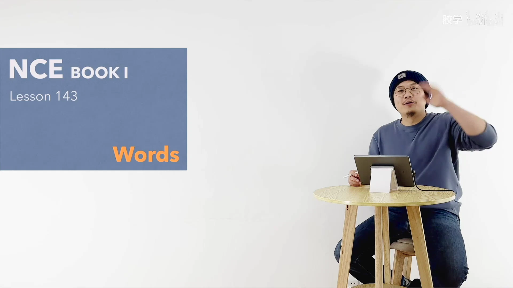

文字识别：NCE / BOOKI / Lesson 143 / Words

### 画面 00:00:11

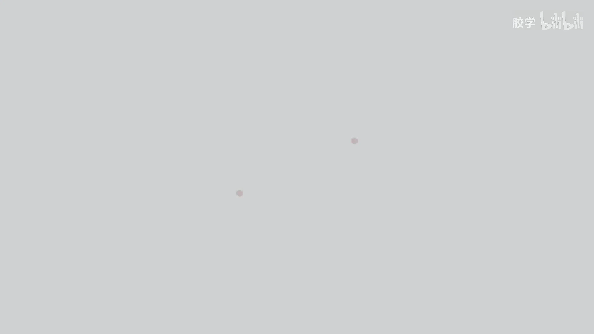

文字识别：胶学b出

### 画面 00:00:15

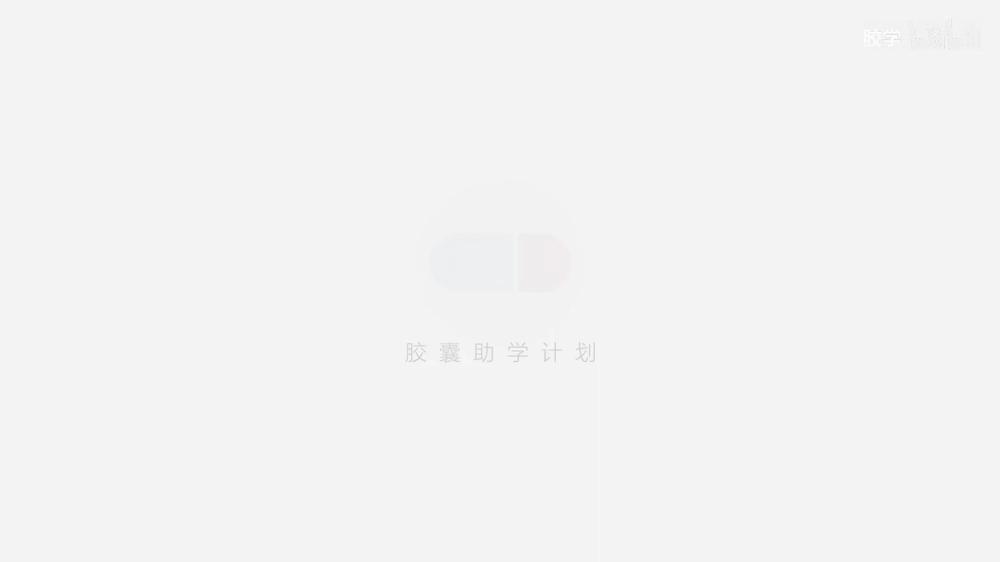

文字识别：胶学渊 / 胶囊助学计划

### 画面 00:00:17

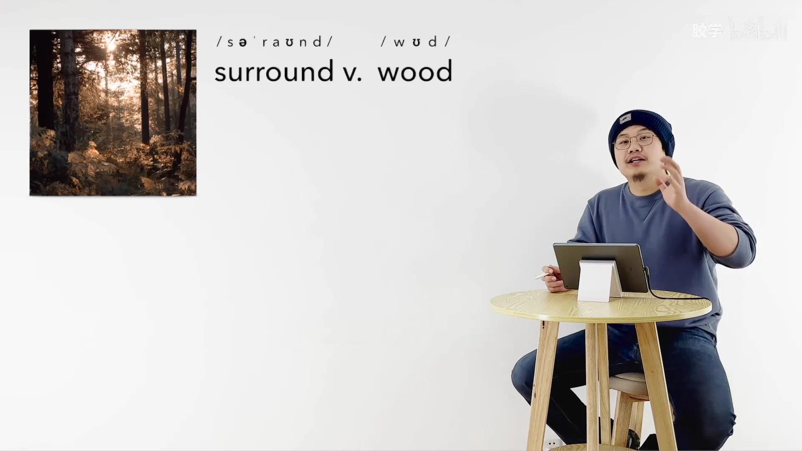

文字识别：学 / /sａ'raund / / / w u d / / surround v. wood

### 画面 00:00:27

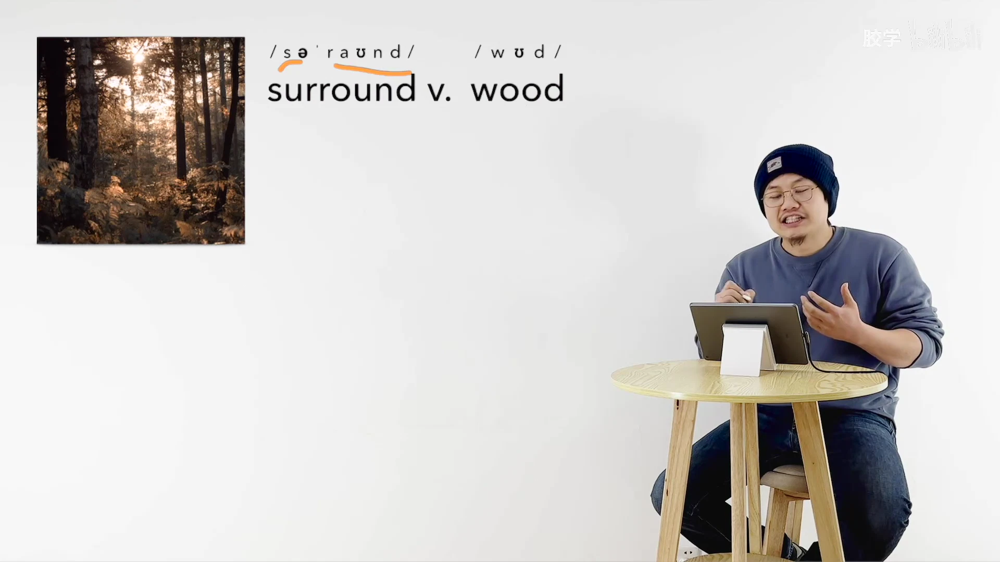

文字识别：胶字 / /sa'raund / / /w u d / / surround v. wood

## 00:00:30–00:01:00

surround. 最基本的意思，首先我们看它的词性是个动词，对吧？然后呢，那它的含义，注意，指的是被什么什么包围啊？应该是主动啊，叫做包围，对吧？只不过呢，它经常用在一个被动语态之下，叫 be surrounded by a, be surrounded by b. 它的意思叫做，如果这是a的话，那叫做a被b包围了。OK，好，那下一个单词呢，跟我一起读一下，叫做

### 画面 00:00:46

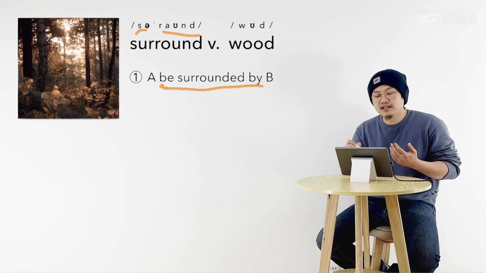

文字识别：胶学 / /sa'raund / / / w u d / / surround v. wood / ① A be surrounded by B

## 00:01:00–00:01:30

wood wood 啊，我们管它其实它最基本的意思指的是木头啊。那如果你把它变复数呢，它就有一个含义表示的是，比如说一片小树林，一片小森林。OK，所以比如说我们造一个句子叫做 My house was surrounded by beautiful woods, but they were cut down last month. 那说我的房子 be surrounded by beautiful woods，但是呢，它们叫做 were cut down。你看，连续两个被

### 画面 00:01:12

文字识别：/sa'raun d / / / w u d / / surround v. wood / ① A be surrounded by B /  My house was surrounded by / beautiful woods, but they were / cut down last month.

### 画面 00:01:14

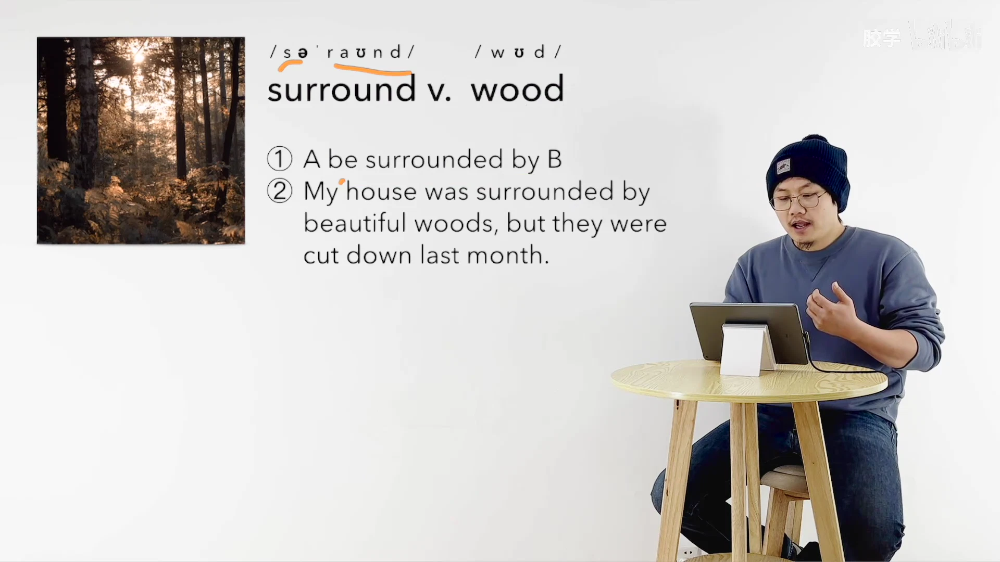

文字识别：/s a'raun d / / / w u d / / surround v. wood / ① A be surrounded by B /  My house was surrounded by / beautiful woods, but they were / cut down last month.

### 画面 00:01:23

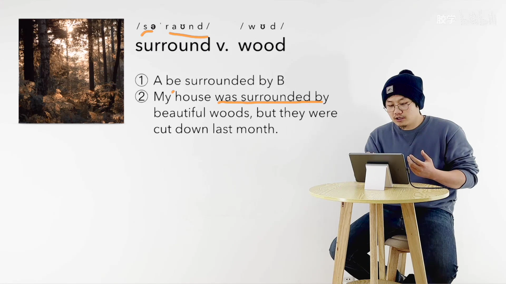

文字识别：/s a'raun d / / / w u d / / surround v. wood / ① A be surrounded by B /  My house was surrounded by / beautiful woods, but they were / cut down last month.

### 画面 00:01:25

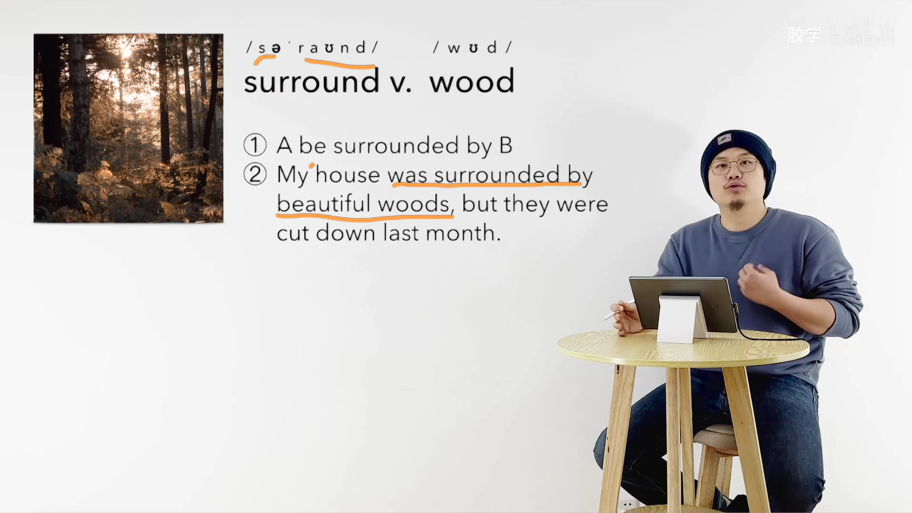

文字识别：/s a'raun d / / / w u d / / surround v. wood / ① A be surrounded by B /  My house was surrounded by / beautiful woods, but they were / cut down last month.

## 00:01:30–00:02:00

动，对吧？这是我们上一节课一百四十一课刚学过的。Next one，我们还可以说叫做 He was surrounded by people，说他被人们包围着。什么样的人呢？叫做 Who he didn't know at all，对吧？他完全就不认识这些人。一个定语从句，两个单词，第一个叫做 Surround，啊，接下来下一个单词叫做 Would，OK。Next one，两个

### 画面 00:01:30

文字识别：/sa'raun d / / / w u d / / surround v. wood / ① A be surrounded by B / My house was surrounded by / beautiful woods, but they were / cut down last month.

### 画面 00:01:53

文字识别：胶学 bit出 / 刘羽Leo老师个人账号 / B站搜：刘羽Leo / 公众号搜：刘羽Leo（账号：liuyuleo42) / 或扫如下二维码关注账号，获取如下内容 / 1.原价2499元，现免费雅思托福课 / 2.直播（及回放）答疑解惑 / 3. 英语学习方法论+教育文章合集 / 4.内部读书会（英文原著）积极心理学，批判性思维，冥想等 / 5.学英语看世界系列 / 6.新概念英语·伴读 (暂定：答疑解惑+判作业+直播语法/发音/口语练习) / 7.英语老师师资培训 / 8.更多免费课程与知识分享...

### 画面 00:01:58

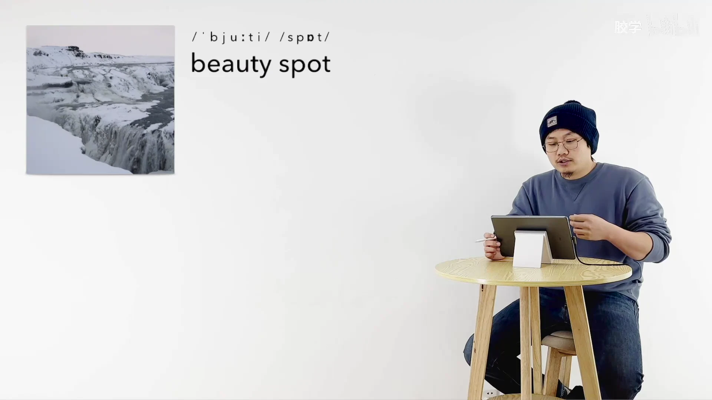

文字识别：胶学 / /bjuiti/ /sppt/ / beauty spot

## 00:02:00–00:02:30

单词我们放到一起变成了，其实类似于一个小的名词，叫做 beauty spot. Beauty其实就是美，就是 beautiful，对吧？Beauty啊，beautiful.好，然后 spot 就是小点儿的意思，对吧？Beauty spot. Okay,那 beauty spot 在这儿就可以理解为是风景，风景区或者风景点，对吧？Okay,那类似于一个名词，比如说我们就可以看图说，那 this is a beauty spot. Okay, very good.那也可以怎么说呢？说 the beauty spot which

### 画面 00:02:26

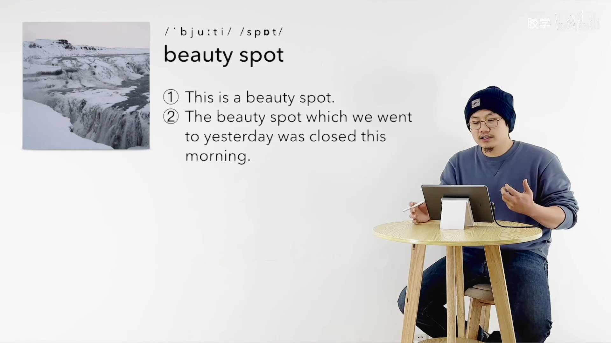

文字识别：胶学 / /'bjuiti/ /sppt/ / beauty spot / ① This is a beauty spot. / The beauty spot which we went / to yesterday was closed this / morning.

## 00:02:30–00:03:00

we went to yesterday,一个定语从句，叫我们昨天去的那个风景区呢，was closed this morning.今天早晨被关掉了。Okay, next one,我们来一个after a逗号b的句型啊，其实就是复习一下我们整本书的一些比较重要的语法了。我们可以这样理解，叫after they had left the beauty spa, they went to dinner.他们离开这个风景点了之后，他们去吃晚饭了。Very good. Next one,跟我读，叫through,

### 画面 00:02:31

文字识别：/'bjuiti/ /sppt/ / beauty spot / D This is a beauty spot. / 1 / The beauty spot which we went / to yesterday was closed this / morning.

### 画面 00:02:40

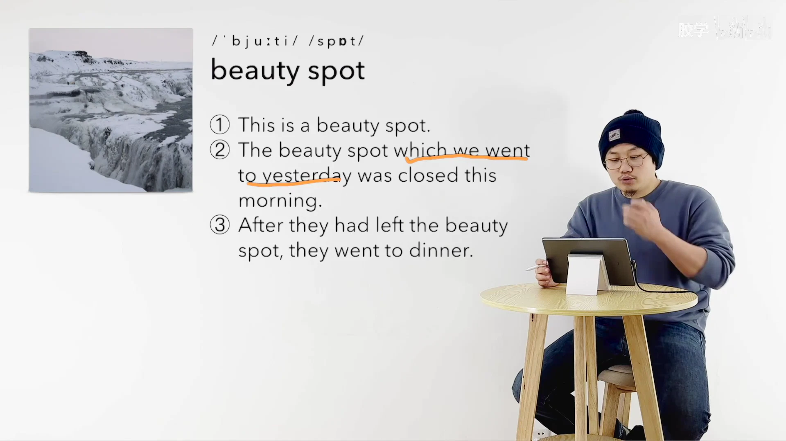

文字识别：/bjuiti/ /sppt/ / beauty spot / ① This is a beauty spot. / The beauty spot which we went / to yesterday was closed this / morning. / ③ After they had left the beauty / spot, they went to dinner.

### 画面 00:02:56

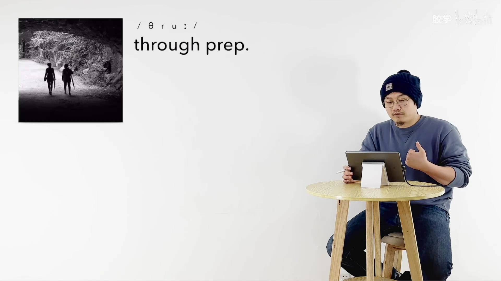

文字识别：胶学 / 1 θr u:/ / through prep.

## 00:03:00–00:03:30

through, okay,叫做穿过啊，一般指的是在内部穿过。对，比如说，我们可以说叫 walked through the woods啊，从这个树林的内部穿过，或者 walked through the park，对吧？那也叫做从这个公园的内部穿过。我们造句子说，After they had walked through the park, they went shopping.他们穿过这片公园之后去购物了。Okay, next one.说The man

### 画面 00:03:18

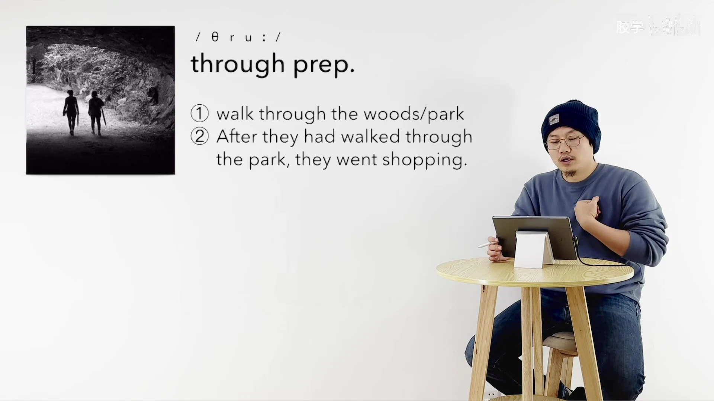

文字识别：1 θ r u : / / through prep. / walk through the woods/park / After they had walked through / the park, they went shopping.

### 画面 00:03:28

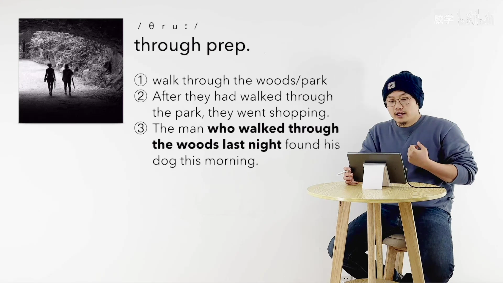

文字识别：/ θ r u ： 1 / through prep. / walk through the woods/park / After they had walked through / the park, they went shopping. / The man who walked through / the woods last night found his / dog this morning.

## 00:03:30–00:04:00

who walked through the woods last night found his dog this morning.说昨天晚上穿过这个树林的这个男人怎么样了呢？今天早晨找到了他自己的狗。OK，一个定语从句。Very good. Next one，下一个单词我们新二当中还会再见到，叫做visitor。OK，连起来visitor，visitor。OK，very good. Visitor, very good.那它一般指的是来访者，

### 画面 00:03:46

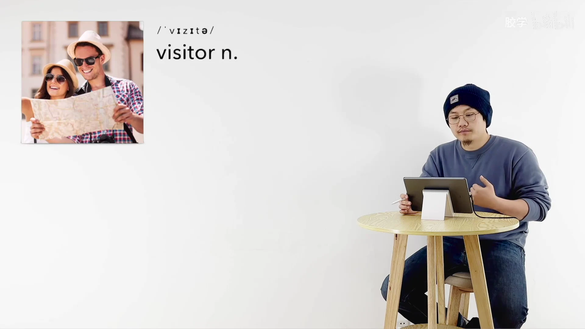

文字识别：/'vizita/ / visitor n.

## 00:04:00–00:04:30

是吧？来访者，那根据不同的场景，visitor可以被换成不同的意思。比如说，如果你是去另一个城市旅游，那你对于那个城市来说，你就是visitor。这个时候的visitor特别像tourist，对吧？特别像旅游者。OK，比如说我们说，the visitors who got on the train last night arrived in Beijing。啊，说昨天哎，在火上了火车的这几个旅游的人，我们可以这

### 画面 00:04:16

文字识别：/'vizItal / visitor n.

### 画面 00:04:18

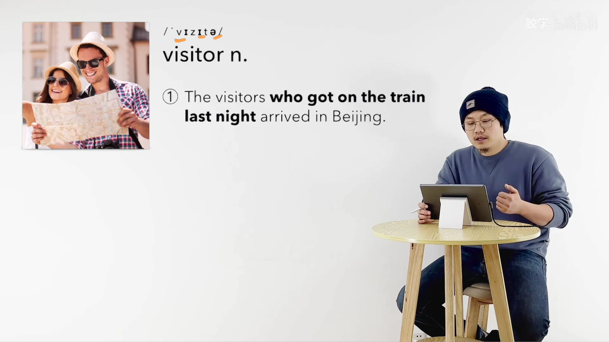

文字识别：/'vizItal / visitor n. / The visitors who got on the train / last night arrived in Beijing.

## 00:04:30–00:05:00

样说，对吧？今天到达了啊，已经到达了北京。Very good。定语从句还可以说，They met the visitors at the station five days ago，是吧？五天前他们在车站遇到了这个 visitor。Very good。那肯定句给您了，各种句型，这各位可以当做一个小的家庭作业了啊。OK， next one，下一个单词，其实我们早在很久之前就见过这个单词，我们之前学的叫做 untidy，

### 画面 00:04:45

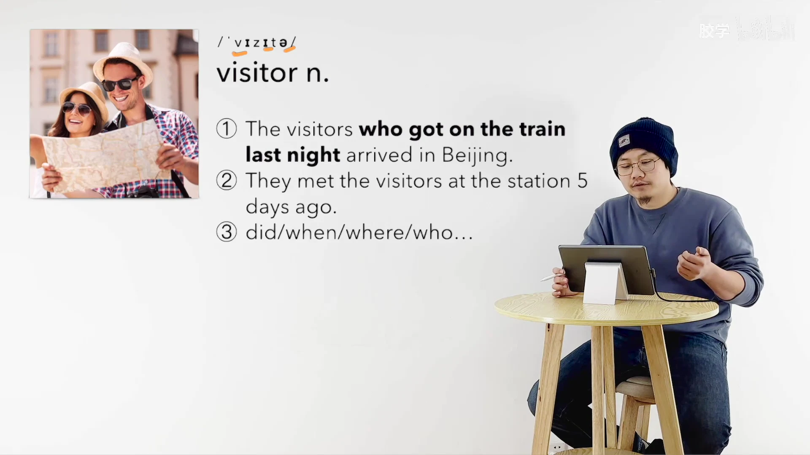

文字识别：/'vizItal / visitor n. / ) The visitors who got on the train / last night arrived in Beijing. / They met the visitors at the station 5 / days ago. / did/when/where/who...

### 画面 00:04:52

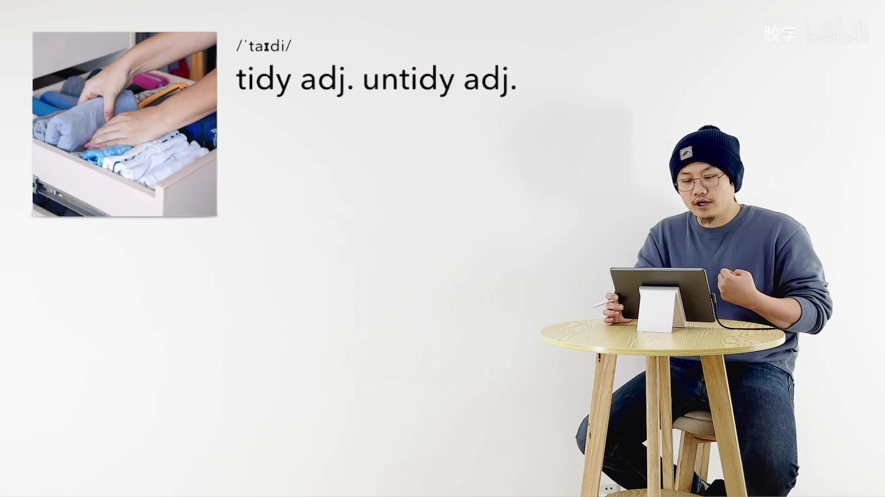

文字识别：/'taidi/ / tidy adj. untidy adj.

## 00:05:00–00:05:30

对吧？那还有学员问我说，能不能去讲一些词法？这些其实呃，包括句法是吧？我们都融到新概念新一、新二的所有课程当中去了。比如说这儿，我们就可以讲一个小的词法，就是英文也有类似于我们汉语的偏旁部首的东西，对吧？但还稍有不同。比如说 u n 这两个字母放在很多单词，尤其是形容词开头的时候，它表示一个否定。比如说 untidy，我们当年学的叫做

### 画面 00:05:13

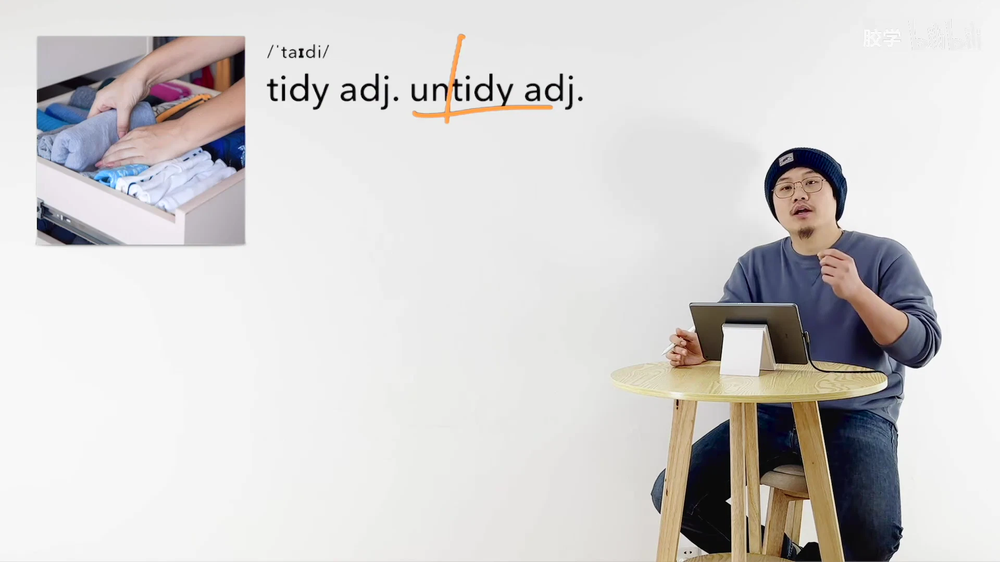

文字识别：胶学 / /'taidi/ / tidy adj. untidy adj.

## 00:05:30–00:06:00

不整洁的、不干净的。那tidy，既然un表否定，那你就明白tidy表示的是干净、整洁的形容词没变，对吧？好，那我们常见的一个小的短语叫keep the room tidy，叫做保持房间的干净和整洁。我们造一个句子叫做She keeps her room very tidy.啊，她保持她的房间非常的干净整洁。Next one，一般疑问句、特殊疑问句，您就可

### 画面 00:05:43

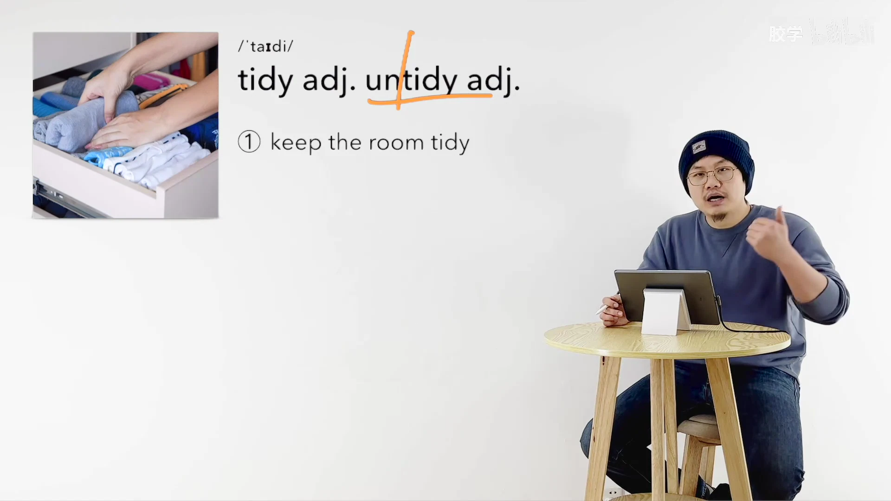

文字识别：/'tardi/ / tidy adj. untidy adj. / ① keep the room tidy

### 画面 00:05:57

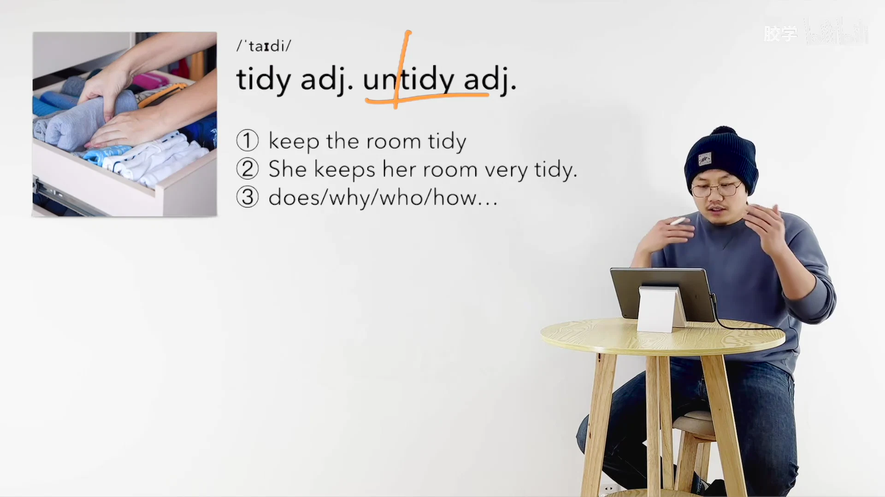

文字识别：/'taidi/ / tidy adj. untidy adj. / ① keep the room tidy / ② She keeps her room very tidy. / ③ does/why/who/how...

## 00:06:00–00:06:30

以问了。比如说，How does she keep her room very tidy? 她是如何做到的呢？我们可以说，哎，她每天做了什么样的事情，对吧？Very good. Next one，下一个单词跟我一起读一下，叫做 litter，litter，啊，其实就是垃圾乱扔的这些垃圾叫做 litter。那常见的，比如说垃圾箱，我们就可以管它叫 litter basket. OK, very good.比如说，the litter basket which I bought yesterday was

### 画面 00:06:09

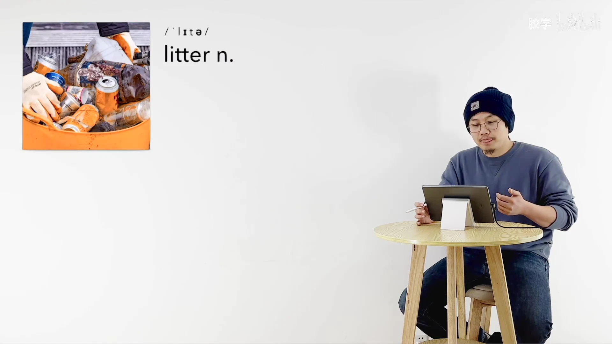

文字识别：/'lita/ / litter n.

### 画面 00:06:24

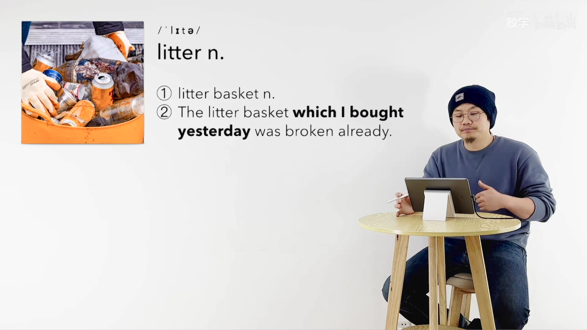

文字识别：/'lita/ / litter n. / litter basket n. / The litter basket which I bought / yesterday was broken already.

## 00:06:30–00:07:00

broken already. 啊，说昨天我买的那个垃圾箱了，今天早晨已经被弄坏了。OK，已经被弄坏了。OK，玩一个定语从句。那各位可以去想一下，这里面的 which 能不能省略呢？根据的是什么原则呢？我不停的在各位拿这个知识点啊，勾着各位去回想之前我们一百二十一课、一百二十三课学过的语法。OK，Next one,说They are washing the litter basket.你看这句话对于各位现在来说应该挺简单了，

### 画面 00:06:42

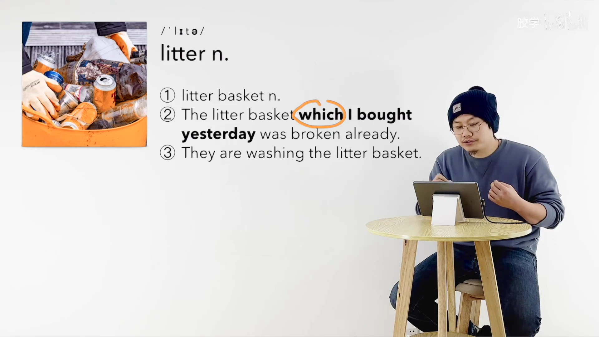

文字识别：/'lita/ / litter n. / litter basket n. / The litter basket which I bought / yesterday was broken already. / They are washing the litter basket.

## 00:07:00–00:07:30

了，对吧？早在三十一课咱们就学过了。现在新一都该学完了。Next one说，the litter basket is cleaned regularly. A说这个垃圾箱啊，是吧？叫做经常的、有规律性的会被打扫。OK，B站一百四十一课咱们刚学过的，注意一下这个地方，好吧？好，下一个单词跟我一起读，叫做place. Place啊，place其实有一个名词的意

### 画面 00:07:11

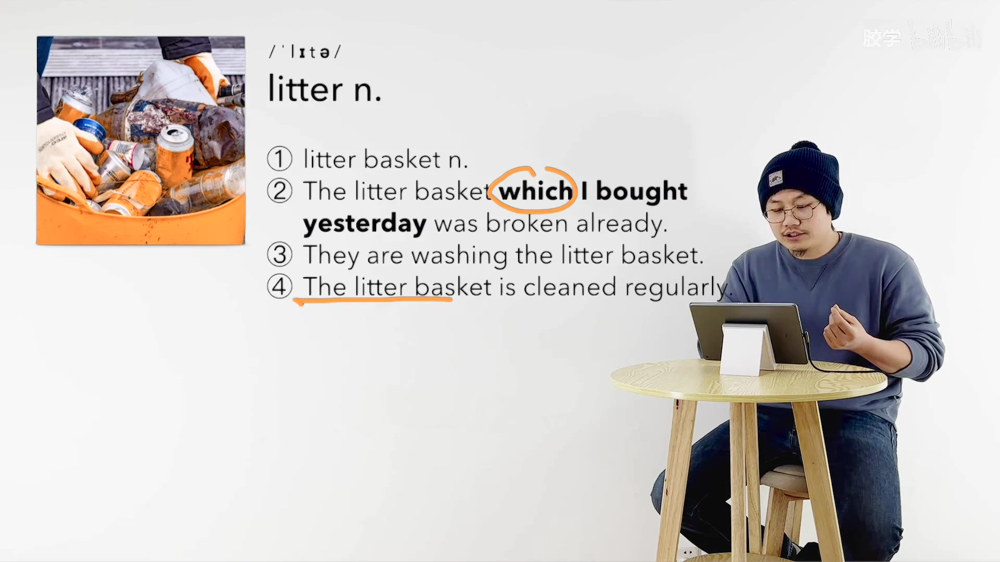

文字识别：/'lita/ / litter n. / litter basket n. / The litter basket whichI bought / yesterday was broken already. / They are washing the litter basket. / The litter basket is cleaned regularly

### 画面 00:07:20

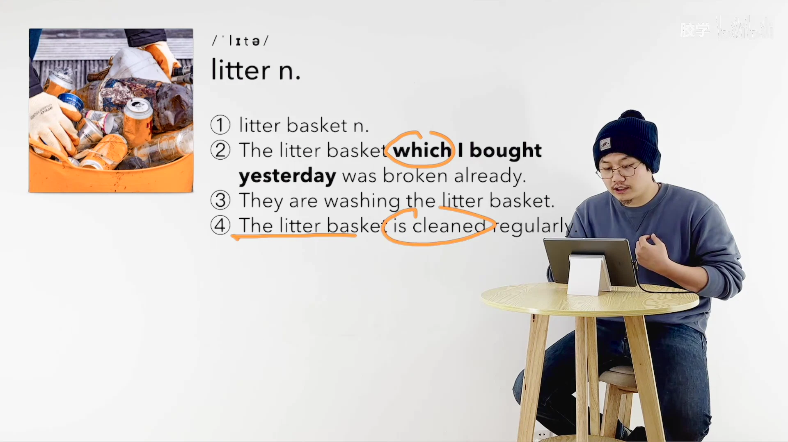

文字识别：/'lita/ / litter n. / litter basket n. / The litter basket which I bought / broken already. / yesterday was k / They are washing the litter basket. / The litter baske is cleaned regularly

### 画面 00:07:22

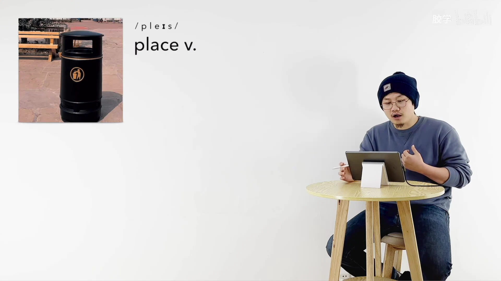

文字识别：胶学 / /pleis/ / place v.

## 00:07:30–00:08:00

思，也挺常用的，叫做放置。好，那在这个地方它是一个动词，叫把什么什么放到什么什么地方。比如说，说litter basket，说垃圾箱啊，was placed on the street last night。昨天晚上，哎，垃圾箱被放到了马路上。一百四十一课刚学的被动，对不对？新概念二册第十课，咱们还会继续复习。Next one，我们说the visitor placed the coffee table on their啊，coffee

### 画面 00:07:41

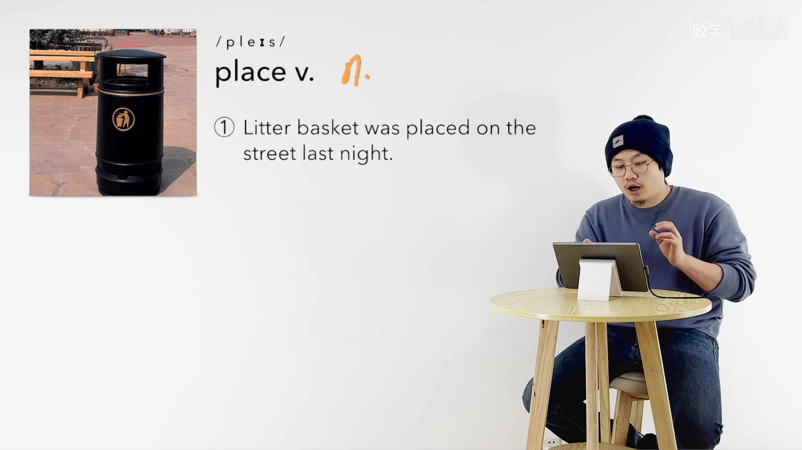

文字识别：/pleis/ / place v. / ① Litter basket was placed on the / street last night.

## 00:08:00–00:08:30

cup on their table. They put this coffee cup on their table. OK, that place. OK

### 画面 00:08:02

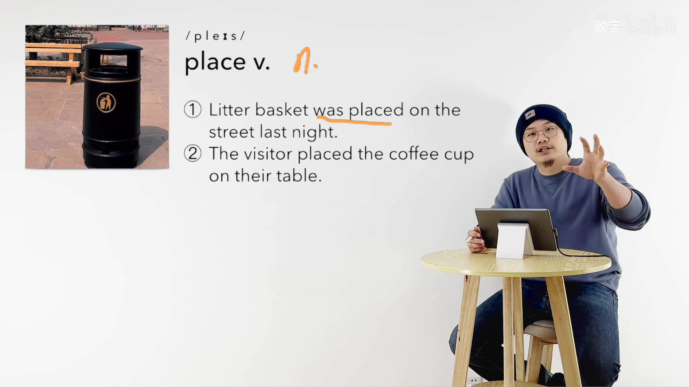

文字识别：胶学 / /pleis/ / place v. / ① Litter basket was placed on the / street last night. / The visitor placed the coffee cup / on their table.

### 画面 00:08:12

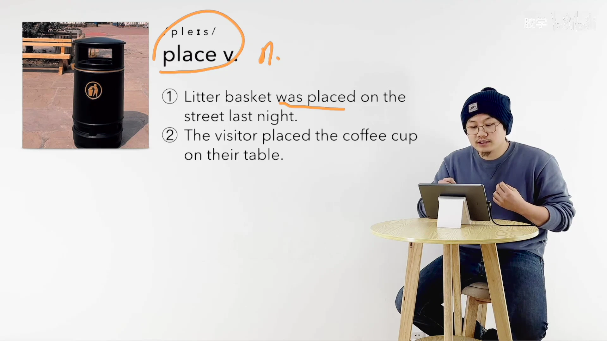

文字识别：胶学 / pleIs/ / place v. / ① Litter basket was placed on the / street last night. / The visitor placed the coffee cup / on their table.

### 画面 00:08:16

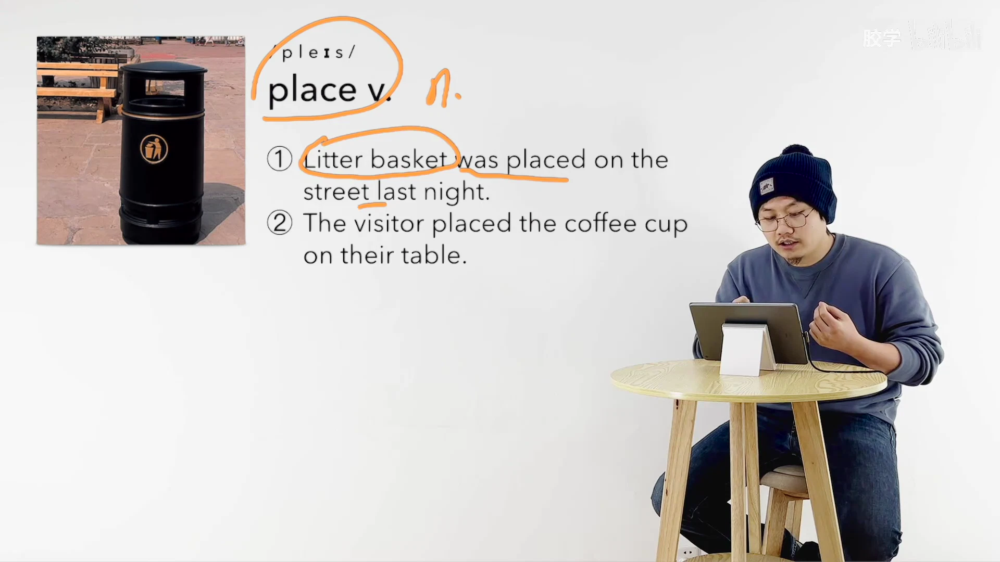

文字识别：pleIs/ / place v. / Litter basket was placed on the / street last night. / The visitor placed the coffee cup / on their table.

### 画面 00:08:24

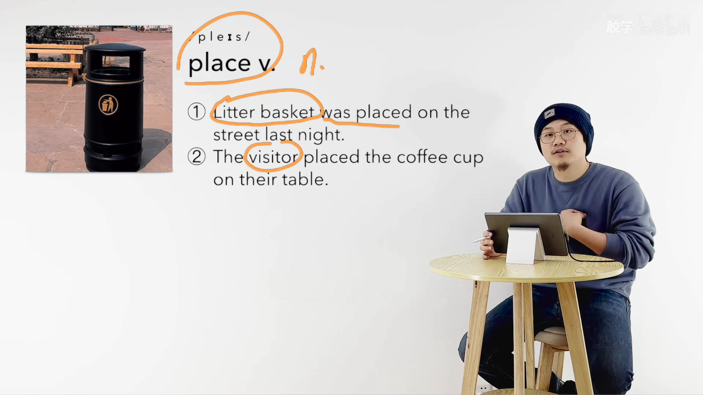

文字识别：pleIs/ / place v. / Litter basket was placed on the / street last night. / Thevisitorplaced the coffee cup / on their table.

### 画面 00:08:26

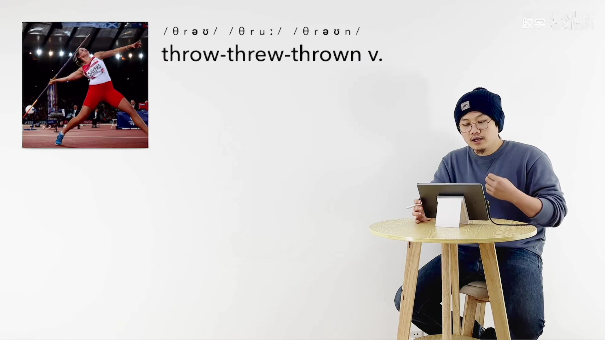

文字识别：/θrau/ /θru：/ /θraun/ / throw-threw-thrown v.

## 00:08:30–00:09:00

下，叫做原形 throw, throw，哎，过去式 threw，过去分词 thrown，OK，very good。那注意它是一个动词，对吧？然后呢，我们造一个句子，叫做 that visitor has just thrown his coffee cup on the street，或者是 in the woods，对吧？你看，现在完成时，他刚刚扔了这个咖啡在街上，或者说在森林里。

### 画面 00:08:37

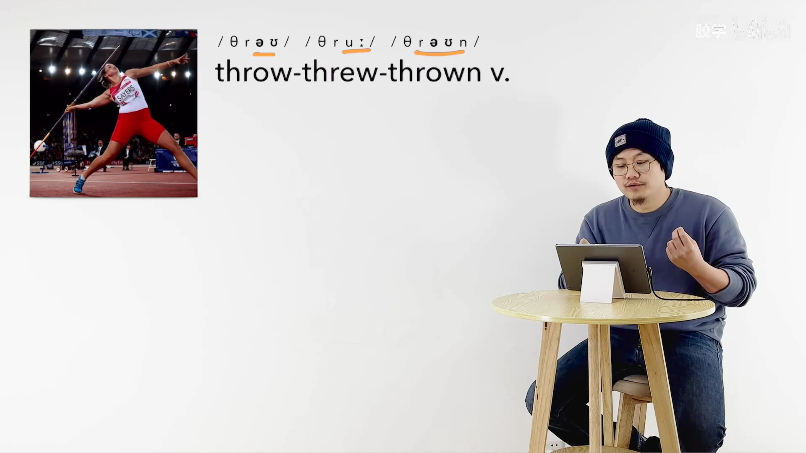

文字识别：/θrau/ /θru:/ /θraun/ / throw-threw-thrown v.

### 画面 00:08:42

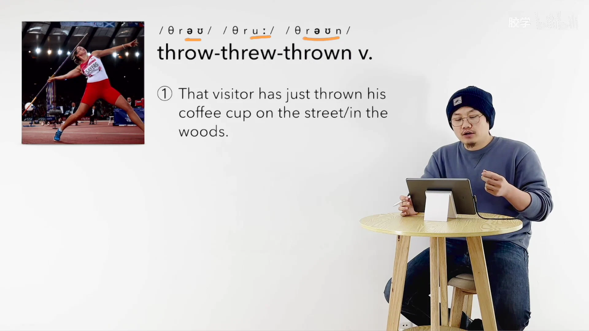

文字识别：/θrau/ /θru:/ /θraun/ / throw-threw-thrown v. / D That visitor has just thrown his / 1 / coffee cup on the street/in the / woods.

### 画面 00:08:55

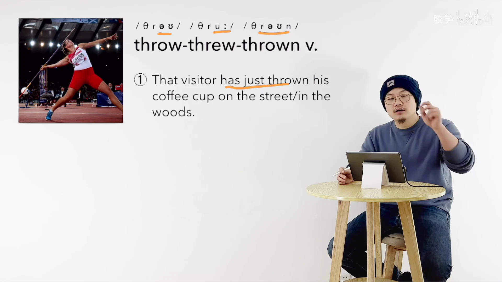

文字识别：/θrau/ /θru:/ /θraun/ / throw-threw-thrown v. / ) That visitor has just thrown his / coffee cup on the street/in the / woods.

## 00:09:00–00:09:30

Okay, very good. Next one,说the man who threw his money on the street was very excited.说把钱扔到街上的那个男人啊，当时特别的激动。这个激动可以指的好，可以指的坏。Okay, very good.好，再看一下这三个单词，throw, threw, thrown. Okay, very good. Next one，下一个单词，跟我一起读一下，垃圾的意思，对吧？叫做rubbish,

### 画面 00:09:01

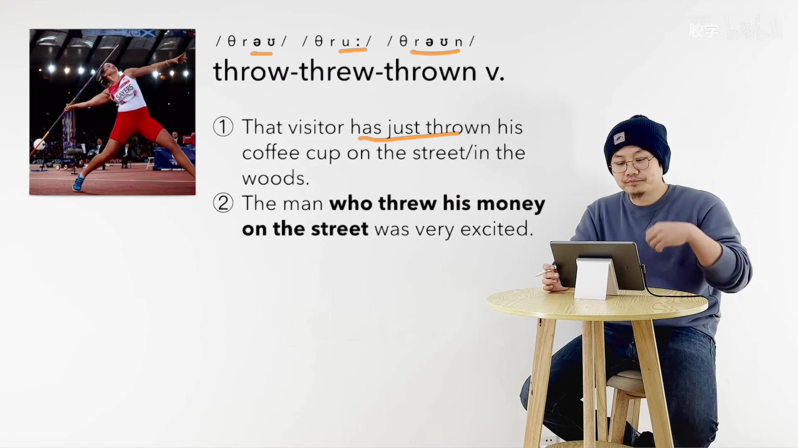

文字识别：/θrau/ /θru:/ /θraun/ / throw-threw-thrown v. / D That visitor has just thrown his / coffee cup on the street/in the / woods. / The man who threw his money / on the street was very excited.

### 画面 00:09:24

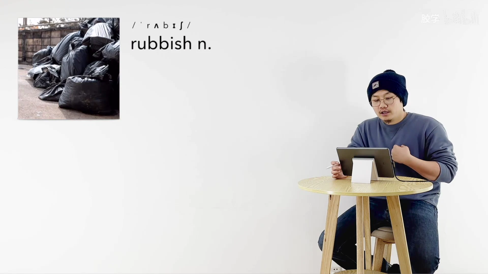

文字识别：胶学 / /'rΛ bI ∫ 1 / rubbish n.

## 00:09:30–00:10:00

rubbish. Okay. 那我们造句就行了。叫做 they had to clean the woods. 说他们当时不得不打扫这个这片小树林，because they threw the rubbish everywhere. 因为啊，他们在这玩的时候把垃圾扔到了四处，对不对？然后连起来说，after they had thrown the rubbish everywhere, they ran away. 那就是另一波人说，在他们扔完这些垃圾，四处扔垃圾

### 画面 00:09:31

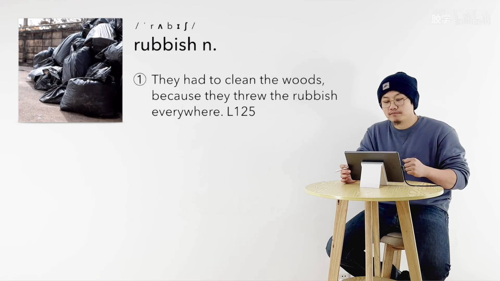

文字识别：/ _r Λ bⅠ ∫ 1 / rubbish n. / ① They had to clean the woods, / because they threw the rubbish / everywhere. L125

### 画面 00:09:48

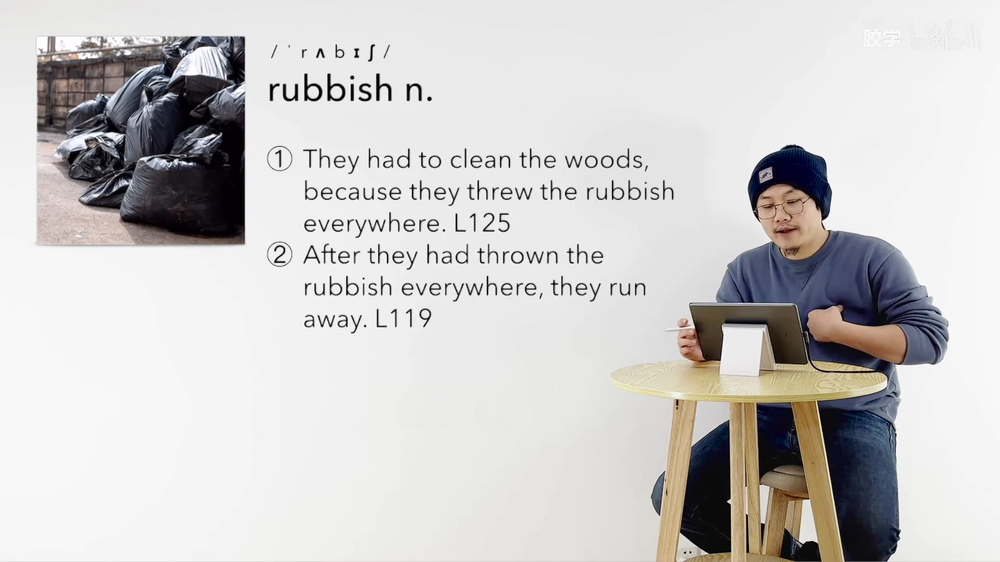

文字识别：交学口 / / rΛ bⅠ ∫ / / rubbish n. / ① They had to clean the woods, / because they threw the rubbish / everywhere. L125 / After they had thrown the / rubbish everywhere, they run / away. L119

## 00:10:00–00:10:30

之后呢，他们跑掉了，ran away. Okay, 119克，139克呢？那警察来调查说，The police wants to know if you threw the rubbish everywhere. 您看我在这造rubbish的时候还是带着through，对吧？好，所以这三句话其实想提醒各位的一个，我们新一学完了之后应该有一些小的单词造句的呃思路了，对不对？好，这地方提的思路是一致的，就是

### 画面 00:10:04

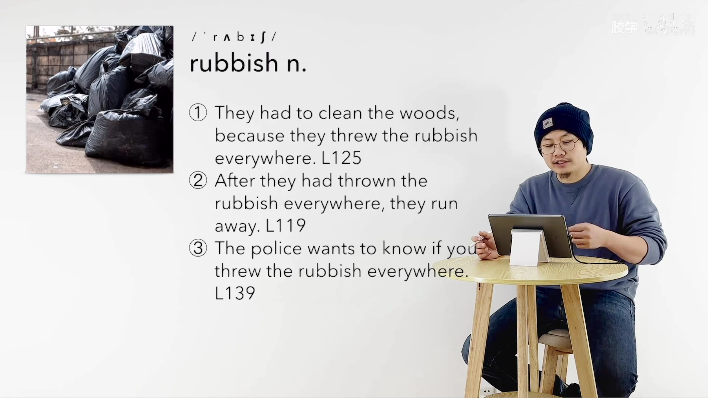

文字识别：/ r Λ bI ∫ 1 / rubbish n. / ① They had to clean the woods, / because they threw the rubbish / everywhere. L125 / After they had thrown the / rubbish everywhere, they run / away. L119 / The police wants to know if you / threw the rubbish everywhere. / L139

### 画面 00:10:17

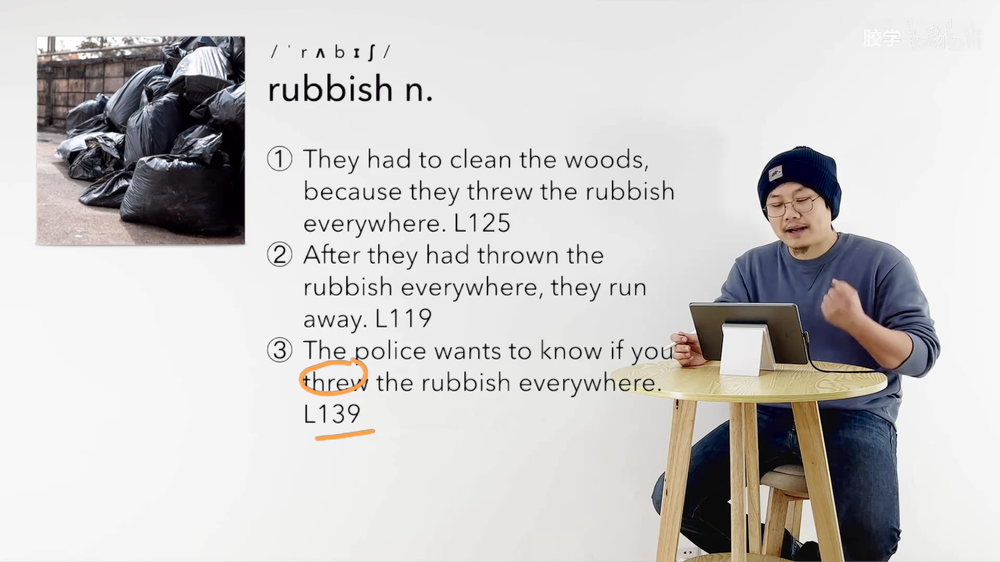

文字识别：饺学 / /rΛbI ∫ 1 / rubbish n. / ① They had to clean the woods, / because they threw the rubbish / everywhere. L125 / After they had thrown the / rubbish everywhere, they run / away. L119 / The police wants to know if you / 3 / threv the rubbish everywhere. / L139

### 画面 00:10:29

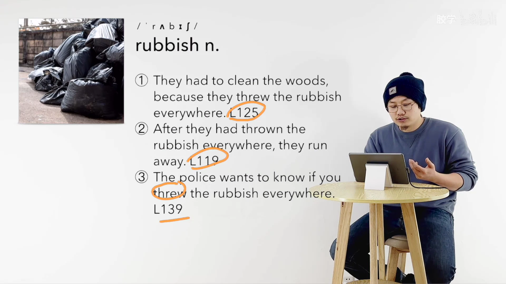

文字识别：校学 / / 'r ΛbI∫ 1 / rubbish n. / ① They had to clean the woods, / because they threw the rubbish / everywhere.L125 / After they had thrown the / rubbish everywhere, they run / away.L110 / The police wants to know if you / threvthe rubbish everywhere. / L139

## 00:10:30–00:11:00

您结合之前学过的一些语法，顺带着复习之前学的语法，对吧？语法这个东西学了之后，怎么才能不忘？就一个字儿叫做“用”啊，而不是反复学。各位注意啊，所以您在接下来造单词的时候用它就好了。好，next one，下一个单词跟我一起读，叫做“count”。count，OK，very good，叫做数，对吧？一二三四五。比如说原文给了一句话叫“I counted seven cars”，我数到了七辆

### 画面 00:10:47

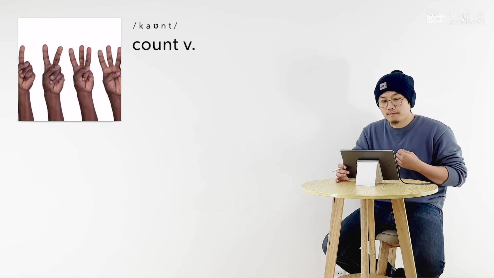

文字识别：胶学 / /kaunt/ / count v.

## 00:11:00–00:11:30

cars. Okay, that you turn it into a general question. Here, I want to focus on a word called how many. When used alone, it must be followed by the word cars. So its special question is how many cars did you count? Okay, very good. The next word is also a word that will keep appearing in New Two. Let's read it together. It means cover, cover, which means covering. It is similar to surrounded. It often appears in such a passive structure. It is called a b

### 画面 00:11:03

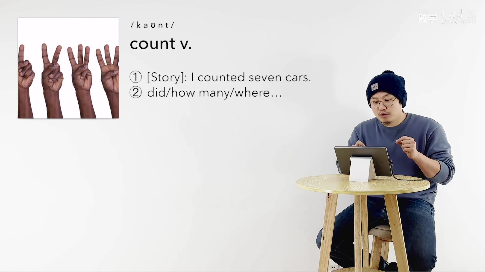

文字识别：/kaunt/ / count v. / ① [Story]: I counted seven cars. / did/how many/where...

### 画面 00:11:05

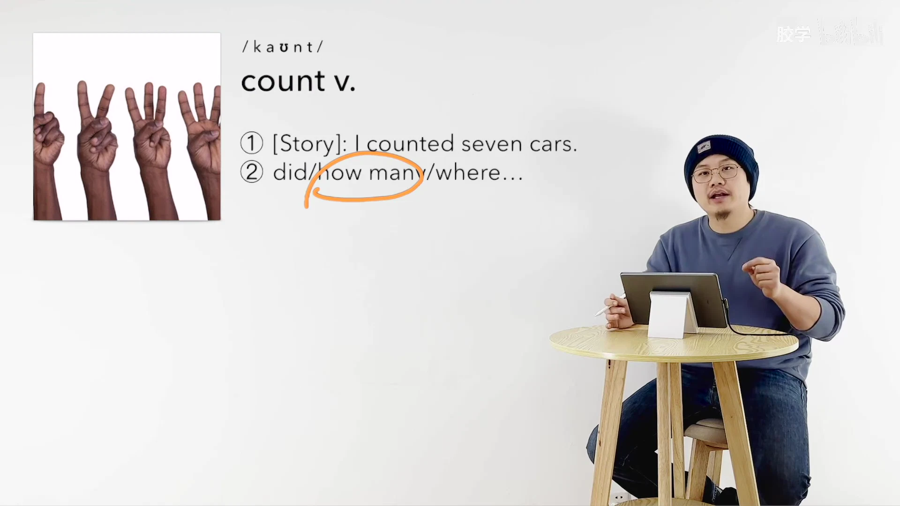

文字识别：/kaunt/ / count v. / ① [Story]: I counted seven cars. / did/how many/where...

### 画面 00:11:16

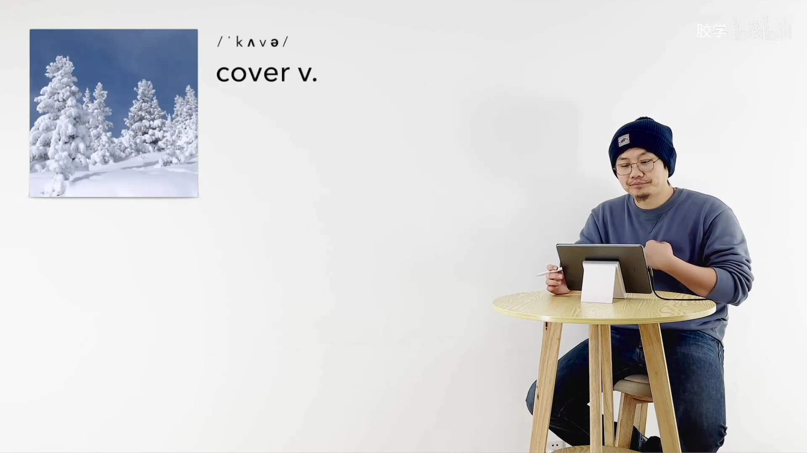

文字识别：胶学 / /'knval / cover v.

## 00:11:30–00:12:00

动结构当中，叫做 A B surrounded by B，对吧？叫做 A 呀被 B 所覆盖着。比如说 It snowed last night，哎，特别应景，北京正好昨天真的下雪了，对吧？说昨天下雪了，and the street was covered with snow this morning，说这个街呀被雪所覆盖着，今天早晨啊，A be covered with B， OK，玩儿一个。Next one，说 The woods are covered with rubbish

### 画面 00:11:30

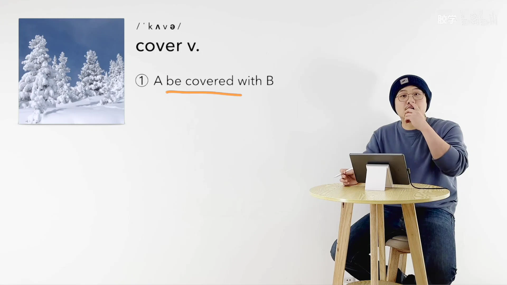

文字识别：胶学 / / 'knva/ / cover v. / ① A be covered with B

### 画面 00:11:37

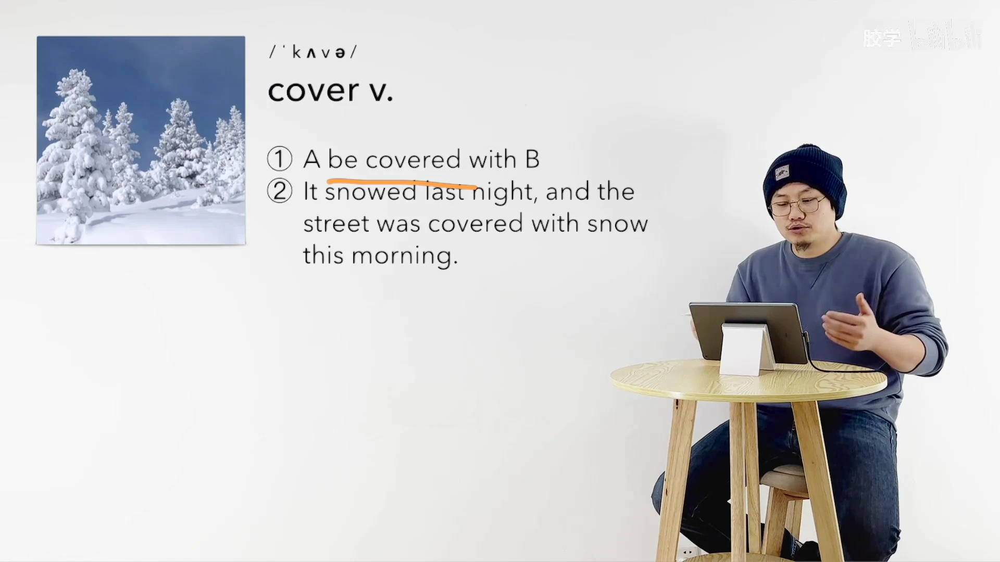

文字识别：胶学 / / 'kΛva/ / cover v. / ① A be covered with B /  It snowed lastnight, and the / street was covered with snow / this morning.

## 00:12:00–00:12:30

now.说这个森林呢现在被垃圾所覆盖的。Are you good? Next one,下一个单词，我们一起读，叫做 tire tire啊。那我们管它叫做什么意思？看图就能知道了，对吧？汽车的轮胎。说 these tires were bought by my father. 注意这是一百四十一课刚学的被动，对吧？一般过去时的被动 was were 加 that，叫被我父亲买的。Next one,说 this is the tire

### 画面 00:12:05

文字识别：胶学 / /taia/ / tyre n.

### 画面 00:12:27

文字识别：胶字 / /taia/ / tyre n. /  These tyres were bought by my father. / This is the tyre that I told you about.

## 00:12:30–00:13:00

tire that I told you about. 定语从句，不多说了啊，这就是我跟你讲过的那个轮胎。 Next one, 说 This is the most expensive tire I've ever bought. 说这是我买过最贵的一个轮胎了。 Again, 下一个单词形容词，跟我一起读一下，叫做 rusty, rusty. OK, 指的是上锈的。注意它是个形容词，那它往往可能就要跟名词连起来。很简单，来一个 there be 句型，叫

### 画面 00:12:45

文字识别：胶学一 / /'rasti/ / rusty adj.

### 画面 00:12:48

文字识别：胶学 / /'rasti/ / rusty adj.

### 画面 00:12:51

文字识别：胶字 / /'rasti/ / rusty adj.

### 画面 00:12:56

文字识别：/'rasti/ / rusty adj. / ① There are rusty tins everywhere / in the woods.

## 00:13:00–00:13:30

there are rusty tins everywhere in the woods。啊，说在这个树林里四处都是生锈了的罐子。玩一个 next one，说 she wants to know if you have a rusty tin。啊， wants to know，然后注意 if 指的是是否，后面其实是 do you have a rusty tin 的一个一般疑问句的变体，变成陈述句，对吧？这是一百三十九课咱学的那个关键语法哦，宾语从句，对吧？

### 画面 00:13:01

文字识别：/'rasti/ / rusty adj. / ① There are rusty tins everywhere / in the woods.

### 画面 00:13:06

文字识别：/'rasti/ / rusty adj. / ① There are rusty tins everywhere / in the woods.

### 画面 00:13:11

文字识别：/'rasti/ / rusty adj. / ① There are rusty tins everywhere / in the woods. / She wants to know if you have a / rusty tin. L139

### 画面 00:13:16

文字识别：/'rasti/ / rusty adj. / ① There are rusty tins everywhere / in the woods. / She wants to know if you have a / rusty tin. L139

### 画面 00:13:18

文字识别：/'rasti/ / rusty adj. / ① There are rusty tins everywhere / in the woods. / She wants to knowif you have a / rusty tin. L139

### 画面 00:13:21

文字识别：胶学 / /'rasti/ / rusty adj. / ① There are rusty tins everywhere / in the woods. / She wants to knowif you have a / rusty tin. L139

### 画面 00:13:26

文字识别：/'rasti/ / rusty adj. / ① There are rusty tins everywhere / in the woods. / She wants to know ify / you have a / rusty tin. L139

## 00:13:30–00:14:00

Next one说，the rusty tin was thrown away last night.昨天晚上被扔掉了，对不对？好，这是一个被动。OK. Next one，下一个单词，跟我一起读一下，叫做among. among注意，这是一个接下来经常出现的单词，频率特别的高啊。一个小的介词，叫在什么什么的之间啊，在什么什么之间。Between一般指的是在两者的中间，比如

### 画面 00:13:31

文字识别：/'rasti/ / rusty adj. / ① There are rusty tins everywhere / in the woods. / She wants to knowif / you have a / rusty tin. L139 / The rusty tin was thrown away / last night.

### 画面 00:13:36

文字识别：/'rasti/ / rusty adj. / ① There are rusty tins everywhere / in the woods. / She wants to know / you have a / rusty tin. L139 / The rusty tin was thrown away / last night.

### 画面 00:13:39

文字识别：la'mΛn/ / among prep.

## 00:14:00–00:14:30

说我左右手中间有一个东西，对吧？叫做 between。那 among 呢，就是像这个图一样，在什么什么之间。 OK， very good。 Next one，比如说 I found the sign among the rubbish。说我在一堆垃圾的之间找到了这个标志，对吧？找到了这个标志。 Next one，那你肯定句出来了，各种句型又可以走了，对不对？像 among 这样的介词呢，其实我们坚持往下去学，您在非常多

### 画面 00:14:09

文字识别：/a'mΛn/ / among prep. / ① I found the sign among the rubbish.

## 00:14:30–00:15:00

地方，非常多的地方会不停的见到它，自然而然也就学会了。OK，关键是要记住它跟between刚才我说的小的区别，这也算是考试的一个小的考点。OK，Next one，我说I found my father among hundreds of people，说我发现了我的父亲在数以百计人之间，对吧？OK，Ready?最后一个单词我们不用拿它去造句了。这个单词其实稍微有点超纲，在原文当

### 画面 00:14:39

文字识别：/a'mΛn/ / among prep. / ① Ifound the sign among the rubbish. / did/where/when...

### 画面 00:14:53

文字识别：胶学 / /prpsikjuit/ / prosecute v.

## 00:15:00–00:15:30

中出现的形式呢，也是一带而过的。我们知道它的发音就行了，叫做 prosecute， prosecute 啊，叫做依法执行，对吧？OK，叫做 prosecute 啊。比如说你随口吐痰，然后别人根据什么什么这个这样一个条令，然后去罚了你五十块钱，这个就叫做 prosecute。OK， very good。那 recap，本文单词特别的多啊，对于各位来说，多花一点时间在这些单词上非常有用。

### 画面 00:15:20

文字识别：Recap / Patterns / Grammar / Words / Expression

### 画面 00:15:26

文字识别：Recap / Patterns / & / Grammar / Words / Expression

## 00:15:30–00:16:00

您别看它是新概念一册最后一课，对吧？那新二当中我们还会不停的用到这些单词嘛，也确实都是高频单词，所以各位呢还是站好最后一班岗，扎扎实实的把这些单词再去造句，好吧？家庭作业单词造句老习惯了，然后讲解一遍今天有的这些知识点，好吧？那如果各位喜欢我们的课程呢，欢迎各位关注、订阅、一键三连，分享给那些需要的朋友呢，来帮助我们快速成长。

### 画面 00:15:44

文字识别：胶学

### 画面 00:15:50

文字识别：胶学上物 / 👍

## 00:16:00–00:16:30

最后，我们再来看一句名人名言：Shoot for the moon, and if you miss, you will still be among the stars. See you next time. Hello, everyone. Welcome to Capsule Academy. This is Leo. Today we're going to learn New Concept English Book One,

### 画面 00:16:00

文字识别：胶学 / Shoot for the moon and if you miss you / will still beamong / the stars. / Les Brown

### 画面 00:16:11

### 画面 00:16:13

文字识别：CAPSULEACADEMY / 胶囊助学计划 / 小红书 / Lecturer / Leo / OE / 0

### 画面 00:16:16

文字识别：CAPSULEACADEMY / 胶囊助学计划 / 小红书 / □ / Editor / OE / 0

### 画面 00:16:19

文字识别：CAPSULEACADEMY / 胶囊助学计划 / 小红书 / Creator / □ / Leo & Berlin / OE

### 画面 00:16:21

文字识别：胶学 bilibili / 足街品 / 小红粥

### 画面 00:16:23

文字识别：Bilibli / 胶学

### 画面 00:16:25

文字识别：NCE / BOOKI / Lesson 143 / Grammar

## 00:16:30–00:17:00

One Lesson One Hundred and Forty Three Grammar. 那老习惯，进入正式课程之前呢，我们先看两个小的问题。第一，现在完成时的被动长成什么样子？第二，一般将来时的被动长成什么样子？带着这两个问题，后边 Enjoy。好，那在一百四十一课，实际上我们已经学过了一般现在时和一般过去时的被动，对

### 画面 00:16:34

文字识别：胶学

### 画面 00:16:36

文字识别：胶学 / 现在完成时被动?

### 画面 00:16:38

文字识别：胶学 / ①现在完成时被动？

### 画面 00:16:41

文字识别：胶学 / ①现在完成时被动？ / 被动？

### 画面 00:16:43

文字识别：①现在完成时被动？ / 一般将来时被动?

### 画面 00:16:48

文字识别：胶学 b出

### 画面 00:16:52

文字识别：L

### 画面 00:16:54

文字识别：学一 / 被动

## 00:17:00–00:17:30

吧？我们当时就提到了这个关键的东西，叫做 be 表时态，但表被动啊。我希望各位肯定是记得的，对不对？那我们接下来要学到的是两个新的时态的被动，我们尝试去理解一下，这回稍微有一点点难了啊。比如说现在完成时的被动，它的结构叫 have been done。我们尝试去给各位推啊，我给各位先说一下，我尝试去推，推到最后您还是没有完全理解的时候

### 画面 00:17:10

文字识别：被动 / 结构：be(表时态)+done (表被动) / 现在完成时被动：have been + done

## 00:17:30–00:18:00

怎么办呢？就把它硬硬的记下来，见到它就知道它是现在完成时的被动，这事儿就完事儿了，好吧？OK啊，毕竟它不是纯数学公式啊。OK，首先 have 加 been 为什么要有？因为各位回想一下，现在完成时的基本结构叫 have 加 but，对吧？然后呢，现这是现在完成时的主动啊，have 加 but，我们

### 画面 00:17:40

文字识别：胶学输 / 被动 / 结构：be(表时态)+done(表被动) / 现在完成时被动：have been + done

### 画面 00:17:50

文字识别：have / 胶学 / 被动 / 结构：be(表时态)+done (表被动) / 现在完成时被动：have been + done

## 00:18:00–00:18:30

说了be表示态，就是be这个单词表示态。您先别看后边的但，be这个单词表示态，那be的但是什么？have加但，是现在完成时。这里的但指的是所有动词的现在分词，对吧？OK，那be的现在分词是什么？就是been这个单词。所以have加been这两个单词看到的时候，你反映出来的应该叫做它是现在完成时，后边再加一个

### 画面 00:18:00

文字识别：have / done / 胶学洲 / 被动 / 结构：be(表时态)+done (表被动) / 现在完成时被动：have been +done

### 画面 00:18:05

文字识别：have / done / 胶学 / 被动 / 结构：be(表时态y+doye / (表被动) / 现在完成时被动：have been + done

### 画面 00:18:19

文字识别：have / done / 胶学 / 被动 / 结构：be(表时态y+doye / (表被动) / 现在完成时被动：have been + done

## 00:18:30–00:19:00

单词叫做但，这个但呢是但表被动的这个但，所以 have been 再加一个但，这个地方就是现在完成时的被动。我刚才这样讲，讲完您不懂，您说我一句没听懂，没事儿啊，听不听得懂其实并不影响你使用，你只要做到一件事情叫做看见 have been 再加一个但，明白它翻译成叫做已经被怎么怎么样了，这事儿就结束了，对吧？哎，这个破译的过程已经结束了。比如说像这句话，

### 画面 00:18:33

文字识别：haue / dome / 被动 / 结构： / (be(表时态)+dore(表被动) / 现在完成时被动： / : have / been + done

### 画面 00:18:42

文字识别：haue / done / 胶学 / 被动 / 结构：be(表时态y+doye / (表被动) / 现在完成时被动：have been + done

### 画面 00:18:44

文字识别：胶字 / 被动 / 结构：be(表时态)+done (表被动) / 现在完成时被动：have been + done

### 画面 00:18:50

文字识别：被动 / 结构：be(表时态)+done (表被动) / 现在完成时被动：have been + done / 100 trees have been planted by students.

## 00:19:00–00:19:30

你读说 one hundred one hundred trees have been planted by students。你读到这句话，你已经明白了，说一百个树后边叫做被学生，然后 have been planted 的意思叫做已经被种下了啊，叫一百个树已经被学生们种下了。这句话你就读懂了，说清楚了吧？就这么简单。所以对于各位来说，最核心的就是把 have been 和 but 在你脑海当中与现在完成时的被动联系起来，对吧？

### 画面 00:19:20

文字识别：胶学鹏 / 被动 / 结构：be(表时态)+done (表被动) / 现在完成时被动：have been +done / 100 trees have been planted by students.

## 00:19:30–00:20:00

那联系的方式是什么呢？只是理性上知道是没用的，我们需要通过练习来了。比如说，someone has painted the door，这是一个主动，对吧？把它变成被动的第一步，你要找到谁是主语，这是我们小学语文学的把字句变被字句这种类似于，对吧？叫做门已经被打扫啊，已经被刷上漆了，叫做 the door has been

### 画面 00:19:30

文字识别：胶学bi出 / 刘羽Leo老师个人账号 / B站搜：刘羽Leo / 公众号搜：刘羽Leo（账号：liuyuleo42) / 或扫如下二维码关注账号，获取如下内容 / 1.原价2499元，现免费雅思托福课 / 2.直播（及回放）答疑解惑 / 3.英语学习方法论+教育文章合集 / 4.内部读书会（英文原著）积极心理学，批判性思维，冥想等 / 5.学英语看世界系列 / 6.新概念英语·伴读 (暂定：答疑解惑+判作业+直播语法/发音/口语练习) / 7.英语老师师资培训 / 8.更多免费课程与知识分享...

### 画面 00:19:35

文字识别：paint the door

### 画面 00:19:48

文字识别：paint the door / ① Someone has painted the door.

### 画面 00:19:51

文字识别：paint the door / Somreone has painted the door.

## 00:20:00–00:20:30

painted. Have has been done. Say it clearly. Okay. Next one. Say somebody has stolen my key. My key. Ah, someone has stolen my key. I don't know who it is. So I often say, my key has been stolen. It has been stolen

### 画面 00:20:05

文字识别：胶学 / steal my key

### 画面 00:20:24

文字识别：invite me to dinner

### 画面 00:20:27

文字识别：invite me to dinner / ① Nobody has invited me to dinner.

## 00:20:30–00:21:00

I say, no one invited me to dinner. That means I haven't been invited. So have been done. That's the core. Okay. Next one. We just talked about the present perfect. There's another common one called the future simple. I think the future simple is easier to understand because it's simple. We learned in lesson 91 that we use will plus do, right? Will plus do.

### 画面 00:20:31

文字识别：invite me to dinner / ① Nobody has invited me to dinner.

### 画面 00:20:38

文字识别：invite me to dinner / ① Nobody has invited me to dinner. / ② I haven't been invited.

### 画面 00:20:43

文字识别：invite me to dinner / ① Nobody has invited me to dinner. / ② I haven't been invited.

### 画面 00:20:45

文字识别：胶学 / 被动 / 结构：be(表时态)+done (表被动)

### 画面 00:20:57

文字识别：胶学 / wil/ / 被动 / 结构：be(表时态)+done (表被动) / 一般将来时被动：will be +done

### 画面 00:20:59

文字识别：will do / 胶学 / 被动 / 结构：be(表时态)+done (表被动) / 一般将来时被动：will be +done

## 00:21:00–00:21:30

Will 加 do 那 do 指的并不是 do 这个单词，指的是所有动词的什么叫做原形？那 be 的原形就是 be，所以 will be 这两个单词放在这儿，告诉你这个叫做一般将来时，后边再加一个 done，告诉你了叫表被动，所以 will be done，叫叫表示的叫将被怎么怎么样，一般将来时的被动。比如说 it will be cleaned，叫做它将被打扫

### 画面 00:21:10

文字识别：will do / 胶学 / 被动 / 结构：be(表时态)+done (表被动) / 一般将来时被动：will be+done

### 画面 00:21:16

文字识别：will do / 胶学 / 被动 / 结构：be(表时态)+done (表被动) / 一般将来时被动：will be+ / ie

### 画面 00:21:21

文字识别：will do / 胶学 / 被动 / 结构：be(表时态)+done(表被动) / -般将来时被动：will be +done / It will be cleaned.

### 画面 00:21:23

文字识别：被动 / 结构：be(表时态)+done (表被动) / 一般将来时被动：will be +done / It will be cleaned.

## 00:21:30–00:22:00

干净。OK，Very good。那还是嘛？我们现在识别了这个，这、这个、这个、这个，可以理解为这个，比如说这个，呃呃，这个东西它的含义，对吧？然后呢，我们接下来要做的事情是通过反复练习理解这个公式，对吧？Will be done，呃，把它深深的记下来。比如说，The basket hasn't been emptied yet，说还没有被清空。那然后说，It will be emptied

### 画面 00:21:32

文字识别：胶学 / empty the basket

### 画面 00:21:36

文字识别：胶学 / empty the basket

### 画面 00:21:44

文字识别：胶学聯 / empty the basket

### 画面 00:21:50

文字识别：胶字 / empty the basket / ① The basket hasn't been emptied yet.

### 画面 00:21:59

文字识别：胶学 / empty the basket / ① The basket hasn't been emptied yet. / ② It will be emptied tomorrow.

## 00:22:00–00:22:30

tomorrow. 现在对于各位来说，见到 will be，然后再加 emptied，我要反应过来，叫做哦，它可能指的是 will be that，叫叫表示将被怎么怎么样，叫它明天将被清空。 Okay, very good. 这个事儿只能通过练习，对吧？我们通过课上练习，通过绿皮书练习，通过红皮书练习，通过在未来不停的见到它，就把它记住了。 Next one, 说 the knives

### 画面 00:22:09

文字识别：empty the basket / ① The basket hasn't been emptied yet. / ② It will be emptied tomorrow.

### 画面 00:22:12

文字识别：empty the basket / ① The basket hasn't been emptied yet. / ② It will be emptied tomorrow.

### 画面 00:22:17

文字识别：胶字 / sharpen the knives

## 00:22:30–00:23:00

haven't been sharpened yet. 说这个刀啊还没有被 sharpened，对吧？还没有被磨的锋利，那叫做 they will be sharpened tomorrow. Will be，但又见了，这是您垫第三次了，对吧？最后一次说 these flowers haven't been watered yet. 还没有被浇水，那叫做 they will be watered tomorrow. 明天他们会被浇水的。OK，放心吧。OK， take it easy. OK，那 recap，我们

### 画面 00:22:36

文字识别：sharpen the knives / ① The knives haven't been sharpened yet. / ② They will be sharpened tomorrow.

### 画面 00:22:43

文字识别：胶学 / water the flower

### 画面 00:22:57

文字识别：Recap / Patterns / have/has been done / will be done / Grammar / Words / Expression

## 00:23:00–00:23:30

在本视频当中最重要的就是这两个小的公式，这两个小的公式，今天各位学完这个视频，做完作业拿到手了，任务就完成，好吧？那加上作业呢？初级红皮书，各位找一下本课的这个被动啊，可以找得到。然后呢，给自己讲解一遍今天的核心知识点，无非就是在尝试回忆一下那两个公式，好吧？好，呃，如果各位喜欢我们的课程呢，欢迎各位关注、订阅、一键三连，

### 画面 00:23:01

文字识别：Recap / Patterns / have/has / been done / will be done / Grammar / Words / Expression

### 画面 00:23:11

文字识别：胶学 / 初级红皮书查找本课语法

### 画面 00:23:25

文字识别：胶学上期

## 00:23:30–00:24:00

分享给那些需要的朋友，来帮助我们快速成长。最后，我们再来看一句马克吐温的名人名言：Be careless in your dress if you must, but keep a tidy soul. See next time. Hello, everyone. Welcome to Capsule

### 画面 00:23:34

文字识别：胶字 / Be careless in your dress if you must, but / keep a tidy soul. / - Mark Twain

### 画面 00:23:46

文字识别：CAPSULEACADEMY / 胶囊助学计划 / 小红书 / 0

### 画面 00:23:48

文字识别：CAPSULEACADEMY / 胶囊助学计划 / 小红书 / OE

### 画面 00:23:54

文字识别：CAPSULEACADEMY / 胶囊助学计划 / 小红书 / Creator / Leo & Berlin

### 画面 00:23:56

文字识别：Bilibli / 胶学

### 画面 00:23:58

文字识别：NCE / BOOKI / Lesson 143 / Story

## 00:24:00–00:24:30

Academy. This is Leo. Today we are going to learn New Concept English Book One Lesson One Hundred and Forty Three Story. Hope you can enjoy it.本文有一点长啊，我们有点耐心，一点一点看啊。它甚至比新概念二册第一课都还长，感觉啊。来了，I live in a very old town. 说我住在一个非常古老的小镇

### 画面 00:24:00

文字识别：NCE / BOOKI / Lesson 143 / Story

### 画面 00:24:09

文字识别：胶学bb出

### 画面 00:24:13

### 画面 00:24:15

文字识别：I live in a very old town which is surrounded by / beautiful woods. It is a famous beauty spot. On / Sundays, hundreds of people come from the city to / see our town and to walk through the woods. / Visitors have been asked to keep the woods clean / and tidy.

## 00:24:30–00:25:00

上，which也就是说这个小镇定语从句对吧？Is surrounded by beautiful woods，说这个小镇呢被美丽的树林包围着。A be surrounded by B，对吧？OK啊，再加一个定语从句。It is a famous beauty spot，它是一个特别有名的风景点。On Sundays，在周日的时候呢，Hundreds of people come from

### 画面 00:24:45

文字识别：I live in a very old town which is surrounded by / beautiful woods. It is a famous beauty spot. On / Sundays, hundreds of people come from the city to / see our town and to walk through the woods. / Visitors have been asked to keep the woods clean / and tidy.

## 00:25:00–00:25:30

the city.说数以百计的人来自城市。To see our town,来看我们的小镇。To walk through the woods,去走着穿过这些树林。Visitors说这些来访者呢，have been asked现在完成时的被动have been done，对吧？已经被要求怎么样了呢？To keep the woods clean and tidy。我们在讲单词的时

### 画面 00:25:15

文字识别：I live in a very old town which is surrounded by / beautiful woods. It is a famous beauty spot. On / Sundays, hundreds of people come from the city to / see our town and to walk through the woods. / Visitors have been asked to keep the woods clean / and tidy.

## 00:25:30–00:26:00

时候看到了，我们学的是叫做 keep the room tidy，对吧？在这儿叫 keep the woods clean and tidy，没什么本质区别，叫做保持这个树林的干净与整洁。Later baskets.说这个垃圾桶啊 have been placed under the tree.说垃圾桶已经被放置在树的下面了。

### 画面 00:25:43

文字识别：胶学 bi出 / 刘羽Leo老师个人账号 / B站搜：刘羽Leo / 公众号搜：刘羽Leo（账号：liuyuleo42) / 或扫如下二维码关注账号，获取如下内容 / 1.原价2499元，现免费雅思托福课 / 2.直播（及回放）答疑解惑 / 3. 英语学习方法论+教育文章合集 / 4.内部读书会（英文原著）积极心理学，批判性思维，冥想等 / 5.学英语看世界系列 / 6.新概念英语·伴读 (暂定：答疑解惑+判作业+直播语法/发音/口语练习) / 7.英语老师师资培训 / 8.更多免费课程与知识分享...

### 画面 00:25:48

文字识别：Litter baskets have been placed under the trees, / but people still throw their rubbish everywhere. Last / Wednesday, I went for a walk in the woods. Whatl / saw made me very sad.

## 00:26:00–00:26:30

Have been done, 对吧？现在完成时被动。But people,但是人们呢？Still,依旧, throw their rubbish everywhere,依旧把垃圾四处乱扔。Last Wednesday,说上周三, I went for a walk in the woods,说我去森这个小树林里面走一走。What I saw,说我看见的这些东西, made me very sad,使我感觉到特别的悲伤。

### 画面 00:26:18

文字识别：Litter baskets have been placed under the trees, / but people still throw their rubbish everywhere. Last / Wednesday, I went for a walk in the woods. Whatl / saw made me very sad.

## 00:26:30–00:27:00

这个 What I saw 实际上是我们要到新二才会学到的一个高阶语法。各位现在不完全理解也没事儿，是吧？就你明白它的意思就是什么了。什么 What 叫什么？对吧？我看到的那些东西，什么东西呢？然后使我感觉到非常的伤心。我们看一下，他他看到的是什么，对吧？我觉得这篇文章里有一个小的 bug 很有意思。 I counted seven old cars. 我数到了七辆旧车，都扔在这儿

### 画面 00:26:47

文字识别：I counted seven old cars and three old refrigerators. / The little baskets were empty and the ground was / covered with pieces of paper, cigarette ends, old / tyres, empty bottles and rusty tins. Among the / rubbish, I found a sign which said, 'Anyone who / leaves litter in these woods will be prosecuted!

## 00:27:00–00:27:30

了，对吧？ Three old refrigerators, three old refrigerators. 三个旧冰箱。哎，这个地方有一个小的 bug 是什么呢？就是我总认为这个七辆旧车最占地方的这七辆旧车和三个旧冰箱是本地人扔的，不像是外地人专门把车开到这儿，是吧？然后把车扔到了这个地方，自己打个车回去了，或者说拉这个旧冰箱过来，在这儿扔在这儿，是吧？这个感觉有点不太对。 The litter baskets were empty.

### 画面 00:27:17

文字识别：I counted seven old cars and three old refrigerators. / The little baskets were empty and the ground was / covered with pieces of paper, cigarette ends, old / tyres, empty bottles and rusty tins. Among the / rubbish, I found a sign which said, 'Anyone who / leaves litter in these woods will be prosecuted!

## 00:27:30–00:28:00

说这个垃圾箱是空的。然后呢，the ground was covered with pieces of paper.说这个地面呢，be covered with，是吧？这是我们在讲单词的时候见过的一个习惯用法，叫A被B覆盖着。说地面覆盖着什么呢？Pieces of paper, cigarette ends.哎，这个有可能是visitors做的，是吧？Pieces of paper，纸的碎片，cigarette ends。哎，我们管它叫烟屁股或烟头，对吧？

### 画面 00:27:47

文字识别：I counted seven old cars and three old refrigerators. / The little baskets were empty and the ground was / covered with pieces of paner, cigarette ends, old / tyres, empty bottles and rusty tins. Among the / rubbish, I found a sign which said, 'Anyone who / leaves liter in these woods will be prosecuted!

## 00:28:00–00:28:30

Okay, ah ends就是结束的地方啊。烟抽烟抽到结束的时候，烟屁股或烟头。Old tires，旧轮胎，是吧？Empty bottles，空瓶子，and rusty tins，以及上锈了的罐子。Among the rubbish，在这些垃圾的中间呢，I find a sign。我找到了一个标志。看到这个图啊，看这个图，图里面有一个标志。Which side？这个 which 又是一个

### 画面 00:28:17

文字识别：I counted seven old cars and three old refrigerators. / The little baskets were empty and the ground was / covered with pieces of paper, cigarette ends, old / tyres, empty bottles and rusty tins. Among the / rubbish, I found a sign which said, 'Anyone who / leaves litter in these woods will be prosecuted!

## 00:28:30–00:29:00

定语从句，对不对？然后呢，which指的是这个side上面说到，anyone任何人，你看定语从句套定语从句，这有点新三的含义了。任何人who lives later in this woods，任何人什么样的人呢？他们留下later垃圾in this woods，在这些树林当中will be prosecuted的。你看只出现了一个will

### 画面 00:28:47

文字识别：I counted seven old cars and three old refrigerators. / The little baskets were empty and the ground was / covered with pieces of paper, cigarette ends, old / tyres, empty bottles and rusty tins. Among the / rubbish, I found a sign which said,'Anyone who / leaves litter in these woods will be prosecuted!

## 00:29:00–00:29:30

be done,对吧？叫做将被依法处置。OK,那文章呢就这样，我们讲完了。接下来做一些口语听力训练。第一个comprehension练习，大家能听一般疑问句和特殊疑问句的能力。我问您在文章当中可以去找答案，好吧？来了，第一题。Do the writer live in a town or in the city?答案He lives in a town. Next

### 画面 00:29:05

文字识别：胶学上 / Comprehension

## 00:29:30–00:30:00

What is the town surrounded by? Is surrounded by beautiful woods. Next one. What do the people from the city do on Sundays? They come to see the town and to walk through the woods. Next one. What have visitors been asked to do? They have been asked to keep the woods clean and tidy.

### 画面 00:29:35

文字识别：胶字 / Comprehension / 2 T: What is the town surrounded by? / S: It's surrounded by beautiful woods.

### 画面 00:29:39

文字识别：胶字鼎 / Comprehension / 3 T: What do the people from the city do on Sundays?

### 画面 00:29:56

文字识别：Comprehension / 4 T: What have visitors been asked to do? / S: They have been asked to keep the woods / clean and tidy.

## 00:30:00–00:30:30

Very good. Next one, so where have litter baskets been placed? Ah, now they have been placed under the trees. Very good. Next one, so what do people do with their rubbish? People throw their rubbish everywhere. Next one, what did the writer do last Wednesday? He went

### 画面 00:30:01

文字识别：胶学 / Comprehension

### 画面 00:30:18

文字识别：Comprehension / 6 T: What do people do with their rubbish? / S: People throw their rubbish everywhere.

### 画面 00:30:23

文字识别：胶学 / Comprehension / 7 T: What did the writer do last Wednesday?

## 00:30:30–00:31:00

for a walk in the woods. Next one, why a why did what he saw make him feel sad? Because the litter baskets were empty, but the ground was covered with pieces of paper, cigarette ends, old tears, empty bottles, and rusty tins. Okay, very good. Next one, what did he find among the rubbish?

### 画面 00:30:42

文字识别：胶学 / Comprehension / 8 T: Why did what he saw make him feel sad? / S: Because the litter baskets were empty but the / ground was covered with pieces of paper, cigarette / ends, old tyres, empty botles and rusty tins.

### 画面 00:30:54

文字识别：胶学 / Comprehension

## 00:31:00–00:31:30

he found a sign that said, "Anyone who lives later in this woods will be prosecuted." Very good. Asking questions. This exercise is about our ability to say general sentences and special sentences, right? Here we go. First question: Ask me if he lives in a very old town. Hey, general sentence. Does he live in a very old town? Where? Where does he live?

### 画面 00:31:00

文字识别：Comprehension / 9 T: What did he find among the rubbish? / S: He found a sign that said, 'Anyone who / leaves litter in these woods will be prosecuted.'

### 画面 00:31:09

文字识别：胶学 / Asking questions

### 画面 00:31:22

文字识别：胶学 / Asking questions / 1 T: Ask me if he lives in a very old town. / S: Does he live in a very old town?

## 00:31:30–00:32:00

Very good. Next one. So ask me if visitors walk through the ooze. Do visitors walk through the ooze? Where? Where do visitors walk? Next one. Ask me if litter baskets have been placed under the tree. 注意 have been placed 现在完成时的被动，它的一般疑问句和否定句还是由 have 去主导的，所以把 have 提到句首啊。

### 画面 00:31:36

文字识别：胶学 / Asking questions / 2 T: Ask me if visitors walk through the woods. / S: Do visitors walk through the woods.

### 画面 00:31:44

文字识别：Asking questions / 3 T: Ask me if litter baskets have been / placed under the trees.

## 00:32:00–00:32:30

Have little baskets been placed under the trees? Where? Answer: Where have little baskets been placed? Next one: Ask me if I counted seven old cars. 一般疑问句: Did you count seven old cars? How many? How many old cars did you count? 最后一个: Ask me if the

### 画面 00:32:05

文字识别：Asking questions / 3 T: Ask me if litter baskets have been / placed under the trees. / S: Have litter baskets been placed under / the trees? / T:Where ….? / S: Where have litter baskets been placed?

### 画面 00:32:11

文字识别：Asking questions / 4 T: Ask me if I counted seven old cars.

### 画面 00:32:22

文字识别：Asking questions / 4 T: Ask me if I counted seven old cars. / S: Did you count seven old cars? / T: How many …? / S: How many old cars did you count?

### 画面 00:32:26

文字识别：胶学 / Asking questions

## 00:32:30–00:33:00

ground was covered with pieces of paper. Was the ground covered with pieces of paper? What? What was the ground covered with? Very good.好, recap.本文最重要的还是带着大家去在文章当中建立一下含宾淡和无要宾淡,对吧?那家庭作业呢?绿皮书一百四十三,咱们终于写完了,是吧?可以写了。

### 画面 00:32:35

文字识别：胶学 / Asking questions / 5 T: Ask me if the ground was covered with pieces / of paper. / S: Was the ground covered with pieces of paper?

### 画面 00:32:44

文字识别：Recap / Patterns / have been done / will be done / Grammar / Words / Expression

### 画面 00:32:55

文字识别：胶学 / 绿皮书第143课的写作练习

## 00:33:00–00:33:30

然后呢，文章跟读，这是熟读成诵，讲解一遍今天的核心知识点。那如果各位喜欢我们的课程呢，欢迎各位关注、订阅、一键三连，对吧？然后呢，呃，来支持我们，分享给那些需要的朋友。最后，我们再来看一句名人名言。I surround myself with good people who make me feel great and give me positive energy. See you next time.

### 画面 00:33:05

文字识别：胶学

### 画面 00:33:15

文字识别：A / FR / I surround myself with good people who / make me feel great and give me positive / energy. / -Ali Krieger

### 画面 00:33:27

### 画面 00:33:29

文字识别：CAPSULEACADEMY / 胶囊助学计划 / 小红书 / Lecturer / □ / Leo / OE / 0

## 00:33:30–00:34:00

Hello everyone, welcome to Capsule Academy. This is Leo. Today we're going to learn New Concept English Book One Lesson One Hundred and Forty Four Practices. Hope you gonna enjoy it. 好，那我们本课最需要练的肯定就是基数课，对吧？刚刚

### 画面 00:33:31

文字识别：CAPSULEACADEMY / 胶囊助学计划 / 小红书 / Photographer / Berlin

### 画面 00:33:33

文字识别：CAPSULEACADEMY / 胶囊助学计划 / 小红书 / Editor / □ / Berlin / OE / 0

### 画面 00:33:36

文字识别：CAPSULEACADEMY / 胶囊助学计划 / 小红书

### 画面 00:33:38

文字识别：Bilibli / 胶学

### 画面 00:33:40

文字识别：NCE / BOOKI / Lesson 144 / Practices

### 画面 00:33:50

文字识别：胶学b出

### 画面 00:33:54

### 画面 00:33:56

文字识别：胶字 / opened the window

## 00:34:00–00:34:30

学过的一百四十三课的核心语法 have been done 和 will be done。各位张开嘴，大声跟我朗读就可以了。来了，Has anyone opened the window yet? Yes, it has already been opened. Next one, Has anyone corrected this exercise book yet? Yes, they have already been exercised,

### 画面 00:34:10

文字识别：opened the window / ① Has anyone opened the window yet? / ② Yes, it has already been opened.

### 画面 00:34:15

文字识别：胶学bib出 / 刘羽Leo老师个人账号 / B站搜：刘羽Leo / 公众号搜：刘羽Leo（账号：liuyuleo42) / 或扫如下二维码关注账号，获取如下内容 / 1.原价2499元，现免费雅思托福课 / 2.直播（及回放）答疑解惑 / 3. 英语学习方法论+教育文章合集 / 4.内部读书会（英文原著）积极心理学，批判性思维，冥想等 / 5. 学英语看世界系列 / 6.新概念英语·伴读 (暂定：答疑解惑+判作业+直播语法/发音/口语练习) / 7.英语老师师资培训 / 8.更多免费课程与知识分享...

### 画面 00:34:20

文字识别：胶字 / corrected these exercise books / ① Has anyone corrected these exercise books yet?

## 00:34:30–00:35:00

corrected. Next one, will anyone sweep the floor? Yes, it will be swept soon. Next one, will anyone tell them about it? Yes, they will be told about it soon. Next one, has anyone invited them yet? Yes, they have already been invited.

### 画面 00:34:32

文字识别：sweep the floor / ① Will anyone sweep the floor?

### 画面 00:34:41

文字识别：胶字 / tell them about it / ① Will anyone tell them about it?

### 画面 00:34:50

文字识别：胶字 / - / Weie / Tyinghekhnot! / invite them / ① Has anyone invited them yet?

### 画面 00:34:59

文字识别：校学 / serve

## 00:35:00–00:35:30

Next one. Will anyone serve him? Yes, he will be served soon. Next one. Has anyone repaired this car yet? Yes, it has already been repaired. Next one. Will anyone find them? Yes, they will be found soon. Next one. Has anyone sharpened this knife yet? Yes,

### 画面 00:35:07

文字识别：胶学 / repair this car

### 画面 00:35:16

文字识别：胶学 / FIND IT! / find

### 画面 00:35:24

文字识别：胶学 / sharpen this knife

## 00:35:30–00:36:00

it has already been sharpened. Next one, will anyone sharpen these knives? Yes, they will be sharpened soon. Okay,好，Recap，我们练的就是这两个公式，不多说了，好吧？然后家庭作业呢，绿皮书最后一课一百四十四课，我们可以写了，是吧？祝贺各位。然后讲解一遍今天的核心知识点。如果各位喜欢我们的课程呢，欢迎各位关注订

### 画面 00:35:34

文字识别：sharpen these knives / ① Will anyone sharpen these knives?

### 画面 00:35:40

文字识别：sharpen these knives / ① Will anyone sharpen these knives? / ② Yes, they'll be sharpened soon.

### 画面 00:35:42

文字识别：Recap / Patterns / have/has been done / will be done / Grammar / Words / Expression

### 画面 00:35:47

文字识别：胶学 / 绿皮书第144课的写作练习

### 画面 00:35:57

文字识别：胶学

## 00:36:00–00:36:30

阅、一键三连，来支持我们啊，帮助我们分享给那些需要的朋友。最后呢，我们再来看一句名人名言。After one look at this planet, any visitor from outer space would say, "I want to see the manager." See you next time.

### 画面 00:36:05

文字识别：After one look at this planet any visitor / from outer space would say 'I want to see / the manager.' /  William S. Burroughs

### 画面 00:36:19

文字识别：CAPSULEACADEMY / 胶囊助学计划 / 小红书

### 画面 00:36:21

文字识别：CAPSULEACADEMY / 胶囊助学计划 / 小红书 / Leo / 0

### 画面 00:36:27

文字识别：CAPSULEACADEMY / 胶囊助学计划 / 小红书 / Creator / □ / Leo & Berlin / 0

### 画面 00:36:29

文字识别：Bilibli / 胶学

## 00:36:30–00:36:31

### 画面 00:36:30

文字识别：Bilibli / 胶学

