# 开篇

快速机器解析：语音为单模型转写，未进行独立交叉校对或人工复核；画面每秒采样并按变化选帧，短时文字和标记可能遗漏。截图时间约有 1 秒误差。图片有损压缩；遇到疑点请按时间查看 Google Drive 原视频。

## 00:00:00–00:00:30

Hello everyone, welcome to Capsule Academy. This is Leo. 那今天我们一起来看一下新概念二册的开篇这个内容啊。在本视频当中呢，我们主要会讲到如下三个问题。那第一个，一个简单的自我介绍；第二个，我们课前应该准备什么内容；那第三个，我们如何使用我接下来的课程啊？一个简单的课使用指南。OK，那上来我们先看

### 画面 00:00:00

文字识别：胶学出 / •

### 画面 00:00:04

文字识别：LL

### 画面 00:00:06

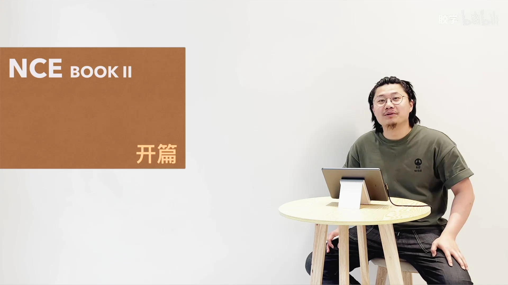

文字识别：NCE / BOOKI / 开篇 / NO / Wnn

### 画面 00:00:15

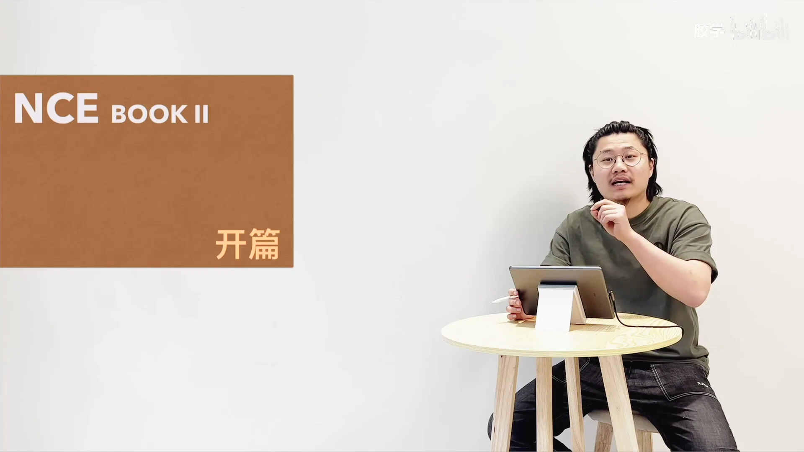

文字识别：NCE BOOKII / 开篇

### 画面 00:00:22

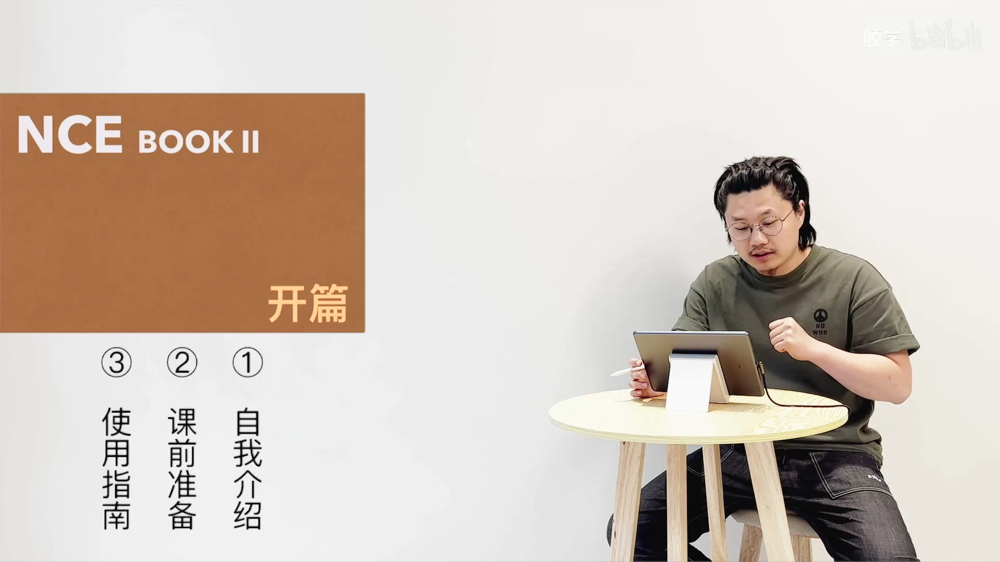

文字识别：NCE / BOOKⅡI / 开篇 / NU / WIIR / 3 / 2 / 1 / 使用指南 / 课前准备 / 自我介绍

### 画面 00:00:29

文字识别：自我介绍 / •奥克兰大学教育学研究生 (入学时QS专业全球排名17) / •前北京新东方英语学习部优秀教师 (2012-2018) / •TKT英语教学能力证书（剑桥大学颁发) / ●6年线下，4年线上教龄 / •TOEFL托福102分 (阅读听力接近满分) / •IELTS 雅思7.5 (World: Top88%- 93%, China: Top98%) / •高考英语 138分 / NO / WIR / ●甘肃文县支教

## 00:00:30–00:01:00

第一个问题，简单的自我介绍，因为我在新概念一册的开篇视频当中啊，呃，非常详细的说了这些内容。那在这里呢，我们就一带而过啊，大家感兴趣可以暂停看一下就好了。OK，那接下来我们说第二个，我们如果想上这个课，那我们课前应该准备一些什么内容呢？好，第一个我们要把新概念英语第二册的教材给准备好啊，然后

### 画面 00:00:44

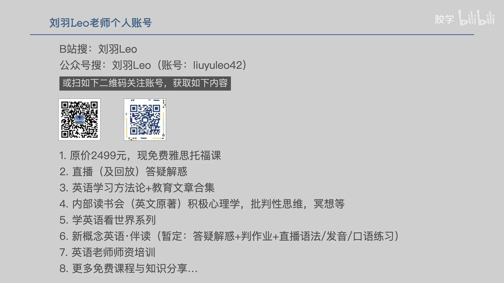

文字识别：胶学b出 / 刘羽Leo老师个人账号 / B站搜：刘羽Leo / 公众号搜：刘羽Leo（账号：liuyuleo42) / 或扫如下二维码关注账号，获取如下内容 / 1.原价2499元，现免费雅思托福课 / 2.直播（及回放）答疑解惑 / 3.英语学习方法论+教育文章合集 / 4.内部读书会（英文原著）积极心理学，批判性思维，冥想等 / 5.学英语看世界系列 / 6.新概念英语·伴读 (暂定：答疑解惑+判作业+直播语法/发音/口语练习) / 7.英语老师师资培训 / 8.更多免费课程与知识分享...

### 画面 00:00:49

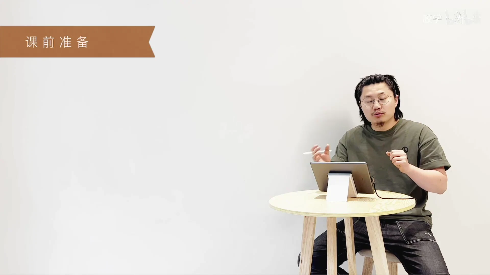

文字识别：课前准备

### 画面 00:00:55

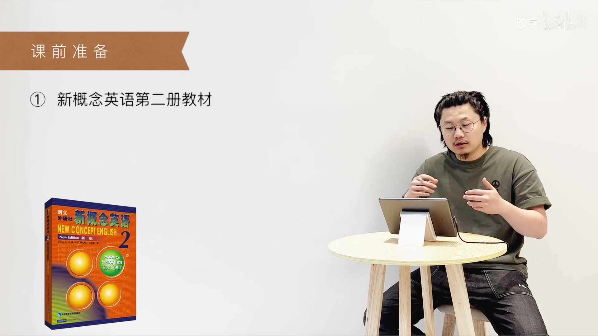

文字识别：课前准备 / 新概念英语第二册教材 / 朗文 / 新概念英语 / 外研社 / NEW CONCEPT ENGLISH / New Edition 新 / 面围山大(CLGALEXANDER)装 / 版 / Practice / &Progress / 实线与进步 / FASON

## 00:01:00–00:01:30

呢，剑桥中级的英语语法，OK，这个东西啊，我们管它在课程当中出现的时候，会管它叫红皮书啊，各位这个点一定要记住一下。其次呢，我们在新一的时候学的是剑桥初级英语语法，现在这里是剑桥中级英语语法啊，注意一下。接下来那手机词典你肯定要准备一个，对吧？手机的app，这个手机的app呃，手机应用，我们去下一个新

### 画面 00:01:00

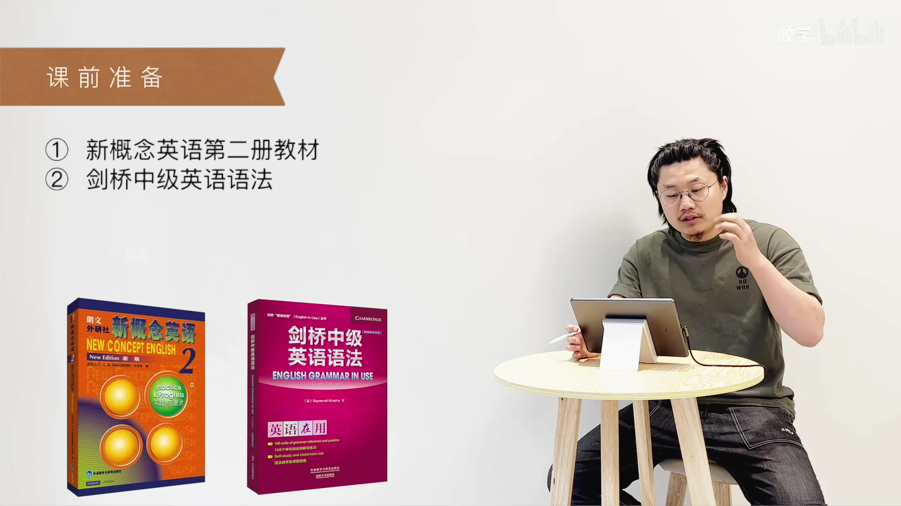

文字识别：课前准备 / 新概念英语第二册教材 / 剑桥中级英语语法 / NO / WI / 朗文 / 新概念英语 / 剑件“语在用”（EngishnUse）热 / CAMBRIDGE / 外研社 / 剑桥中级 / NEW CONCEPT ENGLISH / 英语语法 / 的山大CLQ.ALEXANDERI其 / New Edition 新 / 版 / ENGLISH GRAMMAR IN USE / &Progress / Prectice / 实线与进步 / （）Raymend Murphy / 英语在用 / 145个单无通洁讲新与练习 /  Self-study and classroom use / 适合自学及语营使用 / 外语教学与辆究注报社 / 丽大学出张社 / TIARSON

### 画面 00:01:03

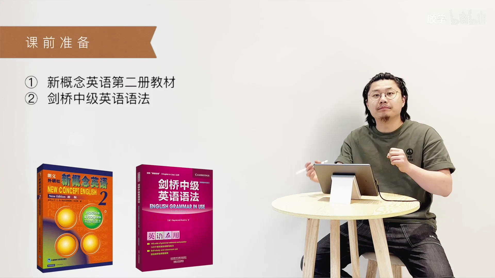

文字识别：课前准备 / 新概念英语第二册教材 / 剑桥中级英语语法 / NU / OR / 朗文 / 新概念英语 / 剑件“语在用”（English nUse)品 / CAMBRIDGE / 外研社 / 剑桥中级 / NEW CONCEPT ENGLISH / 英语语法 / 正的山大CLG.MEXANDER其 / New Edition 新 / 版 / ENGLISH GRAMMAR IN USE / &Progress / Prectice / 实线与进步 / (英）RaymondMurpiy / 英语在用 / 145个单元通法讲解与练习 /  Self-study and classroom use / 适合自学及诺觉使用 / 外通教学与销生报社 / 创明大学出医社 / REARTON

### 画面 00:01:05

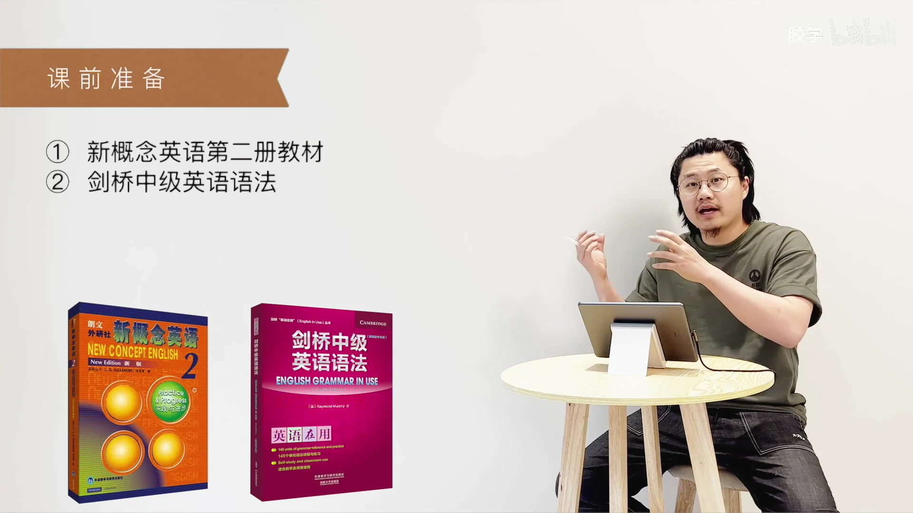

文字识别：课前准备 / 新概念英语第二册教材 / 剑桥中级英语语法 / 朗文 / 新概念英语 / 创件“在用”（English nUse）品 / CAMBRIDGE / 外研社 / 剑桥中级 / NEW CONCEPT ENGLISH / 英语语法 / New Edition 新 / 的山大CLG.ALEXANOEA / 版 / ENGLISH GRAMMAR IN USE / &Progress / Prcctice / 实线与进步 / (）Raymond Murpiy / 英语在用 /  145 unls of g / 145个单元通法讲与练习 /  Self-study and classroom use / 适合自学及诺便岸 / 研大学出医社 / RAXION

### 画面 00:01:10

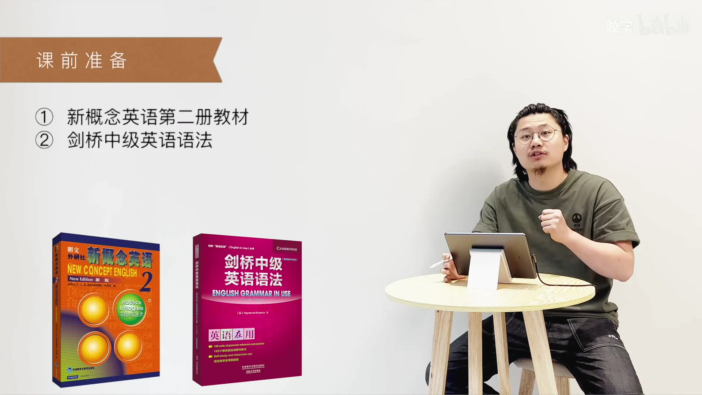

文字识别：课前准备 / 新概念英语第二册教材 / 剑桥中级英语语法 / NI / 朗文 / 新概念英语 / 创件“在用”（EnglishnUse）品 / CAMBRIDGE / 外研社 / 剑桥中级 / NEW CONCEPT ENGLISH / 英语语法 / New Edition 新 / 面药山大 (LG.ALEXANDEA)何其 / 版 / ENGLISH GRAMMAR IN USE / &Progless / Prcctice / 实线与进步 / (）Raymond Murphy / 英语在用 /  145 unls of g / 145个单元通法讲与练习 /  Self-study and classroom use / 适合自学及请使用 / 大学出医社 / TEAKION

### 画面 00:01:14

文字识别：胶学一 / 课前准备 / 新概念英语第二册教材 / 剑桥中级英语语法 / 朗文 / 新概念英语 / 剑件“在用”（EnglishnUse）品 / CAMBRIDGE / 外研社 / 剑桥中级 / NEW CONCEPT ENGLISH / 英语语法 / New Edition新 / 防山大（LG.AUEXANDER) / 版 / ENGLISH GRAMMAR IN USE / &Progless / Pcctice / 实践与进步 / (）Raymond Murpiy / 英语在用 / 0 145 unls of g / 145个单元通法讲解与练习 /  Self-study and classroomute / 适合自学及请量便用 / 外语教学与精究生报社 / 酬大学出保社 / TIAXSON

### 画面 00:01:16

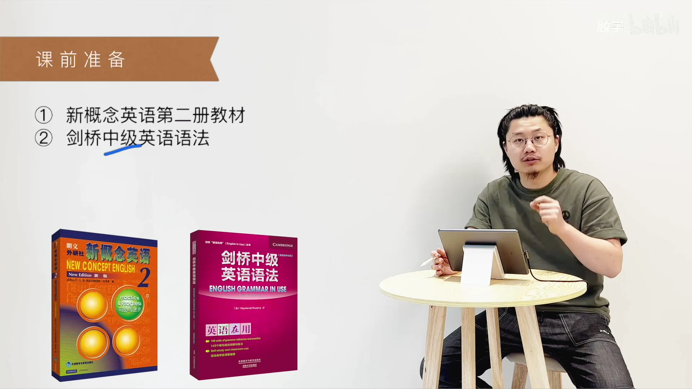

文字识别：胶学洲 / 课前准备 / 新概念英语第二册教材 / 剑桥中级英语语法 / 朗文 / 新概念英语 / 创件“语在用”（English nUse）品 / CAMBRIDGE / 外研社 / 剑桥中级 / NEW CONCEPT ENGLISH / 英语语法 / 亚的山大CLGALEXANDER)何其 / New Edition 新 / 版 / ENGLISH GRAMMAR IN USE / &Progless / Prcctice / 实线与进步 / （）RaymondMurphy / 英语在用 /  145 unls of g / 145个单元通法讲解与练习 /  Self-study and classroomune / 适合自学及请堂使用 / 9酬大学出医社 / FEAXSON

### 画面 00:01:18

文字识别：胶学 / 课前准备 / 新概念英语第二册教材 / 剑桥中级英语语法 / NU / 朗文 / 新概念英语 / 剑件“英语在用”（EnglishnUse） / CAMBRIDGE / 外研社 / 剑桥中级 / NEW CONCEPT ENGLISH / 英语语法 / 正的山大（LG.AUEXANDER)其 / New Edition 新 / 版 / ENGLISH GRAMMAR IN USE / &Progress / Prcctice / 实践与进步 / (） Raymond Murphy  / 英语在用 / 0 145 unls olf g / ance and practice / 145个单元通法讲解与练习 /  Self-study and classroomuse / 适合自学及谭堂使用 / FARSON

### 画面 00:01:20

文字识别：胶学 / 课前准备 / 新概念英语第二册教材 / 剑桥中级英语语法 / 朗文 / 新概念英语 / 剑件“英语在用”（EngishnUse）品 / CAMBRIDGE / 外研社 / 剑桥中级 / NEW CONCEPT ENGLISH / 英语语法 / 山大CLG.AEXANOSR)其 / New Edition新 / 版 / ENGLISH GRAMMAR IN USE / &Progress / Prcctice / 实践与进步 / (）RaymendMurphy / 英语在用 / 0 145 unls of g / nce and practice / 145个单元通法讲解与练习 /  Self-study and classroom ue / 适合自学及请便用 / 外通教学与精究生报社 / FEARSON

### 画面 00:01:23

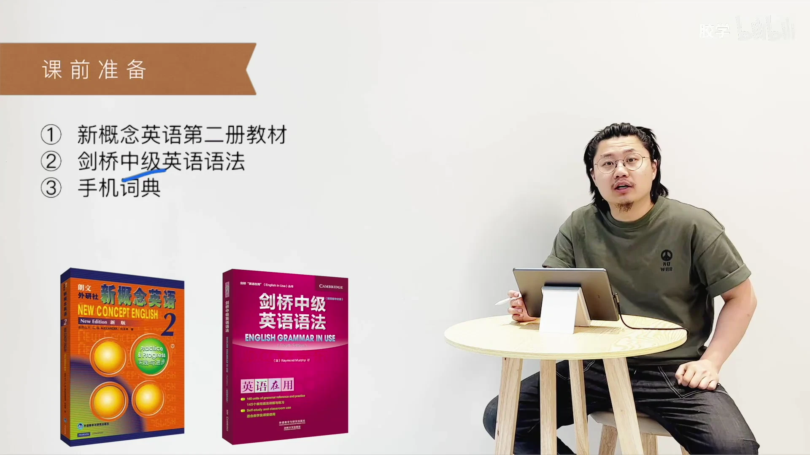

文字识别：胶学一州 / 课前准备 / 新概念英语第二册教材 / 剑桥中级英语语法 / 手机词典 / NO / WAR / 朗文 / 新概念英语 / 剑所“英语在用”（EngishinUse）品 / CAMBRIDGE / 外研社 / 剑桥中级 / NEW CONCEPT ENGLISH / 英语语法 / 山大CLG.ALEXANDSR)有其 / New Edition新 / 版 / ENGLISH GRAMMAR IN USE / &Progless / Prcctice / 实践与进步 / (）RaymondMurphy / 英语在用 / 145个单元通法讲解与练习 /  Self-study and classroomuse / 适合自学及请堂使用 / 外通教学与错文生托社 / 研大学出医社 / FEARSON

### 画面 00:01:25

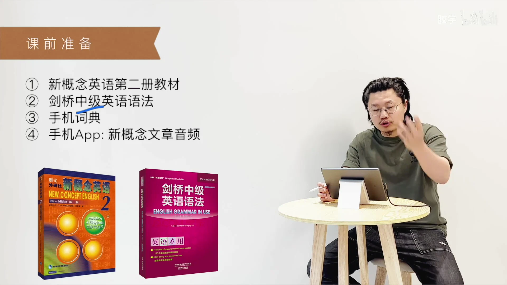

文字识别：胶字 / 课前准备 / 新概念英语第二册教材 / 剑桥中级英语语法 / 手机词典 / 手机App:新概念文章音频 / 朗文 / 新概念英语 / 剑件“在用”（EnglishnUse）品 / CAMBRIDGE / 外研社 / 剑桥中级 / NEW CONCEPT ENGLISH / 英语语法 / 面防山大CLG，AUEXANDSA其 / New Edition 新 / 版 / ENGLISH GRAMMAR IN USE / &Progless / Prectice / 实践与进步 / (）RaymondMurphy / 英语在用 / 145个单元通法讲解与球习 / Self-study and classroom use / 适合自学及诺堂使用 / 外语教学与销内生拆社 / 创酬大学出医社 / TEARSON

## 00:01:30–00:02:00

概念的音频啊，文章的这个音频的一个应用，然后呢，我们会去课下的时候进行一个跟读，大多数都是免费的啊，各位可以多下一些，然后看哪个使用起来方便，你就用哪个就好了。OK，好，那最后一个你肯定要准备一些纸笔啊，去记一些笔记啊，做一些课下练习。OK，那接下来呢，我们要去一起看一下这个开篇视

### 画面 00:01:30

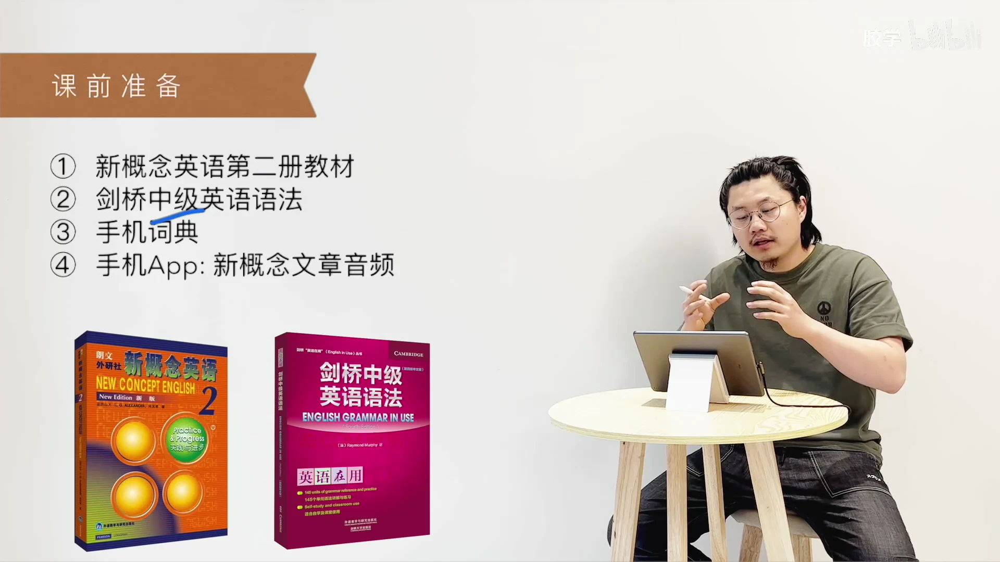

文字识别：胶字 / 课前准备 / 新概念英语第二册教材 / 剑桥中级英语语法 / 手机词典 / 手机App:新概念文章音频 / NO / 朗文 / 新概念英语 / 创件“英在用”（EnglishinUse）品 / CAMBRIDGE / 外研社 / 剑桥中级 / NEW CONCEPT ENGLISH / 英语语法 / 亚所山大CLG.ALEXANDEA)其 / New Edition新 / 版 / ENGLISH GRAMMAR IN USE / Practice / &Progress / 实线与进步 / （燕）Raymcnd Murphy / 英语在用 / 145个单元通法讲解与练习 / Self-study and classroom une / 适合自学发诺堂便用 / 外逐数学与能究生拆社 / FAKSON

### 画面 00:01:32

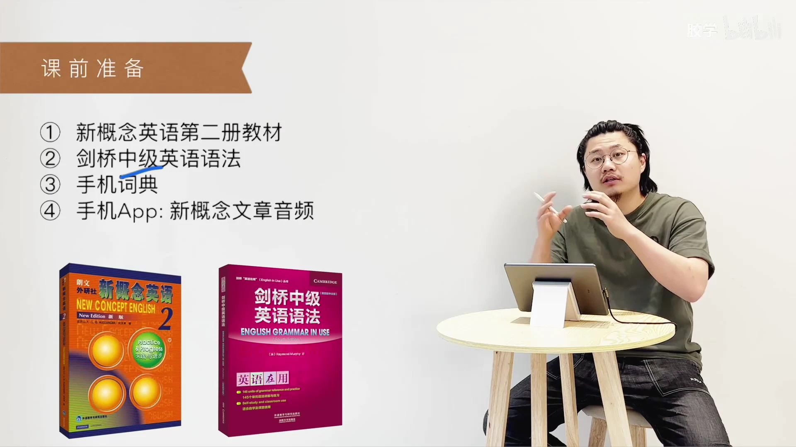

文字识别：胶学 / 课前准备 / 新概念英语第二册教材 / 剑桥中级英语语法 / 手机词典 / 手机App:新概念文章音频 / 朗文 / 新概念英语 / 剑件“在用”（EnglishnUse）品 / CAMBRIDGE / 外研社 / 剑桥中级 / NEW CONCEPT ENGLISH / 英语语法 / New Edition新 / 面防山大 (LG.ALEXANDER)何其 / 版 / ENGLISH GRAMMAR IN USE / &Progress / Practice / 实践与进步 / （燕）Raymcnd Murphy / 英语在用 / nce and practice / 145个单元通法讲解与练习 / o Self-study and classroom use / 适合自学及课堂使用 / 外逐数学与销究生报社 / 州所大学出社 / FAKSON

### 画面 00:01:35

文字识别：胶学州 / 课前准备 / 新概念英语第二册教材 / 剑桥中级英语语法 / 手机词典 / 手机App:新概念文章音频 / 朗文 / 新概念英语 / 创件“英语在用”（EnglishinUse）品 / CAMBRIDGE / 外研社 / 剑桥中级 / NEW CONCEPT ENGLISH / 英语语法 / 正的山大CLG.ALEXANDER)有其 / New Edition 新 / 版 / ENGLISH GRAMMAR IN USE / &Progress / Pactice / 实线与进步 / （英）Raymcnd Murply / 英语在用 / snce and prectice / 145个单元道法讲解与练习 /  Self-study and classroom use / 适合自学发请堂便用 / 随大学出张社 / FHAXSON

### 画面 00:01:38

文字识别：胶学一州 / 课前准备 / 新概念英语第二册教材 / 剑桥中级英语语法 / 手机词典 / 手机App:新概念文章音频 / 朗文 / 新概念英语 / 创件“其在用”（EnglishnUse）品 / CAMBRIDGE / 外研社 / 剑桥中级 / NEW CONCEPT ENGLISH / 英语语法 / New Edition新 / 正国山大 （LG.ALEXANDER)其 / 版 / ENGLISH GRAMMAR IN USE / Practice / &Progress / 实线与进步 / （英）Raymcnd Murphy / 英语在用 / 145 uanis of gr / 145个单元通法讲解与练习 /  Self-study and classroom use / 适合自学及诺堂便用 / 外语教学与错究生拆社 / FIAXSON

### 画面 00:01:40

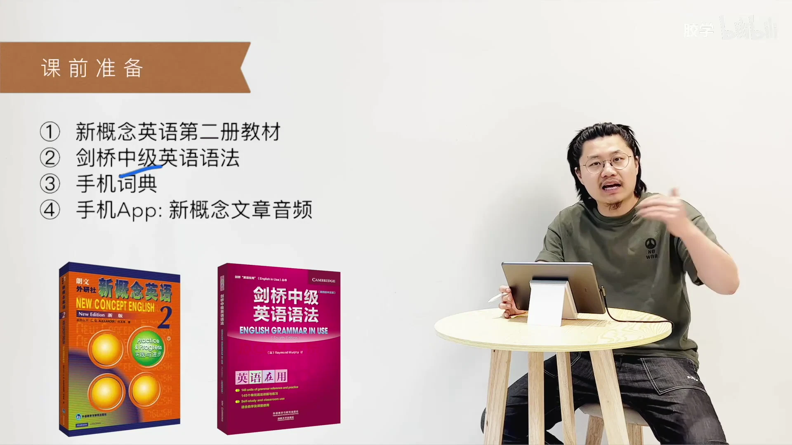

文字识别：课前准备 / 新概念英语第二册教材 / 剑桥中级英语语法 / 手机词典 / 手机App:新概念文章音频 / ND / 朗文 / 新概念英语 / 剑件“源在用”（EnglishnUse）品 / CAMBRIDGE / 外研社 / 剑桥中级 / NEW CONCEPT ENGLISH / 英语语法 / 面所山大CLG.ALEXANDOR其 / New Edition新 / 版 / ENGLISH GRAMMAR IN USE / &Progress / Prectice / 实线与进步 / (满）Raymcnd Murply  / 英语在用 / 145个单元通法讲解与练习 /  Self-study and classroom use / 适合自学及诺党便用 / 外语教学与错充生板社 / FARSON

### 画面 00:01:45

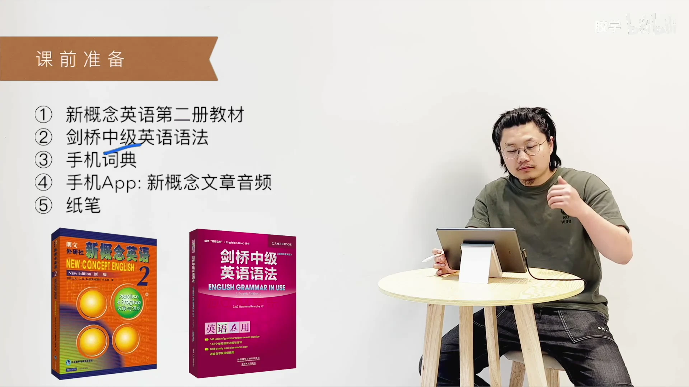

文字识别：课前准备 / 新概念英语第二册教材 / 剑桥中级英语语法 / 手机词典 / 手机App:新概念文章音频 / 纸笔 / NO / 朗文 / 新概念英语 / 剑件“英语在用”（EngishinUse）品 / CAMBRIDGE / 外研社 / 剑桥中级 / NEW CONCEPT ENGLISH / 英语语法 / New Edition 新 / 国山大CLG.AUEXANDER)有其 / 版 / ENGLISH GRAMMAR IN USE / & Progress / Practice / 实践与进步 / (）Raymcnd Murply  / 英语在用 / 145 unis of gra / 145个单元通法讲解与练习 /  Self-study and classroom use / 适合自学及诺觉便用 / 外语教学与错究生拆社 / 州随大学出张社 / FAXSON

### 画面 00:01:48

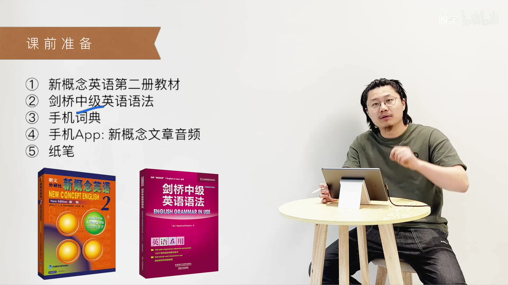

文字识别：课前准备 / 新概念英语第二册教材 / 剑桥中级英语语法 / 手机词典 / 手机App:新概念文章音频 / 纸笔 / 朗文 / 新概念英语 / 剑件“英源在用”（EnglishnUse）品 / CAMBRIDGE / 外研社 / 剑桥中级 / NEW CONCEPT ENGLISH / 英语语法 / New Edition新 / 的山大 CLGALEXANDER)其 / 版 / ENGLISH GRAMMAR IN USE / & Progress / Practice / 实线与进步 / (满）Raymcnd Murply  / 英语在用 /  145 units of gra / nce and practlce / 145个单元通法讲解与练习 /  Self-study and classroom use / 适合自学及诺堂便用 / 随大学出所社 / FEARTON

### 画面 00:01:50

文字识别：课前准备 / 新概念英语第二册教材 / 剑桥中级英语语法 / 手机词典 / 手机App:新概念文章音频 / 纸笔 / NO / WIIR / 朗文 / 新概念英语 / 剑所“英活在用”（EngishinUse）品 / CAMBRIDGE / 外研社 / 剑桥中级 / NEW CONCEPT ENGLISH / 英语语法 / 面图山大CLG.ALEXANDER有式 / New Edition新 / 版 / ENGLISH GRAMMAR IN USE / &Progress / Pactice / 实线与进步 / (满）Raymcnd Murphoy  / 英语在用 / 145个单无通法讲解与练习 / o Self-study and classroom use / 适合自学及活营便用 / 外语教学与错究生板社 / 州随大学出医社 / FIARSON

### 画面 00:01:52

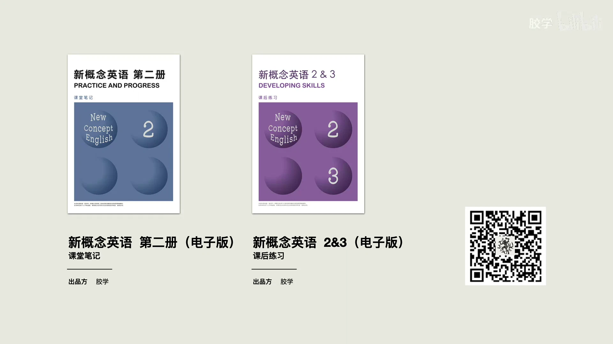

文字识别：胶学 / 新概念英语 第二册 / 新概念英语2&3 / PRACTICE AND PROGRESS / DEVELOPING SKILLS / 课堂笔记 / 课后练习 / New / New / Concept / 2 / Concept / 2 / English / English / 3 / 新概念英语 第二册 (电子版) / 新概念英语 2&3 (电子版) / 课堂笔记 / 课后练习 / 出品方 / 胶学 / 出品方胶学

### 画面 00:01:56

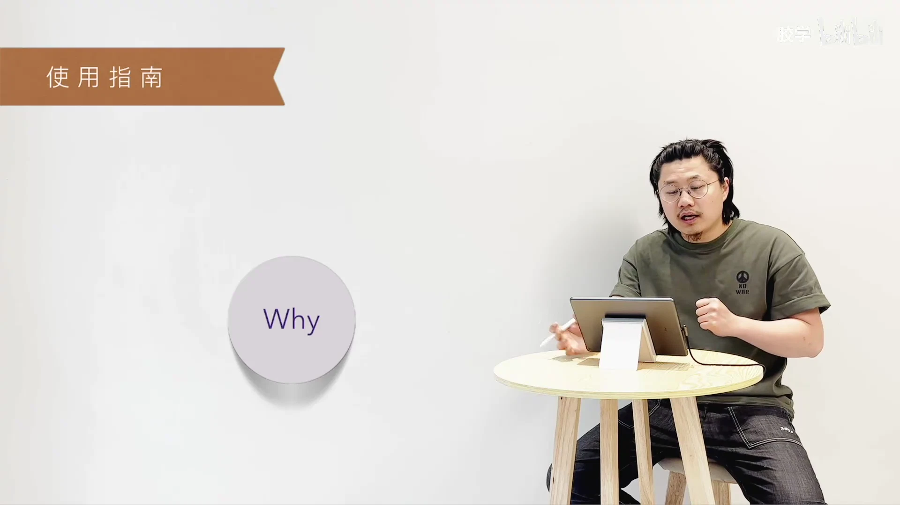

文字识别：胶学 / 使用指南 / ND / WIR / Why

## 00:02:00–00:02:30

频当中的重头戏，就是我们所谓的叫做使用指南啊。那我劝各位最好花一点时间去看一下这个使用指南。为什么呢？就是说有一些心理学的这个研究成果，其实表明，如果我们清楚我们为什么要做一件事情，那我们去做这件事情的动力啊，就会更加的足啊。所以我们做的事情呢，往往就会又又快又好，对吧？所以如果您清楚啊，说接下来我在

### 画面 00:02:14

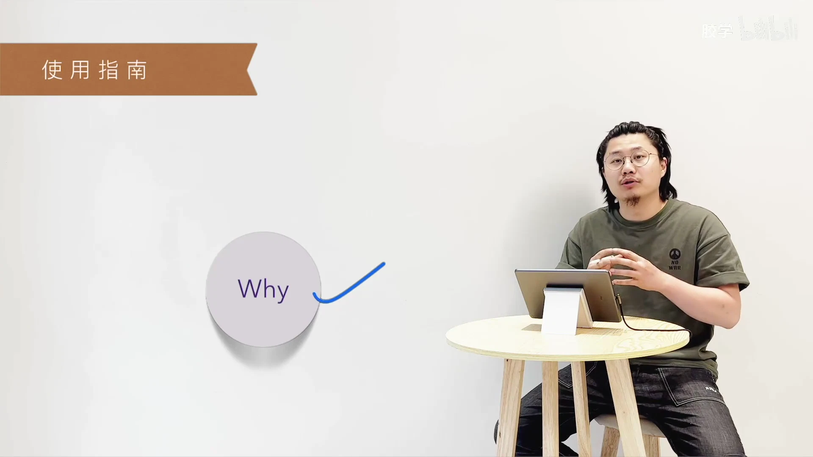

文字识别：使用指南 / NO / WIR / Why

## 00:02:30–00:03:00

新概念这个课程当中，二册的课程当中，为什么要设置一些练习？为什么要这样去讲？那可能您更容易接受我这样去讲，并且呢，有助于各位好好配合我去完成这些作业，好吧？那接下来咱们一起看一下啊。好，在这个部分呢，我们主要会讲到如下的这些内容。好，我们一个一个来。我们先看第一个，叫英语学习的流程。英语学习啊，其实大多数

### 画面 00:02:44

文字识别：使用指南 / NU / Why

### 画面 00:02:47

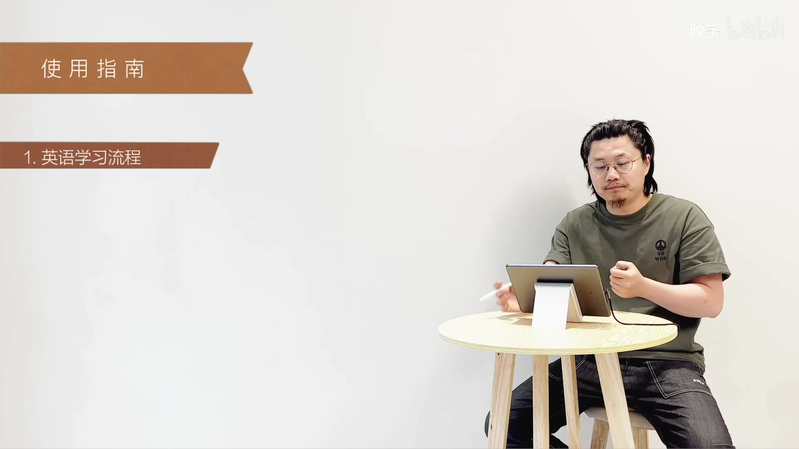

文字识别：使用指南 / 1.英语学习流程 / NU / WIR

### 画面 00:02:49

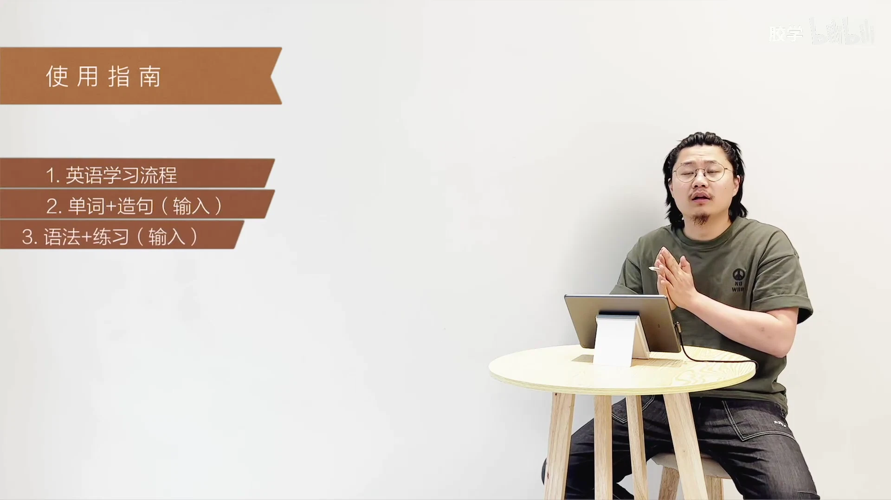

文字识别：使用指南 / 1.英语学习流程 / 2.单词+造句（输入） / 3.语法+练习（输入) / NO / win

### 画面 00:02:51

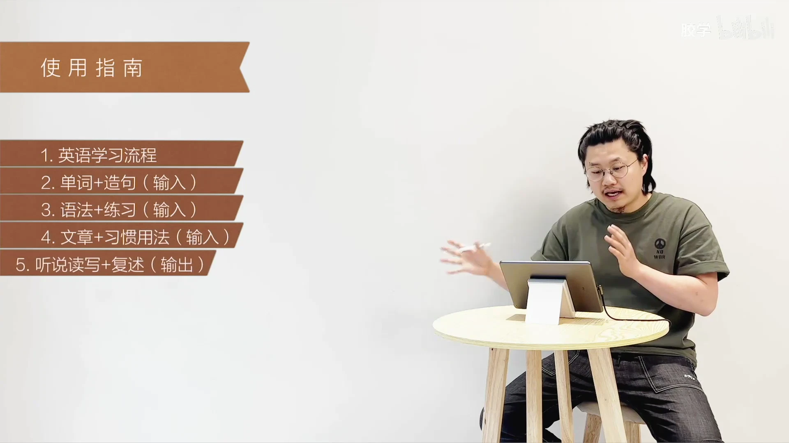

文字识别：使用指南 / 1.英语学习流程 / 2.单词+造句（输入） / 3.语法+练习（输入） / 4.文章+习惯用法（输入） / NO / 5.听说读写+复述（输出） / WAR

### 画面 00:02:53

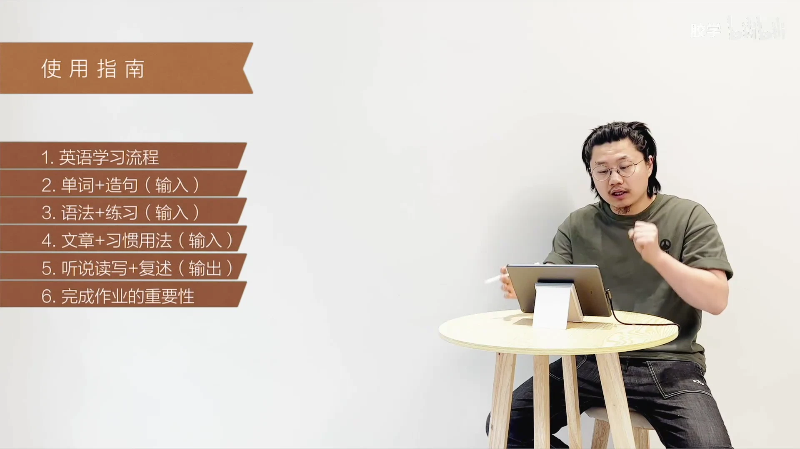

文字识别：胶学 / 使用指南 / 1.英语学习流程 / 2.单词+造句（输入） / 3.语法+练习（输入） / 4.文章+习惯用法（输入） / 5.听说读写+复述（输出） / 6. 完成作业的重要性

### 画面 00:02:55

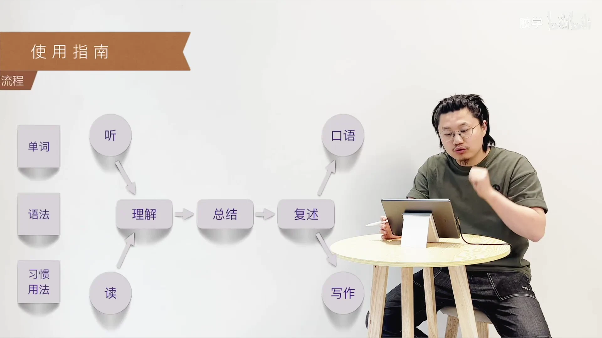

文字识别：胶学 / 使用指南 / 流程 / 听 / 口语 / 单词 / 语法 / 理解 / 总结 / 复述 / 习惯 / 用法 / 读 / 写作

### 画面 00:02:57

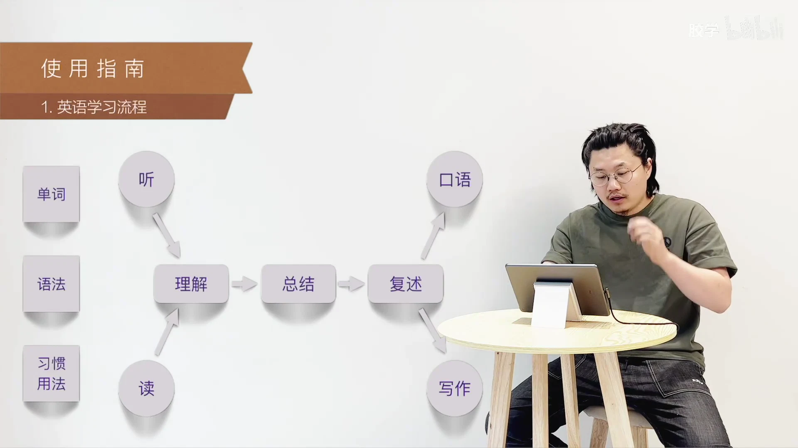

文字识别：使用指南 / 1.英语学习流程 / 听 / 口语 / 单词 / 语法 / 理解 / 总结 / 复述 / 习惯 / 用法 / 读 / 写作

## 00:03:00–00:03:30

语言都是这个样子的，几乎都一定是从左往右走啊。比如说，我们要先学会一些单词，我们要去学习一些语法，要去学习一些习惯用法。那这个习惯用法呢，我其实，在新一当中多少提了一点，在新二当中呢，进入文章我会继续给它进行一个定义。在这里呢，我先简单说一下，其实各位理解为是一些，比如说固定词汇的搭配呀，然后包括一些

### 画面 00:03:01

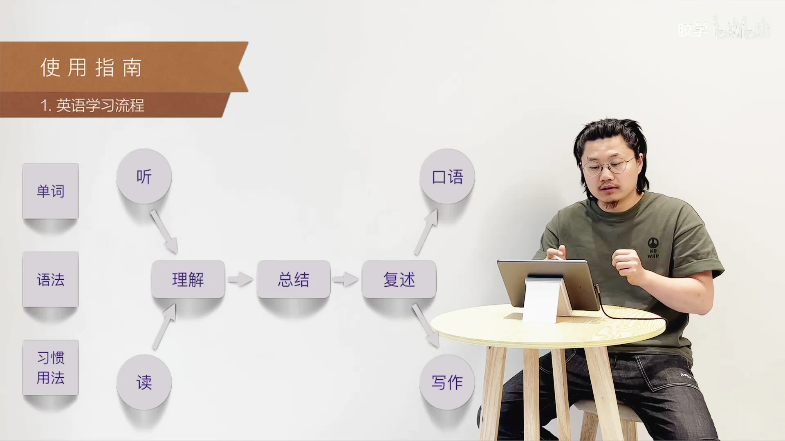

文字识别：使用指南 / 1.英语学习流程 / 听 / 口语 / 单词 / NO / WHR / 语法 / 理解 / 总结 / 复述 / 习惯 / 用法 / 读 / 写作

### 画面 00:03:03

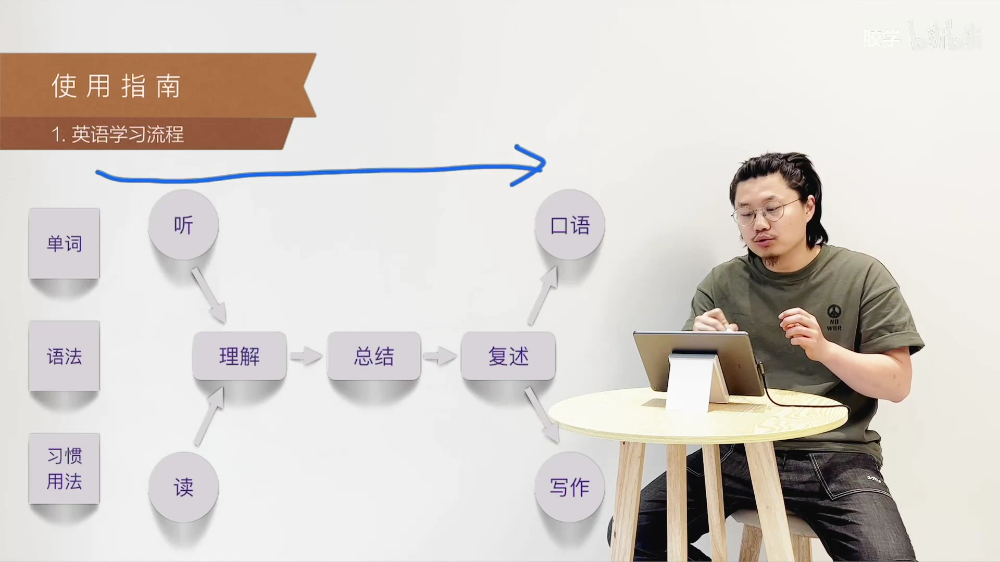

文字识别：使用指南 / 1.英语学习流程 / 听 / 口语 / 单词 / NO / WnR / 语法 / 理解 / 总结 / 复述 / 习惯 / 用法 / 读 / 写作

### 画面 00:03:06

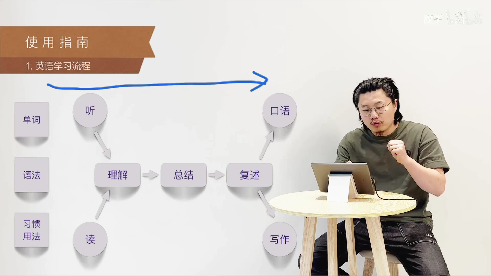

文字识别：使用指南 / 1.英语学习流程 / 听 / 口语 / 单词 / 语法 / 理解 / 总结 / 复述 / 习惯 / 用法 / 读 / 写作

### 画面 00:03:10

文字识别：使用指南 / 1.英语学习流程 / 听 / 口语 / 单词 / 语法 / 理解 / 总结 / 复述 / 习惯 / 用法 / 读 / 写作

### 画面 00:03:12

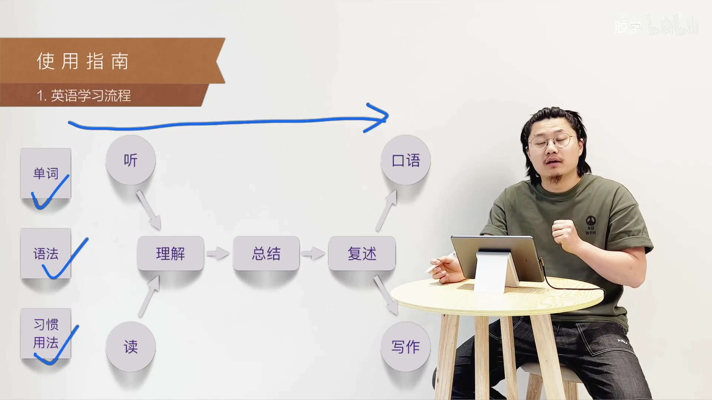

文字识别：使用指南 / 1.英语学习流程 / 听 / 口语 / 单词 / NO / WIR / 语法 / 理解 / 总结 / 复述 / 习惯 / 用法 / 读 / 写作

### 画面 00:03:16

文字识别：使用指南 / 1.英语学习流程 / 听 / 口语 / 单词 / 语法 / 理解 / 总结 / 复述 / 习惯 / 用法 / 读 / 写作

### 画面 00:03:21

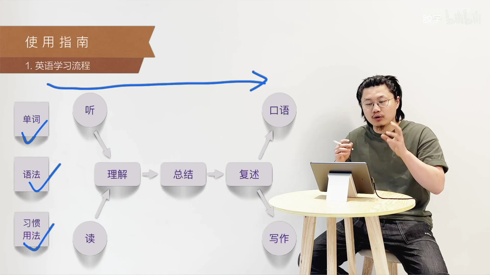

文字识别：使用指南 / 1.英语学习流程 / 听 / 口语 / 单词 / 语法 / 理解 / 总结 / 复述 / 习惯 / 用法 / 读 / 写作

### 画面 00:03:26

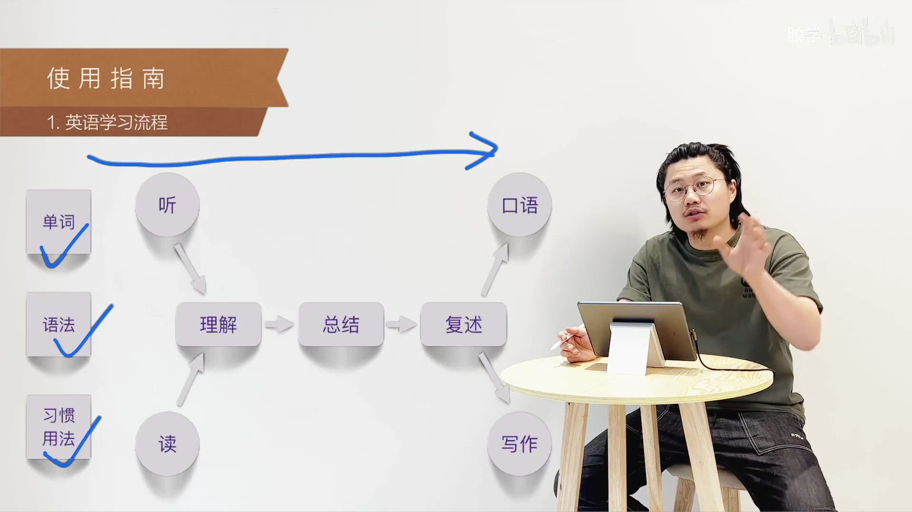

文字识别：使用指南 / 1.英语学习流程 / 听 / 口语 / 单词 / 语法 / 理解 / 总结 / 复述 / 习惯 / 用法 / 读 / 写作

## 00:03:30–00:04:00

俚语呀，对吧？包括一些常用表达呀，甚至有一些这个经常出现在一起的单词啊，我们其实都可以管它叫做习惯用法。OK，这些东西呢，他们往往又组成了一个句子，对吧？然后由句子，我们听到了句子，然后读到了句子，我们大脑理解了之后，我们去进行一个总结，然后我们用口语把它复述出来，或者写作把它复述出来，这就是我们学习

### 画面 00:03:31

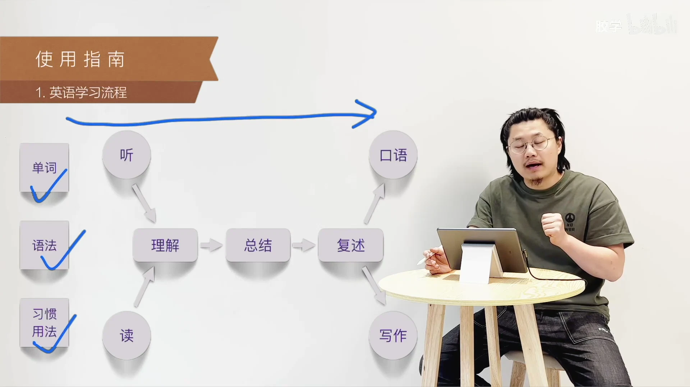

文字识别：使用指南 / 1.英语学习流程 / 听 / 口语 / 单词 / NU / WIR / 语法 / 理解 / 总结 / 复述 / 习惯 / 用法 / 读 / 写作

### 画面 00:03:38

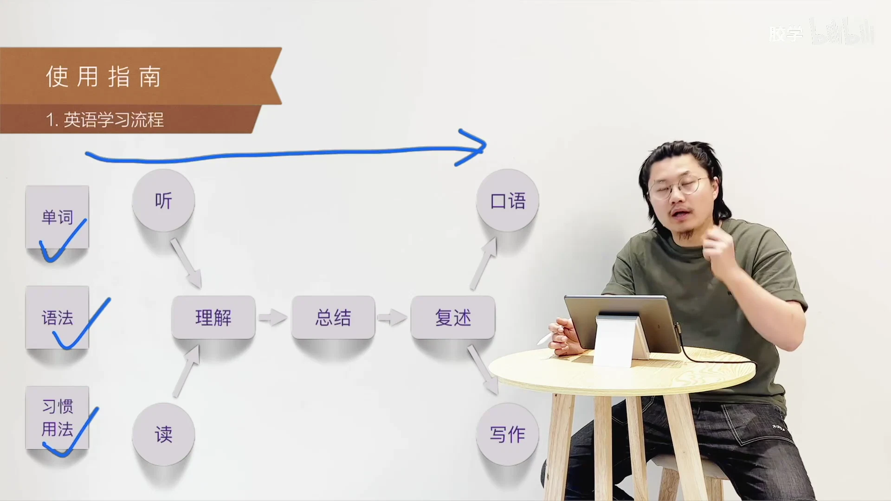

文字识别：胶字 / 使用指南 / 1.英语学习流程 / 听 / 口语 / 单词 / 语法 / 理解 / 总结 / 复述 / 习惯 / 用法 / 读 / 写作

### 画面 00:03:41

文字识别：使用指南 / 1.英语学习流程 / 听 / 口语 / 单词 / N / Wn / 语法 / 理解 / 总结 / 复述 / 习惯 / 用法 / 读 / 写作

### 画面 00:03:44

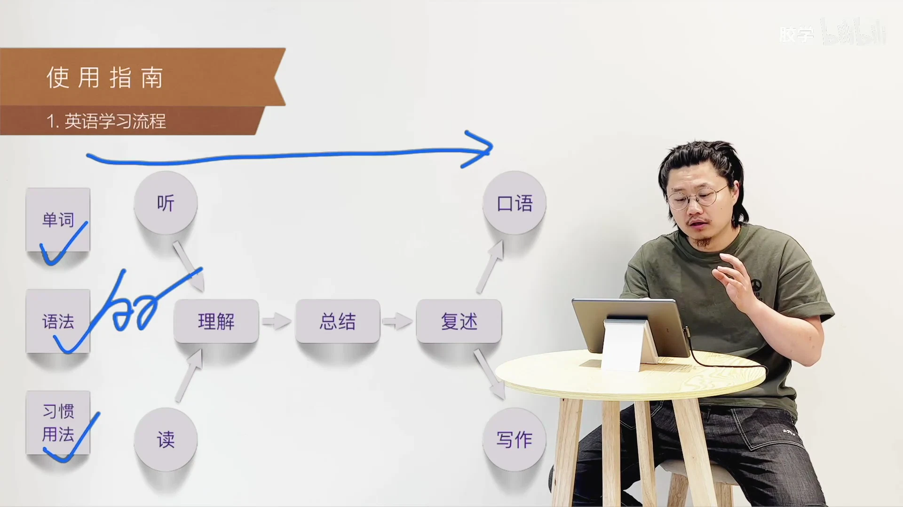

文字识别：使用指南 / 1.英语学习流程 / 听 / 口语 / 单词 / 语法 / 理解 / 总结 / 复述 / 习惯 / 用法 / 读 / 写作

### 画面 00:03:46

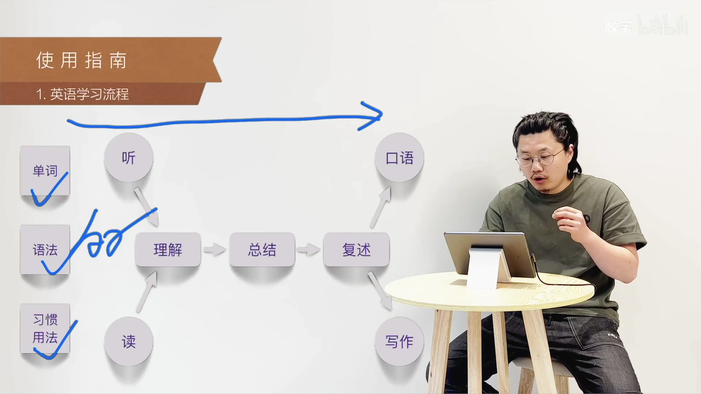

文字识别：使用指南 / 1.英语学习流程 / 听 / 口语 / 单词 / 语法 / 理解 / 总结 / 复述 / 习惯 / 用法 / 读 / 写作

### 画面 00:03:48

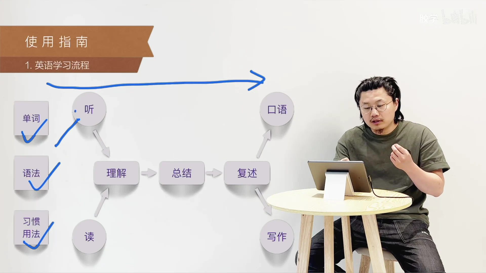

文字识别：使用指南 / 1.英语学习流程 / 听 / 口语 / 单词 / 语法 / 理解 / 总结 / 复述 / 习惯 / 用法 / 读 / 写作

### 画面 00:03:51

文字识别：使用指南 / 1.英语学习流程 / 听 / 口语 / 单词 / 语法 / 理解 / 总结 / 复述 / 习惯 / 用法 / 读 / 写作

### 画面 00:03:53

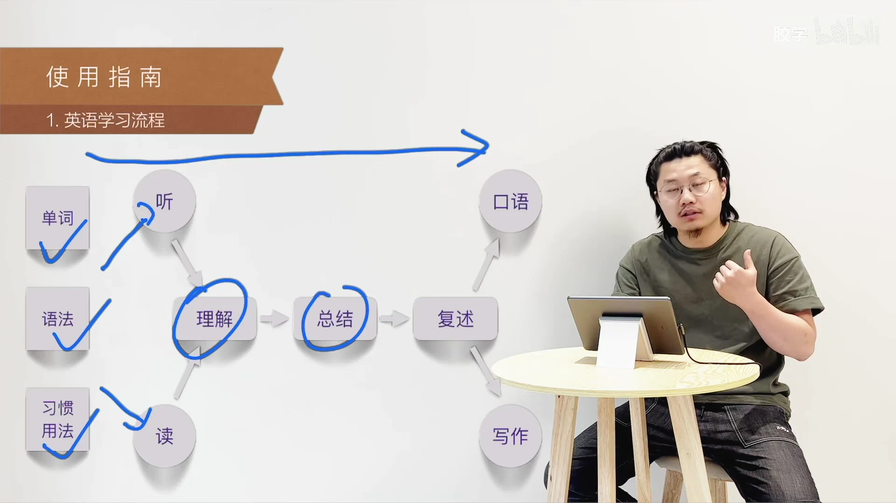

文字识别：使用指南 / 1.英语学习流程 / 听 / 口语 / 单词 / 语法 / 理解 / 总结 / 复述 / 习惯 / 用法 / 读 / 写作

### 画面 00:03:56

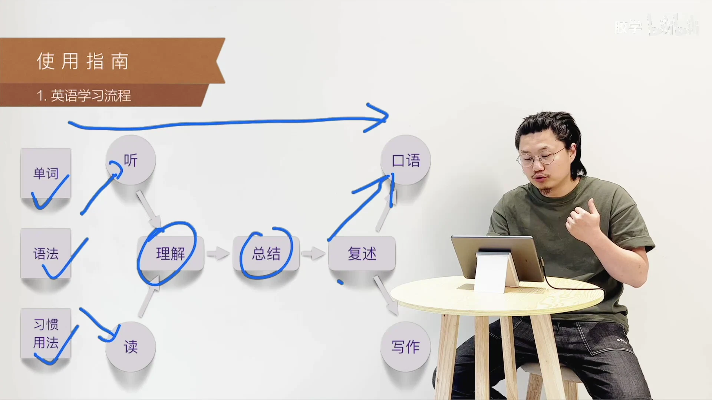

文字识别：使用指南 / 1.英语学习流程 / 听 / 口语 / 单词 / 语法 / 理解 / 总结 / 复述 / 习惯 / 用法 / 读 / 写作

## 00:04:00–00:04:30

语言的一个流程。那我接下来的这个新概念二册设置的练习，包括课程的思路，也是按照这个流程去走的。我们一起看一下，比如说，首先单词加造句啊，这是我们输入的环节，对吧？这是单词的那个部分。OK啊，是这个部分。好，这个地方要注意一个点，我们传统课程啊，各位可以去比较一下，大多数单词它叫重结果，什么意思呢？首先第一啊，有很多人啊，上课的时候单

### 画面 00:04:00

文字识别：胶学 / 使用指南 / 1.英语学习流程 / 听 / 口语 / 单词 / 语法 / 理解 / 总结 / 复述 / 习惯 / 用法 / 读 / 写作

### 画面 00:04:02

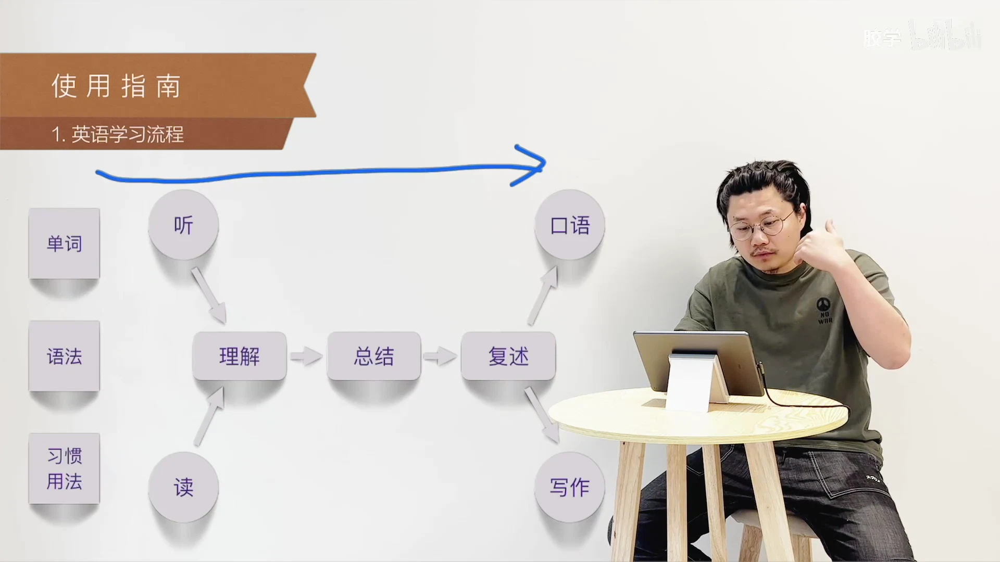

文字识别：胶学上 / 使用指南 / 1.英语学习流程 / 听 / 口语 / 单词 / NO / WIR / 语法 / 理解 / 总结 / 复述 / 习惯 / 用法 / 读 / 写作

### 画面 00:04:04

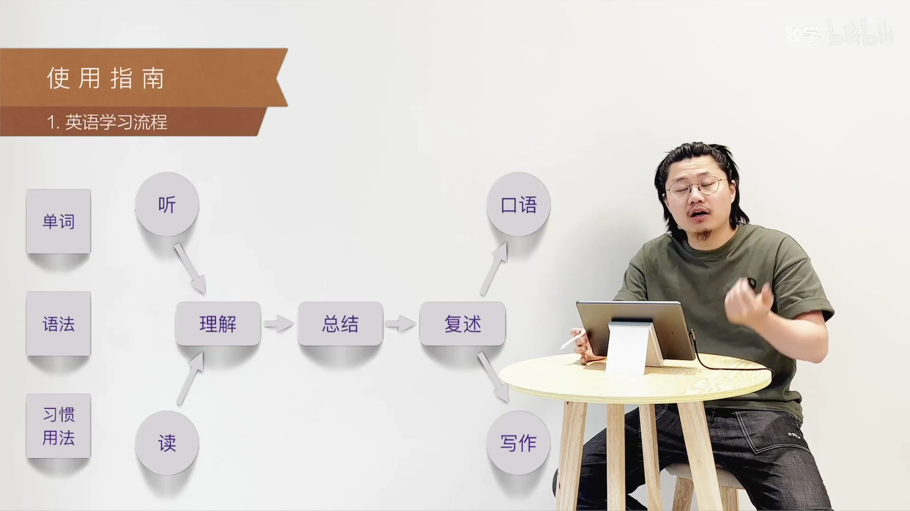

文字识别：胶学一 / 使用指南 / 1.英语学习流程 / 听 / 口语 / 单词 / 语法 / 理解 / 总结 / 复述 / 习惯 / 用法 / 读 / 写作

### 画面 00:04:06

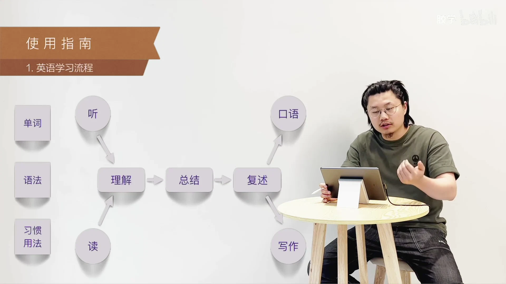

文字识别：胶学 / 使用指南 / 1.英语学习流程 / 听 / 口语 / 单词 / 语法 / 理解 / 总结 / 复述 / 习惯 / 用法 / 读 / 写作

### 画面 00:04:09

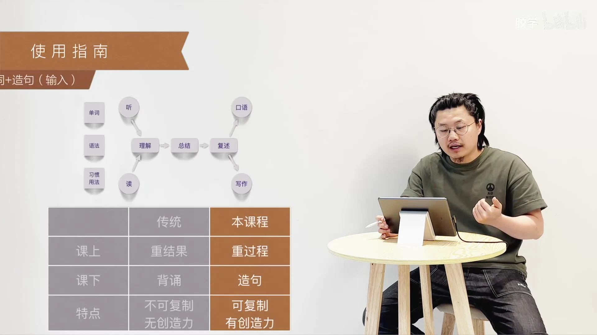

文字识别：胶字 / 使用指南 / 同+造句（输入） / 听 / 口语 / 单词 / 语法 / 理解 / 总结 / 复述 / 习惯 / 用法 / 读 / 写作 / NO / 传统 / 本课程 / 课上 / 重结果 / 重过程 / 课下 / 背诵 / 造句 / 不可复制 / 可复制 / 特点 / 无创造力 / 有创造力

### 画面 00:04:11

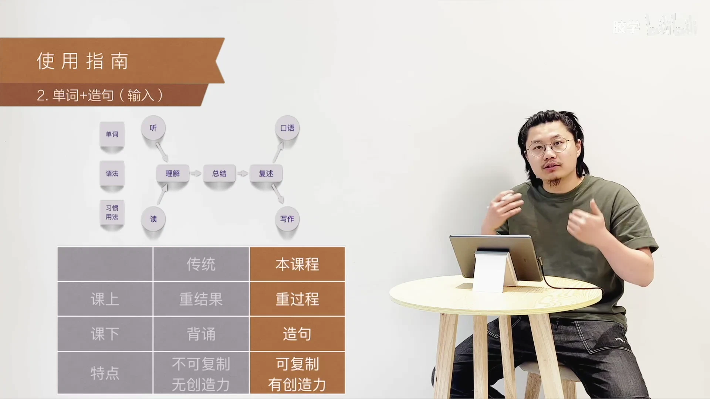

文字识别：使用指南 / 2.单词+造句（输入） / 听 / 口语 / 单词 / 语法 / 理解 / 总结 / 复述 / 习惯 / 用法 / 读 / 写作 / 传统 / 本课程 / 课上 / 重结果 / 重过程 / 课下 / 背诵 / 造句 / 不可复制 / 可复制 / 特点 / 无创造力 / 有创造力

### 画面 00:04:15

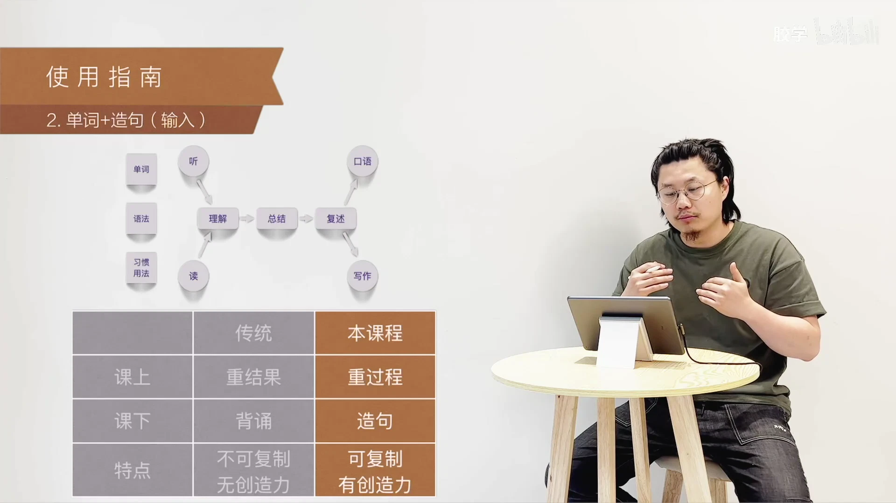

文字识别：胶学 / 使用指南 / 2.单词+造句（输入） / 听 / 口语 / 单词 / 语法 / 理解 / 总结 / 复述 / 习惯 / 用法 / 读 / 写作 / 传统 / 本课程 / 课上 / 重结果 / 重过程 / 课下 / 背诵 / 造句 / 不可复制 / 可复制 / 特点 / 无创造力 / 有创造力

### 画面 00:04:17

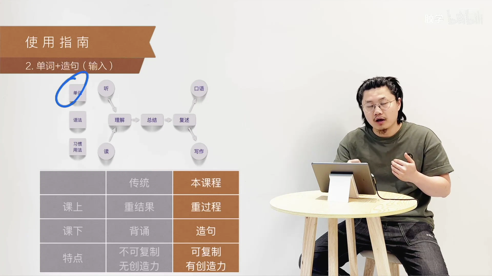

文字识别：胶字 / 使用指南 / 2.单词+造句（输入） / 听 / 口语 / 语法 / 理解 / 总结 / 复述 / 习惯 / 用法 / 读 / 写作 / 传统 / 本课程 / 课上 / 重结果 / 重过程 / 课下 / 背诵 / 造句 / 不可复制 / 可复制 / 特点 / 无创造力 / 有创造力

### 画面 00:04:20

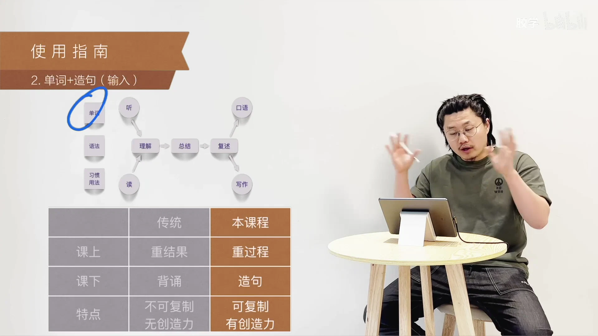

文字识别：使用指南 / 2.单词+造句（输入） / 听 / 口语 / 单记 / 语法 / 理解 / 总结 / 复述 / 习惯 / 用法 / 读 / 写作 / NO / WIR / 传统 / 本课程 / 课上 / 重结果 / 重过程 / 课下 / 背诵 / 造句 / 不可复制 / 可复制 / 特点 / 无创造力 / 有创造力

### 画面 00:04:25

文字识别：使用指南 / 2.单词+造句（输入） / 听 / 口语 / 语法 / 理解 / 总结 / 复述 / 习惯 / 用法 / 读 / 写作 / 传统 / 本课程 / 课上 / 重结果 / 重过程 / 课下 / 背诵 / 造句 / 不可复制 / 可复制 / 特点 / 无创造力 / 有创造力

## 00:04:30–00:05:00

词其实都不给你进行一个造句，那你会发现我们的单词每一个单词几乎都给你造句了，对吧？好，第二呢，他其实就算给你造句的时候，他也是把句子放到那个地方，你只知道它的结果啊，这个句子放到这儿，然后你回去就要进行一个背诵，对吧？那当然导致的事情就是，这就好比你吃了一条鱼，你饿了你还来找老师要，对吧？你就不具有可复制性，你就没有创造力。OK，那我们的这个课程呢，不

### 画面 00:04:30

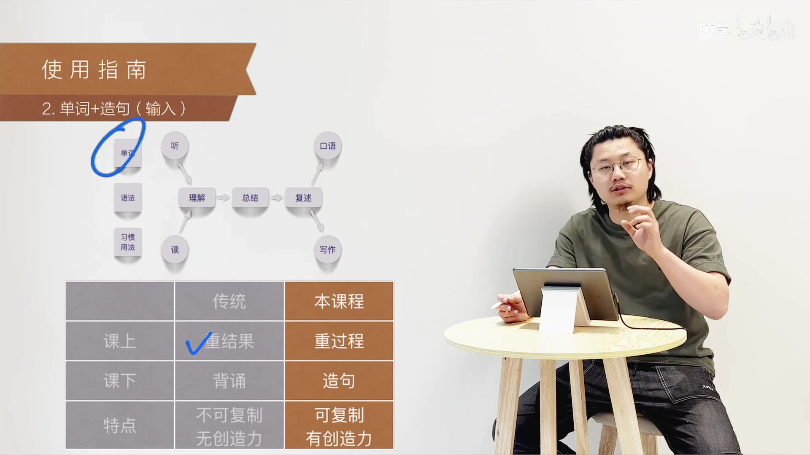

文字识别：使用指南 / 2.单词+造句（输入） / 听 / 口语 / 单记 / 语法 / 理解 / 总结 / 复述 / 习惯 / 用法 / 读 / 写作 / 传统 / 本课程 / 课上 / 重结果 / 重过程 / 课下 / 背诵 / 造句 / 不可复制 / 可复制 / 特点 / 无创造力 / 有创造力

### 画面 00:04:35

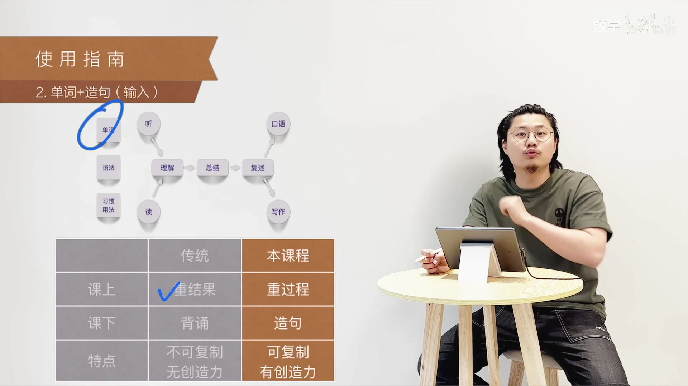

文字识别：使用指南 / 2.单词+造句（输入） / 听 / 口语 / 语法 / 理解 / 总结 / 复述 / 习惯 / 用法 / 读 / 写作 / 传统 / 本课程 / 课上 / V重结果 / 重过程 / 课下 / 背诵 / 造句 / 不可复制 / 可复制 / 特点 / 无创造力 / 有创造力

### 画面 00:04:40

文字识别：胶字一棚 / 使用指南 / 2.单词+造句（输入） / 听 / 口语 / 单 / 语法 / 理解 / 总结 / 复述 / 习惯 / 用法 / 读 / 写作 / NO / wnn / 传统 / 本课程 / 课上 / 重结果 / 重过程 / 课下 / 背诵 / 造句 / 不可复制 / 可复制 / 特点 / 无创造力 / 有创造力

### 画面 00:04:45

文字识别：使用指南 / 2.单词+造句（输入） / 听 / 口语 / 单 / 语法 / 理解 / 总结 / 复述 / 习惯 / 用法 / 读 / 写作 / 传统 / 本课程 / 课上 / 重结果 / 重过程 / 课下 / 背诵 / 造句 / 不可复制 / 可复制 / 特点 / 无创造力 / 有创造力

### 画面 00:04:49

文字识别：胶学上 / 使用指南 / 2.单词+造句（输入） / 听 / 口语 / 语法 / 理解 / 总结 / 复述 / 习惯 / 用法 / 读 / 写作 / NO / WIR / 传统 / 本课程 / 课上 / 重结果 / 重过程 / 课下 / 背诵 / 造句 / 不可复制 / 可复制 / 特点 / 无创造力 / 有创造力

### 画面 00:04:51

文字识别：胶学 / 使用指南 / 2.单词+造句（输入） / 听 / 口语 / 单记 / 语法 / 理解 / 总结 / 复述 / 习惯 / 用法 / 读 / 写作 / 传统 / 本课程 / 课上 / 重结果 / 重过程 / 课下 / 背诵 / 造句 / 不可复制 / 可复制 / 特点 / 无创造力 / 有创造力

### 画面 00:04:55

文字识别：使用指南 / 2.单词+造句（输入） / 听 / 口语 / 单 / 语法 / 理解 / 总结 / 复述 / 习惯 / 用法 / 读 / 写作 / 传统 / 本课程 / 课上 / 重结果 / 重过程 / 课下 / 背诵 / 造句 / 不可复制 / 可复制 / 特点 / 无创造力 / 有创造力

## 00:05:00–00:05:30

仅重结果，更重过程。就我不仅会把句子放到那个地方，我会告诉你它是如何造出来的。祈求于教会你自己如何去造句。所以课下的时候呢，你不用去背我上课给你的那些例句。我需要你做的事情是自己去造句。这样的导致的事情是我们往往就非常这个可复制，然后呢，我们的这个造句的创造力呢，往往也就更强。接下来语法的

### 画面 00:05:00

文字识别：使用指南 / 2.单词+造句（输入） / 听 / 口语 / 单记 / 语法 / 理解 / 总结 / 复述 / 习惯 / 用法 / 读 / 写作 / 传统 / 本课程 / 课上 / 重结果 / 重过程 / 课下 / 背诵 / 造句 / 不可复制 / 可复制 / 特点 / 无创造力 / 有创造力

### 画面 00:05:05

文字识别：使用指南 / 2.单词+造句（输入） / 听 / 口语 / 语法 / 理解 / 总结 / 复述 / 习惯 / 用法 / 读 / 写作 / 传统 / 本课程 / 课上 / 重结果 / 重过程 / 课下 / 背诵 / 造句 / 不可复制 / 可复制 / 特点 / 无创造力 / 有创造力

### 画面 00:05:10

文字识别：胶字 / 使用指南 / 2.单词+造句（输入） / 听 / 口语 / 单记 / 语法 / 理解 / 总结 / 复述 / 习惯 / 用法 / 读 / 写作 / 传统 / 本课程 / 课上 / 重结果 / 重过程 / 课下 / 背诵 / 造句 / 不可复制 / 可复制 / 特点 / 无创造力 / 有创造力

### 画面 00:05:13

文字识别：胶学 / 使用指南 / 2.单词+造句（输入） / 听 / 口语 / 单记 / 语法 / 理解 / 总结 / 复述 / 习惯 / 用法 / 读 / 写作 / 传统 / 本课程 / 课上 / 重结果 / 重过程 / 课下 / 背诵 / 造句 / 不可复制 / 可复制 / 特点 / 无创造力 / 有创造力

### 画面 00:05:15

文字识别：使用指南 / 2.单词+造句（输入） / 听 / 口语 / 单记 / 语法 / 理解 / 总结 / 复述 / 习惯 / 用法 / 读 / 写作 / 传统 / 本课程 / 课上 / 重结果 / 重过程 / 课下 / 背诵 / 造句 / 不可复制 / 可复制 / 特点 / 无创造力 / 有创造力

### 画面 00:05:18

文字识别：使用指南 / 2.单词+造句（输入） / 听 / 口语 / 单讯 / 语法 / 理解 / 总结 / 复述 / 习惯 / 用法 / 读 / 写作 / ND / WIR / 传统 / 本课程 / 课上 / 重结果 / 重过程 / 课下 / 背诵 / 造句 / 不可复制 / 可复制 / 特点 / 无创造力 / 有创造力

### 画面 00:05:20

文字识别：使用指南 / 2.单词+造句（输入） / 听 / 口语 / 单讯 / 语法 / 理解 / 总结 / 复述 / 习惯 / 用法 / 读 / 写作 / NO / WAR / 传统 / 本课程 / 课上 / 重结果 / 重过程 / 课下 / 背诵 / 造句 / 不可复制 / 可复制 / 特点 / 无创造力 / 有创造力

### 画面 00:05:27

文字识别：使用指南 / 练习（输入） / 听 / 口语 / 单词 / 语法 / 理解 / 总结 / 复述 / 习惯 / 用法 / 读 / 写作 / NO / WnR / 传统 / 本课程 / 重教 / 重教 / 课上 / 轻听力口语 / 重听力口语

### 画面 00:05:29

文字识别：使用指南 / 3.语法+练习（输入） / 听 / 口语 / 单词 / 语法 / 理解 / 总结 / 复述 / 习惯 / 用法 / 读 / 写作 / 传统 / 本课程 / 重教 / 重教 / 课上 / 轻听力口语 / 重听力口语

## 00:05:30–00:06:00

部分，我们的语法呢，其实跟传统课程本质上没有太大的区别，我们都是同样的非常重教。但是传统课程，各位要注意啊，语法它不仅仅出现在我们的写作和阅读当中，也出现了在我们的听力和口语当中。很多同学来学新概念的时候，期冀于的是有一天能张开嘴跟外国人去沟通，能听懂别人说的话，能跟别人沟通，对吧？能说出来自己想说的话。

### 画面 00:05:31

文字识别：胶学 / 使用指南 / 3.语法+练习（输入） / 听 / 口语 / 单词 / 语法 / 理解 / 总结 / 复述 / 习惯 / 用法 / 读 / 写作 / 传统 / 本课程 / 重教 / 重教 / 课上 / 轻听力口语 / 重听力口语

### 画面 00:05:35

文字识别：胶学一脚 / 使用指南 / 3.语法+练习（输入） / 听 / 口语 / 单词 / 语法 / 理解 / 总结 / 复述 / 习惯 / 用法 / 读 / 写作 / ND / WIR / 传统 / 本课程 / 重教 / 重教 / 课上 / 轻听力口语 / 重听力口语

### 画面 00:05:37

文字识别：胶学一期 / 使用指南 / 3.语法+练习（输入） / 听 / 口语 / 单词 / 语法 / 理解 / 总结 / 复述 / 习惯 / 用法 / 读 / 写作 / NO / WAR / 传统 / 本课程 / 重教 / 重教 / 课上 / 轻听力口语 / 重听力口语

### 画面 00:05:40

文字识别：使用指南 / 3.语法+练习（输入） / 听 / 口语 / 单词 / 语法 / 理解 / 总结 / 复述 / 习惯 / 用法 / 读 / 写作 / 传统 / 本课程 / 重教 / 重教 / 课上 / 轻听力口语 / 重听力口语

### 画面 00:05:45

文字识别：使用指南 / 3.语法+练习（输入） / 听 / 口语 / 单词 / 语法 / 理解 / 总结 / 复述 / 习惯 / 用法 / 读 / 写作 / NO / UR / 传统 / 本课程 / 重教 / 重教 / 课上 / 轻听力口语 / 重听力口语

### 画面 00:05:49

文字识别：胶字一 / 使用指南 / 3.语法+练习（输入） / 听 / 口语 / 单词 / 语法 / 理解 / 总结 / 复述 / 习惯 / 用法 / 读 / 写作 / 传统 / 本课程 / 重教 / 重教 / 课上 / 轻听力口语 / 重听力口语

### 画面 00:05:51

文字识别：使用指南 / 3.语法+练习（输入） / 听 / 口语 / 单词 / 语法 / 理解 / 总结 / 复述 / 习惯 / 用法 / 读 / 写作 / NU / WIR / 传统 / 本课程 / 重教 / 重教 / 课上 / 轻听力口语 / 重听力口语

### 画面 00:05:56

文字识别：使用指南 / 3.语法+练习（输入） / 听 / 口语 / 单词 / 语法 / 理解 / 总结 / 复述 / 习惯 / 用法 / 读 / 写作 / 传统 / 本课程 / 重教 / 重教 / 课上 / 轻听力口语 / 重听力口语

## 00:06:00–00:06:30

那所有的句子当中，多少都是包含语法的。如果不练，当然是不行的，对吧？所以我们的语法教学呢，又会有一个特点，我们比较重听力、口语练习。好，那我们再看第四个啊，叫做文章加习惯用法，这依旧是我们进行一个输入。传统课堂上，你可以去看，它有一个习惯，就是给你大量的课堂笔记啊，就是不停的给你拓展、拓展、再拓展，然后你会发现你记了非

### 画面 00:06:00

文字识别：胶学一 / 使用指南 / 3.语法+练习（输入） / 听 / 口语 / 单词 / 语法 / 理解 / 总结 / 复述 / 习惯 / 用法 / 读 / 写作 / 传统 / 本课程 / 重教 / 重教 / 课上 / 轻听力口语 / 重听力口语

### 画面 00:06:05

文字识别：使用指南 / 3.语法+练习（输入） / 听 / 口语 / 单词 / 语法 / 理解 / 总结 / 复述 / 习惯 / 用法 / 读 / 写作 / 传统 / 本课程 / 重教 / 重教 / 课上 / 轻听力口语 / 重听力口语

### 画面 00:06:09

文字识别：使用指南 / 3.语法+练习（输入） / 听 / 口语 / 单词 / 语法 / 理解 / 总结 / 复述 / 习惯 / 用法 / 读 / 写作 / 传统 / 本课程 / 重教 / 重教 / 课上 / 轻听力口语 / 重听力口语

### 画面 00:06:11

文字识别：使用指南 / 3.语法+东习（输入） / 听 / 口语 / 单词 / 语法 / 理解 / 总结 / 复述 / 习惯 / 用法 / 读 / 写作 / WIIR / NO / 传统 / 本课程 / 重教 / 重教 / 课上 / 轻听力口语 / 重听力口语

### 画面 00:06:13

文字识别：使用指南 / 4.文章+习惯用法（输入） / 听 / 口语 / 单词 / 语法 / 理解 / 总结 / 复述 / 习惯 / 用法 / 读 / 写作 / 传统 / 本课程 / 重拓展 / 轻拓展 / 课上 / 大量笔记 / 大量造句 / 课下 / 背诵 / 跟读+复述

### 画面 00:06:15

文字识别：使用指南 / 4.文章+习惯用法（输入） / 听 / 口语 / 单词 / 语法 / 理解 / 总结 / 复述 / 习惯 / 用法 / 读 / 写作 / NO / WIR / 传统 / 本课程 / 重拓展 / 轻拓展 / 课上 / 大量笔记 / 大量造句 / 课下 / 背诵 / 跟读+复述

### 画面 00:06:20

文字识别：使用指南 / 4.文章+习惯用法（输入） / 听 / 口语 / 单词 / 语法 / 理解 / 总结 / 复述 / 习惯 / 用法 / 读 / 写作 / 传统 / 本课程 / 重拓展 / 轻拓展 / 课上 / 大量笔记 / 大量造句 / 课下 / 背诵 / 跟读+复述

### 画面 00:06:23

文字识别：使用指南 / 4.文章+习惯用法（输入） / 听 / 口语 / 单词 / 语法 / 理解 / 总结 / 复述 / 习惯 / 用法 / 读 / 写作 / 传统 / 本课程 / 重拓展 / 轻拓展 / 课上 / 大量笔记 / 大量造句 / 课下 / 背诵 / 跟读+复述

### 画面 00:06:25

文字识别：使用指南 / 4.文章+习惯用法（输入） / 听 / 口语 / 单词 / 语法 / 理解 / 总结 / 复述 / 习惯 / 用法 / 读 / 写作 / NO / WAR / 传统 / 本课程 / 重拓展 / 轻拓展 / 课上 / 大量笔记 / 大量造句 / 课下 / 背诵 / 跟读+复述

## 00:06:30–00:07:00

常多的笔记，对吧？它的结果是什么？就是刚才我说的大量的笔记。那你奇迹于你课下做的事情，实际上就是自己去进行一个背诵，背诵文章也好，背诵老师上课讲的那些习惯用法或者扩展的东西也好，对吧？好，我在这个地方呢，我们是轻扩展的，我们不会给进行一个大量的扩展，扩展，对吧？原因是什么呢？原因是这里其实有两个原因。第一个呀，大量的扩展这样的备课方式其实是有一点偷

### 画面 00:06:30

文字识别：使用指南 / 4.文章+习惯用法（输入） / 听 / 口语 / 单词 / 语法 / 理解 / 总结 / 复述 / 习惯 / 用法 / 读 / 写作 / 传统 / 本课程 / 重拓展 / 轻拓展 / 课上 / 大量笔记 / 大量造句 / 课下 / 背诵 / 跟读+复述

### 画面 00:06:35

文字识别：使用指南 / 4.文章+习惯用法（输入） / 听 / 口语 / 单词 / 语法 / 理解 / 总结 / 复述 / 习惯 / 用法 / 读 / 写作 / NU / WHR / 传统 / 本课程 / 重拓展 / 轻拓展 / 课上 / 大量笔记 / 大量造句 / 课下 / 背诵 / 跟读+复述

### 画面 00:06:40

文字识别：使用指南 / 4.文章+习惯用法（输入） / 听 / 口语 / 单词 / 语法 / 理解 / 总结 / 复述 / 习惯 / 用法 / 读 / 写作 / NO / WAR / 传统 / 本课程 / 重拓展 / 轻拓展 / 课上 / 大量笔记 / 大量造句 / 课下 / 背诵 / 跟读+复述

### 画面 00:06:45

文字识别：使用指南 / 4.文章+习惯用法（输入） / 听 / 口语 / 单词 / 语法 / 理解 / 总结 / 复述 / 习惯 / 用法 / 读 / 写作 / NO / WIR / 传统 / 本课程 / 重拓展 / 轻拓展 / 课上 / 大量笔记 / 大量造句 / 课下 / 背诵 / 跟读+复述

### 画面 00:06:50

文字识别：使用指南 / 4.文章+习惯用法（输入） / 听 / 口语 / 单词 / 语法 / 理解 / 总结 / 复述 / 习惯 / 用法 / 读 / 写作 / NI / WnR / 传统 / 本课程 / 重拓展 / 轻拓展 / 课上 / 大量笔记 / 大量造句 / 课下 / 背诵 / 跟读+复述

### 画面 00:06:55

文字识别：使用指南 / 4.文章+习惯用法（输入） / 听 / 口语 / 单词 / 语法 / 理解 / 总结 / 复述 / 习惯 / 用法 / 读 / 写作 / 传统 / 本课程 / 重拓展 / 轻拓展 / 课上 / 大量笔记 / 大量造句 / 课下 / 背诵 / 跟读+复述

## 00:07:00–00:07:30

懒的，原因是各位可以上网去查，有一个东西叫做《新概念二册完美课堂笔记》，是这么一个 PDF 文件或者 Word 文件啊。你把很多里边的东西粘贴复制过来，那直接就是很多老师的讲义了啊，很多老师的呃这个 PowerPoint 了，对吧？好，那其实我们真的把那些东西都拿过来，你也不可能全背下来，它也没有办法帮我们去使用。所以，我们选择的事情是轻扩展，我们不去进行扩展，但是呢，我教

### 画面 00:07:00

文字识别：使用指南 / 4.文章+习惯用法（输入） / 听 / 口语 / 单词 / 语法 / 理解 / 总结 / 复述 / 习惯 / 用法 / 读 / 写作 / 传统 / 本课程 / 重拓展 / 轻拓展 / 课上 / 大量笔记 / 大量造句 / 课下 / 背诵 / 跟读+复述

### 画面 00:07:06

文字识别：使用指南 / 4.文章+习惯用法（输入） / 听 / 口语 / 单词 / 语法 / 理解 / 总结 / 复述 / 习惯 / 用法 / 读 / 写作 / NU / 传统 / 本课程 / 重拓展 / 轻拓展 / 课上 / 大量笔记 / 大量造句 / 课下 / 背诵 / 跟读+复述

### 画面 00:07:10

文字识别：使用指南 / 4.文章+习惯用法（输入） / 听 / 口语 / 单词 / 语法 / 理解 / 总结 / 复述 / 习惯 / 用法 / 读 / 写作 / NO / WIR / 传统 / 本课程 / 重拓展 / 轻拓展 / 课上 / 大量笔记 / 大量造句 / 课下 / 背诵 / 跟读+复述

### 画面 00:07:15

文字识别：使用指南 / 4.文章+习惯用法（输入） / 听 / 口语 / 单词 / 语法 / 理解 / 总结 / 复述 / 习惯 / 用法 / 读 / 写作 / NUI / WII / 传统 / 本课程 / 重拓展 / 轻拓展 / 课上 / 大量笔记 / 大量造句 / 课下 / 背诵 / 跟读+复述

### 画面 00:07:20

文字识别：使用指南 / 4.文章+习惯用法（输入） / 听 / 口语 / 单词 / 语法 / 理解 / 总结 / 复述 / 习惯 / 用法 / 读 / 写作 / NU / WIu / 传统 / 本课程 / 重拓展 / 轻拓展 / 课上 / 大量笔记 / 大量造句 / 课下 / 背诵 / 跟读+复述

### 画面 00:07:23

文字识别：使用指南 / 4.文章+习惯用法（输入） / 听 / 口语 / 单词 / 语法 / 理解 / 总结 / 复述 / 习惯 / 用法 / 读 / 写作 / WIiR / 传统 / 本课程 / 重拓展 / 轻拓展 / 课上 / 大量笔记 / 大量造句 / 课下 / 背诵 / 跟读+复述

### 画面 00:07:25

文字识别：使用指南 / 4.文章+习惯用法（输入） / 听 / 口语 / 单词 / 语法 / 理解 / 总结 / 复述 / 习惯 / 用法 / 读 / 写作 / 传统 / 本课程 / 重拓展 / 轻拓展 / 课上 / 大量笔记 / 大量造句 / 课下 / 背诵 / 跟读+复述

### 画面 00:07:29

文字识别：使用指南 / 4.文章+习惯用法（输入） / 听 / 口语 / 单词 / 语法 / 理解 / 总结 / 复述 / 习惯 / 用法 / 读 / 写作 / NO / WIIR / 传统 / 本课程 / 重拓展 / 轻拓展 / 课上 / 大量笔记 / 大量造句 / 课下 / 背诵 / 跟读+复述

## 00:07:30–00:08:00

你进行一个大量的造句。OK，所以，我那我们对于文章呢，下课要做的事情是进行大量的跟读。如果您学过我们新概念一册呢，那你就很清楚跟读是什么。如果没学过呢，我在这补充一句，也就是说，我不是让各位下载了一个手机里的APP吗？对吧？有新概念的音频跟读，他读一句，你跟着去读一句，这就叫跟读，对吧？你去进行跟读，到最后达到一个熟读成诵啊，读到非

### 画面 00:07:31

文字识别：使用指南 / 4.文章+习惯用法（输入） / 听 / 口语 / 单词 / 语法 / 理解 / 总结 / 复述 / 习惯 / 用法 / 读 / 写作 / NO / WIR / 传统 / 本课程 / 重拓展 / 轻拓展 / 课上 / 大量笔记 / 大量造句 / 课下 / 背诵 / 跟读+复述

### 画面 00:07:35

文字识别：使用指南 / 4.文章+习惯用法（输入） / 听 / 口语 / 单词 / 语法 / 理解 / 总结 / 复述 / 习惯 / 用法 / 读 / 写作 / 传统 / 本课程 / 重拓展 / 轻拓展 / 课上 / 大量笔记 / 大量造句 / 课下 / 背诵 / 跟读+复述

### 画面 00:07:40

文字识别：使用指南 / 4.文章+习惯用法（输入） / 听 / 口语 / 单词 / 语法 / 理解 / 总结 / 复述 / 习惯 / 用法 / 读 / 写作 / NU / 传统 / 本课程 / 重拓展 / 轻拓展 / 课上 / 大量笔记 / 大量造句 / 课下 / 背诵 / 跟读+复述

### 画面 00:07:45

文字识别：使用指南 / 4.文章+习惯用法（输入） / 听 / 口语 / 单词 / 语法 / 理解 / 总结 / 复述 / 习惯 / 用法 / 读 / 写作 / 传统 / 本课程 / 重拓展 / 轻拓展 / 课上 / 大量笔记 / 大量造句 / 课下 / 背诵 / 跟读+复述

### 画面 00:07:50

文字识别：使用指南 / 4.文章+习惯用法（输入） / 听 / 口语 / 单词 / 语法 / 理解 / 总结 / 复述 / 习惯 / 用法 / 读 / 写作 / NO / WAR / 传统 / 本课程 / 重拓展 / 轻拓展 / 课上 / 大量笔记 / 大量造句 / 课下 / 背诵 / 跟读+复述

### 画面 00:07:55

文字识别：使用指南 / 4.文章+习惯用法（输入） / 听 / 口语 / 单词 / 语法 / 理解 / 总结 / 复述 / 习惯 / 用法 / 读 / 写作 / NU / WIIR / 传统 / 本课程 / 重拓展 / 轻拓展 / 课上 / 大量笔记 / 大量造句 / 课下 / 背诵 / 跟读+复述

## 00:08:00–00:08:30

常熟，以至于能背下来的一个级别，然后再去进行我们设计的一个叫复述练习。一会儿接下来我们看，好吧？这个部分我们管它叫听说读写加复述啊，括号叫输出。我们之前都是输入，到这儿终于开始输出了。传统课堂上啊，各位可以还是去对比或者你回想，这个环节几乎是没有的。我们不进行太多的听说读写，基本上课上的事情就是老师不停的讲，你

### 画面 00:08:00

文字识别：使用指南 / 4.文章+习惯用法（输入） / 听 / 口语 / 单词 / 语法 / 理解 / 总结 / 复述 / 习惯 / 用法 / 读 / 写作 / NU / WIR / 传统 / 本课程 / 重拓展 / 轻拓展 / 课上 / 大量笔记 / 大量造句 / 课下 / 背诵 / 跟读+复述

### 画面 00:08:03

文字识别：使用指南 / 4.文章+习惯用法（输入） / 听 / 口语 / 单词 / 语法 / 理解 / 总结 / 复述 / 习惯 / 用法 / 读 / 写作 / NU / W / 传统 / 本课程 / 重拓展 / 轻拓展 / 课上 / 大量笔记 / 大量造句 / 课下 / 背诵 / 跟读复述

### 画面 00:08:05

文字识别：使用指南 / 4.文章+习惯用法（输入） / 听 / 口语 / 单词 / 语法 / 理解 / 总结 / 复述 / 习惯 / 用法 / 读 / 写作 / NU / WIR / 传统 / 本课程 / 重拓展 / 轻拓展 / 课上 / 大量笔记 / 大量造句 / 课下 / 背诵 / 跟读复述

### 画面 00:08:08

文字识别：使用指南 / 5.听说读写+复述（输出） / 听 / 口语 / 单词 / 语法 / 理解 / 总结 / 复述 / 习惯 / 用法 / 读 / 写作 / 传统 / 本课程 / Ask me if / Comprehension / Pattern Drill / 比较少 / Tell the Story / Summary Writing / Topic for Discussion

### 画面 00:08:10

文字识别：使用指南 / 5.听说读写+复述（输出） / 听 / 口语 / 单词 / 语法 / 理解 / 总结 / 复述 / 习惯 / 用法 / 读 / 写作 / NU / WIR / 传统 / 本课程 / Ask me if / Comprehension / Pattern Drill / 比较少 / Tell the Story / Summary Writing / Topic for Discussion

### 画面 00:08:15

文字识别：使用指南 / 5.听说读写+复述（输出） / 听 / 口语 / 单词 / 语法 / 理解 / 总结 / 复述 / 习惯 / 用法 / 读 / 写作 / 传统 / 本课程 / Ask me if / Comprehension / Pattern Drill / 比较少 / Tell the Story / Summary Writing / Topic for Discussion

### 画面 00:08:20

文字识别：使用指南 / 5.听说读写+复述（输出） / 听 / 口语 / 单词 / 语法 / 理解 / 总结 / 复述 / 习惯 / 用法 / 读 / 写作 / 传统 / 本课程 / Ask me if / Comprehension / Pattern Drill / 比较少 / Tell the Story / Summary Writing / Topic for Discussion

### 画面 00:08:23

文字识别：使用指南 / 5.听说读写+复述（输出） / 听 / 口语 / 单词 / 语法 / 理解 / 总结 / 复述 / 习惯 / 用法 / 读 / 写作 / 传统 / 本课程 / Ask me if / Comprehension / Pattern Drill / 比饺少 / Tell the Story / Summary Writing / Topic for Discussion

### 画面 00:08:25

文字识别：使用指南 / 5.听说读写+复述（输出） / 听 / 口语 / 单词 / 语法 / 理解 / 总结 / 复述 / 习惯 / 用法 / 读 / 写作 / 传统 / 本课程 / Ask me if / Comprehension / Pattern Drill / 比交少 / Tell the Story / Summary Writing / Topic for Discussion

### 画面 00:08:28

文字识别：使用指南 / 5.听说读写+复述（输出） / 听 / 口语 / 单词 / 语法 / 理解 / 总结 / 复述 / 习惯 / 用法 / 读 / 写作 / NU / WOR / 传统 / 本课程 / Ask me if / Comprehension / Pattern Drill / 比交少 / Tell the Story / Summary Writing / Topic for Discussion

## 00:08:30–00:09:00

不停的记笔记，对吧？然后学了一册书、两册书了之后，你还纳闷一个事儿，叫做为啥我听不懂、说不出来、也写不明白，对吧？好，原因是这些技能你从来就没练过。但我们呢，在课程上设置了这么多的练习。如果您学过我的新一 Ask me if 和 comprehension 这两个练习，你应该非常的熟悉了，全是口语和听力的练习，对吧？那接下来的这些呢，是我们新二特有的。

### 画面 00:08:30

文字识别：使用指南 / 5.听说读写+复述（输出） / 听 / 口语 / 单词 / 语法 / 理解 / 总结 / 复述 / 习惯 / 用法 / 读 / 写作 / 传统 / 本课程 / Ask me if / Comprehension / Pattern Drill / 比饺少 / Tell the Story / Summary Writing / Topic for Discussion

### 画面 00:08:35

文字识别：使用指南 / 5.听说读写+复述（输出） / 听 / 口语 / 单词 / 语法 / 理解 / 总结 / 复述 / 习惯 / 用法 / 读 / 写作 / NU / 传统 / 本课程 / Ask me if / Comprehension / Pattern Drill / 比饺少 / Tell the Story / Summary Writing / Topic for Discussion

### 画面 00:08:40

文字识别：使用指南 / 5.听说读写+复述（输出） / 听 / 口语 / 单词 / 语法 / 理解 / 总结 / 复述 / 习惯 / 用法 / 读 / 写作 / 传统 / 本课程 / Ask me if / Comprehension / Pattern Drill / 比饺少 / Tell the Story / Summary Writing / Topic for Discussion

### 画面 00:08:45

文字识别：使用指南 / 5.听说读写+复述（输出） / 听 / 口语 / 单词 / 语法 / 理解 / 总结 / 复述 / 习惯 / 用法 / 读 / 写作 / WR / 传统 / 本课程 / Ask me if / Comprehension / Pattern Drill / 比饺少 / Tell the Story / Summary Writing / Topic for Discussion

### 画面 00:08:50

文字识别：使用指南 / 5.听说读写+复述（输出) / 听 / 口语 / 单词 / 语法 / 理解 / 总结 / 复述 / 习惯 / 用法 / 读 / 写作 / 传统 / 本课程 / Ask me if / Comprehension / Pattern Drill / 比交少 / Tell the Story / Summary Writing / Topic for Discussion

### 画面 00:08:53

文字识别：使用指南 / 5.听说读写+复述（输出） / 听 / 口语 / 单词 / 语法 / 理解 / 总结 / 复述 / 习惯 / 用法 / 读 / 写作 / NO / WIR / 传统 / 本课程 / Ask me if / Comprehension / Pattern Drill / 比饺少 / Tell the Story / Summary Writing / Topic for Discussion

### 画面 00:08:55

文字识别：使用指南 / 5.听说读写+复述（输出） / 听 / 口语 / 单词 / 语法 / 理解 / 总结 / 复述 / 习惯 / 用法 / 读 / 写作 / NO / WIR / 传统 / 本课程 / Ask me if / Comprehension / Pattern Drill / 比饺少 / Tell the Story / Summary Writing / Topic for Discussion

### 画面 00:08:57

文字识别：使用指南 / 5.听说读写+复述（输出） / 听 / 口语 / 单词 / 语法 / 理解 / 总结 / 复述 / 习惯 / 用法 / 读 / 写作 / NO / WnR / 传统 / 本课程 / Ask me if / Comprehension / Pattern Drill / 比交少 / Tell the Story / Summary Writing / Topic for Discussion

## 00:09:00–00:09:30

等各位进入课程了之后，就能了解了。OK，所以这个是我们课程的一个比较独特的地方啊，给大家添加了大量的听说读写练习。好，那接下来呢，这个部分呢，我还是想给各位简单的说一下啊。这段文字我们摘抄自《新概念二册》的开篇，亚历山大写在最前面的，我认为非常的精彩，所以给大家读一下。我们他说，学习一门语言不仅仅是掌握一套规则，积

### 画面 00:09:00

文字识别：使用指南 / 5.听说读写+复述（输出） / 听 / 口语 / 单词 / 语法 / 理解 / 总结 / 复述 / 习惯 / 用法 / 读 / 写作 / 传统 / 本课程 / Ask me if / Comprehension / Pattern Drill / 比交少 / Tell the Story / Summary Writing / Topic for Discussion

### 画面 00:09:05

文字识别：使用指南 / 5.听说读写+复述（输出） / 听 / 口语 / 单词 / 语法 / 理解 / 总结 / 复述 / 习惯 / 用法 / 读 / 写作 / NUl / WIR / 传统 / 本课程 / Ask me if / Comprehension / Pattern Drill / 比交少 / Tell the Story / Summary Writing / Topic for Discussion

### 画面 00:09:10

文字识别：胶学 / 使用指南 / 输出 / NO / 学习一门语言，不仅仅是掌握一套规则，积累大量词汇。教师工作的重点不应是告诉学生关于一门语言的 / 知识，而应是使学生能够使用这门语言。衡量学生是否掌握一门语言，最终是要看他运用如何，而不是懂 / 了多少。在这面，学习语言与学习乐器十分形似，学生所做的操练与练习都是为了达到一个明确的目 / 标：使他成为个熟练的操作者。个学学了许多语法知识却不会运语，就像个弹钢琴的学了许 / 多有关和声的知识却不会钢琴样。因此，衡量学是否掌握语并不看他懂了多少，要看他在众面 / 前语言运用的得如何。

### 画面 00:09:12

文字识别：胶学一州 / 使用指南 / 5.听说读写+复述（输出） / NO / wiit / 学习一门语言，不仅仅是掌握一套规则，积累大量词汇。教师工作的重点不应是告诉学生关于一门语言的 / 知识，而应是使学生能够使用这门语言。衡量学生是否掌握一门语言，最终是要看他运用如何，而不是懂 / 了多少。在这方面，学习语言与学习乐器十分形似，学生所做的操练与练习都是为了达到一个明确的目 / 标：使他成为个熟练的操作者。个学学了许多语法知识却不会运语，就像个弹钢琴的学了许 / 多有关和声的知识却不会钢琴样。因此，衡量学是否掌握语并不看他懂了多少，要看他在众 / 前语言运用的得如何。

### 画面 00:09:15

文字识别：胶学 / 使用指南 / 5.听说读写+复述（输出） / 学习一门语言，不仅仅是掌握一套规则，积累大量词汇。教师工作的重点不应是告诉学生关于一门语言的 / 知识，而应是使学生能够使用这门语言。衡量学生是否掌握一门语言，最终是要看他运用如何，而不是懂 / 了多少。在这方面，学习语言与学习乐器十分形似，学生所做的操练与练习都是为了达到一个明确的目 / 标：使他成为个熟练的操作者。个学学了许多语法知识却不会运语，就像个弹钢琴的学了许 / 多有关和声的知识却不会钢琴样。因此，衡量学是否掌握语并不看他懂了多少，而要看他在众面 / 前语言运用的得如何。

### 画面 00:09:25

文字识别：胶学 / 使用指南 / 5.听说读写+复述（输出） / 学习一门语言，不仅仅是掌握一套规则，积累大量词汇。教师工作的重点不应是告诉学生关于一门语言的 / 知识，而应是使学生能够使用这门语言。衡量学生是否掌握一门语言，最终是要看他运用如何，而不是懂 / 了多少。在这方面，学习语言与学习乐器十分形似，学生所做的操练与练习都是为了达到一个明确的目 / 标：使他成为个熟练的操作者。个学学了许多语法知识却不会运语，就像个弹钢琴的学了许 / 多有关和声的知识却不会钢琴样。因此，衡量学是否掌握语并不看他懂了多少，而要看他在众 / 前语言运用的得如何。

## 00:09:30–00:10:00

累大量词汇，积累大量词汇是很多人认为学语言非常核心的一件事情，对吧？那掌握一套规则其实就是语法。注意，他说的是不仅仅是，也就是说只有这两者是不够的。那我们还要做什么呢？我们接着往下看。他说，教师工作的重点不应是告诉学生关于一门语言的知识，而应是使学生能够使用这门语言。好，告诉关于一门语言的知识，就

### 画面 00:09:30

文字识别：胶学 / 使用指南 / 5.听说读写+复述（输出） / 学习一门语言，不仅仅是掌握一套规则，积累大量词汇。教师工作的重点不应是告诉学生关于一门语言的 / 知识，而应是使学生能够使用这门语言。衡量学生是否掌握一门语言，最终是要看他运用如何，而不是懂 / 了多少。在这方面，学习语言与学习乐器十分形似，学生所做的操练与练习都是为了达到一个明确的目 / 标：使他成为个熟练的操作者。个学学了许多语法知识却不会运语，就像个弹钢琴的学了许 / 多有关和声的知识却不会钢琴样。因此，衡量学是否掌握语并不看他懂了多少，要看他在众 / 前语言运用的得如何。

### 画面 00:09:35

文字识别：胶字一 / 使用指南 / 5.听说读写+复述（输出） / NI / HIR / 学习一门语言，不仅仅是掌握一套规则，积累大量词汇。教师工作的重点不应是告诉学生关于一门语言的 / 知识，而应是使学生能够使用这门语言。衡量学生是否掌握一门语言，最终是要看他运用如何，而不是懂 / 了多少。在这方面，学习语言与学习乐器十分形似，学生所做的操练与练习都是为了达到一个明确的目 / 标：使他成为个熟练的操作者。个学学了许多语法知识却不会运语，就像个弹钢琴的学了许 / 多有关和声的知识却不会钢琴样。因此，衡量学是否掌握语并不看他懂了多少，要看他在众面 / 前语言运用的得如何。

### 画面 00:09:40

文字识别：胶字编 / 使用指南 / 5.听说读写+复述（输出） / ND / WnR / 学习一门语言，不仅仅是掌握一套规则，积累大量词汇。教师工作的重点不应是告诉学生关于一门语言的 / 知识，而应是使学生能够使用这门语言。衡量学生是否掌握一门语言，最终是要看他运用如何，而不是懂 / 了多少。在这方面，学习语言与学习乐器十分形似，学生所做的操练与练习都是为了达到一个明确的目 / 标：使他成为个熟练的操作者。个学学了许多语法知识却不会运语，就像个弹钢琴的学了许 / 多有关和声的知识却不会钢琴样。因此，衡量学是否掌握语并不看他懂了多少，要看他在众面 / 前语言运用的得如何。

### 画面 00:09:45

文字识别：胶学 / 使用指南 / 5.听说读写+复述（输出） / NO / WAR / 学习一门语言，不仅仅是掌握一套规则，积累大量词汇。教师工作的重点不应是告诉学生关于一门语言的 / 知识，而应是使学生能够使用这门语言。衡量学生是否掌握一门语言，最终是要看他运用如何，而不是懂 / 了多少。在这方面，学习语言与学习乐器十分形似，学生所做的操练与练习都是为了达到一个明确的目 / 标：使他成为个熟练的操作者。个学学了许多语法知识却不会运语，就像个弹钢琴的学了许 / 多有关和声的知识却不会钢琴样。因此，衡量学是否掌握语并不看他懂了多少，要看他在众面 / 前语言运用的得如何。

### 画面 00:09:50

文字识别：胶学 / 使用指南 / 5.听说读写+复述（输出） / 学习一门语，不仅仅是掌握一套规则，积累大量词汇。教师工作的重点不应是告诉学生关于一门语言的 / 知识，而应是使学生能够使用这门语言。衡量学生是否掌握一门语言，最终是要看他运用如们 / 而不是懂 / 了多少。在这方面，学习语言与学习乐器十分形似，学生所做的操练与练习都是为了达到一个明确的目 / 标：使他成为个熟练的操作者。个学学了许多语法知识却不会运语，就像个弹钢琴的学了许 / 多有关和声的知识却不会钢琴样。因此，衡量学是否掌握语并不看他懂了多少，要看他在众 / 前语言运用的得如何。

### 画面 00:09:55

文字识别：胶学 / 使用指南 / 5.听说读写+复述（输出） / 学习一门语言，不仅仅是掌握一套规则，积累大量词汇。教师工作的重点不应是告诉学生关于一门语言的 / 知识，而应是使学生能够使用这门语言。衡量学生是否掌握一门语言，最终是要看他运用如何，而不是懂 / 了多少。在这方面，学习语言与学习乐器十分形似，学生所做的操练与练习都是为了达到一个明确的目 / 标：使他成为个熟练的操作者。个学学了许多语法知识却不会运语，就像个弹钢琴的学了许 / 多有关和声的知识却不会钢琴样。因此，衡量学是否掌握语并不看他懂了多少，要看他在众 / 前语言运用的得如何。

## 00:10:00–00:10:30

是我们传统课堂上几乎所有老师都非常擅长的事情，就是给你讲语法、讲单词，对吧？好，那如何使用、如何使学生使用这门语言呢？我们添加了各种各样的练习，单词造句、习惯用法造句、课下的跟读、复述等等。好，这就是让各位能使用这门语言的练习。接下来，说衡量学生是否掌握一门语言，最终要看他

### 画面 00:10:00

文字识别：胶学 / 使用指南 / 5.听说读写+复述（输出） / NU / WR / 学习一门语言，不仅仅是掌握一套规则，积累大量词汇。教师工作的重点不应是告诉学生关于一门语言的 / 知识，而应是使学生能够使用这门语言。衡量学生是否掌握一门语言，最终是要看他运用如何，而不是懂 / 了多少。在这方面，学习语言与学习乐器十分形似，学生所做的操练与练习都是为了达到一个明确的目 / 标：使他成为个熟练的操作者。个学学了许多语法知识却不会运语，就像个弹钢琴的学了许 / 多有关和声的知识却不会钢琴一样。因此，衡量学是否掌握语并不看他懂了多少，而要看他在众面 / 前语言运用的得如何。

### 画面 00:10:05

文字识别：胶字 / 使用指南 / 5.听说读写+复述（输出） / 学习一门语言，不仅仅是掌握一套规则，积累大量词汇。教师工作的重点不应是告诉学生关于一门语言的 / 知识，而应是使学生能够使用这门语言。衡量学生是否掌握一门语言，最终是要看他运用如何，而不是懂 / 了多少。在这方面，学习语言与学习乐器十分形似，学生所做的操练与练习都是为了达到一个明确的目 / 标：使他成为个熟练的操作者。个学学了许多语法知识却不会运语，就像个弹钢琴的学了许 / 多有关和声的知识却不会钢琴样。因此，衡量学是否掌握语并不看他懂了多少，而要看他在众面 / 前语言运用的得如何。

### 画面 00:10:10

文字识别：胶宇 / 使用指南 / 5.听说读写+复述（输出） / 学习一门语言，不仅仅是掌握一套规则，积累大量词汇。教师工作的重点不应是告诉学生关于一门语言的 / 知识，而应是使学生能够使用这门语言。衡量学生是否掌握一门语言，最终是要看他运用如何，而不是懂 / 了多少。在这方面，学习语言与学习乐器十分形似，学生所做的操练与练习都是为了达到一个明确的目 / 标：使他成为个熟练的操作者。个学学了许多语法知识却不会运语，就像个弹钢琴的学了许 / 多有关和声的知识却不会钢琴样。因此，衡量学是否掌握语并不看他懂了多少，要看他在众面 / 前语言运用的得如何。

### 画面 00:10:15

文字识别：胶学 / 使用指南 / 5.听说读写+复述（输出） / NUI / 学习一门语言，不仅仅是掌握一套规则，积累大量词汇。教师工作的重点不应是告诉学生关于一门语言的 / 知识，而应是使学生能够使用这门语言。衡量学生是否掌握一门语言，最终是要看他运用如何，而不是懂 / 了多少。在这方面，学习语言与学习乐器十分形似，学生所做的操练与练习都是为了达到一个明确的目 / 标：使他成为个熟练的操作者。一个学学了许多语法知识却不会运语，就像一个弹钢琴的学了许 / 多有关和声的知识却不会钢琴样。因此，衡量学是否掌握语并不看他懂了多少，要看他在众面 / 前语言运用的得如何。

### 画面 00:10:20

文字识别：胶学 / 使用指南 / 5.听说读写+复述（输出） / 学习一门语言，不仅仅是掌握一套规则，积累大量词汇。教师工作的重点不应是告诉学生关于一门语言的 / 知识，而应是使学生能够使用这门语言。衡量学生是否掌握一门语言，最终是要看他运用如何，而不是懂 / 了多少。在这方面，学习语言与学习乐器十分形似，学生所做的操练与练习都是为了达到一个明确的目 / 标：使他成为个熟练的操作者。个学学了许多语法知识却不会运语，就像个弹钢琴的学了许 / 多有关和声的知识却不会钢琴样。因此，衡量学是否掌握语并不看他懂了多少，要看他在众 / 前语言运用的得如何。

### 画面 00:10:25

文字识别：胶学 / 使用指南 / 5.听说读写+复述（输出） / 学习一门语言，不仅仅是掌握一套规则，积累大量词汇。教师工作的重点不应是告诉学生关于一门语言的 / 知识，而应是使学生能够使用这门语言。衡量学生是否掌握一门语言，最终是要看他运用如何，而不是懂 / 了多少。在这方面，学习语言与学习乐器十分形似，学生所做的操练与练习都是为了达到一个明确的目 / 标：使他成为个熟练的操作者。个学学了许多语法知识却不会运语，就像个弹钢琴的学了许 / 多有关和声的知识却不会钢琴样。因此，衡量学是否掌握语并不看他懂了多少，要看他在众 / 前语言运用的得如何。

## 00:10:30–00:11:00

运用如何，而不是懂了多少，对吧？好，还是那句话，各位，大多数学生啊，来到我们课堂的时候，你的目的不是成为一名语言学家或语法学家或者词源学学家，对吧？你想做的事情就是将来有一天，我能流利自如的使用这门语言就可以了。至于说我要特别仔细的去研究各个呃这个呃这个语法条例啊，单

### 画面 00:10:35

文字识别：胶学 / 使用指南 / 5.听说读写+复述（输出） / WIR / NO / 学习一门语言，不仅仅是掌握一套规则，积累大量词汇。教师工作的重点不应是告诉学生关于一门语言的 / 知识，而应是使学生能够使用这门语言。衡量学生是否掌握一门语言，最终是要看他运用如何，而不是懂 / 了多少。在这方面，学习语言与学习乐器十分形似，学生所做的操练与练习都是为了达到一个明确的目 / 标：使他成为个熟练的操作者。个学学了许多语法知识却不会运语，就像个弹钢琴的学了许 / 多有关和声的知识却不会钢琴样。因此，衡量学是否掌握语并不看他懂了多少，要看他在众面 / 前语言运用的得如何。

### 画面 00:10:40

文字识别：胶学 / 使用指南 / 5.听说读写+复述（输出） / NO / WNR / 学习一门语言，不仅仅是掌握一套规则，积累大量词汇。教师工作的重点不应是告诉学生关于一门语言的 / 知识，而应是使学生能够使用这门语言。衡量学生是否掌握一门语言，最终是要看他运用如何，而不是懂 / 了多少。在这方面，学习语言与学习乐器十分形似，学生所做的操练与练习都是为了达到一个明确的目 / 标：使他成为个熟练的操作者。个学学了许多语法知识却不会运语，就像个弹钢琴的学了许 / 多有关和声的知识却不会钢琴一样。因此，衡量学是否掌握语并不看他懂了多少，而要看他在众面 / 前语言运用的得如何。

### 画面 00:10:45

文字识别：胶学 / 使用指南 / 5.听说读写+复述（输出） / 学习一门语言，不仅仅是掌握一套规则，积累大量词汇。教师工作的重点不应是告诉学生关于一门语言的 / 知识，而应是使学生能够使用这门语言。衡量学生是否掌握一门语言，最终是要看他运用如何，而不是懂 / 了多少。在这方面，学习语言与学习乐器十分形似，学生所做的操练与练习都是为了达到一个明确的目 / 标：使他成为个熟练的操作者。个学学了许多语法知识却不会运语，就像个弹钢琴的学了许 / 多有关和声的知识却不会钢琴样。因此，衡量学是否掌握语并不看他懂了多少，要看他在众面 / 前语言运用的得如何。

### 画面 00:10:50

文字识别：胶学 / 使用指南 / 5.听说读写+复述（输出） / NU / 学习一门语言，不仅仅是掌握一套规则，，积累大量词汇。教师工作的重点不应是告诉学生关于一门语言的 / 知识，而应是使学生能够使用这门语言。衡量学生是否掌握一门语言，最终是要看他运用如何，而不是懂 / 了多少。在这面，学习语言与学习乐器十分形似，学生所做的操练与练习都是为了达到一个明确的目 / 标：使他成为个熟练的操作者。个学学了许多语法知识却不会运语，就像个弹钢琴的学了许 / 多有关和声的知识却不会钢琴样。因此，衡量学是否掌握语并不看他懂了多少，要看他在众面 / 前语言运用的得如何。

### 画面 00:10:55

文字识别：胶字渊 / 使用指南 / 5.听说读写+复述（输出） / NO / WnR / 学习一门语言，不仅仅是掌握一套规则，积累大量词汇。教师工作的重点不应是告诉学生关于一门语言的 / 知识，而应是使学生能够使用这门语言。衡量学生是否掌握一门语言，最终是要看他运用如何，而不是懂 / 了多少。在这方面，学习语言与学习乐器十分形似，学生所做的操练与练习都是为了达到一个明确的目 / 标：使他成为个熟练的操作者。个学学了许多语法知识却不会运语，就像个弹钢琴的学了许 / 多有关和声的知识却不会钢琴一样。因此，衡量学是否掌握语并不看他懂了多少，而要看他在众面 / 前语言运用的得如何。

## 00:11:00–00:11:30

词的词源这些不是各位要做的事情，对吧？各位要做的事情叫做看他运用如何，而不是你懂了多少啊！记住这句话，所以我们要用嘛，对吧？在这个方面呢，学习语言与学习乐器十分相似。学生所做的操练与练习都是为了达到一个明确的目标，使他成为一个熟练的操作者。好，接着往下看，说一个学生学了许多语法知识却不会运用语言，就像一个弹

### 画面 00:11:00

文字识别：胶学 / 使用指南 / 5.听说读写+复述（输出） / 学习一门语言，不仅仅是掌握一套规则，积累大量词汇。教师工作的重点不应是告诉学生关于一门语言的 / 知识，而应是使学生能够使用这门语言。衡量学生是否掌握一门语言，最终是要看他运用如何，而不是懂 / 了多少。在这方面，学习语言与学习乐器十分形似，学生所做的操练与练习都是为了达到一个明确的目 / 标：使他成为个熟练的操作者。个学学了许多语法知识却不会运语，就像个弹钢琴的学了许 / 多有关和声的知识却不会钢琴样。因此，衡量学是否掌握语并不看他懂了多少，而要看他在众面 / 前语言运用的得如何。

### 画面 00:11:10

文字识别：胶学 / 使用指南 / 5.听说读写+复述（输出） / 学习一门语言，不仅仅是掌握一套规则，，积累大量词汇。教师工作的重点不应是告诉学生关于一门语言的 / 知识，而应是使学生能够使用这门语言。衡量学生是否掌握一门语，最终是要看他运用如何，而不是懂 / 了多少。在这面，学习语言与学习乐器十分形似，学生所做的操练与练习都是为了达到一个明确的目 / 标：使他成为个熟练的操作者。个学学了许多语法知识却不会运语，就像个弹钢琴的学了许 / 多有关和声的知识却不会钢琴样。因此，衡量学是否掌握语并不看他懂了多少，而要看他在众面 / 前语言运用的得如何。

### 画面 00:11:15

文字识别：胶学 / 使用指南 / 5.听说读写+复述（输出） / 学习一门语言，不仅仅是掌握一套规则，积累大量词汇。教师工作的重点不应是告诉学生关于一门语言的 / 知识，而应是使学生能够使用这门语言。衡量学生是否掌握一门语，最终是要看他运用如何，而不是懂 / 了多少。在这方面，学习语言与学习乐器十分形似，学生所做的操练与练习都是为了达到一个明确的目 / 标：使他成为个熟练的操作者。个学学了许多语法知识却不会运语，就像一个弹钢琴的学了许 / 多有关和声的知识却不会钢琴一样。因此，衡量学是否掌握语并不看他懂了多少，要看他在众面 / 前语言运用的得如何。

### 画面 00:11:25

文字识别：胶学 / 使用指南 / 5.听说读写+复述（输出） / 学习一门语言，不仅仅是掌握一套规则，积累大量词汇。教师工作的重点不应是告诉学生关于一门语言的 / 知识，而应是使学生能够使用这门语言。衡量学生是否掌握一门语言，最终是要看他运用如何，而不是懂 / 了多少。在这方面，学习语言与学习乐器十分形似，学生所做的操练与练习都是为了达到一个明确的目 / 标：使他成为个熟练的操作者。个学学了许多语法知识却不会运语，就像个弹钢琴的学了许 / 多有关和声的知识却不会钢琴样。因此，衡量学否掌握语并不看他懂了多少，而要看他在众面 / 前语言运用的得如何。

## 00:11:30–00:12:00

钢琴，学了许多有关和声的知识却不会钢琴一样。OK，各位，所以记住那句话：我们学语法也好，学单词也好，它只是我们的一个手段。我们的最终目的是能流利自如的运用这门语言。所以我们在学了之后，一定要加上各种的练习或课下作业、课上练习去进行运用，对吧？这也是我认为我的课和传统甚至大部分的

### 画面 00:11:30

文字识别：胶学 / 使用指南 / 5.听说读写+复述（输出） / 学习一门语言，不仅仅是掌握一套规则，积累大量词汇。教师工作的重点不应是告诉学生关于一门语言的 / 知识，而应是使学生能够使用这门语言。衡量学生是否掌握一门语，最终是要看他运用如何，而不是懂 / 了多少。在这方面，学习语言与学习乐器十分形似，学生所做的操练与练习都是为了达到一个明确的目 / 标：使他成为个熟练的操作者。个学学了许多语法知识却不会运语，就像个弹钢琴的学了许 / 多有关和声的知识却不会钢琴样。因此，衡量学是否掌握语并不看他懂了多少，要看他在众面 / 前语言运用的得如何。

### 画面 00:11:35

文字识别：胶学 / 使用指南 / 5.听说读写+复述（输出） / NO / Wnn / 学习一门语言，不仅仅是掌握一套规则，，积累大量词汇。教师工作的重点不应是告诉学生关于一门语言的 / 知识，而应是使学生能够使用这门语言。衡量学生是否掌握一门语言，最终是要看他运用如何，而不是懂 / 了多少。在这方面，学习语言与学习乐器十分形似，学生所做的操练与练习都是为了达到一个明确的目 / 标：使他成为个熟练的操作者。个学学了许多语法知识却不会运语，就像个弹钢琴的学了许 / 多有关和声的知识却不会钢琴一样。因此，衡量学是否掌握语并不看他懂了多少，而要看他在众面 / 前语言运用的得如何。

### 画面 00:11:40

文字识别：胶学 / 使用指南 / 5.听说读写+复述（输出） / 学习一门语言，不仅仅是掌握一套规则，积累大量词汇。教师工作的重点不应是告诉学生关于一门语言的 / 知识，而应是使学生能够使用这门语言。衡量学生是否掌握一门语言，最终是要看他运用如何，而不是懂 / 了多少。在这方面，学习语言与学习乐器十分形似，学生所做的操练与练习都是为了达到一个明确的目 / 标：使他成为个熟练的操作者。个学学了许多语法知识却不会运语，就像个弹钢琴的学了许 / 多有关和声的知识却不会钢琴样。因此，衡量学是否掌握语并不看他懂了多少，而要看他在众面 / 前语言运用的得如何。

### 画面 00:11:45

文字识别：胶学 / 使用指南 / 5.听说读写+复述（输出） / 学习一门语言，不仅仅是掌握一套规则，积累大量词汇。教师工作的重点不应是告诉学生关于一门语言的 / 知识，而应是使学生能够使用这门语言。衡量学生是否掌握一门语，最终是要看他运用如何，而不是懂 / 了多少。在这方面，学习语言与学习乐器十分形似，学生所做的操练与练习都是为了达到一个明确的目 / 标：使他成为个熟练的操作者。个学学了许多语法知识却不会运语，就像个弹钢琴的学了许 / 多有关和声的知识却不会钢琴样。因此，衡量学是否掌握语并不看他懂了多少，要看他在众面 / 前语言运用的得如何。

### 画面 00:11:53

文字识别：胶学 / 使用指南 / 5.听说读写+复述（输出） / 学习一门语言，不仅仅是掌握一套规则，积累大量词汇。教师工作的重点不应是告诉学生关于一门语言的 / 知识，而应是使学生能够使用这门语言。衡量学生是否掌握一门语言，最终是要看他运用如何，而不是懂 / 了多少。在这方面，学习语言与学习乐器十分形似，学生所做的操练与练习都是为了达到一个明确的目 / 标：使他成为个熟练的操作者。个学学了许多语法知识却不会运语，就像个弹钢琴的学了许 / 多有关和声的知识却不会钢琴样。因此，衡量学是否掌握语并不看他懂了多少，而要看他在众面 / 前语言运用的得如何。

## 00:12:00–00:12:30

课程最大的一个区别，就是我给大家设置了几乎每一个环节都设置了大量的练习，包括像单词，我会带着你去造句，对吧？那很多老师做的事情是单词给你一个句子，你去下来把它背下来就好了。我不是，我会教你，我这个单词我是怎么想的，我是怎么把它造出来一个句子的，这就是我们单词造句的一个练习。OK，好，他说，因此衡量学生是否掌握语言，并不看他懂了多少，看他在众人面前语言运

### 画面 00:12:00

文字识别：使用指南 / 5.听说读写+复述（输出） / NI / WNR / 学习一门语言，不仅仅是掌握一套规则，积累大量词汇。教师工作的重点不应是告诉学生关于一门语言的 / 知识，而应是使学生能够使用这门语言。衡量学生是否掌握一门语言，最终是要看他运用如何，而不是懂 / 了多少。在这方面，学习语言与学习乐器十分形似，学生所做的操练与练习都是为了达到一个明确的目 / 标：使他成为个熟练的操作者。个学学了许多语法知识却不会运语，就像个弹钢琴的学了许 / 多有关和声的知识却不会钢琴样。因此，衡量学是否掌握语并不看他懂了多少，而要看他在众面 / 前语言运用的得如何。

### 画面 00:12:05

文字识别：胶学 / 使用指南 / 5.听说读写+复述（输出） / NO / wnR / 学习一门语言，不仅仅是掌握一套规则，积累大量词汇。教师工作的重点不应是告诉学生关于一门语言的 / 知识，而应是使学生能够使用这门语言。衡量学生是否掌握一门语言，最终是要看他运用如何，而不是懂 / 了多少。在这方面，学习语言与学习乐器十分形似，学生所做的操练与练习都是为了达到一个明确的目 / 标：使他成为个熟练的操作者。个学学了许多语法知识却不会运语，就像个弹钢琴的学了许 / 多有关和声的知识却不会钢琴样。因此，衡量学是否掌握语并不看他懂了多少，要看他在众 / 前语言运用的得如何。

### 画面 00:12:10

文字识别：胶学 / 使用指南 / 5.听说读写+复述（输出） / 学习一门语言，不仅仅是掌握一套规则，积累大量词汇。教师工作的重点不应是告诉学生关于一门语言的 / 知识，而应是使学生能够使用这门语言。衡量学生是否掌握一门语言，最终是要看他运用如何，而不是懂 / 了多少。在这方面，学习语言与学习乐器十分形似，学生所做的操练与练习都是为了达到一个明确的目 / 标：使他成为个熟练的操作者。个学学了许多语法知识却不会运语，就像个弹钢琴的学了许 / 多有关和声的知识却不会钢琴一样。因此，衡量学是否掌握语并不看他懂了多少，而要看他在众面 / 前语言运用的得如何。

### 画面 00:12:15

文字识别：胶学断 / 使用指南 / 5.听说读写+复述（输出） / NO / WIIR / 学习一门语言，不仅仅是掌握一套规则，积累大量词汇。教师工作的重点不应是告诉学生关于一门语言的 / 知识，而应是使学生能够使用这门语言。衡量学生是否掌握一门语言，最终是要看他运用如何，而不是懂 / 了多少。在这方面，学习语言与学习乐器十分形似，学生所做的操练与练习都是为了达到一个明确的目 / 标：使他成为个熟练的操作者。个学学了许多语法知识却不会运语，就像个弹钢琴的学了许 / 多有关和声的知识却不会钢琴一样。因此，衡量学是否掌握语并不看他懂了多少，而要看他在众面 / 前语言运用的得如何。

### 画面 00:12:20

文字识别：胶学 / 使用指南 / 5.听说读写+复述（输出） / 学习一门语言，不仅仅是掌握一套规则，积累大量词汇。教师工作的重点不应是告诉学生关于一门语言的 / 知识，而应是使学生能够使用这门语言。衡量学生是否掌握一门语言，最终是要看他运用如何，而不是懂 / 了多少。在这方面，学习语言与学习乐器十分形似，学生所做的操练与练习都是为了达到一个明确的目 / 标：使他成为个熟练的操作者。个学学了许多语法知识却不会运语，就像个弹钢琴的学了许 / 多有关和声的知识却不会钢琴一样。因此，衡量学生是否掌握语并不看他懂了多少，而要看他在众面 / 前语言运用的得如何。

## 00:12:30–00:13:00

用的如何，这和刚才说的没有区别。好，那我们接下来说最后一个部分。我相信很多同学都非常熟悉这个地方，叫完成作业的重要性，对吧？你可能或多或少知道，但是我想在简单提一下。我举一个小的类比，叫学车和开车，对吧？我们课上要做的事情叫做从无意识到有意识。所谓无意识到有意识，就是你知道哪个是手刹，哪个是油门，哪个是脚刹，哪个是离合等等，对吧？怎么打左

### 画面 00:12:30

文字识别：胶学一洲 / 使用指南 / 5.听说读写+复述（输出） / ND / IR / 学习一门语言，不仅仅是掌握一套规则，积累大量词汇。教师工作的重点不应是告诉学生关于一门语言的 / 知识，而应是使学生能够使用这门语言。衡量学生是否掌握一门语言，最终是要看他运用如何，而不是懂 / 了多少。在这方面，学习语言与学习乐器十分形似，学生所做的操练与练习都是为了达到一个明确的目 / 标：使他成为个熟练的操作者。个学学了许多语法知识却不会运语，就像个弹钢琴的学了许 / 多有关和声的知识却不会钢琴一样。因此，衡量学是否掌握语并不看他懂了多少，而要看他在众面 / 前语言运用的得如何。

### 画面 00:12:32

文字识别：使用指南 / 课上 / 课下 / NO / WIR / 无 / 有 / 有 / 下 / 意识 / 意识 / 意识 / 意识

### 画面 00:12:34

文字识别：使用指南 / 6.完成作业的重要性 / 课上 / 课下 / NO / 无 / 有 / 有 / 下 / 意识 / 意识 / 意识 / 意识

### 画面 00:12:36

文字识别：使用指南 / 6.完成作业的重要性 / 课上 / 课下 / NO / WIR / 无 / 有 / 有 / 下 / 意识 / 意识 / 意识 / 意识

### 画面 00:12:42

文字识别：使用指南 / 6.完成作业的重要性 / 课上 / 课下 / ND / 无 / 有 / 有 / 下 / 意识 / 意识 / 意识 / 意识

### 画面 00:12:45

文字识别：使用指南 / 6. 完成作业的重要性 / 课上 / 课下 / 无 / 有 / 有 / 下 / 意识 / 意识 / 意识 / 意识

### 画面 00:12:53

文字识别：使用指南 / 6. 完成作业的重要性 / 课上 / 课下 / WIR / NO / 无 / 有 / 有 / 下 / 意识 / 意识 / 意识 / 意识

### 画面 00:12:55

文字识别：使用指南 / 6.完成作业的重要性 / 课上 / 课下 / 无 / 有 / 有 / 下 / 意识 / 意识 / 意识 / 意识

## 00:13:00–00:13:30

转向灯？怎么打右转向灯？怎么上雨刷？这叫做从无意识到有意识。但如果各位学过车，你一定记得一件事情，就是当你真正拿到驾照，第一次去上路的时候，那个过程是特别刺激的，对吧？为什么？因为你还没有做到一件事情，叫做从有意识到下意识，变成一种肌肉动作。你还要去思考，所以导致了你手忙脚乱，对吧？所以我们课上

### 画面 00:13:00

文字识别：使用指南 / 6.完成作业的重要性 / 课上 / 课下 / 无 / 有 / 有 / 下 / 意识 / 意识 / 意识 / 意识

### 画面 00:13:05

文字识别：使用指南 / 6. 完成作业的重要性 / 课上 / 课下 / 无 / 有 / 有 / 下 / 意识 / 意识 / 意识 / 意识

### 画面 00:13:10

文字识别：使用指南 / 6. 完成作业的重要性 / 课上 / 课下 / NU / WIR / 无 / 有 / 有 / 下 / 意识 / 意识 / 意识 / 意识

### 画面 00:13:15

文字识别：使用指南 / 6. 完成作业的重要性 / 课上 / 课下 / 无 / 有 / 有 / 下 / 意识 / 意识 / 意识 / 意识

### 画面 00:13:20

文字识别：使用指南 / 6. 完成作业的重要性 / 课上 / 课下 / 无 / 有 / 有 / 下 / 意识 / 意识 / 意识 / 意识

### 画面 00:13:25

文字识别：使用指南 / 6.完成作业的重要性 / 课上 / 课下 / NU! / 无 / 有 / 有 / 下 / 意识 / 意识 / 意识 / 意识

## 00:13:30–00:14:00

啊，我能帮助各位的作用叫做从无意识到有意识。你原来不懂这个单词什么意思，如何去造句，单词习惯用法和语法如果揉到一起，对吧？哎，我教会各位。下课您要做的事情叫做把有意识的东西变成下意识的东西，叫做我不用去进行太多的思考，直接哎就能把这个呃句子张嘴说出来，哎动笔直接就写出来，不用

### 画面 00:13:30

文字识别：使用指南 / 6.完成作业的重要性 / 课上 / 课下 / 无 / 有 / 有 / 下 / 意识 / 意识 / 意识 / 意识

### 画面 00:13:35

文字识别：使用指南 / 6. 完成作业的重要性 / 课上 / 课下 / WAR / NO / 无 / 有 / 有 / 下 / 意识 / 意识 / 意识 / 意识

### 画面 00:13:40

文字识别：使用指南 / 6. 完成作业的重要性 / 课上 / 课下 / ND / WHR / 无 / 有 / 有 / 下 / 意识 / 意识 / 意识 / 意识

### 画面 00:13:45

文字识别：使用指南 / 6.完成作业的重要性 / 课上 / 课下 / 无 / 有 / 有 / 下 / 意识 / 意识 / 意识 / 意识

### 画面 00:13:50

文字识别：使用指南 / 6.完成作业的重要性 / 课上 / 课下 / NU / WnR / 无 / 有 / 有 / 下 / 意识 / 意识 / 意识 / 意识

### 画面 00:13:55

文字识别：使用指南 / 6.完成作业的重要性 / 课上 / 课下 / NO / WIR / 无 / 有 / 有 / 下 / 意识 / 意识 / 意识 / 意识

## 00:14:00–00:14:27

进行太多的思考，这是我们下课练习的非常重要的一个原因啊。OK，好，那以上呢就是我们新概念二册开篇的全部内容了，咱们正课当中见，See next time。

### 画面 00:14:00

文字识别：使用指南 / 6.完成作业的重要性 / 课上 / 课下 / 无 / 有 / 有 / 下 / 意识 / 意识 / 意识 / 意识

### 画面 00:14:05

文字识别：使用指南 / 6.完成作业的重要性 / 课上 / 课下 / ND / WAR / 无 / 有 / 有 / 下 / 意识 / 意识 / 意识 / 意识

### 画面 00:14:07

文字识别：NO / WIR

### 画面 00:14:14

文字识别：M

### 画面 00:14:16

文字识别：CAPSULEACADEMY / 胶囊助学计划 / 小红书 / Lecturer / Leo

### 画面 00:14:19

文字识别：CAPSULEACADEMY / 胶囊助学计划 / 小红书 / 口 / Berlin / 0

### 画面 00:14:22

文字识别：CAPSULEACADEMY / 胶囊助学计划 / 小红书 / Creator / □ / 回 / Leo & Berlin

### 画面 00:14:24

文字识别：胶学H / CAPSULEACADEMY / 胶囊助学计划 / 小红书 / OE / 0

### 画面 00:14:26

文字识别：Bilibili / 胶学

