# 课前准备｜教材·笔记·测试

快速机器解析：语音为单模型转写，未进行独立交叉校对或人工复核；画面每秒采样并按变化选帧，短时文字和标记可能遗漏。截图时间约有 1 秒误差。图片有损压缩；遇到疑点请按时间查看 Google Drive 原视频。

## 00:00:00–00:00:30

好，那这个视频呢，我来给大家介绍一下。当我们在学习新概念英语第二册的过程当中，我们都需要用到什么样的教材，以及我们为大家准备了什么样的学习材料啊？首先，我们需要用到新概念英语的教材，也就是第二册的教材。那至于是普通版呢，还是智慧版，这都可以。与教材同样需要的一本书呢，就是剑桥中级英语语法，

### 画面 00:00:00

文字识别：胶学州 / 新概念英语2 / CAMBRIDGE / 外研社 / 新概念英语 / 刻桥“英语在用”（EngishinUso）丛书 / 教材选择 / 剑桥中级 / NEWCONCEPT ENGLISH / 英语语法 / 聚历山大(LG.ALEXANDER)[测] / 智慧版 / ABOUT THE TEXTBOOKS / Practice / ENGLISH GRAMMAR IN USE / & Progress / (Fifth Edition) / 实线与进步 / [英]Raymond Murphy著 / 第五版 / 中文版 / 英语在用 / 式见封底内 / 附赠 / 扫码货取资标 / 开启智慧学习 / 145个语法单元，讲练结合，学以数用 / 适合自学及课堂使用 / 视频讲解课 / 所第练习 / 29节 / 外语教学与研究出版社 / 新概念英语 / 剑桥中级 / 第二册 (教材) / 英语语法 / 作者 / 亚历山大(L.G. Alexander) / 作者 Raymond Murphy / 何其莘 / 出版社 / 外语教学与研究出版社 / 出版社 外语教学与研究出版社

## 00:00:30–00:01:00

这个也就是视频当中啊刘老师提到的红皮书，只不过呢，它在这一次最新的改版的过时候呢，呃，把它改成了蓝色啊，那就不是红皮书了，就是蓝皮书，这个无所谓，大家在选购的时候只要看清楚这个名字就可以了。你在学第一册的时候用的是剑桥初级英语语法，那么到了第二册，你需要的是剑桥中级英语语法，那大家千万不要买错啊。然后，

### 画面 00:00:30

文字识别：胶学 / 新概念英语 2 / CAMBRIDGE / 外研社 / 新概念英语 / 创锈“英语在用”（EngishinUso)丛书 / 教材选择 / 剑桥中级 / NEW CONCEPT ENGLISH / 总历山大（LG.ALEXANOER)期) / 智慧版 / 英语语法 / ABOUT THE TEXTBOOKS / Practice / ENGLISH GRAMMAR IN USE / & Progress / (Fifth Edition) / 实线与进步 / [英]RaymondMurphy著 / 第五版 / 中文版 / 英语在用 / 武见封底内 / 附赠 / 145个语法单元，讲练结合，学以数用 / 29节 / 扫码民取资标 / 开启智慧学习 / 适合自学及课堂使用 / 视频讲解课 / 第练习 / 外语教学与研究出版社 / 新概念英语 / 剑桥中级 / 第二册 (教材) / 英语语法 / 作者 / 亚历山大(L.G. Alexander) / 作者F / Raymond Murphy / 何其莘 / 出版社 / 外语教学与研究出版社 / 出版社 外语教学与研究出版社

## 00:01:00–00:01:30

如果你不知道去哪里买的话呢，我们在我们的橱窗里边为大家呃找好了这些教材，你可以扫描屏幕上的二维码来进行选购。接下来，我来给大家展示一下我们为新概念英语第二册制作的课堂笔记。那现在看到的呢是封面啊，我们看一下里边哈。哎，这是一个使用指南，然后右边呢是我们设置了一个笔记的模块啊，就是你可以在如果你打

### 画面 00:01:00

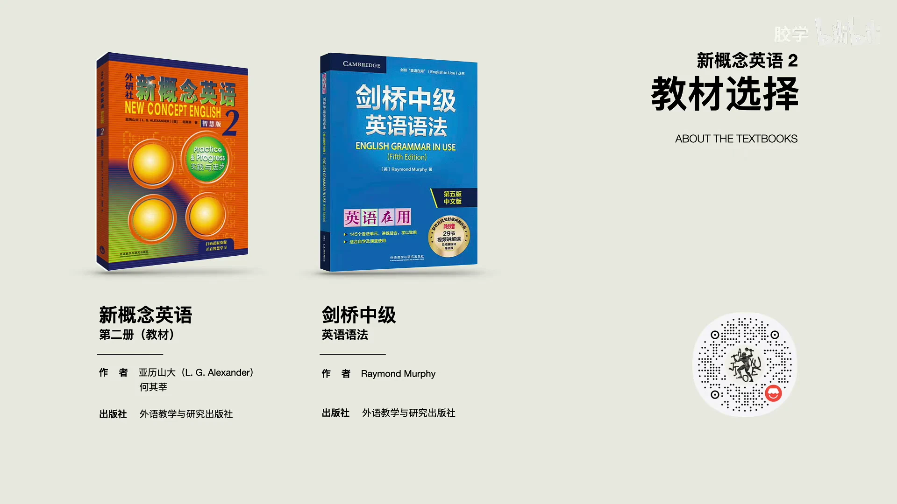

文字识别：胶学 / 新概念英语 2 / CAMBRIDGE / 外研社 / 新概念英语 / 创锈“英语在用”（EngishinUso)丛书 / 教材选择 / 剑桥中级 / NEW CONCEPT ENGLISH / 总历山大（LG.ALEXANOER)期) / 智慧版 / 英语语法 / ABOUT THE TEXTBOOKS / Practice / ENGLISH GRAMMAR IN USE / & Progress / (Fifth Edition) / 实线与进步 / [英]RaymondMurphy著 / 第五版 / 中文版 / 英语在用 / 武见封底内 / 附赠 / 145个语法单元，讲练结合，学以数用 / 29节 / 扫码民取资标 / 开启智慧学习 / 适合自学及课堂使用 / 视频讲解课 / 第练习 / 外语教学与研究出版社 / 新概念英语 / 剑桥中级 / 第二册 (教材) / 英语语法 / 作者 / 亚历山大(L.G. Alexander) / 作者F / Raymond Murphy / 何其莘 / 出版社 / 外语教学与研究出版社 / 出版社 外语教学与研究出版社

### 画面 00:01:10

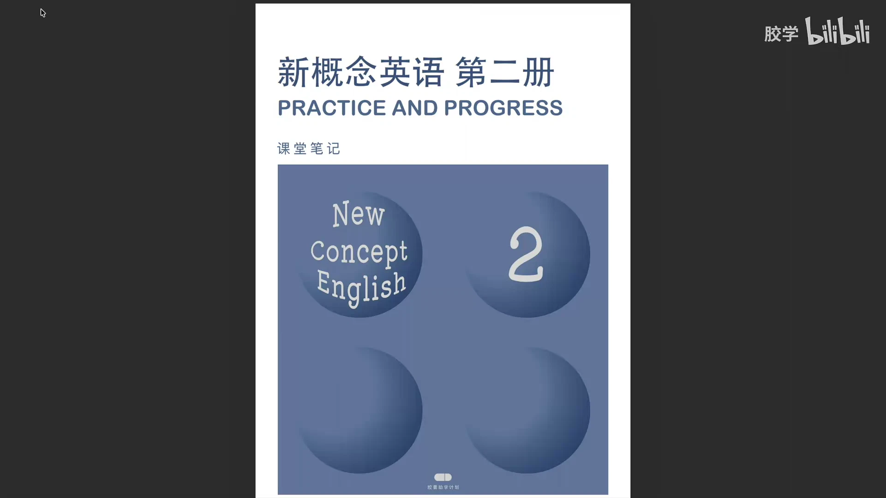

文字识别：Bilibili / 胶学 / 新概念英语 第二册 / PRACTICE AND PROGRESS / 课堂笔记 / New / 2 / Concept / English / 胶囊助学计划

### 画面 00:01:21

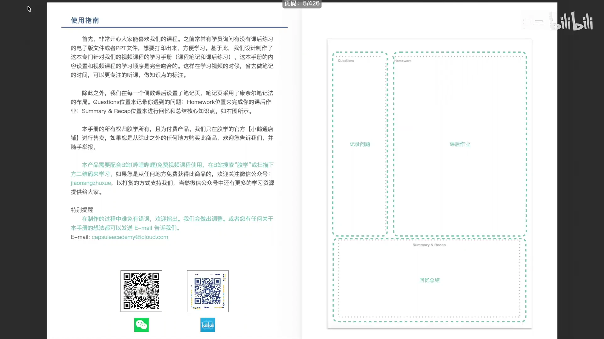

文字识别：页码：5/426 / ilibili / 使用指南 / 先，常开家能喜欢我们的课程。之前常常有学员询问有没有课后练习 / 的电版件或者PPT件，想要打印出来，便学习。基于此，我们设计制作了 / 这本专门针对我们的视频课程的学习册（课程笔记和课后练习）。这本册的内 / Questions / Homework / 容设置和视频课程的学习顺序是完全吻合的。这样在学习视频的时候，省去做笔记 / 的时间，可以更专注的听课，做知识点的标注。 / 除此之外，我们在每个偶数课后设置了笔记页，笔记页采了康奈尔笔记法 / 的布局。Questions位置来记录你遇到的问题；Homework位置来完成你的课后作 / 业；Summary&Recap位置来进回忆和总结核知识点。如右图所示。 / 本册的所有权归胶学所有，且为付费产品。我们只在胶学的官【鹅通店 / 铺】进售卖，如果您是从除此之外的任何地购买此商品，欢迎您告诉我们，并 / 随手举报。 / 记录问题 / 课后作业 / 本产品需要配合B站（哗哩哔哩）免费视频课程使，在B站搜索“胶学”或扫描下 / 维码来学习。如果您是从任何地免费获得此商品的，欢迎关注微信公众号： / jiaonangzhuxue，以打赏的式持我们，当然微信公众号中还有更多的学习资源 / 提供给大家。 / 特别提醒 / 在制作的过程中难免有错误，欢迎指出。我们会做出调整。或者您有任何关于 / 本册的想法都可以发送E-mail告诉我们。 / E-mail:capsuleacademy@icloud.com / Summary &. Recap / 回忆总结 / bitibi

## 00:01:30–00:02:00

印出来用的话呢，你可以在这些空白页上去做一些笔记啊，完成你的作业都是可以的。好，在后边，呃，跟第一册的笔记同样哈，我们在这里设置了一个打卡记录的一个一个功能。那你可以看到，从第一课到第九十六课都对应着一个圆圈。那么，你可以在这个圆圈里呢，比如说你用不同的颜色、不同的符号来记录你呃所对应的课程的学习状态，哪些是

### 画面 00:01:37

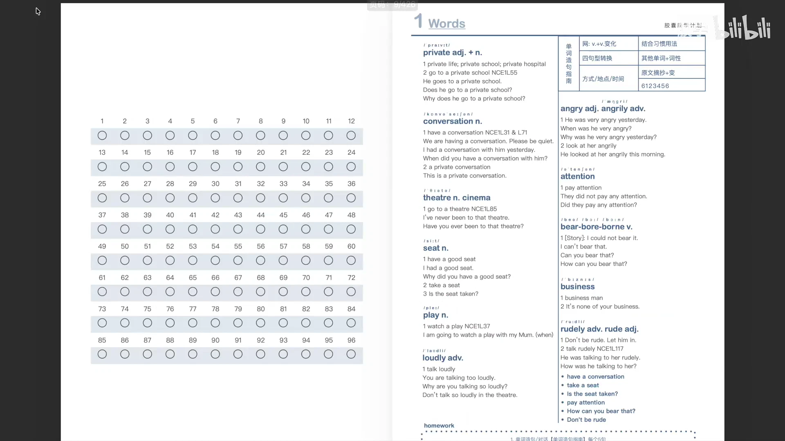

文字识别：1 / Words / Lilibii / 胶囊助学计划 / Ipraivit/ / 单词造句指南 / 网：v.+v.变化 / 结合习惯用法 / private adj. + n. / 四句型转换 / 其他单词+词性 / 1 private life; private school; private hospital / 2go to a private school NCE1L55 / 原文摘抄+变 / He goes to a private school. / 方式/地点/时间 / Does he go to a private school? / 6123456 / Why does he go to a private school? / 1mngril / angry adj. angrily adv. / /kDnva'seifanl / 1 / 2 / 3 / 4 / 5 / 6 / 7 / 8 / 9 / 10 / 11 / 12 / conversation n. / 1 He was very angry yesterday. / 1 have a conversation NCE1L31& L71 / When was he very angry? / O / We are having a conversation. Please be quiet. / Why was he very angry yesterday? / 2 look at her angrily / 13 / 14 / 15 / 16 / 17 / 18 / 19 / 20 / 21 / 22 / 23 / 24 / I had a conversation with him yesterday. / He looked at her angrily this morning. / When did you have a conversation with him? / O / O / O / O / O / O / O / O / 2a private conversation / latenfani / This is a private conversation. / attention / 25 / 26 / 27 / 28 / 29 / 30 / 31 / 32 / 33 / 34 / 35 / 36 / 1θiata1 / 1 pay attention / O / O / O / O / O / O / O / theatre n. cinema / They did not pay any attention. / 1 go to a theatre NCE1L85 / Did they pay any attention? / 37 / 38 / 39 / 40 / 41 / 42 / 43 / 44 / 45 / 46 / 47 / 48 / I've never been to that theatre. / 1bea/1bo:1lbo:n/ / O / O / O / O / O / O / O / O / Have you ever been to that theatre? / bear-bore-borne v. / 1si:t1 / 1 [Story]: I could not bear it. / 49 / 50 / 51 / 52 / 53 / 54 / 55 / 56 / 57 / 58 / 59 / 60 / seat n. / I can't bear that. / O / O / O / O / O / O / O / O / O / O / O / 1 have a good seat / I had a good seat. / Can you bear that? / How can you bear that? / 61 / 62 / 63 / 64 / 65 / 66 / 67 / 68 / 69 / 70 / 71 / 72 / Why did you have a good seat? / /biznis1 / O / O / O / O / O / O / O / O / O / O / 2 take a seat / 3 Is the seat taken? / 1 business man / business / 73 / 74 / 75 / 76 / 77 / 78 / 79 / 80 / 81 / 82 / 83 / 84 / /plei/ / 2 It's none of your business. / play n. / O / O / O / O / O / O / O / O / O / 1 watch a play NCE1L37 / rudely adv. rude adj. / 'ru:dlir / Iam going to watch a play with my Mum.(when) / 85 86 87 / 88 89 90 91 92 93 / 94 / 95 / 96 / 1 Don't be rude. Let him in. / loudly adv. / /1audli/ / He was talking to her rudely. / 2 talk rudely NCE1L117 / 1 talk loudly / How was he talking to her? / You are talking too loudly. / •have a conversation / Why are you talking so loudly? / • take a seat / Don't talk so loudly in the theatre. / • Is the seat taken? / • pay attention / •How can you bear that? / 。Don't be rude / homework / 单词造句/对话【单词造句指南】每个5句

## 00:02:00–00:02:30

学的还不错的，哪些呢是之后可能需要回回过头去复习的，都可以记录在这里，所以你非常你可以比较清楚的知道自己在不同的课程当中学的怎么样。啊，那到了右边呢，就是开始了第一课的笔记内容哈，大家可以看到是单词，我们有单词、单词的音标，然后单词的词性，然后下边呢还有视频课程当中出现的例句啊，每一个单词都有，

### 画面 00:02:07

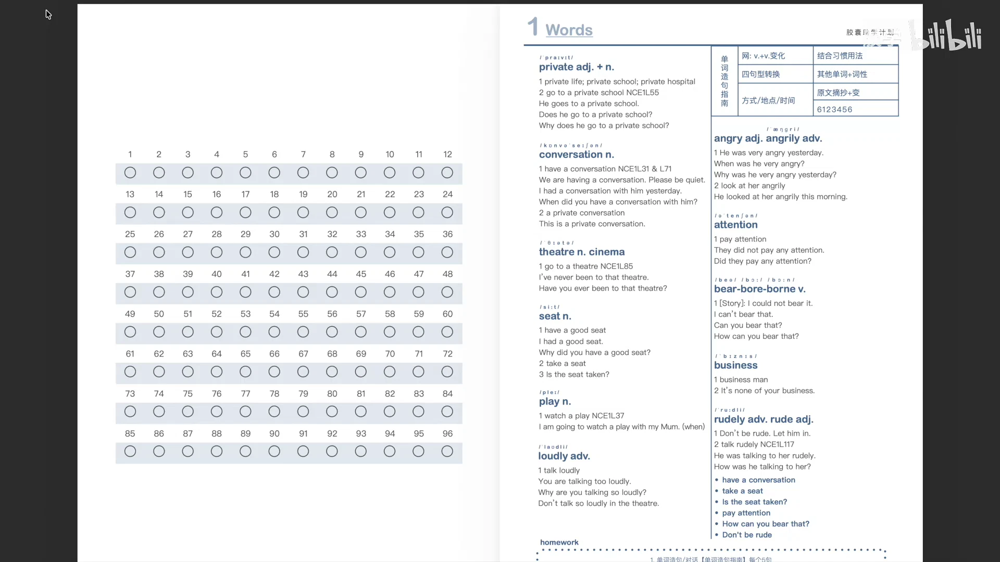

文字识别：1 / Words / ilibili / 胶囊助学计划 / /praivit/ / 单词造句指南 / 网：v.+v.变化 / 结合习惯用法 / private adj. + n. / 四句型转换 / 其他单词+词性 / 1 private life; private school; private hospital / 2 go to a private school NCE1L55 / 原文摘抄+变 / He goes to a private school. / 方式/地点/时间 / Does he go to a private school? / 6123456 / Why does he go to a private school? / 1mngril / angry adj. angrily adv. / Ikonva'seifanl / 1 / 2 / 3 / 4 / 5 / 6 / 7 / 8 / 9 / 10 / 11 / 12 / conversation n. / 1 He was very angry yesterday. / O / 1 have a conversation NCE1L31&L71 / When was he very angry? / Why was he very angry yesterday? / We are having a conversation. Please be quiet. / 2 look at her angrily / 13 / 14 / 15 / 16 / 17 / 1819 / 20 / 21 / 22 / 23 / 24 / I had a conversation with him yesterday. / He looked at her angrily this morning. / When did you have a conversation with him? / O / O / O / O / 2a private conversation / latenfanl / This is a private conversation. / attention / 25 / 26 / 27 / 28 / 29 / 30 / 31 / 32 / 33 / 34 / 35 / 36 / 1θ1ata1 / 1 pay attention / O / O / O / O / O / O / theatre n. cinema / They did not pay any attention. / Did they pay any attention? / 1 go to a theatre NCE1L85 / 37 / 38 / 39 / 40 / 41 / 42 / 43 / 44 / 45 / 46 / 47 / 48 / I've never been to that theatre. / /bea//bo://bo:n1 / O / O / O / O / O / O / Have you ever been to that theatre? / bear-bore-borne v. / 49 / 50 / 51 / 52 / 53 / 54 / 55 / 56 / 57 / 58 / 59 / 60 / seat n. / 1si:t/ / 1 [Story]: I could not bear it. / I can't bear that. / O / O / O / O / 1 have a good seat / Can you bear that? / How can you bear that? / I had a good seat. / 61 / 62 / 63 / 64 / 65 / 66 / 67 / 68 / 69 / 70 / 71 / 72 / Why did you have a good seat? / /b1zn1s1 / 2take a seat / business / O / O / O / O / O / O / O / O / O / 3 Is the seat taken? / 1 business man / 73 / 74 / 75 / 76 / 77 / 78 / 79 / 80 / 81 / 82 / 83 / 84 / /plei/ / 2 It's none of your business. / play n. / O / O / O / O / O / O / O / O / O / O / O / 1 watch a play NCE1L37 / rudely adv. rude adj. / I'ru:dli/ / I am going to watch a play with my Mum. (when) / 85 / 86 / 87 / 88 / 89 90 91 92 9 / 93 / 94 / 95 / 1 Don't be rude. Let him in. / loudly adv. / /1aud1i/ / He was talking to her rudely. / 2 talk rudely NCE1L117 / 1 talk loudly / How was he talking to her? / You are talking too loudly. / •have a conversation / Why are you talking so loudly? / • take a seat / Don't talk so loudly in the theatre. / • Is the seat taken? / • pay attention / •How can you bear that? / • Don't be rude / homework / 单词造句/对话【单词造句指南】每个5包

## 00:02:30–00:03:00

然后下面有家庭作业，啊，再往后边到了第一课的语法啊，第一课语法的核心的知识点内容，再往后就是第一课的文章和习惯用法，然后第一课的练习啊，呃，如果你看过新概念第二册的视频课程呢，你就会发现这个笔记的排版顺序跟视频课程是完全一致的，也就是说，你打开笔记

### 画面 00:02:33

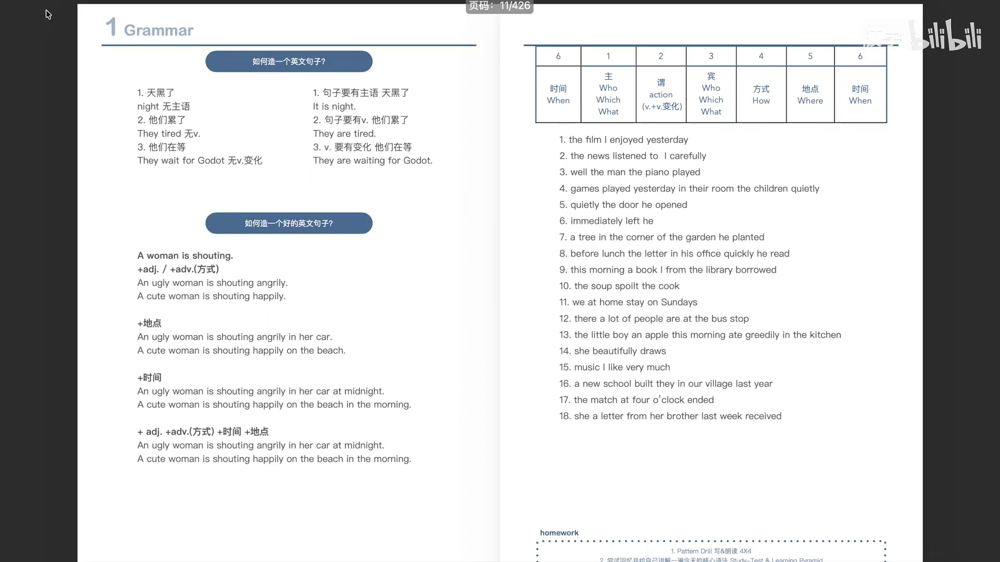

文字识别：页码：11/426 / Grammar / ilibili / 如何造一个英文句子？ / 6 / 1 / 2 / 3 / 4 / 5 / 6 / 主 / 宾 / 谓 / 1.天了 / 1.句要有主语天了 / When / 时间 / Which / Who / action / Which / Who / How / 方式 / Where / 地点 / When / 时间 / night无主语 / It is night. / What / (v.+v.变化) / What / 2.他们累了 / 2.句子要有v.他们累了 / They tired 无v. / They are tired. / 1. the film I enjoyed yesterday / 3.他们在等 / 3.v.要有变化他们在等 / They wait for Godot 无v.变化 / They are waiting for Godot. / 2.the news listened to I carefully / 3. well the man the piano played / 4. games played yesterday in their room the children quietly / 5. quietly the door he opened / 如何造一个好的英文句子？ / 6.immediately left he / 7.a tree in the corner of the garden he planted / A woman is shouting. / 8. before lunch the letter in his office quickly he read / +adj./+adv.(方式) / 9.this morning a bookI from the library borrowed / An ugly woman is shouting angrily. / 10.the soup spoilt the cook / A cute woman is shouting happily. / 11.we at home stay on Sundays / +地点 / 12.there a lot of people are at the bus stop / An ugly woman is shouting angrily in her car. / 13.the little boy an apple this morning ate greedily in the kitchen / A cute woman is shouting happily on the beach. / 14.she beautifully draws / 15.music I like very much / +时间 / 16.a new school built they in our village last year / An ugly woman is shouting angrily in her car at midnight. / A cute woman is shouting happily on the beach in the morning. / 17.the match at four o'clock ended / 18. she a letter from her brother last week received / +adj.+adv.(方式)+时间+地点 / An ugly woman is shouting angrily in her car at midnight. / A cute woman is shouting happily on the beach in the morning. / homework / Pattem Drill / 写&朗读4X4

### 画面 00:02:39

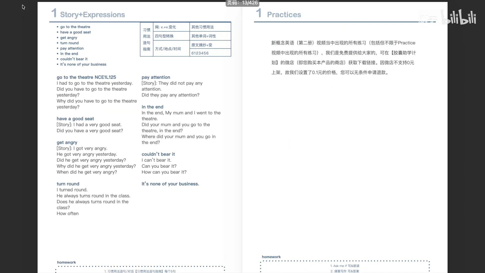

文字识别：页码：13/426 / Story+Expressions / Practices / ilibili / • go to the theatre / 习惯 / 网：v.+v.变化 / 其他习惯用法 / • have a good seat / 用法 / 四句型转换 / 其他单词+词性 / • get angry / turn round / 造句 / 原文摘抄+变 / 新概念英语（第册）视频当中出现的所有练习（包括但不限于Practice / • pay attention / 指南 / 方式/地点/时间 / • in the end / 6123456 / 视频中出现的所有练习），我们是免费提供给家的，可在【胶囊助学计 / couldn't bear it / 划】的微店（即您购买本产品的商店）获取下载链接。因微店不持0元 / • It's none of your business / 上架，故我们设置了0.1元的价格，您可以条件申请退款。 / go to the theatre NCE1L125 / pay attention / I had to go to the theatre yesterday. / [Story]: They did not pay any / Did you have to go to the theatre / attention. / yesterday? / Did they pay any attention? / Why did you have to go to the theatre / yesterday? / in the end / In the end, My mum and I went to the / have a good seat / theatre. / [Story]: I had a very good seat. / Did your mum and you go to the / Did you have a very good seat? / theatre, in the end? / Where did your mum and you go in / get angry / the end? / [Story]: I got very angry. / He got very angry yesterday. / couldn't bear it / Did he get very angry yesterday? / I can't bear it. / Why did he get very angry yesterday? / Can you bear it? / When did he get very angry? / How can you bear it? / turn round / It's none of your business. / I turned round. / He always turns round in the class. / Does he always turns round in the / class? / How often / homework / homework / 1.Ask me if写&朗读 / 习惯用法造句/对话【习惯用法造句指南】每个5句 / 2.摘要写作写&答案

## 00:03:00–00:03:30

啊，一边看着视频，一边拿着笔记去学习的时候呢，它这个内容的是完全同步的。学习课程之后，在利用笔记去复习的时候呢，也会比较清晰，可以快速的定位到你希望定位的内容。OK，那后边就是第二课的语法啊。好，在这里我就不给大家再过多的展示了。如果你需要的话呢，就可以扫描屏幕上的二维码，可以去

### 画面 00:03:09

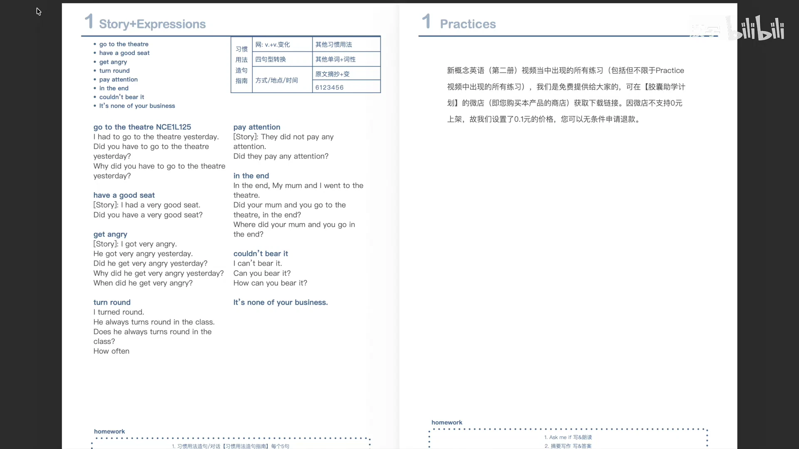

文字识别：Story+Expressions / Practices / ilibili / • go to the theatre / 习惯 / 网：v.+v.变化 / 其他习惯用法 / • have a good seat / 用法 / 四句型转换 / 其他单词+词性 / • get angry / turn round / 造句 / 原文摘抄+变 / 新概念英语（第册）视频当中出现的所有练习（包括但不限于Practice / •pay attention / 指南 / 方式/地点/时间 / •in the end / 6123456 / 视频中出现的所有练习），我们是免费提供给家的，可在【胶囊助学计 / couldn't bear it / • It's none of your business / 划】的微店（即您购买本产品的商店）获取下载链接。因微店不持0元 / 上架，故我们设置了0.1元的价格，您可以条件申请退款。 / go to the theatre NCE1L125 / pay attention / I had to go to the theatre yesterday. / [Story]: They did not pay any / Did you have to go to the theatre / attention. / yesterday? / Did they pay any attention? / Why did you have to go to the theatre / yesterday? / in the end / In the end, My mum and I went to the / have a good seat / theatre. / [Story]: I had a very good seat. / Did your mum and you go to the / Did you have a very good seat? / theatre, in the end? / Where did your mum and you go in / get angry / the end? / [Story]: I got very angry. / He got very angry yesterday. / couldn't bear it / Did he get very angry yesterday? / I can't bear it. / Why did he get very angry yesterday? / Can you bear it? / When did he get very angry? / How can you bear it? / turn round / It's none of your business. / I turned round. / He always turns round in the class. / Does he always turns round in the / class? / How often / homework / homework / 1.Ask me if写&朗读 / 习惯用法造句/对话【习惯用法造句指南】每个5句 / 2.摘要写作写&答案

### 画面 00:03:19

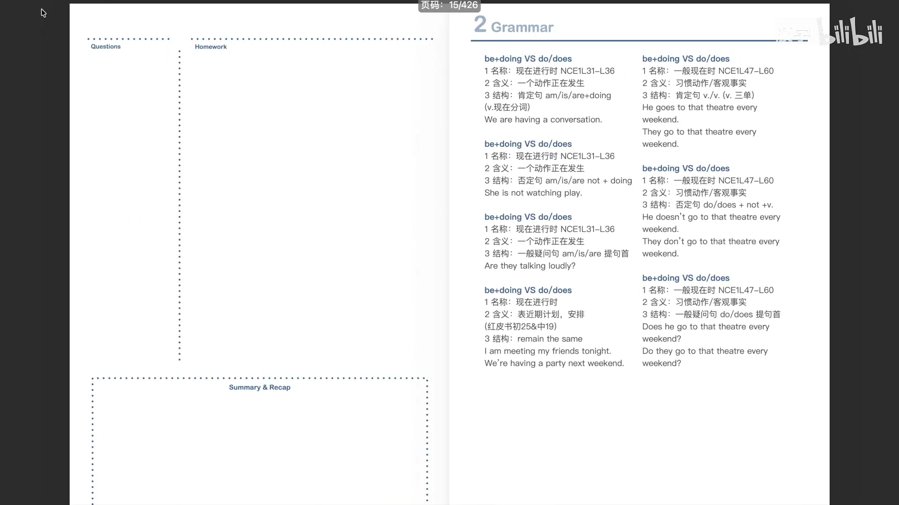

文字识别：页码：15/426 / 2 / Grammar / ilibili / Questions / Homework / be+doing VS do/does / be+doing VS do/does / 1名称：现在进时NCE1L31-L36 / 1名称：般现在时NCE1L47-L60 / 2含义：个动作正在发 / 2含义：习惯动作/客观事实 / 3结构：肯定句am/is/are+doing / 3结构：肯定句v./v.(v.三单) / (v.现在分词) / He goes to that theatre every / We are having a conversation. / weekend. / They go to that theatre every / be+doing VS do/does / weekend. / 1名称：现在进时NCE1L31-L36 / 2含义：一个动作正在发生 / be+doing VS do/does / 3结构：否定句am/is/are not+doing / 1名称：般现在时NCE1L47-L60 / She is not watching play. / 2含义：习惯动作/客观事实 / 3结构：否定句do/does+not +v. / be+doing VS do/does / He doesn't go to that theatre every / 1名称：现在进时NCE1L31-L36 / weekend. / 2含义：个动作正在发 / They don't go to that theatre every / 3结构：般疑问句am/is/are提句 / weekend. / Are they talking loudly? / be+doing VS do/does / be+doing VS do/does / 1名称：般现在时NCE1L47-L60 / 1名称：现在进时 / 2含义：习惯动作/客观事实 / 2含义：表近期计划，安排 / 3结构：般疑问句do/does提句 / (红书初25&中19) / Does he go to that theatre every / 3结构：remain the same / weekend? / I am meeting my friends tonight. / Do they go to that theatre every / We're having a party next weekend. / weekend? / Summary & Recap

### 画面 00:03:22

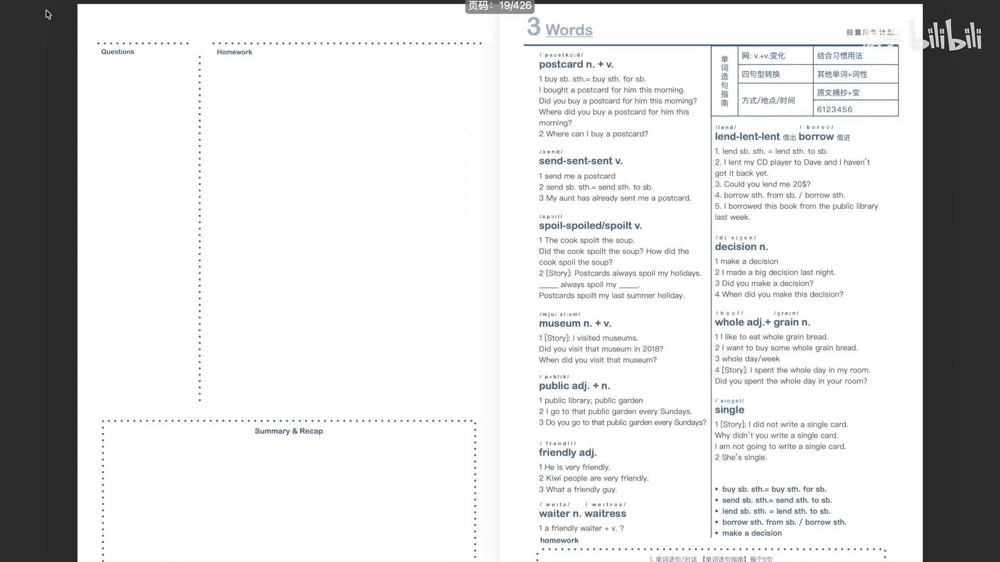

文字识别：页码：19/426 / 3 / Words / ilibili / 胶囊助学计划 / Questions / Homework / 1paustka:d/ / 单词造句指南 / 网：v.+v.变化 / 结合习惯用法 / postcard n.+ v. / 1 buy sb. sth,= buy sth. for sb. / 四句型转换 / 其他单词+词性 / I bought a postcard for him this morning. / 原文摘抄+变 / Did you buy a postcard for him this morning? / 方式/地点/时间 / Where did you buy a postcard for him this / 6123456 / morning? / /lend/ / 1boraul / 2 Where can I buy a postcard? / lend-lent-lent借出borrow借进 / /send/ / 1. lend sb. sth. = lend sth. to sb. / send-sent-sent v. / 2.I lent my CD player to Dave and I haven't / 1 send me a postcard / got it back yet. / 2send sb.sth.=send sth.to sb. / 3. Could you lend me 20$? / 3 My aunt has already sent me a postcard. / 4. borrow sth. from sb. / borrow sth. / 5.1borrowed this book from the public library / 1spoi1/ / last week. / spoil-spoiled/spoilt v. / 1 The cook spoilt the soup. / /d1si3en1 / decision n. / Did the cook spoilt the soup? How did the / cook spoil the soup? / 1 make a decision / 2 [Story]: Postcards always spoil my holidays. / 21 made a big decision last night. / always spoil my / 3 Did you make a decision? / Postcards spoilt my last summer holiday. / 4 When did you make this decision? / /mju:zi:0m/ / /heoll / lgrein/ / museum n.+v. / whole adj.+ grain n. / 1 [Story】: I visited museums. / 11 like to eat whole grain bread. / Did you visit that museum in 2018? / 21 want to buy some whole grain bread. / When did you visit that museum? / 3 whole day/week / 4 [Story】: I spent the whole day in my room. / public adj. + n. / Did you spent the whole day in your room? / 1 public library; public garden / /singal / 21 go to that public garden every Sundays. / single / 3 Do you go to that public garden every Sundays? / 1 [Story]:I did not write a single card. / Summary & Recap / Why didn't you write a single card. / friendly adj. / /frendli/ / I am not going to write a single card. / 2 She's single. / 1 He is very friendly. / 2 Kiwi people are very friendly. / 3 What a friendly guy. / buy sb.sth.= buy sth.for sb. / •send sb.sth.= send sth. to sb. / weital / weitrasl / waiter n. waitress / •lend sb. sth. =lend sth. to sb. / borrow sth.from sb./borrow sth. / 1 a friendly waiter + v.? / •make a decision / homework / 单词造句/对话 / 【单词造句指南】每个5句

### 画面 00:03:24

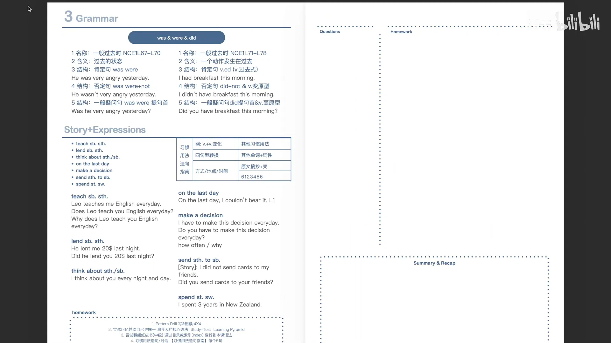

文字识别：3 Grammar / ilibili / Questions / Homework / was & were & did / 1名称：般过去时NCE1L67-L70 / 1名称：般过去时NCE1L71-L78 / 2含义：过去的状态 / 2含义：个动作发在过去 / 3结构：肯定句was were / 3结构：肯定句v.ed (v.过去式) / He was very angry yesterday. / I had breakfast this morning. / 4结构：否定句was were+not / 4结构：否定句did+not&v.变原型 / He wasn't very angry yesterday. / I didn't have breakfast this morning. / 5结构：般疑问句waswere提句 / 5结构：般疑问句did提句&v.变原型 / Was he very angry yesterday? / Did you have breakfast this morning? / Story+Expressions / • teach sb. sth. / 网：v.+v.变化 / 其他习惯用法 / 习惯 / • lend sb. sth. / • think about sth./sb. / 用法 / 四句型转换 / 其他单词+词性 / • on the last day / 造句 / 原文摘抄+变 / make a decision / 指南 / 方式/地点/时间 / send sth. to sb. / 6123456 / •spend st. sw. / on the last day / teach sb. sth. / On the last day, I couldn't bear it. L1 / Leo teaches me English everyday. / Does Leo teach you English everyday? / Why does Leo teach you English / make a decision / I have to make this decision everyday. / everyday? / Do you have to make this decision / everyday? / lend sb. sth. / how often / why / He lent me 20$ last night. / Did he lend you 20$ last night? / send sth. to sb. / Summary & Recap / [Story]: I did not send cards to my / I think about you every night and day. / think about sth./sb. / friends. / Did you send cards to your friends? / spend st. sw. / I spent 3 years in New Zealand. / homework / 1.Pattem Drill写&朗读4X4 / 2.尝试回忆并给讲解遍今天的核语法Study-TestLearning Pyramid / 3.尝试翻阅红书(中级)通过目录或索引(lndex)查找到本课语法 / 4.习惯用法造句/对话【习惯用法造句指南】每个5句

### 画面 00:03:26

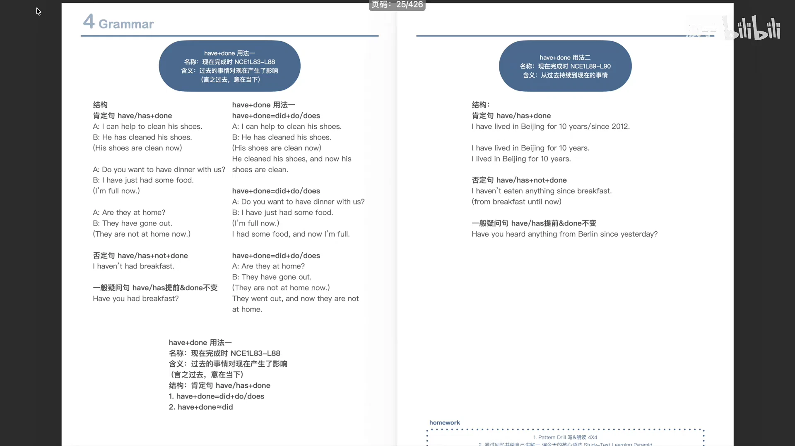

文字识别：页码：25/426 / 4 Grammar / ilibili / have+done用法一 / have+done 用法二 / 名称：现在完成时 NCE1L83-L88 / 名称：现在完成时NCE1L89-L90 / 含义：过去的事情对现在产生了影响 / 含义：从过去持续到现在的事情 / （言之过去，意在当下) / 结构 / have+done法一 / 结构： / 肯定句 have/has+done / have+done=did+do/does / 肯定句 have/has+done / A:I can help to clean his shoes. / A:I can help to clean his shoes. / I have lived in Beijing for 10 years/since 2012. / B: He has cleaned his shoes. / B: He has cleaned his shoes. / (His shoes are clean now) / (His shoes are clean now) / I have lived in Beijing for 10 years. / He cleaned his shoes, and now his / I lived in Beijing for 10 years. / A: Do you want to have dinner with us? shoes are clean. / B: I have just had some food. / 否定句have/has+not+done / (I'm full now.) / have+done=did+do/does / I haven't eaten anything since breakfast. / A: Do you want to have dinner with us? / (from breakfast until now) / A: Are they at home? / B:I have just had some food. / B: They have gone out. / (I'm full now.) / 般疑问句have/has提前&done不变 / (They are not at home now.) / I had some food, and now I'm full. / Have you heard anything from Berlin since yesterday? / 否定句have/has+not+done / have+done=did+do/does / I haven't had breakfast. / A: Are they at home? / B: They have gone out. / 般疑问句have/has提前&done不变 / (They are not at home now.) / Have you had breakfast? / They went out, and now they are not / at home. / have+done用法一 / 名称：现在完成时NCE1L83-L88 / 含义：过去的事情对现在产了影响 / (之过去，意在当下) / 结构：肯定句have/has+done / 1.have+done=did+do/does / 2.have+done≈did / homework / PattermDrill写&朗读4X4

### 画面 00:03:28

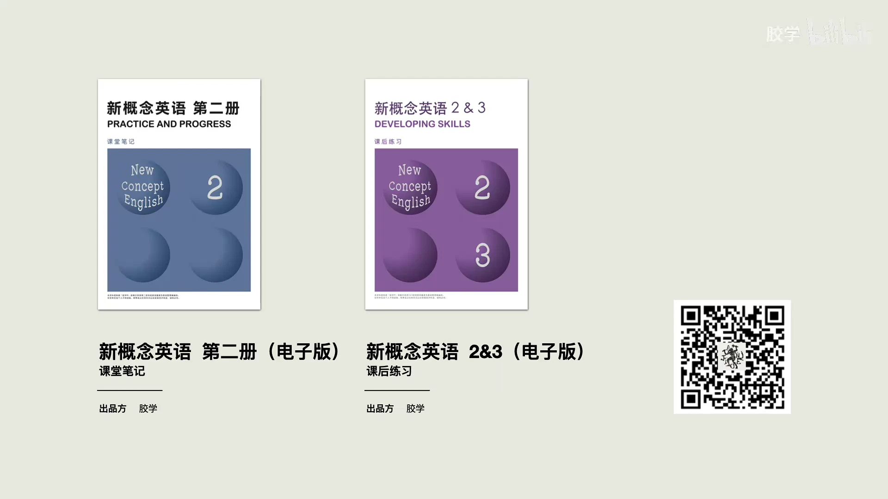

文字识别：胶学 / 新概念英语 第二册 / 新概念英语2&3 / PRACTICE AND PROGRESS / DEVELOPING SKILLS / 课堂笔记 / 课后练习 / New / New / Concept / 2 / Concept / 2 / English / English / 3 / 新概念英语 第二册 (电子版) / 新概念英语 2&3 (电子版) / 课堂笔记 / 课后练习 / 出品方 / 胶学 / 出品方 胶学

## 00:03:30–00:04:00

选购。这里要特别说明的一点，新概念英语的第二册和第三册的这个课后练习，我们是免费提供给大家的。所以，同样你需要的话，就去扫二维码，然后到店铺里，呃，可以免费的下载到。接下来我给大家看一下新概念第二册的六合一测试。呃，如果你买了新概念第一册的五合一测试的，那么你肯定对这个新二的测试也就会非常熟悉了。

### 画面 00:03:45

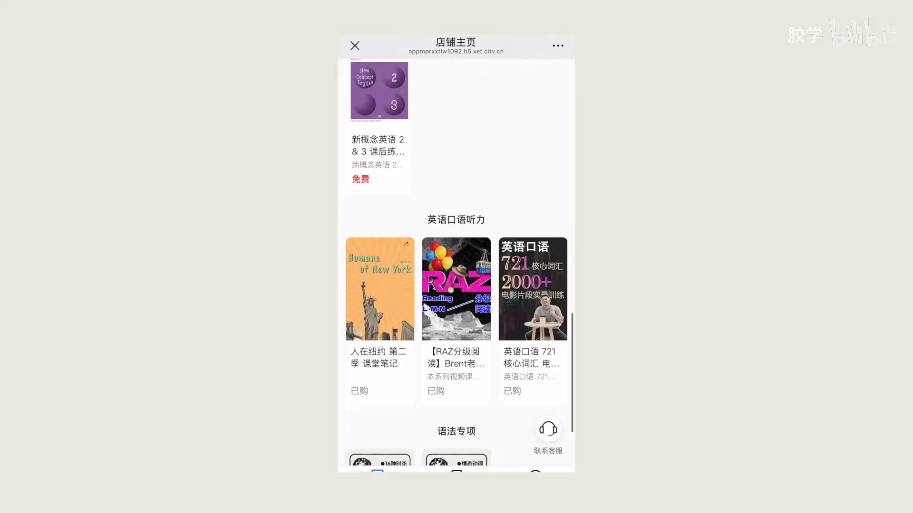

文字识别：胶学H / × / 店铺主页 / appmprxxtlw1092.h5.xet.citv.cn / New / concept / 2 / English / 新概念英语2 / &3课后练... / 新概念英语2... / 免费 / 英语口语听力 / 英语口语 / 721核心词汇 / of New York / RAZ / 2000+ / Reading / 分级 / 电影片段实训练 / L·M:N / 阅读 / 在纽约第 / 【RAZ分级阅 / 英语口语721 / 季课堂笔记 / 读】Brent老. / 核心词汇电. / 本系列视频课. / 英语口语721.. / 已购 / 已购 / 已购 / 语法专项 / 联系客服 / 16种时态 / 槽杰动词

### 画面 00:03:47

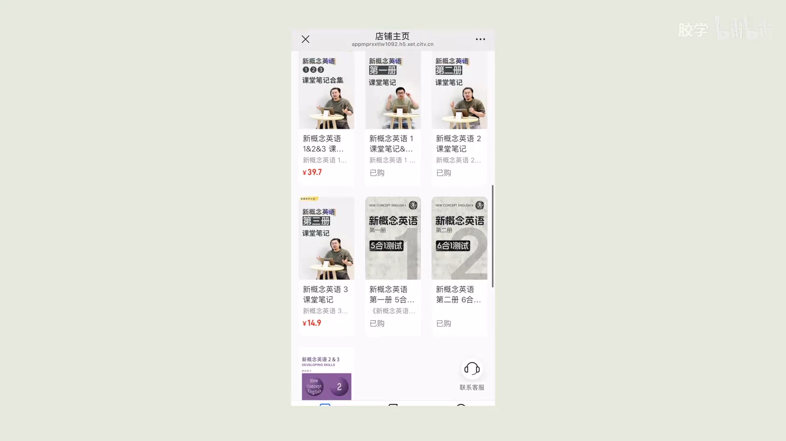

文字识别：胶学 / × / 店铺主页 / appmprxxtlw1092.h5.xet.citv.cn / 新概念英语 / 新概念英语 / 新概念英语 / 123 / 第一册 / 第二册 / 课堂笔记合集 / 课堂笔记 / 课堂笔记 / 新概念英语 / 新概念英语1 / 新概念英语2 / 1&2&3课.... / 课堂笔记＆.. / 课堂笔记 / 新概念英语1... / 新概念英语1.. / 新概念英语.... / ￥39.7 / 已购 / 已购 / NEW CONCEPT ENGUISHI / NEW CONCEPT ENGUSHI / 新概念英语 / 第三册 / 新概念英语 / 新概念英语 / 课堂笔记 / 第一册 / 第二册 / 5合1测试 / 6合1测试 / 新概念英语3 / 新概念英语 / 新概念英语 / 课堂笔记 / 第一册5合. / 第二册6合… / 新概念英语3... / 《新概念英语 / ￥14.9 / 已购 / 已购 / 新概念英语2&3 / DEVELOPING SKILS / New / Concept / 2 / 联系客服 / English

### 画面 00:03:52

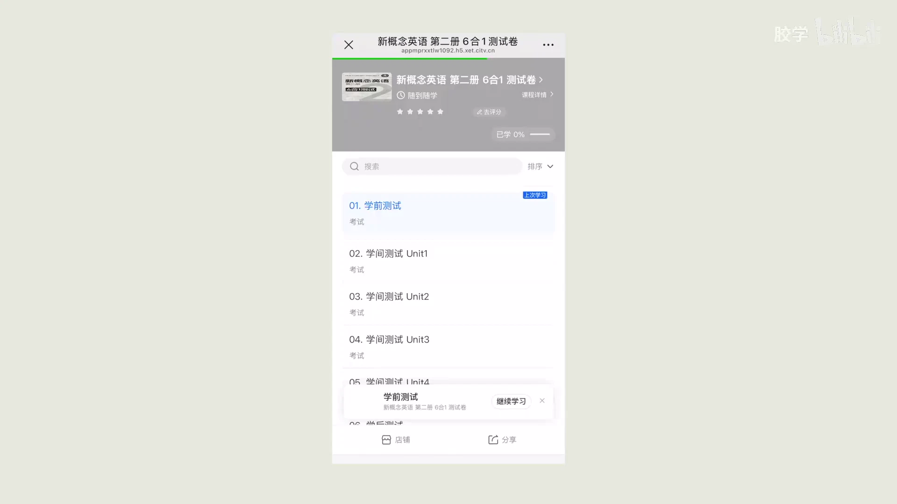

文字识别：胶学 / × / 新概念英语第二册6合1测试卷 / appmprxxtlw1092.h5.xet.citv.cn / 新概念英语 / 新概念英语第二册6合1测试卷> / 随到随学 / 课程详情> / 去评分 / 已学0% / Q搜索 / 排序 / 上次学习 / 01.学前测试 / 考试 / 02.学间测试Unit1 / 考试 / 03.学间测试Unit2 / 考试 / 04.学间测试Unit3 / 考试 / 05 学间测试1nit4 / 学前测试 / 继续学习 / × / 新概念英语第二册6合1测试卷 / c当 / 店铺 / 分享

### 画面 00:03:54

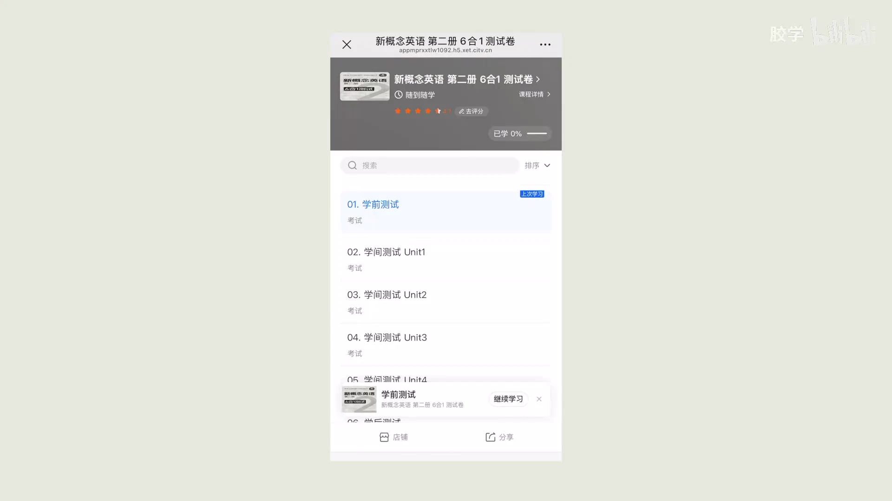

文字识别：胶学 / × / 新概念英语第二册6合1测试卷 / appmprxxtlw1092.h5.xet.citv.cn / 新概念英语 / 新概念英语第二册6合1测试卷> / 随到随学 / 课程详情> / 去评分 / 已学0% / Q搜索 / 排序 / 上次学习 / 01.学前测试 / 考试 / 02.学间测试Unit1 / 考试 / 03.学间测试Unit2 / 考试 / 04.学间测试Unit3 / 考试 / 05学间测试1Init4 / 新概念英语 / 学前测试 / 新概念英语第二册6合1测试卷 / 继续学习 / X / 当 / 店铺 / 分享

## 00:04:00–00:04:30

这两套测试题，呃，它的设置逻辑基本上是一致的。我们在设计第二册的测试的过程当中的，结合了第二册的内容结构啊，做了更合理的划分。呃，我们有学前测试、学间测试和学后测试。那么学间测试呢，又分成了四个单元。所以说，你在每学完一个单元呢，都可以进行一个小测试，最后得到一个分数，并且呢，你会知道自己哪些题选

### 画面 00:04:01

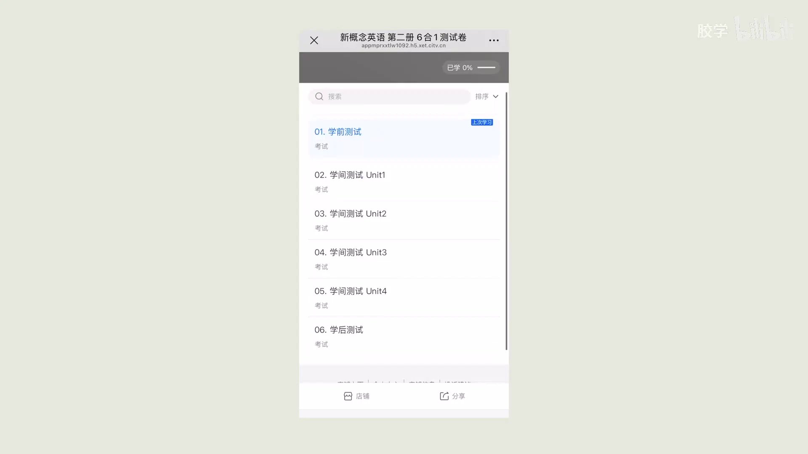

文字识别：胶学 / × / 新概念英语 第二册6合1测试卷 / appmprxxtlw1092.h5.xet.citv.cn / 已学0% / Q / 搜索 / 排序 / 上次学习 / 01.学前测试 / 考试 / 02.学间测试Unit1 / 考试 / 03.学间测试Unit2 / 考试 / 04.学间测试Unit3 / 考试 / 05.学间测试Unit4 / 考试 / 06.学后测试 / 考试 / 店铺 / 分享

### 画面 00:04:07

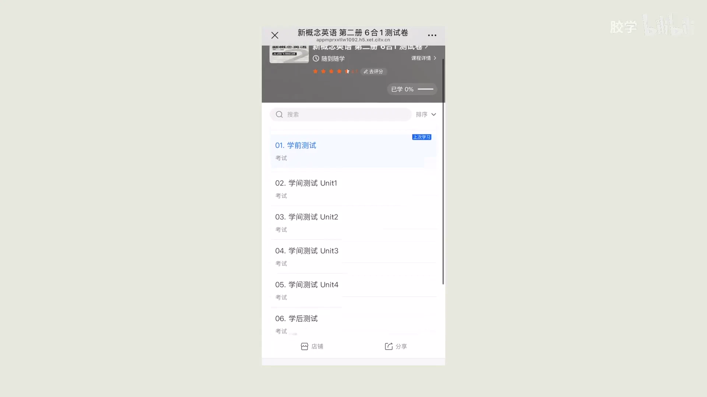

文字识别：胶学H / × / 新概念英语第二册6合1测试卷 / appmprxxtlw1092.h5.xet.citv.cn / 新概念英语 / 新做芯央话第一加口测试仓 / 随到随学 / 课程详情> / 去评分 / 已学0% / Q搜索 / 排序 / 上次学习 / 01.学前测试 / 考试 / 02.学间测试 Unit1 / 考试 / 03.学间测试Unit2 / 考试 / 04.学间测试Unit3 / 考试 / 05.学间测试Unit4 / 考试 / 06.学后测试 / 考试 / 店铺 / G分享

### 画面 00:04:09

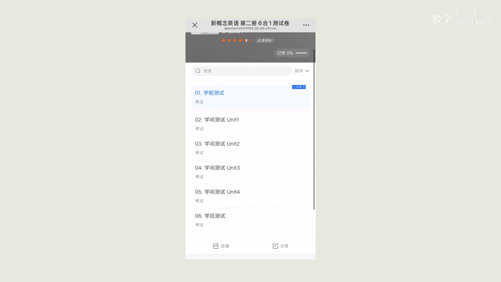

文字识别：胶学 / × / 新概念英语 第二册 6合1测试卷 / appmprxxtlw1092.h5.xet.citv.cn / 去评分 / 已学0% / 搜索 / 排序 / 上次学习 / 01.学前测试 / 考试 / 02.学间测试Unit1 / 考试 / 03.学间测试Unit2 / 考试 / 04.学间测试Unit3 / 考试 / 05.学间测试Unit4 / 考试 / 06.学后测试 / 考试 / 店铺 / 分享

### 画面 00:04:20

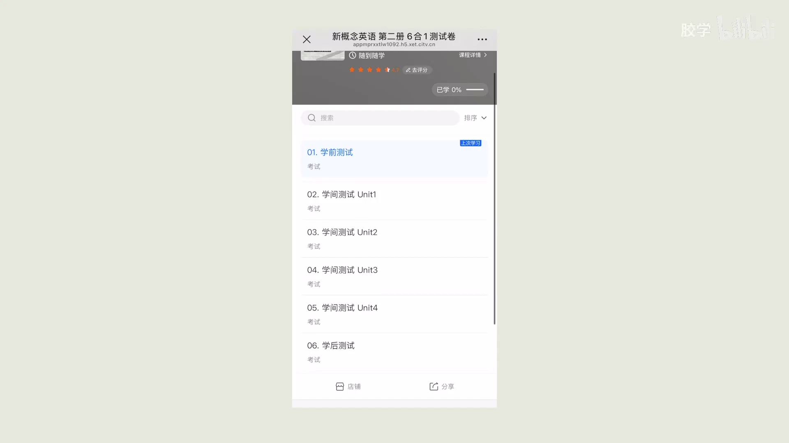

文字识别：胶学期 / × / 新概念英语 第二册6合1测试卷 / appmprxxtlw1092.h5.xet.citv.cn / 随到随学 / 课程详情> / 食会食食食47 / 去评分 / 已学0% / Q / 搜索 / 排序 / 上次学习 / 01.学前测试 / 考试 / 02.学间测试Unit1 / 考试 / 03.学间测试Unit2 / 考试 / 04.学间测试Unit3 / 考试 / 05.学间测试Unit4 / 考试 / 06.学后测试 / 考试 / 店铺 / G分享

### 画面 00:04:22

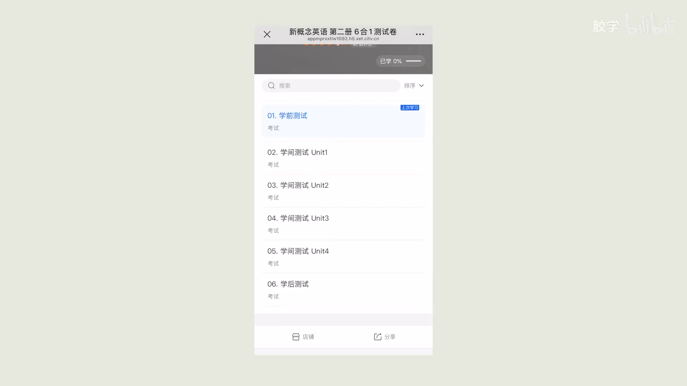

文字识别：胶学 / × / 新概念英语 第二册6合1测试卷 / appmprxxtiw1092.h5.xet.citv.cn / 已学0% / Q / 搜索 / 排序 / 上次学习 / 01.学前测试 / 考试 / 02.学间测试Unit1 / 考试 / 03.学间测试Unit2 / 考试 / 04.学间测试Unit3 / 考试 / 05.学间测试Unit4 / 考试 / 06.学后测试 / 考试 / 店铺 / 分享

## 00:04:30–00:05:00

错了、做错了，然后那些错题的后边也有标记了，它的知识点是来自于哪一课，所以呢，你可以有针对性的去复习那些错题所对应的课程。我们看看，比如说我们现在点入点进去这个学间测试，好，大家看这就是测试题的样子啊，里面还有听力题，但我们加入了音频，所以这个又比第

### 画面 00:04:44

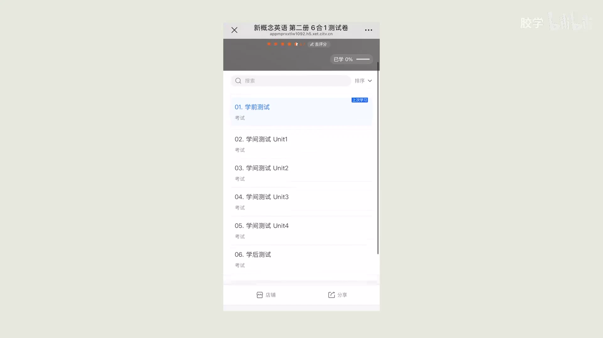

文字识别：胶学H / × / 新概念英语 第二册6合1测试卷 / appmprxxtlw1092.h5.xet.citv.cn / 去评分 / 已学0% / 搜索 / 排序 / 上次学习 / 01.学前测试 / 考试 / 02.学间测试Unit1 / 考试 / 03.学间测试Unit2 / 考试 / 04.学间测试 Unit3 / 考试 / 05.学间测试Unit4 / 考试 / 06.学后测试 / 考试 / 店铺 / 分享

### 画面 00:04:50

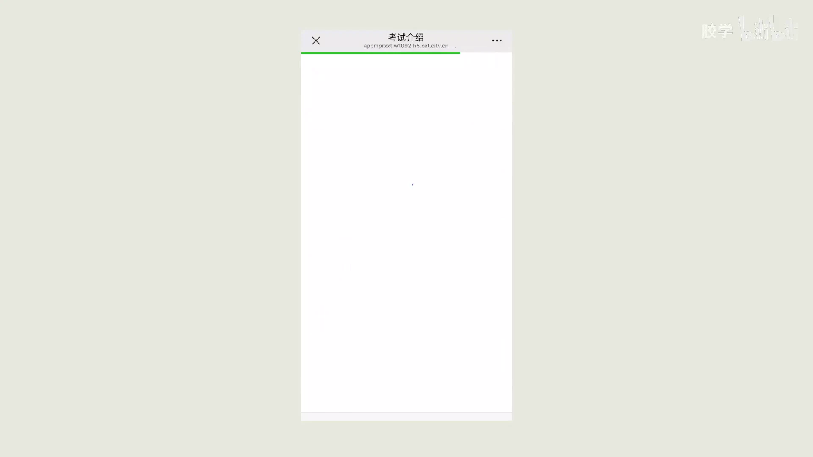

文字识别：胶学 / × / 考试介绍 / appmprxxtlw1092.h5.xet.citv.cn

### 画面 00:04:52

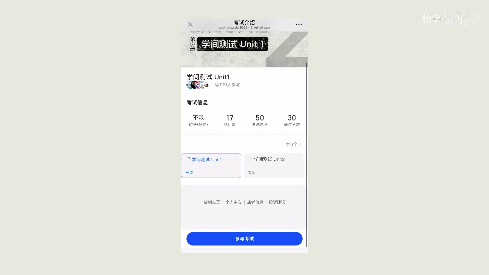

文字识别：胶学0 / 考试介绍 / × / appmprxxtlw1092.h5.xet.citv.cn / 第②册 / 学间测试Unt1 / 学间测试Unit1 / 等1161人参与 / 考试信息 / 不限 / 17 / 50 / 30 / 时长（分钟） / 题目量 / 考试总分 / 通过分数 / 共6个> / 学间测试Unit1 / 学间测试Unit2 / 考试 / 考试 / 店铺主页|个中|店铺信息|投诉建议 / 参与考试

### 画面 00:04:54

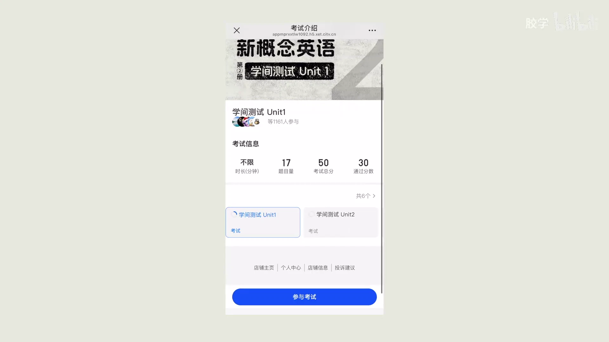

文字识别：胶学 / 考试介绍 / × / appmprxxtlw1092.h5.xet.citv.cn / 新概念英语 / 第②册 / 学间测试Unit1 / 学间测试Unit1 / 等1161人参与 / 考试信息 / 不限 / 17 / 50 / 30 / 时长（分钟） / 题目量 / 考试总分 / 通过分数 / 共6个> / 学间测试Unit1 / 学间测试Unit2 / 考试 / 考试 / 店铺主页|个中|店铺信息|投诉建议 / 参与考试

### 画面 00:04:56

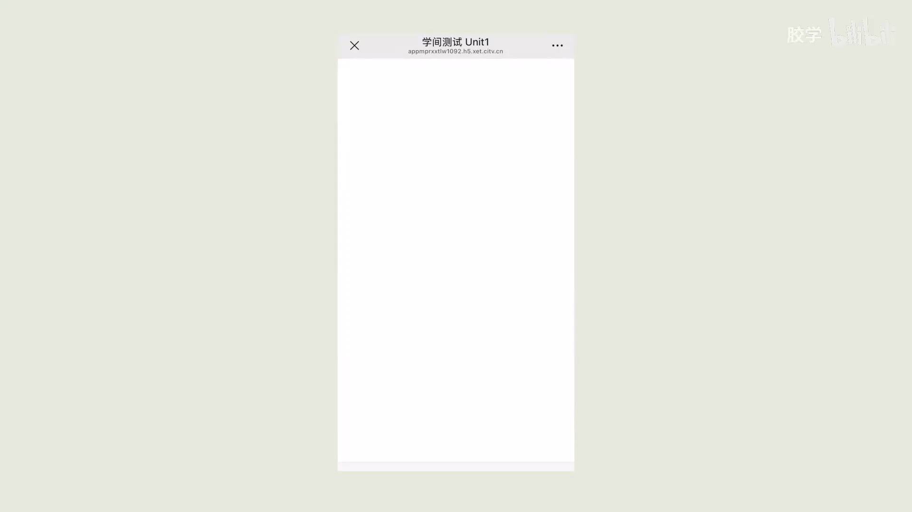

文字识别：胶学 / × / 学间测试 Unit1 / appmprxxtlw1092.h5.xet.citv.cn

### 画面 00:04:58

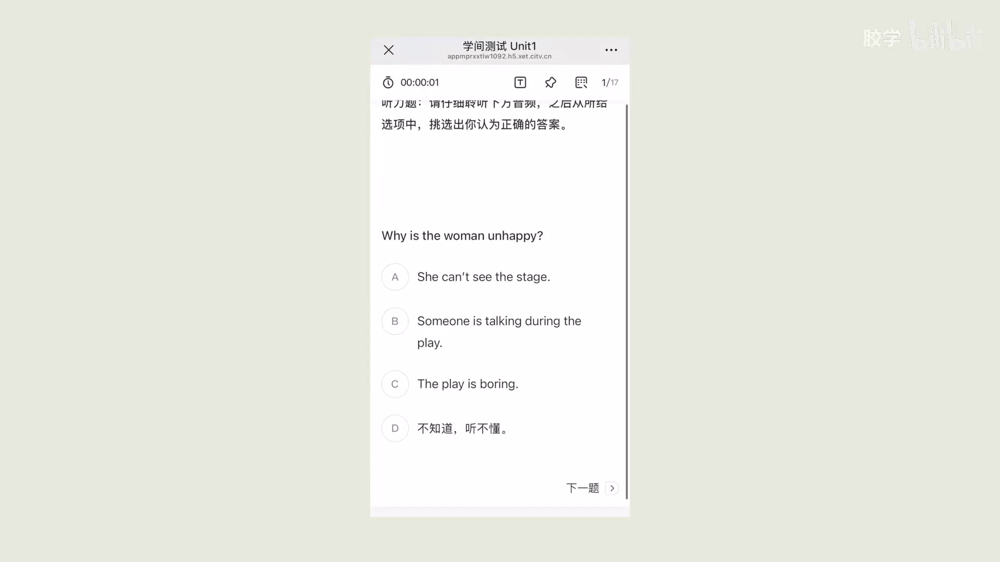

文字识别：胶学0 / × / 学间测试 Unit1 / appmprxxtlw1092.h5.xet.citv.cn / 00:00:01 / 日思1/17 / 听题：请什细聆听频，后从所结 / 选项中，挑选出你认为正确的答案。 / Why is the woman unhappy? / A / She can't see the stage. / B / Someone is talking during the / play. / The play is boring. / D / 不知道，听不懂。 / 下一题

## 00:05:00–00:05:16

第一册的测试呢更加的，呃，测试的更加全面了。有需要的话呢，大家可以扫描屏幕上的二维码来选购。好，以上就是这个视频的全部内容。祝大家学习愉快。

### 画面 00:05:00

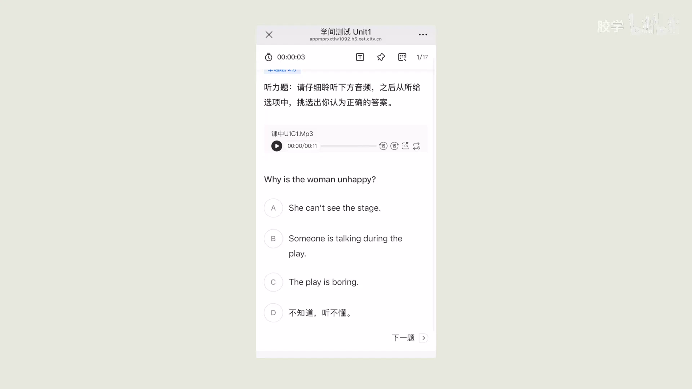

文字识别：胶学H / × / 学间测试 Unit1 / appmprxxtlw1092.h5.xet.citv.cn / 00:00:03 / 日思1/17 / 听题：请仔细聆听下频，之后从所给 / 选项中，挑选出你认为正确的答案。 / 课中U1C1.Mp3 / 00:00/00:11 / Why is the woman unhappy? / A / She can't see the stage. / B / Someone is talking during the / play. / The play is boring. / D / 不知道，听不懂。 / 下一题

### 画面 00:05:02

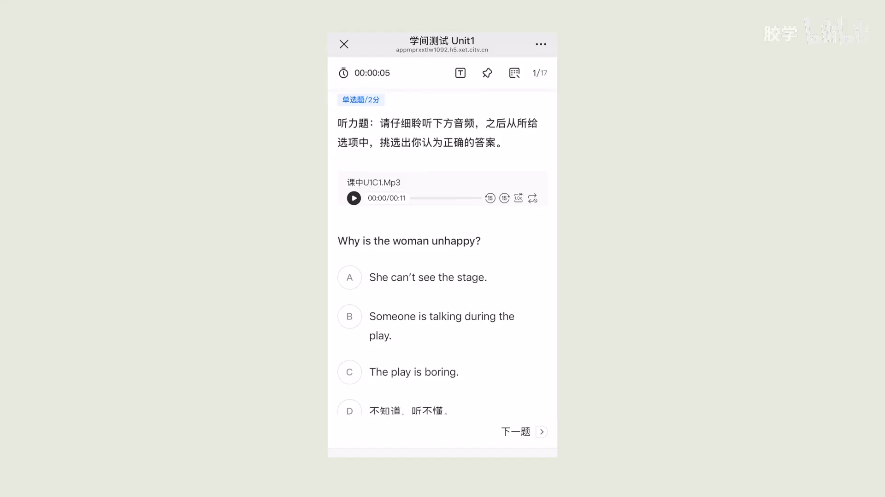

文字识别：胶学 / × / 学间测试 Unit1 / appmprxxtlw1092.h5.xet.citv.cn / 00:00:05 / 日思1/17 / 单选题/2分 / 听力题：请仔细聆听下方频，之后从所给 / 选项中，挑选出你认为正确的答案。 / 课中U1C1.Mp3 / 00:00/00:11 / Why is the woman unhappy? / A / She can't see the stage. / B / Someone is talking during the / play. / The play is boring. / D / 不知道，听不懂。 / 下一题

### 画面 00:05:05

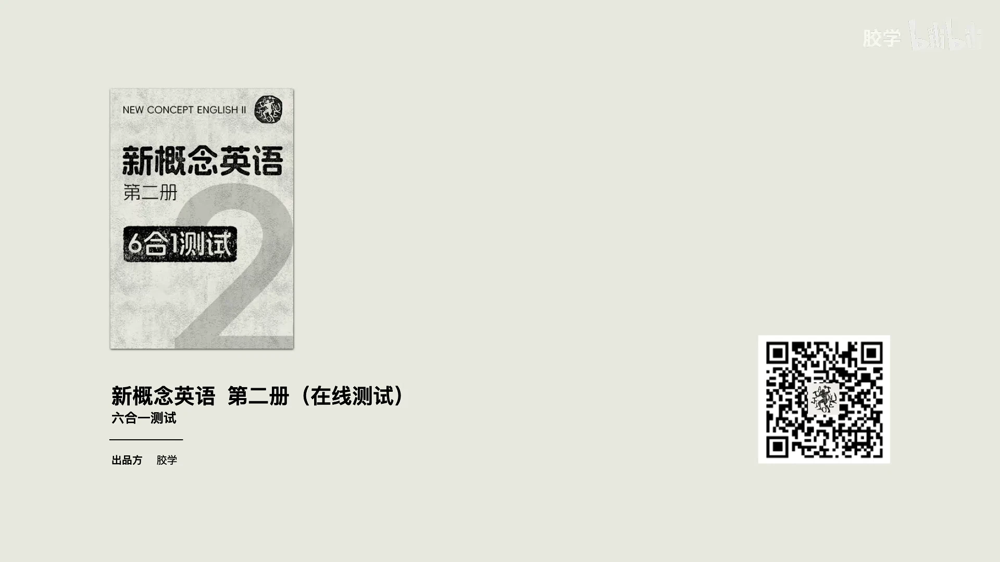

文字识别：胶学 / NEW CONCEPT ENGLISH II / 新概念英语 / 第二册 / 6合1测试 / 新概念英语 第二册 (在线测试) / 六合一测试 / 出品方 胶学

### 画面 00:05:16

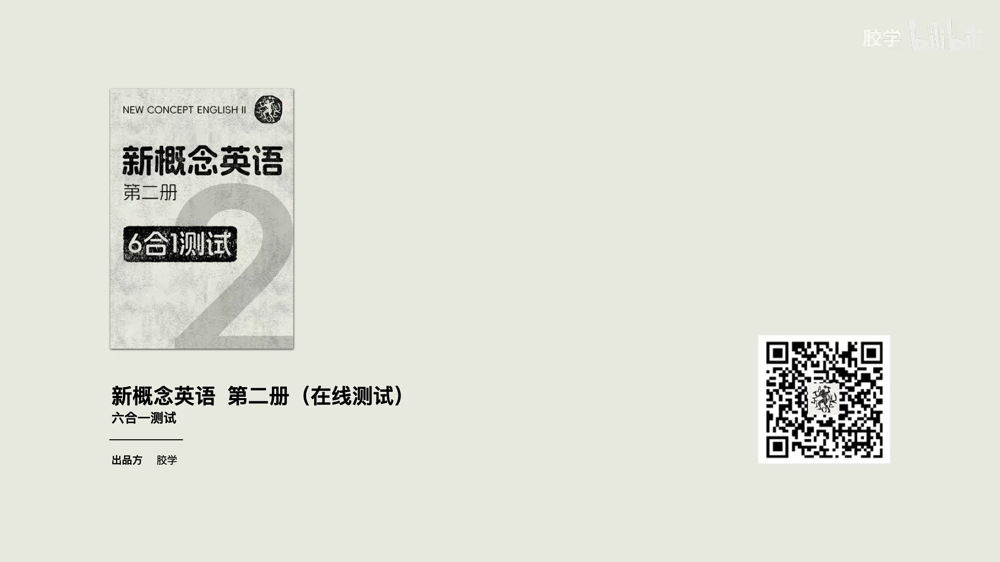

文字识别：胶学 / NEW CONCEPT ENGLISH II / 新概念英语 / 第二册 / 6合1测试 / 新概念英语 第二册 (在线测试) / 六合一测试 / 出品方 胶学

