# L001 语法讲解练习

快速机器解析：语音为单模型转写，未进行独立交叉校对或人工复核；画面每秒采样并按变化选帧，短时文字和标记可能遗漏。截图时间约有 1 秒误差。图片有损压缩；遇到疑点请按时间查看 Google Drive 原视频。

## 00:00:00–00:00:30

Hello everyone, welcome to Capsule Academy. This is Leo. Today we're going to learn New Concept English Book Two Lesson One Grammar.老习惯，进入正式课程之前，我们先看三个问题。第一，如何造一个英文的句子？第二，如何造一个好的英文句子？第三，英文它的语序到底是什么样子的？那带着这三个问题，hope you gonna enjoy it. 上来我们先看一幅图啊，

### 画面 00:00:00

文字识别：胶学bib出 / NCE / BOOKII / Lesson 1 / Grammar

### 画面 00:00:02

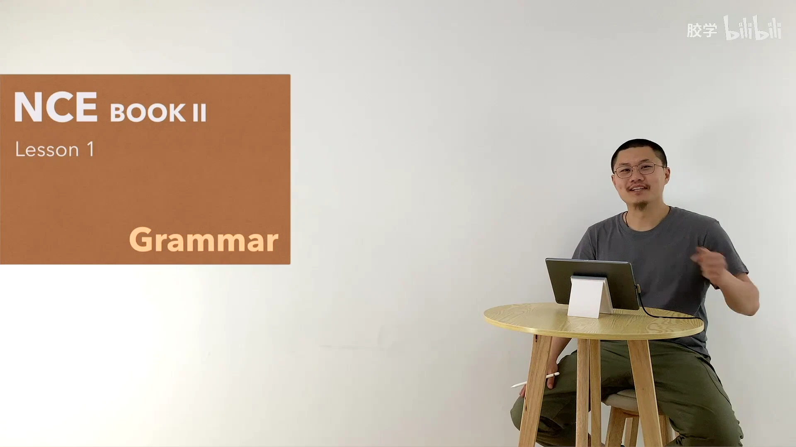

文字识别：胶学bib出 / NCE / BOOKII / Lesson 1 / Grammar

### 画面 00:00:05

文字识别：胶学bb / NCE / BOOKI"I / Lesson 1 / Grammar

### 画面 00:00:07

文字识别：胶学bib出 / NCE / BOOKⅡI / Lesson 1 / Grammar

### 画面 00:00:09

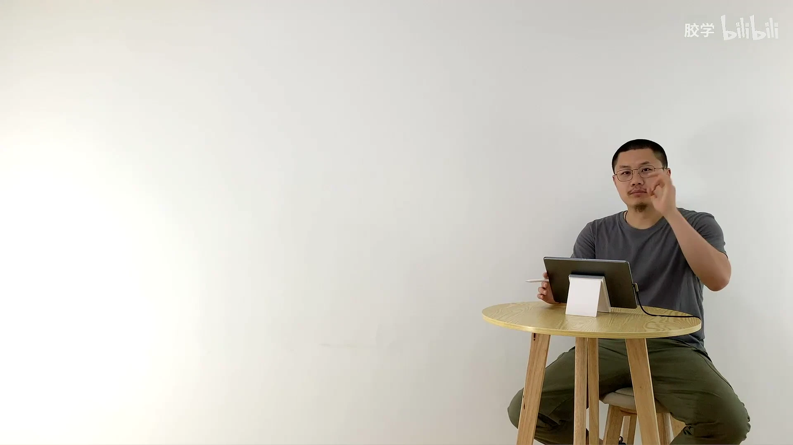

文字识别：胶学b出

### 画面 00:00:11

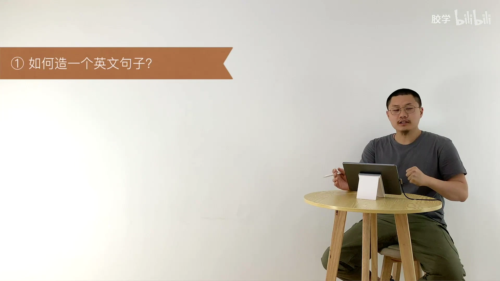

文字识别：胶学b出 / ① 如何造一个英文句子？

### 画面 00:00:13

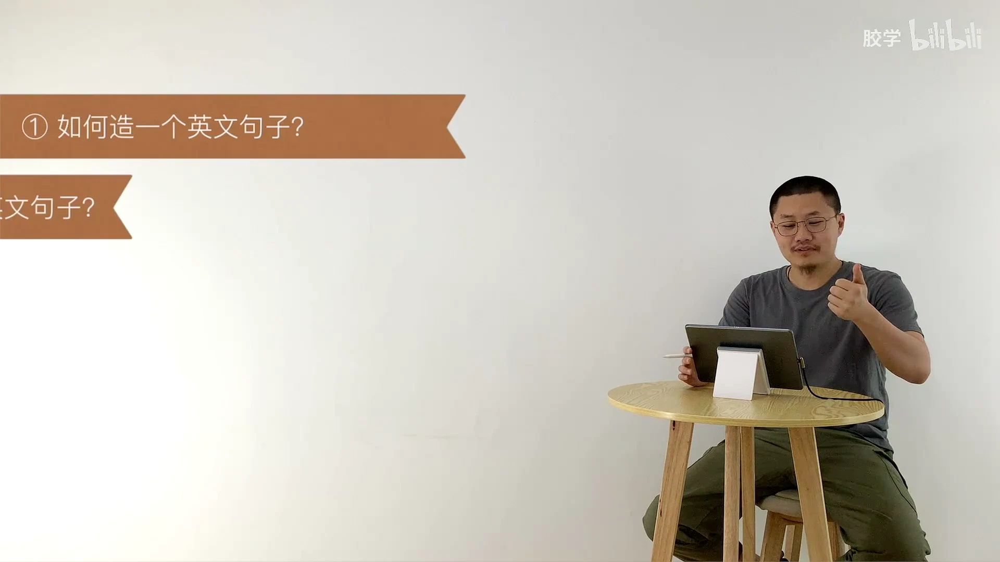

文字识别：胶学bib出 / ① 如何造一个英文句子？ / 文句子？

### 画面 00:00:15

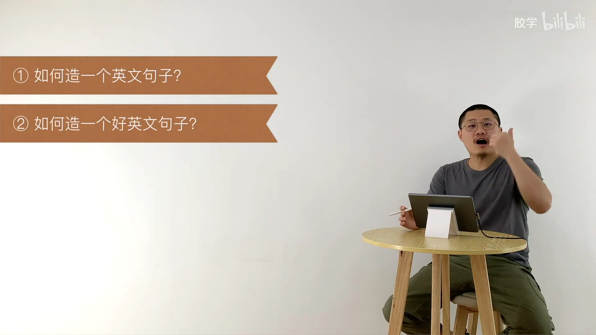

文字识别：胶学bb出 / ① 如何造一个英文句子？ / 如何造一个好英文句子?

### 画面 00:00:17

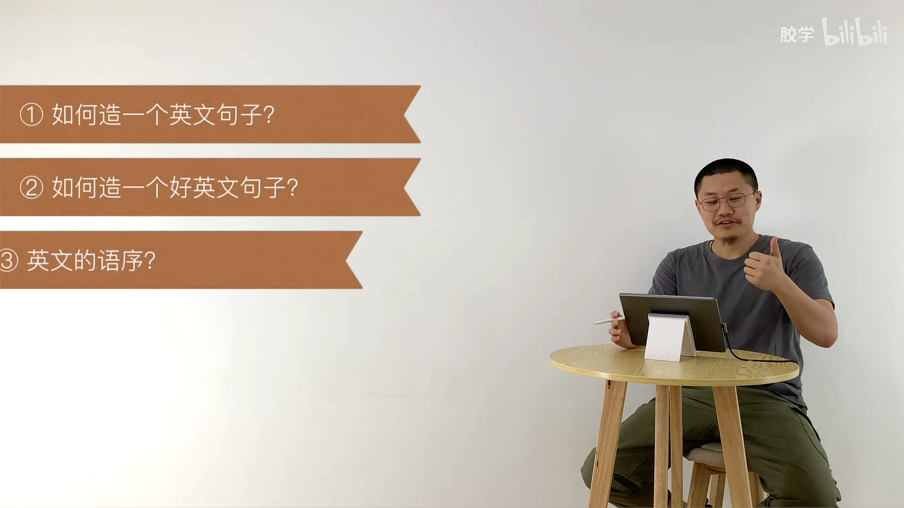

文字识别：胶学bb出 / ① 如何造一个英文句子？ / 如何造一个好英文句子? / 英文的语序?

### 画面 00:00:19

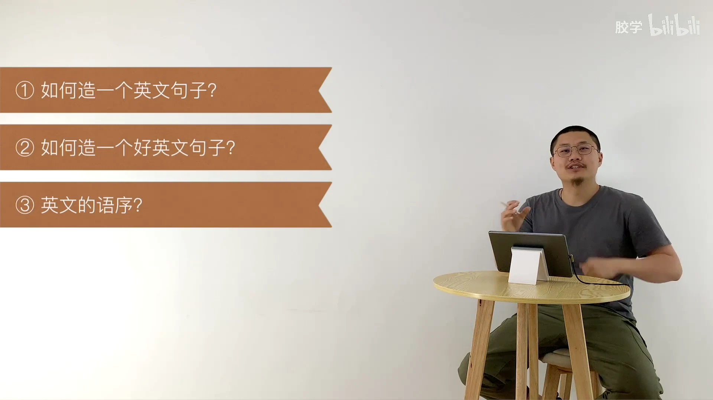

文字识别：胶学b出 / ① 如何造一个英文句子？ / 如何造一个好英文句子? / 英文的语序?

### 画面 00:00:21

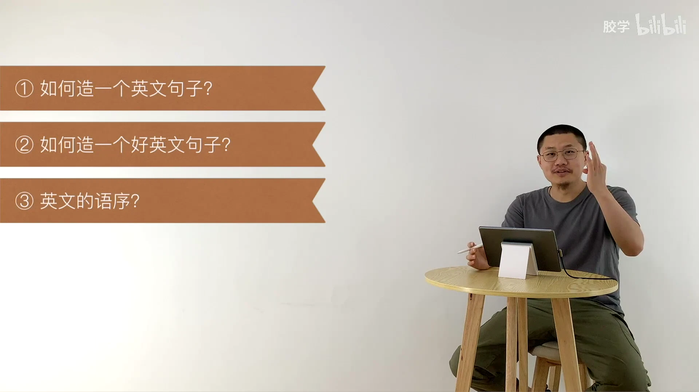

文字识别：胶学b出 / ① 如何造一个英文句子？ / 如何造一个好英文句子？ / 英文的语序?

### 画面 00:00:24

文字识别：胶学b出

### 画面 00:00:27

文字识别：胶学 / 胶囊学院

### 画面 00:00:29

文字识别：胶学bib出 / 1. 如何造一个英文句子? / 天黑了 / 他们累了 / 他们在等

## 00:00:30–00:01:00

就是 waiting for Gordon，等待戈多。好，天黑了，我们看图去进行一个描述。天黑了，那我们可以造一句英文叫做 night。这句话有问题，为什么呢？没主语。哎，造英文的句子一定要记住第一件事，这句话要有一个主语，除非它是短语啊，句子必有主语。再然后他们累了，我说 they tired。 OK，那它是没有动词的，应该是有一个小动词，对不对？接下来他们在

### 画面 00:00:31

文字识别：胶学b出 / 1. 如何造一个英文句子? / 天黑了 / 他们累了 / 他们在等

### 画面 00:00:35

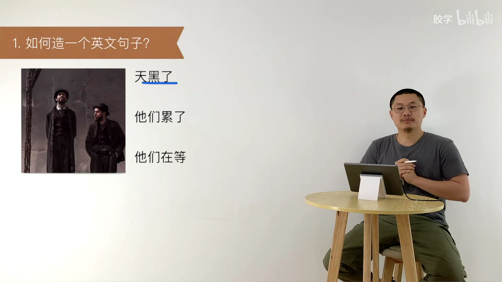

文字识别：胶学bib出 / 1. 如何造一个英文句子? / 天黑了 / 他们累了 / 他们在等

### 画面 00:00:40

文字识别：胶学b出 / 1. 如何造一个英文句子? / 天黑了 / night 无主语 / 他们累了 / 他们在等

### 画面 00:00:42

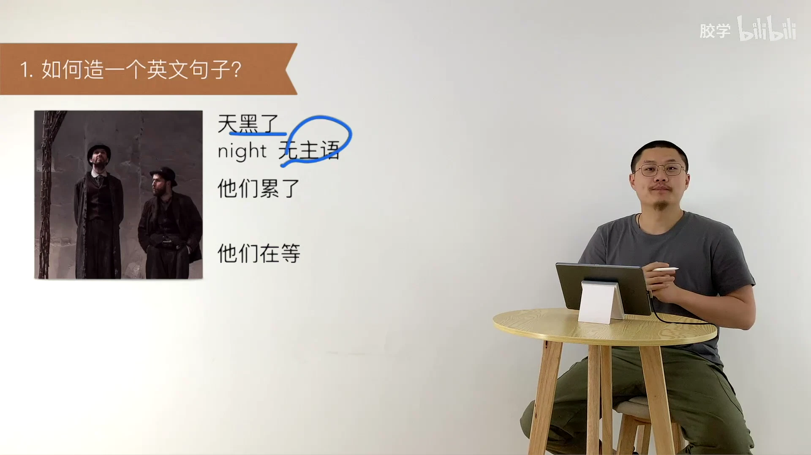

文字识别：胶学b出 / 1. 如何造一个英文句子? / 天黑了 / night / 无主语 / 他们累了 / 他们在等

### 画面 00:00:44

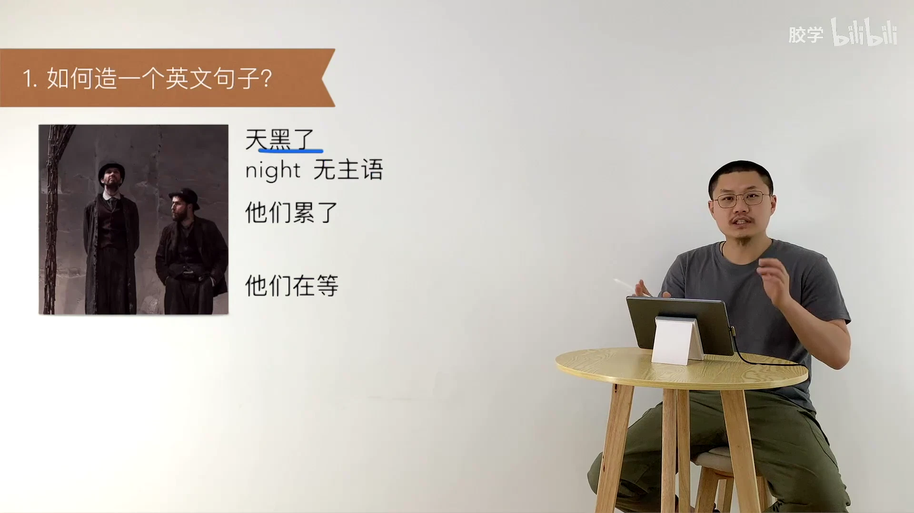

文字识别：胶学b出 / 1. 如何造一个英文句子? / 天黑了 / night 无主语 / 他们累了 / 他们在等

### 画面 00:00:47

文字识别：胶学bb / 1. 如何造一个英文句子? / 天黑了 / night 无主语 / 他们累了 / 他们在等

### 画面 00:00:50

文字识别：胶学b出 / 1. 如何造一个英文句子? / 天黑了 / night 无主语 / 他们累了 / 他们在等

### 画面 00:00:52

文字识别：胶学bt出 / 1. 如何造一个英文句子? / 天黑了 / night 无主语 / 他们累了 / They tired 无v. / 他们在等

### 画面 00:00:55

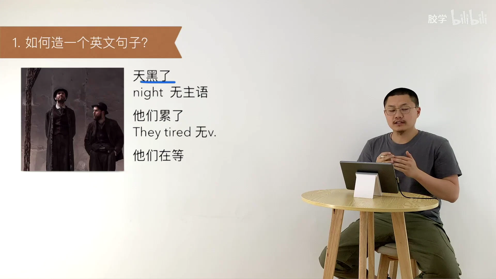

文字识别：胶学bii / 1. 如何造一个英文句子? / 天黑了 / night 无主语 / 他们累了 / They tired 无v. / 他们在等

## 00:01:00–00:01:30

等。这句话有主语了，也有动词了，但是你的动词没有变化。你应该说他们正在等，叫做 they are waiting，对吧？这是我们新一学过的。那我们现在来看一下刚才的几个规则。第一，句子一定要有主语，不能只来一个 night，这不是一句话，虽然也不一定是错的。OK，那你要说 it is night，一定要加一个主语 it。接下来呢，他们累了，那你刚才说的是

### 画面 00:01:03

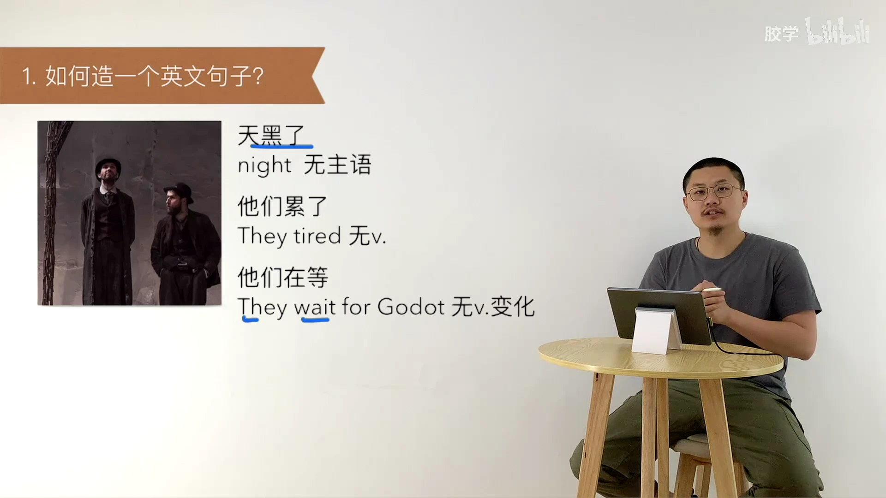

文字识别：胶学bil / 1. 如何造一个英文句子? / 天黑了 / night 无主语 / 他们累了 / They tired 无v. / 他们在等 / They wait for Godot 无v.变化

### 画面 00:01:10

文字识别：胶学 / 1. 如何造一个英文句子? / 天黑了 / night 无主语 / 他们累了 / They tired 无v. / 他们在等 / They wait for Godot 无v.变化

### 画面 00:01:12

文字识别：胶学bili / 1. 如何造一个英文句子？ / 1.句子要有主语 / 天黑了

### 画面 00:01:15

文字识别：胶学讲出 / 1. 如何造一个英文句子? / 1.句子要有主语 / 天黑了

### 画面 00:01:22

文字识别：胶学讲出 / 1. 如何造一个英文句子？ / 1.句子要有主语 / 天黑了 / It is night.

## 00:01:30–00:02:00

they tired. 注意这地方一定要有这么一个小的 are，叫做 they are tired. 虽然这个 are 并不是一个具体的动作，但它也可以理解为是一个动词哦。 Continue next one. 动词要有变化啊。其实我们在讲单词的时候，往那个部分就提过了，动词加动词变化，对吧？所谓的动词变化跟时态、哎，情态助动词就有非常大的紧密的关系。比如说

### 画面 00:01:31

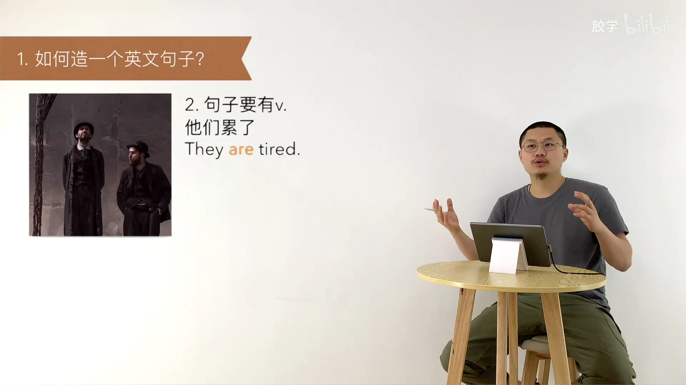

文字识别：胶学上W国 / 1. 如何造一个英文句子？ / 2. 句子要有v. / 他们累了 / They are tired.

### 画面 00:01:34

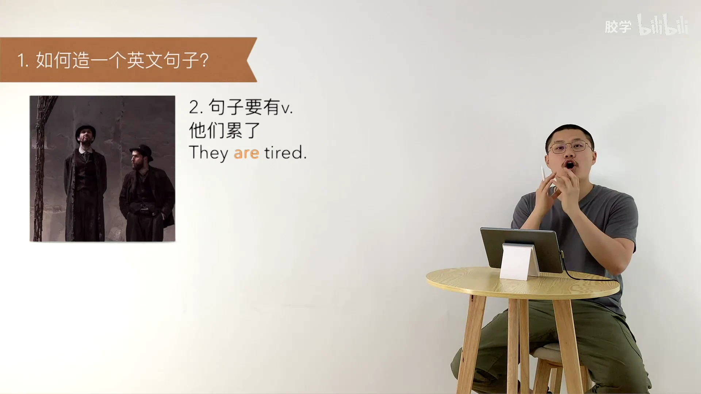

文字识别：胶学谢止 / 1. 如何造一个英文句子？ / 2.句子要有v. / 他们累了 / They are tired.

### 画面 00:01:50

文字识别：胶学Li / 1. 如何造一个英文句子？ / 3.v.要有变化 / 他们在等

### 画面 00:01:53

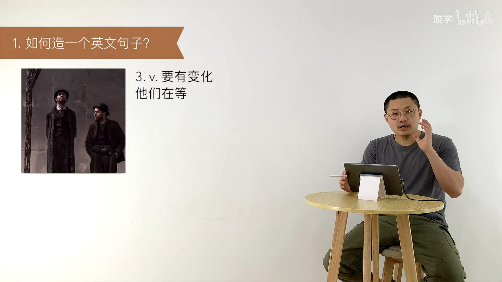

文字识别：胶学b / 1. 如何造一个英文句子？ / 3.v.要有变化 / 他们在等

### 画面 00:01:56

文字识别：胶学b业 / 1. 如何造一个英文句子? / 3.v.要有变化 / 他们在等

### 画面 00:01:59

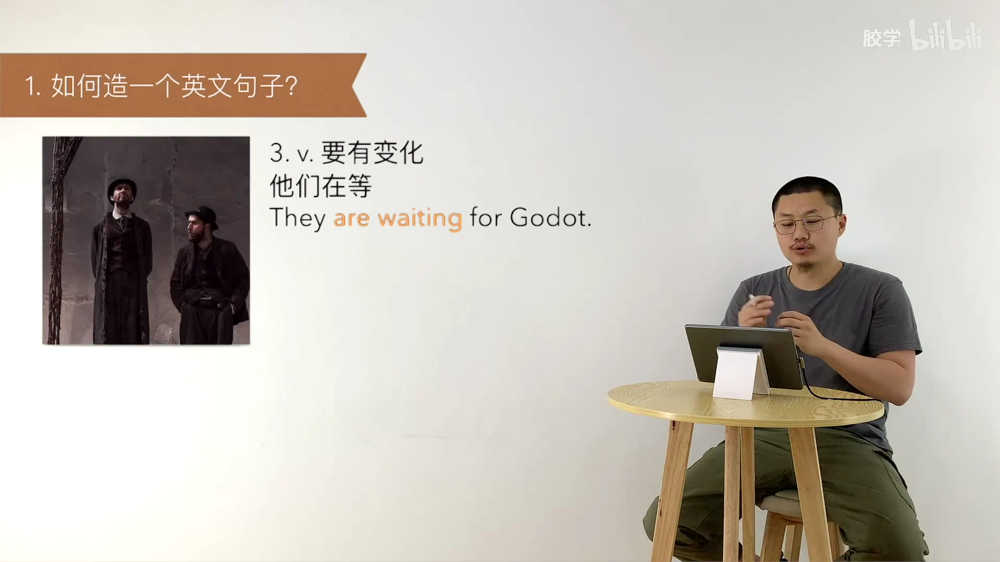

文字识别：胶学b / 1. 如何造一个英文句子? / 3.v.要有变化 / 他们在等 / They are waiting for Godot.

## 00:02:00–00:02:30

they are waiting, be 加 doing 才叫你有了动词的变化。那我们总结一下，造一个英文的句子其实很简单，有主语，有动词。跟我们汉语不一样的是，汉语不存在动词变化，英文还要把这动词加一个时态或者情态，动词或者情态助动词。OK，这叫动词的变化，哎，满足这三点就可以了。

### 画面 00:02:01

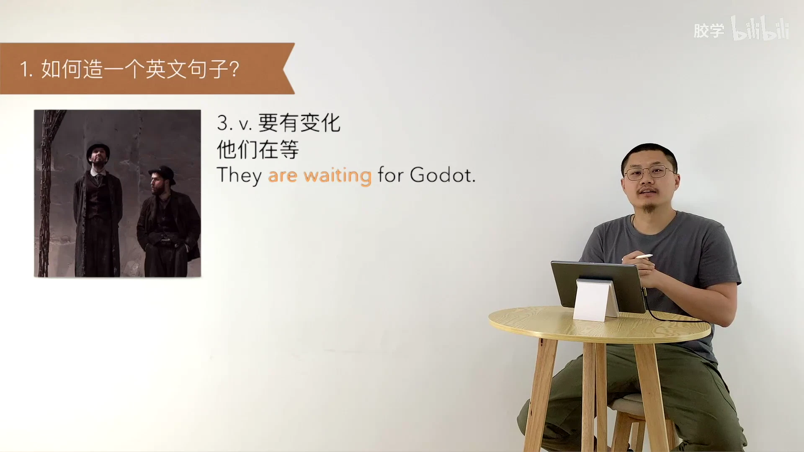

文字识别：胶学出 / 1. 如何造一个英文句子? / 3.v.要有变化 / 他们在等 / They are waiting for Godot.

### 画面 00:02:07

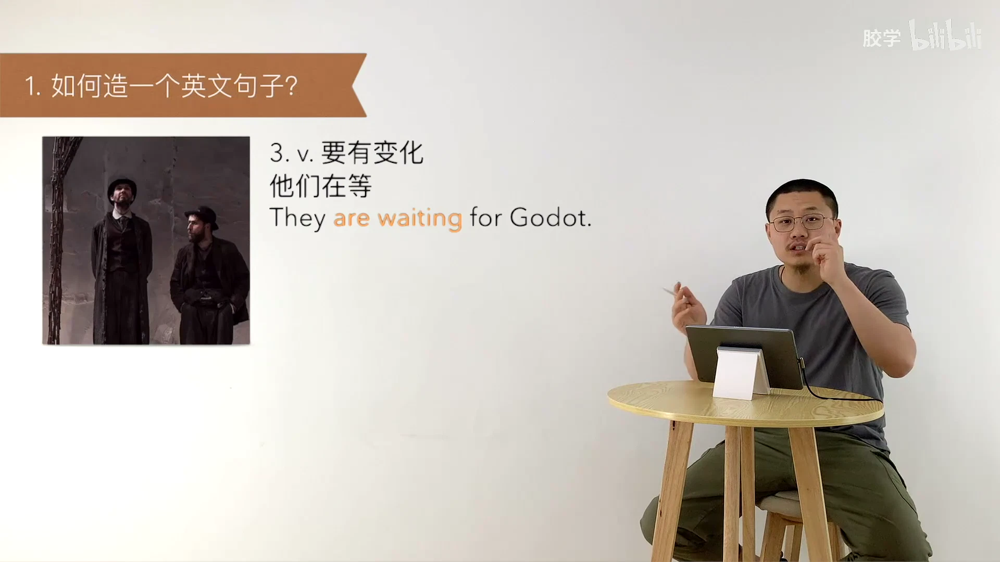

文字识别：胶学b出 / 1. 如何造一个英文句子? / 3.v.要有变化 / 他们在等 / They are waiting for Godot.

### 画面 00:02:09

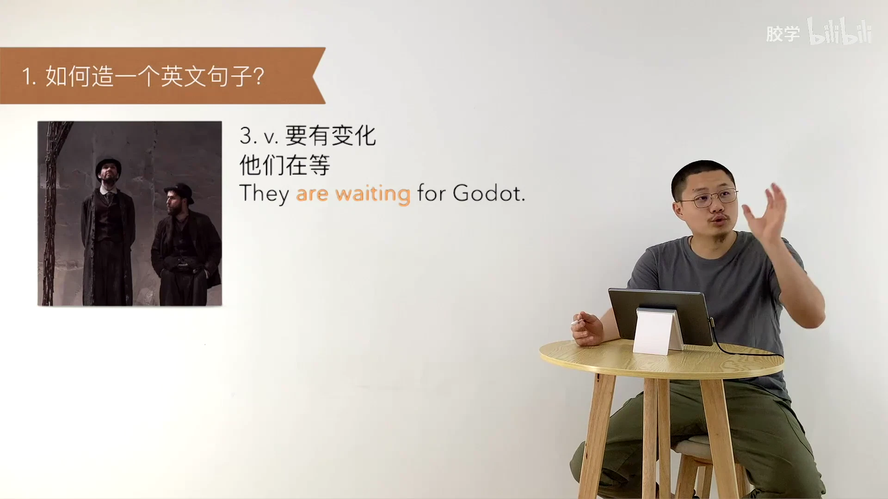

文字识别：胶学bi / 1. 如何造一个英文句子? / 3.v.要有变化 / 他们在等 / They are waiting for Godot.

### 画面 00:02:11

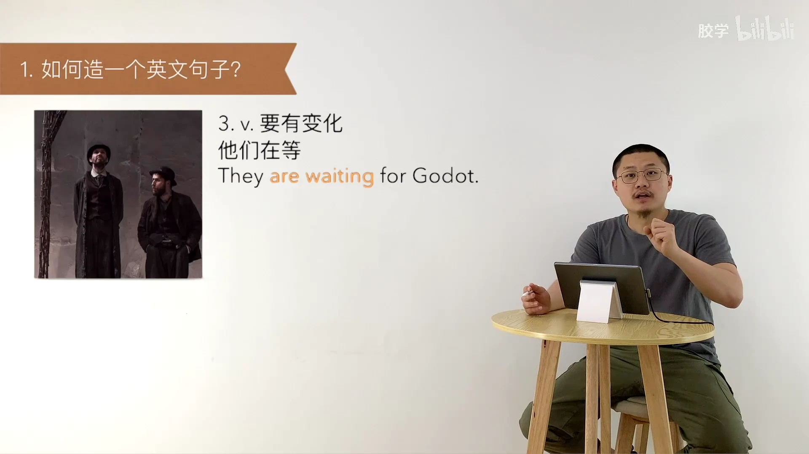

文字识别：胶学b讲出 / 1. 如何造一个英文句子？ / 3.v.要有变化 / 他们在等 / They are waiting for Godot.

### 画面 00:02:20

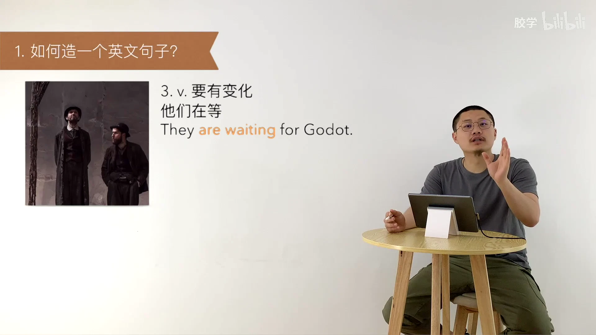

文字识别：胶学b出 / 1. 如何造一个英文句子？ / 3.v.要有变化 / 他们在等 / They are waiting for Godot.

### 画面 00:02:23

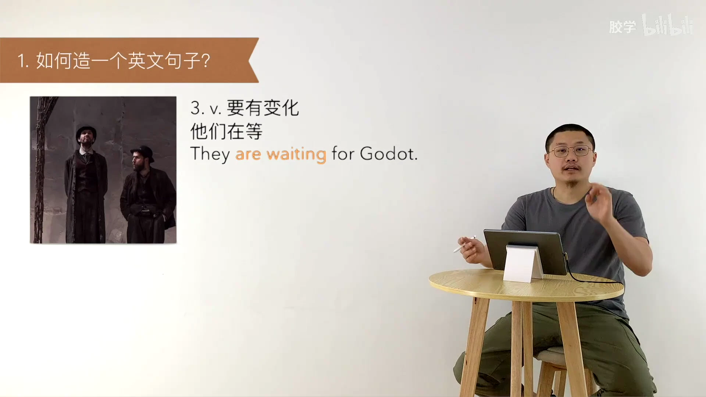

文字识别：胶学上 / 1. 如何造一个英文句子? / 3.v.要有变化 / 他们在等 / They are waiting for Godot.

### 画面 00:02:25

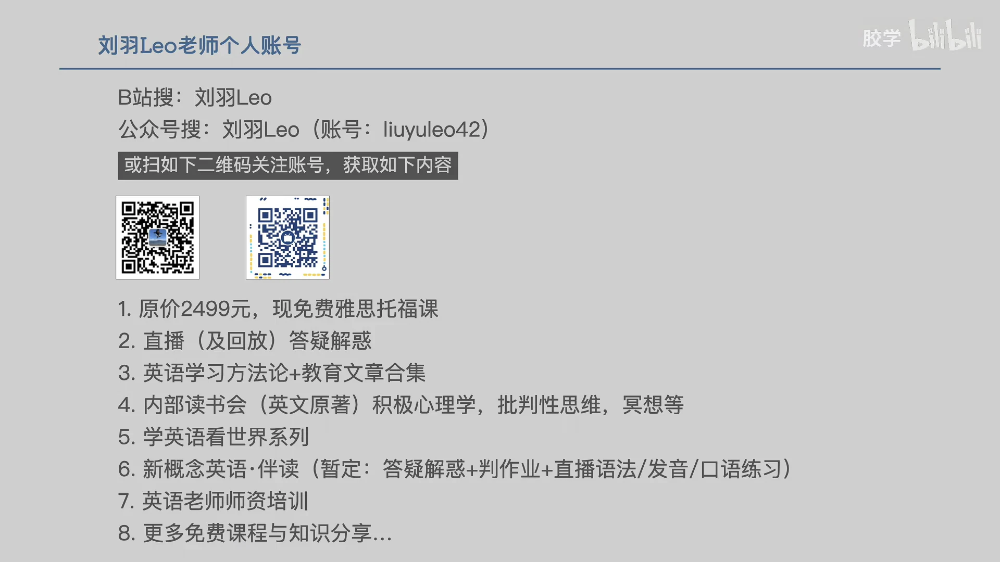

文字识别：胶学b出 / 刘羽Leo老师个人账号 / B站搜：刘羽Leo / 公众号搜：刘羽Leo（账号：liuyuleo42) / 或扫如下二维码关注账号，获取如下内容 / 1.原价2499元，现免费雅思托福课 / 2.直播（及回放）答疑解惑 / 3.英语学习方法论+教育文章合集 / 4.内部读书会（英文原著）积极心理学，批判性思维，冥想等 / 5.学英语看世界系列 / 6.新概念英语·伴读 (暂定：答疑解惑+判作业+直播语法/发音/口语练习) / 7.英语老师师资培训 / 8.更多免费课程与知识分享...

## 00:02:30–00:03:00

那如何造一个好的英文句子呢？我们先来看一句话，叫做 A woman is shouting。说一个女人啊正在尖叫。那各位设想一下，我为什么配了两幅图？原因是如果我们只看这句话，首先它是好的，它是对的句子，有主语，a woman，有动词shout，是吧？还有动词的变化is shouting。Very good。那接下来的问题是，我们听到一句话，脑海当中一般

### 画面 00:02:30

文字识别：胶学讲出 / 2. 如何造一个好英文句子? / A woman is shouting. / + adj./ +adv.(方式)

### 画面 00:02:34

文字识别：胶学讲出 / 2. 如何造一个好英文句子? / A woman is shouting. / + adj./ +adv.(方式)

### 画面 00:02:36

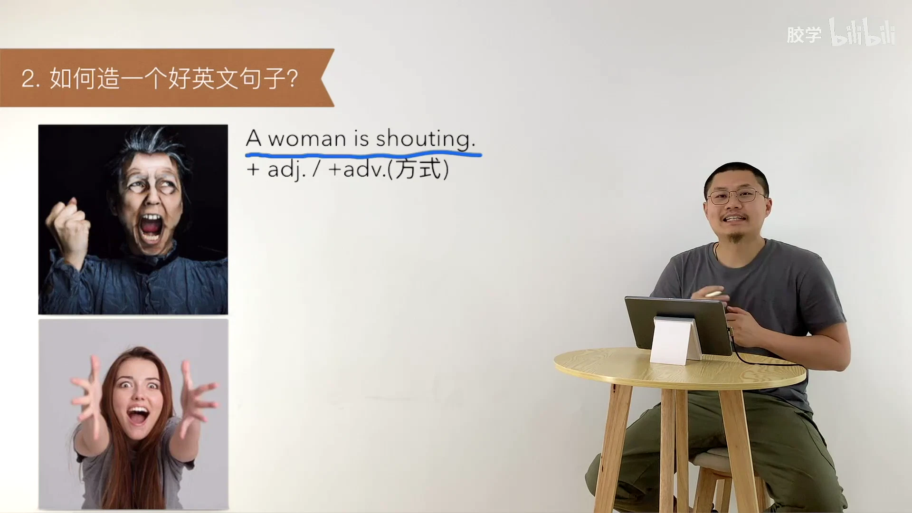

文字识别：胶学讲 / 2. 如何造一个好英文句子？ / A woman is shouting. / + adj./+adv.(方式)

### 画面 00:02:46

文字识别：胶学L讲出 / 2. 如何造一个好英文句子? / A woman is shouting. / + adj./+adv.(方式)

### 画面 00:02:59

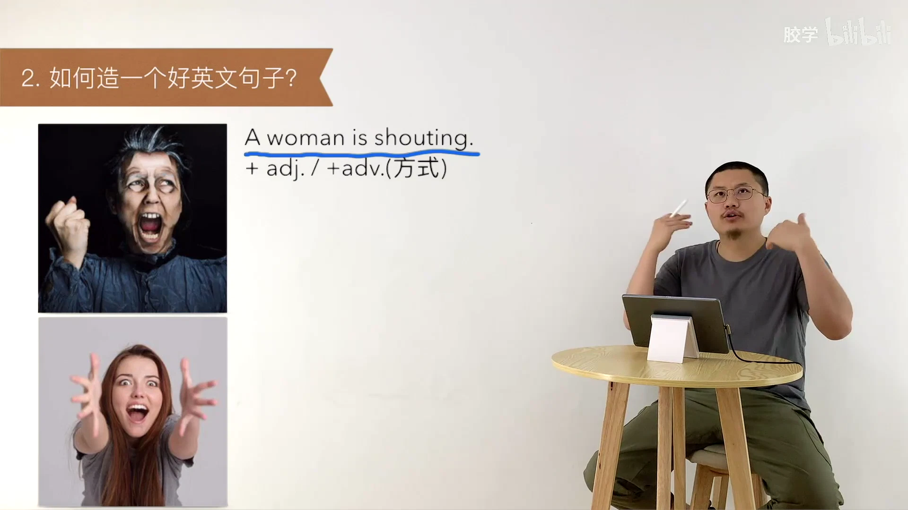

文字识别：胶学Lll / 2. 如何造一个好英文句子? / A woman is shouting. / + adj./+adv.(方式)

## 00:03:00–00:03:30

般是会形成一个画面感的，这才代表我们理解了这句话。那你想，a ominous shouting，你是很难判断是这幅画还是这幅画的。也就是说，给大家提供的信息是不够的。所以我在后面写了一个叫加形容词加副词，副词是一种方式。这个我们在新一都学过。首先，形容词是修饰名词的，它们二者虽然都是omen，但是形容词肯定是有一点不同吧？你设想一下，对吧？

### 画面 00:03:03

文字识别：胶学LW / 2. 如何造一个好英文句子? / A woman is shouting. / + adj./+adv.(方式)

### 画面 00:03:06

文字识别：胶学上H / 2. 如何造一个好英文句子？ / A woman is shouting. / + adj./+adv.(方式)

### 画面 00:03:08

文字识别：胶学LH / 2. 如何造一个好英文句子？ / A woman is shouting. / + adj./+adv.(方式)

### 画面 00:03:10

文字识别：胶学上州 / 2. 如何造一个好英文句子？ / A woman is shouting. / + adj./+adv.(方式)

### 画面 00:03:12

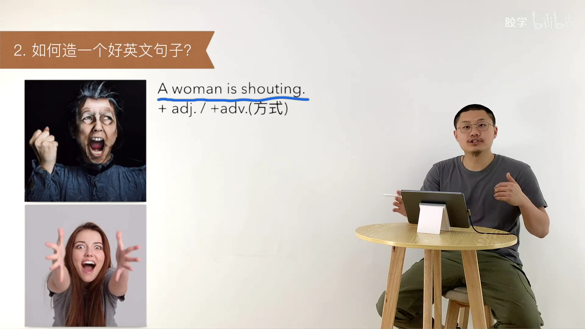

文字识别：胶学上州 / 2. 如何造一个好英文句子？ / A woman is shouting. / + adj./+adv.(方式)

### 画面 00:03:15

文字识别：胶学L / 2. 如何造一个好英文句子? / A woman is shouting. / + adj./+adv.(方式)

### 画面 00:03:20

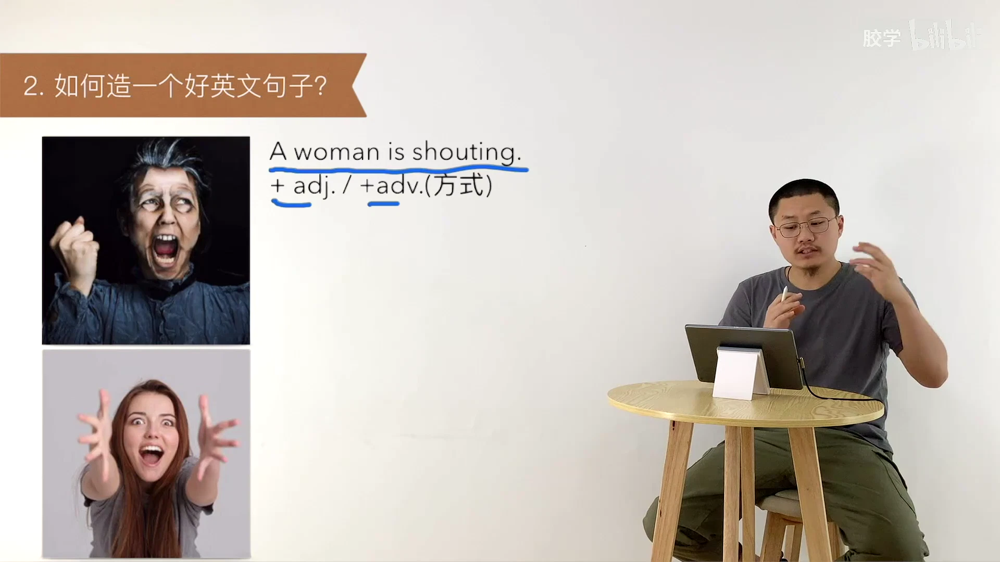

文字识别：胶学LH / 2. 如何造一个好英文句子? / A woman is shouting. / + adj./+adv.(方式)

## 00:03:30–00:04:00

其次呢，那你看他们俩的表情，你也能感觉出来，他们去 shout 喊叫的方式，也就是副词，应该也是不太一样的。一个好像是很开心、很惊喜，另一个是很愤怒的感觉，对不对？所以我们先造了第一个句子，叫做 An ugly woman is shouting angrily. OK，注意那 ugly 丑陋的啊，然后 angrily 我们刚刚学的单词，愤怒的，一个特别丑陋的女人正在很

### 画面 00:03:32

文字识别：胶学LW / 2. 如何造一个好英文句子? / A woman is shouting. / + adj./+adv.(方式)

### 画面 00:03:34

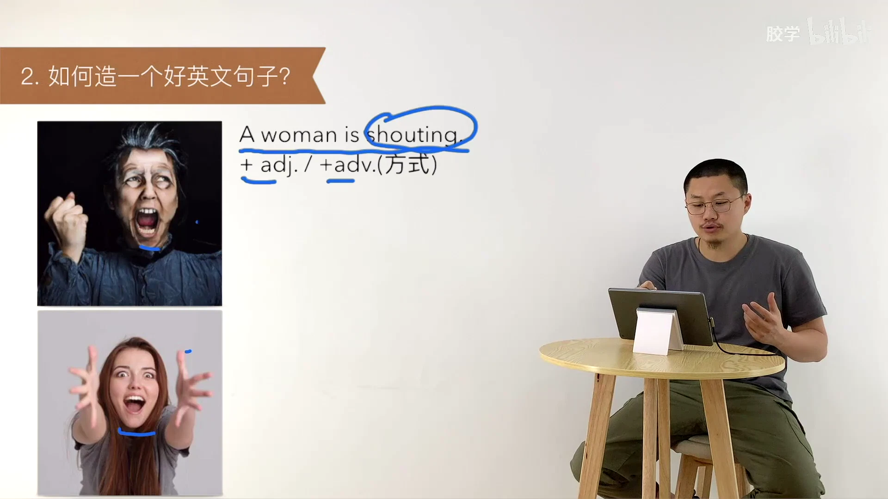

文字识别：胶学LH / 2. 如何造一个好英文句子？ / A woman is / shouting. / + adj./+adv.(方式)

### 画面 00:03:36

文字识别：胶学州 / 2. 如何造一个好英文句子? / A woman is shouting. / + adj./+adv.(方式)

### 画面 00:03:39

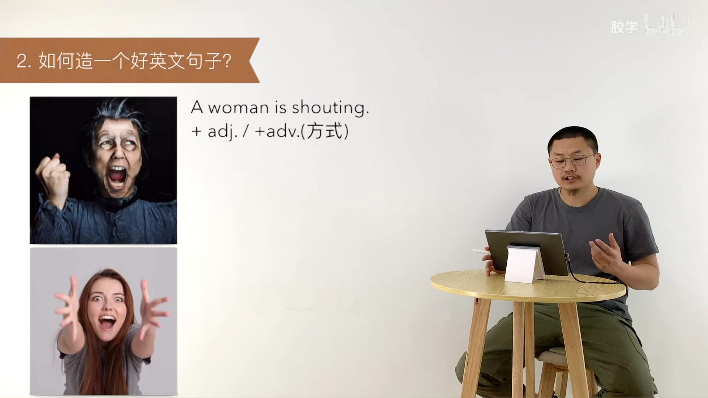

文字识别：胶学LM / 2. 如何造一个好英文句子? / A woman is shouting. / + adj./ +adv.(方式)

### 画面 00:03:41

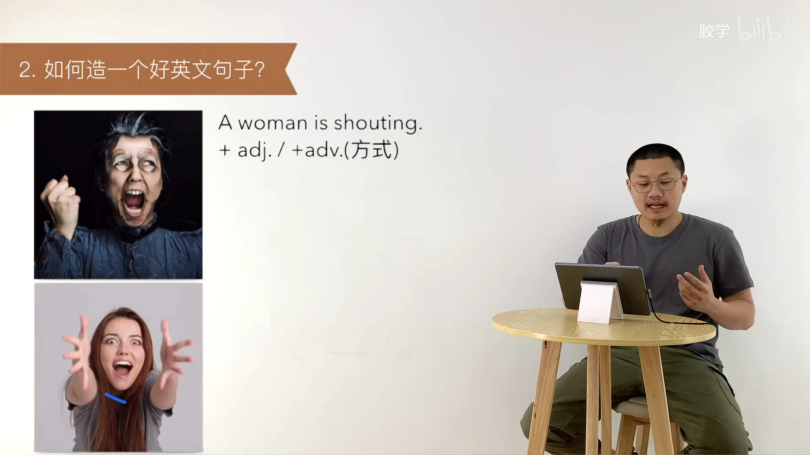

文字识别：胶学 / 2. 如何造一个好英文句子? / A woman is shouting. / + adj./ +adv.(方式)

### 画面 00:03:45

文字识别：胶学 / 2. 如何造一个好英文句子? / A woman is shouting. / + adj./ +adv.(方式) / An ugly / woman is shouting / angrily.

### 画面 00:03:50

文字识别：胶学 / 2. 如何造一个好英文句子? / A woman is shouting. / + adj./ +adv.(方式) / An ugly / woman is shouting / angrily.

### 画面 00:03:55

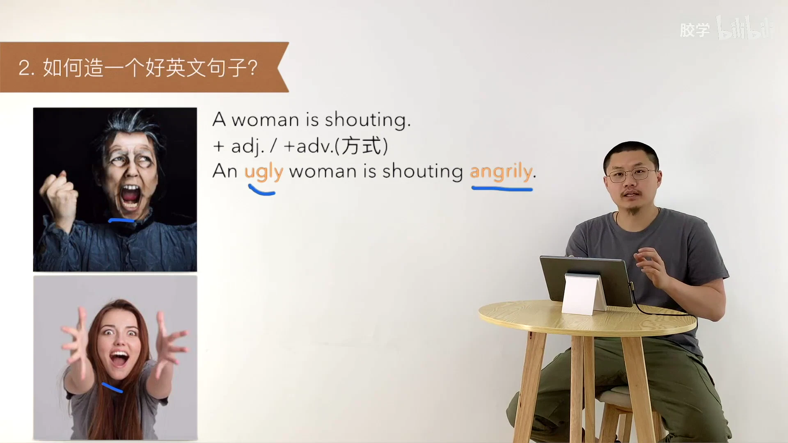

文字识别：胶学H / 2. 如何造一个好英文句子? / A woman is shouting. / + adj./ +adv.(方式) / An ugly / woman is shouting / angrily.

## 00:04:00–00:04:30

愤怒的尖叫着。那你想是这两幅图的哪一幅图？是不是就更能确定是这一幅图了？所以这个句子添加了更多的细节，变得更好了那么一点点。那底下这个句子呢？就是 A cute woman is shouting happily. 一个特别可爱的女人，哎，首先应该算可爱了哦。 Happily，你看表情也能看出来是 happily 而不是 angrily，对不对？所以各位记

### 画面 00:04:02

文字识别：胶学b让 / 2. 如何造一个好英文句子? / A woman is shouting. / + adj./ +adv.(方式) / An ugly / woman is shouting / angrily.

### 画面 00:04:05

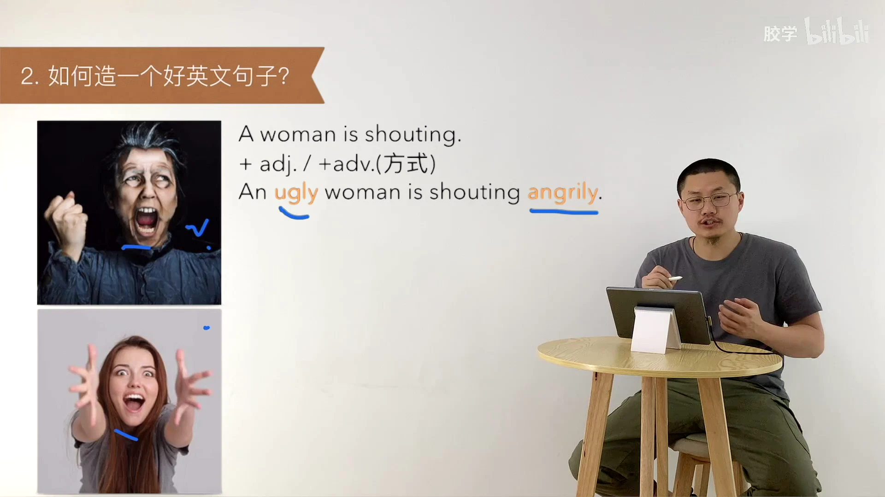

文字识别：胶学bW出 / 2. 如何造一个好英文句子? / A woman is shouting. / + adj./ +adv.(方式) / An ugly / woman is shouting / angrily.

### 画面 00:04:10

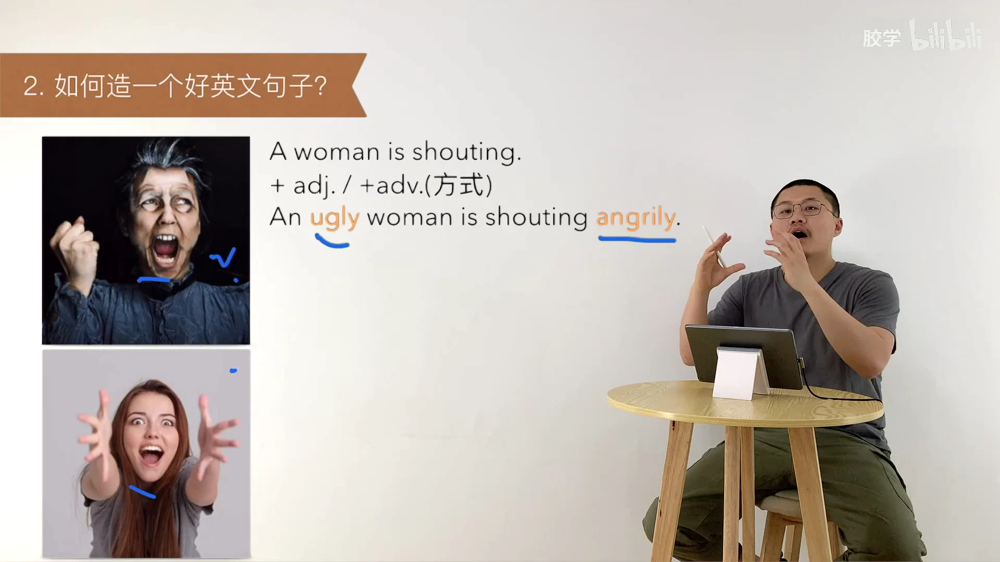

文字识别：胶学H出 / 2. 如何造一个好英文句子? / A woman is shouting. / + adj./ +adv.(方式) / An ugly / woman is shouting / angrily.

### 画面 00:04:15

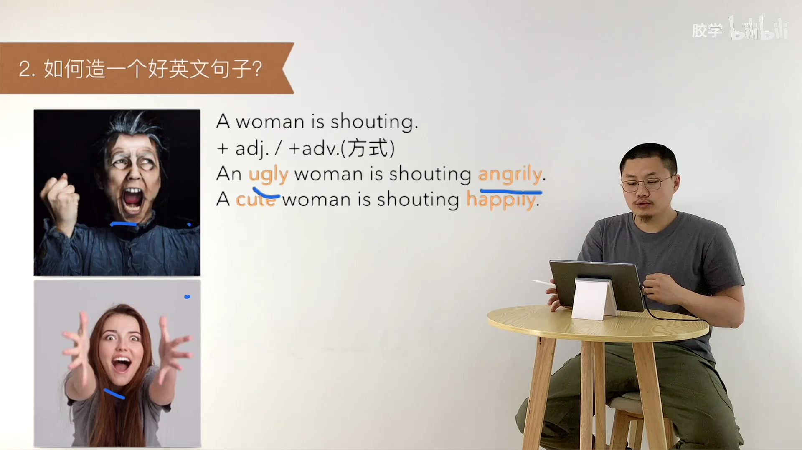

文字识别：胶学b / 2. 如何造一个好英文句子? / A woman is / shouting. / adj./ +adv.(方式) / + / An / ugly / woman is shouting / angrily. / A / curev / woman is s / shouting / happily.

### 画面 00:04:19

文字识别：胶学上出 / 2. 如何造一个好英文句子? / A woman is shouting. / + adj./ +adv.(方式) / An / ugly / woman is shouting / angrily. / woman is shouting / happily. / A / cute

### 画面 00:04:22

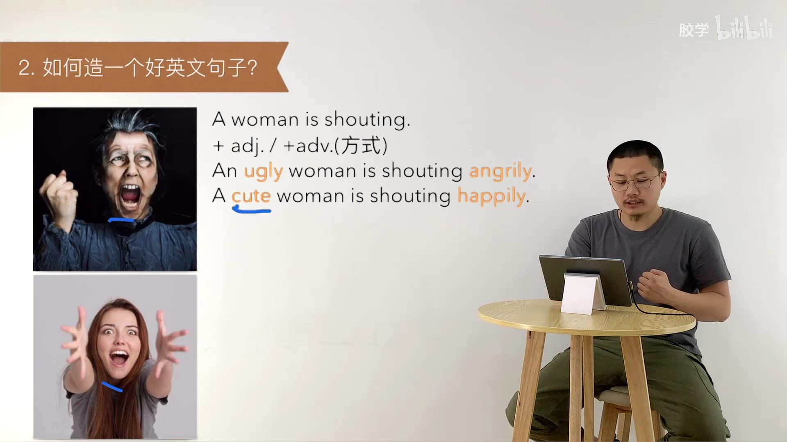

文字识别：胶学b出 / 2. 如何造一个好英文句子? / A woman is shouting. / adj./ +adv.(方式) / +  / An / ugly / woman is shouting / angrily. / woman is shouting / happily. / A / cute

### 画面 00:04:24

文字识别：胶学b出 / 2. 如何造一个好英文句子? / A woman is shouting. / adj./ +adv.(方式) / + / An / ugly / woman is shouting / angrily. / woman is shouting / happily. / A / cute

### 画面 00:04:26

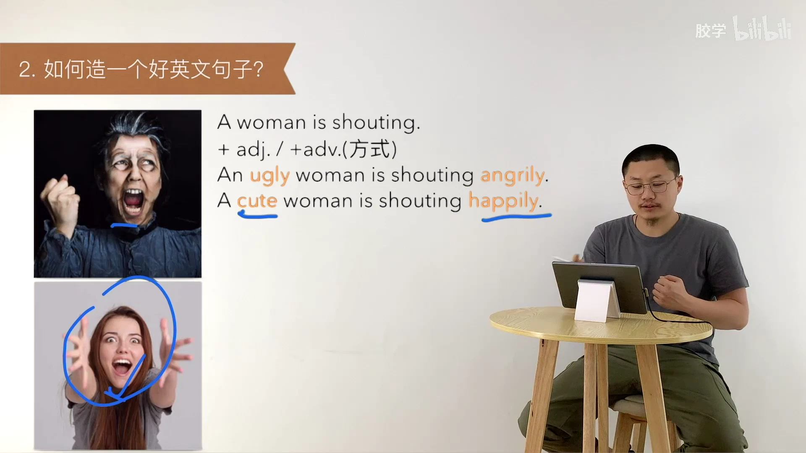

文字识别：胶学b出 / 2. 如何造一个好英文句子? / A woman is shouting. / adj./ +adv.(方式) / + / An / ugly / woman is shouting / angrily. / A / cute / woman is shouting / happily.

### 画面 00:04:28

文字识别：胶学b出 / 2. 如何造一个好英文句子? / A woman is shouting. / + adj./ +adv.(方式) / AnI / ugly / woman is shouting / angrily. / woman is shouting / happily. / A / cute

## 00:04:30–00:05:00

住，怎么把一个平淡无奇的句子添加更多的语言细节呢？我们现在有两个方式：第一，加形容词；第二，加副词，对吧？Continuing.那我们还有一种方式是添加地点，地点会让我们的背景更加的具体。比如说像刚才的背景，我专门选了纯色的背景，就是你不知道它在什么地方去做的这件事儿。但是我们加了地点了之后，效果又变了。比如说，an ugly woman is

### 画面 00:04:30

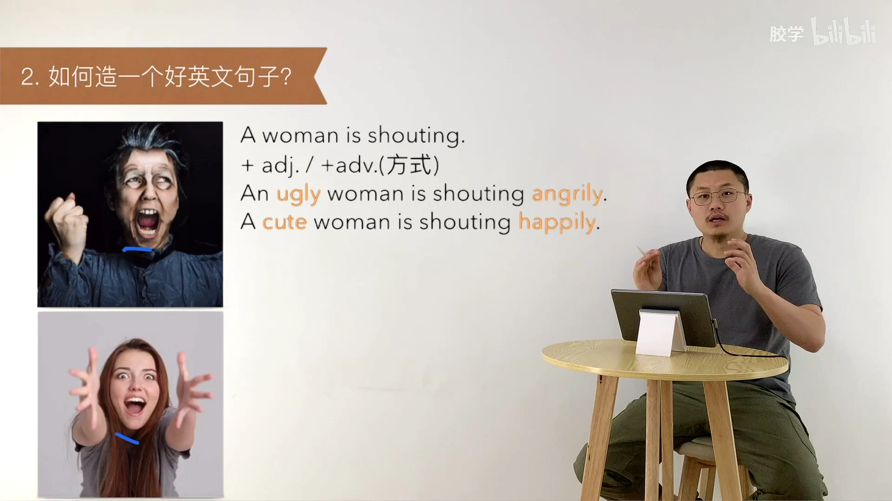

文字识别：胶学bl出 / 2. 如何造一个好英文句子? / A woman is shouting. / + adj./ +adv.(方式) / An / ugly / woman is shouting / angrily. / A / cute / woman is shouting / happily.

### 画面 00:04:32

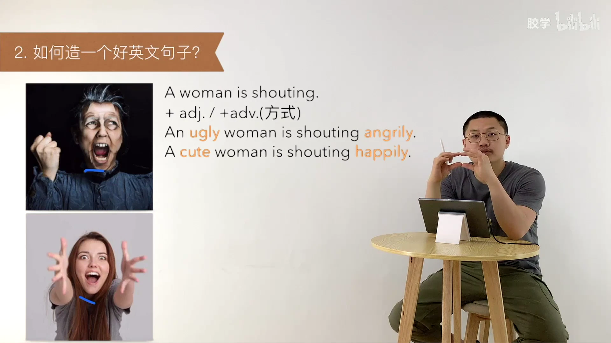

文字识别：胶学出 / 2. 如何造一个好英文句子? / A woman is shouting. / + adj./ +adv.(方式) / Anl / ugly / woman is shouting / angrily. / woman is shouting / happily. / A / cute

### 画面 00:04:35

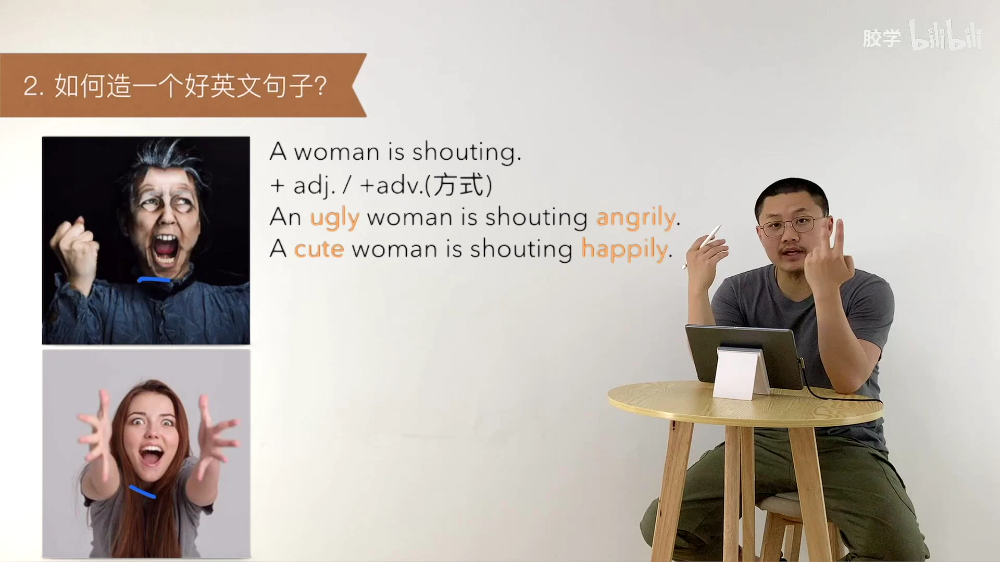

文字识别：胶学b出 / 2. 如何造一个好英文句子? / A woman is shouting. / adj./ +adv.(方式) / + / An / ugly / woman is shouting / angrily. / woman is shouting / happily. / A / cute

### 画面 00:04:38

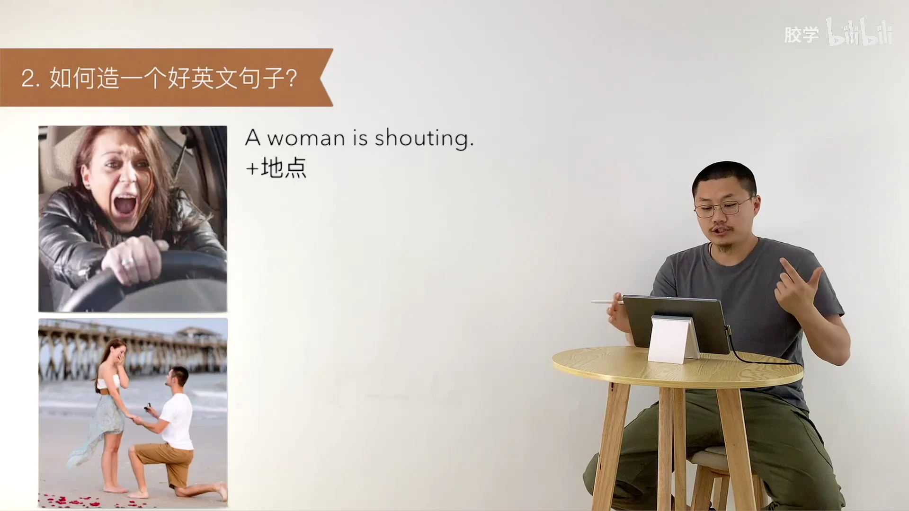

文字识别：胶学b出 / 2. 如何造一个好英文句子？ / A woman is shouting. / +地点 / AW

### 画面 00:04:40

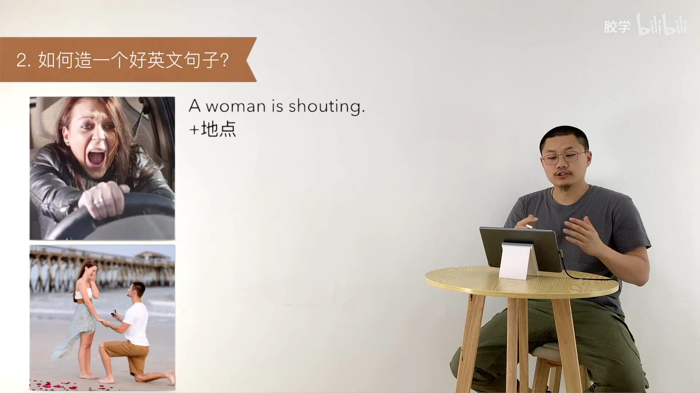

文字识别：胶学bl / 2. 如何造一个好英文句子? / A woman is shouting. / +地点

### 画面 00:04:44

文字识别：胶学bH出 / 2. 如何造一个好英文句子？ / A woman is shouting. / +地点

### 画面 00:04:47

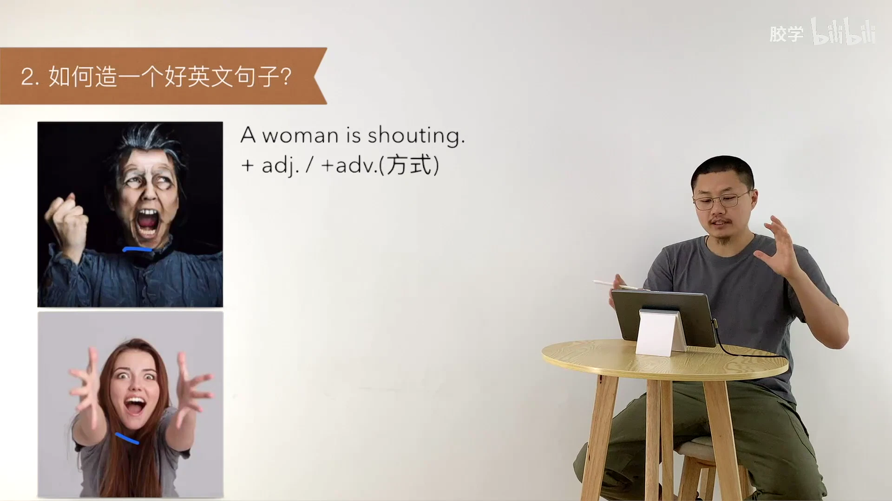

文字识别：胶学bi业 / 2. 如何造一个好英文句子? / A woman is shouting. / + adj./ +adv.(方式)

### 画面 00:04:49

文字识别：胶学b出 / 2. 如何造一个好英文句子? / A woman is shouting. / + adj./ +adv.(方式)

### 画面 00:04:51

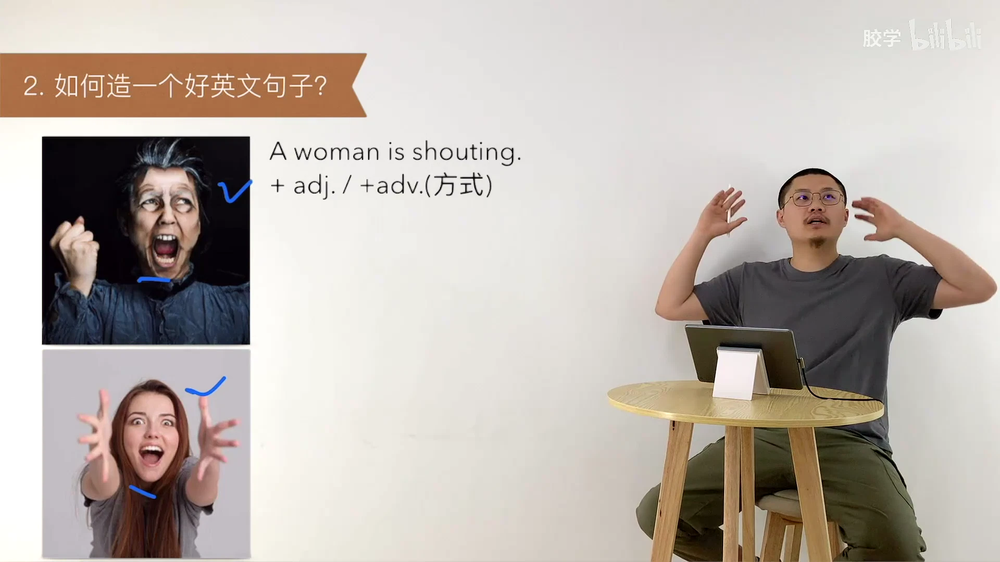

文字识别：胶学H出 / 2. 如何造一个好英文句子? / A woman is shouting. / + adj./ +adv.(方式)

### 画面 00:04:54

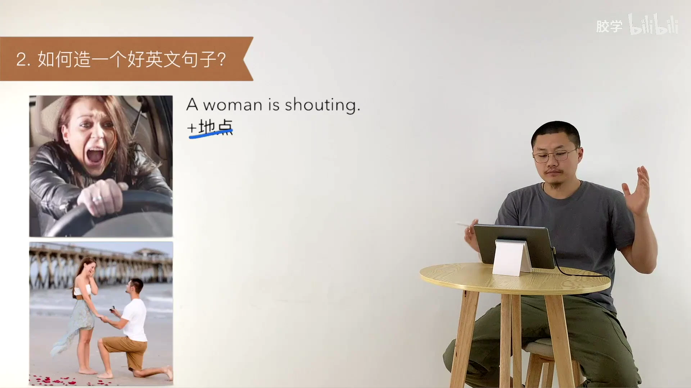

文字识别：胶学b出 / 2. 如何造一个好英文句子? / A woman is shouting. / +地点

### 画面 00:04:56

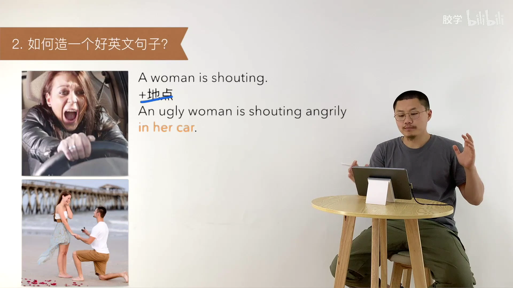

文字识别：胶学b讲出 / 2. 如何造一个好英文句子? / A woman is shouting. / +地点 / An ugly woman is shouting angrily / in her car.

### 画面 00:04:59

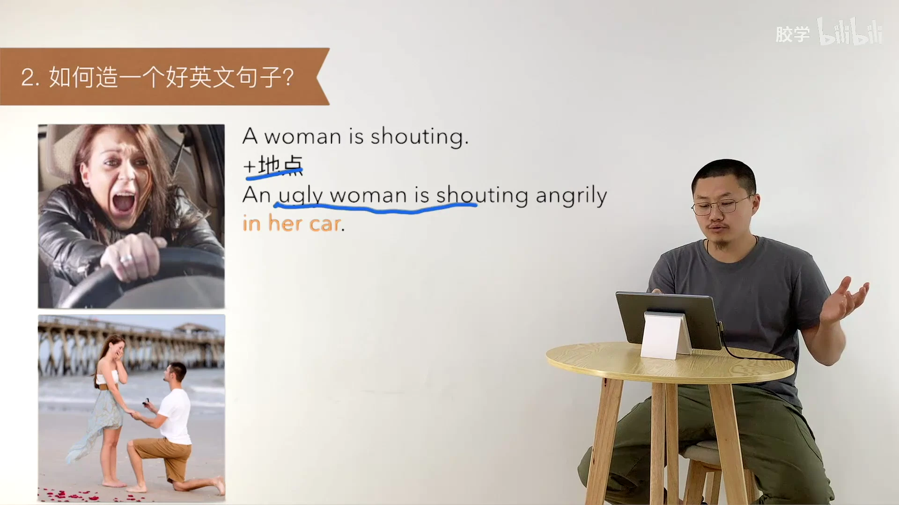

文字识别：胶学b出 / 2. 如何造一个好英文句子? / A woman is shouting. / +地点 / An ugly woman is shouting angrily / in her car.

## 00:05:00–00:05:30

shouting angrily. These are不变的，多加了三个单词叫 in her car，叫地点。各位脑海当中是不是就能形闪现出来这样一种大概在途在途中这个样子，哎，开车的感觉，对不对？接下来呢，说 A cute woman is shouting happily，非常幸福的在喊叫着。注意 on the beach，你脑海当中是不是就能形成这样一种画面感，对吧？大家很多男生喜欢在这个沙滩上去进行求

### 画面 00:05:01

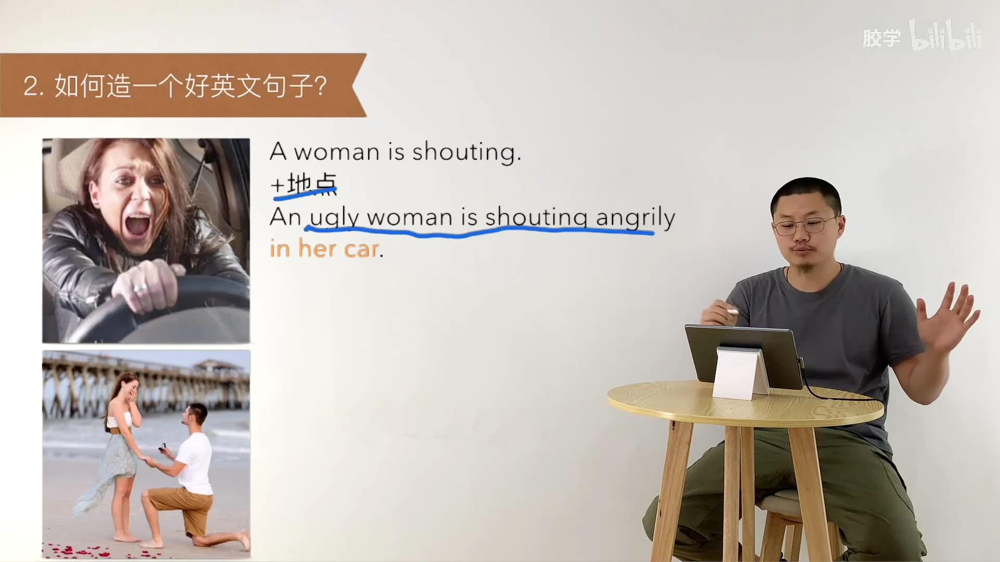

文字识别：胶学b / 2. 如何造一个好英文句子? / A woman is shouting. / +地点 / An ugly woman is shouting angrily / in her car.

### 画面 00:05:04

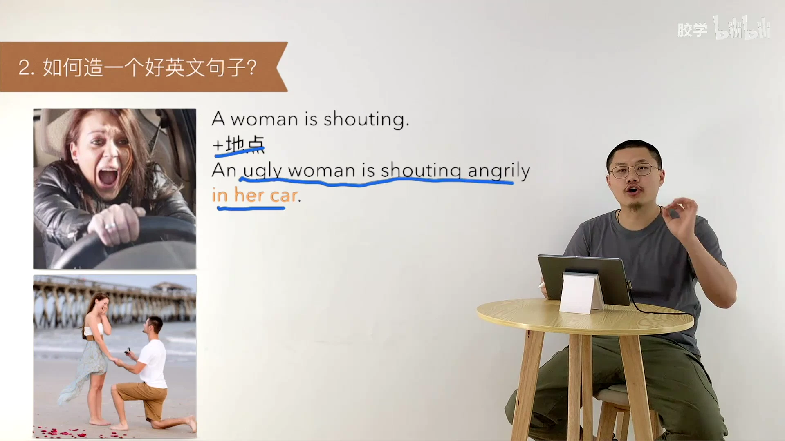

文字识别：胶学bil出 / 2. 如何造一个好英文句子? / A woman is shouting. / +地点 / An ugly woman is shouting angrily / in her car.

### 画面 00:05:07

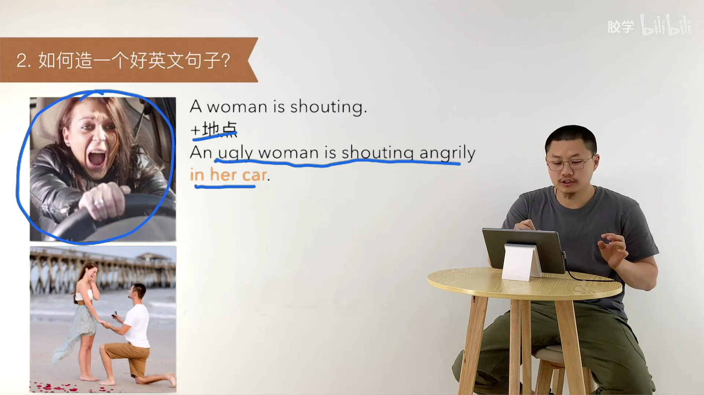

文字识别：胶学b出 / 2. 如何造一个好英文句子? / A woman is shouting. / +地点 / An ugly woman is shouting angrily / in her car.

### 画面 00:05:10

文字识别：胶学b出 / 2. 如何造一个好英文句子? / A woman is shouting. / +地点 / An ugly woman is shouting angrily / in her car.

### 画面 00:05:16

文字识别：胶学b / 2. 如何造一个好英文句子? / A woman is shouting. / +地点 / An ugly woman is shouting angrily / in her car. / A cute / woman is shouting / happily / on the / beach.

### 画面 00:05:20

文字识别：胶学b出 / 2. 如何造一个好英文句子? / A woman is shouting. / +地点 / An ugly woman is shouting angrily / in her car. / A cute / woman is shouting / happily / on the / beach.

### 画面 00:05:22

文字识别：胶学bH出 / 2. 如何造一个好英文句子? / A woman is shouting. / +地点 / An ugly woman is shouting angrily / in / her car. / A cute / woman is  / shouting / happily / on the / beach.

### 画面 00:05:24

文字识别：胶学b出 / 2. 如何造一个好英文句子? / A woman is shouting. / +地点 / An ugly woman is shouting angrily / in / her car. / A cute / woman is s / shouting / happily / on the / beach.

### 画面 00:05:26

文字识别：胶学b击 / 2. 如何造一个好英文句子? / A woman is shouting. / +地点 / An ugly woman is shouting angrily / in /  her car. / A cute / woman is s / shouting / happily / on the / beach.

## 00:05:30–00:06:00

婚啊！那我们说 on the beach。那他为什么这么幸福的尖叫呢？哎，他心爱心爱的男人要把他娶回家，所以叫做 on the beach。你注意现在的背景是不是信息变得更加丰富了？所以我们可以通过加地点的方式去完成这一点。接下来呢，光有地点可能还不够。我们比如说有 car，对吧？然后呢，还是 on the beach。我们还可以加入时间。加入时间了之后，这个明暗，哎，这个界面的图片的明暗

### 画面 00:05:30

文字识别：胶学b出 / 2. 如何造一个好英文句子? / A woman is shouting. / +地点 / An ugly woman is shouting angrily / in / her car. / A cute / woman is s / shouting / happily / on the / beach.

### 画面 00:05:35

文字识别：胶学L讯出 / 2. 如何造一个好英文句子? / A woman is shouting. / +地点 / An ugly woman is shouting angrily / in /  her car. / A cute / woman is s / shouting / happily / on the / beach.

### 画面 00:05:38

文字识别：胶学上出 / 2. 如何造一个好英文句子? / A woman is shouting. / +地点 / An ugly woman is shouting angrily / in / her car. / A cute / woman is s / shouting / happily / on the / beach.

### 画面 00:05:40

文字识别：胶学b讲出 / 2. 如何造一个好英文句子? / A woman is shouting. / +地点 / An ugly woman is shouting angrily / in / n her car. / Acute / woman is s / shouting / happily / on the / beach.

### 画面 00:05:43

文字识别：胶学b出 / 2. 如何造一个好英文句子? / waman is / shouting. / +地点 / An ugly woman is shouting angrily / in / her / car. / A cute / woman is s / shouting / happily / on the / beach.

### 画面 00:05:45

文字识别：胶学b出 / 2. 如何造一个好英文句子? / waman is / shouting. / +地点 / An ugly woman is shouting angrily / in / her / car. / A cute / woman is  / shouting / happily / on the / beach.

### 画面 00:05:47

文字识别：胶学b出 / 2. 如何造一个好英文句子? / A woman is shouting. / +时间

### 画面 00:05:50

文字识别：胶学LH出 / 2. 如何造一个好英文句子? / A woman is shouting. / +时间 / 2

### 画面 00:05:53

文字识别：胶学bH出 / 2. 如何造一个好英文句子? / A woman is shouting. / +时间

## 00:06:00–00:06:30

程度又变得更加的细节。比如说，an angry woman is shouting angrily in her car at midnight. 这时候你的感觉可能就是这幅图。我只能听见声音，也能大概隐约看见一辆车，但是不太知道。啊，听通过声音能判断出来是一个女人，对吧？但是更整整体的感受背景应该是这种黑色的。那我们换一个方式呢？说，a cute woman is shouting happily on the beach in

### 画面 00:06:05

文字识别：胶学州 / 2. 如何造一个好英文句子？ / A woman is shouting. / +时间 / An ugly woman is shouting angrily / in her car at midnight.

### 画面 00:06:10

文字识别：胶学bl业 / 2. 如何造一个好英文句子? / A woman is shouting. / +时间 / An ugly woman is shouting angrily / in her car at midnight.

### 画面 00:06:16

文字识别：胶学bM出 / 2. 如何造一个好英文句子? / A woman is shouting. / +时间 / An ugly woman is shouting angrily / in her car at midnight.

### 画面 00:06:21

文字识别：胶学 / 2. 如何造一个好英文句子？ / A woman is shouting. / +时间 / An ugly woman is shouting angrily / in her car at midnight.

### 画面 00:06:23

文字识别：胶学biib出 / 2. 如何造一个好英文句子? / A woman is shouting. / +时间 / An ugly woman is shouting angrily / in her car at midnight.

### 画面 00:06:25

文字识别：胶学b出 / 2. 如何造一个好英文句子? / A woman is shouting. / +时间 / An ugly woman is shouting angrily / in / n her car at midnight. / A cute / : woman is shouting happily / on the beach in the morning.

## 00:06:30–00:07:00

the morning.注意in the morning，小的语言细节就又出来了，对不对？所以，那我们现在一起看一下，想把一个对的句子变成一个好的句子，我们要学习哪些东西呢？形容词跟名词，对吧？副词，时间和地点都是在说动作的，动作以什么样的方式发生？比如说，都是喊叫，一个是愤怒的，一个是幸福的，对吧？那都是时间，

### 画面 00:06:31

文字识别：胶学b出 / 2. 如何造一个好英文句子? / A woman is shouting. / +时间 / An ugly woman is shouting angrily / in her car at midnight. / A cute /  woman is shouting happily / on the beach in the morning.

### 画面 00:06:33

文字识别：胶学b出 / 2. 如何造一个好英文句子? / A woman is shouting. / +时间 / An ugly woman is shouting angrily / in her car at midnight. / A cute /  woman is shouting happily / on the beach in the morning.

### 画面 00:06:35

文字识别：胶学bi / 2. 如何造一个好英文句子? / A woman is shouting. / +时间 / An ugly woman is shouting angrily / in / n her car at midnight. / A cute / : woman is shouting happily / on the beach in the morning.

### 画面 00:06:37

文字识别：胶学bib山 / 2. 如何造一个好英文句子？ / + adj. / +adv.(方式) / +时间 / +地点 / An ugly woman is shouting angrily / in her car at midnight. / A cute woman is shouting happily / on the beach in the morning.

### 画面 00:06:40

文字识别：胶学bl出 / 2. 如何造一个好英文句子？ / + adj. / +adv.(方式) / +时间 / +地点 / An ugly woman is shouting angrily / in her car at midnight. / A cute woman is shouting happily / on the beach in the morning.

### 画面 00:06:44

文字识别：胶学b出 / 2. 如何造一个好英文句子？ / + adj. / +adv.(方式) / +时间 / +地点 / An ugly woman is shouting angrily / in her car at midnight. / A cute woman is shouting happily / on the beach in the morning.

### 画面 00:06:46

文字识别：胶学b出 / 2. 如何造一个好英文句子? / + adj. / +adv.(方式) / +时间 / +地点 / An ugly woman is shouting angrily / in her car at midnight. / A cute woman is shouting happily / on the beach in the morning.

### 画面 00:06:48

文字识别：胶学bi出 / 2. 如何造一个好英文句子? / + adj. / +adv.(方式) / +时间 / +地点 / An ugly woman is shouting angrily / in her car at midnight. / A cute woman is shouting happily / on the beach in the morning.

### 画面 00:06:51

文字识别：胶学b出 / 2. 如何造一个好英文句子？ / + adj. / +adv.(方式) / +时间 / V. / +地点 / An ugly woman is shouting angrily / in her car at midnight. / A cute woman is shouting happily / on the beach in the morning.

### 画面 00:06:53

文字识别：胶学bH出 / 2. 如何造一个好英文句子? / + adj. / +adv.(方式) / +时间 / V. / +地点 / An ugly woman is shoutino angrily / in her car at midnight. / A cute woman is shouting happily / on the beach in the morning.

### 画面 00:06:55

文字识别：胶学b出 / 2. 如何造一个好英文句子? / + adj. / +adv.(方式) / +时间 / V. / +地点 / An ugly woman is shoutino angrily / in her car at midnight. / A cute woman is shouting happily / on the beach in the morning.

### 画面 00:06:57

文字识别：胶学b出 / 2. 如何造一个好英文句子? / + adj. / +adv.(方式) / +时间 / V. / +地点 / An ugly woman is shoutino angrily / in her car at midnight. / A cute woman is shouting happily / on the beach in the morning.

## 00:07:00–00:07:30

一个什么时候？呃，都是时间，一个是什么时候喊的呢？一个是 midnight，一个是 in the morning，都是地点，一个是在 in the car 喊的，一个是 on the beach 喊的。所以给我们整体营造出来的画面感，对吧？这句话我们读起来理解了，营造出来的画面感是完全不一样的。所以呢，如何造一个好的句子呢？我们初期啊，注意是初期由简入繁这个阶段，哎，我们至少要知道这四个

### 画面 00:07:01

文字识别：胶学b出 / 2. 如何造一个好英文句子? / + adj. / +adv.(方式) / +时间 / V. / 0 / +地点 / An ugly woman is shoutino angrily / in her car at midnight. / A cute woman is shouting happily / on the beach in the morning.

### 画面 00:07:04

文字识别：胶学b山 / 2. 如何造一个好英文句子? / + adj. / +adv.(方式) / +时间 / V. / 0 / +地点 / An ugly woman is shoutino angrily / in her car at midnight. / A cute woman is shouting happily / on the beach in the morning.

### 画面 00:07:06

文字识别：胶学bL出 / 2. 如何造一个好英文句子? / + adj. / +adv.(方式) / +时间 / V. / +地点 / An ugly woman is shoutino angrily / in her car at midnight. / A cute /  woman is shouting happily / on the beach in the morning.

### 画面 00:07:08

文字识别：胶学b / 2. 如何造一个好英文句子? / + adj. / +adv.(方式) / +时间 / V. / +地点 /  woman is shoutino angrily / An ugly / in her cal / at midnight. / A cute / woman is s / shouting / happily / on the / beach in the / morning.

### 画面 00:07:10

文字识别：胶学b / 2. 如何造一个好英文句子? / + adj. / +adv.(方式) / +时间 / V. / +地点 / woman is shoutino angrily / An ugly / in her cal / at midnight. / A cute / womanis / shouting / happily / on the / beag / in t / the / morning.

### 画面 00:07:12

文字识别：胶学b / 2. 如何造一个好英文句子? / + adj. / +adv.(方式) / +时间 / V. / +地点 / woman is shoutino angrily / An ugly / in her cal / at midnight. / A cute / womanis / shouting / happily / on the / beag / in t / the / morning.

### 画面 00:07:15

文字识别：胶学出 / 2. 如何造一个好英文句子? / + adj. / +adv.(方式) / +时间 / V. / 0 / +地点 / An ugly / woman is shoutino angrily / i her cal / at midnight. / A cute / woman is / shouting / happily / on the / beag / in t / the / morning.

### 画面 00:07:22

文字识别：胶学b出 / 2. 如何造一个好英文句子? / + adj. / +adv.(方式) / +时间 / V. / +地点 / woman is shoutino angrily / An ugly / in her cal / at midnight. / A cute / woman is / shouting / happily / on the / beag / in / the / morning.

### 画面 00:07:24

文字识别：胶学b业 / 2. 如何造一个好英文句子? / + adj. / +adv.(方式) / +时间 / 0 / →地点 / woman is shoutino angrily / An ugly / in her cal / at midnight. / A cute / woman is / shouting / happily / on the / beag / in / the / morning.

### 画面 00:07:27

文字识别：胶学上出 / 2. 如何造一个好英文句子? / + adj. / +adv.(方式) / +时间 / 0 / 」地点 / woman is shoutino angrily / An ugly / in her car / at midnight. / A cute / woman is / shouting / happily / on the / beag / in t / the / morning.

## 00:07:30–00:08:00

部分。以后呢，我们再慢慢慢慢进阶，由繁再入简啊。OK，那我们看一下，给大家做了一个表格。这实际上在我们课后也有这个表格啊。首先，时间，注意刚才我们说的时间对不对？这就涉及到语序了。注意英文当中可以放在最前面或最后面，一般不乱搁。接

### 画面 00:07:30

文字识别：胶学b / 2. 如何造一个好英文句子? / + adj. / +adv.(方式) / +时间 / 0 / +地点 / woman is shoutino angrily / An ugly / in her cal / at midnight. / A cute / woman is / shouting / happily / on the / beag / in / the / morning.

### 画面 00:07:35

文字识别：胶学H / 2. 如何造一个好英文句子? / + adj. / +adv.(方式) / +时间 / 0 / +地点 / An ugly / woman is shoutinoa / Dangrily / in her car / at midnight. / A cute / woman is / shouting / happily / on the / beag / in / the / morning.

### 画面 00:07:37

文字识别：胶学 / 新概念英语 第二册 / 新概念英语2&3 / PRACTICE AND PROGRESS / DEVELOPING SKILLS / 课堂笔记 / 课后练习 / New / New / Concept / 2 / Concept / 2 / English / English / 3 / 新概念英语 第二册 (电子版) / 新概念英语 2&3 (电子版) / 课堂笔记 / 课后练习 / 出品方 / 胶学 / 出品方胶学

### 画面 00:07:41

文字识别：胶学 / 6时间 / 1主 / 2谓 / 3宾 / 4方式 / 5地点 / 6时间 / When? / Who? / action / Who? / How? / Where? / When? / Which? / (v.+v.变化) / Which? / What? / What? / An ugly woman / is shouting / angrily / in / hercar / atmidnight / A cute woman / is shouting / happily / on the beach lin the morning

### 画面 00:07:49

文字识别：胶学讯出 / 6时间 / 1主 / 2谓 / 3宾 / 4方式 / 5地点 / 6时间 / When? / Who? / action / Who? / How? / Where? / When? / Which? / (v.+v.变化) / Which? / What? / What? / An ugly woman / is shouting / angrily / in / her / car / at midnight / A / cute woman / is shouting / happily / on the beach in the morning

## 00:08:00–00:08:30

下来，主语放在一的这个位置上，比如说 I love you，是吧？我爱你，主谓宾，非常简单的一个东西，对吧？OK，那我们看方式，其实对于目前来说，各位理解为是副词，暂时就够了。地点没什么可说的了。注意，我们看刚才那句话，在英文当中的语序是 An ugly woman，主语 is shouting，动词也叫谓语，动词加动词的变化合起来

### 画面 00:08:05

文字识别：胶学出 / T / 6时间 / 1主 / 2谓 / 3宾 / 4方式 / 5地点 / 6时间 / When? / Who? / action / Who? / How? / Where? / Wnen? / Which? / (v.+v.变化) / Which? / What? / What? / An ugly woman / is shouting / angrily / in / hercar / at midnight / A / cute / woman / is shouting / happily / on the beach in the morning

### 画面 00:08:07

文字识别：bib / 胶学 / T / Le / 6时间 / 1主 / 2谓 / 3宾 / 4方式 / 5地点 / 6时间 / When? / Who? / action / Who? / How? / Where? / Wnen? / Which? / (v.+v.变化) / Which? / What? / What? / An ugly woman / is shouting / angrily / in / her / car / at midnight / A / cute / woman / is shouting / happily / on the beach lin the morning

### 画面 00:08:09

文字识别： bib / 胶学 / 6时间 / 1主 / 2谓 / 3宾 / 4方式 / 5地点 / 6时间 / When? / Who? / action / Who? / How? / Where? / Wnen? / Which? / (v.+v.变化) / Which? / What? / What? / An ugly woman / is shouting / angrily / in / hercar / at midnight / A / cute woman / is shouting / happily / on the beach lin the morning

### 画面 00:08:22

文字识别：Bibiti / 胶学 / 6时间 / 1主 / 2谓 / 3宾 / 4方式 / 5地点 / 6时间 / When? / Who? / action / Who? / How? / Where? / Wnen? / Which? / (v.+v.变化) / Which? / What? / What? / An ugly / woman / is shouting / angrily / in / her / car / atmidnight / A / cute / woman / is: / sshouting / happily / onthe / beachin the morning

## 00:08:30–00:09:00

可以理解为是谓语，然后呢方式 how angrily没有宾语对不对？没有说对谁喊地点 in her car时间 at midnight very good好再看下面那句话，它的跟上面是一模一样的 cute woman is shouting happily方式地点时间接下来我们做一些练习来了啊注意 the film

### 画面 00:08:30

文字识别：胶学 / 6时间 / 1主 / 2谓 / 3宾 / 4方式 / 5地点 / 6时间 / When? / Who? / action / Who? / How? / Where? / Wnen? / Which? / (v.+v.变化) / Which? / What? / What? / An ugly / woman / is shouting / angrily / in / her / car / atmidnight / A / cute / woman / is / shouting / happily / onthe / beach lin the morning

### 画面 00:08:39

文字识别：bibi / 胶学 / 6时间 / 1主 / 2谓 / 3宾 / 4方式 / 5地点 / 6时间 / When? / Who? / action / Who? / How? / Where? / Wnen? / Which? / (v.+v.变化) / Which? / What? / What? / An ugly / woman / is shouting / angrily / in / 1her / car / at midnight / A / cute / woman / is: / shouting / happily / on the / beachlin the morning

### 画面 00:08:44

文字识别：胶学上出 / 6时间 / 1主 / 2谓 / 3宾 / 4方式 / 5地点 / 6时间 / When? / Who? / action / Who? / How? / Where? / Wnen? / Which? / (v.+v.变化) / Which? / What? / What? / An ugly / woman / is shouting / angrily / in / her / car / atmidnight / A / cute / woman / is shouting / happily / on the / ebeach in the morning

### 画面 00:08:46

文字识别：胶学b出 / 6时间 / 1主 / 2谓 / 3宾 / 4方式 / 5地点 / 6时间 / When? / Who? / action / Who? / How? / Where? / Wnen? / Which? / (v.+v.变化) / Which? / What? / What? / An ugly woman / is shouting / angrily / in / hercar / at midnight / A / cute woman / is shouting / happily / on the beach lin the morning

### 画面 00:08:55

文字识别：胶学bi出 / 1. / the film / enjoyed / yesterday / 6时间 / 1主 / 2谓 / 3宾 / 4方式 / 5地点 / 6时间 / When? / Who? / action / Who? / How? / Where? / When? / Which? / (v.+v.变化) / Which? / What? / What?

## 00:09:00–00:09:30

电影 I 我 enjoy享受 yesterday. 你要做的事情就是按照这个表格的语序，时间可以放在最前，可以放在最后，然后找到主语，找到谓语，找到宾语，找到方式，找到地点，把它们往里扔就可以了。我 I enjoy the film yesterday. 可以放在最前面，也可以放在最后面。 OK. The news新

### 画面 00:09:25

文字识别：胶学b州出 / 1. / the film / enjoyed / yesterday / 6时间 / 1主 / 2谓 / 3宾 / 4方式 / 5地点 / 6时间 / When? / Who? / action / Who? / How? / Where? / When? / Which? / (v.+v.变化) / Which? / What? / What?

## 00:09:30–00:10:00

闻, listen to,听, I,我, carefully,仔细地,注意,那主语是谁呢? I listen to the news carefully. There you go. Continue. Well,好, the man,男人, piano,钢琴, play,弹, the man play the piano well.各位注意我的红点啊,就是在告诉各位这

### 画面 00:09:55

文字识别：胶学b出 / 3. / well / the / man / the / piano / played / 6时间 / 1主 / 2谓 / 3宾 / 4方式 / 5地点 / 6时间 / When? / Who? / action / Who? / How? / Where? / When? / Which? / (v.+v.变化) / Which? / What? / What?

## 00:10:00–00:10:30

个小的单词或者短语应该放在六一二三四五六的什么地方。接下来，games played yesterday in their room. The children quietly. The children,孩子们, played games.玩了游戏，方式呢？quietly，安静地。in their room yesterday.玩一个，continue.

### 画面 00:10:25

文字识别：胶学bi出 / 4. / games / played / yesterday / in / their room / the / children / quietly / 6时间 / 1主 / 2谓 / 3宾 / 4方式 / 5地点 / 6时间 / When? / Who? / action / Who? / How? / Where? / When? / Which? / (v.+v.变化) / Which? / What? / What?

## 00:10:30–00:11:00

Quietly,安静地. The door, he opened. He opened the door.读一遍，他开了门。Quietly,安静的开。Continue. Immediately, left he. He left immediately.他迅速的离开了。Continue. A tree in the corner of the garden, he planted. He planted.

### 画面 00:10:55

文字识别：胶学bi出 / 7. / a tree / in the corner / of the garden / he / planted / 6时间 / 1主 / 2谓 / 3宾 / 4方式 / 5地点 / 6时间 / When? / Who? / action / Who? / How? / Where? / When? / Which? / (v.+v.变化) / Which? / What? / What?

## 00:11:00–00:11:30

planted a tree.他种了一个树。没有方式，没有时间。In the corner of the garden. Very good. Continue. Before lunch, the letter in his office quickly he read. He他read the letter读了这封信。Quickly. In his office. Before lunch. Very good.

### 画面 00:11:25

文字识别：胶学b / 8. / before lunch / the letter / in his office / quickly / he / read / 6时间 / 1主 / 2谓 / 3宾 / 4方式 / 5地点 / 6时间 / When? / Who? / action / Who? / How? / Where? / When? / Which? / (v.+v.变化) / Which? / What? / What?

### 画面 00:11:29

文字识别：胶学bH出 / 9. / this morning / a book / | / from the library / borrowed / 6时间 / 1主 / 2谓 / 3宾 / 4方式 / 5地点 / 6时间 / When? / Who? / action / Who? / How? / Where? / When? / Which? / (v.+v.变化) / Which? / What? / What?

## 00:11:30–00:12:00

This morning, a book I from the library borrowed. I borrowed a book.主谓宾，没有方式。地点是from the library this morning，或者是this morning I borrowed a book from the library. Continue. The soup spoiled the cook. Okay. The cook spoiled

### 画面 00:11:59

文字识别：胶学bi击 / 10. / the soup / spoilt / the cook / 6时间 / 1主 / 2谓 / 3宾 / 4方式 / 5地点 / 6时间 / When? / Who? / action / Who? / How? / Where? / When? / Which? / (v.+v.变化) / Which? / What? / What?

## 00:12:00–00:12:30

the soup,厨师啊毁了这个汤。主谓宾没有方式、地点、时间。Continue, we at home stay on Sundays. We stay没有宾语，对不对？地点是at home on Sundays。哎，表示的是一种生活习惯。Continue啊，接下来这个实际上你看它不完全满足这个，但实际上这是我们新概

### 画面 00:12:29

文字识别：胶学bi出 / 12. / there / a lot of / people / are / at the bus stop / 6时间 / 1主 / 2谓 / 3宾 / 4方式 / 5地点 / 6时间 / When? / Who? / action / Who? / How? / Where? / When? / Which? / (v.+v.变化) / Which? / What? / What?

## 00:12:30–00:13:00

25 of New Concepts. It's a very simple There be句型, right? There are a lot of people at the bus station. There are a lot of people at the bus station, right? This is a simple There be句型. A little boy an apple this morning at greatly in the kitchen. A little boy,小男孩, ate an apple,吃了一个苹果, greatly in the

### 画面 00:12:41

文字识别：胶学b出 / 13. / the little boy / an / apple / this morning / ate / greedily / in the / kitchen / 6时间 / 1主 / 2谓 / 3宾 / 4方式 / 5地点 / 6时间 / When? / Who? / action / Who? / How? / Where? / When? / Which? / (v.+v.变化) / Which? / What? / What?

## 00:13:00–00:13:30

kitchen this morning. Very good. She beautifully draws. She draws beautifully.她画的非常的美。Music I like very much. I like music very much.一二三四，对吧？非常简单。A new school built they in our village last year.好看见last year可前可后，我们给它放前面试一次。Last year

### 画面 00:13:11

文字识别：胶学bi出 / 15. / music / like / veryr / much / 6时间 / 1主 / 2谓 / 3宾 / 4方式 / 5地点 / 6时间 / When? / Who? / action / Who? / How? / Where? / When? / Which? / (v.+v.变化) / Which? / What? / What?

## 00:13:30–00:14:00

they他们built建造了a new school一个新的学校in our village在我们村庄当中. Continue, the match at four o'clock ended. The match ended.比赛结束了，没有宾语，没有方式，没有地点，只有时间at four o'clock.所以各位现在看到了，我可这句话可以没有宾语，可以没有方式，

### 画面 00:13:41

文字识别：胶学b出 / 17. / the match / at four o'clock / ended / 6时间 / 1主 / 2谓 / 3宾 / 4方式 / 5地点 / 6时间 / When? / Who? / action / Who? / How? / Where? / When? / Which? / (v.+v.变化) / Which? / What? / What?

## 00:14:00–00:14:30

可以没有地点，可以没有时间，但必须要有主语和谓语。谓语就是我们说的动词加动词的变化，也就是造一个句子最基本的东西。我们看最后一个，She a letter from her brother last week received. She received a letter from her brother last week. 哎，OK，Very good。那刚才这个练习在我

### 画面 00:14:11

文字识别：胶学bH出 / 18. / she / a letter from her brother / last week / received / 6时间 / 1主 / 2谓 / 3宾 / 4方式 / 5地点 / 6时间 / When? / Who? / action / Who? / How? / Where? / When? / Which? / (v.+v.变化) / Which? / What? / What?

### 画面 00:14:27

文字识别：胶学bH出 / Repetition drill / 训练目标： / 听力口语 / 练习符合英文语序的句子

### 画面 00:14:29

文字识别：胶学b出 / Repetition drill / 训练目标： / 听力口语 / 练习符合英文语序的句子

## 00:14:30–00:15:00

们新概念二册的课后有，大家听过刚才我大家练习之后呢，如果哎有一些地方没有跟上，您不妨到教材当中去自己可以去书写一遍。那接下来我们看 repetition drill， repetition drill 是我们一个口语听力练习，口语和听力的练习，它是关于我们语法的练习。当然，练习的是语序啊，这个地方我们怎么练呢？还挺简单的，您可以看着没问题，但你只

### 画面 00:14:37

文字识别：胶学b出 / Repetition drill / 训练目标： / 听力口语 / 练习符合英文语序的句子

### 画面 00:14:53

文字识别：胶学讲出 / Repetition drill

### 画面 00:14:56

文字识别：胶学L / Repetition drill

### 画面 00:14:58

文字识别：胶学blb出 / Repetition drill / 1 T: What did you listen to? The news?

## 00:15:00–00:15:30

要去听就好了。叫做 What did you listen to the news? 我问您一个问题，给各位一个答案。您看着这个界面可以暂停，然后呢自己去把答案给我。叫做 I listened to the news. 我问的是你听了什么呢？答案叫做新闻。然后您造一句话，注意口语造不用写，叫 I listened to the news. 再来一下啊，所以我问您 When did he leave? 答案 Immediately. 您可以

### 画面 00:15:01

文字识别：胶学b册出 / Repetition drill / 1 T: What did you listen to? The news?

### 画面 00:15:03

文字识别：胶学bW出 / Repetition drill / 1 T: What did you listen to? The news?

### 画面 00:15:05

文字识别：胶学bl山 / Repetition drill / 1 T: What did you listen to? The news?

### 画面 00:15:08

文字识别：胶学上讲出 / Repetition drill / 1 T: What did you listen to? The news?

### 画面 00:15:11

文字识别：胶学bH出 / Repetition drill / 1 T: What did you listen to? The news?

### 画面 00:15:13

文字识别：胶学b出 / Repetition drill / 1 T: What did you listen to? The news? / S: Yes, I listened to the news.

### 画面 00:15:16

文字识别：胶学bW出 / Repetition drill / 1 T: What did you listen to? The news? / S: Yes, I listened to the news.

### 画面 00:15:21

文字识别：胶学b讲出 / Repetition drill / 1 T: What did you listen to? The news? / S: Yes, I listened to the news.

### 画面 00:15:24

文字识别：胶学bH出 / Repetition drill / 2 T: When did he leave? Immediately?

### 画面 00:15:26

文字识别：胶学bl业 / Repetition drill / 2 T: When did he leave? Immediately?

### 画面 00:15:29

文字识别：胶学bW出 / Repetition drill / 2 T: When did he leave? Immediately?

## 00:15:30–00:16:00

看没问题。这地方输入的时候可以听加看，但是你自己要暂停，然后把答案自己说出来，然后你要去想。我给答案。He left immediately. Next one, who was sitting behind you? A young man and a young woman.那您这时候就要自己去造句，叫做A young man and a young woman were sitting behind me.是不是答案对吧？

### 画面 00:15:31

文字识别：胶学bH出 / Repetition drill / 2 T: When did he leave? Immediately?

### 画面 00:15:36

文字识别：胶学bH出 / Repetition drill / 2 T: When did he leave? Immediately?

### 画面 00:15:40

文字识别：胶学bH出 / Repetition drill / 2 T: When did he leave? Immediately? / S: Yes, he left immediately.

### 画面 00:15:42

文字识别：胶学bl出 / Repetition drill / 2 T: When did he leave? Immediately? / S: Yes, he left immediately.

### 画面 00:15:46

文字识别：胶学bi出 / Repetition drill / 3 T: Who was sitting behind you? A young / man and a young woman?

### 画面 00:15:48

文字识别：胶学biH出 / Repetition drill / 3 T: Who was sitting behind you? A young / man and a young woman?

### 画面 00:15:51

文字识别：胶学bHb击 / Repetition drill / 3 T: Who was sitting behind you? A young / man and a young woman?

### 画面 00:15:54

文字识别：胶学bt出 / Repetition drill / 3 T: Who was sitting behind you? A young / man and a young woman?

### 画面 00:15:57

文字识别：胶学上出 / Repetition drill / 3 T: Who was sitting behind you? A young / man and a young woman? / S: Yes, a young man and a young woman / were / sitting behind me.

## 00:16:00–00:16:30

Continue. Where did you go last year? To America. I went to America. Next one. Where were they waiting? At the bus stop. They were waiting at the bus stop. 如果答案我给的比较快，您暂停视频继续. How did he open the door? Quietly. He

### 画面 00:16:00

文字识别：胶学出 / Repetition drill

### 画面 00:16:02

文字识别：胶学b州出 / Repetition drill / 4 T: Where did you go last year? To America?

### 画面 00:16:05

文字识别：胶学bW出 / Repetition drill / 4 T: Where did you go last year? To America?

### 画面 00:16:10

文字识别：胶学bH止 / Repetition drill / 4 T: Where did you go last year? To America? / S: Yes, I went to America.

### 画面 00:16:16

文字识别：胶学bH出 / Repetition drill / 5 T: Where were they waiting? At the bus stop?

### 画面 00:16:20

文字识别：胶学bl班 / Repetition drill / 5 T: Where were they waiting? At the bus stop? / S: Yes, they were waiting at the bus stop.

### 画面 00:16:23

文字识别：胶学b出 / Repetition drill / 5 T: Where were they waiting? At the bus stop? / S: Yes, they were waiting at the bus stop.

### 画面 00:16:25

文字识别：胶学bW出 / Repetition drill / 6 T: How did he open the door? Quietly?

### 画面 00:16:29

文字识别：胶学bii / Repetition drill / 6 T: How did he open the door? Quietly?

## 00:16:30–00:17:00

he opened the door quietly. When did she receive a letter from her brother? Last week. She received a letter from her brother last week. What did you borrow from the library this morning? A book. I borrowed a book from the library this morning. 注意，这是口语

### 画面 00:16:34

文字识别：胶学bW出 / Repetition drill / 6 T: How did he open the door? Quietly? / S: Yes, he opened the door quietly.

### 画面 00:16:36

文字识别：胶学bil出 / Repetition drill / 7 T: When did she receive a letter from her / brother? Last week?

### 画面 00:16:41

文字识别：胶学bl出 / Repetition drill / 7 T: When did she receive a letter from her / brother? Last week? / S: Yes, she received a letter from her / brother last week.

### 画面 00:16:46

文字识别：胶学b鼎出 / Repetition drill / 7 T: When did she receive a letter from her / brother? Last week? / S: Yes, she received a letter from her / brother last week.

### 画面 00:16:48

文字识别：胶学b州出 / Repetition drill / 8 T: What did you borrow from the library / this morning? A book?

### 画面 00:16:50

文字识别：胶学bW出 / Repetition drill / 8 T: What did you borrow from the library / this morning? A book?

### 画面 00:16:55

文字识别：胶学bH出 / Repetition drill / 8 T: What did you borrow from the library / this morning? A book? / S: Yes, I borrowed a book from the library / this morning.

### 画面 00:16:59

文字识别：胶学b山 / Repetition drill

## 00:17:00–00:17:30

听力练习啊。Who spoiled the soup? The cook. The cook spoiled the soup. When did the match end? At four o'clock. Yes, the match ended at four o'clock. Very good.刚才是练习听力与口语的语法练习。当然，这个语法其实就是我们最简单，今天刚刚学过的，就是英文的

### 画面 00:17:03

文字识别：胶学b业 / Repetition drill / 9 T: Who spoilt the soup? The cook?

### 画面 00:17:08

文字识别：胶学bi出 / Repetition drill / 9 T: Who spoilt the soup? The cook? / S: Yes, the cook spoilt the soup.

### 画面 00:17:10

文字识别：胶学bH出 / Repetition drill / 10 T: When did the match end? At four o'clock?

### 画面 00:17:19

文字识别：胶学b出 / Pattern drill / 训练目标： / 写作口语 / 练习符合英文语序的句子

### 画面 00:17:21

文字识别：胶学bi出 / Pattern drill / 训练目标： / 写作口语 / 练习符合英文语序的句子

## 00:17:30–00:18:00

个语序六一二三四五六对吧？好，接下来呢 pattern drill 这地方是我们的写作与口语练习，还是语法练习的是符合英文语序的句子。来，我们一起看一下，因为今天大家第一次进入这个练习啊，我要稍微多花点时间给各位解释一下怎么去做。首先我们看上面给了一些单词，叫 walk 行走 across the stage 叫做穿过这个舞台 slow 叫慢。然后我们看底下有两句话，

### 画面 00:17:42

文字识别：胶学bH出 / Pattern drill / 1 T: walk - across the stage - slow / S1: How did she walk across the stage? / S2: She walked very slowly across the stage. / Behave - at the theatre - rude/bad / Drive - through the park - quick/slow / Sleep - on the train - sound/quiet / listen - to his story - patient/careful

### 画面 00:17:46

文字识别：胶学上出 / Pattern drill / 1 T: walk - across the stage - slow / S1: How did she walk across the stage? / S2: She walked very slowly across the stage. / Behave - at the theatre - rude/bad / Drive - through the park - quick/slow / Sleep - on the train - sound/quiet / listen - to his story - patient/careful

### 画面 00:17:49

文字识别：胶学bi出 / Pattern drill / 1 T: walk - across the stage - slow / S1: How did she walk across the stage? / S2: She walked very slowly across the stage. / Behave - at the theatre - rude/bad / Drive - through the park - quick/slow / Sleep - on the train - sound/quiet / listen - to his story - patient/careful

## 00:18:00–00:18:30

第一句话叫 How did she walk? 注意，这是一样的哦。Across the stage，注意和这个是一样的，对不对？She walked。注意这两个稍微有点不同，因为这是一般疑问句，所以用的原形，而这是肯定句，所以用的是一般过去式，对吧？这个单词的过去式。她走的 very slowly。注意没有用 slow，用的是 slowly。为什么？方式，对不对？副词要修饰动词，

### 画面 00:18:00

文字识别：胶学bl出 / Pattern drill / 1 T: walk - across the stage - slow / S1: How did she walk across the stage? / S2: She walked very slowly across the stage. / Behave - at the theatre - rude/bad / Drive - through the park - quick/slow / Sleep - on the train - sound/quiet / listen - to his story - patient/careful

### 画面 00:18:25

文字识别：胶学bi出 / Pattern drill / 1 T: walk - across the stage - slow / S1: How did she walk across the stage? / S2: She walked very slowly across the stage. / Behave - at the theatre - rude/bad / Drive - through the park - quick/slow / Sleep - on the train - sound/quiet / listen - to his story - patient/careful

## 00:18:30–00:19:00

你不能用形容词吧？要把它变副词，对吧？走的非常的慢，across the stage，穿过这个舞台。首先我们看后边这句话满不满足今天我们学的六一二三四五六这个概念啊？一主语，二谓语动词加动词变化，very slowly，没有三四是副词或者说方式，五是across the stage，还是满足六一二三四五六，对不对？好，其次各位这个练习

### 画面 00:18:40

文字识别：胶学粉出 / Pattern drill / 1 T: walk - across the stage - slow / S1: How did she walk across the stage? / S2: She walked very slowly across the stage. / Behave - at the theatre - rude/bad / Drive - through the park - quick/slow / Sleep - on the train - sound/quiet / listen - to his story - patient/careful

### 画面 00:18:57

文字识别：胶学bl业 / Pattern drill / 1 T: walk - across the stage - slow / S1: How did she walk across the stage? / S2: She walked very slowly across the stage. / Behave - at the theatre - rude/bad / Drive - through the park - quick/slow / Sleep - on the train - sound/quiet / listen - to his story - patient/careful

## 00:19:00–00:19:30

您回去要课下做，课上我们不带着各位做，是告诉各位如何课下去做，怎么做呢？看啊，跟 walk 对应的是这一组词，比如说我们现在来一个 drive，这大家都会比较熟。 How did she 是不变的，把 walk 换成 drive，把 across the stage 变成 through the park，所以这句话就变成了 How did

### 画面 00:19:15

文字识别：胶学bl出 / Pattern drill / 1 T: walk - across the stage - slow / S1: How did she walk across the stage? / S2: She walked very slowly across the stage. / Behave - at the theatre - rude/bad / Drive - through the park - quick/slow / Sleep - on the train - sound/quiet / listen - to his story - patient/careful

## 00:19:30–00:20:00

she drive through the park? Continue. 说 she drove. 注意要把它变成过去式了，对吧？ Drove very quickly,或者是 slowly through the park. 各位回去要做的事情就是把底下这些给的关键词往这两句话当中去进行一个替代。我每次上课只

### 画面 00:19:41

文字识别：胶学bii出 / Pattern drill / 1 T: walk - across the stage - slow / S1: How did she walk across the stage? / S2: She walked very slowly across the stage. / Behave - at the theatre - rude/bad / Drive - through the park - quick/slow / Sleep - on the train - sound/quiet / listen - to his story - patient/careful

### 画面 00:19:45

文字识别：胶学bil / Pattern drill / 1 T: walk - across the stage - slow / S1: How did she walk across the stage? / S2: She walked very slowly across the stage. / Behave - at the theatre - rude/bad / Drive - through the park - quick/slow / Sleep - on the train - sound/quiet / listen - to his story - patient/careful

### 画面 00:19:53

文字识别：胶学bil出 / Pattern drill / 1 T: walk - across the stage - slow / S1: How did she walk across the stage? / S2: She walked very slowly across the stage. / Behave - at the theatre - rude/bad / Drive - through the park - quick/slow / Sleep - on the train - sound/quiet / listen - to his story - patient/careful

### 画面 00:19:56

文字识别：胶学biib出 / Pattern drill / 1 T: walk - across the stage - slow / S1: How did she walk across the stage? / S2: She walked very slowly across the stage. / Behave - at the theatre - rude/bad / Drive - through the park - quick/slow / Sleep - on the train - sound/quiet / listen - to his story - patient/careful

## 00:20:00–00:20:30

是给大家重点解释一下这两句话有什么意思，它包含了什么语法。各位课下要做的事情是把这些东西带进去，书写出来，并且口语朗读出来。希望我解释清楚了。那我们再来一个，hear the radio能听见这个电台。那各位你看底下全是这些类似的短语，比如说see the theater看得见这个剧院，对不对？那我们看他给的两句关键话是什么？

### 画面 00:20:00

文字识别：胶学明 / Pattern drill / 1 T: walk - across the stage - slow / S1: How did she walk across the stage? / S2: She walked very slowly across the stage. / Behave - at the theatre - rude/bad / Drive - through the park - quick/slow / Sleep - on the train - sound/quiet / listen - to his story - patient/careful

### 画面 00:20:10

文字识别：胶学b出 / Pattern drill / 1 T: walk - across the stage - slow / S1: How did she walk across the stage? / S2: She walked very slowly across the stage. / Behave - at the theatre - rude/bad / Drive - through the park - quick/slow / Sleep - on the train - sound/quiet / listen - to his story - patient/careful

### 画面 00:20:14

文字识别：胶学b出 / Pattern drill / 2T:hear the radio / S1: I can hear the radio now. Can you? / S2: Of course I can.I can hear it perfectly well. / hear the actors / see those men / see the theatre / see the policeman / see her house / hear the rain / hear his voice / hear some music

## 00:20:30–00:21:00

I can hear the radio now. 我现在能听到电台了。Can you? 其实这句话补全了就是 Can you hear the radio now? 啊，你现在能听见吗？Of course I can. 当然能了。I can hear it. 主语一，can hear. 二，谓语动词加动词变化 it the radio，也就是 the radio. 三，宾语 perfectly well，也就是四方式 perfectly，就是非

### 画面 00:20:31

文字识别：胶学出 / Pattern drill / 2T:hear the radio / S1: I can hear the radio now. Can you? / S2: Of course I can.I can hear it perfectly well / hear the actors / see those men / see the theatre / see the policeman / see her house / hear the rain / hear his voice / hear some music

### 画面 00:20:35

文字识别：胶学b出 / Pattern drill / 2T:hear the radio / S1: I can hear the radio now. Can you? / S2: Of course I can.I can hear it perfectly well. / hear the actors / see those men / see the theatre / see the policeman / see her house / hear the rain / hear his voice / hear some music

### 画面 00:20:40

文字识别：胶学 / Pattern drill / 2T:hear the radio / S1: I can hear the radio now. Can you? / S2: Of course I can.I can hear it perfectly well / hear the actors / see those men / see the theatre / see the policeman / see her house / hear the rain / hear his voice / hear some music

### 画面 00:20:48

文字识别：胶学H / Pattern drill / 2T: hear the radio / S1: I can hear the radio now. Can you? / S2: Of course I can.I can hear it perfectly well. / hear the actors / see those men / see the theatre / see the policeman / see her house / hear the rain / hear his voice / hear some music

### 画面 00:20:51

文字识别：胶学H / Pattern drill / 2T:hear the radio / S1: I can hear the radio now. Can you? / S2: Of course I can.I can hear it perfectly well. / hear the actors / see those men / see the theatre / see the policeman / see her house / hear the rain / hear his voice / hear some music

### 画面 00:20:54

文字识别：胶学 / Pattern drill / 2T: hear the radio / S1: I can hear the radio now. Can you? / S2: Of course I can.I can hear itperfectly well. / hear the actors / see those men / see the theatre / see the policeman / see her house / hear the rain / hear his voice / hear some music

### 画面 00:20:58

文字识别：胶学 / Pattern drill / 2T: hear the radio / S1: I can hear the radio now. Can you? / S2: Of course I can.I can hear it perfectly well. / hear the actors / see those men / see the theatre / see the policeman / see her house / hear the rain / hear his voice / hear some music

## 00:21:00–00:21:30

常完美的能听到啊，很很很准确，很棒的都能听得清楚。OK，那我们往里带一个，我在这儿加带一个啊。比如说，我们就用这个see the theater，叫做I can see the theater now. Can you? Of course I can. I can see it perfectly well.各位还是把这些带进去书写外加朗读，最后其实起到的效果是什么呢？各位不知道能不能有感觉啊？

### 画面 00:21:00

文字识别：胶学W / Pattern drill / 2T:hear the radio / S1: I can hear the radio now. Can you? / S2: Of course I can.I can hear it perfectly well. / hear the actors / see those men / see the theatre / see the policeman / see her house / hear the rain / hear his voice / hear some music

### 画面 00:21:04

文字识别：胶学H / Pattern drill / 2T: hear the radio / S1: I can hear the radio now. Can you? / S2: Of course I can.I can hear it perfectly well. / hear the actors / see those men / see the theatre / see the policeman / see her house / hear the rain / hear his voice / hear some music

### 画面 00:21:10

文字识别：胶学b出 / Pattern drill / 2T: hear the radio / S1: I can hear the radio now. Can you? / S2: Of course I can.I can hear it perfectly well. / hear the actors / see those men / see the theatre / see the policeman / see her house / hear the rain / hear his voice / hear some music

### 画面 00:21:22

文字识别：胶学b出 / Pattern drill / 2T: hear the radio / S1: I can hear the radio now. Can you? / S2: Of course I can.I can hear it perfectly well. / hear the actors / see those men / see the theatre / see the policeman / see her house / hear the rain / hear his voice / hear some music

## 00:21:30–00:22:00

其实是这些黑字啊，各位会变得非常的熟悉啊。好，我们接着下来看第三个。Last night，昨晚，a good talk on the radio，啊，一个非常棒的谈话，在这个电台上。OK，那saw和heard就是看见或听到。那我们看往下说啊，说I heard a good talk，我听到了非常好的一次谈话。On the radio，在电台上。Last night，昨晚。那各位要做的事情还

### 画面 00:21:34

文字识别：胶学b出 / Pattern drill / 2T: hear the radio / S1: I can hear the radio now. Can you? / S2: Of course I can.I can hear it perfectly well. / hear the actors / see those men / see the theatre / see the policeman / see her house / hear the rain / hear his voice / hear some music

### 画面 00:21:36

文字识别：胶学bH出 / Pattern drill / 3 T: last night -a good talk on the radio - saw/heard / S: I heard a good talk on the radio last night. / just now -a voice/knock - at the door / last night -a cry/shout - outside / at lunch -a fly/hair - in my soup / last week -a camel/monkey - at the zoo

### 画面 00:21:48

文字识别：胶学bH出 / Pattern drill / 3 T: last night -a good talk on the radio - saw/heard / S: I heard a good talk on the radio last night. / just now -a voice/knock - at the door / last night -a cry/shout - outside / at lunch -a fly/hair - in my soup / last week -a camel/monkey - at the zoo

### 画面 00:21:54

文字识别：胶学b讲出 / Pattern drill / 3 T: last night -a good talk on the radio - saw/heard / S: I heard a good talk on the radio last night. / just now -a voice/knock - at the door / last night -a cry/shout - outside / at lunch -a fly/hair - in my soup / last week -a camel/monkey - at the zoo

## 00:22:00–00:22:30

是把底下带进来，找对应的，哎，地点对应地点，时间对应时间。比如说 just now 时间对吧，把它替换 last night at the door 地点吧，退货替换 on the radio。然后动词呢是用 saw 或者 heard，各位自己去试一下啊。好，接下来第四个，didn't you see the race？难道你没看到这个比赛吗？注意给的是 see the race，那 read the letters， see her face， swim

### 画面 00:22:19

文字识别：胶学b讲出 / Pattern drill / 4 T: see the race - large - crowd / S1: Didn't you see the race? / S2: I couldn't. The crowd was too large. / read the letter -small/bad - writing / see her face -poor/bad - light / swim in the lake -could/deep - water / finish your lunch -hot/salty - food

### 画面 00:22:25

文字识别：胶学bH出 / Pattern drill / 4 T: see the race - large - crowd / S1: Didn't you see the race? / S2: I couldn't. The crowd was too large. / read the letter -small/bad - writing / see her face -poor/bad - light / swim in the lake -could/deep - water / finish your lunch -hot/salty - food

## 00:22:30–00:23:00

in the lake. Finish your lunch.全是最常用的一些生活当中小短语，往这个地方去替代。难道你没看到这个比赛吗？I couldn't.我没办法看呢。The crowd.说这个人群啊，那人群对应的是什么呢？后面这个嘛。Writing, light, water and food,对吧？Was too large.人群啊，太大了，人太多了。那我们比如说带着大家往里带一个啊，比如说，Didn't you read the letter?

### 画面 00:22:52

文字识别：胶学b出 / Pattern drill / 4 T: see the race - large - crowd / S1: Didn't you see the race? / S2: I couldn't. The crowd was too large. / read the letter -small/bad - writing / see her face -poor/bad - light / swim in the lake -could/deep - water / finish your lunch -hot/salty - food

### 画面 00:22:55

文字识别：胶学bH出 / Pattern drill / 4 T: see the race - large - crowd / S1: Didn't you see the race? / S2: I couldn't. The crowd was too large. / read the letter -small/bad - writing / see her face -poor/bad - light / swim in the lake -could/deep - water / finish your lunch -hot/salty - food

## 00:23:00–00:23:30

letter?难道你没读这封信吗？I couldn't.没办法读。The writing这个书写呀was too bad.书写太烂了，是吧？我根本看不懂。所以这个就是pattern drill包含的一个关键的语法。Too large. Okay.好，接下来往下看，如何造一个英文句子？有主语，有动词，有动词变

### 画面 00:23:25

文字识别：胶学b计出 / ①如何造一个英文句子？ / 如何造一个好的英文句子? / 英文的语序?

### 画面 00:23:27

文字识别：胶学bl出 / ①如何造一个英文句子？ / 如何造一个好的英文句子? / 英文的语序?

### 画面 00:23:29

文字识别：胶学LH / ①如何造一个英文句子？ / 如何造一个好的英文句子？ / 英文的语序?

## 00:23:30–00:24:00

化。如何造一个好的英文句子呢？形容词、副词、方式、地点、时间。OK，英文的语序最简单，六一二三四五六六前后是时间一主二谓语动词加动词变化三宾语四方式五地点六时间，跟汉语有点像，只是在四五六方式、地点、时间上

### 画面 00:23:31

文字识别：胶学bM / ①如何造一个英文句子？ / 如何造一个好的英文句子? / 英文的语序?

### 画面 00:23:33

文字识别：胶学Lmhl / ①如何造一个英文句子？ / 如何造一个好的英文句子? / 英文的语序?

### 画面 00:23:35

文字识别：胶学Ll / ①如何造一个英文句子？ / 如何造一个好的英文句子? / 英文的语序?

### 画面 00:23:39

文字识别：胶学H / ① 如何造一个英文句子? / 如何造一个好的英文句子？ / 英文的语序?

### 画面 00:23:41

文字识别：胶学b讲出 / ① 如何造一个英文句子？ / 如何造一个好的英文句子? / 英文的语序?

### 画面 00:23:44

文字识别：胶学H / ① 如何造一个英文句子？ / 如何造一个好的英文句子? / 英文的语序?

### 画面 00:23:46

文字识别：胶学H / ① 如何造一个英文句子？ / 如何造一个好的英文句子？ / 英文的语序?

### 画面 00:23:50

文字识别：胶学H / ① 如何造一个英文句子？ / 如何造一个好的英文句子? / 英文的语序?

### 画面 00:23:55

文字识别：胶学明 / ① 如何造一个英文句子？ / 如何造一个好的英文句子? / 英文的语序?

## 00:24:00–00:24:30

稍有不同，但主谓宾是保持一致的。OK，来一个。那接下来 recap 今天的关键语法就是六一二三四五六，时间可前可后，这点再次强调一下啊。那最后我们来看一下家庭作业。第一 pattern drill，各位要去进行书写和朗读。大家的任务量是四乘四。刚才一共展现了四页，各位每一页是一道题，每一道题各位要写四

### 画面 00:24:01

文字识别：胶学一 / ①如何造一个英文句子？ / 如何造一个好的英文句子? / 英文的语序?

### 画面 00:24:03

文字识别：胶学b / Recap / Patterns / ＆ / 6123456 / Grammar

### 画面 00:24:05

文字识别：胶学班业 / Recap / Patterns / ＆ / 6123456 / Grammar

### 画面 00:24:07

文字识别：胶学b出 / Recap / Patterns / ＆ / 6123456 / Grammar

### 画面 00:24:11

文字识别：胶学bH出 / Recap / Patterns / 6123456 / Grammar

### 画面 00:24:13

文字识别：胶学b出

### 画面 00:24:15

文字识别：胶学b出 / 1. Pattern Drill 写&朗读 / 专栏 / 4×4

### 画面 00:24:17

文字识别：胶学H出 / 1.Pattern Drill 写&朗读 / 专栏 / 4×4

### 画面 00:24:21

文字识别：胶学bi / 1.f / Pattern Drill写&朗读 / 专栏 / 4×4

### 画面 00:24:24

文字识别：胶学H国 / 1.f / Pattern Drill写&朗读 / 专栏 / 4×4

### 画面 00:24:26

文字识别：胶学LH / 1.F / Pattern Drill写&朗读 / 专栏 / 4×4

## 00:24:30–00:25:00

个，在底下短语当中挑四个，所以这就是四乘四啊，一共十六个。其次呢，专栏在各位B站啊这个里面，各位可以去专栏去找对应课数的这个练习啊，把它可以下来自己去看着去进行一个书写。再然后呢，各位可以尝试回忆并给自己讲解一遍今天的核心语法，这是我们在新一就去做过的一件事情。那基于的是 study test 和 learning pyramid 这两个

### 画面 00:24:31

文字识别：胶学H / 1.f / Pattern Drill写&朗读 / 专栏 / 4×4

### 画面 00:24:36

文字识别：胶学LH / 1.f / Pattern Drill 写&朗读 / 专栏 / 4×4

### 画面 00:24:39

文字识别：胶学上邮 / 1.F / Pattern Drill写&朗读 / 专栏 / 4×4

### 画面 00:24:41

文字识别：胶学 / 1.f / Pattern Drill写&朗读 / 专栏 / 4×4

### 画面 00:24:43

文字识别：胶学上H / 1.f / Pattern Drill写&朗读 / 专栏 / 4×4

### 画面 00:24:46

文字识别：胶学上出 / 1.f / Pattern Drill写&朗读 / 专栏 / 4×4

### 画面 00:24:49

文字识别：胶学上 / 1. f / Pattern Drill写&朗读 / 专栏 / 4×4 / 尝试回忆并给自己讲解一 / 遍今天的核心语法 / Study-Test /  Learning Pyramid

### 画面 00:24:51

文字识别：胶学 / 1. / Pattern Drill 写&朗读 / 专栏 / 4×4 / 尝试回忆并给自己讲解一 / 遍今天的核心语法 / Study-Test / Learning Pyramid

### 画面 00:24:55

文字识别：胶学 / 1. / Pattern Drill写&朗读 / 专栏 / 4×4 / 尝试回忆并给自己讲解一 / 遍今天的核心语法 / Study-Test / Learning Pyramid

### 画面 00:24:57

文字识别：胶学 / PatternDrill写&朗读 / 1. / 专栏 / 4×4 / 尝试回忆并给自己讲解一 / 遍今天的核心语法 / Study-Test / Learning Pyramid

## 00:25:00–00:25:30

理论，最后各位尝试翻阅红皮书，注意是中级的啊。我们新二买的是中级的。通过目录或者索引查到本课的语法。那目录和索引各位会不会用？如果不会用，请去看新概念一册的开篇，后面有专门去讲如何用这两个东西去查阅语法。当然，并不是每一个语法在红皮书当中各位都能很直接的找到，对吧？这个要各位自己去翻看了。OK，那本次课程呢

### 画面 00:25:00

文字识别：胶学出 / 1. f / PatternDrill写&朗读 / 专栏 / 4×4 / 尝试回忆并给自己讲解一 / 遍今天的核心语法 / Study-Test /  Learning Pyramid

### 画面 00:25:02

文字识别：胶学b止 / 1.Pattern Drill写&朗读 / 专栏 / 4×4 / 尝试回忆并给自己讲解一 / 遍今天的核心语法 / Study-Test /  Learning Pyramid / 尝试翻阅红皮书（中级） / 通过目录或索引(Index) / 查找到本课语法

### 画面 00:25:04

文字识别：胶学LHL / 1.Pattern Drill写&朗读 / 专栏 / 4×4 / 尝试回忆并给自己讲解一 / 遍今天的核心语法 / Study-Test / Learning Pyramid / 尝试翻阅红皮书（中级） / 通过目录或索引(Index) / 查找到本课语法

### 画面 00:25:06

文字识别：胶学H / 1. Pattern Drill写&朗读 / 专栏 / 4×4 / 尝试回忆并给自己讲解一 / 遍今天的核心语法 / Study-Test /  Learning Pyramid / 尝试翻阅红皮书（中级） / 通过目录或索引(Index) / 查找到本课语法

### 画面 00:25:08

文字识别：胶学 / 1. f / PatternDrill写&朗读 / 专栏 / 4×4 / 尝试回忆并给自己讲解一 / 遍今天的核心语法 / Study-Test /  Learning Pyramid / 尝试翻阅红皮书（中级） / 通过目录或索引(Index) / 查找到本课语法

### 画面 00:25:11

文字识别：胶学 / 1. PatternDrill写&朗读 / 专栏 / 4×4 / 尝试回忆并给自己讲解一 / 遍今天的核心语法 / Study-Test /  Learning Pyramid / 尝试翻阅红皮书（中级） / 通过目录或索引(Index) / 查找到本课语法

### 画面 00:25:13

文字识别：胶学LH / 1. Pattern Drill写&朗读 / 专栏 / 4×4 / 尝试回忆并给自己讲解一 / 遍今天的核心语法 / Study-Test /  Learning Pyramid / 尝试翻阅红皮书（中级） / 通过目录或索引(Index) / 查找到本课语法

### 画面 00:25:16

文字识别：胶学出 / 1. PatternDrill写&朗读 / 专栏 / 4×4 / 尝试回忆并给自己讲解一 / 遍今天的核心语法 / Study-Test /  Learning Pyramid / 尝试翻阅红皮书（中级） / 通过目录或索引(Index) / 查找到本课语法

### 画面 00:25:18

文字识别：胶学LH / 1. Pattern Drill写&朗读 / 专栏 / 4×4 / 尝试回忆并给自己讲解一 / 遍今天的核心语法 / Study-Test / @ Learning Pyramid / 尝试翻阅红皮书（中级） / 通过目录或索引(Index) / 查找到本课语法

### 画面 00:25:21

文字识别：胶学一 / 1. Pattern Drill写&朗读 / 专栏 / 4×4 / 尝试回忆并给自己讲解一 / 遍今天的核心语法 / Study-Test /  Learning Pyramid / 尝试翻阅红皮书（中级） / 通过目录或索引(Index) / 查找到本课语法

### 画面 00:25:25

文字识别：胶学LH / 1. Pattern Drill写&朗读 / 专栏 / 4×4 / 尝试回忆并给自己讲解一 / 遍今天的核心语法 / Study-Test /  Learning Pyramid / 尝试翻阅红皮书（中级） / 通过目录或索引(Index) / 查找到本课语法

### 画面 00:25:27

文字识别：胶学上粉出 / 1.Pattern Drill写&朗读 / 专栏 / 4×4 / 尝试回忆并给自己讲解一 / 遍今天的核心语法 / Study-Test /  Learning Pyramid / 3.尝试翻阅红皮书（中级） / 通过目录或索引(Index) / 查找到本课语法

### 画面 00:25:29

文字识别：胶学上州

## 00:25:30–00:25:51

就是这样了。如果大家喜欢我们的课程，欢迎大家订阅关注，一键三连支持，并分享给需要的朋友们。Peace up。

### 画面 00:25:38

文字识别：LL / 不

### 画面 00:25:40

文字识别：CAPSULEACADEMY / 胶囊学院 / 小红书 / Lecturer / □ / Leo / OE

### 画面 00:25:43

文字识别：CAPSULEACADEMY / 胶囊学院 / 小红书 / OE

### 画面 00:25:46

文字识别：CAPSULEACADEMY / 胶囊学院 / 小红书 / Creator / Leo & Berlin / OE

### 画面 00:25:48

文字识别：胶学bil / CAPSULEACADEMY / 胶囊学院 / 小红书 / □ / 口 / OE / 0

### 画面 00:25:50

文字识别：Bilibli / 胶学

