# L001 文章+习惯用法

快速机器解析：语音为单模型转写，未进行独立交叉校对或人工复核；画面每秒采样并按变化选帧，短时文字和标记可能遗漏。截图时间约有 1 秒误差。图片有损压缩；遇到疑点请按时间查看 Google Drive 原视频。

## 00:00:00–00:00:30

Hello everyone, welcome to Capsule Academy. This is Ling. Today we are going to learn new concept English Book Two, Lesson One, Story. 接下来进入正课之前，我们先看一个问题，叫做如何利用 expressions，习惯用法去进行造句呢？那带着这个问题，Hope you gonna enjoy it. 上来我们先直接看文章，说 Last week I went to the

### 画面 00:00:00

文字识别：胶学b出出 / NCE / BOOKII / Lesson 1 / Story

### 画面 00:00:03

文字识别：胶学bb出 / NCE / BOOKI"I / Lesson 1 / Story

### 画面 00:00:05

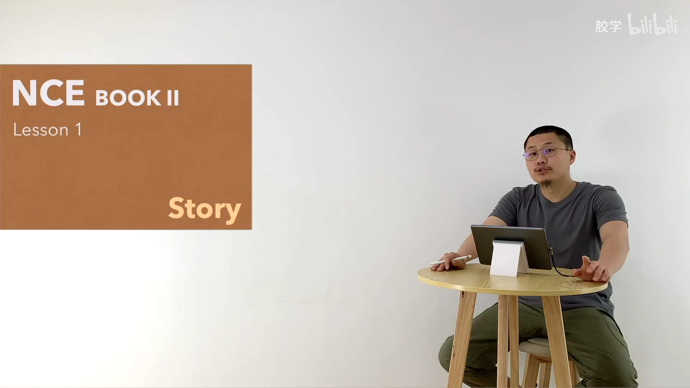

文字识别：胶学b出出 / NCE / BOOKⅡI / Lesson 1 / Story

### 画面 00:00:07

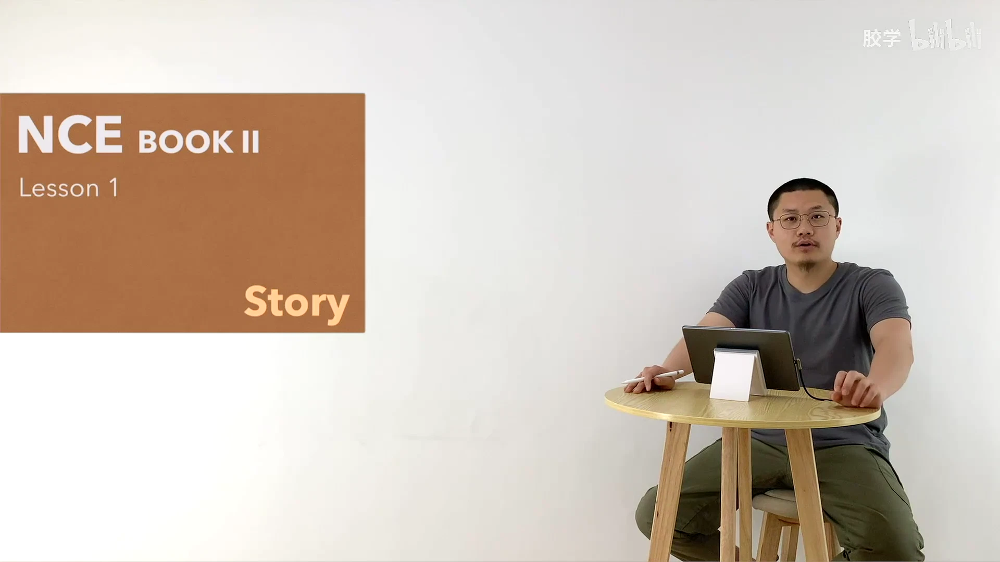

文字识别：胶学L / NCE / BOOKⅡI / Lesson 1 / Story

### 画面 00:00:09

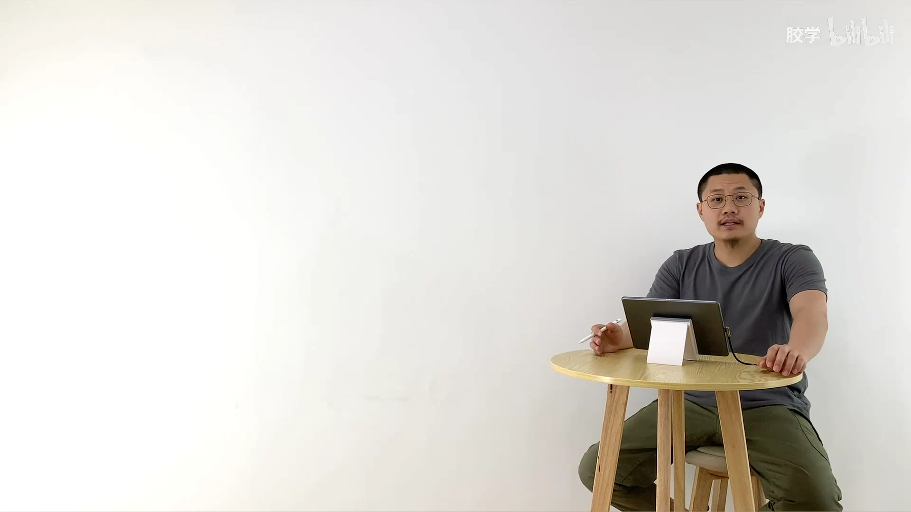

文字识别：胶学L / D

### 画面 00:00:11

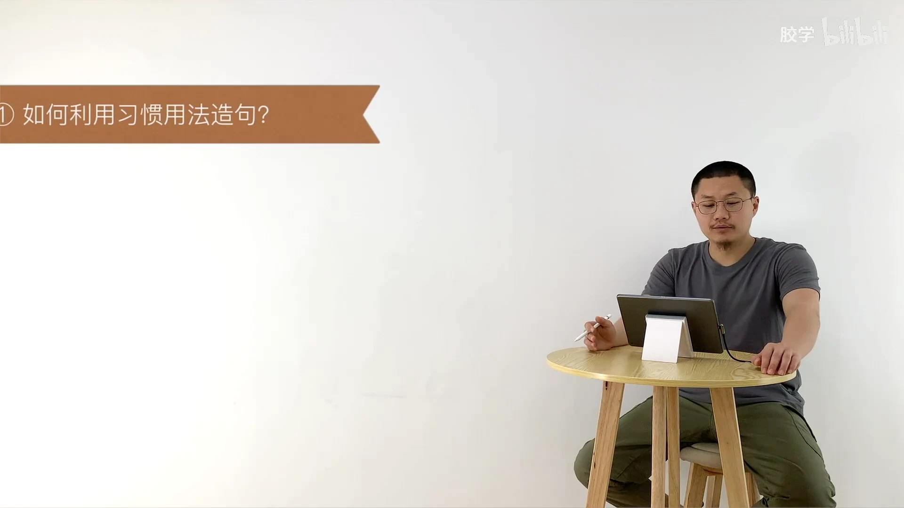

文字识别：胶学 / 如何利用习惯用法造句？

### 画面 00:00:13

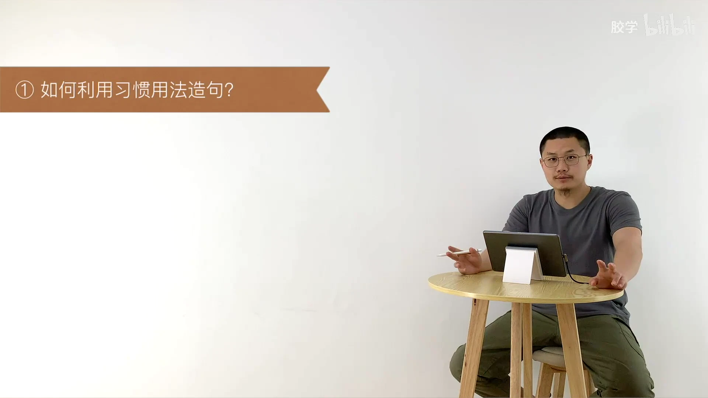

文字识别：胶学 / ①如何利用习惯用法造句？

### 画面 00:00:15

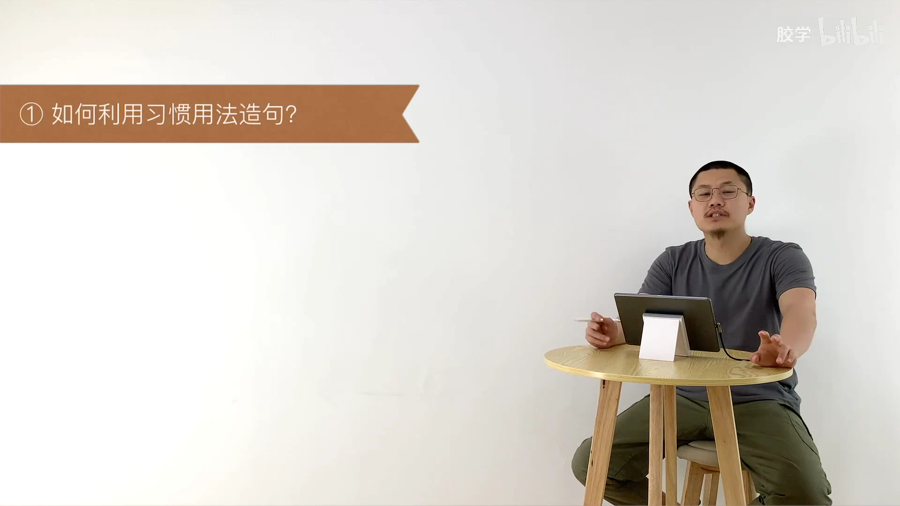

文字识别：胶学 / ①如何利用习惯用法造句？

### 画面 00:00:20

文字识别：胶学出

### 画面 00:00:23

文字识别：胶囊学院

### 画面 00:00:25

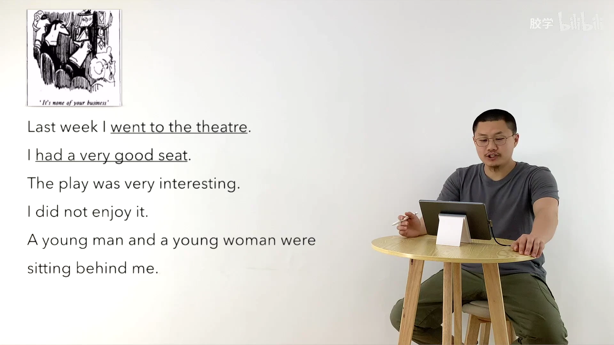

文字识别：胶学 / 'I's none of your business' / Last week I went to the theatre. / I had a very good seat. / The play was very interesting. / I did not enjoy it. / A young man and a young woman were / sitting behind me.

## 00:00:30–00:01:00

theater.上周我去了剧院。哎，我们在讲单词的时候提过了，叫 go to the theater，指的是去了剧院，这是一个小的短语，对吧？我去了一个剧院。I had a very good seat. 注意，last week一出来，接下来很可能都是跟过去相关的时态了，比如说 went，比如说 had，对吧？那有一个非常好的座位，叫 have

### 画面 00:00:41

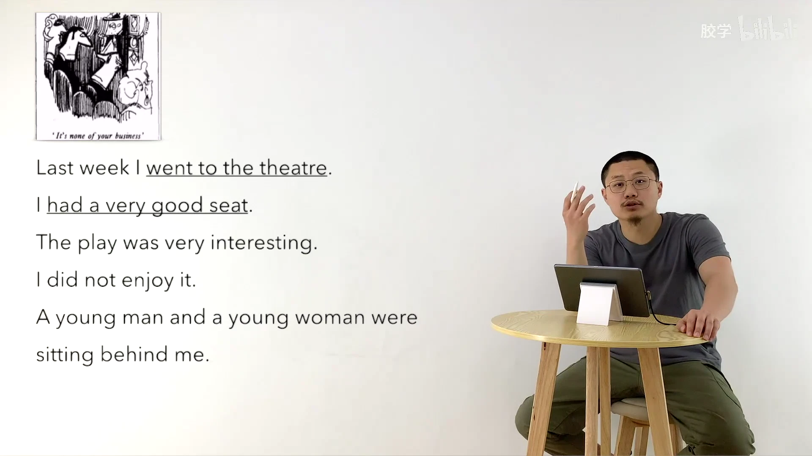

文字识别：胶学LH / 'I's none of your business' / Last week I went to the theatre. / I had a very good seat. / The play was very interesting. / I did not enjoy it. / A young man and a young woman were / sitting behind me.

## 00:01:00–00:01:30

a good seat 或者 have a very good seat。第二个习惯用法，the play 这个话剧呢 was very interesting，非常的有趣。I did not, I didn't, did not, didn't，对吧？Enjoy it，我不是很享受这个话剧。我们看为什么呢？A young man and a young woman，一个年轻的男子啊和一个年轻的女子。注意 were sitting，他终于不是一般过去式了，现

### 画面 00:01:11

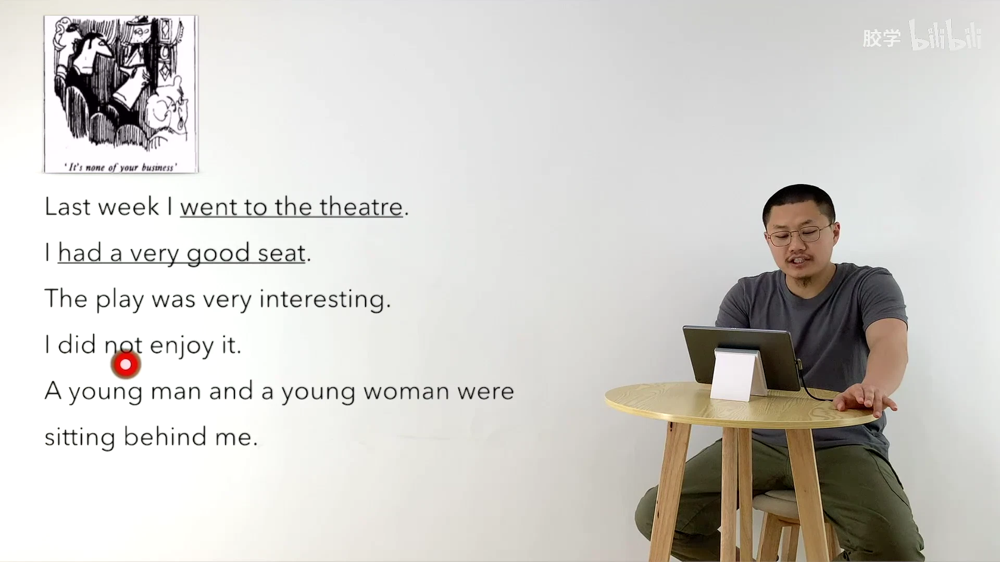

文字识别：胶学bH出 / 'I's none of your business' / Last week I went to the theatre. / I had a very good seat. / The play was very interesting. / I did not enjoy it. / A young man and a young woman were / sitting behind me.

## 00:01:30–00:02:00

在变成过去进行时了，是吧？当时正坐在什么地方呢？Behind me，正坐在我的后方。They were talking，他们当时正在谈话，loudly，说的声音特别的大。注意啊，我们回想一下我们语法的部分六一二三四五六，对吧？这句话没时间吧？主语一在这儿呢，对吧？动

### 画面 00:01:39

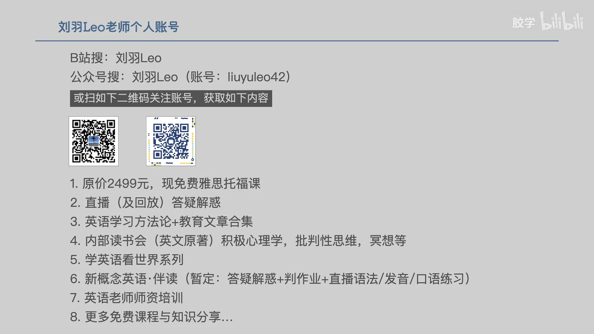

文字识别：胶学bi出 / 刘羽Leo老师个人账号 / B站搜：刘羽Leo / 公众号搜：刘羽Leo（账号：liuyuleo42) / 或扫如下二维码关注账号，获取如下内容 / 1.原价2499元，现免费雅思托福课 / 2.直播（及回放）答疑解惑 / 3.英语学习方法论+教育文章合集 / 4.内部读书会（英文原著）积极心理学，批判性思维，冥想等 / 5.学英语看世界系列 / 6.新概念英语·伴读 (暂定：答疑解惑+判作业+直播语法/发音/口语练习) / 7.英语老师师资培训 / 8.更多免费课程与知识分享...

### 画面 00:01:44

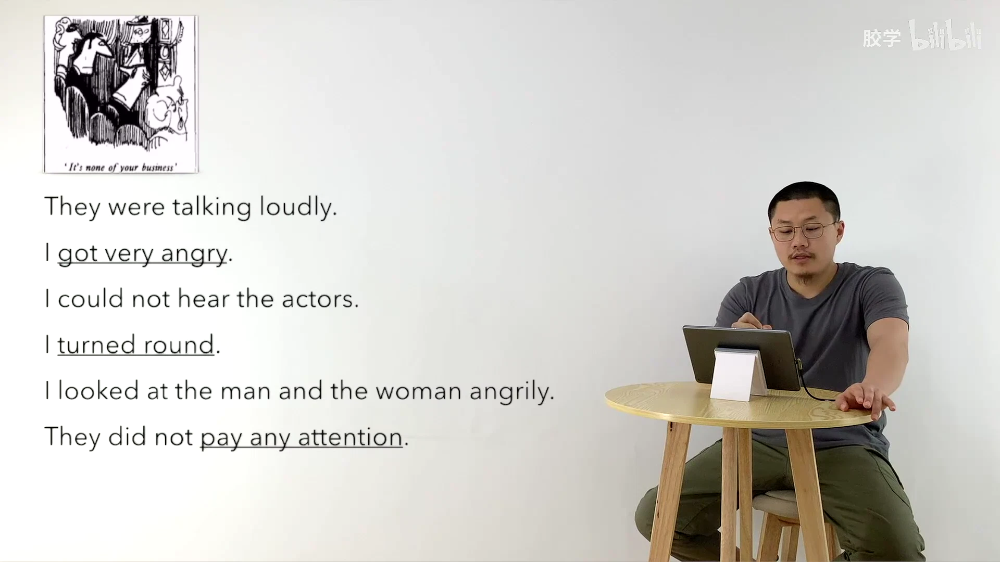

文字识别：胶学b出 / 'I's none of your business' / They were talking loudly. / I got very angry. / I could not hear the actors. / I turned round. / I looked at the man and the woman angrily. / They did not pay any attention.

## 00:02:00–00:02:30

词加动词变化二在这儿呢，没有三，对不对？四副是副词在这个地方呢，也就是说方式，但是现在没有五，对不对？Very good，那还是满足这个条件的。他们当时说话的声音非常的大。I got very angry. Get angry，习惯用法变得很生气啊，我变得非常的生气，但是是过去式，对吧？I could not，我没有办法 hear the actors，

### 画面 00:02:14

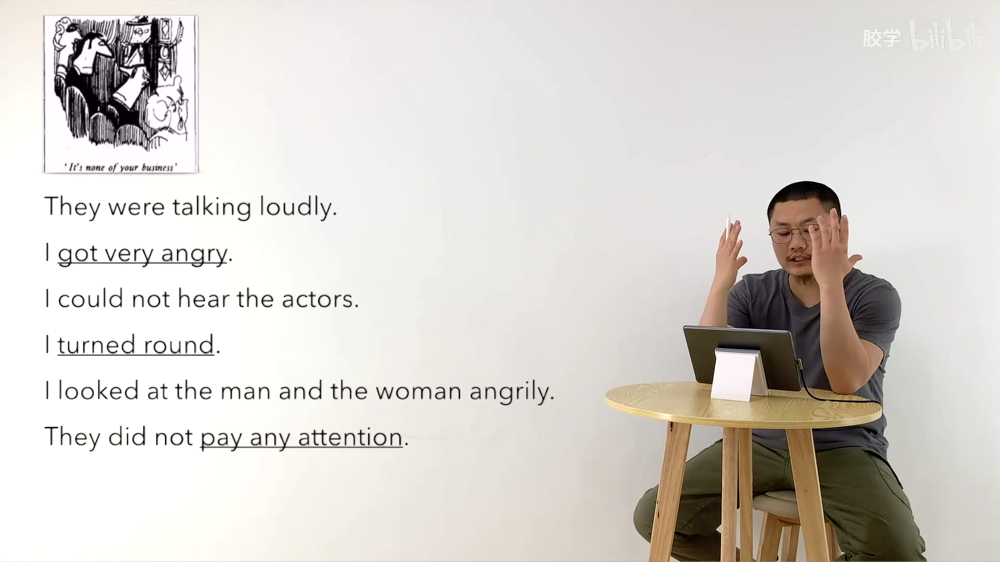

文字识别：胶学LH / 'I's none of your business' / They were talking loudly. / I got very angry. / I could not hear the actors. / I turned round. / I looked at the man and the woman angrily. / They did not pay any attention.

## 00:02:30–00:03:00

没有办法听到这个话剧演员们的声音，光听他们俩聊天了。I turned round,注意turn round就是这个动作啊，扭头。I looked at the man and the woman.我当时看着他们，这个年轻的男子和这个年轻的女子. angrily我愤怒的盯着他们两人，俩人没看见，对吧？They did not，并没有pay

### 画面 00:02:44

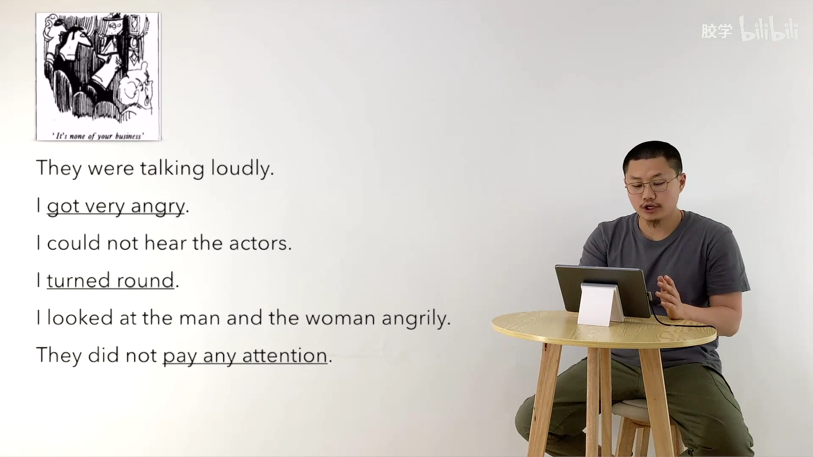

文字识别：胶学b出 / 'I's none of your business' / They were talking loudly. / I got very angry. / I could not hear the actors. / I turned round. / I looked at the man and the woman angrily. / They did not pay any attention.

## 00:03:00–00:03:30

any attention. Pay attention,注意，对不对？They did not pay any attention.他们没有给予我任何的注意。In the end,习惯用法，最后，最后I could not bear it.这个我们讲了，bear叫忍受，那could not bear it叫无法忍受。不知道各位还记不记得叫How can you bear it？这句话呢？I turned around

### 画面 00:03:08

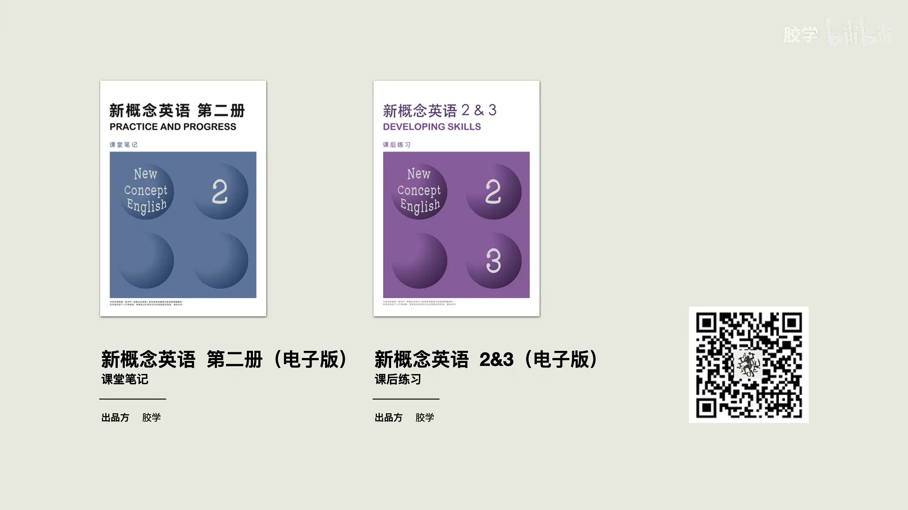

文字识别：胶学州S / 新概念英语 第二册 / 新概念英语2&3 / PRACTICE AND PROGRESS / DEVELOPING SKILLS / 课堂笔记 / 课后练习 / New / New / 2 / 2 / Concept / Concept / English / English / 3 / 新概念英语 第二册 (电子版) / 新概念英语 2&3 (电子版) / 课堂笔记 / 课后练习 / 出品方 / 胶学 / 出品方胶学

### 画面 00:03:13

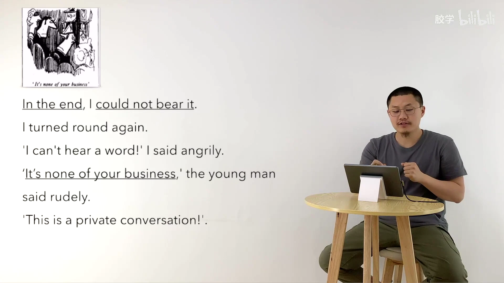

文字识别：胶学b讲出 / 'I's none of your business' / In the end, I could not bear it. / I turned round again. / 'I can't hear a word!'I said angrily. / 'It's none of your business,' the young man / said rudely. / 'This is a private conversation!'.

## 00:03:30–00:04:00

again. 我又一次回头了. I can't hear a word. 我呀没有办法听到哪怕一个单词啊. I said angrily. 我非常愤怒的说道. 那你注意我说的是听不到谁说话，肯定听不到的是演员们这些话剧演员们的说话，对吧？说 It's not of your business. The young man said rudely. 这个年轻的男子非常粗鲁的说道.

### 画面 00:03:43

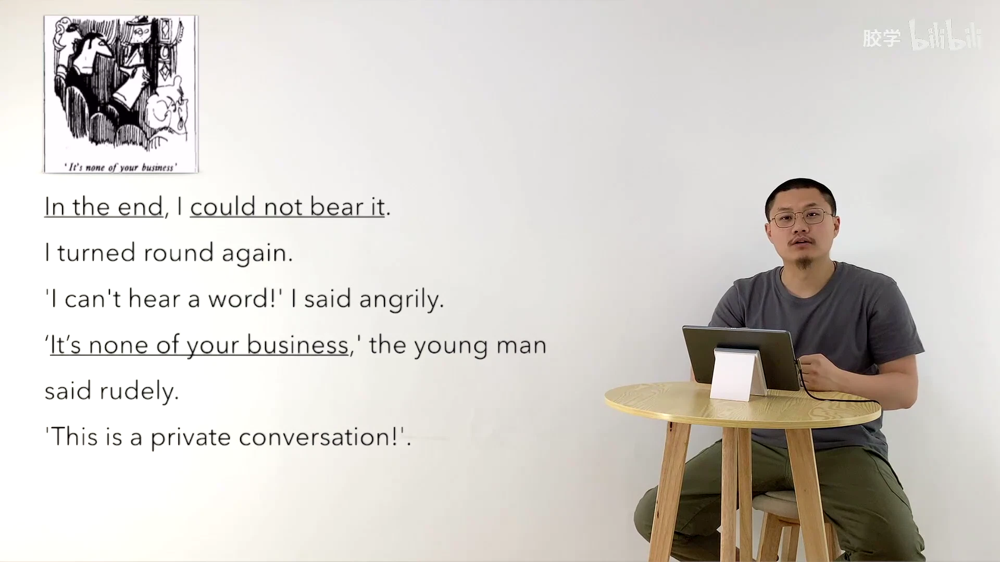

文字识别：胶学bl / 'I's none of your business' / In the end, I could not bear it. / I turned round again. / 'I can't hear a word!' I said angrily. / 'It's none of your business,' the young man / said rudely. / 'This is a private conversation!'.

## 00:04:00–00:04:30

It's not of your business。上一节课我们在单词部分讲到，我直接当个习惯用法处理就好了。整句话就是没有你的事儿，不关你什么事情，别瞎操心，对吧？这又没又不是你的事儿。This is a private conversation。说我和这名女子之间呢是一个非常私人的对话。你为什么非得要听得见呢？各位能听到这地方的梗在什么地方了吧？OK，这儿一个。那接下来呢？文章讲完，在文章部分我们最

### 画面 00:04:13

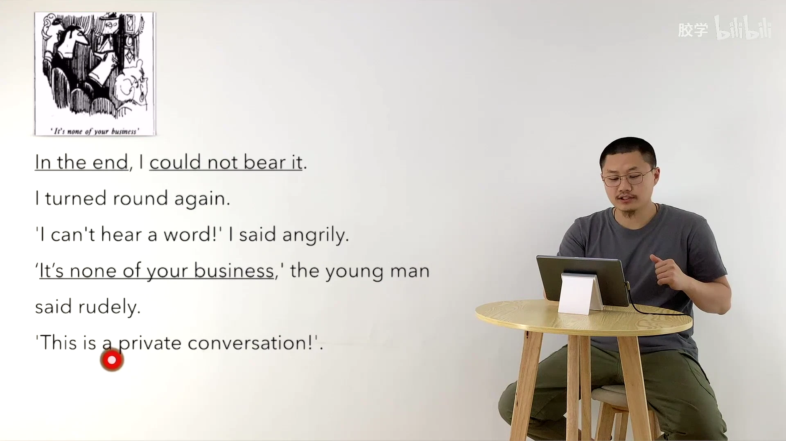

文字识别：胶学b鼎出 / 'I's none of your business' / In the end, I could not bear it. / I turned round again. / 'I can't hear a word!' I said angrily. / 't's none of your business,' the young man / said rudely. / 'This is a private conversation!'.

### 画面 00:04:26

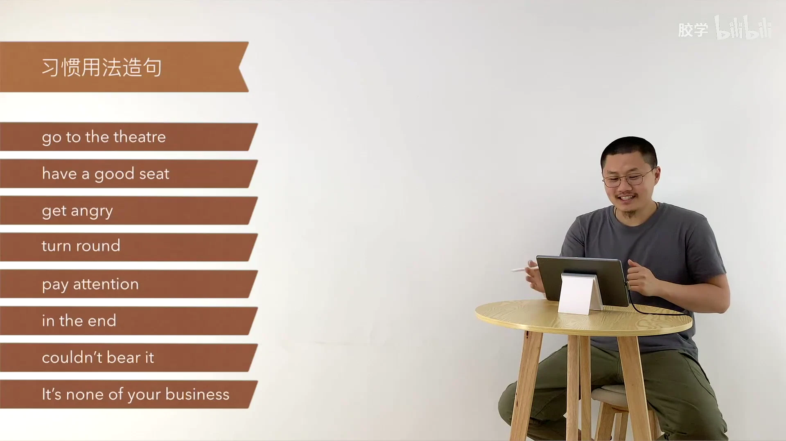

文字识别：胶学bH / 习惯用法造句 / go to the theatre / have a good / seat / get angry / turn round / pay attention / in the end / couldn't bear it / It's none of your business

### 画面 00:04:28

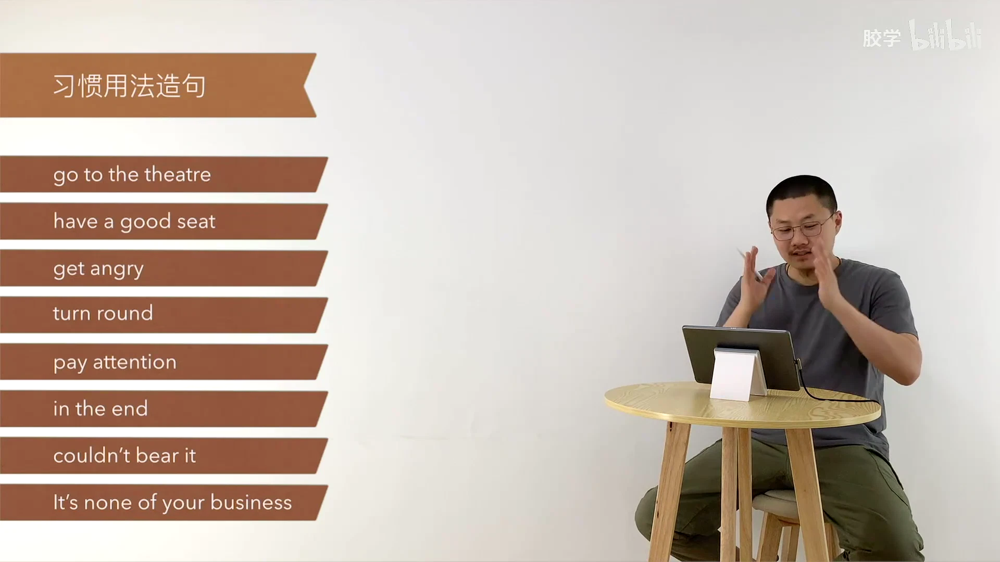

文字识别：胶学b / 习惯用法造句 / go to the theatre / have a good / seat / get angry / turn round / pay attention / in the end / couldn't bear it / It's none of your business

## 00:04:30–00:05:00

重要的任务是除了讲文章以外，还要看本文出现的这些习惯用法，并且利用这些习惯用法去进行造句。那造句既然有造句，必然有一个东西叫做造句指南。我们在单词的部分学了单词造句指南，接下来我们一起看一下习惯用法的造句指南和它有什么区别吗？第一，动词加动词的变化，我们说了时态、情态助动词在单词部分也有，

### 画面 00:04:30

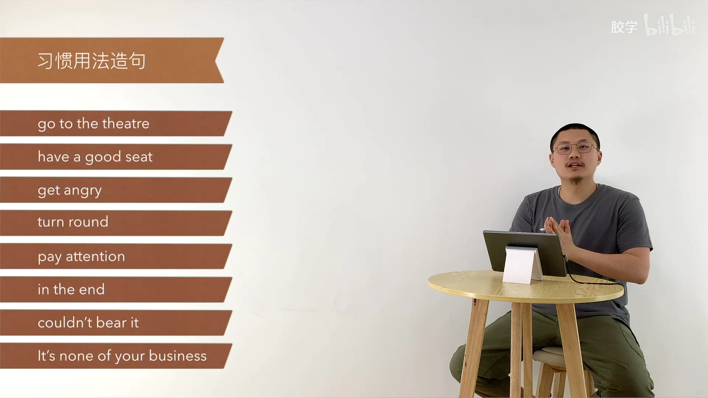

文字识别：胶学H / 习惯用法造句 / go to the theatre / have a good / seat / get angry / turn round / pay attention / in the end / couldn't bear it / It's none of your business

### 画面 00:04:32

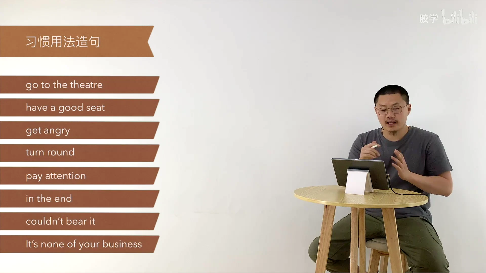

文字识别：胶学出 / 习惯用法造句 / go to the theatre / have a good / seat / get angry / turn round / pay attention / in the end / couldn't bear it / It's none of your business

### 画面 00:04:34

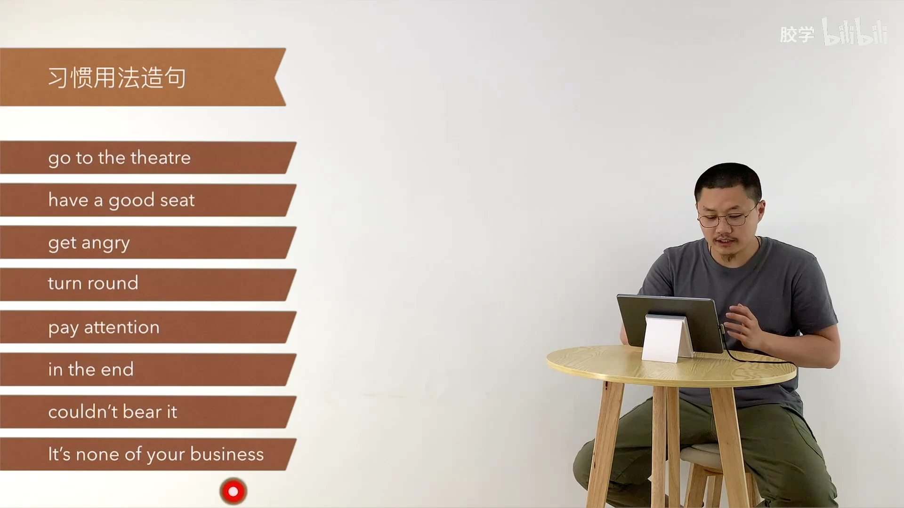

文字识别：胶学b出 / 习惯用法造句 / go to the theatre / have a good / seat / get angry / turn round / pay attention / in the end / couldn't bear it / It's none of your business

### 画面 00:04:36

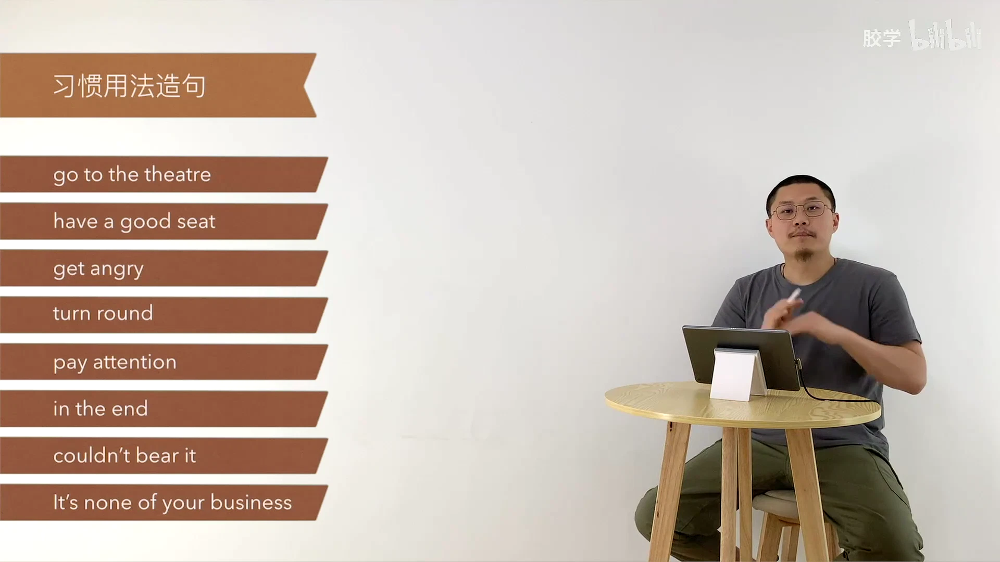

文字识别：胶学bH出 / 习惯用法造句 / go to the theatre / have a good / seat / get angry / turn round / pay attention / in the end / couldn't bear it / It's none of your business

### 画面 00:04:38

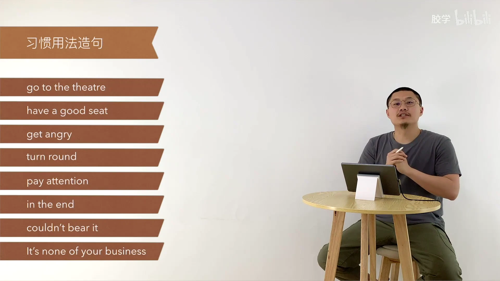

文字识别：胶学bH / 习惯用法造句 / go to the theatre / have a good s / seat / get angry / turn round / pay attention / in the end / couldn't bear it / It's none of your business

### 画面 00:04:40

文字识别：胶学Hl / 网：v.+v.变化 / 习惯用法造句指南 / 四句型转换 / +方式/地点/时间 / 其他习惯用法 / 其他单词 / 原文摘抄+变 / go to the theatre NCE1L125

### 画面 00:04:42

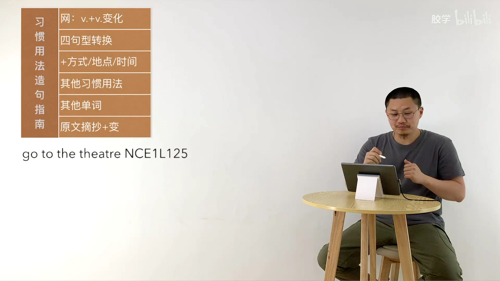

文字识别：胶学LH册 / 网：v.+v.变化 / 习惯用法造句指南 / 四句型转换 / +方式/地点/时间 / 其他习惯用法 / 其他单词 / 原文摘抄+变 / go to the theatre NCE1L125

### 画面 00:04:44

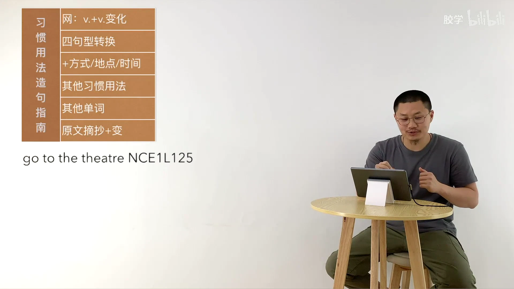

文字识别：胶学L讯出 / 网：v.+v.变化 / 习惯用法造句指南 / 四句型转换 / +方式/地点/时间 / 其他习惯用法 / 其他单词 / 原文摘抄+变 / go to the theatre NCE1L125

### 画面 00:04:46

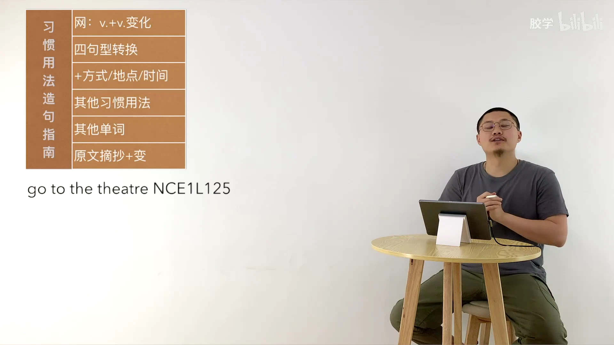

文字识别：胶学L / 网：v.+v.变化 / 习惯用法造句指南 / 四句型转换 / +方式/地点/时间 / 其他习惯用法 / 其他单词 / 原文摘抄+变 / go to the theatre NCE1L125

### 画面 00:04:48

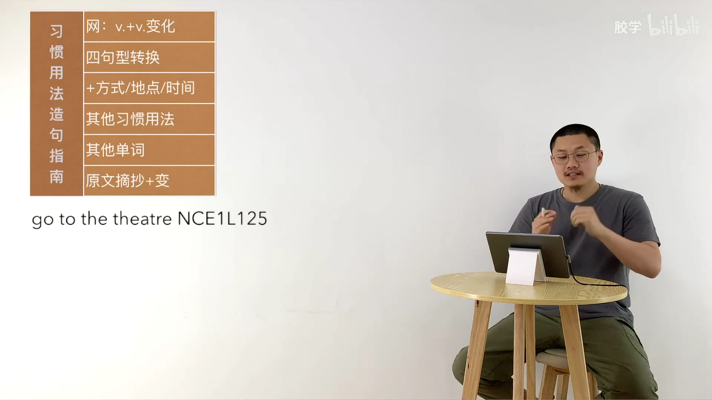

文字识别：胶学L / 网：v.+v.变化 / 习惯用法造句指南 / 四句型转换 / +方式/地点/时间 / 其他习惯用法 / 其他单词 / 原文摘抄+变 / go to the theatre NCE1L125

### 画面 00:04:50

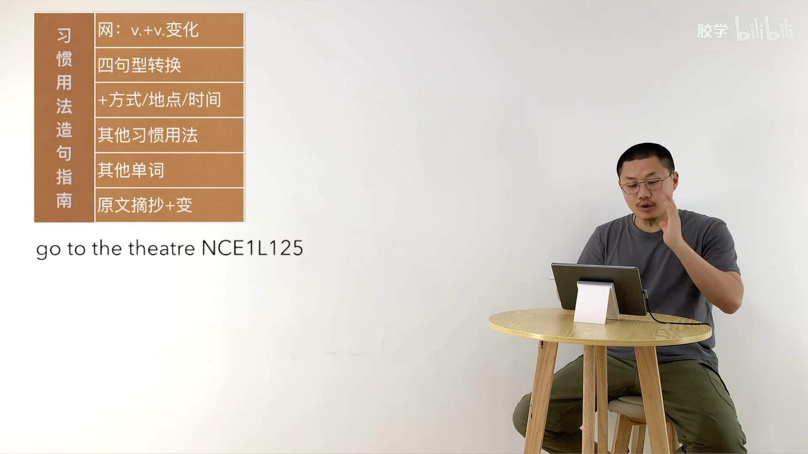

文字识别：胶学L / 网：v.+v.变化 / 习惯用法造句指南 / 四句型转换 / +方式/地点/时间 / 其他习惯用法 / 其他单词 / 原文摘抄+变 / go to the theatre NCE1L125

### 画面 00:04:52

文字识别：胶学bl / 网：v.+v.变化 / 习惯用法造句指南 / 四句型转换 / +方式/地点/时间 / 其他习惯用法 / 其他单词 / 原文摘抄+变 / go to the theatre NCE1L125

### 画面 00:04:54

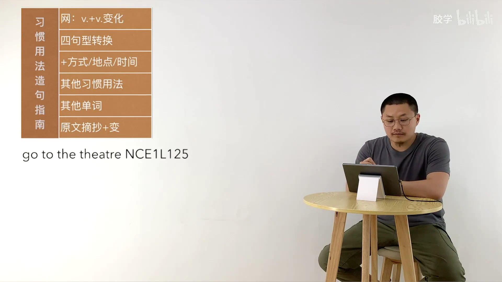

文字识别：胶学 / 网：v.+v.变化 / 习惯用法造句指南 / 四句型转换 / +方式/地点/时间 / 其他习惯用法 / 其他单词 / 原文摘抄+变 / go to the theatre NCE1L125

### 画面 00:04:56

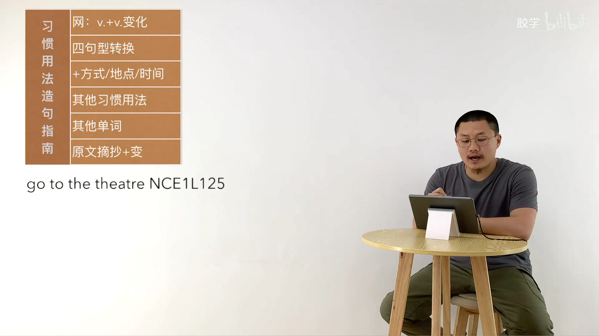

文字识别：胶学H / 网：v.+v.变化 / 习惯用法造句指南 / 四句型转换 / +方式/地点/时间 / 其他习惯用法 / 其他单词 / 原文摘抄+变 / go to the theatre NCE1L125

### 画面 00:04:58

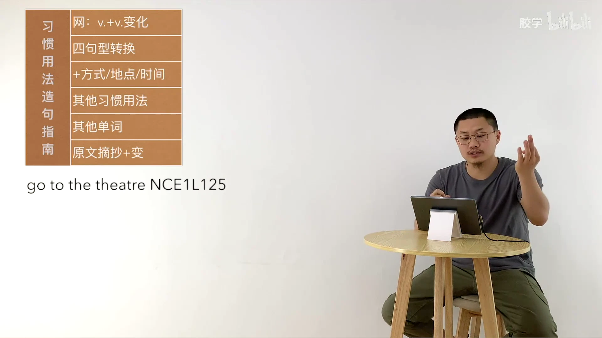

文字识别：胶学讲出 / 网：v.+v.变化 / 习惯用法造句指南 / 四句型转换 / +方式/地点/时间 / 其他习惯用法 / 其他单词 / 原文摘抄+变 / go to the theatre NCE1L125

## 00:05:00–00:05:30

四句型转化没区别，加上方式、地点、时间。各位学完语法那一，个视频了之后，到这儿再去看，应该感受更深了。六一二三四五六，对不对？如何让一个英文句子变得更好？可以加方式，加地点，加时间。其他的习惯用法，就是您现在在这儿，比如说用的是 go to the theater，我可以再加另一个习惯用法，两个凑在一起造个句子。一会儿我们会用到。接下来呢，还可以加入其他的单词。

### 画面 00:05:00

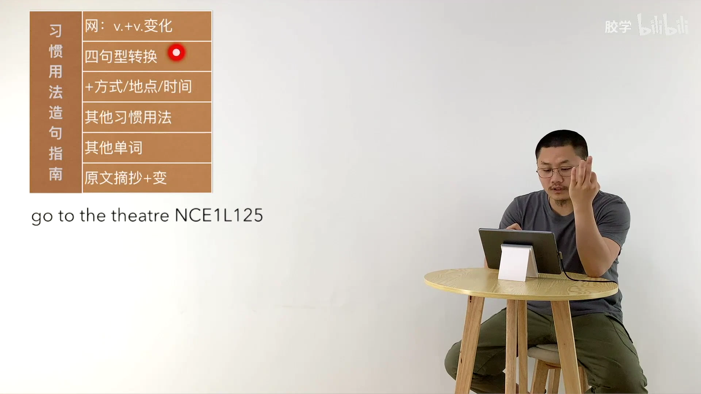

文字识别：胶学出 / 网：v.+v.变化 / 习惯用法造句指南 / 四句型转换 / +方式/地点/时间 / 其他习惯用法 / 其他单词 / 原文摘抄+变 / go to the theatre NCE1L125

### 画面 00:05:02

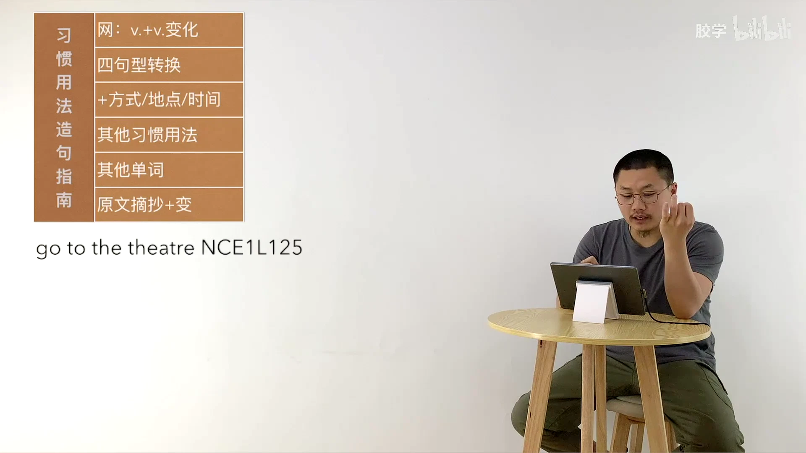

文字识别：胶学b出 / 网：v.+v.变化 / 习惯用法造句指南 / 四句型转换 / +方式/地点/时间 / 其他习惯用法 / 其他单词 / 原文摘抄+变 / go to the theatre NCE1L125

### 画面 00:05:04

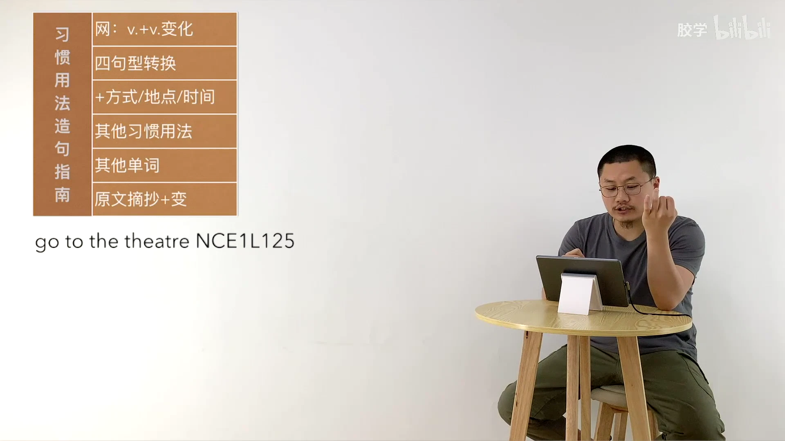

文字识别：胶学出 / 网：v.+v.变化 / 习惯用法造句指南 / 四句型转换 / +方式/地点/时间 / 其他习惯用法 / 其他单词 / 原文摘抄+变 / go to the theatre NCE1L125

### 画面 00:05:06

文字识别：胶学出 / 网：v.+v.变化 / 习惯用法造句指南 / 四句型转换 / +方式/地点/时间 / 其他习惯用法 / 其他单词 / 原文摘抄+变 / go to the theatre NCE1L125

### 画面 00:05:08

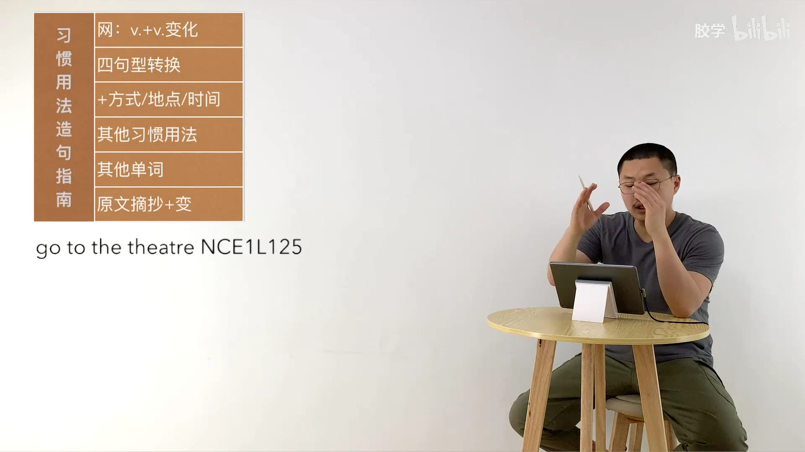

文字识别：胶学出 / 网：v.+v.变化 / 习惯用法造句指南 / 四句型转换 / +方式/地点/时间 / 其他习惯用法 / 其他单词 / 原文摘抄+变 / go to the theatre NCE1L125

### 画面 00:05:11

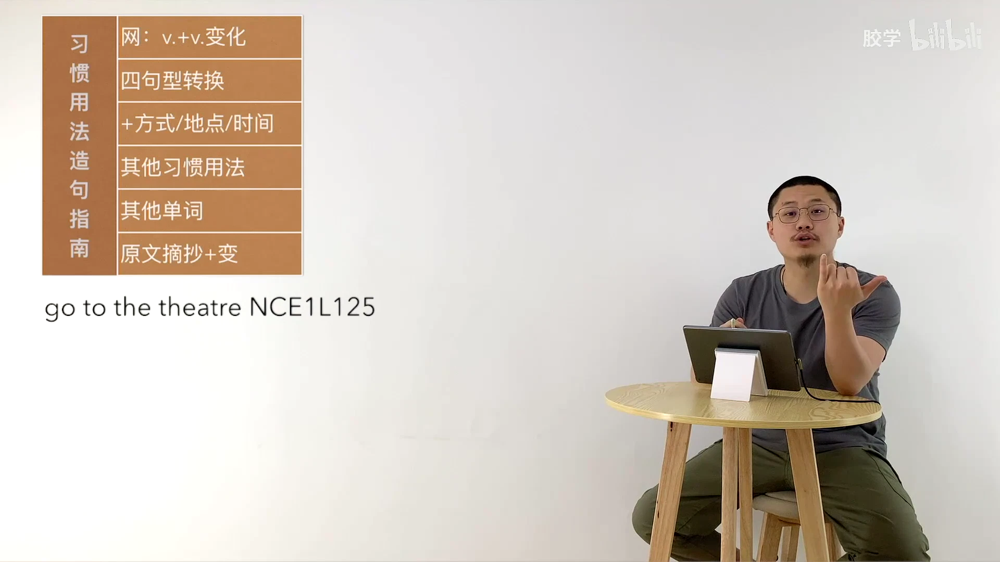

文字识别：胶学明出 / 网：v.+v.变化 / 习惯用法造句指南 / 四句型转换 / +方式/地点/时间 / 其他习惯用法 / 其他单词 / 原文摘抄+变 / go to the theatre NCE1L125

### 画面 00:05:15

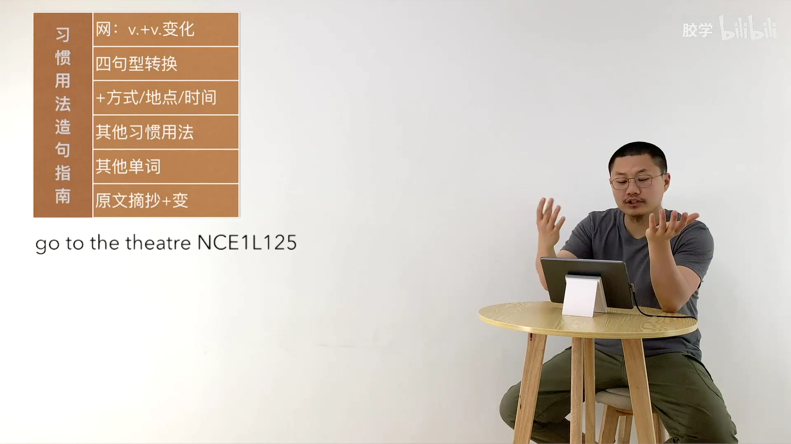

文字识别：胶学出 / 网：v.+v.变化 / 习惯用法造句指南 / 四句型转换 / +方式/地点/时间 / 其他习惯用法 / 其他单词 / 原文摘抄+变 / go to the theatre NCE1L125

### 画面 00:05:17

文字识别：胶学出 / 网：v.+v.变化 / 习惯用法造句指南 / 四句型转换 / +方式/地点/时间 / 其他习惯用法 / 其他单词 / 原文摘抄+变 / go to the theatre NCE1L125

### 画面 00:05:19

文字识别：胶学出 / 网：v.+v.变化 / 习惯用法造句指南 / 四句型转换 / +方式/地点/时间 / 其他习惯用法 / 其他单词 / 原文摘抄+变 / go to the theatre NCE1L125

### 画面 00:05:21

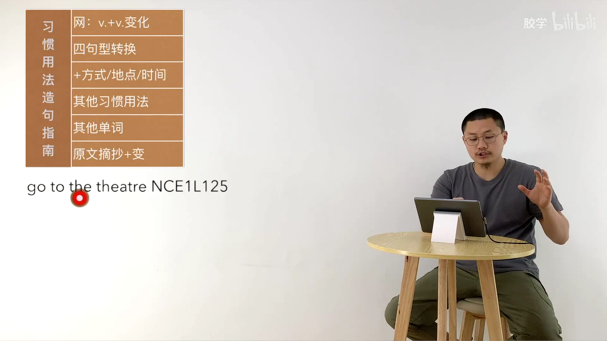

文字识别：胶学出 / 网：v.+v.变化 / 习惯用法造句指南 / 四句型转换 / +方式/地点/时间 / 其他习惯用法 / 其他单词 / 原文摘抄+变 / go to the theatre NCE1L125

### 画面 00:05:23

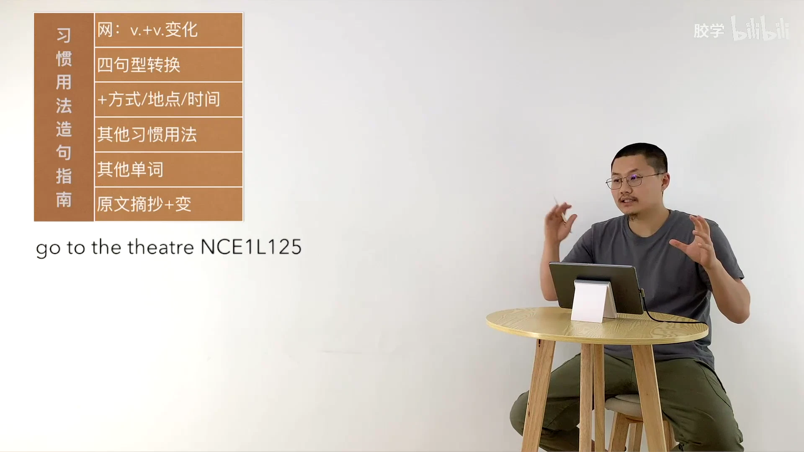

文字识别：胶学出 / 网：v.+v.变化 / 习惯用法造句指南 / 四句型转换 / +方式/地点/时间 / 其他习惯用法 / 其他单词 / 原文摘抄+变 / go to the theatre NCE1L125

### 画面 00:05:26

文字识别：胶学LH / 网：v.+v.变化 / 习惯用法造句指南 / 四句型转换 / +方式/地点/时间 / 其他习惯用法 / 其他单词 / 原文摘抄+变 / go to the theatre NCE1L125

### 画面 00:05:28

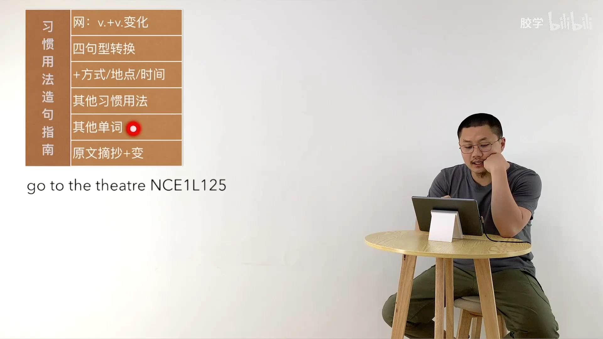

文字识别：胶学讲出 / 网：v.+v.变化 / 习惯用法造句指南 / 四句型转换 / +方式/地点/时间 / 其他习惯用法 / 其他单词 / 原文摘抄+变 / go to the theatre NCE1L125

## 00:05:30–00:06:00

其实您造句子是必然加其他单词的，对不对？但这个时候可能词性就不会像一个单词那样，比如说这个单词是名词，你要考虑加动词啊，对吧？如果是形容词呢，你要先加名词啊，然后再加动词啊。如果是副词呢，你要考虑加动词啊，对吧？所以最核心的永远是动词，听见了吧？那我们在习惯用法造句的时候呢，其实更考更多的考虑，可能并不是这种词性上的改变啊。接下来原文摘抄加上变，这个一会儿我们也可

### 画面 00:05:30

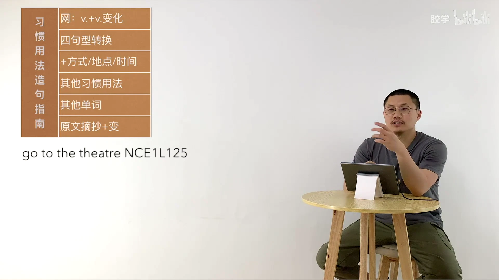

文字识别：胶学b / 网：v.+v.变化 / 习惯用法造句指南 / 四句型转换 / +方式/地点/时间 / 其他习惯用法 / 其他单词 / 原文摘抄+变 / go to the theatre NCE1L125

### 画面 00:05:32

文字识别：胶学阳出 / 网：v.+v.变化 / 习惯用法造句指南 / 四句型转换 / +方式/地点/时间 / 其他习惯用法 / 其他单词 / 原文摘抄+变 / go to the theatre NCE1L125

### 画面 00:05:34

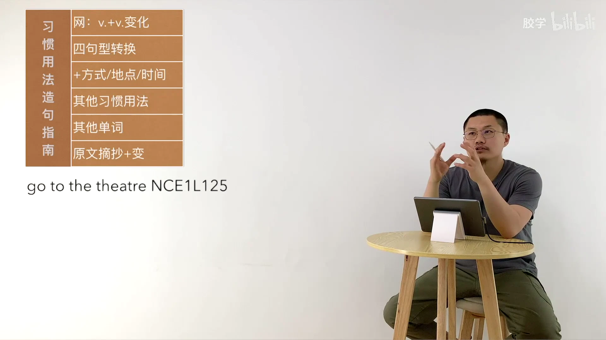

文字识别：胶学ba出 / 网：v.+v.变化 / 习惯用法造句指南 / 四句型转换 / +方式/地点/时间 / 其他习惯用法 / 其他单词 / 原文摘抄+变 / go to the theatre NCE1L125

### 画面 00:05:36

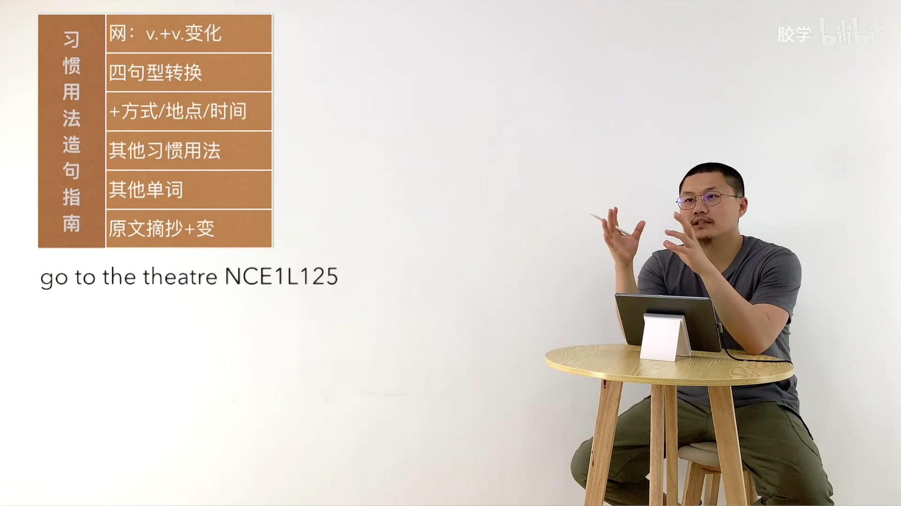

文字识别：胶学明 / 网：v.+v.变化 / 习惯用法造句指南 / 四句型转换 / +方式/地点/时间 / 其他习惯用法 / 其他单词 / 原文摘抄+变 / go to the theatre NCE1L125

### 画面 00:05:38

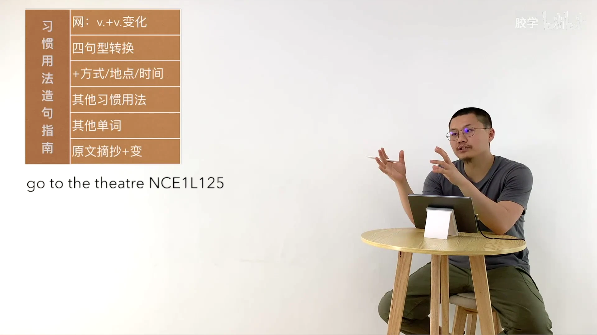

文字识别：胶学训 / 网：v.+v.变化 / 习惯用法造句指南 / 四句型转换 / +方式/地点/时间 / 其他习惯用法 / 其他单词 / 原文摘抄+变 / go to the theatre NCE1L125

### 画面 00:05:40

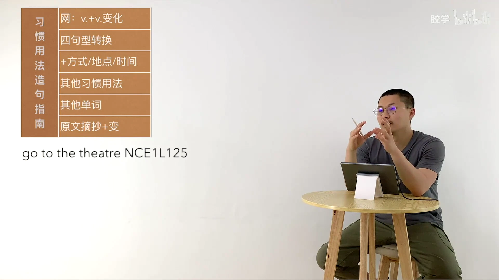

文字识别：胶学L / 网：v.+v.变化 / 习惯用法造句指南 / 四句型转换 / +方式/地点/时间 / 其他习惯用法 / 其他单词 / 原文摘抄+变 / go to the theatre NCE1L125

### 画面 00:05:42

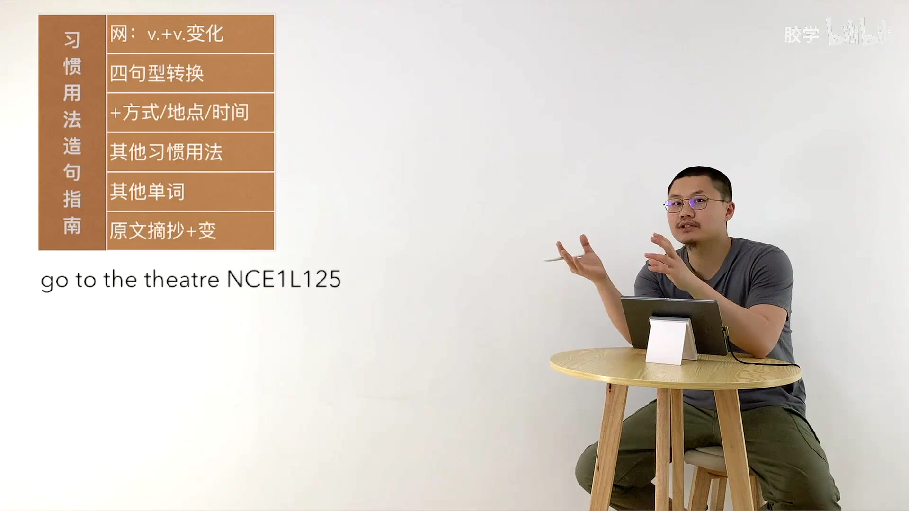

文字识别：胶学H / 网：v.+v.变化 / 习惯用法造句指南 / 四句型转换 / +方式/地点/时间 / 其他习惯用法 / 其他单词 / 原文摘抄+变 / go to the theatre NCE1L125

### 画面 00:05:44

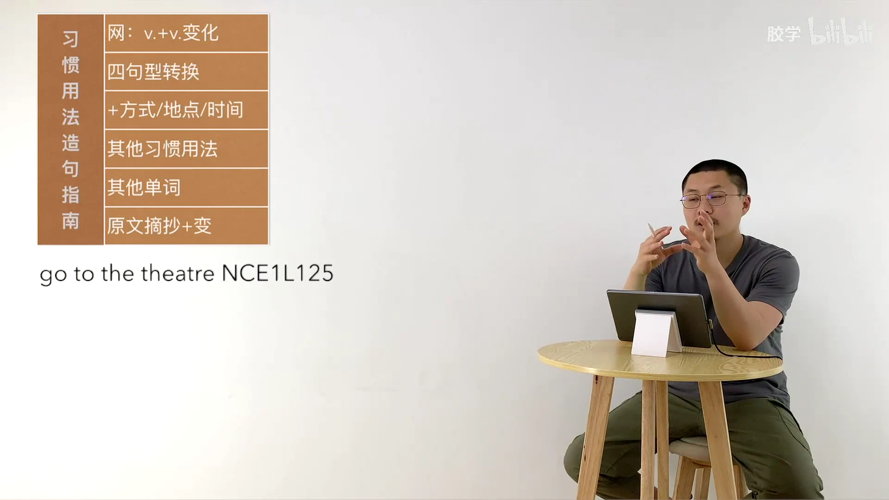

文字识别：胶学LH击 / 网：v.+v.变化 / 习惯用法造句指南 / 四句型转换 / +方式/地点/时间 / 其他习惯用法 / 其他单词 / 原文摘抄+变 / go to the theatre NCE1L125

### 画面 00:05:46

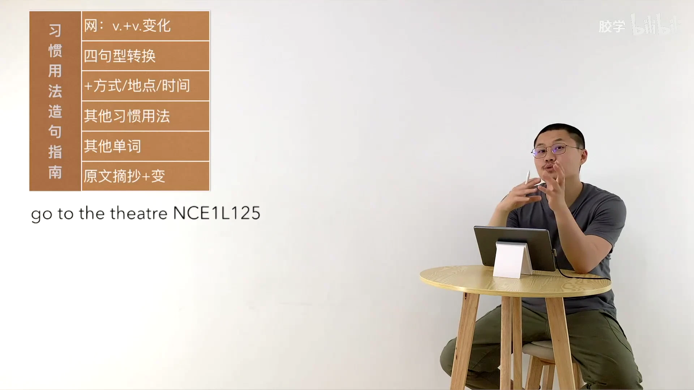

文字识别：胶学 / 网：v.+v.变化 / 习惯用法造句指南 / 四句型转换 / +方式/地点/时间 / 其他习惯用法 / 其他单词 / 原文摘抄+变 / go to the theatre NCE1L125

### 画面 00:05:48

文字识别：胶学 / 网：v.+v.变化 / 习惯用法造句指南 / 四句型转换 / +方式/地点/时间 / 其他习惯用法 / 其他单词 / 原文摘抄+变 / go to the theatre NCE1L125

### 画面 00:05:51

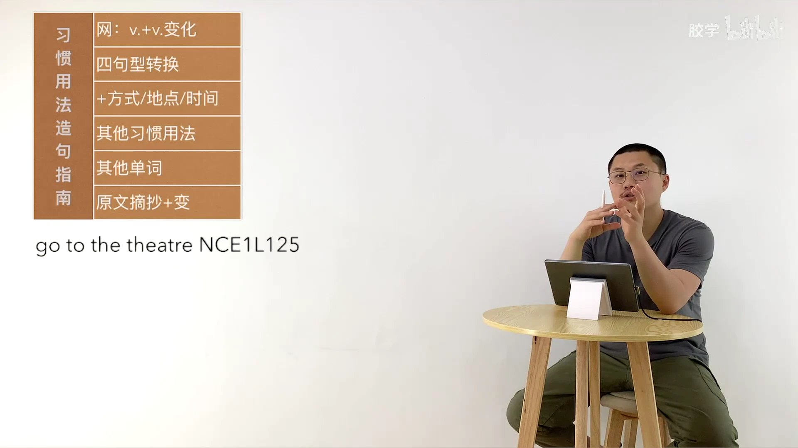

文字识别：胶学上H / 网：v.+v.变化 / 习惯用法造句指南 / 四句型转换 / +方式/地点/时间 / 其他习惯用法 / 其他单词 / 原文摘抄+变 / go to the theatre NCE1L125

### 画面 00:05:54

文字识别：胶学器国 / 网：v.+v.变化 / 习惯用法造句指南 / 四句型转换 / +方式/地点/时间 / 其他习惯用法 / 其他单词 / 原文摘抄+变 / go to the theatre NCE1L125

### 画面 00:05:56

文字识别：胶学LM / 网：v.+v.变化 / 习惯用法造句指南 / 四句型转换 / +方式/地点/时间 / 其他习惯用法 / 其他单词 / 原文摘抄+变 / go to the theatre NCE1L125

### 画面 00:05:58

文字识别：胶学 / 网：v.+v.变化 / 习惯用法造句指南 / 四句型转换 / +方式/地点/时间 / 其他习惯用法 / 其他单词 / 原文摘抄+变 / go to the theatre NCE1L125

## 00:06:00–00:06:30

以见到是非常强大的一种变化方式。那我们先看第一个小的短语叫 go to the theater 去剧院。我们结合新概念一册一百二十五课 have to 这个习惯用法，变成了造了一个句子叫 I have to go to the theater。注意加了个时间叫 yesterday。这是思路，各位肯定句造出来了。您我让各位假设现在造五个句子，您造一个肯定句，剩下那四个句子就应该

### 画面 00:06:00

文字识别：胶学b业 / 网：v.+v.变化 / 习惯用法造句指南 / 四句型转换 / +方式/地点/时间 / 其他习惯用法 / 其他单词 / 原文摘抄+变 / go to the theatre NCE1L125

### 画面 00:06:02

文字识别：胶学b出 / 网：v.+v.变化 / 习惯用法造句指南 / 四句型转换 / +方式/地点/时间 / 其他习惯用法 / 其他单词 / 原文摘抄+变 / go to the theatre NCE1L125

### 画面 00:06:04

文字识别：胶学b出 / 网：v.+v.变化 / 习惯用法造句指南 / 四句型转换 / +方式/地点/时间 / 其他习惯用法 / 其他单词 / 原文摘抄+变 / go to the theatre NCE1L125

### 画面 00:06:06

文字识别：胶学bH出 / 网：v.+v.变化 / 习惯用法造句指南 / 四句型转换 / +方式/地点/时间 / 其他习惯用法 / 其他单词 / 原文摘抄+变 / go to the theatre NCE1L125

### 画面 00:06:09

文字识别：胶学b出 / 网：v.+v.变化 / 习惯用法造句指南 / 四句型转换 / +方式/地点/时间 / 其他习惯用法 / 其他单词 / 原文摘抄+变 / go to the theatre NCE1L125

### 画面 00:06:11

文字识别：胶学bi / 网：v.+v.变化 / 习惯用法造句指南 / 四句型转换 / +方式/地点/时间 / 其他习惯用法 / 其他单词 / 原文摘抄+变 / go to the theatre NCE1L125 / I had to go to the theatre yesterday.

### 画面 00:06:13

文字识别：胶学讲出 / 网：v.+v.变化 / 习惯用法造句指南 / 四句型转换 / +方式/地点/时间 / 其他习惯用法 / 其他单词 / 原文摘抄+变 / go to the theatre NCE1L125 / I had to go to the theatre yesterday.

### 画面 00:06:15

文字识别：胶学W止 / 网：v.+v.变化 / 习惯用法造句指南 / 四句型转换 / +方式/地点/时间 / 其他习惯用法 / 其他单词 / 原文摘抄+变 / go to the theatre NCE1L125 / I had to go to the theatre yesterday.

### 画面 00:06:17

文字识别：胶学b / 网：v.+v.变化 / 习惯用法造句指南 / 四句型转换 / +方式/地点/时间 / 其他习惯用法 / 其他单词 / 原文摘抄+变 / go to the theatre NCE1L125 / I had to go to the theatre yesterday.

### 画面 00:06:19

文字识别：胶学W止 / 网：v.+v.变化 / 习惯用法造句指南 / 四句型转换 / +方式/地点/时间 / 其他习惯用法 / 其他单词 / 原文摘抄+变 / go to the theatre NCE1L125 / I had to go to the theatre yesterday.

### 画面 00:06:21

文字识别：胶学W / 网：v.+v.变化 / 习惯用法造句指南 / 四句型转换 / +方式/地点/时间 / 其他习惯用法 / 其他单词 / 原文摘抄+变 / go to the theatre NCE1L125 / I had to go to the theatre yesterday.

### 画面 00:06:25

文字识别：胶学b出 / 网：v.+v.变化 / 习惯用法造句指南 / 四句型转换 / +方式/地点/时间 / 其他习惯用法 / 其他单词 / 原文摘抄+变 / go to the theatre NCE1L125 / I had to go to the theatre yesterday.

### 画面 00:06:28

文字识别：胶学出 / 网：v.+v.变化 / 习惯用法造句指南 / 四句型转换 / +方式/地点/时间 / 其他习惯用法 / 其他单词 / 原文摘抄+变 / go to the theatre NCE1L125 / I had to go to the theatre yesterday.

## 00:06:30–00:07:00

有了，为什么四句型转化一般疑问句？Did you have to go to the theater yesterday? 把 did 提前，对不对？这是林新一学的好不好？一百二十五课有没有学懂，对不对？Have to，懂不懂这个语法？好，did 提前，对不对？接下来我如果想对你整句提问说，为什么昨天晚上你必须要去剧院呢？那就是 why 引导的。那如果我接下来想对 yesterday 提问，就是 when 引导的特殊

### 画面 00:06:30

文字识别：胶学L / 网：v.+v.变化 / 习惯用法造句指南 / 四句型转换 / +方式/地点/时间 / 其他习惯用法 / 其他单词 / 原文摘抄+变 / go to the theatre NCE1L125 / I had to go to the theatre yesterday.

### 画面 00:06:33

文字识别：胶学LH出 / 网：v.+v.变化 / 习惯用法造句指南 / 四句型转换 / +方式/地点/时间 / 其他习惯用法 / 其他单词 / 原文摘抄+变 / go to the theatre NCE1L125 / I had to go to the theatre yesterday.

### 画面 00:06:35

文字识别：胶学Libl / 网：v.+v.变化 / 习惯用法造句指南 / 四句型转换 / +方式/地点/时间 / 其他习惯用法 / 其他单词 / 原文摘抄+变 / go to the theatre NCE1L125 / I had to go to the theatre yesterday.

### 画面 00:06:40

文字识别：胶学Ll / 网：v.+v.变化 / 习惯用法造句指南 / 四句型转换 / +方式/地点/时间 / 其他习惯用法 / 其他单词 / 原文摘抄+变 / go to the theatre NCE1L125 / I had to go to the theatre yesterday.

### 画面 00:06:44

文字识别：胶学b / 网：v.+v.变化 / 习惯用法造句指南 / 四句型转换 / +方式/地点/时间 / 其他习惯用法 / 其他单词 / 原文摘抄+变 / go to the theatre NCE1L125 / I had to go to the theatre yesterday.

### 画面 00:06:46

文字识别：胶学bH业 / 网：v.+v.变化 / 习惯用法造句指南 / 四句型转换 / +方式/地点/时间 / 其他习惯用法 / 其他单词 / 原文摘抄+变 / go to the theatre NCE1L125 / I had to go to the theatre yesterday. / Did you have to go to the theatre yesterday?

### 画面 00:06:48

文字识别：胶学bi / 网：v.+v.变化 / 习惯用法造句指南 / 四句型转换 / +方式/地点/时间 / 其他习惯用法 / 其他单词 / 原文摘抄+变 / go to the theatre NCE1L125 / I had to go to the theatre yesterday. / Did you have to go to the theatre yesterday? / Why did you have to go to the theatre yesterday?

### 画面 00:06:50

文字识别：胶学b出 / 网：v.+v.变化 / 习惯用法造句指南 / 四句型转换 / +方式/地点/时间 / 其他习惯用法 / 其他单词 / 原文摘抄+变 / go to the theatre NCE1L125 / I had to go to the theatre yesterday. / Did you have to go to the theatre yesterday? / Why did you have to go to the theatre yesterday?

### 画面 00:06:52

文字识别：胶学b / 网：v.+v.变化 / 习惯用法造句指南 / 四句型转换 / +方式/地点/时间 / 其他习惯用法 / 其他单词 / 原文摘抄+变 / go to the theatre NCE1L125 / I had to go to the theatre yesterday. / Did you have to go to the theatre yesterday? / Why did you have to go to the theatre yesterday?

### 画面 00:06:55

文字识别：胶学b / ：v.+v.变化 / 习惯用法造句指南 / 四句型转换 / +方式/地点/时间 / 其他习惯用法 / 其他单词 / 原文摘抄+变 / go to the theatre NCE1L125 / I had to go to the theatre yesterday. / Did you have to go to the theatre yesterday? / Why did you have to go to the theatre yesterday?

### 画面 00:06:57

文字识别：胶学b / 习惯用法造句指南 / 网：v.+v.变化 / 四句型转换 / +方式/地点/时间 / 其他习惯用法 / 其他单词 / 原文摘抄+变 / go to the theatre NCE1L125 / I had to go to the theatre yesterday. / Did you have to go to the theatre yesterday? / Why did you have to go to the theatre yesterday?

## 00:07:00–00:07:30

疑问句，对 to the theater 提问就是 where 引导的特殊疑问句，对人提问就是 who 引导的特殊疑问句。各位看一下，我已经多说出来了四个了，现在这儿出现了三个，七个句子您已经拿到手了，对不对？玩一个，下一个 have a good seat，非常好的一个座位。我们看一下原文给了一句话叫 I had a very good seat。我假设我不会拿 have a good seat 去造句，原文出现了

### 画面 00:07:00

文字识别：胶学b / 网：v.+v.变化 / 习惯用法造句指南 / 四句型转换 / +方式/地点/时间 / 其他习惯用法 / 其他单词 / 原文摘抄+变 / go to the theatre NCE1L125 / I had to go to the theatre yesterday. / Did you have to go to the theatre yesterday? / Why did you have to go to the theatre yesterday?

### 画面 00:07:04

文字识别：胶学b出 / 网：v.+v.变化 / 习惯用法造句指南 / 四句型转换 / +方式/地点/时间 / 其他习惯用法 / 其他单词 / 原文摘抄+变 / go to the theatre NCE1L125 / I had to go to the theatre yesterday. / Did you have to go to the theatre yesterday? / Why did you have to go to the theatre yesterday?

### 画面 00:07:06

文字识别：胶学bH出 / 网：v.+v.变化 / 习惯用法造句指南 / 四句型转换 / +方式/地点/时间 / 其他习惯用法 / 其他单词 / 原文摘抄+变 / go to the theatre NCE1L125 / I had to go to the theatre yesterday. / Did you have to go to the theatre yesterday? / Why did you have to go to the theatre yesterday?

### 画面 00:07:10

文字识别：胶学b证 / 网：v.+v.变化 / 习惯用法造句指南 / 四句型转换 / +方式/地点/时间 / 其他习惯用法 / 其他单词 / 原文摘抄+变 / go to the theatre NCE1L125 / I had to go to the theatre yesterday. / Did you have to go to the theatre yesterday? / Why did you have to go to the theatre yesterday?

### 画面 00:07:15

文字识别：胶学b / 习惯用法造句指南 / 网：v.+v.变化 / 四句型转换 / +方式/地点/时间 / 其他习惯用法 / 其他单词 / 原文摘抄+变 / go to the theatre NCE1L125 / I had to go to the theatre yesterday. / Did you have to go to the theatre yesterday? / Why did you have to go to the theatre yesterday?

### 画面 00:07:17

文字识别：胶学bH / 网：v.+v.变化 / 习惯用法造句指南 / 四句型转换 / +方式/地点/时间 / 其他习惯用法 / 其他单词 / 原文摘抄+变 / have a good seat

### 画面 00:07:20

文字识别：胶学bW / 网：v.+v.变化 / 习惯用法造句指南 / 四句型转换 / +方式/地点/时间 / 其他习惯用法 / 其他单词 / 原文摘抄+变 / have a good seat / [Story]: I had a very good seat.

### 画面 00:07:22

文字识别：胶学b出 / 网：v.+v.变化 / 习惯用法造句指南 / 四句型转换 / +方式/地点/时间 / 其他习惯用法 / 其他单词 / 原文摘抄+变 / have a good seat / [Story]: I had a very good seat.

### 画面 00:07:25

文字识别：胶学H / 网：v.+v.变化 / 习惯用法造句指南 / 四句型转换 / +方式/地点/时间 / 其他习惯用法 / 其他单词 / 原文摘抄+变 / have a good seat / [Story]: I had a very good seat.

### 画面 00:07:27

文字识别：胶学班出 / 网：v.+v.变化 / 习惯用法造句指南 / 四句型转换 / +方式/地点/时间 / 其他习惯用法 / 其他单词 / 原文摘抄+变 / have a good seat / [Story]: I had a very good seat.

## 00:07:30–00:08:00

怎么办？四句型转化嘛。Did you have a very good seat?很简单。接下来 get angry,生气。我们看原文 I got very angry。我们接下来可以把它做一些小的变化，比如说先把主语换成 he, he got very angry。再加个时间 yesterday。可能您的感觉是这和原文差别也不是特别大。你再给它变个一般疑问句，四句型转化，再给它变个特殊疑问句，你看它变化大不

### 画面 00:07:30

文字识别：胶学b出 / 网：v.+v.变化 / 习惯用法造句指南 / 四句型转换 / +方式/地点/时间 / 其他习惯用法 / 其他单词 / 原文摘抄+变 / have a good seat / [Story]: I had a very good seat.

### 画面 00:07:32

文字识别：胶学b出 / 网：v.+v.变化 / 习惯用法造句指南 / 四句型转换 / +方式/地点/时间 / 其他习惯用法 / 其他单词 / 原文摘抄+变 / have a good seat / [Story]: I had a very good seat. / Did you have a very good seat?

### 画面 00:07:34

文字识别：胶学b出 / 网：v.+v.变化 / 习惯用法造句指南 / 四句型转换 / +方式/地点/时间 / 其他习惯用法 / 其他单词 / 原文摘抄+变 / get angry

### 画面 00:07:36

文字识别：胶学b出 / 网：v.+v.变化 / 习惯用法造句指南 / 四句型转换 / +方式/地点/时间 / 其他习惯用法 / 其他单词 / 原文摘抄+变 / get angry

### 画面 00:07:38

文字识别：胶学b出 / 网：v.+v.变化 / 习惯用法造句指南 / 四句型转换 / +方式/地点/时间 / 其他习惯用法 / 其他单词 / 原文摘抄+变 / get angry

### 画面 00:07:40

文字识别：胶学b / 网：v.+v.变化 / 习惯用法造句指南 / 四句型转换 / +方式/地点/时间 / 其他习惯用法 / 其他单词 / 原文摘抄+变 / get angry / [Story]: I got very angry.

### 画面 00:07:42

文字识别：胶学b / 网：v.+v.变化 / 习惯用法造句指南 / 四句型转换 / +方式/地点/时间 / 其他习惯用法 / 其他单词 / 原文摘抄+变 / get angry / [Story]: I got very angry.

### 画面 00:07:44

文字识别：胶学L / 网：v.+v.变化 / 习惯用法造句指南 / 四句型转换 / +方式/地点/时间 / 其他习惯用法 / 其他单词 / 原文摘抄+变 / get angry / [Story]: I got very angry. / He got very angry yesterday.

### 画面 00:07:46

文字识别：胶学b出出 / 网：v.+v.变化 / 习惯用法造句指南 / 四句型转换 / +方式/地点/时间 / 其他习惯用法 / 其他单词 / 原文摘抄+变 / get angry / [Story]: I got very angry. / He got very angry yesterday.

### 画面 00:07:49

文字识别：胶学b出 / 网：v.+v.变化 / 习惯用法造句指南 / 四句型转换 / +方式/地点/时间 / 其他习惯用法 / 其他单词 / 原文摘抄+变 / get angry / [Story]: I got very angry. / He got very angry yesterday.

### 画面 00:07:51

文字识别：胶学b出 / 网：v.+v.变化 / 习惯用法造句指南 / 四句型转换 / +方式/地点/时间 / 其他习惯用法 / 其他单词 / 原文摘抄+变 / get angry / [Story]: I got very angry. / He got very angry yesterday.

### 画面 00:07:55

文字识别：胶学b出 / 网：v.+v.变化 / 习惯用法造句指南 / 四句型转换 / +方式/地点/时间 / 其他习惯用法 / 其他单词 / 原文摘抄+变 / get angry / [Story]: I got very angry. / He got very angry yesterday.

### 画面 00:07:58

文字识别：胶学bi出 / 网：v.+v.变化 / 习惯用法造句指南 / 四句型转换 / +方式/地点/时间 / 其他习惯用法 / 其他单词 / 原文摘抄+变 / get angry / [Story]: I got very angry. / He got very angry yesterday.

## 00:08:00–00:08:30

大？Did he get very angry yesterday? Why did he get very angry yesterday? 和 When did he get very angry? 注意底下这两句话是不是已经和原文差别非常非常大了？难道比如说这句话 He got very angry yesterday，如果不算您自己造出来的句子，那你总不能认为剩下这三句不算吧？对吧？所以造句还是蛮简单的，各

### 画面 00:08:00

文字识别：胶学 / 习惯用法造句指南 / 网：v.+v.变化 / 四句型转换 / +方式/地点/时间 / 其他习惯用法 / 其他单词 / 原文摘抄+变 / get angry / [Story]: I got very angry. / He got very angry yesterday. / Did he get very angry yesterday?

### 画面 00:08:05

文字识别：胶学bH出 / 网：v.+v.变化 / 习惯用法造句指南 / 四句型转换 / +方式/地点/时间 / 其他习惯用法 / 其他单词 / 原文摘抄+变 / get angry / [Story]: I got very angry. / He got very a / angry yesterday. / Did he get very angry yesterday? / Why did he get very angry yesterday?

### 画面 00:08:07

文字识别：胶学b出 / 网：v.+v.变化 / 习惯用法造句指南 / 四句型转换 / +方式/地点/时间 / 其他习惯用法 / 其他单词 / 原文摘抄+变 / get angry / [Story]: I got very angry. / He got very a / angry yesterday. / Did he get very angry yesterday? / Why did he get very angry yesterday?

### 画面 00:08:09

文字识别：胶学b出 / 网：v.+v.变化 / 习惯用法造句指南 / 四句型转换 / +方式/地点/时间 / 其他习惯用法 / 其他单词 / 原文摘抄+变 / get angry / [Story]: I got very angry. / He got very angry yesterday. / Did he get very angry yesterday? / Why did he get very angry yesterday? / When did he get very angry?

### 画面 00:08:11

文字识别：胶学b出 / 网：v.+v.变化 / 习惯用法造句指南 / 四句型转换 / +方式/地点/时间 / 其他习惯用法 / 其他单词 / 原文摘抄+变 / get angry / [Story]: I got very angry. / He got very angry yesterday. / Did he get very angry yesterday? / Why did he get very angry yesterday? / When did he get very angry?

### 画面 00:08:14

文字识别：胶学b出 / 网：v.+v.变化 / 习惯用法造句指南 / 四句型转换 / +方式/地点/时间 / 其他习惯用法 / 其他单词 / 原文摘抄+变 / get angry / [Story]: I got very angry. / He got very angry yesterday. / Did he get very angry yesterday? / Why did he get very angry yesterday? / When did he get very angry?

### 画面 00:08:16

文字识别：胶学b出 / 网：v.+v.变化 / 习惯用法造句指南 / 四句型转换 / +方式/地点/时间 / 其他习惯用法 / 其他单词 / 原文摘抄+变 / get angry / [Story]: I got very angry. / He got very angry yesterday. / Did he get very angry yesterday? / Why did he get very angry yesterday? / When did he get very angry?

### 画面 00:08:18

文字识别：胶学b出 / 网：v.+v.变化 / 习惯用法造句指南 / 四句型转换 / +方式/地点/时间 / 其他习惯用法 / 其他单词 / 原文摘抄+变 / get angry / [Story]: I got very angry. / He got very angry yesterday. / Did he get very angry yesterday? / Why did he get very angry yesterday? / When did he get very angry?

### 画面 00:08:20

文字识别：胶学bH出 / 网：v.+v.变化 / 习惯用法造句指南 / 四句型转换 / +方式/地点/时间 / 其他习惯用法 / 其他单词 / 原文摘抄+变 / get angry / [Story]: I got very angry. / He got very angry yesterday. / Did he get very angry yesterday? / Why did he get very angry yesterday? / When did he get very angry?

### 画面 00:08:25

文字识别：胶学b出 / 网：v.+v.变化 / 习惯用法造句指南 / 四句型转换 / +方式/地点/时间 / 其他习惯用法 / 其他单词 / 原文摘抄+变 / get angry / [Story]: I got very angry. / He got very angry yesterday. / Did he get very angry yesterday? / Why did he get very angry yesterday? / When did he get very angry?

### 画面 00:08:27

文字识别：胶学b出 / 网：v.+v.变化 / 习惯用法造句指南 / 四句型转换 / +方式/地点/时间 / 其他习惯用法 / 其他单词 / 原文摘抄+变 / get angry / [Story]: I got very angry. / He got very angry yesterday. / Did he get very angry yesterday? / Why did he get very angry yesterday? / When did he get very angry?

## 00:08:30–00:09:00

位重点是把这些思路学会。接下来 turn round 转头，I turn round 原文对吧？那你现在想一下，它是一般过去时。我现在给它换个时态，说 he always turns arounds turns round 加了个地点 in the class。他总是上课的时候啊，扭头转头，换了一个动词加动词的变化，从一般过去时变成了一般现在时，加了个地点就很

### 画面 00:08:30

文字识别：胶学出 / 网：v.+v.变化 / 习惯用法造句指南 / 四句型转换 / +方式/地点/时间 / 其他习惯用法 / 其他单词 / 原文摘抄+变 / get angry / [Story]: I got very angry. / He got very angry yesterday. / Did he get very angry yesterday? / Why did he get very angry yesterday? / When did he get very angry?

### 画面 00:08:32

文字识别：胶学L / 网：v.+v.变化 / 习惯用法造句指南 / 四句型转换 / +方式/地点/时间 / 其他习惯用法 / 其他单词 / 原文摘抄+变 / turn round

### 画面 00:08:34

文字识别：网：v.+v.变化 / 胶学LH / 习惯用法造句指南 / 四句型转换 / +方式/地点/时间 / 其他习惯用法 / 其他单词 / 原文摘抄+变 / turn round

### 画面 00:08:36

文字识别：胶学上止 / 网：v.+v.变化 / 习惯用法造句指南 / 四句型转换 / +方式/地点/时间 / 其他习惯用法 / 其他单词 / 原文摘抄+变 / turn round / I turned round.

### 画面 00:08:39

文字识别：胶学 / 网：v.+v.变化 / 习惯用法造句指南 / 四句型转换 / +方式/地点/时间 / 其他习惯用法 / 其他单词 / 原文摘抄+变 / turn round / I turned round.

### 画面 00:08:41

文字识别：胶学 / 网：v.+v.变化 / 习惯用法造句指南 / 四句型转换 / +方式/地点/时间 / 其他习惯用法 / 其他单词 / 原文摘抄+变 / turn round / I turned round.

### 画面 00:08:43

文字识别：胶学L / 网：v.+v.变化 / 习惯用法造句指南 / 四句型转换 / +方式/地点/时间 / 其他习惯用法 / 其他单词 / 原文摘抄+变 / turn round / I turned round. / He always turns round in the class.

### 画面 00:08:45

文字识别：胶学b出业 / 网：v.+v.变化 / 习惯用法造句指南 / 四句型转换 / +方式/地点/时间 / 其他习惯用法 / 其他单词 / 原文摘抄+变 / turn round / I turned round. / He always turns round in the class.

### 画面 00:08:47

文字识别：胶学出 / 网：v.+v.变化 / 习惯用法造句指南 / 四句型转换 / +方式/地点/时间 / 其他习惯用法 / 其他单词 / 原文摘抄+变 / turn round / I turned round. / He always turns round in the class.

### 画面 00:08:49

文字识别：胶学山 / 网：v.+v.变化 / 习惯用法造句指南 / 四句型转换 / +方式/地点/时间 / 其他习惯用法 / 其他单词 / 原文摘抄+变 / turn round / I turned round. / He always turns round in the class.

### 画面 00:08:51

文字识别：胶学b出 / 网：v.+v.变化 / 习惯用法造句指南 / 四句型转换 / +方式/地点/时间 / 其他习惯用法 / 其他单词 / 原文摘抄+变 / turn round / I turned round. / He always turns round in the class.

### 画面 00:08:55

文字识别：胶学bii / 网：v.+v.变化 / 习惯用法造句指南 / 四句型转换 / +方式/地点/时间 / 其他习惯用法 / 其他单词 / 原文摘抄+变 / turn round / I turned round. / He always turns round in the class.

### 画面 00:08:59

文字识别：胶学 / 网：v.+v.变化 / 习惯用法造句指南 / 四句型转换 / +方式/地点/时间 / 其他习惯用法 / 其他单词 / 原文摘抄+变 / turn round / I turned round. / He always turns round in the class.

## 00:09:00–00:09:30

不一样了。接下来我可以把它变成一般疑问句，叫做 Does he always turn around? Turn around 这儿没应该应该没有 s 哦。好， turned around in the class。接下来呢？ How often 对 always 提问就变成了叫做 How often does he turn around？对不对？ Very good。那接下来 pay attention 注意力集中。原文给的是 They did not pay any attention。

### 画面 00:09:01

文字识别：胶学b / 网：v.+v.变化 / 习惯用法造句指南 / 四句型转换 / +方式/地点/时间 / 其他习惯用法 / 其他单词 / 原文摘抄+变 / turn round / I turned round. / He always turns round in the class. / Does he always turns round in the class?

### 画面 00:09:03

文字识别：胶学 / 网：v.+v.变化 / 习惯用法造句指南 / 四句型转换 / +方式/地点/时间 / 其他习惯用法 / 其他单词 / 原文摘抄+变 / turn round / I turned round. / He always turns round in the class. / Does he always turns round in the class?

### 画面 00:09:05

文字识别：胶学 / 网：v.+v.变化 / 习惯用法造句指南 / 四句型转换 / +方式/地点/时间 / 其他习惯用法 / 其他单词 / 原文摘抄+变 / turn round / I turned round. / He always turns round in the class. / Does he always turns round in the class?

### 画面 00:09:10

文字识别：胶学L / 网：v.+v.变化 / 习惯用法造句指南 / 四句型转换 / +方式/地点/时间 / 其他习惯用法 / 其他单词 / 原文摘抄+变 / turn round / I turned round. / He always turns round in the class. / Does he always turns round in the class?

### 画面 00:09:13

文字识别：胶学b / 网：v.+v.变化 / 习惯用法造句指南 / 四句型转换 / +方式/地点/时间 / 其他习惯用法 / 其他单词 / 原文摘抄+变 / turn round / I turned round. / He always turns round in the class. / Does he always turns round in the class? / How often

### 画面 00:09:15

文字识别：胶学b / 网：v.+v.变化 / 习惯用法造句指南 / 四句型转换 / +方式/地点/时间 / 其他习惯用法 / 其他单词 / 原文摘抄+变 / turn round / I turned round. / He always turns round in the class. / Does he always turns round in the class? / How often

### 画面 00:09:17

文字识别：胶学L / 网：v.+v.变化 / 习惯用法造句指南 / 四句型转换 / +方式/地点/时间 / 其他习惯用法 / 其他单词 / 原文摘抄+变 / turn round

### 画面 00:09:19

文字识别：胶学b出 / 网：v.+v.变化 / 习惯用法造句指南 / 四句型转换 / +方式/地点/时间 / 其他习惯用法 / 其他单词 / 原文摘抄+变 / turn round / I turned round. / He always turns round in the class. / Does he always turns round in the class? / How often

### 画面 00:09:21

文字识别：胶学b出 / 网：v.+v.变化 / 习惯用法造句指南 / 四句型转换 / +方式/地点/时间 / 其他习惯用法 / 其他单词 / 原文摘抄+变 / turn round / I turned round. / He always turns round in the class. / Does he always turns round in the class? / How often

### 画面 00:09:23

文字识别：胶学L / 网：v.+v.变化 / 习惯用法造句指南 / 四句型转换 / +方式/地点/时间 / 其他习惯用法 / 其他单词 / 原文摘抄+变 / pay attention

### 画面 00:09:25

文字识别：胶学b / 网：v.+v.变化 / 习惯用法造句指南 / 四句型转换 / +方式/地点/时间 / 其他习惯用法 / 其他单词 / 原文摘抄+变 / pay attention / [Story]: They did not pay any attention.

### 画面 00:09:27

文字识别：胶学b / 网：v.+v.变化 / 习惯用法造句指南 / 四句型转换 / +方式/地点/时间 / 其他习惯用法 / 其他单词 / 原文摘抄+变 / pay attention / [Story]: They did not pay any attention.

## 00:09:30–00:10:00

原文摘抄对吧？这不算您造的句子。我们把它变成 Did they pay any attention? 这就算您造的句子了，对不对？好，接下来我们看一下电影当中是如何用 pay attention everyone 的。 No, I can't, sir. Sir, you have to listen to me. Pay attention, everyone. You're about to see the best part of this night. Reset the simulator. What, sir? Very good. Pay attention, everyone. Okay, 大家注意了。接下来 in the end 叫最

### 画面 00:09:30

文字识别：胶学b出 / 网：v.+v.变化 / 习惯用法造句指南 / 四句型转换 / +方式/地点/时间 / 其他习惯用法 / 其他单词 / 原文摘抄+变 / pay attention / [Story]: They did not pay any attention.

### 画面 00:09:32

文字识别：胶学b出 / 网：v.+v.变化 / 习惯用法造句指南 / 四句型转换 / +方式/地点/时间 / 其他习惯用法 / 其他单词 / 原文摘抄+变 / pay attention / [Story]: They did not pay any attention. / Did they pay any attention?

### 画面 00:09:34

文字识别：胶学b出 / 网：v.+v.变化 / 习惯用法造句指南 / 四句型转换 / +方式/地点/时间 / 其他习惯用法 / 其他单词 / 原文摘抄+变 / pay attention / [Story]: They did not pay any attention. / Did they pay any attention?

### 画面 00:09:36

文字识别：胶学b出 / 网：v.+v.变化 / 习惯用法造句指南 / 四句型转换 / +方式/地点/时间 / 其他习惯用法 / 其他单词 / 原文摘抄+变 / pay attention / [Story]: They did not pay any attention. / Did they pay any attention?

### 画面 00:09:38

文字识别：Pay attention, everyone. / 胶学b出 / 怪兽电力公司 / 老板，你得听我说 / Monsters, Inc. / -Sir, you have to listen to me. / (2001)

### 画面 00:09:44

文字识别：Pay attention, everyone. / 胶学上出 / 怪兽电力公司 / 老板，你得听我说 / Monsters, Inc / Sir, you have to listen to me. / (2001)

### 画面 00:09:46

文字识别：Pay attention, everyone. / 胶学b / 怪兽电力公司 / 老板，你得听我说 / Monsters,Inc. / -Sir, you have to listen to me. / (2001)

### 画面 00:09:48

文字识别：Pay attention, everyone. / 胶学b / 怪兽电力公司 / 注意看，他是高手中的高手老板，我 / Monsters, Inc. / Pay attention.You're about to see the best in the business. / (2001)

### 画面 00:09:50

文字识别：Pay attention, everyone. / 胶学b / 怪兽电力公司 / 注意看，他是高手中的高手老板，我· / Monsters, Inc. / -Pay attention.You're about to see the best in the business. / (2001)

### 画面 00:09:52

文字识别：Pay attention, everyone. / 胶学b出 / 9.h0 / 怪兽电力公司 / 可是老板· / Monsters, Inc. / But sir! / (2001)

### 画面 00:09:54

文字识别：Pay attention, everyone. / 胶学b出 / 怪兽电力公司 / 可是老板· / Monsters, Inc. / - But sir! / (2001)

### 画面 00:09:56

文字识别：Pay attention, everyone. / 胶学出 / 怪兽电力公司 / 可是老板… / Monsters, Inc. / But sir! / (2001)

### 画面 00:09:58

文字识别：胶学bt / 网：v.+v.变化 / 习惯用法造句指南 / 四句型转换 / +方式/地点/时间 / 其他习惯用法 / 其他单词 / 原文摘抄+变 / in the end

## 00:10:00–00:10:30

后。你看这个其实是一个小的短语啊，它可以理解为是时间，对吧？六一二三四五六当中的六放在最前或最后，你要自己完全想出来一二三四五。这时候怎么办呢？你就可以结合其他的习惯用法，比如说go to the theater，结合其他的习惯用法放在一起去进行造句。比如说我们这句话，In the end, my mom and I went to the theater.注意，我是不是好

### 画面 00:10:00

文字识别：胶学b出 / 网：v.+v.变化 / 习惯用法造句指南 / 四句型转换 / +方式/地点/时间 / 其他习惯用法 / 其他单词 / 原文摘抄+变 / in the end

### 画面 00:10:02

文字识别：胶学上粉 / 网：v.+v.变化 / 习惯用法造句指南 / 四句型转换 / +方式/地点/时间 / 其他习惯用法 / 其他单词 / 原文摘抄+变 / in the end

### 画面 00:10:04

文字识别：胶学册售 / 网：v.+v.变化 / 习惯用法造句指南 / 四句型转换 / +方式/地点/时间 / 其他习惯用法 / 其他单词 / 原文摘抄+变 / in the end

### 画面 00:10:06

文字识别：胶学LH / 网：v.+v.变化 / 习惯用法造句指南 / 四句型转换 / +方式/地点/时间 / 其他习惯用法 / 其他单词 / 原文摘抄+变 / in the end

### 画面 00:10:09

文字识别：胶学LH / 网：v.+v.变化 / 习惯用法造句指南 / 四句型转换 / +方式/地点/时间 / 其他习惯用法 / 其他单词 / 原文摘抄+变 / in the end

### 画面 00:10:11

文字识别：胶学b出 / 网：v.+v.变化 / 习惯用法造句指南 / 四句型转换 / +方式/地点/时间 / 其他习惯用法 / 其他单词 / 原文摘抄+变 / in the end

### 画面 00:10:13

文字识别：胶学H出 / 网：v.+v.变化 / 习惯用法造句指南 / 四句型转换 / +方式/地点/时间 / 其他习惯用法 / 其他单词 / 原文摘抄+变 / in the end / In the end, My mum and I went to the theatre.

### 画面 00:10:15

文字识别：胶学b让 / 网：v.+v.变化 / 习惯用法造句指南 / 四句型转换 / +方式/地点/时间 / 其他习惯用法 / 其他单词 / 原文摘抄+变 / in the end / In the end, My mum and I went to the theatre.

### 画面 00:10:17

文字识别：胶学b出 / 网：v.+v.变化 / 习惯用法造句指南 / 四句型转换 / +方式/地点/时间 / 其他习惯用法 / 其他单词 / 原文摘抄+变 / in the end / In the end, My mum and I went to the theatre.

### 画面 00:10:20

文字识别：胶学明 / 网：v.+v.变化 / 习惯用法造句指南 / 四句型转换 / +方式/地点/时间 / 其他习惯用法 / 其他单词 / 原文摘抄+变 / in the end / In the end, My mum and I went to the theatre.

### 画面 00:10:22

文字识别：胶学出 / 网：v.+v.变化 / 习惯用法造句指南 / 四句型转换 / +方式/地点/时间 / 其他习惯用法 / 其他单词 / 原文摘抄+变 / in the end / In the end, My mum and I went to the theatre.

### 画面 00:10:24

文字识别：胶学上出 / 网：v.+v.变化 / 习惯用法造句指南 / 四句型转换 / +方式/地点/时间 / 其他习惯用法 / 其他单词 / 原文摘抄+变 / in the end / In the end, My mum and I went to the theatre.

### 画面 00:10:26

文字识别：胶学bii / 网：v.+v.变化 / 习惯用法造句指南 / 四句型转换 / +方式/地点/时间 / 其他习惯用法 / 其他单词 / 原文摘抄+变 / in the end / In the end, My mum and I went to the theatre.

### 画面 00:10:28

文字识别：胶学bi / 网：v.+v.变化 / 习惯用法造句指南 / 四句型转换 / +方式/地点/时间 / 其他习惯用法 / 其他单词 / 原文摘抄+变 / in the end / In the end, My mum and I went to the theatre.

## 00:10:30–00:11:00

像把这句话就可以变一下一般疑问句了，特殊疑问句了，是不是就造出来了？但这地方我重点想提的是结合其他习惯用法。In the end本身是个习惯用法，再结合 go to the theatre，very good。那变一般疑问句，did提前，后面记得换回原形。再然后呢，where提前，where did your mom and you go in the end？对吧？接下来

### 画面 00:10:30

文字识别：胶学bii / 网：v.+v.变化 / 习惯用法造句指南 / 四句型转换 / +方式/地点/时间 / 其他习惯用法 / 其他单词 / 原文摘抄+变 / in the end / In the end, My mum and I went to the theatre.

### 画面 00:10:32

文字识别：胶学L / 网：v.+v.变化 / 习惯用法造句指南 / 四句型转换 / +方式/地点/时间 / 其他习惯用法 / 其他单词 / 原文摘抄+变 / in the end / In the end, My mum and I went to the theatre.

### 画面 00:10:34

文字识别：胶学Li / 网：v.+v.变化 / 习惯用法造句指南 / 四句型转换 / +方式/地点/时间 / 其他习惯用法 / 其他单词 / 原文摘抄+变 / in the end / In the end, My mum and I went to the theatre.

### 画面 00:10:36

文字识别：胶学H出 / 网：v.+v.变化 / 习惯用法造句指南 / 四句型转换 / +方式/地点/时间 / 其他习惯用法 / 其他单词 / 原文摘抄+变 / in the end / In the end, My mum and I went to the theatre.

### 画面 00:10:38

文字识别：胶学H出 / 网：v.+v.变化 / 习惯用法造句指南 / 四句型转换 / +方式/地点/时间 / 其他习惯用法 / 其他单词 / 原文摘抄+变 / in the end / In the end, My mum and I went to the theatre.

### 画面 00:10:40

文字识别：胶学LH出 / 网：v.+v.变化 / 习惯用法造句指南 / 四句型转换 / +方式/地点/时间 / 其他习惯用法 / 其他单词 / 原文摘抄+变 / in the end / In the end, My mum and I went to the theatre.

### 画面 00:10:42

文字识别：胶学出 / 网：v.+v.变化 / 习惯用法造句指南 / 四句型转换 / +方式/地点/时间 / 其他习惯用法 / 其他单词 / 原文摘抄+变 / in the end / In the end, My mum and I went to the theatre.

### 画面 00:10:45

文字识别：胶学 / 网：v.+v.变化 / 习惯用法造句指南 / 四句型转换 / +方式/地点/时间 / 其他习惯用法 / 其他单词 / 原文摘抄+变 / in the end / In the end, My mum and I went to the theatre.

### 画面 00:10:47

文字识别：胶学b / 网：v.+v.变化 / 习惯用法造句指南 / 四句型转换 / +方式/地点/时间 / 其他习惯用法 / 其他单词 / 原文摘抄+变 / in the end / In the end, My mum and I went to the theatre. / Did your mum and you go to the theatre, in the end?

### 画面 00:10:49

文字识别：胶学b出 / 网：v.+v.变化 / 习惯用法造句指南 / 四句型转换 / +方式/地点/时间 / 其他习惯用法 / 其他单词 / 原文摘抄+变 / in the end / In the end, My mum and I went to the theatre. / Did your mum and you go to the theatre, in the end?

### 画面 00:10:51

文字识别：胶学b / 网：v.+v.变化 / 习惯用法造句指南 / 四句型转换 / +方式/地点/时间 / 其他习惯用法 / 其他单词 / 原文摘抄+变 / in the end / In the end, My mum and I went to the theatre. / Did your mum and you go to the theatre, in the end?

### 画面 00:10:53

文字识别：胶学Li / 网：v.+v.变化 / 习惯用法造句指南 / 四句型转换 / +方式/地点/时间 / 其他习惯用法 / 其他单词 / 原文摘抄+变 / in the end / In the end, My mum and I went to the theatre. / Did your mum and you go to the theatre, in the end? / Where did your mum and you go in the end?

### 画面 00:10:55

文字识别：胶学bH出 / 网：v.+v.变化 / 习惯用法造句指南 / 四句型转换 / +方式/地点/时间 / 其他习惯用法 / 其他单词 / 原文摘抄+变 / in the end / In the end, My mum and I went to the theatre. / Did your mum and you go to the theatre, in the end? / Where did your mum and you go in the end?

### 画面 00:10:57

文字识别：胶学出 / 网：v.+v.变化 / 习惯用法造句指南 / 四句型转换 / +方式/地点/时间 / 其他习惯用法 / 其他单词 / 原文摘抄+变 / in the end / In the end, My mum and I went to the theatre. / Did your mum and you go to the theatre, in the end? / Where did your mum and you go in the end?

### 画面 00:10:59

文字识别：胶学b出 / 网：v.+v.变化 / 习惯用法造句指南 / 四句型转换 / +方式/地点/时间 / 其他习惯用法 / 其他单词 / 原文摘抄+变 / couldn't bear it / I can't bear it. / Can you bear it? / How can you bear it?

## 00:11:00–00:11:30

couldn't bear it，没有办法忍受它。原文对不对？这个我们上次其实，在单词部分已经提过了。变成 I can't bear it， can you bear it？和 How can you bear it？其实跟原文摘抄变变的是什么呢？可以变动词的变化，可以变成四句型的改变，叫 How can you bear it？就变出来了。那接下来我们一起看一下电影当中是如何用到这句话的。 Everyone hates you.

### 画面 00:11:01

文字识别：胶学 / 网：v.+v.变化 / 习惯用法造句指南 / 四句型转换 / +方式/地点/时间 / 其他习惯用法 / 其他单词 / 原文摘抄+变 / couldn't bear it / I can't bear it. / Can you bear it? / How can you bear it?

### 画面 00:11:03

文字识别：胶学b业 / 网：v.+v.变化 / 习惯用法造句指南 / 四句型转换 / +方式/地点/时间 / 其他习惯用法 / 其他单词 / 原文摘抄+变 / couldn't bear it / I can't bear it. / Can you bear it? / How can you bear it?

### 画面 00:11:05

文字识别：胶学H出 / 网：v.+v.变化 / 习惯用法造句指南 / 四句型转换 / +方式/地点/时间 / 其他习惯用法 / 其他单词 / 原文摘抄+变 / couldn't bear it / I can't bear it. / Can you bear it? / How can you bear it?

### 画面 00:11:07

文字识别：胶学b止 / 网：v.+v.变化 / 习惯用法造句指南 / 四句型转换 / +方式/地点/时间 / 其他习惯用法 / 其他单词 / 原文摘抄+变 / couldn't bear it / I can't bear it. / Can you bear it? / How can you bear it?

### 画面 00:11:09

文字识别：胶学b止 / 网：v.+v.变化 / 习惯用法造句指南 / 四句型转换 / +方式/地点/时间 / 其他习惯用法 / 其他单词 / 原文摘抄+变 / couldn't bear it / I can't bear it. / Can you bear it? / How can you bear it?

### 画面 00:11:11

文字识别：胶学Li / 网：v.+v.变化 / 习惯用法造句指南 / 四句型转换 / +方式/地点/时间 / 其他习惯用法 / 其他单词 / 原文摘抄+变 / couldn't bear it / I can't bear it. / Can you bear it? / How can you bear it?

### 画面 00:11:13

文字识别：胶学Li / 网：v.+v.变化 / 习惯用法造句指南 / 四句型转换 / +方式/地点/时间 / 其他习惯用法 / 其他单词 / 原文摘抄+变 / couldn't bear it / I can't bear it. / Can you bear it? / How can you bear it?

### 画面 00:11:15

文字识别：胶学L / 网：v.+v.变化 / 习惯田 / 四句型转换 / 用法造句指南 / +方式/地点/时间 / 其他习惯用法 / 其他单词 / 原文摘抄+变 / couldn't bear it / I can't bear it. / Can you bear it? / How can you bear it?

### 画面 00:11:17

文字识别：胶学L / 网：v.+v.变化 / 习惯用法造句指南 / 四句型转换 / +方式/地点/时间 / 其他习惯用法 / 其他单词 / 原文摘抄+变 / couldn't bear it / I can't bear it. / Can you bear it? / How can you bear it?

### 画面 00:11:19

文字识别：胶学 / 网：v.+v.变化 / 习惯用法造句指南 / 四句型转换 / +方式/地点/时间 / 其他习惯用法 / 其他单词 / 原文摘抄+变 / couldn't bear it / I can't bear it. / Can you bear it? / How can you bear it?

### 画面 00:11:21

文字识别：胶学b出 / 网：v.+v.变化 / 习惯用法造句指南 / 四句型转换 / +方式/地点/时间 / 其他习惯用法 / 其他单词 / 原文摘抄+变 / couldn't bear it / I can't bear it. / Can you bear it? / How can you bear it?

### 画面 00:11:23

文字识别：How can you bear it? / 胶学b讲出 / 唱片傻大姐 / Marci X / (2003)

### 画面 00:11:27

文字识别：How can you bear it? / 胶学b出 / 唱片傻大姐 / MarciX / (2003)

### 画面 00:11:29

文字识别：How can you bear it? / 胶学b出 / 唱片傻大姐 / MarciX / 大家都恨你 / (2003)

## 00:11:30–00:12:00

I know. Knock, knock. The butler let me in. Oh, it's awful. It's shocking. How can you bear it? Okay, it's awful. How can you bear it? 对吧？你是如何能忍受得了呢？最后, it's none of your business. 我们在单词文章部分都提过了，叫做不关你事儿。那像这个地方，我直接打了个问号，什么意思呢？就您不用再造句了，这已经是一个句子了。这些东西都不需要用了。您直接把这句

### 画面 00:11:31

文字识别：How can you bear it? / 胶学b / -我知道 / 唱片傻大姐 / MarciX / -是门房让我进来的 / (2003)

### 画面 00:11:33

文字识别：How can you bear it? / 胶学出 / -我知道 / 唱片傻大姐 / MarciX / -是门房让我进来的 / (2003)

### 画面 00:11:35

文字识别：How can you bear it? / 胶学出 / 唱片傻大姐 / 太可怕了，真的很吓人 / MarciX / 你怎么忍受得了？ / (2003)

### 画面 00:11:37

文字识别：How can you bear it? / 胶学LtL出 / 太可怕了，真的很吓人 / 唱片傻大姐 / MarciX / 你怎么忍受得了？ / (2003)

### 画面 00:11:39

文字识别：How can you bear it? / 胶学LH出 / 太可怕了，真的很吓人 / 唱片傻大姐 / MarciX / 你怎么忍受得了？ / (2003)

### 画面 00:11:42

文字识别：胶学上班出 / 网：v.+v.变化 / 习惯用法造句指南 / 四句型转换 / +方式/地点/时间 / 其他习惯用法 / 其他单词 / 原文摘抄+变 / It's none of your business.

### 画面 00:11:44

文字识别：胶学LHF / 网：v.+v.变化 / 习惯用法造句指南 / 四句型转换 / +方式/地点/时间 / 其他习惯用法 / 其他单词 / 原文摘抄+变 / It's none of your business.

### 画面 00:11:46

文字识别：胶学H / 网：v.+v.变化 / 习惯用法造句指南 / 四句型转换 / +方式/地点/时间 / 其他习惯用法 / 其他单词 / 原文摘抄+变 / It's none of your business.

### 画面 00:11:49

文字识别：胶学LHL / 网：v.+v.变化 / 习惯用法造句指南 / 四句型转换 / +方式/地点/时间 / 其他习惯用法 / 其他单词 / 原文摘抄+变 / It's none of your business.

### 画面 00:11:51

文字识别：胶学LH / 网：v.+v.变化 / 习惯用法造句指南 / 四句型转换 / +方式/地点/时间 / 其他习惯用法 / 其他单词 / 原文摘抄+变 / It's none of your business.

### 画面 00:11:53

文字识别：胶学L / 网：v.+v.变化 / 习惯用法造句指南 / 四句型转换 / +方式/地点/时间 / 其他习惯用法 / 其他单词 / 原文摘抄+变 / It's none of your business. / ?

### 画面 00:11:55

文字识别：胶学出 / 网：v.+v.变化 / 习惯用法造句指南 / 四句型转换 / +方式/地点/时间 / 其他习惯用法 / 其他单词 / 原文摘抄+变 / It's none of your business. / ?

### 画面 00:11:57

文字识别：胶学bill / 网：v.+v.变化 / 习惯用法造句指南 / 四句型转换 / +方式/地点/时间 / 其他习惯用法 / 其他单词 / 原文摘抄+变 / It's none of your business. / ?

### 画面 00:11:59

文字识别：胶学b出 / 网：v.+v.变化 / 习惯用法造句指南 / 四句型转换 / +方式/地点/时间 / 其他习惯用法 / 其他单词 / 原文摘抄+变 / It's none of your business. / ?

## 00:12:00–00:12:30

话通过反复跟读文章记下来，这句话就已经可以了，无需拿它造句了，好吧？接下来我们一起看一下搏击俱乐部当中，各位仔细听一下，出现了 None of your business. No, what? Look at me. What is that? It's nothing. Don't worry about it. My God, who did this? A person. Guy or girl? What do you care if it's a guy or a girl? What do you care if I ask? It's none of your business. Leave me alone. I am not afraid to say. Let me

### 画面 00:12:01

文字识别：胶学上W / 网：v.+v.变化 / 习惯用法造句指南 / 四句型转换 / +方式/地点/时间 / 其他习惯用法 / 其他单词 / 原文摘抄+变 / It's none of your business. / ?

### 画面 00:12:04

文字识别：胶学班出 / 网：v.+v.变化 / 习惯用法造句指南 / 四句型转换 / +方式/地点/时间 / 其他习惯用法 / 其他单词 / 原文摘抄+变 / It's none of your business. / ?:

### 画面 00:12:06

文字识别：none of your business. / 胶学bl山 / - 看着我 - 不 干嘛 - 看着我 / 搏击俱乐部 / - Look at me.- No. What? - Look at me. / Fight Club / (1999)

### 画面 00:12:14

文字识别：none of your business. / 胶学bl出 / - 看着我- 不 干嘛- 看着我 / 搏击俱乐部 / - Look at me.- No.What? - Look at me. / Fight Club / (1999)

### 画面 00:12:16

文字识别：none of your business. / 胶学b讲出 / 搏击俱乐部 / Fight Club / (1999)

### 画面 00:12:18

文字识别：none of your business. / 胶学b出 / -你的手怎么了-没什么不用大惊小怪 / 搏击俱乐部 / -What is that? - It's nothing. Don't worry about it. / Fight Club / (1999)

### 画面 00:12:20

文字识别：none of your / business. / 胶学H出 / - 天哪 这是谁干的- 一个人 / 搏击俱乐部 / -My God. Who did this? -A person. / Fight Club / (1999)

### 画面 00:12:22

文字识别：none of your business. / 胶学b出 / - 天哪 这是谁干的- —个人 / 搏击俱乐部 / -My God. Who did this? -A person. / Fight Club / (1999)

### 画面 00:12:24

文字识别：none of your business. / 胶学bil业 / 搏击俱乐部 / Fight Club / (1999)

### 画面 00:12:26

文字识别：none of your business. / 胶学bl出 / - 你管得着男的还是女的- 我问问又怎么了 / 搏击俱乐部 / - What do you care, ifit's guy or girl?- What do you care ifI ask? / Fight Club / (1999)

### 画面 00:12:28

文字识别：none of your business. / 胶学bl止 / - 不关你的事别烦我- 你不敢说 / 搏击俱乐部 / -It's none of your business. Leave me alone.-You're afraid to say. / Fight Club / (1999)

## 00:12:30–00:13:00

No, talk to me. Let go. No, leave me alone. This conversation, this conversation is over. Is over. Okay, this conversation is over. Ah, conversation we just learned, none of your business. Okay, very good.那如何用习惯用法造句呢？刚才在上方给大家总结的那个，很大一部分程度上跟如何用单词造句和很像的，只有一些小小细节上的区别。这两者是对于各位来说，接下来整个

### 画面 00:12:30

文字识别：none of your business. / 胶学bl业 / - 我不是不敢说放开我- 不告诉我 / 搏击俱乐部 / -I am not afraid to say. Let me go. - No!Talk to me. / Fight Club / (1999)

### 画面 00:12:32

文字识别：none of your business. / 胶学bi出 / - 放开我- 不行- 别烦我 / 搏击俱乐部 / - Let go of me. - No! -Leave me alone! / Fight Club / (1999)

### 画面 00:12:34

文字识别：none of your business. / 胶学bi止 / -这次谈话-这次谈话 / 搏击俱乐部 / -This conversation...- This conversation. / Fight Club / (1999)

### 画面 00:12:36

文字识别：none of your business. / 胶学bl / - 结束了-结束了 / 搏击俱乐部 / Fight Club / .is over.-.. is over. / (1999)

### 画面 00:12:40

文字识别：none of your business. / 胶学bil / 搏击俱乐部 / Fight Club / (1999)

### 画面 00:12:45

文字识别：胶学Lii / ①如何利用习惯用法造句？

### 画面 00:12:47

文字识别：胶学b / ①如何利用习惯用法造句？

### 画面 00:12:50

文字识别：胶学H班 / ①如何利用习惯用法造句？

## 00:13:00–00:13:30

新二非常重要的一个知识点啊。那接下来我们一起看一下 recap，这是今天各位所有的习惯用法。当然，您回去可能是要造句的，所以不妨截一个图回去拿它造句。接下来作业，我们看第一习惯用法造句，或者是对话。最好的是能造出对话来，但如果不能呢？您先去造句也可以。利用习惯用法造句指南，每个习惯用法来五句话，并不是很难。其

### 画面 00:13:00

文字识别：胶学bH / ①如何利用习惯用法造句？

### 画面 00:13:03

文字识别：胶学b出 / Recap / go to the theatre / have a good / seat / get / angry / turn round / Expression / pay / attention / in the end / couldn't bear it / It's none of your / business

### 画面 00:13:05

文字识别：胶学bi / Recap / go to the theatre / have a good / seat / get / angry / turn round / Expression / pay / attention / in the end / couldn't bear it / It's none of your / business

### 画面 00:13:07

文字识别：胶学b出 / Recap / go to the theatre / have a good / seat / get / angry / turn round / Expression / pay / attention / in the end / couldn't bear it / It's none of your / business

### 画面 00:13:09

文字识别：胶学b出 / Recap / go to the theatre / have a good / seat / get / angry / turn round / Expression / pay / attention / in the end / couldn't bear it / It's none of your / business

### 画面 00:13:11

文字识别：胶学b / Recap / go to the theatre / have a good / seat / get / angry / turn round / Expression / pay / attention / in the end / couldn't bear it / It's none of your / business

### 画面 00:13:13

文字识别：胶学b出

### 画面 00:13:15

文字识别：胶学H出 / 1. / 习惯用法造句/对话 / 【习惯用法造句指南】 / 每个5句

### 画面 00:13:20

文字识别：胶学bH业 / 1.习惯用法造句/对话 / 【习惯用法造句指南】 / 每个5句

### 画面 00:13:25

文字识别：胶学H出 / 1. / 习惯用法造句/对话 / 【习惯用法造句指南】 / 每个5句

## 00:13:30–00:14:00

实五句话对于您来说最主要的可能就是想一个肯定句出来，剩下的否定句、一般疑问句和特殊疑问句已经四个了，看到了吗？各位，再随便造一个特殊疑问句就五句话了，对不对？很简单。接下来文章跟读至熟读成诵，在这儿我想讲一个小的、小的思路学习思路。各位回去不用专门花时间背单词，您拿单词造完句，接下来要做的事情就是一

### 画面 00:13:30

文字识别：胶学b出 / 1.习惯用法造句/对话 / 【习惯用法造句指南】 / 每个5句

### 画面 00:13:33

文字识别：胶学LH / 1. / 习惯用法造句/对话 / 【习惯用法造句指南】 / 每个5句

### 画面 00:13:35

文字识别：胶学LH / 1. / 习惯用法造句/对话 / 【习惯用法造句指南】 / 每个5句

### 画面 00:13:40

文字识别：胶学H / 1. / 习惯用法造句/对话 / 【习惯用法造句指南】 / 每个5句

### 画面 00:13:44

文字识别：胶学LH / 1. / 习惯用法造句/对话 / 【习惯用法造句指南】 / 每个5句 / 文章跟读至熟读成诵 / 内化单词+语法+习惯用法 / 听力+口语+写作练习

### 画面 00:13:46

文字识别：胶学LH / 1. / 习惯用法造句/对话 / 【习惯用法造句指南】 / 每个5句 / 文章跟读至熟读成诵 / 内化单词+语法+习惯用法 / 听力+口语+写作练习

### 画面 00:13:48

文字识别：胶学LH / 1. / 习惯用法造句/对话 / 【习惯用法造句指南】 / 每个5句 / 文章跟读至熟读成诵 / 内化单词+语法+习惯用法 / 听力+口语+写作练习

### 画面 00:13:50

文字识别：胶学Lm / 1. / 习惯用法造句/对话 / 【习惯用法造句指南】 / 每个5句 / 文章跟读至熟读成诵 / 内化单词+语法+习惯用法 / 听力+口语+写作练习

### 画面 00:13:54

文字识别：胶学L / 1. / 习惯用法造句/对话 / 【习惯用法造句指南】 / 每个5句 / 文章跟读至熟读成诵 / 内化单词+语法+习惯用法 / 听力+口语+写作练习

### 画面 00:13:56

文字识别：胶学LH / 1.习惯用法造句/对话 / 【习惯用法造句指南】 / 每个5句 / 文章跟读至熟读成诵 / 内化单词+语法+习惯用法 / 听力+口语+写作练习

### 画面 00:13:59

文字识别：胶学LH / 1.习惯用法造句/对话 / 【习惯用法造句指南】 / 每个5句 / 文章跟读至熟读成诵 / 内化单词+语法+习惯用法 / 听力+口语+写作练习

## 00:14:00–00:14:30

遍一遍读文章，直到把文章读到非常非常的熟，单词自然而然您就记住了。所以，所谓的叫做内化的单词，所以一定要熟读成诵。千万不要做的事情是回去一遍一遍写一个单词，比如说 seat，您回去不要这样背单词，seat，s e a t，seat，s e a t，seat，作为 s e a t，seat，千万不要这么干，回去一遍一遍读文章就行了，好吧？

### 画面 00:14:01

文字识别：胶学LH / 1. / 习惯用法造句/对话 / 【习惯用法造句指南】 / 每个5句 / 文章跟读至熟读成诵 / 内化单词+语法+习惯用法 / 听力+口语+写作练习

### 画面 00:14:03

文字识别：胶学bH出 / 1. / 习惯用法造句/对话 / 【习惯用法造句指南】 / 每个5句 / 文章跟读至熟读成诵 / 内化单词+语法+习惯用法 / 听力+口语+写作练习

### 画面 00:14:05

文字识别：胶学LH出 / 1. / 习惯用法造句/对话 / 【习惯用法造句指南】 / 每个5句 / 文章跟读至熟读成诵 / 内化单词+语法+习惯用法 / 听力+口语+写作练习

### 画面 00:14:09

文字识别：胶学L业 / 1. / 习惯用法造句/对话 / 【习惯用法造句指南】 / 每个5句 / 文章跟读至熟读成诵 / 内化单词+语法+习惯用法 / 听力+口语+写作练习

### 画面 00:14:11

文字识别：胶学L / 1. / 习惯用法造句/对话 / 【习惯用法造句指南】 / 每个5句 / 文章跟读至熟读成诵 / 内化单词+语法+习惯用法 / 听力+口语+写作练习

### 画面 00:14:14

文字识别：胶学讲出 / 1. / 习惯用法造句/对话 / 【习惯用法造句指南】 / 每个5句 / 文章跟读至熟读成诵 / 内化单词+语法+习惯用法 / 听力+口语+写作练习

### 画面 00:14:16

文字识别：胶学 / Sent / 1. / 习惯用法造句/对话 / 【习惯用法造句指南】 / 每个5句 / 文章跟读至熟读成诵 / 内化单词+语法+习惯用法 / 听力+口语+写作练习

### 画面 00:14:18

文字识别：胶学L / Sent / 1. / 习惯用法造句/对话 / se / 【习惯用法造句指南】 / 每个5句 / 文章跟读至熟读成诵 / 内化单词+语法+习惯用法 / 听力+口语+写作练习

### 画面 00:14:20

文字识别：胶学bb / Seat / 1. / 习惯用法造句/对话 / Sen7 / 【习惯用法造句指南】 / 每个5句 / Sea / 文章跟读至熟读成诵 / 内化单词+语法+习惯用法 / 听力+口语+写作练习

### 画面 00:14:22

文字识别：胶学bH业 / Sent / 习惯用法造句/对话 / Sen7 / 【习惯用法造句指南】 / 每个5句 / seat / 文章跟读至熟读成诵 / sea / 内化单词+语法+习惯用法 / 听力+口语+写作练习

### 画面 00:14:24

文字识别：胶学出 / Seat / 习惯用法造句/对话 / Sea7 / 【习惯用法造句指南】 / 每个5句 / seaf / 文章跟读至熟读成诵 / seent / 内化单词+语法+习惯用法 / 听力+口语+写作练习 / Seal

### 画面 00:14:26

文字识别：胶学b出 / 习惯用法造句/对话 / 【习惯用法造句指南】 / 每个5句 / Sart / 文章跟读至熟读成诵 / feant / 内化单词+语法+习惯用法 / 听力+口语+写作练习 / seat

## 00:14:30–00:15:00

放在一起去记啊。其次呢，文章要跟读至熟读成诵。另一个原因是，我们在下一个视频当中立刻会进行大量的听力、口语和写作练习，全是基于您对文章非常非常的熟悉，以至于都快能背下来了。否则这些练习您是没办法做的，好吧？那本期的课程就是这样了。如果大家喜欢呢，欢迎大家订阅、关注啊，并一键

### 画面 00:14:30

文字识别：胶学Li / 习惯用法造句/对话 / 【习惯用法造句指南】 / 每个5句 / sfat / 文章跟读至熟读成诵 / Peant / 内化单词+语法+习惯用法 / 听力+口语+写作练习 / sedt

### 画面 00:14:34

文字识别：胶学b出 / 习惯用法造句/对话 / 【习惯用法造句指南】 / 每个5句 / sart / 文章跟读至熟读成诵 / feant / 内化单词+语法+习惯用法 / 听力+口语+写作练习 / sedt

### 画面 00:14:36

文字识别：胶学bi / 习惯用法造句/对话 / 【习惯用法造句指南】 / 每个5句 / sdat / 文章跟读至熟读成诵 / feant / 内化单词+语法+习惯用法 / 听力+口语+写作练习 / sedt

### 画面 00:14:38

文字识别：胶学b出 / 习惯用法造句/对话 / 【习惯用法造句指南】 / 每个5句 / sant / 文章跟读至熟读成诵 / feant / 内化单词+语法+习惯用法 / 听力+口语+写作练习 / sedt

### 画面 00:14:40

文字识别：胶学L / 习惯用法造句/对话 / 【习惯用法造句指南】 / 每个5句 / Spart / 文章跟读至熟读成诵 / feant / 内化单词+语法+习惯用法 / 听力+口语+写作练习 / sedt

### 画面 00:14:42

文字识别：胶学 / 习惯用法造句/对话 / 【习惯用法造句指南】 / 每个5句 / sdart / 文章跟读至熟读成诵 / feant / 内化单词+语法+习惯用法 / 听力+口语+写作练习 / sedt

### 画面 00:14:45

文字识别：胶学b / 习惯用法造句/对话 / 【习惯用法造句指南】 / 每个5句 / sart / 文章跟读至熟读成诵 / feant / 内化单词+语法+习惯用法 / 听力+口语+写作练习 / sedt

### 画面 00:14:50

文字识别：胶学L / 习惯用法造句/对话 / 【习惯用法造句指南】 / 每个5句 / Spant / 文章跟读至熟读成诵 / feant / 内化单词+语法+习惯用法 / 听力+口语+写作练习 / sedt

### 画面 00:14:53

文字识别：胶学b

## 00:15:00–00:15:19

三连支持我们。当然，也欢迎各位分享给身边需要学习的朋友们。好，那 see you next time。

### 画面 00:15:06

### 画面 00:15:08

文字识别：CAPSULEACADEMY / 胶囊学院 / 小红书 / Leo'irer / OE

### 画面 00:15:10

文字识别：CAPSULEACADEMY / 胶囊学院 / 小红书 / Photographer / OE

### 画面 00:15:13

文字识别：CAPSULEACADEMY / 胶囊学院 / 小红书 / Editor / Berlin / OE

### 画面 00:15:16

文字识别：CAPSULEACADEMY / 胶囊学院 / 小红书 / OE

### 画面 00:15:18

文字识别：Bilibili / 胶学

### 画面 00:15:19

文字识别：Bilibili / 胶学

