# L001 听说读写复述练习

快速机器解析：语音为单模型转写，未进行独立交叉校对或人工复核；画面每秒采样并按变化选帧，短时文字和标记可能遗漏。截图时间约有 1 秒误差。图片有损压缩；遇到疑点请按时间查看 Google Drive 原视频。

## 00:00:00–00:00:30

Hello everyone, welcome to Capsule Academy. This is Lile. Today we're going to learn New Concept English Book Two, Lesson One practices. 那注意各位进行如下所有听力、口语、写作练习的唯一前提就是各位的文章已经熟读到成诵的地步了，否则请勿进行接下来的练习。 Hope you gonna enjoy it. 上来我们先进行第一个 comprehension 练习。如

### 画面 00:00:00

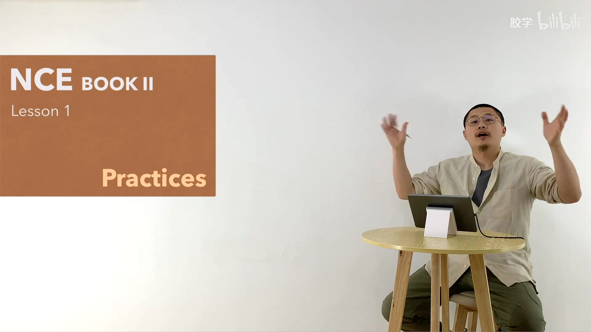

文字识别：胶学b出 / NCE / BOOK"I / Lesson 1 / Practices

### 画面 00:00:02

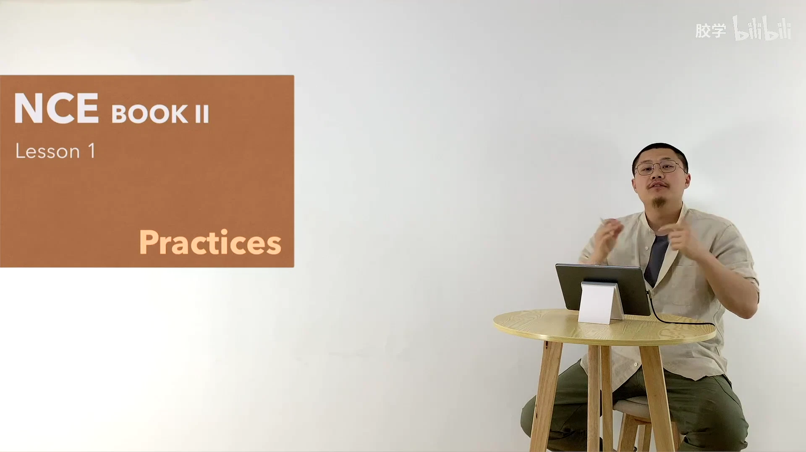

文字识别：胶学b出 / NCE / BOOKII / Lesson 1 / Practices

### 画面 00:00:05

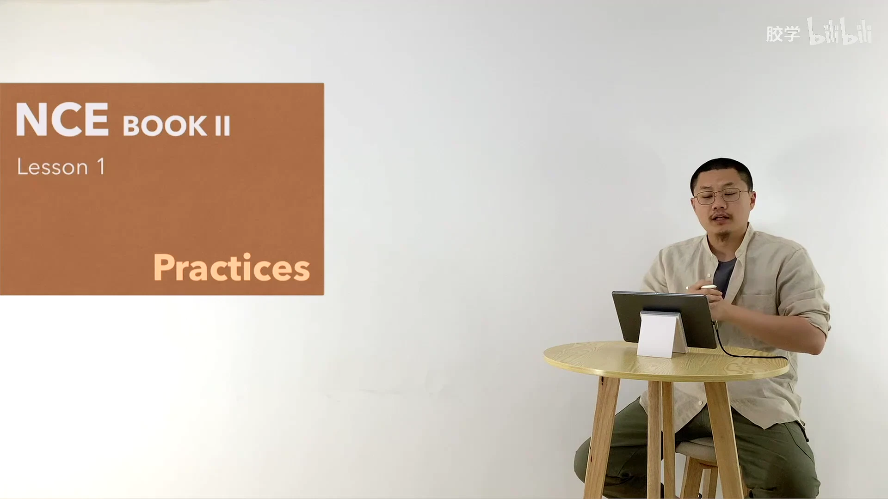

文字识别：胶学b出 / NCE / BOOKII / Lesson 1 / Practices

### 画面 00:00:07

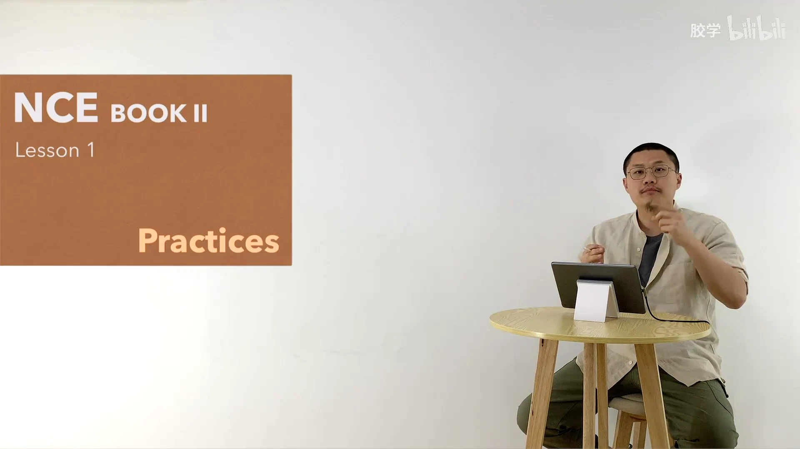

文字识别：胶学b出 / NCE / BOOKII / Lesson 1 / Practices

### 画面 00:00:09

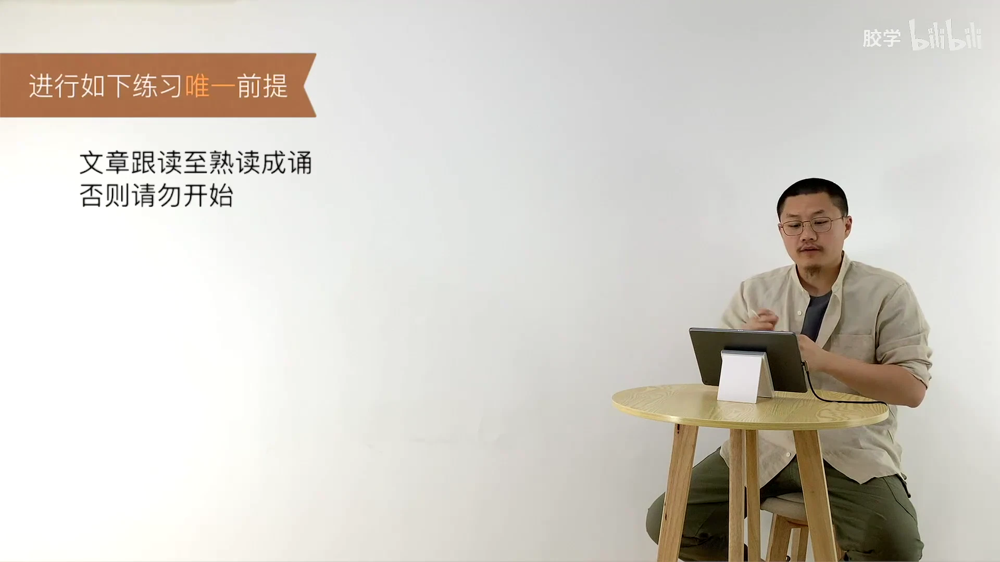

文字识别：胶学 / 进行如下练习唯一前提 / 文章跟读至熟读成诵 / 否则请勿开始

### 画面 00:00:11

文字识别：胶学b业 / 进行如下练习唯一前提 / 文章跟读至熟读成诵 / 否则请勿开始

### 画面 00:00:15

文字识别：胶学b出 / 进行如下练习唯一前提 / 文章跟读至熟读成诵 / 否则请勿开始

### 画面 00:00:20

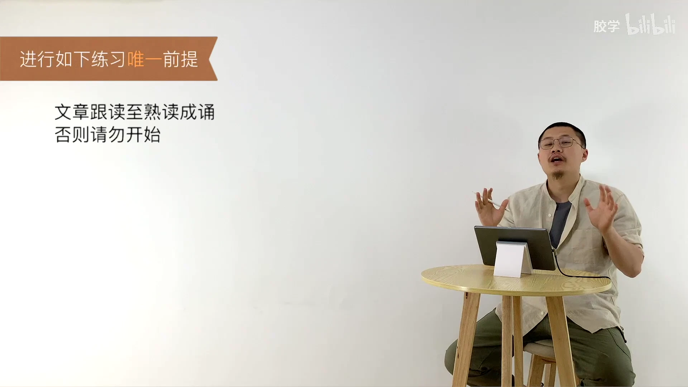

文字识别：胶学b出 / 进行如下练习唯一前提 / 文章跟读至熟读成诵 / 否则请勿开始

### 画面 00:00:22

文字识别：胶学b出 / •

### 画面 00:00:26

文字识别：胶囊学院

### 画面 00:00:28

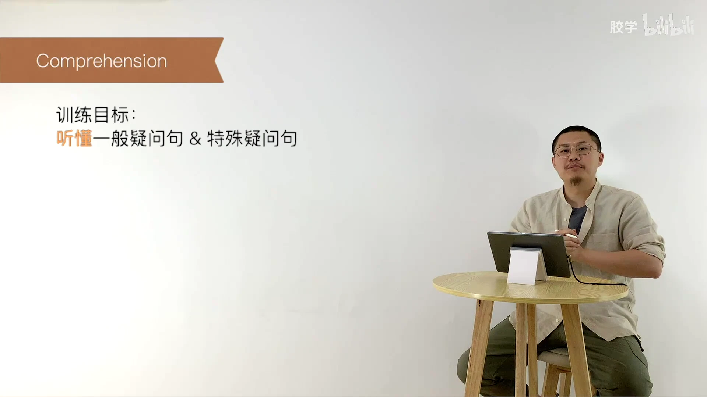

文字识别：胶学bibi出 / Comprehension / 训练目标： / 听懂一般疑问句＆特殊疑问句

## 00:00:30–00:01:00

果您学过一册呢，那这个地方您就应该很清楚如何去进行练习了。如果没有学过一册呢，我们简单说一下，这个地方的练习目标是各位能听懂一般疑问句及特殊疑问句。那对于大家来说，包括听懂了之后给出一个对应的答案。接下来我们所有的问题都是基于刚刚学过的新概念二册第一课的文章。比如说，我

### 画面 00:00:30

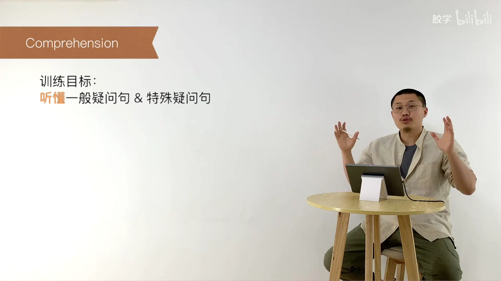

文字识别：胶学b出 / Comprehension / 训练目标： / 听懂一般疑问句＆特殊疑问句

### 画面 00:00:35

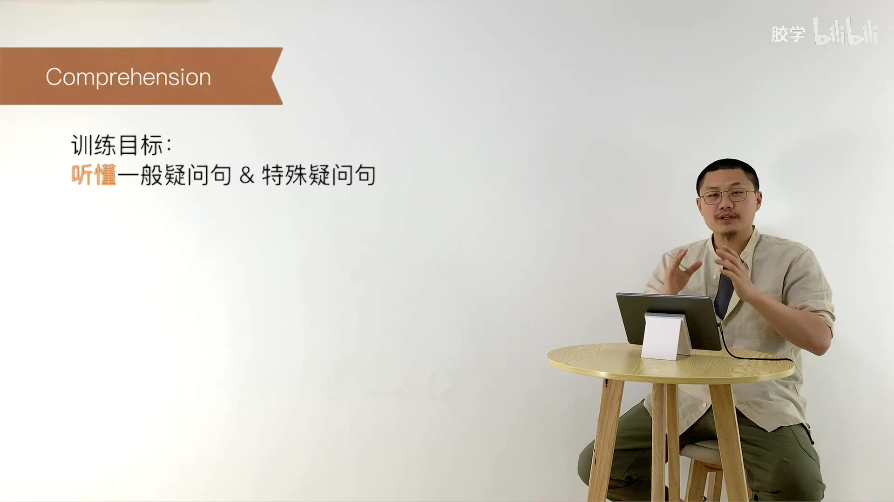

文字识别：胶学b / Comprehension / 训练目标： / 听懂一般疑问句＆特殊疑问句

### 画面 00:00:40

文字识别：胶学bib出 / Comprehension / 训练目标： / 听懂一般疑问句＆特殊疑问句

### 画面 00:00:45

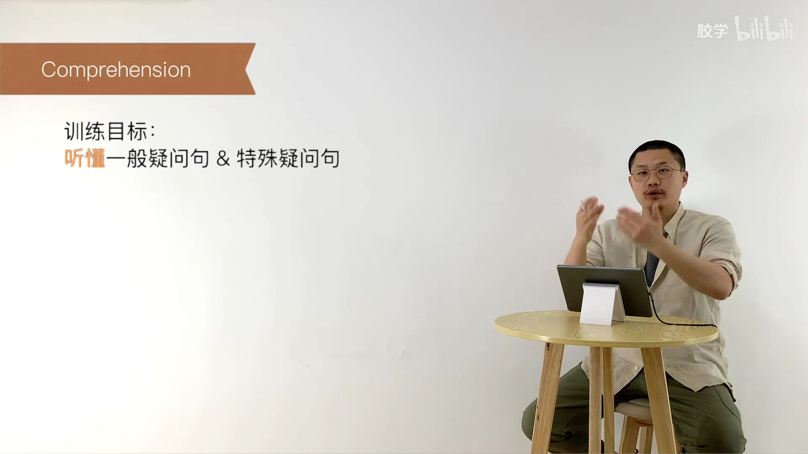

文字识别：胶学bb出 / Comprehension / 训练目标： / 听懂一般疑问句＆特殊疑问句

### 画面 00:00:47

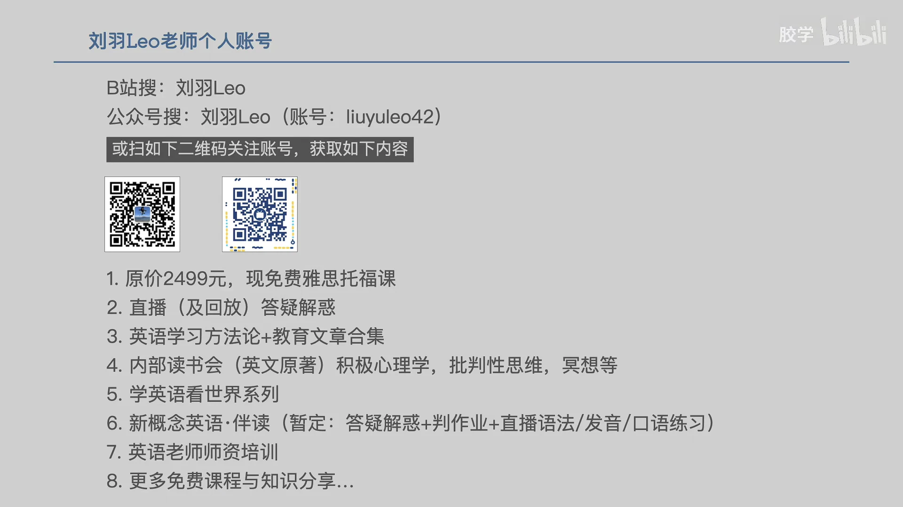

文字识别：胶学b出 / 刘羽Leo老师个人账号 / B站搜：刘羽Leo / 公众号搜：刘羽Leo（账号：liuyuleo42) / 或扫如下二维码关注账号，获取如下内容 / 1.原价2499元，现免费雅思托福课 / 2.直播（及回放）答疑解惑 / 3. 英语学习方法论+教育文章合集 / 4.内部读书会（英文原著）积极心理学，批判性思维，冥想等 / 5.学英语看世界系列 / 6.新概念英语·伴读 (暂定：答疑解惑+判作业+直播语法/发音/口语练习) / 7.英语老师师资培训 / 8.更多免费课程与知识分享...

### 画面 00:00:52

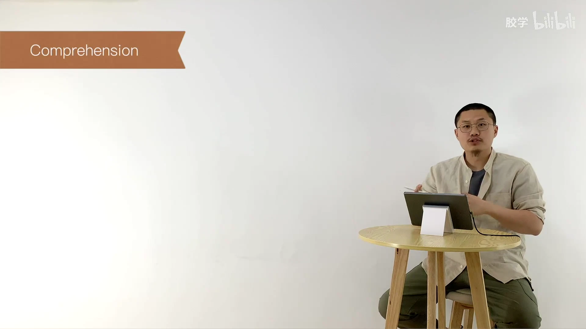

文字识别：胶学b / Comprehension

### 画面 00:00:55

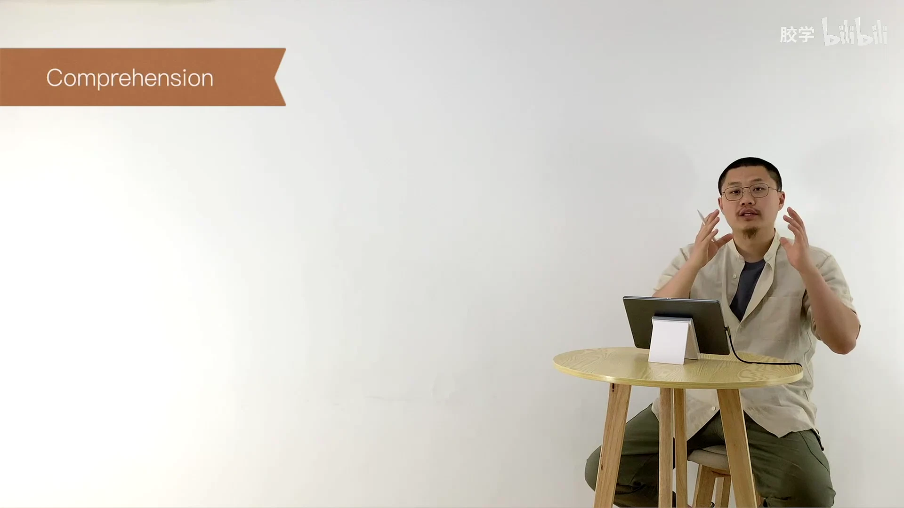

文字识别：胶学b出 / Comprehension

## 00:01:00–00:01:30

会问一个问题叫 Where did you go last week? 那这个时候您就是写这篇文章的这个人，所谓的作者。那对于您来说，你要如何去回答呢？好，那你的回答就是 I went to the theater，或者你直接给我一个答案叫做 to the theater，甚至你直接回答一个单词叫做 theater 都是可以的。不过这个地方注意一下，我们在 Where did you go last week？ 我在读这句话的时候，各位要进行听力练习，而不是看

### 画面 00:01:00

文字识别：胶学b出 / Comprehension / Where did you go last week?

### 画面 00:01:03

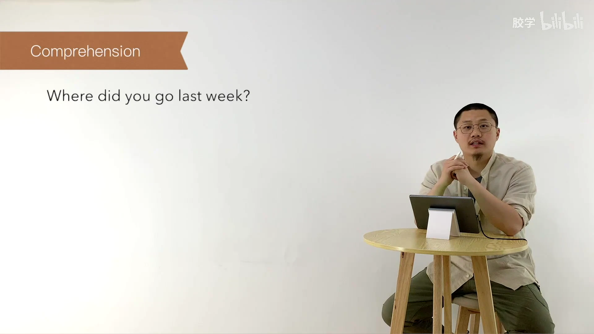

文字识别：胶学blb出 / Comprehension / Where did you go last week?

### 画面 00:01:05

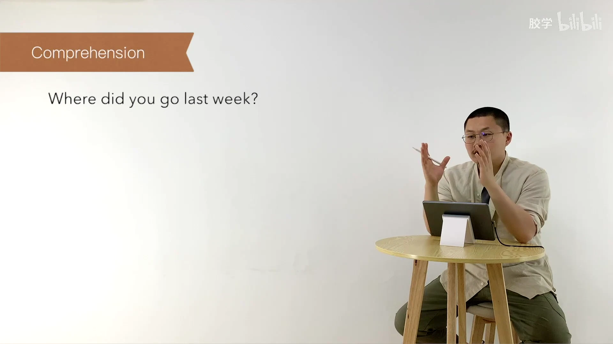

文字识别：胶学上出 / Comprehension / Where did you go last week?

### 画面 00:01:09

文字识别：胶学bb出 / Comprehension / Where did you go last week?

### 画面 00:01:11

文字识别：胶学出 / Comprehension / Where did you go last week?

### 画面 00:01:15

文字识别：胶学业 / Comprehension / Where did you go last week? / To the theatre.

### 画面 00:01:20

文字识别：胶学b / Comprehension / Where did you go last week? / To the theatre.

### 画面 00:01:25

文字识别：胶学 / Comprehension / Where did you go last week? / To the theatre.

## 00:01:30–00:02:00

着我的屏幕，好吧？你可以闭上眼睛，或者说看着我们的文章都是没有问题的。然后要口语去进行一个回答，如果速度比较快的，那您暂停屏幕就可以了。接接下来我们开始了啊，试一下先。Did you have a good seat？这个时候您要么闭着眼睛，要么眼睛看着文章都是可以的。那你给我一个回答，叫做

### 画面 00:01:30

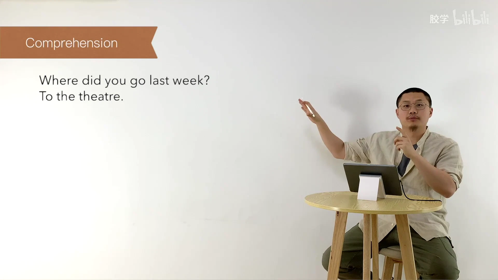

文字识别：胶学b山 / Comprehension / Where did you go last week? / To the theatre.

### 画面 00:01:33

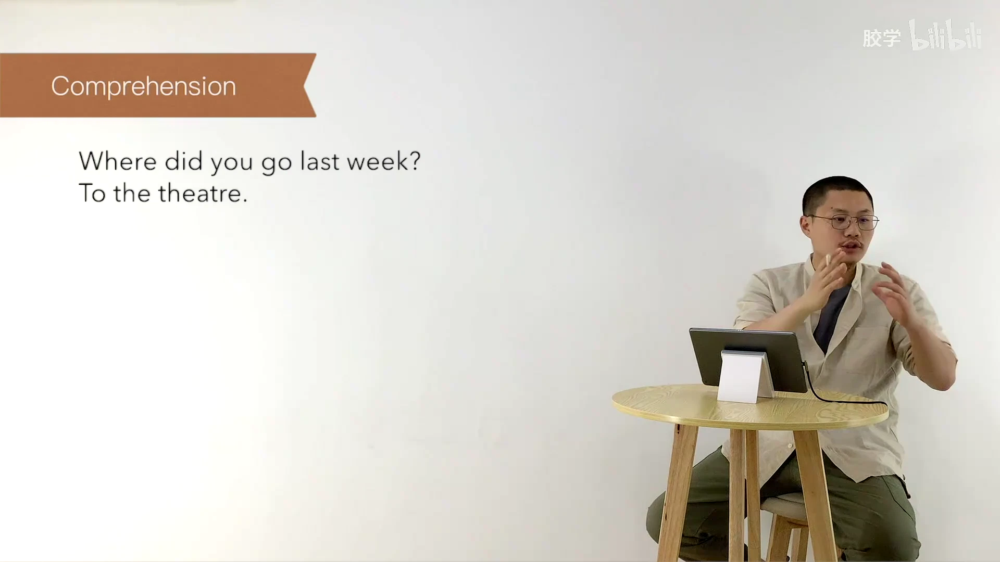

文字识别：胶学b / Comprehension / Where did you go last week? / To the theatre.

### 画面 00:01:35

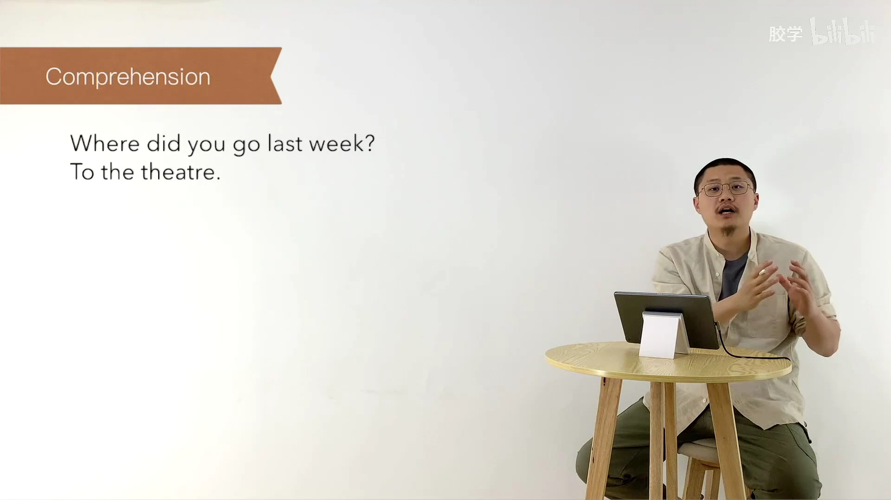

文字识别：胶学Ll / Comprehension / Where did you go last week? / To the theatre.

### 画面 00:01:40

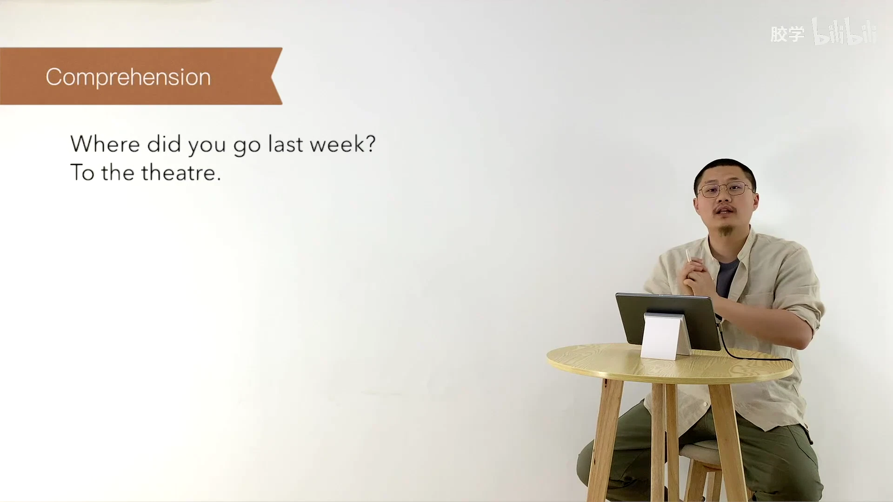

文字识别：胶学bH / Comprehension / Where did you go last week? / To the theatre.

### 画面 00:01:43

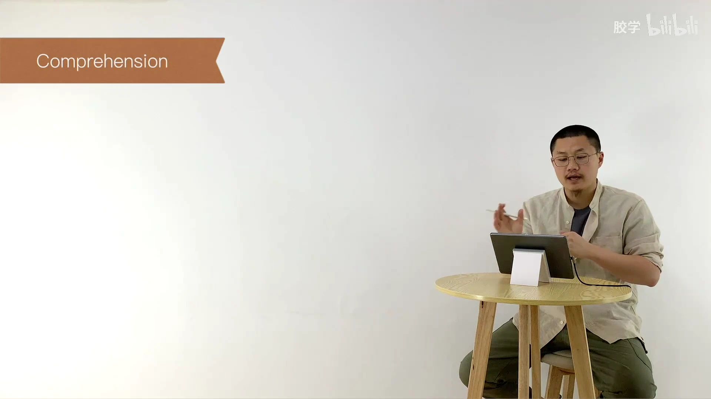

文字识别：胶学讲出 / Comprehension

### 画面 00:01:45

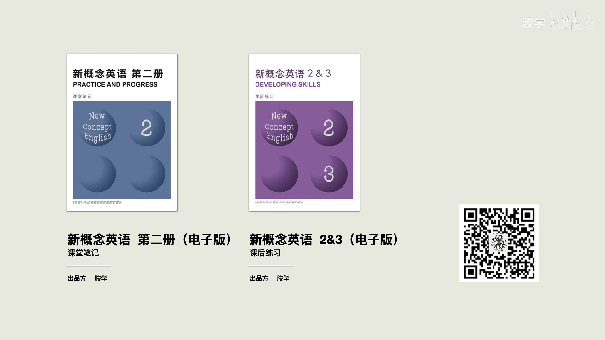

文字识别：胶学 / 新概念英语 第二册 / 新概念英语2&3 / PRACTICE AND PROGRESS / DEVELOPING SKILLS / 课堂笔记 / 课后练习 / New / New / Concept / 2 / Concept / 2 / English / English / 3 / 新概念英语 第二册 (电子版) / 新概念英语 2&3 (电子版) / 课堂笔记 / 课后练习 / 出品方 / 胶学 / 出品方 / 胶学

### 画面 00:01:50

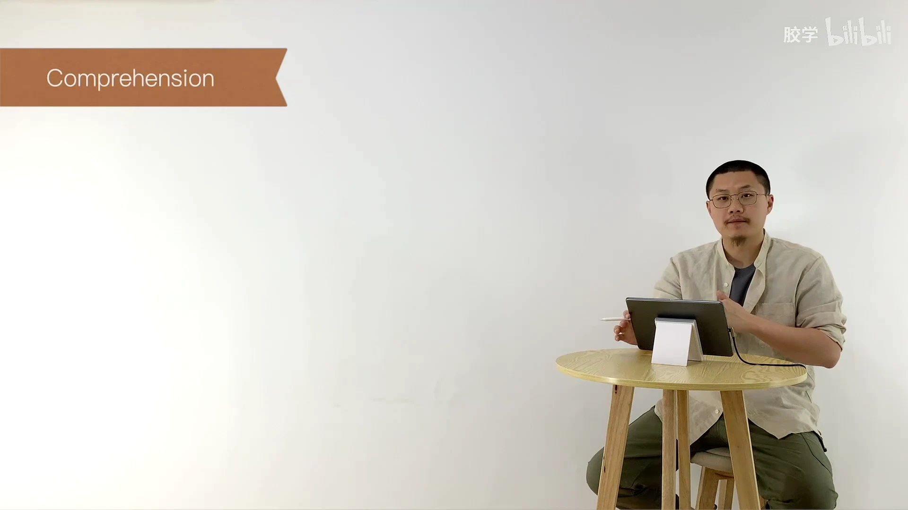

文字识别：胶学b州出 / Comprehension

### 画面 00:01:53

文字识别：胶学b出 / Comprehension / Did you have a good seat?

### 画面 00:01:55

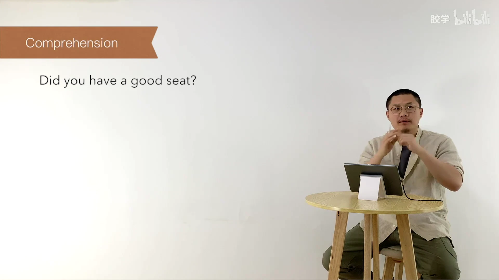

文字识别：胶学bilbl / Comprehension / Did you have a good seat?

### 画面 00:01:59

文字识别：胶学b出 / Comprehension / Did you have a good seat?

## 00:02:00–00:02:30

Yes, I did, 对不对 OK, next one, continue. 接下来我速度会加快了啊. Was it an interesting play? 看着文章给我一个答案. Yes, it was. You enjoyed the play, didn't you? No, I didn't. Who was sitting behind you?

### 画面 00:02:01

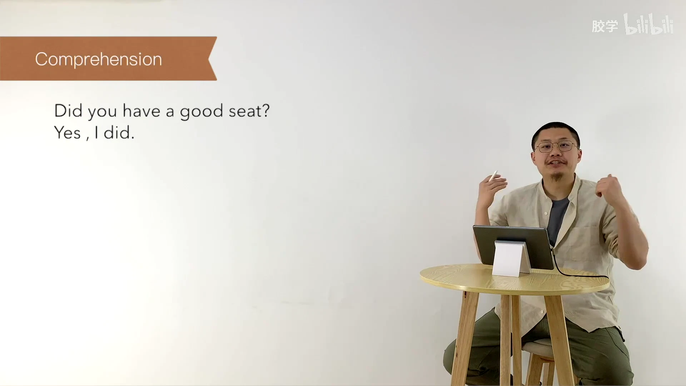

文字识别：胶学b / Comprehension / Did you have a good seat? / Yes , I did.

### 画面 00:02:04

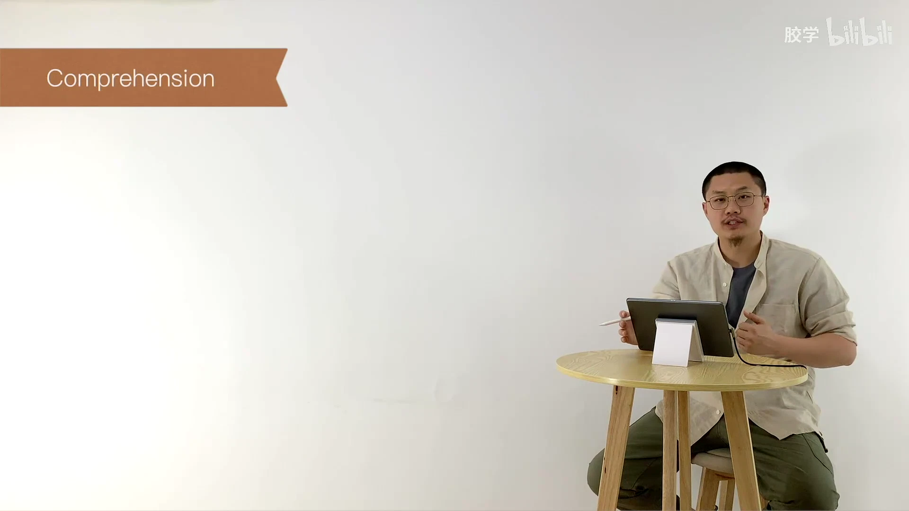

文字识别：胶学b出 / Comprehension

### 画面 00:02:06

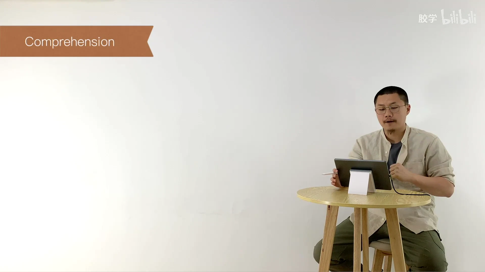

文字识别：胶学b出 / Comprehension

### 画面 00:02:09

文字识别：胶学bH出 / Comprehension / Was it an interesting play?

### 画面 00:02:11

文字识别：胶学b出 / Comprehension / Was it an interesting play?

### 画面 00:02:15

文字识别：胶学bi出 / Comprehension / Was it an interesting play? / Yes, it was.

### 画面 00:02:20

文字识别：胶学bib / Comprehension / You enjoyed the play, didn't you?

### 画面 00:02:25

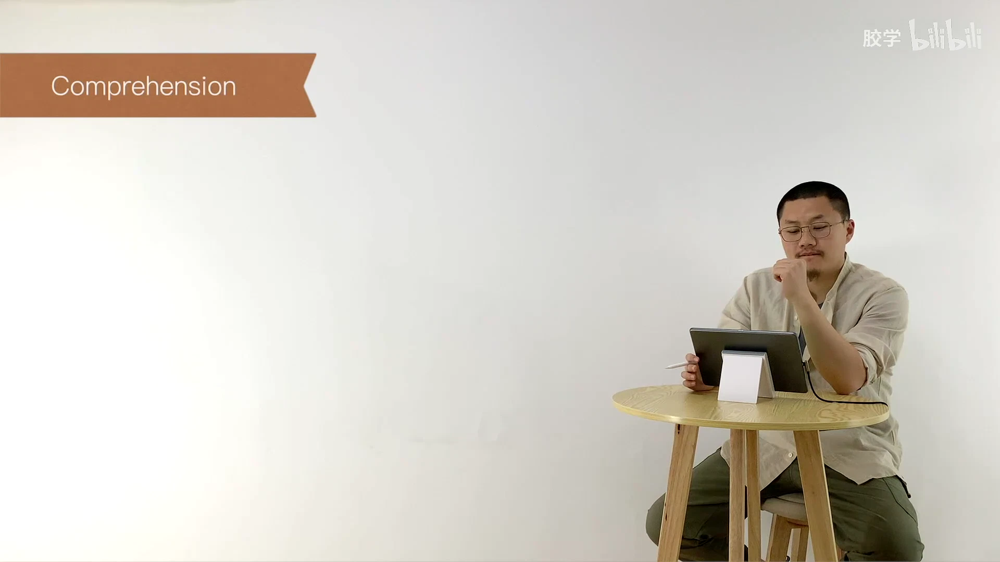

文字识别：胶学b出 / Comprehension

### 画面 00:02:28

文字识别：胶学bibl / Comprehension / Who was sitting behind you?

## 00:02:30–00:03:00

a young man and a young woman. Next one. Why couldn't you hear? They were talking loudly. What were they doing? Talking loudly. Next one. Did you get angry with them or not? Yes, I did. I get.

### 画面 00:02:30

文字识别：胶学bbi / Comprehension / Who was sitting l / behind you? / A young man and a young / woman.

### 画面 00:02:34

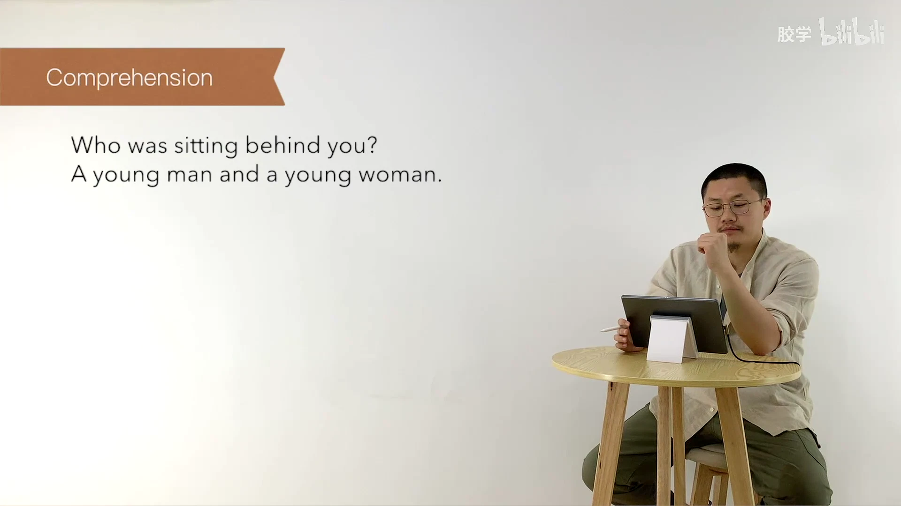

文字识别：胶学b / Comprehension / Who was sitting l / behind you? / A young man and a young / woman.

### 画面 00:02:36

文字识别：胶学b出 / Comprehension / Why couldn't you hear?

### 画面 00:02:40

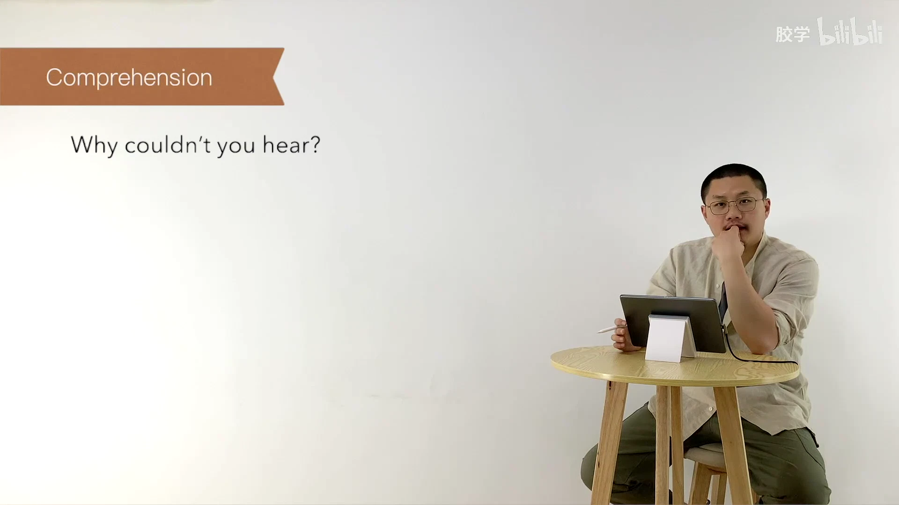

文字识别：胶学b / Comprehension / Why couldn't you hear?

### 画面 00:02:45

文字识别：胶学b出 / Comprehension

### 画面 00:02:50

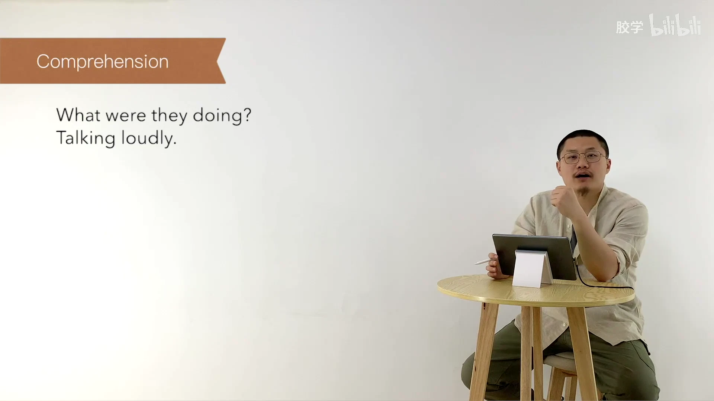

文字识别：胶学bi / Comprehension / What were they doing? / Talking loudly.

### 画面 00:02:55

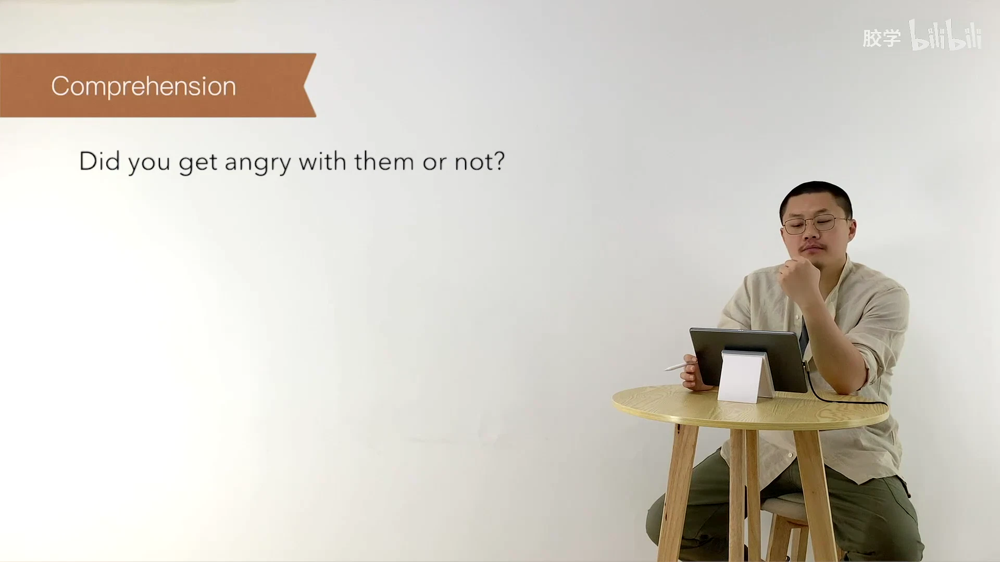

文字识别：胶学b出 / Comprehension / Did you get angry with them or not?

## 00:03:00–00:03:30

I got angry with them. You turned around, didn't you? Yes, I did. How did you look at them? Angrily. They didn't pay any attention, did they? No, they didn't. Could you bear it?

### 画面 00:03:00

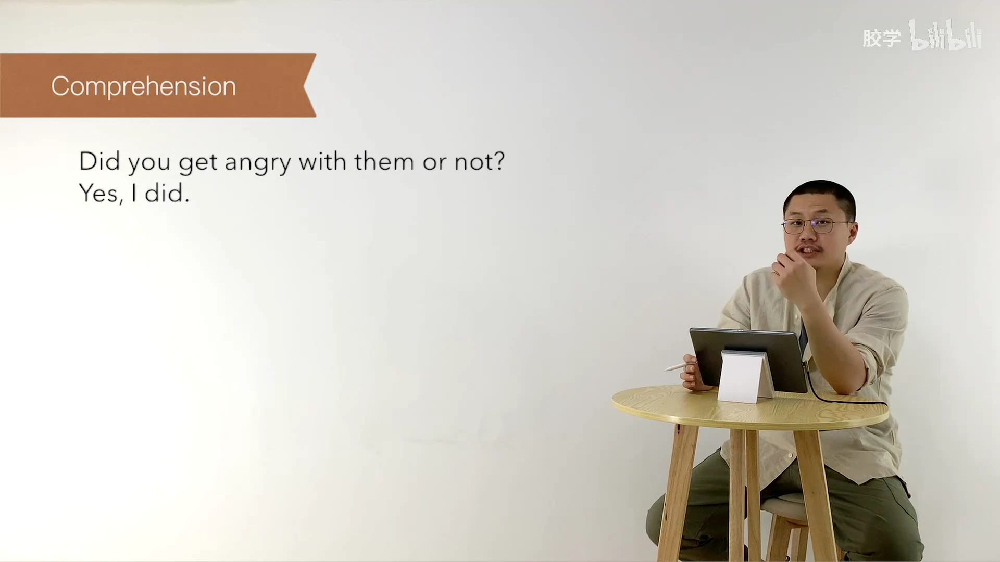

文字识别：胶学bil出 / Comprehension / Did you get angry with them or not? / Yes,I did.

### 画面 00:03:04

文字识别：胶学bill / Comprehension / You turned round, didn't you?

### 画面 00:03:06

文字识别：胶学blb出 / Comprehension / You turned round, didn't you?

### 画面 00:03:10

文字识别：胶学b出 / Comprehension / How did you look at them?

### 画面 00:03:13

文字识别：胶学bH出 / Comprehension / How did you look at them?

### 画面 00:03:15

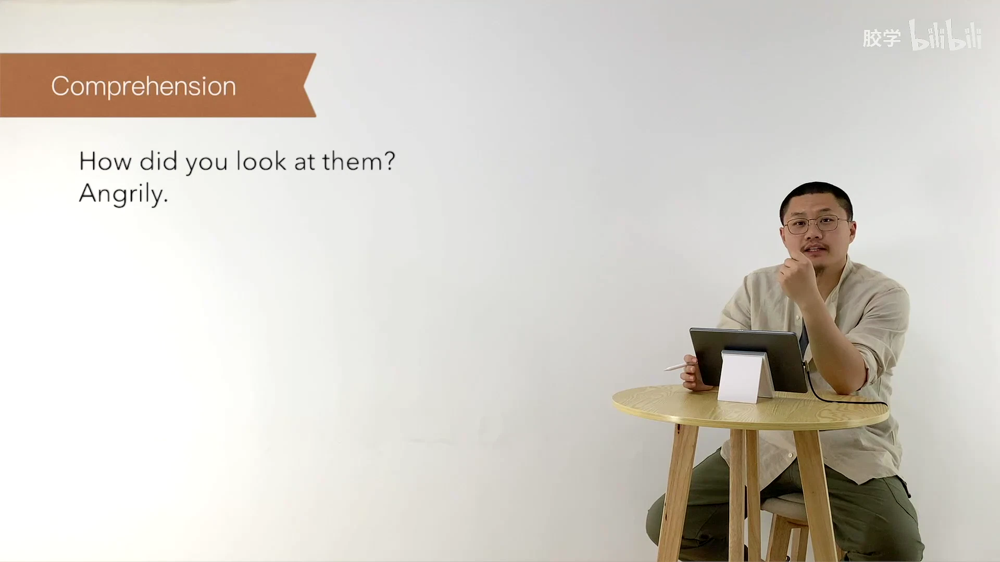

文字识别：胶学b出 / Comprehension / How did you look at them? / Angrily.

### 画面 00:03:18

文字识别：胶学b出 / Comprehension / They didn't pay any attention, did they?

### 画面 00:03:20

文字识别：胶学bW出 / Comprehension / They didn't pay any attention, did they?

### 画面 00:03:25

文字识别：胶学b / Comprehension

### 画面 00:03:28

文字识别：胶学b出 / Comprehension / Could you bear it?

## 00:03:30–00:04:00

I couldn't. What did you do then? I turned around again and said angrily, I can't hear a word. What did the young man say? It's none of your business. This is a private conversation, 对吧？ Okay, very good. 好，那注意啊，我再说一遍，进行如下练习，一定要把文章读到非常熟练，否则这句话您很可能听不懂。读到

### 画面 00:03:30

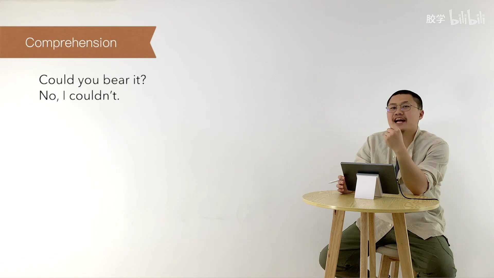

文字识别：胶学 / Comprehension / Could you bear it? / No, I couldn't.

### 画面 00:03:33

文字识别：胶学b出 / Comprehension / What did you do then?

### 画面 00:03:35

文字识别：胶学b出 / Comprehension / What did you do then?

### 画面 00:03:37

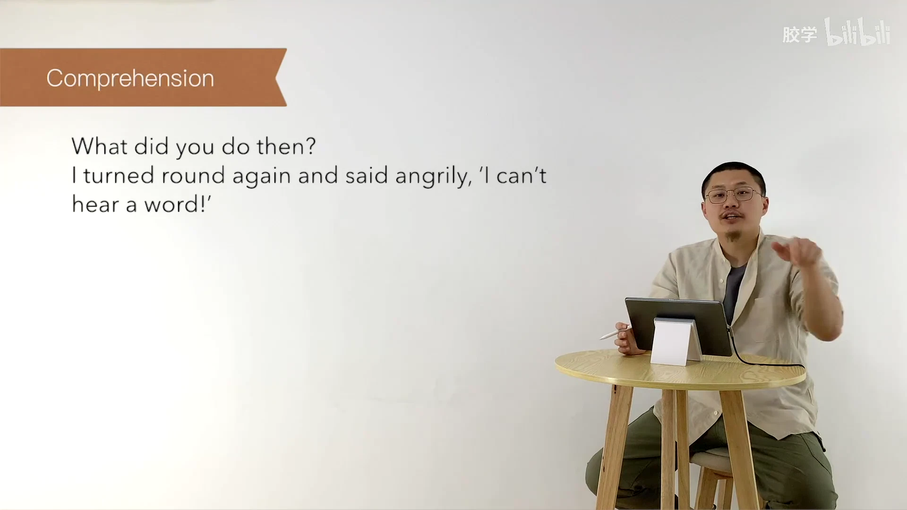

文字识别：胶学bWi / Comprehension / What did you do then? / I turned round again and said angrily,'I can't / hear a word!'

### 画面 00:03:40

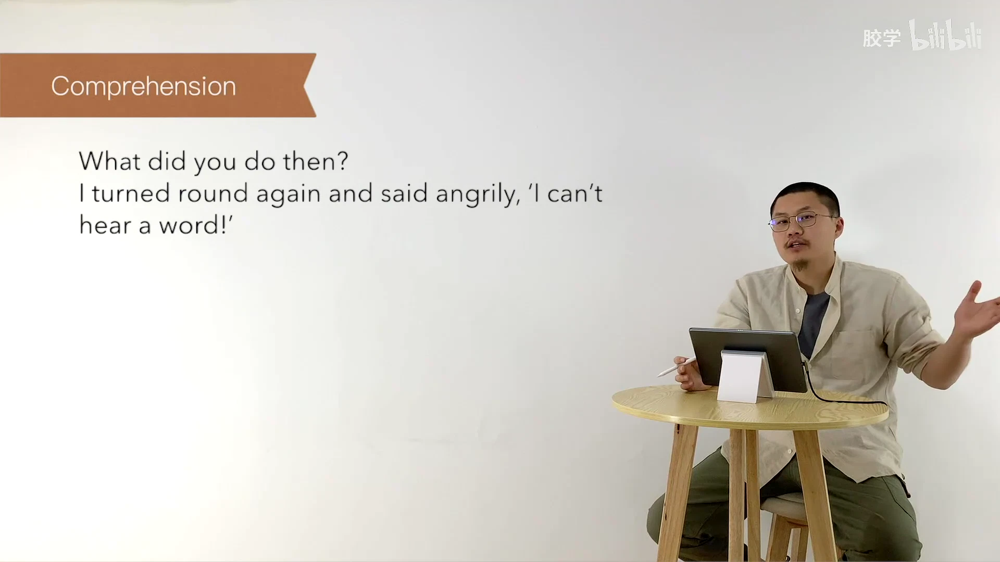

文字识别：胶学bl出 / Comprehension / What did you do then? / I turned round again and said angrily,'I can't / hear a word!'

### 画面 00:03:42

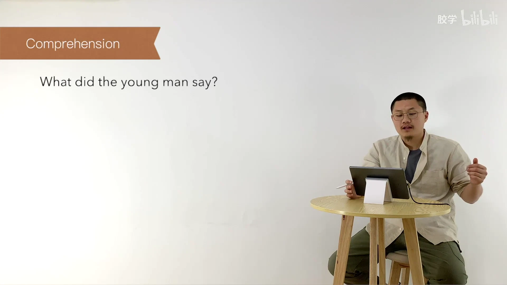

文字识别：胶学b / Comprehension / What did the young man say?

### 画面 00:03:45

文字识别：胶学b出出 / Comprehension / What did the young man say?

### 画面 00:03:47

文字识别：胶学b计出 / Comprehension / What did the young man say? / 'It's none of your business. This is a private / conversation!'

### 画面 00:03:50

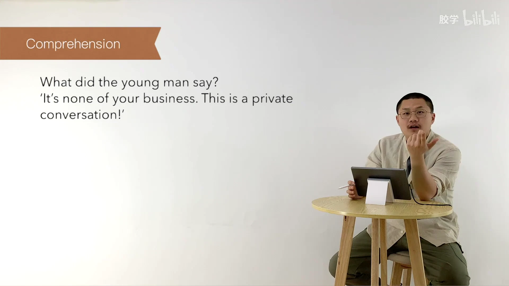

文字识别：胶学b出b出 / Comprehension / What did the young man say? / 'It's none of your business. This is a private / conversation!'

### 画面 00:03:52

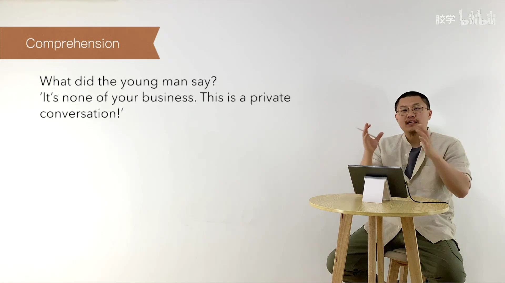

文字识别：胶学bl出 / Comprehension / What did the young man say? / 'It's none of your business. This is a private / conversation!'

### 画面 00:03:55

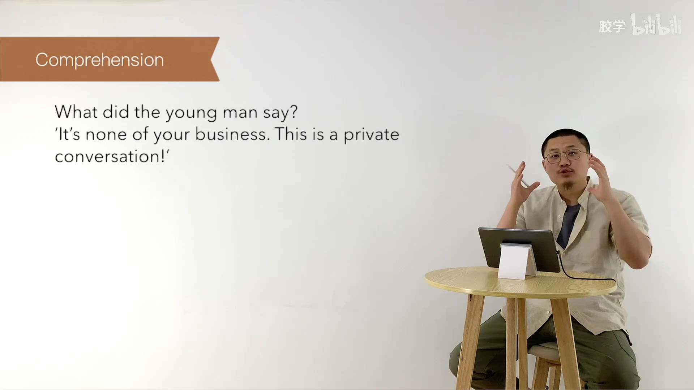

文字识别：胶学bl出 / Comprehension / What did the young man say? / 'It's none of your business. This is a private / conversation!'

### 画面 00:03:59

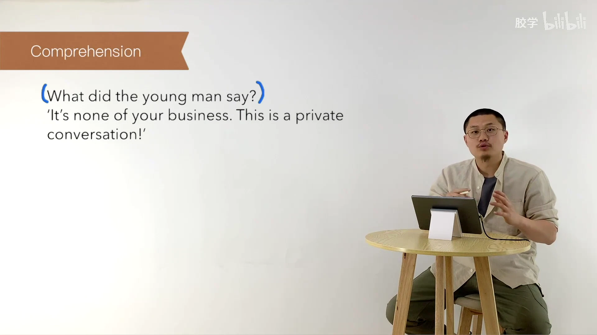

文字识别：胶学b出b出 / Comprehension / (What did the young man say?) / 'It's none of your business. This is a private / conversation!'

## 00:04:00–00:04:30

非常熟练，你就会发现很神奇的事情是，您可能很容易就能听懂了。OK，那我们就可以进行一个口语和听力练习，即使是在视频当中。OK，那 next one asking questions， ask me if，又叫 ask me if。这个呢，我们在新一当中也做了很多的练习。那没有学过新一的，我继续再说一下。这个时候对于各位来说，就叫做会说一般疑问句或特殊疑问句了。您能张开嘴去进行提问。我们看

### 画面 00:04:01

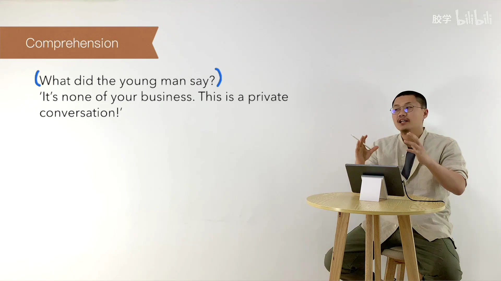

文字识别：胶学bW出 / Comprehension / (What did the young man say?) / 'It's none of your business. This is a private / conversation!'

### 画面 00:04:06

文字识别：胶学bilb出 / Comprehension / (What did the young man say?) / 'It's none of your business. This is a private / conversation!'

### 画面 00:04:09

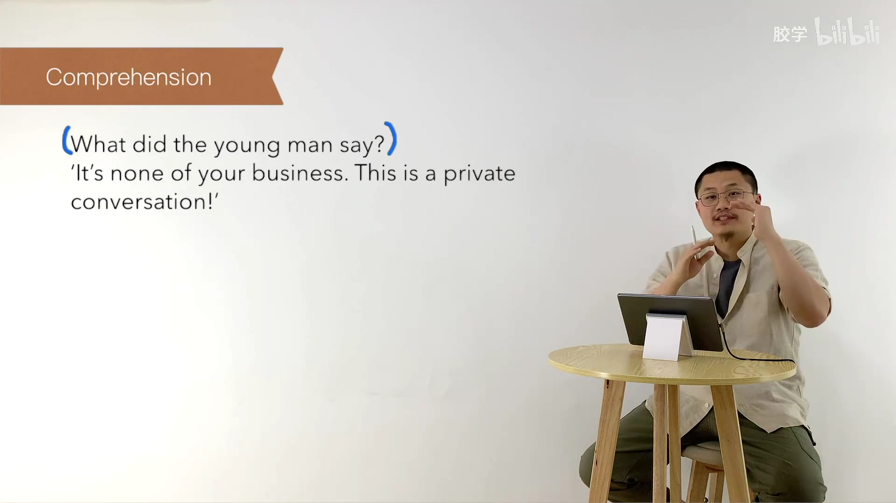

文字识别：胶学bl出 / Comprehension / (What did the young man say?) / 'It's none of your business. This is a private / conversation!'

### 画面 00:04:11

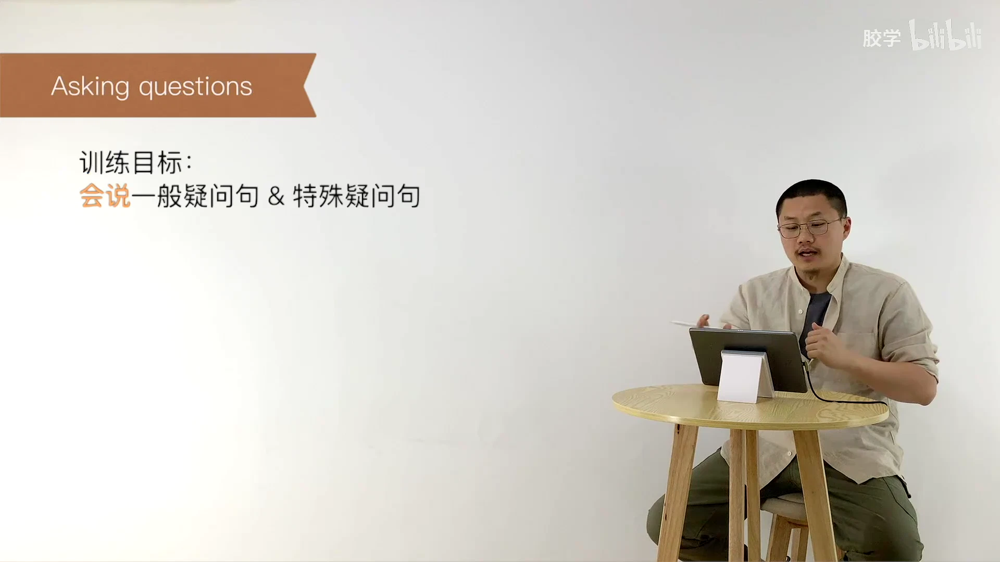

文字识别：胶学bb出 / Asking questions / 训练目标： / 会说一般疑问句＆特殊疑问句

### 画面 00:04:14

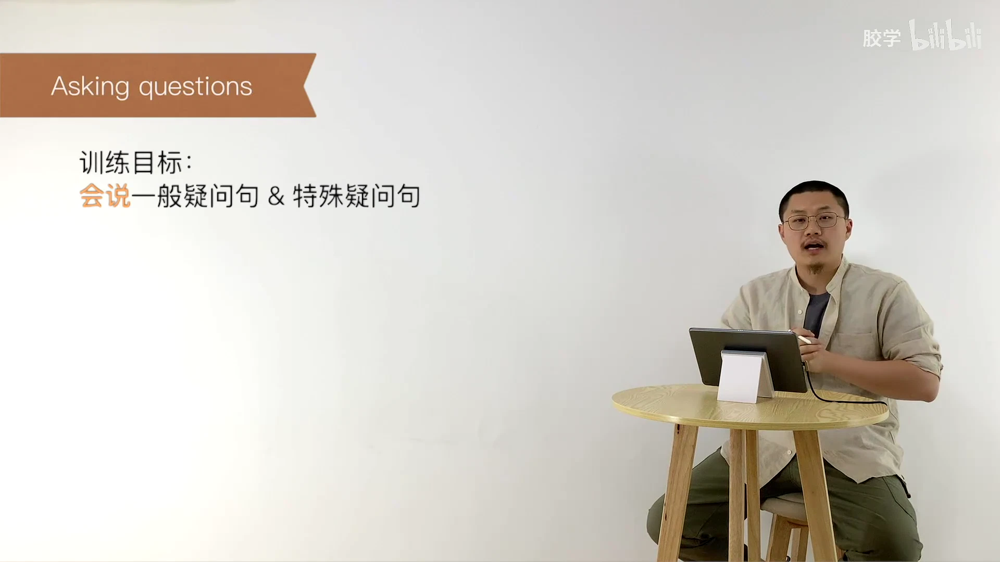

文字识别：胶学bb出 / Asking questions / 训练目标： / 会说一般疑问句＆特殊疑问句

### 画面 00:04:16

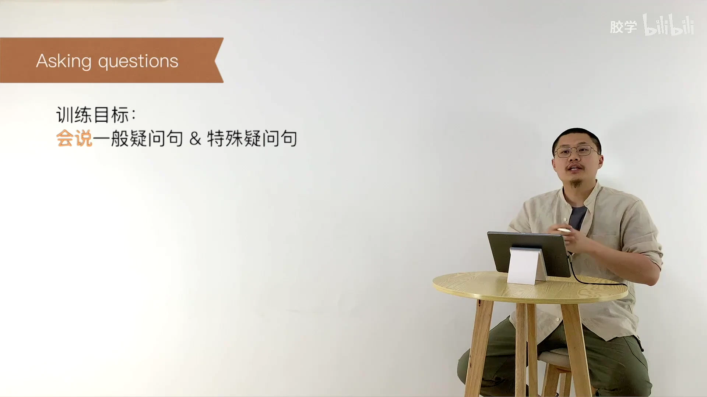

文字识别：胶学bb出 / Asking questions / 训练目标： / 会说一般疑问句＆特殊疑问句

### 画面 00:04:21

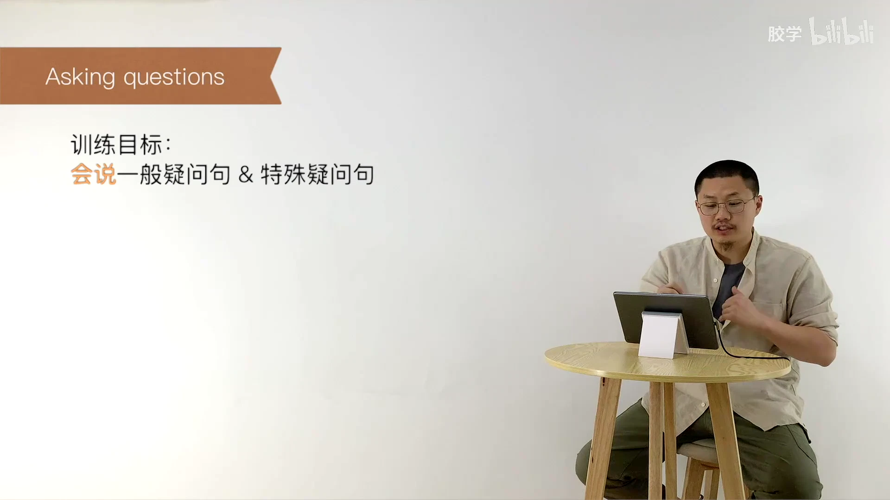

文字识别：胶学bi出 / Asking questions / 训练目标： / 会说一般疑问句＆特殊疑问句

### 画面 00:04:23

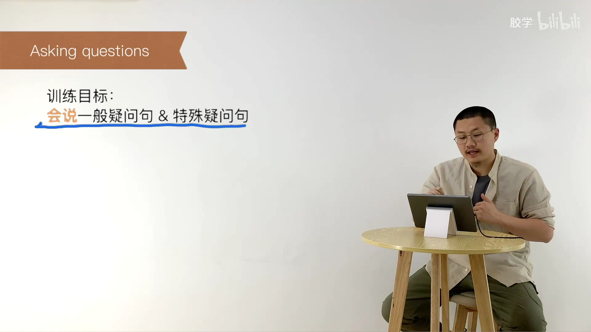

文字识别：胶学bi出 / Asking questions / 训练目标： / 会说一般疑问句＆特殊疑问句

### 画面 00:04:26

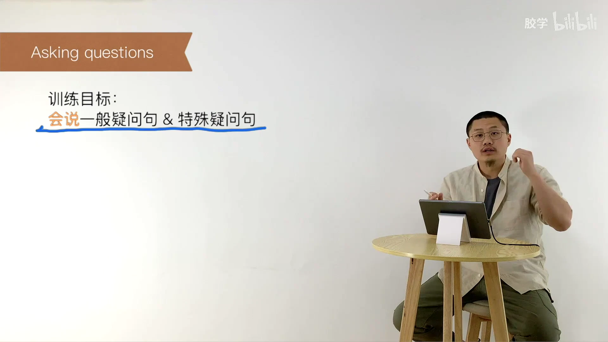

文字识别：胶学bb出 / Asking questions / 训练目标： / 会说一般疑问句＆特殊疑问句

### 画面 00:04:28

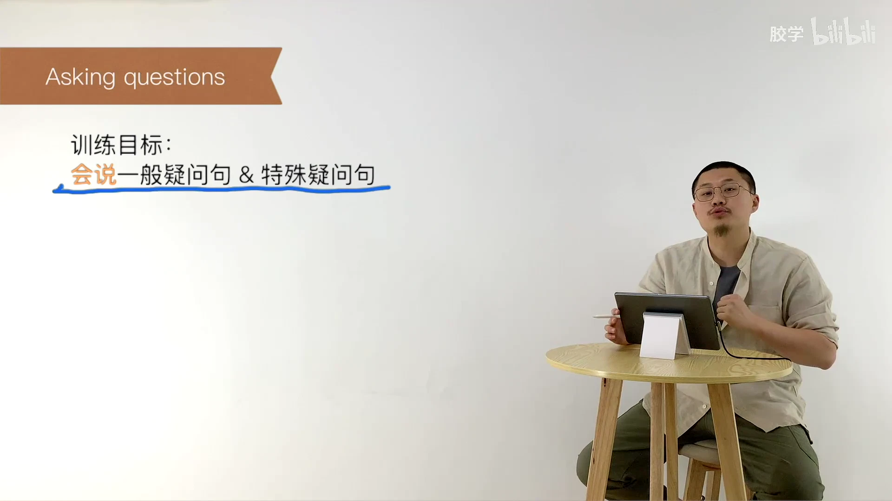

文字识别：胶学b出 / Asking questions / 训练目标： / 会说一般疑问句＆特殊疑问句

## 00:04:30–00:05:00

一下它的练习设置啊。首先 ask me if 好，这三个单词各位不用管它，直接看后面这句话叫 I went to the theater last week。那看到这句话，各位你用嘴把它变成一般疑问句，叫做 Did you go to the theater last week？张开嘴要去说啊。正常的逻辑和顺序是，各位要听到这句话，然后自己注意是不看的啊，然后自己去用口语把它变成下面

### 画面 00:04:30

文字识别：胶学b州出 / Asking questions

### 画面 00:04:32

文字识别：胶学b出 / Asking questions / T: Ask me if I went to the theatre last week.

### 画面 00:04:34

文字识别：胶学bl / Asking questions / T: Ask me if I went to the theatre last week.

### 画面 00:04:36

文字识别：胶学b出 / Asking questions / T: Ask me if1 / went to the theatre last week.

### 画面 00:04:38

文字识别：胶学b / Asking questions / T: Ask me if l / went to the theatre last week.

### 画面 00:04:41

文字识别：胶学bW出 / Asking questions / T: Ask me if1 / went to the theatre last week.

### 画面 00:04:45

文字识别：胶学bW出 / Asking questions / T: Ask me ifl / I went to the theatre last week. / S: Did you go to the theatre last week?

### 画面 00:04:47

文字识别：胶学bW出 / Asking questions / T: Ask me ifl / went to the theatre last week. / S: Did you go to the theatre last week?

### 画面 00:04:49

文字识别：胶学bu出 / Asking questions / T: Ask me ifl / went to the theatre last week. / S: Did you go to the theatre last week?

### 画面 00:04:51

文字识别：胶学b计出 / Asking questions / T: Ask me ifl / went to the theatre last week. / S: Did you go to the theatre last week?

### 画面 00:04:54

文字识别：胶学bl出 / Asking questions / T: Ask me if1 / went to the theatre last week. / S: Did you go to the theatre last week?

### 画面 00:04:56

文字识别：胶学b出 / Asking questions / T: Ask me ifl / I went to the theatre last week. / S: Did you go to the theatre last week?

## 00:05:00–00:05:30

这句话，然后我给您一个特殊疑问词叫做 when，然后你去想，对这里面谁提问呢？Last week，答案就叫做 when did you go to the theater？你什么时候去的剧院呢？这也是我们之前讲过单词与习惯用法造句的时候非常重要的一个步骤，叫做四句型转换，或者说非常重要的一个思路，四句型转换。OK， next one，接下来我们一起看一下第一个，我们刚刚练过，

### 画面 00:05:01

文字识别：胶学bl出 / Asking questions / T: Ask me ifl / went to the theatre last week. / S: Did you go to the theatre last week? / T: When ...?

### 画面 00:05:06

文字识别：胶学bWb出 / Asking questions / T: Ask me ifl / went to the theatre last week. / S: Did you go to the theatre last week? / T: When …..?

### 画面 00:05:09

文字识别：胶学bil出 / Asking questions / T: Ask me ifl / í went to the theatre last week. / S: Did you go to the theatre last week? / T: When ..? / S: When did you go to the theatre?

### 画面 00:05:11

文字识别：胶学b出 / Asking questions / T: Ask me ifl / I went to the theatre last week. / S: Did you go to the theatre last week? / T: When ...? / S: When did you go to the theatre?

### 画面 00:05:16

文字识别：胶学bi出 / Asking questions / T: Ask me ifl / went to the theatre last week. / S: Did you go to the theatre last week? / T: When …..? / S: When did you go to the theatre?

### 画面 00:05:21

文字识别：胶学bl出 / Asking questions / T: Ask me ifl / I went to the theatre last week. / S: Did you go to the theatre last week? / T: When …..? / S: When did you go to the theatre?

### 画面 00:05:24

文字识别：胶学bu出 / Asking questions / T: Ask me ifl / I went to the theatre last week. / S: Did you go to the theatre last week? / T: When …..? / S: When did you go to the theatre?

### 画面 00:05:26

文字识别：胶学粉出 / Asking questions / T: Ask me ifl / I went to the theatre last week. / S: Did you go to the theatre last week? / T: When ...? / S: When did you go to the theatre?

### 画面 00:05:28

文字识别：胶学b出 / Asking questions / 1 I went to the theatre last week.(When)

## 00:05:30–00:06:00

看一下第二个叫 I had a good seat. 注意一般过去时想变一般疑问句，did的提前，对不对？如果您不会，新概念一册七十一课、七十二课、七十三课、七十四课都不停的在练习这个点。Did you have a good seat? 好，注意 what kind问的是什么类型的，其实它会省略了一个 of，您再加上一个。于是呢，什么类型的？它其实就是对形容词在进行提问，所以叫做 What kind of seat

### 画面 00:05:30

文字识别：胶学b出 / Asking questions / 1 I went to the theatre last week.(When) / 2Ihad a good seat. (What kind)

### 画面 00:05:32

文字识别：胶学b / Asking questions / 1 I went to the theatre last week. (When) / 2 Ihad a good seat. (What kind)

### 画面 00:05:36

文字识别：胶学bHl / Asking questions / 1 I went to the theatre last week.(When) / 2I had a good seat. (What kind)

### 画面 00:05:41

文字识别：胶学bil出 / Asking questions / 1 I went to the theatre last week.(When) / 2 Ihad a good seat. (What kind)

### 画面 00:05:46

文字识别：胶学b出 / Asking questions / 1 I went to the theatre last week.(When) / 2 Ihad a good seat. (What kind)

### 画面 00:05:49

文字识别：胶学b出 / Asking questions / 1 I went to the theatre last week.(When) / 2 Ihad a good seat. (What kind)

### 画面 00:05:51

文字识别：胶学b业 / Asking questions / 1 I went to the theatre last week.(When) / 2 Ihad a good seat. (What kind)mf

### 画面 00:05:54

文字识别：胶学b讲i / Asking questions / 1 I went to the theatre last week.(When) / 2Ihad a good seat. What kind)nf

### 画面 00:05:56

文字识别：胶学blb出 / Asking questions / 1 I went to the theatre last week.(When) / 2Ihadgoodseat. What kind)f

### 画面 00:05:58

文字识别：胶学bi出 / Asking questions / 1 I went to the theatre last week.(When) / 2Ihad goodseat. What kind)f

## 00:06:00–00:06:30

did you have?你当时有的是一个什么类型的座位呢？非常棒的一个啊，还是VIP座的，对吧？还是在侧面呢？什么样类型的一个座位呢？Next one, I saw an interesting play.一般疑问句，did提前，注意，因为是过去式，对吧？Did you see an interesting play?注意，那what问的是什么？这里面只有an interesting play是什么，对不对？好，那于是这句话我们就

### 画面 00:06:01

文字识别：胶学bl / Asking questions / 1 I went to the theatre last week.(When) / 2IhadB good seat.(What kind)f

### 画面 00:06:03

文字识别：胶学b讲出 / Asking questions / 1 I went to the theatre last week.(When) / 2I had  good seat. What kindnf

### 画面 00:06:06

文字识别：胶学blb出 / Asking questions / 1 I went to the theatre last week.(When) / 2Ihad goodseat. What kind)f

### 画面 00:06:09

文字识别：胶学bu出 / Asking questions / 1 I went to the theatre last week.(When) / 2Ihad goodseat. What kind)f

### 画面 00:06:11

文字识别：胶学bl出 / Asking / questions / 1 I went to the theatre last week. (When) / t kind)f / 21hada goodseat.(Whatl / 3 I saw an interesting play. (What)

### 画面 00:06:14

文字识别：胶学bl出 / Asking / questions / 1 I went to the theatre last week. (When) / t kindnf / 2Ihada goodseat.(What k / 3 I saw an interesting play. (What)

### 画面 00:06:16

文字识别：胶学b出 / Asking questions / 1 I went to the theatre last week. (When) / 2IhadB good seat. What kind)f / 3 I saw an interesting play. (What)

### 画面 00:06:19

文字识别：胶学bl出 / Asking questions / 1 I went to the theatre last week. (When) / 2I had  good seat. What kind)nf / 3 I saw an interesting play. (What)

### 画面 00:06:21

文字识别：胶学bl出 / Asking questions / 1 I went to the theatre last week.(When) / 2I had  good seat. What kind)nf / 3 I saw an interesting play. (What)

### 画面 00:06:24

文字识别：胶学bl出 / Asking / questions / 1 I went to the theatre last week. (When) / kind)f / 2Ihada goodseat.(What / 3 I saw an interesting play. (What)

### 画面 00:06:26

文字识别：胶学b出 / Asking / questions / 1 I went to the theatre last week.(When) / t kindgf / 21hada goodseat. (What) / 3 I saw an interesting play. / .(What)

### 画面 00:06:28

文字识别：胶学bilbl / Asking questions / 1 I went to the theatre last week. (When) / kind)f / 2Ihada goodseat. (Whatl / 3 I saw an interesting play. (What)

## 00:06:30–00:07:00

变成了叫 What did you see? Where you go? Next one, a young man, young woman sitting behind me. 原文把它变一般疑问句，were 加 doing 过去进行时，把 were 提前就可以了。我只给各位对一下答案啊。 Who 问的是谁？可以对 a young man and a young woman 提问，这是人对吧？也可以对 me 提问。那注意有一点点小的区别，就是如果您对主语提问，直

### 画面 00:06:31

文字识别：胶学bb出 / Asking questions / 1 I went to the theatre last week. (When) / kind)f / 2Ihadagoodseat. (WhatI / 3 I saw an interesting play. (What)

### 画面 00:06:33

文字识别：胶学bb出 / Asking / questions / 1 I went to the theatre last week. (When) / kindf / 2Ihada goodseat. (What I / 3 I saw an interesting play. (What)

### 画面 00:06:35

文字识别：胶学bbl / Asking questions / 1 I went to the theatre last week. (When) / 2Ihad good seat. (What kind)f / 3 I saw an interesting play. / .(What) / 4 A young man and a young wòman were / sitting behind me. (Who) (Where)

### 画面 00:06:37

文字识别：胶学b出 / Asking questions / 1 I went to the theatre last week. (When) / 2I had good seat.(What kind)f / 3 I saw an interesting play.( / .(What) / 4 A young man and a young wòman were / sitting behind me. (Who) (Where)

### 画面 00:06:41

文字识别：胶学b出 / Asking questions / 1 I went to the theatre last week. (When) / 2I had  good seat. What kind)f / 3 I saw an interesting play. (What) / 4 A young man and a young wòman were / sitting behind me. (Who)(Where)

### 画面 00:06:46

文字识别：胶学bi出 / Asking questions / 1 I went to the theatre last week.(When) / 2I had good seat. What kind)f / 3 I saw an interesting play. / .(What) / 4 A young man and a young wòman were / sitting behind me. (Who) (Where)

### 画面 00:06:49

文字识别：胶学bi出 / Asking questions / 1 I went to the theatre last week. (When) / 2Ihad good seat.(What kind)f / 3 I saw an interesting play.( / .(What) / young man and a young wòman were / sitting /  behind me.(Who)(Where)

### 画面 00:06:51

文字识别：胶学b出 / Asking questions / 1 I went to the theatre last week. (When) / 2I had  goodseat. What kind)f / 3 I saw an interesting play. (What) / 4 A young man and a young wòman were / sitting behind me. (Who)(Where)

### 画面 00:06:55

文字识别：胶学bi出 / Asking questions / 1 I went to the theatre last week.(When) / 2Ihad  aood seat. What kind)f / 3 I saw an interesting play. (What) / 4 A young man and a young wòman were / sitting behind me. (Who) (Where)

### 画面 00:06:57

文字识别：胶学b / Asking questions / 1 I went to the theatre last week. (When) / 2I had goodseat. What kind)f / 3 I saw an interesting play. / .(What) / 4 A young man and a young wòman were / sitting behind me. (Who) (Where)

## 00:07:00–00:07:30

接替代主语就好了。如果这个知识点您不会，新概念一册三十一课，赶紧去翻看这个视频，好吧？那对主语提问直接去替代主语，叫做 Who were sitting behind you? 谁坐当时正坐在您的身后呢？Very good. Where 对 behind me 提问，对不对？好，那叫做 Where 再加上一般疑问句，叫做 Were a young man and a young woman sitting? Okay. 好，

### 画面 00:07:00

文字识别：胶学W / Asking questions / 1 I went to the theatre last week. (When) / 2I had aood seat. What kind)f / 3 I saw an interesting play. / (What) / 4 A young man and a young wòman were / sitting behind me. (Who) (Where)

### 画面 00:07:02

文字识别：胶学州 / Asking questions / 1 I went to the theatre last week.(When) / t kindf / 21hadgoodseat. (What I / 3 I saw an interesting play. / (What) / 4 A young man and a young wòman were / sitting /  behind me.(Who)(Where)

### 画面 00:07:05

文字识别：胶学bH / Asking questions / 1 I went to the theatre last week. (When) / 2Ihad good seat. What kind)f / 3 I saw an interesting play. / .(What) / 4 A young man and a young wòman were / sitting behind me. (Who) (Where)

### 画面 00:07:07

文字识别：胶学上州 / Asking questions / 1 I went to the theatre last week. (When) / 2Ihadagoodseat. (What I / t kind)nf / 3 I saw an interesting play. / (What) / 4 A young man and a young wòman were / sitting / behind me. (Who) (Where)

### 画面 00:07:09

文字识别：胶学b业 / Asking questions / 1 I went to the theatre last week. (When) / t kindf / 2Ihad good seat. (What k / 3 I saw an interesting play. / .(What) / 4 A young man and a young wòman were / sitting k /  behind me.(Who)(Where)

### 画面 00:07:11

文字识别：胶学b出 / Asking questions / 1 I went to the theatre last week. (When) / 2I had  good seat. What kind)nf / 3 I saw an interesting play.( / .(What) / 4 A young man and a young wòman were / sitting behind me. (Who) (Where)

### 画面 00:07:16

文字识别：胶学bil / Asking questions / 1 I went to the theatre last week.(When) / 2I had  good seat. What kind)nf / 3 I saw an interesting play.( / .(What) / 4 A young man and a young wòman were / sitting behind me. (Who) (Where)

### 画面 00:07:21

文字识别：胶学bi出 / Asking questions / 1 I went to the theatre last week.(When) / 2Ihad goodseat. What kind)f / 3 I saw an interesting play. / .(What) / 4 A young man and a young wòman were / sitting behind me. (Who) (Where)

### 画面 00:07:26

文字识别：胶学b出 / Asking questions / 1 I went to the theatre last week. (When) / 2I had good seat. What kind)f / 3 I saw an interesting play. / (What) / 4 A young man and a young wòman were / sitting behind me. (Who) (Where)

## 00:07:30–00:08:00

好, next one,继续. They were talking loudly.一般疑问句, were提前,过去进行时.新概念一册一百一十七课, how对loudly提问,讲how were they talking? I couldn't hear the actors.这个地方稍微复杂一点,我给各位讲一下.注意,它现在是否定句.我们之前一直是拿肯定句变成一般疑问句,把某个单词提前,对吧?我们没做过说把否定句变成一般疑问句,但实际上很简

### 画面 00:07:30

文字识别：胶学b出 / Asking questions

### 画面 00:07:32

文字识别：胶学bl出 / Asking questions / 5 They were talking loudly. (How)

### 画面 00:07:35

文字识别：胶学b出 / Asking questions / 5 They were talking loudly. (How)

### 画面 00:07:37

文字识别：胶学bW出 / Asking questions / 5 They were talking loudly. (How)

### 画面 00:07:41

文字识别：胶学b州出 / Asking questions / 5 They were talking loudly. (How)

### 画面 00:07:46

文字识别：胶学bW出 / Asking questions / 5 They were talking loudly. (How) / 6 I couldn't hear the actors.(Who)

### 画面 00:07:48

文字识别：胶学州 / Asking questions / 5 They were talking loudly. (How) / 6 I couldn't hear the actors. (Who)

### 画面 00:07:50

文字识别：胶学bib山 / Asking questions / 5 They were talking loudly. (How) / 6 | couldn't hear the actors. (Who)

### 画面 00:07:52

文字识别：胶学训 / Asking questions / 5 They were talking loudly. (How) / 6 | couldn't hear the actors. (Who)

### 画面 00:07:56

文字识别：胶学州 / Asking questions / 5 They were talking loudly. (How) / 6 | couldn't hear the actors. (Who)

## 00:08:00–00:08:30

单。各位去想一下啊，否定句我们是不是可以变成肯定句？I couldn't hear the actors. 我可以变成 I could hear the actors. 我能听到这个演员们的声音。那你既然能变成肯定句，就能变成一般疑问句了，叫做 Could you hear the actors? 你能听到这些话剧演员们的声音吗？好，注意 who 有两种问法，一个是 the actors，一个是 I，

### 画面 00:08:01

文字识别：胶学上H / Asking questions / 5 They were talking loudly. (How) / 6 | couldn't hear the actors. (Who)

### 画面 00:08:04

文字识别：胶学bW / Asking questions / 5 They were talking loudly. (How) / 6 | couldn't hear the actors. (Who)

### 画面 00:08:06

文字识别：胶学 / Asking questions / 5 They were talking loudly. (How) / 6 I couldn't hear the actors. (Who)

### 画面 00:08:09

文字识别：胶学bH / Asking questions / 5 They were talking loudly. (How) / 6 | couldn't hear the actors. (Who)

### 画面 00:08:11

文字识别：胶学bi止 / Asking questions / 5 They were talking loudly. (How) / 6 I couldn't hear the actors. (Who)

### 画面 00:08:16

文字识别：胶学bil出 / Asking questions / 5 They were talking loudly. (How) / 6 | couldn't hear the actors. (Who)

### 画面 00:08:21

文字识别：胶学biibi / Asking questions / 5 They were talking loudly. (How) / 6 | couldn't hear the actors. (Who)

### 画面 00:08:24

文字识别：胶学bH业 / Asking questions / 5 They were talking loudly. (How) / 6 I couldn't hear the actors.(Who)

### 画面 00:08:26

文字识别：胶学州 / Asking questions / 5 They were talking loudly. (How) / 6 I couldn't hear the actors. (Who)

### 画面 00:08:28

文字识别：胶学il / Asking questions / 5 They were talking loudly. (How) / 6 I couldn't hear the actors. (Who)

## 00:08:30–00:09:00

I，都是人，对不对？我刚才讲了，新概念一册三十一课学到了，叫做 who 对主语提问，直接替代主语。我们直接替代它，这句话变成了叫做 who。注意啊， couldn't hear the actors。这句话翻译成叫做谁没有办法听到演员们的声音。听到了吗？OK。那如果是对 actors 提问呢？它的答案就变成了叫做 who

### 画面 00:08:30

文字识别：胶学b讲出 / Asking questions / 5 They were talking loudly. (How) / 6 I couldn't hear the actors. (Who)

### 画面 00:08:32

文字识别：胶学b州册 / Asking questions / 5 They were talking loudly. (How) / 6 I couldn't hear the actors.(Who)

### 画面 00:08:35

文字识别：胶学bl业 / Asking questions / 5 They were talking loudly. (How) / 6 I couldn't hear the actors.(Who)

### 画面 00:08:37

文字识别：胶学b讲出 / Asking questions / 5 They were talking loudly. (How) / 6 I couldn't hear the actors.(Who)

### 画面 00:08:41

文字识别：胶学bil出 / Asking questions / 5 They were talking loudly. (How) / 6 | couldn't hear the actors.(Who)

### 画面 00:08:43

文字识别：胶学州 / Asking questions / 5 They were talking loudly. (How) / 6 I couldn't hear the actors. (Who)

### 画面 00:08:46

文字识别：胶学bl出 / Asking questions / 5 They were talking loudly. (How) / 6 | couldn't hear the actors. (Who)

### 画面 00:08:49

文字识别：胶学bH册 / Asking questions / 5 They were talking loudly. (How) / 6 | couldn't hear the actors. (Who)

### 画面 00:08:51

文字识别：胶学bHL止 / Asking questions / 5 They were talking loudly. (How) / 6 I couldn't hear the actors. (Who)

### 画面 00:08:53

文字识别：胶学 / Asking questions / 5 They were talking loudly. (How) / 6 | couldn't hear the actors. (Who)

### 画面 00:08:55

文字识别：胶学b州止 / Asking questions / 5 They were talking loudly. (How) / 6 I couldn't hear the actors. (Who)

### 画面 00:08:57

文字识别：胶学b讲出 / Asking questions / 5 They were talking loudly. (How) / 6 I couldn't hear the actors.(Who)

### 画面 00:08:59

文字识别：胶学制 / Asking questions / 5 They were talking loudly. (How) / 6 | couldn't hear the actors. (Who)

## 00:09:00–00:09:30

Who couldn't you hear? 你没有办法听到谁的声音，这是特殊疑问句里面又比较特殊的一个点，叫做否定的形式。再说一遍，Who couldn't hear the actors? 和 Who couldn't you hear? 这是一个关键点，以后我们会经常出现啊。接下来，I turned around. 一般疑问句 Did you turn around? 非常简

### 画面 00:09:01

文字识别：胶学bH / Asking questions / 5 They were talking loudly. (How) / 6 | couldn't hear the actors. (Who)

### 画面 00:09:05

文字识别：胶学bil / Asking questions / 5 They were talking loudly. (How) / 6 | couldn't hear the actors. (Who)

### 画面 00:09:07

文字识别：胶学bb出 / Asking questions / 5 They were talking loudly. (How) / 6 I couldn't hear the actors.(Who)

### 画面 00:09:11

文字识别：胶学bM出 / Asking questions / 5 They were talking loudly. (How) / 6 | couldn't hear the actors.(Who)

### 画面 00:09:15

文字识别：胶学bH册 / Asking questions / 5 They were talking loudly. (How) / 6 I couldn't hear the actors.(Who)

### 画面 00:09:17

文字识别：胶学上班出 / Asking questions / 5 They were talking loudly. (How) / 6 I couldn't hear the actors.(Who)

### 画面 00:09:21

文字识别：胶学biib山 / Asking questions / 5 They were talking loudly. (How) / 6 | couldn't hear the actors. (Who)

### 画面 00:09:25

文字识别：胶学b出 / Asking questions / 5 They were talking loudly. (How) / 6 I couldn't hear the actors. (Who) / 7 Iturned round. (What ...do)

### 画面 00:09:27

文字识别：胶学b出 / Asking questions / 5 They were talking loudly. (How) / 6 I couldn't hear the actors. (Who) / 7 Iturned round. (What ...do)

## 00:09:30–00:10:00

What点儿点儿点儿do?其实就是一个普遍问你做了什么，那就是统一的叫做What did you do?新概念一册七十一课就学过的东西，我都说了。第八个，I look at the man and the woman angrily.注意一般过去时把did提前，Did you look?记住要换回动词原形，也是我们新一学过的。而how对方式提问，对angrily提问，对不对？就我们本课的语法就是讲

### 画面 00:09:31

文字识别：胶学b出 / Asking questions / 5 They were talking loudly. (How) / 6 I couldn't hear the actors. (Who) / 7 Iturned round.(What ...do)

### 画面 00:09:36

文字识别：胶学b讲出 / Asking questions / 5 They were talking loudly. (How) / 6 | couldn't hear the actors.(Who) / 7 Iturned round.(What ...do)

### 画面 00:09:40

文字识别：胶学bi出 / Asking questions / 5 They were talking loudly. (How) / 6 | couldn't hear the actors. (Who) / 7Iturned round.(What ...do) / 8 Ilooked at the man and the woman angrily. / (How)

### 画面 00:09:42

文字识别：胶学H / Asking questions / 5 They were talking loudly. (How) / 6 | couldn't hear the actors. (Who) / 7 I turned round.(What ...do) / 8 Ilooked at the man and the woman angrily. / (How)

### 画面 00:09:45

文字识别：胶学H / Asking questions / 5 They were talking loudly. (How) / 6 | couldn't hear the actors. (Who) / 7I turned round.(What ...do) / 8 Ilooked at the man and the woman angrily. / (How)

### 画面 00:09:47

文字识别：胶学b州出 / Asking questions / 5 They were talking loudly. (How) / 6 I couldn't hear the actors. (Who) / 7I turned round.(What ...do) / 8 Ilooked at the man and the woman angrily. / (How)

### 画面 00:09:51

文字识别：胶学bil业 / Asking questions / 5 They were talking loudly. (How) / 6 I couldn't hear the actors. (Who) / 7 Iturned round.(What ...do) / 8 Ilooked at the man and the woman angrily. / (How)

### 画面 00:09:56

文字识别：胶学bl出 / Asking questions / 5 They were talking loudly. (How) / 6 | couldn't hear the actors.(Who) / 7 I turned round.(What ...do) / 8 Ilooked at the man and the woman angrily. / (How)

### 画面 00:09:59

文字识别：胶学上渊 / Asking questions / 5 They were talking loudly. (How) / 6 I couldn't hear the actors.(Who) / 7 I turned round.(What ...do) / 8 Ilooked at the man and the woman angrily. / (How)

## 00:10:00–00:10:30

的四六一二三四五六里边的四就是方式，方式就是副词，目前为止，对吧？那对副词进行提问就可以用 how，所以这句话就变成了 how did you look at the man and the woman？你是如何看着他们的？Very good。那接下来我们下一个练习叫 tell the story。刚才我们练了两个比较固定化、新一练过的练习，对吧？你简单来说总结

### 画面 00:10:01

文字识别：胶学bl出 / Asking questions / 5 They were talking loudly. (How) / 6 | couldn't hear the actors. (Who) / 7 I turned round.(What ...do) / 8 Ilooked at the man and the woman angrily. / (How)

### 画面 00:10:04

文字识别：胶学b出 / Asking questions / 5 They were talking loudly. (How) / 6 | couldn't hear the actors. (Who) / 7Iturned round.(What ...do) / 8 Ilooked at the man and the woman angrily. / (How)

### 画面 00:10:06

文字识别：胶学上讲业 / Asking questions / 5 They were talking loudly. (How) / 6 | couldn't hear the actors. (Who) / 7 Iturned round.(What ...do) / 8 Ilooked at the man and the woman angrily. / (How)

### 画面 00:10:09

文字识别：胶学bHl / Asking questions / 5 They were talking loudly. (How) / 6 | couldn't hear the actors. (Who) / 7 Iturned round.(What ...do) / 8 Ilooked at the man and the woman angrily. / (How)

### 画面 00:10:11

文字识别：胶学bH出 / Asking questions / 5 They were talking loudly. (How) / 6 I couldn't hear the actors.(Who) / 7 I turned round.(What ...do) / 8 Ilooked at the man and the woman angrily. / (How)

### 画面 00:10:16

文字识别：胶学b出 / Asking questions / 5 They were talking loudly. (How) / 6 | couldn't hear the actors. (Who) / 7 Iturned round.(What ...do) / 8 I looked at the man and the woman angrily. / (How)

### 画面 00:10:18

文字识别：胶学出 / Tell the story / 训练目标： / 口语复述能力

### 画面 00:10:20

文字识别：胶学出 / Tell the story / 训练目标： / □语复述能力

### 画面 00:10:22

文字识别：胶学b出 / Tell the story / 训练目标： / 口语复述能力

### 画面 00:10:24

文字识别：胶学州 / Tell the story / 训练目标： / 口语复述能力

### 画面 00:10:26

文字识别：胶学 / Tell the story / 训练目标： / 口语复述能力

## 00:10:30–00:11:00

起来就是能听懂或者能说出来一般疑问句或特殊疑问句，能进行一个发问，对不对？那接下来我们的 tell a story 是什么能力呢？注意叫做口语复述能力。在开篇当中，我有提过这个能力。我今天再简单的解释一下，就是您读了一个故事，没有把故事背下来，但是你想给你的孩子或亲朋好友把这个故事再讲一遍，这时候它就叫做

### 画面 00:10:31

文字识别：胶学 / Tell the story / 训练目标： / □语复述能力

### 画面 00:10:35

文字识别：胶学l / Tell the story / 训练目标： / 口语复述能力

### 画面 00:10:37

文字识别：胶学 / Tell the story / 训练目标： / 口语复述能力

### 画面 00:10:39

文字识别：胶学出 / Tell the story / 训练目标： / 口语复述能力

### 画面 00:10:41

文字识别：胶学b出 / Tell the story / 训练目标： / □语复述能力 / ●

### 画面 00:10:44

文字识别：胶学b出 / Tell the story / 训练目标： / 口语复述能力

### 画面 00:10:46

文字识别：胶学L / Tell the story / 训练目标： / 口语复述能力

### 画面 00:10:51

文字识别：胶学 / Tell the story / 训练目标： / 口语复述能力

### 画面 00:10:54

文字识别：胶学H / Tell the story / 训练目标： / 口语复述能力

### 画面 00:10:56

文字识别：胶学b出 / Tell the story / 训练目标： / 口语复述能力

## 00:11:00–00:11:30

口语复述的能力啊，内容我知道，用我自己现在已经有的单词、语法、习惯用法给别人讲一遍，用我自己的表达，而不是原文的那些表达，对吧？好，那为什么让各位去把文章熟读成诵呢？甚至能背下来呢？跟这个练习关系就非常大了。来，我们一起看一下啊，第一，last week went theater，你明显能看到它是缺单词的，但是

### 画面 00:11:00

文字识别：胶学出 / Tell the story / 训练目标： / 口语复述能力

### 画面 00:11:02

文字识别：胶学L出 / Tell the story / 训练目标： / 口语复述能力

### 画面 00:11:06

文字识别：胶学计出 / Tell the story / 训练目标： / 口语复述能力

### 画面 00:11:11

文字识别：胶学bi / Tell the story / 训练目标： / 口语复述能力

### 画面 00:11:15

文字识别：胶学bi出 / Tell the story / 1 Last week -went -theatre / 2 didn't enjoy -play / 3 young man -woman -behind me / 4 talking loudly / 5 could not -actors / 6 Iturned -and looked -angrily / 7 didn't pay -attention / 8 In the end -couldn't bear / 9'can't hear -word'-said / 10'none -business'-man -'private'

### 画面 00:11:17

文字识别：胶学LH / Tell the story / 1 Last week -went -theatre / 2 didn't enjoy -play / 3 young man -woman -behind me / 4 talking loudly / 5 could not -actors / 6 Iturned -and looked -angrily / 7 didn't pay -attention / 8 In the end -couldn't bear / 9'can't hear -word'-said / 10'none -business'-man -'private'

### 画面 00:11:21

文字识别：胶学b计班 / Tell the story / 1 Last week -went -theatre / 2 didn't enjoy -play / 3 young man -woman -behind me / 4 talking loudly / 5 could not -actors / 6 Iturned -and looked -angrily / 7 didn't pay -attention / 8 In the end -couldn't bear / 9 'can't hear-word'-said / 10'none -business'-man -'private'

### 画面 00:11:24

文字识别：胶学bH出 / Tell the story / 1 Last week -went -theatre / 2 didn't enjoy -play / 3 young man -woman -behind me / 4 talking loudly / 5 could not -actors / 6 Iturned -and looked -angrily / 7 didn't pay -attention / 8 In the end -couldn't bear / 9 'can't hear-word'-said / 10'none -business'-man -'private'

### 画面 00:11:26

文字识别：胶学b / Tell the story / 1 Last week -went -theatre / 2 didn't enjoy -play / 3 young man -woman -behind me / 4 talking loudly / 5 could not -actors / 6 Iturned -and looked -angrily / 7 didn't pay -attention / 8 In the end -couldn't bear / 9 'can't hear-word'-said / 10'none -business'-man -'private'

## 00:11:30–00:12:00

如果您文章读的特别熟的话，你一定明白这是文章的第一句话，叫 Last week I went to the theater，对不对？第二，didn't enjoy play。如果您文章读的特别熟的话，你就知道下一句话叫做 I didn't enjoy the play。当然了，中间还缺了一句话，叫做 I had a very good seat。这句话有没有？其实不，你想一下，影不影响整篇文章的故事内容

### 画面 00:11:31

文字识别：胶学出 / Tell the story / 1 Last week -went -theatre / 2 didn't enjoy -play / 3 young man -woman -behind me / 4 talking loudly / 5 could not -actors / 6 Iturned -and looked -angrily / 7 didn't pay -attention / 8 In the end -couldn't bear / 9 'can't hear-word'-said / 10'none -business'-man -'private'

### 画面 00:11:36

文字识别：胶学b出 / Tell the story / 1 Last week -went -theatre / 2 didn't enjoy -play / 3 young man -woman -behind me / 4 talking loudly / 5 could not -actors / 6 Iturned -and looked -angrily / 7 didn't pay -attention / 8 In the end -couldn't bear / 9 'can't hear-word'-said / 10'none -business'-man -'private'

### 画面 00:11:41

文字识别：胶学b计班 / Tell the story / 1 Last week -went -theatre / 2 didn't enjoy -play / 3 young man -woman -behind me / 4 talking loudly / 5 could not -actors / 6 Iturned -and looked -angrily / 7 didn't pay -attention / 8 In the end -couldn't bear / 9 'can't hear-word'-said / 10'none -business'-man -'private'

### 画面 00:11:46

文字识别：胶学b / Tell the story / 1 Last week -went -theatre / 2 didn't enjoy -play / 3 young man -woman -behind me / 4 talking loudly / 5 could not -actors / 6 Iturned -and looked -angrily / 7 didn't pay -attention / 8 In the end -couldn't bear / 9 'can't hear-word'-said / 10'none -business'-man -'private'

### 画面 00:11:50

文字识别：胶学W鼎 / Tell the story / 1 Last week -went -theatre / 2 didn't enjoy -play / 3 young man -woman -behind me / 4 talking loudly / 5 could not -actors / 6 Iturned -and looked -angrily / 7 didn't pay -attention / 8 In the end -couldn't bear / 9 'can't hear-word'-said / 10'none -business'-man -'private'

### 画面 00:11:52

文字识别：胶学bl / Tell the story / 1 Last week -went -theatre / 2 didn't enjoy -play / 3 young man -woman -behind me / 4 talking loudly / 5 could not -actors / 6 Iturned -and looked -angrily / 7 didn't pay -attention / 8 In the end -couldn't bear / 9'can't hear -word'-said / 10'none -business'-man -'private'

### 画面 00:11:54

文字识别：胶学 / Tell the story / 1 Last week -went -theatre / 2 didn't enjoy -play / 3 young man -woman -behind me / 4 talking loudly / 5 could not -actors / 6 Iturned -and looked -angrily / 7 didn't pay -attention / 8 In the end -couldn't bear / 9'can't hear -word'-said / 10'none -business'-man -'private'

### 画面 00:11:56

文字识别：胶学LW / Tell the story / 1 Last week -went -theatre / 2 didn't enjoy -play / 3 young man -woman -behind me / 4 talking loudly / 5 could not -actors / 6 Iturned -and looked -angrily / 7 didn't pay -attention / 8 In the end -couldn't bear / 9'can't hear -word'-said / 10'none -business'-man -'private'

### 画面 00:11:59

文字识别：胶学b明 / Tell the story / 1 Last week -went -theatre / 2 didn't enjoy -play / 3 young man -woman -behind me / 4 talking loudly / 5 could not -actors / 6 Iturned -and looked -angrily / 7 didn't pay -attention / 8 In the end -couldn't bear / 9'can't hear -word'-said / 10'none -business'-man -'private'

## 00:12:00–00:12:30

其实不太影响你有没有好的座位与你能不能听清楚，在这篇故事当中没有必然的联系，对吧？与你是不是好座位没有关系，是因为一男一女在你后边大声说话引导致的，所以它不影响我们内容，可以把它忽略掉，甚至不说。接下来又给了你关键词叫做 young man, old man behind me，那你就要回想他想表达的是当时一个年轻的男子和年轻的女子正坐在我们后面。如果您文章读的特别熟，我希

### 画面 00:12:01

文字识别：胶学出 / Tell the story / 1 Last week -went -theatre / 2 didn't enjoy -play / 3 young man -woman -behind me / 4 talking loudly / 5 could not -actors / 6 Iturned -and looked -angrily / 7 didn't pay -attention / 8 In the end -couldn't bear / 9 'can't hear-word'-said / 10'none -business'-man -'private'

### 画面 00:12:06

文字识别：胶学b / Tell the story / 1 Last week -went -theatre / 2 didn't enjoy -play / 3 young man -woman -behind me / 4 talking loudly / 5 could not -actors / 6 Iturned -and looked -angrily / 7 didn't pay -attention / 8 In the end -couldn't bear / 9 'can't hear-word'-said / 10'none -business'-man -'private'

### 画面 00:12:11

文字识别：胶学b计出 / Tell the story / 1 Last week -went -theatre / 2 didn't enjoy -play / 3 young man -woman -behind me / 4 talking loudly / 5 could not -actors / 6 Iturned -and looked -angrily / 7 didn't pay -attention / 8 In the end -couldn't bear / 9 'can't hear-word'-said / 10'none -business'-man -'private'

### 画面 00:12:15

文字识别：胶学b出 / Tell the story / 1 Last week -went -theatre / 2 didn't enjoy -play / 3 young man -woman -behind me / 4 talking loudly / 5 could not -actors / 6 Iturned -and looked -angrily / 7 didn't pay -attention / 8 In the end -couldn't bear / 9 'can't hear-word'-said / 10'none -business'-man -'private'

### 画面 00:12:17

文字识别：胶学bi出 / Tell the story / 1 Last week -went -theatre / 2 didn't enjoy -play / 3 young man -woman -behind me / 4 talking loudly / 5 could not -actors / 6 Iturned -and looked -angrily / 7 didn't pay -attention / 8 In the end -couldn't bear / 9 'can't hear-word'-said / 10'none -business'-man -'private'

### 画面 00:12:21

文字识别：胶学bi出 / Tell the story / 1 Last week -went -theatre / 2 didn't enjoy -play / 3 young man -woman -behind me / 4 talking loudly / 5 could not -actors / 6 Iturned -and looked -angrily / 7 didn't pay -attention / 8 In the end -couldn't bear / 9 'can't hear-word'-said / 10'none -business'-man -'private'

### 画面 00:12:23

文字识别：胶学bi出 / Tell the story / 1 Last week -went -theatre / 2 didn't enjoy -play / 3 young man -woman -behind me / 4 talking loudly / 5 could not -actors / 6 Iturned -and looked -angrily / 7 didn't pay -attention / 8 In the end -couldn't bear / 9 'can't hear-word'-said / 10'none -business'-man -'private'

### 画面 00:12:26

文字识别：胶学b出 / Tell the story / 1 Last week -went -theatre / 2 didn't enjoy -play / 3 young man -woman -behind me / 4 talking loudly / 5 could not -actors / 6 Iturned -and looked -angrily / 7 didn't pay -attention / 8 In the end -couldn't bear / 9 'can't hear-word'-said / 10'none -business'-man -'private'

## 00:12:30–00:13:00

望各位能做到的一件事情就是看到这些关键词就开始说，叫做 A young man and a young woman were sitting behind me. 接下来同理，They were talking loudly. I could not hear the actors. I turned around and looked at them angrily. They did not pay any attention. In the end, I could not bear it. I turned around again. I can't hear a word. I said, "It's none of your business." The young man said rudely, "This is a private

### 画面 00:12:31

文字识别：胶学b出 / Tell the story / 1 Last week -went -theatre / 2 didn't enjoy -play / 3 young man -woman -behind me / 4 talking loudly / 5 could not -actors / 6 Iturned -and looked -angrily / 7 didn't pay -attention / 8 In the end -couldn't bear / 9 'can't hear-word'-said / 10'none -business'-man -'private'

### 画面 00:12:33

文字识别：胶学b出 / Tell the story / 1 Last week -went -theatre / 2 didn't enjoy -play / 3 young man -woman -behind me / 4 talking loudly / 5 could not -actors / 6 Iturned -and looked -angrily / 7 didn't pay -attention / 8 In the end -couldn't bear / 9 'can't hear-word'-said / 10'none -business'-man -'private'

### 画面 00:12:36

文字识别：胶学b出 / Tell the story / 1 Last week -went -theatre / 2 didn't enjoy -play / 3 young man -woman -behind me / 4 talking loudly / 5 could not -actors / 6 Iturned -and looked -angrily / 7 didn't pay -attention / 8 In the end -couldn't bear / 9 'can't hear-word'-said / 10'none -business'-man -'private'

### 画面 00:12:38

文字识别：胶学b出 / Tell the story / 1 Last week -went -theatre / 2 didn't enjoy -play / 3 young man -woman -behind me / 4 talking loudly / 5 could not -actors / 6 Iturned -and looked -angrily / 7 didn't pay -attention / 8 In the end -couldn't bear / 9 'can't hear-word'-said / 10'none -business'-man -'private'

### 画面 00:12:40

文字识别：胶学b / Tell the story / 1 Last week -went -theatre / 2 didn't enjoy -play / 3 young man -woman -behind me / 4 talking loudly / 5 could not -actors / 6 Iturned -and looked -angrily / 7 didn't pay -attention / 8 In the end -couldn't bear / 9'can't hear -word'-said / 10'none -business'-man -'private'

### 画面 00:12:42

文字识别：胶学bi出 / Tell the story / 1 Last week -went -theatre / 2 didn't enjoy -play / 3 young man -woman -behind me / 4 talking loudly / 5 could not -actors / 6 Iturned -and looked -angrily / 7 didn't pay -attention / 8 In the end -couldn't bear / 9 'can't hear-word'-said / 10'none -business'-man -'private'

### 画面 00:12:44

文字识别：胶学bi / Tell the story / 1 Last week -went -theatre / 2 didn't enjoy -play / 3 young man -woman -behind me / 4 talking loudly / 5 could not -actors / 6 Iturned -and looked -angrily / 7 didn't pay -attention / 8 In the end -couldn't bear / 9 'can't hear-word'-said / 10'none -business'-man -'private'

### 画面 00:12:46

文字识别：胶学bi出 / Tell the story / 1 Last week -went -theatre / 2 didn't enjoy -play / 3 young man -woman -behind me / 4 talking loudly / 5 could not -actors / 6 Iturned -and looked -angrily / 7 didn't pay -attention / 8 In the end -couldn't bear / 9 'can't hear-word'-said / 10'none -business'-man -'private'

### 画面 00:12:48

文字识别：胶学b出 / Tell the story / 1 Last week -went -theatre / 2 didn't enjoy -play / 3 young man -woman -behind me / 4 talking loudly / 5 could not -actors / 6 Iturned -and looked -angrily / 7 didn't pay -attention / 8 In the end -couldn't bear / 9 'can't hear-word'-said / 10'none -business'-man -'private'

### 画面 00:12:50

文字识别：胶学b出 / Tell the story / 1 Last week -went -theatre / 2 didn't enjoy -play / 3 young man -woman -behind me / 4 talking loudly / 5 could not -actors / 6 Iturned -and looked -angrily / 7 didn't pay -attention / 8 In the end -couldn't bear / 9 'can't hear-word'-said / 10'none -business'-man -'private'

### 画面 00:12:52

文字识别：胶学b出 / Tell the story / 1 Last week -went -theatre / 2 didn't enjoy -play / 3 young man -woman -behind me / 4 talking loudly / 5 could not -actors / 6 Iturned -and looked -angrily / 7 didn't pay -attention / 8 In the end -couldn't bear / 9 'can't hear -word'-said / 10'none -business'-man -'private'

### 画面 00:12:54

文字识别：胶学bib出 / Tell the story / 1 Last week -went -theatre / 2 didn't enjoy -play / 3 young man -woman -behind me / 4 talking loudly / 5 could not -actors / 6 Iturned -and looked -angrily / 7 didn't pay -attention / 8 In the end -couldn't bear / 9 'can't hear -word'-said / 10'none -business'-man -'private'

### 画面 00:12:56

文字识别：胶学b出 / Tell the story / 1 Last week -went -theatre / 2 didn't enjoy -play / 3 young man -woman -behind me / 4 talking loudly / 5 could not -actors / 6 Iturned -and looked -angrily / 7 didn't pay -attention / 8 In the end -couldn't bear / 9 'can't hear -word'-said / 10'none -business'-man -'private'

### 画面 00:12:59

文字识别：胶学b出 / Tell the story / 1 Last week -went -theatre / 2 didn't enjoy -play / 3 young man -woman -behind me / 4 talking loudly / 5 could not -actors / 6 Iturned -and looked -angrily / 7 didn't pay -attention / 8 In the end -couldn't bear / 9 'can't hear-word'-said / 10'none -business'-man -'private'

## 00:13:00–00:13:30

conversation. 如果您把刚才我复述这篇文章的那些话跟文章一一去对应，你会发现我在复述这篇文章的时候和原文不是完全一样的，可能会加一点东西，可能会少一点东西。但是再回到这个地方，复述的本质是把故事给别人讲清楚，而不是一字不差的给别人讲清楚。听见了啊？它和背诵是有区别的。所以这个练习各位回去，哎，

### 画面 00:13:01

文字识别：胶学b出 / Tell the story / 1 Last week -went -theatre / 2 didn't enjoy -play / 3 young man -woman -behind me / 4 talking loudly / 5 could not -actors / 6 Iturned -and looked -angrily / 7 didn't pay -attention / 8 In the end -couldn't bear / 9 'can't hear-word'-said / 10'none -business'-man -'private'

### 画面 00:13:06

文字识别：胶学b出 / Tell the story / 1 Last week -went -theatre / 2 didn't enjoy -play / 3 young man -woman -behind me / 4 talking loudly / 5 could not -actors / 6 Iturned -and looked -angrily / 7 didn't pay -attention / 8 In the end -couldn't bear / 9 'can't hear-word'-said / 10'none -business'-man -'private'

### 画面 00:13:11

文字识别：胶学出 / Tell the story / 1 Last week -went -theatre / 2 didn't enjoy -play / 3 young man -woman -behind me / 4 talking loudly / 5 could not -actors / 6 Iturned -and looked -angrily / 7 didn't pay -attention / 8 In the end -couldn't bear / 9 'can't hear-word'-said / 10'none -business'-man -'private'

### 画面 00:13:16

文字识别：胶学b出 / Tell the story / 1 Last week -went -theatre / 2 didn't enjoy -play / 3 young man -woman -behind me / 4 talking loudly / 5 could not -actors / 6 Iturned -and looked -angrily / 7 didn't pay -attention / 8 In the end -couldn't bear / 9 'can't hear-word'-said / 10'none -business'-man -'private'

### 画面 00:13:21

文字识别：胶学b州出 / Tell the story / 1 Last week -went -theatre / 2 didn't enjoy -play / 3 young man -woman -behind me / 4 talking loudly / 5 could not -actors / 6 Iturned -and looked -angrily / 7 didn't pay -attention / 8 In the end -couldn't bear / 9 'can't hear-word'-said / 10'none -business'-man -'private'

### 画面 00:13:26

文字识别：胶学b出 / Tell the story / 1 Last week -went -theatre / 2 didn't enjoy -play / 3 young man -woman -behind me / 4 talking loudly / 5 could not -actors / 6 Iturned -and looked -angrily / 7 didn't pay -attention / 8 In the end -couldn't bear / 9 'can't hear-word'-said / 10'none -business'-man -'private'

### 画面 00:13:28

文字识别：胶学b / Tell the story / 1 Last week -went -theatre / 2 didn't enjoy -play / 3 young man -woman -behind me / 4 talking loudly / 5 could not -actors / 6 Iturned -and looked -angrily / 7 didn't pay -attention / 8 In the end -couldn't bear / 9 'can't hear-word'-said / 10'none -business'-man -'private' / ●

## 00:13:30–00:14:00

各位可以截个图，当然了，也可以在我们视频的最后给大家告诉大家，可以去哪个地方找到这些东西啊？那我们这个练习回去要好好做啊，口语复述能力。其次呢，还有一个练习叫 summary writing，也叫摘要写作，在各位的教材文章的后面啊，文章、单词、习惯用法，在您看您自己的教材啊，译文的下面就有一个东西叫做摘要写

### 画面 00:13:31

文字识别：胶学b出 / Tell the story / 1 Last week -went -theatre / 2 didn't enjoy -play / 3 young man -woman -behind me / 4 talking loudly / 5 could not -actors / 6 Iturned -and looked -angrily / 7 didn't pay -attention / 8 In the end -couldn't bear / 9'can't hear -word'-said / 10'none -business'-man -'private'

### 画面 00:13:36

文字识别：胶学bi出 / Tell the story / 1 Last week -went -theatre / 2 didn't enjoy -play / 3 young man -woman -behind me / 4 talking loudly / 5 could not -actors / 6 Iturned -and looked -angrily / 7 didn't pay -attention / 8 In the end -couldn't bear / 9 'can't hear-word'-said / 10'none -business'-man -'private'

### 画面 00:13:41

文字识别：胶学bi / Tell the story / 1 Last week -went -theatre / 2 didn't enjoy -play / 3 young man -woman -behind me / 4 talking loudly / 5 could not -actors / 6 Iturned -and looked -angrily / 7 didn't pay -attention / 8 In the end -couldn't bear / 9 'can't hear-word'-said / 10'none -business'-man -'private'

### 画面 00:13:43

文字识别：胶学 / Summary writing: Key / 训练目标： / 写作复述能力

### 画面 00:13:45

文字识别：胶学b / Summary writing: Key / 训练目标： / 写作复述能力

### 画面 00:13:47

文字识别：胶学出 / Summary writing: Key / 训练目标： / 写作复述能力

### 画面 00:13:49

文字识别：胶学 / Summary writing: Key / 训练目标： / 写作复述能力

### 画面 00:13:51

文字识别：胶学bii / Summary writing: Key / 训练目标： / 写作复述能力

### 画面 00:13:54

文字识别：胶学b / Summary writing: Key / 训练目标： / 写作复述能力

### 画面 00:13:56

文字识别：胶学 / Summary writing: Key / 训练目标： / 写作复述能力

## 00:14:00–00:14:30

作，英文叫 summary writing，它是写作的复述能力。文章您读的特别熟悉了，然后呢，他会给你一些题，一道题、两道题、三道题、四道题，您去回答每一道题啊，看自己的教材，然后呢，你就把这篇文章基本上是给它复述了一遍。那我们说一下写作复述能力有什么用呢？很简单，您设想一下啊，反正不管是怎么输入的，我举一个场景，比如说我举个

### 画面 00:14:01

文字识别：胶学bb / Summary writing: Key / 训练目标： / 写作复述能力

### 画面 00:14:04

文字识别：胶学 / Summary writing: Key / 训练目标： / 写作复述能力

### 画面 00:14:06

文字识别：胶学 / Summary writing: Key / 训练目标： / 写作复述能力

### 画面 00:14:10

文字识别：胶学b / Summary writing: Key / 训练目标： / 写作复述能力

### 画面 00:14:12

文字识别：胶学b / Summary writing: Key / 训练目标： / 写作复述能力

### 画面 00:14:16

文字识别：胶学 / Summary writing: Key / 训练目标： / 写作复述能力

### 画面 00:14:19

文字识别：胶学b出 / Summary writing: Key / 训练目标： / 写作复述能力

### 画面 00:14:21

文字识别：胶学出 / Summary writing: Key / 训练目标： / 写作复述能力

### 画面 00:14:23

文字识别：胶学L站 / Summary writing: Key / 训练目标： / 写作复述能力

### 画面 00:14:26

文字识别：胶学b讲出 / Summary writing: Key / 训练目标： / 写作复述能力

## 00:14:30–00:15:00

工作上的场景，您去工作了，老板让你去听一个会，回来之后要给他发封邮件，简单汇报一下这个会上讲了什么重要的内容。那在会上您做的事情是什么？就是类似于把关键词记下来，核心内容记下来。然后您不可能把自己的这个草稿或者说这个开会的这个笔记发给老板，对不对？你肯定还要润色一下，把它变成一个写作的小的篇章，然后发邮件email给老板。这个过

### 画面 00:14:30

文字识别：胶学b出 / Summary writing: Key / 训练目标： / 写作复述能力

### 画面 00:14:32

文字识别：胶学业 / Summary writing: Key / 训练目标： / 写作复述能力

### 画面 00:14:36

文字识别：胶学bW出 / Summary writing: Key / 训练目标： / 写作复述能力

### 画面 00:14:41

文字识别：胶学出 / Summary writing: Key / 训练目标： / 写作复述能力 / 0

### 画面 00:14:46

文字识别：胶学b / Summary writing: Key / 训练目标： / 写作复述能力

### 画面 00:14:51

文字识别：胶学出 / Summary writing: Key / 训练目标： / 写作复述能力

### 画面 00:14:56

文字识别：胶学出 / Summary writing: Key / 训练目标： / 写作复述能力

## 00:15:00–00:15:30

程就叫做写作的复述能力。OK，好，那答案呢？在这个地方，这个呢，我们不需要说在上课教各位具体怎么去处理了。各位唯一需要做的事情就是找到摘要写作，看一下它的问题，自己去写一遍，到这个地方去对一下答案就好了，就这么简单，好吧？我们看最后一道题，叫Topic for discussion。这道题我们管它叫做bonus，我们管它叫做这个额外的奖励。各位现在也许做不了，

### 画面 00:15:00

文字识别：胶学b / Summary writing: Key / 训练目标： / 写作复述能力

### 画面 00:15:02

文字识别：胶学b / Summary writing: Key / 训练目标： / 写作复述能力

### 画面 00:15:04

文字识别：胶学b州出 / Summary writing: Key / The writer went to the theatre last week. He / did not enjoy the play. A young man and a / young woman were sitting behind him. They / were talking loudly. The writer could not hear / the actors. He turned round.'I can't hear a / word!'he said.'This is a private / conversation!'the young man said

### 画面 00:15:06

文字识别：胶学b出 / Summary writing: Key / The writer went to the theatre last week. He / did not enjoy the play. A young man and a / young woman were sitting behind him. They / were talking loudly. The writer could not hear / the actors. He turned round.'I can't hear a / word!'he said.'This is a private / conversation!'the young man said

### 画面 00:15:09

文字识别：胶学biib出 / Summary writing: Key / The writer went to the theatre last week. He / did not enjoy the play. A young man and a / young woman were sitting behind him. They / were talking loudly. The writer could not hear / the actors. He turned round.'I can't hear a / word!'he said.'This is a private / conversation!'the young man said

### 画面 00:15:11

文字识别：胶学blb出 / Summary writing: Key / The writer went to the theatre last week. He / did not enjoy the play. A young man and a / young woman were sitting behind him. They / were talking loudly. The writer could not hear / the actors. He turned round.'I can't hear a / word!'he said.'This is a private / conversation!'the young man said

### 画面 00:15:16

文字识别：胶学bb出 / Summary writing: Key / The writer went to the theatre last week. He / did not enjoy the play. A young man and a / young woman were sitting behind him. They / were talking loudly. The writer could not hear / the actors. He turned round.'I can't hear a / word!'he said.'This is a private / conversation!'the young man said

### 画面 00:15:21

文字识别：胶学bH站 / Topics for discussion / 训练目标： / 完全自由的对话

### 画面 00:15:23

文字识别：胶学b出 / Topics for discussion / 训练目标： / 完全自由的对话

### 画面 00:15:26

文字识别：胶学L / Topics for discussion / 训练目标： / 完全自由的对话

### 画面 00:15:28

文字识别：胶学L / Topics for discussion / 训练目标： / 完全自由的对话

## 00:15:30–00:16:00

但是我们做了这么多的练习，从单词、语法、习惯用法，再加上本课的练习，你要明白一件事情，我们最终的目的就是为了这一道练习，叫做完全自由的对话。我们看一下，也许今天各位做不了，但是这不妨碍让各位清楚我们为什么要学英文，对吧？您学英文的最终目的都不是为了之前那些练习题，就是为了这三道题，类似这三道题的形式。我们一起看一下，

### 画面 00:15:31

文字识别：胶学H业 / Topics for discussion / 训练目标： / 完全自由的对话

### 画面 00:15:36

文字识别：胶学讲班 / Topics for discussion / 训练目标： / 完全自由的对话

### 画面 00:15:39

文字识别：胶学bii / Topics for discussion / 训练目标： / 完全自由的对话

### 画面 00:15:41

文字识别：胶学b出 / Topics for discussion / 训练目标： / 完全自由的对话

### 画面 00:15:44

文字识别：胶学bl出 / Topics for discussion / When did you last go to the theatre/ / cinema? Tell me about the play/film. / Do you get angry easily? What sort of / thing makes you angry? / Would you like to be an actor? Why/Why / not?

### 画面 00:15:46

文字识别：胶学b出 / Topics for discussion / When did you last go to the theatre/ / cinema? Tell me about the play/film. / Do you get angry easily? What sort of / thing makes you angry? / Would you like to be an actor? Why/Why / not?

### 画面 00:15:50

文字识别：胶学b州出 / Topics for discussion / When did you last go to the theatre/ / cinema? Tell me about the play/film. / Do you get angry easily? What sort of / thing makes you angry? / Would you like to be an actor? Why/Why / not?

### 画面 00:15:52

文字识别：胶学bb出 / Topics for discussion / When did you last go to the theatre/ / cinema? Tell me about the play/film. / Do you get angry easily? What sort of / thing makes you angry? / Would you like to be an actor? Why/Why / not?

### 画面 00:15:56

文字识别：胶学bl出 / Topics for discussion / When did you last go to the theatre/ / cinema? Tell me about the play/film. / Do you get angry easily? What sort of / thing makes you angry? / Would you like to be an actor? Why/Why / not?

### 画面 00:15:59

文字识别：胶学b讲出 / Topics for discussion / When did you last go to the theatre/ / cinema? Tell me about the play/film. / Do you get angry easily? What sort of / thing makes you angry? / Would you like to be an actor? Why/Why / not?

## 00:16:00–00:16:30

When did you last go to the theater,或者是 cinema？你上一次去剧院或电影院是什么时候？ Tell me about the play or film.给我讲讲你看的这个话剧或者这个电影吧。你设想一下，这就是平常两个人聊天的内容嘛？哎，我昨天刚去看了一下某某个电影，比如说《复联四》，对吧？漫威的电影。然后我特别喜欢这个电影，为什么？为什么？为什么？啊，里面出现了什么场景？什么角色？这不就是我们

### 画面 00:16:01

文字识别：胶学bii / Topics for discussion / Whe / did you last go to the theatre/ / cinema? Tell me about the play/film. / Do you get angry easily? What sort of / thing makes you angry? / Would you like to be an actor? Why/Why / not?

### 画面 00:16:06

文字识别：胶学bH出 / Topics for discussion / When did you last go to the theatre/ / cinema? Tell me about the play/film. / Do you get angry easily? What sort of / thing makes you angry? / Would you like to be an actor? Why/Why / not?

### 画面 00:16:11

文字识别：胶学bl出 / Topics for discussion / When did you last go to the theatre/ / cinema? Tell me about the play/film. / Do you get angry easily? What sort of / thing makes you angry? / Would you like to be an actor? Why/Why / not?

### 画面 00:16:16

文字识别：胶学bWl / Topics for discussion / When did you last go to the theatre/ / cinema? Tell me about the play/film. / Do you get angry easily? What sort of / thing makes you angry? / Would you like to be an actor? Why/Why / not?

### 画面 00:16:19

文字识别：胶学上册 / Topics for discussion / When did you last go to the theatre/ / cinema? Tell me about the play/film. / Do you get angry easily? What sort of / thing makes you angry? / Would you like to be an actor? Why/Why / not?

### 画面 00:16:21

文字识别：胶学bWL非 / Topics for discussion / When did you last go to the theatre/ / cinema? Tell me about the play/film. / Do you get angry easily? What sort of / thing makes you angry? / Would you like to be an actor? Why/Why / not?

### 画面 00:16:24

文字识别：胶学册 / Topics for discussion / When did you last go to the theatre/ / cinema? Tell me about the play/film. / Do you get angry easily? What sort of / thing makes you angry? / Would you like to be an actor? Why/Why / not?

### 画面 00:16:26

文字识别：胶学bH出 / Topics for discussion / When did you last go to the theatre/ / cinema? Tell me about the play/film. / Do you get angry easily? What sort of / thing makes you angry? / Would you like to be an actor? Why/Why / not?

## 00:16:30–00:17:00

日常聊天的内容吗？包括你看下一道题叫 Do you get angry? Is 类你很容易生气吗？What sort of thing makes you angry? 什么类似的？什么事情会让你觉得很愤怒呢？你比如说，我会经常跟我朋友说啊，我非常讨厌社会当中一些不公正的现象出现的时候，我会特别的怒发冲冠，非常的生气。然后我就给他讲为什么为什么对吧？和我从小有什么样的经历有关系，和我自己遭受过什么样的对吧经历有关系等等等等。这不就是

### 画面 00:16:31

文字识别：胶学bH出 / Topics for discussion / When did you last go to the theatre/ / cinema? Tell me about the play/film. / Do you get angry easily? What sort of / thing makes you angry? / Would you like to be an actor? Why/Why / not?

### 画面 00:16:36

文字识别：胶学b出 / Topics for discussion / When did you last go to the theatre/ / cinema? Tell me about the play/film. / Do you get angry easily? What sort of / thing makes you angry? / Would you like to be an actor? Why/Why / not?

### 画面 00:16:39

文字识别：胶学b / Topics for discussion / When did you last go to the theatre/ / cinema? Tell me about the play/film. / Do you get angry easily? What sort of / thing makes you angry? / Would you like to be an actor? Why/Why / not?

### 画面 00:16:41

文字识别：胶学bW出 / Topics for discussion / When did you last go to the theatre/ / cinema? Tell me about the play/film. / Do you get angry easily? What sort of / thing makes you angry? / Would you like to be an actor? Why/Why / not?

### 画面 00:16:44

文字识别：胶学L册B / Topics for discussion / When did you last go to the theatre/ / cinema? Tell me about the play/film. / Do you get angry easily? What sort of / thing makes you angry? / Would you like to be an actor? Why/Why / not?

### 画面 00:16:46

文字识别：胶学明 / Topics for discussion / When did you last go to the theatre/ / cinema? Tell me about the play/film. / Do you get angry easily? What sort of / thing makes you angry? / Would you like to be an actor? Why/Why / not?

### 画面 00:16:48

文字识别：胶学bHl / Topics for discussion / When did you last go to the theatre/ / cinema? Tell me about the play/film. / Do you get angry easily? What sort of / thing makes you angry? / Would you like to be an actor? Why/Why / not?

### 画面 00:16:51

文字识别：胶学bH出 / Topics for discussion / When did you last go to the theatre/ / cinema? Tell me about the play/film. / Do you get angry easily? What sort of / thing makes you angry? / Would you like to be an actor? Why/Why / not?

### 画面 00:16:53

文字识别：胶学b册 / Topics for discussion / When did you last go to the theatre/ / cinema? Tell me about the play/film. / Do you get angry easily? What sort of / thing makes you angry? / Would you like to be an actor? Why/Why / not?

### 画面 00:16:56

文字识别：胶学 / Topics for discussion / When did you last go to the theatre/ / cinema? Tell me about the play/film. / Do you get angry easily? What sort of / thing makes you angry? / Would you like to be an actor? Why/Why / not?

### 画面 00:16:58

文字识别：胶学b出 / Topics for discussion / When did you last go to the theatre/ / cinema? Tell me about the play/film. / Do you get angry easily? What sort of / thing makes you angry? / Would you like to be an actor? Why/Why / not?

## 00:17:00–00:17:30

我们的聊天吗？你包括第三个，Would you like to be an actor? Why? Why not? 你想当一个演员吗？想当吗？为什么想当？为什么不想当？对吧？想当为什么原因一二三？不想当为什么原因一二三？不就是两个人聊家常的事情吗？当然你可能不是一二三的形式，对不对？但是还是那句话，各位，这道题目前各位可能做不了，但我为什么依旧选择放在这个地方？就是让各位清楚的知道一件事情，我们做的一切练习的最终目的，

### 画面 00:17:01

文字识别：胶学b出 / Topics for discussion / When did you last go to the theatre/ / cinema? Tell me about the play/film. / Do you get angry easily? What sort of / thing makes you angry? / Would you like to be an actor? Why/Why / not?

### 画面 00:17:04

文字识别：胶学b出 / Topics for discussion / When did you last go to the theatre/ / cinema? Tell me about the play/film. / Do you get angry easily? What sort of / thing makes you angry? / Would you like to be an actor? Why/Why / not?

### 画面 00:17:06

文字识别：胶学bl出 / Topics for discussion / When did you last go to the theatre/ / cinema? Tell me about the play/film. / Do you get angry easily? What sort of / thing makes you angry? / Would you like to be an actor? Why/Why / not?

### 画面 00:17:09

文字识别：胶学bl / Topics for discussion / When did you last go to the theatre/ / cinema? Tell me about the play/film. / Do you get angry easily? What sort of / thing makes you angry? / Would you like to be an actor? Why/Why / not?

### 画面 00:17:11

文字识别：胶学LH / Topics for discussion / When did you last go to the theatre/ / cinema? Tell me about the play/film. / Do you get angry easily? What sort of / thing makes you angry? / Would you like to be an actor? Why/Why / not?

### 画面 00:17:14

文字识别：胶学bl / Topics for discussion / When did you last go to the theatre/ / cinema? Tell me about the play/film. / Do you get angry easily? What sort of / thing makes you angry? / Would you like to be an actor? Why/Why / not?

### 画面 00:17:16

文字识别：胶学b计出 / Topics for discussion / When did you last go to the theatre/ / cinema? Tell me about the play/film. / Do you get angry easily? What sort of / thing makes you angry? / Would you like to be an actor? Why/Why / not?

### 画面 00:17:20

文字识别：胶学blL出 / Topics for discussion / When did you last go to the theatre/ / cinema? Tell me about the play/film. / Do you get angry easily? What sort of / thing makes you angry? / Would you like to be an actor? Why/Why / not?

### 画面 00:17:22

文字识别：胶学b出 / Topics for discussion / When did you last go to the theatre/ / cinema? Tell me about the play/film. / Do you get angry easily? What sort of / thing makes you angry? / Would you like to be an actor? Why/Why / not?

### 画面 00:17:24

文字识别：胶学L / Topics for discussion / When did you last go to the theatre/ / cinema? Tell me about the play/film. / Do you get angry easily? What sort of / thing makes you angry? / Would you like to be an actor? Why/Why / not?

### 画面 00:17:26

文字识别：胶学册 / Topics for discussion / When did you last go to the theatre/ / cinema? Tell me about the play/film. / Do you get angry easily? What sort of / thing makes you angry? / Would you like to be an actor? Why/Why / not?

### 画面 00:17:29

文字识别：胶学州 / Topics for discussion / When did you last go to the theatre/ / cinema? Tell me about the play/film. / Do you get angry easily? What sort of / thing makes you angry? / Would you like to be an actor? Why/Why / not?

## 00:17:30–00:18:00

学了这么多单词、语法、习惯用法，对吧？做了这么多的文章跟读，唯一的事情就是将来各位有一天出国了，你比如说我有一次去罗托鲁瓦，新西兰的一个城市叫罗托鲁瓦，呃，去泡温泉，在那个地方遇到了一对南非的，呃，你可以理解为男女朋友，对吧？然后我们在一起晚上聊天，我印象非常深。那天晚上有阿根廷人，有法国人，有德国人，还有一对这个南非的夫妇，当然还有我中国人。我们在一起

### 画面 00:17:31

文字识别：胶学b业 / Topics for discussion / When did you last go to the theatre/ / cinema? Tell me about the play/film. / Do you get angry easily? What sort of / thing makes you angry? / Would you like to be an actor? Why/Why / not?

### 画面 00:17:34

文字识别：胶学b计出 / Topics for discussion / When did you last go to the theatre/ / cinema? Tell me about the play/film. / Do you get angry easily? What sort of / thing makes you angry? / Would you like to be an actor? Why/Why / not?

### 画面 00:17:36

文字识别：胶学bl业 / Topics for discussion / When did you last go to the theatre/ / cinema? Tell me about the play/film. / Do you get angry easily? What sort of / thing makes you angry? / Would you like to be an actor? Why/Why / not?

### 画面 00:17:41

文字识别：胶学b山 / Topics for discussion / When did you last go to the theatre/ / cinema? Tell me about the play/film. / Do you get angry easily? What sort of / thing makes you angry? / Would you like to be an actor? Why/Why / not?

### 画面 00:17:46

文字识别：胶学上州出 / Topics for discussion / When did you last go to the theatre/ / cinema? Tell me about the play/film. / Do you get angry easily? What sort of / thing makes you angry? / Would you like to be an actor? Why/Why / not?

### 画面 00:17:51

文字识别：胶学bH出 / Topics for discussion / When did you last go to the theatre/ / cinema? Tell me about the play/film. / Do you get angry easily? What sort of / thing makes you angry? / Would you like to be an actor? Why/Why / not?

### 画面 00:17:53

文字识别：胶学期 / Topics for discussion / When did you last go to the theatre/ / cinema? Tell me about the play/film. / Do you get angry easily? What sort of / thing makes you angry? / Would you like to be an actor? Why/Why / not?

### 画面 00:17:55

文字识别：胶学bHL / Topics for discussion / When did you last go to the theatre/ / cinema? Tell me about the play/film. / Do you get angry easily? What sort of / thing makes you angry? / Would you like to be an actor? Why/Why / not?

### 画面 00:17:57

文字识别：胶学bwLl / Topics for discussion / When did you last go to the theatre/ / cinema? Tell me about the play/film. / Do you get angry easily? What sort of / thing makes you angry? / Would you like to be an actor? Why/Why / not?

## 00:18:00–00:18:30

聊的是什么呢？就是教育这个东西到底应该是什么样子的？不同国家的教育是什么样子的啊？我们在 backpackers，对吧？你可以理解为国际青年旅社。那其实聊的是什么？不就是围绕着一个话题进行完全自由的讨论吗？各位能理解哈？所以这个练习就算您今天做不了，我再重申一遍，那将来我们也要慢慢的去走向这一步，这就是您的最终目的了，好吧？OK，

### 画面 00:18:01

文字识别：胶学bl山 / Topics for discussion / When did you last go to the theatre/ / cinema? Tell me about the play/film. / Do you get angry easily? What sort of / thing makes you angry? / Would you like to be an actor? Why/Why / not?

### 画面 00:18:04

文字识别：胶学 / Topics for discussion / When did you last go to the theatre/ / cinema? Tell me about the play/film. / Do you get angry easily? What sort of / thing makes you angry? / Would you like to be an actor? Why/Why / not?

### 画面 00:18:06

文字识别：胶学上明 / Topics for discussion / When did you last go to the theatre/ / cinema? Tell me about the play/film. / Do you get angry easily? What sort of / thing makes you angry? / Would you like to be an actor? Why/Why / not?

### 画面 00:18:11

文字识别：胶学b出 / Topics for discussion / When did you last go to the theatre/ / cinema? Tell me about the play/film. / Do you get angry easily? What sort of / thing makes you angry? / Would you like to be an actor? Why/Why / not?

### 画面 00:18:16

文字识别：胶学bl出 / Topics for discussion / When did you last go to the theatre/ / cinema? Tell me about the play/film. / Do you get angry easily? What sort of / thing makes you angry? / Would you like to be an actor? Why/Why / not?

### 画面 00:18:18

文字识别：胶学b / Topics for discussion / When did you last go to the theatre/ / cinema? Tell me about the play/film. / Do you get angry easily? What sort of / thing makes you angry? / Would you like to be an actor? Why/Why / not?

### 画面 00:18:21

文字识别：胶学bi出 / Topics for discussion / When did you last go to the theatre/ / cinema? Tell me about the play/film. / Do you get angry easily? What sort of / thing makes you angry? / Would you like to be an actor? Why/Why / not?

### 画面 00:18:26

文字识别：胶学bil出 / Topics for discussion / When did you last go to the theatre/ / cinema? Tell me about the play/film. / Do you get angry easily? What sort of / thing makes you angry? / Would you like to be an actor? Why/Why / not?

### 画面 00:18:29

文字识别：胶学b出

## 00:18:30–00:19:00

那我们看一下今天的家庭作业。首先，第一个 ask me if，刚才我提到的这个练习，我带着大家用口语做了一遍。如果您基础非常好，刚才应该已经跟上了。如果基础不是特别好呢，各位回去把它书写一遍啊，肯定句就不用抄了，把它变成一般疑问句、特殊疑问句，书写一遍，然后给自己大声朗读出来。其次，摘要写作，各位回去要写，在您教材里面写完了之后，一定要记住对一下答案。刚才您可以去截一个

### 画面 00:18:31

文字识别：胶学b出 / 1. Ask me if写&朗读 / 0

### 画面 00:18:33

文字识别：胶学业 / 1. Askme if写&朗读

### 画面 00:18:35

文字识别：胶学b计出 / 1. Ask me if写&朗读 / 0

### 画面 00:18:37

文字识别：胶学bH出 / 1. Askme if写&朗读

### 画面 00:18:40

文字识别：胶学b出 / 1. Askme if写&朗读

### 画面 00:18:42

文字识别：胶学出 / 1. Askme if写&朗读

### 画面 00:18:45

文字识别：胶学b出 / 1. Askme if写&朗读

### 画面 00:18:47

文字识别：胶学b业 / 1. Askme if写&朗读

### 画面 00:18:50

文字识别：胶学业 / 1. Askme if写&朗读

### 画面 00:18:52

文字识别：胶学b出 / 1.Askme if写&朗读 / 2.摘要写作写&答案

### 画面 00:18:54

文字识别：胶学出 / 1.Askme if写&朗读 / 2.摘要写作写&答案

### 画面 00:18:56

文字识别：胶学b出 / 1. Askme if写&朗读 / 2.摘要写作写&答案

### 画面 00:18:59

文字识别：胶学b出 / 1. Askme if写&朗读 / 2.摘要写作写&答案

## 00:19:00–00:19:30

屏，找到刚才那个部分可以去截屏，当然也可以在我们的专栏当中去找到这个本课的这个答案啊。其次呢，tell a story 口语复述，我上课只是给大家做了一个例子啊，做了一个展示。各位真正要自己去做课下的时候，自己去看着这些关键词，绞尽脑汁的去把这个故事给自己讲一遍，这最终才是您自己的收获，而不是我上课讲一遍，对吧？那如果各位不清楚

### 画面 00:19:01

文字识别：胶学 / 1. Askme if写&朗读 / 2.摘要写作写&答案

### 画面 00:19:03

文字识别：胶学b / 1.Askme if写&朗读 / 2.摘要写作写&答案

### 画面 00:19:05

文字识别：胶学bb出 / 1.Askmeif写&朗读 / ·摘要写作写&答案 / 3. Tell the story 口语复述

### 画面 00:19:07

文字识别：胶学b出 / 1.Ask me if写&朗读 / 摘要写作写&答案 / 3.Tell the story 口语复述

### 画面 00:19:09

文字识别：胶学b出 / 1. Askme if写&朗读 / 摘要写作写&答案 / 3.Tell the story 口语复述

### 画面 00:19:11

文字识别：1.Askme if写&朗读 / 2.摘要写作写&答案 / 3.Tell the story 口语复述

### 画面 00:19:13

文字识别：胶学上H出 / 1. Askme if写&朗读 / .摘要写作写&答案 / 3.Tell the story 口语复述

### 画面 00:19:15

文字识别：胶学bH出 / 1.Askme if写&朗读 / .摘要写作写&答案 / 3.Tell the story 口语复述

### 画面 00:19:17

文字识别：胶学bH出 / 1.Askmeif写&朗读 / 摘要写作写&答案 / 3.Tell the story 口语复述

### 画面 00:19:19

文字识别：胶学b出 / 1.Ask me if写&朗读 / 摘要写作写&答案 / 3.Tell the story 口语复述

### 画面 00:19:21

文字识别：胶学LH / 1.Askme if写&朗读 / 摘要写作写&答案 / 3.Tell the story 口语复述

### 画面 00:19:23

文字识别：胶学bl出 / 1.Askme if写&朗读 / 摘要写作写&答案 / 3.Tell the story 口语复述

### 画面 00:19:25

文字识别：胶学b出 / 1.Askme if写&朗读 / 摘要写作写&答案 / 3.Tell the story 口语复述

### 画面 00:19:27

文字识别：胶学b / 1.Askme if写&朗读 / 摘要写作写&答案 / 3.Tell the story 口语复述 / 4.专栏

### 画面 00:19:29

文字识别：胶学b / 1.Askme if写&朗读 / .摘要写作写&答案 / 3.Tell the story 口语复述 / 4.专栏

## 00:19:30–00:20:00

啊，不知道这些东西都在什么地方呢？各位注意去找我们的专栏，在专栏当中可以找到对应的课数的这些练习以及他们的答案。OK，那本期视频呢就是这个样子了。如果大家喜欢我们的课程呢，欢迎大家订阅、点赞、一键三连啊，分享给那些需要学习英语的朋友们。See you next time.

### 画面 00:19:31

文字识别：胶学b / 1.Askmeif写&朗读 / 摘要写作写&答案 / 3.Tell the story 口语复述 / 4.专栏

### 画面 00:19:33

文字识别：胶学b出 / 1.Askme if写&朗读 / 摘要写作写&答案 / 3.Tell the story 口语复述 / 4.专栏

### 画面 00:19:35

文字识别：胶学b / 1.Askmeif写&朗读 / 摘要写作写&答案 / 3.Tell the story 口语复述 / 4.专栏

### 画面 00:19:37

文字识别：胶学b / 1.Askme if写&朗读 / 摘要写作写&答案 / 3.Tell the story 口语复述 / 4.专栏

### 画面 00:19:40

文字识别：胶学b出 / 1.Askmeif写&朗读 / 摘要写作写&答案 / 3.Tell the story 口语复述 / 4.专栏

### 画面 00:19:42

文字识别：胶学出 / 不

### 画面 00:19:53

### 画面 00:19:55

文字识别：CAPSULEACADEMY / 胶囊学院 / 小红书 / □ / Lecturer / OE

### 画面 00:19:57

文字识别：CAPSULEACADEMY / 胶囊学院 / 小红书 / Photographer / OE / 0

## 00:20:00–00:20:06

### 画面 00:20:00

文字识别：CAPSULEACADEMY / 胶囊学院 / 小红书 / Editor / Berlin / OE / 0

### 画面 00:20:03

文字识别：CAPSULEACADEMY / 胶囊学院 / 小红书 / OE

### 画面 00:20:05

文字识别：Bilibli / 胶学

### 画面 00:20:06

文字识别：Bilbli / 胶学

