# L002 单词+文章

快速机器解析：语音为单模型转写，未进行独立交叉校对或人工复核；画面每秒采样并按变化选帧，短时文字和标记可能遗漏。截图时间约有 1 秒误差。图片有损压缩；遇到疑点请按时间查看 Google Drive 原视频。

## 00:00:00–00:00:30

Hello everyone, welcome to Capsule Academy. This is Leo. Today we are going to learn new concept in English Book Two, Lesson Two, Words and Story. 那老习惯进入正式课程之前呢，我们先看三个问题。第一，如何表达进去？第二，如何表达跟我一起读呢？好，最后一个如何表达正在那时？带着这三个问题，Hope you gonna enjoy. 好，那我们先来看第一个单词，先跟我一起

### 画面 00:00:00

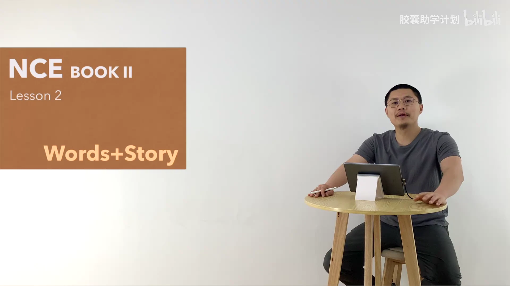

文字识别：bitbi / 胶囊助学计划 / NCE / BOOKII / Lesson 2 / Words+Story

### 画面 00:00:02

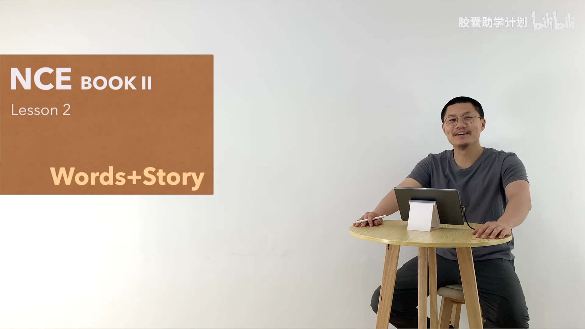

文字识别：Biltbii / 胶囊助学计划 / NCE / BOOKII / Lesson 2 / Words+Story

### 画面 00:00:04

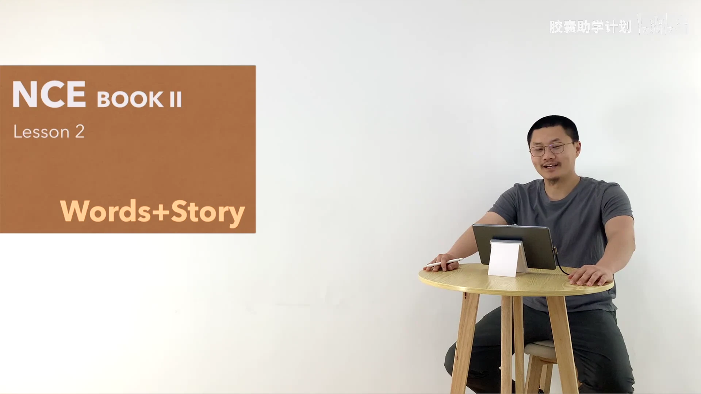

文字识别：胶囊助学计划 / NCE / BOOK II / Lesson 2 / Words+Story

### 画面 00:00:06

文字识别：胶囊助学计划 / NCE / BOOK II / Lesson 2 / Words+Story

### 画面 00:00:08

文字识别：胶囊助学计划

### 画面 00:00:11

文字识别：胶囊助学计划 / 达“进去”？

### 画面 00:00:13

文字识别：胶囊助学计划 / ①如何表达“进去”？

### 画面 00:00:15

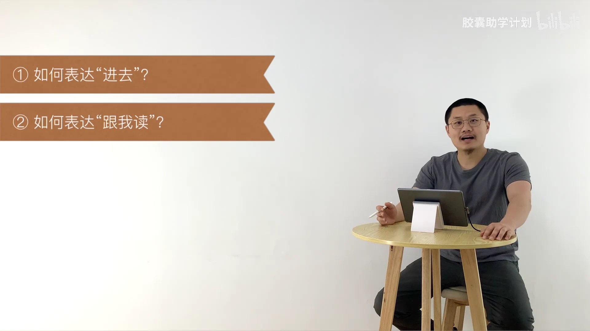

文字识别：胶囊助学计划 / ①如何表达“进去”? / 如何表达“跟我读”

### 画面 00:00:17

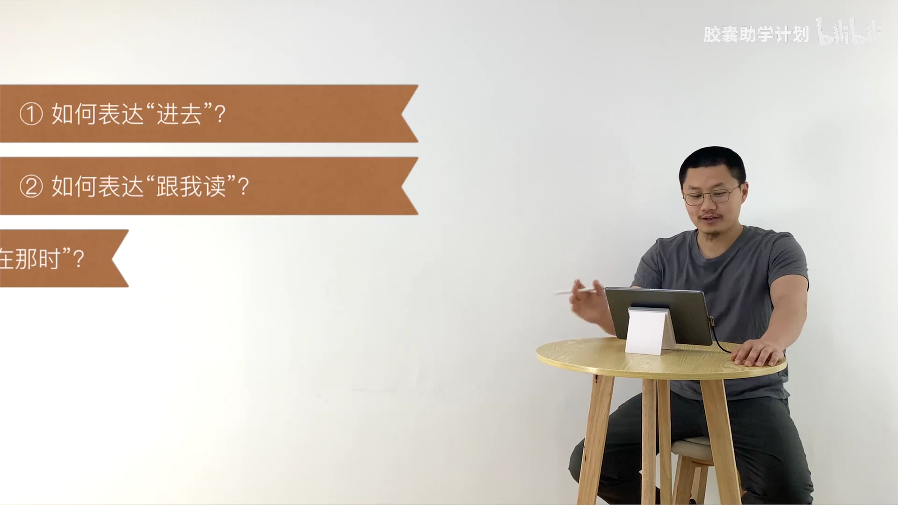

文字识别：LiH / 胶囊助学计划 / ①如何表达“进去”？ / 如何表达“跟我读”？ / 2 / 在那时”？

### 画面 00:00:19

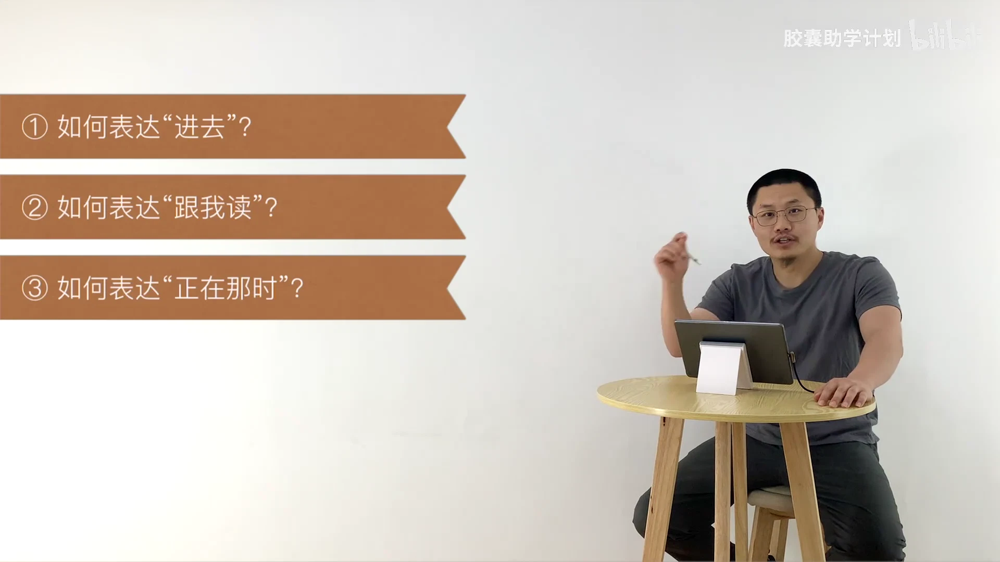

文字识别：胶囊助学计划 / ①如何表达“进去”? / 如何表达“跟我读 / 如何表达“正在那时”?

### 画面 00:00:21

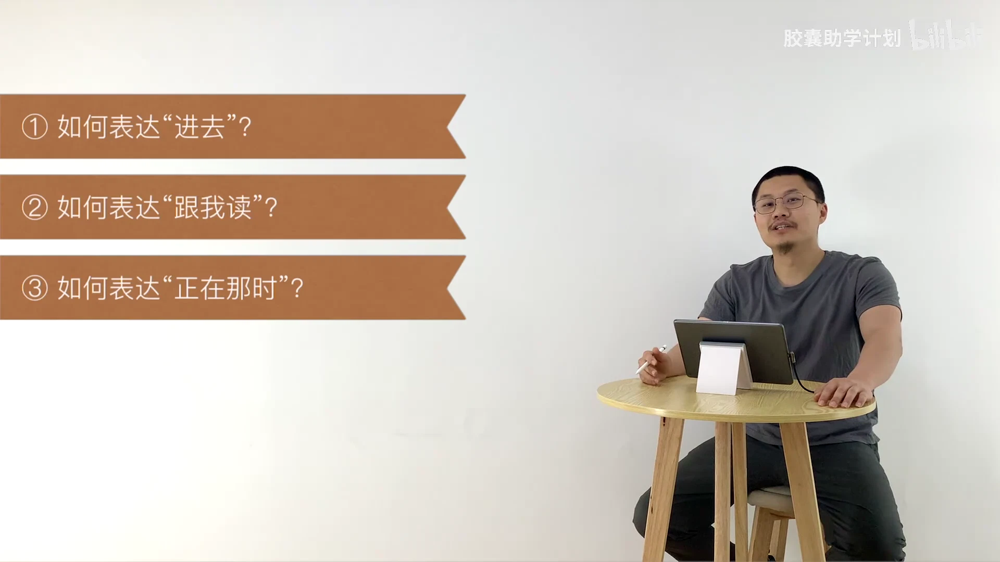

文字识别：胶囊助学计划 / ①如何表达“进去”? / 如何表达“跟我读” / 如何表达“正在那时”?

### 画面 00:00:23

文字识别：胶囊助学计划b出

### 画面 00:00:27

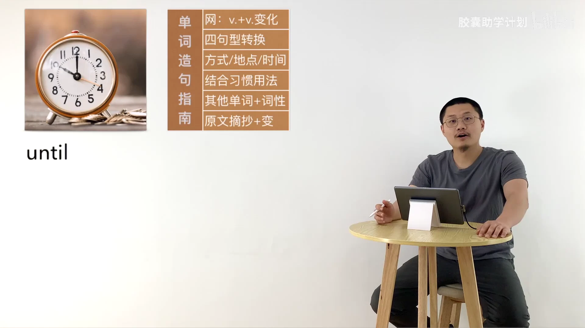

文字识别：单词造句指南 / 网：v.+v.变化 / 胶囊助学计划 / 四句型转换 / 方式/地点/时间 / 2 / C / 9 / 11 / 3 / 结合习惯用法 / 8 / 4 / 5 / 其他单词+词性 / 原文摘抄+变 / until

## 00:00:30–00:01:00

读一下，叫做 until， until， OK，好，那我们又又一次见面了，单词造句指南，对吧？我们先一起回顾一下，第一，往动词加动词的变化，其实目前来说最主要的就是时态和情态动词的那些变化，对吧？我们大多数用的是新一学过的。第二呢，四个句型的转化，肯定句、否定句、一般疑问句外加特殊疑问句。如果您是直接学新二呢，对这个练习可能稍有陌生；

### 画面 00:00:30

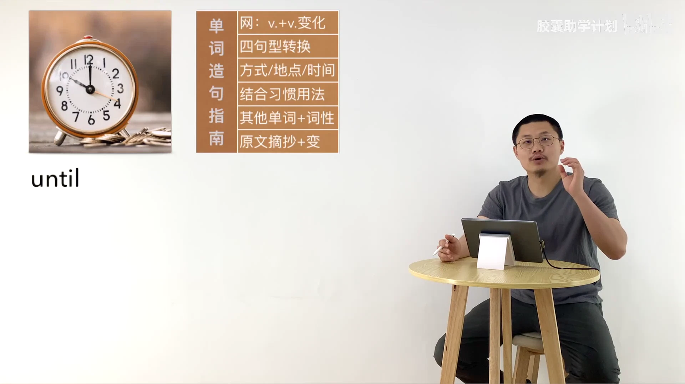

文字识别：单词造句指南 / 网：v.+v.变化 / 胶囊助学计划 / 四句型转换 / 方式/地点/时间 / 2 / C / 3 / 9 / 结合习惯用法 / 8 / 4 / 5 / 其他单词+词性 / 原文摘抄+变 / until

### 画面 00:00:36

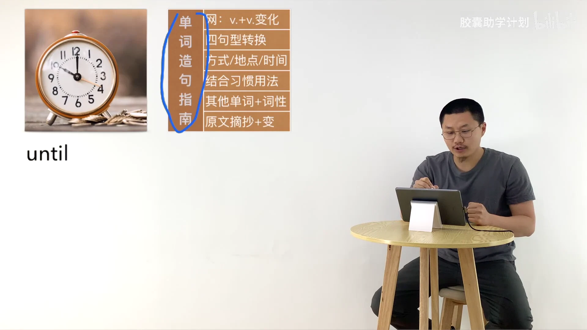

文字识别：单词造句指南 / 网：v.+v.变化 / 胶囊助学计划 / 四句型转换 / 方式/地点/时间 / 2 / 3 / 9 / 11 / 结合习惯用法 / 8 / 4 / 5 / 其他单词+词性 / 原文摘抄+变 / until

### 画面 00:00:38

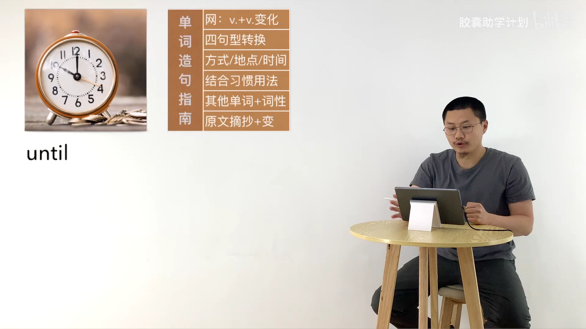

文字识别：单词造句指南 / 网：v.+v.变化 / 胶囊助学计划 / 四句型转换 / 方式/地点/时间 / 2 / 3 / 9 / 11 / 结合习惯用法 / 8 / 4 / 5 / 其他单词+词性 / 原文摘抄+变 / until

### 画面 00:00:40

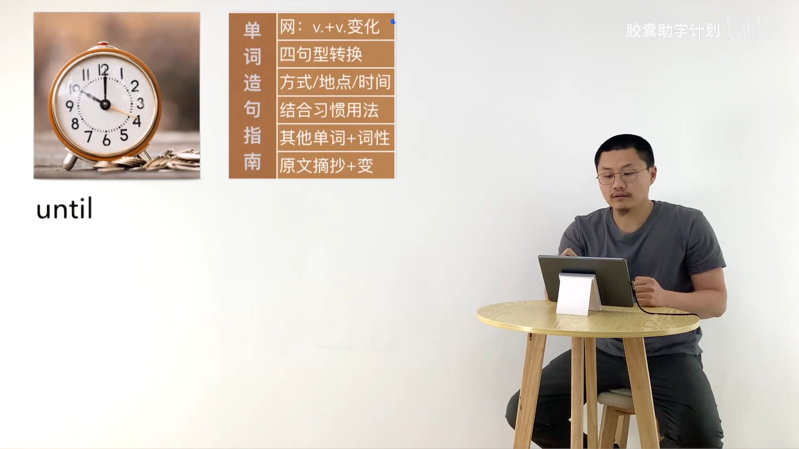

文字识别：单词造句指南 / 网：v.+v.变化 / 胶囊助学计划册 / 四句型转换 / 方式/地点/时间 / 2 / 3 / 9 / 11 / 结合习惯用法 / 8 / 4 / 5 / 其他单词+词性 / 原文摘抄+变 / until

### 画面 00:00:45

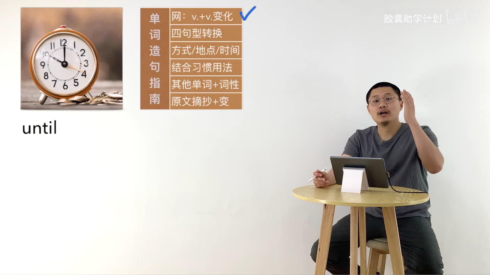

文字识别：单词造句指南 / 网：v.+v.变化 / 胶囊助学计划 / 四句型转换 / 方式/地点/时间 / 2 / 3 / 9 / 11 / 结合习惯用法 / 8 / 4 / 5 / 其他单词+词性 / 原文摘抄+变 / until

### 画面 00:00:51

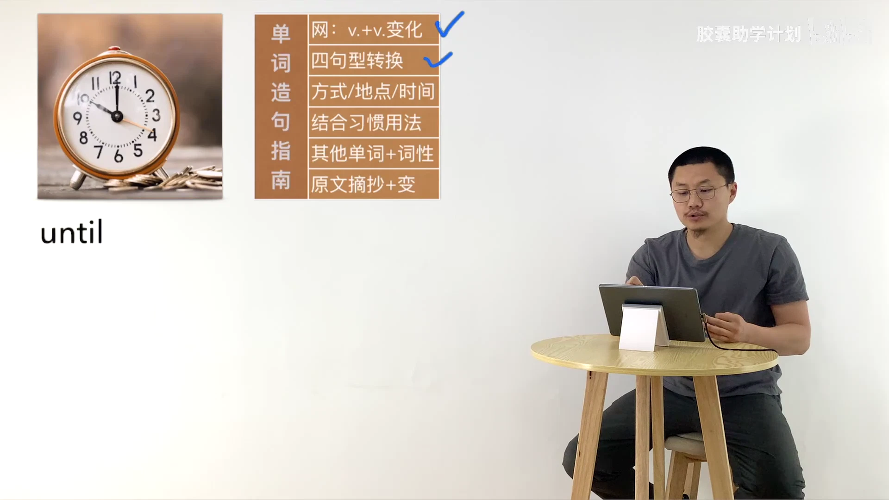

文字识别：单词造句指南 / 网：v.+v.变化 / 胶囊助学计划 / 四句型转换 / 方式/地点/时间 / 2 / 3 / 9 / 11 / 结合习惯用法 / 8 / 4 / 5 / 其他单词+词性 / 原文摘抄+变 / until

### 画面 00:00:58

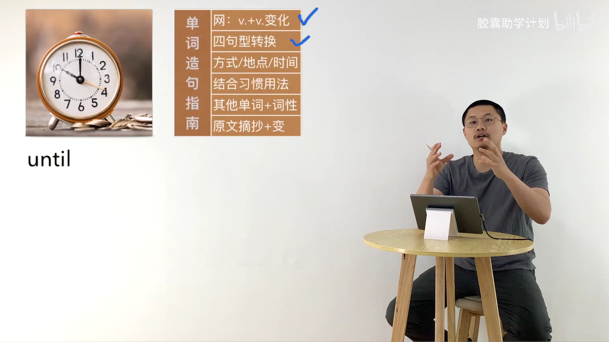

文字识别：单词造句指南 / 网：v.+v.变化 / 胶囊助学计划 / 四句型转换 / 方式/地点/时间 / 2 / C / 3 / 9 / 111 / 结合习惯用法 / 8 / 4 / 5 / 其他单词+词性 / 原文摘抄+变 / until

## 00:01:00–00:01:30

如果您是从新一学上来呢，那应该对这个练习非常的熟悉了。接下来我们可以加入一些方式、地点和时间，加入这样的一些语言上的细节，去变成我们自己的句子。啊，这配合我们新概念二册第一课学到的六一二三四五六，如果您还记得的话，英语句子的语序啊，我们是可以哎变出一个新的句子来的。接下来呢，我们单词在造句的时候可以配合其他的习惯用法，每一课都有新的习惯用法，对

### 画面 00:01:00

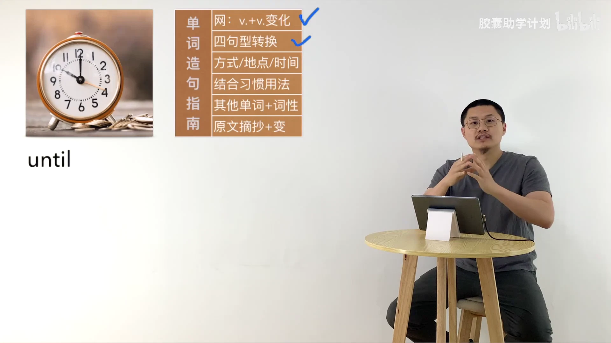

文字识别：单词造句指南 / 网：v.+v.变化 / 胶囊助学计划 / 四句型转换 / 方式/地点/时间 / 2 / 9 / 11 / 3 / 结合习惯用法 / 8 / 4 / 5 / 其他单词+词性 / 原文摘抄+变 / until

### 画面 00:01:05

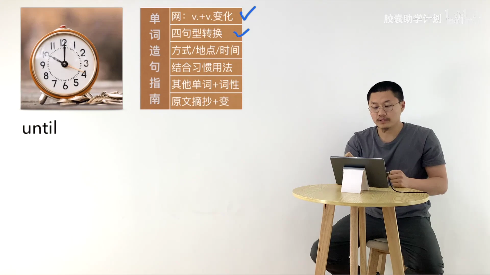

文字识别：单词造句指南 / 网：v.+v.变化 / 胶囊助学计划 / 四句型转换 / 方式/地点/时间 / 2 / 3 / 9 / 11 / 结合习惯用法 / 8 / 4 / 5 / 其他单词+词性 / 原文摘抄+变 / until

### 画面 00:01:10

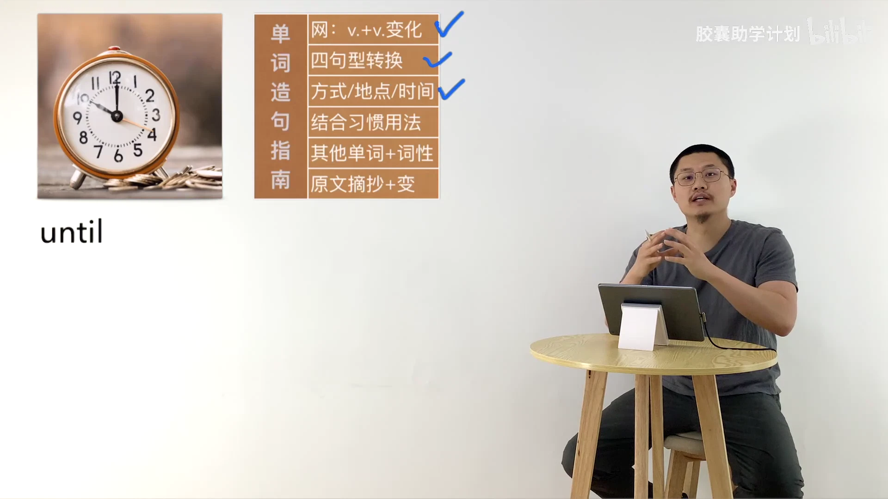

文字识别：单词造句指南 / 网：v.+v.变化 / 胶囊助学计划 / 四句型转换 / 方式/地点/时间 / 2 / 3 / 9 / 11 / 结合习惯用法 / 8 / 4 / 5 / 其他单词+词性 / 原文摘抄+变 / until

### 画面 00:01:16

文字识别：单词造句指南 / 网：v.+v.变化 / 胶囊助学计划 / 四句型转换 / 方式/地点/时间 / 2 / C / 3 / 9 / 11 / 结合习惯用法 / 8 / 4 / 5 / 其他单词+词性 / 原文摘抄+变 / until

### 画面 00:01:22

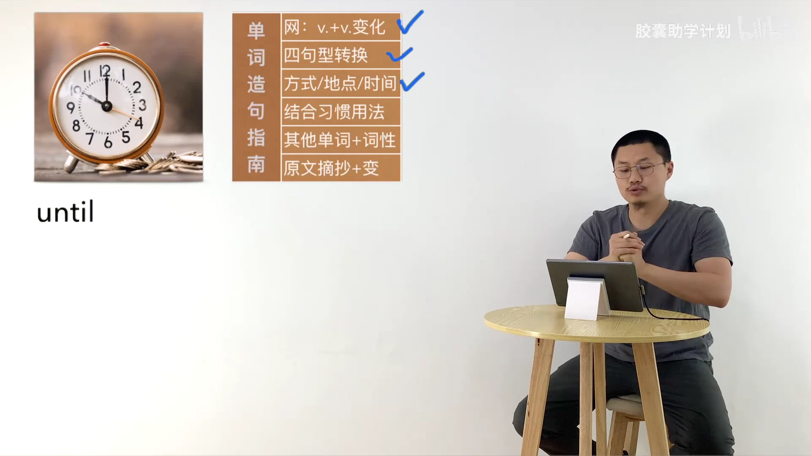

文字识别：单词造句指南 / 网：v.+v.变化 / 胶囊助学计划 / 四句型转换 / 方式/地点/时间 / 2 / 3 / 9 / 11 / 结合习惯用法 / 8 / 4 / 5 / 其他单词+词性 / 原文摘抄+变 / until

### 画面 00:01:25

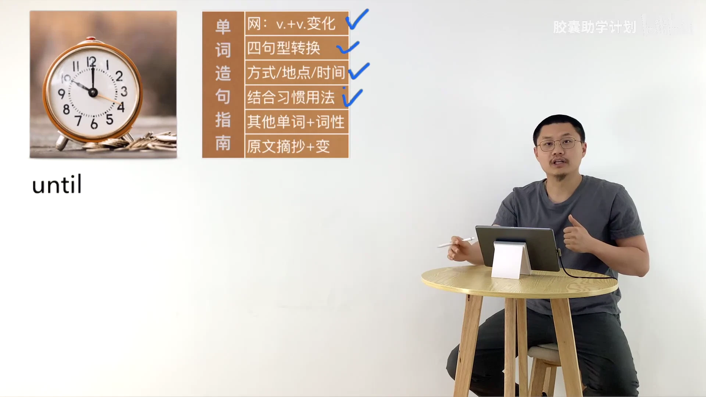

文字识别：单词造句指南 / 网：v.+v.变化 / 胶囊助学计划 / 四句型转换 / 方式/地点/时间 / 2 / 9 / 11 / 3 / 结合习惯用法 / 8 / 4 / 5 / 其他单词+词性 / 原文摘抄+变 / until

## 00:01:30–00:02:00

吧？那整个新二学下来，可能有成百上千个习惯用法。所有这些习惯用法，理论上来说，都可以去配合一些单词去造句。接下来呢，我们还可以由词性去决定加入其他的一些单词。比如说，您哎，这个单词是个名词，那你就可以加一个形容词跟它放在一起。那造句子还必须要有动词，就所以肯定必须要找的是一个动词。接下来呢，我们还可以做一个最简单粗暴的方式，叫做原文摘抄。但摘过来这个东西不是我们自

### 画面 00:01:30

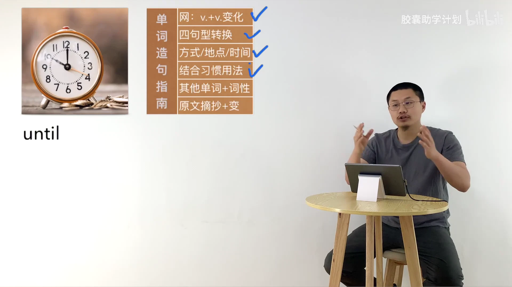

文字识别：单词造句指南 / 网：v.+v.变化 / 胶囊助学计划 / 四句型转换 / 方式/地点/时间 / 2 / C / 3 / 9 / 11 / 结合习惯用法 / 8 / 4 / 5 / 其他单词+词性 / 原文摘抄+变 / until

### 画面 00:01:35

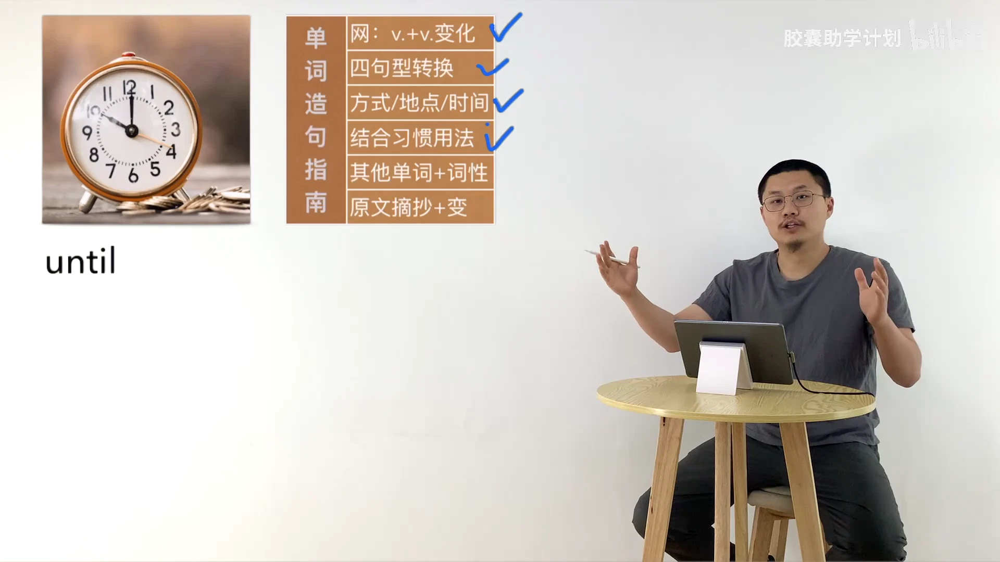

文字识别：单词造句指南 / 网：v.+v.变化 / 胶囊助学计划 / 四句型转换 / 方式/地点/时间 / 2 / 3 / 9 / 111 / 结合习惯用法 / 8 / 4 / 5 / 其他单词+词性 / 原文摘抄+变 / until

### 画面 00:01:40

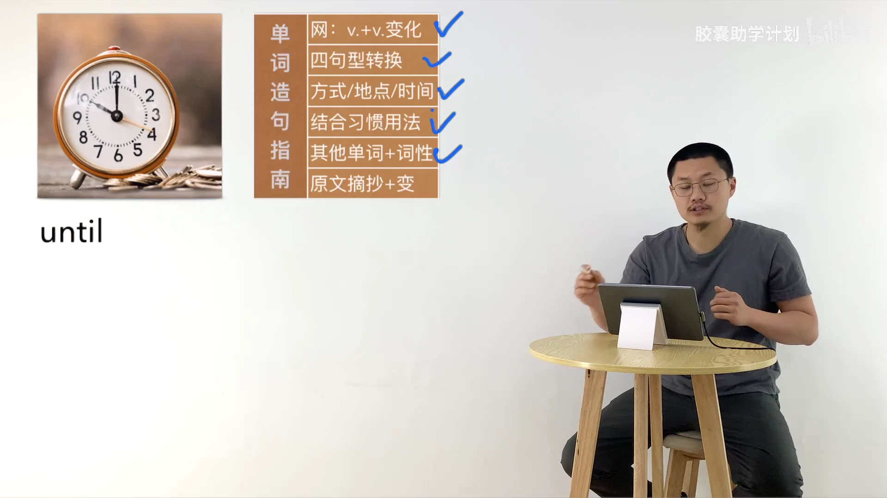

文字识别：单词造句指南 / 网：v.+v.变化 / 胶囊助学计划 / 四句型转换 / 方式/地点/时间 / 2 / 3 / 9 / 11 / 结合习惯用法 / 8 / 4 / 5 / 其他单词+词性 / 原文摘抄+变 / until

### 画面 00:01:50

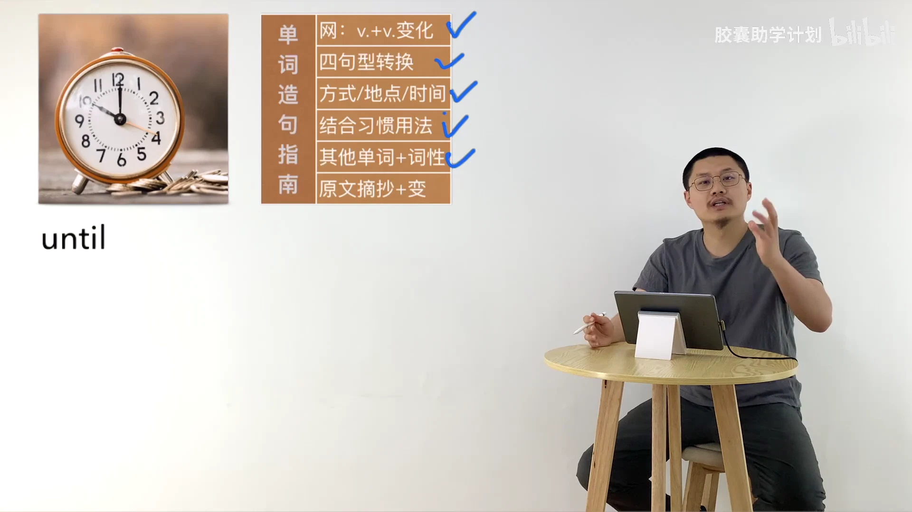

文字识别：单词造句指南 / 网：v.+v.变化 / 胶囊助学计划 / 四句型转换 / 方式/地点/时间 / 2 / C / 3 / 9 / 结合习惯用法 / 8 / 4 / 5 / 其他单词+词性 / 原文摘抄+变 / until

### 画面 00:01:55

文字识别：单词造句指南 / 网：v.+v.变化 / 胶囊助学计划 / 四句型转换 / 方式/地点/时间 / 2 / 9 / 11 / 3 / 结合习惯用法 / 8 / 4 / 5 / 其他单词+词性 / 原文摘抄+变 / until

## 00:02:00–00:02:30

己造的，我们再通过上面的这些方式去给它进行一些转变，对吧？我们所谓的叫做“变”这个字，然后呢，变来变去，最后就会发现变出来了一个和文章原文完全不一样的句子。那这个句子就是您自己造出来的。好，呃，那我们先来看第一个单词“until”啊。这个单词其实不是很好让大家直接造句，所以呢，我们就先选了一个最保险的方式，叫原文摘抄，叫“I sometimes stay in bed until lunchtime.”

### 画面 00:02:01

文字识别：单词造句指南 / 网：v.+v.变化 / 胶囊助学计划 / 四句型转换 / 方式/地点/时间 / 2 / 9 / 3 / 结合习惯用法 / 8 / 4 / 5 / 其他单词+词性 / 原文摘抄+变 / until

### 画面 00:02:03

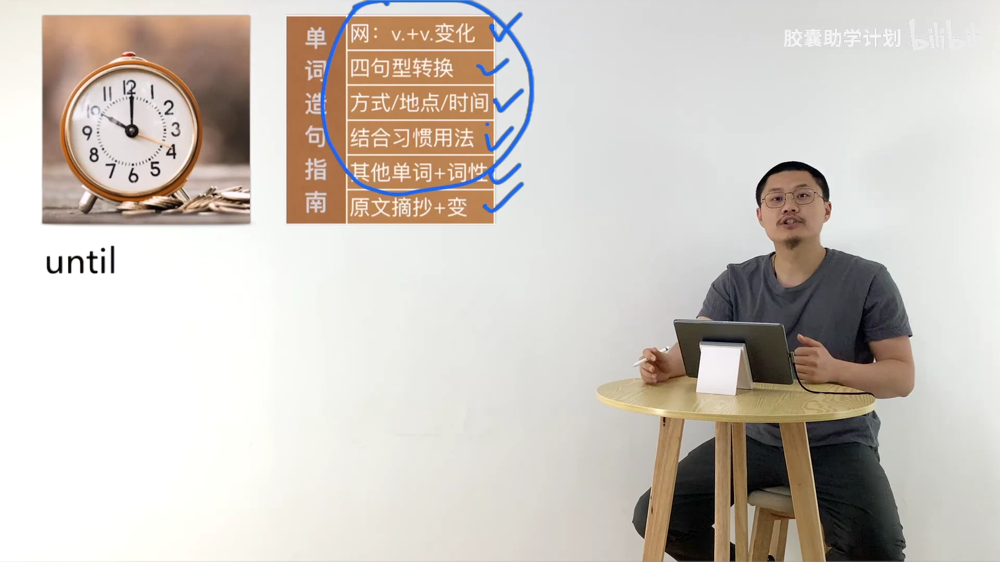

文字识别：单词造句指南 / 网：v.+v.变化 / 胶囊助学计划 / 四句型转换 / 方式/地点/时间 / 2 / 3 / 9 / 结合习惯用法 / 8 / 4 / 5 / 其他单词+词性 / 原文摘抄+变 / until

### 画面 00:02:05

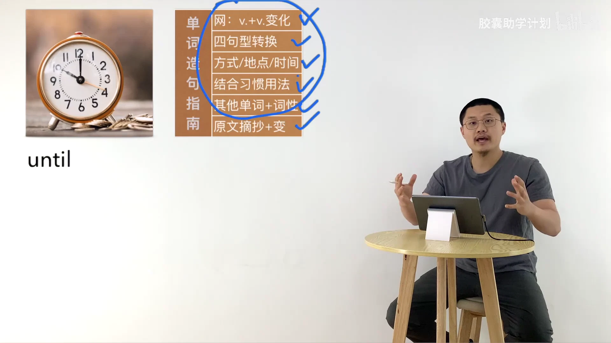

文字识别：单词造句指南 / 网：v.+v.变化 / 胶囊助学计划 / 四句型转换 / 方式/地点/时间 / 2 / 3 / 9 / 结合习惯用法 / 8 / 4 / 5 / 其他单词+词性 / 原文摘抄+变 / until

### 画面 00:02:10

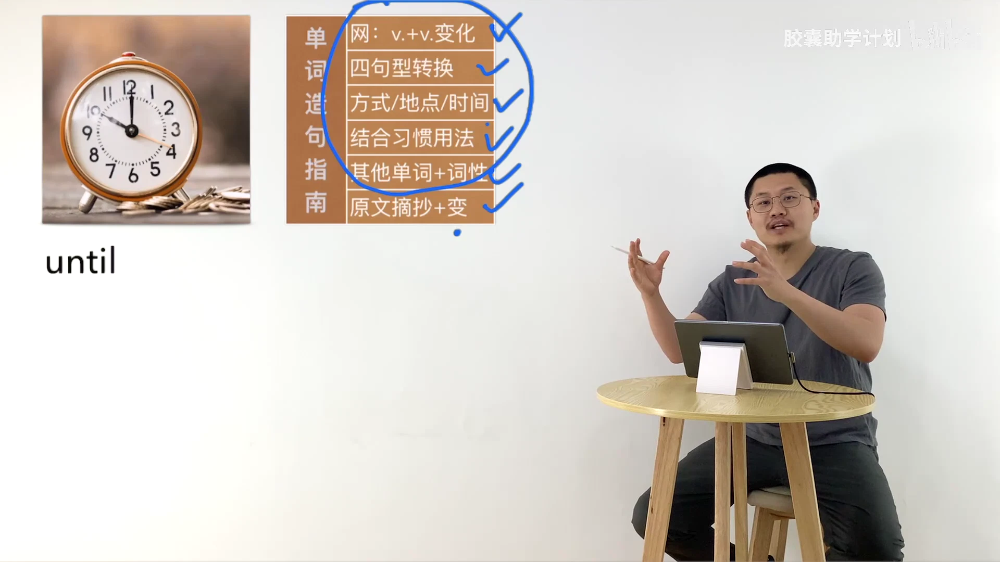

文字识别：单词造句指南 / 网：v.+v.变化 / 胶囊助学计划 / 四句型转换 / 方式/地点/时间 / 2 / 9 / 11 / 3 / 结合习惯用法 / 8 / 4 / 5 / 其他单词+词性 / 原文摘抄+变 / until

### 画面 00:02:15

文字识别：单词造句指南 / 网：v.+v.变化 / 胶囊助学计划 / 四句型转换 / 方式/地点/时间 / 2 / 9 / 3 / 结合习惯用法 / 8 / 4 / 5 / 其他单词+词性 / 原文摘抄+变 / until

### 画面 00:02:21

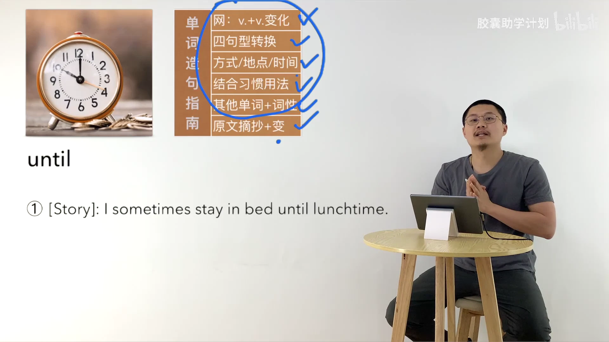

文字识别：单词造句指南 / 网：v.+v.变化 / 胶囊助学计划 / 四句型转换 / 方式/地点/时间 / 2 / 3 / 9 / 结合习惯用法 / 8 / 4 / 5 / 其他单词+词性 / 原文摘抄+变 / until / ① [Story]: I sometimes stay in bed until lunchtime.

### 画面 00:02:25

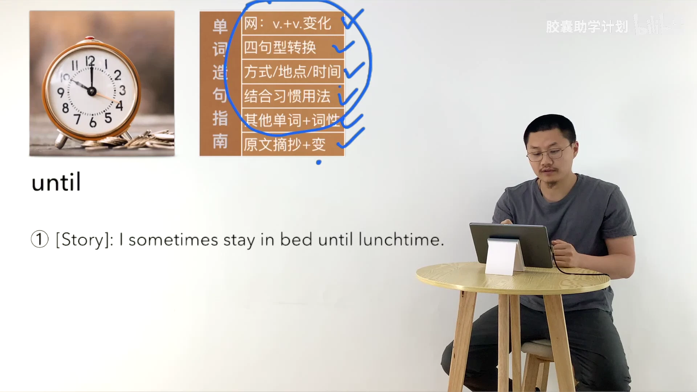

文字识别：单词造句指南 / 网：v.+v.变化 / 胶囊助学计划 / 四句型转换 / 方式/地点/时间 / 2 / 9 / 3 / 结合习惯用法 / 8 / 4 / 5 / 其他单词+词性 / 原文摘抄+变 / until / ① [Story]: I sometimes stay in bed until lunchtime.

## 00:02:30–00:03:00

有时待在床上，赖在床上，对吧？直到午饭的时间。我们现在原文给的这样一个句子，这不是您自己的句子。我们做一点小的变化啊。首先，各位，我们去想一下，主语I是不是可以随便换？人称代词随便换，我、他、他们俩，对吧？OK，那直到午饭的时间，注意，它现在是一个时间。那我想给它换成一点、

### 画面 00:02:30

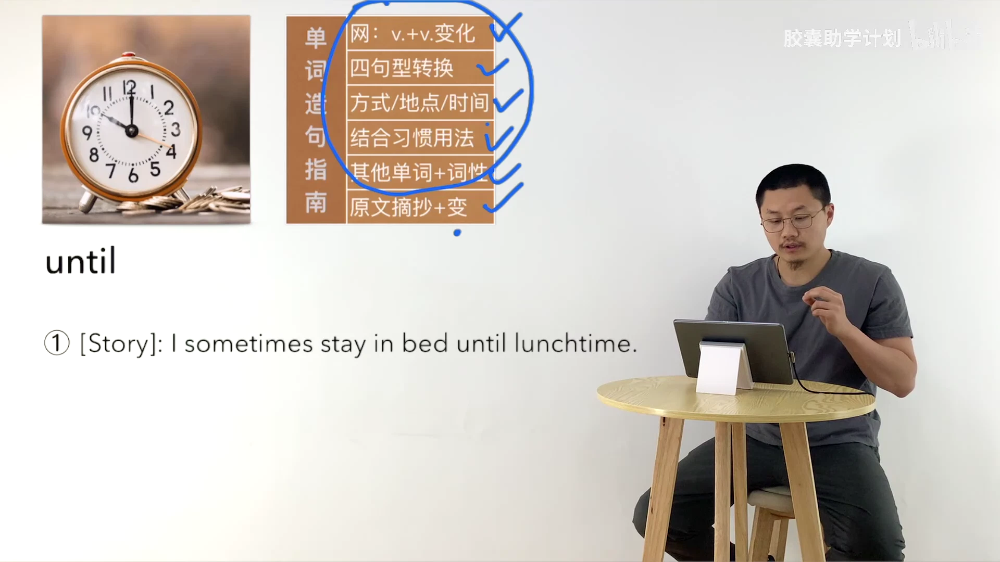

文字识别：单词造句指南 / 网：v.+v.变化 / 胶囊助学计划 / 四句型转换 / 方式/地点/时间 / 2 / 9 / 3 / 结合习惯用法 / 8 / 4 / 5 / 其他单词+词性 / 原文摘抄+变 / until / ① [Story]: I sometimes stay in bed until lunchtime.

### 画面 00:02:35

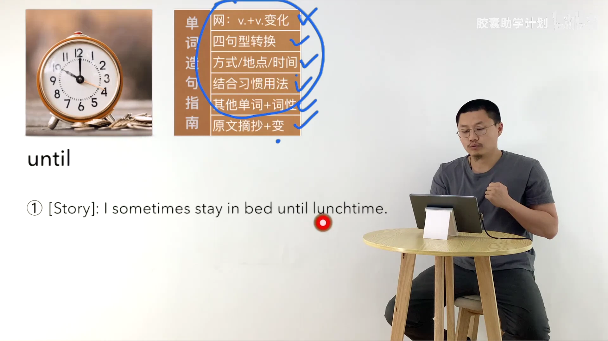

文字识别：单词造句指南 / 网：v.+v.变化 / 胶囊助学计划 / 四句型转换 / 方式/地点/时间 / 2 / C / 9 / 3 / 结合习惯用法 / 8 / 4 / 5 / 其他单词+词性 / 原文摘抄+变 / until / ① [Story]: I sometimes stay in bed until lunchtime.

### 画面 00:02:40

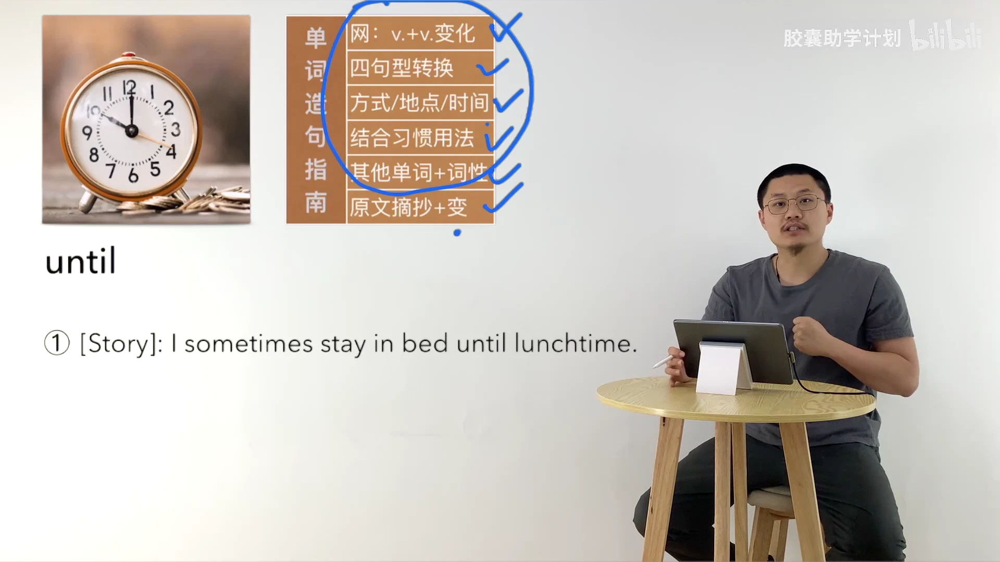

文字识别：单词造句指南 / 网：v.+v.变化 / 胶囊助学计划 / 四句型转换 / 方式/地点/时间 / 2 / 9 / 3 / 结合习惯用法 / 8 / 4 / 5 / 其他单词+词性 / 原文摘抄+变 / until / ① [Story]: I sometimes stay in bed until lunchtime.

### 画面 00:02:45

文字识别：单词造句指南 / 网：v.+v.变化 / 胶囊助学计划 / 四句型转换 / 方式/地点/时间 / 2 / 9 / 11 / 3 / 结合习惯用法 / 8 / 4 / 5 / 其他单词+词性 / 原文摘抄+变 / until / ① [Story]: | sometimes stay in bed until lunchtime.

### 画面 00:02:49

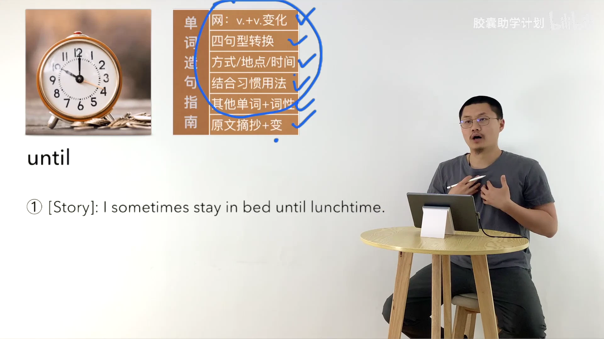

文字识别：单词造句指南 / 网：v.+v.变化 / 胶囊助学计划 / 四句型转换 / 方式/地点/时间 / 2 / 3 / 9 / 结合习惯用法 / 8 / 4 / 5 / 其他单词+词性 / 原文摘抄+变 / until / ① [Story]: I sometimes stay in bed until lunchtime.

### 画面 00:02:51

文字识别：单词造句指南 / 网：v.+v.变化 / 胶囊助学计划 / 四句型转换 / 方式/地点/时间 / 2 / 9 / 3 / 结合习惯用法 / 8 / 4 / 5 / 其他单词+词性 / 原文摘抄+变 / until / ① [Story]: I sometimes stay in bed until lunchtime.

### 画面 00:02:55

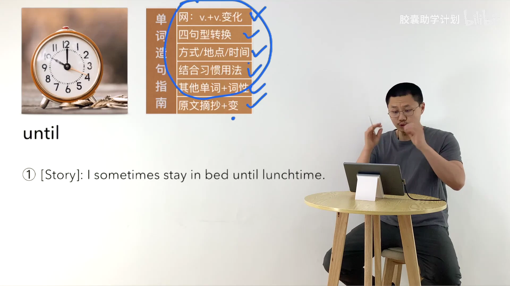

文字识别：单词造句指南 / 网：v.+v.变化 / 胶囊助学计划 / 四句型转换 / 方式/地点/时间 / 2 / 3 / 9 / 结合习惯用法 / 8 / 4 / 5 / 其他单词+词性 / 原文摘抄+变 / until / ① [Story]: I sometimes stay in bed until lunchtime.

## 00:03:00–00:03:30

两点、三点、四点、五点，那不是您随便换吗？其次，它的动词叫 stay in bed，叫待在床上赖床。那你是不是可以随便换一个词？比如说吃午饭，对吧？去游泳，那这种变化是很多的嘛？那我们看一下我提前给大家准备好的句子，叫 I sometimes eat my dinner until nine。我有的时候啊，直到晚上九点才吃晚饭。你注意，我们现在只变了一个小的，两个小的地方。第一个叫做 stay in bed 变成了 eat my

### 画面 00:03:00

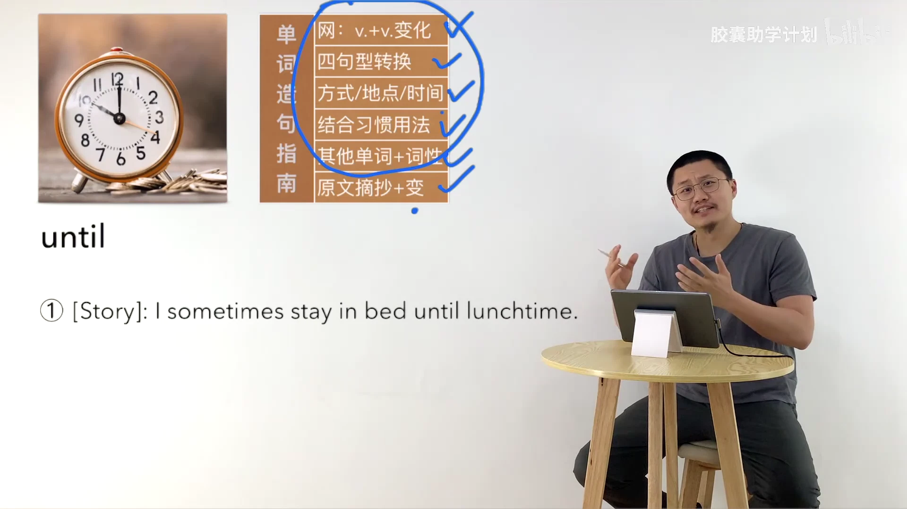

文字识别：单词造句指南 / 网：v.+v.变化 / 胶囊助学计划 / 四句型转换 / 方式/地点/时间 / 2 / 3 / 9 / 11 / 结合习惯用法 / 8 / 4 / 5 / 其他单词+词性 / 原文摘抄+变 / until / ① [Story]: I sometimes stay in bed until lunchtime.

### 画面 00:03:02

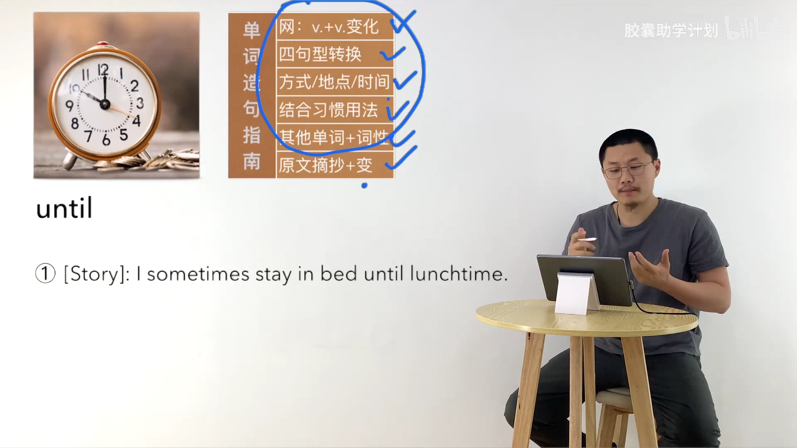

文字识别：单词造句指南 / 网：v.+v.变化 / 胶囊助学计划州 / 四句型转换 / 方式/地点/时间 / 2 / 3 / 9 / 结合习惯用法 / 8 / 4 / 5 / 其他单词+词性 / 原文摘抄+变 / until / ① [Story]: I sometimes stay in bed until lunchtime.

### 画面 00:03:06

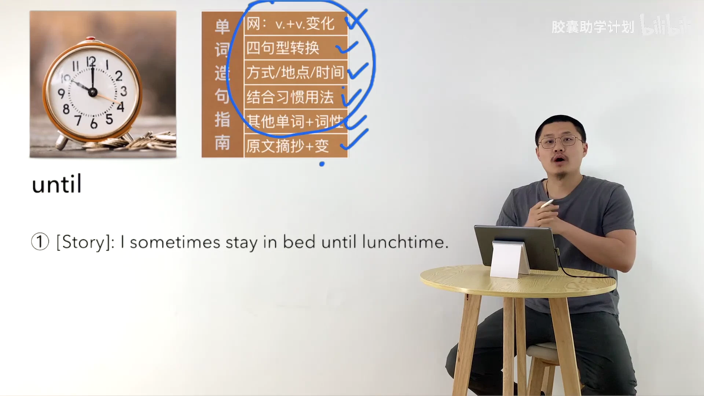

文字识别：单词造句指南 / 网：v.+v.变化 / 胶囊助学计划 / Li / 四句型转换 / 方式/地点/时间 / 2 / 3 / 9 / 结合习惯用法 / 8 / 4 / 5 / 其他单词+词性 / 原文摘抄+变 / until / ① [Story]: I sometimes stay in bed until lunchtime.

### 画面 00:03:10

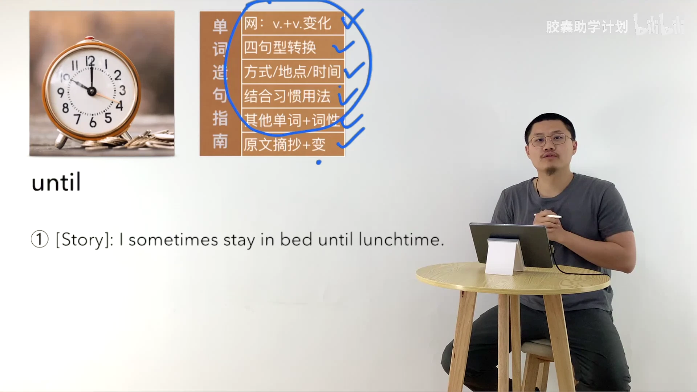

文字识别：单词造句指南 / 网：v.+v.变化 / 胶囊助学计划 / 四句型转换 / 方式/地点/时间 / 2 / 3 / 9 / 11 / 结合习惯用法 / 8 / 4 / 5 / 其他单词+词性 / 原文摘抄+变 / until / ① [Story]: I sometimes stay in bed until lunchtime.

### 画面 00:03:15

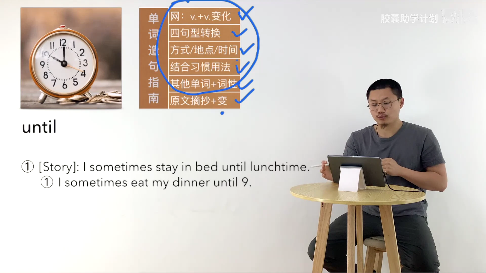

文字识别：单词造句指南 / 网：v.+v.变化 / 胶囊助学计划 / 四句型转换 / 方式/地点/时间 / 2 / 9 / 3 / 结合习惯用法 / 8 / 4 / 5 / 其他单词+词性 / 原文摘抄+变 / until / ① [Story]: I sometimes stay in bed until lunchtime. / ① I sometimes eat my dinner until 9.

### 画面 00:03:20

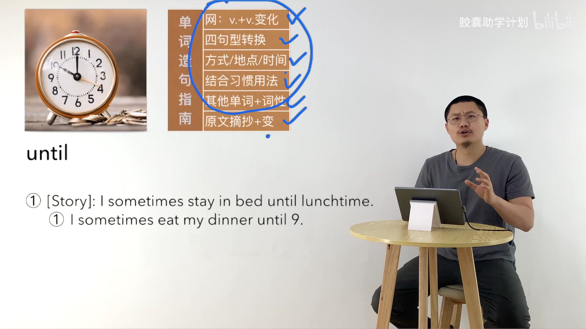

文字识别：单词造句指南 / 网：v.+v.变化 / 胶囊助学计划 / 四句型转换 / 方式/地点/时间 / 2 / 3 / 9 / 结合习惯用法 / 8 / 4 / 5 / 其他单词+词性 / 原文摘抄+变 / until / ① [Story]: I sometimes stay in bed until lunchtime. / ① I sometimes eat my dinner until 9.

### 画面 00:03:23

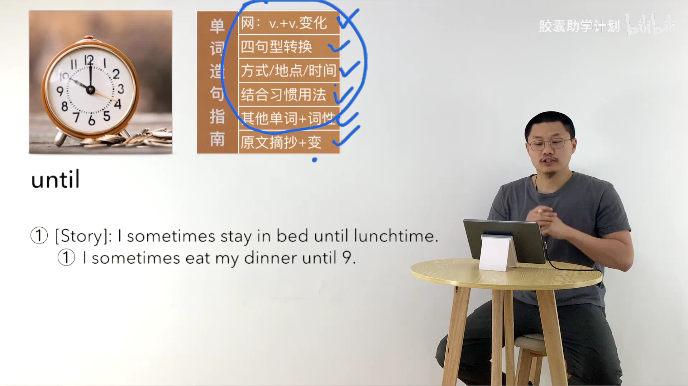

文字识别：单词造句指南 / 网：v.+v.变化 / 胶囊助学计划 / 四句型转换 / 方式/地点/时间 / 2 / 3 / 9 / 11 / 结合习惯用法 / 8 / 4 / 5 / 其他单词+词性 / 原文摘抄+变 / until / ① [Story]: I sometimes stay in bed until lunchtime. / ① I sometimes eat my dinner until 9.

### 画面 00:03:25

文字识别：单词造句指南 / 网：v.+v.变化 / 胶囊助学计划 / 四句型转换 / 方式/地点/时间 / 2 / 9 / 11 / 3 / 结合习惯用法 / 8 / 4 / 5 / 其他单词+词性 / 原文摘抄+变 / until / ① [Story]: I sometimes stay in bed until lunchtime. / ① I sometimes eat my dinner until 9.

## 00:03:30–00:04:00

dinner. 第二个把lunch time变成了nine. 我相信这个对于大家来说都不是很困难的一个思路，对吧？那接下来我们还可以把它变成叫I sometimes go to bed until two a.m. 有的时候直到凌晨两点，工作很辛苦，对吧？才要能上床睡觉。注意go to bed上床睡觉。OK，那你看我们目前的变化规则就是时间变了一下，把动词这个短语变了一下，对不对？好，我们再往下

### 画面 00:03:30

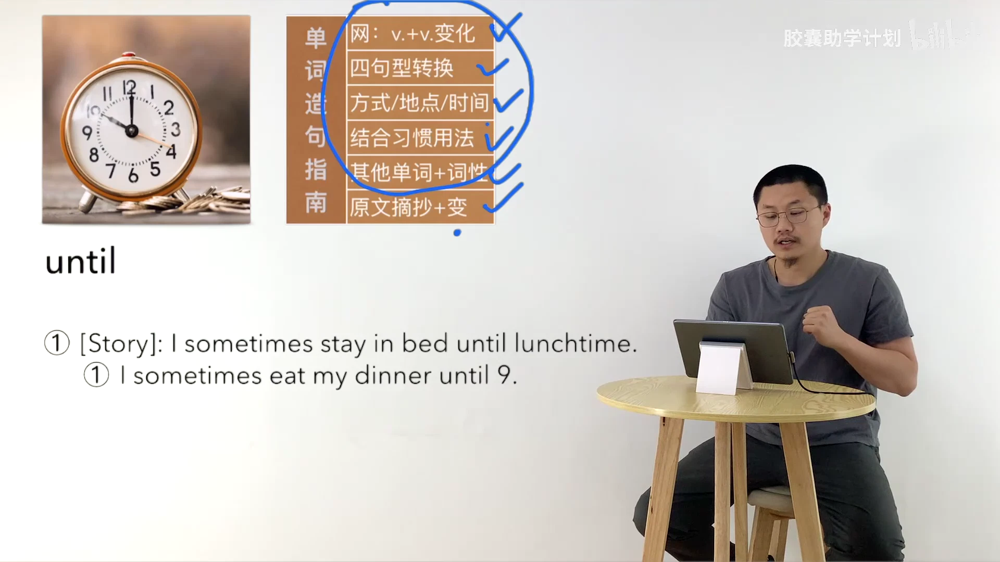

文字识别：单词造句指南 / 网：v.+v.变化 / 胶囊助学计划 / 四句型转换 / 方式/地点/时间 / 2 / 3 / 9 / 结合习惯用法 / 8 / 4 / 5 / 其他单词+词性 / 原文摘抄+变 / until / ① [Story]: I sometimes stay in bed until lunchtime. / ① I sometimes eat my dinner until 9.

### 画面 00:03:35

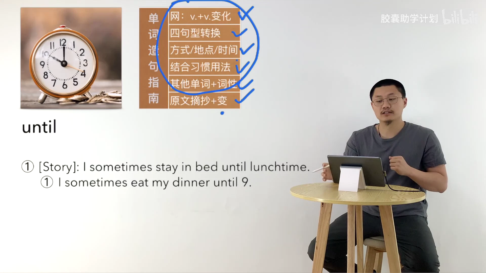

文字识别：单词造句指南 / 网：v.+v.变化 / 胶囊助学计划 / BiH / 四句型转换 / 方式/地点/时间 / 2 / 3 / 9 / 1 / 结合习惯用法 / 8 / 4 / 5 / 其他单词+词性 / 原文摘抄+变 / until / ① [Story]: I sometimes stay in bed until lunchtime. / ① I sometimes eat my dinner until 9.

### 画面 00:03:40

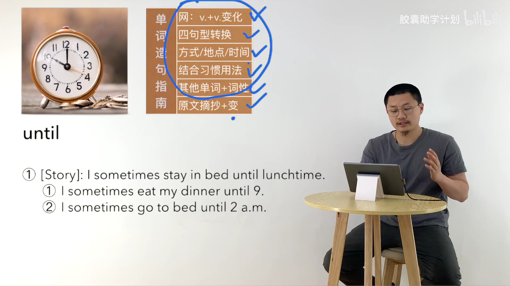

文字识别：单词造句指南 / 网：v.+v.变化 / 胶囊助学计划 / 四句型转换 / 方式/地点/时间 / 2 / 3 / 9 / 结合习惯用法 / 8 / 4 / 5 / 其他单词+词性 / 原文摘抄+变 / until / ① [Story]: I sometimes stay in bed until lunchtime. / ① I sometimes eat my dinner until 9. / ② I sometimes go to bed until 2 a.m.

### 画面 00:03:48

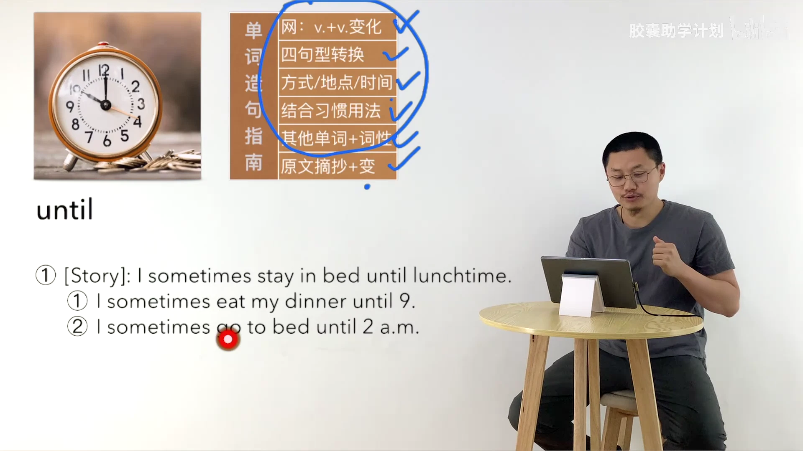

文字识别：单词造句指南 / 网：v.+v.变化 / 胶囊助学计划 / 四句型转换 / 方式/地点/时间 / 2 / 3 / 9 / 11 / 结合习惯用法 / 8 / 4 / 5 / 其他单词+词性 / 原文摘抄+变 / until / ① [Story]: I sometimes stay in bed until lunchtime. / ①I sometimes eat my dinner until 9. / ②| sometimes / ao / to bed until 2 a.m.

### 画面 00:03:50

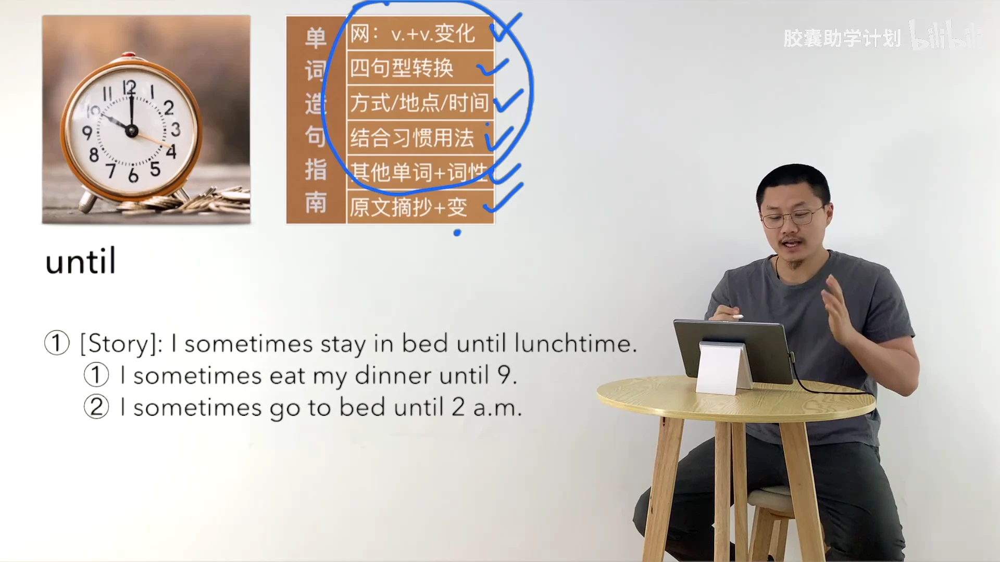

文字识别：单词造句指南 / 网：v.+v.变化 / 胶囊助学计划 / 四句型转换 / 方式/地点/时间 / 2 / 9 / 11 / 3 / 结合习惯用法 / 8 / 4 / 5 / 其他单词+词性 / 原文摘抄+变 / until / ① [Story]: I sometimes stay in bed until lunchtime. / ①I sometimes eat my dinner until 9. / ② I sometimes go to bed until 2 a.m.

### 画面 00:03:55

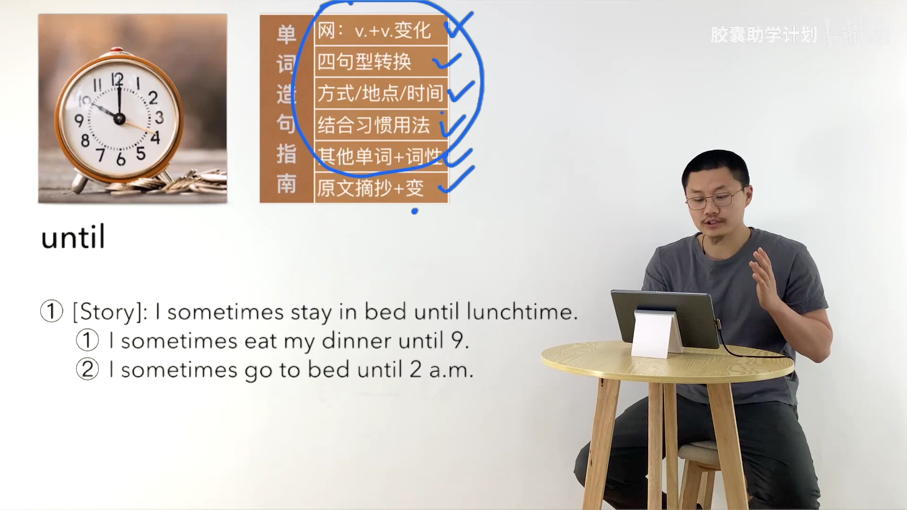

文字识别：单词造句指南 / 网：v.+v.变化 / 胶囊助学计划 / 四句型转换 / 方式/地点/时间 / 2 / 9 / 11 / 3 / 结合习惯用法 / 8 / 4 / 5 / 其他单词+词性 / 原文摘抄+变 / until / ① [Story]: I sometimes stay in bed until lunchtime. / ① I sometimes eat my dinner until 9. / ② I sometimes go to bed until 2 a.m.

## 00:04:00–00:04:30

看。注意，现在出来变成了叫 How often do you go to bed until two a.m.？你就能看出来第二和第三是有一些关系的、联系的，对不对？其实它就是把第二这句话变成了一般疑问句，再变了一个特殊疑问句。那我们先说怎么变一般疑问句，叫做 Do you go to bed until two a.m. sometimes？或者 Do you sometimes go to bed until two p.m. two a.m.？ OK，那接下来我的 How often 是对

### 画面 00:04:00

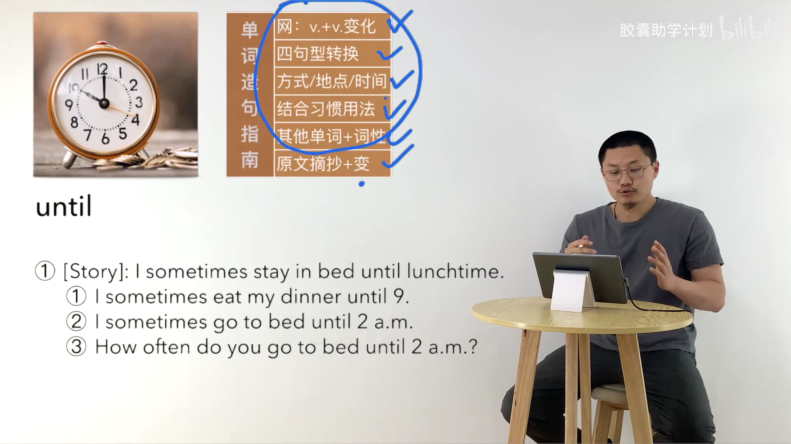

文字识别：单词造句指南 / 网：v.+v.变化 / 胶囊助学计划 / 四句型转换 / 方式/地点/时间 / 2 / 9 / 3 / 结合习惯用法 / 8 / 4 / 5 / 其他单词+词性 / 原文摘抄+变 / until / ① [Story]: I sometimes stay in bed until lunchtime. / ①I sometimes eat my dinner until 9. / ② I sometimes go to bed until 2 a.m. / How often do you go to bed until 2 a.m.? / 3

### 画面 00:04:05

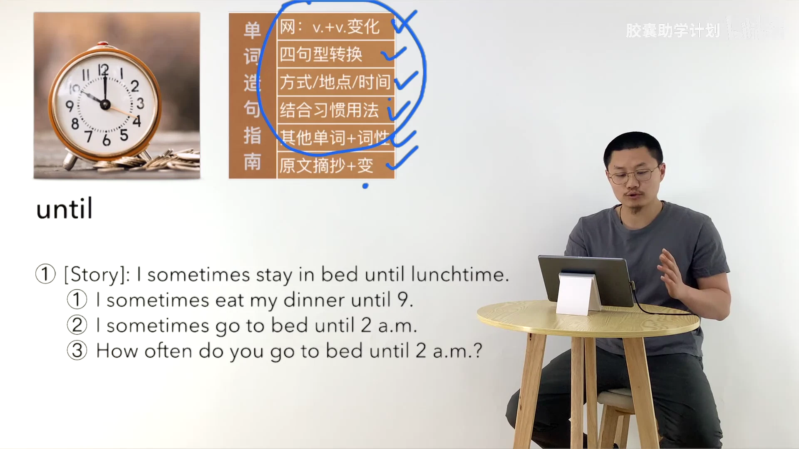

文字识别：单词造句指南 / 网：v.+v.变化 / 胶囊助学计划 / 四句型转换 / 方式/地点/时间 / 2 / 3 / 9 / 101 / 结合习惯用法 / 8 / 4 / 5 / 其他单词+词性 / 原文摘抄+变 / until / ① [Story]: I sometimes stay in bed until lunchtime. / ①I sometimes eat my dinner until 9. / ② I sometimes go to bed until 2 a.m. / How often do you go to bed until 2 a.m.? / 3

### 画面 00:04:12

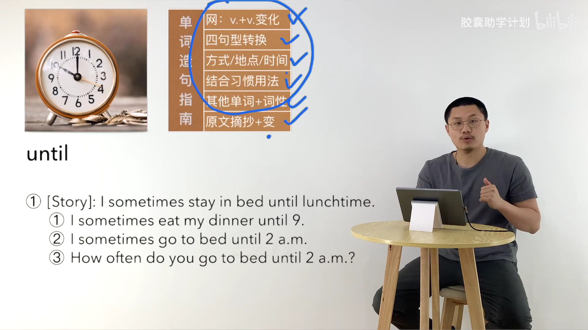

文字识别：单词造句指南 / 网：v.+v.变化 / 胶囊助学计划 / Li / 四句型转换 / 方式/地点/时间 / 2 / 3 / 9 / 结合习惯用法 / 8 / 4 / 5 / 其他单词+词性 / 原文摘抄+变 / until / ① [Story]: I sometimes stay in bed until lunchtime. / ① I sometimes eat my dinner until 9. / ② I sometimes go to bed until 2 a.m. / How often do you go to bed until 2 a.m.? / 3

### 画面 00:04:15

文字识别：单词造句指南 / 网：v.+v.变化 / 胶囊助学计划 / 四句型转换 / 方式/地点/时间 / 2 / 3 / 9 / 结合习惯用法 / 8 / 4 / 5 / 其他单词+词性 / 原文摘抄+变 / until / ① [Story]: I sometimes stay in bed until lunchtime. / ① I sometimes eat my dinner until 9. / ② I sometimes go to bed until 2 a.m. / How often do you go to bed until 2 a.m.? / 3

### 画面 00:04:20

文字识别：单词造句指南 / 网：v.+v.变化 / 胶囊助学计划 / LH / 四句型转换 / 方式/地点/时间 / 2 / 9 / 11 / 3 / 结合习惯用法 / 8 / 4 / 5 / 其他单词+词性 / 原文摘抄+变 / until / ① [Story]: I sometimes stay in bed until lunchtime. / ① I sometimes eat my dinner until 9. / ② I sometimes go to bed until 2 a.m. / How often do you go to bed until 2 a.m.? / 3

### 画面 00:04:25

文字识别：单词造句指南 / 网：v.+v.变化 / 胶囊助学计划 / 四句型转换 / 方式/地点/时间 / 2 / 3 / 9 / 结合习惯用法 / 8 / 4 / 5 / 其他单词+词性 / 原文摘抄+变 / until / ① [Story]: I sometimes stay in bed until lunchtime. / ①I sometimes eat my dinner until 9. / ② I sometimes go to bed until 2 a.m. /  How often do you go to bed until 2 a.m.? / 3

### 画面 00:04:28

文字识别：单词造句指南 / 网：v.+v.变化 / 胶囊助学计划 / 四句型转换 / 方式/地点/时间 / 2 / 3 / 9 / 11 / 结合习惯用法 / 8 / 4 / 5 / 其他单词+词性 / 原文摘抄+变 / until / ① [Story]: I sometimes stay in bed until lunchtime. / ①I sometimes eat my dinner until 9. / ② I sometimes go to bed until 2 a.m. / How often do you go to bed until 2 a.m.? / 3

## 00:04:30–00:05:00

频率提问。那 sometimes 是我们刚刚在语法当中讲过的，叫频率副词，把它替代特殊疑问词加去掉答案的一般疑问句。这是我们贯穿整个新一的一个语法重点，对吧？特殊疑问句是如何变过来的？于是我们就造出来了这样一个和原文完全不一样的句子。各位看没看到？原文叫 I sometimes stay in bed until lunchtime，而我们目前造出来叫 How often do you go to bed until two a.m.？那你想一下，你还可以对 until two

### 画面 00:04:30

文字识别：单词造句指南 / 网：v.+v.变化 / 胶囊助学计划 / 四句型转换 / 方式/地点/时间 / 2 / 9 / 3 / 结合习惯用法 / 8 / 4 / 5 / 其他单词+词性 / 原文摘抄+变 / until / ① [Story]: I sometimes stay in bed until lunchtime. / ① I sometimes eat my dinner until 9. / ② I sometimes go to bed until 2 a.m. / How often do you go to bed until 2 a.m.? / 3

### 画面 00:04:35

文字识别：单词造句指南 / 网：v.+v.变化 / 胶囊助学计划 / LiHL / 四句型转换 / 方式/地点/时间 / 2 / 9 / 101 / 3 / 结合习惯用法 / 8 / 4 / 5 / 其他单词+词性 / 原文摘抄+变 / until / ① [Story]: I sometimes stay in bed until lunchtime. / ①I sometimes eat my dinner until 9. / ② I sometimes go to bed until 2 a.m. / How often do you go to bed until 2 a.m.? / 3

### 画面 00:04:40

文字识别：单词造句指南 / 网：v.+v.变化 / 胶囊助学计划 / 四句型转换 / 方式/地点/时间 / 2 / 3 / 9 / 101 / 结合习惯用法 / 8 / 4 / 5 / 其他单词+词性 / 原文摘抄+变 / until / ① [Story]: I sometimes stay in bed until lunchtime. / ①I sometimes eat my dinner until 9. / ② I sometimes go to bed until 2 a.m. / How often do you go to bed until 2 a.m.? / 3

### 画面 00:04:45

文字识别：单词造句指南 / 网：v.+v.变化 / 胶囊助学计划 / 四句型转换 / 方式/地点/时间 / 2 / 9 / 3 / 结合习惯用法 / 8 / 4 / 其他单词+词性 / 原文摘抄+变 / until / ① [Story]: I sometimes stay in bed until lunchtime. / ①I sometimes eat my dinner until 9. / ② I sometimes go to bed until 2 a.m. /  How often do you go to bed until 2 a.m.? / 3

### 画面 00:04:50

文字识别：单词造句指南 / 网：v.+v.变化 / 胶囊助学计划 / 四句型转换 / 方式/地点/时间 / 3 / 9 / 11 / 结合习惯用法 / 8 / 4 / 5 / 其他单词+词性 / 原文摘抄+变 / until / ① [Story]: I sometimes stay in bed until lunchtime. / ①I sometimes eat my dinner until 9. / ② I sometimes go to bed until 2 a.m. / How often do you go to bed until 2 a.m.? / 3

## 00:05:00–00:05:30

two a.m. 提问。那这样提问完了之后，我们 two 这个单词就没了，对吧？所以我们没有造这个句子。好，接下来呢，我们还可以做的是叫，哎，我直接现在把 stay 变成了，直接换了一个叫 couldn't swim。我不会游泳直到二十一岁，但逻辑上本质上和这个地方差别是不是很大的，对吧？各位注意一下就行了。所以我们刚才用到了原文摘抄加变变的方式呢，我变了一些动词和动词的变化，我做了一些四句型的

### 画面 00:05:02

文字识别：单词造句指南 / 网：v.+v.变化 / 胶囊助学计划 / 四句型转换 / 方式/地点/时间 / 2 / 3 / 9 / 11 / 结合习惯用法 / 8 / 4 / 5 / 其他单词+词性 / 原文摘抄+变 / until / ① [Story]: I sometimes stay in bed until lunchtime. / ①I sometimes eat my dinner until 9. / ② I sometimes go to bed until 2 a.m. / How often do you go to bed until 2 a.m.? / 3

### 画面 00:05:05

文字识别：单词造句指南 / 网：v.+v.变化 / 胶囊助学计划 / 四句型转换 / 方式/地点/时间 / 2 / 3 / 9 / 101 / 结合习惯用法 / 8 / 4 / 5 / 其他单词+词性 / 原文摘抄+变 / until / ① [Story]: I sometimes stay in bed until lunchtime. / ① I sometimes eat my dinner until 9. / ② I sometimes go to bed until 2 a.m. / How often do you go to bed until 2 a.m.? / 3

### 画面 00:05:15

文字识别：单词造句指南 / 网：v.+v.变化 / 胶囊助学计划 / 四句型转换 / 方式/地点/时间 / 2 / 3 / 9 / 11 / 结合习惯用法 / 8 / 4 / 5 / 其他单词+词性 / 原文摘抄+变 / until / ① [Story]: I sometimes stay in bed until lunchtime. / ① I sometimes eat my dinner until 9. / ② I sometimes go to bed until 2 a.m. / How often do you go to bed until 2 a.m.? / 3 / ④I couldn't swim until 21.

### 画面 00:05:20

文字识别：单词造句指南 / 网：v.+v.变化 / 胶囊助学计划 / 四句型转换 / 方式/地点/时间 / 2 / C / 9 / 101 / 3 / 结合习惯用法 / 8 / 4 / 5 / 其他单词+词性 / 原文摘抄+变 / until / ① [Story]: I sometimes stay in bed until lunchtime. / ① I sometimes eat my dinner until 9. / ② I sometimes go to bed until 2 a.m. / How often do you go to bed until 2 a.m.? / 3 / ④I couldn't swim until 21.

### 画面 00:05:25

文字识别：单词造句指南 / 网：v.+v.变化 / 胶囊助学计划 / 四句型转换 / 方式/地点/时间 / 2 / 3 / 9 / 101 / 结合习惯用法 / 8 / 4 / 5 / 其他单词+词性 / 原文摘抄+变 / until / ① [Story]: I sometimes stay in bed until lunchtime. / ①I sometimes eat my dinner until 9. / ② I sometimes go to bed until 2 a.m. / How often do you go to bed until 2 a.m.? / 3 / ④I couldn't swim until 21.

## 00:05:30–00:06:00

转换，对不对？好，continue，下一个单词跟我读来，outside，outside，外面，对吧？看图，外面，那inside就是in，大家认的，inside里面，OK，那我们look，there is a dog outside，这个句子对于各位来说，您可能自己造，应该能想得到，新概念一册二十五课我们学过，很简单的一个第二句型，有某物在某地，那你看到outside，其实在六一二三四五六

### 画面 00:05:31

文字识别：单词造句指南 / 网：v.+v.变化 / 胶囊助学计划 / 四句型转换 / 方式/地点/时间 / 结合习惯用法 / 其他单词+词性 / 原文摘抄+变 / /aut'said/ / outside adv. inside

### 画面 00:05:33

文字识别：单词造句指南 / 网：v.+v.变化 / 胶囊助学计划 / 四句型转换 / 方式/地点/时间 / 结合习惯用法 / 其他单词+词性 / 原文摘抄+变 / /aut'said/ / outside adv. inside

### 画面 00:05:35

文字识别：单词造句指南 / 网：v.+v.变化 / 胶囊助学计划 / 四句型转换 / 方式/地点/时间 / 结合习惯用法 / 其他单词+词性 / 原文摘抄+变 / /aut'said/ / outside adv. inside

### 画面 00:05:40

文字识别：单词造句指南 / 网：v.+v.变化 / 胶囊助学计划 / 四句型转换 / 方式/地点/时间 / 结合习惯用法 / 其他单词+词性 / 原文摘抄+变 / /aut'said/ / outside adv. inside

### 画面 00:05:45

文字识别：单词造句指南 / 网：v.+v.变化 / 胶囊助学计划 / 四句型转换 / 方式/地点/时间 / 结合习惯用法 / 其他单词+词性 / 原文摘抄+变 / /aut'said/ / outside adv. inside / ① Look, there is a dog outside.

### 画面 00:05:50

文字识别：单词造句指南 / 网：v.+v.变化 / 胶囊助学计划 / 四句型转换 / 方式/地点/时间 / 结合习惯用法 / 其他单词+词性 / 原文摘抄+变 / /aut'said/ / outside adv. inside / ① Look, there is a dog outside.

### 画面 00:05:55

文字识别：单词造句指南 / 网：v.+v.变化 / 胶囊助学计划 / 四句型转换 / 方式/地点/时间 / 结合习惯用法 / 其他单词+词性 / 原文摘抄+变 / /aut'said/ / outside adv. inside / ① Look, there is a dog outside.

### 画面 00:05:58

文字识别：单词造句指南 / 网：v.+v.变化 / 胶囊助学计划 / 四句型转换 / 方式/地点/时间 / 结合习惯用法 / 其他单词+词性 / 原文摘抄+变 / /aut'said/ / outside adv. inside / ① Look, there is a dog outside.

## 00:06:00–00:06:30

当中，他做的就是五地点这样的一个呃位呃地理位置，对吧？就是解决的是where这个问题，说桥外边有一条狗。Okay, let's continue. 文章原文给了一句话叫"It was dark outside."外面是黑的。那注意，现在原文给的是肯定句，接下来我迅速可以把它变成一般疑问句，对吧？我们学了这么长时间，各位应该养成这种叫做本能了。肯定句给我不变，一般疑问句浑身难

### 画面 00:06:00

文字识别：单词造句指南 / 网：v.+v.变化 / 胶囊助学计划 / 四句型转换 / 方式/地点/时间 / 结合习惯用法 / 其他单词+词性 / 原文摘抄+变 / /aut'said/ / outside adv. inside / ① Look, there is a dog outside.

### 画面 00:06:05

文字识别：单词造句指南 / 网：v.+v.变化 / 胶囊助学计划 / 四句型转换 / 方式/地点/时间 / 结合习惯用法 / 其他单词+词性 / 原文摘抄+变 / /aut'said/ / outside adv. inside / ① Look, there is a dog outside.

### 画面 00:06:10

文字识别：单词造句指南 / 网：v.+v.变化 / 胶囊助学计划 / 四句型转换 / 方式/地点/时间 / 结合习惯用法 / 其他单词+词性 / 原文摘抄+变 / /aut'said/ / outside adv. inside / ① Look, there is a dog outside. / ② [Story]: It was dark, outside.

### 画面 00:06:13

文字识别：单词造句指南 / 网：v.+v.变化 / 胶囊助学计划 / 四句型转换 / 方式/地点/时间 / 结合习惯用法 / 其他单词+词性 / 原文摘抄+变 / /aut'said/ / outside adv. inside / ① Look, there is a dog outside. / ② [Story]: It was dark, outside.

### 画面 00:06:15

文字识别：单词造句指南 / 网：v.+v.变化 / 胶囊助学计划 / 四句型转换 / 方式/地点/时间 / 结合习惯用法 / 其他单词+词性 / 原文摘抄+变 / /aut'said/ / outside adv. inside / ① Look, there is a dog outside. / ② [Story]: It was dark, outside.

### 画面 00:06:19

文字识别：单词造句指南 / 网：v.+v.变化 / 胶囊助学计划 / 四句型转换 / 方式/地点/时间 / 结合习惯用法 / 其他单词+词性 / 原文摘抄+变 / /aut'said/ / outside adv. inside / ① Look, there is a dog outside. / ② [Story]: It was dark, outside.

### 画面 00:06:21

文字识别：单词造句指南 / 网：v.+v.变化 / 胶囊助学计划 / 四句型转换 / 方式/地点/时间 / 结合习惯用法 / 其他单词+词性 / 原文摘抄+变 / /aut'said/ / outside adv. inside / ① Look, there is a dog outside. / ② [Story]: It was dark, outside.

### 画面 00:06:23

文字识别：单词造句指南 / 网：v.+v.变化 / 胶囊助学计划 / 四句型转换 / 方式/地点/时间 / 结合习惯用法 / 其他单词+词性 / 原文摘抄+变 / /aut'said/ / outside adv. inside / ① Look, there is a dog outside. / ② [Story]: It was dark, outside. / o Was it dark outside?

### 画面 00:06:25

文字识别：单词造句指南 / 网：v.+v.变化 / 胶囊助学计划 / 四句型转换 / 方式/地点/时间 / 结合习惯用法 / 其他单词+词性 / 原文摘抄+变 / /aut'said/ / outside adv. inside / ① Look, there is a dog outside. / ② [Story]: It was dark, outside. / o Was it dark outside?

### 画面 00:06:29

文字识别：单词造句指南 / 网：v.+v.变化 / 胶囊助学计划 / 四句型转换 / 方式/地点/时间 / 结合习惯用法 / 其他单词+词性 / 原文摘抄+变 / /aut'said/ / outside adv. inside / ① Look, there is a dog outside. / ② [Story]: It was dark, outside. / o Was it dark outside?

## 00:06:30–00:07:00

受。Was it outside? Was it dark outside?好，那我接下来，你看这句话，我要用 where Where was it dark?对吧？就不是很舒服。那我们把它换一个方式，叫 Why was it dark outside?为什么外面现在是这么暗啊？天为什么这么暗？哦，因为阴天下雨了，对吧？It's raining outside,或者It was raining outside. OK，好，那我们看一下这儿的逻辑，还是用到的叫做单词造句指南的原

### 画面 00:06:31

文字识别：单词造句指南 / 网：v.+v.变化 / 胶囊助学计划 / LiH / 四句型转换 / 方式/地点/时间 / 结合习惯用法 / 其他单词+词性 / 原文摘抄+变 / /aut'said/ / outside adv. inside / ① Look, there is a dog outside. / ② [Story]: It was dark, outside. / o Was it dark outside?

### 画面 00:06:35

文字识别：单词造句指南 / 网：v.+v.变化 / 胶囊助学计划 / 四句型转换 / 方式/地点/时间 / 结合习惯用法 / 其他单词+词性 / 原文摘抄+变 / /aut'said/ / outside adv. inside / ① Look, there is a dog outside. / ② [Story]: It was dark, outside. / o Was it dark outside?

### 画面 00:06:40

文字识别：单词造句指南 / 网：v.+v.变化 / 胶囊助学计划 / 四句型转换 / 方式/地点/时间 / 结合习惯用法 / 其他单词+词性 / 原文摘抄+变 / /aut'said/ / outside adv. inside / ① Look, there is a dog outside. / ② [Story]: It was dark, outside. / O Was it dark outside? / o Why was it dark outside.

### 画面 00:06:42

文字识别：单词造句指南 / 网：v.+v.变化 / 胶囊助学计划 / 四句型转换 / 方式/地点/时间 / 结合习惯用法 / 其他单词+词性 / 原文摘抄+变 / /aut'said/ / outside adv. inside / ① Look, there is a dog outside. / ② [Story]: It was dark, outside. / O Was it dark outside? / o Why was it dark outside.

### 画面 00:06:45

文字识别：单词造句指南 / 网：v.+v.变化 / 胶囊助学计划 / LiHL / 四句型转换 / 方式/地点/时间 / 结合习惯用法 / 其他单词+词性 / 原文摘抄+变 / /aut'said/ / outside adv. inside / ① Look, there is a dog outside. / ② [Story]: It was dark, outside. / o Was it dark outside? / o Why was it dark outside.

### 画面 00:06:50

文字识别：单词造句指南 / 网：v.+v.变化 / 胶囊助学计划 / 四句型转换 / 方式/地点/时间 / 结合习惯用法 / 其他单词+词性 / 原文摘抄+变 / /aut'said/ / outside adv. inside / ① Look, there is a dog outside. / ② [Story]: It was dark, outside. / o Was it dark outside? / o Why was it dark outside.

### 画面 00:06:53

文字识别：单词造句指南 / 网：v.+v.变化 / 胶囊助学计划 / 四句型转换 / 方式/地点/时间 / 结合习惯用法 / 其他单词+词性 / 原文摘抄+变 / /aut'said/ / outside adv. inside / ① Look, there is a dog outside. / ② [Story]: It was dark, outside. / o Was it dark outside? / o Why was it dark outside.

### 画面 00:06:55

文字识别：单词造句指南 / 网：v.+v.变化 / 胶囊助学计划 / 四句型转换 / 方式/地点/时间 / 结合习惯用法 / 其他单词+词性 / 原文摘抄+变 / /aut'said/ / outside adv. inside / ① Look, there is a dog outside. / ② [Story]: It was dark, outside. / o Was it dark outside? / o Why was it dark outside.

## 00:07:00–00:07:30

摘抄加一些小的变化和四句型转换，对吧？好，在这儿提一个小点，这也是为什么我不是非常支持大家一定要把文章背下来，或者说百分之百的精力用于背诵文章，而是把文章熟读成诵，然后同时再花大量的时间去把原文进行，原文往往是肯定句，对吧？你要把它变成一般疑问句、特殊疑问句，各种各样的特殊疑问词引导的特殊疑问句。原因很简单，对吧？你背

### 画面 00:07:00

文字识别：单词造句指南 / 网：v.+v.变化 / 胶囊助学计划 / 四句型转换 / 方式/地点/时间 / 结合习惯用法 / 其他单词+词性 / 原文摘抄+变 / /aut'said/ / outside adv. inside / ① Look, there is a dog outside. / ② [Story]: It was dark, outside. / O Was it dark outside? / o Why was it dark outside.

### 画面 00:07:04

文字识别：单词造句指南 / 网：v.+v.变化 / 胶囊助学计划 / 四句型转换 / 方式/地点/时间 / 结合习惯用法 / 其他单词+词性 / 原文摘抄+变 / /aut'said/ / outside adv. inside / ① Look, there is a dog outside. / ② [Story]: It was dark, outside. / o Was it dark outside? / o Why was it dark outside.

### 画面 00:07:06

文字识别：单词造句指南 / 网：v.+v.变化 / 胶囊助学计划 / 四句型转换 / 方式/地点/时间 / 结合习惯用法 / 其他单词+词性 / 原文摘抄+变 / /aut'said/ / outside adv. inside / ① Look, there is a dog outside. / ② [Story]: It was dark, outside. / o Was it dark outside? / o Why was it dark outside.

### 画面 00:07:08

文字识别：单词造句指南 / 网：v.+v.变化 / 胶囊助学计划 / 四句型转换 / 方式/地点/时间 / 结合习惯用法 / 其他单词+词性 / 原文摘抄+变 / /aut'said/ / outside adv. inside / ① Look, there is a dog outside. / ② [Story]: It was dark, outside. / o Was it dark outside? / o Why was it dark outside.

### 画面 00:07:10

文字识别：单词造句指南 / 网：v.+v.变化 / 胶囊助学计划 / 四句型转换 / 方式/地点/时间 / 结合习惯用法 / 其他单词+词性 / 原文摘抄+变 / /aut'said/ / outside adv. inside / ① Look, there is a dog outside. / ② [Story]: It was dark, outside. / o Was it dark outside? / o Why was it dark outside.

### 画面 00:07:15

文字识别：单词造句指南 / 网：v.+v.变化 / 胶囊助学计划 / 四句型转换 / 方式/地点/时间 / 结合习惯用法 / 其他单词+词性 / 原文摘抄+变 / /aut'said/ / outside adv. inside / ① Look, there is a dog outside. / ② [Story]: It was dark, outside. / o Was it dark outside? / o Why was it dark outside.

### 画面 00:07:20

文字识别：单词造句指南 / 网：v.+v.变化 / 胶囊助学计划 / 四句型转换 / 方式/地点/时间 / 结合习惯用法 / 其他单词+词性 / 原文摘抄+变 / /aut'said/ / outside adv. inside / ① Look, there is a dog outside. / ② [Story]: It was dark, outside. / o Was it dark outside? / o Why was it dark outside.

### 画面 00:07:22

文字识别：单词造句指南 / 网：v.+v.变化 / 胶囊助学计划 / 四句型转换 / 方式/地点/时间 / 结合习惯用法 / 其他单词+词性 / 原文摘抄+变 / /aut'said/ / outside adv. inside / ① Look, there is a dog outside. / ② [Story]: It was dark, outside. / o Was it dark outside? / o Why was it dark outside.

### 画面 00:07:24

文字识别：单词造句指南 / 网：v.+v.变化 / 胶囊助学计划 / 四句型转换 / 方式/地点/时间 / 结合习惯用法 / 其他单词+词性 / 原文摘抄+变 / /aut'said/ / outside adv. inside / ① Look, there is a dog outside. / ② [Story]: It was dark, outside. / o Was it dark outside? / o Why was it dark outside.

### 画面 00:07:26

文字识别：单词造句指南 / 网：v.+v.变化 / 胶囊助学计划 / 四句型转换 / 方式/地点/时间 / 结合习惯用法 / 其他单词+词性 / 原文摘抄+变 / /aut'said/ / outside adv. inside / ① Look, there is a dog outside. / ② [Story]: It was dark, outside. / o Was it dark outside? / o Why was it dark outside.

### 画面 00:07:28

文字识别：单词造句指南 / 网：v.+v.变化 / 胶囊助学计划 / 四句型转换 / 方式/地点/时间 / 结合习惯用法 / 其他单词+词性 / 原文摘抄+变 / /aut'said/ / outside adv. inside / ① Look, there is a dog outside. / ② [Story]: It was dark, outside. / o Was it dark outside? / o Why was it dark outside.

## 00:07:30–00:08:00

原文，你只背了一句话。如果你把它做一些改变，那你算一下这个比例，实际上我们多学了好几句话。OK，那我们补一个小的短语，很简单，叫做 get inside 或者 get outside。 get inside 就是进来， get outside 就是出去啊，非常的简单。接下来呢，我们一起看一个电影当中的片段，我们一起看一下它是如何用 get inside 的。注意力集中啊！

### 画面 00:07:30

文字识别：单词造句指南 / 网：v.+v.变化 / 胶囊助学计划 / 四句型转换 / 方式/地点/时间 / 结合习惯用法 / 其他单词+词性 / 原文摘抄+变 / /aut'said/ / outside adv. inside / ① Look, there is a dog outside. / ② [Story]: It was dark, outside. / o Was it dark outside? / o Why was it dark outside.

### 画面 00:07:35

文字识别：单词造句指南 / 网：v.+v.变化 / 胶囊助学计划 / 四句型转换 / 方式/地点/时间 / 结合习惯用法 / 其他单词+词性 / 原文摘抄+变 / /aut'said/ / outside adv. inside / ① Look, there is a dog outside. / ② [Story]: It was dark, outside. / O Was it dark outside? / o Why was it dark outside.

### 画面 00:07:38

文字识别：单词造句指南 / 网：v.+v.变化 / 胶囊助学计划 / 四句型转换 / 方式/地点/时间 / 结合习惯用法 / 其他单词+词性 / 原文摘抄+变 / /aut'said/ / outside adv. inside / ① Look, there is a dog outside. / ② [Story]: It was dark, outside. / o Was it dark outside? / o Why was it dark outside. / get inside & get outside

### 画面 00:07:40

文字识别：单词造句指南 / 网：v.+v.变化 / 胶囊助学计划 / 四句型转换 / 方式/地点/时间 / 结合习惯用法 / 其他单词+词性 / 原文摘抄+变 / /aut'said/ / outside adv. inside / ① Look, there is a dog outside. / ② [Story]: It was dark, outside. / O Was it dark outside? / o Why was it dark outside. / get inside & get outside

### 画面 00:07:42

文字识别：单词造句指南 / 网：v.+v.变化 / 胶囊助学计划 / 四句型转换 / 方式/地点/时间 / 结合习惯用法 / 其他单词+词性 / 原文摘抄+变 / /aut'said/ / outside adv. inside / ① Look, there is a dog outside. / ② [Story]: It was dark, outside. / O Was it dark outside? / o Why was it dark outside. / get inside & get outside

### 画面 00:07:45

文字识别：单词造句指南 / 网：v.+v.变化 / 胶囊助学计划 / 四句型转换 / 方式/地点/时间 / 结合习惯用法 / 其他单词+词性 / 原文摘抄+变 / /aut'said/ / outside adv. inside / ① Look, there is a dog outside. / ② [Story]: It was dark, outside. / o Was it dark outside? / o Why was it dark outside. / get inside & get outside

### 画面 00:07:49

文字识别：get inside / 胶囊助学计划 / 怪兽电力公司 / Monsters, Inc. / (2001)

### 画面 00:07:55

文字识别：get inside / 胶囊助学计划 / 怪兽电力公司 / Monsters,Inc. / (2001)

### 画面 00:07:57

文字识别：get inside / 胶囊助学计划 / 怪兽电力公司 / Monsters, Inc. / (2001)

### 画面 00:07:59

文字识别：get inside / 胶囊助学计划 / 怪兽电力公司 / Monsters, Inc. / (2001)

## 00:08:00–00:08:30

Come on, hurry up, move me. Get inside. That was weird. Mike, sorry, buddy. Hey, come sorry, okay.好，所以他说 get inside.看他把这门一打开，说 get inside，让他进去，对不对？非常好，各位记住啊， get inside. 接下来 rain，电话铃响了，对吧？电话响了 rain，那这个后

### 画面 00:08:01

文字识别：get inside / 胶囊助学计划 / 怪兽电力公司 / 来呀 / Monsters, Inc. / (2001) / Come on.

### 画面 00:08:03

文字识别：get inside / 胶囊助学计划 / 怪兽电力公司 / Monsters, Inc. / (2001)

### 画面 00:08:05

文字识别：get inside / 胶囊助学计划 / 怪兽电力公司 / 快呀，动作快点 / Monsters, Inc. / Hurry up. Keep moving! / (2001)

### 画面 00:08:07

文字识别：get inside / 胶囊助学计划 / 怪兽电力公司 / 快进去 / Monsters, nc. / Get inside. / (2001)

### 画面 00:08:09

文字识别：get inside / 胶囊助学计划 / TULES / 怪兽电力公司 / 好奇怪 / Monsters, Inc. / (2001) / That was weird.

### 画面 00:08:11

文字识别：get inside / 胶囊助学计划 / JULES / 怪兽电力公司 / 麦克? / Monsters, Inc. / (2001) / Mike?

### 画面 00:08:13

文字识别：get inside / 胶囊助学计划 / TULES / 怪兽电力公司 / 还好啦 / Monsters,Inc. / -OK. / (2001)

### 画面 00:08:15

文字识别：get inside / 胶囊助学计划 / 怪兽电力公司 / 还好啦 / Monsters, Inc. / -OK. / (2001)

### 画面 00:08:17

文字识别：get inside / 胶囊助学计划 / 怪兽电力公司 / 还好啦 / Monsters, Inc. / -OK. / (2001)

### 画面 00:08:20

文字识别：get inside / 胶囊助学计划 / 怪兽电力公司 / 还好啦 / Monsters, Inc. / -OK. / (2001)

### 画面 00:08:25

文字识别：单词造句指南 / 网：v.+v.变化 / 胶囊助学计划 / 四句型转换 / 方式/地点/时间 / 结合习惯用法 / 其他单词+词性 / 原文摘抄+变 / /rin/ / ring-rang-rung v.

## 00:08:30–00:09:00

面是它的过去式，这个是它的过去分词。它现在是一个动词。我想造句，好像动词，我好像得连名词，对不对？好，各位啊，就算您想不到说连什么名词，但你一定要把这个词性它是动词，以及看到动词立刻就想找名词的这种本能反应锻炼出来啊。那我们看原文给的叫做 Just then the telephone rang. 正在那时，

### 画面 00:08:30

文字识别：单词造句指南 / 网：v.+v.变化 / 胶囊助学计划 / biH / 四句型转换 / 方式/地点/时间 / 结合习惯用法 / 其他单词+词性 / 原文摘抄+变 / /rin/ / ring-rang-rung v.

### 画面 00:08:35

文字识别：单词造句指南 / 网：v.+v.变化 / 胶囊助学计划 / 四句型转换 / 方式/地点/时间 / 结合习惯用法 / 其他单词+词性 / 原文摘抄+变 / /rin/ / ring-rang-rung v.

### 画面 00:08:42

文字识别：单词造句指南 / 网：v.+v.变化 / 胶囊助学计划 / 四句型转换 / 方式/地点/时间 / 结合习惯用法 / 其他单词+词性 / 原文摘抄+变 / /rin/ / ring-rang-rung v.

### 画面 00:08:46

文字识别：单词造句指南 / 网：v.+v.变化 / 胶囊助学计划 / 四句型转换 / 方式/地点/时间 / 结合习惯用法 / 其他单词+词性 / 原文摘抄+变 / /rin/ / ring-rang-rung v.

### 画面 00:08:49

文字识别：单词造句指南 / 网：v.+v.变化 / 胶囊助学计划 / 四句型转换 / 方式/地点/时间 / 结合习惯用法 / 其他单词+词性 / 原文摘抄+变 / /rin/ / ring-rang-rung v.

### 画面 00:08:52

文字识别：单词造句指南 / 网：v.+v.变化 / 胶囊助学计划 / 四句型转换 / 方式/地点/时间 / 结合习惯用法 / 其他单词+词性 / 原文摘抄+变 / /rin/ / ring-rang-rung v.

### 画面 00:08:55

文字识别：单词造句指南 / 网：v.+v.变化 / 胶囊助学计划 / Bil / 四句型转换 / 方式/地点/时间 / 结合习惯用法 / 其他单词+词性 / 原文摘抄+变 / /rin/ / ring-rang-rung v. / ① [Story]: Just then, the telephone rang.

## 00:09:00–00:09:30

电话响了。这是原文，我们变就行了。叫做 Did the telephone ring? 电话响了吗？ When did the telephone ring? 电话什么时候响的呀？您又造出来了两个句子，对不对？ OK，玩一个。那叫我们还可以换一下，叫做动词加动词变化。本来它是过去时，对吧？我们把它变成叫现在进行时。电话正在响。 Please answer it，是吧？赶紧接一下它。对， OK，玩一个。

### 画面 00:09:01

文字识别：单词造句指南 / 网：v.+v.变化 / 胶囊助学计划 / Lil / 四句型转换 / 方式/地点/时间 / 结合习惯用法 / 其他单词+词性 / 原文摘抄+变 / /rin/ / ring-rang-rung v. / ① [Story]: Just then, the telephone rang.

### 画面 00:09:08

文字识别：单词造句指南 / 网：v.+v.变化 / 胶囊助学计划 / Li / 四句型转换 / 方式/地点/时间 / 结合习惯用法 / 其他单词+词性 / 原文摘抄+变 / /rin/ / ring-rang-rung v. / ① [Story]: Just then, the telephone rang. / ① Did the telephone ring? / ② When did the telephone ring? / 2

### 画面 00:09:13

文字识别：单词造句指南 / 网：v.+v.变化 / 胶囊助学计划 / 四句型转换 / 方式/地点/时间 / 结合习惯用法 / 其他单词+词性 / 原文摘抄+变 / /rin/ / ring-rang-rung v. / ① [Story]: Just then, the telephone rang. / ① Did the telephone ring? / ② When did the telephone ring?

### 画面 00:09:16

文字识别：单词造句指南 / 网：v.+v.变化 / 胶囊助学计划 / 四句型转换 / 方式/地点/时间 / 结合习惯用法 / 其他单词+词性 / 原文摘抄+变 / /rin/ / ring-rang-rung v. / ① [Story]: Just then, the telephone rang. / ①Did the telephone ring? / When did the telephone ring? / The telephone is ringing. / 3

### 画面 00:09:19

文字识别：单词造句指南 / 网：v.+v.变化 / 胶囊助学计划 / 四句型转换 / 方式/地点/时间 / 结合习惯用法 / 其他单词+词性 / 原文摘抄+变 / /rin/ / ring-rang-rung v. / ① [Story]: Just then, the telephone rang. / ①Did the telephone ring? / When did the telephone ring? / The telephone is ringing. / 3

### 画面 00:09:21

文字识别：单词造句指南 / 网：v.+v.变化 / 胶囊助学计划 / 四句型转换 / 方式/地点/时间 / 结合习惯用法 / 其他单词+词性 / 原文摘抄+变 / /rin/ / ring-rang-rung v. / ① [Story]: Just then, the telephone rang. / ①Did the telephone ring? / When did the telephone ring? / 3 / The telephone is ringing.

### 画面 00:09:26

文字识别：单词造句指南 / 网：v.+v.变化 / 胶囊助学计划 / 四句型转换 / 方式/地点/时间 / 结合习惯用法 / 其他单词+词性 / 原文摘抄+变 / /rin/ / ring-rang-rung v. / ① [Story]: Just then, the telephone rang. / ①Did the telephone ring? / When did the telephone ring? / 2 / The telephone is ringing. / 3

## 00:09:30–00:10:00

我们做了一个叫做动词加动词变化的转换，把过去式换成了现在进行时。OK，那我们再看一下，又换了一下动词变化。刚才是现在进行时，我们把它换到了这一课又学过的另外一个时态，叫做一般现在时，表示的是一种习惯。说 the phone rings at eight every night，每天晚上八点这电话准响，一种生活习惯。一般现在时，OK，玩一个。那下一个单词我们一起读，

### 画面 00:09:30

文字识别：单词造句指南 / 网：v.+v.变化 / 胶囊助学计划 / 四句型转换 / 方式/地点/时间 / 结合习惯用法 / 其他单词+词性 / 原文摘抄+变 / /rin/ / ring-rang-rung V. / ① [Story]: Just then, the telephone rang. / ① Did the telephone ring? / When did the telephone ring? / The telephone is ringing. / 3

### 画面 00:09:34

文字识别：单词造句指南 / 网：v.+v.变化 / 胶囊助学计划 / 四句型转换 / 方式/地点/时间 / 结合习惯用法 / 其他单词+词性 / 原文摘抄+变 / /rin/ / ring-rang-rung v. / ① [Story]: Just then, the telephone rang. / ①Did the telephone ring? / When did the telephone ring? / The telephone is ringing. / 3

### 画面 00:09:37

文字识别：单词造 / 网：v.+v.变化 / 胶囊助学计划 / 四句型转换 / 方式/地点/时间 / 句 / 结合习惯用法 / 指 / 其他单词+词性 / 南 / 原文摘抄+变 / /rin/ / ring-rang-rung v. / ① [Story]: Just then, the telephone rang. / ① Did the telephone ring? / When did the telephone ring? / 2 / The telephone is ringing. / 3 / The phone rings at 8 every night.

### 画面 00:09:40

文字识别：单词造 / 网：v.+v.变化 / 胶囊助学计划 / 四句型转换 / 方式/地点/时间 / 句 / 结合习惯用法 / 指 / 其他单词+词性 / 南 / 原文摘抄+变 / /rin/ / ring-rang-rung v. / ① [Story]: Just then, the telephone rang. / ① Did the telephone ring? / When did the telephone ring? / The telephone is ringing. / 3 / The phone rings at 8 every night.

### 画面 00:09:46

文字识别：单词造 / 网：v.+v.变化 / 胶囊助学计划 / 四句型转换 / 方式/地点/时间 / 句 / 结合习惯用法 / 指 / 其他单词+词性 / 南 / 原文摘抄+变 / /rin/ / ring-rang-rung v. / ① [Story]: Just then, the telephone rang. / ①Did the telephone ring? / When did the telephone ring? / 2 / The telephone is ringing. / The phone rings at 8 every night.

### 画面 00:09:50

文字识别：单词造 / 网：v.+v.变化 / 胶囊助学计划 / 四句型转换 / 方式/地点/时间 / 旭句指 / 结合习惯用法 / 其他单词+词性 / 南 / 原文摘抄+变 / /rin/ / ring-rang-rung v. / ① [Story]: Just then, the telephone rang. / ① Did the telephone ring? / When did the telephone ring? / 2 / The telephone is ringing. / 3 / The phone rings at 8 every night.

### 画面 00:09:57

文字识别：单词造句指南 / 网：v.+v.变化 / 胶囊助学计划 / LiHL / 四句型转换 / 方式/地点/时间 / BEST / 结合习惯用法 / 其他单词+词性 / EVER. / 原文摘抄+变 / /a:nt/ / aunt uncle n. + v.

## 00:10:00–00:10:30

aunt，那配了一个小的单词，其实我们新一都学过了，这两个单词叫做 uncle。好，aunt 指的就是姑姑、阿姨，对吧？啊，我们中国有很多的伦理，比如说婶婶，对吧？比如说这个呃阿姨啊等等等等。那 uncle 呢，就是我们说对应的他的老公，你就可以理解为，比如说舅舅、大大、叔叔啊，都可以叫做 uncle。那它是一个名词，造句立刻想到要加动词，叫做其他单词和词性的这个

### 画面 00:10:00

文字识别：单词造句指南 / 网：v.+v.变化 / 胶囊助学计划 / 四句型转换 / 方式/地点/时间 / 结合习惯用法 / BEST. / AUNi. / 其他单词+词性 / EVER. / 原文摘抄+变 / /a:nt/ / aunt uncle n. + v.

### 画面 00:10:05

文字识别：单词造句指南 / 网：v.+v.变化 / 胶囊助学计划 / 四句型转换 / 方式/地点/时间 / BEST / 结合习惯用法 / 其他单词+词性 / EVER. / 原文摘抄+变 / /a:nt/ / aunt uncle n. + v.

### 画面 00:10:10

文字识别：单词造句指南 / 网：v.+v.变化 / 胶囊助学计划 / 四句型转换 / 方式/地点/时间 / 结合习惯用法 / BEST. / AUNT / 其他单词+词性 / EVER. / 原文摘抄+变 / /a:nt/ / aunt uncle n. + v.

### 画面 00:10:15

文字识别：单词造句指南 / 网：v.+v.变化 / 胶囊助学计划 / 四句型转换 / 方式/地点/时间 / BEST / 结合习惯用法 / 其他单词+词性 / EVER. / 原文摘抄+变 / /a:nt/ / aunt uncle n. + v.

### 画面 00:10:20

文字识别：单词造句指南 / 网：v.+v.变化 / 胶囊助学计划 / 四句型转换 / 方式/地点/时间 / 结合习惯用法 / BEST. / AUNi. / 其他单词+词性 / EVER. / 原文摘抄+变 / /a:nt/ / aunt uncle n. + v.

### 画面 00:10:25

文字识别：单词造句指南 / 网：v.+v.变化 / 胶囊助学计划 / BiH / 四句型转换 / 方式/地点/时间 / BEST / 结合习惯用法 / 其他单词+词性 / EVER. / 原文摘抄+变 / /a:nt/ / aunt uncle n. + v.

## 00:10:30–00:11:00

逻辑，比如说我想到了一个很简单的动词叫做 meet，叫做见见见谁，对吧？那我们就可以造一个句子叫做 I met her aunt yesterday。好，注意我加了一个时间，OK。肯定句来了，那一般疑问句就不远了。Did you meet her aunt yesterday？我们现在想对 yesterday 提问用什么？想对在昨天你在什么地方遇到他用什么？自己去想一下，一个 when，一个 where，这句话就变成了

### 画面 00:10:30

文字识别：单词造句指南 / 网：v.+v.变化 / 胶囊助学计划 / 四句型转换 / 方式/地点/时间 / BEST / 结合习惯用法 / 其他单词+词性 / EVER. / 原文摘抄+变 / /a:nt/ / aunt uncle n. + v. / meet

### 画面 00:10:35

文字识别：单词造句指南 / 网：v.+v.变化 / 胶囊助学计划 / biHL / 四句型转换 / 方式/地点/时间 / BEST / 结合习惯用法 / 其他单词+词性 / EVER. / 原文摘抄+变 / /a:nt/ / aunt uncle n. + v. / meet

### 画面 00:10:40

文字识别：单词造句指南 / 网：v.+v.变化 / 胶囊助学计划 / 四句型转换 / 方式/地点/时间 / 结合习惯用法 / BEST. / AUNT / 其他单词+词性 / EVER. / 原文摘抄+变 / /a:nt/ / aunt uncle n. + v. / 1 / meet / o I met her aunt yesterday.

### 画面 00:10:45

文字识别：单词造句指南 / 网：v.+v.变化 / 胶囊助学计划 / 四句型转换 / 方式/地点/时间 / BEST / 结合习惯用法 / 其他单词+词性 / EVER. / 原文摘抄+变 / /a:nt/ / aunt uncle n. + v. / 1 / meet / o I met her aunt yesterday. / o Did you meet her aunt yesterday?

### 画面 00:10:50

文字识别：单词造句指南 / 网：v.+v.变化 / 胶囊助学计划 / 四句型转换 / 方式/地点/时间 / BEST / 结合习惯用法 / 其他单词+词性 / EVER. / 原文摘抄+变 / /a:nt/ / aunt uncle n. + v. / 1 / meet / o I met her aunt yesterday. / o Did you meet her aunt yesterday?

### 画面 00:10:55

文字识别：单词造句指南 / 网：v.+v.变化 / 胶囊助学计划 / 四句型转换 / 方式/地点/时间 / BEST / 结合习惯用法 / 其他单词+词性 / EVER. / 原文摘抄+变 / /a:nt/ / aunt uncle n. + v. / meet / o I met her aunt yesterday. / o Did you meet her aunt yesterday?

## 00:11:00–00:11:30

where did you meet her aunt yesterday? 昨天你在什么地方见到她的啊？见到你的这个见到她的这个阿姨的，对吧？见到她的这个婶婶，对吧？OK，那这是我们土话了啊。接着往下走，下一个单词来叫做 repeat， repeat 啊，它是一个动词。先来一个小的短语叫做 repeat after me，这个是我们经常说的，上课要用的一个指令叫做 repeat after me，叫做跟我读 repeat，就是在重复一遍，对吧？好，

### 画面 00:11:00

文字识别：单词造句指南 / 网：v.+v.变化 / 胶囊助学计划 / 四句型转换 / 方式/地点/时间 / 结合习惯用法 / BEST. / AUNT. / 其他单词+词性 / EVER. / 原文摘抄+变 / /a:nt/ / aunt uncle n. + v. / ①meet / o I met her aunt yesterday. / o Did you meet her aunt yesterday? / o Where did you meet her aunt yesterday?

### 画面 00:11:05

文字识别：单词造句指南 / 网：v.+v.变化 / 胶囊助学计划 / 四句型转换 / 方式/地点/时间 / BEST / 结合习惯用法 / 其他单词+词性 / EVER. / 原文摘抄+变 / /a:nt/ / aunt uncle n. + v. / ①meet / o I met her aunt yesterday. / o Did you meet her aunt yesterday? / o Where did you meet her aunt yesterday?

### 画面 00:11:08

文字识别：单词造句指南 / 网：v.+v.变化 / 胶囊助学计划 / 四句型转换 / 方式/地点/时间 / BEST / 结合习惯用法 / 其他单词+词性 / EVER. / 原文摘抄+变 / /a:nt/ / aunt uncle n. + v. / ①meet / o I met her aunt yesterday. / o Did you meet her aunt yesterday? / o Where did you meet her aunt yesterday?

### 画面 00:11:10

文字识别：单词造句指南 / 网：v.+v.变化 / 胶囊助学计划 / 四句型转换 / 方式/地点/时间 / BEST / 结合习惯用法 / 其他单词+词性 / EVER. / 原文摘抄+变 / /a:nt/ / aunt uncle n. + v. / ①meet / o I met her aunt yesterday. / o Did you meet her aunt yesterday? / o Where did you meet her aunt yesterday?

### 画面 00:11:12

文字识别：单词造句指南 / 网：v.+v.变化 / 胶囊助学计划 / 四句型转换 / 方式/地点/时间 / 结合习惯用法 / 其他单词+词性 / 原文摘抄+变 / /rI'pi:t/ / repeat v.

### 画面 00:11:19

文字识别：单词造句指南 / 网：v.+v.变化 / 胶囊助学计划 / 四句型转换 / 方式/地点/时间 / 结合习惯用法 / 其他单词+词性 / 原文摘抄+变 / /rI'pi:t/ / repeat v. / repeat after me!

## 00:11:30–00:12:00

那有一个小的短语叫 repeat your question，重复你的问题，这是个短语，对不对？动词我们要找名词，叫做 your question。接下来我唯一要做的事情就是把它放在一个句子当中去，叫做 Can you repeat your question？你能重复一下你的问题吗？但是我个人觉得啊，就我自己听到的大部分情况下，这句话呢比较的正式。大多数情况下你可能不会听到这句

### 画面 00:11:30

文字识别：单词造句指南 / 网：v.+v.变化 / 胶囊助学计划 / 四句型转换 / 方式/地点/时间 / 结合习惯用法 / 其他单词+词性 / 原文摘抄+变 / /rI'pi:t/ / repeat v. / repeat after me! / repeat your question.

### 画面 00:11:35

文字识别：单词造句指南 / 网：v.+v.变化 / 胶囊助学计划 / 四句型转换 / 方式/地点/时间 / 结合习惯用法 / 其他单词+词性 / 原文摘抄+变 / /ri'pi:t/ / repeat v. / repeat after me! / repeat your question.

### 画面 00:11:40

文字识别：单词造句指南 / 网：v.+v.变化 / 胶囊助学计划 / 四句型转换 / 方式/地点/时间 / 结合习惯用法 / 其他单词+词性 / 原文摘抄+变 / /rI'pi:t/ / repeat v. / repeat after me! / repeat your question. / o Can you repeat your question?

### 画面 00:11:42

文字识别：单词造句指南 / 网：v.+v.变化 / 胶囊助学计划 / 四句型转换 / 方式/地点/时间 / 结合习惯用法 / 其他单词+词性 / 原文摘抄+变 / /rI'pi:t/ / repeat v. / repeat after me! / repeat your question. / o Can you repeat your question?

### 画面 00:11:45

文字识别：单词造句指南 / 网：v.+v.变化 / 胶囊助学计划 / 四句型转换 / 方式/地点/时间 / 结合习惯用法 / 其他单词+词性 / 原文摘抄+变 / /rI'pi:t/ / repeat v. / repeat after me! / repeat your question. / o Can you repeat your question?

### 画面 00:11:50

文字识别：单词造句指南 / 网：v.+v.变化 / 胶囊助学计划 / LIH. / 四句型转换 / 方式/地点/时间 / 结合习惯用法 / 其他单词+词性 / 原文摘抄+变 / /rI'pi:t/ / repeat v. / repeat after me! / repeat your question. / o Can you repeat your question?

### 画面 00:11:56

文字识别：单词造句指南 / 网：v.+v.变化 / 胶囊助学计划 / 四句型转换 / 方式/地点/时间 / 结合习惯用法 / 其他单词+词性 / 原文摘抄+变 / /ri'pi:t/ / repeat v. / repeat after me! / repeat your question. / o Can you repeat your question?

## 00:12:00–00:12:30

话。大多数情况下，你会听到新概念一册第一课我教各位的那些小的，呃，这个语言习惯。我在新西兰跟别人沟通的时候，别人说的一句话叫做 "Come again? Sorry, come again?" 或者说 "Pardon? You再说一遍？或者说 What? OK? 经常用的是这些，而不一定是 "Can you repeat your question? OK? 好。那我们接下来在看这个电影的时候，重要重点要听一下 "Repeat after me." 看各位能不能听到啊？

### 画面 00:12:05

文字识别：单词造句指南 / 网：v.+v.变化 / 胶囊助学计划 / 四句型转换 / 方式/地点/时间 / 结合习惯用法 / 其他单词+词性 / 原文摘抄+变 / /rIpi:t/ / repeat v. / repeat after me! / repeat your question. / o Can you repeat your question? / o Come again? & Pardon? & What?

### 画面 00:12:15

文字识别：单词造句指南 / 网：v.+v.变化 / 胶囊助学计划 / 四句型转换 / 方式/地点/时间 / 结合习惯用法 / 其他单词+词性 / 原文摘抄+变 / /rI'pi:t/ / repeat v. / repeat after me! / repeat your question. / o Can you repeat your question? / o Come again? & Pardon? & What?

### 画面 00:12:18

文字识别：单词造句指南 / 网：v.+v.变化 / 胶囊助学计划 / Lid / 四句型转换 / 方式/地点/时间 / 结合习惯用法 / 其他单词+词性 / 原文摘抄+变 / /ri'pi:t/ / repeat v. / repeat after me! / d / repeat your question. / o Can you repeat your question? / o Come again? & Pardon? & What?

### 画面 00:12:20

文字识别：单词造句指南 / 网：v.+v.变化 / 胶囊助学计划 / 四句型转换 / 方式/地点/时间 / 结合习惯用法 / 其他单词+词性 / 原文摘抄+变 / /rI'pi:t/ / repeat v. / repeat after me! / repeat your question. / o Can you repeat your question? / o Come again? & Pardon? & What?

### 画面 00:12:22

文字识别：repeat after me / 胶囊助学计划 / 狮子王 / 听着孩子人生不如意十之八九 / The Lion King / Look, kid, bad things happen, / (1994)

## 00:12:30–00:13:00

来了。Look, kid. Bad things happen, and you can't do anything about it, right? Right. Wrong. When the world turns its back on you, you turn your back on the world. Well, that's not what I was taught. Then maybe you need a new lesson. Repeat after me. Hakuna matata. What? Hakuna matata. It means no worries. Hakuna matata. What a wonderful phrase.

### 画面 00:12:30

文字识别：repeat after me / 胶囊助学计划 / 狮子王 / 听着孩子人生不如意十之八九 / The Lion King / Look, kid, bad things happen, / (1994)

### 画面 00:12:32

文字识别：repeat after me / 胶囊助学计划 / 狮子王 / 很多时候我们无能为力对吧 / The Lion King / and you can't do anything about it,right? / (1994)

### 画面 00:12:34

文字识别：repeat after me / 胶囊助学计划 / 狮子王 / 一对一错了 / The Lion King / -Right.-Wrong! / (1994)

### 画面 00:12:36

文字识别：repeat after me / 胶囊助学计划 / 狮子王 / 这个世界背弃你的时候 / The Lion King / When the world turns its back on you, / (1994)

### 画面 00:12:38

文字识别：repeat after me / 胶囊助学计划 / 狮子王 / 你也背弃这个世界 / The Lion King / you turn your back on the world. / (1994)

### 画面 00:12:40

文字识别：repeat after me / 胶囊助学计划 / 狮子王 / 你也背弃这个世界 / The Lion King / you turn your back on the world. / (1994)

### 画面 00:12:42

文字识别：repeat after me / 胶囊助学计划 / 狮子王 / 可我以前学的不是这样 / The Lion King / Well, that's not what I was taught. / (1994)

### 画面 00:12:44

文字识别：repeat after me / 胶囊助学计划 / 狮子王 / 那或许你需要再上一课 / The Lion King / Then maybe you need a new lesson. / (1994)

### 画面 00:12:46

文字识别：repeat after me / 胶囊助学计划 / 狮子王 / 跟我读 / The Lion King / Repeat after me. / (1994)

### 画面 00:12:48

文字识别：repeat after me / 胶囊助学计划 / 斯瓦西里语是东非地区如肯尼亚 / 塔桑尼亚等所使用的语言 / 狮子王 / -无忧无虑[斯瓦西里语] / 一什么 / The Lion King / Hakuna matata.-What? / (1994)

### 画面 00:12:50

文字识别：repeat after me / 胶囊助学计划 / 狮子王 / 无忧无虑[斯瓦西里语] / The Lion King / Hakuna matata. / (1994)

### 画面 00:12:52

文字识别：repeat after me / 胶囊助学计划 / 狮子王 / 无忧无虑[斯瓦西里语] / The Lion King / Hakuna matata. / (1994)

### 画面 00:12:54

文字识别：repeat after me / 胶囊助学计划 / 狮子王 / 无忧无虑 / The Lion King / Hakuna matata. / (1994)

### 画面 00:12:56

文字识别：repeat after me / 胶囊助学计划 / 狮子王 / 无忧无虑 / The Lion King / Hakuna matata. / (1994)

### 画面 00:12:58

文字识别：repeat after me / 胶囊助学计划 / 狮子王 / 多么美妙的词语 / The Lion King / What a wonderful phrase. / (1994)

## 00:13:00–00:13:30

Hakuna Matata, ain't no passing craze. 好，这个小的电影片段实际上有好多我们学过的东西。第一个，repeat after me，对吧？第二个，Hakuna Matata， what？你说啥呢？对吧？什么没听明白？哦，还有呢，就是我们刚才讲到的，呃，我们在上一期视频当中学过的感叹句叫做 What a wonderful phrase！啊，这个短语是多么的美妙啊！ Okay, there you go.

### 画面 00:13:00

文字识别：repeat after me / 胶囊助学计划 / 狮子王 / 无忧无虑 / The Lion King / Hakuna matata. / (1994)

### 画面 00:13:02

文字识别：repeat after me / 胶囊助学计划 / 狮子王 / 无忧无虑 / The Lion King / Hakuna matata. / (1994)

### 画面 00:13:04

文字识别：repeat after me / 胶囊助学计划 / 狮子王 / 不是一时兴起 / The Lion King / Ain't no passing craze / (1994)

### 画面 00:13:06

文字识别：repeat after me / 胶囊助学计划 / 狮子王 / 不是一时兴起 / The Lion King / Ain't no passing craze / (1994)

### 画面 00:13:09

文字识别：repeat after me / 胶囊助学计划 / 狮子王 / 不是一时兴起 / The Lion King / Ain't no passing craze / (1994)

### 画面 00:13:11

文字识别：repeat after me / 胶囊助学计划 / 狮子王 / 不是一时兴起 / The Lion King / Ain't no passing craze / (1994)

### 画面 00:13:15

文字识别：repeat after me / 胶囊助学计划 / 狮子王 / 不是一时兴起 / The Lion King / Ain't no passing craze / (1994)

### 画面 00:13:18

文字识别：repeat after me / 胶囊助学计划 / 狮子王 / 不是一时兴起 / The Lion King / Ain't no passing craze / (1994)

### 画面 00:13:20

文字识别：repeat after me / 胶囊助学计划州 / 狮子王 / 不是一时兴起 / The Lion King / Ain't no passing craze / (1994)

### 画面 00:13:23

文字识别：repeat after me / 胶囊助学计划 / 狮子王 / 不是一时兴起 / The Lion King / Ain't no passing craze / (1994)

### 画面 00:13:25

文字识别：repeat after me / 胶囊助学计划 / 狮子主 / 不是一时兴起 / The Lion King / Ain't no passing craze / (1994)

### 画面 00:13:28

文字识别：胶囊助学计划 / 课堂笔记 / X / 公众号：胶囊助学计划 / 正版教材 / X / 雅思托福课 / ·学员来信 / ·试听课 / ·课程详情

## 00:13:30–00:14:00

接下来我们直接进入文章啊。来了一句一句，我们看。It was Sunday.好，这个it我加了个小的下划线，就是各位一定要记住啊。你不能直接，如果是一个句子，一定要有主语，你不能直接说Sunday，这叫星期天，这是个单词。它的主语往往就用it去替代就可以了。It可以去替代时间的，当做时间的主语，对吧？当做哎，现在这就是时间的主语啊，也可以当做很多其他的主语。我们

### 画面 00:13:31

文字识别：胶囊助学计划

## 00:14:00–00:14:30

见一个说一个，不用一口气给大家总结啊。那 It was Sunday, 就是那一天是周日。我为什么翻译成叫那一天是周日？Was 一般过去时，对不对？那一天是周日。I never get up early on Sundays. 注意 never 频率副词，对吧？放在动词的前面。那从来没有 get up, get up 起来，对吧？那其实就是起床的意思。看图啊，起床 early 早早起 get up

### 画面 00:14:01

文字识别：胶囊助学计划 / It was Sunday.

## 00:14:30–00:15:00

early on Sundays，在周日我从不早起，一般现在时生活习惯啊。I sometimes我有的时候呢 stay in bed赖床 until lunch time直到午饭这个时间. Last Sunday，注意这两个单词一出来，接下来的时态往往就跟过去相关了，对吧？好，上个周日呢，I我 got up very late，我起的呀非常的晚。Got up就是 get up的

### 画面 00:14:31

文字识别：胶囊助学计划 / It was Sunday. / I never get up early on Sundays.

### 画面 00:14:49

文字识别：胶囊助学计划册 / It was Sunday. / I never get up early on Sundays. / I sometimes stay in bed until lunchtime. / Last Sunday I got up very late.

## 00:15:00–00:15:30

的过去式，对不对？I looked out of the window. Looked out of，瞧出了窗外。Out of新概念一册三十五课我们都学过的小介词，对吧？我看出窗外。It was dark outside. 外面outside五对吧？地点，外面非常的暗。What a day! I thought. What a day! 就翻。首先我们看它其实是一个什么感叹句啊？那What

### 画面 00:15:19

文字识别：胶囊助学计划 / It was Sunday. / I never get up early on Sundays. / I sometimes stay in bed until lunchtime. / Last Sunday I got up very late. / I looked out of the window. / It was dark outside.

### 画面 00:15:21

文字识别：胶囊助学计划bl / 'What a day!'I thought.

## 00:15:30–00:16:00

a day！翻译成汉语是什么感觉呢？就神破天儿的啊，神破天儿的！What a day！Okay， I thought think 的过去式对吧？我当时想，这什么破天儿啊？It's raining again。你注意，它加了引号，所以没有用过去进行时，而用的是现在进行时。它当时在说这句话的时候，当时这个动作正在发生，所以它放在引号里，是他当时直接说的话，对吧？说，哎呦，外边又正在下雨了，所

### 画面 00:15:31

文字识别：胶囊助学计划 / 'What a day!'I thought.

### 画面 00:15:49

文字识别：LiH / 胶囊助学计划 / 'What a day!'I thought. / 'It's raining again.'

## 00:16:00–00:16:30

以是现在进行时哦。Just then这个小的短语的意思，各位要记起来，叫做正在那时，正在那时，它往往跟过去的时态相联系，尤其是一般过去时啊。The telephone rang，电话响了。It was my aunt Lucy，这个人是谁呢？是我的阿姨Lucy。OK， continue。I've just arrived by train。好，这地方我们复习一下，马上我们就会重点一

### 画面 00:16:02

文字识别：胶囊助学计划 / 'What a day!'I thought. / 'It's raining again.' / Just then, the telephone rang.

## 00:16:30–00:17:00

起去学习。那这个是我们在新概念一册八十三课就学过的一个语法，叫现在完成时。说我已经乘火车到达了，I've just arrived。叫我已经到达了，我刚刚到达啊。By train，just是刚刚啊，我刚刚到达了。By train，一个很小的短语，我们新一也学过很多遍了，就是坐火车啊。通过火车的这样一种方式，我到达了。She said，say的过去式，她说道，I'm coming to see you。哎，我

### 画面 00:16:32

文字识别：LH / 胶囊助学计划 / 'What a day!' I thought. / 'It's raining again.' / Just then, the telephone rang. / It was my aunt Lucy. / ' I've just arrived by train,'she said.

## 00:17:00–00:17:30

马上就要来看你了。这个其实就是一个现在进行时表将来比较典型的一个用法啊。我正在来看你的路上，或者说我马上就要来看你了。这是我的一个计划和打算，并且这件事情发生在不远的将来，对不对？很近的将来。But I'm still having breakfast, I said.但是呢，我依旧正在吃早饭。I'm still

### 画面 00:17:02

文字识别：胶囊助学计划 / LH / 'What a day!' I thought. / 'lt's raining again.' / Just then, the telephone rang. / It was my aunt Lucy. / ' I've just arrived by train,'she said. / 'I'm coming to see you.

### 画面 00:17:20

文字识别：胶囊助学计划州 / 'But I'm still having breakfast,'I said.

## 00:17:30–00:18:00

依旧 having, 现在进行时. I said, 我说道, What are you doing? 你干嘛呢? She asked, 她问道, I'm having breakfast. 我正在吃早餐呢. I repeated, 哎，注意 repeat after me. 我重复到啊. I said, I said it again. 我又一次的说到一码事儿. Dear me, she said. Dear me, 就 dear me, 啊，就是 oh my god, 就这么一个意思.

### 画面 00:17:39

文字识别：胶囊助学计划 / 'But I'm still having breakfast,'I said. / 'What are you doing?'she asked. / 'm having breakfast,' I repeated.

## 00:18:00–00:18:30

我的天呐！Do you always get up so late?你总是首先 always 放在 get up 前面，频率副词放在动词前，对吧？Get up 前面，一般现在时，你经常是这样的吗？So late，如此的晚。Is one o'clock？已经下午一点钟了。你总是起的如此的晚吗？已经下午一点钟了。好，本篇文章习惯用法给大家摘出来了三个。第一个 get up early 或者 get up late，早

### 画面 00:18:09

文字识别：胶囊助学计划 / 'But I'm stil having breakfast,'I said. / 'What are you doing?' she asked. / 'm having breakfast,' I repeated. / 'Dear me,'she said. / 'Do you always get up so late? It's one o'clock!"

### 画面 00:18:22

文字识别：胶囊助学计划 / 习惯用法造句 / get up early/late / just then / have breakfast

### 画面 00:18:24

文字识别：Liltl / 胶囊助学计划 / 习惯用法造句 / get up early/late / just then / have breakfast

### 画面 00:18:26

文字识别：胶囊助学计划 / biH / 习惯用法造句 / get up early/late / just then / have breakfast

### 画面 00:18:28

文字识别：biHl / 胶囊助学计划 / 习惯用法造句 / get up early/late / just then / have breakfast

## 00:18:30–00:19:00

起或晚起。Just then，正在那时，往往跟一般过去式连用。其次，have breakfast，其实新概念一册八十一课我们已经学过了。Have加上一个名词，很多的时候可以表示变成做这个动作。那have breakfast叫做吃早餐啊，have dinner就是吃晚饭。Very good。那接下来我们看一下习惯用法造句指南，整体上跟单词是一个思路，差别并不是特别的大。那我们造句子啊，叫He gets up early

### 画面 00:18:30

文字识别：Bitb / 胶囊助学计划 / 习惯用法造句 / get up early/late / just then / have breakfast

### 画面 00:18:35

文字识别：BiHl / 胶囊助学计划 / 习惯用法造句 / get up early/late / just then / have breakfast

### 画面 00:18:37

文字识别：胶囊助学计划 / 习惯用法造句 / get up early/late / just then / have breakfast

### 画面 00:18:40

文字识别：胶囊助学计划 / 习惯用法造句 / get up early/late / just then / have breakfast

### 画面 00:18:42

文字识别：胶囊助学计划 / 习惯用法造句 / get up early/late / just then / have breakfast

### 画面 00:18:45

文字识别：胶囊助学计划 / 习惯用法造句 / get up early/late / just then / have breakfast

### 画面 00:18:47

文字识别：胶囊助学计划 / 习惯用法造句 / get up early/late / just then / have breakfast

### 画面 00:18:49

文字识别：胶囊助学计划 / 网：v.+v.变化 / 习惯用法造句指南 / 四句型转换 / +方式/地点/时间 / 其他习惯用法 / 其他单词 / 原文摘抄+变 / get up early/late

### 画面 00:18:51

文字识别：网：v.+v.变化 / 胶囊助学计划 / 习惯用法造句指南 / 四句型转换 / +方式/地点/时间 / 其他习惯用法 / 其他单词 / 原文摘抄+变 / get up early/late

### 画面 00:18:55

文字识别：bitl / 网：v.+v.变化 / 胶囊助学计划 / 习惯用法造句指南 / 四句型转换 / +方式/地点/时间 / 其他习惯用法 / 其他单词 / 原文摘抄+变 / get up early/late

## 00:19:00–00:19:30

every day.一般现在时，他每天早起，他每天都早起。肯定句有了，变什么一般疑问句？Does提前get换回原形，对吧？然后您接下来可以把它变成各种各样的特殊疑问句。这个地方句子背下来，千万不要回去按照您习惯的方式去背句子。这儿的重点是把这些思路通过一个又一个的单词学会，甚至学烦，变成您下意识的一种反

### 画面 00:19:00

文字识别：网：v.+v.变化 / 胶囊助学计划 / 习惯用法造句指南 / 四句型转换 / +方式/地点/时间 / 其他习惯用法 / 其他单词 / 原文摘抄+变 / get up early/late / He gets up early everyday.

### 画面 00:19:05

文字识别：网：v.+v.变化 / 胶囊助学计划 / 习惯用法造句指南 / 四句型转换 / +方式/地点/时间 / 其他习惯用法 / 其他单词 / 原文摘抄+变 / get up early/late / He gets up early everyday.

### 画面 00:19:11

文字识别：网：v.+v.变化 / 胶囊助学计划 / 习惯用法造句指南 / 四句型转换 / +方式/地点/时间 / 其他习惯用法 / 其他单词 / 原文摘抄+变 / get up early/late / He gets up early everyday.

### 画面 00:19:15

文字识别：bitL / 网：v.+v.变化 / 胶囊助学计划 / 习惯用法造句指南 / 四句型转换 / +方式/地点/时间 / 其他习惯用法 / 其他单词 / 原文摘抄+变 / get up early/late / He gets up early everyday.

### 画面 00:19:20

文字识别：biHL / 网：v.+v.变化 / 胶囊助学计划 / 习惯用法造句指南 / 四句型转换 / +方式/地点/时间 / 其他习惯用法 / 其他单词 / 原文摘抄+变 / get up early/late / He gets up early everyday.

### 画面 00:19:25

文字识别：网：v.+v.变化 / 胶囊助学计划 / 习惯用法造句指南 / 四句型转换 / +方式/地点/时间 / 其他习惯用法 / 其他单词 / 原文摘抄+变 / get up early/late / He gets up early everyday.

## 00:19:30–00:20:00

应，叫做看见它就能把这些习惯用法，在这这些习惯用法的造句指南想起来。关键是这些思路啊。那一般疑问句 Does he get up early every day？如果对 get up early 提问，想想用谁？对 every day 提问用谁？一个是 when，一个是 how often，对吧？那我们接着往下走。Just then，叫正在那时。原文 Just then the telephone rang。其实，在单词的部分我们已经讲过了，那不多说了，剩下的就做一些小的变化。

### 画面 00:19:30

文字识别：网：v.+v.变化 / 胶囊助学计划 / 习惯用法造句指南 / 四句型转换 / +方式/地点/时间 / 其他习惯用法 / 其他单词 / 原文摘抄+变 / get up early/late / He gets up early everyday.

### 画面 00:19:35

文字识别：BiH / 网：v.+v.变化 / 胶囊助学计划 / 习惯用法造句指南 / 四句型转换 / +方式/地点/时间 / 其他习惯用法 / 其他单词 / 原文摘抄+变 / get up early/late / He gets up early everyday.

### 画面 00:19:40

文字识别：Lih / 网：v.+v.变化 / 胶囊助学计划 / 习惯用法造句指南 / 四句型转换 / +方式/地点/时间 / 其他习惯用法 / 其他单词 / 原文摘抄+变 / get up early/late / He gets up early everyday. / Does he get up early everyday?

### 画面 00:19:43

文字识别：网：v.+v.变化 / 胶囊助学计划 / 习惯用法造句指南 / 四句型转换 / +方式/地点/时间 / 其他习惯用法 / 其他单词 / 原文摘抄+变 / get up early/late / He gets up early everyday. / Does he get up early everyday?

### 画面 00:19:45

文字识别：网：v.+v.变化 / 胶囊助学计划 / 习惯用法造句指南 / 四句型转换 / +方式/地点/时间 / 其他习惯用法 / 其他单词 / 原文摘抄+变 / get up early/late / He gets up early everyday. / Does he get up early everyday?

### 画面 00:19:49

文字识别：LiH / 网：v.+v.变化 / 胶囊助学计划 / 习惯用法造句指南 / 四句型转换 / +方式/地点/时间 / 其他习惯用法 / 其他单词 / 原文摘抄+变 / just then

### 画面 00:19:51

文字识别：Bi / 网：v.+v.变化 / 胶囊助学计划 / 习惯用法造句指南 / 四句型转换 / +方式/地点/时间 / 其他习惯用法 / 其他单词 / 原文摘抄+变 / just then

### 画面 00:19:54

文字识别：网：v.+v.变化 / 胶囊助学计划 / 习惯用法造句指南 / 四句型转换 / +方式/地点/时间 / 其他习惯用法 / 其他单词 / 原文摘抄+变 / just then / [Story]: Just then, the telephone rang.

### 画面 00:19:56

文字识别：网：v.+v.变化 / 胶囊助学计划 / 习惯用法造句指南 / 四句型转换 / +方式/地点/时间 / 其他习惯用法 / 其他单词 / 原文摘抄+变 / just then / [Story]: Just then, the telephone rang.

### 画面 00:19:59

文字识别：网：v.+v.变化 / 胶囊助学计划 / 习惯用法造句指南 / 四句型转换 / +方式/地点/时间 / 其他习惯用法 / 其他单词 / 原文摘抄+变 / just then / [Story]: Just then, the telephone rang. / o Just then, my mom came in.

## 00:20:00–00:20:30

我们换了一下思路，我们把主语换了。Just then the telephone rang，电话响了。那我把 the telephone 换成了 my mom，把 rang 换成了 came in，说正在那时，我妈进来了。肯定句有了，四句型转化不要忘，对不对？非常简单啊。Just then he turned around。好，这是习惯用法造句的时候呢，我们还可以结合其他的习惯用法。比如说新二第一课 turn around，I got very angry. I

### 画面 00:20:02

文字识别：网：v.+v.变化 / 胶囊助学计划 / 习惯用法造句指南 / 四句型转换 / +方式/地点/时间 / 其他习惯用法 / 其他单词 / 原文摘抄+变 / just then / [Story]: Just then, the telephone rang. / o Just then, my mom came in.

### 画面 00:20:04

文字识别：网：v.+v.变化 / 胶囊助学计划 / 习惯用法造句指南 / 四句型转换 / +方式/地点/时间 / 其他习惯用法 / 其他单词 / 原文摘抄+变 / just then / [Story]: Just then, the telephone rang. / o Just then, my momcame in.

### 画面 00:20:11

文字识别：网：v.+v.变化 / 胶囊助学计划 / 习惯用法造句指南 / 四句型转换 / +方式/地点/时间 / 其他习惯用法 / 其他单词 / 原文摘抄+变 / just then / [Story]: Just then, the telephone rang. / o Just then, my mom came in.

### 画面 00:20:14

文字识别：网：v.+v.变化 / 胶囊助学计划 / LiH / 习惯用法造句指南 / 四句型转换 / +方式/地点/时间 / 其他习惯用法 / 其他单词 / 原文摘抄+变 / just then / [Story]: Just then, the telephone rang. / o Just then, my mom came in.

### 画面 00:20:18

文字识别：网：v.+v.变化 / 胶囊助学计划 / 习惯用法造句指南 / 四句型转换 / +方式/地点/时间 / 其他习惯用法 / 其他单词 / 原文摘抄+变 / just then / [Story]: Just then, the telephone rang. / o Just then, my mom came in. / O Just then, he turned round.

### 画面 00:20:20

文字识别：Lin / 网：v.+v.变化 / 胶囊助学计划 / 习惯用法造句指南 / 四句型转换 / +方式/地点/时间 / 其他习惯用法 / 其他单词 / 原文摘抄+变 / just then / [Story]: Just then, the telephone rang. / o Just then, my mom came in. / O Just then, he turned round.

### 画面 00:20:23

文字识别：网：v.+v.变化 / 胶囊助学计划 / 习惯用法造句指南 / 四句型转换 / +方式/地点/时间 / 其他习惯用法 / 其他单词 / 原文摘抄+变 / just then / [Story]: Just then, the telephone rang. / o Just then, my mom came in. / O Just then, he turned round.

### 画面 00:20:25

文字识别：胶囊助学计划册 / 网：v.+v.变化 / 习惯用法造句指南 / 四句型转换 / +方式/地点/时间 / 其他习惯用法 / 其他单词 / 原文摘抄+变 / just then / [Story]: Just then, the telephone rang. / o Just then, my mom came in. / O Just then, he turned round.

### 画面 00:20:29

文字识别：网：v.+v.变化 / 胶囊助学计划 / 习惯用法造句指南 / 四句型转换 / +方式/地点/时间 / 其他习惯用法 / 其他单词 / 原文摘抄+变 / just then / [Story]: Just then, the telephone rang. / o Just then, my mom came in. / O Just then, he turned round.

## 00:20:30–00:21:00

turned around again,对吧？啊，我又一次转了头。那正在那时，他回头了，肯定具有了一般疑问句，就有了特殊疑问句，就有了，对吧？啊，我们不挨个提了啊。Have breakfast,吃早餐。我们看一下，I usually have breakfast at eight.我通常状态下呀，首先频率副词放在动词的前面，have breakfast吃早餐，在八点钟的时间。这句话对于各位来说，不是应该不是很难造，对吧？这句

### 画面 00:20:35

文字识别：网：v.+v.变化 / 胶囊助学计划 / LiH / 习惯用法造句指南 / 四句型转换 / +方式/地点/时间 / 其他习惯用法 / 其他单词 / 原文摘抄+变 / just then / [Story]: Just then, the telephone rang. / o Just then, my mom came in. / O Just then, he turned round.

### 画面 00:20:39

文字识别：习惯用法造句指南 / 网：v.+v.变化 / 胶囊助学计划 / 四句型转换 / +方式/地点/时间 / 其他习惯用法 / 其他单词 / 原文摘抄+变 / just then / [Story]: Just then, the telephone rang. / o Just then, my mom came in. / O Just then, he turned round.

### 画面 00:20:41

文字识别：网：v.+v.变化 / 胶囊助学计划 / 习惯用法造句指南 / 四句型转换 / +方式/地点/时间 / 其他习惯用法 / 其他单词 / 原文摘抄+变 / have breakfast

### 画面 00:20:44

文字识别：网：v.+v.变化 / 胶囊助学计划 / 习惯用法造句指南 / 四句型转换 / +方式/地点/时间 / 其他习惯用法 / 其他单词 / 原文摘抄+变 / have breakfast / I usually have breakfast at 8.

### 画面 00:20:49

文字识别：BiH / 网：v.+v.变化 / 胶囊助学计划 / 习惯用法造句指南 / 四句型转换 / +方式/地点/时间 / 其他习惯用法 / 其他单词 / 原文摘抄+变 / have breakfast / I usually have breakfast at 8.

### 画面 00:20:54

文字识别：BiH / 网：v.+v.变化 / 胶囊助学计划 / 习惯用法造句指南 / 四句型转换 / +方式/地点/时间 / 其他习惯用法 / 其他单词 / 原文摘抄+变 / have breakfast / I usually have breakfast at 8.

## 00:21:00–00:21:30

话我们新概念一册五十五课，各位应该就能造出这样的句子来了。肯定句有了，四句型转化我们不多说了。那 Do you usually have breakfast at eight? 对 usually 提问用谁？ How often 问频率？对 at eight 提问用谁？用的是 when，对不对？ Very good. 好，那如何表达进去？想一下那个电影 Get inside. Okay. 如何表达跟我读？我天天跟大家说了 Repeat after me. 如何表达正在那时呢？ Just then the

### 画面 00:21:01

文字识别：LiH / 网：v.+v.变化 / 胶囊助学计划 / 习惯用法造句指南 / 四句型转换 / +方式/地点/时间 / 其他习惯用法 / 其他单词 / 原文摘抄+变 / have breakfast / I usually have breakfast at 8.

### 画面 00:21:04

文字识别：LiH / 网：v.+v.变化 / 胶囊助学计划 / 习惯用法造句指南 / 四句型转换 / +方式/地点/时间 / 其他习惯用法 / 其他单词 / 原文摘抄+变 / have breakfast / I usually have breakfast at 8.

### 画面 00:21:07

文字识别：网：v.+v.变化 / 胶囊助学计划 / 习惯用法造句指南 / 四句型转换 / +方式/地点/时间 / 其他习惯用法 / 其他单词 / 原文摘抄+变 / have breakfast / I usually have breakfast at 8. / Do you usually have breakfast at 8?

### 画面 00:21:09

文字识别：网：v.+v.变化 / 胶囊助学计划 / 习惯用法造句指南 / 四句型转换 / +方式/地点/时间 / 其他习惯用法 / 其他单词 / 原文摘抄+变 / have breakfast / I usually have breakfast at 8. / Do you usually have breakfast at 8?

### 画面 00:21:14

文字识别：网：v.+v.变化 / 胶囊助学计划 / 习惯用法造句指南 / 四句型转换 / +方式/地点/时间 / 其他习惯用法 / 其他单词 / 原文摘抄+变 / have breakfast / I usually have breakfast at 8. / Do you usually have breakfast at 8?

### 画面 00:21:17

文字识别：H / 胶囊助学计划 / ①如何表达“进去”？ / 如何表达“跟我读”? / 如何表达“正在那时”？

### 画面 00:21:19

文字识别：bih / 胶囊助学计划 / ①如何表达“进去”? / 如何表达“跟我读” / 如何表达“正在那时”?

### 画面 00:21:21

文字识别：胶囊助学计划 / ①如何表达“进去”? / 如何表达“跟我读” / 如何表达“正在那时”?

### 画面 00:21:23

文字识别：胶囊助学计划 / ①如何表达“进去”? / 如何表达“跟我读” / 如何表达“正在那时”？

### 画面 00:21:25

文字识别：LiH / 胶囊助学计划 / ①如何表达“进去”? / 如何表达“跟我读” / 如何表达“正在那时”?

### 画面 00:21:29

文字识别：bi / 胶囊助学计划 / ①如何表达“进去”? / 如何表达“跟我读” / 如何表达“正在那时”?

## 00:21:30–00:22:00

telephone rang. There you go.那接下来三个小的短语也是我刚刚讲过的，这个也是各位今天回去造句的一个小的重点。那我们看一下今天的家庭作业。首先，单词和习惯用法，我们今天是放在了一个视频当中，各位回去都要造句。那借鉴的就是单词与习惯用法的造句指南，不要忘记那些思路非常的重要，自己去造句。最好或者说千万不要背我上课给大家的这些句子。你如果

### 画面 00:21:31

文字识别：胶囊助学计划 / Recap / Grammar / Words / get up early/late / Expression / just then / have / breakfast

### 画面 00:21:34

文字识别：胶囊助学计划 / Recap / Grammar / Words / get up early/late / Expression / just then / have / breakfast

### 画面 00:21:36

文字识别：胶囊助学计划 / Recap / Grammar / Words / get up early/late / Expression / just then / have / breakfast

### 画面 00:21:38

文字识别：胶囊助学计划

### 画面 00:21:40

文字识别：biH / 胶囊助学计划 / 单词&习惯用法造句/对话 / 【单词&习惯用法造句指 / 南】 / 每个5句

### 画面 00:21:44

文字识别：LiHl / 胶囊助学计划 / 单词&习惯用法造句/对话 / 1 / 【单词&习惯用法造句指 / 南】 / 每个5句

### 画面 00:21:46

文字识别：胶囊助学计划 / 单词&习惯用法造句/对话 / 1. / 【单词&习惯用法造句指 / 南】 / 每个5句

### 画面 00:21:49

文字识别：Lil / 胶囊助学计划 / 单词&习惯用法造句/对话 / 1 / 【单词&习惯用法造句指 / 南】 / 每个5句

### 画面 00:21:51

文字识别：Lil / 胶囊助学计划 / 单词&习惯用法造句/对话 / 1. / 【单词&习惯用法造句指 / 南】 / 每个5句

### 画面 00:21:54

文字识别：binL / 胶囊助学计划 / 单词&习惯用法造句/对话 / 【单词&习惯用法造句指 / 南】 / 每个5句

### 画面 00:21:56

文字识别：胶囊助学计划 / 单词&习惯用法造句/对话 / 1. / 【单词&习惯用法造句指 / 南】 / 每个5句

### 画面 00:21:59

文字识别：bilib / 胶囊助学计划 / 单词&习惯用法造句/对话 / 【单词&习惯用法造句指 / 南】 / 每个5句

## 00:22:00–00:22:30

您背这些句子，那我这些造句指南又白就白白给大家弄了，对吧？就没什么用了，白总结了。每个单词每个习惯用法造五个句子，慢慢来啊，慢慢培养自己这种造句的能力啊。希望有一天大家可以拿一个单词造二百个句子，也不是难事儿。其次呢，文章要跟读至熟读成诵，这个我们说了多少遍，不是特别的重要，重要的是您基本上非常流利能把它读下来。有的人读五遍，有的人读一百遍，有的人可能要读二百遍，

### 画面 00:22:02

文字识别：biH / 胶囊助学计划 / 单词&习惯用法造句/对话 / 1. / 【单词&习惯用法造句指 / 南】 / 每个5句

### 画面 00:22:04

文字识别：胶囊助学计划 / 单词&习惯用法造句/对话 / 【单词&习惯用法造句指 / 南】 / 每个5句

### 画面 00:22:06

文字识别：胶囊助学计划 / 单词&习惯用法造句/对话 / 1 / 【单词&习惯用法造句指 / 南】 / 每个5句

### 画面 00:22:09

文字识别：胶囊助学计划 / 单词&习惯用法造句/对话 / 【单词&习惯用法造句指 / 南】 / 每个5句

### 画面 00:22:11

文字识别：胶囊助学计划 / 单词&习惯用法造句/对话 / 【单词&习惯用法造句指 / 南】 / 每个5句 / 文章跟读至熟读成诵 / 内化单词+语法+习惯用法 / 听力+口语+写作练习

### 画面 00:22:13

文字识别：胶囊助学计划 / 单词&习惯用法造句/对话 / 【单词&习惯用法造句指 / 南】 / 每个5句 / 文章跟读至熟读成诵 / 内化单词+语法+习惯用法 / 听力+口语+写作练习

### 画面 00:22:15

文字识别：胶囊助学计划 / 单词&习惯用法造句/对话 / 【单词&习惯用法造句指 / 南】 / 每个5句 / 文章跟读至熟读成诵 / 内化单词+语法+习惯用法 / 听力+口语+写作练习

### 画面 00:22:17

文字识别：胶囊助学计划 / 单词&习惯用法造句/对话 / 【单词&习惯用法造句指 / 南】 / 每个5句 / 文章跟读至熟读成诵 / 内化单词+语法+习惯用法 / 听力+口语+写作练习

### 画面 00:22:19

文字识别：胶囊助学计划 / 单词&习惯用法造句/对话 / 【单词&习惯用法造句指 / 南】 / 每个5句 / 文章跟读至熟读成诵 / 内化单词+语法+习惯用法 / 听力+口语+写作练习

### 画面 00:22:21

文字识别：胶囊助学计划 / 单词&习惯用法造句/对话 / 【单词&习惯用法造句指 / 南】 / 每个5句 / 文章跟读至熟读成诵 / 内化单词+语法+习惯用法 / 听力+口语+写作练习

### 画面 00:22:24

文字识别：胶囊助学计划 / 单词&习惯用法造句/对话 / 【单词&习惯用法造句指 / 南】 / 每个5句 / 文章跟读至熟读成诵 / 内化单词+语法+习惯用法 / 听力+口语+写作练习

### 画面 00:22:26

文字识别：胶囊助学计划 / 单词&习惯用法造句/对话 / 【单词&习惯用法造句指 / 南】 / 每个5句 / 文章跟读至熟读成诵 / 内化单词+语法+习惯用法 / 听力+口语+写作练习

### 画面 00:22:29

文字识别：胶囊助学计划 / 单词&习惯用法造句/对话 / 【单词&习惯用法造句指 / 南】 / 每个5句 / 文章跟读至熟读成诵 / 内化单词+语法+习惯用法 / 听力+口语+写作练习

## 00:22:30–00:23:00

不重要，您就一遍一遍读就行了。那它的作用呢，是帮我们把本文的单词、语法和习惯用法都把它内化掉。我在开篇就讲过，对吧？呃，上课叫做无意识变得有意识，下课您自己去做这样练习的时候，要做把有意识变成下意识。只有这样，您才能自己开车上路；只有这样，您才能张开嘴说英文，好吧？所以这个您一定要做。这个好好做的另一个事情是什么呢？下一个视

### 画面 00:22:33

文字识别：胶囊助学计划 / 单词&习惯用法造句/对话 / 【单词&习惯用法造句指 / 南】 / 每个5句 / 文章跟读至熟读成诵 / 内化单词+语法+习惯用法 / 听力+口语+写作练习

### 画面 00:22:35

文字识别：胶囊助学计划 / 单词&习惯用法造句/对话 / 【单词&习惯用法造句指 / 南】 / 每个5句 / 文章跟读至熟读成诵 / 内化单词+语法+习惯用法 / 听力+口语+写作练习

### 画面 00:22:37

文字识别：胶囊助学计划 / 单词&习惯用法造句/对话 / 【单词&习惯用法造句指 / 南】 / 每个5句 / 文章跟读至熟读成诵 / 内化单词+语法+习惯用法 / 听力+口语+写作练习

### 画面 00:22:39

文字识别：LIH / 胶囊助学计划 / 单词&习惯用法造句/对话 / 【单词&习惯用法造句指 / 南】 / 每个5句 / 文章跟读至熟读成诵 / 内化单词+语法+习惯用法 / 听力+口语+写作练习

### 画面 00:22:41

文字识别：胶囊助学计划 / 单词&习惯用法造句/对话 / 【单词&习惯用法造句指 / 南】 / 每个5句 / 文章跟读至熟读成诵 / 内化单词+语法+习惯用法 / 听力+口语+写作练习

### 画面 00:22:44

文字识别：biH / 胶囊助学计划 / 单词&习惯用法造句/对话 / 【单词&习惯用法造句指 / 南】 / 每个5句 / 文章跟读至熟读成诵 / 内化单词+语法+习惯用法 / 听力+口语+写作练习

### 画面 00:22:46

文字识别：biHl / 胶囊助学计划 / 单词&习惯用法造句/对话 / 【单词&习惯用法造句指 / 南】 / 每个5句 / 文章跟读至熟读成诵 / 内化单词+语法+习惯用法 / 听力+口语+写作练习

### 画面 00:22:48

文字识别：胶囊助学计划 / 单词&习惯用法造句/对话 / 【单词&习惯用法造句指 / 南】 / 每个5句 / 文章跟读至熟读成诵 / 内化单词+语法+习惯用法 / 听力+口语+写作练习

### 画面 00:22:50

文字识别：胶囊助学计划 / 单词&习惯用法造句/对话 / 【单词&习惯用法造句指 / 南】 / 每个5句 / 文章跟读至熟读成诵 / 内化单词+语法+习惯用法 / 听力+口语+写作练习

### 画面 00:22:52

文字识别：胶囊助学计划 / 单词&习惯用法造句/对话 / 【单词&习惯用法造句指 / 南】 / 每个5句 / 文章跟读至熟读成诵 / 内化单词+语法+习惯用法 / 听力+口语+写作练习

### 画面 00:22:54

文字识别：bill / 胶囊助学计划 / 单词&习惯用法造句/对话 / 【单词&习惯用法造句指 / 南】 / 每个5句 / 文章跟读至熟读成诵 / 内化单词+语法+习惯用法 / 听力+口语+写作练习

### 画面 00:22:57

文字识别：胶囊助学计划 / 单词&习惯用法造句/对话 / 【单词&习惯用法造句指 / 南】 / 每个5句 / 文章跟读至熟读成诵 / 内化单词+语法+习惯用法 / 听力+口语+写作练习

### 画面 00:22:59

文字识别：胶囊助学计划 / 单词&习惯用法造句/对话 / 【单词&习惯用法造句指 / 南】 / 每个5句 / 文章跟读至熟读成诵 / 内化单词+语法+习惯用法 / 听力+口语+写作练习

## 00:23:00–00:23:30

频我们会带着大家去做各种各样的听力、口语和写作的练习。好，以上呢就是本期视频的全部内容了。啊，欢迎大家关注、订阅我们，一键三连支持，并分享给那些需要的朋友们。See you next time. 我练。

### 画面 00:23:02

文字识别：胶囊助学计划 / 单词&习惯用法造句/对话 / 【单词&习惯用法造句指 / 南】 / 每个5句 / 文章跟读至熟读成诵 / 内化单词+语法+习惯用法 / 听力+口语+写作练习

### 画面 00:23:04

文字识别：胶囊助学计划 / 单词&习惯用法造句/对话 / 【单词&习惯用法造句指 / 南】 / 每个5句 / 文章跟读至熟读成诵 / 内化单词+语法+习惯用法 / 听力+口语+写作练习

### 画面 00:23:06

文字识别：胶囊助学计划 / 不

### 画面 00:23:22

文字识别：bilibili / 胶囊助学计划 / 4 / 5 / 不 / 8 / 9 / 2 / 10

### 画面 00:23:24

文字识别：bilibili / 9 / 胶囊助学计划 / 10 / 11 / 12 / 13 / 14 / 不 / 15 / 16 / 17 / 18

### 画面 00:23:26

文字识别：bilibili / 9 / 胶囊助学计划 / 10 / 11 / 12 / 13 / 14 / 不 / 15 / 16 / 17 / 18

### 画面 00:23:28

文字识别：bilibili / 9 / 胶囊助学计划 / 10 / 11 / 12 / 13 / 14 / 不 / 15 / 16 / 17 / 18

## 00:23:30–00:24:00

### 画面 00:23:30

文字识别：bilibili / 9 / 胶囊助学计划 / 10 / 11 / 12 / 13 / 14 / 不 / 15 / 16 / 17 / 18

### 画面 00:23:33

文字识别：bilibili / 9 / 胶囊助学计划 / 10 / 11 / 12 / 13 / 14 / 不 / 15 / 16 / 17 / 18

### 画面 00:23:39

文字识别：bilibili / 9 / 胶囊助学计划 / 10 / 11 / 12 / 13 / 14 / 不 / 15 / 16 / 17 / 18

### 画面 00:23:41

文字识别：bilibili / 9 / 胶囊助学计划 / 10 / 11 / 12 / 13 / 14 / 不 / 15 / 16 / 17 / 18

### 画面 00:23:43

文字识别：bilibili / 9 / 胶囊助学计划 / 10 / 11 / 12 / 13 / 14 / 不 / 15 / 16 / 17 / 18

### 画面 00:23:45

文字识别：bilibili / 9 / 胶囊助学计划 / 10 / 11 / 12 / 13 / 14 / 不 / 15 / 16 / 17 / 18

### 画面 00:23:47

文字识别：bilibili / 9 / 胶囊助学计划 / 10 / 11 / 12 / 13 / 14 / 15 / 16 / 17 / 18

### 画面 00:23:55

文字识别：bilibili / 9 / 胶囊助学计划 / 10 / 11 / 12 / 13 / 14 / 不 / 15 / 16 / 17 / 18

## 00:24:00–00:24:04

### 画面 00:24:00

文字识别：胶囊助学计划bilibi

### 画面 00:24:02

文字识别：biibili / 胶囊助学计划

### 画面 00:24:03

文字识别：Bilbili / 胶囊助学计划

