# L003 单词

快速机器解析：语音为单模型转写，未进行独立交叉校对或人工复核；画面每秒采样并按变化选帧，短时文字和标记可能遗漏。截图时间约有 1 秒误差。图片有损压缩；遇到疑点请按时间查看 Google Drive 原视频。

## 00:00:00–00:00:30

Hello everyone, welcome to Capsule Academy. This is Leo. Today we're going to learn New Concept English Book Two, Lesson Three, Words.老习惯，进入正式课程之前，我们先看几个问题：第一，如何表达发送某人某物；第二，如何表达借给某人某物；第三，如何表达他是单身。那带着这三个问题，Hope you gonna enjoy it.好，上来我们

### 画面 00:00:00

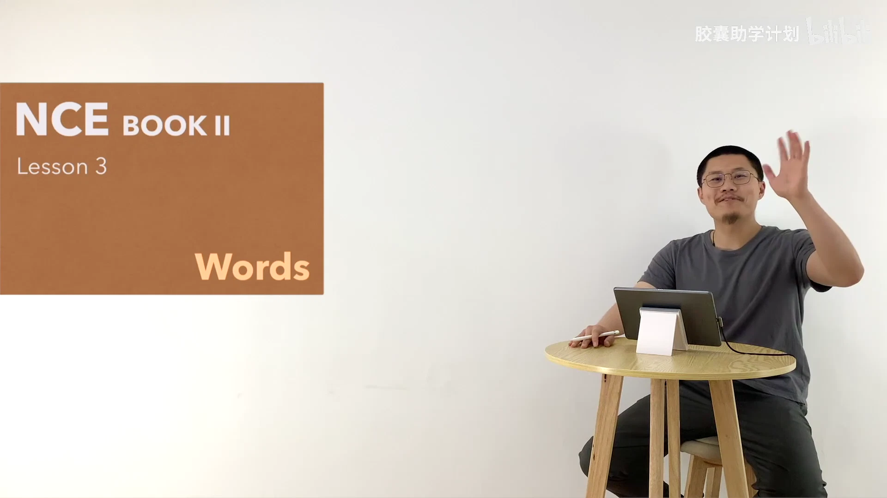

文字识别：胶囊助学计划 / NCE / BOOKII / Lesson 3 / Words

### 画面 00:00:04

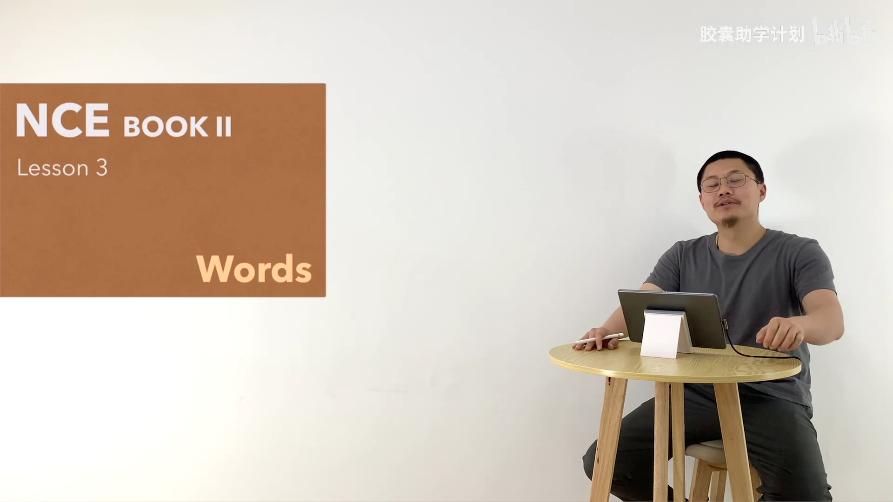

文字识别：胶囊助学计划 / NCE / BOOKII / Lesson 3 / Words

### 画面 00:00:06

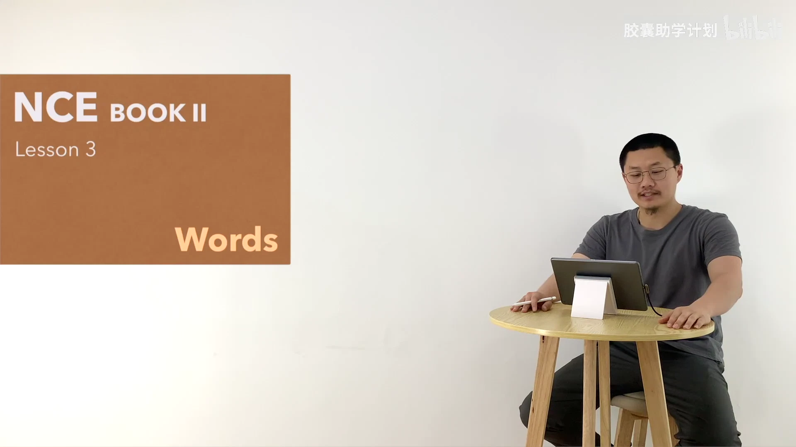

文字识别：胶囊助学计划 / NCE / BOOKI"I / Lesson 3 / Words

### 画面 00:00:09

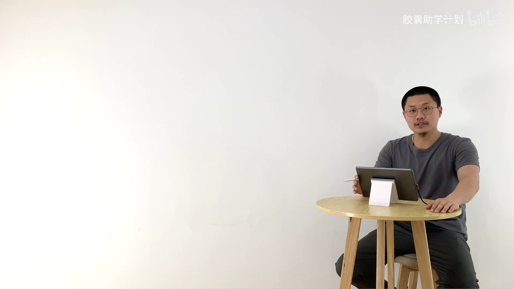

文字识别：胶囊助学计划

### 画面 00:00:11

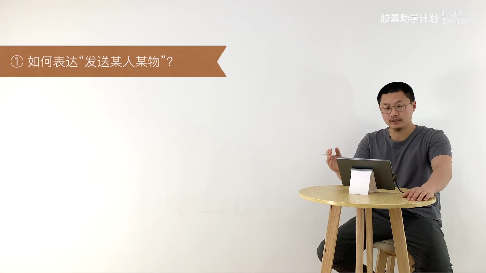

文字识别：胶囊助学计划 / ①如何表达“发送某人某物”？

### 画面 00:00:15

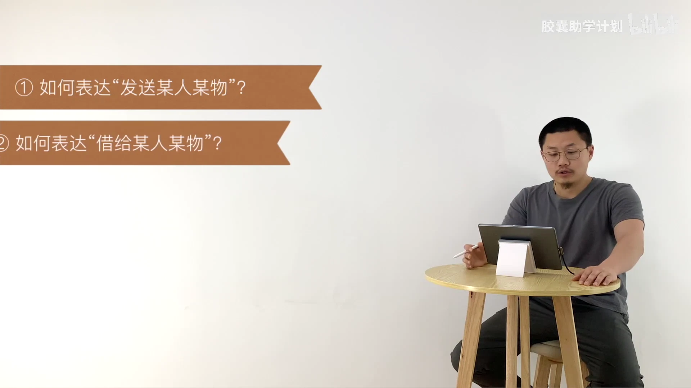

文字识别：胶囊助学计划 / ①如何表达“发送某人某物”？ / 如何表达“借给某人某物”

### 画面 00:00:17

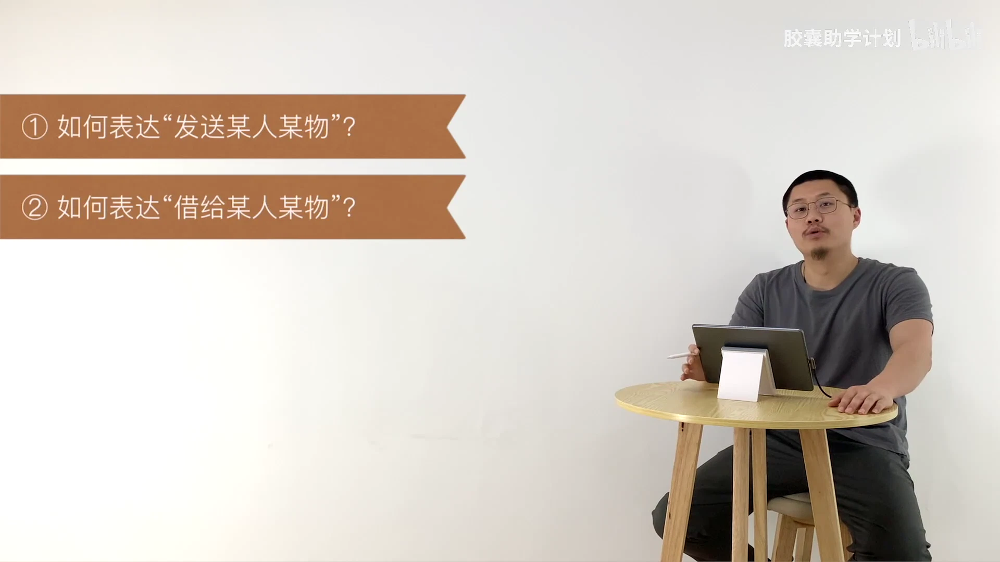

文字识别：胶囊助学计划 / ①如何表达“发送某人某物”？ / 如何表达“借给某人某物”?

### 画面 00:00:19

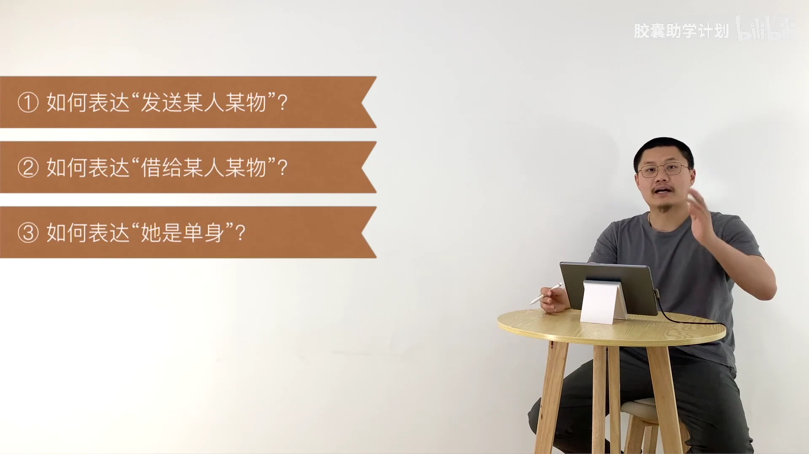

文字识别：胶囊助学计划 / ①如何表达“发送某人某物”？ / 如何表达“借给某人某物” / 如何表达“她是单身”?

### 画面 00:00:21

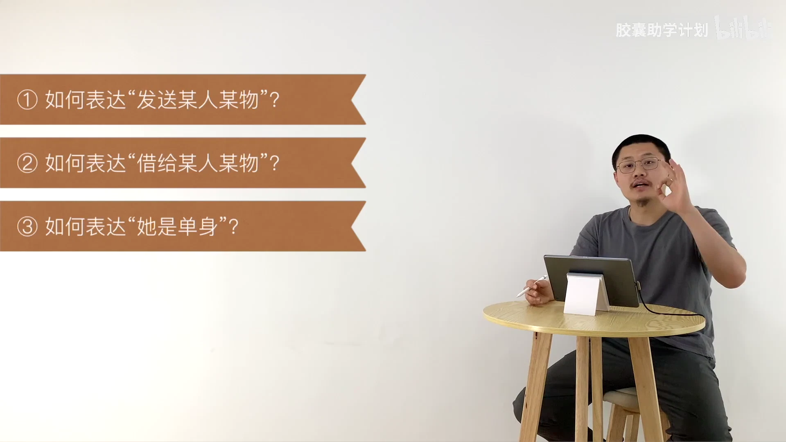

文字识别：胶囊助学计划 / ①如何表达“发送某人某物”？ / 如何表达“借给某人某物”? / 如何表达“她是单身”?

### 画面 00:00:24

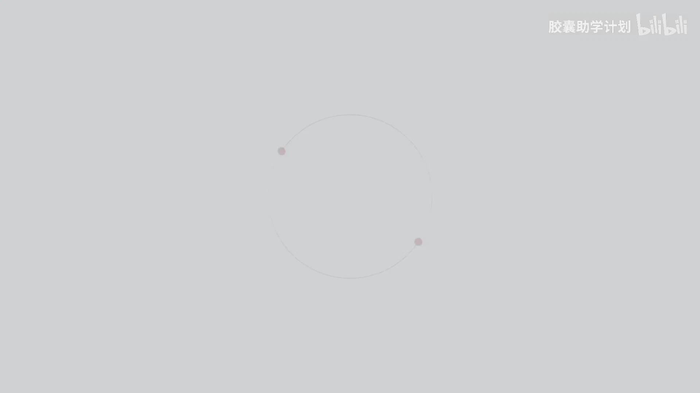

文字识别：胶囊助学计划出

### 画面 00:00:28

## 00:00:30–00:01:00

先看第一个单词啊。我们这个单词实际上是两个单词组成的，注意前面有一个 post 邮政的意思，对吧？后面有一个 card 叫做卡片的意思。那 postcard 邮政的、邮寄的卡片，我们管它叫做明信片，对吧？OK，跟我一起读，叫做 postcard。注意一个小点，postcard 它是一个名词。我们接下来要造句子，看一下造句指南当中告诉我们的，要找词性，那必然是

### 画面 00:00:30

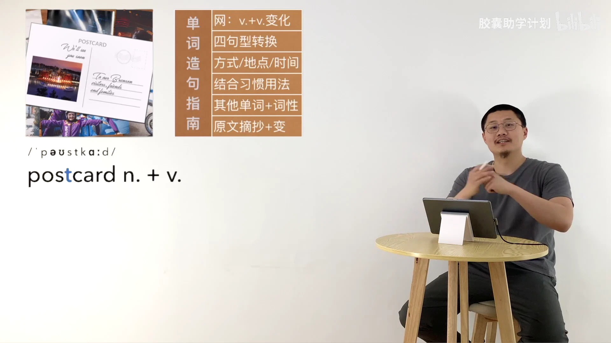

文字识别：单词造句指南 / 网：v.+v.变化 / 胶囊助学计划 / 四句型转换 / POSTCARD / We 'l see / gou saan / 方式/地点/时间 / Ta our Bransan / vrsitars, friends / 结合习惯用法 / and families / 其他单词+词性 / 原文摘抄+变 / /paustka:d/ / postcard n. + v.

### 画面 00:00:33

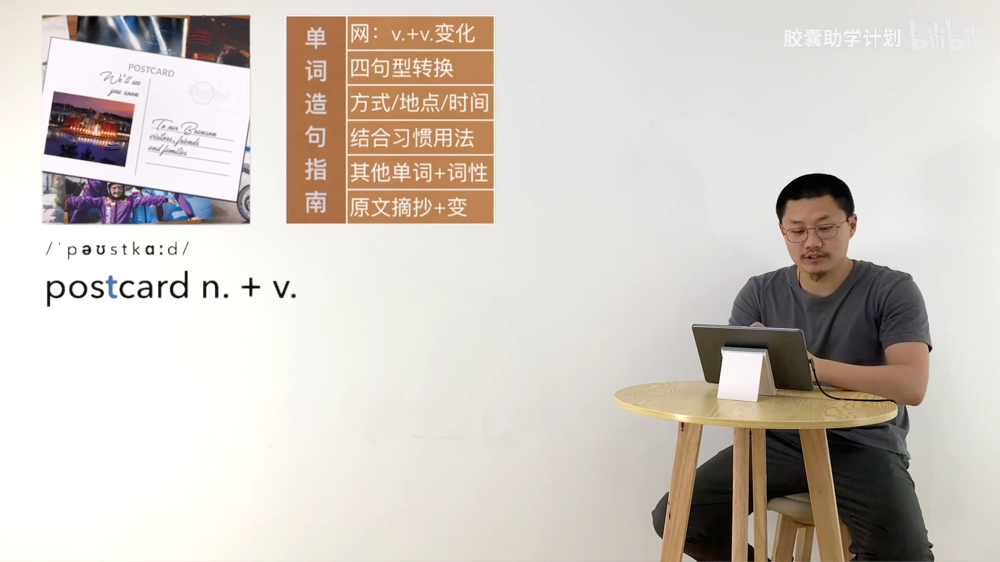

文字识别：单词造句指南 / 网：v.+v.变化 / 胶囊助学计划 / 四句型转换 / POSTCARD / We'l seee / gou soon / 方式/地点/时间 / Ta aus Bransan / visitars, friends / 结合习惯用法 / and families / 其他单词+词性 / 原文摘抄+变 / /paustka:d/ / postcard n. + v.

### 画面 00:00:35

文字识别：单词造句指南 / 网：v.+v.变化 / 胶囊助学计划 / 四句型转换 / POSTCARD / We ll see / you soan / 方式/地点/时间 / Ta aur Branson / ersitors friends / 结合习惯用法 / and families / 其他单词+词性 / 原文摘抄+变 / /paustka:d/ / postcard n. + v.

### 画面 00:00:38

文字识别：单词造句指南 / 网：v.+v.变化 / 胶囊助学计划 / 四句型转换 / POSTCARD / Well se / gou saan / 方式/地点/时间 / Ta aur Bransan / vrsitars, friends / 结合习惯用法 / and families / 其他单词+词性 / 原文摘抄+变 / /paustka:d/ / postcard n. + v.

### 画面 00:00:40

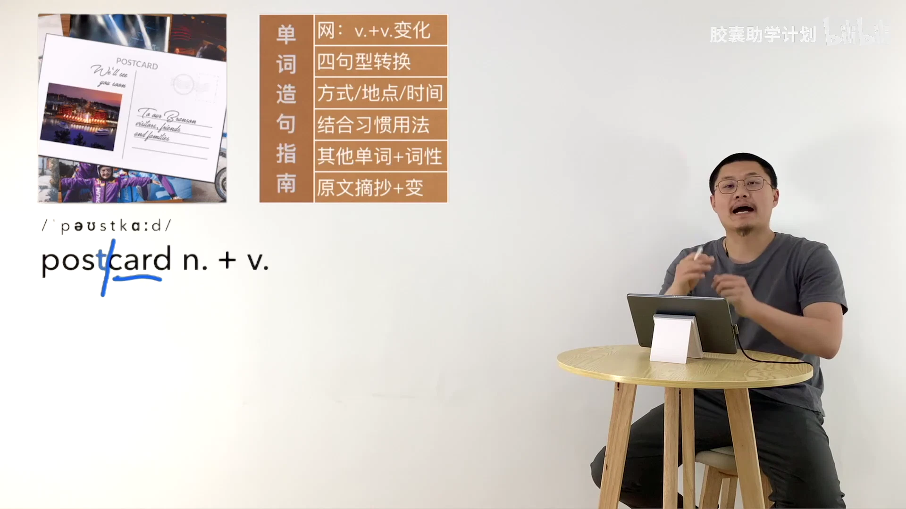

文字识别：单词造句指南 / 网：v.+v.变化 / 胶囊助学计划 / POSTCARD / 四句型转换 / We'll see / you saan / 方式/地点/时间 / Ta aur Branson / vistars, friends / 结合习惯用法 / and fomities / 其他单词+词性 / 原文摘抄+变 / /paustka:d/ / postcard n. + v.

### 画面 00:00:45

文字识别：单词造句指南 / 网：v.+v.变化 / 胶囊助学计划 / 四句型转换 / POSTCARD / We'l seee / you soan / 方式/地点/时间 / Ta our Bransan / vrsitars,friends / 结合习惯用法 / and families / 其他单词+词性 / 原文摘抄+变 / /paustka:d/ / postcard n. + v.

### 画面 00:00:50

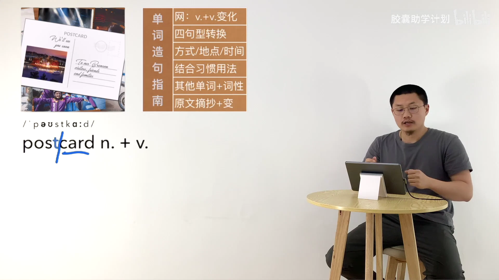

文字识别：单词造句指南 / 网：v.+v.变化 / 胶囊助学计划 / 四句型转换 / POSTCARD / We'l seee / you soan / 方式/地点/时间 / Ta our Bransan / vrsiters friends / 结合习惯用法 / and familie / 其他单词+词性 / 原文摘抄+变 / /paustka:d/ / posteard n. + v.

### 画面 00:00:55

文字识别：单词造句指南 / 网：v.+v.变化 / 胶囊助学计划 / 四句型转换 / POSTCARD / We'l seee / you soon / 方式/地点/时间 / Ta aur Bransan / vrsitars, friends / 结合习惯用法 / and families / 其他单词+词性 / 原文摘抄+变 / /paustka:d/ / posteard n. + v.

## 00:01:00–00:01:30

找动词。跟 postcard 比较常见的动词，那我能立刻想到的就是买了，对吧？那我们在这儿呢，正好给大家拓展一个小的短语，叫做 buy somebody something。 S B 点指的是某人， S T H 点指的是某物，那叫做买给某人某物，或者是买了某个东西某物给某人。好，比如说我们看一句话，叫做 I bought a

### 画面 00:01:00

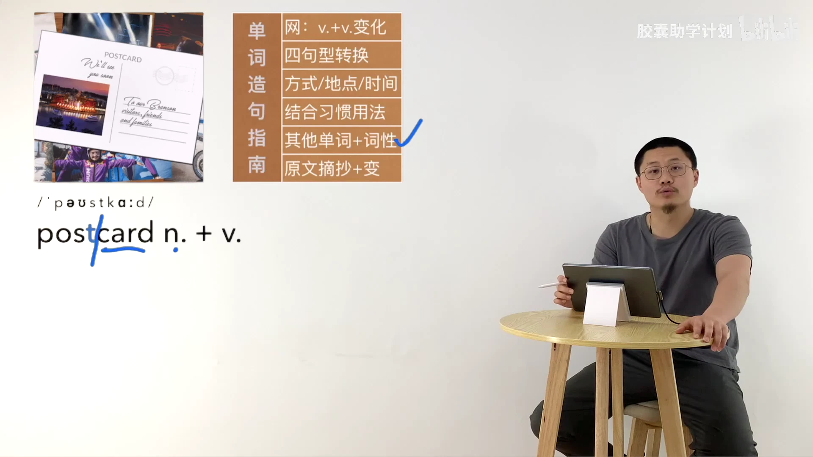

文字识别：单词造句指南 / 网：v.+v.变化 / 胶囊助学计划 / 四句型转换 / POSTCARD / We'l seee / you soon / 方式/地点/时间 / Ta aur Branson / vrsitars,friends / 结合习惯用法 / and fomilies / 其他单词+词性 / 原文摘抄+变 / /paustka:d/ / postcard n. + v.

### 画面 00:01:03

文字识别：单词造句指南 / 网：v.+v.变化 / 胶囊助学计划 / POSTCARD / 四句型转换 / We'l seee / you soan / 方式/地点/时间 / Ta our Bransan / vrsitars, friends / 结合习惯用法 / and families / 其他单词+词性 / 原文摘抄+变 / /paustka:d/ / posteard n. + v. / ① buy sb.sth.= buy sth.for sb.

### 画面 00:01:05

文字识别：单词造句指南 / 网：v.+v.变化 / 胶囊助学计划 / POSTCARD / 四句型转换 / We ll see / you saon / 方式/地点/时间 / Ta aur Branson / vrstars, friends / 结合习惯用法 / and families / 其他单词+词性 / 原文摘抄+变 / /paustka:d/ / posteard n. + v. / ① buy sb.sth.= buy sth.for sb.

### 画面 00:01:08

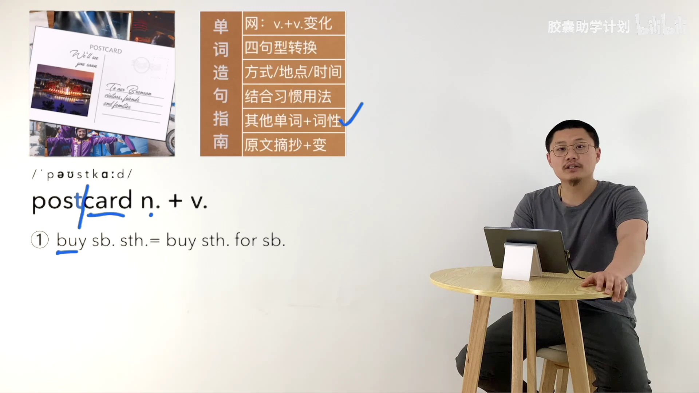

文字识别：单词造句指南 / 网：v.+v.变化 / 胶囊助学计划 / POSTCARD / 四句型转换 / Well see / you soon / 方式/地点/时间 / Ta our Bransan / vrsitars, friends / 结合习惯用法 / and famities / 其他单词+词性 / 原文摘抄+变 / /paustka:d/ / posteard n. + v. / ① buy sb.sth.= buy sth.for sb.

### 画面 00:01:10

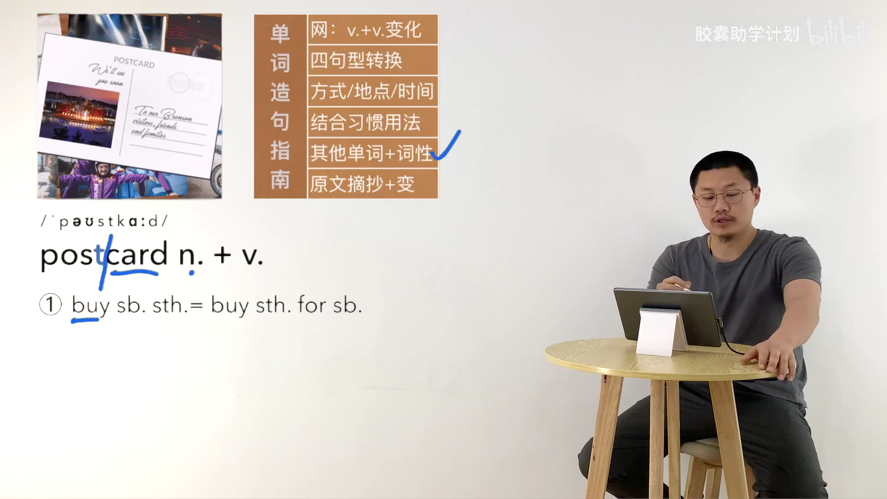

文字识别：单词造句指南 / 网：v.+v.变化 / 胶囊助学计划 / POSTCARD / 四句型转换 / We'l see / you soan / 方式/地点/时间 / Ta aur Branson / vrsitars, frinds / 结合习惯用法 / and families / 其他单词+词性 / 原文摘抄+变 / /paustka:d/ / posteard n. + v. / ① buy sb.sth.= buy sth.for sb.

### 画面 00:01:15

文字识别：单词造句指南 / 网：v.+v.变化 / 胶囊助学计划 / POSTCARD / 四句型转换 / We ll see / gou saon / 方式/地点/时间 / To our Bransan / vrsitars friends / 结合习惯用法 / and families / 其他单词+词性 / 原文摘抄+变 / /paustka:d/ / posteard n. + v. / ① buy sb. sth.= buy sth. for sb.

### 画面 00:01:19

文字识别：单词造句指南 / 网：v.+v.变化 / 胶囊助学计划 / POSTCARD / 四句型转换 / We'lsee / gou soon / 方式/地点/时间 / Ta aur Bransan / vrsitars, friends / 结合习惯用法 / and famities / 其他单词+词性 / 原文摘抄+变 / /paustka:d/ / postard n.+ v. / ① buy sb. sth.= buy sth. for sb.

### 画面 00:01:21

文字识别：单词造句指南 / 网：v.+v.变化 / 胶囊助学计划 / POSTCARD / 四句型转换 / We'l se / gou soon / 方式/地点/时间 / Ta aur Branson / vrsitors, friends / 结合习惯用法 / and famitie / 其他单词+词性 / 原文摘抄+变 / /paustka:d/ / posteard n. + v. / ① buy sb. sth.= buy sth. for sb.

### 画面 00:01:23

文字识别：单词造句指南 / 网：v.+v.变化 / 胶囊助学计划 / POSTCARD / 四句型转换 / We'l see / gou soon / 方式/地点/时间 / Ta aur Branson / vrsitars, friends / 结合习惯用法 / and families / 其他单词+词性 / 原文摘抄+变 / /paustka:d/ / posteard n. + v. / ① buy sb. sth.= buy sth.for sb.

### 画面 00:01:25

文字识别：单词造句指南 / 网：v.+v.变化 / 胶囊助学计划 / POSTCARD / 四句型转换 / We ll see / you saan / 方式/地点/时间 / Ta aur Bransan / vrsitars friends / 结合习惯用法 / and families / 其他单词+词性 / 原文摘抄+变 / /paustka:d/ / postard n. + v. / ① buy sb. sth.= buy sth. for sb.

### 画面 00:01:28

文字识别：单词造句指南 / 网：v.+v.变化 / 胶囊助学计划 / POSTCARD / 四句型转换 / We ll see / you saan / 方式/地点/时间 / Ta our Branson / vrsitas, friends / 结合习惯用法 / and familie / 其他单词+词性 / 原文摘抄+变 / /paustka:d/ / postard n. + v. / ① buy sb. sth.= buy sth.for sb. / oTbought a postcard for him this morning.

## 00:01:30–00:02:00

postcard. Bought, 注意是过去式，对吧？某物给 for somebody，某人 this morning，今儿早晨的事儿。哎，一般过去式。接下来您看到了这个肯定句，那立刻要做的是四句型转化，这是我们的基本功，对吧？我们可以把 did 进行一个提前，然后别忘了把 bought 换回原形，叫做 Did you buy a postcard for him this morning？那接下来这个东西当中，我们能

### 画面 00:01:30

文字识别：单词造句指南 / 网：v.+v.变化 / 胶囊助学计划 / POSTCARD / 四句型转换 / We ll se / gou saan / 方式/地点/时间 / Ta our Bramsan / vrsiters friends / 结合习惯用法 / and families / 其他单词+词性 / 原文摘抄+变 / /paustka:d/ / postard n.+ v. / ① buy sb. sth.= buy sth.for sb. / o I bought a postcard for him this morning.

### 画面 00:01:34

文字识别：单词造句指南 / 网：v.+v.变化 / 胶囊助学计划 / POSTCARD / 四句型转换 / Well see / gou saan / 方式/地点/时间 / Ta our Bransan / vrsitas, friends / 结合习惯用法 / and amilies / 其他单词+词性 / 原文摘抄+变 / /paustka:d/ / postard n.+ v. / ① buy sb. sth.= buy sth. for sb. / o I bought a postcard for him this morning.

### 画面 00:01:36

文字识别：单词造句指南 / 网：v.+v.变化 / 胶囊助学计划 / POSTCARD / 四句型转换 / We ll se / gou soon / 方式/地点/时间 / Ta aur Bransan / vrsitars, friends / 结合习惯用法 / and amilies / 其他单词+词性 / 原文摘抄+变 / /paustka:d/ / postard n. + v. / ① buy sb. sth.= buy sth.for sb. / o I bought a postcard for him this morning.

### 画面 00:01:40

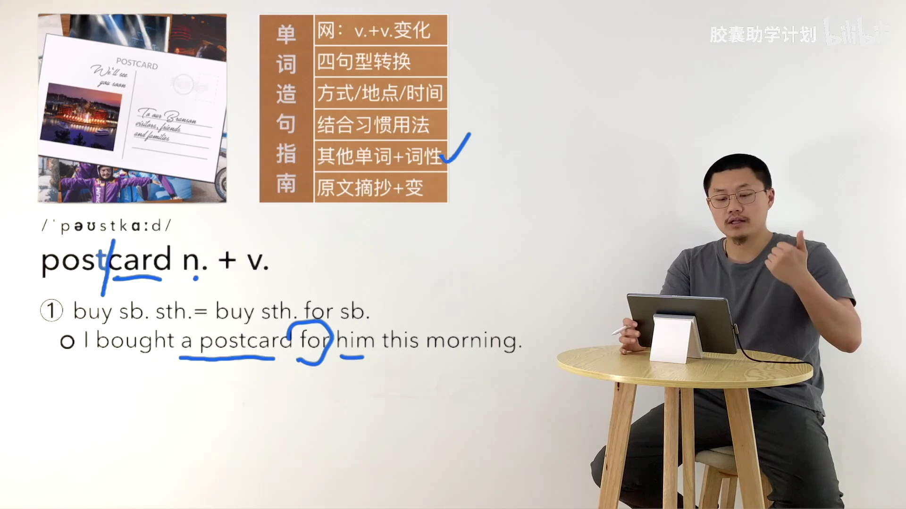

文字识别：单词造句指南 / 网：v.+v.变化 / 胶囊助学计划 / POSTCARD / 四句型转换 / We ll se / you soan / 方式/地点/时间 / To aur Bransan / vrsitars, friends / 结合习惯用法 / and families / 其他单词+词性 / 原文摘抄+变 / /paustka:d/ / postard n. + v. / ① buy sb. sth.= buy sth.for sb. / o I bought a postcard foghim this morning.

### 画面 00:01:43

文字识别：单词造句指南 / 网：v.+v.变化 / 胶囊助学计划 / POSTCARD / 四句型转换 / We ll se / you soan / 方式/地点/时间 / Ta our Bransan / vrsitars, friends / 结合习惯用法 / and families / 其他单词+词性 / 原文摘抄+变 / /paustka:d/ / postard n. + v. / ① buy sb. sth.= buy sth.for sb. / o I bought a postcard fo him this morning.

### 画面 00:01:45

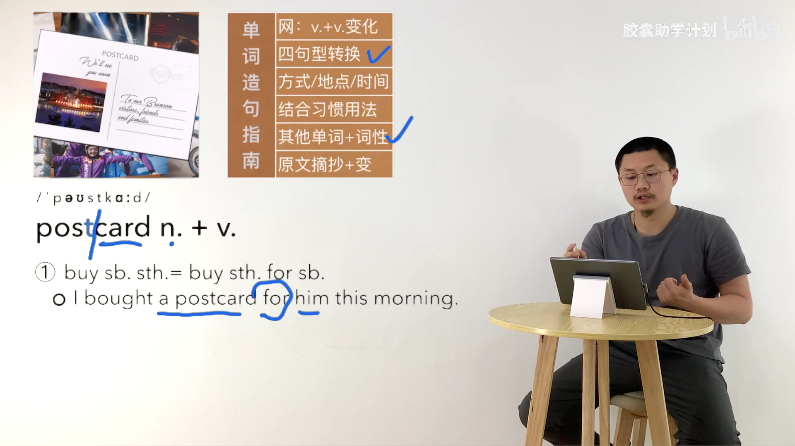

文字识别：单词造句指南 / 网：v.+v.变化 / 胶囊助学计划 / POSTCARD / 四句型转换 / We ll see / you saan / 方式/地点/时间 / Ta our Bransan / vrsitars, friends / 结合习惯用法 / and families / 其他单词+词性 / 原文摘抄+变 / /paustka:d/ / postard n.+ v. / ① buy sb. sth.= buy sth.for sb. / o I bought a postcard fo him this morning.

### 画面 00:01:50

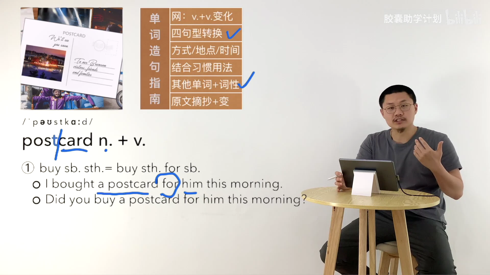

文字识别：单词造句指南 / 网：v.+v.变化 / 胶囊助学计划 / POSTCARD / 四句型转换 / Well se / gou saan / 方式/地点/时间 / Ta aur Bransan / visitars, friends / 结合习惯用法 / and families / 其他单词+词性 / 原文摘抄+变 / /paustka:d/ / posteard n. + v. / ① buy sb. sth.= buy sth. for sb. / o I bought a postcard foghim this morning. / o Did you buy a postcard for him this morning?

### 画面 00:01:55

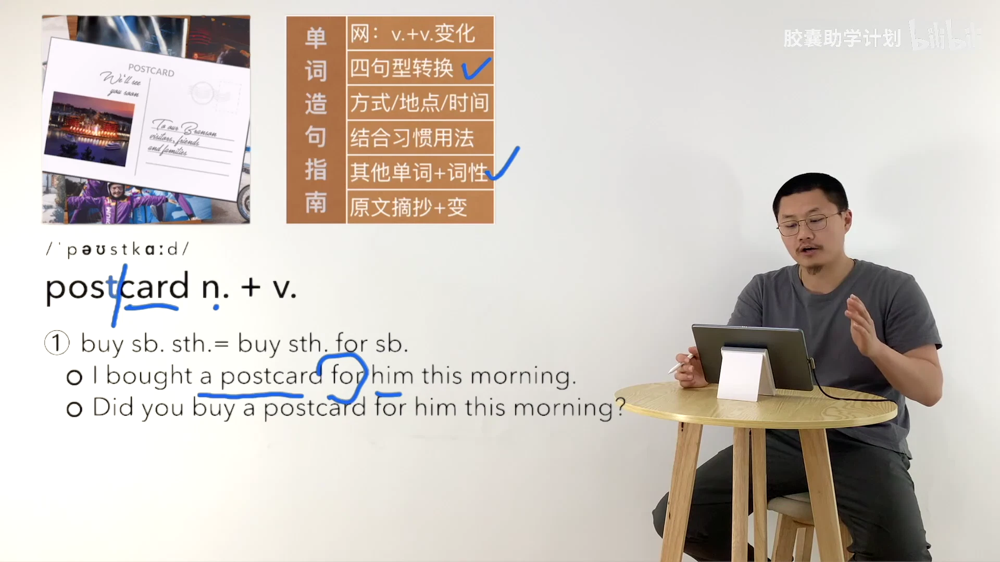

文字识别：单词造句指南 / 网：v.+v.变化 / 胶囊助学计划 / 四句型转换 / POSTCARD / We ll se / you soan / 方式/地点/时间 / Ta aur Bransan / visitars, friends / 结合习惯用法 / and families / 其他单词+词性 / 原文摘抄+变 / /paustka:d/ / postard n. + v. / ① buy sb. sth.= buy sth.for sb. / o I bought a postcard for him this morning. / o Did you buy a postcard for him this morning?

### 画面 00:01:59

文字识别：单词造句指南 / 网：v.+v.变化 / 胶囊助学计划 / POSTCARD / 四句型转换 / We ll see / gou saon / 方式/地点/时间 / Ta our Bransan / vrsitars, friends / 结合习惯用法 / and famiies / 其他单词+词性 / 原文摘抄+变 / /paustka:d/ / postard n. + v. / ① buy sb. sth.= buy sth.for sb. / o I bought a postcard for him this morning. / o Did you buy a postcard for him this morning?

## 00:02:00–00:02:30

就这句话一般疑问句这句话，我们能对它进行提问的特殊疑问词实际上是很多的。比如说，a postcard，对它提问用什么？想一想，what，对吧？对him提问，who？对you提问，who？对this morning提问，when？对吧？您就一下能造出来好多特殊疑问句了。那我们不挨个造了，我们给大家一个例子就行了。比如说，Where did you buy a postcard for him this morning？今儿早上你给

### 画面 00:02:01

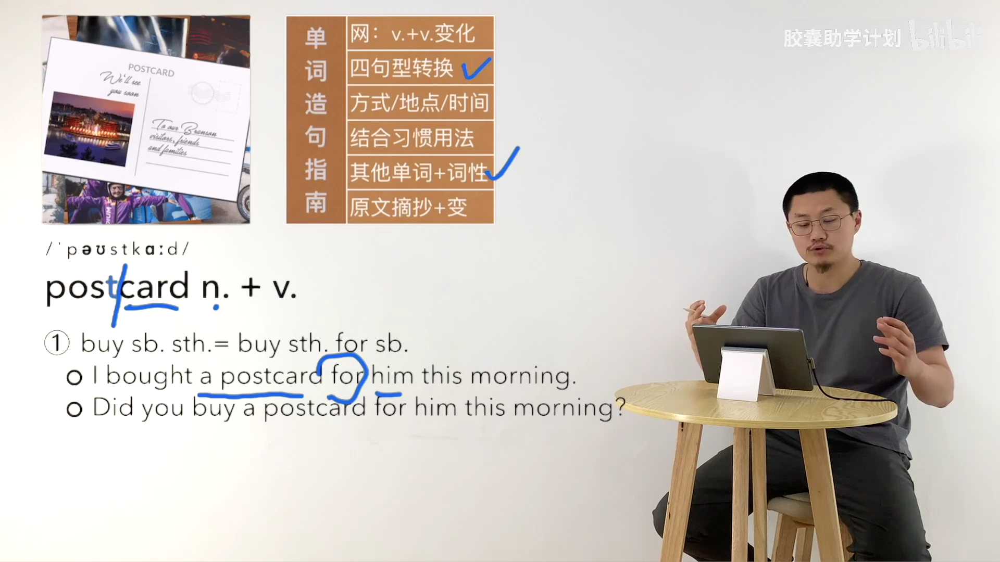

文字识别：单词造句指南 / 网：v.+v.变化 / 胶囊助学计划 / POSTCARD / 四句型转换 / We ll see / gou soan / 方式/地点/时间 / Ta our Branson / vrsitars, friends / 结合习惯用法 / and families / 其他单词+词性 / 原文摘抄+变 / /paustka:d/ / posteard n. + v. / ① buy sb. sth.= buy sth.for sb. / o I bought a postcard for him this morning. / o Did you buy a postcard for him this morning?

### 画面 00:02:05

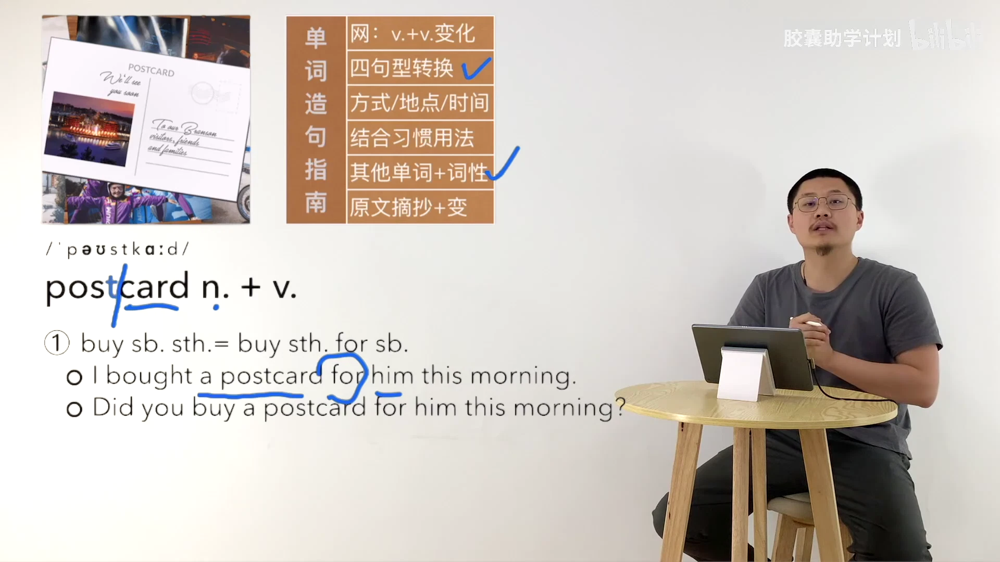

文字识别：单词造句指南 / 网：v.+v.变化 / 胶囊助学计划 / POSTCARD / 四句型转换 / We ll se / you soon / 方式/地点/时间 / Ta our Bransan / vrsitars, friends / 结合习惯用法 / and famities / 其他单词+词性 / 原文摘抄+变 / /paustka:d/ / postard n.+ v. / ① buy sb. sth.= buy sth.for sb. / o I bought a postcard foy him this morning. / o Did you buy a postcard for him this morning?

### 画面 00:02:08

文字识别：单词造句指南 / 网：v.+v.变化 / 胶囊助学计划 / POSTCARD / 四句型转换 / We ll se / you saan / 方式/地点/时间 / Ta our Bransan / vrsitars, friends / 结合习惯用法 / and famities / 其他单词+词性 / 原文摘抄+变 / /paustka:d/ / posteard n. + v. / ① buy sb. sth.= buy sth.for sb. / o I bought a postcard foghim this morning. / o Did you buy a postcard For him this morning?

### 画面 00:02:11

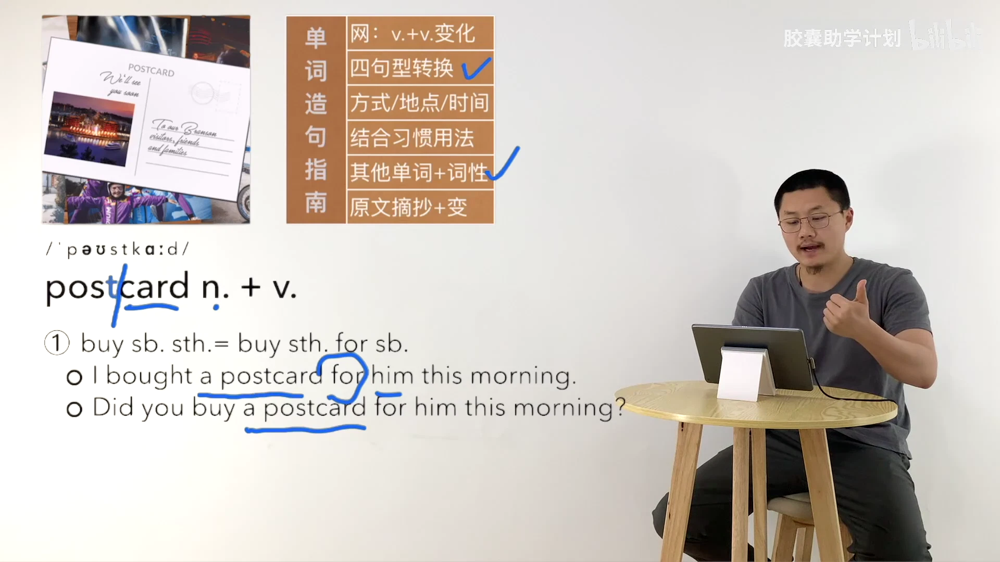

文字识别：单词造句指南 / 网：v.+v.变化 / 胶囊助学计划 / POSTCARD / 四句型转换 / We'l se / gou soan / 方式/地点/时间 / Ta our Bransan / ersitars, friends / 结合习惯用法 / and amilies / 其他单词+词性 / 原文摘抄+变 / /paustka:d/ / postard n.+ v. / ① buy sb. sth.= buy sth.for sb. / o I bought a postcard for him this morning. / o Did you buy a postcard for him this morning?

### 画面 00:02:14

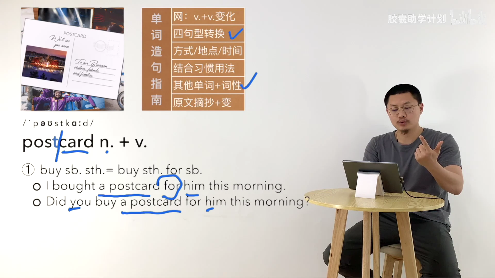

文字识别：单词造句指南 / 网：v.+v.变化 / 胶囊助学计划 / POSTCARD / 四句型转换 / We'll se / you soon / 方式/地点/时间 / Ta our Bransan / vrsitars, friends / 结合习惯用法 / and families / 其他单词+词性 / 原文摘抄+变 / /paustka:d/ / posteard n. + v. / ① buy sb. sth.= buy sth.for sb. / o I bought a postcard for him this morning. / o Did you buy a postcard for him this morning?

### 画面 00:02:16

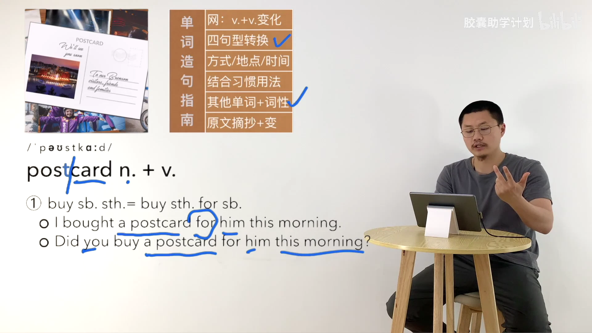

文字识别：单词造句指南 / 网：v.+v.变化 / 胶囊助学计划 / POSTCARD / 四句型转换 / We ll se / you soon / 方式/地点/时间 / Ta our Bransan / ersiters friends / 结合习惯用法 / and families / 其他单词+词性 / 原文摘抄+变 / /paustka:d/ / posteard n. + v. / ① buy sb. sth.= buy sth.for sb. / o I bought a postcard foghim this morning. / o Did you buy a postcard for him this morning?

### 画面 00:02:18

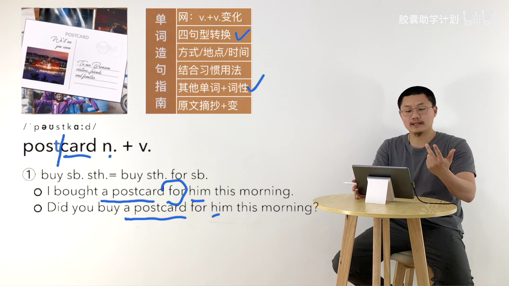

文字识别：单词造句指南 / 网：v.+v.变化 / 胶囊助学计划 / POSTCARD / 四句型转换 / We'll se / you soon / 方式/地点/时间 / Ta our Bransan / ersitars, friends / 结合习惯用法 / and families / 其他单词+词性 / 原文摘抄+变 / /paustka:d/ / postard n. + v. / ① buy sb. sth.= buy sth.for sb. / o I bought a postcard fonhim this morning. / o Did you buy a postcard for him this morning?

### 画面 00:02:20

文字识别：单词造句指 / 网：v.+v.变化 / 胶囊助学计划 / POSTCARD / 四句型转换 / We ll se / you soan / 方式/地点/时间 / Ta our Bransan / vrsitars, friends / 结合习惯用法 / and famities / 其他单词+词性 / 南 / 原文摘抄+变 / /paustka:d/ / postard n. + v. / ① buy sb. sth.= buy sth. for sb. / o I bought a postcard for him this morning. / o Did you buy a postcard for him this morning?

### 画面 00:02:24

文字识别：单词造 / 网：v.+v.变化 / 胶囊助学计划 / POSTCARD / 四句型转换 / We'l ee / gou soan / 方式/地点/时间 / Ta aus Bransan / 句 / vrsitas, friends / 结合习惯用法 / and famities / 指 / 其他单词+词性 / 南 / 原文摘抄+变 / /paustka:d/ / postard n. + v. / ① buy sb.sth.= buy sth.for sb. / o I bought a postcard foyhim this morning. / o Did you buy a postcard for him this morning? / o Where did you buy a postcard for him this morning

### 画面 00:02:27

文字识别：单词造句指 / 网：v.+v.变化 / 胶囊助学计划 / POSTCARD / 四句型转换 / We'll see / you saan / 方式/地点/时间 / Ta our Bransoan / vrsitors, friends / 结合习惯用法 / and families / 其他单词+词性 / 南 / 原文摘抄+变 / /paustka:d/ / postard n. + v. / ① buy sb. sth.= buy sth.for sb. / o I bought a postcard foyhim this morning. / o Did you buy a postcard for him this morning? / o Where did you buy a postcard for him this morning?

## 00:02:30–00:03:00

他买的那个明信片是在哪里，在什么地方买的呢？OK，那各位注意啊，还是这些句子不是重点，这个如何我上课如何用这个单词造句指南造出来这些句子才是重点。各位回去不用把它抄下来，要自己去尝试着造一些句子出来，好吧？照葫芦画瓢啊。OK，那我还有一句话叫做Where can I buy a postcard？这句话还是在各位出国旅游的

### 画面 00:02:30

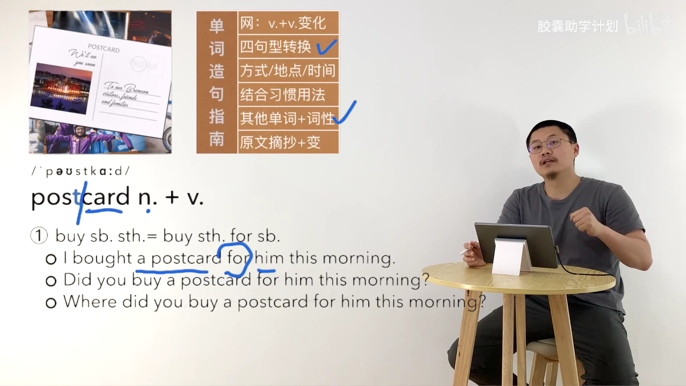

文字识别：单词造 / 网：v.+v.变化 / 胶囊助学计划 / POSTCARD / 四句型转换 / We'll see / you saan / 方式/地点/时间 / Ta aur Bransan / 句 / vrsitors, friends / 结合习惯用法 / and familie / 指 / 其他单词+词性 / 南 / 原文摘抄+变 / /paustka:d/ / postard n.+ v. / ① buy sb. sth.= buy sth.for sb. / o I bought a postcard foghim this morning. / o Did you buy a postcard for him this morning? / o Where did you buy a postcard for him this morningf

### 画面 00:02:35

文字识别：单词造句指 / 网：v.+v.变化 / 胶囊助学计划 / POSTCARD / 四句型转换 / We ll see / you saan / 方式/地点/时间 / Ta aur Bransan / ersitars, friends / 结合习惯用法 / and famitie / 其他单词+词性 / 南 / 原文摘抄+变 / /paustka:d/ / postard n. + v. / ① buy sb. sth.= buy sth.for sb. / o I bought a postcard foyhim this morning. / o Did you buy a postcard for him this morning? / o Where did you buy a postcard for him this mornin

### 画面 00:02:38

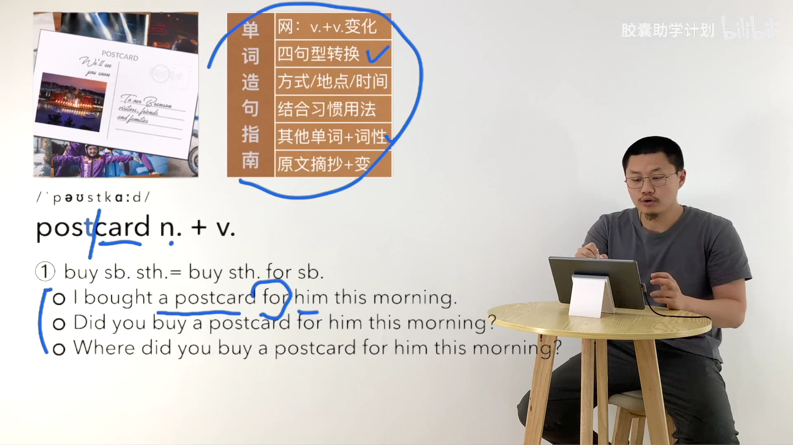

文字识别：单词造句 / 网：v.+v.变化 / 胶囊助学计划 / POSTCARD / 四句型转换 / We'll se / you soan / 方式/地点/时间 / Ta our Branson / vrsitas, friends / 结合习惯用法 / and families / 指 / 其他单词+词性 / 南 / 原文摘抄+变 / /paustka:d/ / postard n.+ v. / ① buy sb. sth.= buy sth.for sb. / ro I bought a postcard foy him this morning. / o Did you buy a postcard for him this morning? / o Where did you buy a postcard for him this morningh

### 画面 00:02:40

文字识别：单词造 / 网：v.+v.变化 / 胶囊助学计划 / POSTCARD / 四句型转换 / We'll scee / you saan / 方式/地点/时间 / Ta our Bransan / 句 / vrsitars, friends / 结合习惯用法 / and familie / 指 / 其他单词+词性 / 南 / 原文摘抄+变 / /paustka:d/ / postard n. + v. / ① buy sb. sth.= buy sth.for sb. / ro I bought a postcard foy him this morning. / o Did you buy a postcard for him this morning? / o Where did you buy a postcard for him this morningh

### 画面 00:02:43

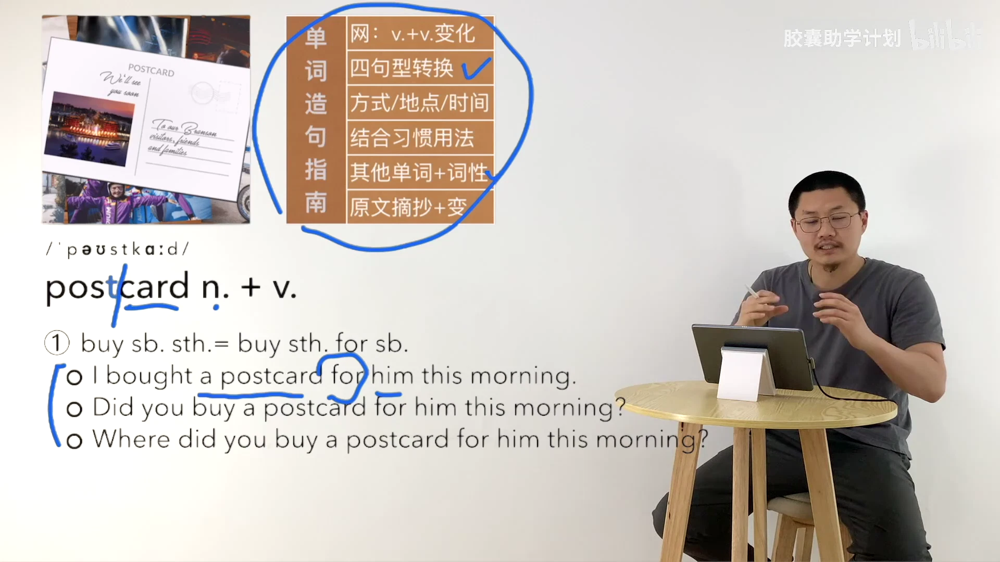

文字识别：单词造 / 网：v.+v.变化 / 胶囊助学计划 / POSTCARD / 四句型转换 / We'll scee / you soan / 方式/地点/时间 / Ta our Bransan / 句 / vrsitars, friends / 结合习惯用法 / and famities / 指 / 其他单词+词性 / 南 / 原文摘抄+变 / /paustka:d/ / postard n.+ v. / ① buy sb. sth.= buy sth.for sb. / o I bought a postcard foy him this morning. / o Did you buy a postcard For him this morning? / o Where did you buy a postcard for him this morning

### 画面 00:02:45

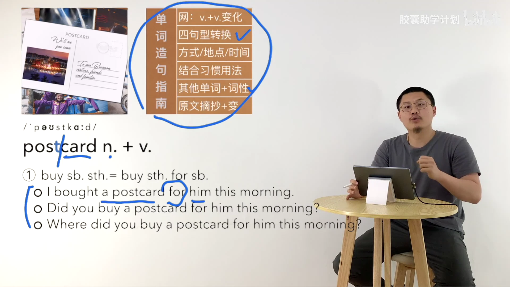

文字识别：单词造 / 网：v.+v.变化 / 胶囊助学计划 / POSTCARD / 四句型转换 / We'l see / you saan / 方式/地点/时间 / Ta our Branson / 句 / eisitors, friends / 结合习惯用法 / and families / 指 / 其他单词+词性 / 南 / 原文摘抄+变 / /paustka:d/ / postard n. + v. / ① buy sb. sth.= buy sth.for sb. / To I bought a postcard foyhim this morning. / o Did you buy a postcard for him this morning? / o Where did you buy a postcard for him this morning!

### 画面 00:02:50

文字识别：单词造 / 网：v.+v.变化 / 胶囊助学计划 / POSTCARD / 四句型转换 / We'll see / you soan / 方式/地点/时间 / Ta our Branson / 句 / visitars, friends / 结合习惯用法 / and families / 指 / 其他单词+词性 / 南 / 原文摘抄+变 / /paustka:d/ / posteard n. + v. / ① buy sb. sth.= buy sth.for sb. / o I bought a postcard foy him this morning. / o Did you buy a postcard for him this morning? / o Where did you buy a postcard for him this morningf

### 画面 00:02:53

文字识别：单词造 / 网：v.+v.变化 / 胶囊助学计划 / POSTCARD / 四句型转换 / We'll se / you soon / 方式/地点/时间 / Ta aur Bransan / 句 / vrsitars, friends / 结合习惯用法 / and famities / 指 / 其他单词+词性 / 南 / 原文摘抄+变 / /paustka:d/ / postard n. + v. / ① buy sb. sth.= buy sth.for sb. / o I bought a postcard forhim this morning. / o Did you buy a postcard for him this morning? / o Where did you buy a postcard for him this morning? /  Where can I buy a postcard?

### 画面 00:02:55

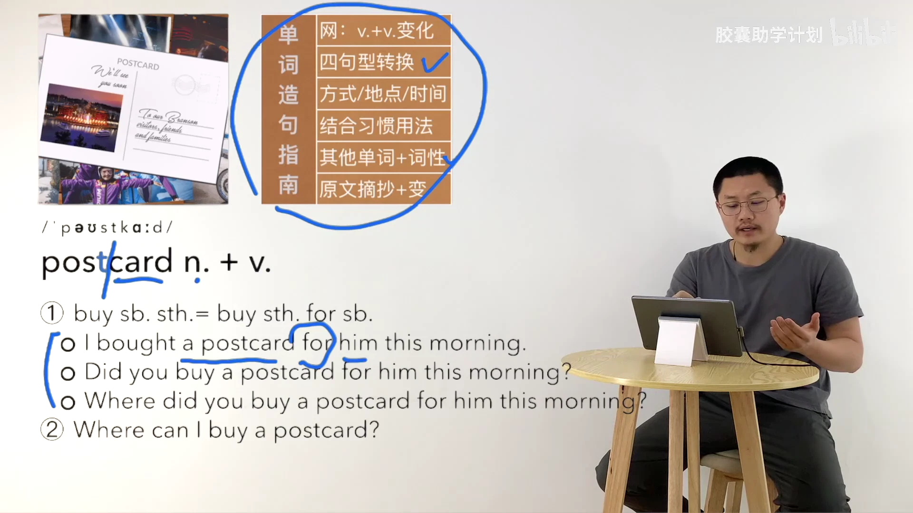

文字识别：单词造 / 网：v.+v.变化 / 胶囊助学计划 / POSTCARD / 四句型转换 / We'll see / gou soan / 方式/地点/时间 / Ta aur Branan / 句 / visitars, friends / 结合习惯用法 / and families / 指 / 其他单词+词性 / 南 / 原文摘抄+变 / /paustka:d/ / postard n.+ v. / ① buy sb. sth.= buy sth.for sb. / o I bought a postcard foy him this morning. / o Did you buy a postcard for him this morning? / o Where did you buy a postcard for him this mornin /  Where can I buy a postcard?

### 画面 00:02:57

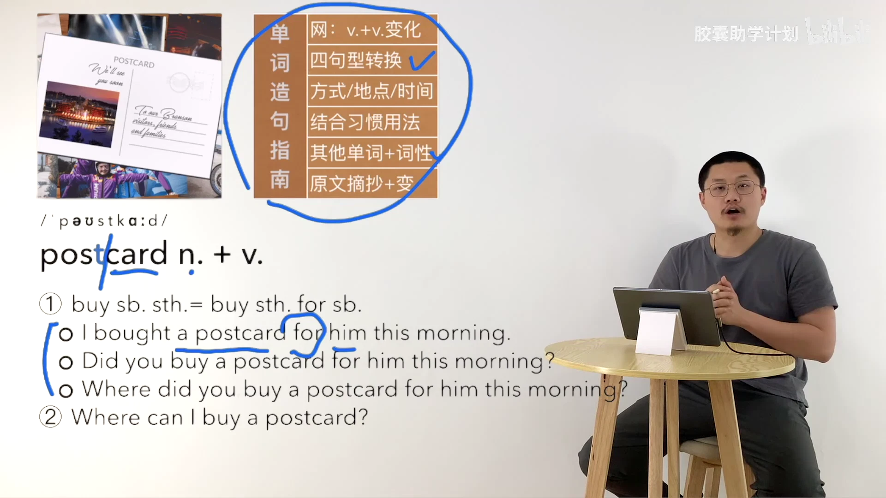

文字识别：单词造 / 网：v.+v.变化 / 胶囊助学计划 / POSTCARD / 四句型转换 / We'll ee / you saon / 方式/地点/时间 / Ta aur Branon / 一句 / vrsitars, friends / 结合习惯用法 / and families / 指 / 其他单词+词性 / 南 / 原文摘抄+变 / /paustka:d/ / posteard n. + v. / ① buy sb. sth.= buy sth.for sb. / [o I bought a postcard foy him this morning. / o Did you buy a postcard for him this morning? / o Where did you buy a postcard for him this morning? /  Where can I buy a postcard?

## 00:03:00–00:03:30

时候还挺常用的。我在什么地方能买到一张明信片呢？好，注意，那我们想一下这句话我是怎么张开嘴造出来的？我给大家了一句话，对吧？因为这句话比较常见。那实际上这句话，你想一下，它也是变过来的。比如说，你能在什么地方买一张明信片？某地，对吧？那叫做 You can buy a postcard in that store. 在那个商店当中，那我可以把它变成一个一般疑问句，叫做 Can I

### 画面 00:03:00

文字识别：单词造 / 网：v.+v.变化 / 胶囊助学计划 / POSTCARD / 四句型转换 / We'll see / you soan / 方式/地点/时间 / Ta aur Branan / 句 / vrsitars, friends / 结合习惯用法 / and famiies / 指 / 其他单词+词性 / 南 / 原文摘抄+变 / /paustka:d/ / postard n. + v. / ① buy sb. sth.= buy sth.for sb. / o I bought a postcard foy him this morning. / o Did you buy a postcard for him this morning? / o Where did you buy a postcard for him this morning? /  Where can I buy a postcard?

### 画面 00:03:03

文字识别：单词造 / 网：v.+v.变化 / 胶囊助学计划 / POSTCARD / 四句型转换 / We'll scee / you soan / 方式/地点/时间 / Ta aur Bramson / 句 / visitars, friends / 结合习惯用法 / and famiies / 指 / 其他单词+词性 / 南 / 原文摘抄+变 / /paustka:d/ / postard n. + v. / ① buy sb. sth.= buy sth.for sb. / fo I bought a postcard foy him this morning. / o Did you buy a postcard For him this morning? / o Where did you buy a postcard for him this morningt /  Where can I buy a postcard?

### 画面 00:03:05

文字识别：单词造 / 网：v.+v.变化 / 胶囊助学计划 / POSTCARD / 四句型转换 / We'll see / you soan / 方式/地点/时间 / Ta aur Branaon / 句 / vrsitars, friends / 结合习惯用法 / and famiie / 指 / 其他单词+词性 / 南 / 原文摘抄+变 / /paustka:d/ / postard n. + v. / ① buy sb. sth.= buy sth.for sb. / [o I bought a postcard foy him this morning. / o Did you buy a postcard for him this morning? / o Where did you buy a postcard for him this morning! /  Where can I buy a postcard?

### 画面 00:03:08

文字识别：单词造 / 网：v.+v.变化 / 胶囊助学计划 / POSTCARD / 四句型转换 / We'll see / gou soan / 方式/地点/时间 / Ta aur Branson / 句 / visitars, friends / 结合习惯用法 / and families / 指 / 其他单词+词性 / 南 / 原文摘抄+变 / /paustka:d/ / postard n.+ v. / ① buy sb. sth.= buy sth.for sb. / o I bought a postcard foy him this morning. / o Did you buy a postcard for him this morning? / o Where did you buy a postcard for him this mornin /  Where can I buy a postcard?

### 画面 00:03:10

文字识别：单词造 / 网：v.+v.变化 / 胶囊助学计划 / POSTCARD / 四句型转换 / We'll see / gou soan / 方式/地点/时间 / Ta aur Branan / 句 / visitars, friends / 结合习惯用法 / and famiies / 指 / 其他单词+词性 / 南 / 原文摘抄+变 / /paustka:d/ / postard n.+ v. / ① buy sb. sth.= buy sth.for sb. / To I bought a postcard foy him this morning. / o Did you buy a postcard for him this morning? / o Where did you buy a postcard for him this morning /  Where can I buy a postcard?

### 画面 00:03:13

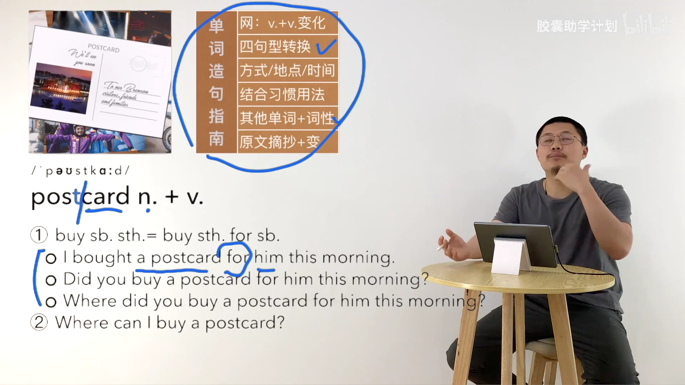

文字识别：单词造 / 网：v.+v.变化 / 胶囊助学计划 / POSTCARD / 四句型转换 / We'll see / gou soan / 方式/地点/时间 / Ta aur Branan / visitars, friends / 句 / 结合习惯用法 / and famities / 指 / 其他单词+词性 / 南 / 原文摘抄+变 / /paustka:d/ / postard n.+ v. / ① buy sb. sth.= buy sth.for sb. / To I bought a postcard foy him this morning. / o Did you buy a postcard For him this morning? / o Where did you buy a postcard for him this morning? /  Where can I buy a postcard?

### 画面 00:03:15

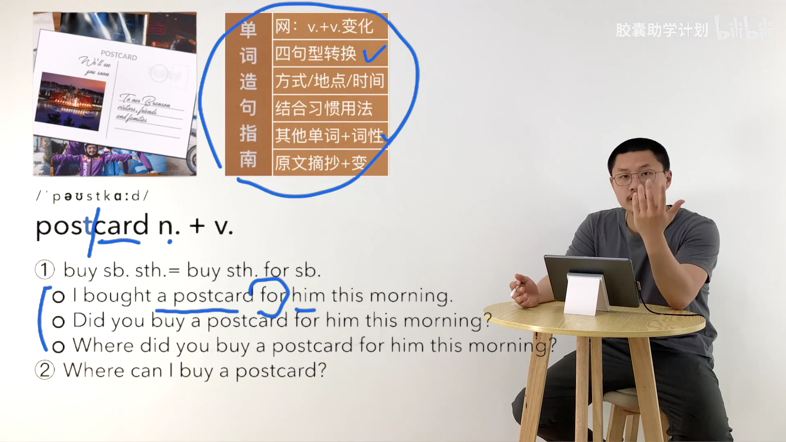

文字识别：单词造 / 网：v.+v.变化 / 胶囊助学计划 / POSTCARD / 四句型转换 / We'll ee / you soan / 方式/地点/时间 / Ta aur Bramsan / 句 / vrsitars, friends / 结合习惯用法 / and famiies / 指 / 其他单词+词性 / 南 / 原文摘抄+变 / /paustka:d/ / postard n. + v. / ① buy sb. sth.= buy sth.for sb. / [o I bought a postcard for him this morning. / o Did you buy a postcard for him this morning? / o Where did you buy a postcard for him this morning /  Where can I buy a postcard?

### 画面 00:03:18

文字识别：单词造 / 网：v.+v.变化 / 胶囊助学计划 / POSTCARD / 四句型转换 / We'll see / you soan / 方式/地点/时间 / Ta aur Bransan / 句 / vrsltars, friends / 结合习惯用法 / and famities / 指 / 其他单词+词性 / 南 / 原文摘抄+变 / /paustka:d/ / postard n.+ v. / ① buy sb. sth.= buy sth.for sb. / To I bought a postcard fon him this morning. / o Did you buy a postcard for him this morning? / o Where did you buy a postcard for him this morning? /  Where can I buy a postcard?

### 画面 00:03:20

文字识别：单词造 / 网：v.+v.变化 / 胶囊助学计划 / POSTCARD / 四句型转换 / We'll see / you soan / 方式/地点/时间 / Ta aur Branan / 句 / vrsitars, friends / 结合习惯用法 / and famiies / 指 / 其他单词+词性 / 南 / 原文摘抄+变 / /paustka:d/ / postard n. + v. / ① buy sb. sth.= buy sth.for sb. / To I bought a postcard foy him this morning. / o Did you buy a postcard for him this morning? / o Where did you buy a postcard for him this morning? /  Where can I buy a postcard?

### 画面 00:03:22

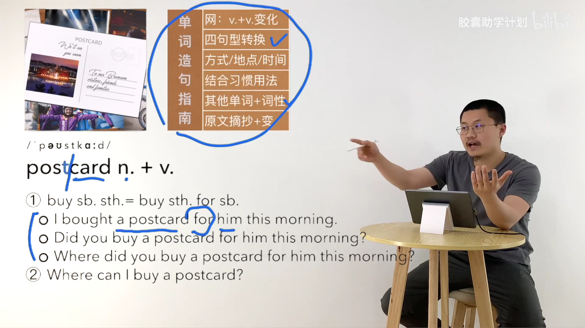

文字识别：单词造 / 网：v.+v.变化 / 胶囊助学计划 / POSTCARD / 四句型转换 / We'll ee / gou soon / 方式/地点/时间 / To aur Bransan / 一句 / visitars, friends / 结合习惯用法 / and famities / 指 / 其他单词+词性 / 南 / 原文摘抄+变 / /paustka:d/ / postard n. + v. / ① buy sb. sth.= buy sth.for sb. / o I bought a postcard foy him this morning. / o Did you buy a postcard for him this morning? / o Where did you buy a postcard for him this morning? /  Where can I buy a postcard?

### 画面 00:03:24

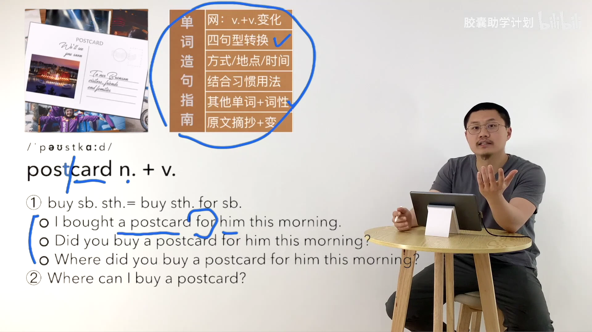

文字识别：单词造 / 网：v.+v.变化 / 胶囊助学计划 / POSTCARD / 四句型转换 / Well se / gou saan / 方式/地点/时间 / Ta aur Bransan / 句 / visitars, friends / 结合习惯用法 / and famities / 指 / 其他单词+词性 / 南 / 原文摘抄+变 / /paustka:d/ / postard n. + v. / ① buy sb. sth.= buy sth.for sb. / o I bought a postcard foy him this morning. / o Did you buy a postcard for him this morning? / o Where did you buy a postcard for him this morning? /  Where can I buy a postcard?

### 画面 00:03:26

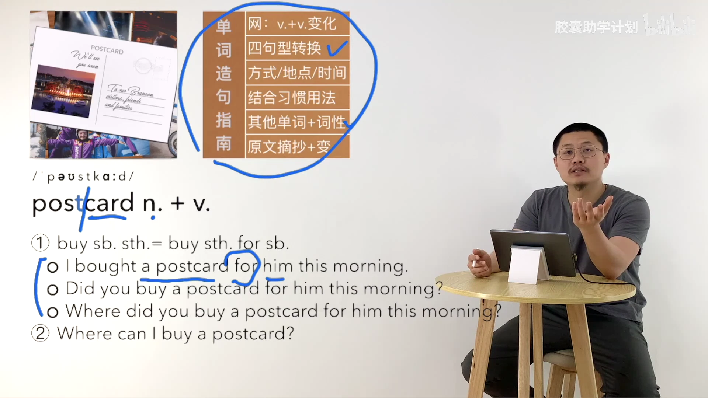

文字识别：单词造 / 网：v.+v.变化 / 胶囊助学计划 / POSTCARD / 四句型转换 / We'll ee / you soan / 方式/地点/时间 / Ta aur Branon / 句 / visitars, friends / 结合习惯用法 / and families / 指 / 其他单词+词性 / 南 / 原文摘抄+变 / /paustka:d/ / postard n. + v. / ① buy sb. sth.= buy sth. for sb. / To I bought a postcard fon him this morning. / o Did you buy a postcard for him this morning? / o Where did you buy a postcard for him this mornin /  Where can I buy a postcard?

### 画面 00:03:28

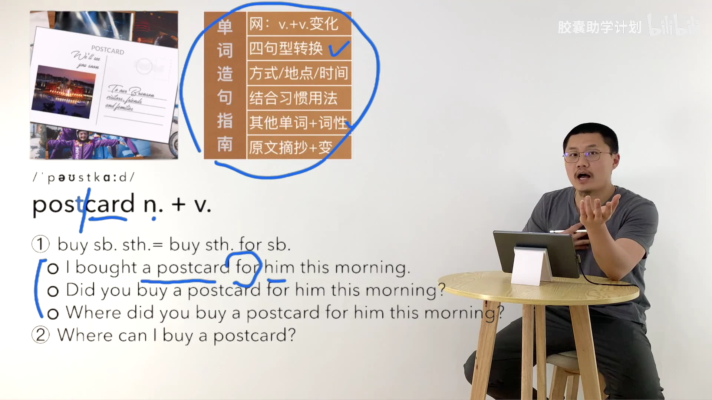

文字识别：单词造 / 网：v.+v.变化 / 胶囊助学计划 / POSTCARD / 四句型转换 / We'll ee / you soan / 方式/地点/时间 / Ta aur Branson / visitars, friends / 句 / 结合习惯用法 / and families / 指 / 其他单词+词性 / 南 / 原文摘抄+变 / /paustka:d/ / posteard n. + v. / ① buy sb. sth.= buy sth.for sb. / ro I bought a postcard foy him this morning. / o Did you buy a postcard for him this morning? / o Where did you buy a postcard for him this morning? /  Where can I buy a postcard?

## 00:03:30–00:04:00

buy a postcard in that store? 对 In that store, 提问 Where Where can I buy a postcard? 是这么变过来的，对吧？ Okay, 这一个，接下来下一个单词啊， send send 过去式过去分词都是把 d 变成了 t，叫做 sent. Okay, 没有太大的区别. Send 这个单词最最我们原先最常见的意思是给大家邮寄一个，比如说信件或者包裹，这就

### 画面 00:03:30

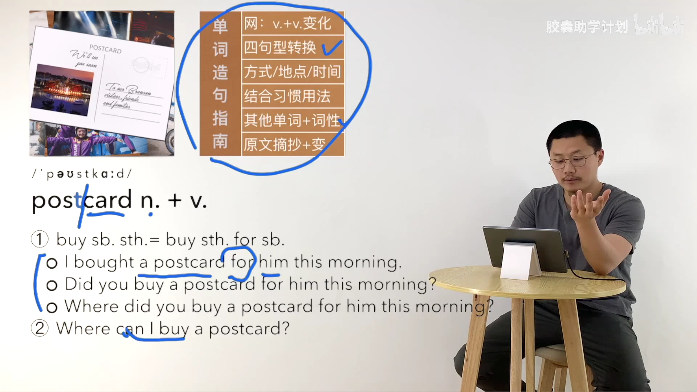

文字识别：单词造 / 网：v.+v.变化 / 胶囊助学计划 / POSTCARD / 四句型转换 / We'll ee / you soan / 方式/地点/时间 / Ta aur Bransan / 句 / visitars, friends / 结合习惯用法 / and familie / 指 / 其他单词+词性 / 南 / 原文摘抄+变 / /paustka:d/ / postard n.+ v. / ① buy sb. sth.= buy sth.for sb. / ro I bought a postcard foy him this morning. / o Did you buy a postcard for him this morning? / o Where did you buy a postcard for him this morning? / ② Where can I buy a postcard?

### 画面 00:03:32

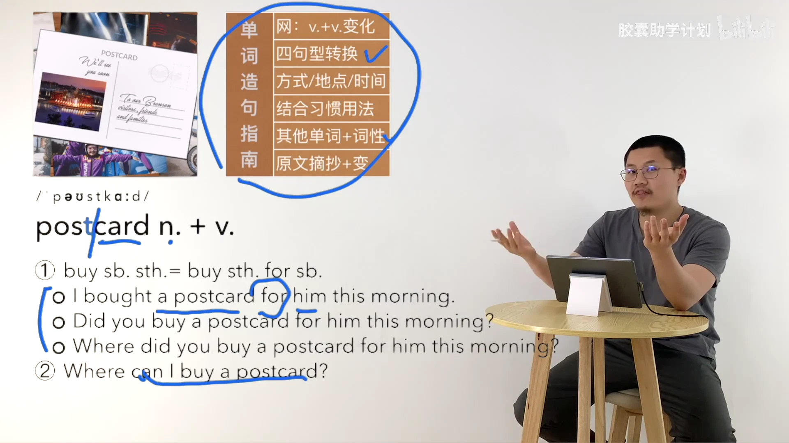

文字识别：单词造 / 网：v.+v.变化 / 胶囊助学计划 / POSTCARD / 四句型转换 / We'll see / you soan / 方式/地点/时间 / Ta aur Bransan / visitars, friends / 句 / 结合习惯用法 / and famities / 指 / 其他单词+词性 / 南 / 原文摘抄+变 / /paustka:d/ / postard n. + v. / ① buy sb. sth.= buy sth.for sb. / ro I bought a postcard foy him this morning. / o Did you buy a postcard for him this morning? / o Where did you buy a postcard for him this morning? /  Where can I buy a postcard?

### 画面 00:03:35

文字识别：单词造 / 网：v.+v.变化 / 胶囊助学计划 / POSTCARD / 四句型转换 / We'l ee / you soan / 方式/地点/时间 / Ta aur Bransan / 句 / visitars, friends / 结合习惯用法 / and famiies / 指 / 其他单词+词性 / 南 / 原文摘抄+变 / /paustka:d/ / postard n.+ v. / ① buy sb. sth.= buy sth.for sb. / o I bought a postcard foy him this morning. / o Did you buy a postcard for him this morning? / o Where did you buy a postcard for him this morning? / ② Where cen I buy a postcard?

### 画面 00:03:40

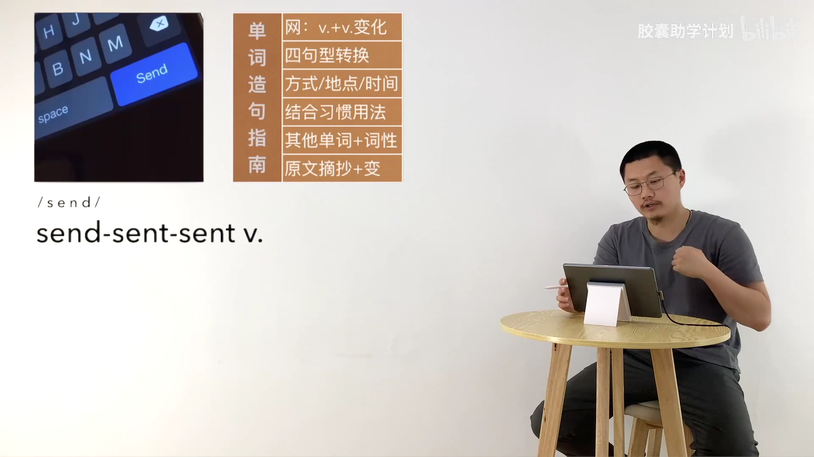

文字识别：单词造句指南 / 网：v.+v.变化 / 胶囊助学计划 / M / 四句型转换 / N / Send / 方式/地点/时间 / 结合习惯用法 / space / 其他单词+词性 / 原文摘抄+变 / /send/ / send-sent-sent v.

### 画面 00:03:42

文字识别：单词造句指南 / 网：v.+v.变化 / 胶囊助学计划 / M / 四句型转换 / N / Send / 方式/地点/时间 / 结合习惯用法 / space / 其他单词+词性 / 原文摘抄+变 / /send/ / send-sent-sent v.

### 画面 00:03:45

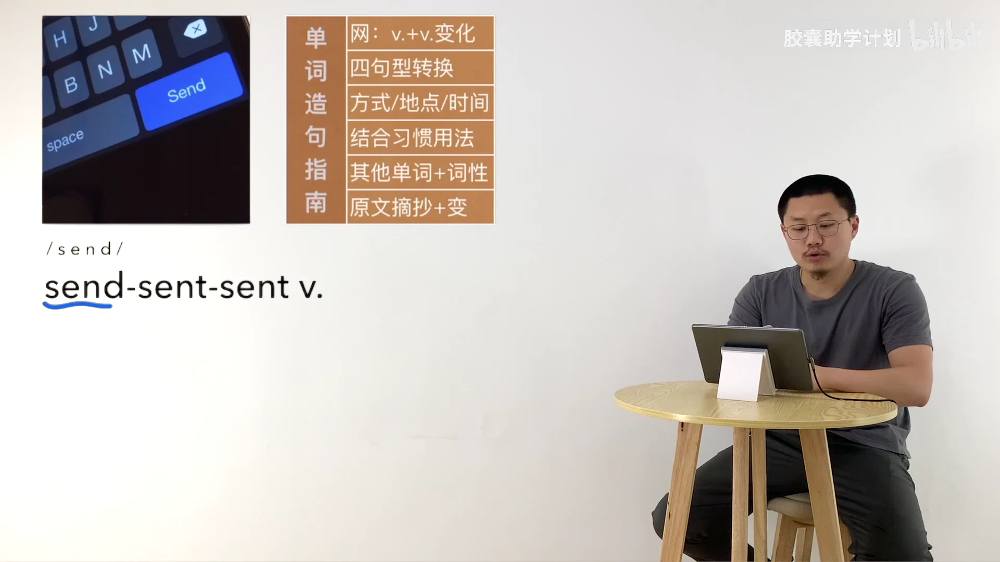

文字识别：单词造句指南 / 网：v.+v.变化 / 胶囊助学计划 / M / 四句型转换 / Send / 方式/地点/时间 / 结合习惯用法 / space / 其他单词+词性 / 原文摘抄+变 / /send/ / send-sent-sent v.

### 画面 00:03:51

文字识别：单词造句指南 / 网：v.+v.变化 / 胶囊助学计划 / M / 四句型转换 / N / Send / 方式/地点/时间 / 结合习惯用法 / space / 其他单词+词性 / 原文摘抄+变 / /send/ / send-sent-sent v. / •

### 画面 00:03:55

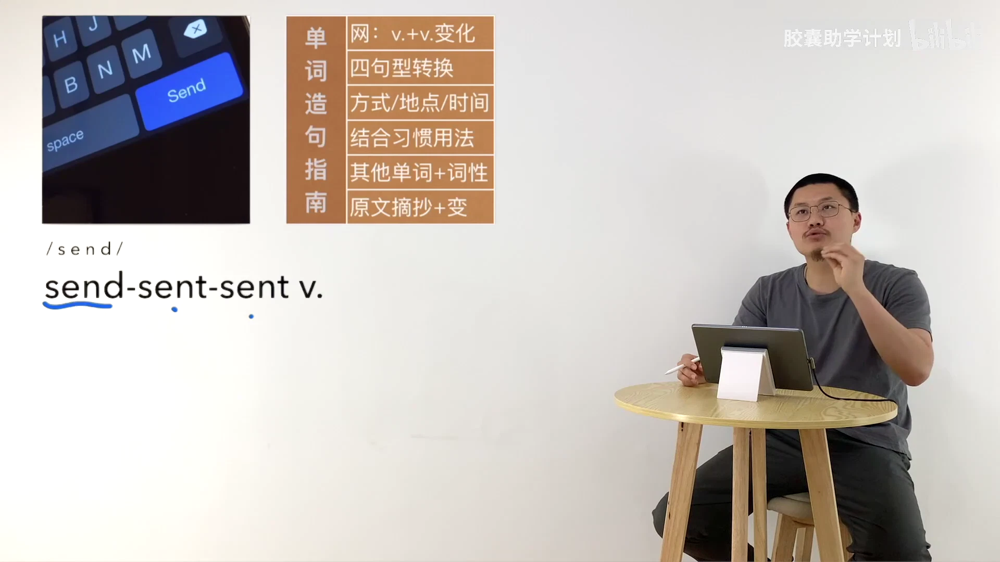

文字识别：单词造句指南 / 网：v.+v.变化 / 胶囊助学计划 / M / 四句型转换 / N / Send / 方式/地点/时间 / 结合习惯用法 / space / 其他单词+词性 / 原文摘抄+变 / /send/ / send-sent-sent v. / •

## 00:04:00–00:04:30

叫做 send。随着后来，比如说电脑、互联网、手机、智能手机的出现呢，send 这个单词也开始有了发送的意思。比如说您写邮件，send 发送，对吧？我们打手机短信发送，那个单词翻译成的英文就叫做 send。啊，各位要注意一下这个小点。好，接下来我们就可以叫 send me a postcard。哎，邮寄某人某物，这个就是 send somebody

### 画面 00:04:00

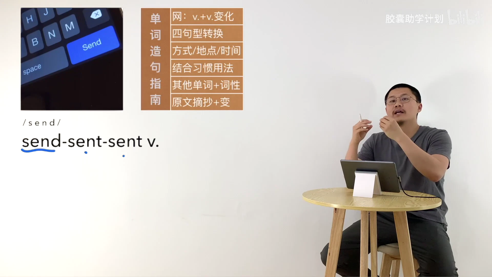

文字识别：单词造句指南 / 网：v.+v.变化 / 胶囊助学计划 / H / M / 四句型转换 / Send / 方式/地点/时间 / 结合习惯用法 / space / 其他单词+词性 / 原文摘抄+变 / /send/ / send-sent-sent v. / •

### 画面 00:04:05

文字识别：单词造句指南 / 网：v.+v.变化 / 胶囊助学计划 / M / 四句型转换 / N / Send / 方式/地点/时间 / 结合习惯用法 / space / 其他单词+词性 / 原文摘抄+变 / /send/ / send-sent-sent v. / •

### 画面 00:04:08

文字识别：单词造句指南 / 网：v.+v.变化 / 胶囊助学计划 / M / 四句型转换 / N / Send / 方式/地点/时间 / 结合习惯用法 / space / 其他单词+词性 / 原文摘抄+变 / /send/ / send-sent-sent v.

### 画面 00:04:10

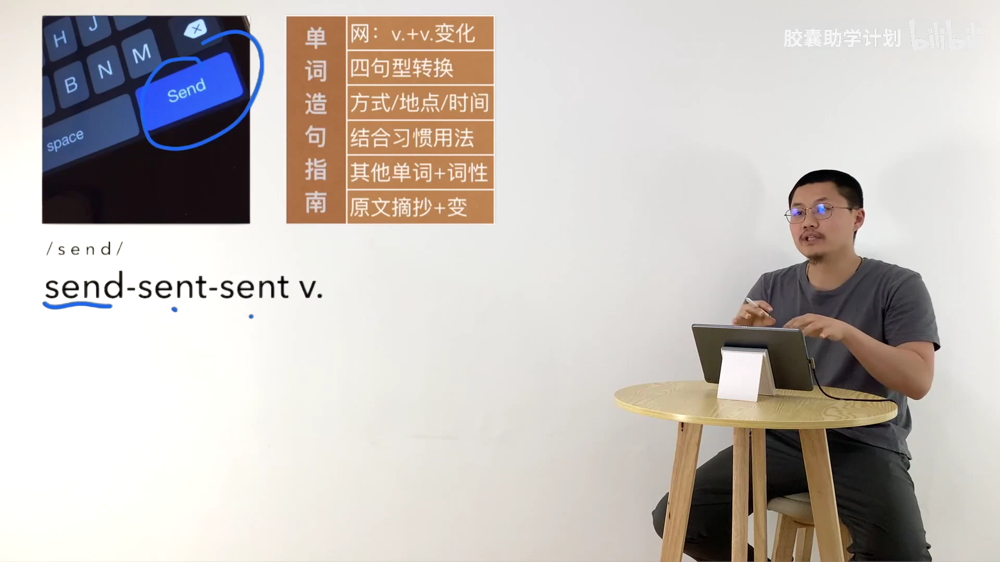

文字识别：单词造句指南 / 网：v.+v.变化 / 胶囊助学计划 / H / M / 四句型转换 / N / Send / 方式/地点/时间 / 结合习惯用法 / space / 其他单词+词性 / 原文摘抄+变 / /send/ / send-sent-sent v. / •

### 画面 00:04:15

文字识别：单词造句指南 / 网：v.+v.变化 / 胶囊助学计划 / M / 四句型转换 / N / Send / 方式/地点/时间 / 结合习惯用法 / space / 其他单词+词性 / 原文摘抄+变 / /send/ / send-sent-sent v. / •

### 画面 00:04:20

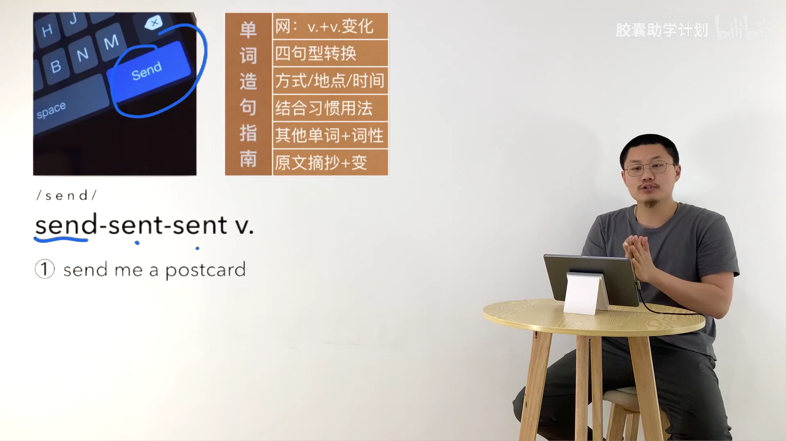

文字识别：单词造句指南 / 网：v.+v.变化 / 胶囊助学计划 / H / M / 四句型转换 / N / Send / 方式/地点/时间 / 结合习惯用法 / space / 其他单词+词性 / 原文摘抄+变 / /send/ / send-sent-sent v. / • / send me a postcard

### 画面 00:04:25

文字识别：单词造句指南 / 网：v.+v.变化 / 胶囊助学计划 / H / M / 四句型转换 / N / Send / 方式/地点/时间 / 结合习惯用法 / space / 其他单词+词性 / 原文摘抄+变 / /send/ / send-sent-sent v. / • / ① send me a postcard

### 画面 00:04:27

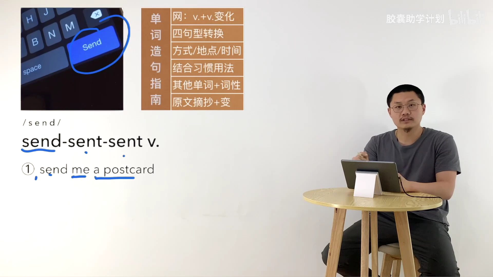

文字识别：单词造句指南 / 网：v.+v.变化 / 胶囊助学计划 / M / 四句型转换 / N / Send / 方式/地点/时间 / 结合习惯用法 / space / 其他单词+词性 / 原文摘抄+变 / /send/ / send-sent-sent v. / • / ① send me a postcard

### 画面 00:04:29

文字识别：单词造句指南 / 网：v.+v.变化 / 胶囊助学计划 / M / 四句型转换 / Send / 方式/地点/时间 / 结合习惯用法 / space / 其他单词+词性 / 原文摘抄+变 / /send/ / send-sent-sent v. / 1 / send / me / postcard

## 00:04:30–00:05:00

something, 对吧？邮寄给某人某物。注意，这儿还是跟刚才有点类似。我们刚才讲了叫 send somebody something，刚才说的是 buy somebody something，对吧？而刚才的 buy 是 buy something for somebody，但是注意 send 这个地方用的是 to，叫做 send something to somebody，他们俩几乎是保持一致的，意思没有什么太大的区别啊。比如说，我们造一句话叫 My

### 画面 00:04:31

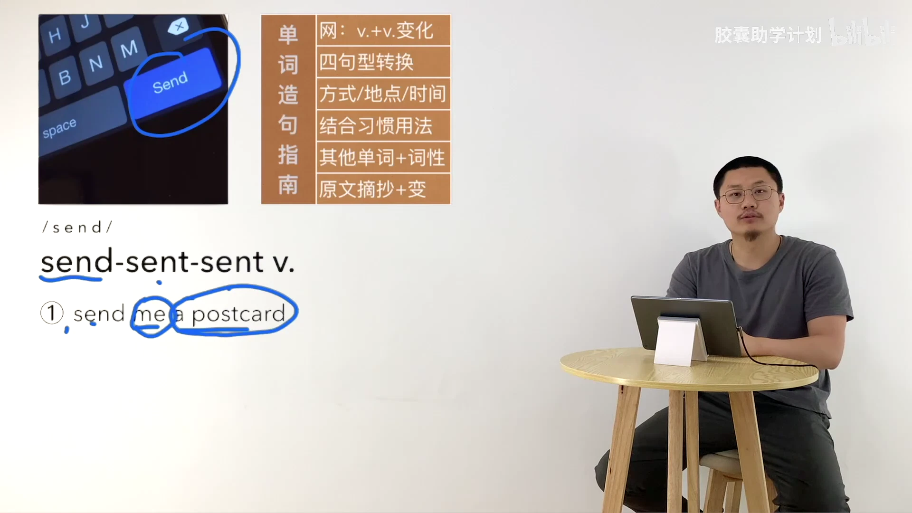

文字识别：单词造句指南 / 网：v.+v.变化 / 胶囊助学计划 / M / 四句型转换 / N / Send / 方式/地点/时间 / 结合习惯用法 / space / 其他单词+词性 / 原文摘抄+变 / /send/ / send-sent-sent v. / 1 / send / ne / postcard

### 画面 00:04:35

文字识别：单词造句指南 / 网：v.+v.变化 / 胶囊助学计划 / M / 四句型转换 / Send / 方式/地点/时间 / 结合习惯用法 / space / 其他单词+词性 / 原文摘抄+变 / /send/ / send-sent-sent v. / send / ne / postcard / send so. sth.= send sth. to sb.

### 画面 00:04:37

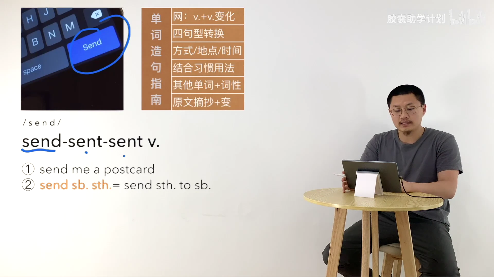

文字识别：单词造句指南 / 网：v.+v.变化 / 胶囊助学计划 / M / 四句型转换 / N / Send / 方式/地点/时间 / 结合习惯用法 / space / 其他单词+词性 / 原文摘抄+变 / /send/ / send-sent-sent v. / • / send me a postcard / send sb.sth.= send sth.to sb.

### 画面 00:04:40

文字识别：单词造句指南 / 网：v.+v.变化 / 胶囊助学计划 / M / 四句型转换 / N / Send / 方式/地点/时间 / 结合习惯用法 / space / 其他单词+词性 / 原文摘抄+变 / /send/ / send-sent-sent v. / • / send me a postcard / send sb.sth.= send sth.to sb.

### 画面 00:04:46

文字识别：单词造句指南 / 网：v.+v.变化 / 胶囊助学计划 / M / 四句型转换 / N / Send / 方式/地点/时间 / 结合习惯用法 / space / 其他单词+词性 / 原文摘抄+变 / /send/ / send-sent-sent v. / • / send me a postcard / send sb.sth.= send sth.to sb.

### 画面 00:04:52

文字识别：单词造句指南 / 网：v.+v.变化 / 胶囊助学计划 / M / 四句型转换 / Send / 方式/地点/时间 / 结合习惯用法 / space / 其他单词+词性 / 原文摘抄+变 / /send/ / send-sent-sent v. / • / send me a postcard / send sb. sth.= send sth.to sb.

### 画面 00:04:55

文字识别：单词造句指南 / 网：v.+v.变化 / 胶囊助学计划 / M / 四句型转换 / N / Send / 方式/地点/时间 / 结合习惯用法 / space / 其他单词+词性 / 原文摘抄+变 / /send/ / send-sent-sent v. / • / send me a postcard / send sb.sth.= send / d sth. / sb.

### 画面 00:04:57

文字识别：单词造句指南 / 网：v.+v.变化 / 胶囊助学计划 / M / 四句型转换 / N / Send / 方式/地点/时间 / 结合习惯用法 / space / 其他单词+词性 / 原文摘抄+变 / /send/ / send-sent-sent v. / • / send me a postcard / send sb. sth.= send sth. / sb. / to / My aunt has already sentme a postcard.

## 00:05:00–00:05:30

aunt has already sent me a postcard. Aunt, 第二课我们刚学的单词，对吧？阿姨已经给我邮寄了一张明信片。那这个语法您会不会呢？实际上，注意，我就用了到了一个叫动词和动词变化，所谓的往这个东西，对吧？动词加动词的变化，现在完成时的一个小的语法结构，肯定句。当然了，好，接下来我们一起看一下电影片段当中会出现这么一句话，叫做 Send her a

### 画面 00:05:00

文字识别：单词造句指南 / 网：v.+v.变化 / 胶囊助学计划 / M / 四句型转换 / Send / 方式/地点/时间 / 结合习惯用法 / space / 其他单词+词性 / 原文摘抄+变 / /send/ / send-sent-sent v. / • / send me a postcard / send sb. sth.= send sth. / sb. / to / My aunt has already sent me a postcard.

### 画面 00:05:08

文字识别：单词造句指南 / 网：v.+v.变化 / 胶囊助学计划 / M / 四句型转换 / Send / 方式/地点/时间 / 结合习惯用法 / space / 其他单词+词性 / 原文摘抄+变 / /send/ / send-sent-sent v. / • / send me a postcard / send sb. sth.= send sth. / sb. / to / My aunt has already sent me a postcard.

### 画面 00:05:10

文字识别：单词造句指南 / 网：v.+v.变化 / 胶囊助学计划 / M / 四句型转换 / Send / 方式/地点/时间 / 结合习惯用法 / space / 其他单词+词性 / 原文摘抄+变 / /send/ / send-sent-sent v. / • / send me a postcard / send sb. sth.= send sth. / sb. / to / My aunt has already sent me a postcard.

### 画面 00:05:15

文字识别：单词造句指南 / 网：v.+v.变化 / 胶囊助学计划 / M / 四句型转换 / Send / 方式/地点/时间 / 结合习惯用法 / space / 其他单词+词性 / 原文摘抄+变 / /send/ / send-sent-sent v. / • / send me a postcard / send sb. sth.= send sth. / sb. / to / My aunt has already sent me a postcard.

### 画面 00:05:20

文字识别：单词造句指南 / 网：v.+v.变化 / 胶囊助学计划 / M / 四句型转换 / Send / 方式/地点/时间 / 结合习惯用法 / space / 其他单词+词性 / 原文摘抄+变 / /send/ / send-sent-sent v. / • / send me a postcard / send sb. sth.= send sth. / sb. / to / My aunt has already sent me a postcard.

### 画面 00:05:24

文字识别：send her a note / 胶囊助学计划 / 非常嫌疑犯 / The Usual Suspe / (1995)

## 00:05:30–00:06:00

note. 注意 note 什么意思呢？其实大家应该记得这个单词叫 notebook, notebook 笔记本，对吧？我们手写的那个笔记本也叫 notebook，电脑那个笔记本也叫 notebook. OK，那 note 其实理解为就是一个便签或者便条的意思。接下来我们一起看一下. We're gonna miss the flight. Don't do this.

### 画面 00:05:52

文字识别：send her a note / 胶囊助学计划 / 非常嫌疑犯 / The Usual Suspec / (1995)

### 画面 00:05:54

文字识别：send her a note / 胶囊助学计划 / 非常嫌疑犯 / The Usual Suspeg / (1995)

### 画面 00:05:56

文字识别：send her a note / 胶囊助学计划 / 非常嫌疑犯 / The Usual Suspec / (1995)

### 画面 00:05:58

文字识别：send her a note / 胶囊助学计划 / 非常嫌疑犯 / The Usual Suspec / (1995)

## 00:06:00–00:06:30

Send her a note, something. I said we make.好，想一下他刚才说那句话，Don't do this.新学的，对吧？Send her a note，给她寄送啊，给她发一个这个便条，给她一个便签儿，对吧？发给她一个便条便签儿，告诉她这件事儿，叫Send her a note. There we go.好，接下来我们看下一个单词。其实第一课如果您用心写作业了的话，认真听课了的话，Spoil这个

### 画面 00:06:00

文字识别：send her a note / 胶囊助学计划 / 非常嫌疑犯 / 别这样给她留个纸条什么的 / The Usual Suspec / Don't do this. Send her a note, something. / (1995)

### 画面 00:06:02

文字识别：send her a note / 胶囊助学计划 / 非常嫌疑犯 / The Usual Suspec / (1995)

### 画面 00:06:04

文字识别：send her a note / 胶囊助学计划L / 非常嫌疑犯 / 我说我们会赶上的 / The Usual Suspes / I said we'll make it. / (1995)

### 画面 00:06:06

文字识别：send her a note / 胶囊助学计划 / 非常嫌疑犯 / The Usual Suspe / (1995)

### 画面 00:06:22

文字识别：单词造句指南 / 网：v.+v.变化 / 胶囊助学计划 / 四句型转换 / 方式/地点/时间 / 结合习惯用法 / 其他单词+词性 / 原文摘抄+变 / /spo1l/ / spoil-spoiled/spoilt v.

### 画面 00:06:25

文字识别：单词造句指南 / 网：v.+v.变化 / 胶囊助学计划 / 四句型转换 / 方式/地点/时间 / 结合习惯用法 / 其他单词+词性 / 原文摘抄+变 / /spo1l/ / spoil-spoiled/spoilt v.

## 00:06:30–00:07:00

单词已经出现了。它的过去式、过去分词比较的特殊，可以用这一套直接加e d，也可以后边加一个t，都是对的啊。我们先读一下原形，叫做spoil，spoil。OK，那注意我们第一课学的这个句子叫做the cook spoiled the soup，叫做这些厨子们对吧？怎么样了呢？把这个汤给毁了，叫做the cook spoiled the

### 画面 00:06:30

文字识别：单词造句指南 / 网：v.+v.变化 / 胶囊助学计划H / 四句型转换 / 方式/地点/时间 / 结合习惯用法 / 其他单词+词性 / 原文摘抄+变 / /spoil/ / spoil-spoiled/spoilt v.

### 画面 00:06:35

文字识别：单词造句指南 / 网：v.+v.变化 / 胶囊助学计划 / 四句型转换 / 方式/地点/时间 / 结合习惯用法 / 其他单词+词性 / 原文摘抄+变 / /spo1l/ / spoil-spoiled/spoilt v.

### 画面 00:06:40

文字识别：单词造句指南 / 网：v.+v.变化 / 胶囊助学计划 / 四句型转换 / 方式/地点/时间 / 结合习惯用法 / 其他单词+词性 / 原文摘抄+变 / /spo1l/ / spoil-spoiled/spoilt v.

### 画面 00:06:45

文字识别：单词造句指南 / 网：v.+v.变化 / 胶囊助学计划 / 四句型转换 / 方式/地点/时间 / 结合习惯用法 / 其他单词+词性 / 原文摘抄+变 / /spoil/ / spoil-spoiled/spoilt v. / ① The cook spoilt the soup.

### 画面 00:06:50

文字识别：单词造句指南 / 网：v.+v.变化 / 胶囊助学计划 / 四句型转换 / 方式/地点/时间 / 结合习惯用法 / 其他单词+词性 / 原文摘抄+变 / /sρo1l/ / spoil-spoiled/spoilt v. / ① The cook spoilt the soup.

### 画面 00:06:53

文字识别：单词造句指南 / 网：v.+v.变化 / 胶囊助学计划 / 四句型转换 / 方式/地点/时间 / 结合习惯用法 / 其他单词+词性 / 原文摘抄+变 / /spoil/ / spoil-spoiled/spoilt v. / ① The cook spoilt the soup.

### 画面 00:06:55

文字识别：单词造句指南 / 网：v.+v.变化 / 胶囊助学计划 / 四句型转换 / 方式/地点/时间 / 结合习惯用法 / 其他单词+词性 / 原文摘抄+变 / /spoil/ / spoil-spoiled/spoilt v. / ① The cook spoilt the soup.

### 画面 00:06:58

文字识别：单词造句指南 / 网：v.+v.变化 / 胶囊助学计划 / 四句型转换 / 方式/地点/时间 / 结合习惯用法 / 其他单词+词性 / 原文摘抄+变 / /spo1l/ / spoil-spoiled/spoilt v. / ① The cook spoilt the soup.

## 00:07:00–00:07:30

Very good.那我们看到了肯定句，接下来我们立刻能做的事情是不是就变一般疑问句啊？注意它是一个一般过去时，所以我们可以把 did 提前，叫做 Did the cook spoil the Did the cook spoil the soup? Very good.好，接下来我们也可以问说 How did the cook spoil the soup?说这个厨子是怎么把这些厨子是怎么把这个汤给毁了的呢？How 引导的特殊疑问句问的是

### 画面 00:07:01

文字识别：单词造句指南 / 网：v.+v.变化 / 胶囊助学计划H / 四句型转换 / 方式/地点/时间 / 结合习惯用法 / 其他单词+词性 / 原文摘抄+变 / /spoil/ / spoil-spoiled/spoilt v. / ① The cook spoilt the soup.

### 画面 00:07:05

文字识别：单词造句指南 / 网：v.+v.变化 / 胶囊助学计划 / 四句型转换 / 方式/地点/时间 / 结合习惯用法 / 其他单词+词性 / 原文摘抄+变 / /sρo1l/ / spoil-spoiled/spoilt v. / ① The cook spoilt the soup. / o Did the cook spoilt the soup?

### 画面 00:07:10

文字识别：单词造句指南 / 网：v.+v.变化 / 胶囊助学计划 / 四句型转换 / 方式/地点/时间 / 结合习惯用法 / 其他单词+词性 / 原文摘抄+变 / /spoil/ / spoil-spoiled/spoilt v. / D The cook spoilt the soup. / o Did the cook spoilt the soup?

### 画面 00:07:15

文字识别：单词造句指南 / 网：v.+v.变化 / 胶囊助学计划 / 四句型转换 / 方式/地点/时间 / 结合习惯用法 / 其他单词+词性 / 原文摘抄+变 / /spo1l/ / spoil-spoiled/spoilt v. / ① The cook spoilt the soup. / o Did the cook spoilt the soup?

### 画面 00:07:18

文字识别：单词造句指南 / 网：v.+v.变化 / 胶囊助学计划H / 四句型转换 / 方式/地点/时间 / 结合习惯用法 / 其他单词+词性 / 原文摘抄+变 / /spo1l/ / spoil-spoiled/spoilt v. / ① The cook spoilt the soup. / o Did the cook spoilt the soup? / o How did the cook spoil the soup?

### 画面 00:07:20

文字识别：单词造句指南 / 网：v.+v.变化 / 胶囊助学计划 / 四句型转换 / 方式/地点/时间 / 结合习惯用法 / 其他单词+词性 / 原文摘抄+变 / /spo1l/ / spoil-spoiled/spoilt v. / ① The cook spoilt the soup. / o Did the cook spoilt the soup? / Howdid the cook spoil the soup?

### 画面 00:07:25

文字识别：单词造句指南 / 网：v.+v.变化 / 胶囊助学计划 / 四句型转换 / 方式/地点/时间 / 结合习惯用法 / 其他单词+词性 / 原文摘抄+变 / /spo1l/ / spoil-spoiled/spoilt v. / ① The cook spoilt the soup. / o Did the cook spoilt the soup? / How did the cook spoil the soup?

## 00:07:30–00:08:00

如何对吧？终极三问 what why how how 如何？ There you go. 那接下来原文给了一句话叫做 Postcards always spoil my holidays. 各位记得吧？单词造句指南最后一个就是我自己实在不会造句的时候，我把原文先摘抄出来，然后当然了这句话不算你造的句子对吧？你要想的事情是做一些改变。那我教各位一些小的思路如何进行改变。首先 always spoil 我们可以不

### 画面 00:07:30

文字识别：单词造句指南 / 网：v.+v.变化 / 胶囊助学计划 / 四句型转换 / 方式/地点/时间 / 结合习惯用法 / 其他单词+词性 / 原文摘抄+变 / /spo1l/ / spoil-spoiled/spoilt v. / ① The cook spoilt the soup. / o Did the cook spoilt the soup? / How did the cook spoil the soup?

### 画面 00:07:35

文字识别：单词造 / 网：v.+v.变化 / 胶囊助学计划 / 四句型转换 / 方式/地点/时间 / 句 / 结合习惯用法 / 指 / 其他单词+词性 / 南 / 原文摘抄+变 / /sporl/ / spoil-spoiled/spoilt v. / ① The cook spoilt the soup. / o Did the cook spoilt the soup? / How did the cook spoil the soup? / [Story]: Postcards always spoil my holidays.

### 画面 00:07:40

文字识别：单词造 / 网：v.+v.变化 / 胶囊助学计划 / 四句型转换 / 方式/地点/时间 / 句 / 结合习惯用法 / 指 / 其他单词+词性 / 南 / 原文摘抄+变 / /spo1l/ / spoil-spoiled/spoilt v. / ① The cook spoilt the soup. / o Did the cook spoilt the soup? / How did the cook spoil the soup? / [Story]: Postcards always spoil my holidays.

### 画面 00:07:45

文字识别：单词造 / 网：v.+v.变化 / 胶囊助学计划 / 四句型转换 / 方式/地点/时间 / 句 / 结合习惯用法 / 指 / 其他单词+词性 / 南 / 原文摘抄+变 / /spo1l/ / spoil-spoiled/spoilt v. / ① The cook spoilt the soup. / o Did the cook spoilt the soup? / How did the cook spoil the soup? / [Story]: Postcards always spoil my holidays.

### 画面 00:07:51

文字识别：单词造 / 网：v.+v.变化 / 胶囊助学计划 / 四句型转换 / 方式/地点/时间 / 句 / 结合习惯用法 / 指 / 其他单词+词性 / 南 / 原文摘抄+变 / /spo1l/ / spoil-spoiled/spoilt v. / ① The cook spoilt the soup. / o Did the cook spoilt the soup? / How did the cook spoil the soup? / [Story]: Postcards always spoil my holidays.

### 画面 00:07:55

文字识别：单词造 / 网：v.+v.变化 / 胶囊助学计划 / 四句型转换 / 方式/地点/时间 / 句 / 结合习惯用法 / 指 / 其他单词+词性 / 南 / 原文摘抄+变 / /spo1l/ / spoil-spoiled/spoilt v. / ① The cook spoilt the soup. / o Did the cook spoilt the soup? / How did the cook spoil the soup? / [Story]: Postcards always spoil my holidays.

### 画面 00:07:59

文字识别：单词造 / 网：v.+v.变化 / 胶囊助学计划 / 四句型转换 / 方式/地点/时间 / 句 / 结合习惯用法 / 指 / 其他单词+词性 / 南 / 原文摘抄+变 / /spo1l/ / spoil-spoiled/spoilt v. / ① The cook spoilt the soup. / o Did the cook spoilt the soup? / Howdid the cook spoil the soup? / [Story]: Postcards always spoil my holidays. / always spoil my

## 00:08:00–00:08:30

变啊，这叫做一般现在时，对吧？我们可以不变，我们可以换一下主语，换一下后面的这个holiday，对吧？那你可以说什么东西毁了我的什么东西，对吧？现在说的叫postcards always spoil my holidays. Okay,那接下来我们可以换这，我们还可以换什么呢？我们还可以换spoil变成spoilt。注意，我们现在做的事情叫动词加动词的变

### 画面 00:08:04

文字识别：单词造 / 网：v.+v.变化 / 胶囊助学计划 / 四句型转换 / 方式/地点/时间 / 句 / 结合习惯用法 / 指 / 其他单词+词性 / 南 / 原文摘抄+变 / /spo1l/ / spoil-spoiled/spoilt v. / ① The cook spoilt the soup. / o Did the cook spoilt the soup? / Howdid the cook spoil the soup? / [Story]: Postcards always spoil my holidays. / always spoil my

### 画面 00:08:06

文字识别：单词造 / 网：v.+v.变化 / 胶囊助学计划 / 四句型转换 / 方式/地点/时间 / 句 / 结合习惯用法 / 指 / 其他单词+词性 / 南 / 原文摘抄+变 / /spo1l/ / spoil-spoiled/spoilt v. / ① The cook spoilt the soup. / o Did the cook spoilt the soup? /  How did the cook spoil the soup? / [Story]: Postcards always spoil my holidays. / always spoil my

### 画面 00:08:08

文字识别：单词造 / 网：v.+v.变化 / 胶囊助学计划「 / 四句型转换 / 方式/地点/时间 / 句 / 结合习惯用法 / 指 / 其他单词+词性 / 南 / 原文摘抄+变 / /spo1l/ / spoil-spoiled/spoilt v. / ① The cook spoilt the soup. / o Did the cook spoilt the soup? /  How did the cook spoil the soup? / [Story]: Postcards alwaysspoil my holidays. / always spoil my

### 画面 00:08:10

文字识别：单词造 / 网：v.+v.变化 / 胶囊助学计划 / 四句型转换 / 方式/地点/时间 / 句 / 结合习惯用法 / 指 / 其他单词+词性 / 南 / 原文摘抄+变 / /spo1l/ / spoil-spoiled/spoilt v. / ① The cook spoilt the soup. / o Did the cook spoilt the soup? /  How did the cook spoil the soup? / [Story]: Postcards alwaysspoil my holidays. / always spoil my

### 画面 00:08:12

文字识别：单词造 / 网：v.+v.变化 / 胶囊助学计划 / 四句型转换 / 方式/地点/时间 / 句 / 结合习惯用法 / 指 / 其他单词+词性 / 南 / 原文摘抄+变 / /spo1l/ / spoil-spoiled/spoilt v. / ① The cook spoilt the soup. / o Did the cook spoilt the soup? /  How did the cook spoil the soup? / [Story]: Postcards alwaysspoil my holidays. / always spoil my

### 画面 00:08:14

文字识别：单词造 / 网：v.+v.变化 / 胶囊助学计划册 / 四句型转换 / 方式/地点/时间 / 句 / 结合习惯用法 / 指 / 其他单词+词性 / 南 / 原文摘抄+变 / /sρo1l/ / spoil-spoiled/spoilt v. / ① The cook spoilt the soup. / o Did the cook spoilt the soup? / How did the cook spoil the soup? / [Story]: Postcards always poil my holidays. / always spoil my

### 画面 00:08:19

文字识别：单词造 / 网：v.+v.变化 / 胶囊助学计划 / 四句型转换 / 方式/地点/时间 / 句 / 结合习惯用法 / 指 / 其他单词+词性 / 南 / 原文摘抄+变 / /spo1l/ / spoil-spoiled/spoilt v. / ① The cook spoilt the soup. / o Did the cook spoilt the soup? / How did the cook spoil the soup? / [Story]: Postcards alwaysspoil my holidays. / always spoil my / o Postoards spoilt my last summer holiday.

### 画面 00:08:21

文字识别：单词造 / 网：v.+v.变化 / 胶囊助学计划 / 四句型转换 / 方式/地点/时间 / 句 / 结合习惯用法 / 指 / 其他单词+词性 / 南 / 原文摘抄+变 / /spo1l/ / spoil-spoiled/spoilt v. / ① The cook spoilt the soup. / o Did the cook spoilt the soup? /  How did the cook spoil the soup? / [Story]: Postcards always spoil my holidays. / always spoil my / o Postcards spoilt my last summer holiday.

### 画面 00:08:24

文字识别：单 / 网：v.+v.变化 / 胶囊助学计划 / 词 / 四句型转换 / 造 / 方式/地点/时间 / 句 / 结合习惯用法 / 指 / 其他单词+词性 / 南 / 原文摘抄+变 / /spo1l/ / spoil-spoiled/spoilt v. / ① The cook spoilt the soup. / o Did the cook spoilt the soup? / Howdid the cook spoil the soup? / [Story]: Postcards always spoil my holidays. / always spoil my / o Postcards spoilt my last summer holiday.

### 画面 00:08:26

文字识别：单 / 网：v.+v.变化 / 胶囊助学计划 / 词 / 四句型转换 / 造 / 方式/地点/时间 / 句 / 结合习惯用法 / 指 / 其他单词+词性 / 南 / 原文摘抄+变 / /spo1l/ / spoil-spoiled/spoilt v. / ① The cook spoilt the soup. / o Did the cook spoilt the soup? / Howdid the cook spoil the soup? / [Story]: Postcards always spoil my holidays. / always spoil my / o Postcards spoilt my last summer holiday.

### 画面 00:08:29

文字识别：网：v.+v.变化 / 单 / 胶囊助学计划 / 词 / 四句型转换 / 造 / 方式/地点/时间 / 句 / 结合习惯用法 / 指 / 其他单词+词性 / 南 / 原文摘抄+变 / /spo1l/ / spoil-spoiled/spoilt v. / ① The cook spoilt the soup. / o Did the cook spoilt the soup? / How did the cook spoil the soup? / [Story]: Postcards always spoil my holidays. / always spoil my / o Postcards spoilt my last summer holiday.

## 00:08:30–00:09:00

化，原来是一般现在时，我们现在把它变成了一般过去时，所以时间你要跟着变，叫 last summer holiday，对吧？上一个暑假的假期，那别的地方其实我没有改变，那您再去配合它做一些四句型的转化，是不是就很舒服了？对不对？刚才这儿当然也算上我们加了一些时间，OK？好，接下来下一个单词跟我一起读，叫做 museum，啊，卢浮宫，对吧？museum，而一个名词那就要加动词了，你看啊，

### 画面 00:08:35

文字识别：单词造 / 网：v.+v.变化 / 胶囊助学计划 / 四句型转换 / 方式/地点/时间 / 句 / 结合习惯用法 / 指 / 其他单词+词性 / 南 / 原文摘抄+变 / /spo1l/ / spoil-spoiled/spoilt v. / ① The cook spoilt the soup. / o Did the cook spoilt the soup? /  How did the cook spoil the soup? / [Story]: Postcards always spoil my holidays. / always spoil my / o Postcards spoilt my last summer holiday.

### 画面 00:08:40

文字识别：单词造 / 网：v.+v.变化 / 胶囊助学计划 / 四句型转换 / 方式/地点/时间 / 句 / 结合习惯用法 / 指 / 其他单词+词性 / 南 / 原文摘抄+变 / /spo1l/ / spoil-spoiled/spoilt v. / ① The cook spoilt the soup. / o Did the cook spoilt the soup? / How did the cook spoil the soup? / [Story]: Postcards always spoil my holidays. / always spoil my / o Postcards spoilt my last summer holiday.

### 画面 00:08:42

文字识别：单词造 / 网：v.+v.变化 / 胶囊助学计划 / 四句型转换 / 方式/地点/时间 / 句 / 结合习惯用法 / 指 / 其他单词+词性 / 南 / 原文摘抄+变 / /spoil/ / spoil-spoiled/spoilt v. / ① The cook spoilt the soup. / o Did the cook spoilt the soup? / How did the cook spoil the soup? / [Story]: Postcards always spoil my holidays. / always spoil my / o Postcards spoilt my last summer holiday.

### 画面 00:08:44

文字识别：单词 / 网：v.+v.变化 / 胶囊助学计划 / 四句型转换 / 造 / 方式/地点/时间 / 句 / 结合习惯用法 / 指 / 其他单词+词性 / 南 / 原文摘抄+变 / /spo1l/ / spoil-spoiled/spoilt v. / ① The cook spoilt the soup. / o Did the cook spoilt the soup? /  How did the cook spoil the soup? / [Story]: Postcards always spoil my holidays. / always spoil my / o Postcards spoilt my last summer holiday.

### 画面 00:08:48

文字识别：单词 / 网：v.+v.变化 / 胶囊助学计划 / 四句型转换 / 造 / 方式/地点时间 / 句 / 结合习惯用法 / 指 / 其他单词+词性 / 南 / 原文摘抄+变 / /spo1l/ / spoil-spoiled/spoilt v. / ① The cook spoilt the soup. / o Did the cook spoilt the soup? / How did the cook spoil the soup? / [Story]: Postcards always spoil my holidays. / always spoil my / o Postcards spoilt my last summer holiday.

### 画面 00:08:50

文字识别：单词造句指南 / 网：v.+v.变化 / 胶囊助学计划 / 四句型转换 / 方式/地点/时间 / 结合习惯用法 / 其他单词+词性 / 原文摘抄+变 / /mju:'zi:am/ / museum n. + v.

### 画面 00:08:52

文字识别：单词造句指南 / 网：v.+v.变化 / 胶囊助学计划 / 四句型转换 / 方式/地点/时间 / 结合习惯用法 / 其他单词+词性 / 原文摘抄+变 / /mju:'zi:am/ / museum n. + v.

### 画面 00:08:54

文字识别：单词造句指南 / 网：v.+v.变化 / 胶囊助学计划 / 四句型转换 / 方式/地点/时间 / 结合习惯用法 / 其他单词+词性 / 原文摘抄+变 / /mju:'zi:am/ / museum n. + v.

### 画面 00:08:59

文字识别：单词造句指南 / 网：v.+v.变化 / 胶囊助学计划 / 四句型转换 / 方式/地点/时间 / 结合习惯用法 / 其他单词+词性 / 原文摘抄+变 / /mju:'zi:am/ / museum n. + v.

## 00:09:00–00:09:30

如果 museum 你不太确定应该怎么去造句，你就想一想我们之前有没有学过某一个名词跟它的感觉是很像的，或者说类似的呢？比如说第一课我们就学了一个单词啊， last week I went to the theater. Last week I went to the museum. 你看您是不是造出来一个句子了？对吧？一定要学会去如何抄啊。接下来那文章当中给了一个东西，原文摘抄加变

### 画面 00:09:02

文字识别：单词造句指南 / 网：v.+v.变化 / 胶囊助学计划 / 四句型转换 / 方式/地点/时间 / 结合习惯用法 / 其他单词+词性 / 原文摘抄+变 / /mju:'zi:am/ / museum n. + v.

### 画面 00:09:04

文字识别：单词造句指南 / 网：v.+v.变化 / 胶囊助学计划 / 四句型转换 / 方式/地点/时间 / 结合习惯用法 / 其他单词+词性 / 原文摘抄+变 / /mju:'zi:am/ / museum n. + v.

### 画面 00:09:07

文字识别：单词造句指南 / 网：v.+v.变化 / 胶囊助学计划 / 四句型转换 / 方式/地点/时间 / 结合习惯用法 / 其他单词+词性 / 原文摘抄+变 / /mju:'zi:am/ / museum n. + v.

### 画面 00:09:09

文字识别：单词造句指南 / 网：v.+v.变化 / 胶囊助学计划 / 四句型转换 / 方式/地点/时间 / 结合习惯用法 / 其他单词+词性 / 原文摘抄+变 / /mju:'zi:am/ / museum n. + v.

### 画面 00:09:14

文字识别：单词造句指南 / 网：v.+v.变化 / 胶囊助学计划 / 四句型转换 / 方式/地点/时间 / 结合习惯用法 / 其他单词+词性 / 原文摘抄+变 / /mju:'zi:am/ / museum n. + v.

### 画面 00:09:17

文字识别：单词造句指南 / 网：v.+v.变化 / 胶囊助学计划 / 四句型转换 / 方式/地点/时间 / 结合习惯用法 / 其他单词+词性 / 原文摘抄+变 / /mju:'zi:am/ / museum n. + v.

### 画面 00:09:19

文字识别：单词造句指南 / 网：v.+v.变化 / 胶囊助学计划 / 四句型转换 / 方式/地点/时间 / 结合习惯用法 / 其他单词+词性 / 原文摘抄+变 / /mju:'zi:am/ / museum n. + v.

### 画面 00:09:23

文字识别：单词造句指南 / 网：v.+v.变化 / 胶囊助学计划 / 四句型转换 / 方式/地点/时间 / 结合习惯用法 / 其他单词+词性 / 原文摘抄+变 / /mju:'zi:am/ / museum n. + v.

### 画面 00:09:25

文字识别：单词造句指南 / 网：v.+v.变化 / 胶囊助学计划 / 四句型转换 / 方式/地点/时间 / 结合习惯用法 / 其他单词+词性 / 原文摘抄+变 / /mju:'zi:am/ / museum n. + v.

### 画面 00:09:27

文字识别：单词造句指南 / 网：v.+v.变化 / 胶囊助学计划 / 四句型转换 / 方式/地点/时间 / 结合习惯用法 / 其他单词+词性 / 原文摘抄+变 / /mju:'zi:am/ / museum n. + v. / ① [Story]: I visited museums.

### 画面 00:09:29

文字识别：单词造句指南 / 网：v.+v.变化 / 胶囊助学计划 / 四句型转换 / 方式/地点/时间 / 结合习惯用法 / 其他单词+词性 / 原文摘抄+变 / /mju:'zi:am/ / museum n. + v. / ① [Story]: I visited museums.

## 00:09:30–00:10:00

啊。I visited museums. Very good.那一般疑问句说，Did you visit that museum in 2018?对于我来说，我就是二零一八年去参观的卢浮宫，对吧？所以你可以问，Did you visit that museum in 2018?那我也可以造一个句子，叫做 I visited this museum in 2018，对吧？Very good.那其实我刚才做的事情是不是就加了一

### 画面 00:09:34

文字识别：单词造句指南 / 网：v.+v.变化 / 胶囊助学计划 / 四句型转换 / 方式/地点/时间 / 结合习惯用法 / 其他单词+词性 / 原文摘抄+变 / /mju:'zi:am/ / museum n. + v. / ① [Story]: I visited museums. / o Did you visit that museum in 2018?

### 画面 00:09:37

文字识别：单词造句指南 / 网：v.+v.变化 / 胶囊助学计划 / 四句型转换 / 方式/地点/时间 / 结合习惯用法 / 其他单词+词性 / 原文摘抄+变 / /mju:'zi:am/ / museum n. + v. / ①[Story]: I visited museums. / o Did you visit that museum in 2018?

### 画面 00:09:39

文字识别：单词造句指南 / 网：v.+v.变化 / 胶囊助学计划 / 四句型转换 / 方式/地点/时间 / 结合习惯用法 / 其他单词+词性 / 原文摘抄+变 / /mju:'zi:am/ / museum n. + v. / ① [Story]: I visited museums. / o Did you visit that museum in 2018?

### 画面 00:09:44

文字识别：单词造句指南 / 网：v.+v.变化 / 胶囊助学计划 / 四句型转换 / 方式/地点/时间 / 结合习惯用法 / 其他单词+词性 / 原文摘抄+变 / /mju:'zi:am/ / museum n. + v. / ① [Story]: I visited museums. / o Did you visit that museum in 2018?

### 画面 00:09:49

文字识别：单词造句指南 / 网：v.+v.变化 / 胶囊助学计划 / 四句型转换 / 方式/地点/时间 / 结合习惯用法 / 其他单词+词性 / 原文摘抄+变 / /mju:'zi:am/ / museum n. + v. / ①[Story]: I visited museums. / o Did you visit that museum in 2018?

### 画面 00:09:52

文字识别：单词造句指南 / 网：v.+v.变化 / 胶囊助学计划 / 四句型转换 / 方式/地点/时间 / 结合习惯用法 / 其他单词+词性 / 原文摘抄+变 / /mju:'zi:am/ / museum nl / + V. / ① [Story]: I visited museums. / o Did you visit that museum in 2018?

### 画面 00:09:54

文字识别：单词造句指南 / 网：v.+v.变化 / 胶囊助学计划 / 四句型转换 / 方式/地点/时间 / 结合习惯用法 / 其他单词+词性 / 原文摘抄+变 / /mju:'zi:am/ / museum nl. / + V. / ① [Story]: I visited museums. / o Did you visit that museum in 2018?

### 画面 00:09:59

文字识别：单词造句指南 / 网：v.+v.变化 / 胶囊助学计划 / 四句型转换 / 方式/地点/时间 / 结合习惯用法 / 其他单词+词性 / 原文摘抄+变 / /mju:'zi:am/ / museum nl. / +V. / [Story]: I visited museums. / o Did you visit that museum in 2018?

## 00:10:00–00:10:30

点小的时间呢？OK，那我可以问别人。我对 in 2018 提问叫做 When did you visit that museum？接下来我们一起看下一个单词，跟我一起读，叫做 public public。实际上跟我们第一课的那个单词是对应的，private，对吧？私人的这个叫公开的，那它是个形容词，我们就肯定得找名词，公开的、公共的，对吧？我们可以比如说造两个小的短语，叫 public library 或者说

### 画面 00:10:03

文字识别：单词造句指南 / 网：v.+v.变化 / 胶囊助学计划 / 四句型转换 / 方式/地点/时间 / 结合习惯用法 / 其他单词+词性 / 原文摘抄+变 / /mju:'zi:am/ / museum nl. / + V. / ① [Story]: I visited museums. / o Did you visit that museum in 2018? / o When did you visit that museum?

### 画面 00:10:05

文字识别：单词造句指南 / 网：v.+v.变化 / 胶囊助学计划 / 四句型转换 / 方式/地点/时间 / 结合习惯用法 / 其他单词+词性 / 原文摘抄+变 / /mju:'zi:am/ / + V. / museum nl. / ① [Story]: I visited museums. / o Did you visit that museum in 2018? / o When did you visit that museum?

### 画面 00:10:08

文字识别：单词造句指南 / 网：v.+v.变化 / 胶囊助学计划 / 四句型转换 / 方式/地点/时间 / 结合习惯用法 / 其他单词+词性 / 原文摘抄+变 / /'pablik/ / public adj. + n.

### 画面 00:10:10

文字识别：单词造句指南 / 网：v.+v.变化 / 胶囊助学计划 / 四句型转换 / 方式/地点/时间 / 结合习惯用法 / 其他单词+词性 / 原文摘抄+变 / /'pablik/ / public adj. + n.

### 画面 00:10:13

文字识别：单词造句指南 / 网：v.+v.变化 / 胶囊助学计划 / 四句型转换 / 方式/地点/时间 / 结合习惯用法 / 其他单词+词性 / 原文摘抄+变 / /'pablik/ / public adj. + n.

### 画面 00:10:15

文字识别：单词造句指南 / 网：v.+v.变化 / 胶囊助学计划 / 四句型转换 / 方式/地点/时间 / 结合习惯用法 / 其他单词+词性 / 原文摘抄+变 / /'pablrk/ / public adj. + n.

### 画面 00:10:18

文字识别：单词造句指南 / 网：v.+v.变化 / 胶囊助学计划 / 四句型转换 / 方式/地点/时间 / 结合习惯用法 / 其他单词+词性 / 原文摘抄+变 / /'pablik/ / public adj. + n.

### 画面 00:10:20

文字识别：单词造句指南 / 网：v.+v.变化 / 胶囊助学计划 / 四句型转换 / 方式/地点/时间 / 结合习惯用法 / 其他单词+词性 / 原文摘抄+变 / /'pablIk/ / public adj. + n.

### 画面 00:10:24

文字识别：单词造句指南 / 网：v.+v.变化 / 胶囊助学计划 / 四句型转换 / 方式/地点/时间 / 结合习惯用法 / 其他单词+词性 / 原文摘抄+变 / /'pablik/ / public adj. + n. / public library; public garden

### 画面 00:10:29

文字识别：单词造句指南 / 网：v.+v.变化 / 胶囊助学计划 / 四句型转换 / 方式/地点/时间 / 结合习惯用法 / 其他单词+词性 / 原文摘抄+变 / /'pablik/ / public adj. + n. / public library; public garden / 1

## 00:10:30–00:11:00

public garden啊，一个叫公共图书馆，一个叫公共花园，而一个。那接下来我们就可以造一个句子了，叫做I go to that public garden every Sundays.一般现在时，这是我的一个生活习惯。肯定句给您了，四句型一定要记住做一些改变啊。我们不一定是每个都带着各位去练，但是各位一定要懂这个思路，自己下课去练。一般疑问句很简单，把do提起来就行了。那你注意，接下来我如果想去

### 画面 00:10:34

文字识别：单词造句指南 / 网：v.+v.变化 / 胶囊助学计划 / 四句型转换 / 方式/地点/时间 / 结合习惯用法 / 其他单词+词性 / 原文摘抄+变 / /'pablik/ / public adj. + n. / public library; public garden

### 画面 00:10:39

文字识别：单词造句指南 / 网：v.+v.变化 / 胶囊助学计划 / 四句型转换 / 方式/地点/时间 / 结合习惯用法 / 其他单词+词性 / 原文摘抄+变 / /pablik/ / public adj. + n. / public library; public garden / ② I go to that public garden every Sundays.

### 画面 00:10:44

文字识别：单词造句指南 / 网：v.+v.变化 / 胶囊助学计划 / 四句型转换 / 方式/地点/时间 / 结合习惯用法 / 其他单词+词性 / 原文摘抄+变 / /pablik/ / public adj. + n. / public library; public garden / ② I go to that public garden every Sundays.

### 画面 00:10:47

文字识别：单词造句指南 / 网：v.+v.变化 / 胶囊助学计划 / 四句型转换 / 方式/地点/时间 / 结合习惯用法 / 其他单词+词性 / 原文摘抄+变 / /'pablik/ / public adj. + n. / public library; public garden / ② I go to that public garden every Sundays.

### 画面 00:10:49

文字识别：单词造句指南 / 网：v.+v.变化 / 胶囊助学计划L / 四句型转换 / 方式/地点/时间 / 结合习惯用法 / 其他单词+词性 / 原文摘抄+变 / /pablik/ / public adj. + n. / public library; public garden / 1 / ② I go to that public garden every Sundays. / ③ Do you go to that public garden every Sundays?

### 画面 00:10:53

文字识别：单词造句指南 / 网：v.+v.变化 / 胶囊助学计划l / 四句型转换 / 方式/地点/时间 / 结合习惯用法 / 其他单词+词性 / 原文摘抄+变 / /'pablik/ / public adj. + n. / public library; public garden / 1 / ② I go to that public garden every Sundays. / ③ Do you go to that public garden every Sundays?

### 画面 00:10:55

文字识别：单词造句指南 / 网：v.+v.变化 / 胶囊助学计划 / 四句型转换 / 方式/地点/时间 / 结合习惯用法 / 其他单词+词性 / 原文摘抄+变 / /'pablik/ / public adj. + n. / public library; public garden / 1 / ② I go to that public garden every Sundays. / ③ Do you go to that public garden every Sundays?

### 画面 00:10:59

文字识别：单词造句指南 / 网：v.+v.变化 / 胶囊助学计划 / 四句型转换 / 方式/地点/时间 / 结合习惯用法 / 其他单词+词性 / 原文摘抄+变 / /pablik/ / public adj. + n. / public library; public garden / 1 / 2 /  I go to that public garden every Sundays. / ③ Do you go to that public garden every Sundays?

## 00:11:00–00:11:30

对 to that public garden 提问 where 对 every Sundays 提问，注意很多同学可能会懵，说这个地方用 when when 不是很好，我一般用 how often how often 和 when 一个最大的区别，问更多问的是时间，而这个地方的 every Sunday 虽然也是时间，但它更像是一个频率，您自己想一下啊，频率是这样一个频率，所以它用 how often 去提问呢，效果会更好一点，所以我们可以用 how often

### 画面 00:11:01

文字识别：单词造句指南 / 网：v.+v.变化 / 胶囊助学计划 / 四句型转换 / 方式/地点/时间 / 结合习惯用法 / 其他单词+词性 / 原文摘抄+变 / /'pablik/ / public adj. + n. / public library; public garden / 1 / ② I go to that public garden every Sundays. / ③ Do you go to that public qgarden every Sundays?

### 画面 00:11:04

文字识别：单词造句指南 / 网：v.+v.变化 / 胶囊助学计划H / 四句型转换 / 方式/地点/时间 / 结合习惯用法 / 其他单词+词性 / 原文摘抄+变 / /'pablik/ / public adj. + n. / public library; public garden / 1 /  I go to that public garden every Sundays. / ③ Do you go to that public qarden every Sundays?

### 画面 00:11:07

文字识别：单词造句指南 / 网：v.+v.变化 / 胶囊助学计划 / 四句型转换 / 方式/地点/时间 / 结合习惯用法 / 其他单词+词性 / 原文摘抄+变 / /'pablik/ / public adj. + n. / public library; public garden / 1 / ② / ) I go to that public garden every Sundays. / ③ Do you go to that public qarden every Sundays?

### 画面 00:11:09

文字识别：单词造句指南 / 网：v.+v.变化 / 胶囊助学计划 / 四句型转换 / 方式/地点/时间 / 结合习惯用法 / 其他单词+词性 / 原文摘抄+变 / /'pablik/ / public adj. + n. / public library; public garden / 1 / ② I go to that public garden every Sundays. / ③ Do you go to that public garden every Sundays?

### 画面 00:11:13

文字识别：单词造句指南 / 网：v.+v.变化 / 胶囊助学计划 / 四句型转换 / 方式/地点/时间 / 结合习惯用法 / 其他单词+词性 / 原文摘抄+变 / /'pablik/ / public adj. + n. / public library; public garden / 1 / ② I go to that public garden every Sundays. / ③ Do you go to that public qarden every Sundays?

### 画面 00:11:16

文字识别：单词造句指南 / 网：v.+v.变化 / 胶囊助学计划l / 四句型转换 / 方式/地点/时间 / 结合习惯用法 / 其他单词+词性 / 原文摘抄+变 / /'pablik/ / public adj. + n. / public library; public garden / 1 / ② I go to that public garden every Sundays. / ③ Do you go to that public qarden every Sundays?

### 画面 00:11:19

文字识别：单词造句指南 / 网：v.+v.变化 / 胶囊助学计划l / 四句型转换 / 方式/地点/时间 / 结合习惯用法 / 其他单词+词性 / 原文摘抄+变 / /pablik/ / public adj. + n. / public library; public garden / 1 / ② I go to that public garden every Sundays. / ③ Do you go to that public garden every Sundays?

### 画面 00:11:24

文字识别：单词造句指南 / 网：v.+v.变化 / 胶囊助学计划 / Lil / 四句型转换 / 方式/地点/时间 / 结合习惯用法 / 其他单词+词性 / 原文摘抄+变 / /pablik/ / public adj. + n. / public library; public garden / 1 / ② I go to that public garden every Sundays. / ③ Do you go to that public garden every Sundays?

### 画面 00:11:28

文字识别：单词造句指南 / 网：v.+v.变化 / 胶囊助学计划 / 四句型转换 / 方式/地点/时间 / 结合习惯用法 / 其他单词+词性 / 原文摘抄+变 / /pablIk/ / public adj. + n. / public library; public garden / 1 / ② I go to that public garden every Sundays. / ③ Do you go to that public qarden every Sundays?

## 00:11:30–00:12:00

啊。好，接下来下一个单词 friendly， friendly， very good。形容词我们就开始要找名词了，或者我们直接注意啊，它虽然是 ly 结尾的，但它不是副词啊。从来注意啊，不会有任何一个人告诉你叫做 ly 结尾必为副词，要记住这个点。我们之前说了对吧？语法有很多规则，但有规则必有一堆例外，对不对？这个就是一个例外了。接下来我们可以

### 画面 00:11:30

文字识别：单词造句指南 / 网：v.+v.变化 / 胶囊助学计划 / 四句型转换 / 方式/地点/时间 / 结合习惯用法 / 其他单词+词性 / 原文摘抄+变 / / frend li/ / friendly adj.

### 画面 00:11:33

文字识别：单词造句指南 / 网：v.+v.变化 / 胶囊助学计划 / 四句型转换 / 方式/地点/时间 / 结合习惯用法 / 其他单词+词性 / 原文摘抄+变 / / frend li/ / friendly adj.

### 画面 00:11:35

文字识别：单词造句指南 / 网：v.+v.变化 / 胶囊助学计划 / 四句型转换 / 方式/地点/时间 / 结合习惯用法 / 其他单词+词性 / 原文摘抄+变 / / frend li/ / friendly adj.

### 画面 00:11:38

文字识别：单词造句指南 / 网：v.+v.变化 / 胶囊助学计划 / LiL / 四句型转换 / 方式/地点/时间 / 结合习惯用法 / 其他单词+词性 / 原文摘抄+变 / / 'frend li/ / friendly adi.

### 画面 00:11:40

文字识别：单词造句指南 / 网：v.+v.变化 / 胶囊助学计划 / 四句型转换 / 方式/地点/时间 / 结合习惯用法 / 其他单词+词性 / 原文摘抄+变 / / frend li/ / friendly adi.

### 画面 00:11:44

文字识别：单词造句指南 / 网：v.+v.变化 / 胶囊助学计划 / BiH / 四句型转换 / 方式/地点/时间 / 结合习惯用法 / 其他单词+词性 / 原文摘抄+变 / / ' frend li/ / friendly adi.

### 画面 00:11:50

文字识别：单词造句指南 / 网：v.+v.变化 / 胶囊助学计划 / 四句型转换 / 方式/地点/时间 / 结合习惯用法 / 其他单词+词性 / 原文摘抄+变 / / 'frend li/ / friendly adi.

### 画面 00:11:54

文字识别：单词造句指南 / 网：v.+v.变化 / 胶囊助学计划 / 四句型转换 / 方式/地点/时间 / 结合习惯用法 / 其他单词+词性 / 原文摘抄+变 / /  frend li/ / friendly adi.

### 画面 00:11:59

文字识别：单词造句指南 / 网：v.+v.变化 / 胶囊助学计划 / 四句型转换 / 方式/地点/时间 / 结合习惯用法 / 其他单词+词性 / 原文摘抄+变 / / 'fren d li/ / friendly adi. / ① He is very friendly.

## 00:12:00–00:12:30

造一个很简单句子，叫 He is very friendly. 他特别的友好。我们也可以说，比如说啊，这对于我来说，我自己有个人的深刻的感受。我们叫 Kiwi people 啊，very friendly. Kiwi 是什么呢？ Kiwi 啊，实际上是奇异鸟的意思，新西兰的那个鸟，对吧？但是实际上，新西兰本地人管自己 local guy, they call themselves Kiwi. 他们也管他们自己叫 Kiwi. 你就可以理解为 Kiwi 就是新西兰人的代称就可以

### 画面 00:12:01

文字识别：单词造句指南 / 网：v.+v.变化 / 胶囊助学计划 / 四句型转换 / 方式/地点/时间 / 结合习惯用法 / 其他单词+词性 / 原文摘抄+变 / / 'frend li/ / friendly adi. / D He is very friendly.

### 画面 00:12:07

文字识别：单词造句指南 / 网：v.+v.变化 / 胶囊助学计划 / 四句型转换 / 方式/地点/时间 / 结合习惯用法 / 其他单词+词性 / 原文摘抄+变 / / 'frend li/ / friendly adi. /  He is very friendly. / ② Kiwi people are very friendly. / 2

### 画面 00:12:14

文字识别：单词造句指南 / 网：v.+v.变化 / 胶囊助学计划 / 四句型转换 / 方式/地点/时间 / 结合习惯用法 / 其他单词+词性 / 原文摘抄+变 / / 'frend li/ / friendly adi. /  He is very friendly. / Kiwipeople are very friendly.

### 画面 00:12:22

文字识别：单词造句指南 / 网：v.+v.变化 / 胶囊助学计划 / 四句型转换 / 方式/地点/时间 / 结合习惯用法 / 其他单词+词性 / 原文摘抄+变 / / frend li/ / friendly adi. / D He is very friendly. /  Kiwipeople are very friendly.

### 画面 00:12:24

文字识别：单词造句指南 / 网：v.+v.变化 / 胶囊助学计划 / BiHl / 四句型转换 / 方式/地点/时间 / 结合习惯用法 / 其他单词+词性 / 原文摘抄+变 / / frendli/ / friendly adi. / ① He is very friendly. / Kiwi people are very friendly.

### 画面 00:12:29

文字识别：单词造句指南 / 网：v.+v.变化 / 胶囊助学计划 / 四句型转换 / 方式/地点/时间 / 结合习惯用法 / 其他单词+词性 / 原文摘抄+变 / / frend li/ / friendly adi. / ① He is very friendly. /  Kiwi people are very friendly.

## 00:12:30–00:13:00

了。所以，我们造了一句话说，Kiwi people are very friendly. 啊，那我自己是真有感触了。新西兰人是特别热情的。OK，那我们也可以用我们刚刚学过的感叹句造一句话说，哇，这哥们儿太热情了，太友好了。叫做 What a friendly guy! What a friendly guy! 各位还记得这个语法吧？OK，那这个地方我们没有造太多很困难的句子啊。注意一个小点，He is very friendly. 啊，He is very

### 画面 00:12:32

文字识别：单词造句指南 / 网：v.+v.变化 / 胶囊助学计划 / BiH / 四句型转换 / 方式/地点/时间 / 结合习惯用法 / 其他单词+词性 / 原文摘抄+变 / / 'frend li/ / friendly adi. /  He is very friendly. / Kiwipeople are very friendly.

### 画面 00:12:35

文字识别：单词造句指南 / 网：v.+v.变化 / 胶囊助学计划 / 四句型转换 / 方式/地点/时间 / 结合习惯用法 / 其他单词+词性 / 原文摘抄+变 / / 'frend li/ / friendly adi. / D He is very friendly. / Kiwipeople are very friendly.

### 画面 00:12:40

文字识别：单词造句指南 / 网：v.+v.变化 / 胶囊助学计划 / 四句型转换 / 方式/地点/时间 / 结合习惯用法 / 其他单词+词性 / 原文摘抄+变 / /frend li/ / friendly adi. /  He is very friendly. / 1 /  Kiwi people are very friendly. / 2 / What a triendly guy.

### 画面 00:12:49

文字识别：单词造句指南 / 网：v.+v.变化 / 胶囊助学计划 / 四句型转换 / 方式/地点/时间 / 结合习惯用法 / 其他单词+词性 / 原文摘抄+变 / / frend li/ / friendly adi. /  He is very friendly. / Kiwi people are very friendly. / What a triendly guy.

### 画面 00:12:54

文字识别：单词造句指南 / 网：v.+v.变化 / 胶囊助学计划 / 四句型转换 / 方式/地点/时间 / 结合习惯用法 / 其他单词+词性 / 原文摘抄+变 / / frend li/ / friendly adi. /  He is very friendly. / 1 /  Kiwipeople are very friendly. / 2 / What a triendly guy.

### 画面 00:12:56

文字识别：单词造句指南 / 网：v.+v.变化 / 胶囊助学计划 / 四句型转换 / 方式/地点/时间 / 结合习惯用法 / 其他单词+词性 / 原文摘抄+变 / /frend li/ / friendly adi. / He is very friendly. /  Kiwi_people are very friendly. / 2） / What a triendly guy.

### 画面 00:12:58

文字识别：单词造句指南 / 网：v.+v.变化 / 胶囊助学计划 / 四句型转换 / 方式/地点/时间 / 结合习惯用法 / 其他单词+词性 / 原文摘抄+变 / / frend li/ / friendly adi. / He is very friendly / Kiwipeople are very friendly. / What a triendly guy.

## 00:13:00–00:13:30

beautiful. This本质上都是一类的句子。接下来下一个单词跟我读，waiter, waiter. OK,那waiter其实指的是所有服务员。最开始更多指的是啊男服务员。后来呢，我们说那女服务员开始逐渐进入工作市场了，开始有女服务员了。所以我们造了这样一个词叫做waitress, waitress. OK，叫做女服务员。那它是一个名词。我们又开始要去想找其他单词。

### 画面 00:13:01

文字识别：单词造句指南 / 网：v.+v.变化 / 胶囊助学计划 / BiH / 四句型转换 / 山 / 方式/地点/时间 / 结合习惯用法 / 其他单词+词性 / 原文摘抄+变 / /'frend li/ / friendly adi. / He is very friendly / Kiwipeople are very friendly. / What a triendly guy.

### 画面 00:13:03

文字识别：单词造句指南 / 网：v.+v.变化 / 胶囊助学计划 / 四句型转换 / 方式/地点/时间 / 结合习惯用法 / 其他单词+词性 / 原文摘抄+变 / /weita/ / /'weitras/ / waiter n. waitress

### 画面 00:13:10

文字识别：单词造句指南 / 网：v.+v.变化 / 胶囊助学计划 / 四句型转换 / 方式/地点/时间 / 结合习惯用法 / 其他单词+词性 / 原文摘抄+变 / /weita/ / /'weltras/ / waiter n. waitress / •

### 画面 00:13:14

文字识别：单词造句指南 / 网：v.+v.变化 / 胶囊助学计划 / 四句型转换 / 方式/地点/时间 / 结合习惯用法 / 其他单词+词性 / 原文摘抄+变 / /weita/ / /'weltras/ / waiter n. waitress / •

### 画面 00:13:16

文字识别：单词造句指南 / 网：v.+v.变化 / 胶囊助学计划 / 四句型转换 / 方式/地点/时间 / 结合习惯用法 / 其他单词+词性 / 原文摘抄+变 / /weita/ / /'weltras/ / waiter n. waitress / •

### 画面 00:13:19

文字识别：单词造句指南 / 网：v.+v.变化 / 胶囊助学计划 / BilL / 四句型转换 / 方式/地点/时间 / 结合习惯用法 / 其他单词+词性 / 原文摘抄+变 / /weita/ / /'weltras/ / waiter n. waitress / •

### 画面 00:13:23

文字识别：单词造句指南 / 网：v.+v.变化 / 胶囊助学计划 / 四句型转换 / 方式/地点/时间 / 结合习惯用法 / 其他单词+词性 / 原文摘抄+变 / /weita/ / weitras/ / waiter n. waitress / •

### 画面 00:13:25

文字识别：单词造句指南 / 网：v.+v.变化 / 胶囊助学计划 / 四句型转换 / 方式/地点/时间 / 结合习惯用法 / 其他单词+词性 / 原文摘抄+变 / /weita/ / weitras/ / waiter n. waitress / •

### 画面 00:13:29

文字识别：单词造句指南 / 网：v.+v.变化 / 胶囊助学计划 / 四句型转换 / 方式/地点/时间 / 结合习惯用法 / 其他单词+词性 / 原文摘抄+变 / /weita/ / weitras/ / waiter n. waitress / •

## 00:13:30–00:14:00

词，这个我们要找词性了，对不对？好，那我们还可以加上前面的形容词，刚刚学过的叫 friendly，造了一个小的短语出来叫 a friendly waiter，有短语了。但我还缺一个动词，我故意在这打了一个问号，什么意思呢？那您想，之前都是我帮各位找动词，对不对？您怎么自己去找动词呢？换一句话来说，他再往下走一步，对我现在知道要找动词了，但我怎么找动词呢？注

### 画面 00:13:34

文字识别：单词造句指南 / 网：v.+v.变化 / 胶囊助学计划 / 四句型转换 / 方式/地点/时间 / 结合习惯用法 / 其他单词+词性 / 原文摘抄+变 / /weita/ / weitras/ / waiter n. waitress / • / ①a friendly waiter + v.?

### 画面 00:13:36

文字识别：单词造句指南 / 网：v.+v.变化 / 胶囊助学计划 / biH / 四句型转换 / 方式/地点/时间 / 结合习惯用法 / 其他单词+词性 / 原文摘抄+变 / /weita/ / / / weitras/ / waiter n. waitress / • / ①a friendly waiter + v.?

### 画面 00:13:39

文字识别：单词造句指南 / 网：v.+v.变化 / 胶囊助学计划 / 四句型转换 / 方式/地点/时间 / 结合习惯用法 / 其他单词+词性 / 原文摘抄+变 / /weita/ / / / weitras/ / waiter n. waitress / • / ①a friendly waiter + v.?

### 画面 00:13:44

文字识别：单词造句指南 / 网：v.+v.变化 / 胶囊助学计划 / 四句型转换 / 方式/地点/时间 / 结合习惯用法 / 其他单词+词性 / 原文摘抄+变 / /'weita/ / weitras/ / waiter n. waitress / • / ①a friendly waiter + v.?

### 画面 00:13:47

文字识别：单词造句指南 / 网：v.+v.变化 / 胶囊助学计划 / 四句型转换 / 方式/地点/时间 / 结合习惯用法 / 其他单词+词性 / 原文摘抄+变 / /weita/ / weitras/ / waiter n. waitress / • / ①a friendly waiter + v.?

### 画面 00:13:49

文字识别：单词造句指南 / 网：v.+v.变化 / 胶囊助学计划 / LiHL / 四句型转换 / 方式/地点/时间 / 结合习惯用法 / 其他单词+词性 / 原文摘抄+变 / /weita/ / weitras/ / waiter n. waitress / • / ①a friendly waiter + v.?

### 画面 00:13:53

文字识别：单词造句指南 / 网：v.+v.变化 / 胶囊助学计划 / 四句型转换 / 方式/地点/时间 / 结合习惯用法 / 其他单词+词性 / 原文摘抄+变 / /weita/ / weitras/ / waiter n. waitress / • / ①a friendly waiter + v.?

### 画面 00:13:55

文字识别：单词造句指南 / 网：v.+v.变化 / 胶囊助学计划 / 四句型转换 / 方式/地点/时间 / 结合习惯用法 / 其他单词+词性 / 原文摘抄+变 / /weita/ / weitras/ / waiter n. waitress / • / ①a friendly waiter + v.?

### 画面 00:13:58

文字识别：单词造句指南 / 网：v.+v.变化 / 胶囊助学计划 / BiB / 四句型转换 / 方式/地点/时间 / 结合习惯用法 / 其他单词+词性 / 原文摘抄+变 / /weita/ / weitras/ / waiter n. waitress / • / ①a friendly waiter + v.?

## 00:14:00–00:14:30

意，很多同学的习惯可能是先用汉语想一个动词出来，然后用手机字典或者说上网去查阅，找到这个动词对应的那个汉语意思，以及对应的这个汉语这个动词对应的英文的这个书写，然后把它放进来去造一个句子。这样不好，这样会存在大面积的错误。原因是这个动词不一定能和这个名词连起来，虽然在汉语当中是可以的。但是现在我先不

### 画面 00:14:00

文字识别：单词造句指南 / 网：v.+v.变化 / 胶囊助学计划 / 四句型转换 / 方式/地点/时间 / 结合习惯用法 / 其他单词+词性 / 原文摘抄+变 / /weita/ / weitras/ / waiter n. waitress / • / ①a friendly waiter + v.?

### 画面 00:14:04

文字识别：单词造句指南 / 网：v.+v.变化 / 胶囊助学计划 / 四句型转换 / 方式/地点/时间 / 结合习惯用法 / 其他单词+词性 / 原文摘抄+变 / /weita/ / weitras/ / waiter n. waitress / • / ①a friendly waiter + v.?

### 画面 00:14:09

文字识别：单词造句指南 / 网：v.+v.变化 / 胶囊助学计划 / 四句型转换 / 方式/地点/时间 / 结合习惯用法 / 其他单词+词性 / 原文摘抄+变 / /weita/ / weitras/ / waiter n. waitress / • / ①a friendly waiter + v.?

### 画面 00:14:14

文字识别：单词造句指南 / 网：v.+v.变化 / 胶囊助学计划 / LHL / 四句型转换 / 方式/地点/时间 / 结合习惯用法 / 其他单词+词性 / 原文摘抄+变 / /weita/ / weitras/ / waiter n. waitress / • / ①a friendly waiter + v.?

### 画面 00:14:17

文字识别：单词造句指南 / 网：v.+v.变化 / 胶囊助学计划 / 四句型转换 / 方式/地点/时间 / 结合习惯用法 / 其他单词+词性 / 原文摘抄+变 / /'weita/ / weitras/ / waiter n. waitress / • / ①a friendly waiter + v.?

### 画面 00:14:19

文字识别：单词造句指南 / 网：v.+v.变化 / 胶囊助学计划 / LiH / 四句型转换 / 方式/地点/时间 / 结合习惯用法 / 其他单词+词性 / 原文摘抄+变 / /weita/ / weitras/ / waiter n. waitress / • / ①a friendly waiter + v.?

### 画面 00:14:22

文字识别：单词造句指南 / 网：v.+v.变化 / 胶囊助学计划 / 四句型转换 / 方式/地点/时间 / 结合习惯用法 / 其他单词+词性 / 原文摘抄+变 / /weita/ / / / weitras/ / waiter n. waitress / • / ①a friendly waiter + v.?

### 画面 00:14:24

文字识别：单词造句指南 / 网：v.+v.变化 / 胶囊助学计划 / 四句型转换 / 方式/地点/时间 / 结合习惯用法 / 其他单词+词性 / 原文摘抄+变 / /weita/ / weitras/ / waiter n. waitress / • / ①a friendly waiter + v.?

### 画面 00:14:28

文字识别：单词造句指南 / 网：v.+v.变化 / 胶囊助学计划 / 四句型转换 / 方式/地点/时间 / 结合习惯用法 / 其他单词+词性 / 原文摘抄+变 / /weita/ / weitras/ / waiter n. waitress / • / ①a friendly waiter + v.?

## 00:14:30–00:15:00

给大家举这个具体的例子了，我先教各位一个几乎保证肯定对的方式，就是您往前翻，把书往前翻。对于您来说，如果现在学到新二了，那新一那些单词大部分的动词您是不是会的呢？往前翻，看能不能找到一些动词，可以跟 friendly waiter 连起来。您还可以，比如说我们今天学到第三课、第四课、第五课的时候，你去往前翻新二学过的那些

### 画面 00:14:30

文字识别：单词造句指南 / 网：v.+v.变化 / 胶囊助学计划 / 四句型转换 / 方式/地点/时间 / 结合习惯用法 / 其他单词+词性 / 原文摘抄+变 / /weita/ / weitras/ / waiter n. waitress / • / ①a friendly waiter + v.?

### 画面 00:14:35

文字识别：单词造句指南 / 网：v.+v.变化 / 胶囊助学计划 / 四句型转换 / 方式/地点/时间 / 结合习惯用法 / 其他单词+词性 / 原文摘抄+变 / /weita/ / weitras/ / waiter n. waitress / • / ①a friendly waiter + v.?

### 画面 00:14:39

文字识别：单词造句指南 / 网：v.+v.变化 / 胶囊助学计划 / 四句型转换 / 方式/地点/时间 / 结合习惯用法 / 其他单词+词性 / 原文摘抄+变 / /weita/ / weitras/ / waiter n. waitress / • / ①a friendly waiter + v.?

### 画面 00:14:44

文字识别：单词造句指南 / 网：v.+v.变化 / 胶囊助学计划 / 四句型转换 / 方式/地点/时间 / 结合习惯用法 / 其他单词+词性 / 原文摘抄+变 / /weita/ / weitras/ / waiter n. waitress / • / ①a friendly waiter + v.?

### 画面 00:14:47

文字识别：单词造句指南 / 网：v.+v.变化 / 胶囊助学计划 / Bitb / 四句型转换 / 方式/地点/时间 / 结合习惯用法 / 其他单词+词性 / 原文摘抄+变 / /weita/ / weitras/ / waiter n. waitress / • / ①a friendly waiter + v.?

### 画面 00:14:50

文字识别：单词造句指南 / 网：v.+v.变化 / 胶囊助学计划 / 四句型转换 / 方式/地点/时间 / 结合习惯用法 / 其他单词+词性 / 原文摘抄+变 / /weita/ / weitras/ / waiter n. waitress / • / ①a friendly waiter + v.?

### 画面 00:14:54

文字识别：单词造句指南 / 网：v.+v.变化 / 胶囊助学计划 / BIAB / 四句型转换 / 方式/地点/时间 / 结合习惯用法 / 其他单词+词性 / 原文摘抄+变 / /weita/ / weitras/ / waiter n. waitress / • / ①a friendly waiter + v.?

### 画面 00:14:59

文字识别：单词造句指南 / 网：v.+v.变化 / 胶囊助学计划 / 四句型转换 / 方式/地点/时间 / 结合习惯用法 / 其他单词+词性 / 原文摘抄+变 / /weita/ / weitras/ / waiter n. waitress / • / ①a friendly waiter + v.?

## 00:15:00–00:15:30

动词，找机会和他们连起来。那这个地方我就故意不给大家留这个动词了，您不妨用刚才我说的这个思路往前去翻，自己找一下。OK，那接下来咱们看这两个单词啊，第一个先跟我一起读一下，叫做 lend。OK，那第二个单词跟它的含义非常的接近，我们一起看一下的音标叫做 borrow，borrow。OK，这两个单词怎么去做一个区分呢？牢牢记住，由首先找到

### 画面 00:15:04

文字识别：单词造句指南 / 网：v.+v.变化 / 胶囊助学计划 / 四句型转换 / 方式/地点/时间 / 结合习惯用法 / 其他单词+词性 / 原文摘抄+变 / /weita/ / weitras/ / waiter n. waitress / • / ①a friendly waiter + v.?

### 画面 00:15:09

文字识别：单词造句指南 / 网：v.+v.变化 / 四句型转换 / 方式/地点/时间 / 结合习惯用法 / 其他单词+词性 / 原文摘抄+变 / /lend/ / /'bprau / / lend-lent-lent 借出 borrow 借进

### 画面 00:15:12

文字识别：单词造句指南 / 网：v.+v.变化 / 四句型转换 / 方式/地点/时间 / 结合习惯用法 / 其他单词+词性 / 原文摘抄+变 / /lend/ / /'bprau / / lend-lent-lent 借出 borrow 借进

### 画面 00:15:21

文字识别：单词造句指南 / 网：v.+v.变化 / 四句型转换 / 方式/地点/时间 / 结合习惯用法 / 其他单词+词性 / 原文摘抄+变 / /lend/ / /'bprau / / SWMM / lend-lent-lent 借出 borrow 借进

### 画面 00:15:24

文字识别：单词造句指南 / 网：v.+v.变化 / 四句型转换 / 方式/地点/时间 / 结合习惯用法 / 其他单词+词性 / 原文摘抄+变 / /lend/ / /'bprau / / lend-lent-lent 借出 borrow 借进

## 00:15:30–00:16:00

主语，其次呢，如果后边是 lend，它就是主语借出；如果后边是 borrow，就是主语借进。牢牢记住这两个事儿，然后咱们就直接看它的用法。第一个 lend 呢，有一个习惯用法叫 lend somebody something 或者 lend something to somebody。注意怎么去理解它什么含义呢？如果你从字面意思叫做借给某人某物，或者借某物给某人，这个呢特别容

### 画面 00:15:41

文字识别：单词造句指南 / 网：v.+v.变化 / 四句型转换 / 方式/地点/时间 / 结合习惯用法 / 其他单词+词性 / 原文摘抄+变 / /lend/ / /'bprau/ / lend-lent-lent 借出 borrow 借进

### 画面 00:15:51

文字识别：单词造句指南 / 网：v.+v.变化 / 四句型转换 / 方式/地点/时间 / 结合习惯用法 / 其他单词+词性 / 原文摘抄+变 / /lend/ / /' bprau/ / lend-lent-lent 借出 borrow 借进 / lend sb. sth. = lend sth.to sb.

## 00:16:00–00:16:30

易和汉语当中那个呃这个借，因为汉语的这个 borrow 和 lend 其实都用的是借，咱们靠的是什么给呀啊了呀这样的一些小的单词去把它们俩做区分啊。英文呢你就找到它的主语，比如说我们举个例子啊，I 我主语确定了，然后呢 lend somebody something somebody my 哎这个是 lend something to somebody 对吧？something 是什么呢？my city player to 的是

### 画面 00:16:07

文字识别：单词造句指南 / 网：v.+v.变化 / 四句型转换 / 方式/地点/时间 / 结合习惯用法 / 其他单词+词性 / 原文摘抄+变 / /lend/ / /'bprau / / lend-lent-lent 借出 borrow 借进 / lend sb. sth. = lend sth.to sb.

### 画面 00:16:14

文字识别：单词造句指南 / 网：v.+v.变化 / 四句型转换 / 方式/地点/时间 / 结合习惯用法 / 其他单词+词性 / 原文摘抄+变 / /lend/ / /'bprau/ / lend-lent-lent 借出 borrow 借进 / lend sb. sth. = lend sth.to sb.

### 画面 00:16:16

文字识别：单词造句指南 / 网：v.+v.变化 / 四句型转换 / 方式/地点/时间 / 结合习惯用法 / 其他单词+词性 / 原文摘抄+变 / /lend/ / /'bprau / / lend-lent-lent 借出 borrow 借进 / AVD / lend sb. sth. = lend sth.to sb. / o I lent my CD player to Dave and I haven't / got it back yet.

### 画面 00:16:22

文字识别：单词造句指南 / 网：v.+v.变化 / 四句型转换 / 方式/地点/时间 / 结合习惯用法 / 其他单词+词性 / 原文摘抄+变 / /lend/ / /'bprau / / lend-lent-lent 借出 borrow 借进 / ANANI / lend sb. sth. = lend sth.to sb. / o Ilent my CD player to Dave and I haven't / got it Pack yet.

### 画面 00:16:24

文字识别：单词造句指南 / 网：v.+v.变化 / 四句型转换 / 方式/地点/时间 / 结合习惯用法 / 其他单词+词性 / 原文摘抄+变 / /lend/ / /'bрrau/ / lend-lent-lent 借出 borrow 借进 / ANOMY / lend sb.sth. = lend / sth. to sb. / o Ilent my CD playerto Dave and I haven't / got it back yet.

## 00:16:30–00:17:00

谁们呢？To的是Dave，怎么去理解呢？首先找到主语，主语是我，我借出了我的CD player给Dave。这CD player是我的，主语是I嘛，对吧？是我的，是我的CD player，我把它借给了Dave，叫借出。然后呢，I haven't got it back yet，合理吧？我到现在都没有拿回来。OK，肯定句还OK，

### 画面 00:16:32

文字识别：单词造句指南 / 网：v.+v.变化 / 四句型转换 / 方式/地点/时间 / 结合习惯用法 / 其他单词+词性 / 原文摘抄+变 / /lend/ / /'bprau / / lend-lent-lent 借出 borrow 借进 / lend sb.sth. = lend sth.to sb. / o Ilent my CD player to Dave and I haven't / got it back yet.

### 画面 00:16:34

文字识别：单词造句指南 / 网：v.+v.变化 / 四句型转换 / 方式/地点/时间 / 结合习惯用法 / 其他单词+词性 / 原文摘抄+变 / /lend/ / /'bprau / / lend-lent-lent 借出 borrow 借进 / lend sb. sth. = lend sth.to sb. / o Ilent my CD player to Dave and I haven't / got it back yet.

### 画面 00:16:42

文字识别：单词造句指南 / 网：v.+v.变化 / 四句型转换 / 方式/地点/时间 / 结合习惯用法 / 其他单词+词性 / 原文摘抄+变 / /lend/ / /'bprau / / lend-lent-lent 借出 borrow 借进 / lend sb. sth. = lend sth.to sb. / o Ilent my CD player to Dave and I haven't / got it back yet.

### 画面 00:16:47

文字识别：单词造句指南 / 网：v.+v.变化 / 四句型转换 / 方式/地点/时间 / 结合习惯用法 / 其他单词+词性 / 原文摘抄+变 / /lend/ / /'bprau / / lend-lent-lent 借出 borrow 借进 / lend sb. sth. = lend sth.to sb. / o I lent my CD player to Dave and I haven't / got it back yet.

### 画面 00:16:49

文字识别：单词造句指南 / 网：v.+v.变化 / 四句型转换 / 方式/地点/时间 / 结合习惯用法 / 其他单词+词性 / 原文摘抄+变 / /lend/ / /'bрrau / / lend-lent-lent 借出 borrow 借进 / lend sb. sth. = lend sth.to sb. / o Ilent my CD player to Dave and I haven't / got it back yet.

### 画面 00:16:51

文字识别：单词造句指南 / 网：v.+v.变化 / 四句型转换 / 方式/地点/时间 / 结合习惯用法 / 其他单词+词性 / 原文摘抄+变 / /lend/ / /'bprau / / lend-lent-lent 借出 borrow 借进 / lend sb. sth. = lend sth.to sb. / o Ilent my CD player to Dave and I haven't / got it back yet.

### 画面 00:16:53

文字识别：单词造句指南 / 网：v.+v.变化 / 四句型转换 / 方式/地点/时间 / 结合习惯用法 / 其他单词+词性 / 原文摘抄+变 / /lend/ / /'bprau / / lend-lent-lent 借出 borrow 借进 / lend sb. sth. = lend sth.to sb. / o Ilent my CD player to Dave and I haven't / got it back yet.

### 画面 00:16:55

文字识别：单词造句指南 / 网：v.+v.变化 / 四句型转换 / 方式/地点/时间 / 结合习惯用法 / 其他单词+词性 / 原文摘抄+变 / /lend/ / /'bprau / / lend-lent-lent 借出 borrow 借进 / lend sb.sth. = lend sth.to sb. / o Ilent my CD player to Dave and I haven't / got it back yet.

## 00:17:00–00:17:30

一般疑问句会更麻烦一点。比如说，Could you lend me twenty? 啊，包括比如说，那我可不可以把它用成 borrow？注意，跟这儿没有关系，就看你想表达的含义。比如说，我们举个例子，Could you lend me twenty dollars？怎么去理解它到底什么含义呢？你一定要仔细去想，这个一般疑问句当中到底谁是主语，是 you 还是 me？对吧？你把它还原成肯定句嘛，叫做 You could lend me twenty.

### 画面 00:17:04

文字识别：单词造句指南 / 网：v.+v.变化 / 四句型转换 / 方式/地点/时间 / 结合习惯用法 / 其他单词+词性 / 原文摘抄+变 / /lend/ / /'bprau / / lend-lent-lent 借出 borrow 借进 / lend sb. sth. = lend sth.to sb. / o I lent my CD player to Dave and I haven't / got it back yet. / o Could you lend me 20$?

### 画面 00:17:13

文字识别：单词造句指南 / 网：v.+v.变化 / 四句型转换 / 方式/地点/时间 / 结合习惯用法 / 其他单词+词性 / 原文摘抄+变 / /lend/ / /'bprau / / lend-lent-lent 借出 borrow 借进 / lend sb. sth. = lend sth.to sb. / o Ilent my CD player to Dave and I haven't / got it back yet. / o Could you lend me 20$?

## 00:17:30–00:18:00

哎，Could you lend me twenty? 一般疑问句不就是把主语跟那个各种助动词调了个个嘛，对吧？包括 be 动词啊，等等等等，调了个个。所以这句话的主语其实是 you，叫做你。那你注意后边是 lend me twenty，叫做借出，叫做你能不能借出多少呢？二十磅，二二二二二十刀给谁呢？给我。所以这句话的理解就是你能不能借钱掏

### 画面 00:17:32

文字识别：单词造句指南 / 网：v.+v.变化 / 四句型转换 / 方式/地点/时间 / 结合习惯用法 / 其他单词+词性 / 原文摘抄+变 / /lend/ / /'bрrau / / lend-lent-lent 借出 borrow 借进 / lend sb. sth. = lend sth.to sb. / o I lent my CD player to Dave and I haven't / got it back yet. / o Could you lend me 20$?

### 画面 00:17:39

文字识别：单词造句指南 / 网：v.+v.变化 / 四句型转换 / 方式/地点/时间 / 结合习惯用法 / 其他单词+词性 / 原文摘抄+变 / /lend/ / /'bprau / / lend-lent-lent 借出 borrow 借进 / lend sb. sth. = lend sth.to sb. / o Ilent my CD player to Dave and I haven't / got it back yet. / o Could you lend me 20$?

### 画面 00:17:44

文字识别：单词造句指南 / 网：v.+v.变化 / 四句型转换 / 方式/地点/时间 / 结合习惯用法 / 其他单词+词性 / 原文摘抄+变 / /lend/ / /'bрrau / / lend-lent-lent 借出 borrow 借进 / lend sb. sth. = lend sth.to sb. / o I lent my CD player to Dave and I haven't / got it back yet. / o Could you lend me 20$?

### 画面 00:17:51

文字识别：单词造句指南 / 网：v.+v.变化 / 四句型转换 / 方式/地点/时间 / 结合习惯用法 / 其他单词+词性 / 原文摘抄+变 / /lend/ / /'bрrau / / lend-lent-lent 借出 borrow 借进 / lend sb. sth. = lend sth.to sb. / o I lent my CD player to Dave and I haven't / got it back yet. / o Could you lend me 20$?

## 00:18:00–00:18:30

二十块钱给我借给我？听见了吧？叫做 Could you lend me twenty dollars? Okay. 好，那我们再看 borrow。牢牢记住，borrow 呢是主语借进，哎，往往往怀里边搂的感觉，对吧？比如说 borrow something from somebody 是什么意思呢？叫做借某物。注意是借进。from somebody 呢是从某人那个地方。主语哎可以是第一人称、第二人称、第三人称啊，单数、复

### 画面 00:18:00

文字识别：单词造句指南 / 网：v.+v.变化 / 四句型转换 / 方式/地点/时间 / 结合习惯用法 / 其他单词+词性 / 原文摘抄+变 / /lend/ / /'bрrau / / lend-lent-lent 借出 borrow 借进 / lend sb. sth. = lend sth.to sb. / o Ilent my CD player to Dave and I haven't / got it back yet. / o Could you lend me 20$?

### 画面 00:18:03

文字识别：单词造句指南 / 网：v.+v.变化 / 四句型转换 / 方式/地点/时间 / 结合习惯用法 / 其他单词+词性 / 原文摘抄+变 / /lend/ / /'bprau / / lend-lent-lent 借出 borrow 借进 / lend sb. sth. = lend sth.to sb. / o Ilent my CD player to Dave and I haven't / got it back yet. / o Could you lend me 20$?

### 画面 00:18:07

文字识别：单词造句指南 / 网：v.+v.变化 / 四句型转换 / 方式/地点/时间 / 结合习惯用法 / 其他单词+词性 / 原文摘抄+变 / /lend/ / /'bрrau / / lend-lent-lent 借出 borrow 借进 / lend sb. sth. = lend sth.to sb. / o I lent my CD player to Dave and I haven't / got it back yet. / o Could you lend me 20$? / ② borrow sth.from sb./ borrow sth.

### 画面 00:18:09

文字识别：单词造句指南 / 网：v.+v.变化 / 四句型转换 / 方式/地点/时间 / 结合习惯用法 / 其他单词+词性 / 原文摘抄+变 / /lend/ / /'bрrau / / lend-lent-lent 借出 borrow 借进 / lend sb. sth. = lend sth.to sb. / o Ilent my CD player to Dave and I haven't / got it back yet. / o Could you lend me 20$? / ② borrow sth.from sb./ borrow sth.

### 画面 00:18:12

文字识别：单词造句指南 / 网：v.+v.变化 / 四句型转换 / 方式/地点/时间 / 结合习惯用法 / 其他单词+词性 / 原文摘抄+变 / /lend/ / /'bprau / / lend-lent-lent 借出 borrow 借进 / lend sb. sth. = lend sth.to sb. / o I lent my CD player to Dave and I haven't / got it back yet. / o Could you lend me 20$? / ② borrow sth.from sb./ borrow sth.

### 画面 00:18:15

文字识别：单词造句指南 / 网：v.+v.变化 / 四句型转换 / 方式/地点/时间 / 结合习惯用法 / 其他单词+词性 / 原文摘抄+变 / /lend/ / /'bprau / / lend-lent-lent 借出 borrow 借进 / lend sb. sth. = lend sth.to sb. / o I lent my CD player to Dave and I haven't / got it back yet. / o Could you lend me 20$? / ② borrow sth.from sb./ borrow sth.

### 画面 00:18:19

文字识别：单词造句指南 / 网：v.+v.变化 / 四句型转换 / 方式/地点/时间 / 结合习惯用法 / 其他单词+词性 / 原文摘抄+变 / /lend/ / /'bprau / / lend-lent-lent 借出 borrow 借进 / lend sb. sth. = lend sth.to sb. / o I ent my CD player to Dave and I haven't / got it back yet. / o Could you lend me 20$? / ② borrow sth.from sb./ borrow sth.

### 画面 00:18:27

文字识别：单词造句指南 / 网：v.+v.变化 / 四句型转换 / 方式/地点/时间 / 结合习惯用法 / 其他单词+词性 / 原文摘抄+变 / /lend/ / /'bprau / / lend-lent-lent 借出 borrow 借进 / lend sb. sth. = lend sth.to sb. / o I lent my CD player to Dave and I haven't / got it back yet. / o Could you lend me 20$? / ② borrow sth.from sb./ borrow sth.

## 00:18:30–00:19:00

数无所谓，都可以，对吧？哎，借了某物，借进了某物，从某人那个地方。好，比如说我们举个例，当然它还可以直接说 borrow something，把 from somebody 直接删略，对吧？比如说我们来个句子啊，I borrowed this book from the public library last week。怎么去理解它呢？先找主语就行了，主语是 I，是我。接下来看动词，动词如果是 lend，就叫做借出；如果是 borrow，

### 画面 00:18:34

文字识别：单词造句指南 / 网：v.+v.变化 / 四句型转换 / 方式/地点/时间 / 结合习惯用法 / 其他单词+词性 / 原文摘抄+变 / /lend/ / / 'bprau / / lend-lent-lent 借出 borrow 借进 / lend sb. sth. = lend sth.to sb. / o Ilent my CD player to Dave and I haven't / got it back yet. / o Could you lend me 20$? / ② borrow sth.from sb./ borrow sth.

### 画面 00:18:42

文字识别：单词造句 / 网：v.+v.变化 / 四句型转换 / 方式/地点/时间 / 结合习惯用法 / 指 / 其他单词+词性 / 南 / 原文摘抄+变 / /lend/ / /'bprａu/ / lend-lent-lent 借出 borrow 借进 / lend sb. sth. = lend sth.to sb. / o I lent my CD player to Dave and I haven't / got it back yet. / o Could you lend me 20$? / ② borrow sth.from sb./ borrow sth. / o I borrowed this book from the public / library last week.

### 画面 00:18:59

文字识别：单词造 / 网：v.+v.变化 / 四句型转换 / 方式/地点/时间 / 句 / 结合习惯用法 / 指 / 其他单词+词性 / 南 / 原文摘抄+变 / /lend/ / /'bрrａu/ / lend-lent-lent 借出 borrow 借进 / lend sb. sth. = lend sth.to sb. / o Ilent my CD player to Dave and I haven't / got it back yet. / o Could you lend me 20$? / ② borrow sth.from sb./ borrow sth. / o I borrowed this book from the public / library last week.

## 00:19:00–00:19:30

就是借进，哎，比如说我 borrow this book，主语确定了是我，我做的动作是什么呢？借进，这东西不是我的，是别人那儿的，我从别人那儿拿过来，叫做借进，叫做 borrow。我借进了什么呢？this book 这本书，从什么呢？从 the the public library，它类似于像拟人化了，对吧？哎，from somebody，啊，一个机构也行啊，from 呃呃 one organization 也 OK，从

### 画面 00:19:04

文字识别：单词造 / 网：v.+v.变化 / 四句型转换 / 方式/地点/时间 / 句 / 结合习惯用法 / 指 / 其他单词+词性 / 南 / 原文摘抄+变 / /lend/ / /'bprａu / / lend-lent-lent 借出 borrow 借进 / lend sb. sth. = lend sth.to sb. / o I lent my CD player to Dave and I haven't / got it back yet. / o Could you lend me 20$? / ② borrow sth.from sb./ borrow sth. / o I borrowed this book from the public / library last week.

### 画面 00:19:08

文字识别：单词造 / 网：v.+v.变化 / 四句型转换 / 方式/地点/时间 / 句 / 结合习惯用法 / 指 / 其他单词+词性 / 南 / 原文摘抄+变 / /lend/ / /'bрrａu/ / lend-lent-lent 借出 borrow 借进 / lend sb. sth. = lend sth.to sb. / o Ilent my CD player to Dave and I haven't / got it back yet. / o Could you lend me 20$? / ② borrow sth.from sb./ borrow sth. / o I borrowed this book from the public / library last week.

### 画面 00:19:10

文字识别：单词造 / 网：v.+v.变化 / 四句型转换 / 方式/地点/时间 / 句 / 结合习惯用法 / 指 / 其他单词+词性 / 南 / 原文摘抄+变 / /lend/ / /'bprau / / lend-lent-lent 借出 borrow 借进 / lend sb. sth. = lend sth.to sb. / o I lent my CD player to Dave and I haven't / got it back yet. / o Could you lend me 20$? / ② borrow sth.from sb./ borrow sth. / o l borrowed this book from the public / library last week.

### 画面 00:19:13

文字识别：单词造 / 网：v.+v.变化 / 四句型转换 / 方式/地点/时间 / 句 / 结合习惯用法 / 指 / 其他单词+词性 / 南 / 原文摘抄+变 / /lend/ / /'bprau/ / lend-lent-lent 借出 borrow 借进 / lend sb. sth. = lend sth.to sb. / o Ilent my CD player to Dave and I haven't / got it back yet. / o Could you lend me 20$? / ② borrow sth.from sb./ borrow sth. / o I borrowed this book from the public / library last week.

### 画面 00:19:15

文字识别：单词造 / 网：v.+v.变化 / 四句型转换 / 方式/地点/时间 / 句 / 结合习惯用法 / 指 / 其他单词+词性 / 南 / 原文摘抄+变 / /lend/ / /'bprａu/ / lend-lent-lent 借出 borrow 借进 / lend sb. sth. = lend sth.to sb. / o I ent my CD player to Dave and I haven't / got it back yet. / o Could you lend me 20$? / ② borrow sth.from sb./ borrow sth. / o l borrowed this book from the public / library last week.

### 画面 00:19:21

文字识别：单词造 / 网：v.+v.变化 / 四句型转换 / 方式/地点/时间 / 句 / 结合习惯用法 / 指 / 其他单词+词性 / 南 / 原文摘抄+变 / /lend/ / /'bрrａu/ / lend-lent-lent 借出 borrow 借进 / lend sb. sth. = lend sth.to sb. / o I lent my CD player to Dave and I haven't / got it back yet. / o Could you lend me 20$? / ② borrow sth.from sb./ borrow sth. / o I borrowed this book from the public / library last week.

## 00:19:30–00:20:00

谁那儿呢？从public library，从这个公共图书馆。所以你看这句话叫做“我借进了这本书”，从公共图书馆，就很容易理解了，对吧？哎，两方，一方是我，一方是公共图书馆。这个书呢，是公共图书馆的。哎，我把这个用从他那儿拿过来，读完了，我还给人家送回去，对吧？如果我们把这句话改一下，叫做“I lent this book to the public

### 画面 00:19:30

文字识别：单词造 / 网：v.+v.变化 / 四句型转换 / 方式/地点/时间 / 句 / 结合习惯用法 / 指 / 其他单词+词性 / 南 / 原文摘抄+变 / /lend/ / /'bрrａu/ / lend-lent-lent 借出 borrow 借进 / lend sb. sth. = lend sth.to sb. / o I lent my CD player to Dave and I haven't / got it back yet. / o Could you lend me 20$? / ② borrow sth.from sb./ borrow sth. / o I borrowed this book from the public / library last week.

### 画面 00:19:39

文字识别：单词造 / 网：v.+v.变化 / 四句型转换 / 方式/地点/时间 / 句 / 结合习惯用法 / 指 / 其他单词+词性 / 南 / 原文摘抄+变 / /lend/ / /'bрrａu/ / lend-lent-lent 借出 borrow 借进 / lend sb. sth. = lend sth.to sb. / o I lent my CD player to Dave and I haven't / got it back yet. / o Could you lend me 20$? / ② borrow sth.from sb./ borrow sth. / o I borrowed this book from the public / library last week.

### 画面 00:19:41

文字识别：单词造 / 网：v.+v.变化 / 四句型转换 / 方式/地点/时间 / 句 / 结合习惯用法 / 指 / 其他单词+词性 / 南 / 原文摘抄+变 / /lend/ / /'bprａu/ / lend-lent-lent 借出 borrow 借进 / lend sb. sth. = lend sth.to sb. / o Ilent my CD player to Dave and I haven't / got it back yet. / o Could you lend me 20$? / ② borrow sth.from sb./ borrow sth. / o I borrowed this book from the public / library last week.

### 画面 00:19:45

文字识别：单词造 / 网：v.+v.变化 / 四句型转换 / 方式/地点/时间 / 句 / 结合习惯用法 / 指 / 其他单词+词性 / 南 / 原文摘抄+变 / /lend/ / /'bprａu/ / lend-lent-lent 借出 borrow 借进 / lend sb. sth. = lend sth.to sb. / o I lent my CD player to Dave and I haven't / got it back yet. / o Could you lend me 20$? / ② borrow sth.from sb./ borrow sth. / o I borrowed this book from the public / library last week.

### 画面 00:19:47

文字识别：单词造 / 网：v.+v.变化 / 四句型转换 / 方式/地点/时间 / 句 / 结合习惯用法 / 指 / 其他单词+词性 / 南 / 原文摘抄+变 / /lend/ / /'bрrａu/ / lend-lent-lent 借出 borrow 借进 / lend sb. sth. = lend sth.to sb. / o I lent my CD player to Dave and I haven't / got it back yet. / o Could you lend me 20$? / ② borrow sth.from sb./ borrow sth. / o I borrowed this book from the public / library last week.

### 画面 00:19:49

文字识别：单词造 / 网：v.+v.变化 / 四句型转换 / 方式/地点/时间 / 句 / 结合习惯用法 / 指 / 其他单词+词性 / 南 / 原文摘抄+变 / /lend/ / /'bprau / / lend-lent-lent 借出 borrow 借进 / lend sb. sth. = lend sth.to sb. / o Ilent my CD player to Dave and I haven't / got it back yet. / o Could you lend me 20$? / ② borrow sth.from sb./ borrow sth. / o I borrowed this book from the public / library last week.

### 画面 00:19:51

文字识别：单词造 / 网：v.+v.变化 / 四句型转换 / 方式/地点/时间 / 句 / 结合习惯用法 / 指 / 其他单词+词性 / 南 / 原文摘抄+变 / /lend/ / /'bprau/ / lend-lent-lent 借出 borrow 借进 / lend sb. sth. = lend sth.to sb. / o Ilent my CD player to Dave and I haven't / got it back yet. / o Could you lend me 20$? / ② borrow sth.from sb./ borrow sth. / o I borrowed this book from the public / library last week.

### 画面 00:19:54

文字识别：单词造 / 网：v.+v.变化 / 四句型转换 / 方式/地点/时间 / 句 / 结合习惯用法 / 指 / 其他单词+词性 / 南 / 原文摘抄+变 / /lend/ / /'bрrａu/ / lend-lent-lent 借出 borrow 借进 / lend sb. sth. = lend sth.to sb. / o Ilent my CD player to Dave and I haven't / got it back yet. / o Could you lend me 20$? / ② borrow sth.from sb./ borrow sth. / o I borrowed this book from the public / library last week.

### 画面 00:19:59

文字识别：单词造 / 网：v.+v.变化 / 四句型转换 / 方式/地点/时间 / 句 / 结合习惯用法 / 指 / 其他单词+词性 / 南 / 原文摘抄+变 / /lend/ / / bprau / / lend-lent-lent 借出 borrow 借进 / lend sb. sth. = lend sth.to sb. / o I lent my CD player to Dave and I haven't / got it back yet. / o Could you lend me 20$? / ② borrow sth.from sb./ borrow sth. / o I borrowed this book from the public / library last week.

## 00:20:00–00:20:30

library last week是什么意思呢？虽然有点怪啊，但是这句话的意思是我后边不是lent吗？对吧？一般过去时对吧？Lend的一般过去式借出了这本书。注意就不能用from了，要用to了，对吧？Lend something to somebody叫to the public library last week是什么意思呢？主语是我，我借出了这本书。我手里边有一本书珍藏版，借给谁了呢？借给公共图书馆了。假设有个展览，对吧？啊，

### 画面 00:20:02

文字识别：单词造 / 网：v.+v.变化 / 四句型转换 / 方式/地点/时间 / 句 / 结合习惯用法 / 指 / 其他单词+词性 / 南 / 原文摘抄+变 / /lend/ / / bprau / / lend-lent-lent 借出 borrow 借进 / lend sb. sth. = lend sth.to sb. / o I lent my CD player to Dave and I haven't / got it back yet. / o Could you lend me 20$? / ② borrow sth.from sb./ borrow sth. / o I borrowed this book from the public / library last week.

### 画面 00:20:04

文字识别：单词造 / 网：v.+v.变化 / 四句型转换 / 方式/地点/时间 / 句 / 结合习惯用法 / 指 / 其他单词+词性 / 南 / 原文摘抄+变 / /lend/ / / bprau / / lend-lent-lent 借出 borrow 借进 / lend sb. sth. = lend sth.to sb. / o Ilent my CD player to Dave and I haven't / got it back yet. / o Could you lend me 20$? / ② borrow sth.from sb./ borrow sth. / o  borrowed this book from the public / library last week.

### 画面 00:20:09

文字识别：单词造 / 网：v.+v.变化 / 四句型转换 / 方式/地点/时间 / 句 / 结合习惯用法 / 指 / 其他单词+词性 / 南 / 原文摘抄+变 / /lend/ / / bprau / / lend-lent-lent 借出 borrow 借进 / lend sb. sth. = lend sth.to sb. / o I lent my CD player to Dave and I haven't / got it back yet. / o Could you lend me 20$? / ② borrow sth.from sb./ borrow sth. / o I borrowed this book from the public / library last week.

### 画面 00:20:24

文字识别：单词造 / 网：v.+v.变化 / 四句型转换 / 方式/地点/时间 / 句 / 结合习惯用法 / 指 / 其他单词+词性 / 南 / 原文摘抄+变 / /lend/ / /'bprａu/ / lend-lent-lent 借出 borrow 借进 / lend sb. sth. = lend sth.to sb. / o Ilent my CD player to Dave and I haven't / got it back yet. / o Could you lend me 20$? / ② borrow sth.from sb./ borrow sth. / o I borrowed this book from the public / library last week.

### 画面 00:20:28

文字识别：单词造 / 网：v.+v.变化 / 四句型转换 / 方式/地点/时间 / 句 / 结合习惯用法 / 指 / 其他单词+词性 / 南 / 原文摘抄+变 / /lend/ / /bрrａu/ / lend-lent-lent 借出 borrow 借进 / lend sb. sth. = lend sth.to sb. / o I lent my CD player to Dave and I haven't / got it back yet. / o Could you lend me 20$? / ② borrow sth.from sb./ borrow sth. / o I borrowed this book from the public / library last week.

## 00:20:30–00:21:00

什么什么呃藏书展，我把我这个书，这书的所有权是我的，我把这书借出了，借给了 public library。有一天，他还得还给我，这个叫做我借出，他用的是 lend，OK 吧？所以希望你牢牢记住啊，你拿不准的时候，你就想第一找到主语，哎，甭管它是肯定句、否定句、一般疑问句、特殊疑问句，找到主语，这是第一步。第二步 lend 借出，啊，由主语借出的 borrow 由主语借入的，

### 画面 00:20:33

文字识别：单词造 / 网：v.+v.变化 / 四句型转换 / 方式/地点/时间 / 句 / 结合习惯用法 / 指 / 其他单词+词性 / 南 / 原文摘抄+变 / /lend/ / /'bрrａu/ / lend-lent-lent 借出 borrow 借进 / lend sb. sth. = lend sth.to sb. / o I lent my CD player to Dave and I haven't / got it back yet. / o Could you lend me 20$? / ② borrow sth.from sb./ borrow sth. / o I borrowed this book from the public / library last week.

### 画面 00:20:36

文字识别：单词造 / 网：v.+v.变化 / 四句型转换 / 方式/地点/时间 / 句 / 结合习惯用法 / 指 / 其他单词+词性 / 南 / 原文摘抄+变 / /lend/ / /bрrａu/ / lend-lent-lent 借出 borrow 借进 / lend sb. sth. = lend sth.to sb. / o Ilent my CD player to Dave and I haven't / got it back yet. / o Could you lend me 20$? / ② borrow sth.from sb./ borrow sth. / o I borrowed this book from the public / library last week.

### 画面 00:20:40

文字识别：单词造 / 网：v.+v.变化 / 四句型转换 / 方式/地点/时间 / 一句 / 结合习惯用法 / 指 / 其他单词+词性 / 南 / 原文摘抄+变 / /lend/ / /'bрrａu/ / lend-lent-lent 借出 borrow 借进 / lend sb. sth. = lend sth.to sb. / o Ilent my CD player to Dave and I haven't / got it back yet. / o Could you lend me 20$? / ② borrow sth.from sb./ borrow sth. / o I borrowed this book from the public / library last week.

### 画面 00:20:42

文字识别：单词造 / 网：v.+v.变化 / 四句型转换 / 方式/地点/时间 / 句 / 结合习惯用法 / 指 / 其他单词+词性 / 南 / 原文摘抄+变 / /lend/ / /bprau / / lend-lent-lent 借出 borrow 借进 / lend sb. sth. = lend sth.to sb. / o I lent my CD player to Dave and I haven't / got it back yet. / o Could you lend me 20$? / ② borrow sth.from sb./ borrow sth. / o l borrowed this book from the public / library last week.

### 画面 00:20:44

文字识别：单词造 / 网：v.+v.变化 / 四句型转换 / 方式/地点/时间 / 句 / 结合习惯用法 / 指 / 其他单词+词性 / 南 / 原文摘抄+变 / /lend/ / /bрrａu/ / lend-lent-lent 借出 borrow 借进 / lend sb. sth. = lend sth.to sb. / o Ilent my CD player to Dave and I haven't / got it back yet. / o Could you lend me 20$? / ② borrow sth.from sb./ borrow sth. / o I borrowed this book from the public / library last week.

### 画面 00:20:46

文字识别：单词造 / 网：v.+v.变化 / 四句型转换 / 方式/地点/时间 / 句 / 结合习惯用法 / 指 / 其他单词+词性 / 南 / 原文摘抄+变 / /lend/ / /bрrａu / / lend-lent-lent 借出 borrow 借进 / lend sb. sth. = lend sth.to sb. / o I lent my CD player to Dave and I haven't / got it back yet. / o Could you lend me 20$? / ② borrow sth.from sb./ borrow sth. / o I borrowed this book from the public / library last week.

### 画面 00:20:49

文字识别：单词造 / 网：v.+v.变化 / 四句型转换 / 方式/地点/时间 / 句 / 结合习惯用法 / 指 / 其他单词+词性 / 南 / 原文摘抄+变 / /lend/ / / 'bрrａu / / lend-lent-lent 借出 borrow借进 / lend sb. sth. = lend sth.to sb. / o Ilent my CD player to Dave and I haven't / got it back yet. / o Could you lend me 20$? / ② borrow sth.from sb./ borrow sth. / o I borrowed this book from the public / library last week.

### 画面 00:20:54

文字识别：单词造 / 网：v.+v.变化 / 四句型转换 / 方式/地点/时间 / 句 / 结合习惯用法 / 指 / 其他单词+词性 / 南 / 原文摘抄+变 / /lend/ / /'bDrau / / lend-lent-lent 借出 borrow 借进 / lend sb. sth. = lend sth.to sb. / o Ilent my CD player to Dave and I haven't / got it back yet. / o Could you lend me 20$? / ② borrow sth.from sb./ borrow sth. / o I borrowed this book from the public / library last week.

### 画面 00:20:59

文字识别：单词造 / 网：v.+v.变化 / 四句型转换 / 方式/地点/时间 / 句 / 结合习惯用法 / 指 / 其他单词+词性 / 南 / 原文摘抄+变 / /lend/ / /'bprau / / lend-lent-lent 借出 borrow 借进 / lend sb. sth. = lend sth.to sb. / o I lent my CD player to Dave and I haven't / got it back yet. / o Could you lend me 20$? / ② borrow sth.from sb./ borrow sth. / o I borrowed this book from the public / library last week.

## 00:21:00–00:21:30

吧？OK，好，借进的，对吧？介入借进啊。那我们听一个电影片段啊，一起听一下，然后你再看一下他这个是怎么理解的。Oh, Rose, got a piece of your mail here. You know, I'd lend you some money, but unfortunately, you know, we're not neighbors. You're such a dick. Have fun dying alone, jerk. 哎，你看，I'd lend you some money是这个男士说的，对吧？首先主语是谁？主语是I，这个男士。我

### 画面 00:21:01

文字识别：单词造 / 网：v.+v.变化 / 四句型转换 / 方式/地点/时间 / 句 / 结合习惯用法 / 指 / 其他单词+词性 / 南 / 原文摘抄+变 / /lend/ / /'bprau/ / lend-lent-lent 借出 borrow 借进 / lend sb. sth. = lend sth.to sb. / o I lent my CD player to Dave and I haven't / got it back yet. / o Could you lend me 20$? / ② borrow sth.from sb./ borrow sth. / o I borrowed this book from the public / library last week.

### 画面 00:21:04

文字识别：lend you some money / 冒牌家庭 / We're the Millers / (2013)

### 画面 00:21:10

文字识别：lend you some money / 冒牌家庭 / We're the Millers / (2013)

### 画面 00:21:12

文字识别：lend you some money / 冒牌家庭 / 罗丝你的信 / We're the Millers / Oh, Rose, got a piece of your mail here. / (2013)

### 画面 00:21:14

文字识别：lend you some money / 冒牌家庭 / 本想给你借钱但我们不是邻居（房租账单 / We're the Millers / I'd lend you some money, but we're not neighbors. / (2013)

### 画面 00:21:16

文字识别：lend you some money / RENT DUE / FINAL NOTICE! / 冒牌家庭 / 本想给你借钱但我们不是邻居（房租账单 / We're the Millers / I'd lend you some money, but we're not neighbors. / (2013)

### 画面 00:21:18

文字识别：lend you some money / 冒牌家庭 / 混蛋 / We're the Millers / Oh, you're such a dick! / (2013)

### 画面 00:21:20

文字识别：lend you some money / 冒牌家庭 / 希望你一个人老死 / We're the Millers / Have fun dying alone, jerk. / (2013)

### 画面 00:21:22

文字识别：lend you some money / 冒牌家庭 / We're the Millers / (2013)

## 00:21:30–00:22:00

呢要干嘛？借出一些钱，借出的这些钱是给谁的呢？是给你的，借出钱，借出给你一些钱，OK吧？叫做 lend you some money，或者是 lend some money to you。那如果说 I borrowed some money from you 呢？哎，就是我要借进一些钱从你那。希望你彻底理解了 borrow 跟 lend，OK。好，接下来我们看下一个单词 decision decision。好，这个

### 画面 00:21:32

文字识别：lend you some money / 冒牌家庭 / We're the Millers / (2013)

### 画面 00:21:36

文字识别：lend you some money / 冒牌家庭 / We're the Millers / (2013)

### 画面 00:21:38

文字识别：lend you some money / 冒牌家庭 / We're the Millers / (2013)

### 画面 00:21:40

文字识别：lend you some money / 冒牌家庭 / We're the Millers / (2013)

### 画面 00:21:45

文字识别：lend you some money / 冒牌家庭 / We're the Millers / (2013)

### 画面 00:21:55

文字识别：单词造句指南 / 网：v.+v.变化 / 胶囊助学计划 / 四句型转换 / 方式/地点/时间 / 结合习惯用法 / 其他单词+词性 / 原文摘抄+变 / /d1'si3an/ / decision n.

### 画面 00:21:58

文字识别：单词造句指南 / 网：v.+v.变化 / 胶囊助学计划 / 四句型转换 / 方式/地点/时间 / 结合习惯用法 / 其他单词+词性 / 原文摘抄+变 / /dI'si3an/ / decision n.

## 00:22:00–00:22:30

小的音标我带着各位回顾一下，它出现的频率并不是很高，所以大部分同学容易忘掉它。跟我一起读，日，OK， decision decision there you go。好，接下来我们来一个小的短语叫 make a decision。所以 decision 的意思虽然有决定的意思，但它注意它是个名词。你看汉语当中的决定可以是名词，也可以是动词。英文六一二三四五六当中，谁能做动词

### 画面 00:22:00

文字识别：单词造句指南 / 网：v.+v.变化 / 胶囊助学计划 / Bib / 四句型转换 / 方式/地点/时间 / 结合习惯用法 / 其他单词+词性 / 原文摘抄+变 / /d1'si3an/ / decision n.

### 画面 00:22:04

文字识别：单词造句指南 / 网：v.+v.变化 / 胶囊助学计划 / 四句型转换 / 方式/地点/时间 / 结合习惯用法 / 其他单词+词性 / 原文摘抄+变 / /d1'si3an/ / decision n.

### 画面 00:22:06

文字识别：单词造句指南 / 网：v.+v.变化 / 胶囊助学计划 / 四句型转换 / 方式/地点/时间 / 结合习惯用法 / 其他单词+词性 / 原文摘抄+变 / /d1'si3an/ / decision n.

### 画面 00:22:09

文字识别：单词造句指南 / 网：v.+v.变化 / 胶囊助学计划 / 四句型转换 / 方式/地点/时间 / 结合习惯用法 / 其他单词+词性 / 原文摘抄+变 / /d1'si3an/ / decision n.

### 画面 00:22:14

文字识别：单词造句指南 / 网：v.+v.变化 / 胶囊助学计划 / 四句型转换 / 方式/地点/时间 / 结合习惯用法 / 其他单词+词性 / 原文摘抄+变 / /d1'si3an/ / decision n. / make a decision

### 画面 00:22:19

文字识别：单词造句指南 / 网：v.+v.变化 / 胶囊助学计划 / 四句型转换 / 方式/地点/时间 / 结合习惯用法 / 其他单词+词性 / 原文摘抄+变 / /dI'si3an/ / decision / n. / make a decision

### 画面 00:22:24

文字识别：单词造句指南 / 网：v.+v.变化 / 胶囊助学计划 / bitbi / 四句型转换 / 方式/地点/时间 / 结合习惯用法 / 其他单词+词性 / 原文摘抄+变 / /d1'si3an/ / decision n. / make a decision

### 画面 00:22:27

文字识别：单词造句指南 / 网：v.+v.变化 / 胶囊助学计划 / 四句型转换 / 方式/地点/时间 / 结合习惯用法 / 其他单词+词性 / 原文摘抄+变 / /d1'si3an/ / decision n. / make a decision

### 画面 00:22:29

文字识别：单词造句指南 / 网：v.+v.变化 / 胶囊助学计划 / 四句型转换 / 方式/地点/时间 / 结合习惯用法 / 其他单词+词性 / 原摘抄+变 / /d1'si3an/ / decision n. / make a decision

## 00:22:30–00:23:00

加动词变化或者说谓语呢？只有动词，名词是不行的啊。所以给他了一个小的单词叫 make a decision。这个地方的 make 实际上是动词。短语有了，接下来我唯一要做的事情，你想一下啊，方式、地点、时间，我是不是要做的事情？无非就是要造一个句子。第一节课教过各位，来个主语，对吧？我可以放点地点，可以放点时间，可以放点方式，对吧？好，那我们比如说给

### 画面 00:22:34

文字识别：单词造句指南 / 网：v.+v.变化 / 胶囊助学计划 / 四句型转换 / 方式/地点/时间 / 结合习惯用法 / 其他单词+词性 / 原文摘抄+变 / /dI'si3an/ / decision / n / make a decision

### 画面 00:22:36

文字识别：单词造句指南 / 网：v.+v.变化 / 胶囊助学计划 / LIHB / 四句型转换 / 方式/地点/时间 / 结合习惯用法 / 其他单词+词性 / 原文摘抄+变 / /d1'si3an/ / decision / n / make a decision

### 画面 00:22:39

文字识别：单词造句指南 / 网：v.+v.变化 / 胶囊助学计划 / 四句型转换 / 方式/地点/时间 / 结合习惯用法 / 其他单词+词性 / 原文摘抄+变 / /d1'si3an/ / decision / n / make a decision

### 画面 00:22:44

文字识别：单词造句指南 / 网：v.+v.变化 / 胶囊助学计划 / BiH / 四句型转换 / 方式/地点/时间 / 结合习惯用法 / 其他单词+词性 / 原文摘抄+变 / /dI'si3an/ / decision / n / make a decision

### 画面 00:22:46

文字识别：单词造句指南 / 网：v.+v.变化 / 胶囊助学计划 / LiHb / 四句型转换 / 方式/地点/时间 / 结合习惯用法 / 其他单词+词性 / 原摘抄+变 / /di'si3an/ / decision / h / make a decision

### 画面 00:22:48

文字识别：单词造句指南 / 网：v.+v.变化 / 胶囊助学计划 / 四句型转换 / 方式/地点/时间 / 结合习惯用法 / 其他单词+词性 / 原文摘抄+变 / /d1'si3an/ / decision / n / make a decision

### 画面 00:22:50

文字识别：单词造句指南 / 网：v.+v.变化 / 胶囊助学计划 / 四句型转换 / 方式/地点/时间 / 结合习惯用法 / 其他单词+词性 / 原文摘抄+变 / /d1'si3an/ / decision / n / make a decision

### 画面 00:22:54

文字识别：单词造句指南 / 网：v.+v.变化 / 胶囊助学计划 / 四句型转换 / 方式/地点/时间 / 结合习惯用法 / 其他单词+词性 / 原文摘抄+变 / /d1'si3an/ / decision / h / make a decision

### 画面 00:22:59

文字识别：单词造句指南 / 网：v.+v.变化 / 胶囊助学计划 / 四句型转换 / 方式/地点/时间 / 结合习惯用法 / 其他单词+词性 / 原文摘抄+变 / /d1'si3an/ / decision / h / make a decision / I made a big decision last night.

## 00:23:00–00:23:30

大家了一个句子叫 I made a big decision last night. 我加了一个时间，加了点动词的变化，变成了一般过去时。肯定句有了，接下来的什么一般疑问句、特殊疑问句是不是就很容易了？ When did you make this decision? 都是一趟线的事儿了，对吧？这是大家的基本功。接下来我们看一个小的电影片段，叫 When did you make this decision? 一定要听，仔细听，您甚至可以反复听，直到能听出来为止啊！来了。

### 画面 00:23:02

文字识别：单词造句指南 / 网：v.+v.变化 / 胶囊助学计划 / 四句型转换 / 方式/地点/时间 / 结合习惯用法 / 其他单词+词性 / 原文摘抄+变 / /dI'si3an/ / decision / h / make a decision / I made a big decision last night.

### 画面 00:23:04

文字识别：单词造句指南 / 网：v.+v.变化 / 胶囊助学计划 / Bibi / 四句型转换 / 方式/地点/时间 / 结合习惯用法 / 其他单词+词性 / 原文摘抄+变 / /d1'si3an/ / decision / n / make a decision / Imade a big decision last night.

### 画面 00:23:06

文字识别：BitBl / 单词造句指南 / 网 / v.+v.变化 / 胶囊助学计划 / 四句型转换 / 方式/地点/时间 / 结合习惯用法 / 其他单词+词性 / 原文摘抄+变 / /d1s13an/ / decision / make a decision / I made a big decision last night.

### 画面 00:23:08

文字识别：单词造句指南 / 网 / v.+v.变化 / 胶囊助学计划 / 四句型转换 / 方式/地点/时间 / 结合习惯用法 / 其他单词+词性 / 原文摘抄+变 / /d1s13an/ / decision / n / make a decision / I made a big decision last night.

### 画面 00:23:10

文字识别：Bitbit / 单词造句指南 / 网 / v.+v.变化 / 胶囊助学计划 / 四句型转换 / 方式/地点/时间 / 结合习惯用法 / 其他单词+词性 / 原文摘抄+变 / /d1's13an/ / decision / make a decision / I made a big decision last night. / Did you make a decision?

### 画面 00:23:14

文字识别：Litbil / 单词造句指南 / 网： / v.+v.变化 / 胶囊助学计划 / 四句型转换 / 方式/地点/时间 / 结合习惯用法 / 其他单词+词性 / 原文摘抄+变 / /dI'si3an/ / decision / n / make a decision / I made a big decision last night. / Did you make a decision? / When / did you make / this / decision?

### 画面 00:23:17

文字识别：bitbi / 单词造句指南 / 网： / v.+v.变化 / 胶囊助学计划 / 四句型转换 / 方式/地点/时间 / 结合习惯用法 / 其他单词+词性 / 原文摘抄+变 / /d1s3an/ / decision / make a decision / I made a big decision last night. / Did you make a decision? / When / did you make / this decision?

### 画面 00:23:19

文字识别：单词造句指南 / 网：v.+v.变化 / 胶囊助学计划 / 四句型转换 / 方式/地点/时间 / 结合习惯用法 / 其他单词+词性 / 原文摘抄+变 / /d1'si3an/ / decision n. / make a decision / I made a big decision last night. / Did you make a decision? / When did you make this decision?

### 画面 00:23:21

文字识别：When did you make this / 胶囊助学计划b / decision? / 低俗小说 / Pulp Fiction / (1994)

## 00:23:30–00:24:00

Let me ask you something. When did you make this decision? When you were sitting there eating that muffin? Oh yeah. 好, when did you make this decision? Okay,他连读的比较快，各位可以多听几遍。Okay,好，下一个whole跟我读一下，来叫做whole，叫做全的啊，全的grain谷物，那那whole grain就全谷物，对吧？我们比较健康的食品，比如说我可以造一句话，新一我们就学过

### 画面 00:23:30

文字识别：When did you make this / 胶囊助学计划bii / decision? / 低俗小说 / Pulp Fiction / (1994)

### 画面 00:23:32

文字识别：When did you make this / 胶囊助学计划 / decision? / 你什么时候决定的？刚才坐着吃松饼的时候？ / 低俗小说 / When did you make this decision? when you were sitting there eating that muffin? / Pulp Fiction / (1994)

### 画面 00:23:34

文字识别：When did you make this / BitBil / 胶囊助学计划 / decision? / AUC SANTACRUY / 你什么时候决定的？刚才坐着吃松饼的时候？ / 低俗小说 / When did you make this decision? when you were sitting there eating that muffin? / Pulp Fiction / (1994)

### 画面 00:23:36

文字识别：When did you make this /  Bilbi / 胶囊助学计划 / decision? / 低俗小说 / Pulp Fiction / (1994)

### 画面 00:23:41

文字识别：单词造句指南 / 网：v.+v.变化 / 胶囊助学计划 / 四句型转换 / 方式/地点/时间 / 结合习惯用法 / 其他单词+词性 / 原文摘抄+变 / /haul/ / /grein/ / whole adj.+ grain n.

### 画面 00:23:43

文字识别：单词造句指南 / 网：v.+v.变化 / 胶囊助学计划 / BitBi / 四句型转换 / 方式/地点/时间 / 结合习惯用法 / 其他单词+词性 / 原文摘抄+变 / /haul/ / /grein/ / whole adj.+ grain n.

### 画面 00:23:45

文字识别：单词造句指南 / 网：v.+v.变化 / 胶囊助学计划 / BiBi / 四句型转换 / 方式/地点/时间 / 结合习惯用法 / 其他单词+词性 / 原文摘抄+变 / /haul/ / /grein/ / whole adj.+ grain n.

### 画面 00:23:48

文字识别：单词造句指南 / 网：v.+v.变化 / 胶囊助学计划 / 四句型转换 / 方式/地点/时间 / 结合习惯用法 / 其他单词+词性 / 原文摘抄+变 / /haul/ / /grein/ / whole adj.+ grain n.

### 画面 00:23:50

文字识别：单词造句指南 / 网：v.+v.变化 / 胶囊助学计划 / Biibi / 四句型转换 / 方式/地点/时间 / 结合习惯用法 / 其他单词+词性 / 原文摘抄+变 / /haul/ / /grein/ / whole adj.+ grain n.

### 画面 00:23:52

文字识别：单词造句指南 / 网：v.+v.变化 / 胶囊助学计划 / 四句型转换 / 方式/地点/时间 / 结合习惯用法 / 其他单词+词性 / 原文摘抄+变 / /haul/ / /grein/ / whole adj.+ grain n.

### 画面 00:23:54

文字识别：单词造句指南 / 网：v.+v.变化 / 胶囊助学计划 / BiHB / 四句型转换 / 方式/地点/时间 / 结合习惯用法 / 其他单词+词性 / 原文摘抄+变 / /haul/ / /grein/ / whole adj.+ grain n.

### 画面 00:23:57

文字识别：单词造句指南 / 网：v.+v.变化 / 胶囊助学计划 / 四句型转换 / 方式/地点/时间 / 结合习惯用法 / 其他单词+词性 / 原文摘抄+变 / /haul/ / /grein/ / whole adj.+ grain n. / ① I like to eat whole grain bread.

### 画面 00:23:59

文字识别：单词造句指南 / 网：v.+v.变化 / 胶囊助学计划 / bilb / 四句型转换 / 方式/地点/时间 / 结合习惯用法 / 其他单词+词性 / 原文摘抄+变 / /haul/ / /grein/ / whole adj.+ grain n. / ① I like to eat whole grain bread.

## 00:24:00–00:24:30

了。I like to eat。我喜欢吃什么呢？Whole grain bread，全谷物的面包。我们理解为可以理解为这种杂粮面包啊。我们汉语经常说的杂粮不是特别的精准，但是对各位呢理解这件事情是够用了。Whole grain bread啊，再往下走就变成营养学的知识了，就不是咱们的这个英语课堂了啊。比如说，我可以造一个句子叫I want to buy some whole grain bread。Whole grain全谷

### 画面 00:24:01

文字识别：单词造句指南 / 网：v.+v.变化 / 胶囊助学计划 / Biltbil / 四句型转换 / 方式/地点/时间 / 结合习惯用法 / 其他单词+词性 / 原文摘抄+变 / /haul/ / /grein/ / whole adj.+ grain n. / ① I like to eat whole grain bread.

### 画面 00:24:03

文字识别：单词造句指南 / 网：v.+v.变化 / 胶囊助学计划 / BiHBI / 四句型转换 / 方式/地点/时间 / 结合习惯用法 / 其他单词+词性 / 原文摘抄+变 / /haul/ / /grein/ / whole adj.+ grain n. / ①I like to eatwhole grain bread

### 画面 00:24:05

文字识别：单词造句指南 / 网：v.+v.变化 / 胶囊助学计划 / 四句型转换 / 方式/地点/时间 / 结合习惯用法 / 其他单词+词性 / 原文摘抄+变 / /haul/ / /grein/ / whole adj.+ grain n. / ①I like to eatwhole grain bread

### 画面 00:24:07

文字识别：单词造句指南 / 网：v.+v.变化 / 胶囊助学计划 / LiHb / 四句型转换 / 方式/地点/时间 / 结合习惯用法 / 其他单词+词性 / 原文摘抄+变 / /haul/ / /grein/ / whole adj.+ grain n. / ①I like to eatwhole grain bread

### 画面 00:24:09

文字识别：单词造句指南 / 网：v.+v.变化 / 胶囊助学计划 / LitL / 四句型转换 / 方式/地点/时间 / 结合习惯用法 / 其他单词+词性 / 原文摘抄+变 / /haul/ / /grein/ / whole adj.+ grain n. / ①I like to eatwhole grain bread

### 画面 00:24:12

文字识别：单词造句指南 / 网：v.+v.变化 / 胶囊助学计划 / Biltbi / 四句型转换 / 方式/地点/时间 / 结合习惯用法 / 其他单词+词性 / 原文摘抄+变 / /haul/ / /grein/ / whole adj.+ grain n. / ①I like to eatwhole grain bread

### 画面 00:24:14

文字识别：单词造句指南 / 网：v.+v.变化 / 胶囊助学计划 / Bitbi / 四句型转换 / 方式/地点/时间 / 结合习惯用法 / 其他单词+词性 / 原文摘抄+变 / /haul/ / /grein/ / whole adj.+ grain n. / ①I like to eatwhole grain bread

### 画面 00:24:17

文字识别：单词造句指南 / 网：v.+v.变化 / 胶囊助学计划 / BiHBI / 四句型转换 / 方式/地点/时间 / 结合习惯用法 / 其他单词+词性 / 原文摘抄+变 / /haul/ / /grein/ / whole adj.+ grain n. / ①I like to eatwhole grain bread

### 画面 00:24:19

文字识别：单词造句指南 / 网：v.+v.变化 / 胶囊助学计划 / 四句型转换 / 方式/地点/时间 / 结合习惯用法 / 其他单词+词性 / 原文摘抄+变 / /haul/ / /grein/ / whole adj.+ grain n. / ①I like to eatwhole grain bread / I wantto buy some whole grain bread.

### 画面 00:24:21

文字识别：单词造句指南 / 网：v.+v.变化 / 胶囊助学计划 / Lilb / 四句型转换 / 方式/地点/时间 / 结合习惯用法 / 其他单词+词性 / 原文摘抄+变 / /haul/ / /grein/ / whole adj.+ grain n. / ① Ilike to eatwhole grain bread / I wantto buy some whole grain bread.

### 画面 00:24:24

文字识别：单词造句指南 / 网：v.+v.变化 / 胶囊助学计划 / 四句型转换 / 方式/地点/时间 / 结合习惯用法 / 其他单词+词性 / 原文摘抄+变 / /haul/ / /grein/ / whole adj.+ grain n. / ① Ilike to eatwhole grain bread / I wantto buy some whole grain bread.

### 画面 00:24:26

文字识别：单词造句指南 / 网：v.+v.变化 / 胶囊助学计划 / 四句型转换 / 方式/地点/时间 / 结合习惯用法 / 其他单词+词性 / 原文摘抄+变 / /haul/ / /grein/ / whole adj.+ grain n. / ①I like to eatwhole grain bread / I wantto buy somewhole grain bread.

### 画面 00:24:28

文字识别：单词造句指南 / 网：v.+v.变化 / 胶囊助学计划 / LiB / 四句型转换 / 方式/地点/时间 / 结合习惯用法 / 其他单词+词性 / 原文摘抄+变 / /haul/ / /grein/ / whole adj.+ grain n. / ①I like to eatwhole grain bread / I want to buy somewhole grain bread.

## 00:24:30–00:25:00

物啊，全麦全谷物。Okay，接下来原文当中实际上他用whole呢加的是时间，比如说一整天，一整天叫做whole day，一整周叫做whole week。哪一个？那比如原文给了一句话叫I spend the whole day in my room。我度过了一花费了一整天的时间在我自己的房间当中。肯定句给您了，一般疑问句did提前。好，注意这个地方不是

### 画面 00:24:30

文字识别：单词造句指南 / 网：v.+v.变化 / 胶囊助学计划 / 四句型转换 / 方式/地点/时间 / 结合习惯用法 / 其他单词+词性 / 原文摘抄+变 / /haul/ / /grein/ / whole adj.+ grain n. / ①I like to eatwhole grain bread / I want to buy somewhole grain bread.

### 画面 00:24:32

文字识别：单词造句指南 / 网：v.+v.变化 / 胶囊助学计划 / Liltb / 四句型转换 / 方式/地点/时间 / 结合习惯用法 / 其他单词+词性 / 原文摘抄+变 / /haul/ / /grein/ / whole adj.+ grain n. / 1 / I like to eatwhole grain / bread / I wantto buy somewhole / grain bread / whole day/week

### 画面 00:24:34

文字识别：单词造句指南 / 网：v.+v.变化 / 胶囊助学计划 / 四句型转换 / 方式/地点/时间 / 结合习惯用法 / 其他单词+词性 / 原文摘抄+变 / /haul/ / /grein/ / whole adj.+ grain n. / I like to eatwhole grain bread / 1 / I wantto buy some whole g / grain bread. / whole day/week

### 画面 00:24:36

文字识别：单词造句指南 / 网：v.+v.变化 / 胶囊助学计划 / LL / 四句型转换 / 方式/地点/时间 / 结合习惯用法 / 其他单词+词性 / 原文摘抄+变 / /haul/ / /grein/ / whole adj.+ grain n. / ① I like to eat whole grain bread. / I want to buy some whole grain bread. / whole day/week / 3

### 画面 00:24:38

文字识别：单词造句指南 / 网：v.+v.变化 / 胶囊助学计划 / 四句型转换 / 方式/地点/时间 / 结合习惯用法 / 其他单词+词性 / 原文摘抄+变 / /haul/ / /grein/ / whole adj.+ grain n. / ① I like to eat whole grain bread. / I want to buy some whole grain bread. / whole day/week / 3

### 画面 00:24:40

文字识别：单词造句指南 / 网：v.+v.变化 / 胶囊助学计划 / LIHB / 四句型转换 / 方式/地点/时间 / 结合习惯用法 / 其他单词+词性 / 原文摘抄+变 / /haul/ / /grein/ / whole adj.+ grain n. / ① I like to eat whole grain bread. / I want to buy some whole grain bread. / whole day/week

### 画面 00:24:43

文字识别：单词造句指南 / 网：v.+v.变化 / 胶囊助学计划 / LIABI / 四句型转换 / 方式/地点/时间 / 结合习惯用法 / 其他单词+词性 / 原文摘抄+变 / /haul/ / /grein/ / whole adj.+ grain n. / ① I like to eat whole grain bread. / I want to buy some whole grain bread. / whole day/week / 3

### 画面 00:24:45

文字识别：单词造句指 / 网：v.+v.变化 / 胶囊助学计划 / 四句型转换 / 方式/地点/时间 / 结合习惯用法 / 其他单词+词性 / 南 / 原文摘抄+变 / /haul/ / /grein/ / whole adj.+ grain n. / ① I like to eat whole grain bread. / I want to buy some whole grain bread. / whole day/week / [Story]: I spent the whole day in my room. / 4

### 画面 00:24:49

文字识别：单词造句指南 / 网：v.+v.变化 / 胶囊助学计划 / LiHL / 四句型转换 / 方式/地点/时间 / 结合习惯用法 / 其他单词+词性 / 原文摘抄+变 / /haul/ / /grein/ / whole adj.+ grain n. / ① I like to eat whole grain bread. / I want to buy some whole grain bread. / whole day/week / 人 / [Story]: I spent the whole day in my room. / 4

### 画面 00:24:54

文字识别：单词造 / 网：v.+v.变化 / 胶囊助学计划 / 四句型转换 / 方式/地点/时间 / 句 / 结合习惯用法 / 指 / 其他单词+词性 / 南 / 原摘抄+变 / /haul/ / /grein/ / whole adj.+ grain n. / ① I like to eat whole grain bread. / I want to buy some whole grain bread. / 2 / whole day/week / 3 / [Story]: I spent the whole day in my room. / 4 / o Did you spent the whole day in your room?

### 画面 00:24:56

文字识别：单词造 / 网：v.+v.变化 / 胶囊助学计划 / 四句型转换 / 方式/地点/时间 / 句 / 结合习惯用法 / 指 / 其他单词+词性 / 南 / 原文摘抄+变 / /haul/ / /grein/ / whole adj.+ grain n. / ① I like to eat whole grain bread. / I want to buy some whole grain bread. / whole day/week / 3 / [Story]: I spent the whole day in my room. / 4 / o Did you spent the whole day in your room?

### 画面 00:24:59

文字识别：单词造 / 网：v.+v.变化 / 胶囊助学计划 / 四句型转换 / 方式/地点/时间 / 一句 / 结合习惯用法 / 指 / 其他单词+词性 / 南 / 原文摘抄+变 / /haul/ / /grein/ / whole adj.+ grain n. / ① I like to eat whole grain bread. / I want to buy some whole grain bread. / whole day/week / 3 / [Story]: I spent the whole day in my room. / 4 / o Did you spent the whole day in your room?

## 00:25:00–00:25:30

T，应该是 D。Oh, did you spend the whole day in your room?这是一个小的 typo 啊。对，in your room 提问，是不是可以用 where？当然了，你自己设想一下，你是不是也可以把 in my room 做一个地点上的替换呢？这全是思路，您全可以课下自己去尝试着做。下一个单词跟我读 single, single 单一的，唯一的。比如说原文给了一句话，I did not write a single

### 画面 00:25:01

文字识别：单词造 / 网：v.+v.变化 / 胶囊助学计划 / 四句型转换 / 方式/地点/时间 / 一句 / 结合习惯用法 / 指 / 其他单词+词性 / 南 / 原文摘抄+变 / /haul/ / /grein/ / whole adj.+ grain n. / ① I like to eat whole grain bread. / I want to buy some whole grain bread. / whole day/week / 3 / [Story]: I spent the whole day in my room. / o Did you spendthe whole day in your room?

### 画面 00:25:04

文字识别：单词造 / 网：v.+v.变化 / 胶囊助学计划 / 四句型转换 / 方式/地点/时间 / 句 / 结合习惯用法 / 指 / 其他单词+词性 / 南 / 原文摘抄+变 / /haul/ / /grein/ / whole adj.+ grain n. / ① I like to eat whole grain bread. / I want to buy some whole grain bread. / whole day/week / [Story]: I spent the whole day in my room. / 4 / o Did you spendthe whole day in your room?

### 画面 00:25:07

文字识别：单词造 / 网：v.+v.变化 / 胶囊助学计划 / 四句型转换 / 方式/地点/时间 / 一句 / 结合习惯用法 / 指 / 其他单词+词性 / 南 / 原文摘抄+变 / /haul/ / /grein/ / whole adj.+ grain n. / ① I like to eat whole grain bread. / I want to buy some whole grain bread. / whole day/week / 3 / [Story]: I spent the whole day in my room. / 4 / o Did you spendthe whole day in your room?

### 画面 00:25:09

文字识别：单词造 / 网：v.+v.变化 / 胶囊助学计划 / 四句型转换 / 方式/地点/时间 / 句 / 结合习惯用法 / 指 / 其他单词+词性 / 南 / 原文摘抄+变 / /haul/ / /grein/ / whole adj.+ grain n. / ①I like to eat whole grain bread. / I want to buy some whole grain bread. / whole day/week / 3 / [Story]: I spent the whole day in my room. / 4 / o Did you spendthe whole day in your room?

### 画面 00:25:12

文字识别：单词造 / 网：v.+v.变化 / 胶囊助学计划 / 四句型转换 / 方式/地点/时间 / 句 / 结合习惯用法 / 指 / 其他单词+词性 / 南 / 原文摘抄+变 / /haul/ / /grein/ / whole adj.+ grain n. / ① I like to eat whole grain bread. / I want to buy some whole grain bread. / whole day/week / [Story]: I spent the whole dayin my room. / o Did you spendthe whole day in your room?

### 画面 00:25:14

文字识别：单词造句 / 网：v.+v.变化 / 胶囊助学计划 / 四句型转换 / 方式/地点/时间 / 结合习惯用法 / 指 / 其他单词+词性 / 南 / 原文摘抄+变 / /haul/ / /grein/ / whole adj.+ grain n. / ① I like to eat whole grain bread. / I want to buy some whole grain bread. / whole day/week / [Story]: I spent the whole dayin my room. / o Did you spendthe whole day in your room?

### 画面 00:25:16

文字识别：单词造 / 网：v.+v.变化 / 胶囊助学计划 / 四句型转换 / 方式/地点/时间 / 句 / 结合习惯用法 / 指 / 其他单词+词性 / 南 / 原文摘抄+变 / /haul/ / /grein/ / whole adj.+ grain n. / ① I like to eat whole grain bread. / I want to buy some whole grainb/ead. / whole day/week / [Story]: I spent the whole dayin my room. / o Did you spendthe whole day in your room?

### 画面 00:25:19

文字识别：单词造句指南 / 网：v.+v.变化 / 胶囊助学计划 / 四句型转换 / 方式/地点/时间 / 结合习惯用法 / 其他单词+词性 / 原文摘抄+变 / /'singal/ / single

### 画面 00:25:22

文字识别：单词造句指南 / 网：v.+v.变化 / 胶囊助学计划 / 四句型转换 / 方式/地点/时间 / 结合习惯用法 / 其他单词+词性 / 原文摘抄+变 / /'singal/ / single

### 画面 00:25:24

文字识别：单词造句指南 / 网：v.+v.变化 / 胶囊助学计划 / 四句型转换 / 方式/地点/时间 / 结合习惯用法 / 其他单词+词性 / 原文摘抄+变 / /'singal/ / single

### 画面 00:25:27

文字识别：单词造句指南 / 网：v.+v.变化 / 胶囊助学计划 / 四句型转换 / 方式/地点/时间 / 结合习惯用法 / 其他单词+词性 / 原文摘抄+变 / /'singal/ / single / ① [Story]: I did not write a single card.

### 画面 00:25:29

文字识别：单词造句指南 / 网：v.+v.变化 / 胶囊助学计划 / 四句型转换 / 方式/地点/时间 / 结合习惯用法 / 其他单词+词性 / 原文摘抄+变 / /'singal/ / single / ① [Story]: I did not write a single card.

## 00:25:30–00:26:00

card. 我没有写哪怕一张的名片，对吧？明信片啊。那我们可以把它直接变成一个特殊疑问句啊，叫做 Why didn't you write a single card? 为什么你没有写出来一张哪怕一张的明信片呢？OK，那也可以把它变一个动词加动词变化。 I'm not going to write a single card. 啊，我做好决定了。 I made a big decision. I'm not going to write a single card. 我做了一个决定，

### 画面 00:25:32

文字识别：单词造句指南 / 网：v.+v.变化 / 胶囊助学计划 / 四句型转换 / 方式/地点/时间 / 结合习惯用法 / 其他单词+词性 / 原文摘抄+变 / /'singal/ / single / ① [Story]: I did not write a single card.

### 画面 00:25:34

文字识别：单词造句指南 / 网：v.+v.变化 / 胶囊助学计划 / 四句型转换 / 方式/地点/时间 / 结合习惯用法 / 其他单词+词性 / 原文摘抄+变 / /'singal/ / single / ① [Story]: I did not write a single card.

### 画面 00:25:37

文字识别：单词造句指南 / 网：v.+v.变化 / 胶囊助学计划H / 四句型转换 / 方式/地点/时间 / 结合习惯用法 / 其他单词+词性 / 原文摘抄+变 / /singal/ / single / ① [Story]: I did not write a single card. / o Why didn't you write a single card.

### 画面 00:25:39

文字识别：单词造句指南 / 网：v.+v.变化 / 胶囊助学计划 / 四句型转换 / 方式/地点/时间 / 结合习惯用法 / 其他单词+词性 / 原文摘抄+变 / /singal/ / single / [Story]: I did not write a single card. / o Why / didn't you write a single card.

### 画面 00:25:43

文字识别：单词造句指南 / 网：v.+v.变化 / 胶囊助学计划 / 四句型转换 / 方式/地点/时间 / 结合习惯用法 / 其他单词+词性 / 原文摘抄+变 / /singal/ / single / [Story]: I did not write a single card. / o Why / didn't you write a single card

### 画面 00:25:45

文字识别：单词造句指南 / 网：v.+v.变化 / 胶囊助学计划 / 四句型转换 / 方式/地点/时间 / 结合习惯用法 / 其他单词+词性 / 原文摘抄+变 / /singal/ / single / [Story]: I did not write a single card. / o Why / didn't you write a single card

### 画面 00:25:49

文字识别：单网：v.+v.变化 / 胶囊助学计划 / +词造句指南 / 四句型转换 / 方式/地点/时间 / 结合习惯用法 / 其他单词+词性 / 原文摘抄+变 / /'singal/ / single / [Story]: I did not write a single card. / 1 / o Why / didn't you write a single card / o l am not going to write a single card.

### 画面 00:25:51

文字识别：单网：v.+v.变化 / 胶囊助学计划 / 干词造句指南 / 四句型转换 / 方式/地点/时间 / 结合习惯用法 / 其他单词+词性 / 原文摘抄+变 / /singal/ / single / [Story]: I did not write a single card. / 1 / o Why / didn't you write a single card / o l am not going to write a single card.

### 画面 00:25:54

文字识别：单网：v.+v.变化 / 胶囊助学计划 / 干词造句指南 / 四句型转换 / 方式/地点/时间 / 结合习惯用法 / 其他单词+词性 / 原文摘抄+变 / /'singal/ / single / [Story]: I did not write a single card. / 1 / o Why / didn't you write a single card: / o l am not going to write a single card.

### 画面 00:25:58

文字识别：单网：v.+v.变化 / 胶囊助学计划 / 干词造句指南 / 四句型转换 / 方式/地点/时间 / 结合习惯用法 / 其他单词+词性 / 原文摘抄+变 / /singal/ / single / [Story]: I did not write a single card. / o Why / didn't you write a single card / o l am not going to write a single card.

## 00:26:00–00:26:30

to write,哪怕给任何人写一张明信片。肯定句有了，接下来是不是又到了这个重复的时间了？四句型转换，对吧？Very good.那single这个单词很有意思，它还有一个，因为它是唯一的、单一的这个意思，对吧？它还有一个常见的意思指的是什么呢？我单身啊，叫做She is single.比如说I am single.那她是单身，叫做She is single.接下来呢，我们一起在电影当中啊看一

### 画面 00:26:00

文字识别：胶囊助学计划 / 四句型转换 / 方式/地点/时间 / 结合习惯用法 / 其他单词+词性 / 原文摘抄+变 / /singal/ / single / [Story]: I did not write a single card. / 1 / o Why / didn't you write a single card: / o l am not going to write a single card.

### 画面 00:26:04

文字识别：单网：v.+v.变化 / 胶囊助学计划 / 平词造句指南 / 四句型转换 / 方式/地点/时间 / 结合习惯用法 / 其他单词+词性 / 原文摘抄+变 / /'singal/ / single / [Story]: I did not write a single card. / 1 / o Why / didn't you write a single card: / o l am not going to write a single card.

### 画面 00:26:06

文字识别：单网：v.+v.变化 / 胶囊助学计划 / 干词造句指南 / 四句型转换 / 方式/地点/时间 / 结合习惯用法 / 其他单词+词性 / 原文摘抄+变 / /singal/ / single / [Story]: I did not write a single card. / 1 / o Why / didn't you write a single card / o l am not going to write a single card.

### 画面 00:26:09

文字识别：胶囊助学计划 / 四句型转换 / 方式/地点/时间 / 结合习惯用法 / 其他单词+词性 / 原文摘抄+变 / /'singal/ / single / [Story]: I did not write a single card. / o Why / didn't you write a single card: / o l am not going to write a single card. / She's single.

### 画面 00:26:12

文字识别：单网：v.+v.变化 / 胶囊助学计划 / 干词造句指南 / 四句型转换 / 方式/地点/时间 / 结合习惯用法 / 其他单词+词性 / 原文摘抄+变 / /singal/ / single / [Story]: I did not write a single card. / o Why / didn't you write a single / card / o Lam not going to write a single card. / She's single

### 画面 00:26:14

文字识别：单网：v.+v.变化 / 胶囊助学计划 / 干词造句指南 / 四句型转换 / 方式/地点/时间 / 结合习惯用法 / 其他单词+词性 / 原文摘抄+变 / /singal/ / single / [Story]: I did not write a single card. / o Why / didn't you write a single card: / O lam not going to write a single card. / She's single

### 画面 00:26:17

文字识别：胶囊助学计划 / 四句型转换 / 方式/地点/时间 / 结合习惯用法 / 其他单词+词性 / 原文摘抄+变 / /singal/ / single / [Story]: I did not write a single card. / Why / didn't you write a single / card / Lam not going to write a single card. / She's single

### 画面 00:26:19

文字识别：单网：v.+v.变化 / 胶囊助学计划 / 干词造句指南 / 四句型转换 / 方式/地点/时间 / 结合习惯用法 / 其他单词+词性 / 原文摘抄+变 / /singal/ / single / [Story]: I did not write a single card. / o Why / didn't you write a single / card / Lam not going to write a single card. / She's single

### 画面 00:26:22

文字识别：胶囊助学计划 / 四句型转换 / 方式/地点/时间 / 结合习惯用法 / 其他单词+词性 / 原文摘抄+变 / /singal/ / single / [Story]: I did not write a single card. / o Why / didn't you write a single / card /  Lam not going to write a single card. / She's single

### 画面 00:26:24

文字识别：胶囊助学计划 / 四句型转换 / 方式/地点/时间 / 结合习惯用法 / 其他单词+词性 / 原文摘抄+变 / /'singal/ / single / [Story]: I did not write a single card. / Why / didn't you write a single / card / am not going to write a single / e card. / She's single

### 画面 00:26:26

文字识别：胶囊助学计划 / 四句型转换 / 方式/地点/时间 / 结合习惯用法 / 其他单词+词性 / 原文摘抄+变 / /'singai7 / single / [Story]: I did not write a single card. / o Why / didn't you write a single / card / am not going to write a single card. / She's single

### 画面 00:26:28

文字识别：She's single. / 胶囊助学计划 / mind your own business / 星际穿越 / Interstellar / (2014)

## 00:26:30–00:27:00

下他如何用 she is single 表示单身。同时呢，我们还在多注意一个小的短语。在找这个片段的时候，我注意到了，它叫做 mind your own business。如果各位第一课学的还不错，您应该记得第一节课我们学了一个东西叫做 it's none of your business，不关你的事情，对吧？那 mind your own business 是什么意思呢？各位把整句话的意思记下来就行了。它叫做管好你自己的事儿，叫做 mind your

### 画面 00:26:31

文字识别：She's single / 胶囊助学计划 / mind your own business / 星际穿越 / Interstellar / (2014)

### 画面 00:26:34

文字识别：She's single / 胶囊助学计划州 / mind your own business / 星际穿越 / Interstellar / (2014)

### 画面 00:26:44

文字识别：She's single / 胶囊助学计划 / mind your own business / 星际穿越 / Interstellar / (2014)

### 画面 00:26:49

文字识别：She's single / 胶囊助学计划 / mind your own business / 星际穿越 / Interstellar / (2014)

### 画面 00:26:53

文字识别：She's single? / 胶囊助学计划 / mind your own business / 星际穿越 / Interstellar / (2014)

## 00:27:00–00:27:30

own business。好，接下来我们一起看一下这个片段。 You'd be nice to that Miss Hanley. She's single. What's that supposed to mean? Repopulating the earth. Start pulling your weight, young man. She's to mind your own business, old man. Okay. So why don't you mind your own business? Why don't you mind your own business? Why don't you mind your own business? Why don't you mind your own business? Why don't you mind your own business? Why don't you mind your own business? Why don't you mind your own business? Why don't you mind your own business? Why don't you mind

### 画面 00:27:04

文字识别：She's single? / 胶囊助学计划 / mind your own business / 对汉利小姐友善一点她是单身 / Now, be nice to that Miss Hanley. She's single. / 星际穿越 / Interstellar / (2014)

### 画面 00:27:06

文字识别：She's single? / 胶囊助学计划 / mind your own business / 对汉利小姐友善一点她是单身 / Now, be nice to that Miss Hanley. She's single. / 星际穿越 / Interstellar / (2014)

### 画面 00:27:08

文字识别：She's single / 胶囊助学计划 / mind your own business / 为人类繁衍做贡献是你尽力的时候了年轻人 / Repopulating the earth. Start pulling your weight, young man. / 星际穿越 / Interstellar / (2014)

### 画面 00:27:10

文字识别：She's single? / 胶囊助学计划 / mind your own business / 为人类繁衍做贡献是你尽力的时候了年轻人 / Repopulating the earth. Start pulling your weight, young man. / 星际穿越 / Interstellar / (2014)

### 画面 00:27:12

文字识别：She's single? / 胶囊助学计划 / mind your own business / 你还是管好自己的事儿吧老人家 / Why don't you start minding your own business, old man? / 星际穿越 / Interstellar / (2014)

### 画面 00:27:14

文字识别：She's single? / 胶囊助学计划册 / mind your own business / 你还是管好自己的事儿吧老人家 / Why don't you start-minding your own business, old man? / 星际穿越 / Interstellar / (2014)

### 画面 00:27:16

文字识别：She's single / 胶囊助学计划 / mind your own business / 星际穿越 / Interstellar / (2014)

### 画面 00:27:18

文字识别：She's single? / 胶囊助学计划 / mind your own business / 星际穿越 / Interstellar / (2014)

### 画面 00:27:24

文字识别：胶囊助学计划 / ①如何表达“发送某人某物”？ / 如何表达“借给某人某物”? / 如何表达“她是单身”?

### 画面 00:27:26

文字识别：胶囊助学计划 / ①如何表达“发送某人某物”? / 如何表达“借给某人某物”? / 如何表达“她是单身”?

### 画面 00:27:28

文字识别：胶囊助学计划 / ①如何表达“发送某人某物”？ / 如何表达“借给某人某物”? / 如何表达“她是单身”?

## 00:27:30–00:28:00

发送 send somebody something，借给某人某物 borrow，或者是 lend，这两个单词各位回去自己去想一下，一个叫借进来，对吧？我找别人借，一个是我借给别人，他们是有区别的。最后一个他是单身，she's single。来一个，那 recap，这些是我们本课除了单词以外，还有的一些小的短语，各位回去不妨也要拿他们去造一些小的

### 画面 00:27:30

文字识别：胶囊助学计划 / ①如何表达“发送某人某物”？ / 如何表达“借给某人某物” / 如何表达“她是单身”?

### 画面 00:27:32

文字识别：胶囊助学计划 / ①如何表达“发送某人某物”? / 如何表达“借给某人某物”? / 如何表达“她是单身”?

### 画面 00:27:34

文字识别：胶囊助学计划長 / ①如何表达“发送某人某物”? / 如何表达“借给某人某物” / 如何表达“她是单身”?

### 画面 00:27:36

文字识别：胶囊助学计划 / ①如何表达“发送某人某物”? / 如何表达“借给某人某物” / 如何表达“她是单身”?

### 画面 00:27:39

文字识别：胶囊助学计划 / ①如何表达“发送某人某物”？ / 如何表达“借给某人某物” / 如何表达“她是单身”?

### 画面 00:27:41

文字识别：胶囊助学计划 / ①如何表达“发送某人某物”? / 如何表达“借给某人某物”? / 如何表达“她是单身”?

### 画面 00:27:43

文字识别：胶囊助学计划 / ①如何表达“发送某人某物”? / 如何表达“借给某人某物”? / 如何表达“她是单身”?

### 画面 00:27:45

文字识别：胶囊助学计划 / ①如何表达“发送某人某物”？ / 如何表达“借给某人某物” / 如何表达“她是单身”?

### 画面 00:27:47

文字识别：胶囊助学计划 / ①如何表达“发送某人某物”? / 如何表达“借给某人某物”? / 如何表达“她是单身”?

### 画面 00:27:49

文字识别：胶囊助学计划 / Recap / Words / buy sb. sth.= buy sth.for sb. / send sb.sth.= send / sth. to sb. / lend sb. sth.= lend sth. to sb. / Expression / borrow sth.from sb./ borrow sth. / make a decision

### 画面 00:27:51

文字识别：胶囊助学计划 / Recap / Words / buy sb.sth.= buy sth.for sb. / send / sb.sth.= send / sth. to sb. / lend sb. sth.=lend sth.to sb. / Expression / borrow / sth.from sb./ borrow sth. / make / a decision

### 画面 00:27:53

文字识别：胶囊助学计划 / Recap / Words / buy sb. sth.= buy sth.for sb. / send / sb. / sth.= send / sth.to sb. / lend: / sb.sth.=lend / sth. to sb. / Expression / borrow / sth.from sb./ borrows / sth. / make / a / decision

### 画面 00:27:55

文字识别：胶囊助学计划 / Recap / Words / buy sb.sth.= buy sth.for sb. / send / sb.sth.= send / sth. to sb. / lends / sb.sth.=lend sth. to sb. / Expression / borrow / sth.from sb./ borrow s / sth. / make / a / decision

### 画面 00:27:57

文字识别：胶囊助学计划 / Recap / Words / buy sb.sth.= buy sth.for sb. / send / sb.sth.= send / sth. to sb. / lend / sb.sth.=lend sth.to sb. / Expression / borrow / sth.from sb./ borrow s / sth. / make / a / decision

### 画面 00:27:59

文字识别：胶囊助学计划 / Recap / Words / buy sb. sth.= buy sth.for sb. / send / sb.sth.= send / sth.to sb. / lends / sb.sth.= lend sth.to sb. / Expression / borrow / sth.from sb./ borrows / sth. / make / a / decision

## 00:28:00–00:28:30

句子啊，但可以带着同单词同时去造啊，没问题。接下来我们看一下本课的作业。第一，老习惯单词造句，或者是您自己造对话。这个对话两句话，我说一句，你回答一句，就算对话。我问一个问题，你回答一句，来个肯定句就可以了啊。呃，首先各位可以去参考单词造句指南，再然后呢，每个单词五句话，老习惯。再然后下一个作业说反复听电影的片段，您可以不停

### 画面 00:28:01

文字识别：胶囊助学计划 / Recap / Words / buy sb. sth.= buy sth.for sb. / send / sb.sth.= send / sth. to sb. / lend sb.sth.= lend sth.to sb. / Expression / borrow / sth.from sb./ borrows / sth. / make / a / decision

### 画面 00:28:03

文字识别：胶囊助学计划

### 画面 00:28:05

文字识别：胶囊助学计划

### 画面 00:28:07

文字识别：胶囊助学计划 / 单词造句/对话 / 1. / 【单词造句指南】 / 每个5句

### 画面 00:28:09

文字识别：胶囊助学计划 / 1. / 单词造句/对话 / 【单词造句指南】 / 每个5句

### 画面 00:28:12

文字识别：胶囊助学计划 / 1. / 单词造句/对话 / 【单词造句指南】 / 每个5句

### 画面 00:28:14

文字识别：胶囊助学计划 / 1. / 单词造句/对话 / 【单词造句指南】 / 每个5句

### 画面 00:28:19

文字识别：胶囊助学计划 / 1. / 单词造句/对话 / 【单词造句指南】 / 每个5句

### 画面 00:28:21

文字识别：胶囊助学计划 / 1. / 单词造句/对话 / 【单词造句指南】 / 每个5句

### 画面 00:28:23

文字识别：胶囊助学计划 / 1. / 单词造句/对话 / 【单词造句指南】 / 每个5句

### 画面 00:28:25

文字识别：胶囊助学计划 / 单词造句/对话 / 【单词造句指南】 / 每个5句 / 反复听电影片段，直到能 / 听出关键短语/句子

### 画面 00:28:27

文字识别：胶囊助学计划 / 单词造句/对话 / 1. / 【单词造句指南】 / 每个5句 / 反复听电影片段，直到能 / 听出关键短语/句子

### 画面 00:28:29

文字识别：胶囊助学计划 / 单词造句/对话 / 1. / 【单词造句指南】 / 每个5句 / 反复听电影片段，直到能 / 听出关键短语/句子

## 00:28:30–00:29:00

的录屏课的好处，对吧？不停的往前翻，直到能听出来我教各位的这个关键词或关键句子，这也是我们练习听力的一个方式。好，那以上呢就是本期视频的全部内容了。如果大家喜欢我们的视频，欢迎大家关注订阅，一键三连支持我们，并分享给那些需要的朋友们。See you next time.

### 画面 00:28:31

文字识别：胶囊助学计划 / 单词造句/对话 / 1. / 【单词造句指南】 / 每个5句 / 反复听电影片段，直到能 / 听出关键短语/句子

### 画面 00:28:34

文字识别：胶囊助学计划 / 单词造句/对话 / 1. / 【单词造句指南】 / 每个5句 / 反复听电影片段，直到能 / 听出关键短语/句子

### 画面 00:28:38

文字识别：胶囊助学计划

### 画面 00:28:50

文字识别：胶囊助学计划 / 不

### 画面 00:28:52

文字识别：運州学計切 / CAPSULEACADEMY / 胶囊助学计划 / 『 / 小红书 / □ / Lecturer / OE

### 画面 00:28:54

文字识别：CAPSULEACADEMY / 胶囊助学计划 / 小红书 / Photographe. / OE

### 画面 00:28:57

文字识别：動字計制 / CAPSULEACADEMY / 胶囊助学计划 / 『 / 小红书 / Editor / Berlin / OE / 0

## 00:29:00–00:29:04

### 画面 00:29:00

文字识别：CAPSULEACADEMY / 胶囊助学计划 / 『 / 小红书 / OE

### 画面 00:29:02

文字识别：bilbili / 胶囊助学计划

### 画面 00:29:03

文字识别：bilbili / 胶囊助学计划

