# L003 语法 + 文章

快速机器解析：语音为单模型转写，未进行独立交叉校对或人工复核；画面每秒采样并按变化选帧，短时文字和标记可能遗漏。截图时间约有 1 秒误差。图片有损压缩；遇到疑点请按时间查看 Google Drive 原视频。

## 00:00:00–00:00:30

Hello everyone, welcome to Capsule Academy. This is Leo. Today we're going to learn New Concept English Book Two, Lesson Three, Grammar and Story. Old habit. Before entering the formal course, we will first look at a few questions. First, how to express I once loved you. Second, how to express daydreaming. Third, how to express giving someone a lesson. With these three questions, hope you're going to enjoy it. Good. So, coming

### 画面 00:00:00

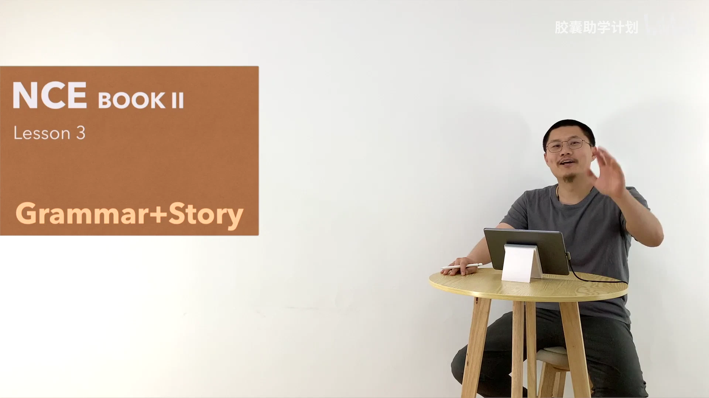

文字识别：胶囊助学计划 / NCE / BOOKII / Lesson 3 / Grammar+Story

### 画面 00:00:02

文字识别：胶囊助学计划 / NCE / BOOKI"I / Lesson 3 / Grammar+Story

### 画面 00:00:05

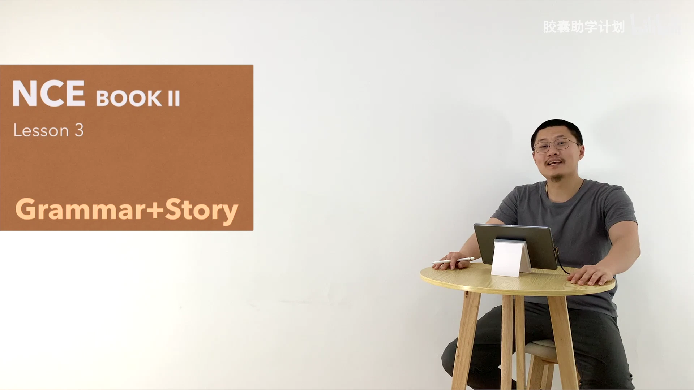

文字识别：胶囊助学计划 / NCE / BOOKII / Lesson 3 / Grammar+Story

### 画面 00:00:10

文字识别：胶囊助学计划

### 画面 00:00:12

文字识别：胶囊助学计划 / ①如何表达“我曾爱过你”？

### 画面 00:00:14

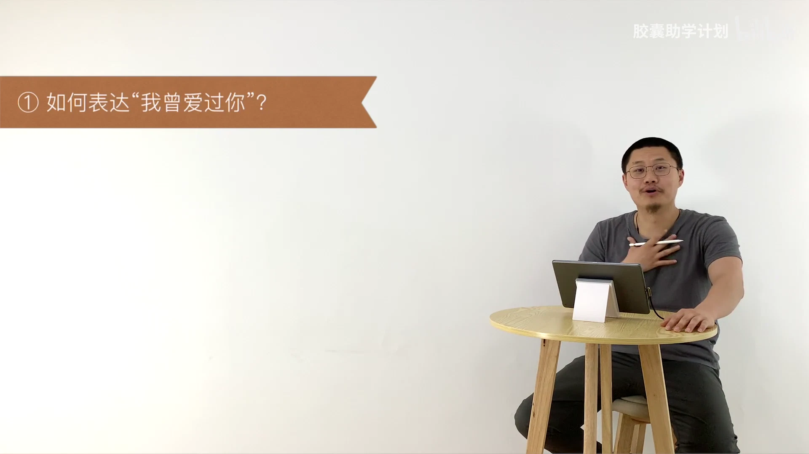

文字识别：胶囊助学计划 / ①如何表达“我曾爱过你”？

### 画面 00:00:16

文字识别：胶囊助学计划 / ①如何表达“我曾爱过你”？

### 画面 00:00:18

文字识别：胶囊助学计划 / ①如何表达“我曾爱过你”？ / 如何表达“日思夜想”

### 画面 00:00:20

文字识别：胶囊助学计划 / ①如何表达“我曾爱过你”？ / 如何表达“日思夜想' / 如何表给“给某人上一课”?

### 画面 00:00:23

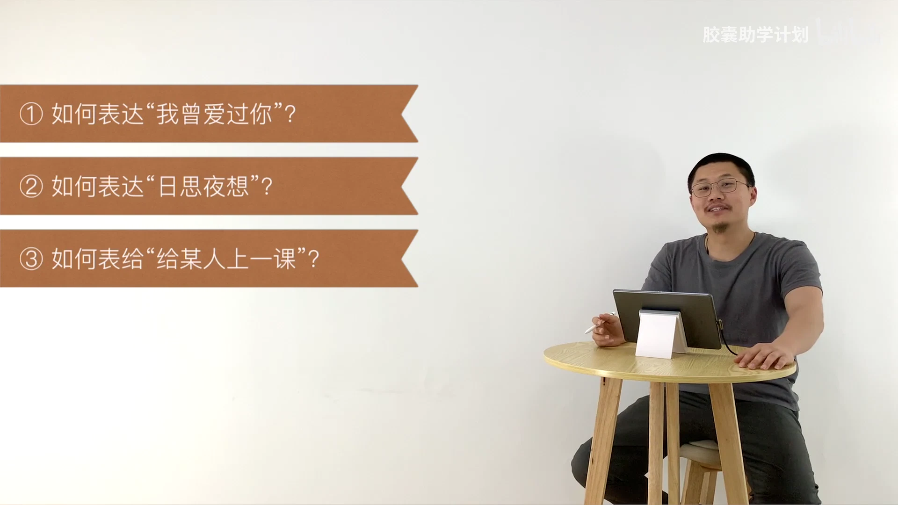

文字识别：胶囊助学计划 / ①如何表达“我曾爱过你”？ / 如何表达“日思夜想' / 如何表给“给某人上一课”?

### 画面 00:00:25

文字识别：胶囊助学计划 bilbl / • / •

### 画面 00:00:29

文字识别：胶囊助学计划

## 00:00:30–00:01:00

好，那上来呢？我们先看一下，我们在第二课刚刚学过的一般现在时，am is are跟 do does。实际上，这五个单词对应的还有这么三个单词，am is are变成了 was were，do does变成了 did。更准确一点是，am 和 is 变成了 was，are 变成了 were，do 和 does 统一变成了 did。这也引出来

### 画面 00:00:31

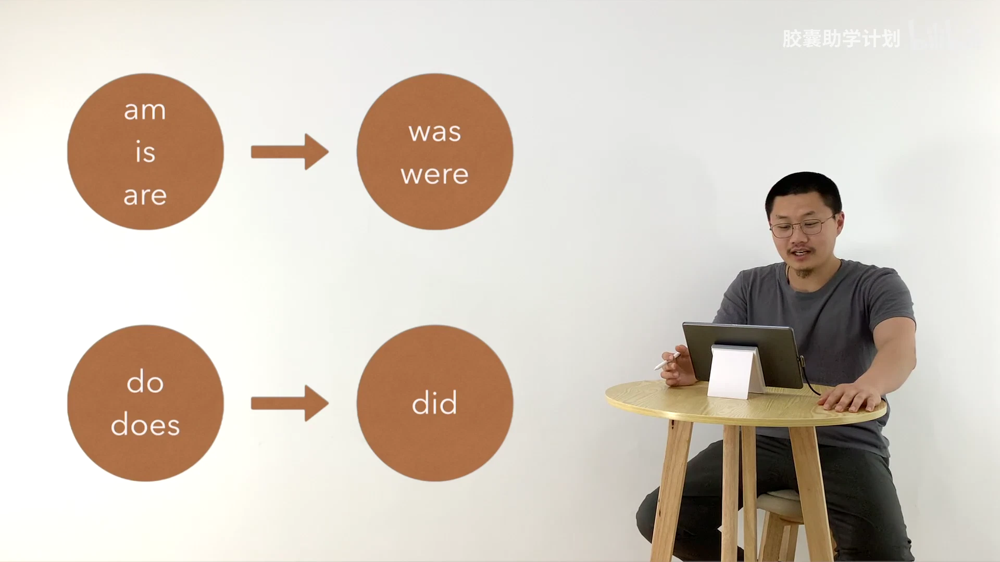

文字识别：胶囊助学计划 / am / was / is / were / are / do / did / does

### 画面 00:00:34

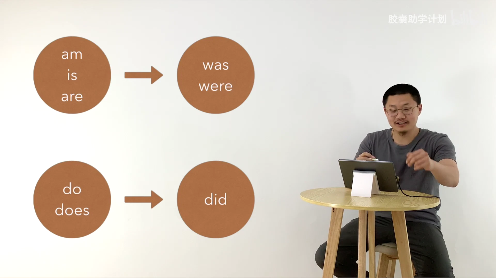

文字识别：胶囊助学计划 / am / was / is / were / are / do / did / does

### 画面 00:00:36

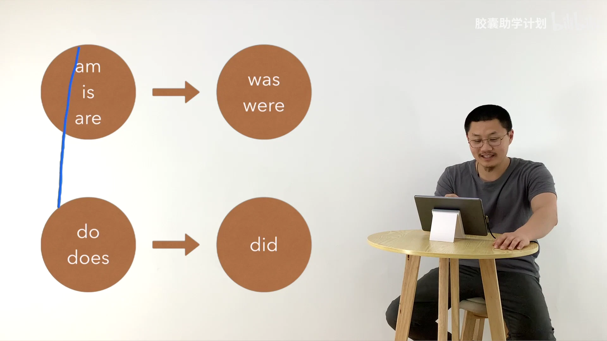

文字识别：胶囊助学计划 / am / was / is / were / are / do / did / does

### 画面 00:00:38

文字识别：胶囊助学计划 / am / was / is / were / are / do / did / does

### 画面 00:00:50

文字识别：胶囊助学计划 / am / was / is / were / are / do / did / does

### 画面 00:00:52

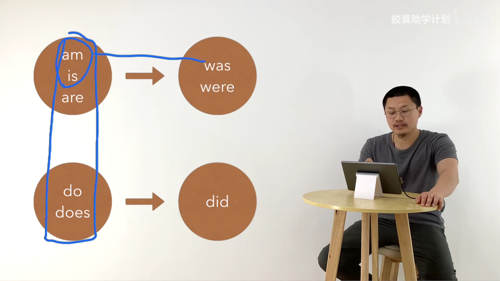

文字识别：胶囊助学计划 / am / was / is / • / were / are / do / did / does

### 画面 00:00:54

文字识别：胶囊助学计划 / am / was / is / were / are / do / did / does

### 画面 00:00:56

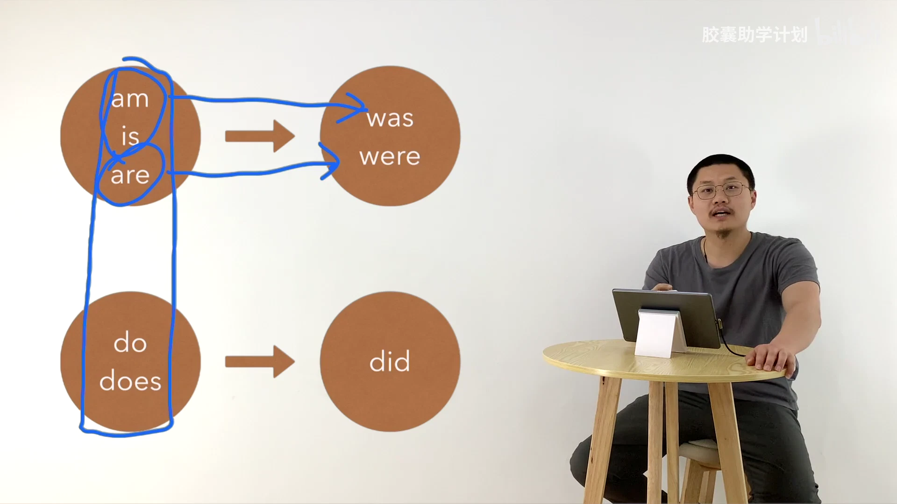

文字识别：胶囊助学计划 / am / was / iS / were / are / do / did / does

### 画面 00:00:59

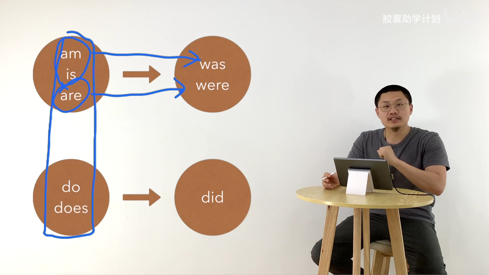

文字识别：胶囊助学计划 / am / was / iS / were / are / do / did / does

## 00:01:00–00:01:30

了今天我们要给大家去教的一个语法点，叫做一般过去时。好，那上来呢，我们先看一下它的名称叫一般过去时，对吧？接下来我们想讲的是 was were，实际上在新概念一册的六十七课到七十课，我们已经讲解过了。那大家呢需要做的事情，如果今天的课程对于您来说有点快了，不妨翻到那个视频去看一下它的讲解。好，含义呢，它是过

### 画面 00:01:01

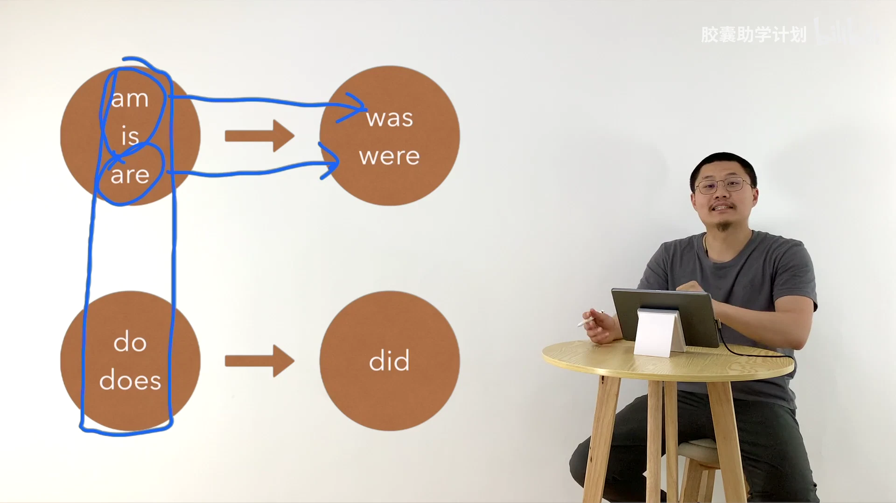

文字识别：胶囊助学计划 / am / was / is / were / are / do / did / does

### 画面 00:01:06

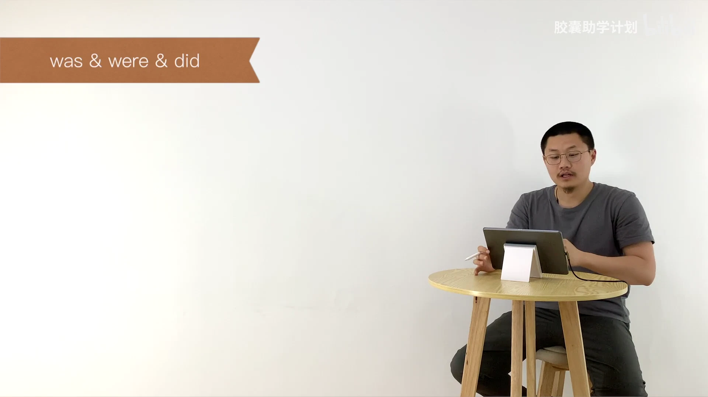

文字识别：胶囊助学计划 / was & were & did

### 画面 00:01:15

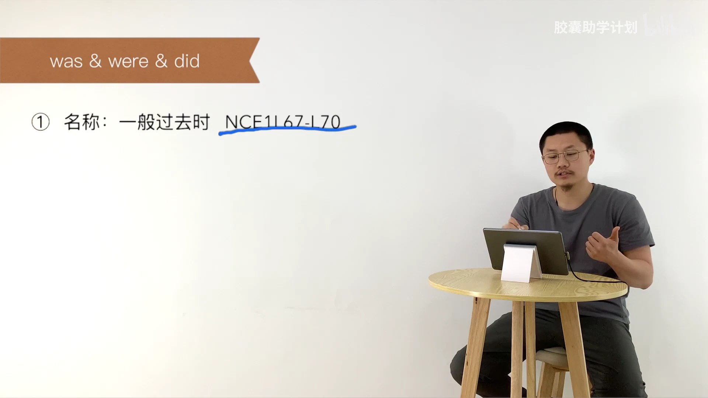

文字识别：胶囊助学计划 / was & were & did / 名称：一般过去时 / NCE1I67-L70

## 00:01:30–00:02:00

去的一个状态。肯定句我们用的是 was were。比如说，我们造一句话叫做 He was very angry yesterday。昨天呢，他特别的愤怒。那它的否定句呢？因为我们其实刚才讲到了 was were 是 am is are 变过来的，对吧？那 am is are 后边加 not 变否定句，其实那 was were 也是一个道理，后边加 not 变成否定句。比如说 He wasn't very angry yesterday。很简单，was were 后边

### 画面 00:01:31

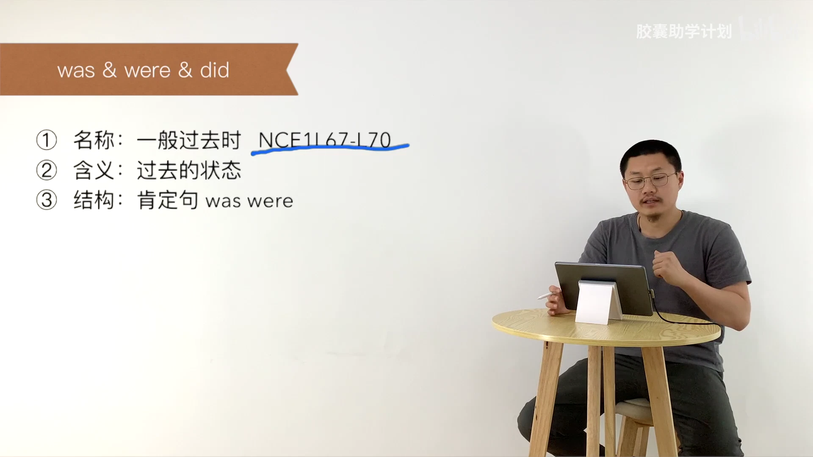

文字识别：胶囊助学计划 / was & were & did / 名称：一般过去时 / NCE1I67-L70 / 含义：过去的状态 / 结构：肯定句was were / 3

### 画面 00:01:42

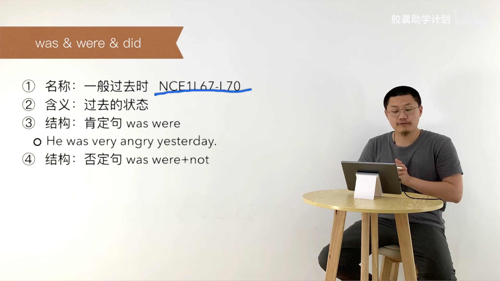

文字识别：胶囊助学计划 / was & were & did / 名称：一般过去时 / NCE1I67-L70 / 含义：过去的状态 / 结构：肯定句 was were / o He was very angry yesterday. / 结构：否定句was were+not

### 画面 00:01:52

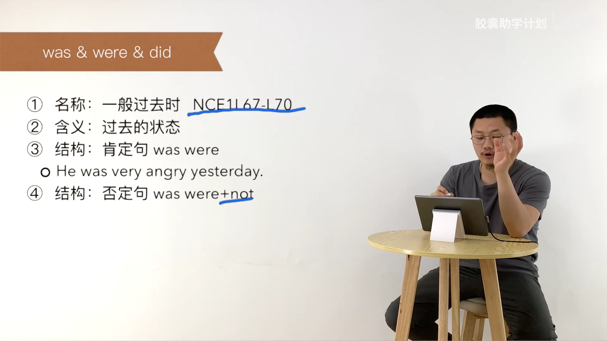

文字识别：胶囊助学计划 / was & were & did / 名称：一般过去时 / NCE1I67-L70 / 含义：过去的状态 / 结构：肯定句was were / o He was very angry yesterday. / 结构：否定句was were+not

### 画面 00:01:55

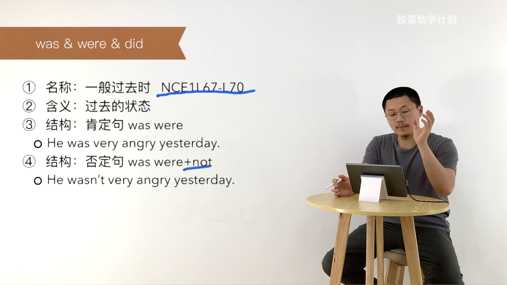

文字识别：胶囊助学计划 / was & were & did / 名称：一般过去时 / NCE1I67-L70 / 含义：过去的状态 / 结构：肯定句was were / o He was very angry yesterday. / 结构：否定句was were+not / o He wasn't very angry yesterday.

### 画面 00:01:59

文字识别：胶囊助学计划 / was & were & did / 名称：一般过去时 / NCE1I67-L70 / 含义：过去的状态 / 结构：肯定句was were / o He was very angry yesterday. / 结构：否定句was were+not / o He wasn't very angry yesterday.

## 00:02:00–00:02:30

边加了个n撇t，也就是not的一个缩写。继续，那它变一般疑问句呢，跟am is are是保持一致的，把它们提到句首就可以了。比如说，Was he very angry yesterday?好，那这是我们比较简单的关于was were的表示过去状态的一般过去时的用法。接下来我们再看一下新概念一册七十一课到七十八课，我们学过的一般过去式指的是一个动

### 画面 00:02:02

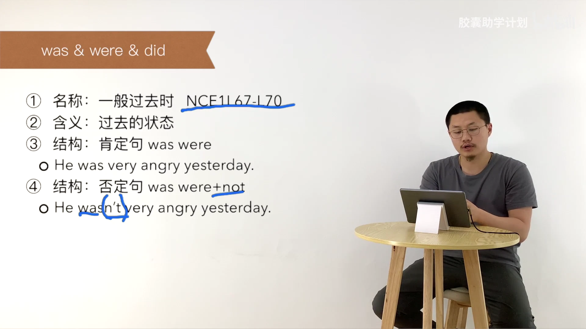

文字识别：胶囊助学计划 / was & were & did / 名称：一般过去时 / NCE1L67-L70 / 含义：过去的状态 / 结构：肯定句was were / o He was very angry yesterday. / 结构：否定句was were+not / o He wash'ty / yery angry yesterday.

### 画面 00:02:05

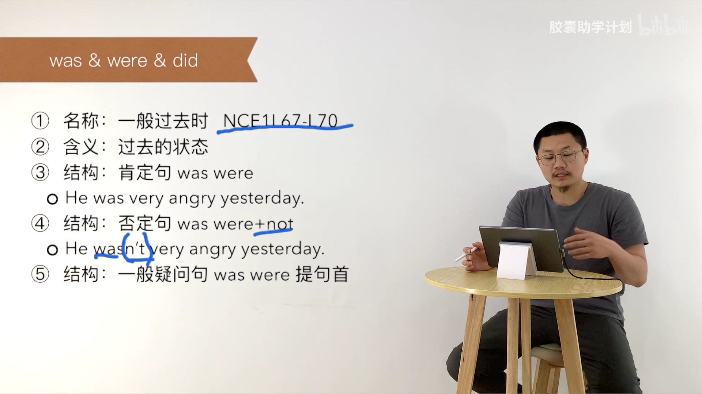

文字识别：胶囊助学计划 / was & were & did / 名称：一般过去时 / NCE1I67-L70 / 含义：过去的状态 / 结构：肯定句was were / o He was very angry yesterday. / 结构：否定句was were+not / o He wash't very angry yesterday. / 结构：一般疑问句was were 提句首 / 5

### 画面 00:02:22

文字识别：胶囊助学计划 / was & were & did / 名称：一般过去时 / f NCE1L71-L78

### 画面 00:02:25

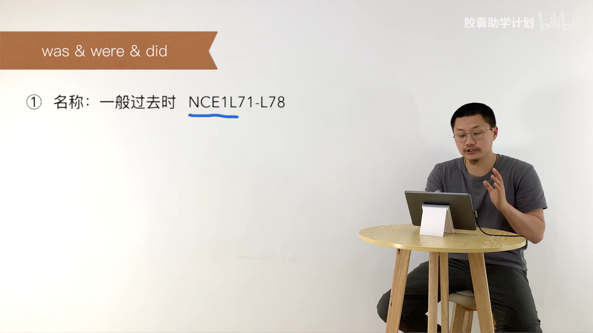

文字识别：胶囊助学计划 / was & were & did / 名称：一般过去时 / NCE1L71-L78

## 00:02:30–00:03:00

作发生在过去，那它的肯定句呢，一定要用到动词加 e d，也就是动词的过去式。动词的过去式啊，规则的是加 e d，那当然了，其实规则的还有各种各样加 e d 的方式，这我们在新概念七十一课到七十八课呢，实际上都学过一点。那它还有很多实际上不规则的，比如说 think 变成了 thought，对吧？比如说 buy 变成了 bought，这些，那实际上我们之前也讲过，对于各位来说，最好的方

### 画面 00:02:30

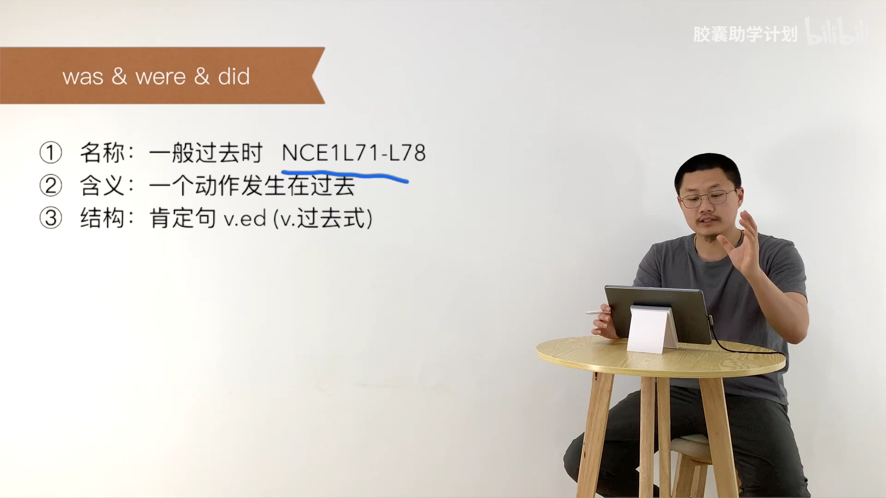

文字识别：胶囊助学计划 / was & were & did / 名称：一般过去时NCE1L71-L78 / 含义：一个动作发生在过去 / 结构：肯定句v.ed (v.过去式)

### 画面 00:02:35

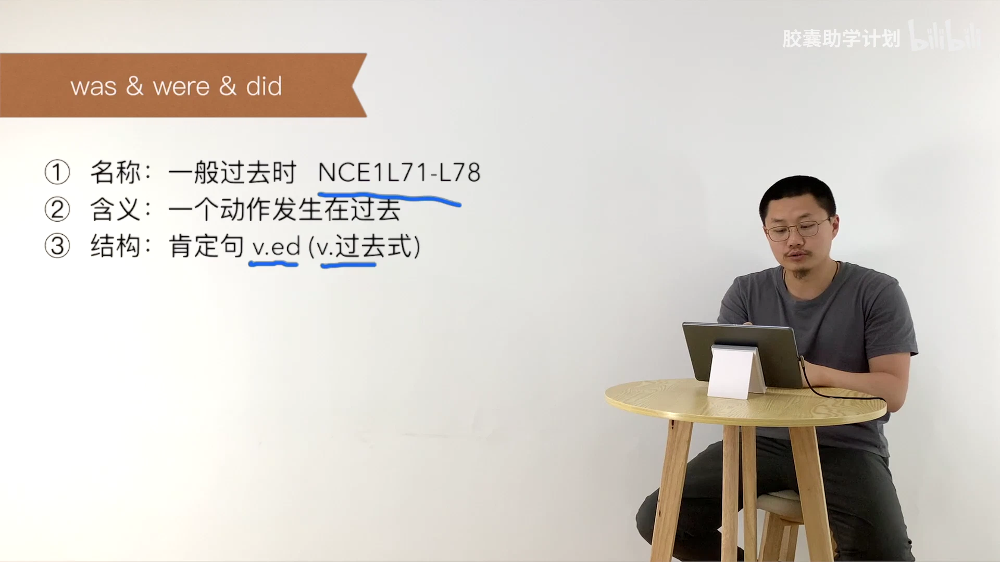

文字识别：胶囊助学计划 / was & were & did / 名称：一般过去时NCE1L71-L78 / 含义：一个动作发生在过去 / 结构：肯定句v.ed (v.过去式)

### 画面 00:02:38

文字识别：胶囊助学计划 / was & were & did / 名称：一般过去时NCE1L71-L78 / 含义：一个动作发生在过去 / 结构：肯定句v.ed (v.过去式)

### 画面 00:02:44

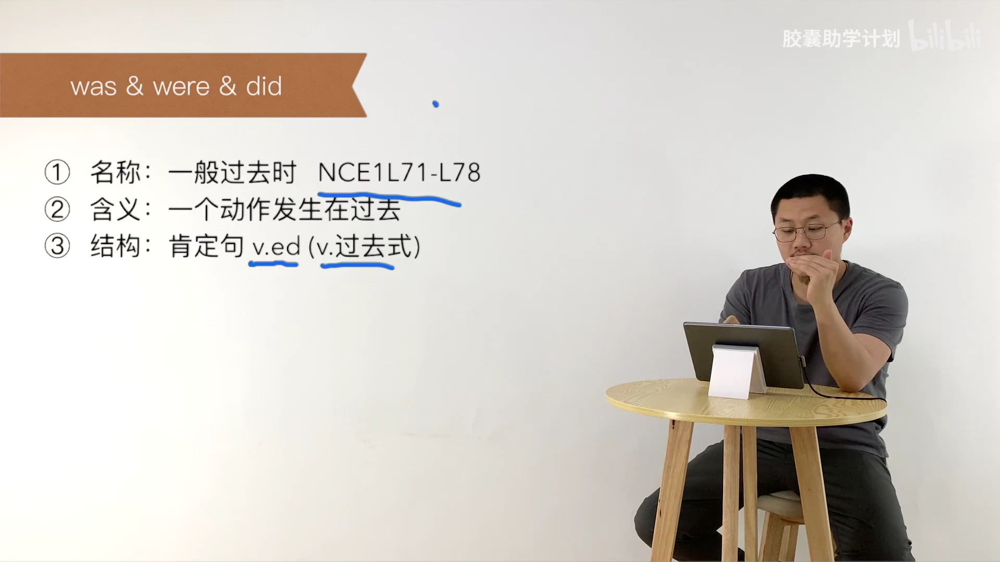

文字识别：胶囊助学计划 / was & were & did / 名称：一般过去时NCE1L71-L78 / 含义：一个动作发生在过去 / 结构：肯定句v.ed (v.过去式)

### 画面 00:02:46

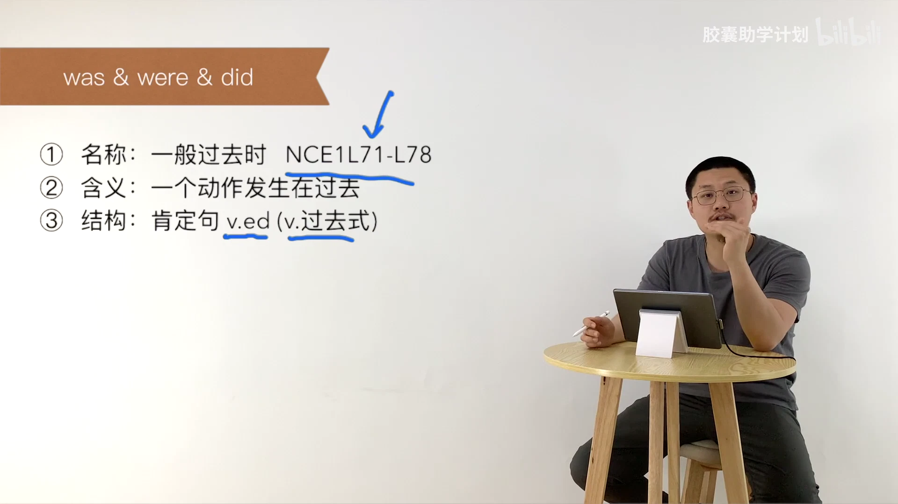

文字识别：胶囊助学计划 / was & were & did / 名称：一般过去时 / 寸 NCE1L71-L78 / 含义：一个动作发生在过去 / 结构：肯定句v.ed (v.过去式)

### 画面 00:02:58

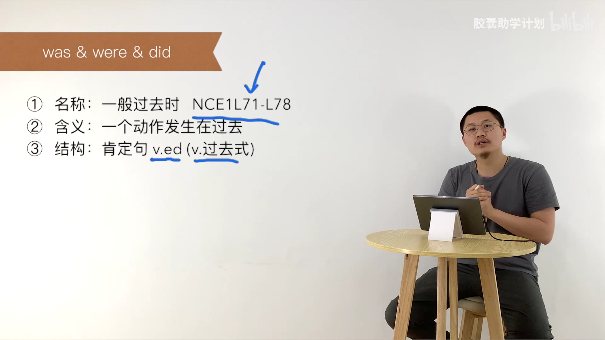

文字识别：胶囊助学计划 / was & were & did / 名称：一般过去时NCE1L71-L78 / 含义：一个动作发生在过去 / 结构：肯定句v.ed (v.过去式)

## 00:03:00–00:03:30

式并不一定是死记硬背，同时最好您还要配合上大量的阅读，尤其是课外阅读，对吧？好，那比如说我们造一句话叫做 I had breakfast this morning，今儿早上我吃早饭了。你看 have 的过去式就不是直接在后面加 e d，而变成了 had，对吧？这也是动词的过去式。那我们之前在讲动词的现在分词的时候呢，我们提到过一点，不知道各位还记不记得，就是如何判断

### 画面 00:03:23

文字识别：胶囊助学计划 / was & were & did / 名称：一般过去时NCE1L71-L78 / 含义：一个动作发生在过去 / 结构：肯定句v.ed (v.过去式) / o I had breakfast this morning.

## 00:03:30–00:04:00

我们手机当中的那个词典够不够用呢？就是一个动词，如果它有过去式、现在分词，它一定会给您标出来它的过去式和现在分词长成什么样子，而不用您自己再去查。比如说您查了 buy 这个单词，那它在下面应该给您标上了叫做 buying b u y i n g，对吧？应该给您标上了 bought，叫过去式，叫做 b o u g h t。这说明您手机的词典是好的，够用的。

### 画面 00:03:53

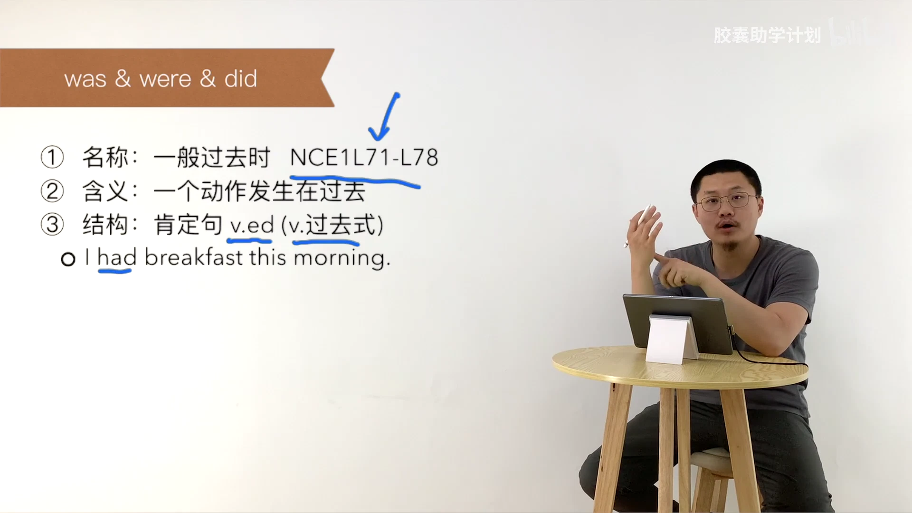

文字识别：胶囊助学计划 / was & were & did / 名称：一般过去时NCE1L71-L78 / 含义：一个动作发生在过去 / 结构：肯定句v.ed (v.过去式) / o I had breakfast this morning.

## 00:04:00–00:04:30

否则呢，您再多下几个试一下，好吧。接下来它的否定句呢，因为我们说了 did 跟 do does 又是 do does 变过来的，它们实际上变法也是保持一致的。哎，首先都是在后边加 not。其实其次呢，does 各位还记不记得我们说，你当把 does 提前或者说变否定句的时候，动词要变回原形。did 也是同样的道理。比如说我们看一句话叫 I didn't have breakfast this morning。哎，今

### 画面 00:04:03

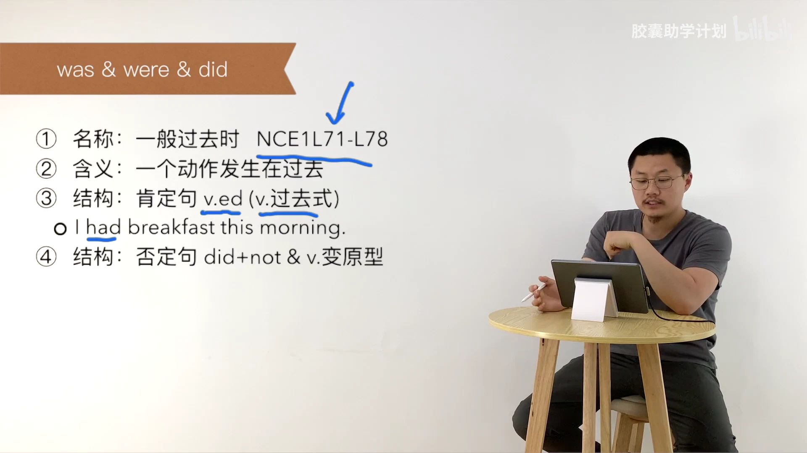

文字识别：胶囊助学计划 / was & were & did / 名称：一般过去时NCE1L71-L78 / 含义：一个动作发生在过去 / 结构：肯定句v.ed (v.过去式) / o I had breakfast this morning. / 结构：否定句did+not &v.变原型

### 画面 00:04:07

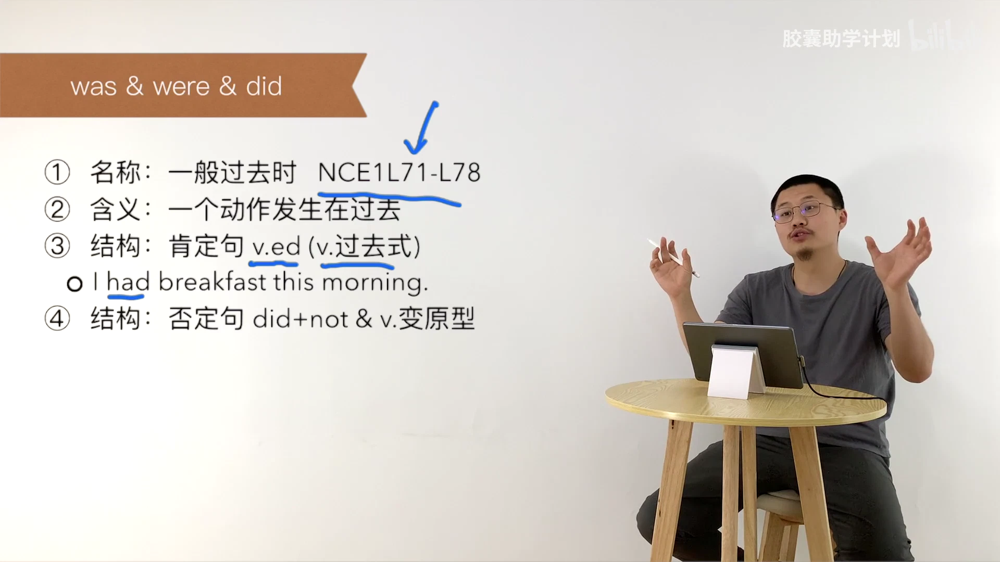

文字识别：胶囊助学计划 / was & were & did / 名称：一般过去时NCE1L71-L78 / 含义：一个动作发生在过去 / 结构：肯定句v.ed (v.过去式) / o I had breakfast this morning. / 结构：否定句did+not ＆v.变原型

### 画面 00:04:22

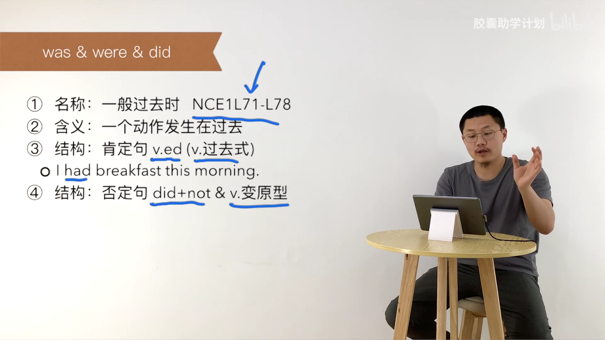

文字识别：胶囊助学计划 / was & were & did / 名称：一般过去时 / 寸 NCE1L71-L78 / 含义：一个动作发生在过去 / 结构：肯定句v.ed (v.过去式) / o I had breakfast this morning. / 结构：否定句did+not ＆v.变原型

## 00:04:30–00:05:00

儿早晨没吃早饭。注意，didn't和have动词换回原形。那一般疑问句呢，跟do does依旧保持一致，只是把did提到了句首，动词还是要换回原形。我们看一句话叫做Did you have breakfast this morning?今儿早晨你吃早饭了吗？这个是我们对过去对吧？现在已经不是早晨了，那您对早晨这个过去时间的动作提问，要把did提到句首去。这就是我们关于一

### 画面 00:04:35

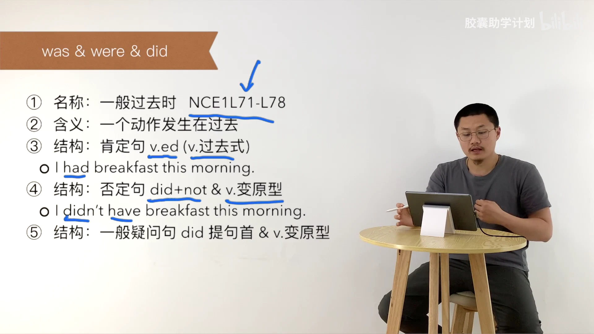

文字识别：胶囊助学计划 / was & were & did / 名称：一般过去时NCE1L71-L78 / 含义：一个动作发生在过去 / 结构：肯定句v.ed (v.过去式) / o I had breakfast this morning. / 结构：否定句did+not &v.变原型 / o I didn't have breakfast this morning. / 结构：一般疑问句did 提句首＆v.变原型

### 画面 00:04:40

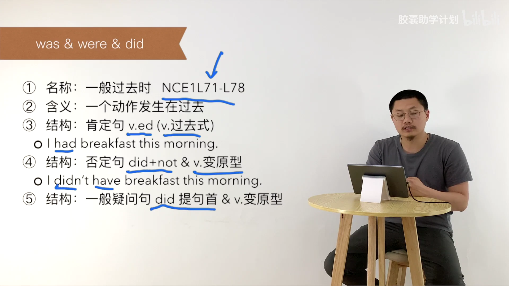

文字识别：胶囊助学计划 / was & were & did / 名称：一般过去时NCE1L71-L78 / 含义：一个动作发生在过去 / 结构：肯定句v.ed (v.过去式) / o I had breakfast this morning. / 结构：否定句did+not ＆v.变原型 / o I didn't have breakfast this morning. / 结构：一般疑问句did 提句首＆v.变原型

### 画面 00:04:46

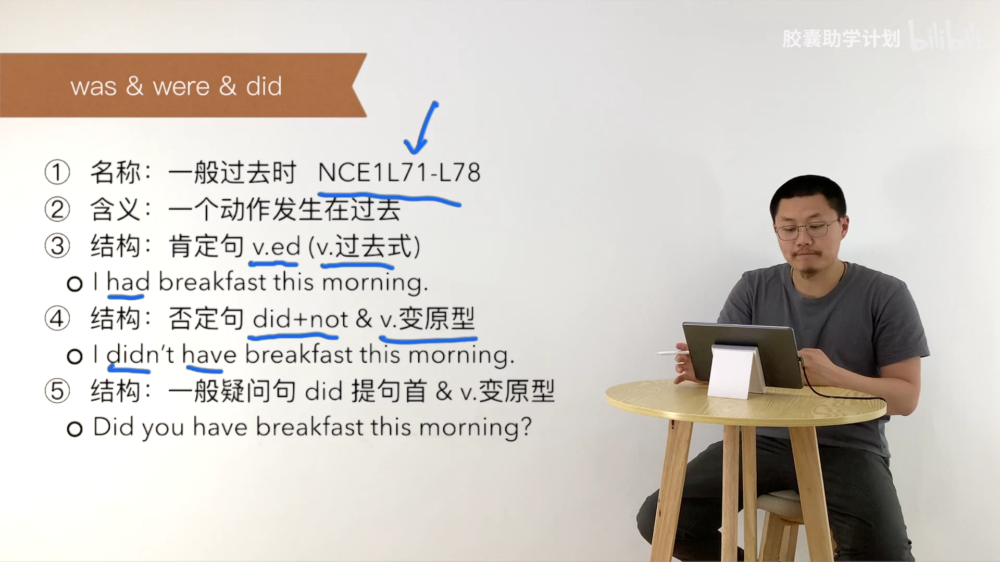

文字识别：胶囊助学计划 / was & were & did / 名称：一般过去时NCE1L71-L78 / 含义：一个动作发生在过去 / 结构：肯定句v.ed (v.过去式) / 3 / o I had breakfast this morning. / 结构：否定句did+not ＆v.变原型 / o I didn't have breakfast this morning. / 结构：一般疑问句did 提句首＆v.变原型 / o Did you have breakfast this morning?

### 画面 00:04:50

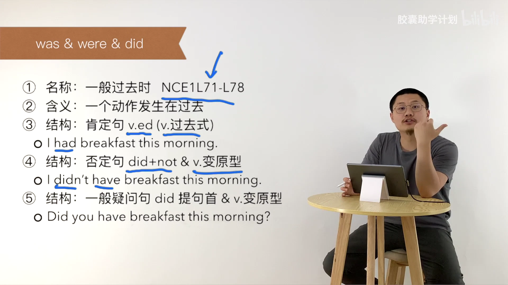

文字识别：胶囊助学计划 / was & were & did / 名称：一般过去时NCE1L71-L78 / 含义：一个动作发生在过去 / 结构：肯定句v.ed (v.过去式) / o I had breakfast this morning. / 结构：否定句did+not ＆v.变原型 / o I didn't have breakfast this morning. / 结构：一般疑问句did 提句首＆v.变原型 / o Did you have breakfast this morning?

## 00:05:00–00:05:30

般过去时最重要的两个小点。第一个 was were 表示一种状态，它并没有表示具体的某个动作，而 did 也就是动词的过去式这个地方呢，更多表示的是动词的过去发生的一个动作啊，在动词发生在过去的时候，哎，这样的一个情况，我们要把它变成动词的过去式。接下来呢，我们一起看一个普希金，俄国非常著名的诗人普希金的一首诗，非常的短，只有一分钟的时间。它全

### 画面 00:05:03

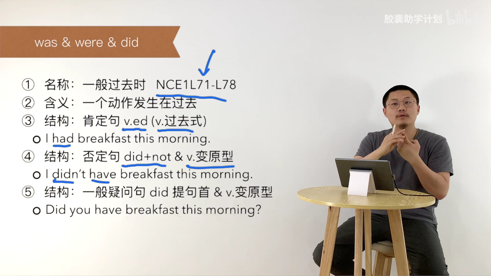

文字识别：胶囊助学计划 / was & were & did / 名称：一般过去时NCE1L71-L78 / 含义：一个动作发生在过去 / 结构：肯定句v.ed (v.过去式) / o I had breakfast this morning. / 结构：否定句did+not ＆v.变原型 / o I didn't have breakfast this morning. / 结构：一般疑问句did 提句首＆v.变原型 / o Did you have breakfast this morning?

### 画面 00:05:20

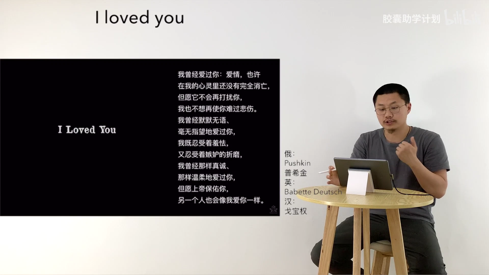

文字识别：Iloved you / 胶囊助学计划 / 我曾经爱过你：爱情，也许 / 在我的心灵里还没有完全消亡， / 但愿它不会再打扰你， / 我也不想再使你难过悲伤。 / 我曾经默默无语、 / I Loved You / 毫无指望地爱过你， / 我既忍受着羞怯， / 又忍受着嫉妒的折磨， / 俄： / Pushkin / 我曾经那样真诚、 / 普希金 / 那样温柔地爱过你， / 英： / 但愿上帝保佑你， / Babette Deutsch / 另一个人也会像我爱你一样。 / 汉： / 戈宝权

## 00:05:30–00:06:00

文的标题叫做 I loved you。那 I love you 大家都知道，表示我爱你，指的是现在的这种一个状态，对吧？那一旦加上 e d，这就变成了一个过去式了，就翻译成汉语叫做我曾爱过你。这已经不是现在的事儿了，对吧？接下来我们一起静静的花一分钟的时间，一起去欣赏一下这首诗。

### 画面 00:05:30

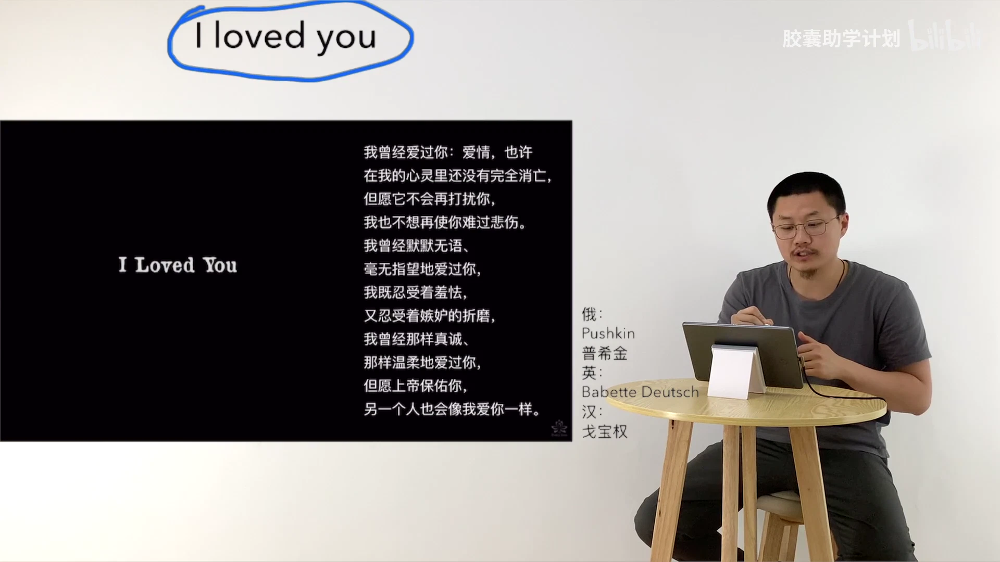

文字识别：Iloved you / 胶囊助学计划 / 我曾经爱过你：爱情，也许 / 在我的心灵里还没有完全消亡， / 但愿它不会再打扰你， / 我也不想再使你难过悲伤。 / 我曾经默默无语、 / I Loved You / 毫无指望地爱过你， / 我既忍受着羞怯， / 又忍受着嫉妒的折磨， / 俄： / Pushkin / 我曾经那样真诚、 / 普希金 / 那样温柔地爱过你， / 英： / 但愿上帝保佑你， / Babette Deutsch / 另一个人也会像我爱你一样。 / 汉： / 戈宝权

### 画面 00:05:39

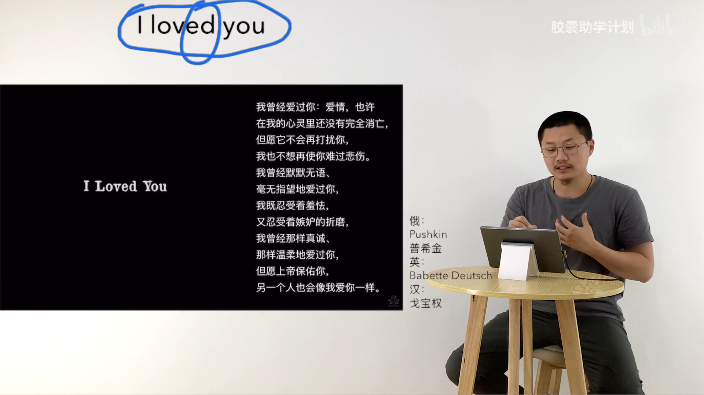

文字识别：Iloved / you / 胶囊助学计划 / 我曾经爱过你：爱情，也许 / 在我的心灵里还没有完全消亡， / 但愿它不会再打扰你， / 我也不想再使你难过悲伤。 / 我曾经默默无语、 / I Loved You / 毫无指望地爱过你， / 我既忍受着羞怯， / 又忍受着嫉妒的折磨， / 俄： / Pushkin / 我曾经那样真诚、 / 普希金 / 那样温柔地爱过你， / 英： / 但愿上帝保佑你， / Babette Deutsch / 另一个人也会像我爱你一样。 / 汉： / 戈宝权

### 画面 00:05:45

文字识别：Iloved / you / 胶囊助学计划 / 我曾经爱过你：爱情，也许 / 在我的心灵里还没有完全消亡， / 但愿它不会再打扰你， / 我也不想再使你难过悲伤。 / 我曾经默默无语、 / I Loved You / 毫无指望地爱过你， / 我既忍受着羞怯， / 又忍受着嫉妒的折磨， / 俄： / Pushkin / 我曾经那样真诚、 / 普希金 / 那样温柔地爱过你， / 英： / 但愿上帝保佑你， / Babette Deutsch / 另一个人也会像我爱你一样。 / 汉： / 戈宝权

### 画面 00:05:47

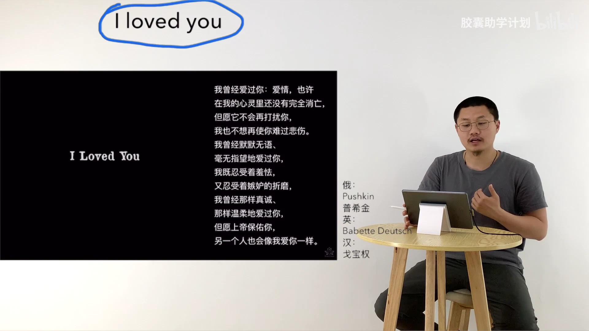

文字识别：Hloved you / 胶囊助学计划 / 我曾经爱过你：爱情，也许 / 在我的心灵里还没有完全消亡， / 但愿它不会再打扰你， / 我也不想再使你难过悲伤。 / 我曾经默默无语、 / I Loved You / 毫无指望地爱过你， / 我既忍受着羞怯， / 又忍受着嫉妒的折磨， / 俄： / Pushkin / 我曾经那样真诚、 / 普希金 / 那样温柔地爱过你， / 英： / 但愿上帝保佑你， / Babette Deutsch / 另一个人也会像我爱你一样。 / 汉： / 戈宝权

### 画面 00:05:49

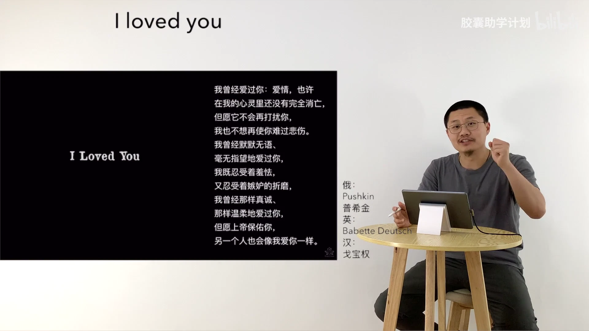

文字识别：Hloved you / 胶囊助学计划 / 我曾经爱过你：爱情，也许 / 在我的心灵里还没有完全消亡， / 但愿它不会再打扰你， / 我也不想再使你难过悲伤。 / 我曾经默默无语、 / I Loved You / 毫无指望地爱过你， / 我既忍受着羞怯， / 又忍受着嫉妒的折磨， / 俄： / Pushkin / 我曾经那样真诚、 / 普希金 / 那样温柔地爱过你， / 英： / 但愿上帝保佑你， / Babette Deutsch / 另一个人也会像我爱你一样。 / 汉： / 戈宝权

### 画面 00:05:55

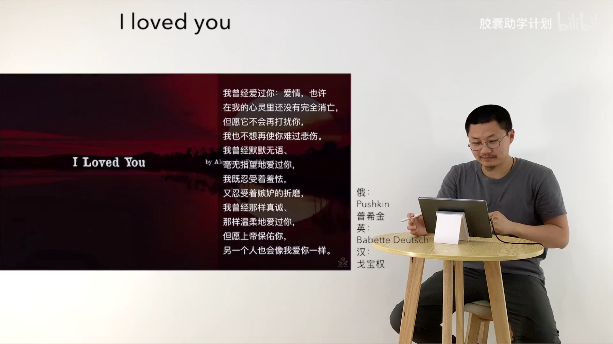

文字识别：Hloved you / 胶囊助学计划 / 我曾经爱过你：爱情，也许 / 在我的心灵里还没有完全消亡， / 但愿它不会再打扰你， / 我也不想再使你难过悲伤。 / 我曾经默默无语、 / I Loved You / byAl毫无指望地爱过你， / 我既忍受着羞怯， / 又忍受着嫉妒的折磨， / 俄： / Pushkin / 我曾经那样真诚、 / 普希金 / 那样温柔地爱过你， / 英： / 但愿上帝保佑你, / Babette Deutsch / 另一个人也会像我爱你一样。 / 汉： / 戈宝权

### 画面 00:05:57

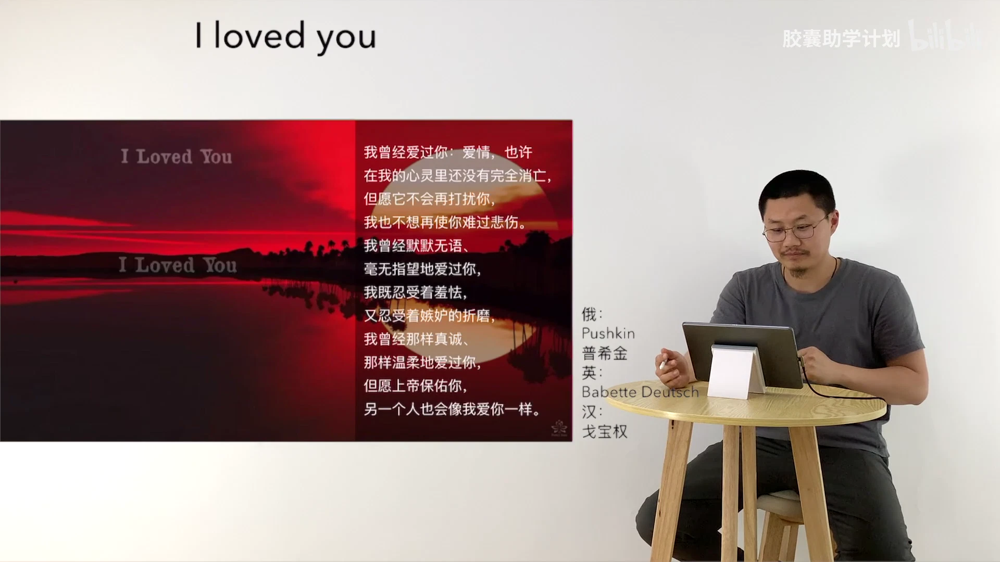

文字识别：Iloved you / 胶囊助学计划 / I Loved You / 我曾经爱过你：爱情，也许 / 在我的心灵里还没有完全消亡， / 但愿它不会再打扰你， / 我也不想再使你难过悲伤。 / 我曾经默默无语、 / I Loved You / 毫无指望地爱过你， / 我既忍受着羞怯， / 又忍受着嫉妒的折磨， / 俄： / Pushkin / 我曾经那样真诚、 / 普希金 / 那样温柔地爱过你， / 英： / 但愿上帝保佑你， / Babette Deutsch / 另一个人也会像我爱你一样。 / 汉： / 戈宝权

## 00:06:00–00:06:30

I loved you, and perhaps I love you still. The flame, perhaps, is not extinguished yet. It burns so quietly within my soul. No longer should you feel distressed by it. Silently and hopelessly, I loved you. At times,

### 画面 00:06:00

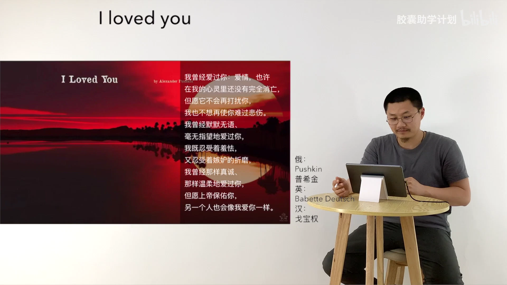

文字识别：Iloved you / 胶囊助学计划 / I Loved You / 我曾经爱过你：爱情，也许 / by Alexander I / 在我的心灵里还没有完全消亡， / 但愿它不会再打扰你， / 我也不想再使你难过悲伤。 / 我曾经默默无语、 / 毫无指望地爱过你， / 我既忍受着羞怯， / 又忍受着嫉妒的折磨， / 俄： / Pushkin / 我曾经那样真诚、 / 普希金 / 那样温柔地爱过你， / 英： / 但愿上帝保佑你， / Babette Deutsch / 另一个人也会像我爱你一样。 / 汉： / 戈宝权

### 画面 00:06:05

文字识别：Iloved you / 胶囊助学计划 / I Loved You / 我曾经爱过你：爱情，也许 / by Alexander I / 在我的心灵里还没有完全消亡， / I loved you; and perhaps I love you still, / 但愿它不会再打扰你， / 我也不想再使你难过悲伤。 / 我曾经默默无语、 / 毫无指望地爱过你， / 我既忍受着羞怯， / 又忍受着嫉妒的折磨， / 俄： / Pushkin / 我曾经那样真诚、 / 普希金 / 那样温柔地爱过你， / 英： / 但愿上帝保佑你, / Babette Deutsch / 另一个人也会像我爱你一样。 / 汉： / 戈宝权

### 画面 00:06:08

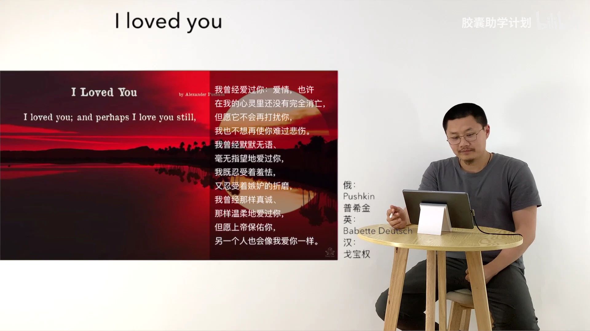

文字识别：Iloved you / 胶囊助学计划 / I Loved You / 我曾经爱过你：爱情，也许 / by Alexander I / 在我的心灵里还没有完全消亡， / I loved you; and perhaps I love you still, / 但愿它不会再打扰你， / 我也不想再使你难过悲伤。 / 我曾经默默无语、 / 毫无指望地爱过你， / 我既忍受着羞怯， / 又忍受着嫉妒的折磨， / 俄： / Pushkin / 我曾经那样真诚、 / 普希金 / 那样温柔地爱过你， / 英： / 但愿上帝保佑你， / Babette Deutsch / 另一个人也会像我爱你一样。 / 汉： / 戈宝权

### 画面 00:06:10

文字识别：Iloved you / 胶囊助学计划 / I Loved You / 我曾经爱过你：爱情，也许 / by Alexander Tu / 在我的心灵里还没有完全消亡， / I loved you; and perhaps I love you still, / 但愿它不会再打扰你， / The flame, perhaps, is not extinguished; yet / 我也不想再使你难过悲伤。 / 我曾经默默无语、 / 毫无指望地爱过你， / 我既忍受着羞怯， / 又忍受着嫉妒的折磨， / 俄： / Pushkin / 我曾经那样真诚、 / 普希金 / 那样温柔地爱过你， / 英： / 但愿上帝保佑你, / Babette Deutsch / 另一个人也会像我爱你一样。 / 汉： / 戈宝权

### 画面 00:06:12

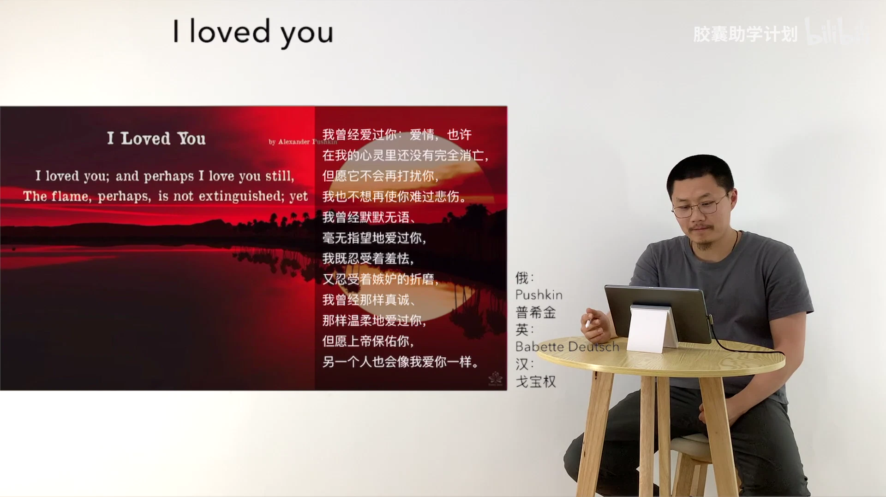

文字识别：Iloved you / 胶囊助学计划 / I Loved You / 我曾经爱过你：爱情，也许 / by Alexander Fu / 在我的心灵里还没有完全消亡， / I loved you; and perhaps I love you still, / 但愿它不会再打扰你， / The flame, perhaps, is not extinguished; yet / 我也不想再使你难过悲伤。 / 我曾经默默无语、 / 毫无指望地爱过你， / 我既忍受着羞怯， / 又忍受着嫉妒的折磨， / 俄： / Pushkin / 我曾经那样真诚、 / 普希金 / 那样温柔地爱过你， / 英： / 但愿上帝保佑你, / Babette Deutsch / 另一个人也会像我爱你一样。 / 汉： / 戈宝权

### 画面 00:06:14

文字识别：Iloved you / 胶囊助学计划 / I Loved You / 我曾经爱过你：爱情，也许 / by Alexander Fu / 在我的心灵里还没有完全消亡， / I loved you; and perhaps I love you still, / 但愿它不会再打扰你， / The flame, perhaps, is not extinguished; yet / 我也不想再使你难过悲伤。 / It burns / 我曾经默默无语、 / 毫无指望地爱过你， / 我既忍受着羞怯， / 又忍受着嫉妒的折磨， / 俄： / Pushkin / 我曾经那样真诚、 / 普希金 / 那样温柔地爱过你， / 英： / 但愿上帝保佑你, / Babette Deutsch / 另一个人也会像我爱你一样。 / 汉： / 戈宝权

### 画面 00:06:16

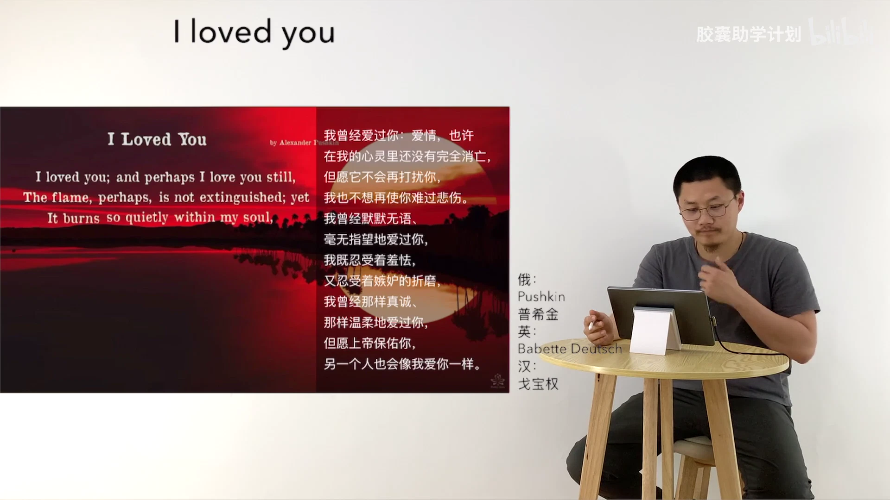

文字识别：Iloved you / 胶囊助学计划 / I Loved You / 我曾经爱过你：爱情，也许 / by Alexander Pu / 在我的心灵里还没有完全消亡， / I loved you; and perhaps I love you still, / 但愿它不会再打扰你， / The flame, perhaps, is not extinguished; yet / 我也不想再使你难过悲伤。 / It burns so quietly within my soul / 我曾经默默无语、 / 毫无指望地爱过你， / 我既忍受着羞怯， / 又忍受着嫉妒的折磨， / 俄： / Pushkin / 我曾经那样真诚、 / 普希金 / 那样温柔地爱过你， / 英： / 但愿上帝保佑你， / Babette Deutsch / 另一个人也会像我爱你一样。 / 汉： / 戈宝权

### 画面 00:06:18

文字识别：Iloved you / 胶囊助学计划 / I Loved You / 我曾经爱过你：爱情，也许 / by Alexander P / 在我的心灵里还没有完全消亡， / I loved you; and perhaps I love you still, / 但愿它不会再打扰你， / The flame, perhaps, is not extinguished; yet / 我也不想再使你难过悲伤。 / It burns so quietly within my soul, / 我曾经默默无语、 / No longer / 毫无指望地爱过你， / 我既忍受着羞怯， / 又忍受着嫉妒的折磨， / 俄： / Pushkin / 我曾经那样真诚、 / 普希金 / 那样温柔地爱过你， / 英： / 但愿上帝保佑你， / Babette Deutsch / 另一个人也会像我爱你一样。 / 汉： / 戈宝权

### 画面 00:06:20

文字识别：Iloved you / 胶囊助学计划 / I Loved You / 我曾经爱过你：爱情，也许 / by Alexander Fu / 在我的心灵里还没有完全消亡， / I loved you; and perhaps I love you still, / 但愿它不会再打扰你， / The flame, perhaps, is not extinguished; yet / 我也不想再使你难过悲伤。 / It burns so quietly within my soul, / 我曾经默默无语、 / No longer should you feel distressed by it. / 毫无指望地爱过你， / 我既忍受着羞怯， / 又忍受着嫉妒的折磨， / 俄： / Pushkin / 我曾经那样真诚、 / 普希金 / 那样温柔地爱过你， / 英： / 但愿上帝保佑你, / Babette Deutsch / 另一个人也会像我爱你一样。 / 汉： / 戈宝权

### 画面 00:06:23

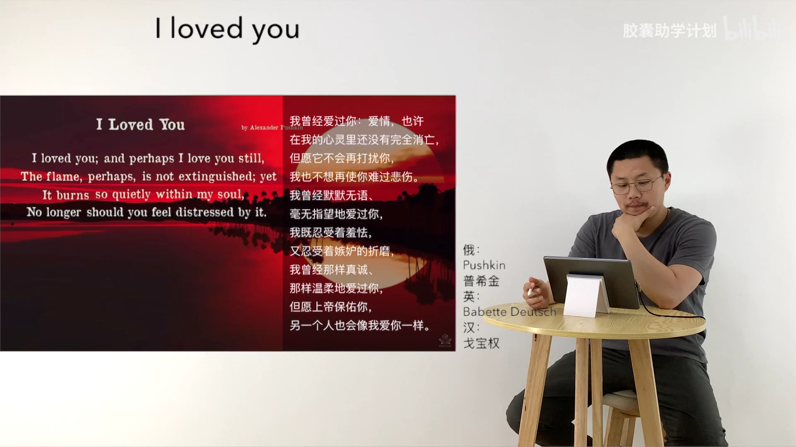

文字识别：Hloved you / 胶囊助学计划 / I Loved You / 我曾经爱过你：爱情，也许 / by Alexander P / 在我的心灵里还没有完全消亡， / I loved you; and perhaps I love you still, / 但愿它不会再打扰你， / The flame, perhaps, is not extinguished; yet / 我也不想再使你难过悲伤。 / It burns so quietly within my soul, / 我曾经默默无语、 / No longer should you feel distressed by it. / 毫无指望地爱过你， / 我既忍受着羞怯， / 又忍受着嫉妒的折磨， / 俄： / Pushkin / 我曾经那样真诚、 / 普希金 / 那样温柔地爱过你， / 英： / 但愿上帝保佑你， / Babette Deutsch / 另一个人也会像我爱你一样。 / 汉： / 戈宝权

### 画面 00:06:28

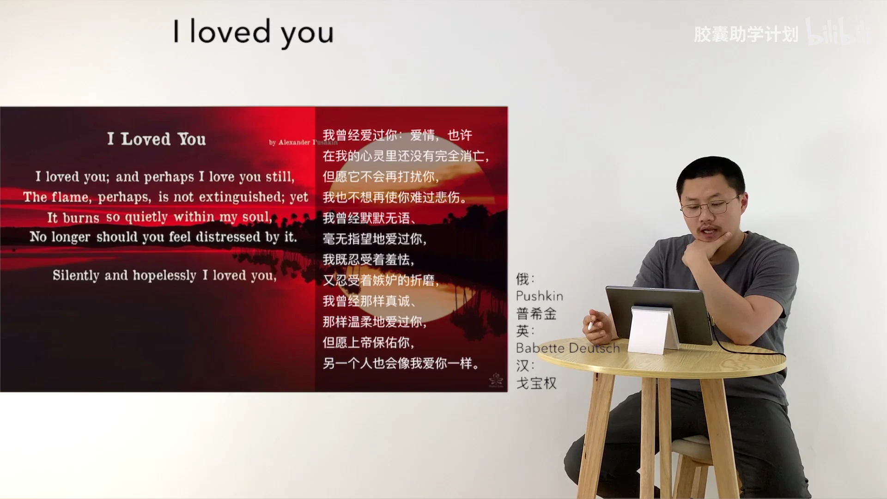

文字识别：Iloved you / 胶囊助学计划 / I Loved Tou / 我曾经爱过你：爱情，也许 / by Alexander Pu / 在我的心灵里还没有完全消亡， / I loved you; and perhaps I love you still, / 但愿它不会再打扰你， / The flame, perhaps, is not extinguished; yet / 我也不想再使你难过悲伤。 / It burns so quietly within my soul, / 我曾经默默无语、 / No longer should you feel distressed by it. / 毫无指望地爱过你， / 我既忍受着羞怯， / Silently and hopelessly I loved you, / 又忍受着嫉妒的折磨， / 俄： / Pushkin / 我曾经那样真诚、 / 普希金 / 那样温柔地爱过你， / 英： / 但愿上帝保佑你, / Babette Deutsch / 另一个人也会像我爱你一样。 / 汉： / 戈宝权

## 00:06:30–00:07:00

too jealous, and at times too shy. Oh, may God find another who will love you as tenderly and truthfully as I.好，那我们读完了，听完了这首诗，那叫做 I loved you. 我曾爱过你。这是一个非常典型的一般过去时。接下来我们看一下 pattern drill，又到了语法的练习了。练的就是包含

### 画面 00:06:32

文字识别：Hloved you / 胶囊助学计划 / I Loved You / 我曾经爱过你：爱情，也许 / by Alexander Pu / 在我的心灵里还没有完全消亡， / I loved you; and perhaps I love you still, / 但愿它不会再打扰你， / The flame, perhaps, is not extinguished; yet / 我也不想再使你难过悲伤。 / It burns so quietly within my soul, / 我曾经默默无语、 / No longer should you feel distressed by it. / 毫无指望地爱过你， / 我既忍受着羞怯， / Silently and hopelessly I loved you, / 又忍受着嫉妒的折磨， / 俄： / At times too jealous and at times too shy; / Pushkin / 我曾经那样真诚、 / 普希金 / 那样温柔地爱过你， / 英： / 但愿上帝保佑你, / Babette Deutsch / 另一个人也会像我爱你一样。 / 汉： / 戈宝权

### 画面 00:06:35

文字识别：Iloved you / 胶囊助学计划 / I Loved You / 我曾经爱过你：爱情，也许 / by Alexander Pu / 在我的心灵里还没有完全消亡， / I loved you; and perhaps I love you still, / 但愿它不会再打扰你， / The flame, perhaps, is not extinguished; yet / 我也不想再使你难过悲伤。 / It burns so quietly within my soul, / 我曾经默默无语、 / No longer should you feel distressed by it. / 毫无指望地爱过你， / 我既忍受着羞怯， / silently and hopelessly I loved you, / 又忍受着嫉妒的折磨， / 俄： / At times too jealous and at times too shy; / Pushkin / 我曾经那样真诚、 / Oh, / 普希金 / 那样温柔地爱过你， / 英： / 但愿上帝保佑你, / Babette Deutsch / 另一个人也会像我爱你一样。 / 汉： / 戈宝权

### 画面 00:06:38

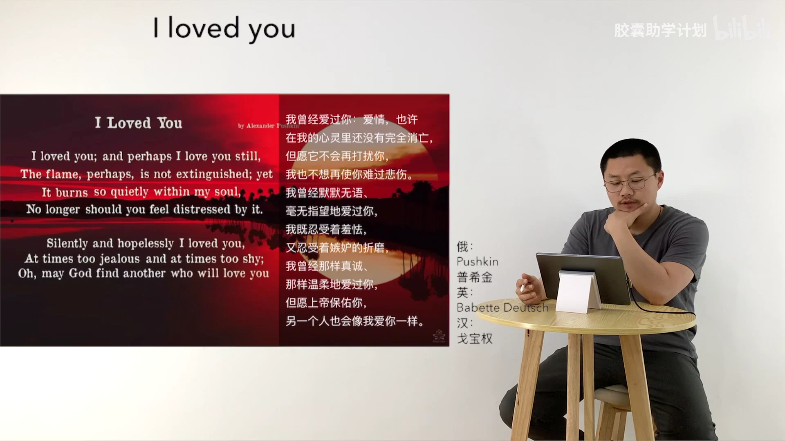

文字识别：Iloved you / 胶囊助学计划 / I Loved You / 我曾经爱过你：爱情，也许 / by Alexander P / 在我的心灵里还没有完全消亡， / I loved you; and perhaps I love you still, / 但愿它不会再打扰你， / The flame, perhaps, is not extinguished; yet / 我也不想再使你难过悲伤。 / It burns so quietly within my soul, / 我曾经默默无语、 / No longer should you feel distressed by it. / 毫无指望地爱过你， / 我既忍受着羞怯， / silently and hopelessly I loved you, / 又忍受着嫉妒的折磨， / 俄： / At times too jealous and at times too shy; / Pushkin / 我曾经那样真诚、 / Oh, may God find another who will love you / 普希金 / 那样温柔地爱过你， / 英： / 但愿上帝保佑你， / Babette Deutsch / 另一个人也会像我爱你一样。 / 汉： / 戈宝权

### 画面 00:06:41

文字识别：Iloved you / 胶囊助学计划 / I Loved You / 我曾经爱过你：爱情，也许 / by Alexander Pu / 在我的心灵里还没有完全消亡， / I loved you; and perhaps I love you still, / 但愿它不会再打扰你， / The flame, perhaps, is not extinguished; yet / 我也不想再使你难过悲伤。 / It burns so quietly within my soul, / 我曾经默默无语、 / No longer should you feel distressed by it. / 毫无指望地爱过你， / 我既忍受着羞怯， / Silently and hopelessly I loved you, / 又忍受着嫉妒的折磨， / 俄： / At times too jealous and at times too shy; / Pushkin / 我曾经那样真诚、 / Oh, may God find another who will love you / 普希金 / As tenderly / 那样温柔地爱过你， / 英： / 但愿上帝保佑你, / Babette Deutsch / 另一个人也会像我爱你一样。 / 汉： / 戈宝权

### 画面 00:06:44

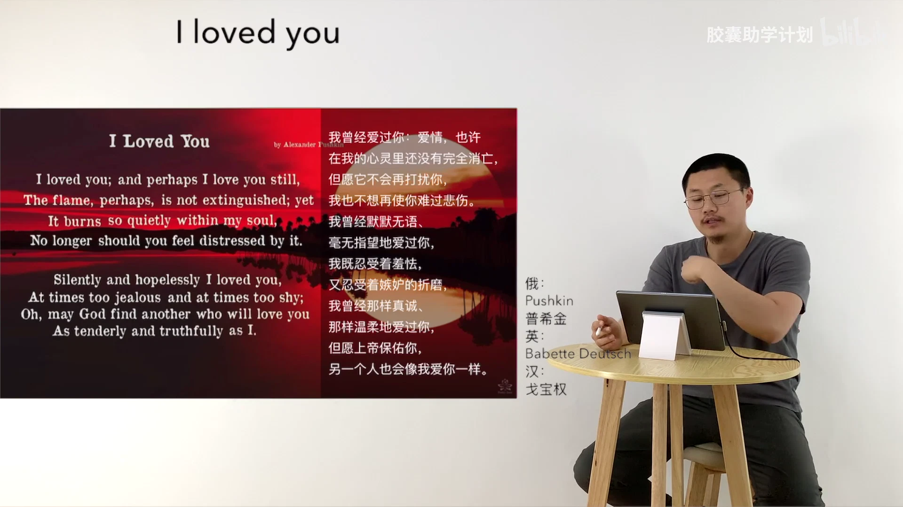

文字识别：Iloved you / 胶囊助学计划 / I Loved You / 我曾经爱过你：爱情，也许 / by Alexander P / 在我的心灵里还没有完全消亡， / I loved you; and perhaps I love you still, / 但愿它不会再打扰你， / The flame, perhaps, is not extinguished; yet / 我也不想再使你难过悲伤。 / It burns so quietly within my soul, / 我曾经默默无语、 / No longer should you feel distressed by it. / 毫无指望地爱过你， / 我既忍受着羞怯， / Silently and hopelessly I loved you, / 又忍受着嫉妒的折磨， / 俄： / At times too jealous and at times too shy; / Pushkin / 我曾经那样真诚、 / Oh, may God find another who will love you / 普希金 / As tenderly and truthfully as I. / 那样温柔地爱过你， / 英： / 但愿上帝保佑你， / Babette Deutsch / 另一个人也会像我爱你一样。 / 汉： / 戈宝权

### 画面 00:06:47

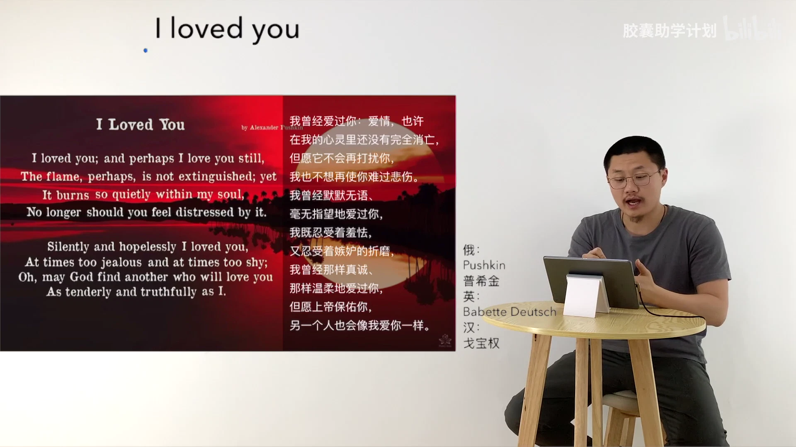

文字识别：Iloved you / 胶囊助学计划 / I Loved You / 我曾经爱过你：爱情，也许 / by Alexander I / 在我的心灵里还没有完全消亡， / I loved you; and perhaps I love you still, / 但愿它不会再打扰你， / The flame, perhaps, is not extinguished; yet / 我也不想再使你难过悲伤。 / It burns so quietly within my soul, / 我曾经默默无语、 / No longer should you feel distressed by it. / 毫无指望地爱过你， / 我既忍受着羞怯， / Silently and hopelessly I loved you, / 又忍受着嫉妒的折磨， / 俄： / At times too jealous and at times too shy; / Pushkin / 我曾经那样真诚、 / Oh, may God find another who will love you / 普希金 / As tenderly and truthfully as I. / 那样温柔地爱过你， / 英： / 但愿上帝保佑你, / Babette Deutsch / 另一个人也会像我爱你一样。 / 汉： / 戈宝权

### 画面 00:06:49

文字识别：Iloved you / 胶囊助学计划 / I Loved You / 我曾经爱过你：爱情，也许 / by Alexander I / 在我的心灵里还没有完全消亡， / I loved you; and perhaps I love you still, / 但愿它不会再打扰你， / The flame, perhaps, is not extinguished; yet / 我也不想再使你难过悲伤。 / It burns so quietly within my soul / 我曾经默默无语、 / No longer should you feel distressed by it. / 毫无指望地爱过你， / 我既忍受着羞怯， / Silently and hopelessly I loved you, / 又忍受着嫉妒的折磨， / 俄： / At times too jealous and at times too shy; / Pushkin / 我曾经那样真诚、 / Oh, may God find another who will love you / 普希金 / As tenderly and truthfully as I. / 那样温柔地爱过你， / 英： / 但愿上帝保佑你， / Babette Deutsch / 另一个人也会像我爱你一样。 / 汉： / 戈宝权

### 画面 00:06:52

文字识别：Iloved you / 胶囊助学计划 / I Loved You / 我曾经爱过你：爱情，也许 / by Alexander P / 在我的心灵里还没有完全消亡， / I loved you; and perhaps I love you still, / 但愿它不会再打扰你， / The flame, perhaps, is not extinguished; yet / 我也不想再使你难过悲伤。 / It burns so quietly within my soul, / 我曾经默默无语、 / No longer should you feel distressed by it. / 毫无指望地爱过你， / 我既忍受着羞怯， / Silently and hopelessly I loved you, / 又忍受着嫉妒的折磨， / 俄： / At times too jealous and at times too shy; / Pushkin / 我曾经那样真诚、 / Oh, may God find another who will love you / 普希金 / As tenderly and truthfully as I. / 那样温柔地爱过你， / 英： / 但愿上帝保佑你， / Babette Deutsch / 另一个人也会像我爱你一样。 / 汉： / 戈宝权

### 画面 00:06:54

文字识别：胶囊助学计划 / Pattern drill / 训练目标： / 写作口语 / 练习包含did的句子

## 00:07:00–00:07:30

did 的一般过去时的这些句子。第一个老习惯，我们先不用管上面这一行，先看下面这两行。说 Do you ever work? Do you ever work at the weekend? 说你有在任何时间在周末工作过吗？注意 work 在这儿，work 在这儿和它对应的就是这些短语，比如说 catch a cold, stay in bed, watch TV, play golf. At the weekend 提供了一个时间，at the weekend 就是后面这些对应的，对吧？说 Yes, 是的。 I

### 画面 00:07:01

文字识别：胶囊助学计划 / Pattern drill / 训练目标： / 写作口语 / 练习包含did的句子

### 画面 00:07:03

文字识别：胶囊助学计划 / Pattern drill / 1 T: work -at the weekend / S1: Do you ever work at the weekend? / S2: Yes, I worked last weekend. / catcha cold ----in winter / stay in bed / ------at the weekend / watch TV / --night / play golf / -----in summer

## 00:07:30–00:08:00

last weekend.是啊，我上周啊，在周末就工作了。注意一般过去时，把它换成了后边加ed的形式。那这些动词的过去式长成什么样呢？您有手机词典，不妨自己查一下。OK，所以这两句话一般现在时，你要问询问的是一个平常的状态，对吧？下面这句话一般过去时，是啊，上周我就这么干了。

### 画面 00:07:33

文字识别：胶囊助学计划 / Pattern drill / 1 T: work -at the weekend / S1: Do you ever work at the weekend? / S2: Yes, I worked last weekend. / catch a cold ---in winter / stay in bed / ----at the weekend / watch TV / --t night / play golf / -----in summer

### 画面 00:07:59

文字识别：胶囊助学计划 / Pattern drill / 2T: bought Tom a pen / S1: What did you buy Tom yesterday? / S2: I bought him a pen. / gave John a book / bought Jane a hat / brought Jean a rose / / showed Tom the keys / taught Lucy French / made Susan a cake / lent David a pencil / sent Kate a letter

## 00:08:00–00:08:30

S1. What did you buy Tom yesterday? 说你昨天给 Tom 买什么了？注意一般过去时的特殊疑问句要把它换回原形，对吧？Buy Tom 就是 buy Tom a pen，给他买了一根笔。Buy Tom，买给 Tom 的呢？I bought him a pen. Buy somebody something，我们在单词部分刚刚学过，对吧？一般过去时要把 buy 换成 bought。哎，这个地方练的就是各位的一个呃一般过去时的特

### 画面 00:08:29

文字识别：胶囊助学计划 / Pattern drill / 2T: bought Tom a pen / S1: What did you buy Tom yesterday? / S2: I bought him a pen. / gave John a book / bought Jane a hat / brought Jean a rose / / showed Tom the keys / taught Lucy French / made Susan a cake / lent David a pencil / sent Kate a letter

## 00:08:30–00:09:00

殊疑问句外加一个肯定句，依旧各位要做的事情是把底下这些填上去。不过区别是，注意这儿给的都是过去时，您可要去查一下它的原形长什么样子了，对吧？各位自己往里去带做这个练习。我上课做的事情就是告诉各位这两句话的意思，如何往里去带，以及这两句话在练我们什么的语法。而下课各位要做的事情，对吧？所谓一个巴掌拍不响，各位下课要做的事情就

### 画面 00:08:59

文字识别：胶囊助学计划 / Pattern drill / 2T: bought Tom a pen / S1: What did you buy Tom yesterday? / S2: I bought him a pen. / gave John a book / bought Jane a hat / brought Jean a rose / / showed Tom the keys / taught Lucy French / made Susan a cake / lent David a pencil / sent Kate a letter

## 00:09:00–00:09:30

是真的自己去练，好吧？接下来，buy the pen for his sister, buy something for somebody，对吧？这个也是我们在单词部分讲过的。Who did you buy the pen for？说你买这个笔是给谁买的呀？Buy the pen for somebody，对吧？Tom or his sister，Tom还是他姐姐呀？I bought it for her, bought something for somebody啊，我当然是给他买的了，of course。那他Tom一般是

### 画面 00:09:02

文字识别：胶囊助学计划 / Pattern drill / 3 T: buy the pen for his sister / S1: Who did you buy the pen for? Tom or his sister? / S2: I bought it for her, of course. / show/take the key to his mother / lend/give the money to his sister / make/buy the cake for his parents / send/post the card to his brothers

## 00:09:30–00:10:00

个男生的名字。His sister就是他的妹妹。我当然是给啊给他的姐姐。我当然是给他姐姐买的了。Of course,当然了。OK,好。那接下来我们一起看一下文章来了啊。说Postcards always spoil my holidays.注意，接下来是一个故事。我们看一下它的时态上的变化啊。第一句话用的是一个陈述客观事实，用的是一般现在时。说明信片这个玩意儿啊，总

### 画面 00:09:32

文字识别：胶囊助学计划 / Pattern drill / 3 T: buy the pen for his sister / S1: Who did you buy the pen for? Tom or his sister? / S2: I bought it for her, of course. / show/take the key to his mother / lend/give the money to his sister / make/buy the cake for his parents / send/post the card to his brothers

### 画面 00:09:39

文字识别：胶囊助学计划

### 画面 00:09:43

文字识别：胶囊助学计划 / Postcards always spoil my holidays.

## 00:10:00–00:10:30

总是毁了我的假期。Last summer，说上个夏天，你注意上个夏天，last summer一出来，接下来大多数时态应该都跟过去相关了，对不对？我们看一下是不是这样的。I went to Italy，我去了意大利。Went to Italy，went，go的过去式。I visited，visited，拜访了，参观了。OK，那在这后边加的是

### 画面 00:10:13

文字识别：胶囊助学计划 / Postcards always spoil my holidays. / Last summer, I went to ltaly.

## 00:10:30–00:11:00

museum，你就不能用拜访，你要用参观了，对不对？Visited一般过去时，我参观了很多的博物馆。然后呢，sat in public gardens，然后坐在了什么地方呢？Sit的过去式，坐在了这些公共的花园当中，溜达了溜达，坐了坐。A friendly waiter，一个特别友好的服务员。注意后面这句话，taught是teach这个单词的过去式，也就是教，教会了我什么呢？A

### 画面 00:10:43

文字识别：胶囊助学计划 / Postcards always spoil my holidays. / Last summer, I went to ltaly. / I visited museums and sat in public gardens.

### 画面 00:10:55

文字识别：胶囊助学计划 / Postcards always spoil my holidays. / Last summer, I went to ltaly. / I visited museums and sat in public gardens. / A friendly waiter taught me a few words of ltalian.

## 00:11:00–00:11:30

few words of Italian.我们原来经常说，由后往前翻译就好了，对吧？意大利语的一些 words 单词，教会了我一些意大利语单词，对吧？意大利语词，这叫 teach somebody something.一会儿我们拿这个习惯用法去造句。接下来，Then,然后 he lent me a book.然后他就借给了我一本书啊！你能看到这个 friendly waiter?他明显他只是一个 waiter,他

### 画面 00:11:18

文字识别：胶囊助学计划

## 00:11:30–00:12:00

对，他是一个服务员，对吧？他不是一个英语老师或者意大利语老师，对吧？你教了几个单词，就借给了一本书，对吧？比如说《十日谈》这样的书，那别人读不懂是正常的，对吧？这个 lend somebody something，我们之前学过了。I read a few lines，注意它的读音，不读 read，读 read，为什么呢？它是过去式。他们长相虽然一样，读音是不同的。OK，好，我读了几行 lines

### 画面 00:11:32

文字识别：胶囊助学计划 / 'Then he lent me a book.

## 00:12:00–00:12:30

行啊，我读了几行， but 但是 I did not 我并没有怎么样的 understand a word 啊，你你就会 glassy 对吧？你只会说 glassy，你怎么可能能看懂一本意大利语的书呢？不可能，对不对？说 I did not understand a word，说我一个字儿都没看懂。接下来往下， every day 说每一天 I thought about postcards。注意前面都是美好的回忆，但是在这些美好的回忆当

### 画面 00:12:01

文字识别：胶囊助学计划 / 'Then he lent me a book. / I read a few lines, / but I did not understand a word.

### 画面 00:12:27

文字识别：胶囊助学计划 / 'Then he lent me a book. / I read a few lines, / but I did not understand a word. / Every day I thought about postcards.

## 00:12:30–00:13:00

中，不停的出现了第一句话说 postcards always spoil my holidays.明信片这个事儿总是会毁了我的假期。在这个假期当中的每一天啊，我都是 thought about，其实就是 think about postcards，都在不停的想这些明信片。My holiday passed quickly.我的这个假期 passed，我们新新学过的一个单词叫做过，对吧？考试过了叫 passed，对吧？那你玩牌说我不

### 画面 00:12:57

文字识别：胶囊助学计划 / 'Then he lent me a book. / I read a few lines, / but I did not understand a word. / Every day I thought about postcards. / My holidays passed quickly,

## 00:13:00–00:13:30

出叫 pass，对吧？Okay，那 pass 也有度过的意思。说我的假期过得呀 quickly，非常的快。注意它的过去式是加 e d 就可以了。往下，But，但是 I did not，我没有怎么样呢？Send cards to my friends， send something to somebody。我们在单词部分讲过了，没有邮寄任何的卡片给我的朋友们，明信片，对吧？接着往下，On the last day，这是一个小

### 画面 00:13:26

文字识别：胶囊助学计划

## 00:13:30–00:14:00

的时间，六一二三四五六里边的六，我们可以放在最前或者放在最后。这个东西各位要单独去把它记下来，叫做在最后一天。I made a big decision. 讲单词的部分我们讲过了，叫 make a decision，做出一个决定。我们当时也强调说，decision虽然是一个名词，但是注意啊，它是一个名词，但是注意，它虽然翻译成决定，您不能把它当动词去用，对吧？它是名词哦，

### 画面 00:13:56

文字识别：胶囊助学计划 / On the last day I made a big decision.

## 00:14:00–00:14:30

所以要 make 去当这个动词去引领出来这个短语叫 make a decision，一个做了一个重大的决定。I got up early. 第二课刚学早起。 Bought买了 thirty seven cards，买了三十七张明信片啊。他肯定是好朋友也挺多的，是吧？要写三十七张明信片，肯定是烦死了。I spent the whole day in my room. 哎，这是一个小的习惯用法。 Spend whole

### 画面 00:14:19

文字识别：胶囊助学计划 / On the last day I made a big decision. / I got up early and bought thirty-seven cards.

## 00:14:30–00:15:00

day,你想一下它是什么？它是时间对吧？那我可以把 whole day 变成 whole week，也可以变成 three years，也可以变成 four months，对吧？也可以变成四个月。In my room，在我的房间当中，那在我的房间是什么？对吧？是个地点，对不对？你可以把这个地点换嘛？你可以说 in China, in Beijing, in New Zealand, in Auckland, in New York，随便换。But但是，I did not write，我没有写出来 a single

### 画面 00:14:31

文字识别：胶囊助学计划 / On the last day I made a big decision. / I got up early and bought thirty-seven cards. / I spent the whole day in my room,

## 00:15:00–00:15:30

card，哪怕是唯一一张卡片，我都没写出来。Single，各位还记得吧？说 she's single，她单身，对吧？单个的，单门的。说我连一个卡片都没写出来。这是全文结束。接下来我们做一些 repetition drills。注意，这是听力口语练习，尝试去做一些符合 did 的句子。各位，接下来要做的事情是什么呢？您可以看着这句话，没有问题。最好理想的状态下是各位完全不看这句话，只

### 画面 00:15:01

文字识别：胶囊助学计划 / On the last day I made a big decision. / I got up early and bought thirty-seven cards. / I spent the whole day in my room, / but I did not write a single card!

### 画面 00:15:12

文字识别：胶囊助学计划 / Repetition drill / 训练目标： / 听力口语 / 练习符合did的句子

### 画面 00:15:21

文字识别：胶囊助学计划 / Repetition drill

### 画面 00:15:24

文字识别：胶囊助学计划 / Repetition drill / 1 T: Did the weather spoil your holidays?

## 00:15:30–00:16:00

听就可以了，好吧？如果实在不行，您看着这句话，看到它可以暂停屏幕，给我答案。OK，来了。Did the weather spoil your holidays? 答案：Yes, it spoiled my holidays. Next one. Did you go to Italy? Yes, I went to Italy. 如果快，您就暂停啊。Did you sit in the public gardens?

### 画面 00:15:38

文字识别：胶囊助学计划 / Repetition drill / 1 T: Did the weather spoil your holidays?

## 00:16:00–00:16:30

Yes, I sat in the public gardens. Did the waiter teach you a few words of Italian? Yes, he taught me a few words of Italian. Continuing, did he lend you a book? Yes, he lent me a book. Did you read it? 注意 read 而不是 read 的原因是这是原形，对不对?

### 画面 00:16:01

文字识别：胶囊助学计划 / Repetition drill / 3 T: Did you sit in the public gardens? / S: Yes, I sat in the public gardens.

### 画面 00:16:04

文字识别：胶囊助学计划 / Repetition drill / 4 T: Did the waiter teach you a few words of ltalian?

## 00:16:30–00:17:00

Yes, I read it. 注意这有一个小的连读，不读 read it，读成 read it。跟我一起读，I read it, read it. Continue. Did you understand some of it? Yes, I understood some of it. Did you think about your friends? Yes, I thought about my friends. Did

### 画面 00:16:33

文字识别：胶囊助学计划 / Repetition drill / 6 T: Did you read it? / S: Yes, I read it.

## 00:17:00–00:17:30

you make a big decision? Yes, I made a big decision. Did you get up early?你看，实际上就是把一般疑问句还原成肯定句，对吧？这是基本功啊。Yes, I got up early. Did you buy any cars? Yes, I bought some cars. Did you spend the whole day in your room? Yes, I spent the whole day in my room.

### 画面 00:17:03

文字识别：胶囊助学计划 / Repetition drill / 9 T: Did you make a big decision? / S: Yes, I made a big decision.

### 画面 00:17:06

文字识别：胶囊助学计划 / Repetition drill / 10T: Did you get up early?

### 画面 00:17:26

文字识别：胶囊助学计划 / Repetition drill / 12 T: Did you spend the whole day in your room? / S: Yes, I spent the whole day in my room.

## 00:17:30–00:18:00

Very good.那接下来我们看一下本课的这些习惯用法，我们拿它去造一些小的句子。因为很多跟我们讲单词的时候呢是重复的，所以我们速度会稍微的快一点点。来了，第一个teach somebody something叫做教给某人某件事情。比如说，我们可以造一个句子叫做Leo teaches me English every day.注意，我们现在添加了什么呢？添加了时间every day，对吧？或者你

### 画面 00:17:30

文字识别：胶囊助学计划 / 习惯用法造句 / teach sb. sth. / lend sb.sth. / think about sth./sb. / send sth.to sb. / on the last day / make a decision / spend st.sw.

### 画面 00:17:32

文字识别：胶囊助学计划 / 习惯用法造句 / teach sb. sth. / lend sb. sth. / think about sth./sb. / send sth. to sb. / on the last day / make a decision / spend st. sw.

### 画面 00:17:34

文字识别：胶囊助学计划 / 习惯用法造句 / teach sb. sth. / lend sb. sth. / think about sth./sb. / send sth. to sb. / on the last day / make a decision / spend st. sw.

### 画面 00:17:36

文字识别：胶囊助学计划 / 习惯用法造句 / teach sb. sth. / lend sb. sth. / think about sth./sb. / send sth.to sb. / on the last day / make a decision / spend st. sw.

### 画面 00:17:38

文字识别：胶囊助学计划 / 习惯用法造句 / teach sb. sth. / lend sb. sth. / think about sth./sb. / send sth. to sb. / on the last day / make a decision / spend st. sw.

### 画面 00:17:40

文字识别：胶囊助学计划 / 习惯用法造句 / teach sb. sth. / lend sb. sth. / think about sth./sb. / send sth. to sb. / on the last day / make a decision / spend st. sw.

### 画面 00:17:42

文字识别：胶囊助学计划 / 习惯用法造句 / teach sb. sth. / lend sb. sth. / think about sth./sb. / send sth. to sb. / on the last day / make a decision / spend st. sw.

### 画面 00:17:44

文字识别：习惯用法造句指南 / 网：v.+v.变化 / 胶囊助学计划 / 四句型转换 / +方式/地点/时间 / 其他习惯用法 / 其他单词 / 原文摘抄+变 / teach sb. sth.

### 画面 00:17:46

文字识别：习惯用法造句指南 / 网：v.+v.变化 / 胶囊助学计划 / 四句型转换 / +方式/地点/时间 / 其他习惯用法 / 其他单词 / 原文摘抄+变 / teach sb. sth.

### 画面 00:17:50

文字识别：习惯用法造句指南 / 网：v.+v.变化 / 胶囊助学计划 / 四句型转换 / +方式/地点/时间 / 其他习惯用法 / 其他单词 / 原文摘抄+变 / teach sb. sth.

### 画面 00:17:53

文字识别：习惯用法造句指南 / 网：v.+v.变化 / 胶囊助学计划 / 四句型转换 / +方式/地点/时间 / 其他习惯用法 / 其他单词 / 原文摘抄+变 / teach sb.sth. / Leo teaches me English everyday.

### 画面 00:17:55

文字识别：习惯用法造句指南 / 网：v.+v.变化 / 胶囊助学计划 / 四句型转换 / +方式/地点/时间 / 其他习惯用法 / 其他单词 / 原文摘抄+变 / teach sb.sth. / Leo teaches me English everyday.

## 00:18:00–00:18:30

可以理解为是频率也行。然后呢， teach somebody something. Leo 每天都教我英文，变成一般疑问句。 Does Leo 注意 teaches 要换回原形， teach you English every day. 那我现在想对 English 提问用什么？ What 对不对？对， every day 提问用什么？ How often 对不对？ Very good. 好，那我们也可以直接不管他们在前面加，直接加个

### 画面 00:18:00

文字识别：网：v.+v.变化 / 胶囊助学计划 / 习惯用法造句指南 / 四句型转换 / +方式/地点/时间 / 其他习惯用法 / 其他单词 / 原文摘抄+变 / teach sb.sth. / Leo teaches me English everyday.

### 画面 00:18:05

文字识别：习惯用法造句指南 / 网：v.+v.变化 / 胶囊助学计划 / 四句型转换 / +方式/地点/时间 / 其他习惯用法 / 其他单词 / 原文摘抄+变 / teach sb.sth. / Leo teaches me English everyday.

### 画面 00:18:10

文字识别：习惯用法造句指南 / 网：v.+v.变化 / 胶囊助学计划 / 四句型转换 / +方式/地点/时间 / 其他习惯用法 / 其他单词 / 原文摘抄+变 / teach sb.sth. / Leo teaches me English everyday. / Does Leo teach you English everyday?

### 画面 00:18:13

文字识别：习惯用法造句指南 / 网：v.+v.变化 / 胶囊助学计划 / 四句型转换 / +方式/地点/时间 / 其他习惯用法 / 其他单词 / 原文摘抄+变 / teach sb.sth. / Leo teaches me English everyday. / Does Leo teach you English everyday?

### 画面 00:18:15

文字识别：习惯用法造句指南 / 网：v.+v.变化 / 胶囊助学计划 / 四句型转换 / +方式/地点/时间 / 其他习惯用法 / 其他单词 / 原文摘抄+变 / teach sb.sth. / Leo teaches me English everyday. / Does Leo teach you English everyday?

### 画面 00:18:20

文字识别：习惯用法造句指南 / 网：v.+v.变化 / 胶囊助学计划 / 四句型转换 / +方式/地点/时间 / 其他习惯用法 / 其他单词 / 原文摘抄+变 / teach sb.sth. / Leo teaches me English everyday. / Does Leo teach you English everyday?

### 画面 00:18:23

文字识别：习惯用法造句指南 / 网：v.+v.变化 / 胶囊助学计划 / 四句型转换 / +方式/地点/时间 / 其他习惯用法 / 其他单词 / 原文摘抄+变 / teach sb.sth. / Leo teaches me English everyday. / Does Leo teach you English everyday?

### 画面 00:18:25

文字识别：习惯用法造句指南 / 网：v.+v.变化 / 胶囊助学计划 / 四句型转换 / +方式/地点/时间 / 其他习惯用法 / 其他单词 / 原文摘抄+变 / teach sb.sth. / Leo teaches me English everyday. / Does Leo teach you English everyday? / Why does Leo teach you English everyday?

### 画面 00:18:29

文字识别：习惯用法造句指南 / 网：v.+v.变化 / 胶囊助学计划 / 四句型转换 / +方式/地点/时间 / 其他习惯用法 / 其他单词 / 原文摘抄+变 / teach sb.sth. / Leo teaches me English everyday. / Does Leo teach you English everyday? / Why does Leo teach you English everyday?

## 00:18:30–00:19:00

why? Why does Leo teach you English every day and for free? 你可以去问一下自己这个问题啊。 For free, 免费的。 Next one, 接下来我们一起看一下在电影当中它出现的叫做 teach me a lesson, 叫做给我上了一课。 注意这地方的上了一课，可不是说我给大家上了一课教英文，它真的就是我们汉语当中给了点它颜色瞧了瞧，给他上了一课，年轻人给他上了一课，对吧？

### 画面 00:18:31

文字识别：习惯用法造句指南 / 网：v.+v.变化 / 胶囊助学计划 / 四句型转换 / +方式/地点/时间 / 其他习惯用法 / 其他单词 / 原文摘抄+变 / teach sb.sth. / Leo teaches me English everyday. / Does Leo teach you English everyday? / Why does Leo teach you English everyday?

### 画面 00:18:35

文字识别：习惯用法造句指南 / 网：v.+v.变化 / 胶囊助学计划 / 四句型转换 / +方式/地点/时间 / 其他习惯用法 / 其他单词 / 原文摘抄+变 / teach sb.sth. / Leo teaches me English everyday. / Does Leo teach you English everyday? / Why does Leo teach you English everyday?

### 画面 00:18:39

文字识别：teach me a lesson / 胶囊助学计划 / LOUIS / ST. / 消失的爱人 / 太好了快进屋 / Gone Girl / Thank God. Come on in. / (2014)

## 00:19:00–00:19:30

是这个意思。注意，接下来听一下。Thank God, my first thing you have to understand about Amy, she loves to teach lessons. Thank God, yeah, Old Testament God. Okay, keep talking. So she finds out I've been cheating on her with Andy, decides to teach me a lesson. Fakes her own death, frames me for it. Blood in the house, credit cards, life insurance. 好啊，这个 teach me a lesson 或者 teach lessons 的在这个地方的意思是什么呢？叫做教训了某人，或者给某人上了一课，给了他一点颜

### 画面 00:19:03

文字识别：teach me a lesson / 胶囊助学计划 / ST. / 消失的爱人 / 太好了快进屋 / Gone Girl / Thank God. Come on in. / (2014)

### 画面 00:19:05

文字识别：teach me a lesson / 胶囊助学计划 / 消朱的爱人 / 关于艾米你首先要知道的是 / Gone Girl / First thing you have to understand about Amy... / (2014)

### 画面 00:19:07

文字识别：teach me a lesson / 消失的爱人 / 她喜欢教训人 / Gone Girl / she loves to teach lessons. / (2014)

### 画面 00:19:09

文字识别：teach me a lesson / 消失的爱人 / “旧约”里那种 / Gone Girl / Yeah, Old Testament God. / (2014)

### 画面 00:19:11

文字识别：teach me a lesson / 消朱的爱人 / 她发现我劈腿了跟安迪搞在一起. / Gone Girl / She finds out I've been cheating on her with Andie... / (2014)

### 画面 00:19:13

文字识别：teach me a lesson / 消朱的爱人 / 所以决定给我上一课 / Gone Girl / decides to teach me a lesson. / (2014)

### 画面 00:19:15

文字识别：teach me a lesson / 消失的爱人 / 伪装她自己的死亡嫁祸于我 / Gone Girl / Fakes her own death, frames me for it. / (2014)

### 画面 00:19:18

文字识别：teach me a lesson / 消失的爱人 / 房的迹信卡还有身保险 / Gone Girl / Blood in the house, credit cards, life insurance. / (2014)

### 画面 00:19:20

文字识别：teach me a lesson / 胶囊助学计划 / 八 / 消失的爱人 / Gone Girl / (2014)

## 00:19:30–00:20:00

色瞧瞧。OK，玩一个，下一个，lend somebody something。单词部分我们讲过了，今天直接说一下。比如说，He lent me twenty dollars last night。我们添加了一个小的时间。您接下来看着它四句型，自己去做一些转化，对吧？这个很容易了，did提前，lent变成lend。那我想对last night的提问用什么？When，对不对？玩一个，好，不多说了。接下来，think about

### 画面 00:19:31

文字识别：习惯用法造句指南 / 网：v.+v.变化 / 胶囊助学计划 / 四句型转换 / +方式/地点/时间 / 其他习惯用法 / 其他单词 / 原文摘抄+变 / lend sb. sth.

### 画面 00:19:33

文字识别：习惯用法造句指南 / 网：v.+v.变化 / 胶囊助学计划 / 四句型转换 / +方式/地点/时间 / 其他习惯用法 / 其他单词 / 原文摘抄+变 / lend sb. sth.

### 画面 00:19:35

文字识别：习惯用法造句指南 / 网：v.+v.变化 / 胶囊助学计划 / 四句型转换 / +方式/地点/时间 / 其他习惯用法 / 其他单词 / 原文摘抄+变 / lend sb. sth. / He lent me 20$ last night.

### 画面 00:19:40

文字识别：习惯用法造句指南 / 网：v.+v.变化 / 胶囊助学计划 / 四句型转换 / +方式/地点/时间 / 其他习惯用法 / 其他单词 / 原文摘抄+变 / lend sb. sth. / He lent me 20$ last night.

### 画面 00:19:45

文字识别：习惯用法造句指南 / 网：v.+v.变化 / 胶囊助学计划 / 四句型转换 / +方式/地点/时间 / 其他习惯用法 / 其他单词 / 原文摘抄+变 / lend sb. sth. / He lent me 20$ last night.

### 画面 00:19:48

文字识别：习惯用法造句指南 / 网：v.+v.变化 / 胶囊助学计划 / 四句型转换 / +方式/地点/时间 / 其他习惯用法 / 其他单词 / 原文摘抄+变 / lend sb. sth. / He lent me 20$ last night. / Did he lend you 20$ last night?

### 画面 00:19:50

文字识别：习惯用法造句指南 / 网：v.+v.变化 / 胶囊助学计划 / 四句型转换 / +方式/地点/时间 / 其他习惯用法 / 其他单词 / 原文摘抄+变 / lend sb. sth. / He lent me 20$ last night. / Did he lend you 20$ last night?

### 画面 00:19:55

文字识别：习惯用法造句指南 / 网：v.+v.变化 / 胶囊助学计划 / 四句型转换 / +方式/地点/时间 / 其他习惯用法 / 其他单词 / 原文摘抄+变 / lend sb. sth. / He lent me 20$ last night. / Did he lend you 20$ last night?

### 画面 00:19:57

文字识别：习惯用法造句指南 / 网：v.+v.变化 / 胶囊助学计划 / 四句型转换 / +方式/地点/时间 / 其他习惯用法 / 其他单词 / 原文摘抄+变 / think about sth./sb.

## 00:20:00–00:20:30

叫做想，这个在单词部分我们没有想，没没有去讲，对吧？比如说，I think about you，我想你，I think about you。那I think about it，我想这件事情。那怎么表达日思夜想呢？汉语四个字儿搞定了，英文可能是这样说：I叫I think about you every night and day。我每天都夜不能寐的去想你，对吧？I think about you every night and day。接下来，我们一起听一

### 画面 00:20:00

文字识别：习惯用法造句指南 / 网：v.+v.变化 / 胶囊助学计划 / 四句型转换 / +方式/地点/时间 / 其他习惯用法 / 其他单词 / 原文摘抄+变 / think about sth./sb.

### 画面 00:20:05

文字识别：习惯用法造句指南 / 网：v.+v.变化 / 胶囊助学计划 / 四句型转换 / +方式/地点/时间 / 其他习惯用法 / 其他单词 / 原文摘抄+变 / think about sth./sb.

### 画面 00:20:10

文字识别：习惯用法造句指南 / 网：v.+v.变化 / 胶囊助学计划 / 四句型转换 / +方式/地点/时间 / 其他习惯用法 / 其他单词 / 原文摘抄+变 / think about sth./sb.

### 画面 00:20:15

文字识别：习惯用法造句指南 / 网：v.+v.变化 / 胶囊助学计划 / 四句型转换 / +方式/地点/时间 / 其他习惯用法 / 其他单词 / 原文摘抄+变 / think about sth./sb.

### 画面 00:20:18

文字识别：习惯用法造句指南 / 网：v.+v.变化 / 胶囊助学计划 / 四句型转换 / +方式/地点/时间 / 其他习惯用法 / 其他单词 / 原文摘抄+变 / think about sth./sb. / I think about you every night and day.

### 画面 00:20:20

文字识别：习惯用法造句指南 / 网：v.+v.变化 / 胶囊助学计划 / 四句型转换 / +方式/地点/时间 / 其他习惯用法 / 其他单词 / 原文摘抄+变 / think about sth./sb. / I think about you every night and day.

### 画面 00:20:25

文字识别：习惯用法造句指南 / 网：v.+v.变化 / 胶囊助学计划 / 四句型转换 / +方式/地点/时间 / 其他习惯用法 / 其他单词 / 原文摘抄+变 / think about sth./sb. / I think about you every night and day.

### 画面 00:20:29

文字识别：I think about it every night and day / 胶囊助学计划 / I believe I can fly / I believe I can touch the sky / I think about it every night and day / Spread my wings and fly away / I BelieveI can / R. Kelly

## 00:20:30–00:21:00

首歌，在这首歌当中，它的名字叫 I Believe I Can Fly.它用到了这样一句话叫 I think about it every night and day.翻译成汉语四个字日思夜想就可以了。接下来我们一起听一下。 I believe I can fly. I believe I can touch the sky. I think about it every night and day. Spread my wings and fly away.

### 画面 00:20:49

文字识别：I think about it every night and day / 胶囊助学计划 / I believe I can fly / I believe I can touch the sky / I think about it every night and day / spread my wings and fly away / I believe I can soar / I see me running through that open door /  believe I can fly / I believe I / I BelieveIcan / R. Kelly

## 00:21:00–00:21:30

好，接下来 send something to somebody.这个我们之前也讲过。我们看一下原文。I did not send cards to my friends. Did you send cards to your friends?可以了。On the last day,注意这个地方，我们做了一个小的，我们很不太常用的一个思路，叫做结合其他习惯用法。我给各位的一个建议是，各位不妨把我们之前

### 画面 00:21:01

文字识别：习惯用法造句指南 / 网：v.+v.变化 / 胶囊助学计划 / 四句型转换 / +方式/地点/时间 / 其他习惯用法 / 其他单词 / 原文摘抄+变 / send sth. to sb.

### 画面 00:21:05

文字识别：习惯用法造句指南 / 网：v.+v.变化 / 胶囊助学计划 / 四句型转换 / +方式/地点/时间 / 其他习惯用法 / 其他单词 / 原文摘抄+变 / send sth.to sb. / [Story]: I did not send cards to my friends.

### 画面 00:21:10

文字识别：习惯用法造句指南 / 网：v.+v.变化 / 胶囊助学计划 / 四句型转换 / +方式/地点/时间 / 其他习惯用法 / 其他单词 / 原文摘抄+变 / send sth.to sb. / [Story]: I did not send cards to my friends.

### 画面 00:21:14

文字识别：习惯用法造句指南 / 网：v.+v.变化 / 胶囊助学计划 / 四句型转换 / +方式/地点/时间 / 其他习惯用法 / 其他单词 / 原文摘抄+变 / on the last day

### 画面 00:21:16

文字识别：习惯用法造句指南 / 网：v.+v.变化 / 胶囊助学计划 / 四句型转换 / +方式/地点/时间 / 其他习惯用法 / 其他单词 / 原文摘抄+变 / on the last day

### 画面 00:21:20

文字识别：习惯用法造句指南 / 网：v.+v.变化 / 胶囊助学计划 / 四句型转换 / +方式/地点/时间 / 其他习惯用法 / 其他单词 / 原文摘抄+变 / on the last day / On the last day, I couldn't bear it. L1

### 画面 00:21:25

文字识别：习惯用法造句指南 / 网：v.+v.变化 / 胶囊助学计划 / 四句型转换 / +方式/地点/时间 / 其他习惯用法 / 其他单词 / 原文摘抄+变 / on the last day / On the last day, I couldn't bear it. L1

## 00:21:30–00:22:00

学到的所有课程当中的习惯用法都怎么样呢？给它摘抄到您的笔记本当中。然后，因为我们在以后的习惯用法造句当中会结合之前的习惯用法，比如说像这句话，在最后一天我忍不了了。那 I cannot bear it 是我们新一第啊新二第一课出现的。您把这两个结合起来，就是很好的一句话。在最后一天我实在忍不了了，一句话造出来了。您现在能力能造这句话，随着你语言学水平

### 画面 00:21:30

文字识别：网：v.+v.变化 / 习惯用法造句指南 / 四句型转换 / +方式/地点/时间 / 其他习惯用法 / 其他单词 / 原文摘抄+变 / on the last day / On the last day, I couldn't bear it. L1

### 画面 00:21:35

文字识别：网：v.+v.变化 / 习惯用法造句指南 / 四句型转换 / +方式/地点/时间 / 其他习惯用法 / 其他单词 / 原文摘抄+变 / on the last day / On the last day, I couldn't bear it. L1

### 画面 00:21:37

文字识别：习惯用法造句指南 / 网：v.+v.变化 / 胶囊助学计划 / 四句型转换 / +方式/地点/时间 / 其他习惯用法 / 其他单词 / 原文摘抄+变 / on the last day / On the last day, I couldn't bear it. L1

### 画面 00:21:40

文字识别：习惯用法造句指南 / 网：v.+v.变化 / 胶囊助学计划 / 四句型转换 / +方式/地点/时间 / 其他习惯用法 / 其他单词 / 原文摘抄+变 / on the last day / On the last day, I couldn't bear it. L1

### 画面 00:21:45

文字识别：习惯用法造句指南 / 网：v.+v.变化 / 胶囊助学计划 / 四句型转换 / +方式/地点/时间 / 其他习惯用法 / 其他单词 / 原文摘抄+变 / on the last day / On the last day, I couldn't bear it 1

### 画面 00:21:50

文字识别：习惯用法造句指南 / 网：v.+v.变化 / 胶囊助学计划 / 四句型转换 / +方式/地点/时间 / 其他习惯用法 / 其他单词 / 原文摘抄+变 / on the last day / On the last day, I couldn't bear it. L1

### 画面 00:21:55

文字识别：习惯用法造句指南 / 网：v.+v.变化 / 胶囊助学计划 / 四句型转换 / +方式/地点/时间 / 其他习惯用法 / 其他单词 / 原文摘抄+变 / on the last day / On the last day, I couldn't bear it. L1

## 00:22:00–00:22:30

越来越好，你就会把之前为什么在最后一天我忍不了了这件事情，对吧？起因、发展、人物、时间、地点就都能编写出来了，用英语啊，对吧？那一个注意其他习惯用法，接下来 make a decision，比如说 I have to make this decision every day，我每天都不得不做出这个决定。 Do you have to？一般疑问句对 every day 提问 How often？我也可以直接用整句话 Why

### 画面 00:22:00

文字识别：习惯用法造句指南 / 网：v.+v.变化 / 胶囊助学计划 / 四句型转换 / +方式/地点/时间 / 其他习惯用法 / 其他单词 / 原文摘抄+变 / on the last day / On the last day, I couldn't bear it. L1

### 画面 00:22:06

文字识别：习惯用法造句指南 / 网：v.+v.变化 / 胶囊助学计划 / 四句型转换 / +方式/地点/时间 / 其他习惯用法 / 其他单词 / 原文摘抄+变 / on the last day / On the last day, I couldn't bear it. L1

### 画面 00:22:10

文字识别：习惯用法造句指南 / 网：v.+v.变化 / 胶囊助学计划 / 四句型转换 / +方式/地点/时间 / 其他习惯用法 / 其他单词 / 原文摘抄+变 / on the last day / On the last day, I couldn't bear it. L1

### 画面 00:22:13

文字识别：习惯用法造句指南 / 网：v.+v.变化 / 胶囊助学计划 / 四句型转换 / +方式/地点/时间 / 其他习惯用法 / 其他单词 / 原文摘抄+变 / make a decision

### 画面 00:22:15

文字识别：习惯用法造句指南 / 网：v.+v.变化 / 胶囊助学计划 / 四句型转换 / +方式/地点/时间 / 其他习惯用法 / 其他单词 / 原文摘抄+变 / make a decision

### 画面 00:22:17

文字识别：习惯用法造句指南 / 网：v.+v.变化 / 胶囊助学计划 / 四句型转换 / +方式/地点/时间 / 其他习惯用法 / 其他单词 / 原文摘抄+变 / make a decision / I have to make this decision everyday.

### 画面 00:22:20

文字识别：习惯用法造句指南 / 网：v.+v.变化 / 胶囊助学计划 / 四句型转换 / +方式/地点/时间 / 其他习惯用法 / 其他单词 / 原文摘抄+变 / make a decision / I have to make this decision everyday.

### 画面 00:22:25

文字识别：习惯用法造句指南 / 网：v.+v.变化 / 胶囊助学计划 / 四句型转换 / +方式/地点/时间 / 其他习惯用法 / 其他单词 / 原文摘抄+变 / make a decision / I have to make this decision everyday. / Do you have to make this decision everyday? / how often / why

## 00:22:30–00:23:00

加在句首就可以了。为什么你每天不得不做这个决定呢？Very good. 接下来 Spend some time some place，或者说 somewhere. Somewhere 就是某地，S T 点就是某些时间。比如说 I spent three years in New Zealand. 我曾经在新西兰度过了三年的时间。那我接下来想把它变一般疑问句和各种特殊疑问句，就是各位课下自己要做的事情了。Okay. Very good. 那如何表

### 画面 00:22:30

文字识别：习惯用法造句指南 / 网：v.+v.变化 / 胶囊助学计划 / 四句型转换 / +方式/地点/时间 / 其他习惯用法 / 其他单词 / 原文摘抄+变 / make a decision / I have to make this decision everyday. / Do you have to make this decision everyday? / how often / why

### 画面 00:22:35

文字识别：习惯用法造句指南 / 网：v.+v.变化 / 胶囊助学计划 / 四句型转换 / +方式/地点/时间 / 其他习惯用法 / 其他单词 / 原文摘抄+变 / spend st. sw.

### 画面 00:22:38

文字识别：习惯用法造句指南 / 网：v.+v.变化 / 胶囊助学计划 / 四句型转换 / +方式/地点/时间 / 其他习惯用法 / 其他单词 / 原文摘抄+变 / spend st. sw.

### 画面 00:22:40

文字识别：习惯用法造句指南 / 网：v.+v.变化 / 胶囊助学计划 / 四句型转换 / +方式/地点/时间 / 其他习惯用法 / 其他单词 / 原文摘抄+变 / spend st. sw.

### 画面 00:22:45

文字识别：习惯用法造句指南 / 网：v.+v.变化 / 胶囊助学计划 / 四句型转换 / +方式/地点/时间 / 其他习惯用法 / 其他单词 / 原文摘抄+变 / spend st. sw. / I spent 3 years in New Zealand.

### 画面 00:22:50

文字识别：习惯用法造句指南 / 网：v.+v.变化 / 胶囊助学计划 / 四句型转换 / +方式/地点/时间 / 其他习惯用法 / 其他单词 / 原文摘抄+变 / spend st. sw. / I spent 3 years in New Zealand.

### 画面 00:22:55

文字识别：习惯用法造句指南 / 网：v.+v.变化 / 胶囊助学计划 / 四句型转换 / +方式/地点/时间 / 其他习惯用法 / 其他单词 / 原文摘抄+变 / spend st. sw. / I spent 3 years in New Zealand.

### 画面 00:22:58

文字识别：胶囊助学计划 / ①如何表达“我曾爱过你”? / 如何表达“日思夜想 / 如何表给“给某人上一课”？

## 00:23:00–00:23:30

达我曾爱过你？I普希金的那首诗I loved you，日思夜想。I believe I can fly的一句歌词叫做I think about it every night and day， right？给某人上一课，电影《消失的爱人》当中，对吧？叫做呃teach me a lesson，叫或者teach you a lesson. Very good.接下来我们看一下recap，这些是我们今天在原文摘抄出来的

### 画面 00:23:00

文字识别：胶囊助学计划 / ①如何表达“我曾爱过你”? / 如何表达“日思夜想 / 如何表给“给某人上一课”?

### 画面 00:23:05

文字识别：胶囊助学计划 / ①如何表达“我曾爱过你”? / 如何表达“日思夜想 / 如何表给“给某人上一课”?

### 画面 00:23:12

文字识别：胶囊助学计划 / ①如何表达“我曾爱过你”? / 如何表达“日思夜想 / 如何表给“给某人上一课”?

### 画面 00:23:16

文字识别：胶囊助学计划 / ①如何表达“我曾爱过你”? / 如何表达“日思夜想 / 如何表给“给某人上一课”?

### 画面 00:23:20

文字识别：胶囊助学计划 / ①如何表达“我曾爱过你”？ / 如何表达“日思夜想 / 如何表给“给某人上一课”?

### 画面 00:23:23

文字识别：胶囊助学计划 / Recap / teach sb. sth. / lend sb.sth. / think about sth./sb. / Expression / on the last day / make a decision / send sth. to sb. / spend st. sw. / was / Grammar / were / did

### 画面 00:23:25

文字识别：胶囊助学计划 / Recap / teach sb. sth. / lend sb.sth. / think about sth./sb. / Expression / on the last day / make a decision / send sth. to sb. / spend st. sw. / was / Grammar / were / did

### 画面 00:23:27

文字识别：胶囊助学计划 / Recap / teach sb. sth. / lend sb.sth. / think about sth./sb. / Expression / on the last day / make a decision / send sth. to sb. / spend st. sw. / was / Grammar / were / did

### 画面 00:23:29

文字识别：胶囊助学计划 / Recap / teach sb. sth. / lend sb.sth. / think about sth./sb. / Expression / on the last day / make a decision / send sth. to sb. / spend st. sw. / was / Grammar / were / did

## 00:23:30–00:24:00

一些习惯用法，当然有很多和单词是怎么样呢？是重复的，没问题。各位可以再造一次句子嘛，对不对？好，接下来语法呢，就是关于一般过去时 was 和 were 和 did。 OK，接下来今天的作业会比较多，因为我们把语法和文章放到一起去处理了。我们看一下有哪些作业，各位要认真去完成。第一个 pattern drill 老习惯四乘四四个练习，每个练习做四个，在专栏当中各位可以找得到。接下来

### 画面 00:23:31

文字识别：胶囊助学计划 / Recap / teach sb. sth. / lend sb. sth. / think about sth./sb. / Expression / on the last day / make a decision / send sth. to sb. / spend st. sw. / was / Grammar / were / did

### 画面 00:23:34

文字识别：胶囊助学计划 / Recap / teach sb. sth. / lend sb.sth. / think about sth./sb. / Expression / on the last day / make a decision / send sth. to sb. / spend st. sw. / was / Grammar / were / did

### 画面 00:23:36

文字识别：胶囊助学计划 / Recap / teach sb. sth. / lend sb.sth. / think about sth./sb. / Expression / on the last day / make a decision / send sth. to sb. / spend st. sw. / was / Grammar / were / did

### 画面 00:23:38

文字识别：Recap / 胶囊助学计划 / teach sb. sth. / lend sb.sth. / think about sth./sb. / Expression / on the last day / make a decision / send sth. to sb. / spend st. sw. / was / Grammar / were / did

### 画面 00:23:40

文字识别：胶囊助学计划 / Recap / teach sb. sth. / lend sb.sth. / think about sth./sb. / Expression / on the last day / make a decision / send sth. to sb. / spend st. sw. / was / Grammar / were / did

### 画面 00:23:42

文字识别：胶囊助学计划 / Recap / teach sb. sth. / lend sb.sth. / think about sth./sb. / Expression / on the last day / make a decision / send sth. to sb. / spend st. sw. / was / Grammar / were / did

### 画面 00:23:44

文字识别：胶囊助学计划

### 画面 00:23:46

文字识别：胶囊助学计划

### 画面 00:23:49

文字识别：胶囊助学计划

### 画面 00:23:51

文字识别：胶囊助学计划 / 1.f / Pattern Drill 写&朗读 / 专栏 / 4×4

### 画面 00:23:53

文字识别：胶囊助学计划 / 1. f / Pattern Drill写&朗读 / 专栏 / 4×4

### 画面 00:23:55

文字识别：胶囊助学计划 / 1.f / Pattern Drill 写&朗读 / 专栏 / 4×4

### 画面 00:23:59

文字识别：胶囊助学计划 / Pattern Drill写&朗读 / 专栏 / 4X4 / 尝试回忆并给自己讲解一 / 遍今天的核心语法 / Study-Test / Learning Pyramid

## 00:24:00–00:24:30

尝试回忆，给自己讲解一遍今天的核心语法点，尤其是一般过去式 was were 和 did 的用法。再然后尝试翻阅红皮书。那我之前其实留过几课了，让各位去尝试翻阅红皮书。这个地方让各位其实通过目录或者索引去进行查阅的时候呢，一方面是让大家更熟悉这种查阅的习惯和方式，第二是让大家想养成一个习惯。最后其实最重要的事情，您查到了还要干什么呢？

### 画面 00:24:01

文字识别：胶囊助学计划 / Pattern Drill写&朗读 / 1. / 专栏 / 4×4 / 尝试回忆并给自己讲解一 / 遍今天的核心语法 / Study-Test /  Learning Pyramid

### 画面 00:24:03

文字识别：胶囊助学计划 / Pattern Drill写&朗读 / 1. / 专栏 / 4×4 / 尝试回忆并给自己讲解一 / 遍今天的核心语法 / Study-Test /  Learning Pyramid

### 画面 00:24:05

文字识别：胶囊助学计划 / 1. / Pattern Drill写&朗读 / 专栏 / 4×4 / 尝试回忆并给自己讲解一 / 遍今天的核心语法 / Study-Test /  Learning Pyramid

### 画面 00:24:07

文字识别：胶囊助学计划 / 1. f / Pattern Drill写&朗读 / 专栏 / 4×4 / 尝试回忆并给自己讲解一 / 遍今天的核心语法 / Study-Test /  Learning Pyramid / 尝试翻阅红皮书（中级） / 通过目录或索引(Index) / 查找到本课语法

### 画面 00:24:09

文字识别：胶囊助学计划 / 1.Pattern Drill 写&朗读 / 专栏 / 4×4 / 尝试回忆并给自己讲解一 / 遍今天的核心语法 / Study-Test /  Learning Pyramid / 3. / 尝试翻阅红皮书（中级） / 通过目录或索引(Index) / 查找到本课语法

### 画面 00:24:11

文字识别：胶囊助学计划 / Pattern Drill写&朗读 / 专栏 / 4×4 / 尝试回忆并给自己讲解一 / 遍今天的核心语法 / Study-Test /  Learning Pyramid / 3. / 尝试翻阅红皮书（中级） / 通过目录或索引(Index) / 查找到本课语法

### 画面 00:24:15

文字识别：胶囊助学计划 / 1. / Pattern Drill写&朗读 / 专栏 / 4×4 / 尝试回忆并给自己讲解一 / 遍今天的核心语法 / Study-Test /  Learning Pyramid / 3.尝试翻阅红皮书（中级） / 通过目录或索引(Index) / 查找到本课语法

### 画面 00:24:17

文字识别：胶囊助学计划 / Pattern Drill写&朗读 / 1. ↑ / 专栏 / 4×4 / 尝试回忆并给自己讲解一 / 遍今天的核心语法 / Study-Test /  Learning Pyramid / 尝试翻阅红皮书（中级） / 通过目录或索引(Index) / 查找到本课语法

### 画面 00:24:20

文字识别：胶囊助学计划 / 1. f / Pattern Drill写&朗读 / 专栏 / 4×4 / 尝试回忆并给自己讲解一 / 遍今天的核心语法 / Study-Test /  Learning Pyramid / 3. / 尝试翻阅红皮书（中级） / 通过目录或索引(Index) / 查找到本课语法

### 画面 00:24:23

文字识别：胶囊助学计划 / 1. / Pattern Drill写&朗读 / 专栏 / 4×4 / 尝试回忆并给自己讲解一 / 遍今天的核心语法 / Study-Test /  Learning Pyramid / 3. / 尝试翻阅红皮书（中级） / 通过目录或索引(Index) / 查找到本课语法

### 画面 00:24:25

文字识别：胶囊助学计划 / 1. f / Pattern Drill写&朗读 / 专栏 / 4×4 / 尝试回忆并给自己讲解一 / 遍今天的核心语法 / Study-Test /  Learning Pyramid / 尝试翻阅红皮书（中级） / 通过目录或索引(Index) / 查找到本课语法

### 画面 00:24:28

文字识别：胶囊助学计划 / 1. / Pattern Drill写&朗读 / 专栏 / 4×4 / 尝试回忆并给自己讲解一 / 遍今天的核心语法 / Study-Test /  Learning Pyramid / 尝试翻阅红皮书（中级） / 通过目录或索引(Index) / 查找到本课语法

## 00:24:30–00:25:00

您不妨看看左边的讲解，再看写一写右边的练习，再对一下答案。如果你时间允许的话，做的练习越多，学习效果越好吧，对吧？第四，习惯用法你要造句了，每利用的是这个习惯用法造句指南，每个习惯用法来五个句子，并不是难事儿。肯定句造出来了，一般疑问句、否定句，再来两个特殊疑问句，您就有五个句子了，对吧？好，接下来呢，文章

### 画面 00:24:30

文字识别：胶囊助学计划 / 1. / Pattern Drill写&朗读 / 专栏 / 4×4 / 尝试回忆并给自己讲解一 / 遍今天的核心语法 / Study-Test /  Learning Pyramid / 3. / 尝试翻阅红皮书（中级） / 通过目录或索引(Index) / 查找到本课语法

### 画面 00:24:34

文字识别：胶囊助学计划 / 1. f / Pattern Drill写&朗读 / 专栏 / 4×4 / 尝试回忆并给自己讲解一 / 遍今天的核心语法 / Study-Test /  Learning Pyramid / 3. / 尝试翻阅红皮书（中级） / 通过目录或索引(Index) / 查找到本课语法

### 画面 00:24:36

文字识别：胶囊助学计划 / 1. f / Pattern Drill写&朗读 / 专栏 / 4×4 / 尝试回忆并给自己讲解一 / 遍今天的核心语法 / Study-Test /  Learning Pyramid / 3. / 尝试翻阅红皮书（中级） / 通过目录或索引(Index) / 查找到本课语法

### 画面 00:24:40

文字识别：胶囊助学计划 / Pattern Drill写&朗读 / 1. f / 专栏 / 4×4 / 尝试回忆并给自己讲解一 / 遍今天的核心语法 / Study-Test /  Learning Pyramid / 3. / 尝试翻阅红皮书（中级） / 通过目录或索引(Index) / 查找到本课语法

### 画面 00:24:42

文字识别：胶囊助学计划 / 4. / 习惯用法造句/对话 / 【习惯用法造句指南】 / 每个5句

### 画面 00:24:45

文字识别：胶囊助学计划 / 4. / 习惯用法造句/对话 / 【习惯用法造句指南】 / 每个5句

### 画面 00:24:49

文字识别：胶囊助学计划 / 4. / 习惯用法造句/对话 / 【习惯用法造句指南】 / 每个5句

### 画面 00:24:51

文字识别：胶囊助学计划 / 4. / 习惯用法造句/对话 / 【习惯用法造句指南】 / 每个5句

### 画面 00:24:55

文字识别：胶囊助学计划 / 4. / 习惯用法造句/对话 / 【习惯用法造句指南】 / 每个5句

### 画面 00:24:58

文字识别：胶囊助学计划 / 4. / 习惯用法造句/对话 / 【习惯用法造句指南】 / 每个5句 / 5.文章跟读至熟读成诵 / 内化单词+语法+习惯用法 / 听力+口语+写作练习

## 00:25:00–00:25:30

一定要熟读至成诵，原因是它能帮我们内化单词、语法、习惯用法，以及我们在下一个视频当中的所有练习啊，不管是听力、口语还是写作的练习，完全取决于您的文章有没有熟读成诵。OK，那以上呢就是本期视频的全部内容了。大家如果喜欢我们的课程，欢迎大家关注、订阅、一键三连支持，并分享给那些需要的朋友们。See you next time.

### 画面 00:25:00

文字识别：胶囊助学计划 / 4. / 习惯用法造句/对话 / 【习惯用法造句指南】 / 每个5句 / 5.文章跟读至熟读成诵 / 内化单词+语法+习惯用法 / 听力+口语+写作练习

### 画面 00:25:03

文字识别：胶囊助学计划 / 4. / 习惯用法造句/对话 / 【习惯用法造句指南】 / 每个5句 / 5.文章跟读至熟读成诵 / 内化单词+语法+习惯用法 / 听力+口语+写作练习

### 画面 00:25:05

文字识别：胶囊助学计划 / 4. / 习惯用法造句/对话 / 【习惯用法造句指南】 / 每个5句 / 5.文章跟读至熟读成诵 / 内化单词+语法+习惯用法 / 听力+口语+写作练习

### 画面 00:25:10

文字识别：胶囊助学计划 / 4. / 习惯用法造句/对话 / 【习惯用法造句指南】 / 每个5句 / 5.文章跟读至熟读成诵 / 内化单词+语法+习惯用法 / 听力+口语+写作练习

### 画面 00:25:15

文字识别：胶囊助学计划 / 4. / 习惯用法造句/对话 / 【习惯用法造句指南】 / 每个5句 / 5.文章跟读至熟读成诵 / 内化单词+语法+习惯用法 / 听力+口语+写作练习

### 画面 00:25:18

文字识别：胶囊助学计划 / -

## 00:25:30–00:25:43

### 画面 00:25:30

### 画面 00:25:32

文字识别：CAPSULEACADEMY / 胶囊助学计划 / 小红书 / Lecturer / Leo / OE

### 画面 00:25:35

文字识别：CAPSULEACADEMY / 胶囊助学计划 / 小红书 / OE

### 画面 00:25:38

文字识别：CAPSULEACADEMY / 胶囊助学计划 / 小红书 / Creator / □ / Leo & Berlin / OE

### 画面 00:25:40

文字识别：Bilbili / 胶囊助学计划 / CAPSULEACADEMY / 胶囊助学计划 / 小红书 / OE

### 画面 00:25:42

文字识别：bilibili / 胶囊助学计划

