# L003 听说读写复述练习

快速机器解析：语音为单模型转写，未进行独立交叉校对或人工复核；画面每秒采样并按变化选帧，短时文字和标记可能遗漏。截图时间约有 1 秒误差。图片有损压缩；遇到疑点请按时间查看 Google Drive 原视频。

## 00:00:00–00:00:30

Hello everyone, welcome to Capsule Academy. This is Leo. Today we're going to learn new concept English Book Two Lesson Three Practices. Hope you gonna enjoy. Good. That,各位要注意啊，老生常谈。进入如下练习，唯一的一个前提是什么呢？各位文章一定要熟读成诵，否则请勿开始。那闲话不多说，我们直接进入第一个练习，Comprehension，

### 画面 00:00:00

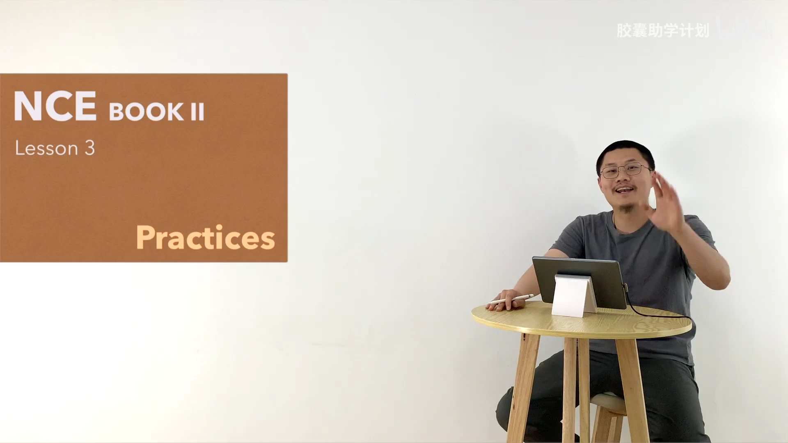

文字识别：胶囊助学计划 / NCE / BOOK I"I / Lesson 3 / Practices

### 画面 00:00:03

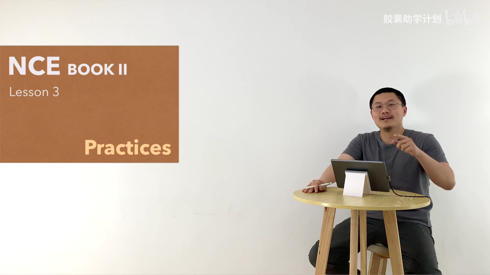

文字识别：胶囊助学计划 / NCE / BOOKII / Lesson 3 / Practices

### 画面 00:00:06

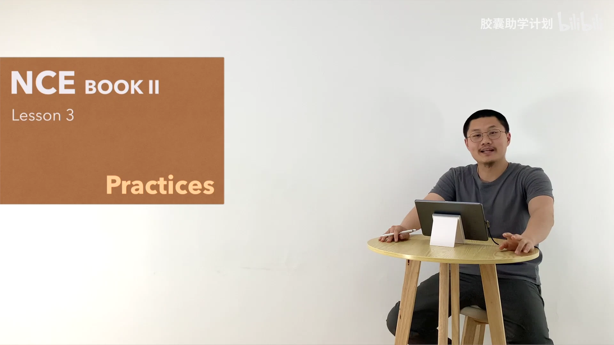

文字识别：胶囊助学计划 / NCE / BOOKII / Lesson 3 / Practices

### 画面 00:00:10

文字识别：胶囊助学计划bil出 / •

### 画面 00:00:14

文字识别：胶囊助学计划

### 画面 00:00:16

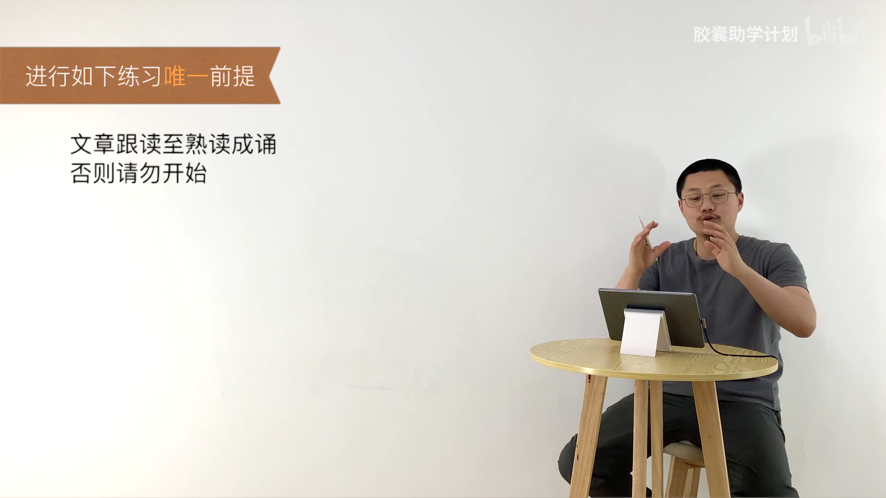

文字识别：胶囊助学计划 / 进行如下练习唯一前提 / 文章跟读至熟读成诵 / 否则请勿开始

### 画面 00:00:27

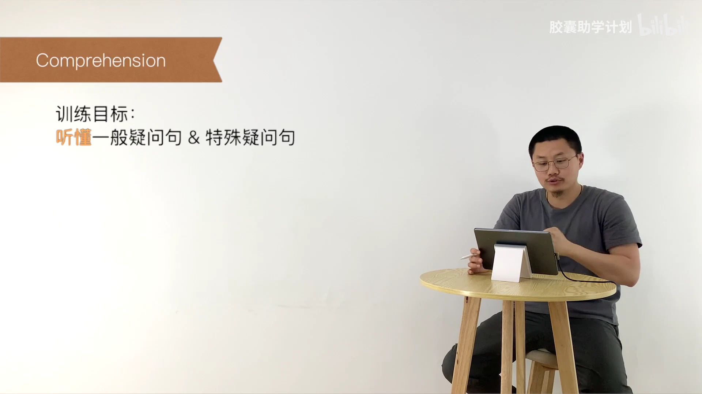

文字识别：胶囊助学计划 / Comprehension / 训练目标： / 听懂一般疑问句＆特殊疑问句

## 00:00:30–00:01:00

听懂一般疑问句和特殊疑问句。各位接下来可以去眼睛看着文章，或者完全闭起眼睛来。我们来了，What always spoils your holidays? Postcards. 当然了，加不加度您随便。这个地方不是严格的只有一个正确答案啊。 Next one, Where did you go last summer? Italy.

### 画面 00:00:39

文字识别：胶囊助学计划 / Comprehension / What always spoils your holidays?

## 00:01:00–00:01:30

What did you visit? Museums. Where did you sit? Public gardens. Did you learn a little Italian? Yes, I did. Who taught you? A friendly waiter.

### 画面 00:01:09

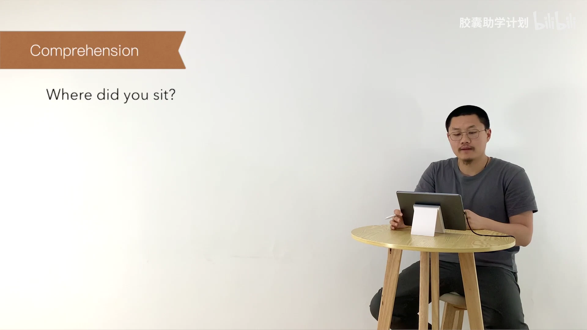

文字识别：胶囊助学计划 / Comprehension / Where did you sit?

## 00:01:30–00:02:00

What did he lend you? A book. Did you understand what you read? No, I didn't. How often do you think about postcards? Every day. Did your holidays pass quickly? Yes, they did.

### 画面 00:01:39

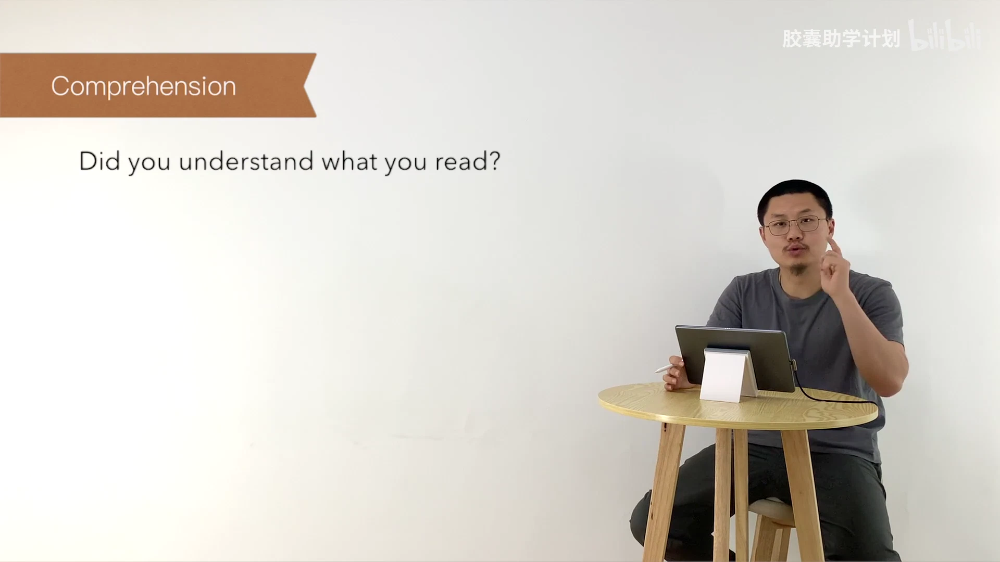

文字识别：胶囊助学计划 / Comprehension / Did you understand what you read?

## 00:02:00–00:02:30

Did your friends receive any cards from you? No, they didn't. What did you do on the last day? I made a big decision. When did you get up on the last day? Of course, very early. How many cards did you buy?

### 画面 00:02:09

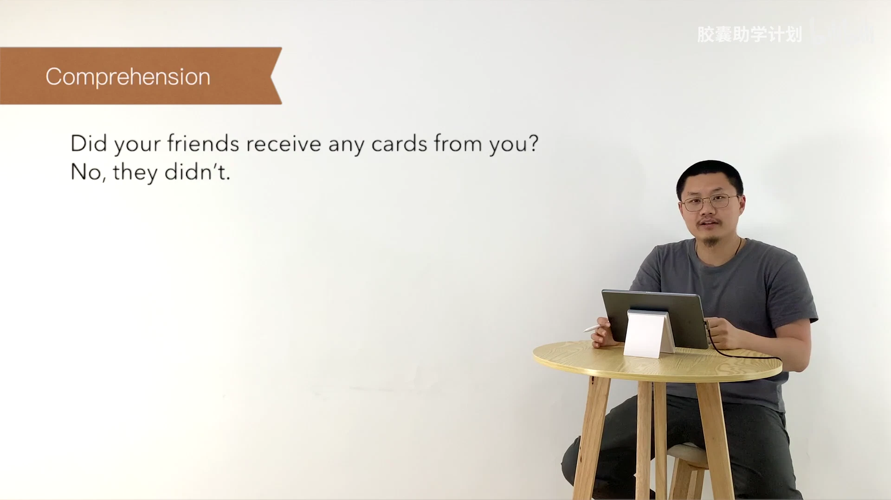

文字识别：胶囊助学计划 / Comprehension / Did your friends receive any cards from you? / No, they didn't.

### 画面 00:02:13

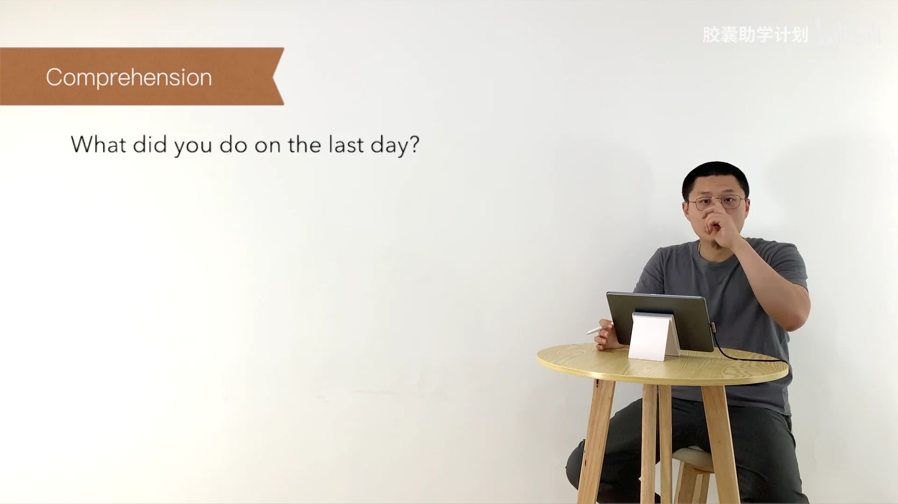

文字识别：胶囊助学计划 / Comprehension / What did you do on the last day?

## 00:02:30–00:03:00

buy? Thirty-seven. 下一个练习 asking questions，会说一般疑问句和特殊疑问句。您将来自己能问出问题来了。好，我们上来先是老习惯给大家一个示范，比如说 ask me if 前面不用管它，就看后面。 I went to Italy for my summer holidays. 变一般疑问句，一有 went did 提前，叫 did you go to Italy? Went 要换回原形

### 画面 00:02:34

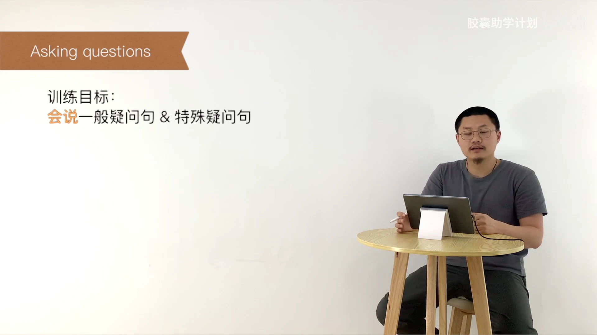

文字识别：胶囊助学计划 / Asking questions / 训练目标： / 会说一般疑问句＆特殊疑问句

### 画面 00:02:43

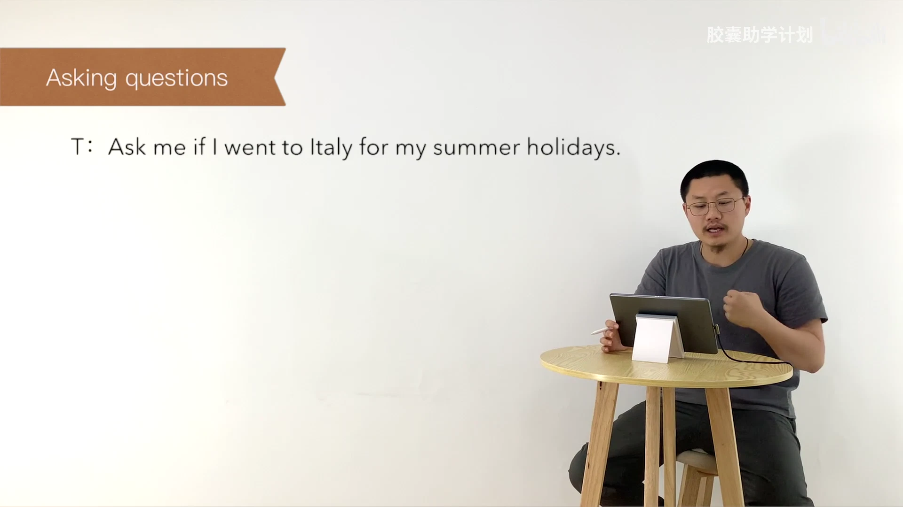

文字识别：胶囊助学计划 / Asking questions / T: Ask me if I went to ltaly for my summer holidays.

### 画面 00:02:48

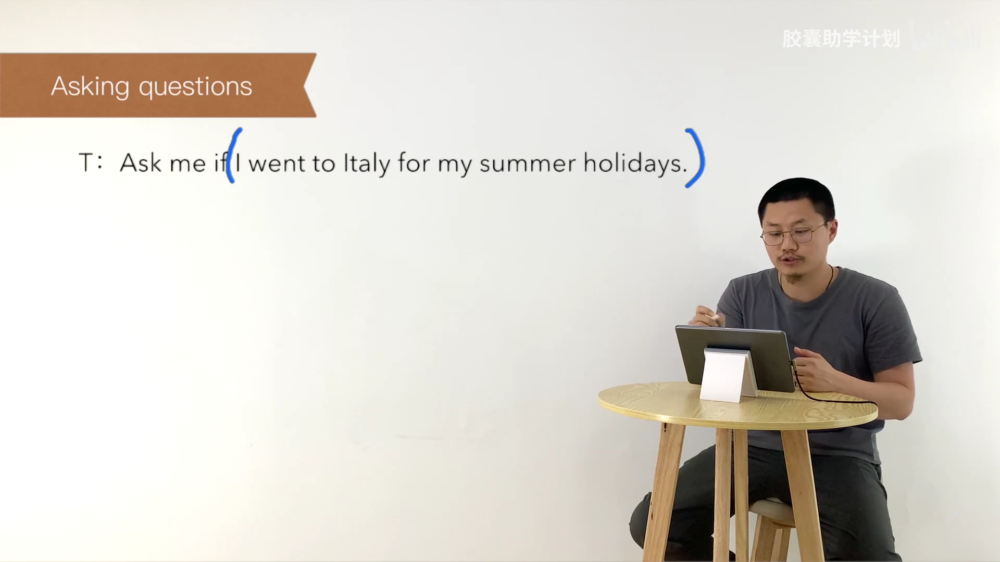

文字识别：胶囊助学计划 / Asking questions / T: Ask meif wentto taly for my summer hlidays.

## 00:03:00–00:03:30

for your summer holidays. 那接下来给了一个特殊疑问词叫做 where，那它是对 to Italy 提问，于是变成了 where did you go for your summer holidays，对吧？你的暑假的这个假期你去了什么地方呢？Very good. 接下来我们要做一些小的练习，这些练习更多的是我告诉大家思路，各位课下自己去写出来，并且朗读来了。Why？为什么？Why 这个单词比较特殊，

### 画面 00:03:01

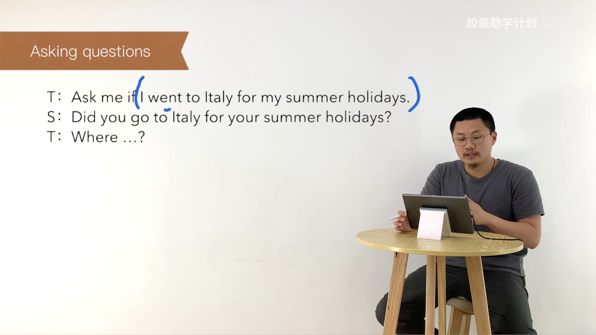

文字识别：胶囊助学计划 / Asking questions / I went to Italy for my summer holidays. / S:Did / d you go to ltaly for your summer holidays? / T: Where ...?

### 画面 00:03:16

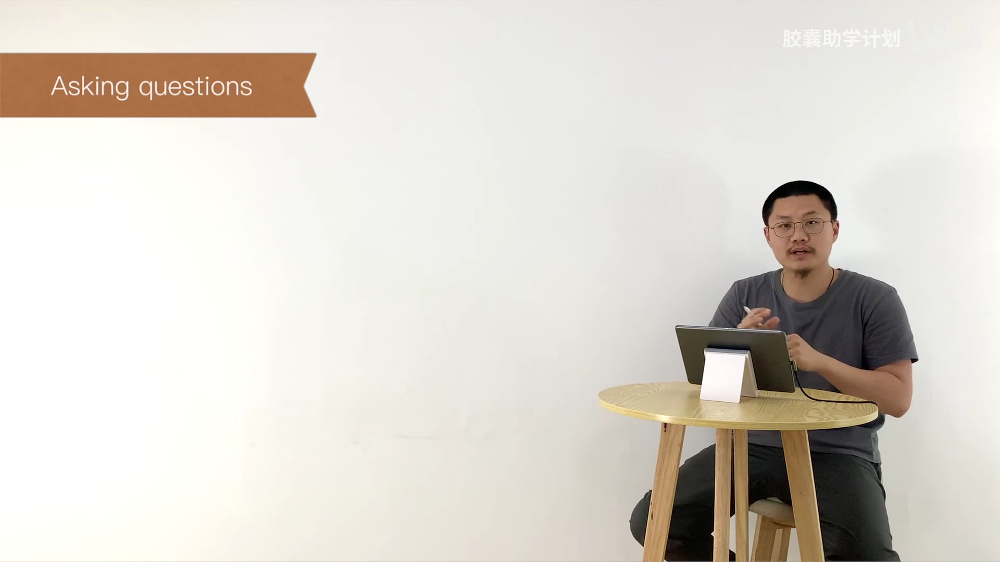

文字识别：胶囊助学计划 / Asking questions

### 画面 00:03:18

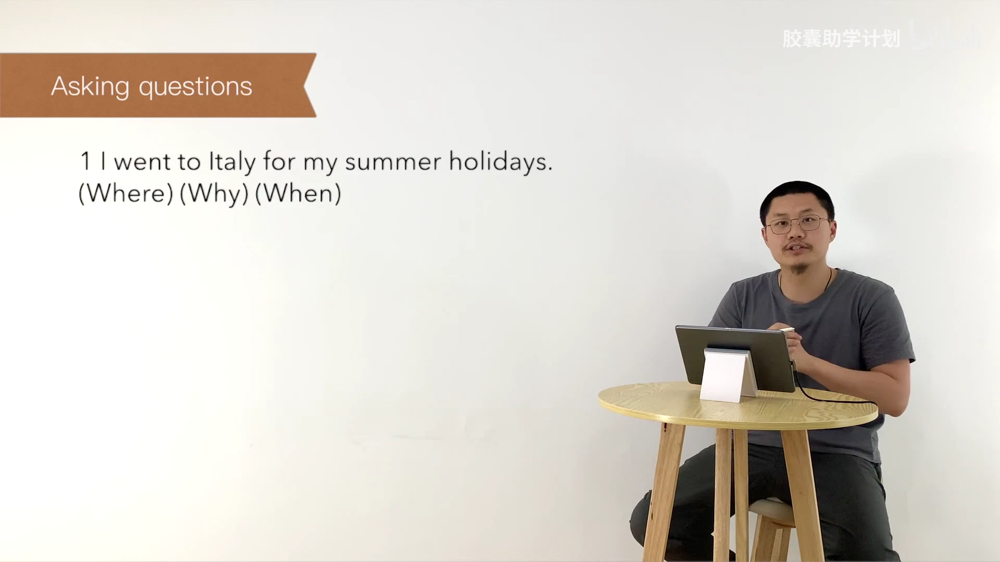

文字识别：胶囊助学计划 / Asking questions / 1 I went to ltaly for my summer holidays. / (Where) (Why)(When)

### 画面 00:03:29

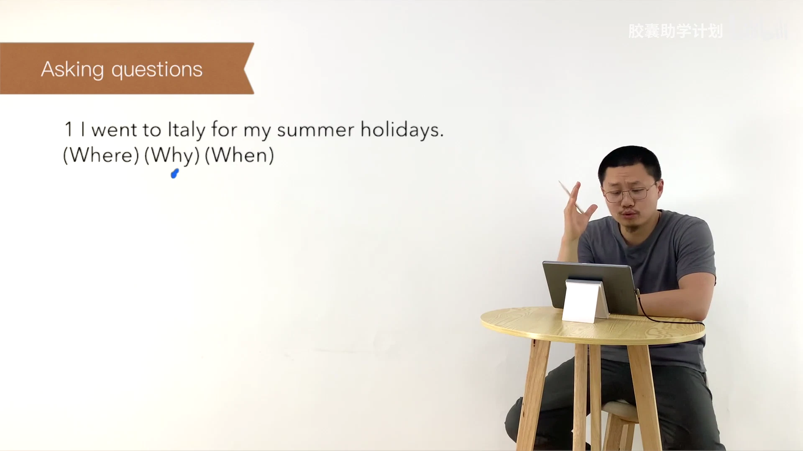

文字识别：Asking / questions / 1 I went to Italy for my summer holidays. / (Where)(Why)(When)

## 00:03:30–00:04:00

大部分情况下是对整句话进行提问。比如说这地方，它直接就是问你为什么去意大利度过你暑假呢？的这个假期，对吧？叫Why did you go to Italy for your summer holidays?哪一个？那when什么时候去的？你自己想一下是对什么提问？这个我专门给大家留一个小的悬念，各位不妨在视频下方可以进行一下讨论。好，接下来I visited museums.一般过去

### 画面 00:03:46

文字识别：胶囊助学计划 / Asking questions / 1 I went to ltaly for my summer holidays. / (Where) (Why)(When)

### 画面 00:03:52

文字识别：胶囊助学计划 / Asking / questions / 1 l went to ltalyfor my summer holidays. / (Where) (Why)When)

### 画面 00:03:59

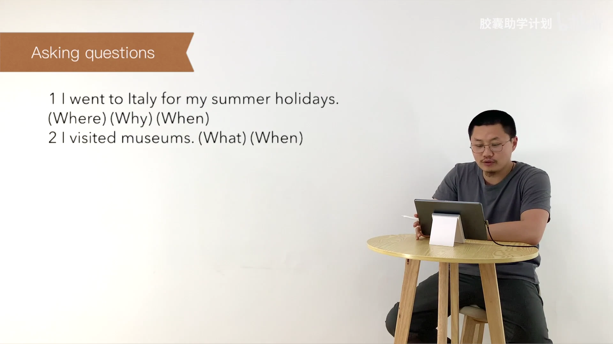

文字识别：胶囊助学计划 / Asking questions / 1 I went to ltaly for my summer holidays. / (Where) (Why)(When) / 2 | visited museums.(What) (When)

## 00:04:00–00:04:30

时，您可以把did提前，别忘了把visit换回原形。那what是对museums提问，when？你看这句话当中只有这么三个东西，没有时间怎么办？直接加整句话。When did you visit museums？点一个。接下来，I sat in public gardens.一般过去时，did提前，动词换回原形。Where对in public gardens提问，没什么太大区别。I learned a little Italian.

### 画面 00:04:06

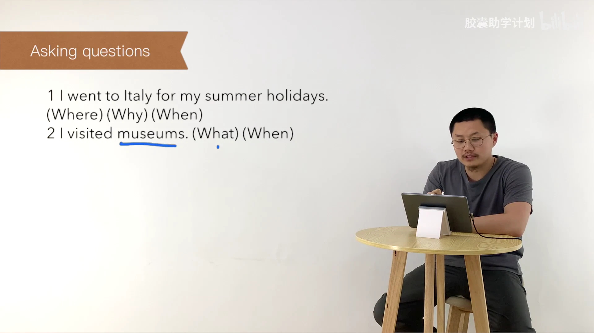

文字识别：胶囊助学计划 / Asking questions / 1 I went to ltaly for my summer holidays. / (Where)(Why)(When) / 2| visited museums.(What) (When)

### 画面 00:04:11

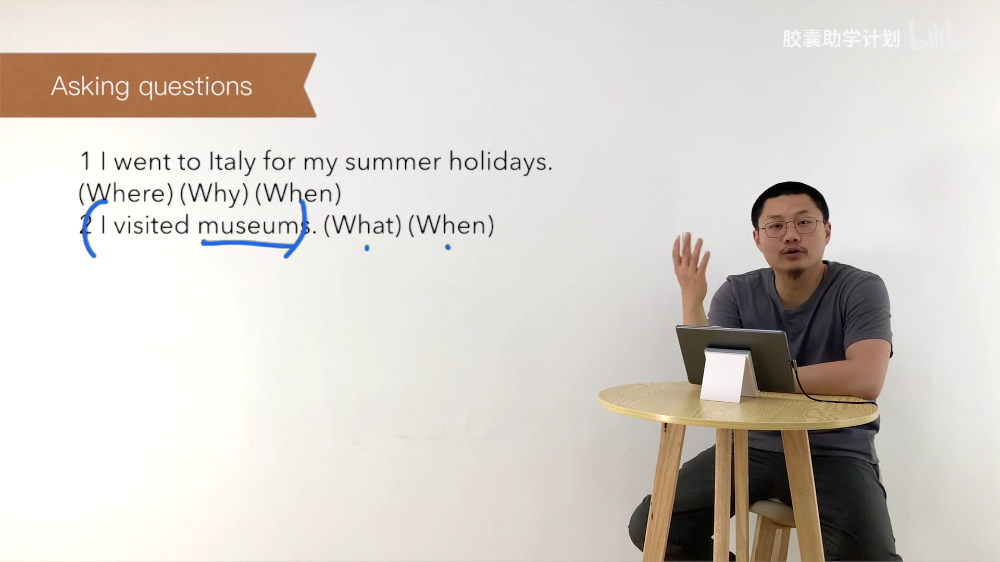

文字识别：胶囊助学计划 / Asking / questions / 1 I went to ltaly for my summer holidays. / (Where)(Why)(When) / I visited museum / (What) (When)

### 画面 00:04:18

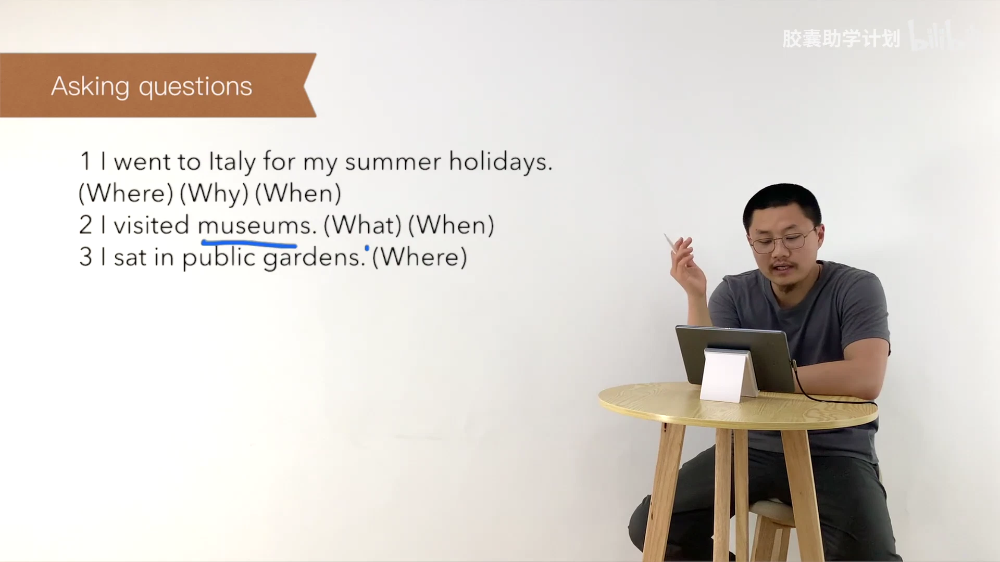

文字识别：胶囊助学计划 / Asking / questions / 1Iwent to / Italy for my s / summer holidays. / (Where) (Why)(When) / 21visited / museums. (What) (When) / 3l sat in / public gardens:(Where)

### 画面 00:04:25

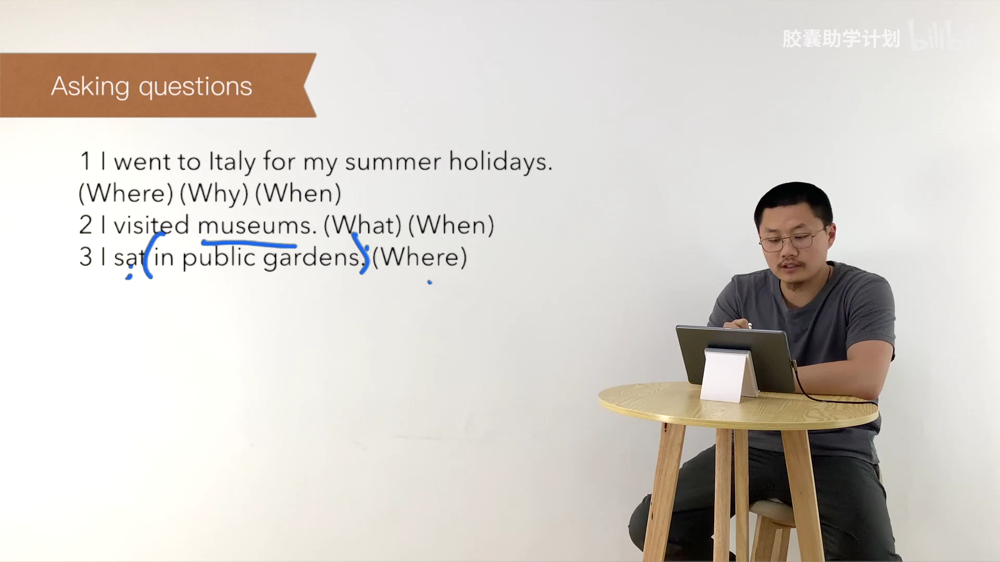

文字识别：胶囊助学计划 / Asking / questions / 1 I went to ltaly for my summer holidays. / (Where) (Why) (When) / 21visited / museums.(What) (When) / 3l satin /  public gardens)(Where)

## 00:04:30–00:05:00

How learned?一般过去时did提前，动词换回原形。注意how much可是有一点意思了。他对a little提问，并且how much要带着Italian一起提前，所以他的答案是How much Italian did you learn?你学会了多少意大利语啊？啊，grazie就会这一句。Okay, a friendly waiter taught me.那taught did提前，对吧？He taught换回原形。Who注意了？

### 画面 00:04:36

文字识别：胶囊助学计划 / Asking / questions / 1Iwent toI /  Italy for my s / summer holidays. / (Where) (Why)(When) / 21visited / museums.(What) (When) / 3 I sat in / public / gardens)(Where) / 4Iléarnt a / a / little / Italian.(How much)

### 画面 00:04:45

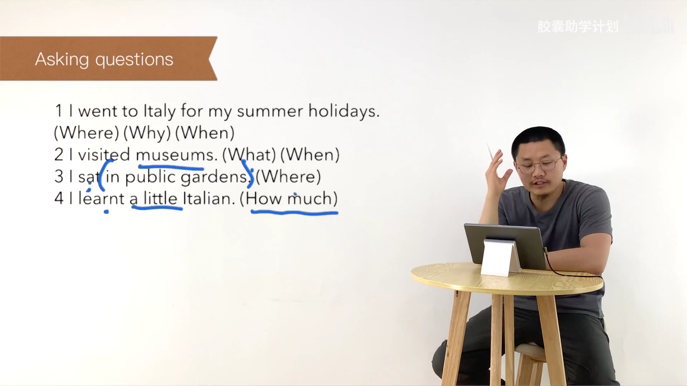

文字识别：Asking / questions / 1I went to / Italyf / for my s / summer holidays. / (Where) (Why) (When) / 21visited / museums. / (What) (When) / 3l satin / public / gardens)(Where) / 4Iléarnt / a little / Italian.(How / much)

### 画面 00:04:48

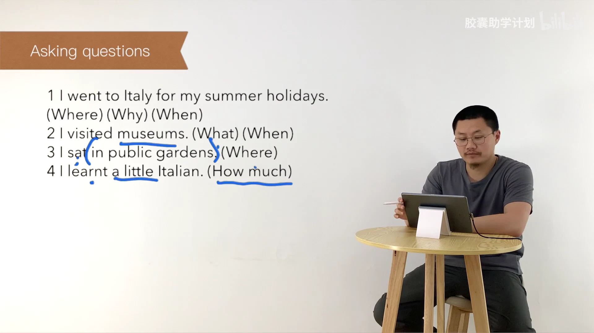

文字识别：胶囊助学计划 / Asking / questions / 1Iwent to /  Italy for my s / summer holidays. / (Where) (Why)(When) / 21visited / museums.(What) (When) / 3 l sat in / public / gardens)(Where) / 4Iléarnt / a little / Italian.(How much)

### 画面 00:04:50

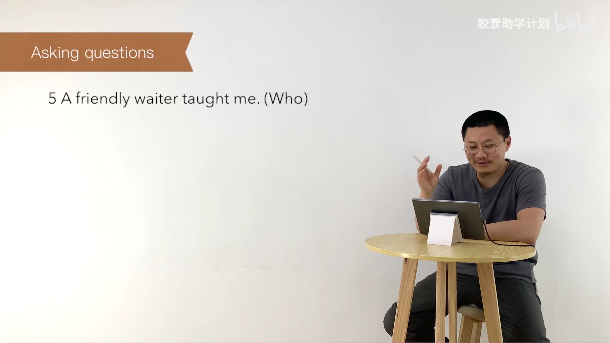

文字识别：胶囊助学计划 / Asking questions / 5 A friendly waiter taught me. (Who)

### 画面 00:04:52

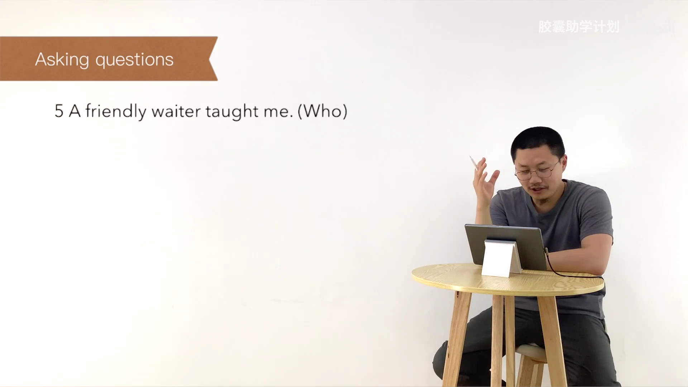

文字识别：Asking / questions / 5 A friendly waiter taught me. (Who)

### 画面 00:04:59

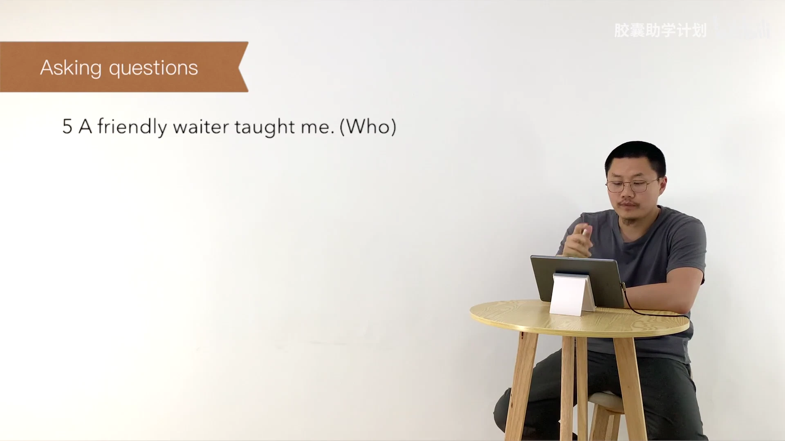

文字识别：Asking questions / 5 A friendly waiter taught me. (Who)

## 00:05:00–00:05:30

对 me 提问和对 a friendly waiter 提问可是不一样的。对 me 提问，你是要先变一般疑问句的。而你如果对 a friendly waiter 提问，新概念一册第三十一课我们学过，直接替代主语叫做 who taught you？为什么不用 who taught me？因为这句话，换一句话来说，不是从来不用，谁教会我的，不是从来不会用，

### 画面 00:05:02

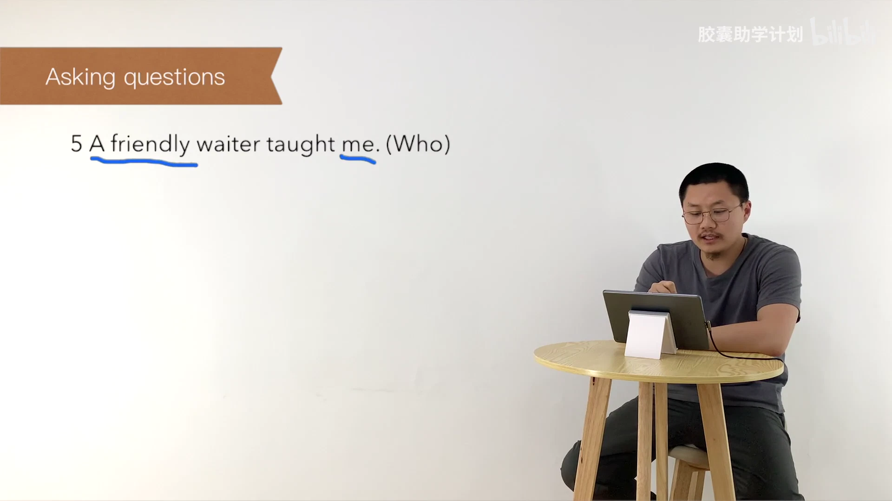

文字识别：胶囊助学计划 / Asking / questions / 5 A friendly waiter taught me. (Who)

### 画面 00:05:05

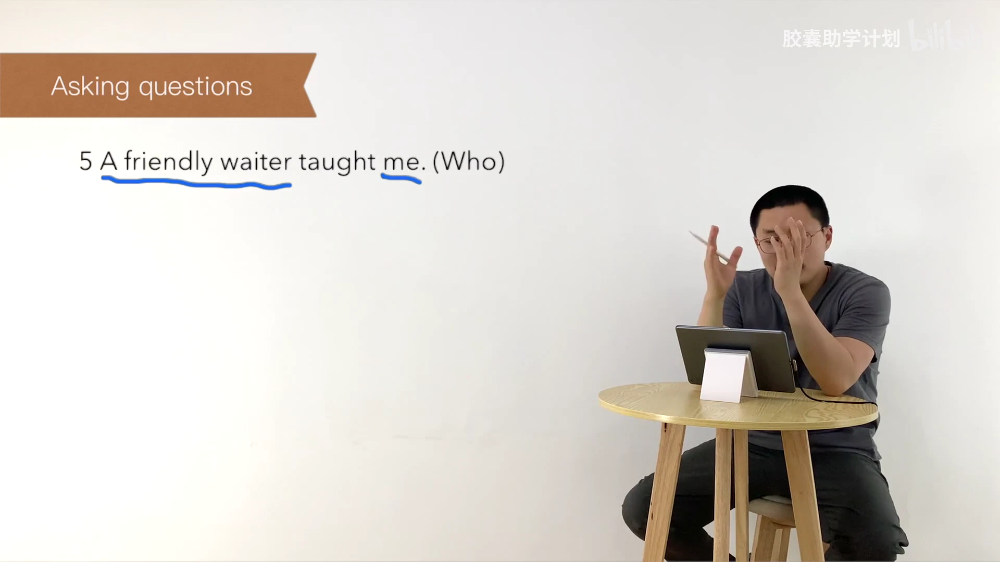

文字识别：胶囊助学计划 / Asking / questions / 5 A friendly waiter taught me. (Who)

### 画面 00:05:08

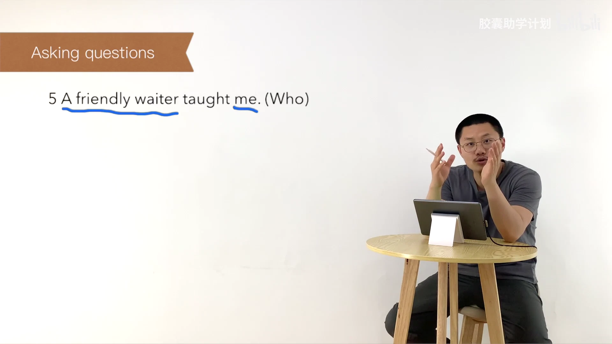

文字识别：Asking / questions / 5 A friendly waiter taught me. (Who)

### 画面 00:05:26

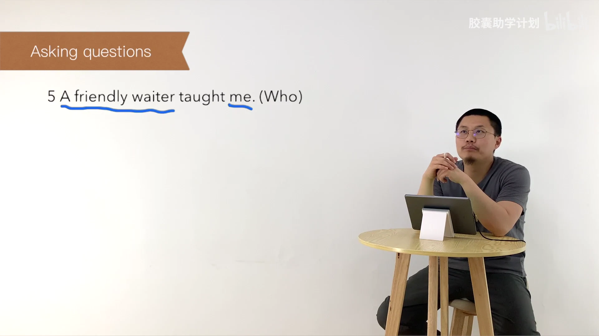

文字识别：胶囊助学计划 / Asking / questions / 5 A friendly waiter taught me. (Who)

## 00:05:30–00:06:00

对吧？也是有用的可能性的。但大多数情况下，可能我们是问别人谁教会你这个东西的，叫做 Who taught you? Okay, 不要变一般疑问句，对主语提问的时候啊。来，He lent me a book. It提前，动词换原形。What对a book提问？Who对主语提问，或者对宾语提问？谁变原形，谁不变原形？刚刚讲，各位一定要自己去写一下。I read a few lines. 注意，它是read而不

### 画面 00:05:44

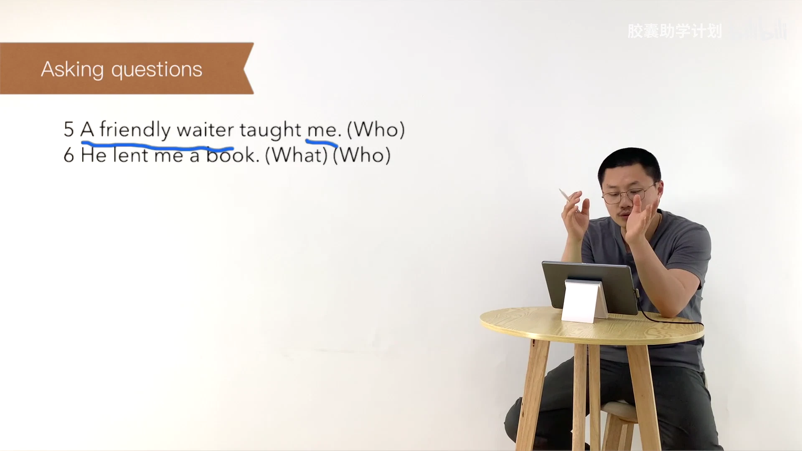

文字识别：Asking / questions / 5 A friendly waiter taught me. (Who) / He Tent me a book. / (What)(Who) / 6

### 画面 00:05:48

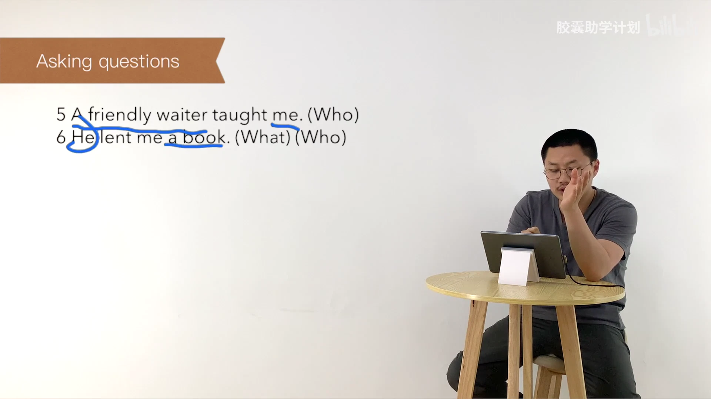

文字识别：胶囊助学计划 / Asking / questions / 5 / Afriendly /  waiter taught me.(Who) / 6 / He / lent me a book. / (What)(Who)

### 画面 00:05:50

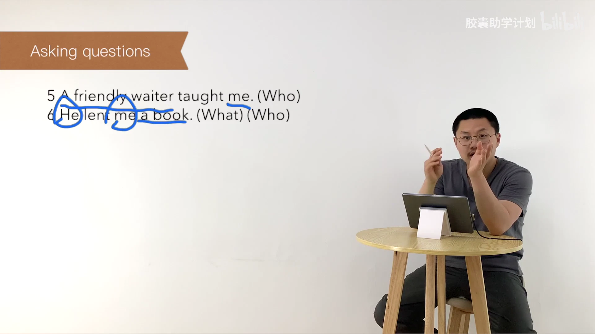

文字识别：胶囊助学计划 / Asking / questions / friendy waiter taught me. (Who) / 5 / He / len / mea book. / (What)(Who)

### 画面 00:05:52

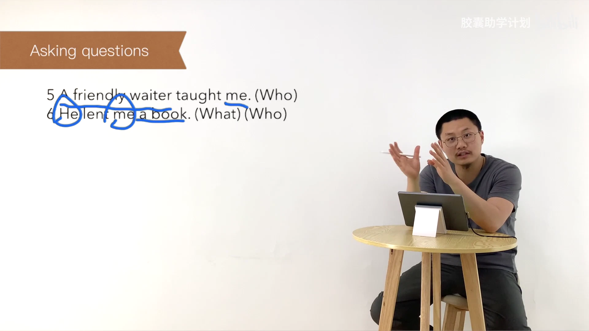

文字识别：Asking / questions / 5 / Afriendywaiter / taught / t me.(Who) / He / len / mea book. / (What)(Who)

### 画面 00:05:55

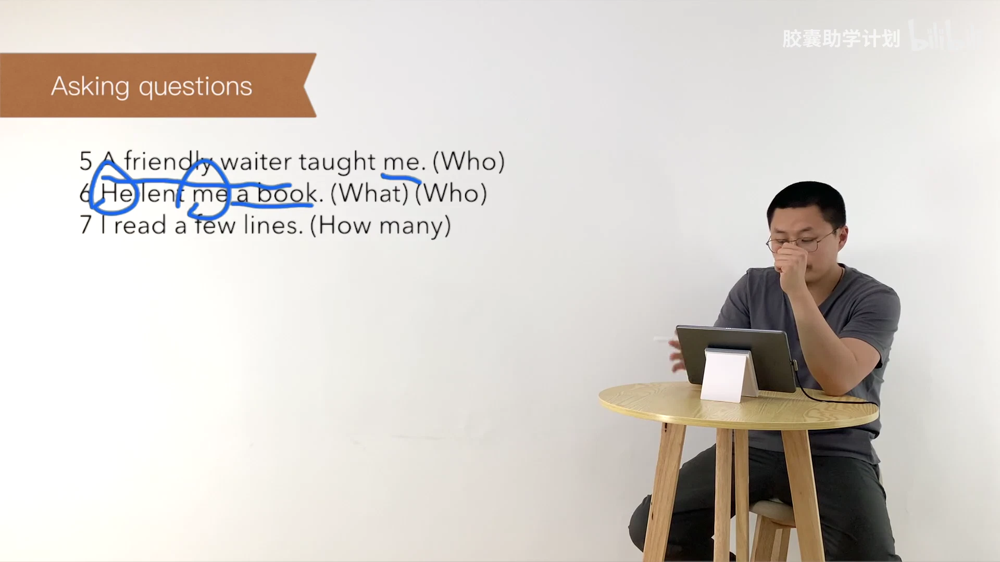

文字识别：胶囊助学计划 / Asking / questions / friendy waiter taught me. (Who) / 5 / Helent / me / abook. / (What)(Who) / 7Tread / afew / lines. / . (How many)

### 画面 00:05:57

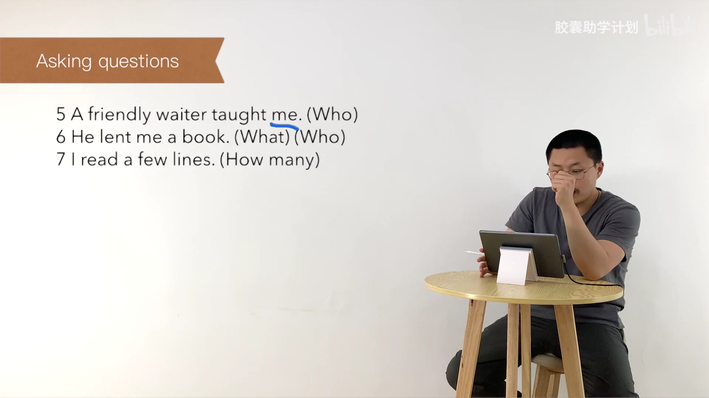

文字识别：胶囊助学计划 / Asking questions / 5 A friendly waiter taught me. (Who) / 6 He lent me a book. (What) (Who) / 7 I read a few lines. (How many)

## 00:06:00–00:06:30

是 read 过去式啊 did 提前 How many 对的是 a few 提问，它是跟 lines 一起提前，答案是 How many lines did you read? 你读了多少行啊？当时为什么翻译成当时 did 吗？对吧？好，接下来 I thought about postcards every day. Thought 啊 about think about did 提前 thought 换回 think 那 how often 肯定是对 every day 提问了 What

### 画面 00:06:02

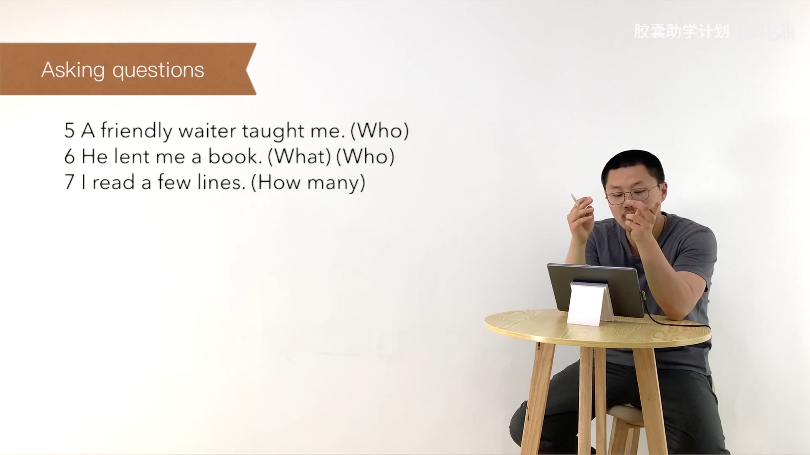

文字识别：胶囊助 / Asking questions / 5 A friendly waiter taught me. (Who) / 6 He lent me a book. (What) (Who) / 7 I read a few lines. (How many)

### 画面 00:06:14

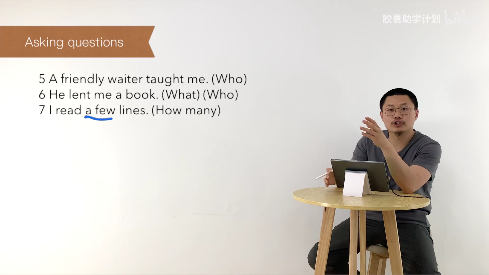

文字识别：胶囊助学计划 / Asking questions / 5 A friendly waiter taught me. (Who) / 6 He lent me a book. (What) (Who) / 7 I read a few lines. (How many)

### 画面 00:06:18

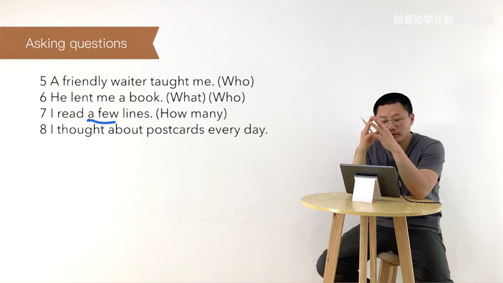

文字识别：Asking questions / 5 A friendly waiter taught me. (Who) / 6 He lent me a book.(What) (Who) / 7 I read a few lines. (How many) / 8 I thought about postcards every day.

### 画面 00:06:24

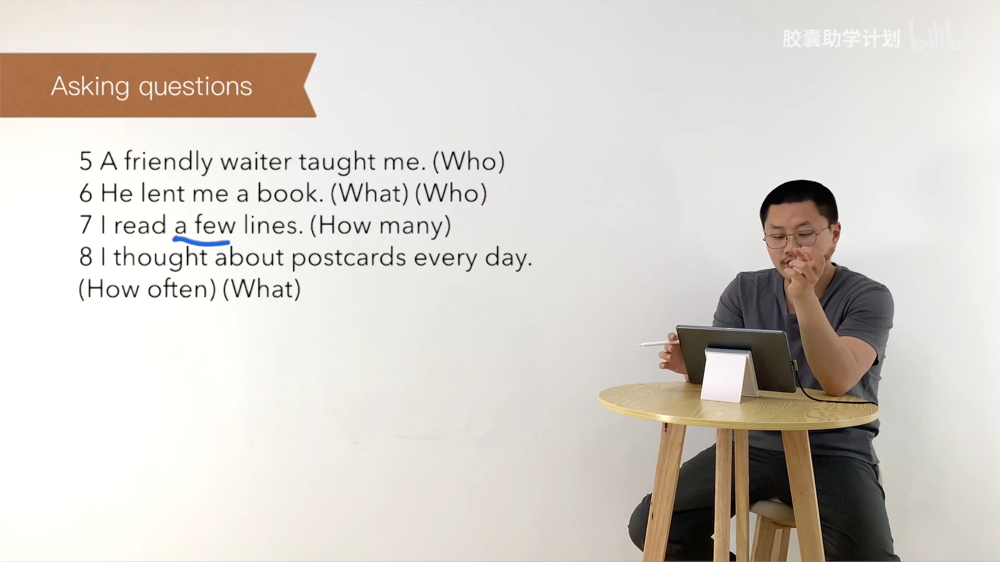

文字识别：胶囊助学计划 / Asking questions / 5 A friendly waiter taught me. (Who) / 6 He lent me a book. (What) (Who) / 7 I read a few lines. (How many) / 8 Ithought about postcards every day. / (How often)(What)

### 画面 00:06:28

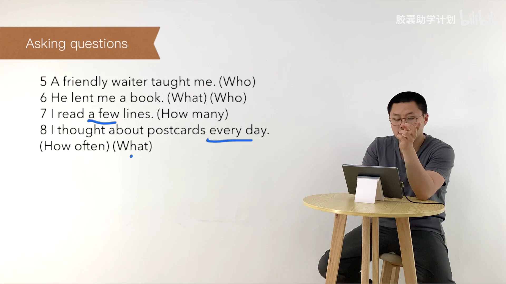

文字识别：胶囊助学计划 / Asking questions / 5 A friendly waiter taught me. (Who) / 6 He lent me a book.(What) (Who) / 7 I read a few lines. (How many) / 8 I thought about postcards every day. / (How often)(What)

## 00:06:30–00:07:00

postcards, right? Very good.接下来 tell the story.口语复述能力，您一定是文章读到非常非常熟，滚瓜烂熟，对吧？这个基本上熟读成诵的地步，才有可能进行这个口语复述练习。那每一次我给大家课上只是做一个示范，告诉大家不用非常严苛的去背诵下来这个文章，您只要脑海当中有这个故事，通过这些关键词能把它复述出来

### 画面 00:06:30

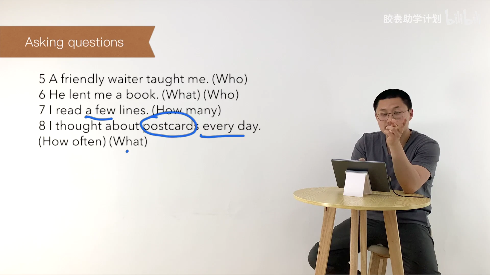

文字识别：胶囊助学计划 / Asking questions / 5 A friendly waiter taught me. (Who) / 6 He lent me a book.(What) (Who) / 7 I read a few lines. (How many) / 8 Ithought aboutDostcard /  every day. / (How often) (What)

### 画面 00:06:32

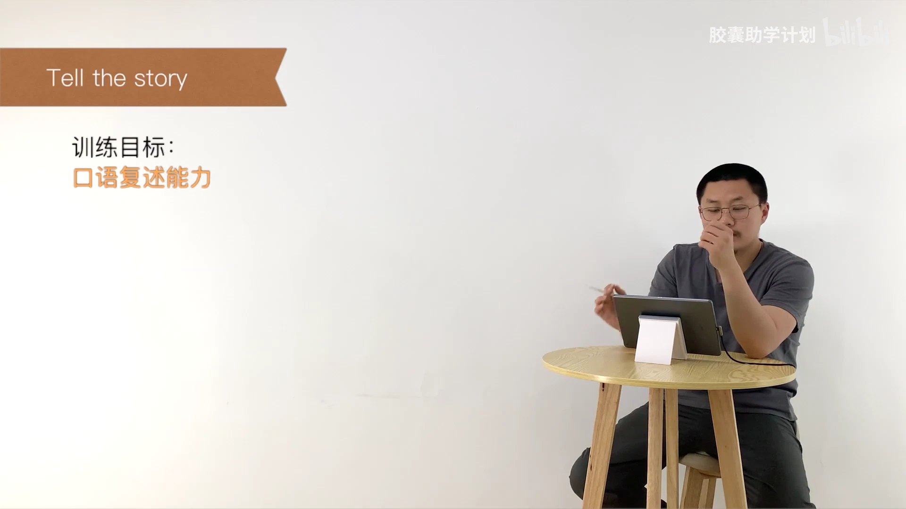

文字识别：胶囊助学计划 / Tell the story / 训练目标： / 口语复述能力

### 画面 00:06:46

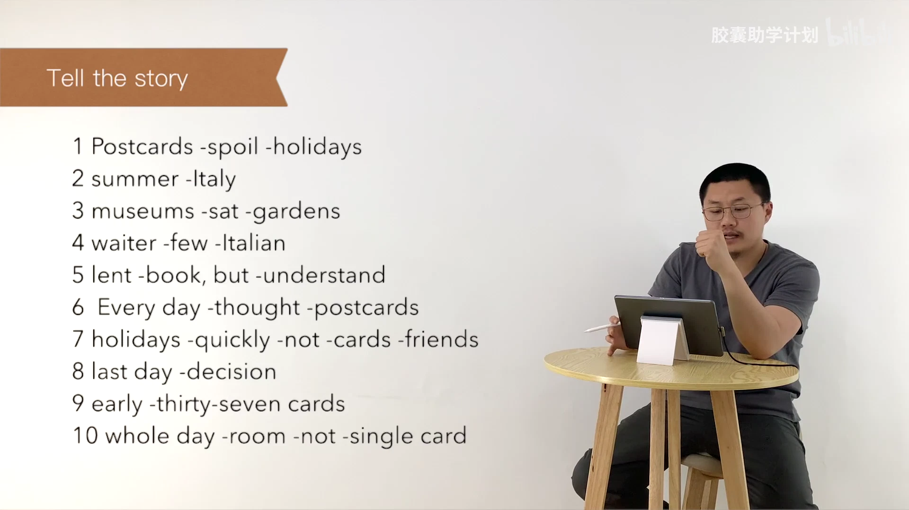

文字识别：胶囊助学计划 / Tell the story / 1 Postcards -spoil -holidays / 2 summer -ltaly / 3 museums -sat -gardens / 4 waiter -few -ltalian / 5 lent -book, but -understand / 6 Every day -thought -postcards / 7 holidays -quickly -not -cards -friends / 8 last day -decision / 9 early -thirty-seven cards / 10 whole day -room -not -single card

### 画面 00:06:49

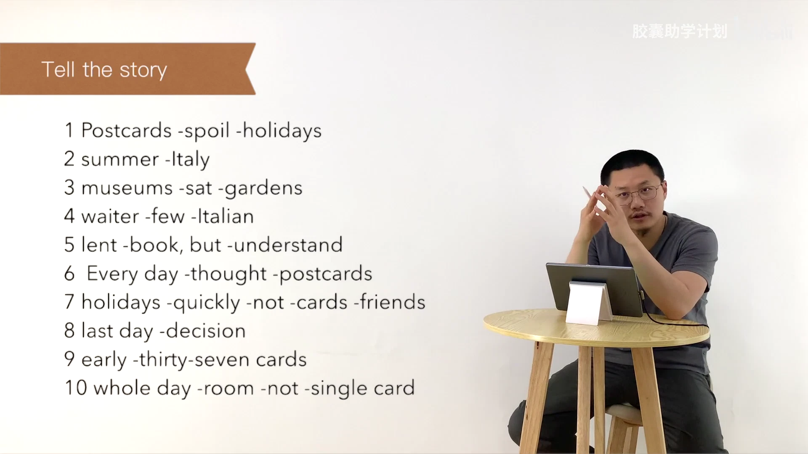

文字识别：Tell the story / 1 Postcards -spoil -holidays / 2 summer -ltaly / 3 museums -sat -gardens / 4 waiter -few -ltalian / 5 lent -book, but-understand / 6 Every day -thought -postcards / 7 holidays -quickly -not -cards -friends / 8 last day -decision / 9 early -thirty-seven cards / 10 whole day -room -not -single card

### 画面 00:06:59

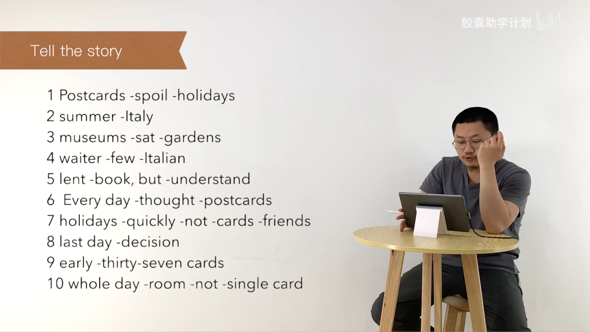

文字识别：胶囊助学计划 / Tell the story / 1 Postcards -spoil -holidays / 2 summer -ltaly / 3 museums -sat -gardens / 4 waiter -few -ltalian / 5 lent -book, but -understand / 6 Every day -thought -postcards / 7 holidays -quickly -not -cards -friends / 8 last day -decision / 9 early -thirty-seven cards / 10 whole day -room -not -single card

## 00:07:00–00:07:30

就可以了。我做一个示范，在视频当中，各位课下要自己去做这个练习。来了，Postcards always spell my holidays. Last summer I went to Italy. I visited museums and sat in gardens. A friendly waiter taught me a few words of Italian. Then he lent me a book, but I did not understand it at all. Every day I thought about postcards, and my holiday passed very quickly. I did not send any

### 画面 00:07:23

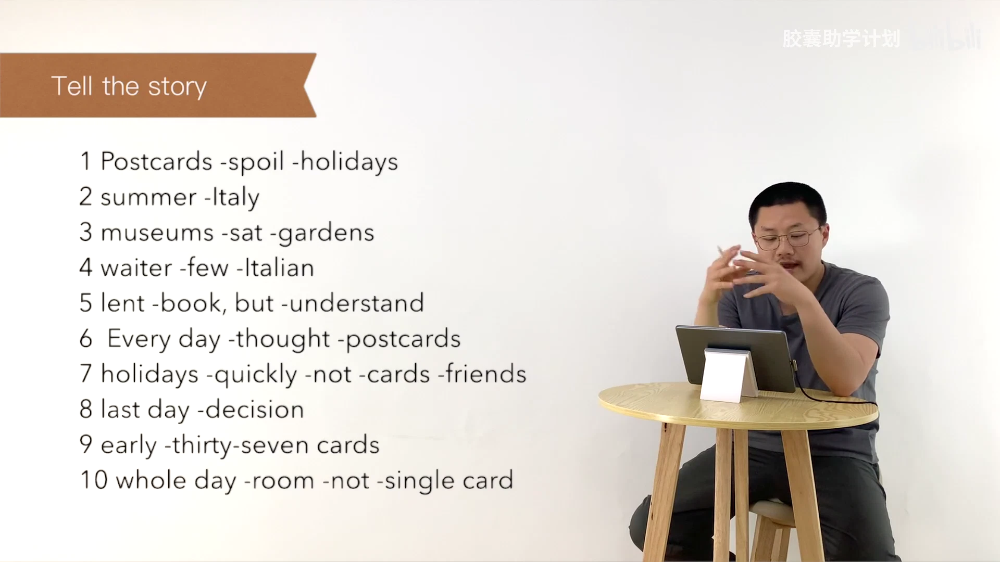

文字识别：Tell the story / 1 Postcards -spoil -holidays / 2 summer -ltaly / 3 museums -sat -gardens / 4 waiter -few -ltalian / 5 lent -book, but-understand / 6 Every day -thought -postcards / 7 holidays -quickly -not -cards -friends / 8 last day -decision / 9 early -thirty-seven cards / 10 whole day -room -not -single card

## 00:07:30–00:08:00

cards to my friends on the last day. I made a very big decision. I got up early and bought thirty-seven cards. I spent the whole day in my room, but unfortunately, I did not write a single card at all. I did not write a single card. There you go. Okay,刚才就是进行了一个，我是看着这些关键词，我的文章到现在也背不下来，但已经熟读成诵了，所以我能很轻松的把这个故事给他复述一遍，哪怕现在

### 画面 00:07:47

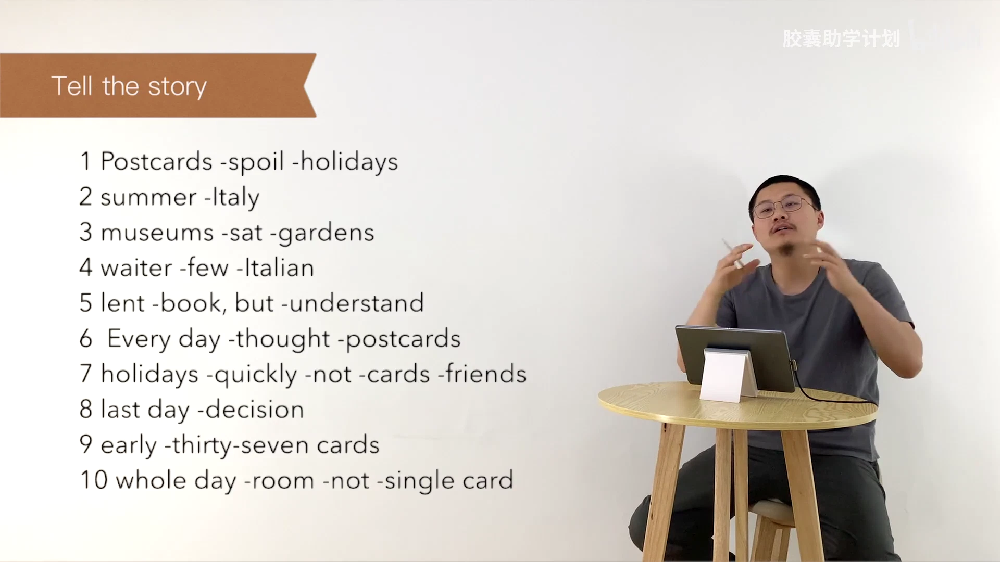

文字识别：胶囊助学计划 / Tell the story / 1 Postcards -spoil -holidays / 2 summer -ltaly / 3 museums -sat -gardens / 4 waiter -few -ltalian / 5 lent -book, but -understand / 6 Every day -thought -postcards / 7 holidays -quickly -not -cards -friends / 8 last day -decision / 9 early -thirty-seven cards / 10 whole day -room -not -single card

## 00:08:00–00:08:30

不给我这些关键词，我只不过可能丢的细节会更多，但大概的故事梗概我是记住了，也依旧能给别人复述。各位课下一定要去做这个练习，好吧？接下来 summary writing，也就是我们的摘要写作，每个文章各位教材当中的后面都有一个东西叫摘要写作 summary writing，在这儿只给大家提供答案，当然您也可以去我们的专栏当中去寻找这个答案，在这儿不过不做过多的解释了。OK，

### 画面 00:08:11

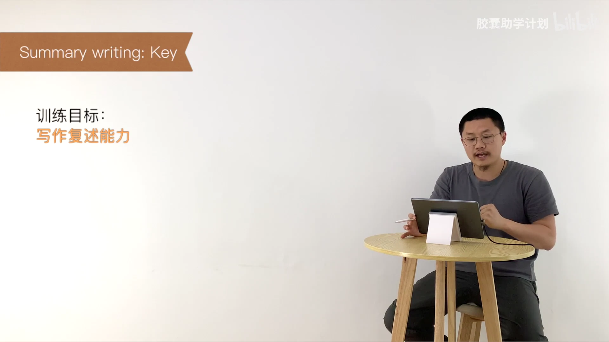

文字识别：胶囊助学计划 / Summary writing: Key / 训练目标： / 写作复述能力

### 画面 00:08:20

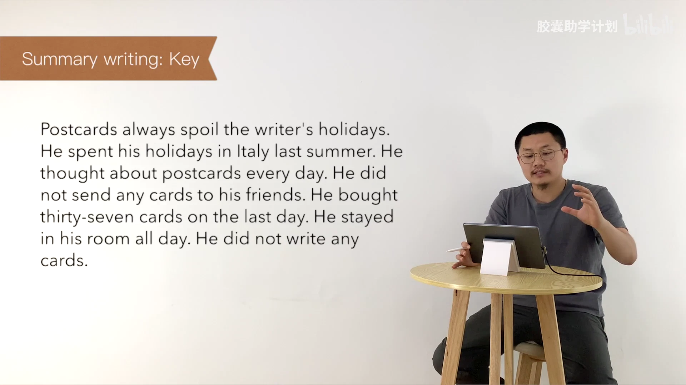

文字识别：胶囊助学计划 / Summary writing: Key / Postcards always spoil the writer's holidays. / He spent his holidays in Iltaly last summer. He / thought about postcards every day. He did / not send any cards to his friends. He bought / thirty-seven cards on the last day. He stayed / in his room all day. He did not write any / cards.

### 画面 00:08:29

文字识别：胶囊助学计划 / Topics for discussion / 训练目标： / 完全自由的对话

## 00:08:30–00:09:00

接下来最后一个练习，bonus，对吧？我们作为一个嘉奖的环节，各位现在能做则做，不能做呢？我们知道，我们训练所有练习，就包括文章，对吧？包括 comprehension，包括 ask me if，所有所有的练习都是为了将来有一天我们能完全自由的进行接下来这些的练习，不管是口语上的练习还是写作上的练习。我们看一下他们的题都是什么？How did you spend your holiday last year？去年你是如何

### 画面 00:08:33

文字识别：胶囊助学计划 / Topics for discussion / 训练目标： / 完全自由的对话

### 画面 00:08:48

文字识别：胶囊助学计划 / Topics for discussion / How did you spend your holidays last / year? Where did you go and what did / youdo? / Talk about some of the things that can / spoil a holiday. / What is the best way to learn a foreign / language?

### 画面 00:08:59

文字识别：胶囊助学计划 / Topics for discussion / How did you spend your holidays last /  Where did you go and what did / year) / youdo? / Talk about some of the things that can / spoil a holiday. / What is the best way to learn a foreign / language?

## 00:09:00–00:09:30

度假的呢？Where did you go and what did you do?你去了什么地方，然后你做了什么事情啊？对吧？那这个题对于各位来说，你想一下日常跟大家聊天会不会聊到呢？你肯定聊过。OK，所以我们现在需要锻炼的能力就是通过不停的学习新的单词、新的习惯用法、新的语法，学会这些单词的语音语调，对吧？它们的发音，然后期冀于有一天我们积累的这些语

### 画面 00:09:02

文字识别：胶囊助学计划 / Topics for discussion / How did you spend your holidays last / Where did you go and what did / year / youdo? / Talk about some of the things that can / spoil a holiday. / What is the best way to learn a foreign / language?

### 画面 00:09:15

文字识别：胶囊助学计划 / Topics for discussion / How did you spend your holidays last / Where did you go and what did / year / youdo? / Talk about some of the things that can / spoil a holiday. / What is the best way to learn a foreign / language?

## 00:09:30–00:10:00

言细节足够多的时候，张开嘴，对吧？哪怕磕磕绊绊的，也能给别人去说，跟别人沟通这些事情了。用英文，of course. OK，接下来 talk about some of the things that can spoil a holiday。说你去聊一聊哪些事情可能会毁了毁了您的假期呢？接下来，What is the best way to learn a foreigner language？这个就不存在 best ways，对吧？去学一门外语最好的方式是什么？没有任何人知道。相信我

### 画面 00:09:41

文字识别：胶囊助学计划 / Topics for discussion / How did you spend your holidays last / Where did you go and what did / year / youdo? / Talk about some of the things that can / spoil a holiday. / What is the best way to learn a foreign / language?

### 画面 00:09:44

文字识别：胶囊助学计划 / Topics for discussion / How did you spend your holidays last / Where did you go and what did / year) / youdo? / Talk about some of the things that can / spoil a holiday. / What is the best way to learn a foreign / language?

### 画面 00:09:50

文字识别：胶囊助学计划 / Topics for discussion / How did you spend your holidays last / Where did you go and what did / year) / youdo? / Talk about some of the things that can / spoil a holiday. / What is the best way to learn a foreign / language?

### 画面 00:09:55

文字识别：胶囊助学计划 / Topics for discussion / How did you spend your holidays last / Where did you go and what did / year) / youdo? / Talk about some of the things that can / spoil a holiday. / What is the best way to learn a foreign / 3 / language?

## 00:10:00–00:10:30

啊，各位，没有任何人知道。如果有人知道，你设想一下，如果你知道 best way，那就不用当老师了，你你也甚至不是科研人员了，你就是上帝了。你现在去全世界各个地方去做公开演演讲就行了。我告诉你 best way，然后你就用我这个方式，那谁学的都会特别特别的快，对不对？那这个世界上不会英语的人应该是少数了。那你设想一下，这个世界上是这样运作的吧？应该不是对吧？所以那

### 画面 00:10:05

文字识别：胶囊助学计划 / Topics for discussion / How did you spend your holidays / last / year / Where / did you go and / what / did / youdo? / Talk about some of the things that can / spoil a holiday. / What is thebest wayt / )to learn a foreign / language?

## 00:10:30–00:11:00

我们可以把这个 best way 换成叫做 better way。 OK，有没有更好的学英语的方式呢？对吧？比如说单词应该怎么学呢？要不要造句呢？造句就肯定比不造句是一个 better way，但是不是 best way 呢？Question mark，很多的 question mark，很多的问号，对吧？是不可能的。好，这道题呢，从今天开始，我给各位一个小的建议：您如果现在用英文没法去说或者去书写，你不妨

### 画面 00:10:32

文字识别：胶囊助学计划 / Topics for discussion / How did you spend your holidays last / Where did you go and what did / year) / youdo? / Talk about some of the things that can / spoil a holiday. / What is the best way to learn a foreign / language? / be

### 画面 00:10:34

文字识别：胶囊助学计划 / Topics for discussion / How did you spend your holidays / last / year / Where / did you go and / what / did / youdo? / Talk about some of the things that can / spoil a holiday. / What is the best wayto learn a foreign / language? / betler

### 画面 00:10:51

文字识别：胶囊助学计划 / Topics for discussion / How did you spend your holidays / last / year / Where / did you go and / what / did / youdo? / Talk about some of the things that can / spoil a holiday. / What is the best way to learn a foreign / language? / beter

### 画面 00:10:53

文字识别：胶囊助学计划 / Topics for discussion / How did / d you spend your holidays / last / year / Where / did you go and / what / did / youdo? / Talk about some of the things that can / spoil a holiday. / What is the best way to learn a foreign / language? / beter

## 00:11:00–00:11:30

试着先用汉语做一下这些内容，用汉语去书写一下，用汉语去呃进行一些沟通，语言上的沟通，讲给自己听。那你可能有一个疑问，说，我学的是英文，你为什么让我做汉语的事情？很简单，我原来教过一些学生，让他们去拿汉语说这道题，你会发现这些人用汉语都聊不明白。那你想一下，如果你汉语都聊不明白，你怎么可能英文能聊明白呢？语言这个本质上只是

### 画面 00:11:00

文字识别：胶囊助学计划 / Topics for discussion / How did / I you spend your holidays / last / year / Where / did you go and / what / did / youdo? / Talk about some of the things that can / spoil a holiday. / What is thebest wayt / )to learn a foreign / language? / betler

### 画面 00:11:04

文字识别：胶囊助学计划 / Topics for discussion / How did / I you spend your holidays / last / year / Where / did you go and / what / did / youdo? / Talk about some of the things that can / spoil a holiday. / What is thebest wayt / )to learn a foreign / language? / beter

### 画面 00:11:09

文字识别：胶囊助学计划 / Topics for discussion / How did / d you spend your holidays / last / year) / Where / did you go and / what / did / youdo? / Talk about some of the things that can / spoil a holiday. / What is thebest wayt / to learn a foreign / language? / beter

### 画面 00:11:27

文字识别：胶囊助学计划 / Topics for discussion / How didy / d you spend your holidays / last / year) / Where / did you go and / what / did / youdo? / Talk about some of the things that can / spoil a holiday. / What is the best way to learn a foreign / language? / beer

## 00:11:30–00:12:00

一个载体，它承载的是你脑海当中所拥有的那些知识，对吧？拥有的那些经历，是只是把它们表达出来。所以您不妨先用汉语养成一个习惯，能把这些东西说的特别的地道，对吧？特别的流利，人家愿意听。慢慢慢慢的，我们如果您是去写，对不对？写下来，你留着这个稿。有一天，我们随着语言水平越来越强，比如说新二学完，您是不是就可以试着去用自己现在已有的

### 画面 00:11:45

文字识别：胶囊助学计划 / Topics for discussion / How did you spend your holidays / last / year / Where / did you go and / what / did / youdo? / Talk about some of the things that can / spoil a holiday. / What is thebest wayt / to learn a foreign / language? / betler

### 画面 00:11:51

文字识别：胶囊助学计划 / Topics for discussion / How did you spend your holidays / last / year / Where / did you go and / what / did / youdo? / Talk about some of the things that can / spoil a holiday. / What is thebest wayt / to learn a foreign / language? / beler

## 00:12:00–00:12:30

单词、语法习惯、用法，去把您原来写的这些汉语尝试着翻译成英文呢？这是一个非常非常好的练习语言的方式，好吧？那我们别的不多说了，接下来看一下今天的家庭作业。老生常谈，ask me if您一定要去写下来，写下来才能明白自己是对的还是错的。您现在可能还没有这个能力，是说一遍就一定是对的，写下来反复看，你才能知道。比如说你动词换没换回原

### 画面 00:12:11

文字识别：胶囊助学计划

### 画面 00:12:13

文字识别：胶囊助学计划

### 画面 00:12:15

文字识别：胶囊助学计划 / 1.Ask me if写&朗读

### 画面 00:12:19

文字识别：胶囊助学计划 / 1.Ask me if写&朗读

### 画面 00:12:23

文字识别：胶囊助学计划 / 1.Ask me if写&朗读

### 画面 00:12:25

文字识别：胶囊助学计划 / 1.Ask me if写&朗读

### 画面 00:12:29

文字识别：胶囊助学计划 / 1.Ask me if写&朗读

## 00:12:30–00:13:00

原形，do啊，does和did提前的时候，对不对？好，接下来还要朗读，因为这个地方最关键的并不是写，写只是为了保证它正确，读，张开嘴读才是我们最重要的一个目的。你很少会写一般疑问句和特殊疑问句，但说的概率是非常高的。接下来摘要写作不多说了，一定要写去对答案。Tell the story，各位要进行口语复述，但是文章一定要变得非常的熟练之后，最后呢，大家可以在专栏当

### 画面 00:12:33

文字识别：胶囊助学计划 / 1.Ask me if写&朗读

### 画面 00:12:35

文字识别：胶囊助学计划 / 1.Ask me if写&朗读

### 画面 00:12:39

文字识别：胶囊助学计划 / 1.Ask me if写&朗读

### 画面 00:12:44

文字识别：胶囊助学计划 / 1.Ask me if写&朗读

### 画面 00:12:48

文字识别：胶囊助学计划 / 1.Ask me if写&朗读 / 2. / 摘要写作写&答案

### 画面 00:12:50

文字识别：胶囊助学计划 / 1.Ask me if写&朗读 / 2. / 摘要写作写&答案

### 画面 00:12:52

文字识别：胶囊助学计划 / 1.Ask me if写&朗读 / 摘要写作写&答案 / 3.Tell the story 口语复述

### 画面 00:12:54

文字识别：胶囊助学计划 / 1.Ask me if写&朗读 / 摘要写作写&答案 / 3.Tell the story 口语复述

### 画面 00:12:58

文字识别：胶囊助学计划 / 1.Ask me if写&朗读 / 摘要写作写&答案 / 3.Tell the story 口语复述 / 专栏 / 4.

## 00:13:00–00:13:25

中找到所有的练习。好，以上呢就是本期视频的全部内容了。如果大家喜欢我们的课程，欢迎大家关注、订阅、一键三连支持，并分享给那些需要的朋友们。See you next time.

### 画面 00:13:00

文字识别：胶囊助学计划 / 1.Ask me if写&朗读 / 摘要写作写&答案 / 3.Tell the story 口语复述 / 4. / 专栏

### 画面 00:13:02

文字识别：胶囊助学计划

### 画面 00:13:13

### 画面 00:13:15

文字识别：CAPSULEACADEMY / 胶囊助学计划 / 小红书 / Lecturer / □ / Leo / OE

### 画面 00:13:18

文字识别：CAPSULEACADEMY / 胶囊助学计划 / 小红书 / Fdi- / OE

### 画面 00:13:21

文字识别：CAPSULEACADEMY / 胶囊助学计划 / 『 / 小红书 / Creator / Leo & Berlin / OE

### 画面 00:13:23

文字识别：bilibili / 胶囊助学计划 / CAPSULEACADEMY / 胶囊助学计划 / 小红书 / OE

### 画面 00:13:25

文字识别：bilibili / 胶囊助学计划

