# L004 单词

快速机器解析：语音为单模型转写，未进行独立交叉校对或人工复核；画面每秒采样并按变化选帧，短时文字和标记可能遗漏。截图时间约有 1 秒误差。图片有损压缩；遇到疑点请按时间查看 Google Drive 原视频。

## 00:00:00–00:00:30

Hello everyone, welcome to Capsule Academy. This is Leo. Today we're going to learn New Sunshine English Book Two Lesson Four Words. 那老习惯进入正式的课程之前呢，我们先看三个问题。第一，如何表达收到来自于某人的某物？其次呢，接下来如何表达我们不一样？最后，我们看一下如何表达旅途愉快。带着这三个问题，Hope you gonna enjoy it. 好，

### 画面 00:00:00

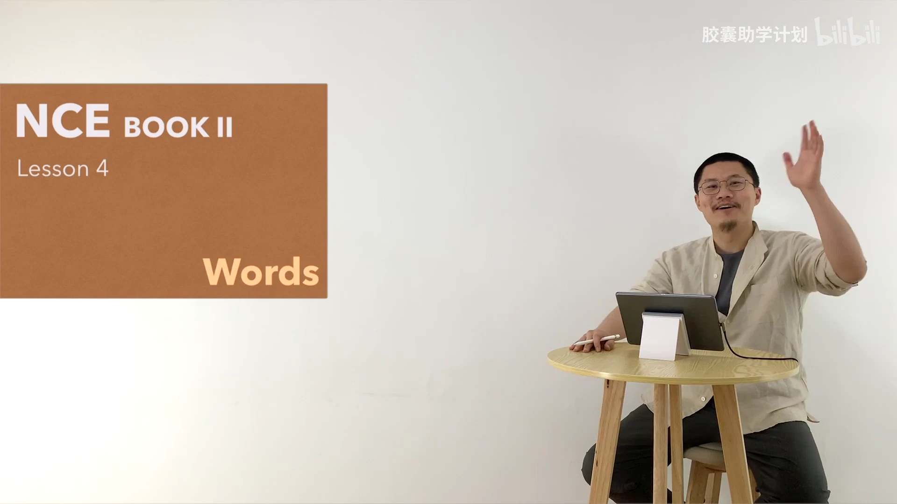

文字识别：胶囊助学计划 / NCE / BOOKI"I / Lesson 4 / Words

### 画面 00:00:04

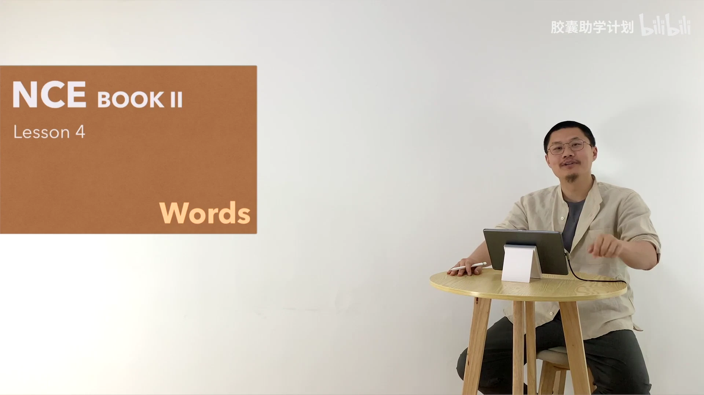

文字识别：bilbil / 胶囊助学计划 / NCE / BOOKII / Lesson 4 / Words

### 画面 00:00:06

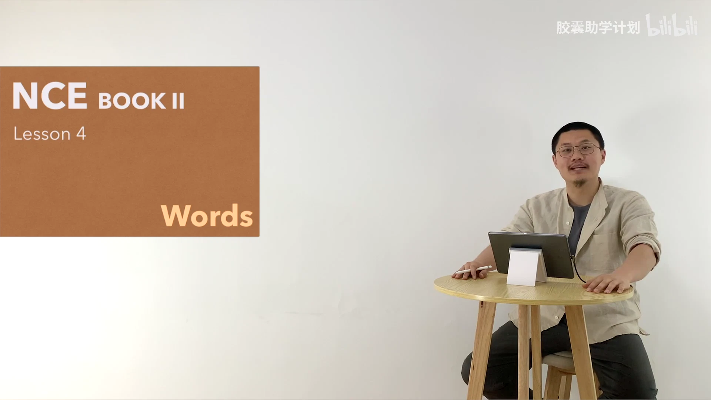

文字识别：Blbili / 胶囊助学计划 / NCE / BOOKI"I / Lesson 4 / Words

### 画面 00:00:09

文字识别：胶囊助学计划b出出 / 其物

### 画面 00:00:11

文字识别：bilbili / 胶囊助学计划 / ① 如何表达“收到来自某人的某物”？

### 画面 00:00:16

文字识别：BiiBili / 胶囊助学计划 / ①如何表达“收到来自某人的某物” / ”? / 如何表达“我们不一样”？

### 画面 00:00:18

文字识别：Biibili / 胶囊助学计划 / ①如何表达“收到来自某人的某物”? / 如何表达“我们不一样”？

### 画面 00:00:20

文字识别：bibil / 胶囊助学计划 / ①如何表达“收到来自某人的某物”? / 如何表达“我们不一样”？ / 如何表达“旅途愉快”?

### 画面 00:00:23

文字识别：Bilibili / 胶囊助学计划 / ①如何表达“收到来自某人的某物”? / 如何表达“我们不一样”? / 如何表达“旅途愉快”?

### 画面 00:00:25

文字识别：bilbli / 胶囊助学计划 / ①如何表达“收到来自某人的某物”? / 如何表达“我们不一样”？ / 如何表达“旅途愉快”?

### 画面 00:00:27

文字识别：胶囊助学计划b出出

## 00:00:30–00:01:00

好，那上来我们先看第一个单词啊，先跟我们一起拼读一下，来叫做 exciting。注意重音在第二个音节上，这是一个重音符号，连起来读 exciting，exciting。注意它的词性是形容词，哎，我们单词造句指南永远先看词性是吧？尤其是形容词、名词和动词这三个词性的时候，当然其实副词也算在内了啊。那我们要加一个名词，直接标题就有一个非常好的

### 画面 00:00:30

### 画面 00:00:32

文字识别：单词造句指南 / 网：v.+v.变化 / 胶囊助学计划 / bilbil / 四句型转换 / 方式/地点/时间 / 结合习惯用法 / 其他单词+词性 / 原文摘抄+变 / /ik'saitin/ / exciting adj. + n.

### 画面 00:00:35

文字识别：单词造句指南 / 网：v.+v.变化 / 胶囊助学计划 / Bilbili / 四句型转换 / 方式/地点/时间 / 结合习惯用法 / 其他单词+词性 / 原文摘抄+变 / /ik'sartin/ / exciting adj. + n.

### 画面 00:00:37

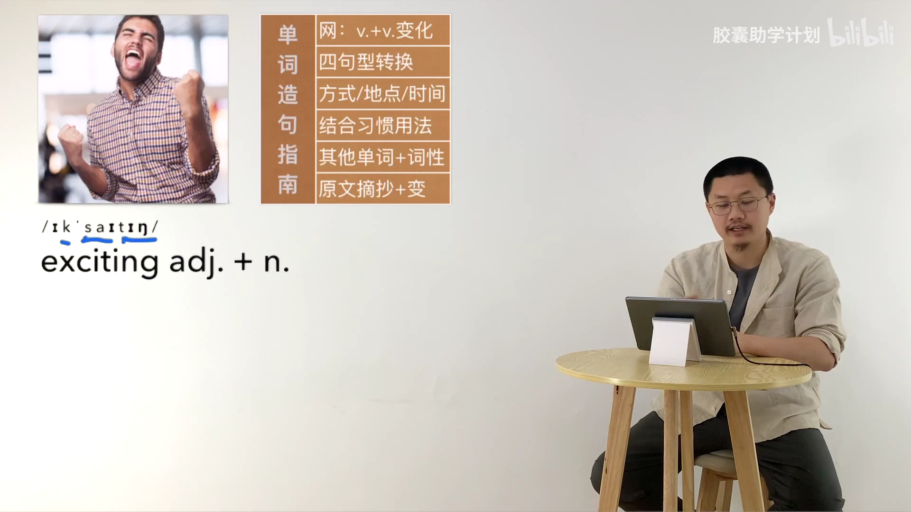

文字识别：单词造句指南 / 网：v.+v.变化 / 胶囊助学计划 / Bilbili / 四句型转换 / 方式/地点/时间 / 结合习惯用法 / 其他单词+词性 / 原文摘抄+变 / /ik'saitin/ / exciting adj. + n.

### 画面 00:00:40

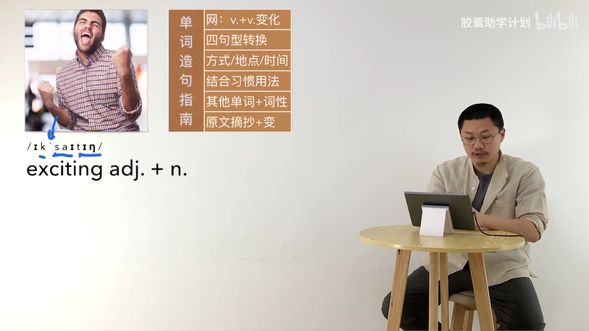

文字识别：单词造句指南 / 网：v.+v.变化 / 胶囊助学计划 / bibil / 四句型转换 / 方式/地点/时间 / 结合习惯用法 / 其他单词+词性 / 原文摘抄+变 / /ik'saitin/ / exciting adj. + n.

### 画面 00:00:46

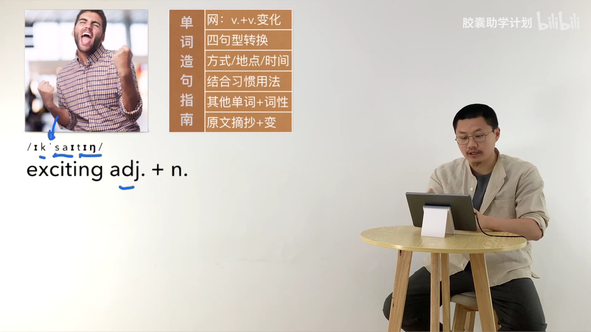

文字识别：单词造句指南 / 网：v.+v.变化 / 胶囊助学计划 / bibil / 四句型转换 / 方式/地点/时间 / 结合习惯用法 / 其他单词+词性 / 原文摘抄+变 / /iksaitin/ / exciting adj. + n.

### 画面 00:00:50

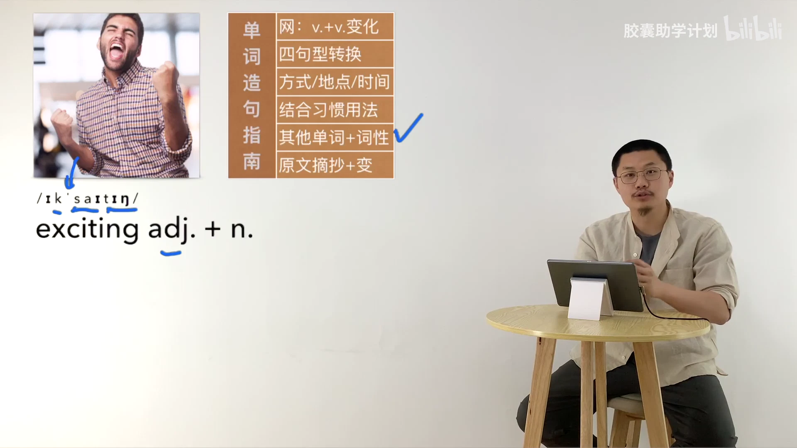

文字识别：单词造句指南 / 网：v.+v.变化 / 胶囊助学计划 / Bilbili / 四句型转换 / 方式/地点/时间 / 结合习惯用法 / 其他单词+词性 / 原文摘抄+变 / /ik'saitin/ / exciting adj. + n.

### 画面 00:00:55

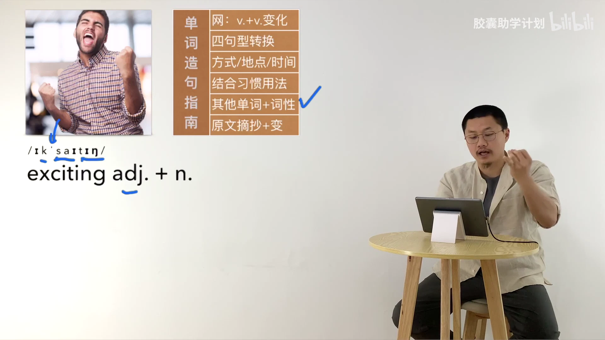

文字识别：单词造句指南 / 网：v.+v.变化 / 胶囊助学计划 / biltbili / 四句型转换 / 方式/地点/时间 / 结合习惯用法 / 其他单词+词性 / 原文摘抄+变 / /ik'saitin/ / exciting adj. + n.

### 画面 00:00:58

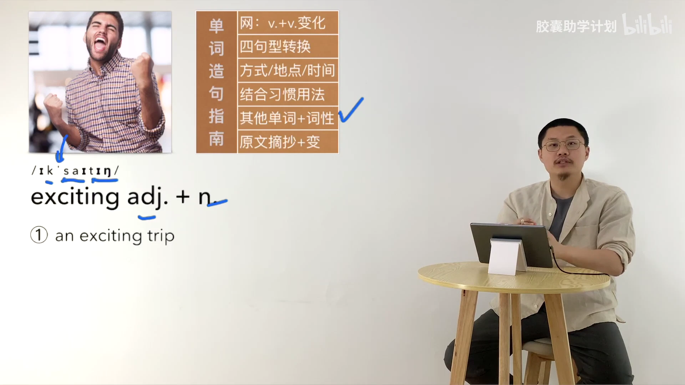

文字识别：单词造句指南 / 网：v.+v.变化 / 胶囊助学计划 / Bilbili / 四句型转换 / 方式/地点/时间 / 结合习惯用法 / 其他单词+词性 / 原文摘抄+变 / /iksartin/ / exciting adj. + n / an exciting trip

## 00:01:00–00:01:30

短语叫 an exciting trip. 好，这地方有一个小的问题，复习一下小的知识点。为什么用 an 呢？首音音标不看字母啊，注意是 e，所以它是一个元音音标，于是我们用的是 an exciting trip. 这个小的短语出来了之后，那接下来你想一下，我有名词了，我是不是要找动词啊？好，这个地方就出来了一个小的短语，叫做 have an exciting trip.

### 画面 00:01:00

文字识别：单词造句指南 / 网：v.+v.变化 / 胶囊助学计划 / Bilbli / 四句型转换 / 方式/地点/时间 / 结合习惯用法 / 其他单词+词性 / 原文摘抄+变 / /ik'saitin/ / exciting adj. + n- / an exciting trip

### 画面 00:01:05

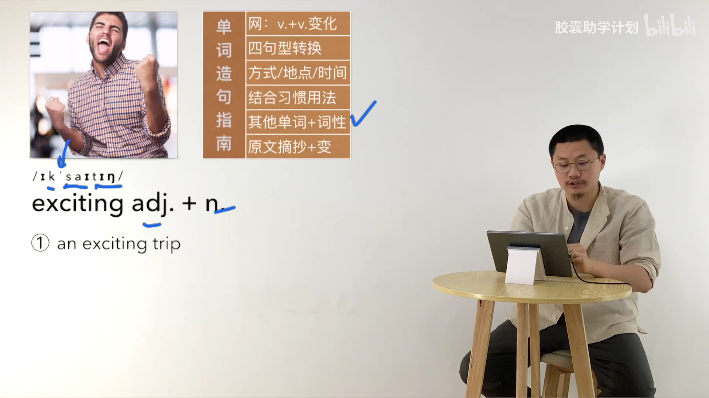

文字识别：单词造句指南 / 网：v.+v.变化 / 胶囊助学计划 / bilbil / 四句型转换 / 方式/地点/时间 / 结合习惯用法 / 其他单词+词性 / 原文摘抄+变 / /ik'saitin/ / exciting adj. + n / an exciting trip

### 画面 00:01:08

文字识别：单词造句指南 / 网：v.+v.变化 / 胶囊助学计划 / Biltbili / 四句型转换 / 方式/地点/时间 / 结合习惯用法 / 其他单词+词性 / 原文摘抄+变 / saitin/ / xexciting adj. + n / an exciting trip

### 画面 00:01:10

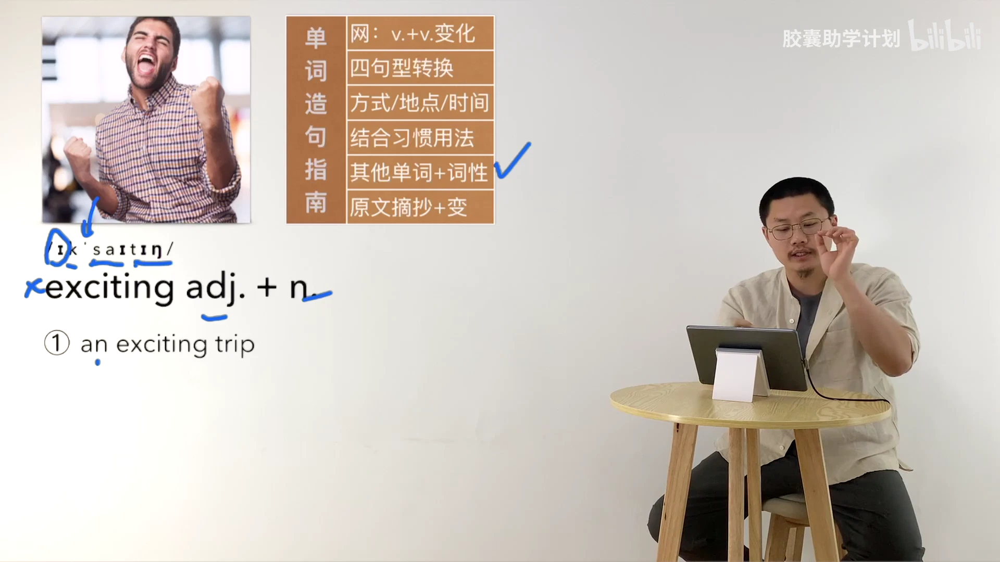

文字识别：单词造句指南 / 网：v.+v.变化 / 胶囊助学计划 / bibil / 四句型转换 / 方式/地点/时间 / 结合习惯用法 / 其他单词+词性 / 原文摘抄+变 / saitin/ / xexciting adj. + n / an exciting trip

### 画面 00:01:15

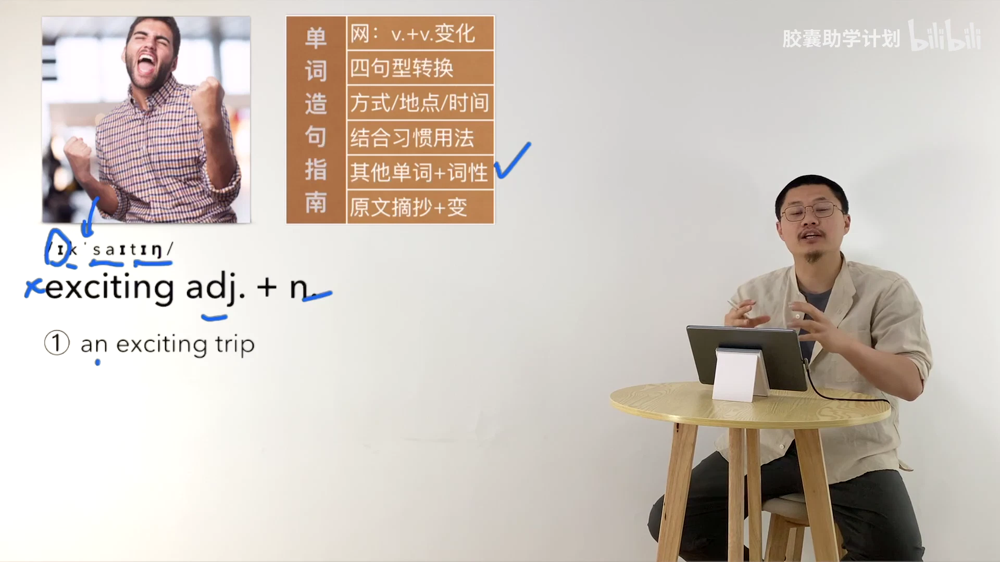

文字识别：单词造句指南 / 网：v.+v.变化 / 胶囊助学计划 / bilbili / 四句型转换 / 方式/地点/时间 / 结合习惯用法 / 其他单词+词性 / 原文摘抄+变 / saitin/ / xexciting adj. + n / an exciting trip

### 画面 00:01:20

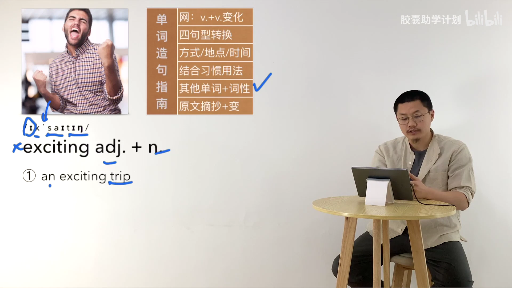

文字识别：单词造句指南 / 网：v.+v.变化 / 胶囊助学计划 / bilbili / 四句型转换 / 方式/地点/时间 / 结合习惯用法 / 其他单词+词性 / 原文摘抄+变 / saitin/ / xexciting adj. + n / an exciting trip

### 画面 00:01:23

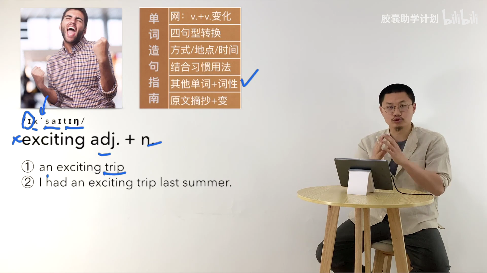

文字识别：单词造句指南 / 网：v.+v.变化 / 胶囊助学计划 / bilbili / 四句型转换 / 方式/地点/时间 / 结合习惯用法 / 其他单词+词性 / 原文摘抄+变 / saitin/ / xexciting adj. + n / an exciting trip / I had an exciting trip last summer.

### 画面 00:01:25

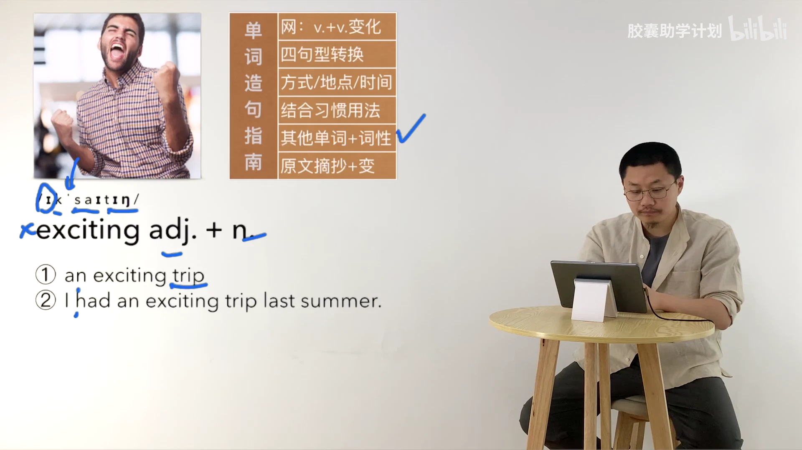

文字识别：单词造句指南 / 网：v.+v.变化 / 胶囊助学计划 / Bilbili / 四句型转换 / 方式/地点/时间 / 结合习惯用法 / 其他单词+词性 / 原文摘抄+变 / saitin/ / xexciting adj. + n- / an exciting trip / I had an exciting trip last summer. / 2

### 画面 00:01:27

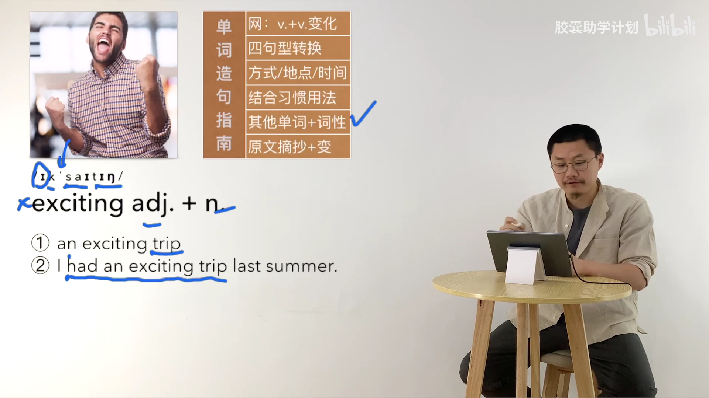

文字识别：单词造句指南 / 网：v.+v.变化 / 胶囊助学计划 / Bilbili / 四句型转换 / 方式/地点/时间 / 结合习惯用法 / 其他单词+词性 / 原文摘抄+变 / saitin/ / xexciting adj. + n / an exciting trip / I had an exciting trip last summer.

## 00:01:30–00:02:00

那说 I had an exciting trip last summer. 去年夏天呢，我度过了一个特别令人激动的假期啊。去旅游的时候特别的令人激动，度假的时候，所以这个 trip 我们可以理解为就是度假或者说旅游旅行。 Okay, 那我们现在肯定句出来了，接下来我们可以做两种不同的变化，一个是横向的变化，一个是纵向的变化，就是往动词加动词变化。我们的

### 画面 00:01:30

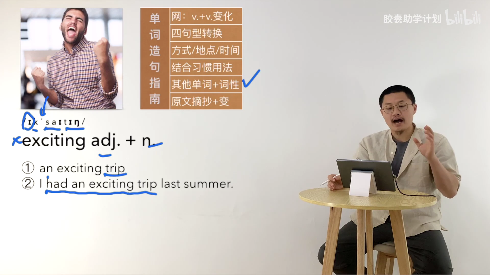

文字识别：单词造句指南 / 网：v.+v.变化 / 胶囊助学计划 / bilbili / 四句型转换 / 方式/地点/时间 / 结合习惯用法 / 其他单词+词性 / 原文摘抄+变 / saitin/ / xexciting adj. + n- / an exciting trip / I had an exciting trip last summer.

### 画面 00:01:34

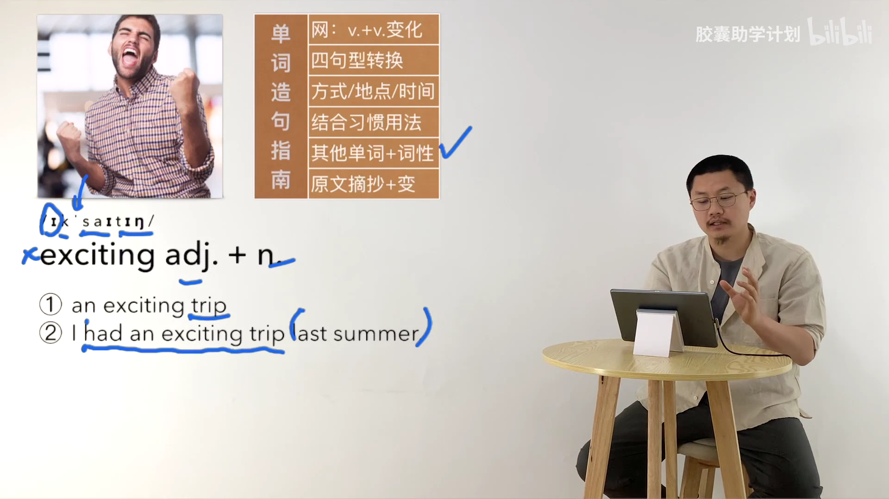

文字识别：单词造句指南 / 网：v.+v.变化 / 胶囊助学计划 / Bilbili / 四句型转换 / 方式/地点/时间 / 结合习惯用法 / 其他单词+词性 / 原文摘抄+变 / saitin/ / xexciting adj. + n / an exciting trip / I had an exciting trip last summer

### 画面 00:01:36

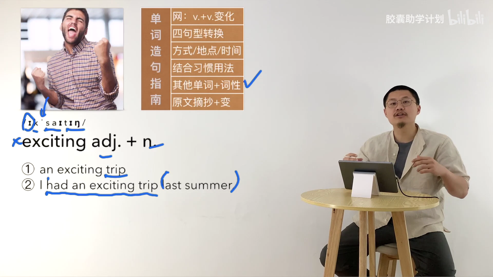

文字识别：单词造句指南 / 网：v.+v.变化 / 胶囊助学计划 / bitbil / 四句型转换 / 方式/地点/时间 / 结合习惯用法 / 其他单词+词性 / 原文摘抄+变 / saitin/ / xexciting adj. + n / an exciting trip / I had an exciting trip last summer

### 画面 00:01:40

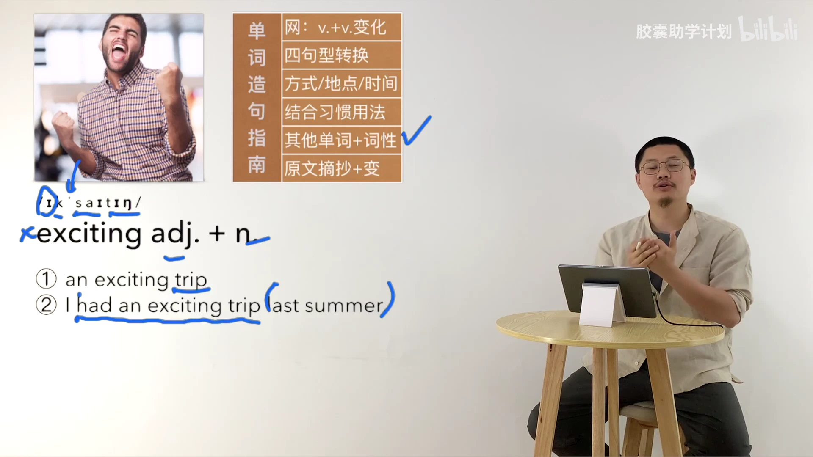

文字识别：单词造句指南 / 网：v.+v.变化 / 胶囊助学计划 / Bilbili / 四句型转换 / 方式/地点/时间 / 结合习惯用法 / 其他单词+词性 / 原文摘抄+变 / saitin/ / xexciting adj. + n / an exciting trip / I had an exciting trip last summer

### 画面 00:01:45

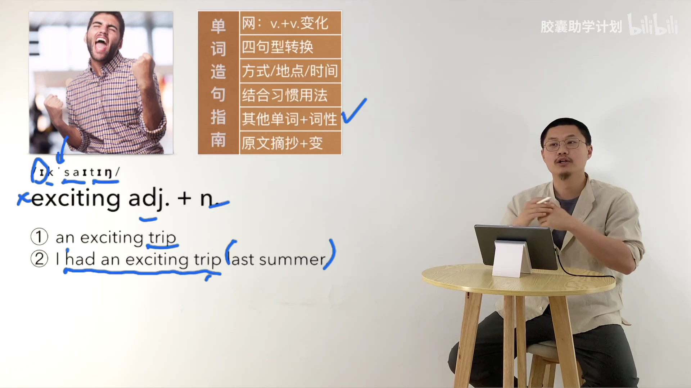

文字识别：单词造句指南 / 网：v.+v.变化 / 胶囊助学计划 / Bibi / 四句型转换 / 方式/地点/时间 / 结合习惯用法 / 其他单词+词性 / 原文摘抄+变 / saitin/ / xexciting adj. + n / an exciting trip / I had an exciting trip / last summer

### 画面 00:01:50

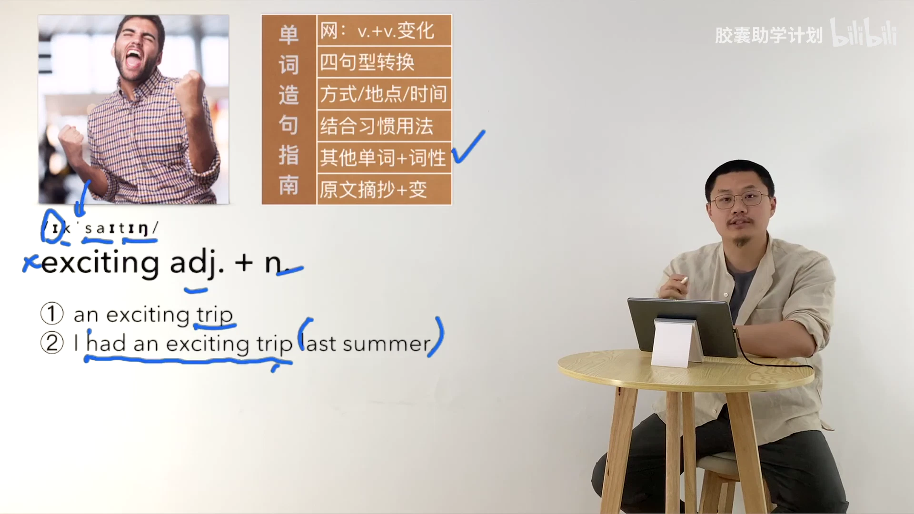

文字识别：单词造句指南 / 网：v.+v.变化 / 胶囊助学计划 / bilbil / 四句型转换 / 方式/地点/时间 / 结合习惯用法 / 其他单词+词性 / 原文摘抄+变 / saitin/ / xexciting adj. + n / an exciting trip / I had an exciting trip last summer

### 画面 00:01:55

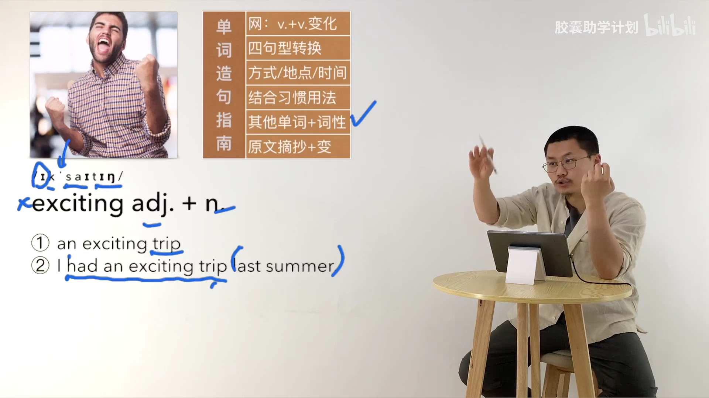

文字识别：单词造句指南 / 网：v.+v.变化 / 胶囊助学计划 / bilbili / 四句型转换 / 方式/地点/时间 / 结合习惯用法 / 其他单词+词性 / 原文摘抄+变 / saitin/ / xexciting adj. + n / an exciting trip / I had an exciting trip last summer

### 画面 00:01:57

文字识别：单词造句指南 / 网：v.+v.变化 / 胶囊助学计划 / Bilbili / 四句型转换 / 方式/地点/时间 / 结合习惯用法 / 其他单词+词性 / 原文摘抄+变 / saitin/ / xexciting / g adj. + n / an exciting trip / Ihada / an exciting trip / last summer

### 画面 00:01:59

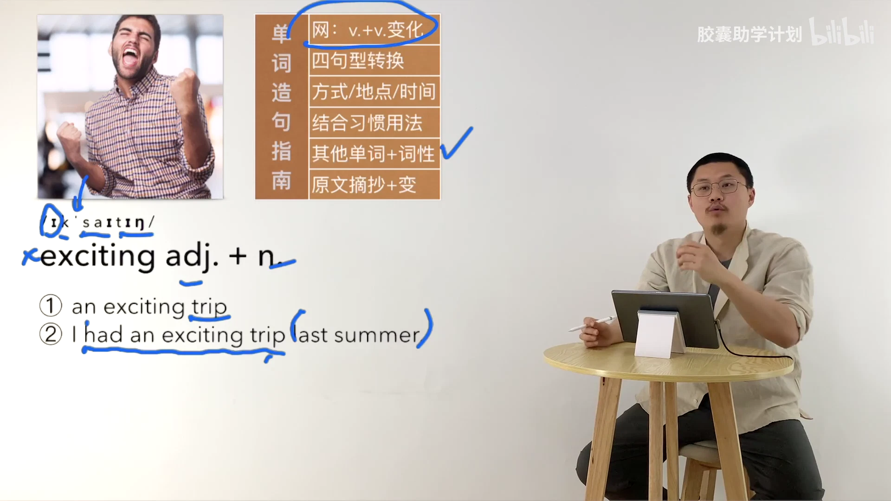

文字识别：单词造句指南 / 网：v.+v.变化 / 胶囊助学计划 / Bilbili / 四句型转换 / 方式/地点/时间 / 结合习惯用法 / 其他单词+词性 / 原文摘抄+变 / saitin/ / xexciting / g adj. + n / an exciting trip / I had an exciting trip / last summer

## 00:02:00–00:02:30

横向变化是什么呢？现在这个地方是个一般过去时，是肯定句。我们在保证它是肯定句不变的前提之下，我们可以换时态，换情态助动词，对吧？这所谓的叫动词变化。我们也可以把它怎么样呢？纵向的变化，往下去深挖。这个肯定句不变，给它变成一般疑问句、特殊疑问句和否定句。比如说，我们现在口头上变一下，我想问说，Did you have an exciting trip last summer？

### 画面 00:02:01

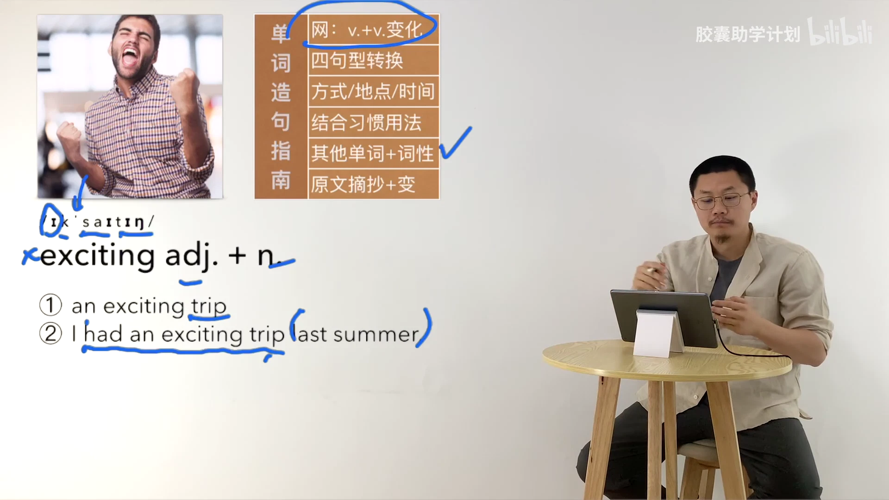

文字识别：单词造句指南 / 网：v.+v.变化 / 胶囊助学计划 / Bilbili / 四句型转换 / 方式/地点/时间 / 结合习惯用法 / 其他单词+词性 / 原文摘抄+变 / saitin/ / xexciting / adj. + n / an exciting trip / Ihada / an exciting trip / ast summer

### 画面 00:02:10

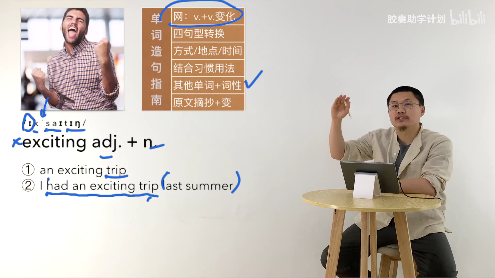

文字识别：单词造句指南 / 网：v.+v.变化 / 胶囊助学计划 / 四句型转换 / 方式/地点/时间 / 结合习惯用法 / 其他单词+词性 / 原文摘抄+变 / saitin/ / xexciting adj. + n / an exciting trip / I had an exciting trip / last summer

### 画面 00:02:15

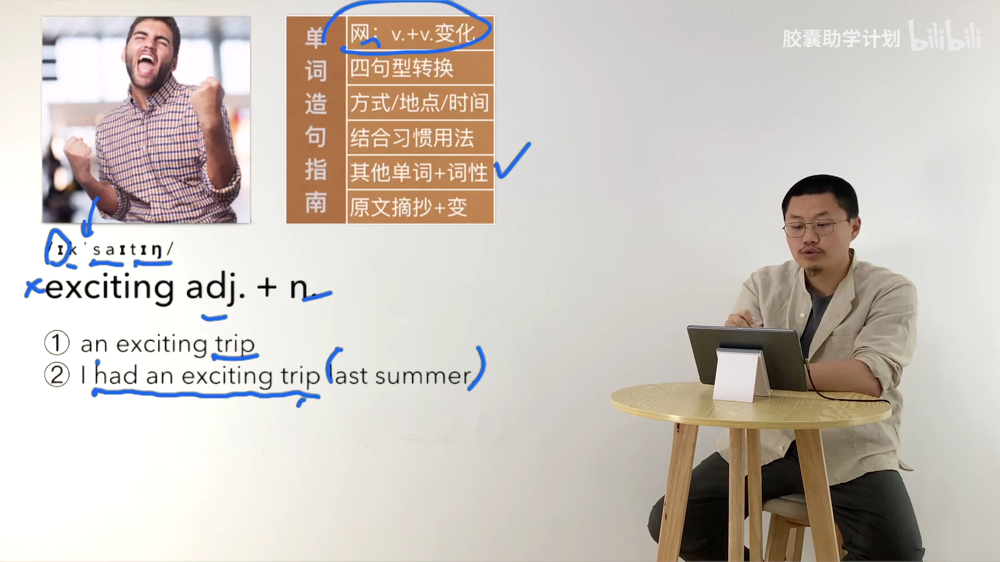

文字识别：单词造句指南 / 网 / v.+v.变化 / 胶囊助学计划 / bilbili / 四句型转换 / 方式/地点/时间 / 结合习惯用法 / 其他单词+词性 / 原文摘抄+变 / saitin/ / xexciting / adj. + n / an exciting trip / Ihad / an exciting trip / Iast summer

### 画面 00:02:17

文字识别：单词造句指南 / 网：v.+v.变化 / Bilbili / 胶囊助学计划 / 四句型转换 / 方式/地点/时间 / 结合习惯用法 / 其他单词+词性 / 原文摘抄+变 / saitin/ / xexciting / adj. + n / an exciting trip / Ihad / an exciting trip / Cast summer

### 画面 00:02:20

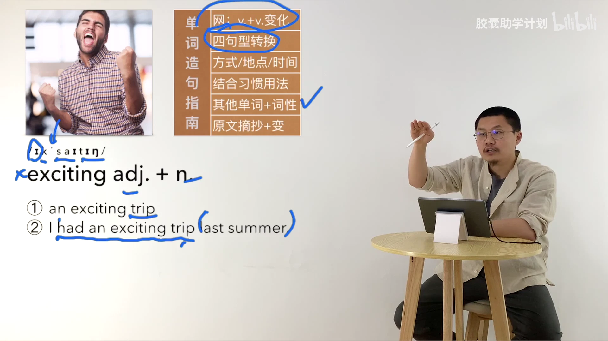

文字识别：单词造句指南 / 网：v.+v.变化 / bibili / 胶囊助学计划 / 四句型转换 / 方式/地点/时间 / 结合习惯用法 / 其他单词+词性 / 原文摘抄+变 / saitin/ / xexciting / adj. + n / an exciting trip / Ihada / an exciting / trip / ast summer

### 画面 00:02:25

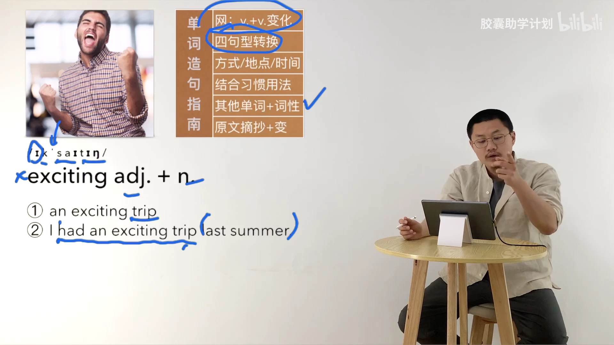

文字识别：单词造句指南 / 网：v.+v.变化 / bilbili / 胶囊助学计划 / 四句型转换 / 方式/地点/时间 / 结合习惯用法 / 其他单词+词性 / 原文摘抄+变 / saitin/ / xexciting / adj. + n / an exciting / trip / Ihad / an exciting trip / last summer

## 00:02:30–00:03:00

能听懂这句话吧？Did you have an exciting trip last summer?好，我现在对 last summer 提问。那 When did you have an exciting trip? 或者是 Where did you have an exciting trip last summer? Very good.好，接下来呢？那我们既然给大家了一个短语叫 have an exciting trip，那我们在这个地方举一反三一下。我们把这课的新学到的单词 exciting 换成 great，就变成旅途愉快了，叫 have

### 画面 00:02:30

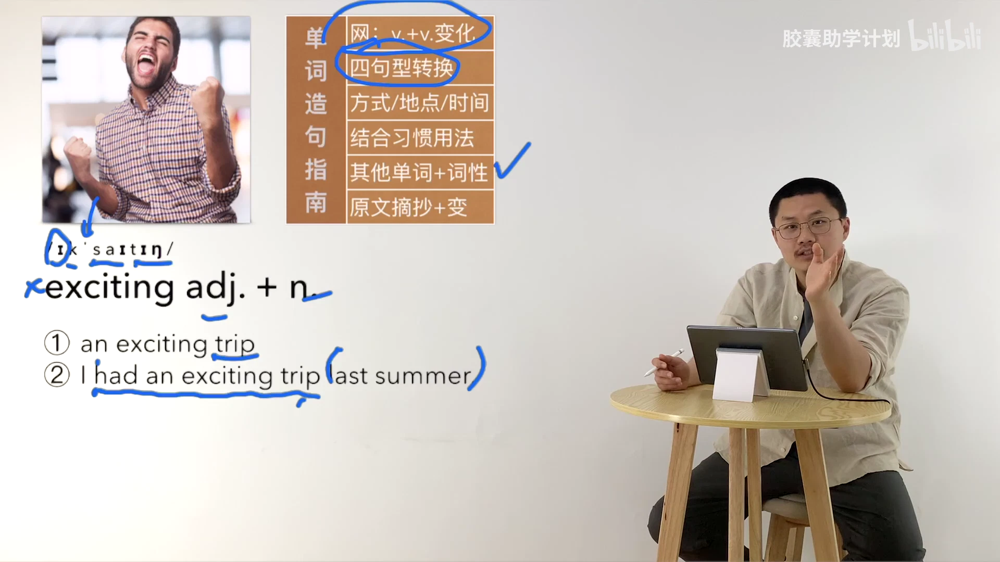

文字识别：单词造句指南 / 网：v.+v.变化 / bilbili / 胶囊助学计划 / 四句型转换 / 方式/地点/时间 / 结合习惯用法 / 其他单词+词性 / 原文摘抄+变 / saitin/ / xexciting / adj. + ni / an exciting / trip / Ihada / an exciting trip / ast summer

### 画面 00:02:35

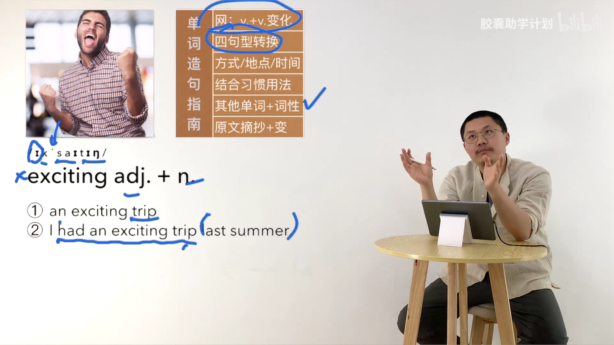

文字识别：单词造句指南 / 网：v+v.变化 / 胶囊助学计划 / 四句型转换 / 方式/地点/时间 / 结合习惯用法 / 其他单词+词性 / 原文摘抄+变 / saitin/ / xexciting / adj. + n / an exciting trip / Ihad / an exciting trip / ast summer

### 画面 00:02:40

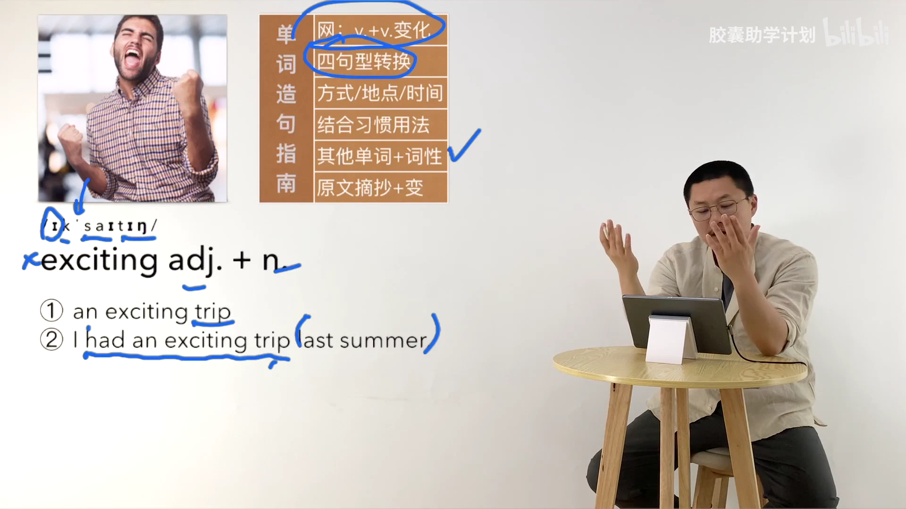

文字识别：单词造句指南 / 网：v.+v.变化 / 胶囊助学计划 / 四句型转换 / 方式/地点/时间 / 结合习惯用法 / 其他单词+词性 / 原文摘抄+变 / saitin/ / xexciting / adj. + n / an exciting / trip / Ihad / an exciting t / trip / ast summer

### 画面 00:02:46

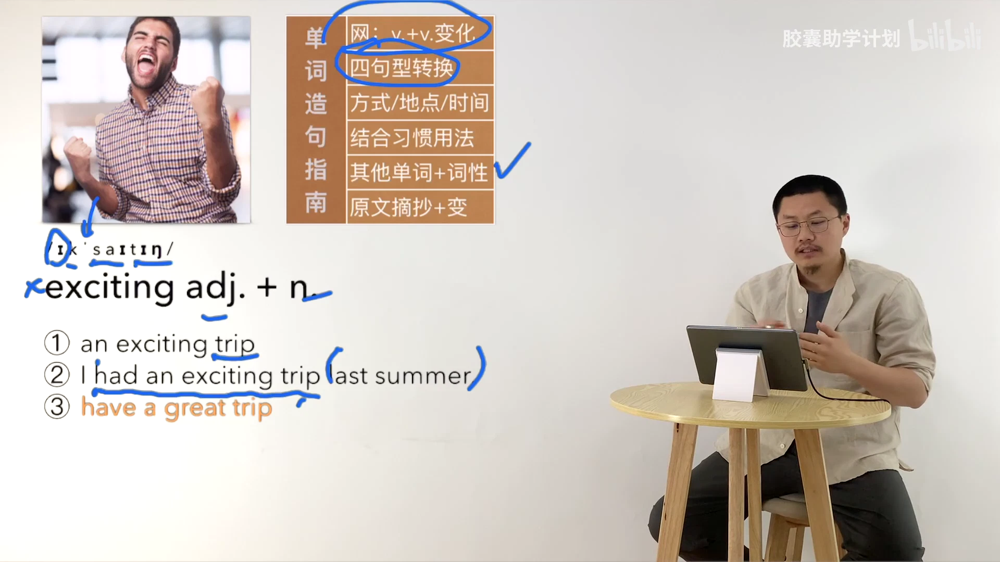

文字识别：单词造句指南 / 网：v+v.变化 / 胶囊助学计划 / 四句型转换 / 方式/地点/时间 / 结合习惯用法 / 其他单词+词性 / 原文摘抄+变 / saitin/ / xexciting / adj. + n / an exciting / trip / Ihad / an exciting / trip / last summer / have / great trip

### 画面 00:02:51

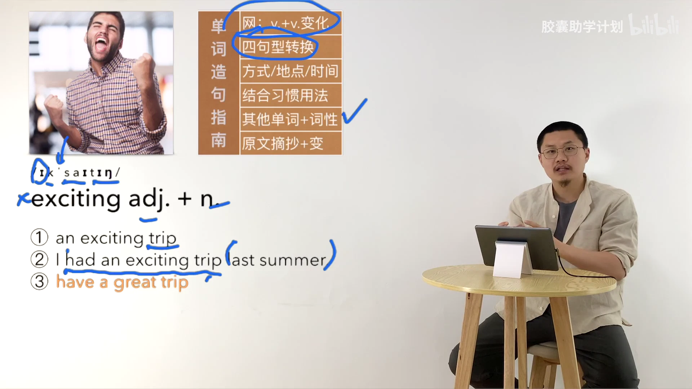

文字识别：单词造句指南 / 网：v+v.变化 / 胶囊助学计划 / 四句型转换 / 方式/地点/时间 / 结合习惯用法 / 其他单词+词性 / 原摘抄+变 / saitin/ / xexciting / adj. + n / an exciting / trip / T / Ihad / an exciting / trip / ast summer / have  / a / great trip

### 画面 00:02:55

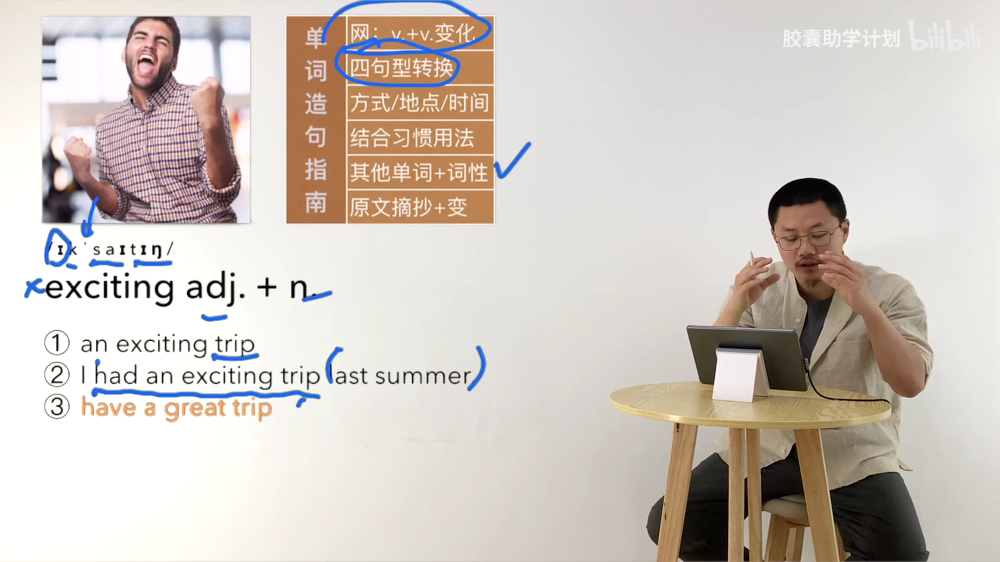

文字识别：单词造句指南 / 网：v+v.变化 / 胶囊助学计划 / 四句型转换 / 方式/地点/时间 / 结合习惯用法 / 其他单词+词性 / 原文摘抄+变 / saitin/ / xexciting / adj. + n / an exciting / trip / I had / an exciting / trip / last summer / have / great trip / a

## 00:03:00–00:03:30

Have a great trip. Okay, 这是一个小的短语，各位可以直接去用，不用非要放在句子当中去做啊。那我们接下来呢，一起看一个小的电影片段，各位注意去听他是如何说 Have a great trip 的。 Yeah, what's up, honey? Have a great trip. Thanks, sweetie. I'll call you when I get there. I love you so much. I love you too.

### 画面 00:03:00

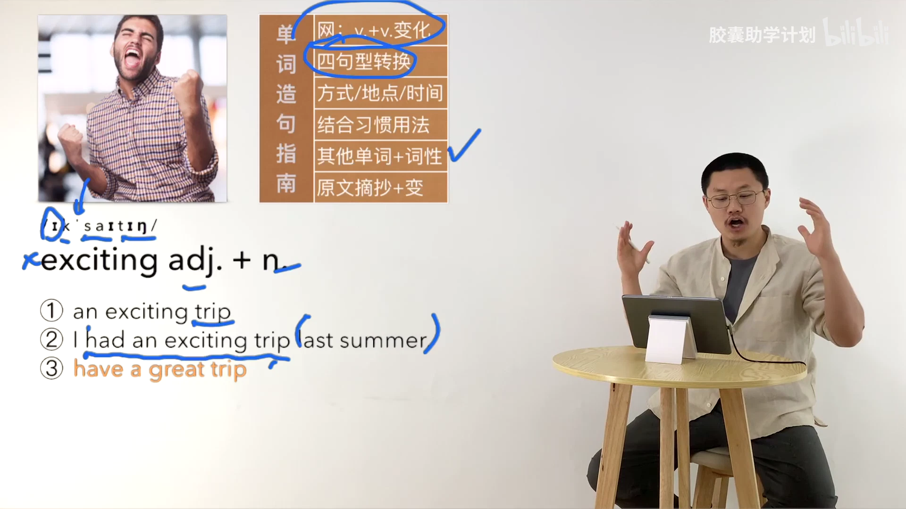

文字识别：单词造句指南 / 网：v+v.变化 / 胶囊助学计划 / 四句型转换 / 方式/地点/时间 / 结合习惯用法 / 其他单词+词性 / 原文摘抄+变 / saitin/ / xexciting / adj. + n / an exciting / trip / Ihad / an exciting / trip / ast summer / have  / great trip

### 画面 00:03:05

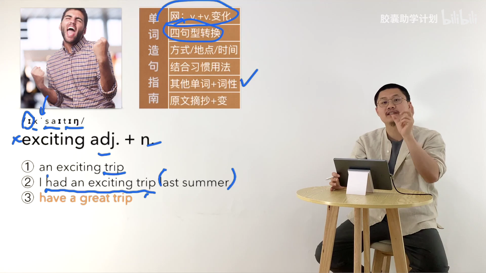

文字识别：单词造句指南 / 网：v+v.变化 / 胶囊助学计划 / 四句型转换 / 方式/地点/时间 / 结合习惯用法 / 其他单词+词性 / 原文摘抄+变 / saitin/ / xexciting / adj. + n / an exciting / trip / I had / an exciting / last summer / trip / have a / a great trip

### 画面 00:03:07

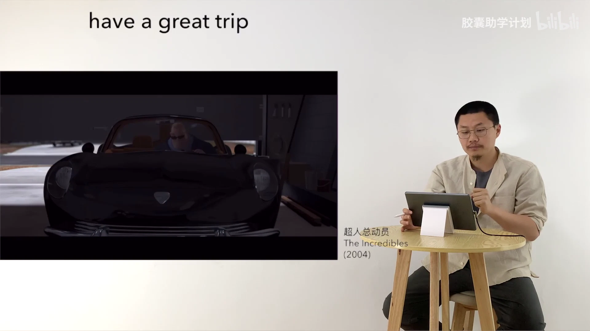

文字识别：have a great trip / 胶囊助学计划 / 超人总动员 / The Incredibles / (2004)

### 画面 00:03:15

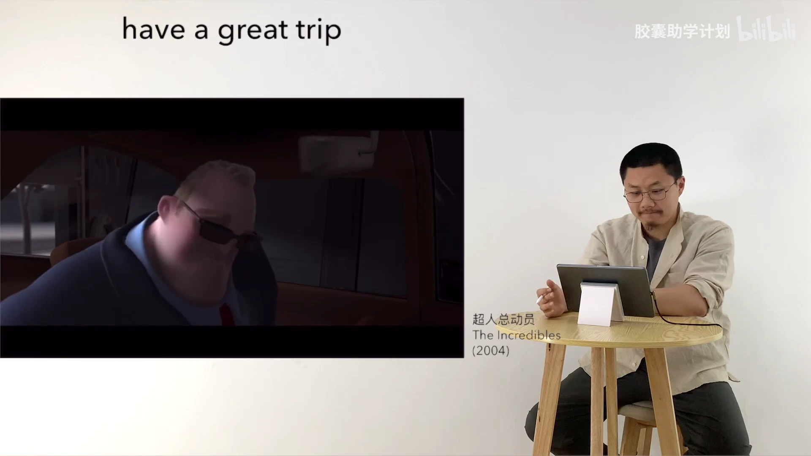

文字识别：have a great trip / 胶囊助学计划 / 超人总动员 / The Incredibles / (2004)

### 画面 00:03:17

文字识别：have a great trip / 胶囊助学计划 / 超人总动员 / -鲍勃？-唔什么事亲爱的？ / The Incredibles / -Bob?-Yeah, what's up, honey? / (2004)

### 画面 00:03:19

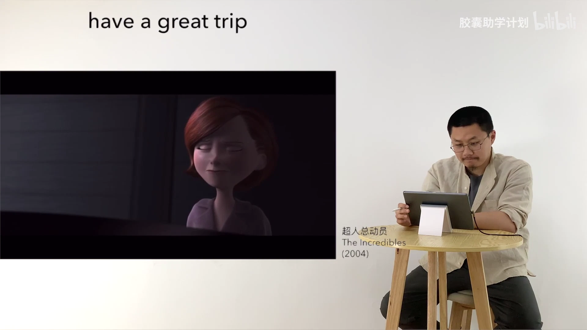

文字识别：have a great trip / 胶囊助学计划 / 超人总动员 / The Incredibles / (2004)

### 画面 00:03:21

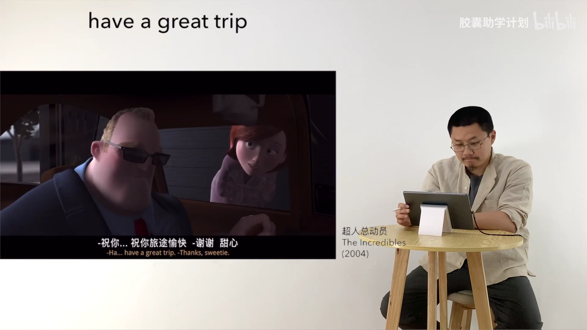

文字识别：have a great trip / 胶囊助学计划 / 超人总动员 / -祝你...祝你旅途愉快-谢谢甜心 / The Incredibles / -Ha... have a great trip. -Thanks, sweetie. / (2004)

### 画面 00:03:23

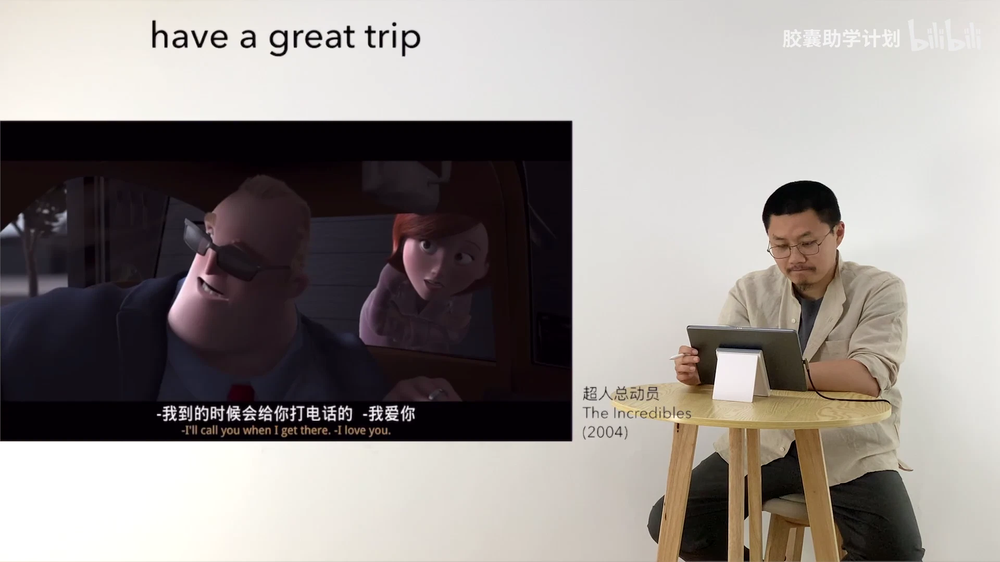

文字识别：have a great trip / 胶囊助学计划 / 超人总动员 / -我到的时候会给你打电话的-我爱你 / The Incredibles / -'ll callyou when I get there. -I love you. / (2004)

### 画面 00:03:27

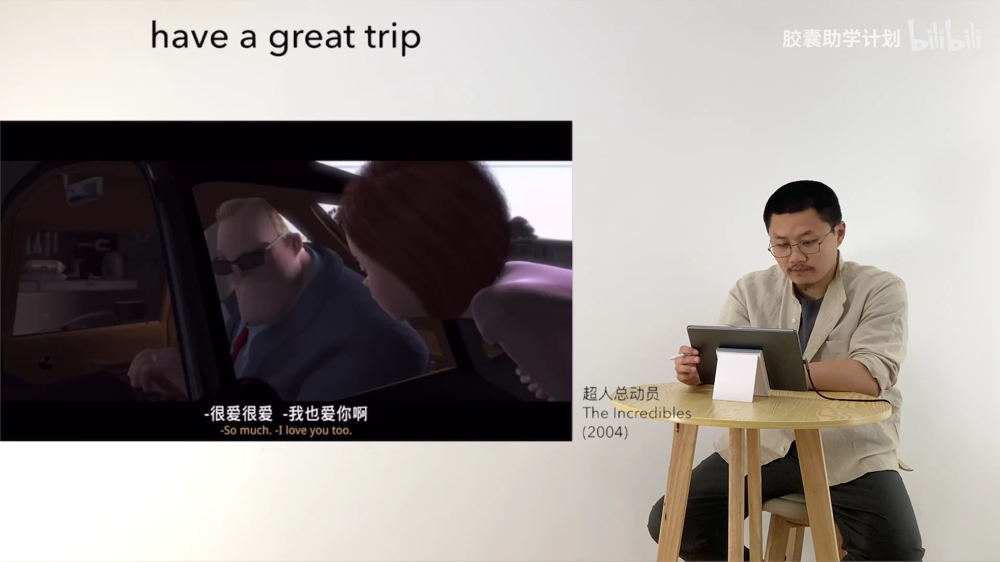

文字识别：have a great trip / 胶囊助学计划 / 超人总动员 / -很爱很爱-我也爱你啊 / The Incredibles / -So much.-I love you too. / (2004)

## 00:03:30–00:04:00

Okay, have a great trip.旅途愉快啊，好。那接下来我们看下一个单词，先一起读一下 receive。注意重音符号在这里，它是后面叫做 receive receive，叫做收到。好，这个小的动词实际上在文章当中，我们能直接摘出来一个小的习惯用法，叫 receive something from somebody. something某

### 画面 00:03:30

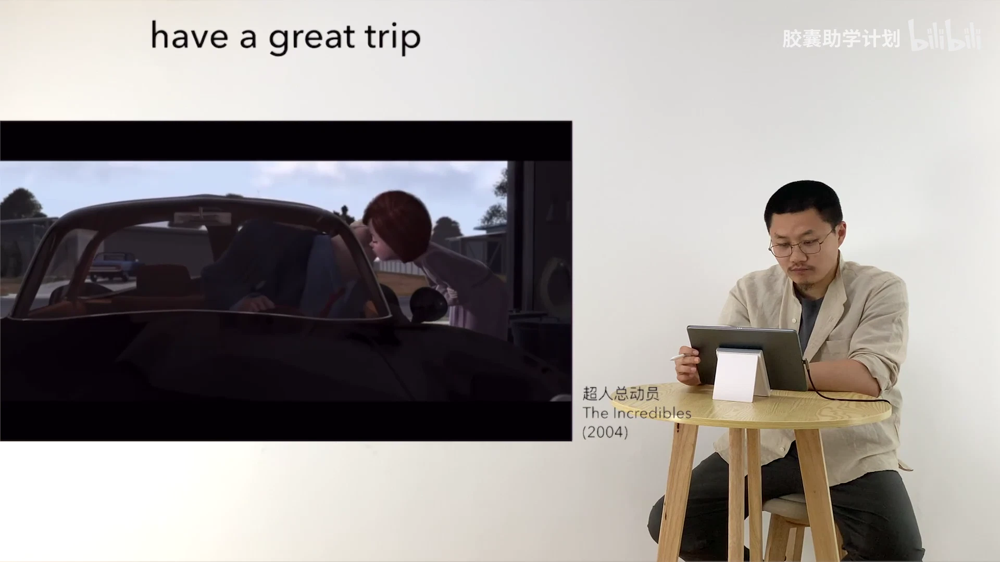

文字识别：have a great trip / 胶囊助学计划 / 超人总动员 / The Incredibles / (2004)

### 画面 00:03:32

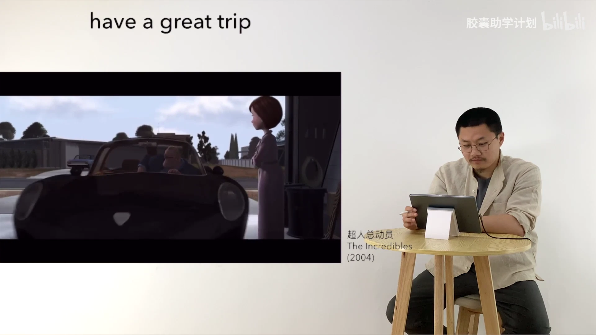

文字识别：have a great trip / 胶囊助学计划 / 超人总动员 / The Incredibles / (2004)

### 画面 00:03:34

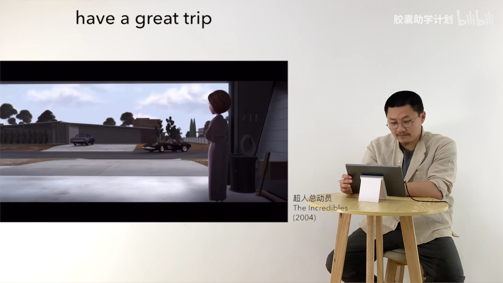

文字识别：have a great trip / 胶囊助学计划 / 超人总动员 / The Incredibles / (2004)

### 画面 00:03:38

文字识别：单词造句指南 / 网：v.+v.变化 / 胶囊助学计划 / 四句型转换 / 方式/地点/时间 / 结合习惯用法 / 其他单词+词性 / 原文摘抄+变 / /rI'si:v/ / receive v.

### 画面 00:03:40

文字识别：单词造句指南 / 网：v.+v.变化 / 胶囊助学计划 / 四句型转换 / 方式/地点/时间 / 结合习惯用法 / 其他单词+词性 / 原文摘抄+变 / /rI'si:v/ / receive v.

### 画面 00:03:42

文字识别：单词造句指南 / 网：v.+v.变化 / 胶囊助学计划 / 四句型转换 / 方式/地点/时间 / 结合习惯用法 / 其他单词+词性 / 原文摘抄+变 / /rIsi:v/ / receive v.

### 画面 00:03:44

文字识别：单词造句指南 / 网：v.+v.变化 / 胶囊助学计划 / 四句型转换 / 方式/地点/时间 / 结合习惯用法 / 其他单词+词性 / 原文摘抄+变 / /r1si :v / receive v.

### 画面 00:03:46

文字识别：单词造句指南 / 网：v.+v.变化 / 胶囊助学计划 / 四句型转换 / 方式/地点/时间 / 结合习惯用法 / 其他单词+词性 / 原文摘抄+变 / /r1si :v/ / receive v.

### 画面 00:03:49

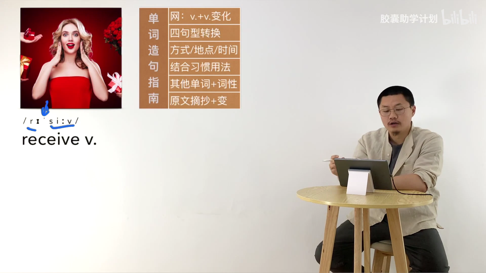

文字识别：单词造句指南 / 网：v.+v.变化 / 胶囊助学计划 / 四句型转换 / 方式/地点/时间 / 结合习惯用法 / 其他单词+词性 / 原文摘抄+变 / /r1si :v / receive v.

### 画面 00:03:51

文字识别：单词造句指南 / 网：v.+v.变化 / 胶囊助学计划 / 四句型转换 / 方式/地点/时间 / 结合习惯用法 / 其他单词+词性 / 原文摘抄+变 / /r1si :v / receive v. / receive sth. from sb.

### 画面 00:03:54

文字识别：单词造句指南 / 网：v.+v.变化 / 胶囊助学计划 / 四句型转换 / 方式/地点/时间 / 结合习惯用法 / 其他单词+词性 / 原文摘抄+变 / /r 1si:v / receive v. / receive sth. from sb.

### 画面 00:03:56

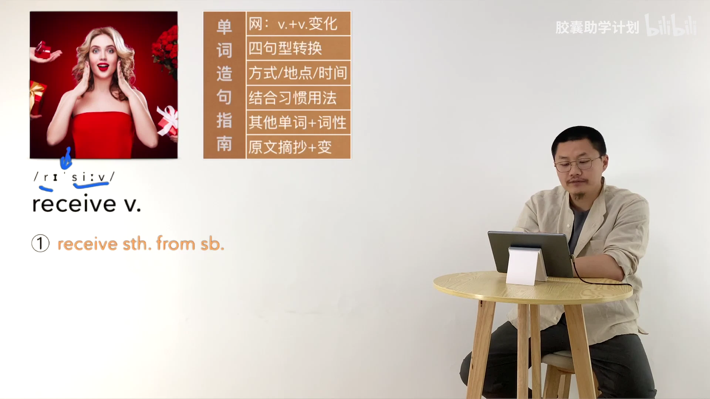

文字识别：单词造句指南 / 网：v.+v.变化 / 胶囊助学计划 / 四句型转换 / 方式/地点/时间 / 结合习惯用法 / 其他单词+词性 / 原文摘抄+变 / /r1si:v/ / receive v. / receive sth. from sb.

### 画面 00:03:59

文字识别：单词造句指南 / 网：v.+v.变化 / 胶囊助学计划 / 四句型转换 / 方式/地点/时间 / 结合习惯用法 / 其他单词+词性 / 原文摘抄+变 / /rrsi :v / receive v. / receive sth. from sb.

## 00:04:00–00:04:30

物, somebody,来自于某人的。那接下来呢？比如说，我们可以看这样一句话，叫I receive a postcard from Zen every year. Postcard,明信片，对吧？说我每年呢都能收到来自于Zen的一张明信片。好，这地方注意一小下。我们现在是每年是一般现在时，对吧？我们刚刚学过的。那我现在想把它做一个动词变化，所谓横向的

### 画面 00:04:01

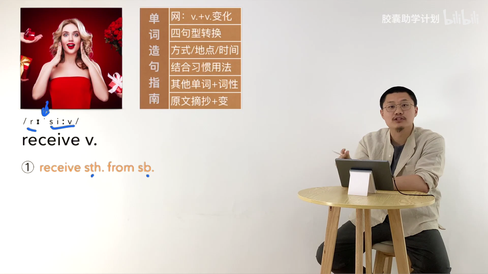

文字识别：单词造句指南 / 网：v.+v.变化 / 胶囊助学计划 / 四句型转换 / 方式/地点/时间 / 结合习惯用法 / 其他单词+词性 / 原文摘抄+变 / /r1si:v / receive v. / receive sth. from sb.

### 画面 00:04:03

文字识别：单词造句指南 / 网：v.+v.变化 / 胶囊助学计划 / 四句型转换 / 方式/地点/时间 / 结合习惯用法 / 其他单词+词性 / 原文摘抄+变 / /r1si:v/ / receive v. / receive sth.from sb. / o I receive a postcard from Zen every year.

### 画面 00:04:05

文字识别：单词造句指南 / 网：v.+v.变化 / 胶囊助学计划 / 四句型转换 / 方式/地点/时间 / 结合习惯用法 / 其他单词+词性 / 原文摘抄+变 / /r1si :v/ / receive v. / receive sth.from sb. / o I receive a postcard from Zen every year.

### 画面 00:04:10

文字识别：单词造句指南 / 网：v.+v.变化 / 胶囊助学计划 / 四句型转换 / 方式/地点/时间 / 结合习惯用法 / 其他单词+词性 / 原文摘抄+变 / /r1si:v/ / receive v. / receive sth.from sb. / o I receive a postcard from Zen every year.

### 画面 00:04:14

文字识别：单词造句指南 / 网：v.+v.变化 / 胶囊助学计划 / 四句型转换 / 方式/地点/时间 / 结合习惯用法 / 其他单词+词性 / 原文摘抄+变 / /r1si:v/ / receive v. / receive sth.from sb. / o I receive a postcard from Zen every year.

### 画面 00:04:16

文字识别：单词造句指南 / 网：v.+v.变化 / 胶囊助学计划 / 四句型转换 / 方式/地点/时间 / 结合习惯用法 / 其他单词+词性 / 原文摘抄+变 / /rrsi:v / receive v. / receive sth.from sb. / o I receive a postcard from Zen every year.

### 画面 00:04:18

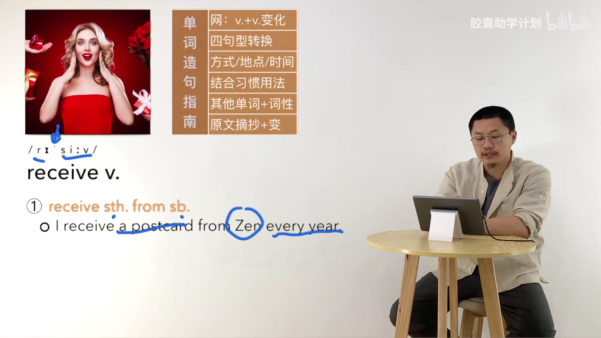

文字识别：单词造句指南 / 网：v.+v.变化 / 胶囊助学计划 / 四句型转换 / 方式/地点/时间 / 结合习惯用法 / 其他单词+词性 / 原文摘抄+变 / /r1si:v/ / receive v. / receive sth. from sb. / a posteaid fron Zen / o l receive / every year.

### 画面 00:04:20

文字识别：单词造句指南 / 网：v.+v.变化 / 胶囊助学计划 / 四句型转换 / 方式/地点/时间 / 结合习惯用法 / 其他单词+词性 / 原文摘抄+变 / /r1siiv/ / receive v. / receive sth. from sb. / o I receive a postcard fron Zen / every vear.

### 画面 00:04:23

文字识别：单词造句指南 / 网：v.+v.变化 / 胶囊助学计划 / 四句型转换 / 方式/地点/时间 / 结合习惯用法 / 其他单词+词性 / 原文摘抄+变 / /r1si:v/ / receive v. / receive sth. from sb. / o I receive a postcard fron Zen / every vear.

### 画面 00:04:25

文字识别：单词造句指南 / 网：v.+v.变化 / 胶囊助学计划 / 四句型转换 / 方式/地点/时间 / 结合习惯用法 / 其他单词+词性 / 原文摘抄+变 / /r1si :v/ / receive v. / receive sth. from sb. / o I receive a postcard fron Zen / every vear.

### 画面 00:04:27

文字识别：单词造句指南 / 网：V.+V.变化 / 胶囊助学计划 / 四句型转换 / 方式/地点/时间 / 结合习惯用法 / 其他单词+词性 / 原文摘抄+变 / /rsi :v/ / receive v. / receive sth. from sb. / o I receive a postcard fron Zen / every year.

### 画面 00:04:29

文字识别：单词造句指南 / 网： / v.+v.变化 / 胶囊助学计划 / 四句型转换 / 方式/地点/时间 / 结合习惯用法 / 其他单词+词性 / 原文摘抄+变 / /rsi :v/ / receive v. / receive sth. from sb. / o I receive a postcard fron Zen / every vear.

## 00:04:30–00:05:00

变化，肯定句句式不变，对吧？不往下深挖，它其他的三个句型，肯定句句式不变的前提之下，我们给它换一些时态，比如说 I received a postcard，注意变一般过去时了，叫 last year，叫去年。你看，这就是我们进行的一个横向的变化，肯定句不变，而这两句话自己本身又能进行一些纵向的变化，每一个肯定句都可以变成否定句、一般疑问句和特殊疑问句，这是我们

### 画面 00:04:31

文字识别：单词造句指南 / 网：v.+V.变化 / 胶囊助学计划 / 四句型转换 / 方式/地点/时间 / 结合习惯用法 / 其他单词+词性 / 原文摘抄+变 / /r1si:v/ / receive v. / receive sth. from sb. / o I receive a postcard fron Zen / every vear.

### 画面 00:04:35

文字识别：单词造句指南 / 网：v.+v.变化 / 胶囊助学计划 / 四句型转换 / 方式/地点/时间 / 结合习惯用法 / 其他单词+词性 / 原文摘抄+变 / /r1si :v / receive v. / receive sth. from sb. / o I receive a postcard fron Zen / every vear.

### 画面 00:04:38

文字识别：单词造句指南 / 网：v.+V.变化 / 胶囊助学计划 / 四句型转换 / 方式/地点/时间 / 结合习惯用法 / 其他单词+词性 / 原文摘抄+变 / /r1si:v/ / receive v. / receive sth.from sb. / o I receive a postcard fron Zen every vear. / o I received a postcard from Zen last year.

### 画面 00:04:40

文字识别：单词造句指南 / 网：v.+V.变化 / 胶囊助学计划 / 四句型转换 / 方式/地点/时间 / 结合习惯用法 / 其他单词+词性 / 原文摘抄+变 / /r1si:v/ / receive v. / receive sth. from sb. / o I receive a postcard fron Zen every vear. / o I received a postcard from Zen last year.

### 画面 00:04:44

文字识别：单词造句指南 / 网：v.+V.变化 / 胶囊助学计划 / 四句型转换 / 方式/地点/时间 / 结合习惯用法 / 其他单词+词性 / 原文摘抄+变 / /r1si:v/ / receive v. / receive sth. from sb. / o I receive a postcard fron Zen every vear. / o I received a postcard from Zen last year.

### 画面 00:04:46

文字识别：单词造句指南 / 网：V.+V.变化 / 胶囊助学计划 / 四句型转换 / 方式/地点/时间 / 结合习惯用法 / 其他单词+词性 / 原文摘抄+变 / /r1si:v/ / receive v. / receive sth. from sb. / o I receive a postcard fron Zen / every vear. / o I received a postcard from Zen last year.

### 画面 00:04:50

文字识别：单词造句指南 / 网：V.+V.变化 / 胶囊助学计划 / 四句型转换 / 方式/地点/时间 / 结合习惯用法 / 其他单词+词性 / 原文摘抄+变 / /r1si:v/ / receive v. / receive sth. from sb. / o I receive a postcard fron Zen every vear. / o I received a postcard from Zen last year.

### 画面 00:04:53

文字识别：单词造句指南 / 网：v.+V.变化 / 胶囊助学计划 / 四句型转换 / 方式/地点/时间 / 结合习惯用法 / 其他单词+词性 / 原文摘抄+变 / /r1si:v/ / receive v. / receive sth. from sb. / o I receive a postcard fron Zen / every vear. / o I received a postcard from Zen last year.

### 画面 00:04:55

文字识别：单词造句指南 / 网：V.+V.变化 / 胶囊助学计划 / 四句型转换 / 方式/地点/时间 / 结合习惯用法 / 其他单词+词性 / 原文摘抄+变 / /r1si:v/ / receive v. / receive sth. from sb. / o I receive a postcard fron Zen every vear / o I received a postcard from Zen last year.

### 画面 00:04:58

文字识别：单词造句指南 / 网：V.+V.变化 / 胶囊助学计划 / 四句型转换 / 方式/地点/时间 / 结合习惯用法 / 其他单词+词性 / 原文摘抄+变 / /r₁si:v / receive v. / receive sth. from sb. / o Ireceive a postcard fron Zen every year / o I received a postcard from Zen last year.

## 00:05:00–00:05:30

能进行大量造句的一个前提，也就是只要有这两个四句型转化，各位非常熟悉，以及动词加动词的变化，各位很熟悉，一个肯定句出来了，两个肯定句出来了，实际上您是可以把它直接乘四乘五，甚至乘七乘八的，对吧？啊，OK，那接下来呢，我们一起看一个电影片段，叫 Received a message from a starfleet officer。好，这个 starfleet 啊，实际上呢，各位它是星际迷航里

### 画面 00:05:00

文字识别：单词造句指南 / 网：V.+V.变化 / 胶囊助学计划 / 四句型转换 / 方式/地点/时间 / 结合习惯用法 / 其他单词+词性 / 原文摘抄+变 / /r1si:v/ / receive v. / receive sth. from sb. / o I receive a postcard fron Zen every vear / o I received a postcard from Zen last year.

### 画面 00:05:02

文字识别：单词造句指南 / 网：v.+v.变化 / 胶囊助学计划 / 四句型转换 / 方式/地点/时间 / 结合习惯用法 / 其他单词+词性 / 原文摘抄+变 / /rsi :v/ / receive v. / receive sth. from sb. / o I receive a postcard fron Zen every vear. / o I received a postcard from Zen last year.

### 画面 00:05:04

文字识别：单词造句指南 / 网：v.+v.变化 / 胶囊助学计划 / 四句型转换 / 方式/地点/时间 / 结合习惯用法 / 其他单词+词性 / 原文摘抄+变 / /r1si iv/ / receive v. / receive sth. from sb. / o I receive a postcard fron Zen every vear. / o I received a postcard from Zen last year.

### 画面 00:05:06

文字识别：单词造句指南 / 网：v.+V.变化 / 胶囊助学计划 / 四句型转换 / 方式/地点/时间 / 结合习惯用法 / 其他单词+词性 / 原文摘抄+变 / /r1si :v/ / receive v. / receive sth. from sb. / o I receive a postcard fron Zen / every vear. / o I received a postcard from Zen last year.

### 画面 00:05:10

文字识别：单词造句指南 / 网：V.+V.变化 / 胶囊助学计划 / 四句型转换 / 方式/地点/时间 / 结合习惯用法 / 其他单词+词性 / 原文摘抄+变 / /r1si:v/ / receive v. / receive sth. from sb. / o Ireceive a postcard fron Zenevery year / o I received a postcard from Zen last year.

### 画面 00:05:15

文字识别：单词造句指南 / 网：V.+V.变化 / 胶囊助学计划 / 四句型转换 / 方式/地点/时间 / 结合习惯用法 / 其他单词+词性 / 原文摘抄+变 / /r1si:v/ / receive v. / receive sth. from sb. / o I receive a postcard fron Zen every vear. / o I received a postcard from Zen last year.

### 画面 00:05:17

文字识别：received a message from a / 胶囊助学计划 / Starfleet officer / 星际迷航2：暗黑无界 / Star Trek Into Darkness / (2013)

### 画面 00:05:26

文字识别：received a message from a / 胶囊助学计划 / Starfleetbfficer / 星际迷航2：暗黑无界 / Star Trek Into Darkness / (2013)

### 画面 00:05:29

文字识别：received a message 1 / from a / 胶囊助学计划 / Starfleet bfficer / 星际迷航2：暗无界 / Star Trek Into Darkness / (2013)

## 00:05:30–00:06:00

面的一个比较专有的名词。各位看不懂不是特别的重要，一会儿各位可以看一下字幕啊。但关键是这个小的短语叫 receive a message，一个消息来自于什么呢？Officer，来自于一个长官。我们注意听一下。 The target was a Starfleet data archive, now it's a damn hole in the ground. Forty-two men and women are dead. One hour ago, I received a message from a Starfleet officer who confessed to carrying out this attack, that he was being forced to do it by this man, Commander John Harrison. He's

### 画面 00:05:31

文字识别：received a message 1 / e from a / 胶囊助学计划 / Starfleet bfficer / 星际迷航2：暗无界 / Star Trek Into Darkness / (2013)

### 画面 00:05:44

文字识别：received a message / from a / 胶囊助学计划 / Starfleet / bfficer / 被袭击的是星际舰队的一个档案馆 / 星际迷航2：暗黑无界 / Star Trek Into Darkness / The target was a Starfleet data archive. / (2013)

### 画面 00:05:46

文字识别：received a message / from a / 胶囊助学计划 / Starfleet / bfficer / 被袭击的是星际舰队的一个档案馆 / 星际迷航2：暗黑无界 / Star Irek Into Darkness / The target was a Starfleet data archive. / (2013)

### 画面 00:05:48

文字识别：received a message / from a / 胶囊助学计划 / Starfleet / bfficer / 死了42个人 / 星际迷航2：暗无界 / 42 men and women are dead. / Star Trek Into Darkness / (2013)

### 画面 00:05:50

文字识别：received a message / from a / 胶囊助学计划 / Starfleet / bfficer / 一个小时前 / 星际迷航2：暗无界 / One hour ago, / Star Trek Into Darkness / (2013)

### 画面 00:05:52

文字识别：received a message / from a / 胶囊助学计划 / Starfleet / bfficer / 我收到一位舰队官员的信息 / 星际迷航2：暗黑无界 / Star Irek Into Darkness / I received a message from a Starfleet officer, / (2013)

### 画面 00:05:54

文字识别：received a message / from a / 胶囊助学计划 / Starfleet / bfficer / 他承认这次袭击是他干的 / 星际迷航2：暗无界 / Star Trek Into Darkness / who confessed to carrying out this attack. / (2013)

### 画面 00:05:56

文字识别：received a message / from a / 胶囊助学计划 / Starfleet / bfficer / • / 有人逼他干的 / 星际迷航2：暗黑无界 / that he was being forced to do it by this man, / Star Trek Into Darkness / (2013)

### 画面 00:05:58

文字识别：received a message t / e from a / 胶囊助学计划 / Starfleet / bfficer / 这个人是中校约翰·哈里森我们的人 / 星际迷航2：暗黑无界 / Star Irek Into Darkness / Commander John Harrison. He's one of our own. / (2013)

## 00:06:00–00:06:30

one of our own. Oh,看这个短短的小的片段当中，我刚才这么一看，我又发现了有一个定语从句，对吧？还有一个应该是was being forced，是一个叫做过去进行时的被动，有很多的语法啊。OK，那received message收到了一个来自于谁的消息？Message there you go.好，接下来我们看下一个单词，跟我一起读firm。注意可以加一个儿化音firm，偏美式一点，对吧？北方人说起来可能会舒服一点。

### 画面 00:06:00

文字识别：received a message from a / Bilbil / 胶囊助学计划 / Starfleet / bfficer / 这个人是中校约翰·哈里森我们的人 / 星际迷航2：暗黑无界 / Star Trek Into Darkness / Commander John Harrison. He's one of our own. / (2013)

### 画面 00:06:02

文字识别：received a message from a / 胶囊助学计划 / Starfleet bfficer / 星际迷航2：暗黑无界 / Star Trek Into Darkness / (2013)

### 画面 00:06:05

文字识别：received a message from a / 胶囊助学计划 / Starfleet bofficer / 星际迷航2：暗黑无界 / Star Irek Into Darkness / (2013)

### 画面 00:06:20

文字识别：单词造句指南 / 网：v.+v.变化 / 胶囊助学计划 / 四句型转换 / 方式/地点/时间 / 结合习惯用法 / 其他单词+词性 / 原文摘抄+变 / /f3:m/ / firm n. + v.

### 画面 00:06:22

文字识别：单词造句指南 / 网：v.+v.变化 / 胶囊助学计划 / 四句型转换 / 方式/地点/时间 / 结合习惯用法 / 其他单词+词性 / 原文摘抄+变 / /f3:m/ / firm n. + V.

### 画面 00:06:24

文字识别：单词造句指南 / 网：v.+v.变化 / 胶囊助学计划 / 四句型转换 / 方式/地点/时间 / 结合习惯用法 / 其他单词+词性 / 原文摘抄+变 / /f3:m/ / firm n. + v.

### 画面 00:06:26

文字识别：单词造句指南 / 网：v.+v.变化 / 胶囊助学计划 / 四句型转换 / 方式/地点/时间 / 结合习惯用法 / 其他单词+词性 / 原文摘抄+变 / /f3:m/ / firm n. + v.

## 00:06:30–00:07:00

F这个字母放在单词当中去发的是M这个字母放在单词当中去发的是嗯，这个我默认为各位学到新概念二册应该是比较熟悉的了的。呃，简单的自然拼读法则，如果您不太熟悉呢，不妨去看一下我们自然拼读法则专门给大家录的那个视频。它的意思叫公司。那接下来的关键点，我就要开始要去找动词了，对不对？很好，我们在这个地方呢，不知道如果怎么去找，直接回原文，我们试

### 画面 00:06:30

文字识别：单词造句指南 / 网：v.+v.变化 / 胶囊助学计划 / 四句型转换 / 方式/地点/时间 / 结合习惯用法 / 其他单词+词性 / 原文摘抄+变 / /f3:m/ / firm n. + v.

### 画面 00:06:35

文字识别：单词造句指南 / 网：v.+v.变化 / 胶囊助学计划 / 四句型转换 / 方式/地点/时间 / 结合习惯用法 / 其他单词+词性 / 原文摘抄+变 / /f3:m/ / firm n. + v.

### 画面 00:06:38

文字识别：单词造句指南 / 网：v.+v.变化 / 胶囊助学计划 / 四句型转换 / 方式/地点/时间 / 结合习惯用法 / 其他单词+词性 / 原文摘抄+变 / /f3:m/ / firm n. + v.

### 画面 00:06:40

文字识别：单词造句指南 / 网：v.+v.变化 / 胶囊助学计划 / 四句型转换 / 方式/地点/时间 / 结合习惯用法 / 其他单词+词性 / 原文摘抄+变 / /f3:m/ / firm n. + v.

### 画面 00:06:45

文字识别：单词造句指南 / 网：v.+v.变化 / 胶囊助学计划 / 四句型转换 / 方式/地点/时间 / 结合习惯用法 / 其他单词+词性 / 原文摘抄+变 / /f3:m/ / firm n. + v.

### 画面 00:06:48

文字识别：单词造句指南 / 网：v.+v.变化 / 胶囊助学计划 / 四句型转换 / 方式/地点/时间 / 结合习惯用法 / 其他单词+词性 / 原文摘抄+变 / /f3:m/ / firm n. + v.

### 画面 00:06:50

文字识别：单词造句指南 / 网：v.+v.变化 / 胶囊助学计划 / 四句型转换 / 方式/地点/时间 / 结合习惯用法 / 其他单词+词性 / 原文摘抄+变 / /f3:m/ / firm n. + V.

### 画面 00:06:53

文字识别：单词造句指南 / 网：v.+v.变化 / 胶囊助学计划 / 四句型转换 / 方式/地点/时间 / 结合习惯用法 / 其他单词+词性 / 原文摘抄+变 / /f3:m/ / firm n.+ v. / 4

### 画面 00:06:55

文字识别：单词造句指南 / 网：v.+v.变化 / 胶囊助学计划 / 四句型转换 / 方式/地点/时间 / 结合习惯用法 / 其他单词+词性 / 原文摘抄+变 / /f3:m/ / firm n. + V. / 4 / ① [Story]: He is working for a big firm.

### 画面 00:06:58

文字识别：单词造句指南 / 网：v.+v.变化 / 胶囊助学计划 / 四句型转换 / 方式/地点/时间 / 结合习惯用法 / 其他单词+词性 / 原文摘抄+变 / /f3:m/ / firm n.+ v. / ① [Story]: He is working for a big firm.

## 00:07:00–00:07:30

一下这个单词造句指南的原文摘抄这个逻辑啊。说 He is working for Big Four。他现在正在为一个大公司工作。注意这就出来一个小短语叫 work for somebody，或者 work for a firm，或者 work for a big company，对吧？为一个大公司而工作。好，注意，那我们现在把它进行一些动词变化上的横向展开啊，横向的这个呃扩展啊，

### 画面 00:07:00

文字识别：单词造句指南 / 网：v.+v.变化 / 胶囊助学计划 / Bitbi / 四句型转换 / 方式/地点/时间 / 结合习惯用法 / 其他单词+词性 / 原文摘抄+变 / /f3:m/ / firm n. + v. / ① [Story]: He is working for a big firm.

### 画面 00:07:04

文字识别：单词造句指南 / 网：v.+v.变化 / 胶囊助学计划 / 四句型转换 / 方式/地点/时间 / 结合习惯用法 / 其他单词+词性 / 原文摘抄+变 / /f3:m/ / firm n. + V. / ① [Story]: He is working for a big firm.

### 画面 00:07:06

文字识别：单词造句指南 / 网：v.+v.变化 / 胶囊助学计划 / 四句型转换 / 方式/地点/时间 / 结合习惯用法 / 其他单词+词性 / 原文摘抄+变 / /f3:m/ / firm n.+ V. / 4 / ① [Story]: He is working for a big firm.

### 画面 00:07:08

文字识别：单词造句指南 / 网：v.+v.变化 / 胶囊助学计划 / 四句型转换 / 方式/地点/时间 / 结合习惯用法 / 其他单词+词性 / 原文摘抄+变 / /f3:m/ / firm n. + v. / 4 / ① [Story]: He is working for a big firm.

### 画面 00:07:10

文字识别：单词造句指南 / 网：v.+v.变化 / 胶囊助学计划 / 四句型转换 / 方式/地点/时间 / 结合习惯用法 / 其他单词+词性 / 原文摘抄+变 / /f3:m/ / firm n. + v. / ① [Story]: He isworking for a big firm.

### 画面 00:07:14

文字识别：单词造句指南 / 网：v.+v.变化 / 胶囊助学计划 / 四句型转换 / 方式/地点/时间 / 结合习惯用法 / 其他单词+词性 / 原文摘抄+变 / /f3:m/ / firm n.+ v. / ① [Story]: He isworking for a big firm.

### 画面 00:07:16

文字识别：单词造句指南 / 网：v.+v.变化 / 胶囊助学计划 / 四句型转换 / 方式/地点/时间 / 结合习惯用法 / 其他单词+词性 / 原文摘抄+变 / /f3:m/ / firm n.+ V. / ① [Story]: He isworking fona big firm.

### 画面 00:07:19

文字识别：单词造句指南 / 网：v.+v.变化 / 胶囊助学计划 / 四句型转换 / 方式/地点/时间 / 结合习惯用法 / 其他单词+词性 / 原文摘抄+变 / /f3:m/ / firm n. + V. / 0 / ① [Story]: He is working fora big firm.

### 画面 00:07:21

文字识别：单词造句指南 / 网：v.+v.变化 / 胶囊助学计划 / 四句型转换 / 方式/地点/时间 / 结合习惯用法 / 其他单词+词性 / 原文摘抄+变 / /f3:m/ / firm n. + v. / • / [Story]: He isworking fona big firm. / o He has worked for this firm for 3 years.

### 画面 00:07:23

文字识别：单词造句指南 / 网：v.+v.变化 / 胶囊助学计划 / 四句型转换 / 方式/地点/时间 / 结合习惯用法 / 其他单词+词性 / 原文摘抄+变 / /f3:m/ / firm n.+ v. / • / [Story]: He isworking fona big firm. / o He has worked for this firm for 3 years.

### 画面 00:07:25

文字识别：单词造句指南 / 网：v.+v.变化 / 胶囊助学计划 / 四句型转换 / 方式/地点/时间 / 结合习惯用法 / 其他单词+词性 / 原文摘抄+变 / /f3:m/ / firm n. + v. / • / [Story]: He isworking fona big firm. / o He has worked for this firm for 3 years.

### 画面 00:07:27

文字识别：单词造句指南 / 网：v.+v.变化 / 胶囊助学计划 / 四句型转换 / 方式/地点/时间 / 结合习惯用法 / 其他单词+词性 / 原文摘抄+变 / /f3:m/ / firm n.+ V. / 4 / • / [Story]: He isworking fona big firm. /  has worked for this firm for 3 years. / o He

### 画面 00:07:29

文字识别：单词造句指南 / 网：v.+v.变化 / 胶囊助学计划 / 四句型转换 / 方式/地点/时间 / 结合习惯用法 / 其他单词+词性 / 原文摘抄+变 / /f3:m/ / firm n. + v. / 4 / [Story]: He isworking fona big firm. / o He has worked for this firm for 3 years.

## 00:07:30–00:08:00

把 is 加 doing 变成了 has 加 worked，也是本课的一个重要语法，叫现在完成时的第二个用法。他已经为这个公司工作了三年了。现在完成时 have 加 done。OK，那变一般疑问句呢？我们是不是可以把它纵向继续往下去挖？叫 Has he worked for this man for this firm for three years？然后我想对 for three years 提问，用谁呢？用 how long，对吧？多长时间了？那于是变成了 How long has he worked for this

### 画面 00:07:31

文字识别：单词造句指南 / 网：v.+v.变化 / 胶囊助学计划 / 四句型转换 / 方式/地点/时间 / 结合习惯用法 / 其他单词+词性 / 原文摘抄+变 / /f3:m/ / firm n. + v. / [Story]: He isworking fona big firm. /  has worked for this firm for 3 years. / o He

### 画面 00:07:34

文字识别：单词造句指南 / 网：v.+v.变化 / 胶囊助学计划 / 四句型转换 / 方式/地点/时间 / 结合习惯用法 / 其他单词+词性 / 原文摘抄+变 / /f3:m/ / firm n. + v. / [Story]: He is working fora big firm. /  has worked for this firm for 3 years. / O He

### 画面 00:07:36

文字识别：单词造句指南 / 网：v.+v.变化 / 胶囊助学计划 / 四句型转换 / 方式/地点/时间 / 结合习惯用法 / 其他单词+词性 / 原文摘抄+变 / /f3:m/ / firm n. + v. / 4 / [Story]: He isworking fora big firm. /  has worked for this firm for 3 years. / o He

### 画面 00:07:39

文字识别：单词造句指南 / 网：v.+v.变化 / 胶囊助学计划 / 四句型转换 / 方式/地点/时间 / 结合习惯用法 / 其他单词+词性 / 原文摘抄+变 / /f3:m/ / firm n.+ v. / 4 / • / [Story]: He isworking fora big firm. /  has worked for this firm for 3 years. / o He

### 画面 00:07:41

文字识别：单词造句指南 / 网：v.+v.变化 / 胶囊助学计划 / 四句型转换 / 方式/地点/时间 / 结合习惯用法 / 其他单词+词性 / 原文摘抄+变 / /f3:m/ / firm n. + v. / [Story]: He isworking fora big firm. /  has worked for this firm for 3 years. / o He

### 画面 00:07:43

文字识别：单词造句指南 / 网：v.+v.变化 / 胶囊助学计划 / 四句型转换 / 方式/地点/时间 / 结合习惯用法 / 其他单词+词性 / 原文摘抄+变 / /f3:m/ / firm n. + v. / [Story]: He is working fora big firm. /  has worked for this firm for 3 years. / o He

### 画面 00:07:45

文字识别：单词造句指南 / 网：v.+v.变化 / 胶囊助学计划 / 四句型转换 / 方式/地点/时间 / 结合习惯用法 / 其他单词+词性 / 原文摘抄+变 / /f3:m/ / firm n. + v. / [Story]: He isworking fona big firm. /  has worked for this firm for 3 years. / o He /  Has he worked for this firm for 3 years?

### 画面 00:07:48

文字识别：单词造句指南 / 网：v.+v.变化 / 胶囊助学计划 / 四句型转换 / 方式/地点/时间 / 结合习惯用法 / 其他单词+词性 / 原文摘抄+变 / /f3:m/ / firm n. + V. / [Story]: He isworking fona big firm. /  has worked for this firm for 3 years. / o He / Has he worked for this firm for 3 years?

### 画面 00:07:50

文字识别：单词造句指南 / 网：v.+v.变化 / 胶囊助学计划 / 四句型转换 / 方式/地点/时间 / 结合习惯用法 / 其他单词+词性 / 原文摘抄+变 / /f3:m/ / firm n. + v. / [Story]: He isworking fona big firm. /  has worked for this firm for 3 years. / o He /  Has he worked for this firm for 3 years?

### 画面 00:07:54

文字识别：单词造句指南 / 网：v.+v.变化 / 胶囊助学计划 / 四句型转换 / 方式/地点/时间 / 结合习惯用法 / 其他单词+词性 / 原文摘抄+变 / /f3:m/ / firm n. + v. / [Story]: He isworking fora big firm. / 1 / o He has worked for this firm for 3 years. /  Has he worked for this firm for 3 years? / o How long has he worked for this firm?

### 画面 00:07:56

文字识别：单词造句指南 / 网：v.+v.变化 / 胶囊助学计划 / 四句型转换 / 方式/地点/时间 / 结合习惯用法 / 其他单词+词性 / 原文摘抄+变 / /f3:m/ / firm n. + v. / ① [Story]: He isworking fora big firm. / o He has worked for this firm for 3 years. / O Has he worked for this firm for 3 years? / o How long has he worked for this firm?

## 00:08:00–00:08:30

this firm?他为这个公司工作了多长时间了呢？好，那我个人的建议呢是您回去不要把这三个句子给背下来，意义不大啊。您倒是可以反复朗读。我个人更建议的事情是，你看啊，我由原文改变了一下时态，变出来了第一个肯定句。那您再换一个时态，我们不是学了一般过去时吗？对吧？我们不是学了一般现在时吗？您试试能不能把它换成那两个时态。OK，然后再去做一些

### 画面 00:08:00

文字识别：单词造句指南 / 网：v.+v.变化 / 胶囊助学计划 / 四句型转换 / 方式/地点/时间 / 结合习惯用法 / 其他单词+词性 / 原文摘抄+变 / /f3:m/ / firm n. + v. / ① [Story]: He isworking for a big firm. / o He has worked for this firm for 3 years. / O Has he worked for this firm for 3 years? / o How long has he worked for this firm?

### 画面 00:08:04

文字识别：单词造句指南 / 网：v.+v.变化 / 胶囊助学计划 / 四句型转换 / 方式/地点/时间 / 结合习惯用法 / 其他单词+词性 / 原文摘抄+变 / /f3:m/ / firm n. + v. / ① [Story]: He isworking fora big firm. / o He has worked for this firm for 3 years. / O Has he worked for this firm for 3 years? / o How long has he worked for this firm?

### 画面 00:08:07

文字识别：单词造句指南 / 网：v.+v.变化 / 胶囊助学计划 / 四句型转换 / 方式/地点/时间 / 结合习惯用法 / 其他单词+词性 / 原文摘抄+变 / /f3:m/ / firm n. + v. / ① [Story]: He is working fona big firm. / ro He has worked for this firm for 3 years. / Has he worked for this firm for 3 years? /  How long has he worked for this firm? / O

### 画面 00:08:10

文字识别：单词造句指南 / 网：v.+v.变化 / 胶囊助学计划 / 四句型转换 / 方式/地点/时间 / 结合习惯用法 / 其他单词+词性 / 原文摘抄+变 / /f3:m/ / firm n. + v. / ① [Story]: He isworking fora big firm. / ro He has worked for this firm for 3 years. /  Has he worked for this firm for 3 years? /  How long has he worked for this firm?

### 画面 00:08:12

文字识别：单词造句指南 / 网：v.+v.变化 / 胶囊助学计划 / 四句型转换 / 方式/地点/时间 / 结合习惯用法 / 其他单词+词性 / 原文摘抄+变 / /f3:m/ / firm n. + v. / ① [Story]: He is working fona big firm. / o He has worked for this firm for 3 years. / Has he worked for this firm for 3 years? /  How long has he worked for this firm?

### 画面 00:08:15

文字识别：单词造句指南 / 网：v.+v.变化 / 胶囊助学计划 / 四句型转换 / 方式/地点/时间 / 结合习惯用法 / 其他单词+词性 / 原文摘抄+变 / /f3:m/ / firm n. + v. / ① [Story]: He is working fora big firm. / o He has worked for this firm for 3 years. /  Has he worked for this firm for 3 years? /  How long has he worked for this firm?

### 画面 00:08:18

文字识别：单词造句指南 / 网：v.+v.变化 / 胶囊助学计划 / 四句型转换 / 方式/地点/时间 / 结合习惯用法 / 其他单词+词性 / 原摘抄+变 / /f3:m/ / firm n. + v. / ① [Story]: He is working fona big firm. / o He has worked for this firm for 3 years /  Has he worked for this firm for 3 years? /  How long has he worked for this firm? / 0

### 画面 00:08:21

文字识别：单词造句指南 / 网：v.+v.变化 / 胶囊助学计划 / 四句型转换 / 方式/地点/时间 / 结合习惯用法 / 其他单词+词性 / 原文摘抄+变 / /f3:m/ / firm n. + v. / ① [Story]: He is working fora big firm. / o He has worked for this firm for 3 years /  Has he worked for this firm for 3 years? / o How long has he worked for this firm?

### 画面 00:08:23

文字识别：单词造句指南 / 网：v.+v.变化 / 胶囊助学计划 / 四句型转换 / 方式/地点/时间 / 结合习惯用法 / 其他单词+词性 / 原文摘抄+变 / /f3:m/ / firm n. + v. / ① [Story]: He isworking fora big firm. / o He has worked for this firm for 3 years /  Has he worked for this firm for 3 years? / O /  How long has he worked for this firm? / O

### 画面 00:08:25

文字识别：单词造句指南 / 网：v.+v.变化 / 胶囊助学计划 / 四句型转换 / 方式/地点/时间 / 结合习惯用法 / 其他单词+词性 / 原文摘抄+变 / /f3:m/ / firm n. + v. / ① [Story]: He is working for a big firm. / o He has worked for this firm for 3 years / Has he worked for this firm for 3 years? /  How long has he worked for this firm?

## 00:08:30–00:09:00

纵啊这个纵向的，呃挖掘变成四句型，好吧？下一个单词跟我读一下，来叫做 different different，它是个形容词，那我们是不是经常要加名词？名词，那您找的可可以找很多名词了，对吧？我们在这儿只找一个跟原文是类似的，叫做 different places，它是一个名词，对吧？叫不同的地方。好，形容词加名词的这个短语出现了，我想造句子必须还要配一个动词，那很简

### 画面 00:08:30

文字识别：单词造句指南 / 网：v.+v.变化 / 胶囊助学计划 / 四句型转换 / 方式/地点/时间 / 结合习惯用法 / 其他单词+词性 / 原文摘抄+变 / /f3:m/ / firm n. + v. / ① [Story]: He isworking for a big firm. / o He has worked for this firm for 3 years /  Has he worked for this firm for 3 years? /  How long has he worked for this firm?

### 画面 00:08:32

文字识别：单词造句指南 / 网：v.+v.变化 / 胶囊助学计划 / 四句型转换 / 方式/地点/时间 / 结合习惯用法 / 其他单词+词性 / 原文摘抄+变 / /f3:m/ / firm n. + V. / ① [Story]: He isworking fora big firm. / o He has worked for this firm for 3 years / Has he worked for this firm for 3 years? /  How long has he worked for this firm?

### 画面 00:08:34

文字识别：单词造句指南 / 网：v.+v.变化 / 胶囊助学计划 / 四句型转换 / 方式/地点/时间 / 结合习惯用法 / 其他单词+词性 / 原文摘抄+变 / /'drfarant/ / different adj.+ n.

### 画面 00:08:36

文字识别：单词造句指南 / 网：v.+v.变化 / 胶囊助学计划 / 四句型转换 / 方式/地点/时间 / 结合习惯用法 / 其他单词+词性 / 原文摘抄+变 / /'drfarant/ / different adj.+ n.

### 画面 00:08:39

文字识别：单词造句指南 / 网：v.+v.变化 / 胶囊助学计划 / 四句型转换 / 方式/地点/时间 / 结合习惯用法 / 其他单词+词性 / 原文摘抄+变 / /'drfarant/ / different adj.+ n.

### 画面 00:08:41

文字识别：单词造句指南 / 网：v.+v.变化 / 胶囊助学计划 / 四句型转换 / 方式/地点/时间 / 结合习惯用法 / 其他单词+词性 / 原文摘抄+变 / /'drfarant/ / different adj.+ n.

### 画面 00:08:44

文字识别：单词造句指南 / 网：v.+v.变化 / 胶囊助学计划 / 四句型转换 / 方式/地点/时间 / 结合习惯用法 / 其他单词+词性 / 原文摘抄+变 / /'drfarant/ / different adj.+ n.

### 画面 00:08:46

文字识别：单词造句指南 / 网：v.+v.变化 / 胶囊助学计划 / 四句型转换 / 方式/地点/时间 / 结合习惯用法 / 其他单词+词性 / 原文摘抄+变 / /difarant/ / different adj.+ n. / different places+v. / ）

### 画面 00:08:49

文字识别：单词造句指南 / 网：v.+v.变化 / 胶囊助学计划 / 四句型转换 / 方式/地点/时间 / 结合习惯用法 / 其他单词+词性 / 原文摘抄+变 / /'drfarant/ / different adj.+ n. / different places+v.

### 画面 00:08:51

文字识别：单词造句指南 / 网：v.+v.变化 / 胶囊助学计划 / 四句型转换 / 方式/地点/时间 / 结合习惯用法 / 其他单词+词性 / 原文摘抄+变 / /difarant/ / different adj.+ n. / Λ / different places+v.

### 画面 00:08:53

文字识别：单词造句指南 / 网：v.+v.变化 / 胶囊助学计划 / 四句型转换 / 方式/地点/时间 / 结合习惯用法 / 其他单词+词性 / 原文摘抄+变 / /'drfarant/ / different adj.+ n. / Λ / different places+v.

### 画面 00:08:55

文字识别：单词造句指南 / 网：v.+v.变化 / 胶囊助学计划 / 四句型转换 / 方式/地点/时间 / 结合习惯用法 / 其他单词+词性 / 原文摘抄+变 / /'drfarant/ / different adj.+ n. / Λ / different places+v. / 1

### 画面 00:08:58

文字识别：单词造句指南 / 网：v.+v.变化 / 胶囊助学计划 / 四句型转换 / 方式/地点/时间 / 结合习惯用法 / 其他单词+词性 / 原文摘抄+变 / /difarant/ / different adj.+ n. / n / different places+v.

## 00:09:00–00:09:30

单，直接用 go 就行了呗，叫做 go to different places, go to different places. 我造一个句子叫 I like to go to different places. 我们新一就学过 like to do，这样非常简单的一个小的短语。呃，那我说我想去不同的地方，肯定句造出来了，又可以四句型转化了。我带着各位去做了，各位课下或者说您暂停视频，不妨用口语给自己试着变一下。比如说 Do you like to go to different places? Why do you like to go to different

### 画面 00:09:00

文字识别：单词造句指南 / 网：v.+v.变化 / 胶囊助学计划 / 四句型转换 / 方式/地点/时间 / 结合习惯用法 / 其他单词+词性 / 原文摘抄+变 / /drfarant/ / different adj.+ n. / different places+v. / o go to different places

### 画面 00:09:05

文字识别：单词造句指南 / 网：v.+v.变化 / 胶囊助学计划 / 四句型转换 / 方式/地点/时间 / 结合习惯用法 / 其他单词+词性 / 原文摘抄+变 / /difarant/ / different adj.+ n. / different places+v. / o go to different places

### 画面 00:09:07

文字识别：单词造句指南 / 网：v.+v.变化 / 胶囊助学计划 / 四句型转换 / 方式/地点/时间 / 结合习惯用法 / 其他单词+词性 / 原文摘抄+变 / /'difarant/ / different adj.+ n. / different places+v. / o go to different places / o I like to go to different places.

### 画面 00:09:10

文字识别：单词造句指南 / 网：v.+v.变化 / 胶囊助学计划 / 四句型转换 / 方式/地点/时间 / 结合习惯用法 / 其他单词+词性 / 原文摘抄+变 / /difarant/ / different adj.+ n. / different places+v. / o go to different places / o I like to go to different places.

### 画面 00:09:12

文字识别：单词造句指南 / 网：v.+v.变化 / 胶囊助学计划 / 四句型转换 / 方式/地点/时间 / 结合习惯用法 / 其他单词+词性 / 原文摘抄+变 / /difarant/ / different adj.+ n. / ①different places+v. / o go to different places / o I like to go to different places.

### 画面 00:09:15

文字识别：单词造句指南 / 网：v.+v.变化 / 胶囊助学计划 / 四句型转换 / 方式/地点/时间 / 结合习惯用法 / 其他单词+词性 / 原文摘抄+变 / /'drfarant/ / different adj.+ n. / different places+v. / o go to different places / o I like to go to different places.

### 画面 00:09:18

文字识别：单词造句指南 / 网：v.+v.变化 / 胶囊助学计划 / 四句型转换 / 方式/地点/时间 / 结合习惯用法 / 其他单词+词性 / 原文摘抄+变 / /'difarant/ / different adj.+ n. / different places+v. / o go to different places / o I like to go to different places.

### 画面 00:09:20

文字识别：单词造句指南 / 网：v.+v.变化 / 胶囊助学计划 / 四句型转换 / 方式/地点/时间 / 结合习惯用法 / 其他单词+词性 / 原文摘抄+变 / /'drfarant/ / different adj.+ n. / different places+v. / o go to different places / o I like to go to different places.

### 画面 00:09:23

文字识别：单词造句指南 / 网：v.+v.变化 / 胶囊助学计划 / 四句型转换 / 方式/地点/时间 / 结合习惯用法 / 其他单词+词性 / 原文摘抄+变 / /'difarant/ / different adj.+ n. / different places+v. / o go to different places / o I like to go to different places.

### 画面 00:09:25

文字识别：单词造句指南 / 网：v.+v.变化 / 胶囊助学计划 / 四句型转换 / 方式/地点/时间 / 结合习惯用法 / 其他单词+词性 / 原文摘抄+变 / /'difarant/ / different adj.+ n. / ①different places+v. / o go to different places / o I like to go to different places.

### 画面 00:09:27

文字识别：单词造句指南 / 网：v.+v.变化 / 胶囊助学计划 / 四句型转换 / 方式/地点/时间 / 结合习惯用法 / 其他单词+词性 / 原文摘抄+变 / /'difarant/ / different adj.+ n. / different places+v. / o go to different places / o I like to go to different places.

### 画面 00:09:29

文字识别：单词造句指南 / 网：v.+v.变化 / 胶囊助学计划 / 四句型转换 / 方式/地点/时间 / 结合习惯用法 / 其他单词+词性 / 原文摘抄+变 / /'difarant/ / different adj.+ n. / different places+v. / o go to different places / o I like to go to different places.

## 00:09:30–00:10:00

places? Okay, very good.接下来呢？那 different 这个单词实际上还有一个小的短语，还真的很常出现，叫做 A be different from B. A代表的是一个人或者一个物品，B代表的是另一个人或者另一个物品。比如说我和你啊不一样，叫做 I. A现在就变成 I 了，对吧？那你呢？就是 you be 那 is 也就是 B 这个地方啊，不叫 is，

### 画面 00:09:31

文字识别：单词造句指南 / 网：v.+v.变化 / 胶囊助学计划 / 四句型转换 / 方式/地点/时间 / 结合习惯用法 / 其他单词+词性 / 原文摘抄+变 / /'difarant/ / different adj.+ n. / different places+v. / o go to different places / o I like to go to different places.

### 画面 00:09:33

文字识别：单词造句指南 / 网：v.+v.变化 / 胶囊助学计划 / 四句型转换 / 方式/地点/时间 / 结合习惯用法 / 其他单词+词性 / 原文摘抄+变 / /difarant/ / different adj.+ n. / different places+v. / o go to different places / o I like to go to different places. / ② A be different from B

### 画面 00:09:35

文字识别：单词造句指南 / 网：v.+v.变化 / 胶囊助学计划 / 四句型转换 / 方式/地点/时间 / 结合习惯用法 / 其他单词+词性 / 原文摘抄+变 / /difarant/ / different adj.+ n. / ① different places+v. / O go to different places / o I like to go to different places. / ② A be diff erent from B

### 画面 00:09:40

文字识别：单词造句指南 / 网：v.+v.变化 / 胶囊助学计划 / 四句型转换 / 方式/地点/时间 / 结合习惯用法 / 其他单词+词性 / 原文摘抄+变 / /'difarant/ / different adj.+ n. / different places+v. / O go to different places / 2 I like to go to different places. / A be different from B

### 画面 00:09:42

文字识别：单词造句指南 / 网：v.+v.变化 / 胶囊助学计划 / 四句型转换 / 方式/地点/时间 / 结合习惯用法 / 其他单词+词性 / 原文摘抄+变 / /'difarant/ / different adj.+ n. / ①different places+v. / O go to different places / 2 I like to go to different places. / A be different from B

### 画面 00:09:45

文字识别：单词造句指南 / 网：v.+v.变化 / 胶囊助学计划 / 四句型转换 / 方式/地点/时间 / 结合习惯用法 / 其他单词+词性 / 原文摘抄+变 / /difarant/ / different adj.+ n. / ①different places+v. / O go to different places / 2 I like to go to different places. / A be different from B

### 画面 00:09:50

文字识别：单词造句指南 / 网：v.+v.变化 / 胶囊助学计划 / 四句型转换 / 方式/地点/时间 / 结合习惯用法 / 其他单词+词性 / 原文摘抄+变 / /difarant/ / different adj.+ n. / different places+v. / o go to different places / 2 I like to go to different places. / A be different from B

### 画面 00:09:55

文字识别：单词造句指南 / 网：v.+v.变化 / 胶囊助学计划 / 四句型转换 / 方式/地点/时间 / 结合习惯用法 / 其他单词+词性 / 原文摘抄+变 / /'difarant/ / different adj.+ n. / ①different places+v. / O go to different places / 2 I like to go to different places. / A be different from B

### 画面 00:09:57

文字识别：单词造句指南 / 网：v.+v.变化 / 胶囊助学计划 / 四句型转换 / 方式/地点/时间 / 结合习惯用法 / 其他单词+词性 / 原文摘抄+变 / /'difarant/ / different adj.+ n. / ①different places+v. / O go to different places / 2 I like to go to different places. / A be different from B

## 00:10:00–00:10:30

就 B 这个地方是 am is r 用谁呢？那你不是由主语决定的吗？就是 am，其实就变成了一个很简单的填空练习了，对吧？于是它变成了叫做 I am different from you。 OK， very good。接下来我们看下一个单词，跟我一起张嘴去读。哎， center，画一个音节啊，两个元音中间两个辅音，一边一个。各位如果现在不知道如何去画音节的，一定要去看一下我们专门给大家录的音节的语音音标

### 画面 00:10:00

文字识别：单词造句指南 / 网：v.+v.变化 / 胶囊助学计划bi / 四句型转换 / 方式/地点/时间 / 结合习惯用法 / 其他单词+词性 / 原文摘抄+变 / /difarant/ / different adj.+ n. / ①different places+v. / O go to different places / 2 I like to go to different places. / A be different from B

### 画面 00:10:02

文字识别：单词造句指南 / 网：v.+v.变化 / 胶囊助学计划 / 四句型转换 / 方式/地点/时间 / 结合习惯用法 / 其他单词+词性 / 原文摘抄+变 / /difarant/ / different adj.+ n. / different places+v. / O go to different places / 2 I like to go to different places. / A be different from B

### 画面 00:10:05

文字识别：单词造句指南 / 网：v.+v.变化 / 胶囊助学计划 / 四句型转换 / 方式/地点/时间 / 结合习惯用法 / 其他单词+词性 / 原文摘抄+变 / /difarant/ / different adj.+ n. / ①different places+v. / O go to different places / 2 I like to go to different places. / A be different from B

### 画面 00:10:07

文字识别：单词造句指南 / 网：v.+v.变化 / 胶囊助学计划 / 四句型转换 / 方式/地点/时间 / 结合习惯用法 / 其他单词+词性 / 原文摘抄+变 / /'difarant/ / different adj.+ n. / ①different places+v. / O go to different places / 2 I like to go to different places. / A be different from B

### 画面 00:10:10

文字识别：单词造句指南 / 网：v.+v.变化 / 胶囊助学计划 / 四句型转换 / 方式/地点/时间 / 结合习惯用法 / 其他单词+词性 / 原文摘抄+变 / /'difarant/ / different adj.+ n. / ①different places+v. / O go to different places / 2 I like to go to different places. / A be different from B

### 画面 00:10:12

文字识别：单词造句指南 / 网：v.+v.变化 / 胶囊助学计划 / 四句型转换 / 方式/地点/时间 / 结合习惯用法 / 其他单词+词性 / 原文摘抄+变 / /'difarant/ / different adj.+ n. / ①different places+v. / o go to different places / Q I like to go to different places. / A be different from B

### 画面 00:10:14

文字识别：单词造句指南 / 网：v.+v.变化 / 胶囊助学计划 / 四句型转换 / 方式/地点/时间 / 结合习惯用法 / 其他单词+词性 / 原文摘抄+变 / /'senta/ / centre n.

### 画面 00:10:16

文字识别：单词造句指南 / 网：v.+v.变化 / 胶囊助学计划 / 四句型转换 / 方式/地点/时间 / 结合习惯用法 / 其他单词+词性 / 原文摘抄+变 / /'senta/ / centre n.

### 画面 00:10:18

文字识别：单词造句指南 / 网：v.+v.变化 / 胶囊助学计划 / 四句型转换 / 方式/地点/时间 / 结合习惯用法 / 其他单词+词性 / 原文摘抄+变 / /'senta/ / centre n.

### 画面 00:10:20

文字识别：单词造句指南 / 网：v.+v.变化 / 胶囊助学计划 / Bibi / 四句型转换 / 方式/地点/时间 / 结合习惯用法 / 其他单词+词性 / 原文摘抄+变 / senta/ / centre n.

### 画面 00:10:25

文字识别：单词造句指南 / 网：v.+v.变化 / 胶囊助学计划 / 四句型转换 / 方式/地点/时间 / 结合习惯用法 / 其他单词+词性 / 原文摘抄+变 / /'senta/ / centre n.

### 画面 00:10:29

文字识别：单词造句指南 / 网：v.+v.变化 / 胶囊助学计划 / 四句型转换 / 方式/地点/时间 / 结合习惯用法 / 其他单词+词性 / 原文摘抄+变 / /'senta/ / centre n.

## 00:10:30–00:11:00

视频，好吧，来读一下 center，center 的意思叫在什么什么的中间，比如说我们现在可以看到我的这个产品，对吧？就在这个桌子的中间，这个平板电脑，那我们就可以说一个短语叫做 in the center of，后边的 s w 点指的是 somewhere 某地，比如说我就说 this one， this one is in the center of my table or of my desk，好，那我

### 画面 00:10:31

文字识别：单词造句指南 / 网：v.+v.变化 / 胶囊助学计划 / 四句型转换 / 方式/地点/时间 / 结合习惯用法 / 其他单词+词性 / 原文摘抄+变 / /senta/ / centre n.

### 画面 00:10:34

文字识别：单词造句指南 / 网：v.+v.变化 / 胶囊助学计划 / 四句型转换 / 方式/地点/时间 / 结合习惯用法 / 其他单词+词性 / 原文摘抄+变 / /'senta/ / centre n.

### 画面 00:10:36

文字识别：单词造句指南 / 网：v.+v.变化 / 胶囊助学计划 / 四句型转换 / 方式/地点/时间 / 结合习惯用法 / 其他单词+词性 / 原文摘抄+变 / /senta/ / centre n.

### 画面 00:10:39

文字识别：单词造句指南 / 网：v.+v.变化 / 胶囊助学计划 / 四句型转换 / 方式/地点/时间 / 结合习惯用法 / 其他单词+词性 / 原文摘抄+变 / /senta/ / centre n.

### 画面 00:10:41

文字识别：单词造句指南 / 网：v.+v.变化 / 胶囊助学计划 / 四句型转换 / 方式/地点/时间 / 结合习惯用法 / 其他单词+词性 / 原文摘抄+变 / /'senta/ / centre n.

### 画面 00:10:44

文字识别：单词造句指南 / 网：v.+v.变化 / 胶囊助学计划 / 四句型转换 / 方式/地点/时间 / 结合习惯用法 / 其他单词+词性 / 原文摘抄+变 / /'senta/ / centre n. / ① in the centre of sw. (the map)

### 画面 00:10:46

文字识别：单词造句指南 / 网：v.+v.变化 / 胶囊助学计划 / 四句型转换 / 方式/地点/时间 / 结合习惯用法 / 其他单词+词性 / 原文摘抄+变 / /'senta/ / centre n. / ① in the centre of sw. (the map)

### 画面 00:10:50

文字识别：单词造句指南 / 网：v.+v.变化 / 胶囊助学计划 / 四句型转换 / 方式/地点/时间 / 结合习惯用法 / 其他单词+词性 / 原文摘抄+变 / /'senta/ / centre n. / ① in the centre of sw. (the map)

### 画面 00:10:53

文字识别：单词造句指南 / 网：v.+v.变化 / 胶囊助学计划 / 四句型转换 / 方式/地点/时间 / 结合习惯用法 / 其他单词+词性 / 原文摘抄+变 / /'senta/ / centre n. / ① in the centre of sw. (the map)

### 画面 00:10:55

文字识别：单词造句指南 / 网：v.+v.变化 / 胶囊助学计划 / 四句型转换 / 方式/地点/时间 / 结合习惯用法 / 其他单词+词性 / 原文摘抄+变 / /'senta/ / centre n. / ① in the centre of sw. (the map)

### 画面 00:10:57

文字识别：单词造句指南 / 网：v.+v.变化 / 胶囊助学计划 / 四句型转换 / 方式/地点/时间 / 结合习惯用法 / 其他单词+词性 / 原文摘抄+变 / /'senta/ / centre n. / ① in the centre of sw. (the map)

## 00:11:00–00:11:30

现在给大家拿了一张地图，这是一个很好玩我观察到的一个现象啊。这是大多数中国人习惯性看到的地图。这个地图呢叫做 China is in the center of this map, almost或者说almost，对吧？几乎是在这张地图的中间。但是各位不妨自己去找一下别的国家出版的地图，你会发现很有意思。比如说欧洲出版的地图，那中国呢就不在中间了，那欧洲是在中间的，对吧？OK，

### 画面 00:11:00

文字识别：单词造句指南 / 网：v.+v.变化 / 胶囊助学计划 / 四句型转换 / 方式/地点/时间 / 结合习惯用法 / 其他单词+词性 / 原文摘抄+变 / /senta/ / centre n. / ① in the centre of sw. (the map)

### 画面 00:11:03

文字识别：单词造句指南 / 网：v.+v.变化 / 胶囊助学计划 / 四句型转换 / 方式/地点/时间 / 结合习惯用法 / 其他单词+词性 / 原文摘抄+变 / /'senta/ / centre n. / ① in the centre of sw. (the map)

### 画面 00:11:05

文字识别：单词造句指南 / 网：v.+v.变化 / 胶囊助学计划 / 四句型转换 / 方式/地点/时间 / 结合习惯用法 / 其他单词+词性 / 原文摘抄+变 / /'senta/ / centre n. / ① in the centre of sw. (the map)

### 画面 00:11:10

文字识别：单词造句指南 / 网：v.+v.变化 / 胶囊助学计划 / Biibi / 四句型转换 / 方式/地点/时间 / 结合习惯用法 / 其他单词+词性 / 原文摘抄+变 / /senta/ / centre n. / ① in the centre of sw. (the map) / China is in the centre of this map.

### 画面 00:11:13

文字识别：单词造句指南 / 网：v.+v.变化 / 胶囊助学计划 / 四句型转换 / 方式/地点/时间 / 结合习惯用法 / 其他单词+词性 / 原文摘抄+变 / /'senta/ / centre n. / ① in the centre of sw.(the map) / China is in the centre of this map.

### 画面 00:11:15

文字识别：单词造句指南 / 网：v.+v.变化 / 胶囊助学计划 / 四句型转换 / 方式/地点/时间 / 结合习惯用法 / 其他单词+词性 / 原文摘抄+变 / /'senta/ / centre n. / ① in the centre of sw.(the map) / China is in the centre of this map.

### 画面 00:11:17

文字识别：单词造句指南 / 网：v.+v.变化 / 胶囊助学计划 / 四句型转换 / 方式/地点/时间 / 结合习惯用法 / 其他单词+词性 / 原文摘抄+变 / /'senta/ / centre n. / ① in the centre of sw.(the map) / China is in the centre of this map.

### 画面 00:11:20

文字识别：单词造句指南 / 网：v.+v.变化 / 胶囊助学计划 / 四句型转换 / 方式/地点/时间 / 结合习惯用法 / 其他单词+词性 / 原文摘抄+变 / /'senta/ / centre n. / ① in the centre of sw. (the map) / China is in the centre of this map.

### 画面 00:11:25

文字识别：单词造句指南 / 网：v.+v.变化 / 胶囊助学计划 / 四句型转换 / 方式/地点/时间 / 结合习惯用法 / 其他单词+词性 / 原文摘抄+变 / /'senta/ / centre n. / ① in the centre of sw.(the map) / China is in the centre of this map.

## 00:11:30–00:12:00

所以那我们再看一下这句话，叫做 in the center of some place. China is in the center of this map. 这儿一个肯定句出来了，一般疑问句啊，特殊疑问句啊，否定句啊，您就可以开始练习了啊。我们没有过多的时间带着大家一个一个练，但是您不妨暂停视频，自己去口语练习一下，这是一个很好的练习。接下来下一个单词叫做 abroad. abroad 叫做国外的

### 画面 00:11:30

文字识别：单词造句指南 / 网：v.+v.变化 / 胶囊助学计划 / 出 / 四句型转换 / 方式/地点/时间 / 结合习惯用法 / 其他单词+词性 / 原文摘抄+变 / /'senta/ / centre n. / ① in the centre of sw. (the map) / China is in the centre of this map.

### 画面 00:11:32

文字识别：单词造句指南 / 网：v.+v.变化 / 胶囊助学计划 / 四句型转换 / 方式/地点/时间 / 结合习惯用法 / 其他单词+词性 / 原文摘抄+变 / /senta/ / centre n. / in the centre of sw. (the map) / China is in the centre of this map.

### 画面 00:11:34

文字识别：单词造句指南 / 网：v.+v.变化 / 胶囊助学计划 / Bilb / 四句型转换 / 方式/地点/时间 / 结合习惯用法 / 其他单词+词性 / 原文摘抄+变 / /'senta/ / centre n. / in the centre ofsw( / (the map) / China is in the centre of this map.

### 画面 00:11:36

文字识别：单词造句指南 / 网：v.+v.变化 / 胶囊助学计划 / 四句型转换 / 方式/地点/时间 / 结合习惯用法 / 其他单词+词性 / 原文摘抄+变 / /'senta/ / centre n. / in the centre of / fSw / (the map) / China is in the centre of this map.

### 画面 00:11:38

文字识别：单词造句指南 / 网：v.+v.变化 / 胶囊助学计划 / 四句型转换 / 方式/地点/时间 / 结合习惯用法 / 其他单词+词性 / 原文摘抄+变 / /senta/ / centre n. / in the centre of / SW / (the map) / China is in the centre of / this map.

### 画面 00:11:40

文字识别：单词造句指南 / 网：v.+v.变化 / 胶囊助学计划 / 四句型转换 / 方式/地点/时间 / 结合习惯用法 / 其他单词+词性 / 原文摘抄+变 / /'senta/ / centre n. / in the centre of / SW / (the map) / China is in the centre of / this map.

### 画面 00:11:43

文字识别：单词造句指南 / 网：v.+v.变化 / 胶囊助学计划 / 四句型转换 / 方式/地点/时间 / 结合习惯用法 / 其他单词+词性 / 原文摘抄+变 / /'senta/ / centre n. / in the centre of / SW / (the map) / China is in the centre of / this map.

### 画面 00:11:45

文字识别：单词造句指南 / 网：v.+v.变化 / 胶囊助学计划 / 四句型转换 / 方式/地点/时间 / 结合习惯用法 / 其他单词+词性 / 原文摘抄+变 / /'senta/ / centre n. / in the centre of / SW / (the map) / China is in the centre of / this map.

### 画面 00:11:50

文字识别：单词造句指南 / 网：v.+v.变化 / 胶囊助学计划 / 四句型转换 / 方式/地点/时间 / 结合习惯用法 / 其他单词+词性 / 原文摘抄+变 / /'senta/ / centre n. / in the centre ofsw / (the map) / China is in the centre of / this map. / ?

### 画面 00:11:52

文字识别：单词造句指南 / 网：v.+v.变化 / 胶囊助学计划 / 四句型转换 / 方式/地点/时间 / 结合习惯用法 / 其他单词+词性 / 原文摘抄+变 / /'senta/ / centre n. / in the centre of / Sw / (the map) / China is in the centre of / this map.

### 画面 00:11:54

文字识别：单词造句指南 / 网：v.+v.变化 / 胶囊助学计划 / 四句型转换 / 方式/地点/时间 / 结合习惯用法 / 其他单词+词性 / 原文摘抄+变 / /a'bro:d/ / abroad

### 画面 00:11:56

文字识别：单词造句指南 / 网：v.+v.变化 / 胶囊助学计划 / 四句型转换 / 方式/地点/时间 / 结合习惯用法 / 其他单词+词性 / 原文摘抄+变 / /a'bro:d/ / abroad

### 画面 00:11:59

文字识别：单词造句指南 / 网：v.+v.变化 / 胶囊助学计划 / 四句型转换 / 方式/地点/时间 / 结合习惯用法 / 其他单词+词性 / 原文摘抄+变 / /a'bro:d/ / abroad

## 00:12:00–00:12:30

意思啊，比如说d放在单词当中去发的是d，直接给大家配三个小的短语都很常见，叫做go abroad叫做出国，live abroad叫做在国外生活，而study abroad指的是在国外学习。比如说像我在新西兰学习，那就叫做study abroad，留学就可以理解为study abroad。好，这个地方我专门给大家打了一个问号，为什么呢？就是想问一下各位啊，短语我现在给各位了，

### 画面 00:12:01

文字识别：单词造句指南 / 网：v.+v.变化 / 胶囊助学计划 / 四句型转换 / 方式/地点/时间 / 结合习惯用法 / T / 其他单词+词性 / 原文摘抄+变 / /a'bro:d/ / abroad

### 画面 00:12:04

文字识别：单词造句指南 / 网：v.+v.变化 / 胶囊助学计划 / 四句型转换 / 方式/地点/时间 / 结合习惯用法 / 其他单词+词性 / 原文摘抄+变 / /a'bro:d/ / abroad / ① go abroad; live abroad; study abroad

### 画面 00:12:06

文字识别：单词造句指南 / 网：v.+v.变化 / 胶囊助学计划 / 四句型转换 / 方式/地点/时间 / 结合习惯用法 / 其他单词+词性 / 原文摘抄+变 / /a'bro:d/ / abroad / ① go abroad; live abroad; study abroad

### 画面 00:12:10

文字识别：单词造句指南 / 网：v.+v.变化 / 胶囊助学计划山 / 四句型转换 / 方式/地点/时间 / 结合习惯用法 / 其他单词+词性 / 原文摘抄+变 / /a'bro:d/ / abroad / ① go abroad; live abroad; study abroad

### 画面 00:12:15

文字识别：单词造句指南 / 网：v.+v.变化 / 胶囊助学计划b鼎 / 四句型转换 / 方式/地点/时间 / 结合习惯用法 / 其他单词+词性 / 原文摘抄+变 / /a'bro:d/ / abroad / ① go abroad; live abroad; study abroad

### 画面 00:12:17

文字识别：单词造句指南 / 网：v.+v.变化 / 胶囊助学计划 / 四句型转换 / 方式/地点/时间 / 结合习惯用法 / 其他单词+词性 / 原文摘抄+变 / /a'bro:d/ / abroad / ① go abroad; live abroad; study abroad

### 画面 00:12:19

文字识别：单词造句指南 / 网：v.+v.变化 / 胶囊助学计划 / 四句型转换 / 方式/地点/时间 / 结合习惯用法 / 其他单词+词性 / 原文摘抄+变 / /a'bro:d/ / abroad / ① go abroad; live abroad; study abroad

### 画面 00:12:21

文字识别：单词造句指南 / 网：v.+v.变化 / 胶囊助学计划 / 四句型转换 / 方式/地点/时间 / 结合习惯用法 / 其他单词+词性 / 原文摘抄+变 / /a'bro:d/ / abroad / ① go abroad; live abroad; study abroad

### 画面 00:12:25

文字识别：单词造句指南 / 网：v.+v.变化 / 胶囊助学计划 / 四句型转换 / 方式/地点/时间 / 结合习惯用法 / 其他单词+词性 / 原文摘抄+变 / /a'bro:d/ / abroad / ① go abroad; live abroad; study abroad / 2

### 画面 00:12:29

文字识别：单词造句指南 / 网：v.+v.变化 / 胶囊助学计划 / 四句型转换 / 方式/地点/时间 / 结合习惯用法 / 其他单词+词性 / 原文摘抄+变 / /a'bro:d/ / abroad / 1 / go abroad; live abroad; study abroad / 2

## 00:12:30–00:13:00

让各位自己去造句子。之前我一直是在不停的给大家句子，用这些思路，对吧？那我们现在自己去想一下，捋一下这个思路。短语给各位了，各位应该如何自己去造句？那我们先想一下，我们现在缺什么？造这个句子，缺主语，对吧？主语很容易找啊，你我他他他，你们我们他们，这个就随便找个人名就可以是主语了。还缺什么？想造一个句子，第一节课学的要有主语，要有动词。动词给您了，go live study，还缺一个叫做动

### 画面 00:12:31

文字识别：单词造句指南 / 网：v.+v.变化 / 胶囊助学计划 / 四句型转换 / 方式/地点/时间 / 结合习惯用法 / 其他单词+词性 / 原文摘抄+变 / /a'bro:d/ / abroad / go abroad; live abroad; study abroad / 1 / 2

### 画面 00:12:33

文字识别：单词造句指南 / 网：v.+v.变化 / 胶囊助学计划 / 四句型转换 / 方式/地点/时间 / 结合习惯用法 / 其他单词+词性 / 原文摘抄+变 / /a'bro:d/ / abroad / go abroad; live abroad; study abroad / 1 / 2

### 画面 00:12:35

文字识别：单词造句指南 / 网：v.+v.变化 / 胶囊助学计划 / 四句型转换 / 方式/地点/时间 / 结合习惯用法 / 其他单词+词性 / 原文摘抄+变 / /a'bro:d/ / abroad / go abroad; live abroad; study abroad / 1

### 画面 00:12:40

文字识别：单词造句指南 / 网：v.+v.变化 / 胶囊助学计划 / 四句型转换 / 方式/地点/时间 / 结合习惯用法 / 其他单词+词性 / 原文摘抄+变 / /a'bro:d/ / abroad / go abroad; live abroad; study abroad / 1

### 画面 00:12:43

文字识别：单词造句指南 / 网：v.+v.变化 / 胶囊助学计划 / 四句型转换 / 方式/地点/时间 / 结合习惯用法 / 其他单词+词性 / 原文摘抄+变 / /a'bro:d/ / abroad / 1 / go abroad; live abroad; study abroad

### 画面 00:12:45

文字识别：单词造句指南 / 网：v.+v.变化 / 胶囊助学计划 / 四句型转换 / 方式/地点/时间 / 结合习惯用法 / 其他单词+词性 / 原文摘抄+变 / /a'bro:d/ / abroad / go abroad; live abroad; study abroad / 1

### 画面 00:12:48

文字识别：单词造句指南 / 网：v.+v.变化 / 胶囊助学计划 / 四句型转换 / 方式/地点/时间 / 结合习惯用法 / 其他单词+词性 / 原文摘抄+变 / /a'bro:d/ / abroad / go abroad; live abroad; study abroad / 1 / • / 2

### 画面 00:12:50

文字识别：单词造句指南 / 网：v.+v.变化 / 胶囊助学计划 / 四句型转换 / 方式/地点/时间 / 结合习惯用法 / 其他单词+词性 / 原文摘抄+变 / /a'bro:d/ / abroad / go abroad; live abroad; study abroad / 1

### 画面 00:12:55

文字识别：单词造句指南 / 网：v.+v.变化 / 胶囊助学计划 / 四句型转换 / 方式/地点/时间 / 结合习惯用法 / 其他单词+词性 / 原文摘抄+变 / /a'bro:d/ / abroad / go abroad; live abroad; study abroad / 1 / 2

## 00:13:00–00:13:30

词的变化，对不对？存在各种各样的时态，各种各样的情态助动词。您挑一个，我们前三节课刚刚学过的语法或者说时态，您往里去带一下，试一下，好不好？然后带完了之后呢，再做一些小的四句型转换，还是同样的，您可以下课去完成这个作业，也可以现在不妨就暂停视频，开始去思考这件事情。记住，学习越主动，您学习效果效果就越好。好，那这儿我就

### 画面 00:13:00

文字识别：单词造句指南 / 网：v.+.变化 / 胶囊助学计划 / 四句型转换 / 方式/地点/时间 / 结合习惯用法 / 其他单词+词性 / 原文摘抄+变 / /a'bro:d/ / abroad / go abroad; live abroad; study abroad / 1 / •

### 画面 00:13:02

文字识别：单词造句指南 / 网：v.+.变化 / 胶囊助学计划 / 四句型转换 / 方式/地点/时间 / 结合习惯用法 / 其他单词+词性 / 原文摘抄+变 / /a'bro:d/ / abroad / go abroad; live abroad; study abroad / 1 / •

### 画面 00:13:04

文字识别：单词造句指南 / 网：v.+v.变化 / 胶囊助学计划 / 四句型转换 / 方式/地点/时间 / 结合习惯用法 / 其他单词+词性 / 原文摘抄+变 / /a'bro:d/ / abroad / go abroad; live abroad; study abroad / 1 / •

### 画面 00:13:06

文字识别：单词造句指南 / 网：v.+.变化 / 胶囊助学计划 / 四句型转换 / 方式/地点/时间 / 结合习惯用法 / 其他单词+词性 / 原文摘抄+变 / /a'bro:d/ / abroad / go abroad; live abroad; study abroad / 1

### 画面 00:13:09

文字识别：单词造句指南 / 网：v.+v.变化 / 胶囊助学计划 / 四句型转换 / 方式/地点/时间 / 结合习惯用法 / 其他单词+词性 / 原文摘抄+变 / /a'bro:d/ / abroad / go abroad; live abroad; study abroad / 1

### 画面 00:13:11

文字识别：单词造句指南 / 网：v.+.变化 / 胶囊助学计划 / 四句型转换 / 方式/地点/时间 / 结合习惯用法 / 其他单词+词性 / 原文摘抄+变 / /a'bro:d/ / abroad / go abroad; live abroad; study abroad / 1

### 画面 00:13:15

文字识别：单词造句指南 / 网：v.+.变化 / 胶囊助学计划 / Bitbi / 四句型转换 / 方式/地点/时间 / 结合习惯用法 / 其他单词+词性 / 原文摘抄+变 / /a'bro:d/ / abroad / go abroad; live abroad; study abroad / 1

### 画面 00:13:17

文字识别：单词造句指南 / 网：v.+V.变化 / 胶囊助学计划 / 四句型转换 / 方式/地点/时间 / 结合习惯用法 / 其他单词+词性 / 原文摘抄+变 / /a'bro:d/ / abroad / go abroad; live abroad; study abroad / 1

### 画面 00:13:20

文字识别：单词造句指南 / 网：v.+.变化 / 胶囊助学计划 / 四句型转换 / 方式/地点/时间 / 结合习惯用法 / 其他单词+词性 / 原文摘抄+变 / /abro:d/ / abroad / go abroad; live abroad; study abroad / 1

### 画面 00:13:25

文字识别：单词造句指南 / 网：v.+.变化 / 胶囊助学计划 / 四句型转换 / 方式/地点/时间 / 结合习惯用法 / 其他单词+词性 / 原文摘抄+变 / /a'bro:d/ / abroad / go abroad; live abroad; study abroad / 1

### 画面 00:13:29

文字识别：单词造句指南 / 网：v.+.变化 / 胶囊助学计划 / 四句型转换 / 方式/地点/时间 / 结合习惯用法 / 其他单词+词性 / 原文摘抄+变 / /a'bro:d/ / abroad / go abroad; live abroad; study abroad / 1

## 00:13:30–00:14:00

不多说了。接下来我们直接看一个《肖申克的救赎》，我个人非常喜欢看的一个电影。它当中有一个片段来了这么一句话，叫 I hope you will enjoy living abroad. OK, live abroad，在国外生活。我们看一下这个片段。I must say I'm sorry to be losing your business. I hope you enjoy living abroad. Thank you. I'm sure I will. OK, I hope you enjoy living abroad.

### 画面 00:13:31

文字识别：I hope you'll enjoy living abroad. / 胶囊助学计划 / 肖申克的救赎 / The Shawshank Redemption / (1994)

### 画面 00:13:40

文字识别：I hopeyou'll enjoy living abroad. / 胶囊助学计划 / 肖申克的救赎 / The Shawshank Redemption / (1994)

### 画面 00:13:42

文字识别：I hopeyou'lenjoy / living abroad. / 胶囊助学计划 / 肖申克的救赎 / The Shawshank Redemption / (1994)

### 画面 00:13:48

文字识别：I hopeyou'll enjoy / living a / abroad. / 胶囊助学计划 / 失去您这桩生意令我真心遗憾 / 肖申克的救赎 / The Shawshank Redemption / I must say I'm sorry to be losing your business. / (1994)

### 画面 00:13:50

文字识别：I hopeyou'll enjoy / living abroad. / 胶囊助学计划 / 肖申克的救赎 / 失去您这桩生意令我真心遗憾 / The Shawshank Redemption / I must say I'm-sorry to be losing your business. / (1994)

### 画面 00:13:52

文字识别：I hopeyou'" / enjoy / living / abroad. / 胶囊助学计划 / 希望您在国外生活愉快 / 肖申克的救赎 / The Shawshank Redemption / I hope you'll enjoy living abroad. / (1994)

### 画面 00:13:54

文字识别：I hopeyou'll / enjoy / living / abroad. / 胶囊助学计划 / 谢谢 / 肖申克的救赎 / The Shawshank Redemption / Thank you. / (1994)

### 画面 00:13:56

文字识别：Ihopeyou'll / enjoy / living / abroad. / 胶囊助学计划 / 肖申克的救赎 / The Shawshank Redemption / (1994)

## 00:14:00–00:14:30

Live abroad. 在国外生活。Very good. 那我们最后看一下如何表达收到来自某人的某物。这是原文当中也会出现的，叫 receive something from somebody。也是各位今天回去造句的一个重点短语啊。我们不一样啊，其实可以直接说 we are different，也可以直也可以说 I am different from you. A be different from 大写字母 B. OK, A 和 B 是不一样的。如

### 画面 00:14:01

文字识别：I hopeyou'll / enjoy / living / abroad. / 胶囊助学计划 / 肖申克的救赎 / The Shawshank Redemption / (1994)

### 画面 00:14:03

文字识别：胶囊助学计划 / ①如何表达“收到来自某人的某物”？ / 如何表达“我们不一样”？ / 如何表达“旅途愉快”?

### 画面 00:14:05

文字识别：胶囊助学计划 / ① 如何表达“收到来自某人的某物”？ / 如何表达“我们不一样”？ / 如何表达“旅途愉快”?

### 画面 00:14:07

文字识别：胶囊助学计划 / ① 如何表达“收到来自某人的某物”? / 如何表达“我们不一样”？ / 如何表达“旅途愉快”?

### 画面 00:14:10

文字识别：胶囊助学计划 / ①如何表达“收到来自某人的某物”? / 如何表达“我们不一样”？ / 如何表达“旅途愉快”?

### 画面 00:14:16

文字识别：胶囊助学计划 / ① 如何表达“收到来自某人的某物”? / 如何表达“我们不一样”？ / 如何表达“旅途愉快”?

### 画面 00:14:18

文字识别：胶囊助学计划 / ①如何表达“收到来自某人的某物”? / 如何表达“我们不一样”？ / 如何表达“旅途愉快”?

### 画面 00:14:21

文字识别：胶囊助学计划 / ①如何表达“收到来自某人的某物”? / 如何表达“我们不一样”？ / 如何表达“旅途愉快”?

### 画面 00:14:25

文字识别：胶囊助学计划 / ①如何表达“收到来自某人的某物”? / 如何表达“我们不一样”？ / 如何表达“旅途愉快”?

### 画面 00:14:27

文字识别：胶囊助学计划 / ①如何表达“收到来自某人的某物”? / 如何表达“我们不一样”？ / 如何表达“旅途愉快”?

## 00:14:30–00:15:00

何表达旅途愉快呢？Have a great trip就OK了。好，那Recap，这是我们今天在单词部分不算拓展了，对吧？给大家去包含单词的一些小的短语，各位不妨用这些小的短语完成我们今天的家庭作业。好，那我们看一下家庭作业。第一，单词各位要去造句，利用单词造句指南，别千万不要我上课讲，您下课不用，还是自己想怎么造怎么造啊，不要这样，

### 画面 00:14:30

文字识别：胶囊助学计划 / ①如何表达“收到来自某人的某物”? / 如何表达“我们不一样”？ / 如何表达“旅途愉快”?

### 画面 00:14:34

文字识别：胶囊助学计划 / ①如何表达“收到来自某人的某物”？ / 如何表达“我们不一样”? / 如何表达“旅途愉快”?

### 画面 00:14:36

文字识别：胶囊助学计划 / Recap / have a great trip / receive / sth.from sb. / work for / Abe / different from B / Expression / in the / e centre of sw. / go abroad / live / abroad / studya / abroad

### 画面 00:14:38

文字识别：胶囊助学计划 / Recap / havea / a great trip / receive / sth.from sb. / work for / Abe / different from B / Expression / in the / e centre of sw. / goa / abroad / live / abroad / study / abroad

### 画面 00:14:40

文字识别：胶囊助学计划 / Recap / have / a great trip / sth. from sb. / receive / work for / Abe / different from B / Expression / in the centre of sw. / goa / abroad / live / abroad / study / abroad

### 画面 00:14:43

文字识别：胶囊助学计划 / Recap / have / a great trip / a / receive / sth. from sb. / work for / Abe / different from B / Expression / in / the / centre / of sw. / go / abroad / live / abroad / study / abroad

### 画面 00:14:45

文字识别：胶囊助学计划 / Recap / have / a great trip / a / receive / sth. from sb. / work for / Abe / different from B / Expression / in / the / centre of sw. / go / abroad / live / abroad / study / abroad

### 画面 00:14:48

文字识别：胶囊助学计划

### 画面 00:14:50

文字识别：胶囊助学计划 / 单词造句/对话 / 【单词造句指南】 / 每个5句

### 画面 00:14:54

文字识别：胶囊助学计划 / 单词造句/对话 / 【单词造句指南】 / 每个5句

### 画面 00:14:56

文字识别：胶囊助学计划 / 单词造句/对话 / 【单词造句指南】 / 每个5句

## 00:15:00–00:15:30

您就用我这造句指南造句就行了。接下来啊，每个单词五句话，这是老生常谈的了。反复听我们电影片段，直到您能听出来这些关键的短语或者说句子啊。练习我们的听力，尤其是在实战当中练习这个听力。OK，那以上呢就是本期视频的全部内容了。如果大家喜欢我们的课程，欢迎大家关注订阅，一键三连支持，并分享给那些需要的朋友。See you next time.

### 画面 00:15:00

文字识别：胶囊助学计划 / 单词造句/对话 / 【单词造句指南】 / 每个5句

### 画面 00:15:04

文字识别：胶囊助学计划 / 单词造句/对话 / 【单词造句指南】 / 每个5句

### 画面 00:15:06

文字识别：胶囊助学计划 / 单词造句/对话 / 【单词造句指南】 / 每个5句 / 反复听电影片段，直到能 / 听出关键短语/句子

### 画面 00:15:10

文字识别：胶囊助学计划 / 单词造句/对话 / 【单词造句指南】 / 每个5句 / 反复听电影片段，直到能 / 听出关键短语/句子

### 画面 00:15:15

文字识别：胶囊助学计划 / 单词造句/对话 / 【单词造句指南】 / 每个5句 / 反复听电影片段，直到能 / 听出关键短语/句子

### 画面 00:15:17

文字识别：胶囊助学计划 / 不

### 画面 00:15:28

## 00:15:30–00:15:41

### 画面 00:15:30

文字识别：CAPSULEACADEMY / 胶囊助学计划 / 小红书 / Lecturer / □ / Leo / OE

### 画面 00:15:33

文字识别：CAPSULEACADEMY / 胶囊助学计划 / 小红书

### 画面 00:15:36

文字识别：CAPSULEACADEMY / 胶囊助学计划 / 『 / 小红书 / Creator / Leo & Berlin / OE

### 画面 00:15:38

文字识别：bilbili / 胶囊助学计划 / CAPSULEACADEMY / 胶囊助学计划 / 小红书 / OE

### 画面 00:15:40

文字识别：bilibili / 胶囊助学计划

