# L004 文章

快速机器解析：语音为单模型转写，未进行独立交叉校对或人工复核；画面每秒采样并按变化选帧，短时文字和标记可能遗漏。截图时间约有 1 秒误差。图片有损压缩；遇到疑点请按时间查看 Google Drive 原视频。

## 00:00:00–00:00:30

Hello everyone, welcome to Capsule Academy. This is Leo. Today we're going to learn New Concept English Book Two, Lesson Four, Story.老习惯进入正式课程之前，我们先看三个问题。第一，如何表达我觉得你很美？第二，如何区分去了和去过？最后一个，如何表达飞去某地？那带着这三个问题，Hope you gonna enjoy it.

### 画面 00:00:00

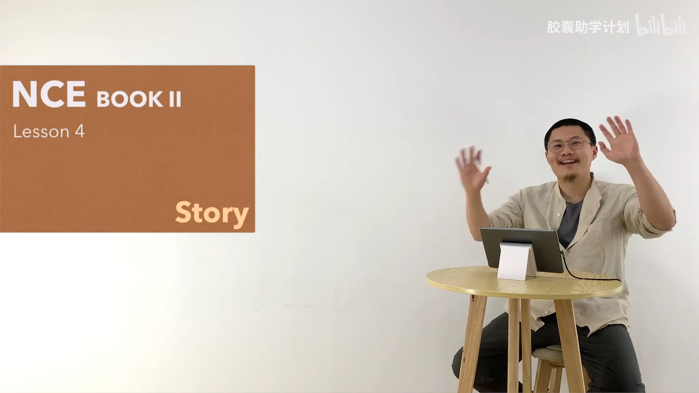

文字识别：胶囊助学计划 / NCE / BOOKⅡI / Lesson 4 / Story

### 画面 00:00:02

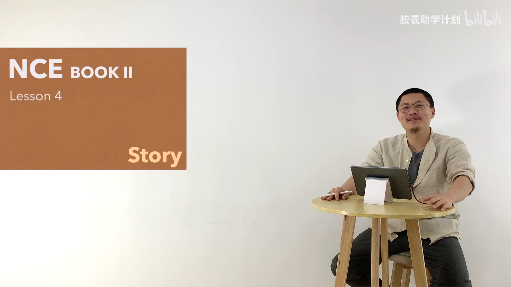

文字识别：Bilbil / 胶囊助学计划 / NCE / BOOKII / Lesson 4 / Story

### 画面 00:00:05

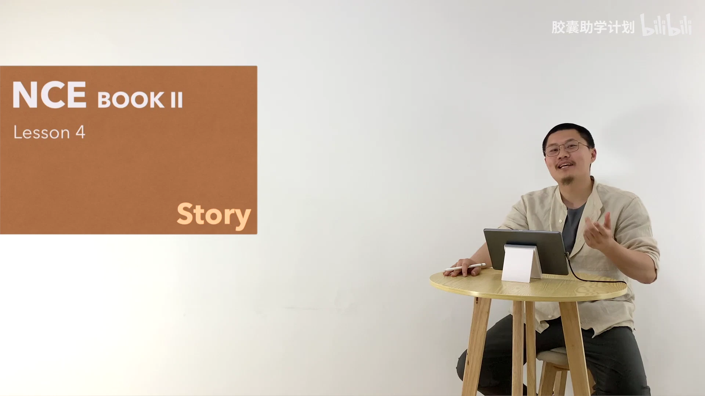

文字识别：Bitbili / 胶囊助学计划 / NCE / BOOK"I / Lesson 4 / Story

### 画面 00:00:10

文字识别：Bitbili / 胶囊助学计划

### 画面 00:00:12

文字识别：Bilbili / 胶囊助学计划 / ①如何表达“我觉得你很美”？

### 画面 00:00:15

文字识别：bibi / 胶囊助学计划 / ①如何表达“我觉得你很美”？

### 画面 00:00:17

文字识别：Bibl / 胶囊助学计划 / ①如何表达“我觉得你很美”? / 如何区分“去了”和“去过”？

### 画面 00:00:19

文字识别：胶囊助学计划 / ①如何表达“我觉得你很美”？ / 如何区分“去了”和“去过”? / 去某地”

### 画面 00:00:21

文字识别：Bibli / 胶囊助学计划 / ①如何表达“我觉得你很美”？ / 如何区分“去了”和“去过”？ / 如何表达“飞去某地”?

### 画面 00:00:25

文字识别：Bibl / 胶囊助学计划 / ①如何表达“我觉得你很美”? / 如何区分“去了”和“去过”？ / 如何表达“飞去某地”?

### 画面 00:00:27

文字识别：胶囊助学计划blbl

## 00:00:30–00:01:00

好，那我们直接进入文章来了。说 I have just received，好了，不往后看了，就看 have just received。现在完成时，have 加蛋，我刚刚收到了什么呢？ Received a letter from my brother Tim. Received something from somebody。这是我们在单词部分就讲过的，收到来自某人的某物，收

### 画面 00:00:30

### 画面 00:00:32

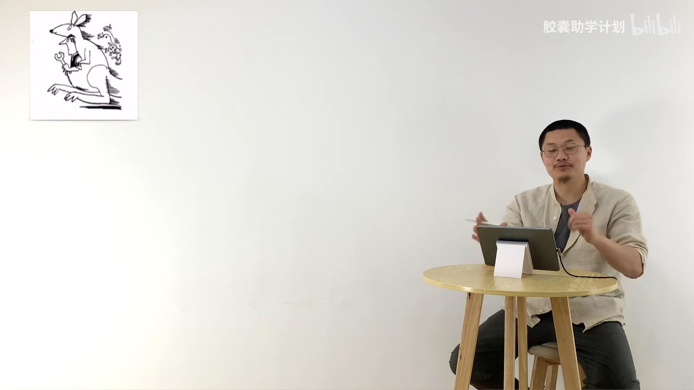

文字识别：胶囊助学计划

### 画面 00:00:34

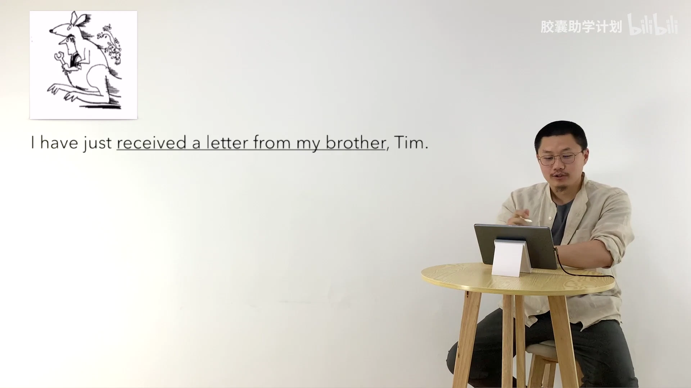

文字识别：胶囊助学计划 / I have just received a letter from my brother, Tim.

### 画面 00:00:46

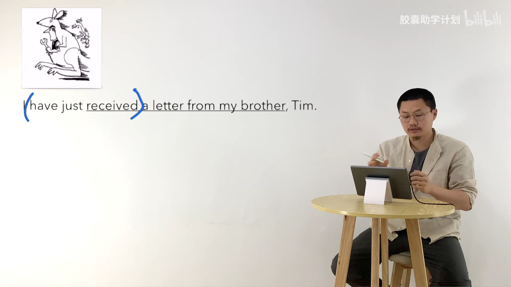

文字识别：胶囊助学计划b鼎b出 / have just received a letter from my brother, Tim.

### 画面 00:00:52

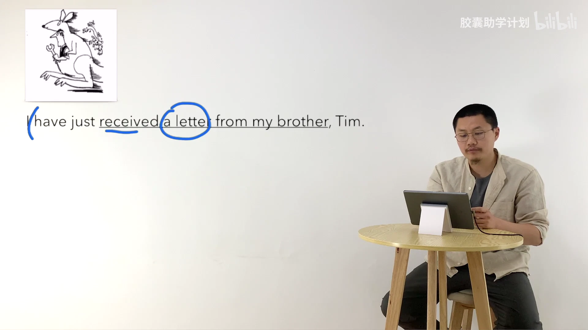

文字识别：Bilbil / 胶囊助学计划 / have just receiveda lette / from my brother, Tim.

### 画面 00:00:54

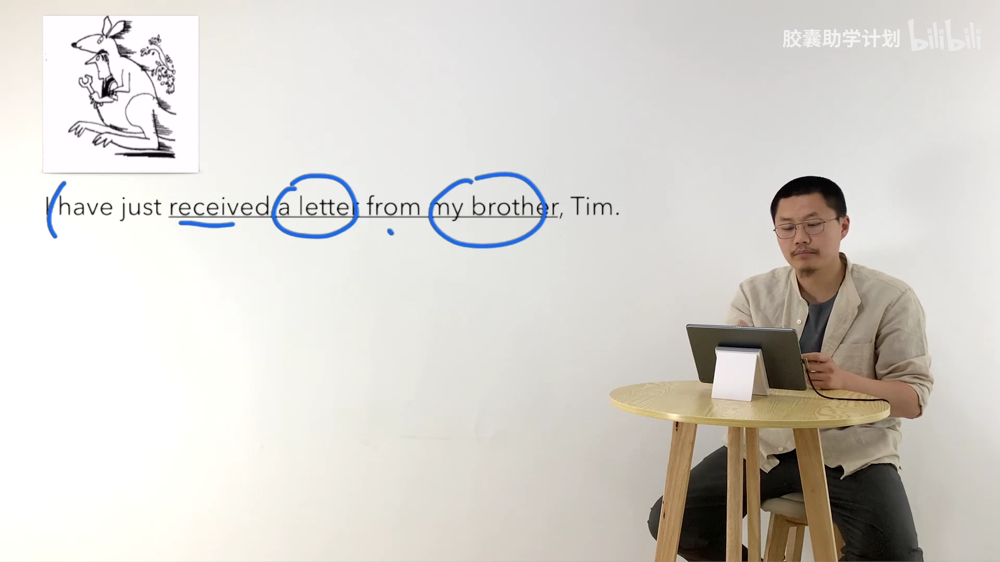

文字识别：Bilibil / 胶囊助学计划 / have just receiveda lette / from my brother, Tim.

### 画面 00:00:57

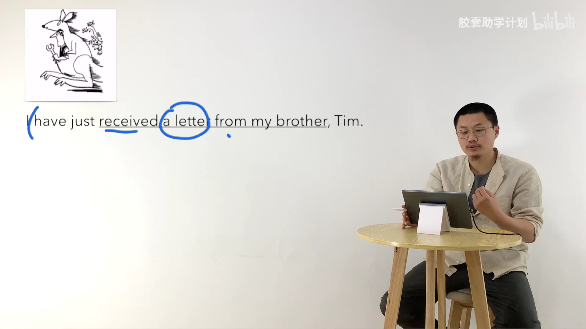

文字识别：Bilbil / 胶囊助学计划 / have just receiveda lette / from my brother, Tim.

### 画面 00:00:59

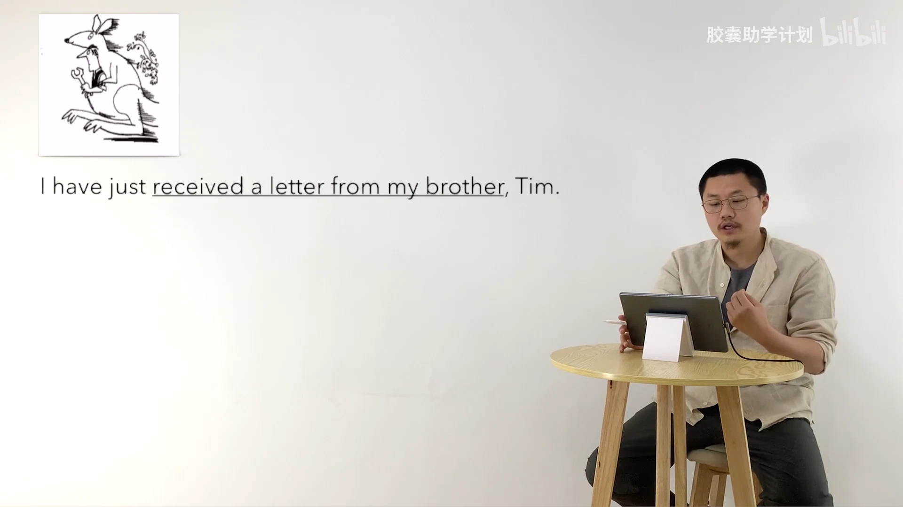

文字识别：bilbl / 胶囊助学计划 / I have just received a letter from my brother, Tim.

## 00:01:00–00:01:30

到来自于我兄弟的一封信，对吧？那注意，Tim其实就是我的兄弟，对不对？这两者之间首先是一码事儿。比如说我啊，一个什么什么样的人，这两者之间是一码事儿。我们在英文当中管它叫做同位语，相同位置的一个语言叫做同位语。对于目前来说，各位知不知道这个语法名字以及懂不懂这个语法是

### 画面 00:01:04

文字识别：胶囊助学计划 / I have just received a letter from my brother / Tim

### 画面 00:01:06

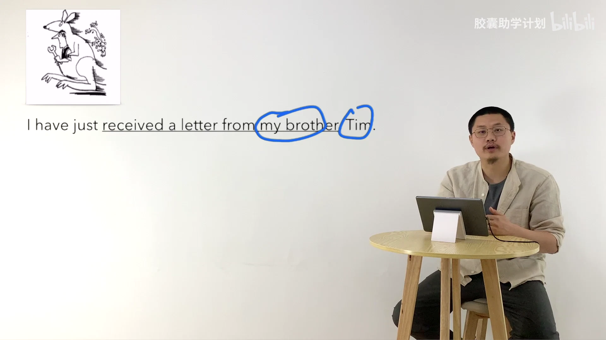

文字识别：胶囊助学计划bilb出 / I have just received a letter from my brother / Tim

### 画面 00:01:08

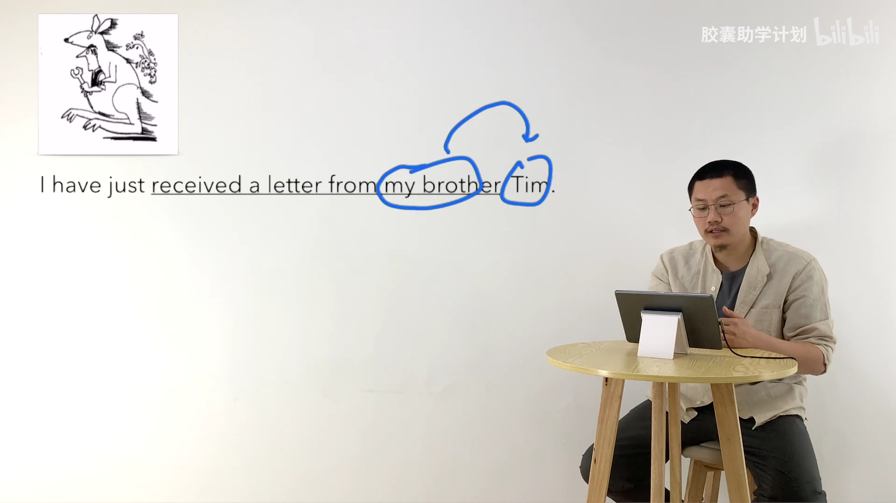

文字识别：胶囊助学计划bil出 / I have just received a letter from my brother / Tim

### 画面 00:01:17

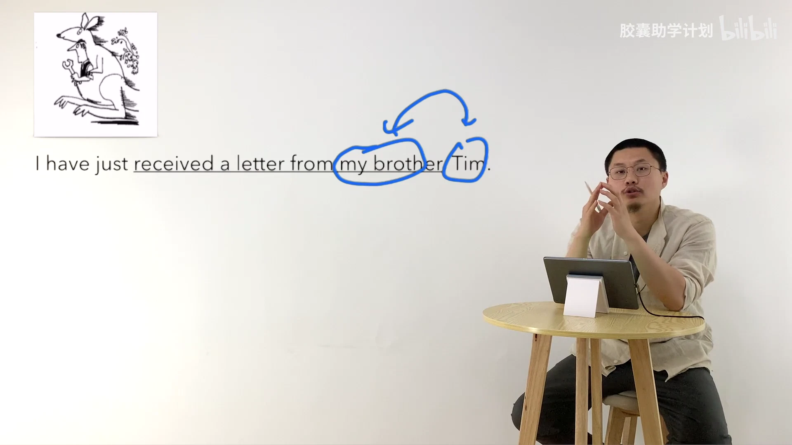

文字识别：胶囊助学计划 / I have just received a letter from my brother / Tim

## 00:01:30–00:02:00

是没有什么太大影响的。但是呢，我们慢慢往后学的时候，会学到一个从句叫同位语从句。哎，那个时候就比较重要了。现在各位只要知道英文当中有这么一东西就可以了。接下来说，He is in Australia.他现在在澳大利亚。现在一般现在时，陈述客观事实，对吧？说He has been there.说他已经在那里for six months。注意说这句话的时候，人一定还在那个地

### 画面 00:01:47

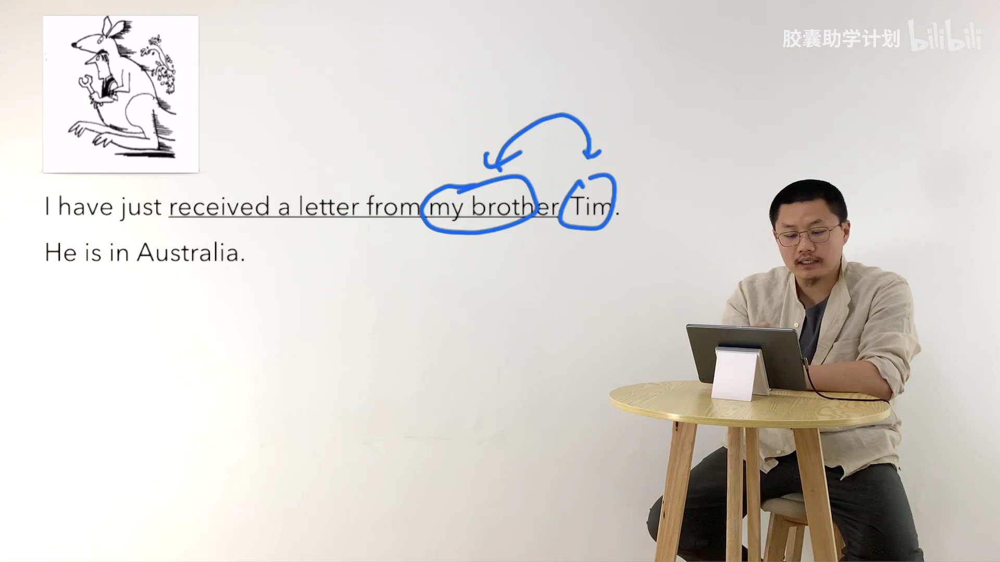

文字识别：胶囊助学计划 / I have just received a letter from my brother / Tim / He is in Australia.

### 画面 00:01:53

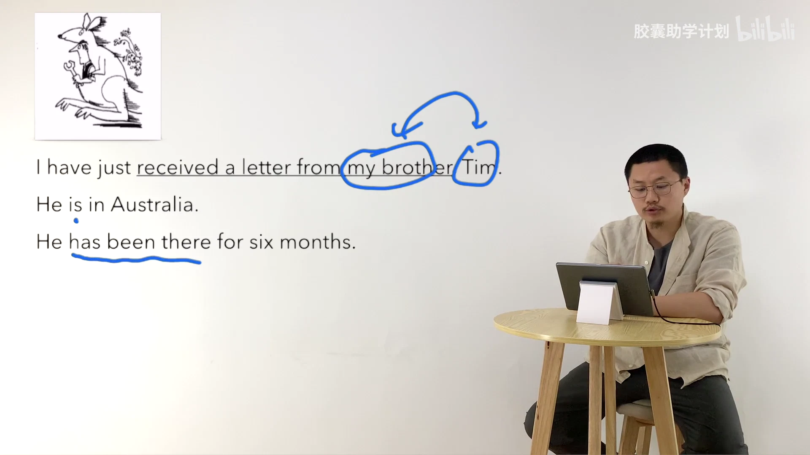

文字识别：胶囊助学计划 / I have just received a letter from my brother / He is in Australia. / He has been there for six months.

### 画面 00:01:57

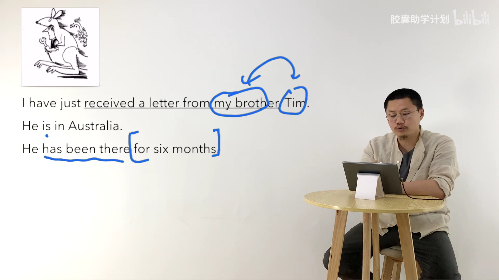

文字识别：胶囊助学计划 / I have just received a letter from my brother / Tim / He is in Australia. / He has been there for six months

## 00:02:00–00:02:30

方嘛？从过去持续到现在，已经持续了六个月了，对吧？然后注意一下这个 been，been 呢，其实它的原型是 be，be 呢，目前为止我们比较熟悉的，比如说 am，is，are，或者说的是 was，were，对吧？那目前你站到 been，其实也是 be 的一种形式，只不过它是 be 的过去分词

### 画面 00:02:09

文字识别：be / Bilbil / 胶囊助学计划 / I have just received a letter from my brother / He is in Australia. / He has been there for six months

### 画面 00:02:13

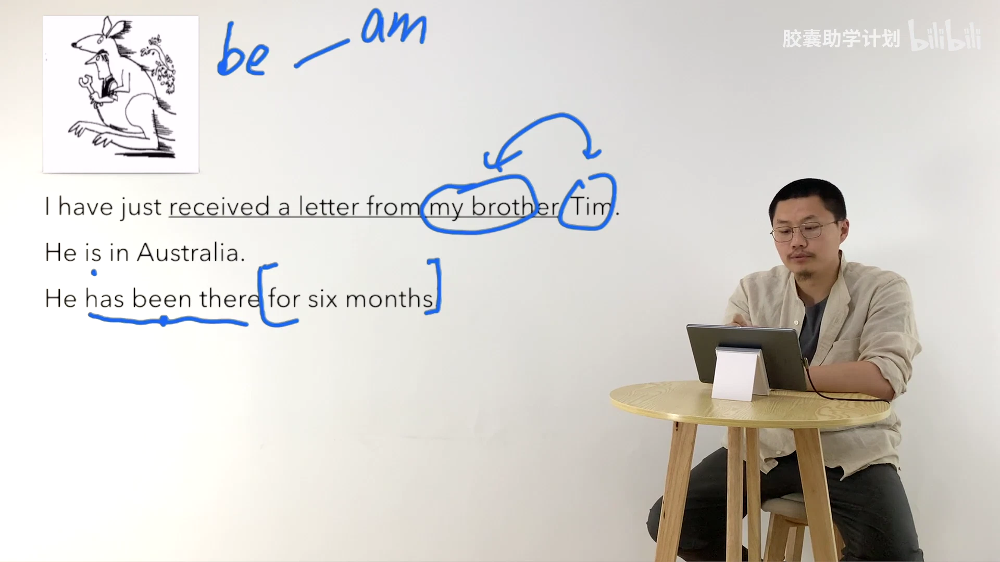

文字识别：am / be / Bilbl / 胶囊助学计划 / I have just received a letter from my brother / Tim / He is in Australia. / He has been there for six months

### 画面 00:02:15

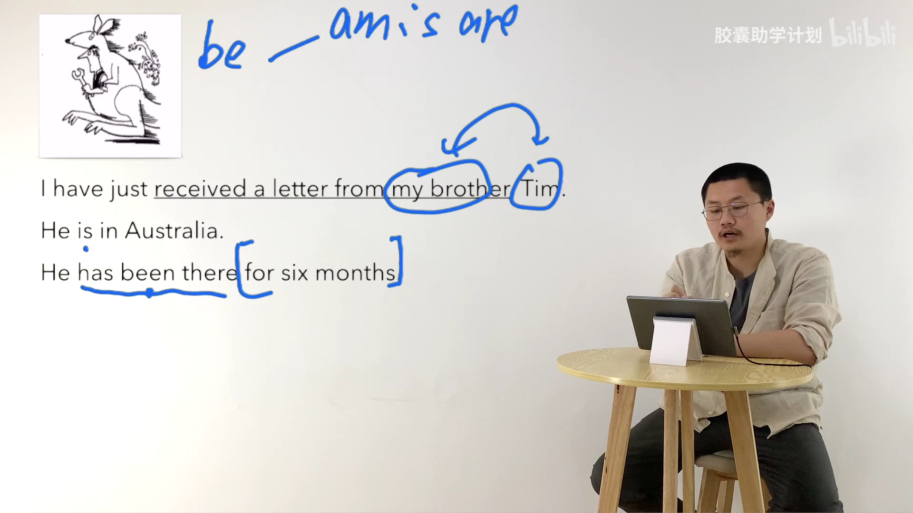

文字识别：am's ar / be / 胶囊助学计划 / Bilibil / I have just received a letter from my brother / Tim / He is in Australia. / He has been there for six months

### 画面 00:02:17

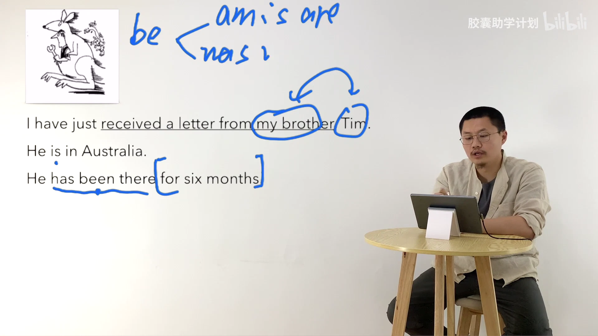

文字识别：am's are / be / 胶囊助学计划 / nasl / I have just received a letter from my brother / Tin / He is in Australia. / He has been there for six months

### 画面 00:02:19

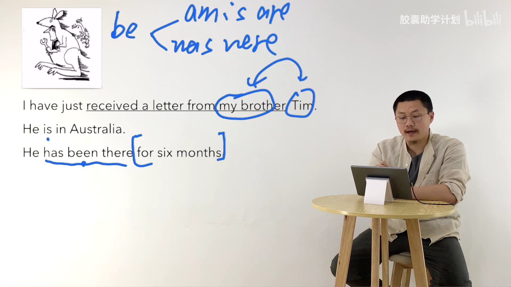

文字识别：ams are / be / 胶囊助学计划 / nas nere / I have just received a letter from my brother / He is in Australia. / He has been there for six months

### 画面 00:02:23

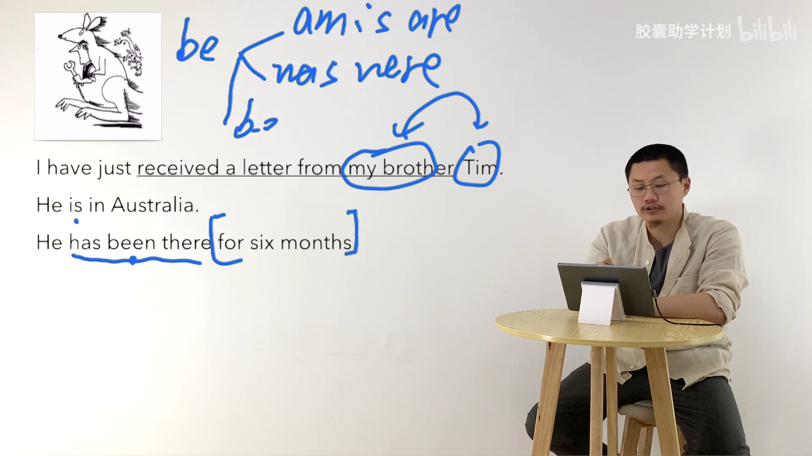

文字识别：am's are / be / 胶囊助学计划 / nas nere / I have just received a letter from my brother / He is in Australia. / He has been there for six months

### 画面 00:02:25

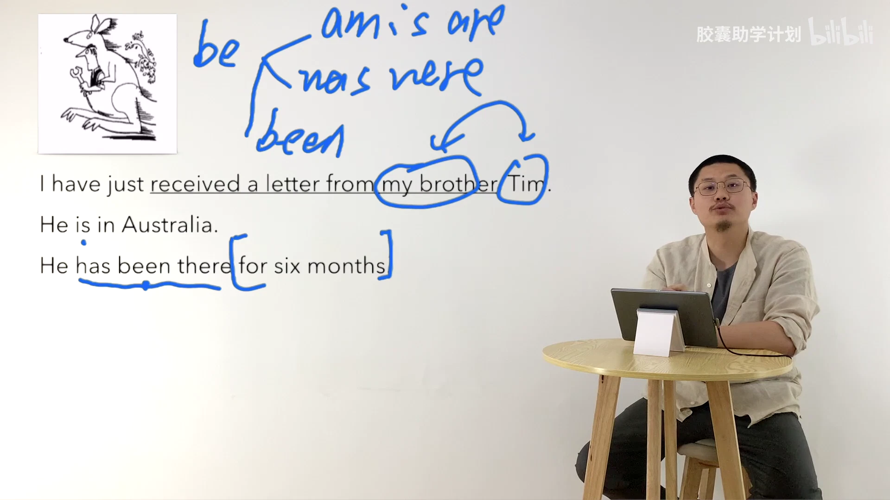

文字识别：am's are / be / 胶囊助学计划 / nas nere / been / I have just received a letter from my brother / He is in Australia. / for six months / He has been there

## 00:02:30–00:03:00

啊！这儿我提一句小话啊。我们有一部分学员留言说，看这个板书呢不是很清楚。原因呢，让我想再写大一点。那原因可能是您是用手机看的，手机的屏幕一共就这么大，我这个 B 不可能写成这个样子，对吧？这样您可能能看清楚。那建议各位呢，不不妨换成平板的这个呃这些仪器，或者说换成电脑啊，您可能就能看清楚了。好，我们接着往下走。说 Tim is an engineer. 说 Tim

### 画面 00:02:43

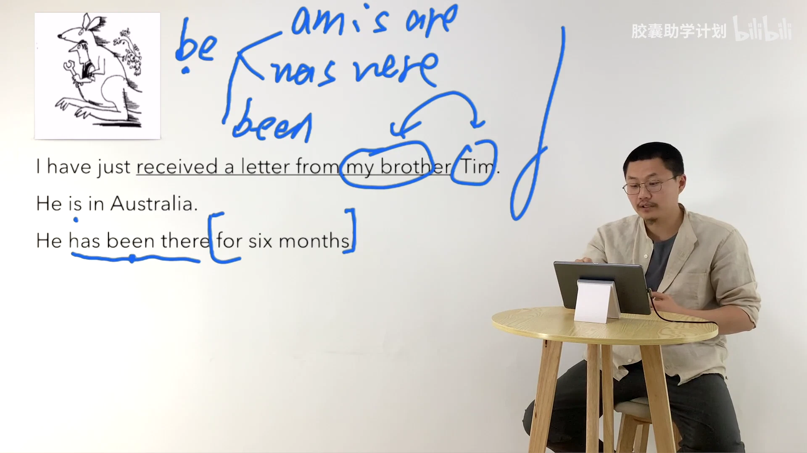

文字识别：am's are / be / 胶囊助学计划 / nas nere / been / I have just received a letter from my brother / He is in Australia. / He has been there for six months

### 画面 00:02:45

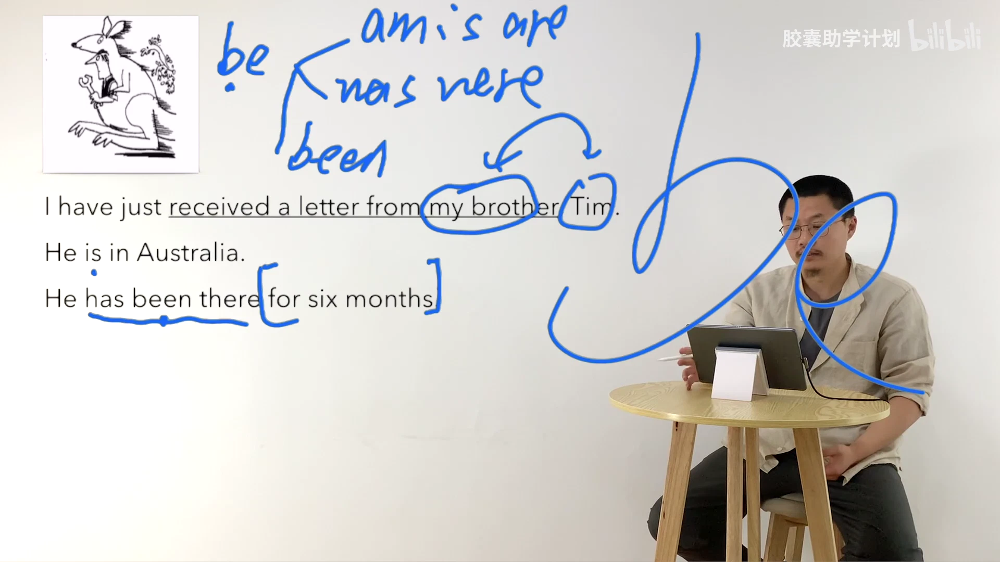

文字识别：am's are / be / 胶囊助学计划 / nasv / were / Ibeen / I have just received a letter from my brother / He is in Australia. / for six months / He has been there

### 画面 00:02:47

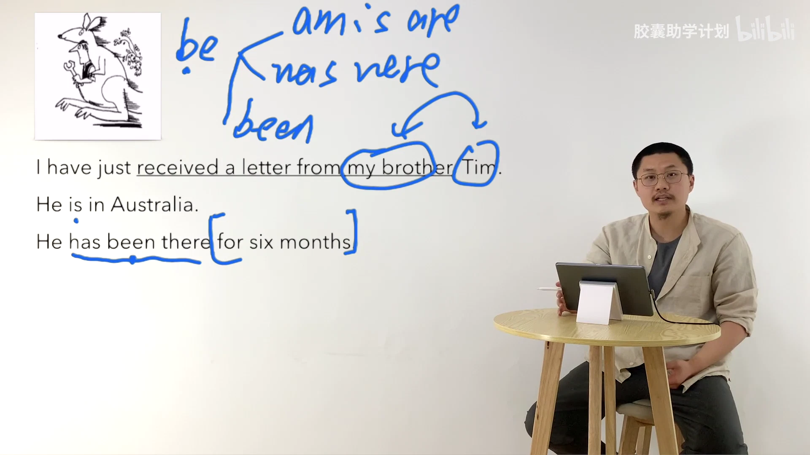

文字识别：am's are / be / BilBil / 胶囊助学计划 / nas nere / Ibeen / I have just received a letter from my brother / He is in Australia. / for six months / He has been theref

## 00:03:00–00:03:30

啊是一个工程师。注意an，新音学过的。为什么用an而不用a engineer？第一个音标而不是字母啊。注意好，接下来说He is working.他现在正在现阶段。注意这就应该不是现在正在干这个事儿吧？你想一下，现在进行时我们提了三个用法，其中一个用法叫做现阶段正在怎么怎么样。但是说这句话的时候，人不一

### 画面 00:03:01

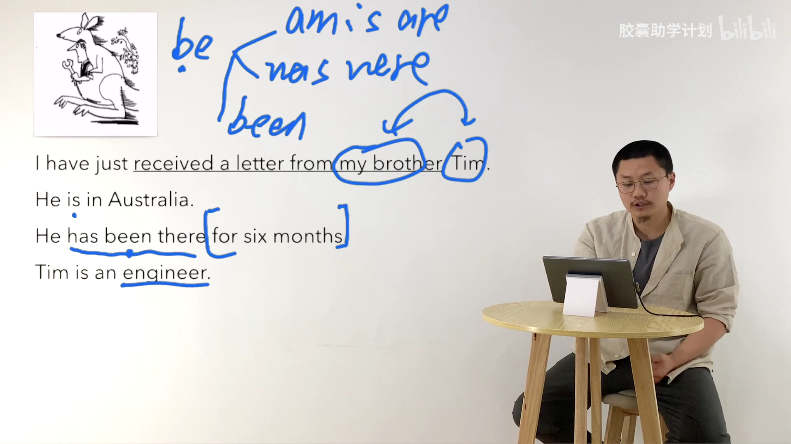

文字识别：am's are / be / 胶囊助学计划 / Bibil / nas / were / been / I have just received a letter from my brother / He is in Australia. / fo ix months / He has been there / Tim is an engineer.

### 画面 00:03:10

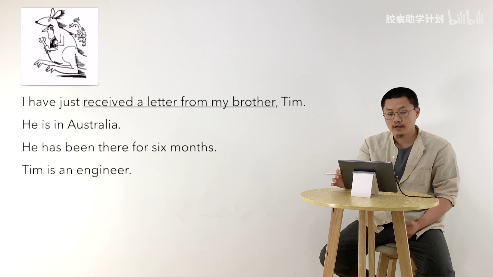

文字识别：胶囊助学计划bW鼎 / I have just received a letter from my brother, Tim. / He is in Australia. / He has been there for six months. / Tim is an engineer.

### 画面 00:03:12

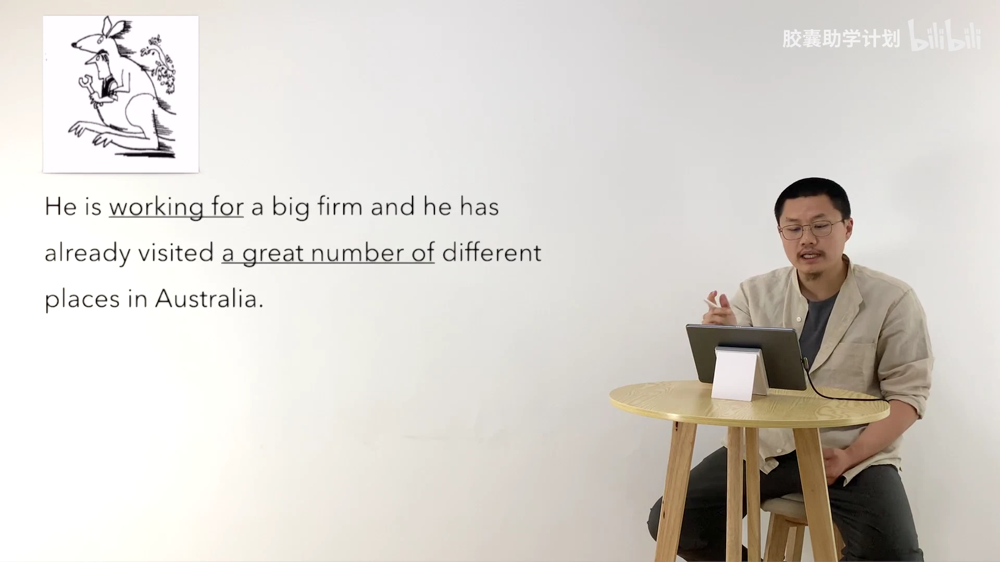

文字识别：胶囊助学计划 / He is working for a big firm and he has / already visited a great number of different / places in Australia.

## 00:03:30–00:04:00

定正在做这件事情。他应该是现阶段正在为一个大公司工作吧？因为他现在人在澳大利亚旅游了嘛，对不对？好，说 he is working for 哈 work for 为谁谁而工作？ a big firm 为一个大公司工作。然后呢， he has already visited 说他已经参观拜访了什么呢？ a great number of 这是一个小的习惯用法 expression 叫做大量的许多的。它后面我们

### 画面 00:03:32

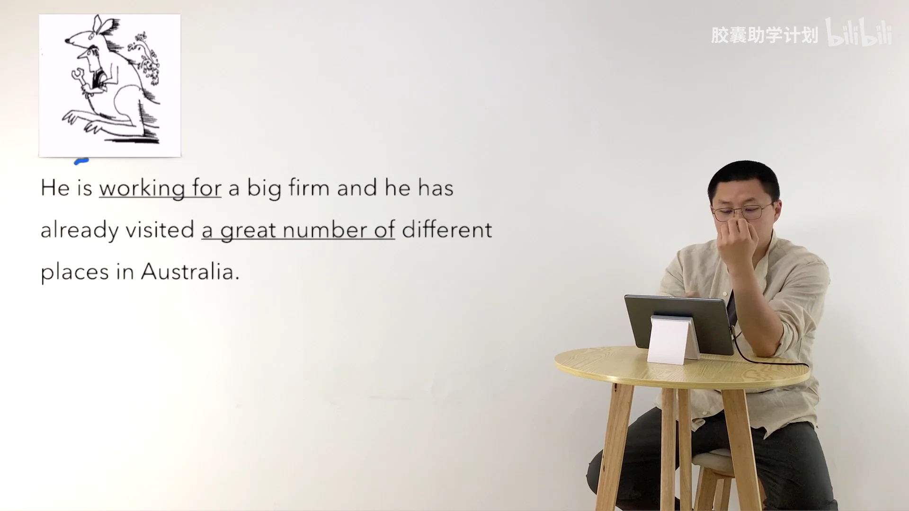

文字识别：胶囊助学计划 / He is working for a big firm and he has / already visited a great number of different / places in Australia.

### 画面 00:03:35

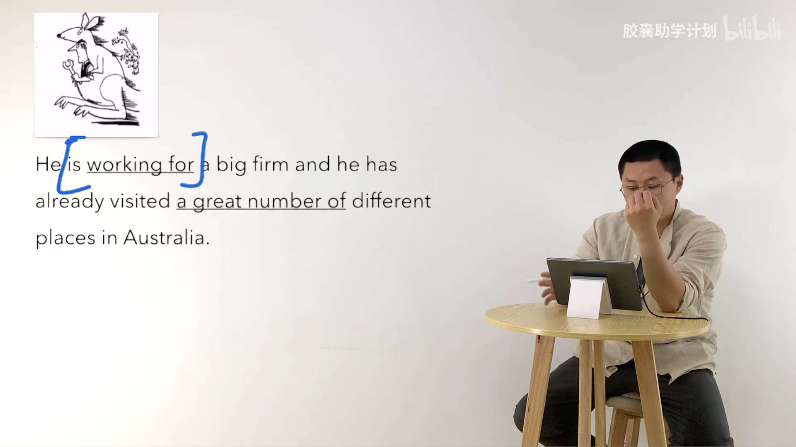

文字识别：胶囊助学计划 / Helis working for a big firm and he has / already visited a great number of different / places in Australia.

### 画面 00:03:37

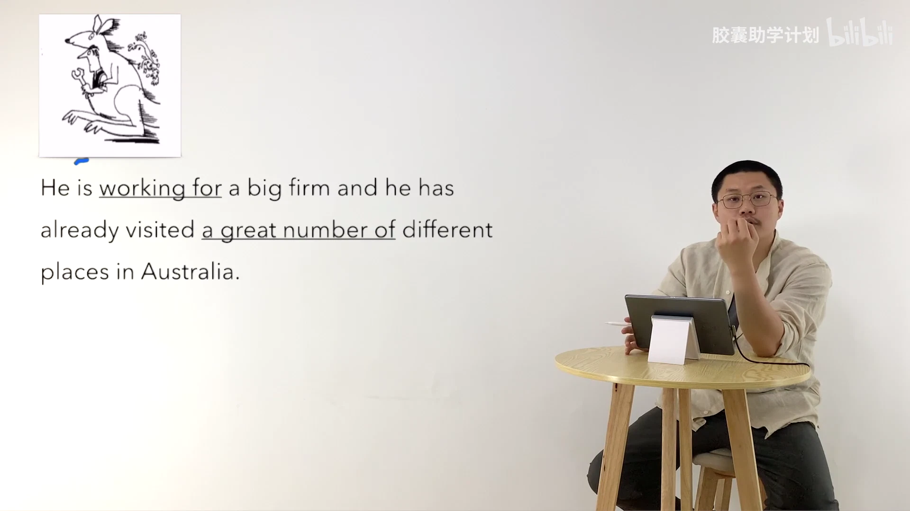

文字识别：胶囊助学计划b出业 / He is working for a big firm and he has / already visited a great number of different / places in Australia.

### 画面 00:03:41

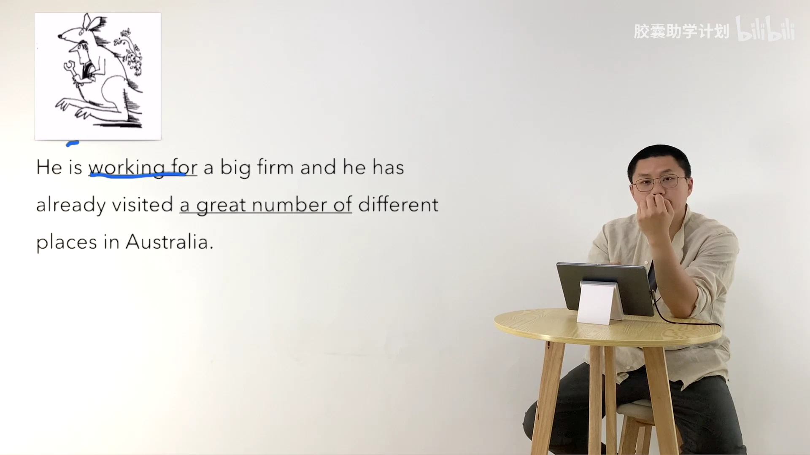

文字识别：胶囊助学计划 / He is working for a big firm and he has / already visited a great number of different / places in Australia.

### 画面 00:03:48

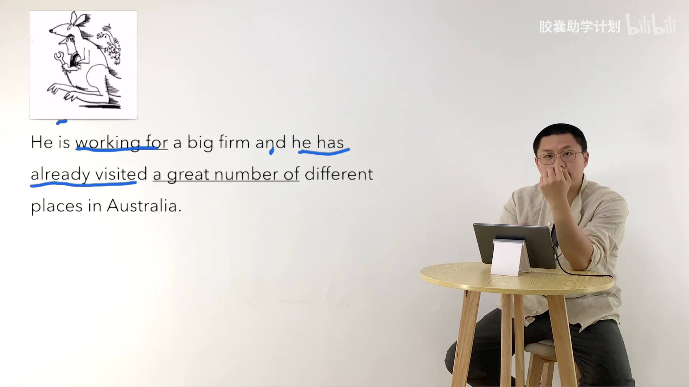

文字识别：胶囊助学计划 / He is working for a big firm and he has / already visited a great number of different / places in Australia.

## 00:04:00–00:04:30

要加的是一个叫做可数的复数名词。已经参，其实有点像 a lot of 啊，有点像啊，不是是啊。不同的地方 in Australia，他已经参观拜访了许多澳洲不同的地方。接着往下说， he has just bought，他刚刚买了什么呢？ An Australian car，刚刚买了一辆澳产的车。 Have 加 that，没问题吧？好，

### 画面 00:04:04

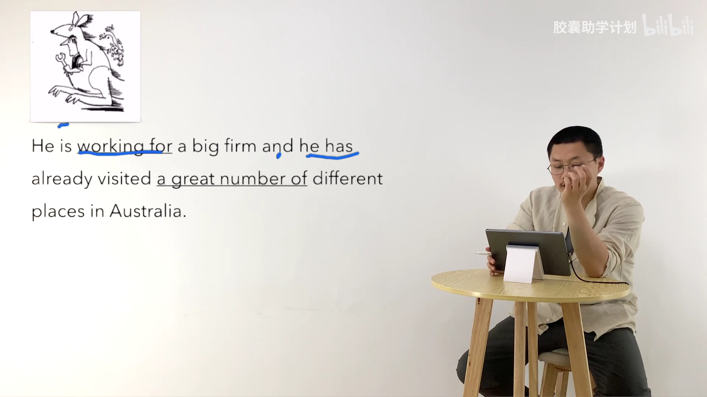

文字识别：胶囊助学计划 / He is working for a big firm and he has / already visited a great number of different / places in Australia.

### 画面 00:04:06

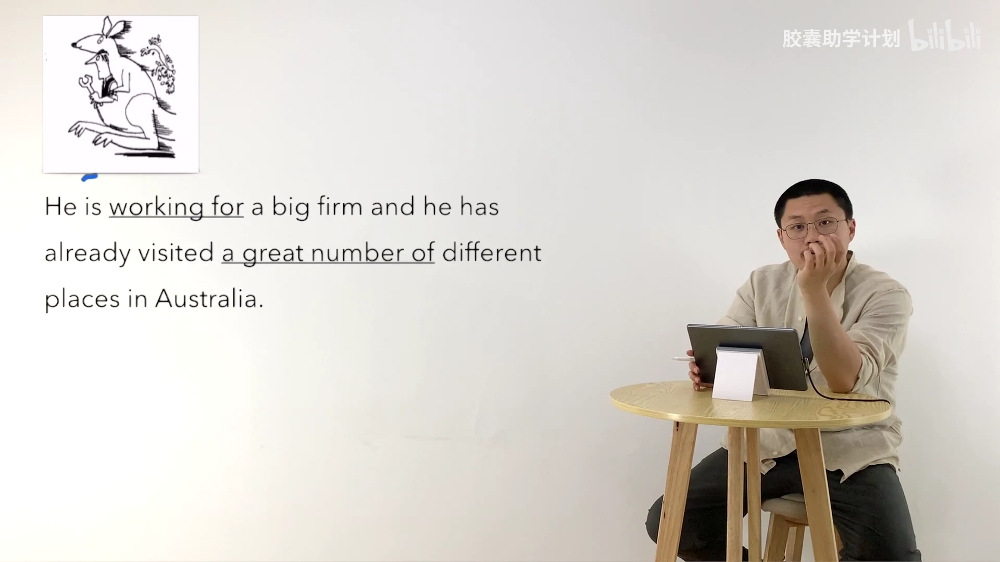

文字识别：胶囊助学计划 / He is working for a big firm and he has / already visited a great number of different / places in Australia.

### 画面 00:04:15

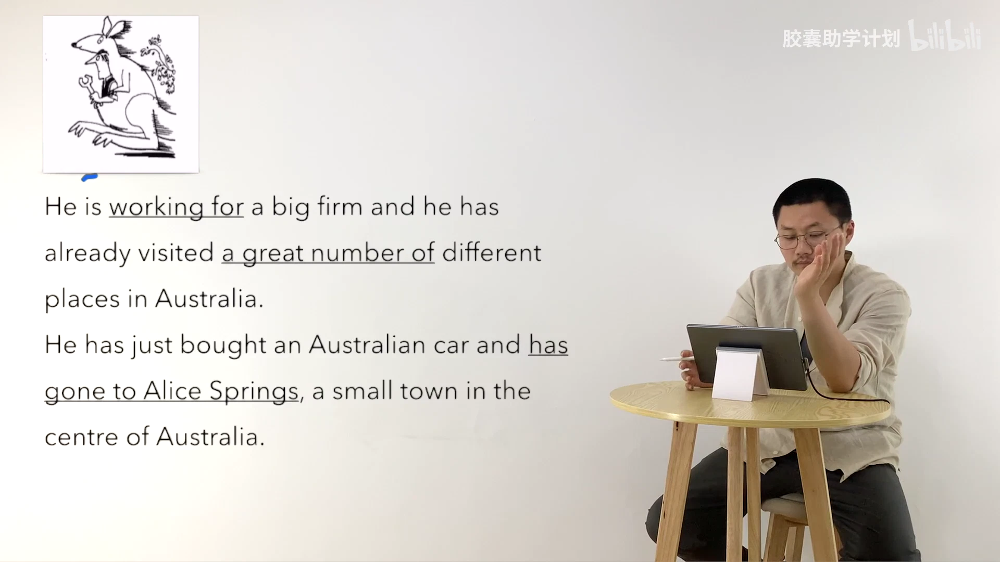

文字识别：胶囊助学计划 / He is working for a big firm and he has / already visited a great number of different / places in Australia. / He has just bought an Australian car and has / gone to Alice Springs, a small town in the / centre of Australia.

### 画面 00:04:20

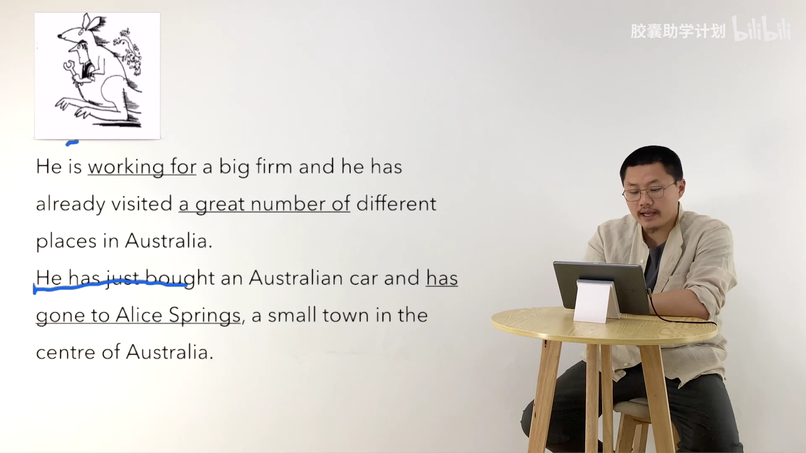

文字识别：胶囊助学计划 / He is working for a big firm and he has / already visited a great number of different / places in Australia. / He has just bought an Australian car and has / gone to Alice Springs, a small town in the / centre of Australia.

### 画面 00:04:22

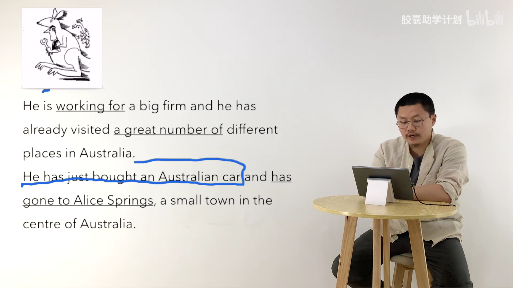

文字识别：胶囊助学计划 / He is working for a big firm and he has / already visited a great number of different / places in Australia. / He has just bought an Australian carand has / gone to Alice Springs, a small town in the / centre of Australia.

### 画面 00:04:24

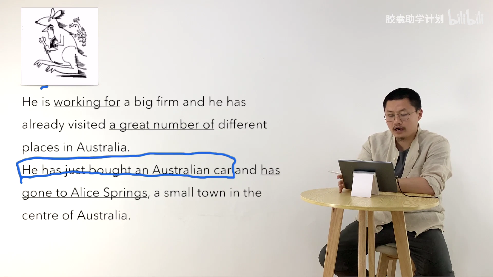

文字识别：胶囊助学计划 / He is working for a big firm and he has / already visited a great number of different / places in Australia. / He has just bought an Australian car and has / gone to Alice Springs, a small town in the / centre of Australia.

### 画面 00:04:26

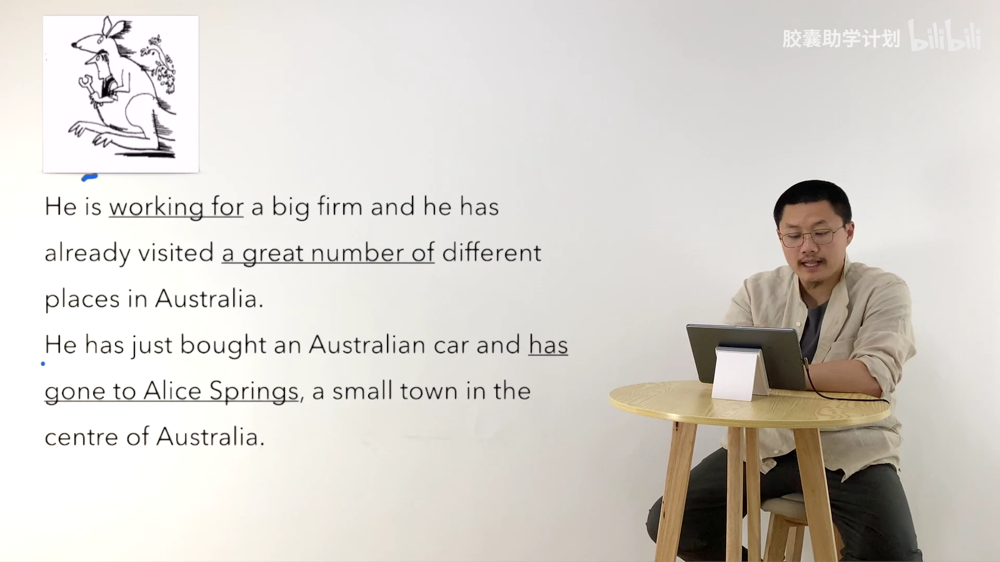

文字识别：胶囊助学计划 / He is working for a big firm and he has / already visited a great number of different / places in Australia. / He has just bought an Australian car and has / gone to Alice Springs, a small town in the / centre of Australia.

## 00:04:30–00:05:00

and has gone to说已经去了什么地方呢？Alice Springs。那Alice Springs，您看到首先首字母大写，说去了，猜也能猜出来，这是一个地名，对吧？一个地方的名字。但我们不知道这个地方是什么啊？就像您不知道我是谁一样。那我要跟您说我是谁，是谁，是谁，对吧？就像在开篇当中进行一个自我介绍一样。否则，Leo或者刘宇这个名字对于各位是没有概念的，没有意义的。那

### 画面 00:04:34

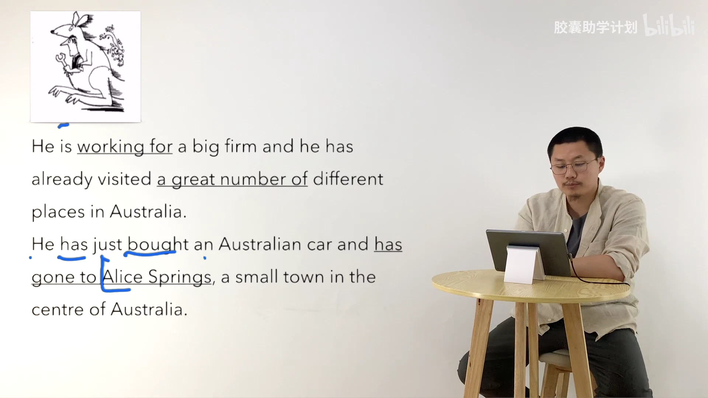

文字识别：胶囊助学计划 / He is working for a big firm and he has / already visited a great number of different / places in Australia. / He has just bouaht an Australian car and has / gone toAlice Springs, a small town in the / centre of Australia.

### 画面 00:04:42

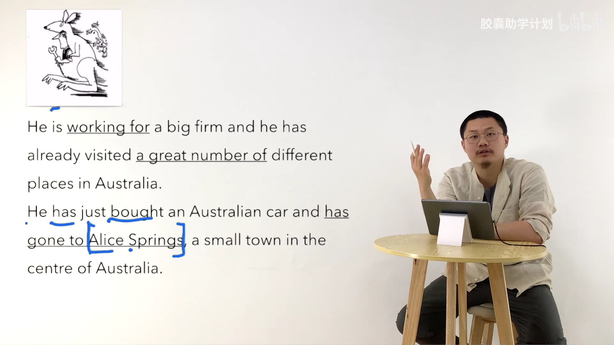

文字识别：胶囊助学计划 / He is working for a big firm and he has / already visited a great number of different / places in Australia. / He has just bouaht an Australian car and has / 0 / gone to Alice Springs / a smalltown in the / centre of Australia.

## 00:05:00–00:05:30

一定要给您解释很多的同位语，所以后面就来了，说 a small town，哎，我们至少目前知道它不是一个大城市，对吧？也不是乡村，也不是一个博物馆的名字，它是一个小镇。 in the center of，哎，这是我们在单词部分学过的，叫在什么什么的中间，在什么的中间呢？ Australia，在澳大利亚的中部的一个小镇。好，那于是 Alice Springs 这个东

### 画面 00:05:05

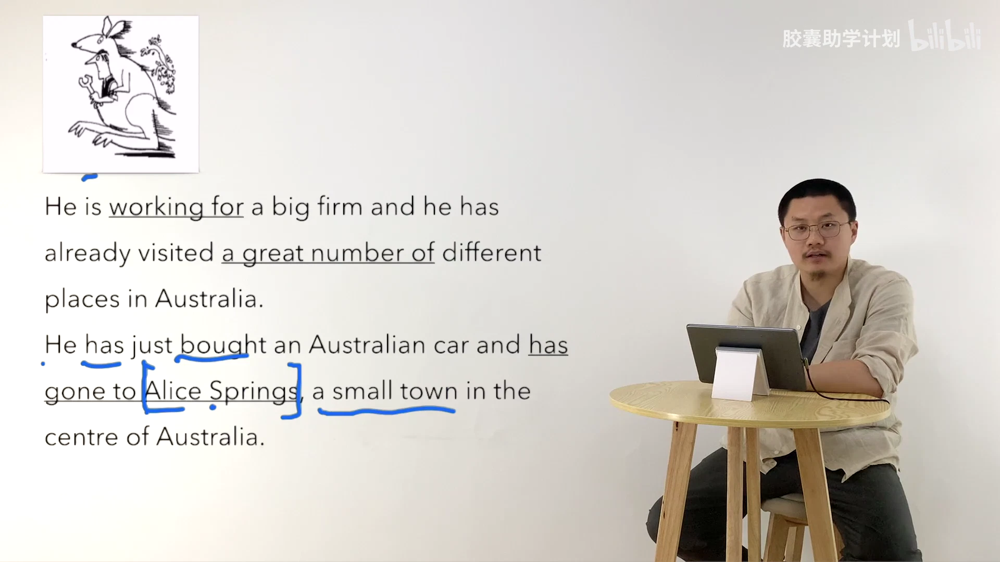

文字识别：胶囊助学计划 / He is working for a big firm and he has / already visited a great number of different / places in Australia. / He has just bouaht an Australian car and has / gone to Alice Springs / a small town in the / centre of Australia.

### 画面 00:05:09

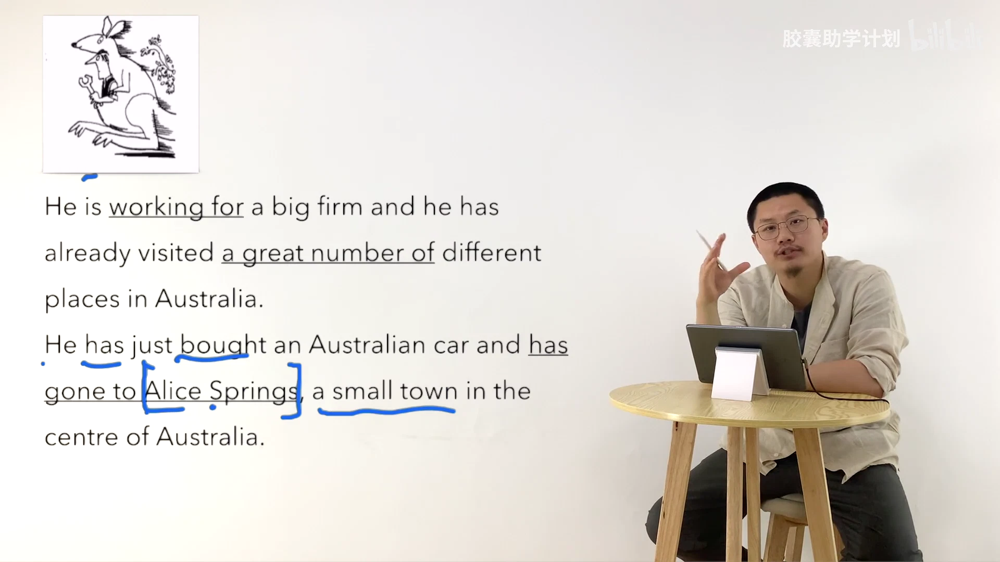

文字识别：胶囊助学计划 / He is working for a big firm and he has / already visited a great number of different / places in Australia. / He has just bouaht an Australian car and has / gone to Alice Springs / a small town in the / centre of Australia.

### 画面 00:05:15

文字识别：胶囊助学计划 / He is working for a big firm and he has / already visited a great number of different / places in Australia. / He has just bouaht an Australian car and has / gone to Alice Springs / a small town in the / centre of Australia.

### 画面 00:05:21

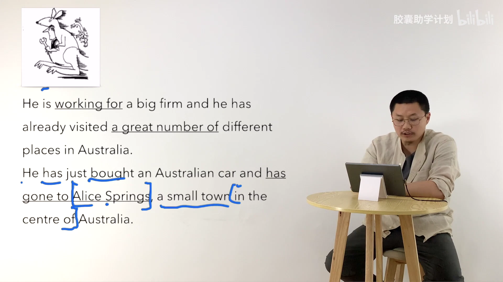

文字识别：胶囊助学计划 / He is working for a big firm and he has / already visited a great number of different / places in Australia. / He has just bouaht an Australian car and has / gone toAlice Springs / a small towrlin the / centre of Australia.

## 00:05:30–00:06:00

西您听没听过已经不重要了，您已经知道它是澳洲中部的一个小镇。这是同位语，其实比较重要的一个作用吧，这样可以理解为好吧。OK，那继续。He will soon visit Darwin. 注意will，我们新一九十一课学过，他很快就要去拜访达尔文。Darwin这个地方了啊，也是澳洲的一个城市。From there, from那里，He will fly to Perth. 注意fly，各位

### 画面 00:05:42

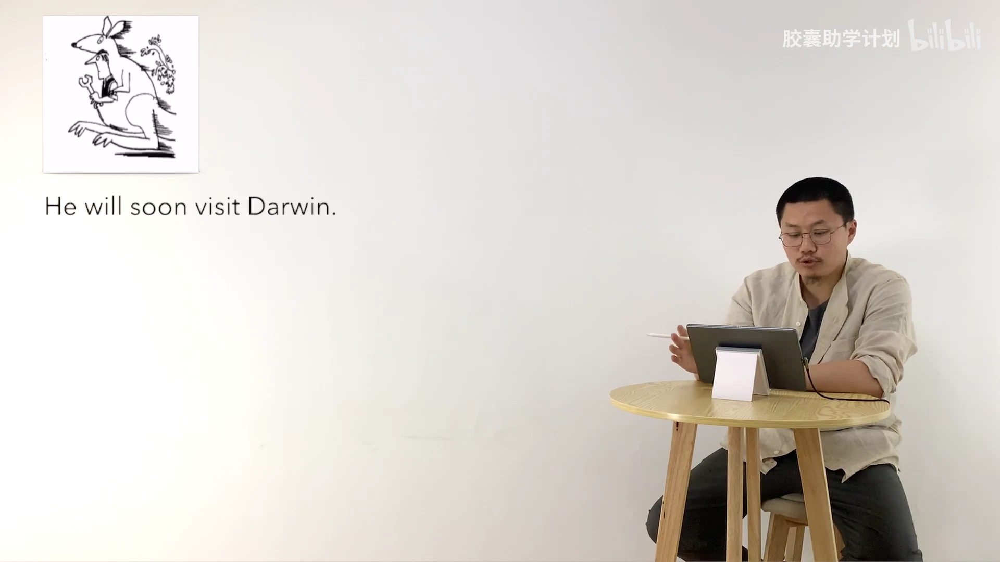

文字识别：胶囊助学计划b出b出 / He will soon visit Darwin.

### 画面 00:05:55

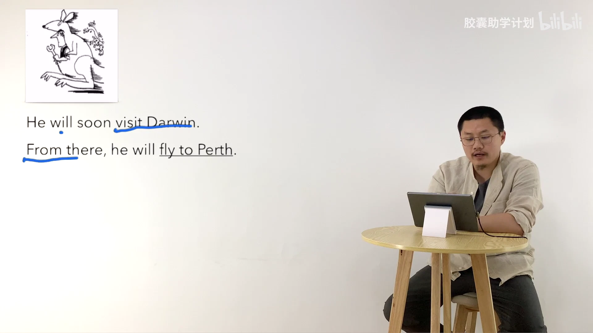

文字识别：bilbli / 胶囊助学计划 / He will soon yisit Darwin. / From there, he will fly to Perth.

## 00:06:00–00:06:30

知道飞的意思对吧？但是在这儿，它明显不可能是他像超人一样飞过去嘛，那一定指的是什么？乘飞机到了Perth这个地方，对吧？那Perth P在大写，告诉各位还是一个地名。那飞去某地就叫做fly to Perth。比如说我要飞去北京，那fly to Beijing。Okay, my brother，我兄弟啊，has never been abroad before，以前从来没有出过国before

### 画面 00:06:00

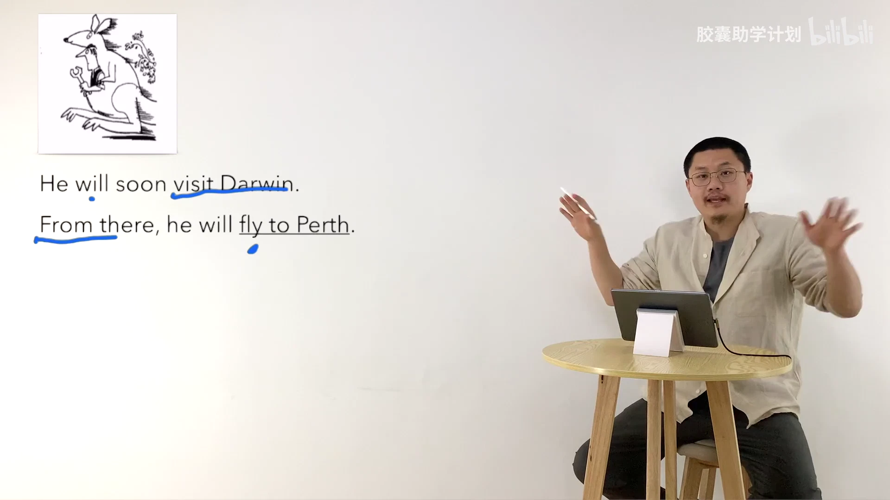

文字识别：胶囊助学计划 / He will soon yisit Darwin. / From there, he will fly to Perth.

### 画面 00:06:02

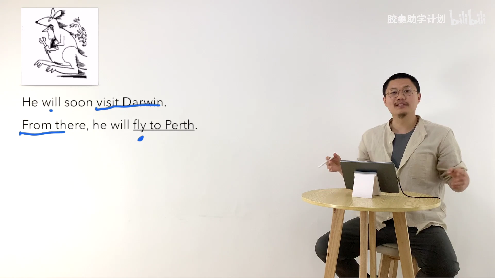

文字识别：胶囊助学计划 / He will soon yisit Darwin. / From there, he will fly to Perth.

### 画面 00:06:05

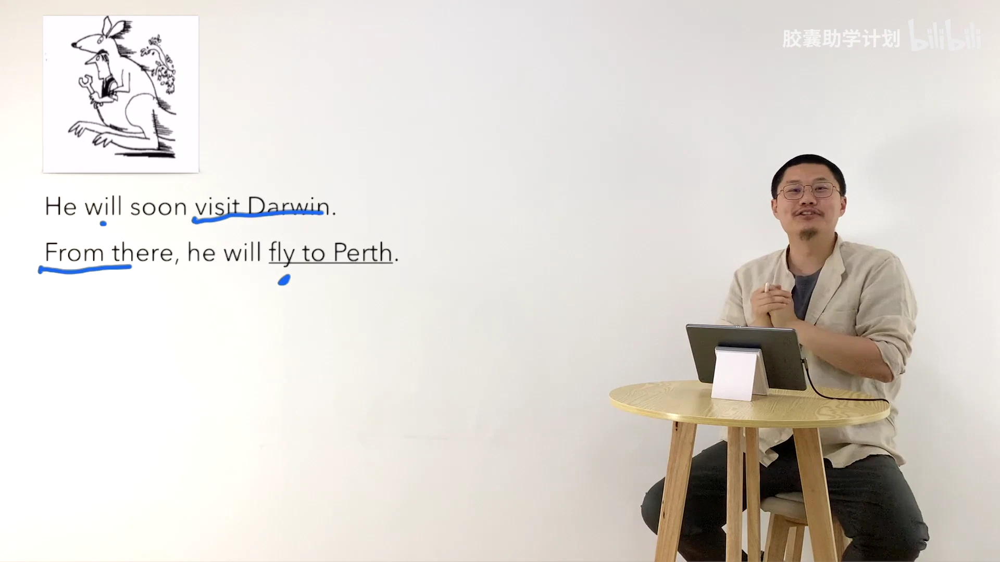

文字识别：胶囊助学计划 / He will soon yisit Darwin. / From there, he will fly to Perth.

### 画面 00:06:09

文字识别：胶囊助学计划 / He will soon yisit Darwin. / From there, he will fly to Perth.

### 画面 00:06:14

文字识别：胶囊助学计划 / He will soon yisit Darwin. / From there, he wilfly to Perth.

### 画面 00:06:16

文字识别：Bilbl / 胶囊助学计划 / He will soon yisit Darwin / From there, he wilfly to Perth.

### 画面 00:06:18

文字识别：胶囊助学计划 / He will soon yisit Darwin / From there, he wilfly to Perth. / My brother has never been abroad before, / so he is finding this trip very exciting.

### 画面 00:06:25

文字识别：Bilbil / 胶囊助学计划 / He will soon visit Darwin / From there, he wilfly to Perth. / My brother has never been abroad before, / so he is finding this trip very exciting.

### 画面 00:06:28

文字识别：胶囊助学计划 / He will soon yisit Darwin / From there, he wilfly to Perth. / My brother has never been abroad before, / so he is finding this trip very exciting.

## 00:06:30–00:07:00

之前，so所以呢，注意接下来这句话很有意思了。He is他呢 finding首先这两个单词放在一起，现在进行时，他正发现。这句话完全可以变成He finds，叫做他觉得，他认为，他认为 this trip这次的旅行 very interest very exciting，非常的令人激动。注意啊，在这地方为什么我说 he

### 画面 00:06:33

文字识别：Bilbil / 胶囊助学计划 / He will soon yisit Darwin / From there, he wilfly to Perth. / My brother has never been abroad before, / he is finding this trip very exciting.

### 画面 00:06:39

文字识别：胶囊助学计划 / 出 / He will soon visit Darwin / From there, he wilfly to Perth. / My brother has never been abroad before, / heis finding thistrip veryexciting.

### 画面 00:06:45

文字识别：胶囊助学计划 / He will soon yisit Darwin / From there, he wilfly to Perth. / My brother has never been abroad before, / so heis inding this rip veryexciing.

### 画面 00:06:47

文字识别：胶囊助学计划 / He will soon visit Darwin / From there, he wilfly to Perth. / My brother has never been abroad before, / sheis fndin this ri very excitingn / Jinds

### 画面 00:06:54

文字识别：Bilbi / 胶囊助学计划 / He will soon visit Darwin / From there, he wilfly to Perth. / My brother has never been abroad before, / Jinds

## 00:07:00–00:07:30

is finding 完全可以换成 he finds 呢？就是同理，我们在最开始讲一个又一个的时态的时候呢，我们是分开去讲的。所以大家脑海当中可能会认为第一个时态和第二个时态和第三个时态好像是这种泾渭分明，没有任何联系的。而更现实的状态可能是这个样子的：每一个时态都有它自己侧重的点，都有它独特的地方，但也有和别的时态重合

### 画面 00:07:03

文字识别：胶囊助学计划 / He will soon visit Darwin / From there, he wilfly to Perth. / My brother has never been abroad before, / Jinds

### 画面 00:07:10

文字识别：Bilb / 胶囊助学计划 / He will soon visit Darwin / From there, he wilfly to Perth. / My brother has never been abroad before, / finds

### 画面 00:07:13

文字识别：Bilbll / 胶囊助学计划 / He will soon visit Darwin / From there, he wilfly to Perth. / My brother has never been abroad before, / Jinds

### 画面 00:07:15

文字识别：胶囊助学计划 / 出 / He will soon visit Darwin / From there, he wilfly to Perth. / My brother has never been abroad before, / Jinds

### 画面 00:07:21

文字识别：胶囊助学计划 / He will soon yisit Darwin / From there, he wilfly to Perth. / My brother has never been abroad before, / Jinds

### 画面 00:07:23

文字识别：胶囊助学计划 / 出 / He will soon yisit Darwin / From there, he wilfly to Perth. / My brother has never been abroad before / finds

## 00:07:30–00:08:00

的部分，各位能理解哈？就现实永远比真正理想中的状态要更复杂，所以在这个地方，我完全可以用一般现在时陈述客观事实嘛？说他认为这次旅行特别的令人激动，是没有任何问题的。只是作者选择在这个地方用了 is 加 doing，而如果您用 finds 没有任何错误。这就是我们说语法和用法，它也有一些小的区别。 OK，好，那我们看一下本课的习惯用法，我们老

### 画面 00:07:53

文字识别：出山 / 胶囊助学计划 / He will soon yisit Darwin / From there, he wilfly to Perth. / My brother has never been abroad before / finds

### 画面 00:07:56

文字识别：bilbil / 胶囊助学计划 / 习惯用法造句 / receive sth. from sb. / work for sb. / a great number of / have gone to sw. / fly to sw. / find n. adj.

### 画面 00:07:58

文字识别：Bilbili / 胶囊助学计划 / 习惯用法造句 / receive sth. from sb. / work for sb. / a great number of / have gone to sw. / fly to sw. / find n. adj.

## 00:08:00–00:08:30

习惯习惯用法要进行接下来的造句，看一下习惯用法造句指南啊。Receive something from somebody.我们原来呢，实际上并不是从习惯用法的角度，那今天我们从习惯用法的角度啊。上一个视频不是，这个视频我们从习惯用法的角度去切入。那我就提一个小的问题，我不给大家句子，就是既然都给了你 receive something from some somebody，好找，随便找个人，主语好找，随便找个人，对吧？您编个名字都行，关键问题叫

### 画面 00:08:00

文字识别：BilBili / 胶囊助学计划 / 习惯用法造句 / receive sth. from sb. / work for sb. / a great number of / have gone to sw. / fly to sw. / find n. adj.

### 画面 00:08:02

文字识别：Biltbil / 胶囊助学计划 / 习惯用法造句 / receive sth. from sb. / work for sb. / a great number of / have gone to sw. / fly to sw. / find n. adj.

### 画面 00:08:04

文字识别：Bibil / 习惯用法造句指南 / 网：v.+v.变化 / 胶囊助学计划 / 四句型转换 / +方式/地点/时间 / 其他习惯用法 / 其他单词 / 原文摘抄+变 / receive sth. from sb.

### 画面 00:08:06

文字识别：bilbl / 习惯用法造句指南 / 网：v.+v.变化 / 胶囊助学计划 / 四句型转换 / +方式/地点/时间 / 其他习惯用法 / 其他单词 / 原文摘抄+变 / receive sth. from sb.

### 画面 00:08:10

文字识别：Bilbili / 习惯用法造句指南 / 网：v.+v.变化 / 胶囊助学计划 / 四句型转换 / +方式/地点/时间 / 其他习惯用法 / 其他单词 / 原文摘抄+变 / receive sth. from sb.

### 画面 00:08:15

文字识别：biibi / 网：v.+v.变化 / 胶囊助学计划 / 习惯用法造句指南 / 四句型转换 / +方式/地点/时间 / 其他习惯用法 / 其他单词 / 原文摘抄+变 / receive sth. from sb.

### 画面 00:08:20

文字识别：Bilbil / 网：v.+v.变化 / 胶囊助学计划 / 习惯用法造句指南 / 四句型转换 / +方式/地点/时间 / 其他习惯用法 / 其他单词 / 原文摘抄+变 / receive sth. from sb. / sth.?

### 画面 00:08:24

文字识别：Bilbli / 习惯用法造句指南 / 网：v.+v.变化 / 胶囊助学计划 / 四句型转换 / +方式/地点/时间 / 其他习惯用法 / 其他单词 / 原文摘抄+变 / receive sth. from / sb / sth.?

### 画面 00:08:26

文字识别：Bilibili / 网：v.+v.变化 / 胶囊助学计划 / 习惯用法造句指南 / 四句型转换 / +方式/地点/时间 / 其他习惯用法 / 其他单词 / 原文摘抄+变 / receive sth. from / sb / sth.?

## 00:08:30–00:09:00

something 去哪儿找？ Umbrella, ticket, blah blah blah blah,一堆呢，对不对？去哪儿找？我给各位的建议是，挺好。初期千万不要从字典当中去找，您自己找的那个可能是由汉语语言习惯去找到的，它完完全有可能根本都不能用在这个句子当中。您初期怎么找呢？你先看一下原文，它用的是什么？A letter 叫一个信件。那你去想一下，如果一个信件可以，

### 画面 00:08:30

文字识别：Bilbi / 习惯用法造句指南 / 网：v.+v.变化 / 胶囊助学计划 / 四句型转换 / +方式/地点/时间 / 其他习惯用法 / 其他单词 / 原文摘抄+变 / receive sth. from / sb / sth.?

### 画面 00:08:33

文字识别：习惯用法造句指南 / 网：v.+v.变化 / 胶囊助学计划 / 四句型转换 / +方式/地点/时间 / 其他习惯用法 / 其他单词 / 原文摘抄+变 / receive sth. from / sb / sth.?

### 画面 00:08:35

文字识别：习惯用法造句指南 / 网：v.+v.变化 / 胶囊助学计划 / 四句型转换 / +方式/地点/时间 / 其他习惯用法 / 其他单词 / 原文摘抄+变 / receive sth. from / sb / sth.?

### 画面 00:08:38

文字识别：习惯用法造句指南 / 网：v.+v.变化 / 胶囊助学计划 / 四句型转换 / +方式/地点/时间 / 其他习惯用法 / 其他单词 / 原文摘抄+变 / receive sth. from / sb / sth.?

### 画面 00:08:40

文字识别：习惯用法造句指南 / 网：v.+v.变化 / 胶囊助学计划 / 四句型转换 / +方式/地点/时间 / 其他习惯用法 / 其他单词 / 原文摘抄+变 / receive sth. from / sb / sth.?

### 画面 00:08:45

文字识别：习惯用法造句指南 / 网：v.+v.变化 / 胶囊助学计划 / 四句型转换 / +方式/地点/时间 / 其他习惯用法 / 其他单词 / 原文摘抄+变 / receive sth. from / sb / sth.?

### 画面 00:08:49

文字识别：习惯用法造句指南 / 网：v.+v.变化 / 胶囊助学计划 / 四句型转换 / +方式/地点/时间 / 其他习惯用法 / 其他单词 / 原文摘抄+变 / receive sth. from / sb / sth.?

### 画面 00:08:51

文字识别：Bilil / 习惯用法造句指南 / 网：v.+v.变化 / 胶囊助学计划 / 四句型转换 / +方式/地点/时间 / 其他习惯用法 / 其他单词 / 原文摘抄+变 / receive sth. from / sb / sth.?

### 画面 00:08:55

文字识别：Bifbili / 网：v.+v.变化 / 胶囊助学计划 / 习惯用法造句指南 / 四句型转换 / +方式/地点/时间 / 其他习惯用法 / 其他单词 / 原文摘抄+变 / receive sth. from / sb / sth.?

## 00:09:00–00:09:30

然后你就开始翻新一的那些单词，新二前几课的单词。我们养成这个习惯了之后，会不停的往前翻书去找单词，而不是拿字典去查新的单词。我们先把我们已经学的把它记下来。比如说新一我们学了一个单词叫umbrella，那你就可以说receive an umbrella from Leo。短语出来了，接下来您再自己想一想，怎么去做一些动词动词的

### 画面 00:09:00

文字识别：Bifbili / 网：v.+v.变化 / 胶囊助学计划 / 习惯用法造句指南 / 四句型转换 / +方式/地点/时间 / 其他习惯用法 / 其他单词 / 原文摘抄+变 / receive sth. from / sb / sth.?

### 画面 00:09:05

文字识别：Biibi / 习惯用法造句指南 / 网：v.+v.变化 / 胶囊助学计划 / 四句型转换 / +方式/地点/时间 / 其他习惯用法 / 其他单词 / 原文摘抄+变 / receive sth. from / sb / sth.?

### 画面 00:09:10

文字识别：Bilbli / 习惯用法造句指南 / 网：v.+v.变化 / 胶囊助学计划 / 四句型转换 / +方式/地点/时间 / 其他习惯用法 / 其他单词 / 原文摘抄+变 / receive sth. from / sb / sth.?

### 画面 00:09:15

文字识别：BlBili / 习惯用法造句指南 / 网：v.+v.变化 / 胶囊助学计划 / 四句型转换 / +方式/地点/时间 / 其他习惯用法 / 其他单词 / 原文摘抄+变 / receive sth. from / sb / sth.?

### 画面 00:09:18

文字识别：bil ili / 习惯用法造句指南 / 网：v.+v.变化 / 胶囊助学计划 / 四句型转换 / +方式/地点/时间 / 其他习惯用法 / 其他单词 / 原文摘抄+变 / receive / sth.from / sb / sth.?

### 画面 00:09:20

文字识别：Bibili / 习惯用法造句指南 / 网：v.+v.变化 / 胶囊助学计划 / 四句型转换 / +方式/地点/时间 / 其他习惯用法 / 其他单词 / 原文摘抄+变 / receive / sth. from / sb / sth.?

### 画面 00:09:25

文字识别：Bilbili / 习惯用法造句指南 / 网：v.+v.变化 / 胶囊助学计划 / 四句型转换 / +方式/地点/时间 / 其他习惯用法 / 其他单词 / 原文摘抄+变 / receive  / sth.from / sb / sth.?

### 画面 00:09:27

文字识别：Bibili / 习惯用法造句指南 / 网：v.+v.变化 / 胶囊助学计划 / 四句型转换 / +方式/地点/时间 / 其他习惯用法 / 其他单词 / 原文摘抄+变 / receive / sth.from / sb / sth.?

### 画面 00:09:29

文字识别：bilibili / 习惯用法造句指南 / 网：v.+v.变化 / 胶囊助学计划 / 四句型转换 / +方式/地点/时间 / 其他习惯用法 / 其他单词 / 原文摘抄+变 / receive / sth.from / sb / sth.?

## 00:09:30–00:10:00

变化？怎么做一些四句型的转化？怎么利用剩下的这一些去把这个句子造出来？这个我就留给各位了，好吧？好，下一个 work for somebody 指的是为某人而工作。比如说，我们可以造一句话叫 He has worked for me for twenty years. 现在完成时，这节课刚刚学过的动词的变化，对吧？哎，从过去持续到现在，条件二用法二，他已经为我工作二十年了。肯定句出来了，四句型转化不多

### 画面 00:09:31

文字识别：Bilbili / 习惯用法造句指南 / 网：v.+V.变化 / 胶囊助学计划 / 四句型转换 / +方式/地点/时间 / 其他习惯用法 / 其他单词 / 原文摘抄+变 / receive / sth.from / sb / sth.?

### 画面 00:09:33

文字识别：Biilf / 习惯用法造句指南 / 网：v.+v.变化 / 胶囊助学计划 / 四句型转换 / +方式/地点/时间 / 其他习惯用法 / 其他单词 / 原文摘抄+变 / receive / sth.from / sb / sth.?

### 画面 00:09:35

文字识别：Bilbili / 习惯用法造句指南 / 网：v.+v.变化 / 胶囊助学计划 / 四句型转换 / +方式/地点/时间 / 其他习惯用法 / 其他单词 / 原文摘抄+变 / receive / sth.from / sb / sth.?

### 画面 00:09:38

文字识别：BliBili / 习惯用法造句指南 / 网：v.+v.变化 / 胶囊助学计划 / 四句型转换 / +方式/地点/时间 / 其他习惯用法 / 其他单词 / 原文摘抄+变 / work for sb.

### 画面 00:09:40

文字识别：BiliBili / 习惯用法造句指南 / 网：v.+v.变化 / 胶囊助学计划 / 四句型转换 / +方式/地点/时间 / 其他习惯用法 / 其他单词 / 原文摘抄+变 / work for sb.

### 画面 00:09:44

文字识别：Bibil / 网：v.+v.变化 / 胶囊助学计划 / 习惯用法造句指南 / 四句型转换 / +方式/地点/时间 / 其他习惯用法 / 其他单词 / 原文摘抄+变 / work for sb. / He has worked for me for 20 years.

### 画面 00:09:46

文字识别：bilbili / 网：v.+v.变化 / 胶囊助学计划 / 习惯用法造句指南 / 四句型转换 / +方式/地点/时间 / 其他习惯用法 / 其他单词 / 原文摘抄+变 / work for sb. / He has worked for me for 20 years.

### 画面 00:09:49

文字识别：Biibii / 习惯用法造句指南 / 网：v.+v.变化 / 胶囊助学计划 / 四句型转换 / +方式/地点/时间 / 其他习惯用法 / 其他单词 / 原文摘抄+变 / work for sb. / He has worked for me for 20 years.

### 画面 00:09:51

文字识别：bilbil / 网：V.变化 / 胶囊助学计划 / 习惯用法造句指南 / 四句型转换 / +方式/地点/时间 / 其他习惯用法 / 其他单词 / 原文摘抄+变 / work for sb. / He has worked for me for 20 years.

### 画面 00:09:53

文字识别：bilbili / 网：V.变化 / 胶囊助学计划 / 习惯用法造句指南 / 四句型转换 / +方式/地点/时间 / 其他习惯用法 / 其他单词 / 原文摘抄+变 / work for sb. / He has worked for me / for 20 years.

### 画面 00:09:55

文字识别：bilibil / 网：V.变化 / 胶囊助学计划 / 习惯用法造句指南 / 四句型转换 / +方式/地点/时间 / 其他习惯用法 / 其他单词 / 原文摘抄+变 / work for sb. / He has worked for me / for 20 years.

### 画面 00:09:59

文字识别：Bilbili / 网：V.变化 / 胶囊助学计划 / 习惯用法造句指南 / 四句型转换 / +方式/地点/时间 / 其他习惯用法 / 其他单词 / 原文摘抄+变 / work for sb. / He has worked for me / for 20 years.

## 00:10:00–00:10:30

说了。一般疑问句 has 提前，对 for twenty years，直接用 how long 变成了 how long has he worked for you？ Very good。接下来我们直接看蝙蝠侠黑暗骑士这个电影当中出现了这样的一个小的短语，各位竖起耳朵来，我们一起听一下。 All you care about is money. This town deserves a better class of criminal, and I'm going to give it to them. Tell your men they work for me now.

### 画面 00:10:01

文字识别：bilbil / 网：V.变化 / 胶囊助学计划 / 习惯用法造句指南 / 四句型转换 / +方式/地点/时间 / 其他习惯用法 / 其他单词 / 原文摘抄+变 / work for sb. / He has worked for mefor 20 years. / Has he worked for you for 20 years?

### 画面 00:10:04

文字识别：网：V.变化 / 胶囊助学计划 / Bilbli / 习惯用法造句指南 / 四句型转换 / +方式/地点/时间 / 其他习惯用法 / 其他单词 / 原文摘抄+变 / work for sb. / He has worked for me for 20 years. / Has he worked for you for 20 years? / How long has he worked for you?

### 画面 00:10:06

文字识别：Bilbili / 习惯用法造句指南 / 网：v.+v.变化 / 胶囊助学计划 / 四句型转换 / +方式/地点/时间 / 其他习惯用法 / 其他单词 / 原文摘抄+变 / work for sb. / He has worked for me for 20 years. / Has he worked for you for 20 years? / How long has he worked for you?

### 画面 00:10:08

文字识别：Bilbl / 网：v.+v.变化 / 胶囊助学计划 / 习惯用法造句指南 / 四句型转换 / +方式/地点/时间 / 其他习惯用法 / 其他单词 / 原文摘抄+变 / work for sb. / He has worked for me for 20 years. / Has he worked for you for 20 years? / How long has he worked for you?

### 画面 00:10:10

文字识别：work for me / 胶囊助学计划bl业 / 蝙蝠侠：黑暗骑士 / The Dark Knight / (2008)

### 画面 00:10:15

文字识别：Work for me / 胶囊助学计划blb出 / 蝙蝠侠：黑暗骑士 / The Dark Knight / (2008)

### 画面 00:10:18

文字识别：Work for me / Bilbili / 胶囊助学计划 / 蝙蝠侠：黑暗骑士 / 你关心的就只有钱 / The Dark Knight / All you care about is money. / (2008)

### 画面 00:10:20

文字识别：Work for me /  bilibil / 胶囊助学计划 / 蝙蝠侠：黑暗骑士 / 你关心的就只有钱 / The Dark Knight / All you care about is money. / (2008)

### 画面 00:10:22

文字识别：Work for me / Bibl / 胶囊助学计划 / 蝙蝠侠：黑暗骑士 / 这个城市的罪犯应该有更高的层次 / The Dark Knight / This town deserves a better class of criminal / (2008)

### 画面 00:10:24

文字识别：Work for me / Bilbil / 胶囊助学计划 / 蝙蝠侠：黑暗骑士 / The Dark Knight / (2008)

### 画面 00:10:26

文字识别：work for me / Biltbil / 胶囊助学计划 / 蝙蝠侠：黑暗骑士 / 我会教他们的 / The Dark Knight / and I'm gonna give it to them. / (2008)

### 画面 00:10:28

文字识别：Work for me / Bilbil / 胶囊助学计划 / 蝙蝠侠：黑暗骑士 / 告诉你的人他们现在替我干活 / The Dark Knight / Tell your men they work for me now. / (2008)

## 00:10:30–00:11:00

they work for me now. Work for me. They work for me.

### 画面 00:10:30

文字识别：Work for me / bilibli / 胶囊助学计划 / 蝙蝠侠：黑暗骑士 / 这是我的城市 / The Dark Knight / This is my city. / (2008)

### 画面 00:10:32

文字识别：Work for me / Biibil / 胶囊助学计划 / 蝙蝠侠：黑暗骑士 / The Dark Knight / (2008)

### 画面 00:10:34

文字识别：Work for me / Blili / 胶囊助学计划 / 蝙蝠侠：黑暗骑士 / 他们不会替怪胎干活 / The Dark Knight / They won't work for a freak. / (2008)

### 画面 00:10:36

文字识别：Work for me / biibli / 胶囊助学计划 / 蝙蝠侠：黑暗骑士 / 怪胎 / The Dark Knight / "Freak." / (2008)

### 画面 00:10:38

文字识别：Work for me / Blibili / 胶囊助学计划 / 蝙蝠侠：黑暗骑士 / 怪胎 / The Dark Knight / "Freak." / (2008)

### 画面 00:10:45

文字识别：Bilbili / 网：v.+v.变化 / 胶囊助学计划 / 习惯用法造句指南 / 四句型转换 / +方式/地点/时间 / 其他习惯用法 / 其他单词 / 原文摘抄+变 / a great number of +复数可数名词

### 画面 00:10:47

文字识别：习惯用法造句指南 / 网：v.+v.变化 / 胶囊助学计划 / 四句型转换 / +方式/地点/时间 / 其他习惯用法 / 其他单词 / 原文摘抄+变 / a great number of +复数可数名词

### 画面 00:10:50

文字识别：网：v.+v.变化 / 胶囊助学计划 / Bilbil / 习惯用法造句指南 / 四句型转换 / +方式/地点/时间 / 其他习惯用法 / 其他单词 / 原文摘抄+变 / a great number of +复数可数名词 / a great number of restaurants

### 画面 00:10:53

文字识别：Bilbl / 网：v.+v.变化 / 胶囊助学计划 / 习惯用法造句指南 / 四句型转换 / +方式/地点/时间 / 其他习惯用法 / 其他单词 / 原文摘抄+变 / a great number of +复数可数名词 / a great number of restaurants

### 画面 00:10:55

文字识别：Bilibli / 网：v.+v.变化 / 胶囊助学计划 / 习惯用法造句指南 / 四句型转换 / +方式/地点/时间 / 其他习惯用法 / 其他单词 / 原文摘抄+变 / a great number of +复数可数名词 / a great number of restaurants

## 00:11:00–00:11:30

可以造一句话叫做 There is L B 句型，新概念一册二十五课就学过了。 A lot of restaurants in Beijing，在北京啊有非常多的饭店。各位如果常年在北京，您是没有这个感觉的。我给各位讲两个很好玩的小事儿啊。第一个，曾经有一次我坐公交车的时候，正好从南站往家去坐，发现我前面就坐着一个从海外来的老教授，他的学生带着他专门坐公交车参观一

### 画面 00:11:00

文字识别：网：v.+v.变化 / 胶囊助学计划 / 习惯用法造句指南 / 四句型转换 / +方式/地点/时间 / 其他习惯用法 / 其他单词 / 原文摘抄+变 / a great number of +复数可数名词 / a great number of restaurants / O There is a great number of restaurants in Beijing.

### 画面 00:11:05

文字识别：Bitbil / 网：v.+v.变化 / 胶囊助学计划 / 习惯用法造句指南 / 四句型转换 / +方式/地点/时间 / 其他习惯用法 / 其他单词 / 原文摘抄+变 / a great number of +复数可数名词 / a great number of restaurants / O There is a great number of restaurants in Beijing.

### 画面 00:11:07

文字识别：Bilbl / 网：v.+v.变化 / 胶囊助学计划 / 习惯用法造句指南 / 四句型转换 / +方式/地点/时间 / 其他习惯用法 / 其他单词 / 原文摘抄+变 / a great number of +复数可数名词 / a great number of restaurants / o There is a great number of restaurants / in Beijing.

### 画面 00:11:10

文字识别：Bilibii / 网：v.+v.变化 / 胶囊助学计划 / 习惯用法造句指南 / 四句型转换 / +方式/地点/时间 / 其他习惯用法 / 其他单词 / 原文摘抄+变 / a great number of +复数可数名词 / a great number of restaurants / o There is a great number of restaurants / in Beijing.

### 画面 00:11:13

文字识别：习惯用法造句指南 / 网：v.+v.变化 / 胶囊助学计划 / 四句型转换 / +方式/地点/时间 / 其他习惯用法 / 其他单词 / 原文摘抄+变 / a great number of +复数可数名词 / a great number of restaurants / o There is a great number of restaurants / in Beijing.

### 画面 00:11:15

文字识别：习惯用法造句指南 / 网：v.+v.变化 / 胶囊助学计划 / 四句型转换 / +方式/地点/时间 / 其他习惯用法 / 其他单词 / 原文摘抄+变 / a great number of +复数可数名词 / a great number of restaurants / o There is a great number of restaurants / in Beijing.

### 画面 00:11:20

文字识别：习惯用法造句指南 / 网：v.+v.变化 / 胶囊助学计划 / 四句型转换 / +方式/地点/时间 / 其他习惯用法 / 其他单词 / 原文摘抄+变 / a great number of +复数可数名词 / a great number of restaurants / o There is a great number of restaurants / in Beijing.

### 画面 00:11:25

文字识别：网：v.+v.变化 / 胶囊助学计划 / 习惯用法造句指南 / 四句型转换 / +方式/地点/时间 / 其他习惯用法 / 其他单词 / 原文摘抄+变 / a great number of +复数可数名词 / a great number of restaurants / o There is a great number of restaurants / in Beijing.

## 00:11:30–00:12:00

下北京，整那一路他就一直在说哇好，那英文说当然了哇，好多的饭店啊，好多的商店啊。他应该是从美国中部的一个小城市来的。当时的我其实不是很理解，直到后来我去了一趟罗马，意大利的罗马首都。我在那儿溜达的时候，我就发现了一件事情，真的是没有什么太多的我们所谓叫门脸店啊，几乎没有。同时呢，我在新西兰生活，我也发现一件事情，很多的地方啊，

### 画面 00:11:30

文字识别：习惯用法造句指南 / 网：v.+v.变化 / 胶囊助学计划 / 四句型转换 / +方式/地点/时间 / 其他习惯用法 / 其他单词 / 原文摘抄+变 / a great number of +复数可数名词 / a great number of restaurants / o There is a great number of restaurants / in Beijing.

### 画面 00:11:35

文字识别：习惯用法造句指南 / 网：v.+v.变化 / 胶囊助学计划 / 四句型转换 / +方式/地点/时间 / 其他习惯用法 / 其他单词 / 原文摘抄+变 / a great number of+复数可数名词 / a great number of restaurants / o There is a great number of restaurants / in Beijing.

### 画面 00:11:40

文字识别：Bilbil / 网：v.+v.变化 / 胶囊助学计划 / 习惯用法造句指南 / 四句型转换 / +方式/地点/时间 / 其他习惯用法 / 其他单词 / 原文摘抄+变 / a great number of +复数可数名词 / a great number of restaurants / o There is a great number of restaurants / in Beijing.

### 画面 00:11:45

文字识别：网：v.+v.变化 / 胶囊助学计划 / Bilbl / 习惯用法造句指南 / 四句型转换 / +方式/地点/时间 / 其他习惯用法 / 其他单词 / 原文摘抄+变 / a great number of +复数可数名词 / a great number of restaurants / o There is a great number of restaurants / in Beijing.

### 画面 00:11:50

文字识别：Bilibil / 网：v.+v.变化 / 胶囊助学计划 / 习惯用法造句指南 / 四句型转换 / +方式/地点/时间 / 其他习惯用法 / 其他单词 / 原文摘抄+变 / a great number of + 复数可数名词 / a great number of restaurants / o There is a great number of restaurants / in Beijing.

### 画面 00:11:52

文字识别：习惯用法造句指南 / 网：v.+v.变化 / 胶囊助学计划 / 四句型转换 / +方式/地点/时间 / 其他习惯用法 / 其他单词 / 原文摘抄+变 / a great number of +复数可数名词 / a great number of restaurants / o There is a great number of restaurants / in Beijing.

### 画面 00:11:55

文字识别：习惯用法造句指南 / 网：v.+v.变化 / 胶囊助学计划 / 四句型转换 / +方式/地点/时间 / 其他习惯用法 / 其他单词 / 原文摘抄+变 / a great number of +复数可数名词 / a great number of restaurants / o There is a great number of restaurants / in Beijing.

## 00:12:00–00:12:30

大面积、大面积，你你都会这样去想，哇，这个地方开一个门脸店多好啊！你会发现没有，对吧？所以我们就可以感叹一下说，There is a great number of restaurants in Beijing，有非常非常多的饭店，对吧？您晚上十二点想去一个地方吃饭，你会发现经常有地方啊。深圳可能更甚啊！我记得我十二月份去深圳的时候，凌晨三点出去，底下还有露天那个撸串的地方，是吧？特别好。那我们还

### 画面 00:12:00

文字识别：网：v.+v.变化 / 胶囊助学计划 / 习惯用法造句指南 / 四句型转换 / +方式/地点/时间 / 其他习惯用法 / 其他单词 / 原文摘抄+变 / a great number of +复数可数名词 / a great number of restaurants / o There is a great number of restaurants / in Beijing.

### 画面 00:12:05

文字识别：网：v.+v.变化 / 胶囊助学计划 / 习惯用法造句指南 / 四句型转换 / +方式/地点/时间 / 其他习惯用法 / 其他单词 / 原文摘抄+变 / a great number of +复数可数名词 / a great number of restaurants / o There is a great number of restaurants / in Beijing.

### 画面 00:12:10

文字识别：Bilibi / 网：v.+v.变化 / 胶囊助学计划 / 习惯用法造句指南 / 四句型转换 / +方式/地点/时间 / 其他习惯用法 / 其他单词 / 原文摘抄+变 / a great number of +复数可数名词 / a great number of restaurants / o There is a great number of restaurants / in Beijing.

### 画面 00:12:12

文字识别：网：v.+v.变化 / 胶囊助学计划 / 习惯用法造句指南 / 四句型转换 / +方式/地点/时间 / 其他习惯用法 / 其他单词 / 原文摘抄+变 / a great number of +复数可数名词 / a great number of restaurants / o There is a great number of restaurante / in Beijing.

### 画面 00:12:15

文字识别：网：v.+v.变化 / 胶囊助学计划 / 习惯用法造句指南 / 四句型转换 / +方式/地点/时间 / 其他习惯用法 / 其他单词 / 原文摘抄+变 / a great number of +复数可数名词 / a great number of restaurants / o There is a great number of restaurante / Beijing. / in

### 画面 00:12:20

文字识别：Bilbili / 网：v.+v.变化 / 胶囊助学计划 / 习惯用法造句指南 / 四句型转换 / +方式/地点/时间 / 其他习惯用法 / 其他单词 / 原文摘抄+变 / a great number of +复数可数名词 / a great number of restaurants / o There is a great number of restaurante / in Beijing.

### 画面 00:12:25

文字识别：Bilbili / 网：v.+v.变化 / 胶囊助学计划 / 习惯用法造句指南 / 四句型转换 / +方式/地点/时间 / 其他习惯用法 / 其他单词 / 原文摘抄+变 / a great number of +复数可数名词 / a great number of restaurants / o There is a great number of restaurante / n Beijing.

## 00:12:30–00:13:00

可以造一句话呢，就中国经济崛起。那还可以造一句话说，A great number of restaurants大量的饭店are opened every year每年都会被开啊，都会被这个都会营业，对吧？那这个地方其实就是一个必带。马上我们就要学到了，叫做啊这个被动啊，一般现在时的一个被动。那所以各位要在这儿注意一个小点，A great number of一定要加复数可数名词，好

### 画面 00:12:30

文字识别：Bilbil / 网：v.+v.变化 / 胶囊助学计划 / 习惯用法造句指南 / 四句型转换 / +方式/地点/时间 / 其他习惯用法 / 其他单词 / 原文摘抄+变 / a great number of +复数可数名词 / a great number of restaurants / o There isa great number of restaurantdi / in Beijing. / O A great number of restaurants are pened every year.

### 画面 00:12:32

文字识别：网：v.+v.变化 / 胶囊助学计划 / 习惯用法造句指南 / 四句型转换 / +方式/地点/时间 / 其他习惯用法 / 其他单词 / 原文摘抄+变 / a great number of +复数可数名词 / a great number of restaurants / O There is a great number of restaurants in Beijing. / O A great number of restaurants are opened every / year.

### 画面 00:12:34

文字识别：网：v.+v.变化 / 胶囊助学计划 / 习惯用法造句指南 / 四句型转换 / +方式/地点/时间 / 其他习惯用法 / 其他单词 / 原文摘抄+变 / a great number of +复数可数名词 / a great number of restaurants / O There is a great number of restaurants in Beijing. / o A great number of restaurants are opened every year.

### 画面 00:12:36

文字识别：习惯用法造句指南 / 网：v.+v.变化 / 胶囊助学计划 / 四句型转换 / +方式/地点/时间 / 其他习惯用法 / 其他单词 / 原文摘抄+变 / a great number of +复数可数名词 / a great number of restaurants / O There is a great number of restaurants in Beijing. / o A great number of restaurants are opened every year.

### 画面 00:12:38

文字识别：网：v.+v.变化 / 胶囊助学计划 / 习惯用法造句指南 / 四句型转换 / +方式/地点/时间 / 其他习惯用法 / 其他单词 / 原文摘抄+变 / a great number of +复数可数名词 / a great number of restaurants / O There is a great number of restaurants in Beijing. / o A great number of restaurants are opened every year.

### 画面 00:12:40

文字识别：Bilibili / 网：v.+v.变化 / 胶囊助学计划 / 习惯用法造句指南 / 四句型转换 / +方式/地点/时间 / 其他习惯用法 / 其他单词 / 原文摘抄+变 / a great number of +复数可数名词 / a great number of restaurants / O There is a great number of restaurants in Beijing. / o A great number of restaurant are opened every year.

### 画面 00:12:45

文字识别：网：v.+v.变化 / 胶囊助学计划 / Biltbi / 习惯用法造句指南 / 四句型转换 / +方式/地点/时间 / 其他习惯用法 / 其他单词 / 原文摘抄+变 / a great number of +复数可数名词 / a great number of restaurants / O There is a great number of restaurants in Beijing. / o A great number of restaurant are opened every year.

### 画面 00:12:50

文字识别：习惯用法造句指南 / 网：v.+v.变化 / 胶囊助学计划 / 四句型转换 / +方式/地点/时间 / 其他习惯用法 / 其他单词 / 原文摘抄+变 / a great number of +复数可数名词 / a great number of restaurants / O There is a great number of restaurants in Beijing. / o A great number of restaurant are opened every year.

### 画面 00:12:55

文字识别：网：v.+v.变化 / 胶囊助学计划 / 习惯用法造句指南 / 四句型转换 / +方式/地点/时间 / 其他习惯用法 / 其他单词 / 原文摘抄+变 / a great number of +复数可数名词 / a great number of restaurants / O There is a great number of restaurants in Beijing. / o A great number of restaurant are opened every year.

### 画面 00:12:57

文字识别：Bilbi / 网：v.+v.变化 / 胶囊助学计划 / 习惯用法造句指南 / 四句型转换 / +方式/地点/时间 / 其他习惯用法 / 其他单词 / 原文摘抄+变 / 复数可数名词 / a great number of + / a great number of restaurants / O There is a great number of restaurants in Beijing. / o A great number of restaurant are opened every year.

### 画面 00:12:59

文字识别：习惯用法造句指南 / 网：v.+v.变化 / 胶囊助学计划 / 四句型转换 / +方式/地点/时间 / 其他习惯用法 / 其他单词 / 原文摘抄+变 / 复数可数名词 / a great number of + / a great number of restaurants / o There is a great number of restaurants in Beijing. / o A great number of restaurant are opened every year.

## 00:13:00–00:13:30

吧，好，接下来 have gone to 和 have been to 这两者呢，首先其实各位可以在红皮书中级十七 C 当中找到，不会用红皮书的各位去看开篇一册开篇啊。其次呢，have gone to have been to 我们在新一八十五课已经讲过了，今天再给大家迅速的过一遍，各位直接来例子了，比如说 Where's Bill? When Bill 在哪儿？注意他的回答叫做 He's gone to Spain. 他已经去了西班牙，

### 画面 00:13:01

文字识别：BilBil / 网：v.+v.变化 / 胶囊助学计划 / 习惯用法造句指南 / 四句型转换 / +方式/地点/时间 / 其他习惯用法 / 其他单词 / 原文摘抄+变 / have gone to VS have been to 红皮书中17c

### 画面 00:13:05

文字识别：Bilbil / 习惯用法造句指南 / 网：v.+v.变化 / 胶囊助学计划 / 四句型转换 / +方式/地点/时间 / 其他习惯用法 / 其他单词 / 原文摘抄+变 / have gone to VS have been to 红皮书中17c

### 画面 00:13:07

文字识别：Bilbil / 习惯用法造句指南 / 网：v.+v.变化 / 胶囊助学计划 / 四句型转换 / +方式/地点/时间 / 其他习惯用法 / 其他单词 / 原文摘抄+变 / have gone to VS have been to红皮书中17c

### 画面 00:13:09

文字识别：BilBil / 习惯用法造句指南 / 网：v.+v.变化 / 胶囊助学计划 / 四句型转换 / +方式/地点/时间 / 其他习惯用法 / 其他单词 / 原文摘抄+变 / have gone to VS have been to红皮书中17c

### 画面 00:13:11

文字识别：Bibl / 习惯用法造句指南 / 网：v.+v.变化 / 胶囊助学计划 / 四句型转换 / +方式/地点/时间 / 其他习惯用法 / 其他单词 / 原文摘抄+变 / have gone to VS have been to红皮书中17c

### 画面 00:13:15

文字识别：Bilibili / 网：v.+v.变化 / 胶囊助学计划 / 习惯用法造句指南 / 四句型转换 / +方式/地点/时间 / 其他习惯用法 / 其他单词 / 原文摘抄+变 / have gone to VS have been to红皮书中17c

### 画面 00:13:20

文字识别：bilibil / 网：v.+v.变化 / 胶囊助学计划 / 习惯用法造句指南 / 四句型转换 / +方式/地点/时间 / 其他习惯用法 / 其他单词 / 原文摘抄+变 / have gone to VS have been to红皮书中17c / Where's Bill?

### 画面 00:13:23

文字识别：网：v.+v.变化 / 胶囊助学计划 / 习惯用法造句指南 / 四句型转换 / +方式/地点/时间 / 其他习惯用法 / 其他单词 / 原文摘抄+变 / have gone to VS have been to红皮书中17c / Where's Bill? / o He's gone to Spain. (He is in Spain now)

### 画面 00:13:25

文字识别：Bilbil / 网：v.+v.变化 / 胶囊助学计划 / 习惯用法造句指南 / 四句型转换 / +方式/地点/时间 / 其他习惯用法 / 其他单词 / 原文摘抄+变 / have gone to VS have been to红皮书中17c / Where's Bill? / o He's gone to Spain. (He is in Spain now)

## 00:13:30–00:14:00

这个意思是他人现在在西班牙，他去了西班牙去了，但没回来。而 have been to 是什么呢？比如说 Hello Bill，当面见到你了，说 Hello Bill，Hi Bill 回答道，说 I've been on holiday，说我之前一直在度假。 I've been to Spain，我去过西班牙，我去了那儿又回来了。所以说 He went to Spain but now he is back，他去了西班牙，但他

### 画面 00:13:30

文字识别：Bilbil / 网：v.+v.变化 / 胶囊助学计划 / 习惯用法造句指南 / 四句型转换 / +方式/地点/时间 / 其他习惯用法 / 其他单词 / 原文摘抄+变 / have gone to VS have been to红皮书中17c / Where's Bill? / o He's gone to Spain. (He is in Spain now)

### 画面 00:13:32

文字识别：Bilbil / 网：v.+v.变化 / 胶囊助学计划 / 习惯用法造句指南 / 四句型转换 / +方式/地点/时间 / 其他习惯用法 / 其他单词 / 原文摘抄+变 / have gone to VS have been to红皮书中17c / Where's Bill? / o He's gone to Spain. (He is in Spain now)

### 画面 00:13:35

文字识别：Bilbli / 网：v.+v.变化 / 胶囊助学计划 / 习惯用法造句指南 / 四句型转换 / +方式/地点/时间 / 其他习惯用法 / 其他单词 / 原文摘抄+变 / have gone to VS have been to红皮书中17c / Where's Bill? / o He's gone to Spain. (He is in Spain now)

### 画面 00:13:40

文字识别：BilBil / 网：v.+v.变化 / 胶囊助学计划 / 习惯用法造句指南 / 四句型转换 / +方式/地点/时间 / 其他习惯用法 / 其他单词 / 原文摘抄+变 / have gone to VS have been to红皮书中17c / Where's Bill? / o He's gone to Spain. (He is in Spain now) / Hello, BilI.

### 画面 00:13:42

文字识别：网：v.+v.变化 / 胶囊助学计划 / Bilbl / 习惯用法造句指南 / 四句型转换 / +方式/地点/时间 / 其他习惯用法 / 其他单词 / 原文摘抄+变 / have gone to VS have been to红皮书中17c / Where's Bill? / o He's gone to Spain. (He is in Spain now) / Hello, BilI. / o Hi, I've been on Holiday. I've been to Spain. / (He went to Spain, but now he is back)

### 画面 00:13:45

文字识别：习惯用法造句指南 / 网：v.+v.变化 / 胶囊助学计划 / 四句型转换 / +方式/地点/时间 / 其他习惯用法 / 其他单词 / 原文摘抄+变 / have gone to VS have been to红皮书中17c / Where's Bill? / o He's gone to Spain. (He is in Spain now) / Hello, BilI. / o Hi, I've been on Holiday. I've been to Spain. / (He went to Spain, but now he is back)

### 画面 00:13:47

文字识别：习惯用法造句指南 / 网：v.+v.变化 / 胶囊助学计划 / 四句型转换 / +方式/地点/时间 / 其他习惯用法 / 其他单词 / 原文摘抄+变 / have gone to VS have been to红皮书中17c / Where's Bill? / o He's gone to Spain. (He is in Spain now) / Hello, BilI. / o Hi, I've been on Holiday. I've been to Spain. / (He went to Spain, but now he is back)

### 画面 00:13:49

文字识别：习惯用法造句指南 / 网：v.+v.变化 / 胶囊助学计划 / 四句型转换 / +方式/地点/时间 / 其他习惯用法 / 其他单词 / 原文摘抄+变 / have gone to VS have been to红皮书中17c / Where's Bill? / o He's gone to Spain. (He is in Spain now) / Hello, BilI. / o Hi, I've been on Holiday. I've been to Spain. / (He went to Spain, but now he is back)

### 画面 00:13:51

文字识别：习惯用法造句指南 / 网：v.+v.变化 / 胶囊助学计划 / Bilibil / 四句型转换 / +方式/地点/时间 / 其他习惯用法 / 其他单词 / 原文摘抄+变 / have gone to VS have been to红皮书中17c / Where's Bill? / o He's gone to Spain. (He is in Spain now) / Hello, BilIl. / o Hi, I've been on Holiday. I've been to Spain. / (He went to Spain, but now he is back)

### 画面 00:13:55

文字识别：网：v.+v.变化 / 胶囊助学计划 / 习惯用法造句指南 / 四句型转换 / +方式/地点/时间 / 其他习惯用法 / 其他单词 / 原文摘抄+变 / have gone to VS have been to红皮书中17c / Where's Bill? / o He's gone to Spain. (He is in Spain now) / Hello, BilI. / o Hi, I've been on Holiday. Ive been to Spain. / (He went to Spain, but now he is back)

### 画面 00:13:57

文字识别：网：v.+v.变化 / 胶囊助学计划 / 习惯用法造句指南 / 四句型转换 / +方式/地点/时间 / 其他习惯用法 / 其他单词 / 原文摘抄+变 / have gone to VS have been to红皮书中17c / Where's Bill? / o He's gone to Spain. (He is in Spain now) / Hello, BilI. / o Hi, I've been on Holiday. I've been to Spain. / (He went to Spain, but now he is back)

### 画面 00:13:59

文字识别：习惯用法造句指南 / 网：v.+v.变化 / 胶囊助学计划 / 四句型转换 / +方式/地点/时间 / 其他习惯用法 / 其他单词 / 原文摘抄+变 / have gone to VS have been to红皮书中17c / Where's Bill? / o He's gone to Spain. (He is in Spain now) / Hello, BilI. / o Hi, I've been on Holiday. I've been to Spain. / (He went to Spain, but now he is back)

## 00:14:00–00:14:30

他现在人已经回来了。所以简单来说，have gone to叫做去了，人没回来。Have been to，大多数情况下可以翻译成去过，人当然就回来了。OK吧，这是他们两者一个最大的区别。OK，好，接下来，fly to somewhere, S W点儿somewhere，飞到某地。我们造一句话说，He flew to New York last week。我们看一下，我们添加了一点地点，添加了一点时间，对

### 画面 00:14:04

文字识别：Bilbl / 习惯用法造句指南 / 网：v.+v.变化 / 胶囊助学计划 / 四句型转换 / +方式/地点/时间 / 其他习惯用法 / 其他单词 / 原文摘抄+变 / have gone to VS have been to红皮书中17c / Where's Bill? / o He's gone to Spain. (He is in Spain now) / Hello, BilIl. / o Hi, I've been on Holiday. I've been to Spain. / (He went to Spain, but now he is back)

### 画面 00:14:09

文字识别：bitbili / 习惯用法造句指南 / 网：v.+v.变化 / 胶囊助学计划 / 四句型转换 / +方式/地点/时间 / 其他习惯用法 / 其他单词 / 原文摘抄+变 / have gone to VS have been to红皮书中17c / Where's Bill? / o He's gone to Spain. (He is in Spain now) / Hello, BilI. / o Hi, I've been on Holiday. I've been to Spain. / (He went to Spain, but now he is back)

### 画面 00:14:14

文字识别：biltbl / 网：v.+v.变化 / 胶囊助学计划 / 习惯用法造句指南 / 四句型转换 / +方式/地点/时间 / 其他习惯用法 / 其他单词 / 原文摘抄+变 / have gone to VS have been to红皮书中17c / Where's Bill? / o He's gone to Spain. (He is in Spain now) / Hello, BilI. / o Hi, I've been on Holiday. I've been to Spain. / (He went to Spain, but now he is back)

### 画面 00:14:16

文字识别：bilbil / 习惯用法造句指南 / 网：v.+v.变化 / 胶囊助学计划 / 四句型转换 / +方式/地点/时间 / 其他习惯用法 / 其他单词 / 原文摘抄+变 / fly to sw.

### 画面 00:14:19

文字识别：Bibilt / 网：v.+v.变化 / 胶囊助学计划 / 习惯用法造句指南 / 四句型转换 / +方式/地点/时间 / 其他习惯用法 / 其他单词 / 原文摘抄+变 / fly to sw.

### 画面 00:14:24

文字识别：Bilbili / 网：v.+v.变化 / 胶囊助学计划 / 习惯用法造句指南 / 四句型转换 / +方式/地点/时间 / 其他习惯用法 / 其他单词 / 原文摘抄+变 / fly to sw. / He flew to New York last week.

### 画面 00:14:28

文字识别：Bilbili / 网：v.+v.变化 / 胶囊助学计划 / 习惯用法造句指南 / 四句型转换 / +方式/地点/时间 / 其他习惯用法 / 其他单词 / 原文摘抄+变 / fly to sw. / He flew to New York last week.

## 00:14:30–00:15:00

吧？加了一些这些东西。主语那您随便加。我们做了一个动词的变化，变成了一般过去时，肯定句有了，否定句，一般疑问句，特殊疑问句。您就可以暂停视频，拿嘴直接给自己练一遍，这是非常好的一个口语练习啊。那我们还可以说 He had a very good seat. 他上周飞去了纽约，然后他有一个非常好的座位。 But he did not enjoy the trip. A young man and a young woman were sitting behind him.

### 画面 00:14:30

文字识别：ilbili / 习惯用法造句指南 / 网：v.+v.变化 / 胶囊助学计划 / 四句型转换 / +方式/地点/时间 / 其他习惯用法 / 其他单词 / 原文摘抄+变 / fly to sw. / He flew to New York last week.

### 画面 00:14:33

文字识别：bilbili / 网：v.+变化 / 胶囊助学计划 / 习惯用法造句指南 / 四句型转换 / +方式/地点/时间 / 其他习惯用法 / 其他单词 / 原文摘抄+变 / fly to sw. / He flew to New York last week.

### 画面 00:14:35

文字识别：Bilbli / 网：v.+变化 / 胶囊助学计划 / 习惯用法造句指南 / 四句型转换 / +方式/地点/时间 / 其他习惯用法 / 其他单词 / 原文摘抄+变 / fly to sw. / Heflew to New York last week. / •

### 画面 00:14:39

文字识别：习惯用法造句指南 / 网：v.+变化 / 胶囊助学计划 / 四句型转换 / +方式/地点/时间 / 其他习惯用法 / 其他单词 / 原文摘抄+变 / fly to sw. / He flew to New York last week. / •

### 画面 00:14:44

文字识别：习惯用法造句指南 / 网：v.+变化 / 胶囊助学计划 / 四句型转换 / +方式/地点/时间 / 其他习惯用法 / 其他单词 / 原文摘抄+变 / fly to sw. / He flew to New York last week.

### 画面 00:14:46

文字识别：BiltBil / 网：v.+变化 / 胶囊助学计划 / 习惯用法造句指南 / 四句型转换 / +方式/地点/时间 / 其他习惯用法 / 其他单词 / 原文摘抄+变 / fly to sw. / Heflew to New York last week. / He had a very good seat.

### 画面 00:14:49

文字识别：bilibli / 网：v.+变化 / 胶囊助学计划 / 习惯用法造句指南 / 四句型转换 / +方式/地点/时间 / 其他习惯用法 / 其他单词 / 原文摘抄+变 / fly to sw. / Heflew to New York last week. / He had a very good seat.

### 画面 00:14:51

文字识别：Bilbili / 网：v.+v.变化 / 胶囊助学计划 / 习惯用法造句指南 / 四句型转换 / +方式/地点/时间 / 其他习惯用法 / 其他单词 / 原文摘抄+变 / fly to sw. / Heflew to New York last week. / He had a very good seat.

### 画面 00:14:53

文字识别：Bilbli / 网：v.+v.变化 / 胶囊助学计划 / 习惯用法造句指南 / 四句型转换 / +方式/地点/时间 / 其他习惯用法 / 其他单词 / 原文摘抄+变 / fly to sw. / He flew to New York last week. / He had a very good seat.

### 画面 00:14:55

文字识别：网：v.+v.变化 / 胶囊助学计划 / 习惯用法造句指南 / 四句型转换 / +方式/地点/时间 / 其他习惯用法 / 其他单词 / 原文摘抄+变 / fly to sw. / He flew to New York last week. / He had a very good seat. / But he did not enjoy the trip.

### 画面 00:14:59

文字识别：Bilbli / 网：v.+v.变化 / 胶囊助学计划 / 习惯用法造句指南 / 四句型转换 / +方式/地点/时间 / 其他习惯用法 / 其他单词 / 原文摘抄+变 / fly to sw. / He flew to New York last week. / He had a very good seat. / But he did not enjoy the trip. / A young man and

## 00:15:00–00:15:30

They were talking loudly. 各位知道我想干什么了吧？对吧？我们实际上随着你这种文章啊熟读成诵，对吧？随着你单词、语法、习惯用法变得越来越多，他们实际上排列组合能出来表达的东西简直太多太多了。所以一定要回去好好的拿这些习惯用法造句，对吧？文章一定要熟读成诵。接下来 find 名词加形容词。我们原文给的是

### 画面 00:15:04

文字识别：Bilbil / 网：v.+v.变化 / 胶囊助学计划 / 习惯用法造句指南 / 四句型转换 / +方式/地点/时间 / 其他习惯用法 / 其他单词 / 原文摘抄+变 / fly to sw. / He flew to New York last week. / He had a very good seat. / But he did not enjoy the trip. / A young man and ..

### 画面 00:15:09

文字识别：Bilbl / 网：v.+v.变化 / 胶囊助学计划 / 习惯用法造句指南 / 四句型转换 / +方式/地点/时间 / 其他习惯用法 / 其他单词 / 原文摘抄+变 / fly to sw. / He flew to New York last week. / He had a very good seat. / But he did not enjoy the trip. / A young man and

### 画面 00:15:14

文字识别：biltbili / 网：v.+v.变化 / 胶囊助学计划 / 习惯用法造句指南 / 四句型转换 / +方式/地点/时间 / 其他习惯用法 / 其他单词 / 原文摘抄+变 / fly to sw. / He flew to New York last week. / He had a very good seat. / But he did not enjoy the trip. / A young man and ..

### 画面 00:15:24

文字识别：Billi / 网：v.+v.变化 / 胶囊助学计划 / 习惯用法造句指南 / 四句型转换 / +方式/地点/时间 / 其他习惯用法 / 其他单词 / 原文摘抄+变 / fly to sw. / He flew to New York last week. / He had a very good seat. / But he did not enjoy the trip. / A young man and

### 画面 00:15:26

文字识别：bilbili / 习惯用法造句指南 / 网：v.+v.变化 / 胶囊助学计划 / 四句型转换 / +方式/地点/时间 / 其他习惯用法 / 其他单词 / 原文摘抄+变 / find n. adj.

### 画面 00:15:29

文字识别：bilbl / 网：v.+v.变化 / 胶囊助学计划 / 习惯用法造句指南 / 四句型转换 / +方式/地点/时间 / 其他习惯用法 / 其他单词 / 原文摘抄+变 / find n. adj.

## 00:15:30–00:16:00

find this trip very exciting，叫做认为某一个事情啊是怎么怎么样子的。比如说，我们接下来看一下，我们想把这个习惯用法把它变成一个句子。我们现在就回到了一个地方，第一课学的六一二三四五六，所谓的四句型改变，对吧？然后呢，呃，所所谓的六一二三四五六是语序啊，所谓的语序。我们先看主语在这个地方，动词你要加动词变化，这是我们第一节课学的，说造一个句子，

### 画面 00:15:32

文字识别：bilibili / 网：v.+v.变化 / 胶囊助学计划 / 习惯用法造句指南 / 四句型转换 / +方式/地点/时间 / 其他习惯用法 / 其他单词 / 原文摘抄+变 / find n. adj.

### 画面 00:15:34

文字识别：bilbli / 网：v.+v.变化 / 胶囊助学计划 / 习惯用法造句指南 / 四句型转换 / +方式/地点/时间 / 其他习惯用法 / 其他单词 / 原文摘抄+变 / find n.adj.

### 画面 00:15:38

文字识别：Bilbili / 网：v.+v.变化 / 胶囊助学计划 / 习惯用法造句指南 / 四句型转换 / +方式/地点/时间 / 其他习惯用法 / 其他单词 / 原文摘抄+变 / find n.adj. / 1(主)+ find(v.变化)+ n.+ adj. +地点 + 时间

### 画面 00:15:40

文字识别：Biltbili / 网：v.+v.变化 / 胶囊助学计划 / 习惯用法造句指南 / 四句型转换 / +方式/地点/时间 / 其他习惯用法 / 其他单词 / 原文摘抄+变 / find n. adj. / 1(主)+ find(v.变化)+ n.+ adj. +地点 + 时间

### 画面 00:15:44

文字识别：bilbili / 网：v.+v.变化 / 胶囊助学计划 / 习惯用法造句指南 / 四句型转换 / +方式/地点/时间 / 其他习惯用法 / 其他单词 / 原文摘抄+变 / find n.adj. / 1(主)+ find(v.变化)+ n.+ adj. +地点 + 时间

### 画面 00:15:49

文字识别：Bilbili / 网：v.+v.变化 / 胶囊助学计划 / 习惯用法造句指南 / 四句型转换 / +方式/地点/时间 / 其他习惯用法 / 其他单词 / 原文摘抄+变 / find n. adj. / 1(主)+ find(v.变化)+ n.+ adj. +地点 + 时间

### 画面 00:15:54

文字识别：bilbli / 网：v.+v.变化 / 胶囊助学计划 / 习惯用法造句指南 / 四句型转换 / +方式/地点/时间 / 其他习惯用法 / 其他单词 / 原文摘抄+变 / find n. adj. / 1(主)+ find(v.变化)+ n.+ adj. +地点 + 时间

### 画面 00:15:57

文字识别：bilbli / 网：V.+V.变化 / 胶囊助学计划 / 习惯用法造句指南 / 四句型转换 / +方式/地点/时间 / 其他习惯用法 / 其他单词 / 原文摘抄+变 / find n.adj. / 1(主)+ find(v.变化)+ n.+ adj. +地点 + 时间

## 00:16:00–00:16:30

如何才能造一个对的句子？动词一定要有变化。接下来呢，名词、形容词，这是习惯用法当中固定的，你可以加时间、加地点。于是我们可以造一句话出来，我们一起看一下啊。我 I find 注意 last night 是昨晚，所以我觉得 her 名词人嘛，她对吧？ Very beautiful，特别的美呀。 On the stage，这是我们之前做练习

### 画面 00:16:00

文字识别：bilbili / 习惯用法造句指南 / 网：V.+V.变化 / 胶囊助学计划 / 四句型转换 / +方式/地点/时间 / 其他习惯用法 / 其他单词 / 原文摘抄+变 / find n. adj. / 1(主)+ find(v.变化)+ n.+ adj.+地点 + 时间

### 画面 00:16:04

文字识别：Biibili / 习惯用法造句指南 / 网：V.+V.变化 / 胶囊助学计划 / 四句型转换 / +方式/地点/时间 / 其他习惯用法 / 其他单词 / 原文摘抄+变 / find n.adj. / 1(主)+ find(v.变化)+ n.+ adj. +地点 + 时间

### 画面 00:16:07

文字识别：Bilbli / 习惯用法造句指南 / 网：v.+V.变化 / 胶囊助学计划 / 四句型转换 / +方式/地点/时间 / 其他习惯用法 / 其他单词 / 原文摘抄+变 / find n. adj. / 1(主)+ find(v.变化)+ n.+ adj.+地点 +时间

### 画面 00:16:09

文字识别：bilbili / 习惯用法造句指南 / 网：V.+V.变化 / 胶囊助学计划 / 四句型转换 / +方式/地点/时间 / 其他习惯用法 / 其他单词 / 原文摘抄+变 / find n. adj. / 1(主)+ find(v.变化)+ n.+ adj. / 地点+时间

### 画面 00:16:11

文字识别：Bilbl / 网：V.+V.变化 / 胶囊助学计划 / 习惯用法造句指南 / 四句型转换 / +方式/地点/时间 / 其他习惯用法 / 其他单词 / 原文摘抄+变 / find n. adj. / 1(主)+ find(v.变化)+ n.+ adj.+地点 +时间 / Tfound her very / beautiful on the stage last night.

### 画面 00:16:13

文字识别：网：v.+v.变化 / 胶囊助学计划 / 习惯用法造句指南 / 四句型转换 / +方式/地点/时间 / 其他习惯用法 / 其他单词 / 原文摘抄+变 / find n.adj. / 1(主)+ find(v.变化)+ n.+ adj. +地点 + 时间 / I found her very beautiful on the stage last night.

### 画面 00:16:15

文字识别：Bilbil / 网：v.+v.变化 / 胶囊助学计划 / 习惯用法造句指南 / 四句型转换 / +方式/地点/时间 / 其他习惯用法 / 其他单词 / 原文摘抄+变 / find n.adj. / 1(主)+ find(v.变化)+ n.+ adj. +地点 + 时间 / I found her very beautiful on the stage last night.

### 画面 00:16:18

文字识别：Biltbli / 网：v.+v.变化 / 胶囊助学计划 / 习惯用法造句指南 / 四句型转换 / +方式/地点/时间 / 其他习惯用法 / 其他单词 / 原文摘抄+变 / find n.adj. / 1(主)+ find(v.变化)+ n.+ adj. +地点 +时间 / I found her very beautiful on the stage / ast night.

### 画面 00:16:20

文字识别：Bilbil / 网：v.+v.变化 / 胶囊助学计划 / 习惯用法造句指南 / 四句型转换 / +方式/地点/时间 / 其他习惯用法 / 其他单词 / 原文摘抄+变 / find n.adj. / 1(主)+ find(v.变化)+ n.+ adj. +地点 +时间 / I found her very beautiful on the stage / ast night.

### 画面 00:16:24

文字识别：bilbli / 网：v.+v.变化 / 胶囊助学计划 / 习惯用法造句指南 / 四句型转换 / +方式/地点/时间 / 其他习惯用法 / 其他单词 / 原文摘抄+变 / find n. adj. / 1(主)+ find(v.变化)+ n.+ adj. +地点 + 时间 / I found her yery beautiful on the stage / ast night.

### 画面 00:16:27

文字识别：bilbil / 网：v.+v.变化 / 胶囊助学计划 / 习惯用法造句指南 / 四句型转换 / +方式/地点/时间 / 其他习惯用法 / 其他单词 / 原文摘抄+变 / find n. adj. / 1(主)+ find(v.变化)+ n.+ adj. +地点 +时间 / I found her yery beautiful on the stage / ast night.

### 画面 00:16:29

文字识别：bibi / 网：v.+v.变化 / 胶囊助学计划 / 习惯用法造句指南 / 四句型转换 / +方式/地点/时间 / 其他习惯用法 / 其他单词 / 原文摘抄+变 / find n. adj. / 1(主)+ find(v.变化)+ n.+ adj. +地点 +时间 / I found her very beautiful on the stage / ast night.

## 00:16:30–00:17:00

when we meet. Called in the stage. Last night, I think she is very beautiful in the stage. Of course, for example, we change the subject. We change the verb change. Say man, man usually pay attention to find is verb usually frequency adverb. We have just learned to put in front of the verb, right? Always think women very beautiful, very beautiful

### 画面 00:16:34

文字识别：bilibli / 网：v.+v.变化 / 胶囊助学计划 / 习惯用法造句指南 / 四句型转换 / +方式/地点/时间 / 其他习惯用法 / 其他单词 / 原文摘抄+变 / find n. adj. / 1(主)+ find(v.变化)+ n.+ adj. +地点 +时间 / I found her very beautiful on the stage / ast night.

### 画面 00:16:38

文字识别：Bilbli / 习惯用法造句指南 / 网：v.+v.变化 / 胶囊助学计划 / 四句型转换 / +方式/地点/时间 / 其他习惯用法 / 其他单词 / 原文摘抄+变 / find n. adj. / 1(主)+ find(v.变化)+ n.+ adj. +地点 +时间 / I found her yery beautiful / I on the stage / ast night. / Men usually find / the bar at night. / womenl / very beautiful'nt

### 画面 00:16:40

文字识别：Bilbl / 网：v.+v.变化 / 胶囊助学计划 / 习惯用法造句指南 / 四句型转换 / +方式/地点/时间 / 其他习惯用法 / 其他单词 / 原文摘抄+变 / find n.adj. / 1(主)+ find(v.变化)+ n.+ adj. +地点 +时间 / I found her very beautiful on the stage last night. / 'Men usually find women very beautiful in the bar at night.

### 画面 00:16:44

文字识别：Bibil / 网：v.+v.变化 / 胶囊助学计划 / 习惯用法造句指南 / 四句型转换 / +方式/地点/时间 / 其他习惯用法 / 其他单词 / 原文摘抄+变 / find n.adj. / 1(主)+ find(v.变化)+ n.+ adj. +地点 + 时间 / I found her very beautiful on the stage last night. / Men usually find women very beautiful in the bar at night.

### 画面 00:16:47

文字识别：bibili / 网：v.+v.变化 / 胶囊助学计划 / 习惯用法造句指南 / 四句型转换 / +方式/地点/时间 / 其他习惯用法 / 其他单词 / 原文摘抄+变 / find n.adj. / 1(主)+ find(v.变化)+ n.+ adj. +地点 + 时间 / I found her very beautiful on the stage last night. / Men / usuall / find women very beautiful in the bar at night.

### 画面 00:16:49

文字识别：Bilbili / 习惯用法造句指南 / 网：v.+v.变化 / 胶囊助学计划 / 四句型转换 / +方式/地点/时间 / 其他习惯用法 / 其他单词 / 原文摘抄+变 / find n.adj. / 1(主)+ find(v.变化)+ n.+ adj. +地点 + 时间 / I found her very beautiful on the stage last night. / Men / usually find women very beautiful in the bar at night.

### 画面 00:16:54

文字识别：bilbli / 习惯用法造句指南 / 网：v.+v.变化 / 胶囊助学计划 / 四句型转换 / +方式/地点/时间 / 其他习惯用法 / 其他单词 / 原文摘抄+变 / find n.adj. / 1(主)+ find(v.变化)+ n.+ adj. +地点 + 时间 / I found hes very beautiful on the stage last night. / Men / usually find women very beautiful in the bar at night.

### 画面 00:16:57

文字识别：Bilbili / 习惯用法造句指南 / 网：v.+v.变化 / 胶囊助学计划 / 四句型转换 / +方式/地点/时间 / 其他习惯用法 / 其他单词 / 原文摘抄+变 / find n.adj. / 1(主)+ find(v.变化)+ n.+ adj. +地点 + 时间 / I found her very beautiful on the stage last night. / Men / usually find women very beautiful in the bar at night.

### 画面 00:16:59

文字识别：bilbili / 网：v.+v.变化 / 胶囊助学计划 / 习惯用法造句指南 / 四句型转换 / +方式/地点/时间 / 其他习惯用法 / 其他单词 / 原文摘抄+变 / find n.adj. / 1(主)+ find(v.变化)+ n.+ adj. +地点 +时间 / Ifound hor very b /  beautiful on the stage last night. / Men / usually find women very beautiful in the bar at night.

## 00:17:00–00:17:30

酒吧当中 at night 在夜晚啊，这背后是有这个社会学心理学的这个社会心理学的这个这个数据去支持的啊。我们大部分情况下在酒吧当中会认为有异性更加的美，更加的帅啊。这个灯光是有关系的。所以我们再看一下这句话是不是完美的符合了我们之前说造句的形式。首先有动词了，有动词变化了。虽然它的变化是无变化，对吧？但是时态其实是有了的。然后呢，表述陈述客观事

### 画面 00:17:01

文字识别：biltbili / 习惯用法造句指南 / 网：v.+v.变化 / 胶囊助学计划 / 四句型转换 / +方式/地点/时间 / 其他习惯用法 / 其他单词 / 原文摘抄+变 / find n.adj. / 1(主)+ find(v.变化)+ n.+ adj. +地点 + 时间 / I found hr very beautiful on the stage last night / Usually find women very beautifulin the ban pt night. / Men

### 画面 00:17:04

文字识别：Bilibl / 网：v.+v.变化 / 胶囊助学计划 / 习惯用法造句指南 / 四句型转换 / +方式/地点/时间 / 其他习惯用法 / 其他单词 / 原文摘抄+变 / find n.adj. / 1(主)+ find(v.变化)+ n.+ adj. +地点 + 时间 / I found her very beautiful on the stage last night / Usually find women very beautiful in the bar at night. / Men

### 画面 00:17:09

文字识别：Bilibili / 网：v.+v.变化 / 胶囊助学计划 / 习惯用法造句指南 / 四句型转换 / +方式/地点/时间 / 其他习惯用法 / 其他单词 / 原文摘抄+变 / find n.adj. / 1(主)+ find(v.变化)+ n.+ adj. +地点 + 时间 / I found her very beautiful on the stage last night / Usually find women very beautifulin the bar at night. / Men

### 画面 00:17:14

文字识别：Biibii / 网：v.+v.变化 / 胶囊助学计划 / 习惯用法造句指南 / 四句型转换 / +方式/地点/时间 / 其他习惯用法 / 其他单词 / 原文摘抄+变 / find n.adj. / 1(主)+ find(v.变化)+ n.+ adj. +地点 + 时间 / Ifound her very b / beautiful on the stage last night / Men / usually find women very beautiful / in the bar at night.

### 画面 00:17:17

文字识别：Biltbili / 网：v.+v.变化 / 胶囊助学计划 / 习惯用法造句指南 / 四句型转换 / +方式/地点/时间 / 其他习惯用法 / 其他单词 / 原文摘抄+变 / find n.adj. / 1(主)+ find(v.变化)+ n.+ adj. +地点 + 时间 / Ifound her very b /  beautiful on the stage last night / Men / usually find women very beautiful / in the bar at night.

### 画面 00:17:19

文字识别：bibili / 习惯用法造句指南 / 网：v.+v.变化 / 胶囊助学计划 / 四句型转换 / +方式/地点/时间 / 其他习惯用法 / 其他单词 / 原文摘抄+变 / find n.adj. / 1(主)+ find(v.变化)+ n.+ adj. +地点 + 时间 / I found her very beautiful on the stage last night. / Men usually find women very beautiful in the bar at night.

### 画面 00:17:21

文字识别：bilbil / 习惯用法造句指南 / 网：v.+v.变化 / 胶囊助学计划 / 四句型转换 / +方式/地点/时间 / 其他习惯用法 / 其他单词 / 原文摘抄+变 / find n.adj. / 1(主)+ find(v.变化)+ n.+ adj. +地点 + 时间 / Ifeund her very beautiful on the stage last night. / Menusually find women very beautiful in the bar at night.

### 画面 00:17:23

文字识别：bilbil / 习惯用法造句指南 / 网：v.+v.变化 / 胶囊助学计划 / 四句型转换 / +方式/地点/时间 / 其他习惯用法 / 其他单词 / 原文摘抄+变 / find n. adj. / 1(主)+ find(v.变化)+ n.+ adj. +地点 + 时间 / Lfeund her vecybeautiful on the stage last night. / Menusually / find / women very beautiful in the bar at night.

### 画面 00:17:25

文字识别：bilibili / 网：v.+v.变化 / 胶囊助学计划 / 习惯用法造句指南 / 四句型转换 / +方式/地点/时间 / 其他习惯用法 / 其他单词 / 原文摘抄+变 / find n. adj. / 1(主)+ find(v.变化)+ n.+ adj. +地点 + 时间 / Lfeund her vecybeautiful on the stage last night. / Menusually / find women very beautiful in the bar at night.

### 画面 00:17:29

文字识别：bilbil / 网：v.+v.变化 / 胶囊助学计划 / 习惯用法造句指南 / 四句型转换 / +方式/地点/时间 / 其他习惯用法 / 其他单词 / 原文摘抄+变 / find n.adj. / 1(主)+ find(v.变化)+ n.+ adj. +地点 + 时间 / Lfeund her vecybeautiful on the stage last night. / Men usuallyfind women very beautiful in the bar at night.

## 00:17:30–00:18:00

实。In the bar，在地点，再来了一个时间。肯定句有了，接下来四句型转化就是您自己的事情了。OK，千万不要偷懒啊！付出的努力越多，效果越好。接下来我们看一个非常有名的电影《午夜巴塞罗那》。这个当中啊，二人男士是如何夸女士的？Find it very beautiful.这个it指的是这个姑娘的脸face，认为她特别的美。You said you

### 画面 00:17:32

文字识别：bib / 网：v.+v.变化 / 胶囊助学计划 / 习惯用法造句指南 / 四句型转换 / +方式/地点/时间 / 其他习惯用法 / 其他单词 / 原文摘抄+变 / find n.adj. / 1(主)+ find(v.变化)+ n.+ adj. +地点 + 时间 / Ifeund her vecybeautiful on the stage last night. / Menusually / yfind women very beautiful in the bar at night.

### 画面 00:17:34

文字识别：bibili / 网：v.+v.变化 / 胶囊助学计划 / 习惯用法造句指南 / 四句型转换 / +方式/地点/时间 / 其他习惯用法 / 其他单词 / 原文摘抄+变 / find n.adj. / 1(主)+ find(v.变化)+ n.+ adj. +地点 + 时间 / Ifeund her vecybeautiful on the stage last night. / Menusually / yfind women very beautiful in the bar at night.

### 画面 00:17:36

文字识别：biliBili / 网：v.+v.变化 / 胶囊助学计划 / 习惯用法造句指南 / 四句型转换 / +方式/地点/时间 / 其他习惯用法 / 其他单词 / 原文摘抄+变 / find n.adj. / 1(主)+ find(v.变化)+ n.+ adj. +地点 + 时间 / Ifeund her vecybeautiful on the stage last night. / Menusually / yfind women very beautiful in the bar at night.

### 画面 00:17:39

文字识别：find it very beautiful / biibili / 胶囊助学计划 / 午夜巴塞罗那 / Vicky Cristina Barcelona / (2008)

### 画面 00:17:49

文字识别：find it very beautiful / biibili / 胶囊助学计划 / 午夜巴塞罗那 / Vicky Cristina Barcelona / (2008)

### 画面 00:17:51

文字识别：find it very beautiful / bilbii / 胶囊助学计划 / 午夜巴塞罗那 / Vicky Cristina Barcelona / (2008)

### 画面 00:17:53

文字识别：find it very beautiful / Biiili / 胶囊助学计划 / 午夜巴塞罗那 / Vicky Cristina Barcelona / (2008)

### 画面 00:17:55

文字识别：find it very beautiful / Bilbli / 胶囊助学计划 / 午夜巴塞罗那 / Vicky Cristina Barcelona / (2008)

### 画面 00:17:57

文字识别：find it very beautiful / Biibili / 胶囊助学计划 / 午夜巴塞罗那 / Vicky Cristina Barcelona / (2008)

### 画面 00:17:59

文字识别：find it very beautiful / bibili / 胶囊助学计划 / 午夜巴塞罗那 / You said you were looking at my face. / Vicky Cristina Barcelona / 你说你盯着我的脸看 / (2008)

## 00:18:00–00:18:30

were looking at my face. Why? Why were you looking at mine? Was I? You probably saw my tears. Yeah, I'm, I'm a little out of control. I was looking at your face because I find it very beautiful. You do? Of course I do. Of course I do. You know I do. Okay. I was looking at your face

### 画面 00:18:01

文字识别：find it very beautiful / Biibili / 胶囊助学计划 / 午夜巴塞罗那 / You said you were looking at my face. / Vicky Cristina Barcelona / 你说你盯着我的脸看 / (2008)

### 画面 00:18:03

文字识别：find it very beautiful / BiliBili / 胶囊助学计划 / 午夜巴塞罗那 / Why? / Vicky Cristina Barcelona / 为什么？ / (2008)

### 画面 00:18:06

文字识别：find it very beautiful / bibili / 胶囊助学计划 / 午夜巴塞罗那 / Vicky Cristina Barcelona / (2008)

### 画面 00:18:08

文字识别：find it very beautiful / Bilbili / 胶囊助学计划 / 午夜巴塞罗那 / You probably saw my tears. / Vicky Cristina Barcelona / 你可能都看到我的眼泪了 / (2008)

### 画面 00:18:10

文字识别：find it very beautiful / blbili / 胶囊助学计划 / 午夜巴塞罗那 / Vicky Cristina Barcelona / (2008)

### 画面 00:18:12

文字识别：find it very beautiful / Biibili / 胶囊助学计划 / 午夜巴塞罗那 / Yeah..I'm a.little out of control. / Vicky Cristina Barcelona / 是吧..当时感动得有点失控 / (2008)

### 画面 00:18:14

文字识别：find it very beautiful / bilfbli / 胶囊助学计划 / 午夜巴塞罗那 / Yeah...I'm a little out of control. / Vicky Cristina Barcelona / 是吧...当时感动得有点失控 / (2008)

### 画面 00:18:16

文字识别：find it very beautiful / Biibili / 胶囊助学计划 / 午夜巴塞罗那 / I was looking at your face because I find it very beautiful / Vicky Cristina Barcelona / 我看着你的脸是因为我觉得它太美了 / (2008)

### 画面 00:18:18

文字识别：find it very beautiful / bifbili / 胶囊助学计划 / 午夜巴塞罗那 / I was looking at your face because I find it very beautiful / Vicky Cristina Barcelona / 我看着你的脸是因为我觉得它太美了 / (2008)

### 画面 00:18:20

文字识别：find it very beautiful / bilbili / 胶囊助学计划 / 午夜巴塞罗那 / -You do?-Of course I do. / Vicky Cristina Barcelona / 真的？- 当然是真的 / (2008)

### 画面 00:18:22

文字识别：find it very beautiful / biibili / 胶囊助学计划 / 午夜巴塞罗那 / Vicky Cristina Barcelona / (2008)

### 画面 00:18:24

文字识别：find it very beautiful / biibili / 胶囊助学计划 / 午夜巴塞罗那 / Of course I do. You know I do. / Vicky Cristina Barcelona / 当然是真的你知道是真的 / (2008)

### 画面 00:18:26

文字识别：find it very beautiful / Bilibili / 胶囊助学计划 / 35 / 午夜巴塞罗那 / Vicky Cristina Barcelona / (2008)

## 00:18:30–00:19:00

because I find it very beautiful. 我觉得它特别的美。好，如何表达我觉得你很美？刚说过，去了去过 have been to, have gone to。您一定不是通过我上课就完全能运用自如的，上课只能是从无到有。下课的练习，红皮书对吧？绿皮书啊，各种各样的练习能保证您从有变成下意识，张嘴能用出来，并且能用对。飞去某地 fly

### 画面 00:18:35

文字识别：Bilibili / 胶囊助学计划 / ①如何表达“我觉得你很美”? / 如何区分“去了”和“去过”？ / 如何表达“飞去某地”?

### 画面 00:18:37

文字识别：bilbili / 胶囊助学计划 / ①如何表达“我觉得你很美”? / 如何区分“去了”和“去过”？ / 如何表达“飞去某地”？

### 画面 00:18:39

文字识别：Bilibili / 胶囊助学计划 / ①如何表达“我觉得你很美”? / 如何区分“去了”和“去过”？ / 如何表达“飞去某地”？

### 画面 00:18:41

文字识别：胶囊助学计划 / ①如何表达“我觉得你很美”？ / 如何区分“去了”和“去过”？ / 如何表达“飞去某地”？

### 画面 00:18:44

文字识别：胶囊助学计划 / ①如何表达“我觉得你很美”？ / 如何区分“去了”和“去过”？ / 如何表达“飞去某地”?

### 画面 00:18:49

文字识别：胶囊助学计划 / ①如何表达“我觉得你很美”？ / 如何区分“去了”和“去过”？ / 如何表达“飞去某地”？

### 画面 00:18:54

文字识别：胶囊助学计划 / ①如何表达“我觉得你很美”？ / 如何区分“去了”和“去过”？ / 如何表达“飞去某地”?

### 画面 00:18:57

文字识别：胶囊助学计划 / ①如何表达“我觉得你很美”？ / 如何区分“去了”和“去过”？ / 如何表达“飞去某地”?

### 画面 00:18:59

文字识别：bilibli / 胶囊助学计划 / ①如何表达“我觉得你很美”？ / 如何区分“去了”和“去过”？ / 如何表达“飞去某地”？

## 00:19:00–00:19:30

to somewhere，这是我们本文出现的一些习惯用法，各位注意一下。那家庭作业固然跟这是有关系的，习惯用法造句一定要结合习惯用法造句指南，千万不要自己瞎造，好吧？一定要跟随这个句造啊。接下来五个啊，不多说了，老习惯啊，五个其实已经很少了，您别觉得多是吧？你肯定句造出来了，偷个懒，一个否定，一个一般疑问句，一个特殊疑问句，再加一个肯定句，四句话

### 画面 00:19:01

文字识别：Bilibili / 胶囊助学计划 / Recap / receive sth. from sb. / work for sb. / a great number of / Expression / have / gone to sw. / fly to sw. / find n. adj.

### 画面 00:19:03

文字识别：Bilbili / 胶囊助学计划 / Recap / receive sth. from sb. / work for sb. / a great number of / Expression / have / gone to sw. / fly to sw. / find n. adj.

### 画面 00:19:05

文字识别：bilbili / 胶囊助学计划 / Recap / receive sth. from sb. / work for sb. / a great number of / Expression / have / gone to sw. / fly to sw. / find n. adj.

### 画面 00:19:07

文字识别：Biltbili / 胶囊助学计划

### 画面 00:19:09

文字识别：Biltbili / 胶囊助学计划 / 1. / 习惯用法造句/对话 / 【习惯用法造句指南】 / 每个5句

### 画面 00:19:11

文字识别：bibili / 胶囊助学计划 / 1. / 习惯用法造句/对话 / 【习惯用法造句指南】 / 每个5句

### 画面 00:19:14

文字识别：bilbili / 胶囊助学计划 / 1. / 习惯用法造句/对话 / 【习惯用法造句指南】 / 每个5句

### 画面 00:19:18

文字识别：Biibili / 胶囊助学计划 / 习惯用法造句/对话 / 1. / 【习惯用法造句指南】 / 每个5句

### 画面 00:19:20

文字识别：biibli / 胶囊助学计划 / 1. / 习惯用法造句/对话 / 【习惯用法造句指南】 / 每个5句 / 文章跟读至熟读成诵 / 内化单词+语法+习惯用法 / 听力+口语+写作练习

### 画面 00:19:22

文字识别：bilibili / 胶囊助学计划 / 1. / 习惯用法造句/对话 / 【习惯用法造句指南】 / 每个5句 / 文章跟读至熟读成诵 / 内化单词+语法+习惯用法 / 听力+口语+写作练习

### 画面 00:19:24

文字识别：Bilbili / 胶囊助学计划 / 1. / 习惯用法造句/对话 / 【习惯用法造句指南】 / 每个5句 / 文章跟读至熟读成诵 / 内化单词+语法+习惯用法 / 听力+口语+写作练习

### 画面 00:19:29

文字识别：Biltbili / 胶囊助学计划 / 习惯用法造句/对话 / 1. / 【习惯用法造句指南】 / 每个5句 / 文章跟读至熟读成诵 / 内化单词+语法+习惯用法 / 听力+口语+写作练习

## 00:19:30–00:20:00

就出来了。您再随便想个特殊疑问句，五句话了，对吧？好，文章跟读制熟读成诵，帮助我们内化单词、语法和习惯用法。各位，大多数情况下不用专门花时间背单词，文章读熟，单词必定就会了，好吧？接下来听力、口语、写作练习是我们下一个视频当中立刻就要做到的。各位，只有熟读成诵，再去做下一个练习，好吧？OK，那以上呢就是本期视频的全部内容

### 画面 00:19:32

文字识别：Bilfbili / 胶囊助学计划 / 1. / 习惯用法造句/对话 / 【习惯用法造句指南】 / 每个5句 / 文章跟读至熟读成诵 / 内化单词+语法+习惯用法 / 听力+口语+写作练习

### 画面 00:19:34

文字识别：Bilbili / 胶囊助学计划 / 1. / 习惯用法造句/对话 / 【习惯用法造句指南】 / 每个5句 / 文章跟读至熟读成诵 / 内化单词+语法+习惯用法 / 听力+口语+写作练习

### 画面 00:19:36

文字识别：bilbili / 胶囊助学计划 / 1. / 习惯用法造句/对话 / 【习惯用法造句指南】 / 每个5句 / 文章跟读至熟读成诵 / 内化单词+语法+习惯用法 / 听力+口语+写作练习

### 画面 00:19:38

文字识别：bilbili / 胶囊助学计划 / 1. / 习惯用法造句/对话 / 【习惯用法造句指南】 / 每个5句 / 文章跟读至熟读成诵 / 内化单词+语法+习惯用法 / 听力+口语+写作练习

### 画面 00:19:40

文字识别：bilbii / 胶囊助学计划 / 1. / 习惯用法造句/对话 / 【习惯用法造句指南】 / 每个5句 / 文章跟读至熟读成诵 / 内化单词+语法+习惯用法 / 听力+口语+写作练习

### 画面 00:19:42

文字识别：bilibili / 胶囊助学计划 / 1. / 习惯用法造句/对话 / 【习惯用法造句指南】 / 每个5句 / 文章跟读至熟读成诵 / 内化单词+语法+习惯用法 / 听力+口语+写作练习

### 画面 00:19:44

文字识别：biltbili / 胶囊助学计划 / 1. / 习惯用法造句/对话 / 【习惯用法造句指南】 / 每个5句 / 文章跟读至熟读成诵 / 内化单词+语法+习惯用法 / 听力+口语+写作练习

### 画面 00:19:48

文字识别：biibli / 胶囊助学计划 / 习惯用法造句/对话 / 1. / 【习惯用法造句指南】 / 每个5句 / 文章跟读至熟读成诵 / 内化单词+语法+习惯用法 / 听力+口语+写作练习

### 画面 00:19:50

文字识别：biibili / 胶囊助学计划 / 习惯用法造句/对话 / 1. / 【习惯用法造句指南】 / 每个5句 / 文章跟读至熟读成诵 / 内化单词+语法+习惯用法 / 听力+口语+写作练习

### 画面 00:19:52

文字识别：bilbii / 胶囊助学计划 / 1. / 习惯用法造句/对话 / 【习惯用法造句指南】 / 每个5句 / 文章跟读至熟读成诵 / 内化单词+语法+习惯用法 / 听力+口语+写作练习

### 画面 00:19:54

文字识别：bilbili / 胶囊助学计划 / 习惯用法造句/对话 / 1. / 【习惯用法造句指南】 / 每个5句 / 文章跟读至熟读成诵 / 内化单词+语法+习惯用法 / 听力+口语+写作练习

### 画面 00:19:57

文字识别：胶囊助学计划blb出

## 00:20:00–00:20:21

了。如果大家喜欢我们的视频，欢迎关注、订阅、一键三连支持，并分享给那些需要的朋友们。See you next time.

### 画面 00:20:09

### 画面 00:20:11

文字识别：CAPSULEACADEMY / 胶囊助学计划 / 小红书 / Lecturer / Leo / OE

### 画面 00:20:14

文字识别：CAPSULEACADEMY / 胶囊助学计划 / 小红书 / Editor / OE

### 画面 00:20:17

文字识别：CAPSULEACADEMY / 胶囊助学计划 / 小红书 / Creator / Leo & Berlin / OE

### 画面 00:20:19

文字识别：Bilibili / 胶囊助学计划 / 小红书

### 画面 00:20:21

文字识别：bilibili / 胶囊助学计划

