# L004 听说读写复述练习

快速机器解析：语音为单模型转写，未进行独立交叉校对或人工复核；画面每秒采样并按变化选帧，短时文字和标记可能遗漏。截图时间约有 1 秒误差。图片有损压缩；遇到疑点请按时间查看 Google Drive 原视频。

## 00:00:00–00:00:30

Hello everyone, welcome to Capsule Academy. This is Leo. Today we're going to learn New Concept English Book Two Lesson Four Practices. Hope you gonna enjoy it.那各位一定要注意，进行如下练习唯一的前提就是文章一定要熟读成诵，否则请勿开始。好，那我们先看第一个练习，目标听懂一般疑问句和

### 画面 00:00:00

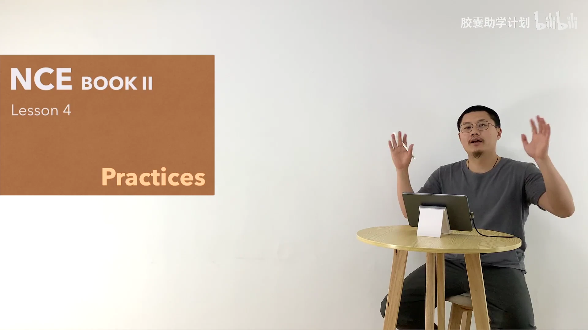

文字识别：Bilbii / 胶囊助学计划 / NCE / BOOKⅡI / Lesson 4 / Practices

### 画面 00:00:02

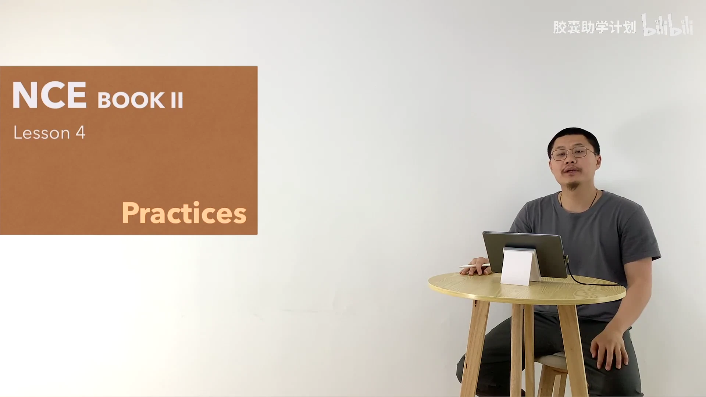

文字识别：Bitbit / 胶囊助学计划 / NCE / BOOKII / Lesson 4 / Practices

### 画面 00:00:05

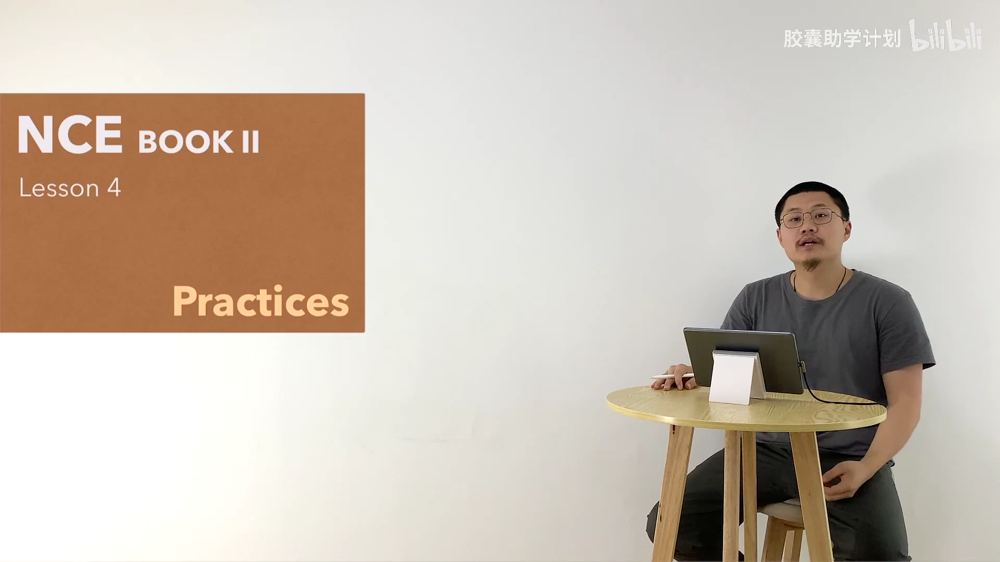

文字识别：Bilbii / 胶囊助学计划 / NCE / BOOKII / Lesson 4 / Practices

### 画面 00:00:09

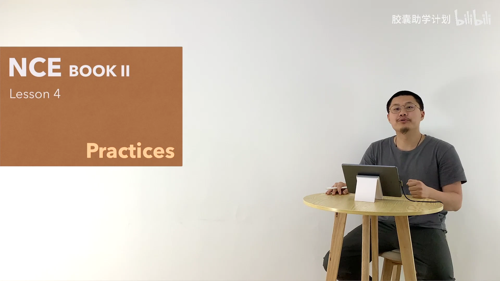

文字识别：BitBli / 胶囊助学计划 / NCE / BOOKII / Lesson 4 / Practices

### 画面 00:00:11

文字识别：胶囊助学计划bill

### 画面 00:00:15

### 画面 00:00:17

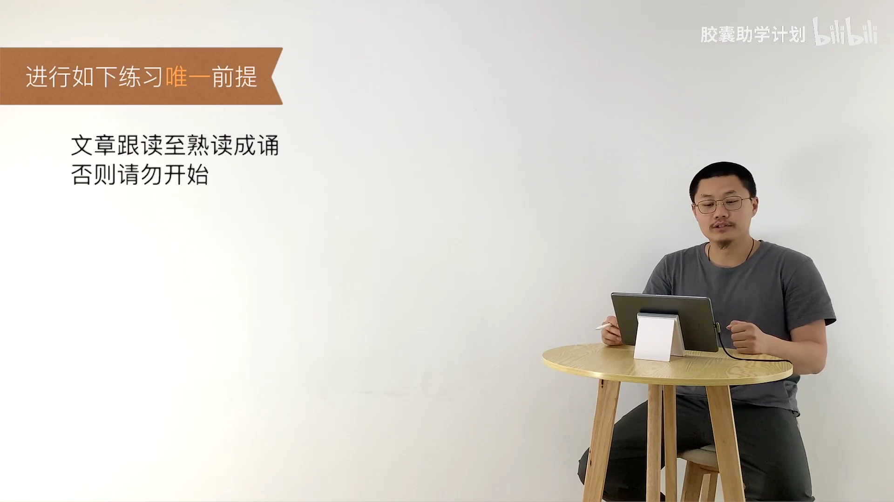

文字识别：Bitbili / 胶囊助学计划 / 进行如下练习唯一前提 / 文章跟读至熟读成诵 / 否则请勿开始

### 画面 00:00:24

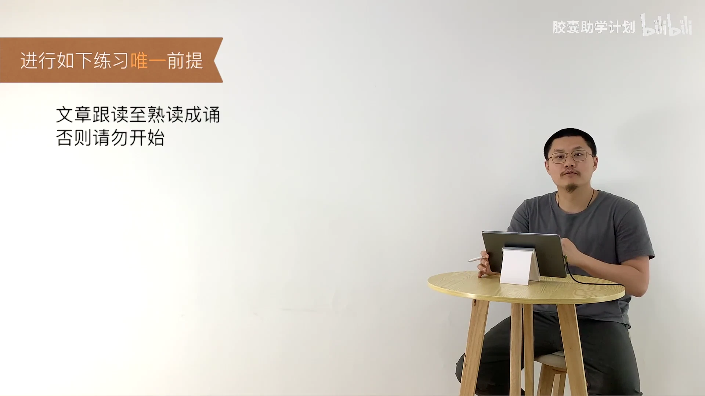

文字识别：Bitbii / 胶囊助学计划 / 进行如下练习唯一前提 / 文章跟读至熟读成诵 / 否则请勿开始

### 画面 00:00:26

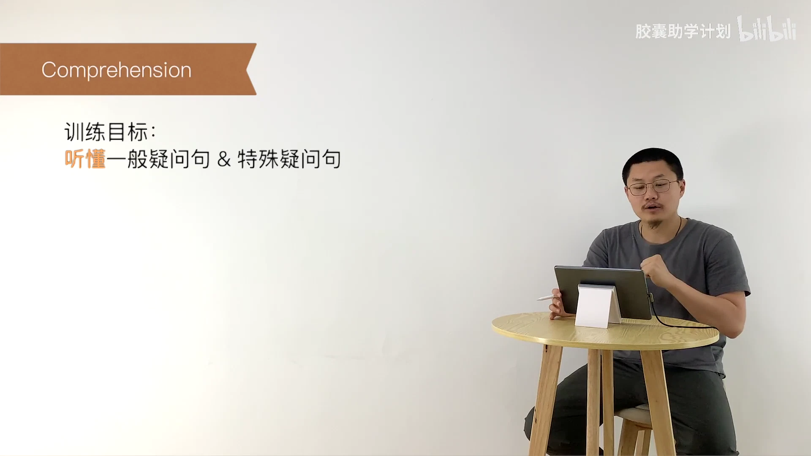

文字识别：bilbili / 胶囊助学计划 / Comprehension / 训练目标： / 听懂一般疑问句＆特殊疑问句

## 00:00:30–00:01:00

特殊疑问句。这个时候各位可以去看书了，或者闭上眼睛听我问的问题，然后口语给出答案来了。Have you just received a letter? 答案 Yes, I have. Next one. Was it from your sister or your brother? From my brother. Is he in

### 画面 00:00:38

文字识别： bitbili / 胶囊助学计划 / Comprehension / Have you just received a letter?

### 画面 00:00:54

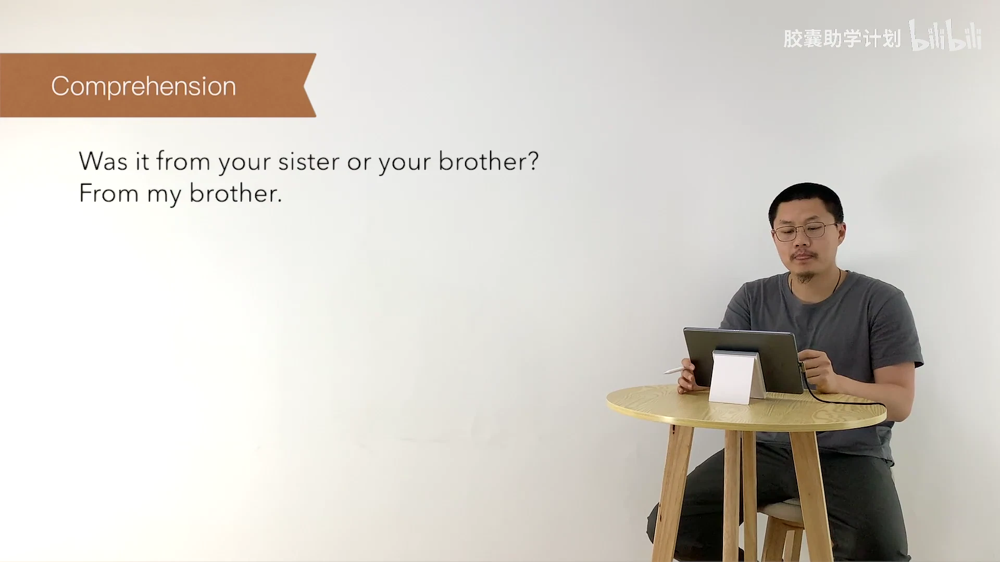

文字识别：bilbili / 胶囊助学计划 / Comprehension / Was it from your sister or your brother? / From my brother.

### 画面 00:00:59

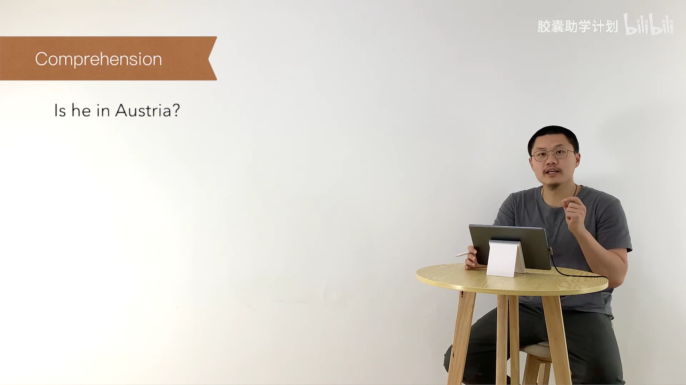

文字识别：胶囊助学计划出 / Comprehension / Is he in Austria?

## 00:01:00–00:01:30

Australia?注意不是Australia，是Australia. No, he isn't. Where is he? Australia. What's his job? He's an engineer.您直接给我说an engineer或者engineer也都是对的. Isn't he a mechanic?

### 画面 00:01:29

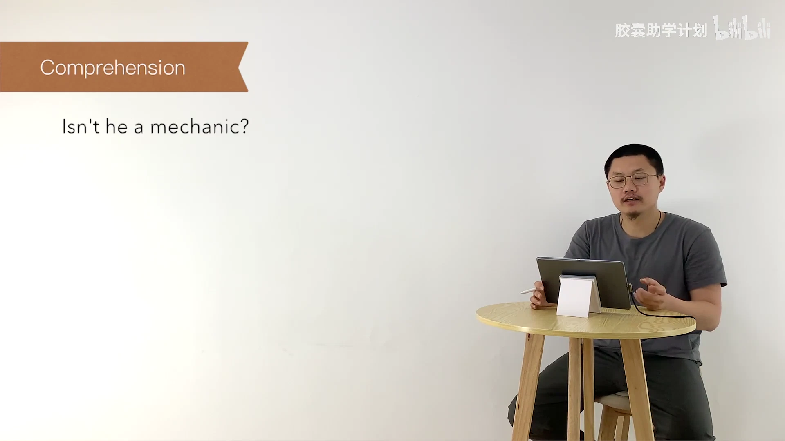

文字识别：胶囊助学计划出 / Comprehension / Isn't he a mechanic?

## 00:01:30–00:02:00

No, he isn't. Who is he working for? A big firm. 接下来 asking questions. 训练目标会说一般疑问句和特殊疑问句。我们上来还是先看一个例例子。I've just received a letter. 现在完成时变一般疑问句。Have提前，注意后边

### 画面 00:01:41

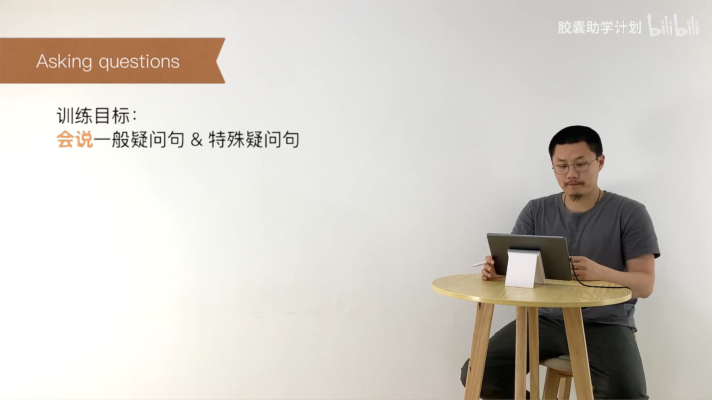

文字识别：胶囊助学计划 / Asking questions / 训练目标： / 会说一般疑问句＆特殊疑问句

### 画面 00:01:48

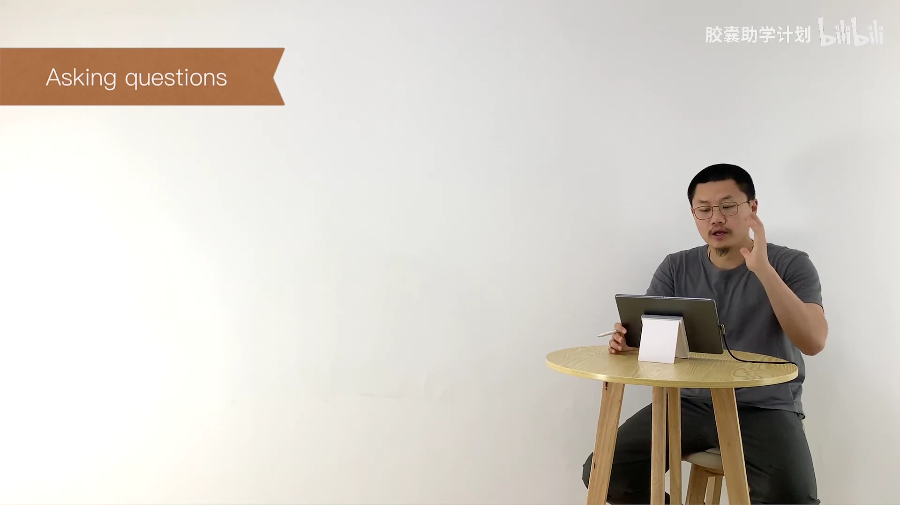

文字识别： bi / 胶囊助学计划 / Asking questions

### 画面 00:01:51

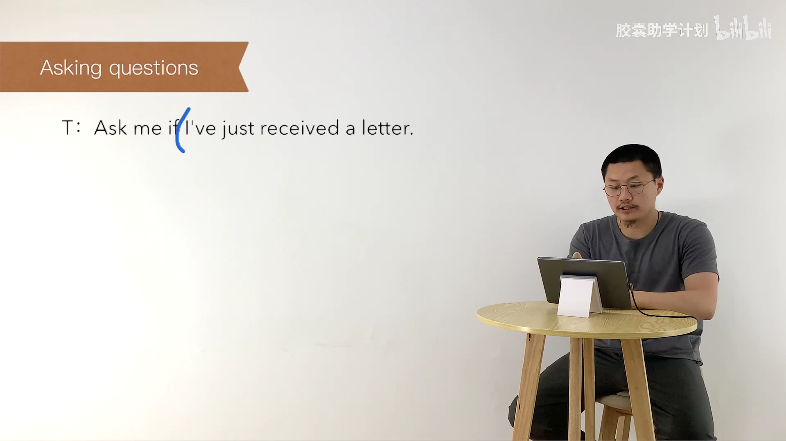

文字识别：bibii / 胶囊助学计划 / Asking questions / T: Ask me if'ive just received aletter.

### 画面 00:01:56

文字识别：bilibili / 胶囊助学计划 / Asking questions / T: Ask me if've just received a ltter. / S: Have youjust received a letter?

## 00:02:00–00:02:30

的 done，也就是过去分词，不要变啊。Have you just received a letter? What? 那肯定是对 a letter 提问了，对吧？What have you just received? 你刚刚收到的是什么？好，接下来我们看第一题讲过，第二。It was from my brother Tim，肯定是 was 提前，对吧？那 who? My brother Tim 提问。接下来 he's in Australia。

### 画面 00:02:00

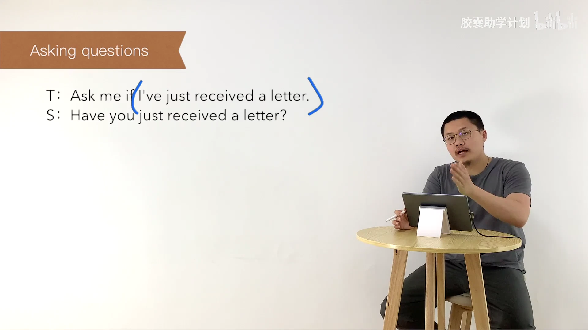

文字识别：胶囊助学计划 / Asking questions / T: Ask me if've just received altter. / S: Have youjust received a letter?

### 画面 00:02:05

文字识别：bilbli / 胶囊助学计划 / Asking questions / T: Ask me ifI've just received aletter. / S: Have youjust received a letter? / T: What ...?

### 画面 00:02:12

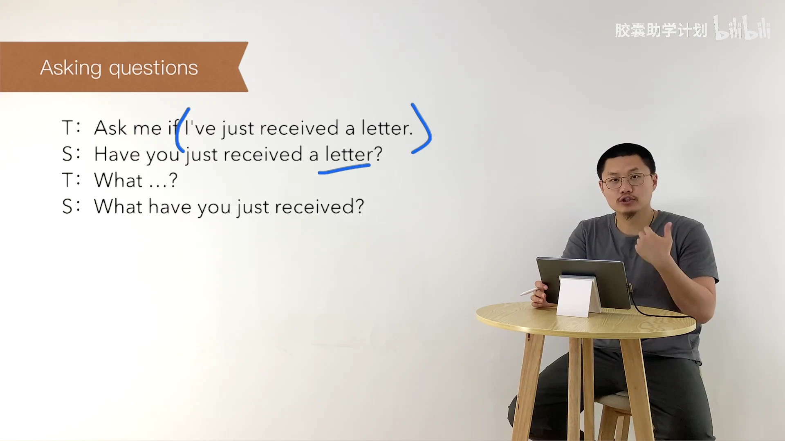

文字识别：biltbili / 胶囊助学计划 / Asking questions / T: Ask me ifl've just received a letter. / S: Have you just received a letter? / T: What ...? / S: What have you just received?

### 画面 00:02:14

文字识别：胶囊助学计划l / Asking questions

### 画面 00:02:17

文字识别：biibili / 胶囊助学计划 / Asking questions / 1 I've just received a letter. (What) / 2 It was from my brother, Tim. (Who)

### 画面 00:02:20

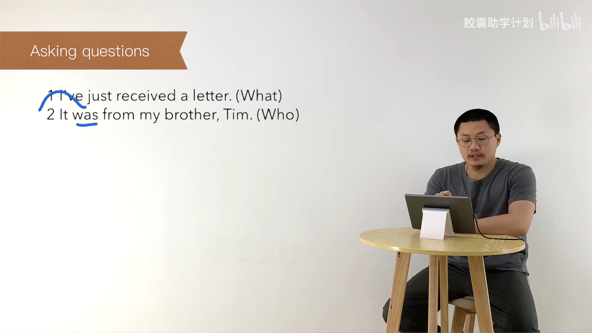

文字识别：bilibili / 胶囊助学计划 / Asking questions / 1e just received a letter. (What) / 2 It was from my brother, Tim.(Who)

### 画面 00:02:24

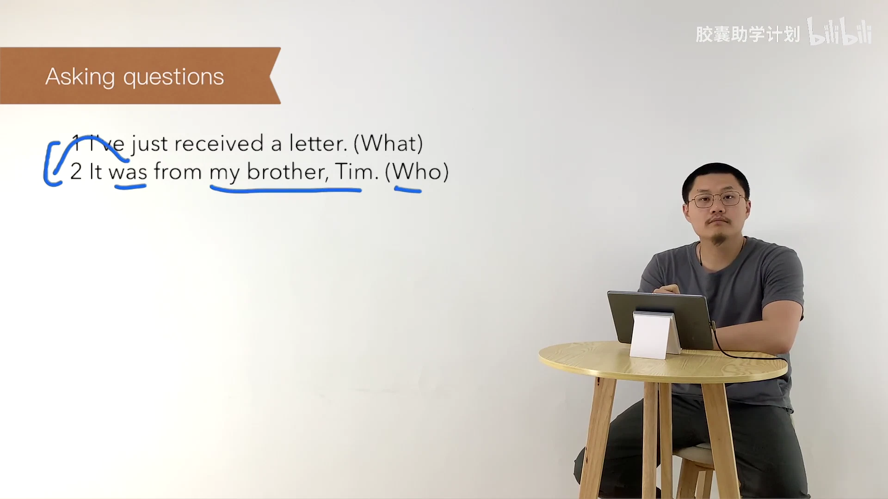

文字识别：biltbili / 胶囊助学计划 / Asking / questions / 2 It was from my brother, Tim.(Who)

### 画面 00:02:28

文字识别：bilbili / 胶囊助学计划 / Asking questions / 3 He's in Australia. (Where) (Who)

## 00:02:30–00:03:00

好了，注意那 P S.这个是 has 还是 is？你去想一下，是 is 对吧？提前 Where 对 in Australia 提问，Who 对主语提问，直接替代就行了。说 He's been there for six months.好，注意 P S.在这个地方，注意后边还有一个 been 啊，它是 has 对吧？Has 提前 How long 对 for six months 提问。He's an engineer.啊，我在这儿讲

### 画面 00:02:30

文字识别： bilbili / 胶囊助学计划 / Asking questions / 1 I've just received a letter. (What) / 2 It was from my brother, Tim.(Who) / 3 He's in Australia. (Where) (Who)

### 画面 00:02:36

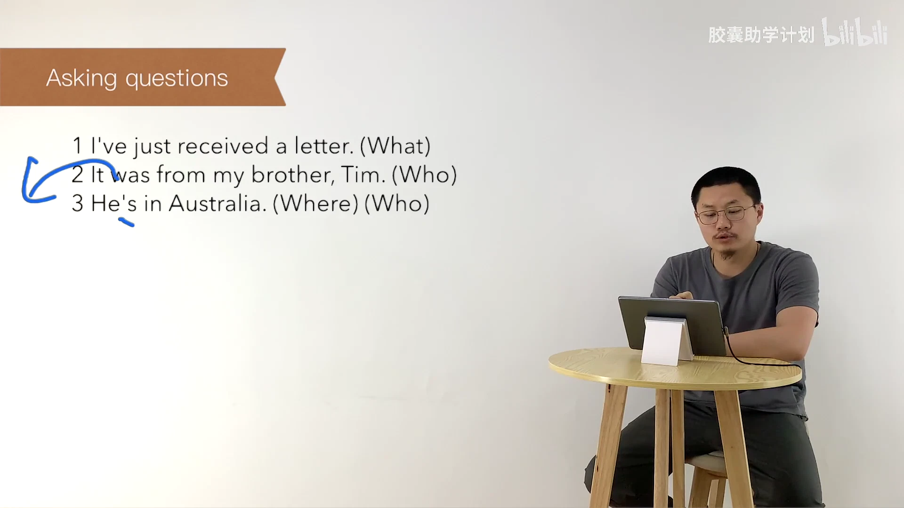

文字识别：biibili / 胶囊助学计划 / Asking questions / 1 I've just received a letter. (What) / 2 Tt was from my brother, Tim.(Who) / 3 He's in Australia. (Where) (Who)

### 画面 00:02:42

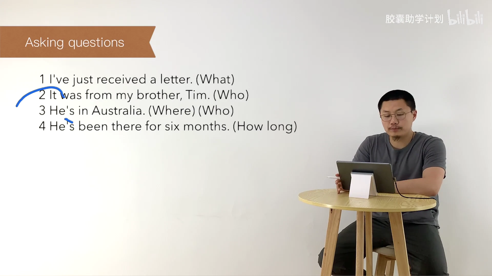

文字识别：bibi / 胶囊助学计划 / Asking questions / 1 I've just received a letter. (What) / 2 It was from my brother, Tim.(Who) / 3 He's in Australia. (Where) (Who) / 4 He's been there for six months. (How long)

### 画面 00:02:46

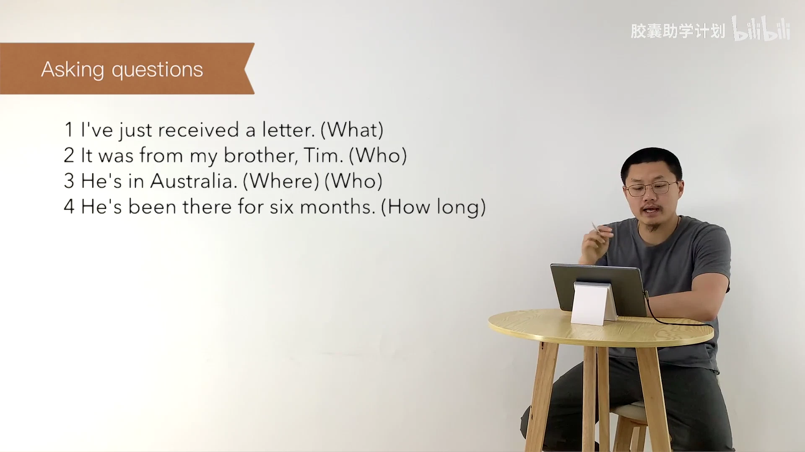

文字识别：胶囊助学计划bi出 / Asking questions / 1 I've just received a letter. (What) / 2 It was from my brother, Tim. (Who) / 3 He's in Australia. (Where) (Who) / 4 He's been there for six months. (How long)

### 画面 00:02:55

文字识别：胶囊助学计划bl出 / Asking questions / 1 I've just received a letter. (What) / 2 It was from my brother, Tim. (Who) / 3 He's in Australia.(Where) (Who) / 4 He's been there for six monthg. / (How long)

## 00:03:00–00:03:30

more about the idea. Is he an engineer? This what you have to turn it into what is he? It's a little strange. This question, you guys, just turn it into what's his job? Okay, I'll give you the answer directly. Next question, this PS is, right? Is before who? For the subject question, directly replace. In fact, who can also ask a big form? You turn it into a person, right? Person, you turn it into a person. Who is?

### 画面 00:03:09

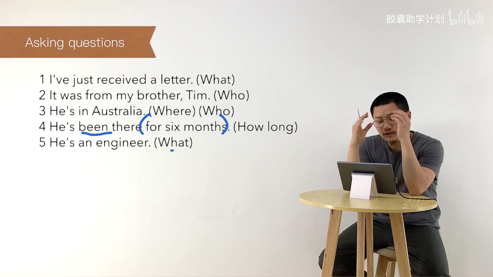

文字识别：胶囊助学计划bi / Asking questions / 1 I've just received a letter. (What) / 2 It was from my brother, Tim. (Who) / 3 He's in Australia. (Where) (Who) / 4 He's been there for six monthg. / (How long) / 5 He's an engineer. (What)

### 画面 00:03:15

文字识别：bilbili / 胶囊助学计划 / Asking questions / 1 I've just received a letter. (What) / 2 It was from my brother, Tim.(Who) / 3 He's in Australia.(Where) (Who) / 4 He's been there for six monthg. / (How long) / 5 He's an engineer. (What)

### 画面 00:03:17

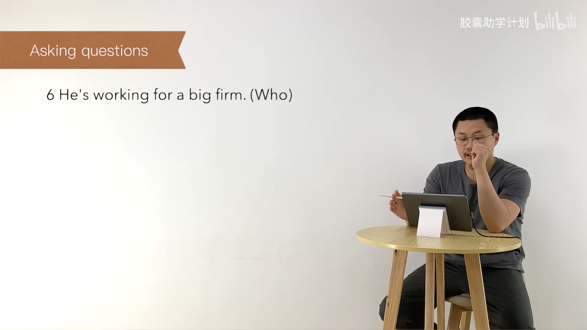

文字识别：biltbili / 胶囊助学计划 / Asking questions / 6 He's working for a big firm. (Who)

### 画面 00:03:20

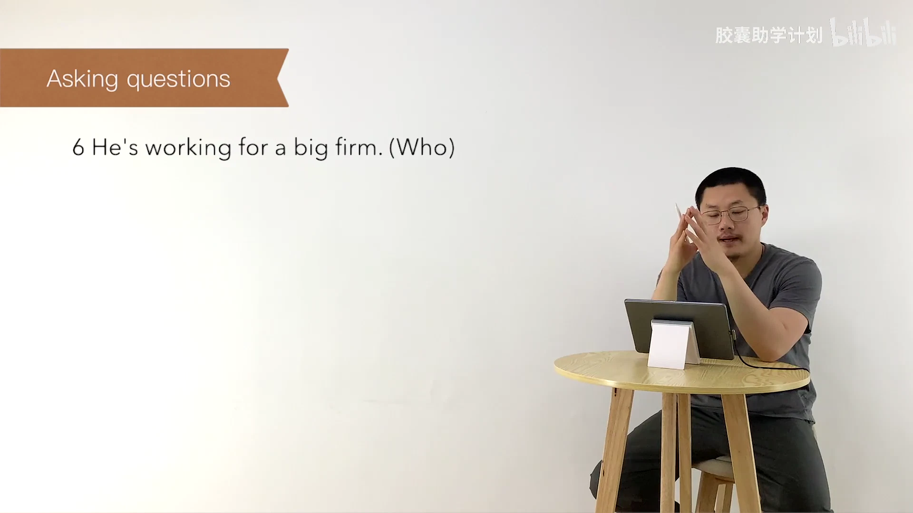

文字识别：胶囊助学计划 / Asking questions / 6 He's working for a big firm.(Who)

### 画面 00:03:27

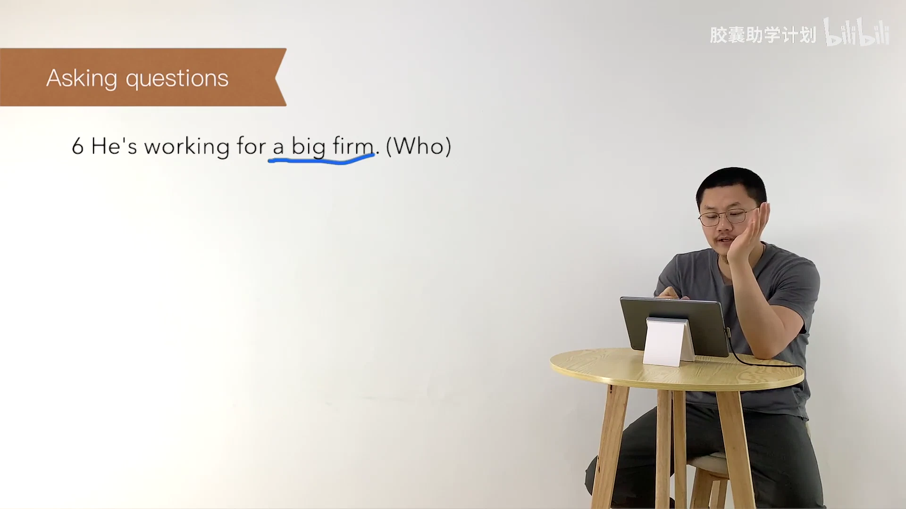

文字识别：biibili / 胶囊助学计划 / Asking questions / 6 He's working for a big firm. (Who)

## 00:03:30–00:04:00

人来把它拟人化。 Who is he working for? He is just bought. P.S. Is还是has呢？看bought has提前。 What什么对an Australian car提问？ He is going to, gone出来了。 Has提前。 Where对to Alice Springs提问，对吧？他去了哪儿？ It's

### 画面 00:03:45

文字识别：biltbil / 胶囊助学计划 / Asking questions / 6 He's working for a big firm. (Who) / 7 He's just boughtan Australian car. (What)

### 画面 00:03:49

文字识别：Biltbili / 胶囊助学计划 / Asking / questions / 6 He's working for a big firm. (Who) / 7 He's just  /  boughtan Australian car. / (What) / 8 He's just / gone to Atice / Springs. (Where)

### 画面 00:03:51

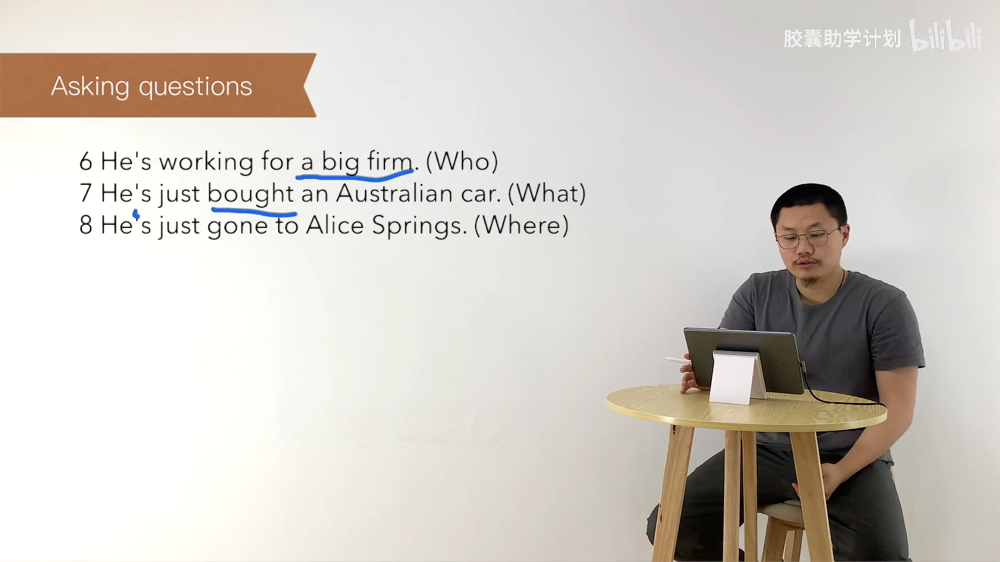

文字识别：Bitbii / 胶囊助学计划 / Asking / questions / 6 He's working for a big firm. (Who) / 7 He's just bought / an Australian car. (What) / 8 He's just / gone to / Alice / Springs.(Where)

### 画面 00:03:54

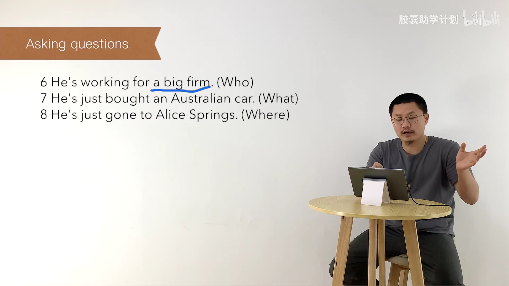

文字识别：biltibili / 胶囊助学计划 / Asking questions / 6 He's working for a big firm. (Who) / 7 He's just bought an Australian car. (What) / 8 He's just gone to Alice Springs. (Where)

### 画面 00:03:56

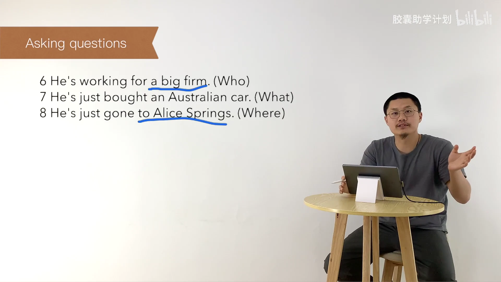

文字识别：bilbili / 胶囊助学计划 / Asking questions / 6 He's working for a big firm. (Who) / 7 He's just bought an Australian car. (What) / 8 He's just gone to Alice Springs. (Where)

## 00:04:00–00:04:30

It's a small town. Is提前注意 how big?问多大？那小就是它的答案，对吧？那肯定是对small提问，但是同时 how big?你要带着这个town， how big town is it?如果你不带着它是什么样的？那就是 how big is it town?翻译不通的啊， how big town is it?或者说 how big is the town?这个可能是我们更常用的一个，但并不是这

### 画面 00:04:03

文字识别：bilt ili / 胶囊助学计划 / Asking questions / 6 He's working for a big firm. (Who) / 7 He's just bought an Australian car. (What) / 8 He's just gone to Alice Springs. (Where) / 9 It's a small town. (How big)

### 画面 00:04:07

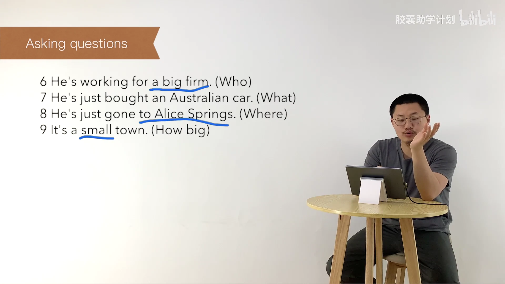

文字识别：biltbili / 胶囊助学计划 / Asking questions / 6 He's working for a big firm. (Who) / 7 He's just bought an Australian car. (What) / 8 He's just gone to Alice Springs. (Where) / 9 It's a small town.(How big)

### 画面 00:04:27

文字识别：biltibili / 胶囊助学计划 / Asking questions / 6 He's working for a big firm. (Who) / 7 He's just bought an Australian car. (What) / 8 He's just gone to Alice Springs. (Where) / 9 It's a small town. (How big)

## 00:04:30–00:05:00

句话变过来的。Okay, he will soon visit Darwin. P L L will提前when你看这里没有时间，整句话提问就可以了。那这道题就是这样。接下来我们看一下tell the story口语复述能力说了很多遍了，各位一定是文章熟读成诵之后再去做这个练习。我上课只给大家做一个示范。来了，I have just received a letter

### 画面 00:04:41

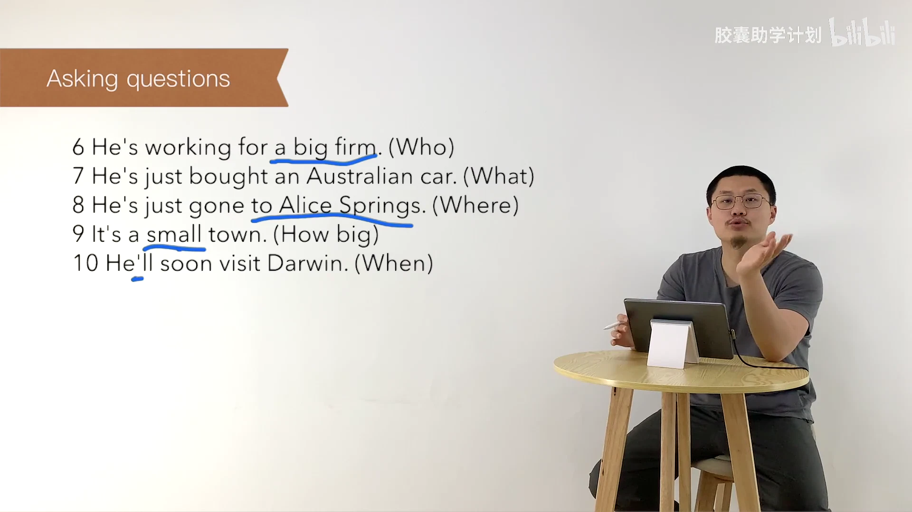

文字识别：bilibili / 胶囊助学计划 / Asking questions / 6 He's working for a big firm. (Who) / 7 He's just bought an Australian car. (What) / 8 He's just gone to Alice Springs. (Where) / 9 It's a small town. (How big) / 10 He'Il soon visit Darwin. (When)

### 画面 00:04:43

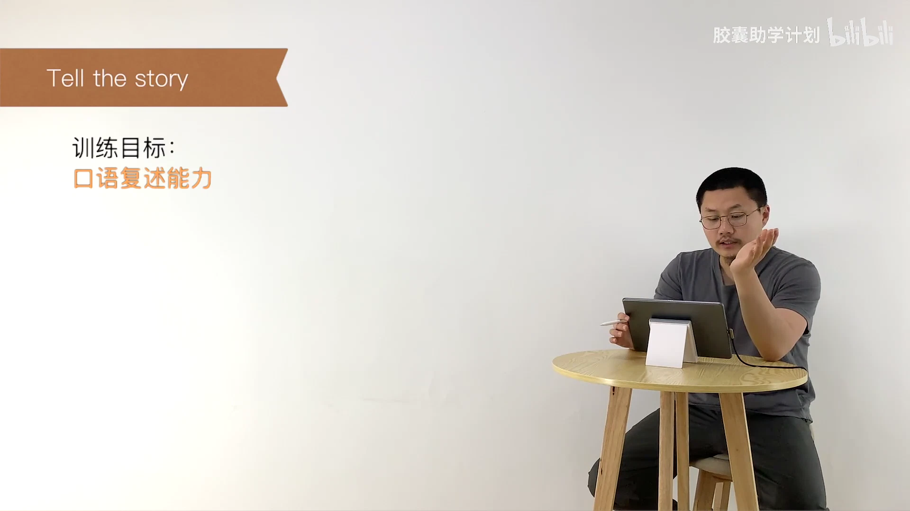

文字识别：Bitbii / 胶囊助学计划 / Tell the story / 训练目标： / □语复述能力

### 画面 00:04:46

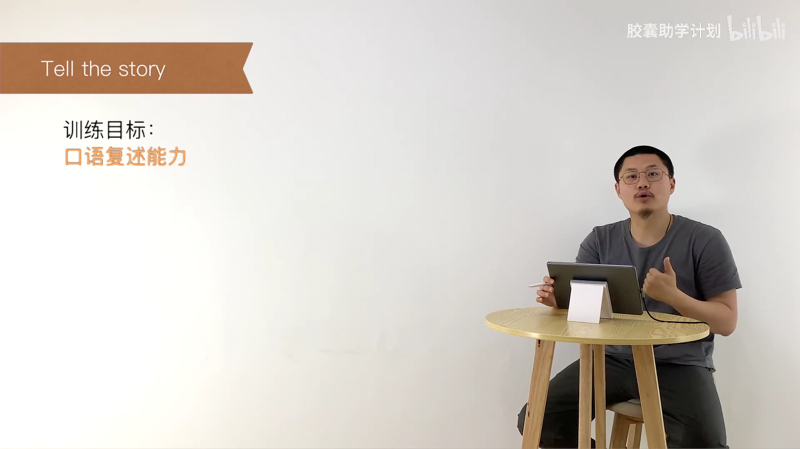

文字识别：BiiBili / 胶囊助学计划 / Tell the story / 训练目标： / 口语复述能力

### 画面 00:04:48

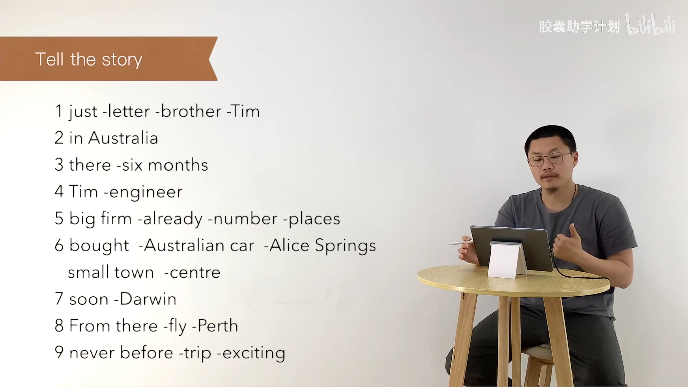

文字识别：胶囊助学计划l出 / Tell the story / 1 just -letter -brother -Tim / 2 in Australia / 3 there -six months / 4 Tim -engineer / 5 big firm -already -number -places / 6 bought -Australian car -Alice Springs / small town -centre / 7 soon -Darwin / 8 From there -fly -Perth / 9 never before -trip -exciting

### 画面 00:04:56

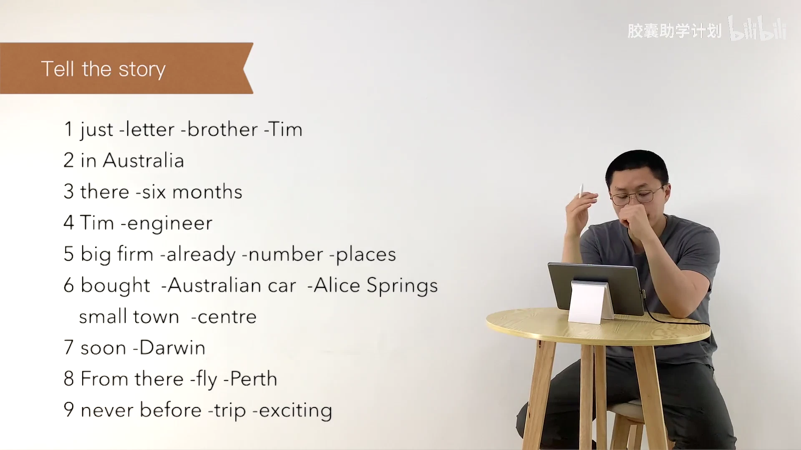

文字识别：胶囊助学计划bl / Tell the story / 1 just -letter -brother -Tim / 2 in Australia / 3 there -six months / 4 Tim -engineer / 5 big firm -already -number -places / 6 bought -Australian car -Alice Springs / small town -centre / 7 soon -Darwin / 8 From there -fly -Perth / 9 never before -trip -exciting

## 00:05:00–00:05:30

from my brother Tim. He is in Australia. He has been there for six months, and he is an engineer. He is working for a big firm, and he has already visited a great number of different places in Australia. He has just bought an Australian car and has gone to Alice Springs, and it is a very small town in the center of Australia. He will soon fly to Darwin, visit Darwin,

### 画面 00:05:26

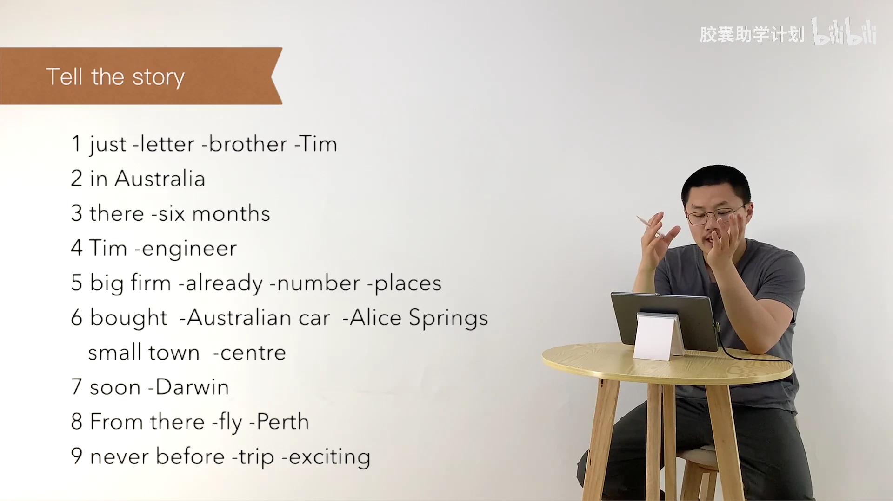

文字识别：胶囊助学计划bi山 / Tell the story / 1 just -letter -brother -Tim / 2 in Australia / 3 there -six months / 4 Tim -engineer / 5 big firm -already -number -places / 6 bought -Australian car -Alice Springs / small town -centre / 7 soon -Darwin / 8 From there -fly -Perth / 9 never before -trip -exciting

## 00:05:30–00:06:00

and from there, from Darwin, of course, he will fly to Perth. He has never been abroad before, so he finds this trip very exciting. Very good. 那各位课下要自己去做这个练习。接下来 summary writing, 每个文章的后面都有摘要写作，自己各位课下去做这个练习。这儿只提供了答案，我们不做过多的讲解。写作的复述练习也要完成，好吧？接下来 topic for discussion, 这是各

### 画面 00:05:41

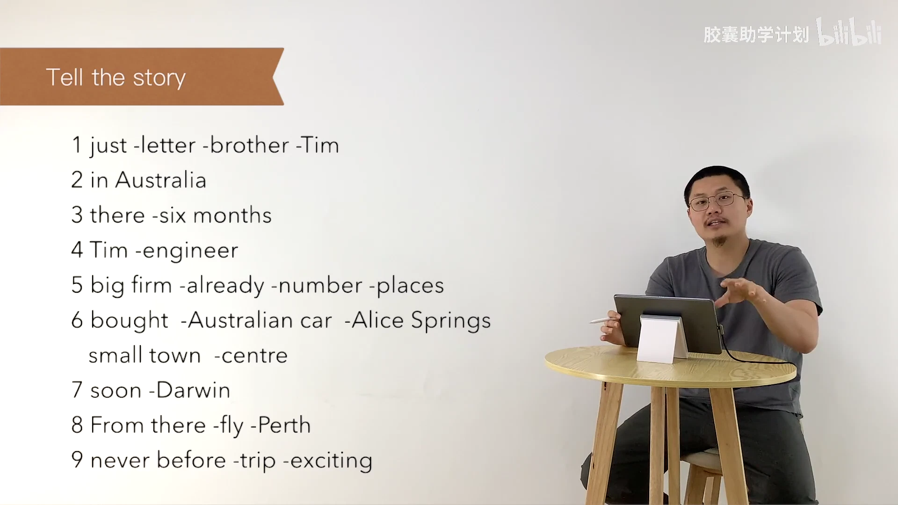

文字识别：胶囊助学计划b山 / Tell the story / 1 just -letter -brother -Tim / 2 in Australia / 3 there -six months / 4 Tim -engineer / 5 big firm -already -number -places / 6 bought -Australian car -Alice Springs / small town -centre / 7 soon -Darwin / 8 From there -fly -Perth / 9 never before -trip -exciting

### 画面 00:05:43

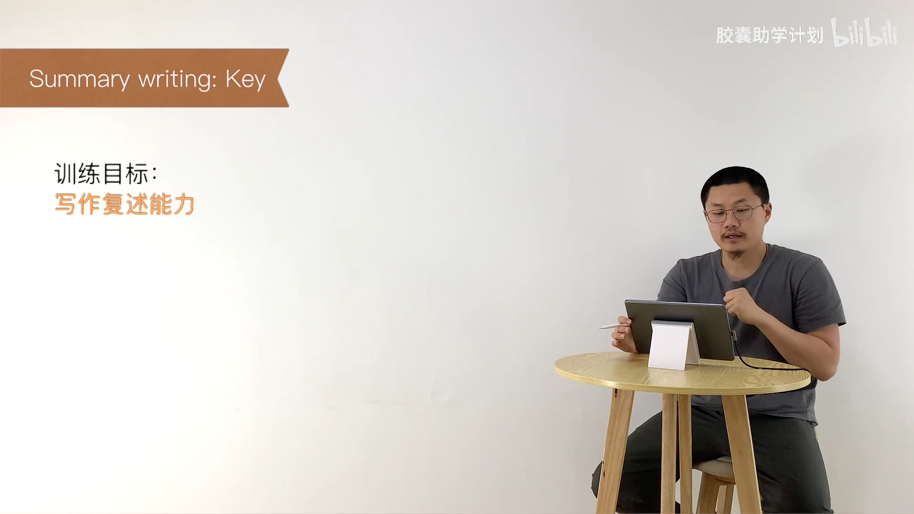

文字识别：bitBili / 胶囊助学计划 / Summary writing: Key / 训练目标： / 写作复述能力

### 画面 00:05:48

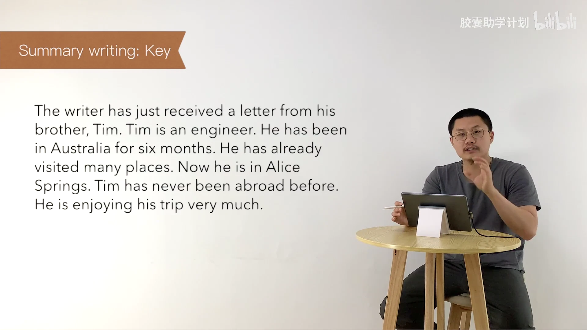

文字识别：胶囊助学计划blb山 / Summary writing: Key / The writer has just received a letter from his / brother, Tim. Tim is an engineer. He has been / in Australia for six months. He has already / visited many places. Now he is in Alice / Springs. Tim has never been abroad before. / He is enjoying his trip very much.

### 画面 00:05:57

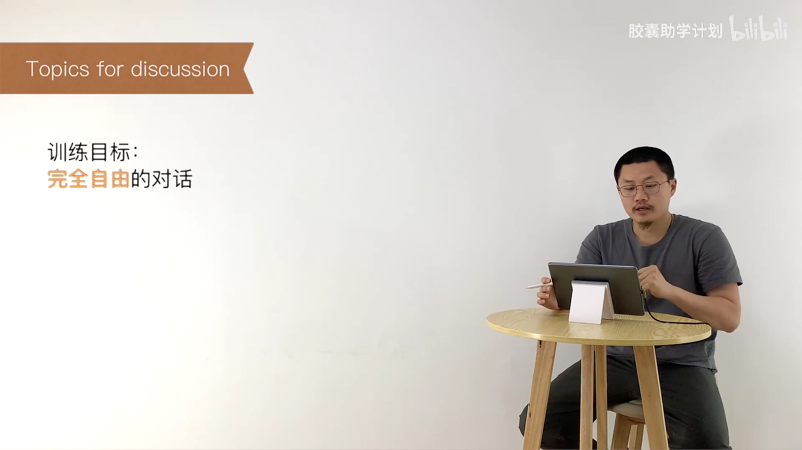

文字识别：bitbii / 胶囊助学计划 / Topics for discussion / 训练目标： / 完全自由的对话

## 00:06:00–00:06:30

位的最终目的啊。我们看一下题就可以了。上一期视频的练习当中，我刚跟各位讲过，说不妨各位现在如果用英文没办法完全表达呢，您不妨先用汉语试着表达一下。好，说 Do you know anyone who lives or works abroad? 你认识任何人在国外生活或工作吗？Tell us about him or about her. 给我讲讲关于他的事情吧。Which country would

### 画面 00:06:01

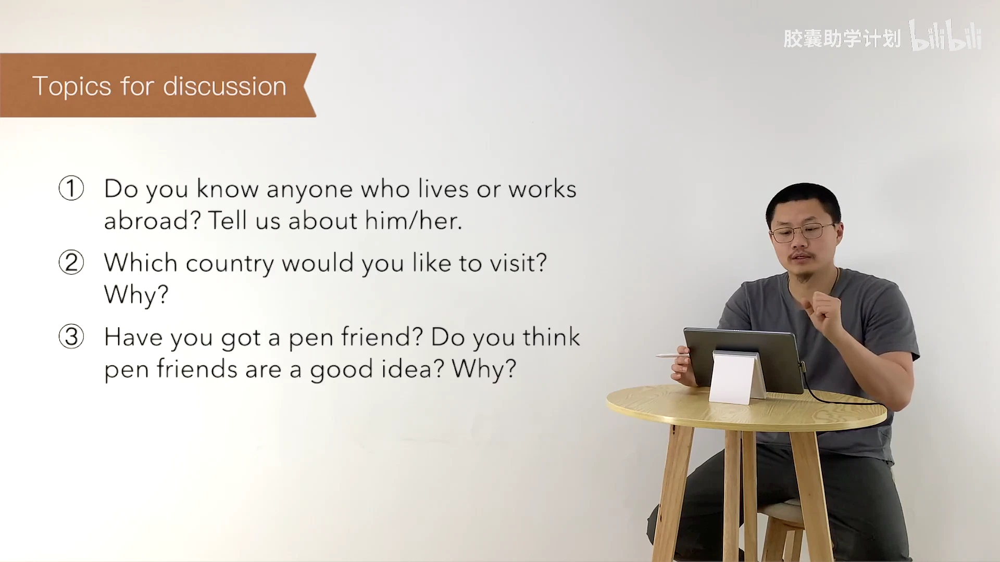

文字识别：胶囊助学计划b#出 / Topics for discussion / Do you know anyone who lives or works / abroad? Tell us about him/her. / Which country would you like to visit? / Why? / Have you got a pen friend? Do you think / pen friends are a good idea? Why?

### 画面 00:06:04

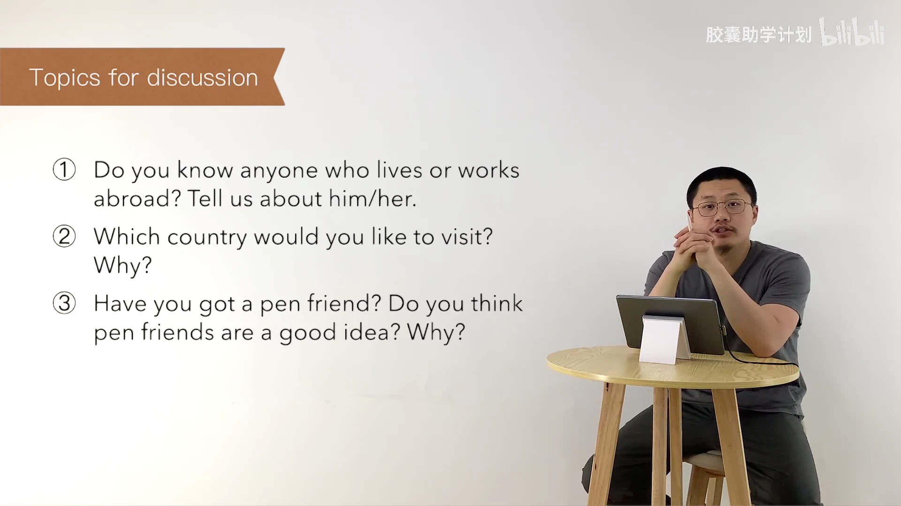

文字识别：胶囊助学计划l出 / Topics for discussion / Do you know anyone who lives or works / abroad? Tell us about him/her. / Which country would you like to visit? / Why? / Have you got a pen friend? Do you think / pen friends are a good idea? Why?

### 画面 00:06:16

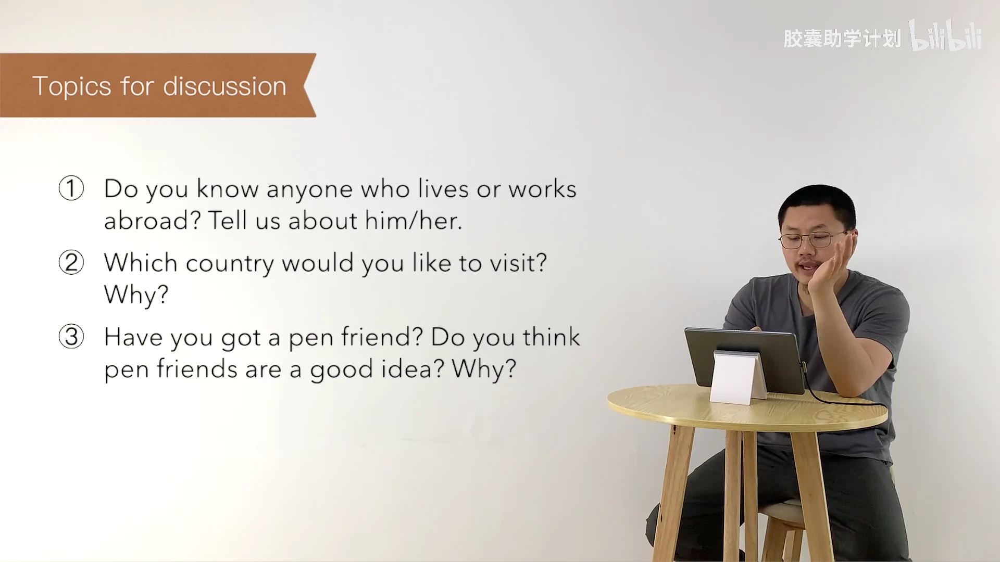

文字识别：胶囊助学计划l出 / Topics for discussion / Do you know anyone who lives or works / abroad? Tell us about him/her. / Which country would you like to visit? / Why? / Have you got a pen friend? Do you think / pen friends are a good idea? Why?

## 00:06:30–00:07:00

you like to visit? Why? 你想去哪个国家参观呢？关键点来了，Why? 为什么，对吧？这才是我们聊下去的重点。否则你直接给一个答案，Japan, New Zealand, American, Australia，对吧？没什么可聊的，一定是要给别人说个一二三的，才能聊起来。你不妨先用汉语试一下。Have you got a pen friend? Pen friend,笔友，对吧？那现在可能就不是pen friend，现在

### 画面 00:06:39

文字识别： bilbili / 胶囊助学计划 / Topics for discussion / Do you know anyone who lives or works / abroad? Tell us about him/her. / Which country would you like to visit? / Why? / 3 / Have you got a pen friend? Do you think / pen friends are a good idea? Why?

### 画面 00:06:42

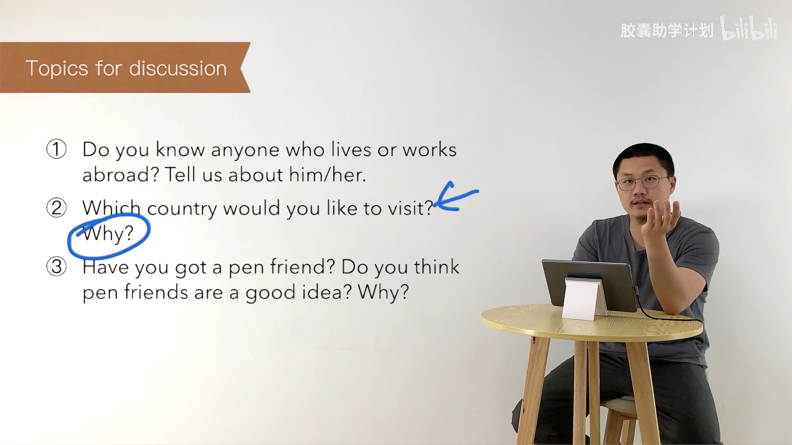

文字识别： biltbil / 胶囊助学计划 / Topics for discussion / Do you know anyone who lives or works / abroad? Tell us about him/her. / Which country would you like to visit? / Why? / Have you got a pen friend? Do you think / pen friends are a good idea? Why?

### 画面 00:06:56

文字识别：biibili / 胶囊助学计划 / Topics for discussion / Do you know anyone who lives or works / abroad? Tell us about him/her. / Which country would you like to visit? / Why? / Have you got a pen friend? Do you think / pen friends are a good idea? Why?

## 00:07:00–00:07:30

就类似于网友，网上聊天的朋友。 Do you think pen friends are a good idea? 你认为这是一个好主意吗？关键点又来了， Why? 大多数情况下，只有 Why 才能让我们真正的聊下去。 OK, 好，那我们看一下家庭作业， Ask me if 这道题，各位要去写下来，并且大声朗读出来。我课上只是告诉大家思路是什么，您要自己必须去做这个练习。接下来摘要写作，写

### 画面 00:07:07

文字识别：bil Bili / 胶囊助学计划 / Topics for discussion / Do you know anyone who lives or works / abroad? Tell us about him/her. / Which country would you like to visit? / Why? / Have you got a pen friend? Do you think / pen friends are a good idea? Why?

### 画面 00:07:09

文字识别：bilbili / 胶囊助学计划 / Topics for discussion / Do you know anyone who lives or works / abroad? Tell us about him/her. / Which country would you like to visit? / Why? / Have you got a pen friend? Do you think / pen friends are a good ideaWhy?

### 画面 00:07:15

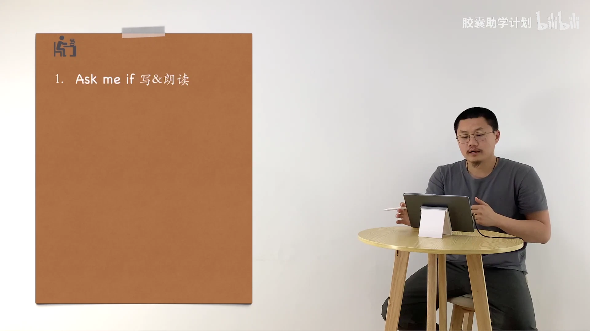

文字识别：胶囊助学计划bi / 1.Ask me if写&朗读

### 画面 00:07:18

文字识别：胶囊助学计划bl出 / 1.Ask me if写&朗读

### 画面 00:07:20

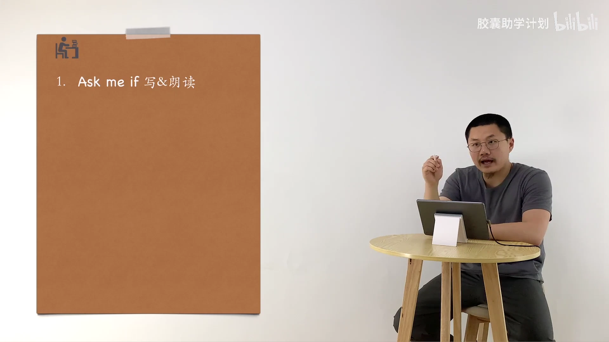

文字识别： biltbili / 胶囊助学计划 / 1.Ask me if写&朗读

### 画面 00:07:25

文字识别：u bib / 胶囊助学计划 / 1.Ask me if写&朗读

### 画面 00:07:28

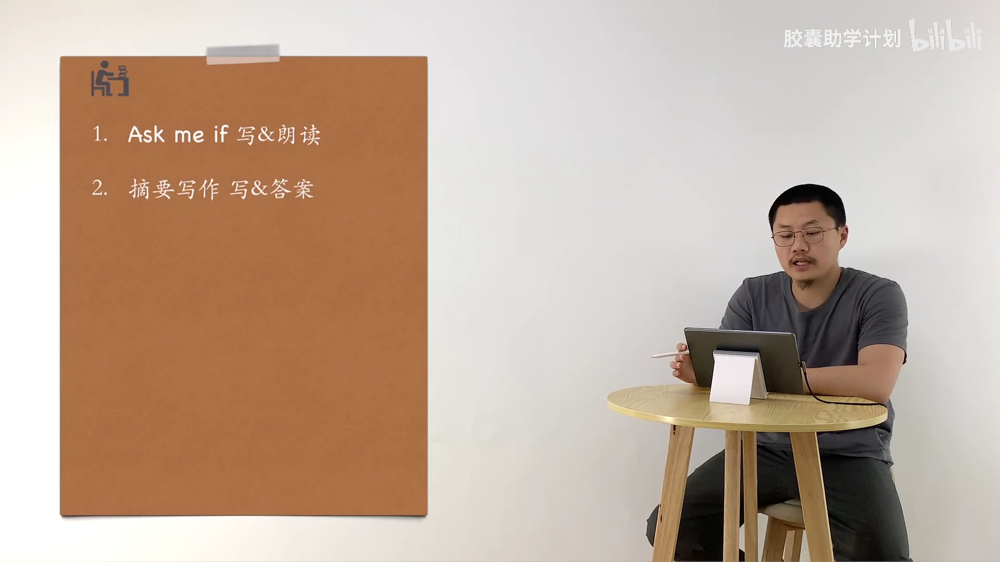

文字识别：胶囊助学计划 / 1.Ask me if写&朗读 / 2.摘要写作写&答案

## 00:07:30–00:08:00

完，找专栏对一下答案。Tell the story，口语要进行一个复述。专栏部分大家可以找到这些题。以上呢就是本期视频的全部内容了。大家如果喜欢我们的课程呢，欢迎关注、订阅、一键三连支持，并分享给那些需要的朋友们。See you next time.

### 画面 00:07:30

文字识别：bibili / 胶囊助学计划 / 宁 / 1.Ask me if写&朗读 / 摘要写作写&答案 / 3.Tell the story 口语复述

### 画面 00:07:33

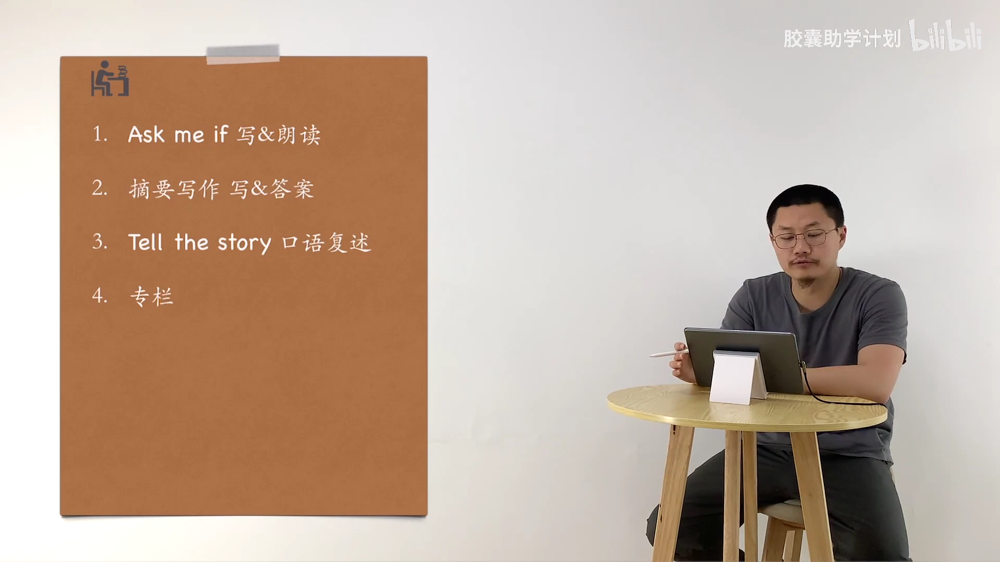

文字识别：Biibili / 胶囊助学计划 / 1.Ask me if写&朗读 / 摘要写作写&答案 / 3.Tell the story 口语复述 / 专栏 / 4.

### 画面 00:07:35

文字识别：BiBili / 胶囊助学计划 / 1.Ask me if写&朗读 / 摘要写作写&答案 / 3.Tell the story 口语复述 / 专栏 / 4.

### 画面 00:07:38

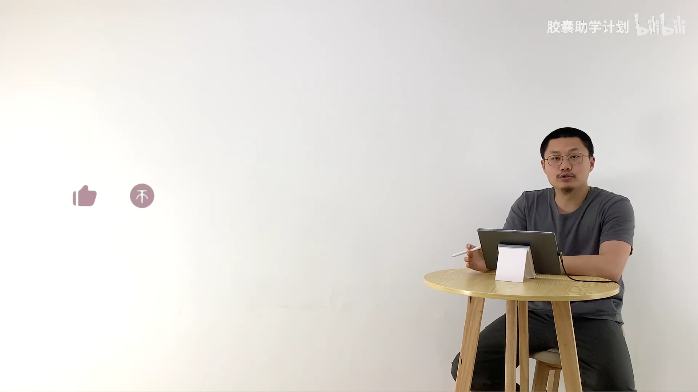

文字识别：胶囊助学计划bil

### 画面 00:07:49

文字识别：助学计划口 / ￥

### 画面 00:07:51

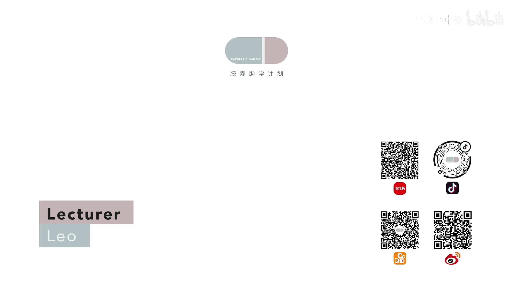

文字识别：CAPSULEACADEMY / 胶囊助学计划 / 小红书 / Lecturer / Leo

### 画面 00:07:54

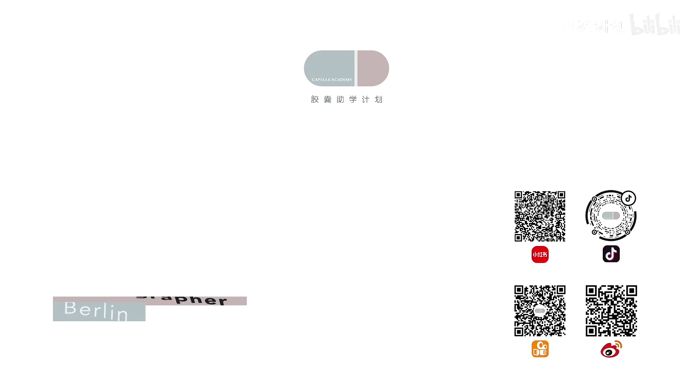

文字识别：CAPSULEACADEMY / 胶囊助学计划 / 小红书 / Berlin / pner

### 画面 00:07:57

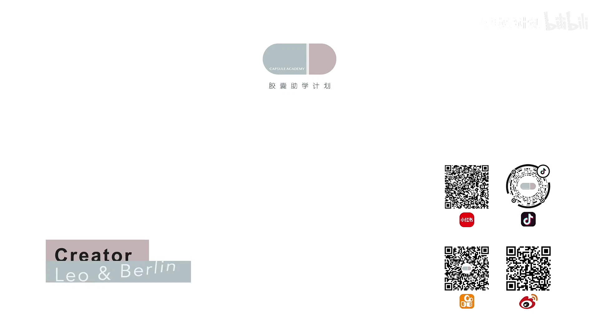

文字识别：CAPSULEACADEMY / 胶囊助学计划 / 小红书 / Creator / Leo & Berlin

## 00:08:00–00:08:02

### 画面 00:08:00

文字识别：bilibili / 胶囊助学计划

### 画面 00:08:01

文字识别：bilibili / 胶囊助学计划

