# L005 单词

快速机器解析：语音为单模型转写，未进行独立交叉校对或人工复核；画面每秒采样并按变化选帧，短时文字和标记可能遗漏。截图时间约有 1 秒误差。图片有损压缩；遇到疑点请按时间查看 Google Drive 原视频。

## 00:00:00–00:00:30

Hello everyone, welcome to Capsule Academy. This is Leo. Today we're going to learn New Concept English Book Two Lesson Five Words. 老习惯进入正式的课程之前呢，我们先看三个问题：一，如何表达留言；第二呢，如何去表达发送请求；最后一个，如何表达跨越一段距离。那带着这三个问题，Hope you gonna enjoy it.

### 画面 00:00:00

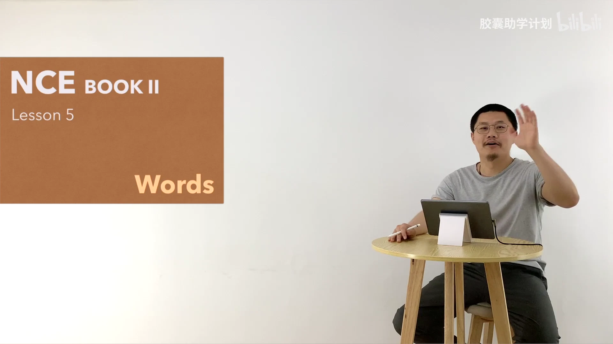

文字识别：胶囊助学计划 / NCE / BOOKII / Lesson 5 / Words

### 画面 00:00:02

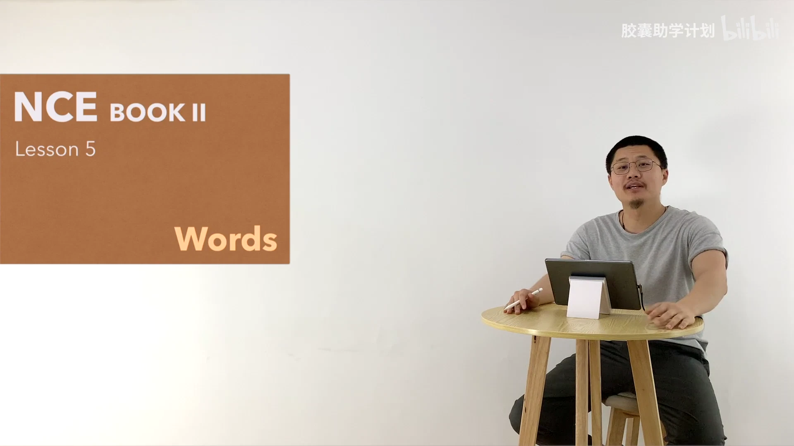

文字识别：胶囊助学计划 / NCE / BOOKII / Lesson 5 / Words

### 画面 00:00:05

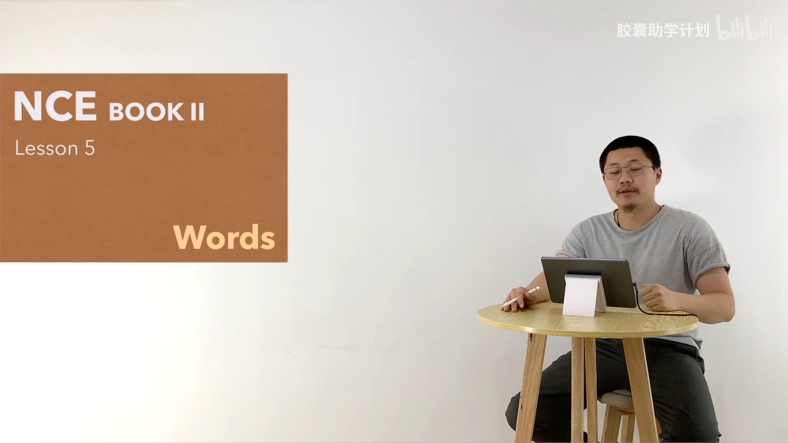

文字识别：胶囊助学计划 / NCE / BOOKI"I / Lesson 5 / Words

### 画面 00:00:08

文字识别：胶囊助学计划 / NCE / BOOKI"I / Lesson 5 / Words

### 画面 00:00:10

文字识别：胶囊助学计划

### 画面 00:00:12

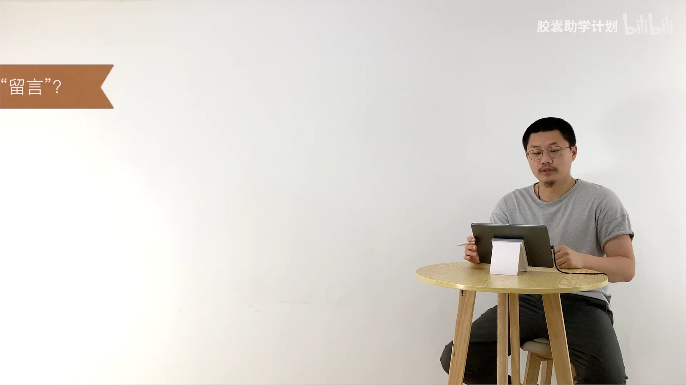

文字识别：胶囊助学计划 / 留言”?

### 画面 00:00:14

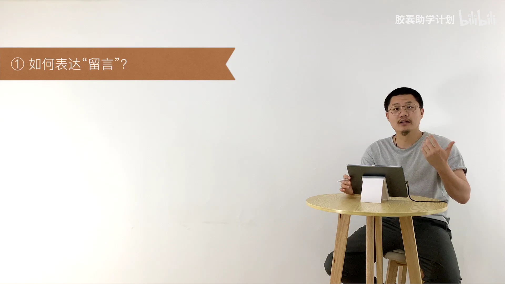

文字识别：胶囊助学计划 / ①如何表达“留言”?

### 画面 00:00:16

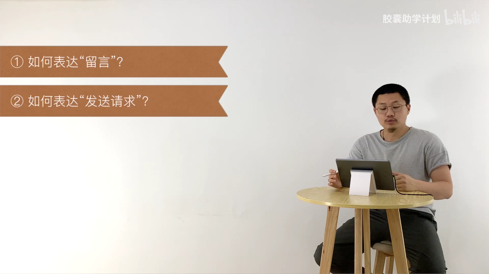

文字识别：胶囊助学计划 / ①如何表达“留言”？ / 如何表达“发送请求”?

### 画面 00:00:18

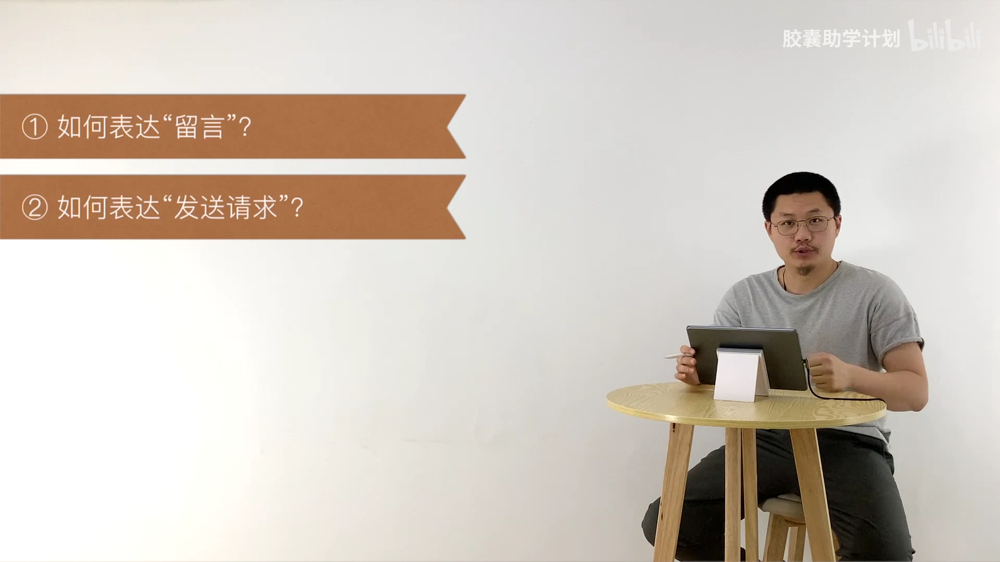

文字识别：胶囊助学计划 / ①如何表达“留言”？ / 如何表达“发送请求”?

### 画面 00:00:20

文字识别：胶囊助学计划 / ①如何表达“留言”？ / 如何表达“发送请求”? / 如何表达“跨越一段距离

### 画面 00:00:22

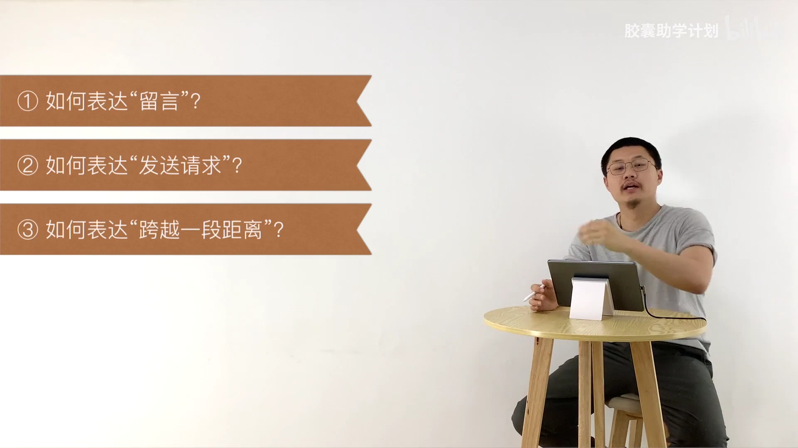

文字识别：胶囊助学计划 / ①如何表达“留言”？ / 如何表达“发送请求”? / 如何表达“跨越一段距离

### 画面 00:00:25

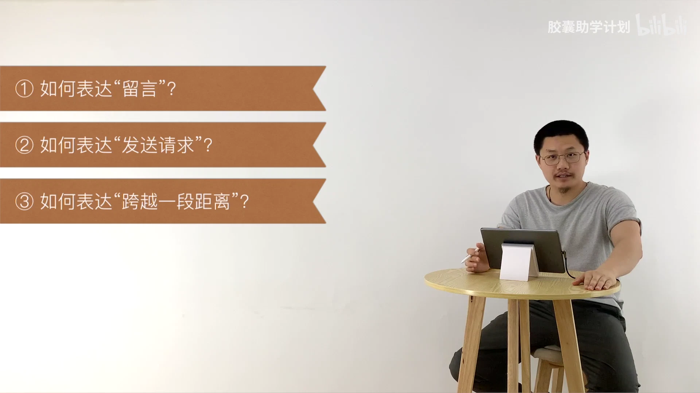

文字识别：胶囊助学计划 / ①如何表达“留言”？ / 如何表达“发送请求”? / 如何表达“跨越一段距离

### 画面 00:00:27

文字识别：胶囊助学计划bill

## 00:00:30–00:01:00

好，那上来我们先看第一本课的第一个小单词，跟我先读一下 pigeon， pigeon 啊，鸽子 pigeon，它是一个名词。那我们由单词造句的思路，我们是不是要想其他的单词，对吧？一个单词不成句子。那你见到名词了，就立刻要去想动词了，对吧？那在这个地方呢，我们去想一下哪些动词能跟 pigeon 连起来。我们之前提过一次，找动词的思路不是您自己

### 画面 00:00:30

### 画面 00:00:32

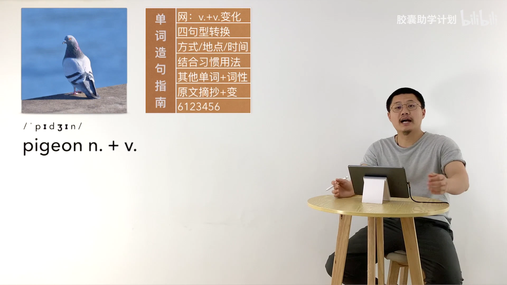

文字识别：单词造句指南 / 网：v.+v.变化 / 胶囊助学计划 / 四句型转换 / 方式/地点/时间 / 结合习惯用法 / 其他单词+词性 / 原文摘抄+变 / 6123456 / /'pid3in/ / pigeon n. + v.

### 画面 00:00:34

文字识别：单词造句指南 / 网：v.+v.变化 / 胶囊助学计划 / 四句型转换 / 方式/地点/时间 / 结合习惯用法 / 其他单词+词性 / 原文摘抄+变 / 6123456 / /'pid3in/ / pigeon n. + v.

### 画面 00:00:36

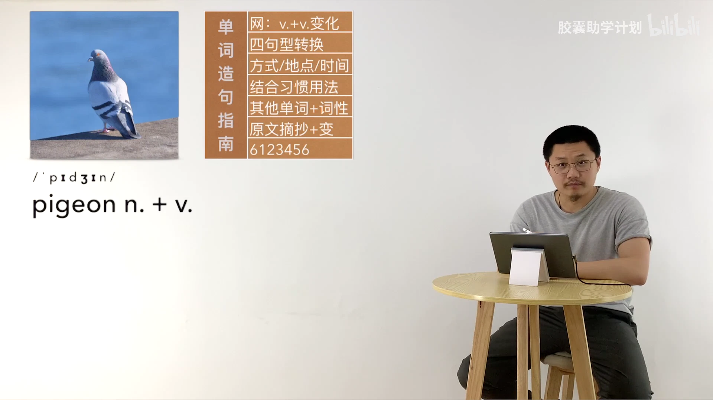

文字识别：单词造句指南 / 网：v.+v.变化 / 胶囊助学计划 / 四句型转换 / 方式/地点/时间 / 结合习惯用法 / 其他单词+词性 / 原文摘抄+变 / 6123456 / /'pid3in/ / pigeon n. + v.

### 画面 00:00:40

文字识别：单词造句指南 / 网：v.+v.变化 / 胶囊助学计划 / 四句型转换 / 方式/地点/时间 / 结合习惯用法 / 其他单词+词性 / 原文摘抄+变 / 6123456 / /'pid3in/ / pigeon n. + v.

### 画面 00:00:42

文字识别：单词造句指南 / 网：v.+v.变化 / 胶囊助学计划 / 四句型转换 / 方式/地点/时间 / 结合习惯用法 / 其他单词+词性 / 原文摘抄+变 / 6123456 / /'pid3in/ / pigeon n. + v.

### 画面 00:00:44

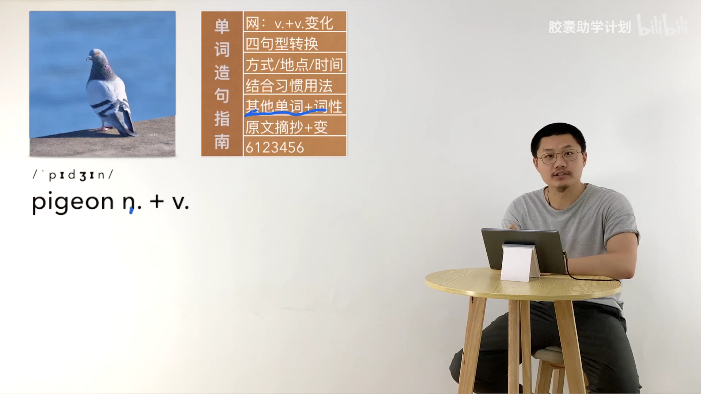

文字识别：单词造句指南 / 网：v.+v.变化 / 胶囊助学计划 / 四句型转换 / 方式/地点/时间 / 结合习惯用法 / 其他单词+词性 / 原文摘抄+变 / 6123456 / /'pid3in/ / pigeon n. + v.

### 画面 00:00:46

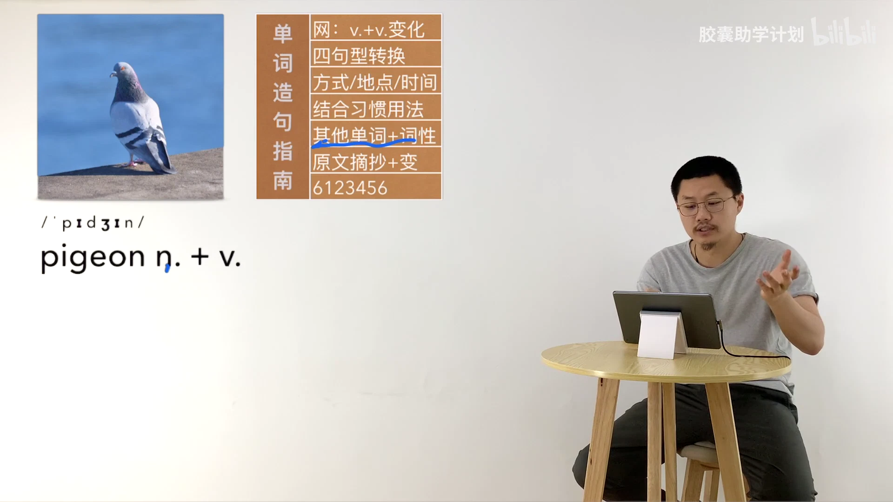

文字识别：单词造句指南 / 网：v.+v.变化 / 胶囊助学计划 / 四句型转换 / 方式/地点/时间 / 结合习惯用法 / 其他单词+词性 / 原文摘抄+变 / 6123456 / /'pid3in/ / pigeon n. + v.

### 画面 00:00:49

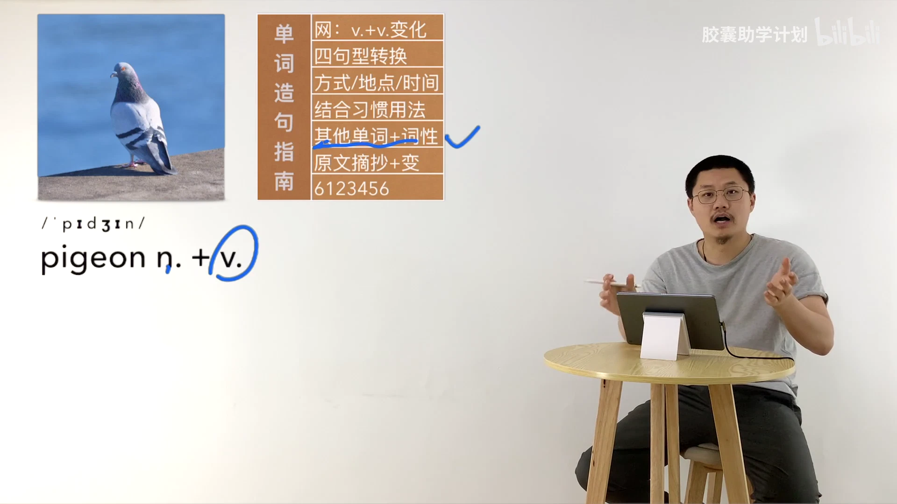

文字识别：单词造句指南 / 网：v.+v.变化 / 胶囊助学计划 / 四句型转换 / 方式/地点/时间 / 结合习惯用法 / 其他单词+词性 / 原文摘抄+变 / 6123456 / /'pid3in/ / pigeon n. + / V.

### 画面 00:00:51

文字识别：单词造句指南 / 网：v.+v.变化 / 胶囊助学计划 / 四句型转换 / 方式/地点/时间 / 结合习惯用法 / 其他单词+词性 / 原文摘抄+变 / 6123456 / /'pid3in/ / pigeon n. +/ / V.

### 画面 00:00:54

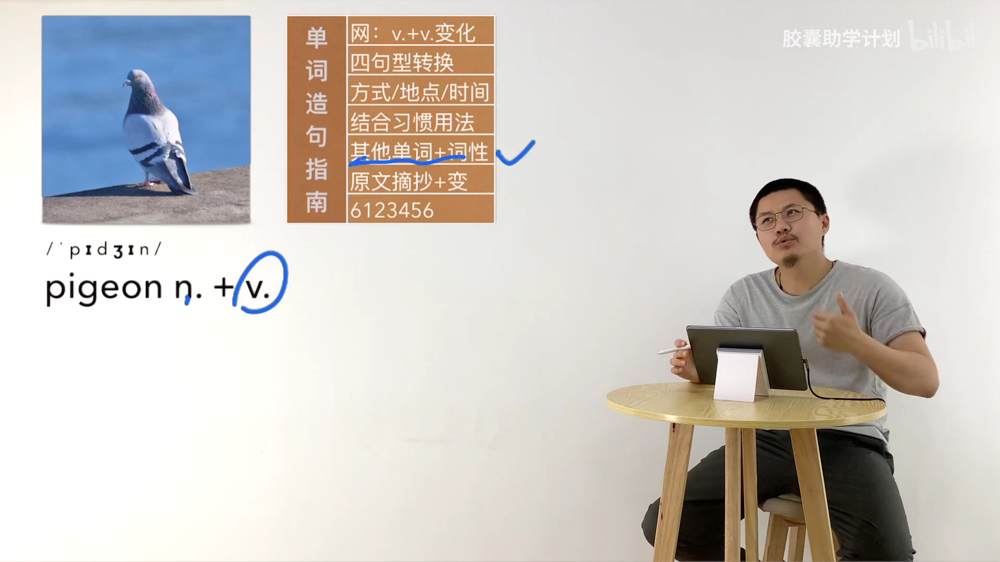

文字识别：单词造句指南 / 网：v.+v.变化 / 胶囊助学计划 / 四句型转换 / 方式/地点/时间 / 结合习惯用法 / 其他单词+词性 / 原文摘抄+变 / 6123456 / /'pid3in/ / pigeon n. + / V.

### 画面 00:00:56

文字识别：单词造句指南 / 网：v.+v.变化 / 胶囊助学计划 / 四句型转换 / 方式/地点/时间 / 结合习惯用法 / 其他单词+词性 / 原文摘抄+变 / 6123456 / /'pid3in/ / pigeon n. +/ / V.

### 画面 00:00:58

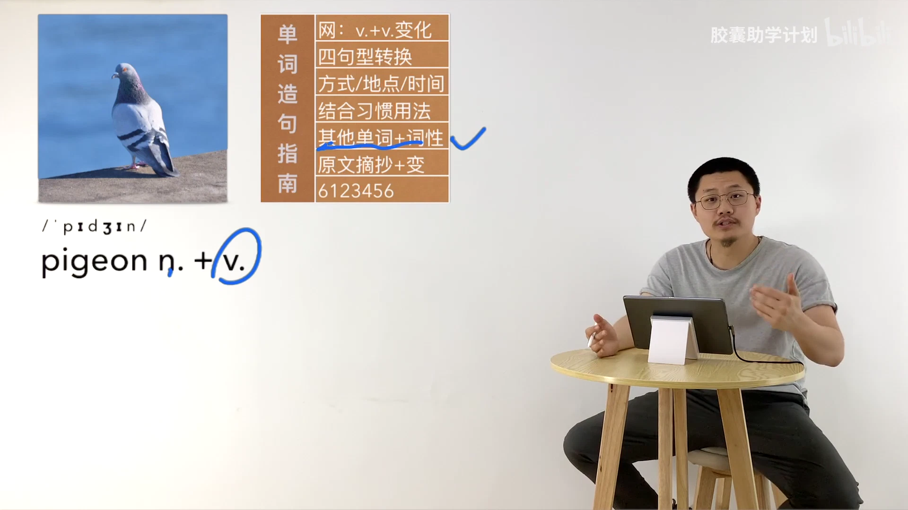

文字识别：单词造句指南 / 网：v.+v.变化 / 胶囊助学计划 / 四句型转换 / 方式/地点/时间 / 结合习惯用法 / 其他单词+词性 / 原文摘抄+变 / 6123456 / /'pid3in/ / pigeon n. +/ / V.

## 00:01:00–00:01:30

随便去找，对吧？尤其在我们初学者阶段，您不妨去新一当中和我们学到的前四课新二当中去找动词能和 pigeon 连起来的。那我直接给大家一个句子，比如说 I have just received a pigeon from my brother. Receive something from somebody，我们是不是刚刚学过？这是个习惯用法。那您也可以理解为它是结合

### 画面 00:01:00

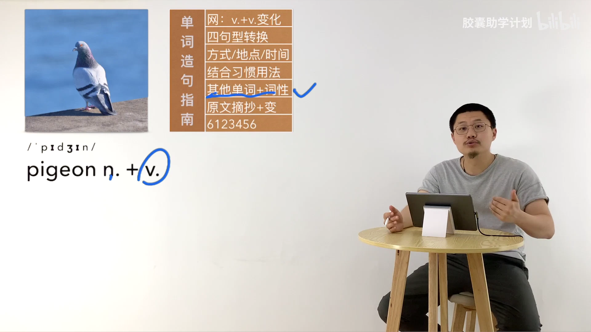

文字识别：单词造句指南 / 网：v.+v.变化 / 胶囊助学计划 / 四句型转换 / 方式/地点/时间 / 结合习惯用法 / 其他单词+词性 / 原文摘抄+变 / 6123456 / /'pid3in/ / pigeon n. +1 / V.

### 画面 00:01:05

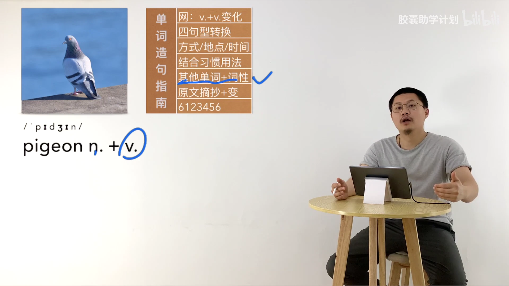

文字识别：单词造句指南 / 网：v.+v.变化 / 胶囊助学计划 / 四句型转换 / 方式/地点/时间 / 结合习惯用法 / 其他单词+词性 / 原文摘抄+变 / 6123456 / /'pid3in/ / pigeon n. +1 / V.

### 画面 00:01:08

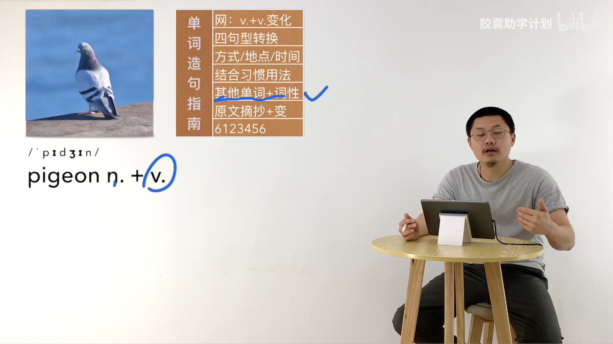

文字识别：单词造句指南 / 网：v.+v.变化 / 胶囊助学计划 / 四句型转换 / 方式/地点/时间 / 结合习惯用法 / 其他单词+词性 / 原文摘抄+变 / 6123456 / /'pid3in/ / pigeon n. +1 / V.

### 画面 00:01:10

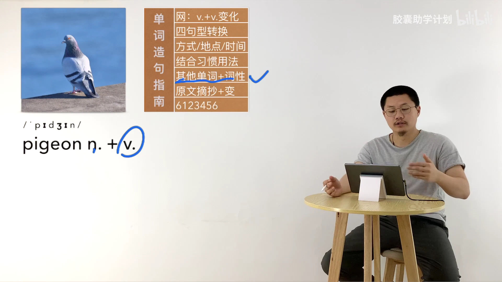

文字识别：单词造句指南 / 网：v.+v.变化 / 胶囊助学计划 / 四句型转换 / 方式/地点/时间 / 结合习惯用法 / 其他单词+词性 / 原文摘抄+变 / 6123456 / /'pid3in/ / pigeon n. +1 / V.

### 画面 00:01:12

文字识别：单词造句指南 / 网：v.+v.变化 / 胶囊助学计划 / 四句型转换 / 方式/地点/时间 / 结合习惯用法 / 其他单词+词性 / 原文摘抄+变 / 6123456 / /pid3in/ / pigeon n. +1 / V. / ① I have just received a pigeon from my brother.

### 画面 00:01:14

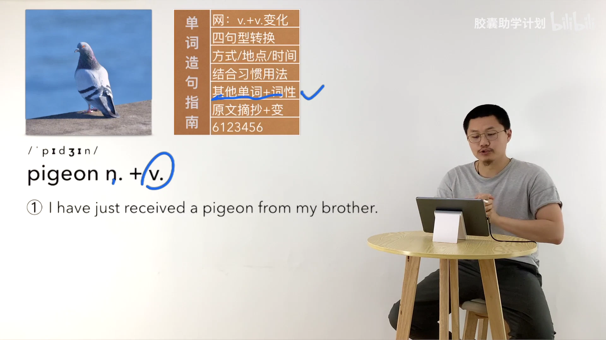

文字识别：单词造句指南 / 网：v.+v.变化 / 胶囊助学计划 / 四句型转换 / 方式/地点/时间 / 结合习惯用法 / 其他单词+词性 / 原文摘抄+变 / 6123456 / /pid3in/ / pigeon n. +1 / V. / ① I have just received a pigeon from my brother.

### 画面 00:01:16

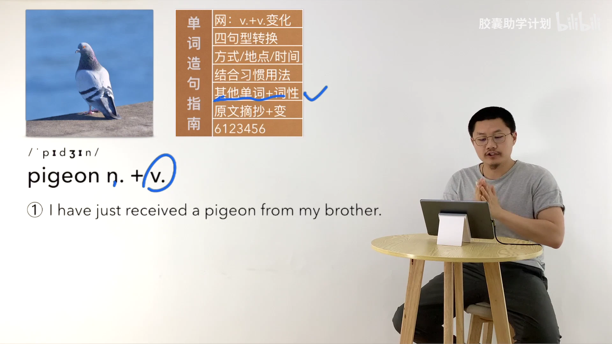

文字识别：单词造句指南 / 网：v.+v.变化 / 胶囊助学计划 / 四句型转换 / 方式/地点/时间 / 结合习惯用法 / 其他单词+词性 / 原文摘抄+变 / 6123456 / /pid3in/ / pigeon n. +1 / V. / ① I have just received a pigeon from my brother.

### 画面 00:01:20

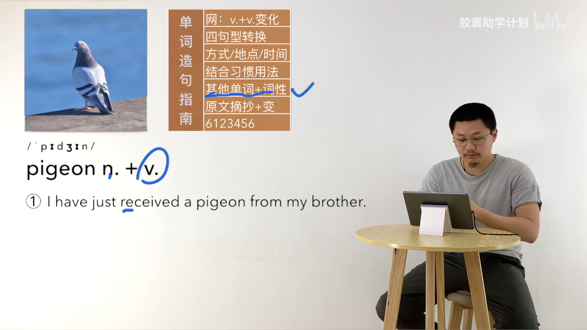

文字识别：单词造句指南 / 网：v.+v.变化 / 胶囊助学计划 / 四句型转换 / 方式/地点/时间 / 结合习惯用法 / 其他单词+词性 / 原文摘抄+变 / 6123456 / /pid3in/ / pigeon n. +1 / V. / ① I have just received a pigeon from my brother.

### 画面 00:01:22

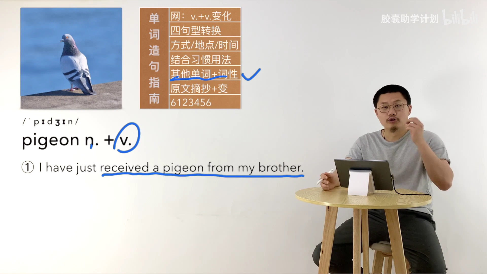

文字识别：单词造句指南 / 网：v.+v.变化 / 胶囊助学计划 / 四句型转换 / 方式/地点/时间 / 结合习惯用法 / 其他单词+词性 / 原文摘抄+变 / 6123456 / /pId3in/ / pigeon n. +1 / V / ① I have just received a pigeon from my brother.

### 画面 00:01:25

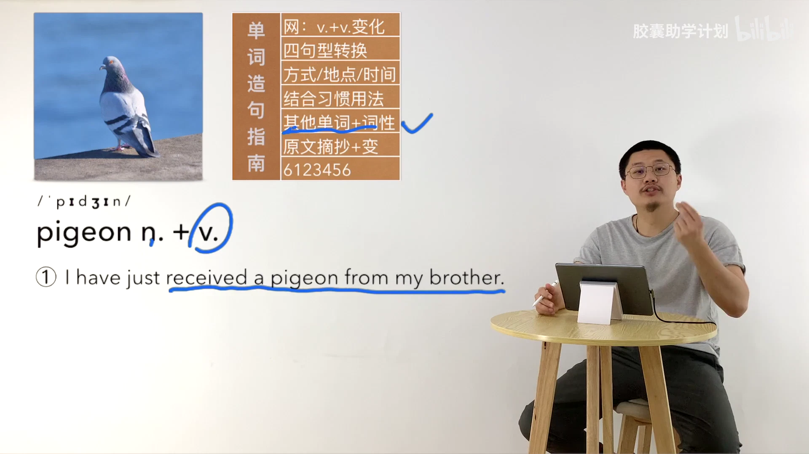

文字识别：单词造句指南 / 网：v.+v.变化 / 胶囊助学计划 / 四句型转换 / 方式/地点/时间 / 结合习惯用法 / 其他单词+词性 / 原文摘抄+变 / 6123456 / /pId3in/ / pigeon n. +1 / V. / ① I have just received a pigeon from my brother.

### 画面 00:01:27

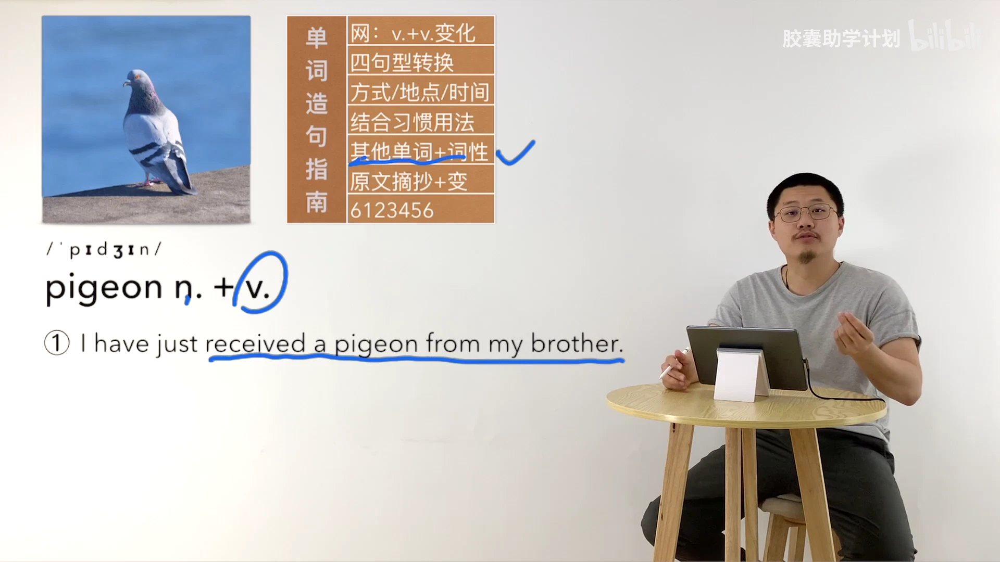

文字识别：单词造句指南 / 网：v.+v.变化 / 胶囊助学计划 / 四句型转换 / 方式/地点/时间 / 结合习惯用法 / 其他单词+词性 / 原文摘抄+变 / 6123456 / /pid3in/ / pigeon n. +1 / V / ① I have just received a pigeon from my brother.

## 00:01:30–00:02:00

了其他习惯用法，当然了，它也是一个动词，叫收到。OK, very good.那接下来我们还可以造一句话说，On the last day, I made a decision and sent the pigeon to my friend Leo. OK,注意send the pigeon to somebody, send something to somebody，这个也是我们之前刚刚学过的一个习惯用法。但是你注意一小下，我故意把这一句话当中添加了好几个我们之前

### 画面 00:01:30

文字识别：单词造句指南 / 网：v.+v.变化 / 胶囊助学计划 / 四句型转换 / 方式/地点/时间 / 结合习惯用法 / 其他单词+词性 / 原文摘抄+变 / 6123456 / /pid3in/ / pigeon n. +1 / V. / ① I have just received a pigeon from my brother.

### 画面 00:01:34

文字识别：单词造句指南 / 网：v.+v.变化 / 胶囊助学计划 / 四句型转换 / 方式/地点/时间 / 结合习惯用法 / 其他单词+词性 / 原文摘抄+变 / 6123456 / /pid3in/ / pigeon n. +1 / V. / ① I have just received a pigeon from my brother.

### 画面 00:01:36

文字识别：单词造句指南 / 网：v.+v.变化 / 胶囊助学计划 / 四句型转换 / 方式/地点/时间 / 结合习惯用法 / 其他单词+词性 / 原文摘抄+变 / 6123456 / /pid3in/ / pigeon n. +1 / V. / ① I have just received a pigeon from my brother. / ② On the last day; I made a decision and sent the / pigeon to my friend, Leo.

### 画面 00:01:38

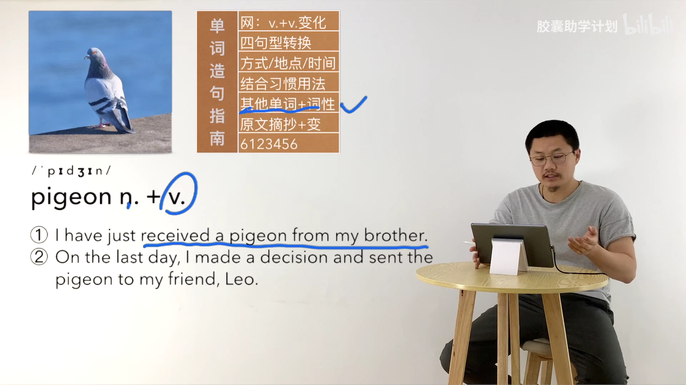

文字识别：单词造句指南 / 网：v.+v.变化 / 胶囊助学计划 / 四句型转换 / 方式/地点/时间 / 结合习惯用法 / 其他单词+词性 / 原文摘抄+变 / 6123456 / /pid3in/ / pigeon n. +1 / V. / ① I have just received a pigeon from my brother. / ② On the last day, I made a decision and sent the / pigeon to my friend, Leo.

### 画面 00:01:40

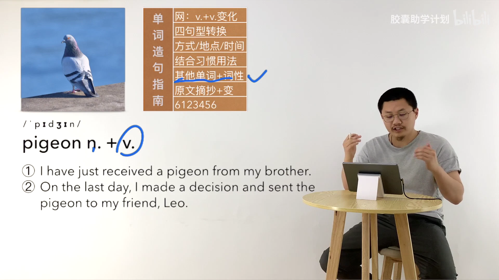

文字识别：单词造句指南 / 网：v.+v.变化 / 胶囊助学计划 / 四句型转换 / 方式/地点/时间 / 结合习惯用法 / 其他单词+词性 / 原文摘抄+变 / 6123456 / /pId3in/ / pigeon n. +1 / L / ① I have just received a pigeon from my brother. / ② On the last day, I made a decision and sent the / pigeon to my friend, Leo.

### 画面 00:01:44

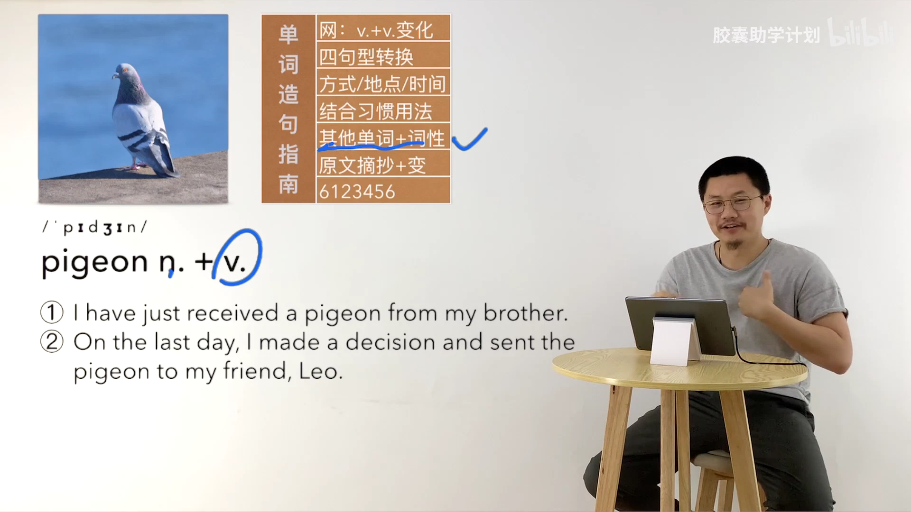

文字识别：单词造句指南 / 网：v.+v.变化 / 胶囊助学计划 / 四句型转换 / 方式/地点/时间 / 结合习惯用法 / 其他单词+词性 / 原文摘抄+变 / 6123456 / /pId3in/ / pigeon n. +1 / V. / ① I have just received a pigeon from my brother. / ② On the last day, I made a decision and sent the / pigeon to my friend, Leo.

### 画面 00:01:46

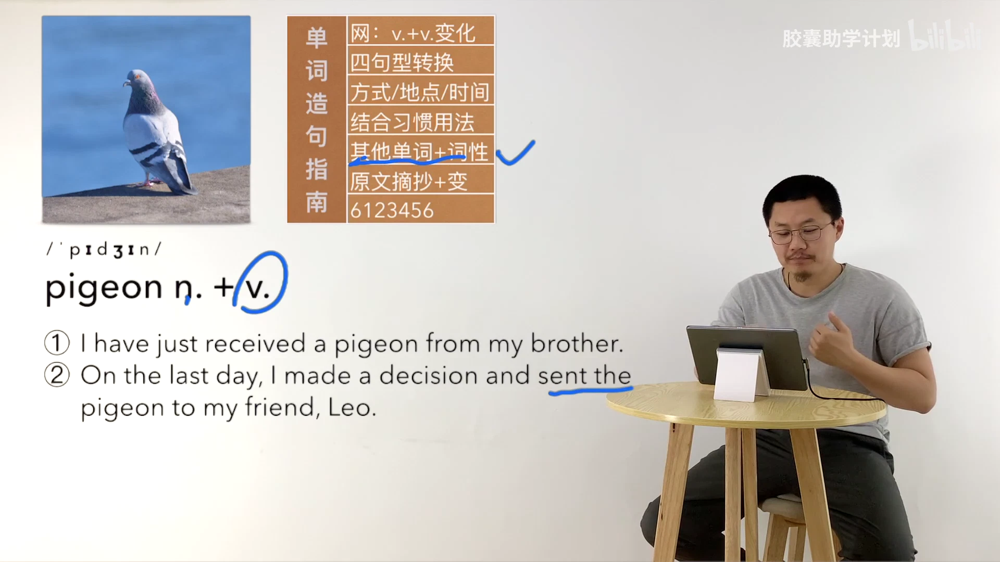

文字识别：单词造句指南 / 网：v.+v.变化 / 胶囊助学计划 / 四句型转换 / 方式/地点/时间 / 结合习惯用法 / 其他单词+词性 / 原文摘抄+变 / 6123456 / /pId3in/ / pigeon n. +1 / V / ① I have just received a pigeon from my brother. / ② On the last day, I made a decision and sent the / pigeon to my friend, Leo.

### 画面 00:01:48

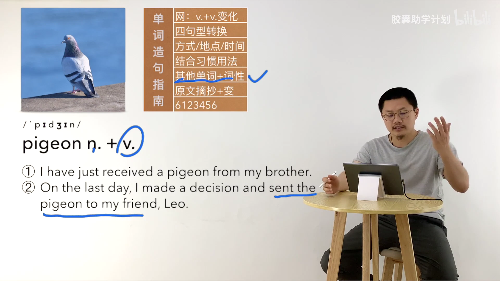

文字识别：单词造句指南 / 网：v.+v.变化 / 胶囊助学计划 / 四句型转换 / 方式/地点/时间 / 结合习惯用法 / 其他单词+词性 / 原文摘抄+变 / 6123456 / /pId3in/ / pigeon n. +1 / V. / ① I have just received a pigeon from my brother. / ② On the last day, I made a decision and sent the / pigeon to my friend, Leo.

### 画面 00:01:50

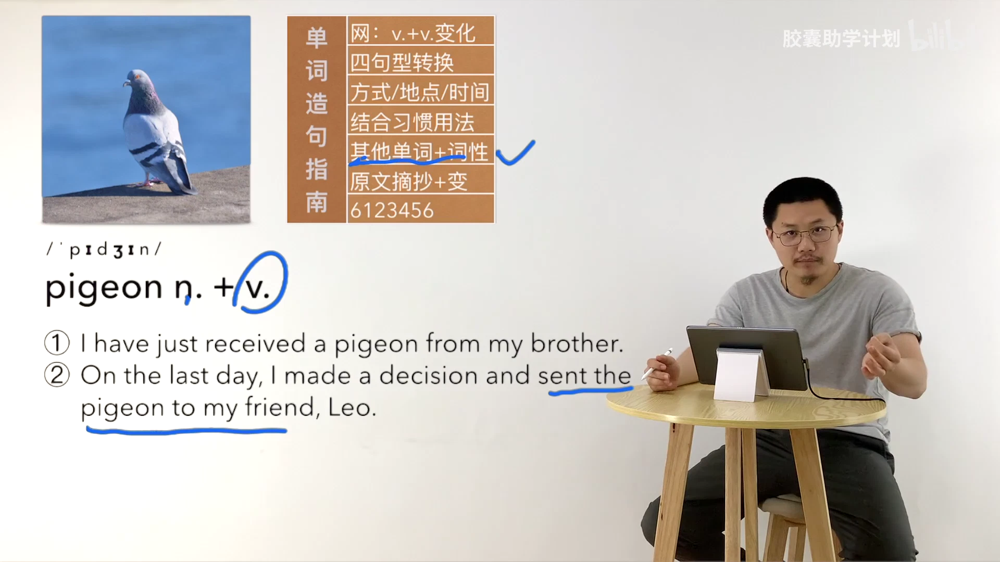

文字识别：单词造句指南 / 网：v.+v.变化 / 胶囊助学计划 / 四句型转换 / 方式/地点/时间 / 结合习惯用法 / 其他单词+词性 / 原文摘抄+变 / 6123456 / /pId3in/ / pigeon n. +1 / V / ① I have just received a pigeon from my brother. / ② On the last day, I made a decision and sent the / pigeon to my friend, Leo.

### 画面 00:01:55

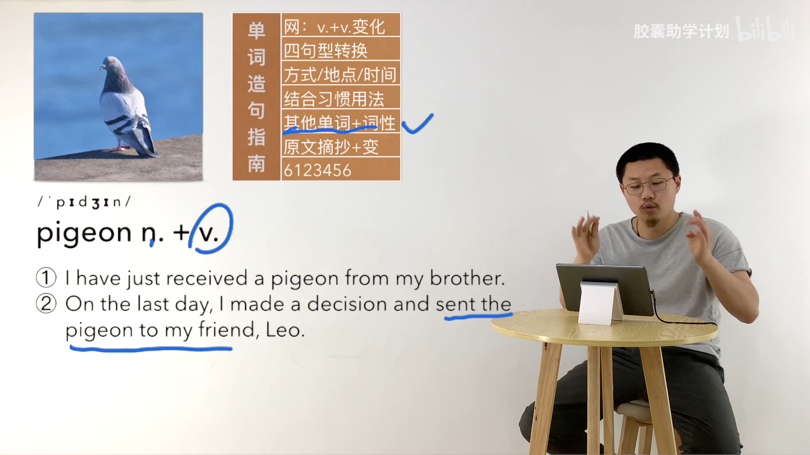

文字识别：单词造句指南 / 网：v.+v.变化 / 胶囊助学计划 / 四句型转换 / 方式/地点/时间 / 结合习惯用法 / 其他单词+词性 / 原文摘抄+变 / 6123456 / /pId3in/ / pigeon n. +1 / V. / ① I have just received a pigeon from my brother. / ② On the last day, I made a decision and sent the / pigeon to my friend, Leo.

## 00:02:00–00:02:30

学过的习惯用法。On the last day，在最后一天，对吧？I made a very big decision. Make a decision，做出了一个决定。Send something to somebody，也就是说这一句话当中我用到了前四课学过的三个习惯用法。于是在这儿要给大家留一个小的作业了。各位注意啊，我们之所以要去做这件事情，要让各位做的叫做总结所有学到的习惯用法。一个很重要的原因就是

### 画面 00:02:00

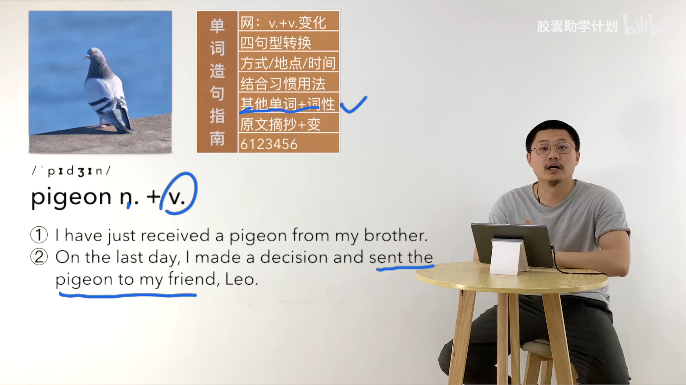

文字识别：单词造句指南 / 网：v.+v.变化 / 胶囊助学计划 / 四句型转换 / 方式/地点/时间 / 结合习惯用法 / 其他单词+词性 / 原文摘抄+变 / 6123456 / /pId3in/ / pigeon n. +1 / V. / ① I have just received a pigeon from my brother. / ② On the last day, I made a decision and sent the / pigeon to my friend, Leo.

### 画面 00:02:03

文字识别：单词造句指南 / 网：v.+v.变化 / 胶囊助学计划 / 四句型转换 / 方式/地点/时间 / 结合习惯用法 / 其他单词+词性 / 原文摘抄+变 / 6123456 / /pid3in/ / pigeon n. +1 / V / ①! have just received a pigeon from my brother. / ②On the last day>I made a decision and sent the / pigeon to my friend, Leo.

### 画面 00:02:05

文字识别：单词造句指南 / 网：v.+v.变化 / 胶囊助学计划 / 四句型转换 / 方式/地点/时间 / 结合习惯用法 / 其他单词+词性 / 原文摘抄+变 / 6123456 / /pid3in/ / pigeon n. +1 / V. / ①! have just received a pigeon from my brother. / ②On the last day)I made a decision and sent the / pigeon to my friend, Leo.

### 画面 00:02:10

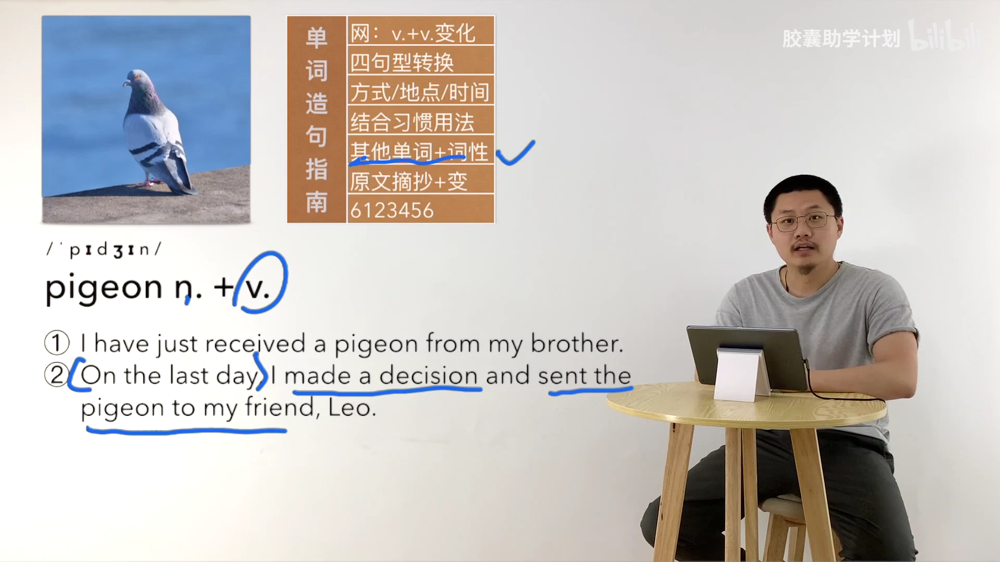

文字识别：单词造句指南 / 网：v.+v.变化 / 胶囊助学计划 / 四句型转换 / 方式/地点/时间 / 结合习惯用法 / 其他单词+词性 / 原文摘抄+变 / 6123456 / /pid3in/ / pigeon n. +1 / L / ①! have just received a pigeon from my brother. / ②On the last day)I made a decision and sent the / pigeon to my friend, Leo.

### 画面 00:02:13

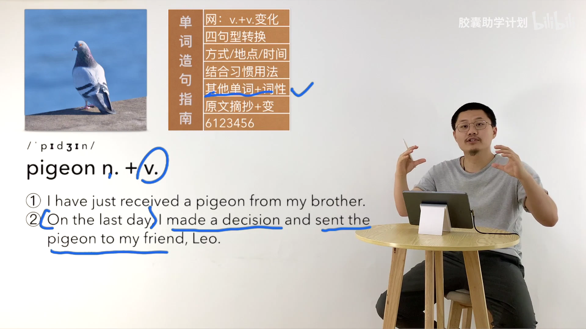

文字识别：单词造句指南 / 网：v.+v.变化 / 胶囊助学计划 / 四句型转换 / 方式/地点/时间 / 结合习惯用法 / 其他单词+词性 / 原文摘抄+变 / 6123456 / /pid3in/ / pigeon n. +1 / V. / ① I have just received a pigeon from my brother. / ②On the last day>I made a decision and sent the / pigeon to my friend, Leo.

### 画面 00:02:15

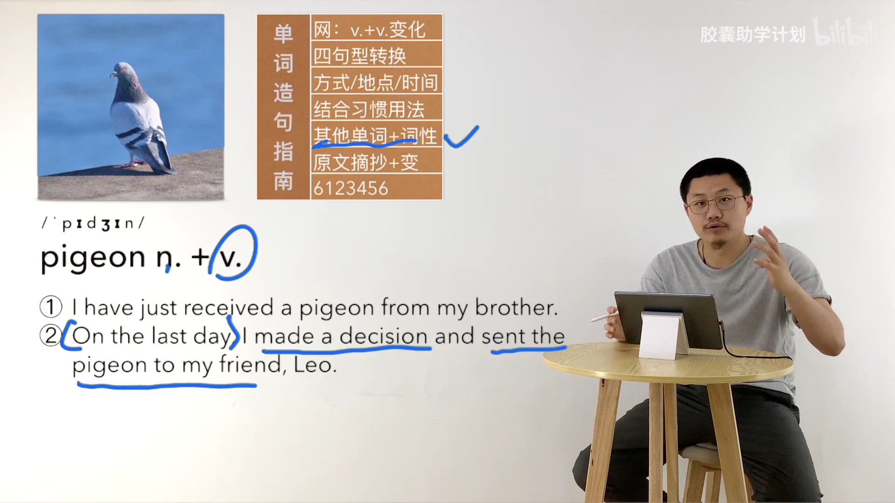

文字识别：单词造句指南 / 网：v.+v.变化 / 胶囊助学计划 / 四句型转换 / 方式/地点/时间 / 结合习惯用法 / 其他单词+词性 / 原文摘抄+变 / 6123456 / /pid3in/ / pigeon n. +1 / V. / ①! have just received a pigeon from my brother. / ②On the last dayI made a decision and sent the / pigeon to my friend, Leo.

### 画面 00:02:17

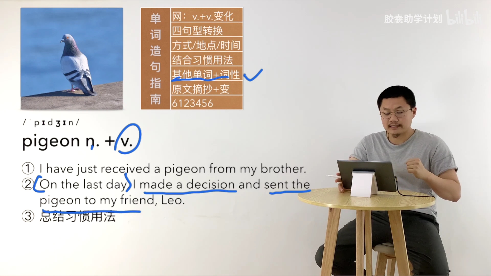

文字识别：单词造句指南 / 网：v.+v.变化 / 胶囊助学计划 / 四句型转换 / 方式/地点/时间 / 结合习惯用法 / 其他单词+词性 / 原文摘抄+变 / 6123456 / /pid3in/ / pigeon n. +1 / ①! have just received a pigeon from my brother. / ②On the last day>I made a decision and sent the / pigeon to my friend, Leo. / 总结习惯用法

### 画面 00:02:19

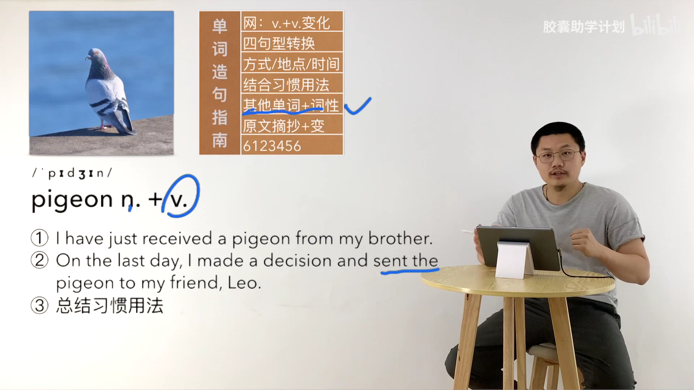

文字识别：单词造句指南 / 网：v.+v.变化 / 胶囊助学计划 / 四句型转换 / 方式/地点/时间 / 结合习惯用法 / 其他单词+词性 / 原文摘抄+变 / 6123456 / /pid3in/ / pigeon n. +1 / ① I have just received a pigeon from my brother. / ② On the last day, I made a decision and sent the / pigeon to my friend, Leo. / 总结习惯用法

### 画面 00:02:21

文字识别：单词造句指南 / 网：v.+v.变化 / 胶囊助学计划 / 四句型转换 / 方式/地点/时间 / 结合习惯用法 / 其他单词+词性 / 原文摘抄+变 / 6123456 / /pid3in/ / pigeon n. +1 / ① I have just received a pigeon from my brother. / ② On the last day, I made a decision and sent the / pigeon to my friend, Leo. / 总结习惯用法

### 画面 00:02:24

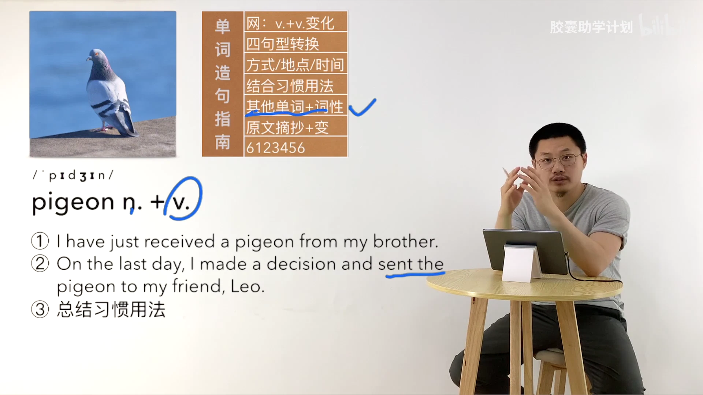

文字识别：单词造句指南 / 网：v.+v.变化 / 胶囊助学计划 / 四句型转换 / 方式/地点/时间 / 结合习惯用法 / 其他单词+词性 / 原文摘抄+变 / 6123456 / /pid3in/ / pigeon n. +1 / ① I have just received a pigeon from my brother. / ② On the last day, I made a decision and sent the / pigeon to my friend, Leo. / 总结习惯用法

### 画面 00:02:26

文字识别：单词造句指南 / 网：v.+v.变化 / 胶囊助学计划 / 四句型转换 / 方式/地点/时间 / 结合习惯用法 / 其他单词+词性 / 原文摘抄+变 / 6123456 / /pid3in/ / pigeon n. +1 / V. / ① I have just received a pigeon from my brother. / ② On the last day, I made a decision and sent the / pigeon to my friend, Leo. / 总结习惯用法

## 00:02:30–00:03:00

它能帮助我们去造句，所以各位从今天开始不妨自己先去整理一下前四课的习惯用法，记在我们的笔记本当中啊，尽量是手写。我建议各位。其次呢，然后今天学到的以及以后学到的每一课当中的习惯用法，您都把它总结出来，就像我这句话当中做的一样，您就慢慢慢慢的能造出来越来越多的句子了。OK，好，那我们不多说，看下一个单词，跟我一起读，

### 画面 00:02:30

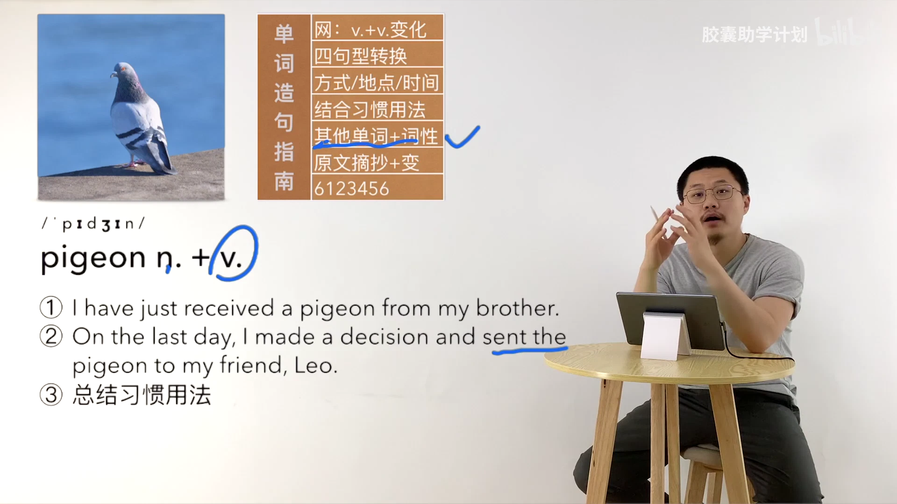

文字识别：单词造句指南 / 网：v.+v.变化 / 胶囊助学计划 / 四句型转换 / 方式/地点/时间 / 结合习惯用法 / 其他单词+词性 / 原文摘抄+变 / 6123456 / /pid3in/ / pigeon n. +1 / V. / ① I have just received a pigeon from my brother. / ② On the last day, I made a decision and sent the / pigeon to my friend, Leo. / 总结习惯用法

### 画面 00:02:35

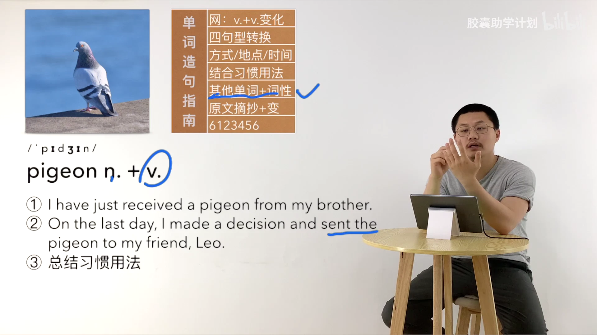

文字识别：单词造句指南 / 网：v.+v.变化 / 胶囊助学计划 / 四句型转换 / 方式/地点/时间 / 结合习惯用法 / 其他单词+词性 / 原文摘抄+变 / 6123456 / /pid3in/ / pigeon n. +1 / V. / ① I have just received a pigeon from my brother. / ② On the last day, I made a decision and sent the / pigeon to my friend, Leo. / 总结习惯用法

### 画面 00:02:40

文字识别：单词造句指南 / 网：v.+v.变化 / 胶囊助学计划 / 四句型转换 / 方式/地点/时间 / 结合习惯用法 / 其他单词+词性 / 原文摘抄+变 / 6123456 / /pid3in/ / pigeon n. +1 / V. / ① I have just received a pigeon from my brother. / ② On the last day, I made a decision and sent the / pigeon to my friend, Leo. / 总结习惯用法

### 画面 00:02:45

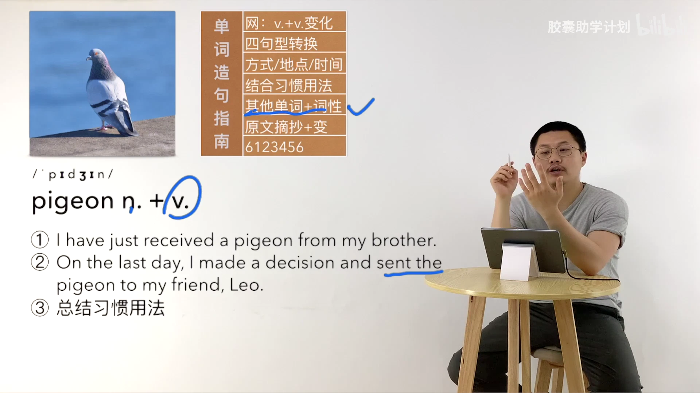

文字识别：单词造句指南 / 网：v.+v.变化 / 胶囊助学计划 / 四句型转换 / 方式/地点/时间 / 结合习惯用法 / 其他单词+词性 / 原文摘抄+变 / 6123456 / /pid3in/ / pigeon n. +1 / V. / ① I have just received a pigeon from my brother. / ② On the last day, I made a decision and sent the / pigeon to my friend, Leo. / 总结习惯用法

### 画面 00:02:50

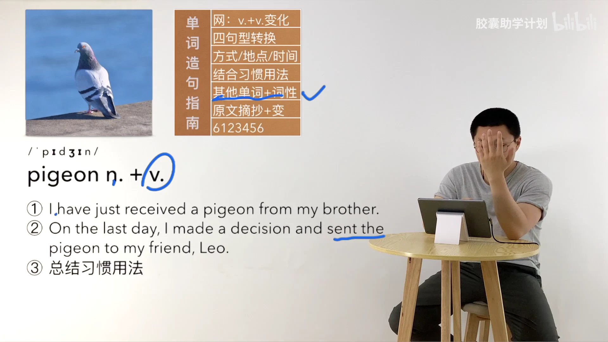

文字识别：单词造句指南 / 网：v.+v.变化 / 胶囊助学计划 / 四句型转换 / 方式/地点/时间 / 结合习惯用法 / 其他单词+词性 / 原文摘抄+变 / 6123456 / /pid3in/ / pigeon n. +1 / L / ① I.have just received a pigeon from my brother. / ② On the last day, I made a decision and sent the / pigeon to my friend, Leo. / 总结习惯用法

### 画面 00:02:52

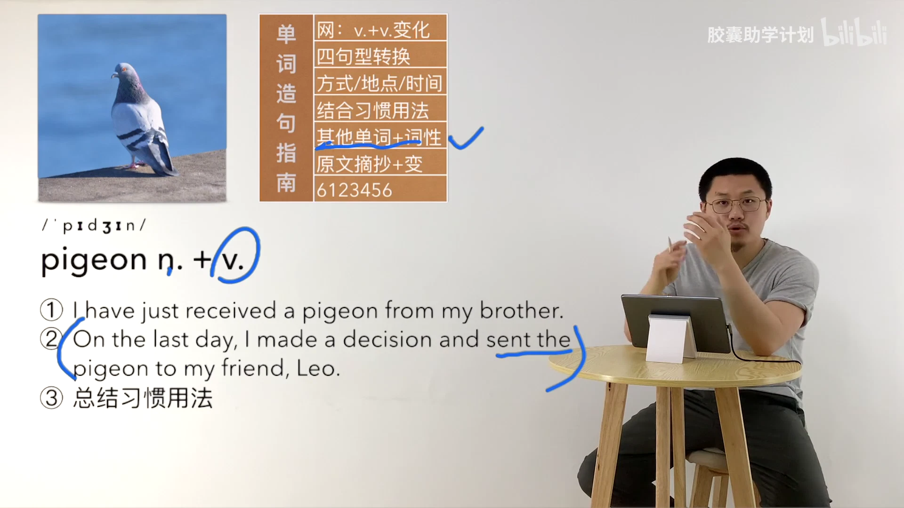

文字识别：单词造句指南 / 网：v.+v.变化 / 胶囊助学计划 / Bilbil / 四句型转换 / 方式/地点/时间 / 结合习惯用法 / 其他单词+词性 / 原文摘抄+变 / 6123456 / /pId3in/ / pigeon n. +1 / ① Lhave just received a pigeon from my brother. / ②On the last day, I made a decision and sent the / pigeon to my friend, Leo. / 总结习惯用法

### 画面 00:02:55

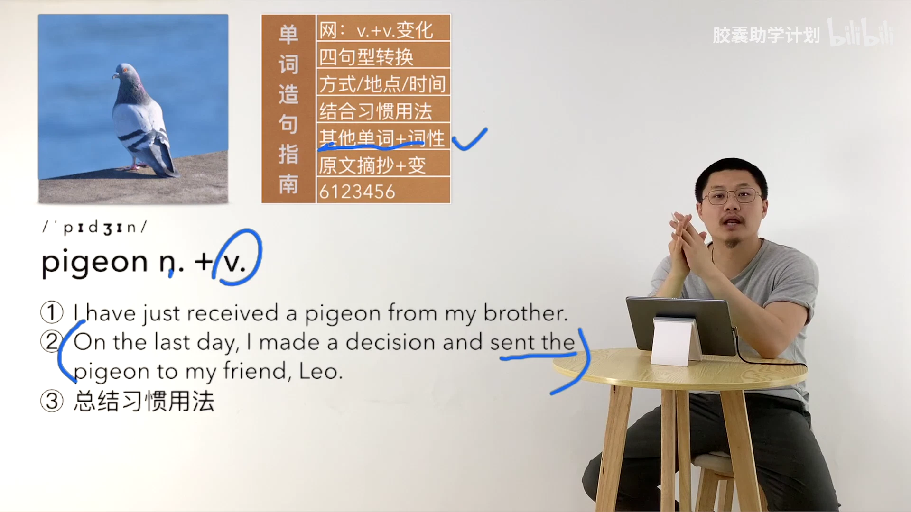

文字识别：单词造句指南 / 网：v.+v.变化 / 胶囊助学计划 / 四句型转换 / 方式/地点/时间 / 结合习惯用法 / 其他单词+词性 / 原文摘抄+变 / 6123456 / /pid3in/ / pigeon n. +1 / V. / ①Lhave just received a pigeon from my brother. / ②On the last day, I made a decision and sent the / pigeon to my friend, Leo. / 总结习惯用法

### 画面 00:02:57

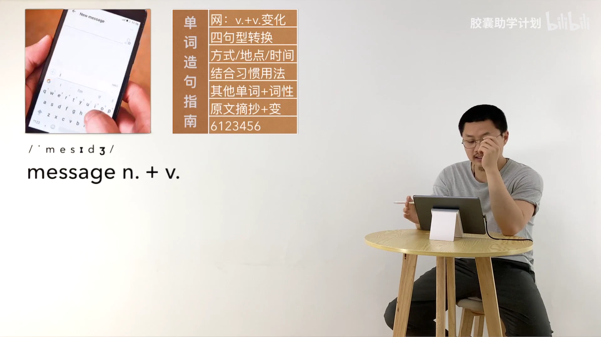

文字识别：New message / 单词造句指南 / 网：v.+v.变化 / 胶囊助学计划 / 四句型转换 / 方式/地点/时间 / 结合习惯用法 / 其他单词+词性 / 原文摘抄+变 / 6123456 / /'mesId3/ / message n. + v.

### 画面 00:02:59

文字识别：New message / 单词造句指南 / 网：v.+v.变化 / 胶囊助学计划 / 四句型转换 / 方式/地点/时间 / 结合习惯用法 / 其他单词+词性 / 原文摘抄+变 / 6123456 / /'mesid3/ / message n. + v.

## 00:03:00–00:03:30

message，message，消息、信息、讯息，对吧？都可以，它是名词，我们依旧要去找动词。直接给大家一个非常常用的小短语，这个单词我们也学过，叫做leave。但是当时我们学它叫做离开的意思，那它其实在新一当中我们还提到它另一个意思叫做留下，对吧？那leave somebody a message叫做给某人留了一个消息，那这个消息您可以指的是，比如说手机

### 画面 00:03:01

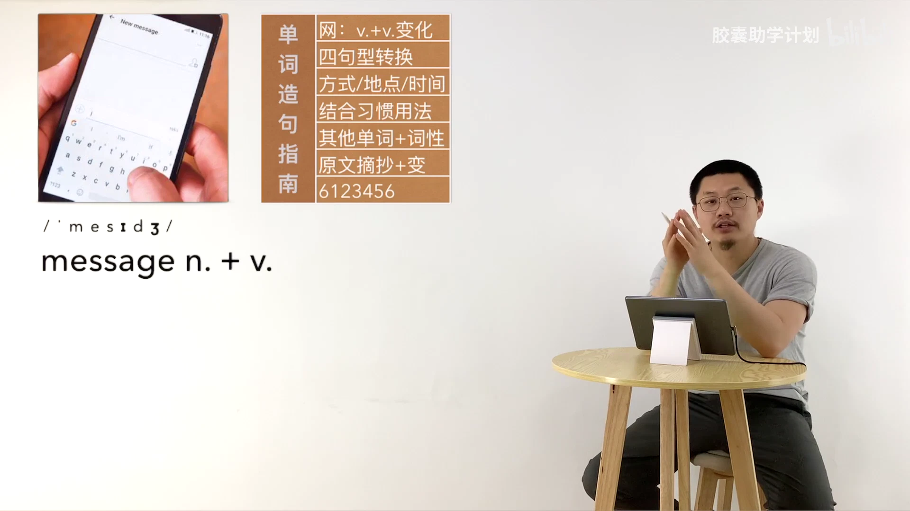

文字识别：New message / 单词造句指南 / 网：v.+v.变化 / 胶囊助学计划 / 四句型转换 / 方式/地点/时间 / 结合习惯用法 / 其他单词+词性 / 原文摘抄+变 / 6123456 / /mesId3/ / message n. + v.

### 画面 00:03:04

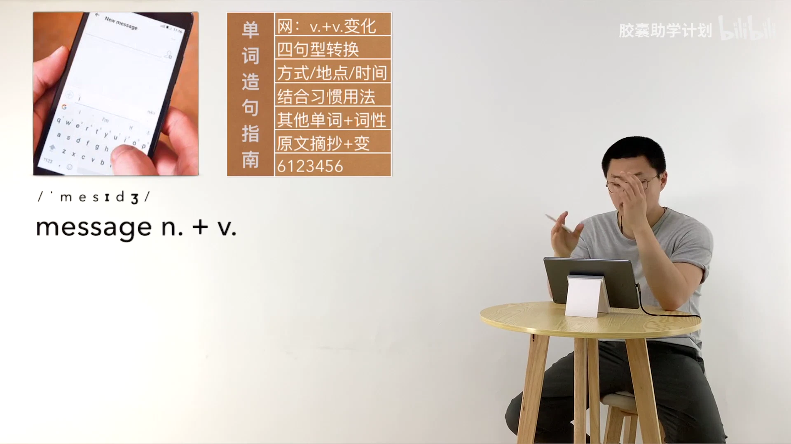

文字识别：New message / 单词造句指南 / 网：v.+v.变化 / 胶囊助学计划 / 四句型转换 / 方式/地点/时间 / 结合习惯用法 / 其他单词+词性 / 原文摘抄+变 / 6123456 / /mesId3 / / message n. + v.

### 画面 00:03:06

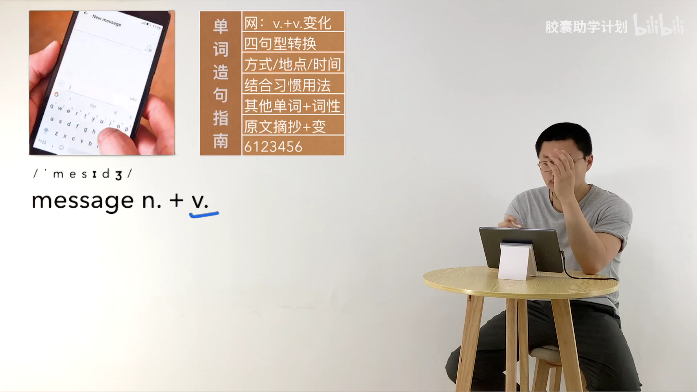

文字识别：New message / 单词造句指南 / 网：v.+v.变化 / 胶囊助学计划 / Bilbil / 四句型转换 / 方式/地点/时间 / 结合习惯用法 / 其他单词+词性 / 原文摘抄+变 / 6123456 / /mesId3/ / message n. + v.

### 画面 00:03:09

文字识别：New message / 单词造句指南 / 网：v.+v.变化 / 胶囊助学计划 / bilbl / 四句型转换 / 方式/地点/时间 / 结合习惯用法 / 其他单词+词性 / 原文摘抄+变 / 6123456 / /mesid3/ / message n. + v. / ① leave sb.a message

### 画面 00:03:11

文字识别：New message / 单词造句指南 / 网：v.+v.变化 / 胶囊助学计划 / 四句型转换 / 方式/地点/时间 / 结合习惯用法 / 其他单词+词性 / 原文摘抄+变 / 6123456 / /mesid3/ / message n. + v. / ① leave sb.a message

### 画面 00:03:15

文字识别：New message / 单词造句指南 / 网：v.+v.变化 / 胶囊助学计划 / 四句型转换 / 方式/地点/时间 / 结合习惯用法 / 其他单词+词性 / 原文摘抄+变 / 6123456 / /'mesid3/ / message n. + v. / ① / leave sb.a message

### 画面 00:03:20

文字识别：New message / 单词造句指南 / 网：v.+v.变化 / 胶囊助学计划 / 四句型转换 / 方式/地点/时间 / 结合习惯用法 / 其他单词+词性 / 原文摘抄+变 / 6123456 / /mesId3/ / message n. + v. / ① leave sb.a message

### 画面 00:03:25

文字识别：New message / 单词造句指南 / 网：v.+v.变化 / 胶囊助学计划 / 四句型转换 / 方式/地点/时间 / 结合习惯用法 / 其他单词+词性 / 原文摘抄+变 / 6123456 / /mesId3/ / message n. + v. / ① leave sb.a message

### 画面 00:03:28

文字识别：New message / 单词造句指南 / 网：v.+v.变化 / 胶囊助学计划 / 四句型转换 / 方式/地点/时间 / 结合习惯用法 / 其他单词+词性 / 原文摘抄+变 / 6123456 / /mesId3/ / message n. + v. / ① leave sb.a message

## 00:03:30–00:04:00

当中的消息，也可以指的是我们 notes 便签上手写的那些消息，都是可以的。那我们接下来给了大家这样一个小的短语，你想造句子，主语比较简单，一定要想个动词变化。我们就用前三前四课学过的一个时态，叫做一般过去时，叫 I left him a message. 我之前给他留了一条消息了。肯定句出来了，四句型又开始转化，叫做 Did you leave him a message? OK, very good, 好

### 画面 00:03:30

文字识别：New message / 单词造句指南 / 网：v.+v.变化 / 胶囊助学计划 / 四句型转换 / 方式/地点/时间 / 结合习惯用法 / 其他单词+词性 / 原文摘抄+变 / 6123456 / /'mesId3 / / message n. + v. / ① leave sb.a message

### 画面 00:03:35

文字识别：New message / 单词造句指南 / 网：v.+v.变化 / 胶囊助学计划 / 四句型转换 / 方式/地点/时间 / 结合习惯用法 / 其他单词+词性 / 原文摘抄+变 / 6123456 / /mesId3/ / message n. + v. / ① / leave sb.a message

### 画面 00:03:38

文字识别：New message / 单词造句指南 / 网：v.+v.变化 / 胶囊助学计划 / 四句型转换 / 方式/地点/时间 / 结合习惯用法 / 其他单词+词性 / 原文摘抄+变 / 6123456 / /'mesI d3/ / message n. + v. / 1 / leave sb. a message

### 画面 00:03:40

文字识别：New message / 单词造句指南 / 网：v.+v.变化 / 胶囊助学计划 / 四句型转换 / 方式/地点/时间 / 结合习惯用法 / 其他单词+词性 / 原文摘抄+变 / 6123456 / /'mesid3/ / message n. + v. / 1 / leave sb.a message

### 画面 00:03:44

文字识别：New message / 单词造句指南 / 网：v.+v.变化 / 胶囊助学计划 / 四句型转换 / 方式/地点/时间 / 结合习惯用法 / 其他单词+词性 / 原文摘抄+变 / 6123456 / /mesid3/ / message n. + v. / leave sb. a message / 1 / o Ileft him a message.

### 画面 00:03:46

文字识别：New message / 单词造句指南 / 网：v.+v.变化 / 胶囊助学计划 / 四句型转换 / 方式/地点/时间 / 结合习惯用法 / 其他单词+词性 / 原文摘抄+变 / 6123456 / /mesid3/ / message n. + v. / 1 / leave sb.a message / o Ileft him a message.

### 画面 00:03:49

文字识别：New message / 单词造句指南 / 网：v.+v.变化 / 胶囊助学计划 / 四句型转换 / 方式/地点/时间 / 结合习惯用法 / 其他单词+词性 / 原文摘抄+变 / 6123456 / /'mesid3/ / message n. + v. / 1 / leave sb.a message / o Ileft him a message.

### 画面 00:03:51

文字识别：New message / 单词造句指南 / 网：v.+v.变化 / 胶囊助学计划 / 四句型转换 / 方式/地点/时间 / 结合习惯用法 / 其他单词+词性 / 原文摘抄+变 / 6123456 / /'mesId3/ / message n. + v. / 1 / leave sb. a message / o Ileft him a message.

### 画面 00:03:54

文字识别：New message / 单词造句指南 / 网：v.+v.变化 / 胶囊助学计划 / 四句型转换 / 方式/地点/时间 / 结合习惯用法 / 其他单词+词性 / 原文摘抄+变 / 6123456 / /mesId3/ / message n. + v. / 1 / leave sb. a message / o I left him a message.

### 画面 00:03:56

文字识别：New message / 单词造句指南 / 网：v.+v.变化 / 胶囊助学计划 / bilbili / 四句型转换 / 方式/地点/时间 / 结合习惯用法 / 其他单词+词性 / 原文摘抄+变 / 6123456 / /mesId3/ / message n. + v. / 1 / leave sb.a message / o I left him a message. / o Did you leave him a message?

### 画面 00:03:58

文字识别：New message / 单词造句指南 / 网：v.+v.变化 / 胶囊助学计划 / 四句型转换 / 方式/地点/时间 / 结合习惯用法 / 其他单词+词性 / 原文摘抄+变 / 6123456 / /'mesid3/ / message n. + v. / 1 / leave sb.a message / o I left him a message. / o Did you leave him a message?

## 00:04:00–00:04:30

very good

### 画面 00:04:00

文字识别：New message / 单词造句指南 / 网：v.+v.变化 / 胶囊助学计划 / 四句型转换 / 方式/地点/时间 / 结合习惯用法 / 其他单词+词性 / 原文摘抄+变 / 6123456 / /mesid3/ / message n. + v. / 1 / ) leave sb.a message / o Ileft him a message. / o Did you leave him a message? / o Why did you leave him a message?

### 画面 00:04:02

文字识别：New message / 单词造句指南 / 网：v.+v.变化 / 胶囊助学计划 / 四句型转换 / 方式/地点/时间 / 结合习惯用法 / 其他单词+词性 / 原文摘抄+变 / 6123456 / /'mesid3/ / message n. + v. / leave sb.a message / 1 / o Ileft him a message. / o Did you leave him a message? / o Why did you leave him a message?

### 画面 00:04:05

文字识别：New message / 单词造句指南 / 网：v.+v.变化 / 胶囊助学计划 / 四句型转换 / 方式/地点/时间 / 结合习惯用法 / 其他单词+词性 / 原文摘抄+变 / 6123456 / /'mesid3/ / message n. + v. / leave sb.a message / 1 / o Ileft him a message. / o Did you leave him a message? / o Why did you leave him a message?

### 画面 00:04:10

文字识别：New message / 单词造句指南 / 网：v.+v.变化 / 胶囊助学计划 / 四句型转换 / 方式/地点/时间 / 结合习惯用法 / 其他单词+词性 / 原文摘抄+变 / 6123456 / /'mesid3/ / message n. + v. / leave sb.a message / 1 / o Ileft him a message. / o Did you leave him a message? / o Why did you leave him a message?

### 画面 00:04:14

文字识别：New message / 单词造句指南 / 网：v.+v.变化 / 胶囊助学计划 / 四句型转换 / 方式/地点/时间 / 结合习惯用法 / 其他单词+词性 / 原文摘抄+变 / 6123456 / /'mesid3/ / message n. + v. / leave sb.a message / 1 / o I left him a message. / o Did you leave him a message? / o Why did you leave him a message?

### 画面 00:04:19

文字识别：New message / 单词造句指南 / 网：v.+v.变化 / 胶囊助学计划 / 四句型转换 / 方式/地点/时间 / 结合习惯用法 / 其他单词+词性 / 原文摘抄+变 / 6123456 / /mesid3/ / message n. + v. / leave sb. a message / 1 / o Ileft him a message. / o Did you leave him a message? / o Why did you leave him a message?

### 画面 00:04:21

文字识别：New message / 单词造句指南 / 网：v.+v.变化 / 胶囊助学计划 / 四句型转换 / 方式/地点/时间 / 结合习惯用法 / 其他单词+词性 / 原文摘抄+变 / 6123456 / /'mesId3/ / message n. + v. / 1 / leave sb.a message / o Ileft him a message. / o Did you leave him a message? / o Why did you leave him a message?

### 画面 00:04:25

文字识别：New message / 单词造句指南 / 网：v.+v.变化 / 胶囊助学计划 / 四句型转换 / 方式/地点/时间 / 结合习惯用法 / 其他单词+词性 / 原文摘抄+变 / 6123456 / /'mesid3/ / message n. + v. / 1 / leave sb.a message / o I left him a message. / o Did you leave him a message? / o Why did you leave him a message?

## 00:04:30–00:05:00

Ah,就是问你为什么要这样做，对吧？但是你注意，我现在把him要加重了啊，叫Why did you leave him a message?在这儿我想强调的是，你为什么要给他留了一条消息，而不是他，不是他，不是他呢？而单单是他呢？能理解我这个意思吧？叫做把它重读，可以起到一个强调的作用。OK，那四句型转化跟我们之前学的也没什么太大的差别。接下来我们再补充几个小的

### 画面 00:04:30

文字识别：New message / 单词造句指南 / 网：v.+v.变化 / 胶囊助学计划 / 四句型转换 / 方式/地点/时间 / 结合习惯用法 / 其他单词+词性 / 原文摘抄+变 / 6123456 / /'mesid3/ / message n. + v. / leave sb.a message / 1 / o I left him a message. / o Did you leave him a message? / o Why did you leave him a message?

### 画面 00:04:35

文字识别：New message / 单词造句指南 / 网：v.+v.变化 / 胶囊助学计划 / 四句型转换 / 方式/地点/时间 / 结合习惯用法 / 其他单词+词性 / 原文摘抄+变 / 6123456 / /'mesid3/ / message n. + v. / leave sb.a message / 1 / o Ileft him a message. / o Did you leave him a message? / o Why did you leave him a message?

### 画面 00:04:40

文字识别：New message / 单词造句指南 / 网：v.+v.变化 / 胶囊助学计划 / 四句型转换 / 方式/地点/时间 / 结合习惯用法 / 其他单词+词性 / 原文摘抄+变 / 6123456 / /mesid3/ / message n. + v. / 1 / leave sb.a message / o Ileft him a message. / o Did you leave him a message? / o Why did you leave him a message?

### 画面 00:04:45

文字识别：New message / 单词造句指南 / 网：v.+v.变化 / 胶囊助学计划 / 四句型转换 / 方式/地点/时间 / 结合习惯用法 / 其他单词+词性 / 原文摘抄+变 / 6123456 / /'mesid3/ / message n. + v. / leave sb. a message / 1 / o Ileft him a message. / o Did you leave him a message? / o Why did you leave him a message?

### 画面 00:04:50

文字识别：New message / 单词造句指南 / 网：v.+v.变化 / 胶囊助学计划 / 四句型转换 / 方式/地点/时间 / 结合习惯用法 / 其他单词+词性 / 原文摘抄+变 / 6123456 / /'mesid3/ / message n. + v. / leave sb.a message / 1 / o Ileft him a message. / o Did you leave him a message? / o Why did you leave him a message?

### 画面 00:04:54

文字识别：New message / 单词造句指南 / 网：v.+v.变化 / 胶囊助学计划 / 四句型转换 / 方式/地点/时间 / 结合习惯用法 / 其他单词+词性 / 原文摘抄+变 / 6123456 / /'mesid3/ / message n. + v. / 1 / leave sb.a message / o Ileft him a message. / o Did you leave him a message? / o Why did you leave him a message?

### 画面 00:04:56

文字识别：New message / 单词造句指南 / 网：v.+v.变化 / 胶囊助学计划 / 四句型转换 / 方式/地点/时间 / 结合习惯用法 / 其他单词+词性 / 原文摘抄+变 / 6123456 / /mesId3/ / message n. + v. / 1 / leave sb.a message / o Ileft him a message. / o Did you leave him a message? / o Why did you leave him a message? / receive(get) a message/send a message

### 画面 00:04:58

文字识别：New message / 单词造句指南 / 网：v.+v.变化 / 胶囊助学计划 / 四句型转换 / 方式/地点/时间 / 结合习惯用法 / 其他单词+词性 / 原文摘抄+变 / 6123456 / /mesId3/ / message n. + v. / 1 / leave sb.a message / o Ileft him a message. / o Did you leave him a message? / o Why did you leave him a message? / receive(get) a message/send a message

## 00:05:00–00:05:30

短语，但是我不带着各位去一一造句了，各位要自己去尝试造句了。这些单词呢，各位也都学过。我们看一下，叫做 receive，或者是 get a message。receive 刚学嘛，receive something from somebody，对吧？收到了一个消息。那那 send 也是刚学的嘛，send 就是发送出了一个消息，对吧？各位可以回去，今天交作业之一，回去尝试拿这些小的习惯用法去进行一些小的造句。那思路跟 leave somebody a message

### 画面 00:05:00

文字识别：New message / 单词造句指南 / 网：v.+v.变化 / 胶囊助学计划 / 四句型转换 / 方式/地点/时间 / 结合习惯用法 / 其他单词+词性 / 原文摘抄+变 / 6123456 / /mesid3/ / message n. + v. / )leave sb.a message / 1 / o Ileft him a message. / o Did you leave him a message? / o Why did you leave him a message? / receive(get) a message/send a message

### 画面 00:05:04

文字识别：New message / 单词造句指南 / 网：v.+v.变化 / 胶囊助学计划 / 四句型转换 / 方式/地点/时间 / 结合习惯用法 / 其他单词+词性 / 原文摘抄+变 / 6123456 / /mesId3/ / message n. + v. / 1 / leave sb.a message / o Ileft him a message. / o Did you leave him a message? / o Why did you leave him a message? / receive(get) a message/send a message

### 画面 00:05:06

文字识别：New message / 单词造句指南 / 网：v.+v.变化 / 胶囊助学计划 / 四句型转换 / 方式/地点/时间 / 结合习惯用法 / 其他单词+词性 / 原文摘抄+变 / 6123456 / /mesid3/ / message n. + v. / 1 / leave sb.a message / o Ileft him a message. / o Did you leave him a message? / o Why did you leave him a message? / receive(get) a message/send a message

### 画面 00:05:08

文字识别：New message / 单词造句指南 / 网：v.+v.变化 / 胶囊助学计划 / 四句型转换 / 方式/地点/时间 / 结合习惯用法 / 其他单词+词性 / 原文摘抄+变 / 6123456 / /mesId3/ / message n. + v. / 1 / leave sb.a message / o Ileft him a message. / o Did you leave him a message? / o Why did you leave him a message? / receive(get) a message/send a message

### 画面 00:05:10

文字识别：New message / 单词造句指南 / 网：v.+v.变化 / 胶囊助学计划 / 四句型转换 / 方式/地点/时间 / 结合习惯用法 / 其他单词+词性 / 原文摘抄+变 / 6123456 / /mesId3/ / message n. + v. / 1 / leave sb.a message / o Ileft him a message. / o Did you leave him a message? / o Why did you leave him a message? / receive(get) a message/send a message

### 画面 00:05:15

文字识别：New message / 单词造句指南 / 网：v.+v.变化 / 胶囊助学计划 / 四句型转换 / 方式/地点/时间 / 结合习惯用法 / 其他单词+词性 / 原文摘抄+变 / 6123456 / /mesid3/ / message n. + v. / 1 / leave sb.a message / o Ileft him a message. / o Did you leave him a message? / o Why did you leave him a message? / receive(get) a message/send a message

### 画面 00:05:18

文字识别：New message / 单词造句指南 / 网：v.+v.变化 / 胶囊助学计划 / 四句型转换 / 方式/地点/时间 / 结合习惯用法 / 其他单词+词性 / 原文摘抄+变 / 6123456 / /mesid3/ / message n. + v. / 1 / leave sb.a message / o I left him a message. / o Did you leave him a message? / o Why did you leave him a message? / receive(get) a message/send a message

### 画面 00:05:20

文字识别：New message / 单词造句指南 / 网：v.+v.变化 / 胶囊助学计划 / 四句型转换 / 方式/地点/时间 / 结合习惯用法 / 其他单词+词性 / 原文摘抄+变 / 6123456 / /mesId3/ / message n. + v. / 1 / leave sb.a message / o Ileft him a message. / o Did you leave him a message? / o Why did you leave him a message? / receive(get) a message/send a message

### 画面 00:05:23

文字识别：New message / 单词造句指南 / 网：v.+v.变化 / 胶囊助学计划 / 四句型转换 / 方式/地点/时间 / 结合习惯用法 / 其他单词+词性 / 原文摘抄+变 / 6123456 / /mesid3/ / message n. + v. / 1 / leave sb.a message / o Ileft him a message. / o Did you leave him a message? / o Why did you leave him a message? / receive(get) a message/send a message

### 画面 00:05:25

文字识别：New message / 单词造句指南 / 网：v.+v.变化 / 胶囊助学计划 / 四句型转换 / 方式/地点/时间 / 结合习惯用法 / 其他单词+词性 / 原文摘抄+变 / 6123456 / /'mesid3/ / message n. + v. / leave sb.a message / o I left him a message. / o Did you leave him a message? / o Why did you leave him a message? / receive(get) a message/send a message

### 画面 00:05:28

文字识别：New message / 单词造句指南 / 网：v.+v.变化 / 胶囊助学计划 / 四句型转换 / 方式/地点/时间 / 结合习惯用法 / 其他单词+词性 / 原文摘抄+变 / 6123456 / /mesid3/ / message n. + v. / leave sb.a message / o Ileft him a message. / o Did you leave him a message? / o Why did you leave him a message? / receive(get) a message/send a message

## 00:05:30–00:06:00

is the same.照葫芦画瓢，对吧？举一反三，各位回去一定要进行这样的练习，对吧？我们才能有创造力。接下来我们看一个复仇者联盟当中的小的片段，它就用到了 leave a message，叫留一条消息。Sir, the telephone. I'm afraid my protocols are being overridden. To start, we need to talk. You have reached the life model decoy of Tony Stark. Please leave a message. This is urgent. Then leave it urgently.

### 画面 00:05:30

文字识别：New message / 单词造句指南 / 网：v.+v.变化 / 胶囊助学计划 / 四句型转换 / 方式/地点/时间 / 结合习惯用法 / 其他单词+词性 / 原文摘抄+变 / 6123456 / /mesid3/ / message n. + v. / leave sb.a message / o I left him a message. / o Did you leave him a message? / o Why did you leave him a message? / receive(get) a message/send a message

### 画面 00:05:35

文字识别：New message / 单词造句指南 / 网：v.+v.变化 / 胶囊助学计划 / 四句型转换 / 方式/地点/时间 / 结合习惯用法 / 其他单词+词性 / 原文摘抄+变 / 6123456 / /'mesid3/ / message n. + v. / leave sb.a message / o I left him a message. / o Did you leave him a message? / o Why did you leave him a message? / receive(get) a message/send a message

### 画面 00:05:38

文字识别：leave a message / 胶囊助学计划 / 复仇者联盟 / The Avengers / (2012)

### 画面 00:05:40

文字识别：leave a message / 胶囊助学计划 / 复仇者联盟 / The Avengers / (2012)

### 画面 00:05:47

文字识别：leave a message / 胶囊助学计划 / 复仇者联盟 / The Avengers / (2012)

### 画面 00:05:49

文字识别：leave a message / 胶囊助学计划 / 复仇者联盟 / 我的规程被人改写了 / The Avengers / I'm afraid my protocols are being overridden. / (2012)

### 画面 00:05:51

文字识别：leave a message / 胶囊助学计划 / 复仇者联盟 / The Avengers / (2012)

### 画面 00:05:53

文字识别：leave a message / 胶囊助学计划 / 复仇者联盟 / 斯塔克手 / 我有急事 / The Avengers / Mr Stark, we need to talk. / (2012)

### 画面 00:05:55

文字识别：leave a message / Bilbi / 胶囊助学计划 / 复仇者联盟 / 我是托尼·斯塔克的活体假人 / The Avengers / You have reached the life model decoy of Tony Stark. / (2012)

### 画面 00:05:57

文字识别：leave a message / Biltbi / 胶囊助学计划 / 复仇者联盟 / -请留言-是急事 / The Avengers / - Please leave a message.- This is urgent. / (2012)

### 画面 00:05:59

文字识别：leave a message / Bilibil / 胶囊助学计划 / 复仇者联盟 / 那就说快点 / The Avengers / Then leave it urgently. / (2012)

## 00:06:00–00:06:30

Security breach, it's on you, Mr. Stark. Phil, come in. Phil, I can't. Okay,注意啊，他直接说的是 leave a message，对吧？他没有说 leave may a message，那其实就可以了，对吧？一一个意思就是少了个人，但是主要的消息信息传达的是不变的，叫做留一个消息。OK，接下来我们看下面两个单词放到一起去学，这两个单词是经常放在一起去造句的。

### 画面 00:06:01

文字识别：leave a message / 胶囊助学计划 / 复仇者联盟 / The Avengers / (2012)

### 画面 00:06:03

文字识别：leave a message / 胶囊助学计划 / 复仇者联盟 / -斯塔克先生 / -菲尔 / 快进来 / The Avengers / -Mr Stark. - Phil! Come in. / (2012)

### 画面 00:06:05

文字识别：leave a message / Bilbil / 胶囊助学计划 / 复仇者联盟 / -斯塔克先生 / -菲尔 / 快进来 / The Avengers / - Mr Stark. - Phil! Come in. / (2012)

### 画面 00:06:07

文字识别：leave a message / 胶囊助学计划 / BilLi / 复仇者联盟 / The Avengers / (2012)

### 画面 00:06:10

文字识别：leave a message / 胶囊助学计划 / 复仇者联盟 / The Avengers / (2012)

### 画面 00:06:24

文字识别：单词造句指南 / 网：v.+v.变化 / 胶囊助学计划 / 四句型转换 / 方式/地点/时间 / 结合习惯用法 / 其他单词+词性 / 原文摘抄+变 / 6123456 / /'kava/ / /'distans/ / distance n. / cover v.

### 画面 00:06:26

文字识别：单词造句指南 / 网：v.+v.变化 / 胶囊助学计划 / 四句型转换 / 方式/地点/时间 / 结合习惯用法 / 其他单词+词性 / 原文摘抄+变 / 6123456 / /'kava/ / /'distans/ / distance n. / cover v.

### 画面 00:06:29

文字识别：单词造句指南 / 网：v.+v.变化 / 胶囊助学计划 / 四句型转换 / 方式/地点/时间 / 结合习惯用法 / 其他单词+词性 / 原文摘抄+变 / 6123456 / /'kava/ / /'distans/ / distance n. / cover v.

## 00:06:30–00:07:00

第一个单词叫做 cover, cover, cover。在这课当中的这个 cover 还算是 cover 比较少见的一个用法，叫做越过或者说啊走过、穿过这么长的一个什么呢？Distance 它是一个名词，distance 叫做距离。越过这块这一片距离，OK。比如说这个，哎，这个男人越过了这一片距离，穿过了这一片距离，花了多长时间？那我们直接从原文找

### 画面 00:06:31

文字识别：单词造句指南 / 网：v.+v.变化 / 胶囊助学计划 / 四句型转换 / 方式/地点/时间 / 结合习惯用法 / 其他单词+词性 / 原文摘抄+变 / 6123456 / /'kava/ / /'distans/ / distance n. / cover v.

### 画面 00:06:34

文字识别：单词造句指南 / 网：v.+v.变化 / 胶囊助学计划 / 四句型转换 / 方式/地点/时间 / 结合习惯用法 / 其他单词+词性 / 原文摘抄+变 / 6123456 / /'kava/ / /'distans/ / distance n. / cover v.

### 画面 00:06:36

文字识别：单词造句指南 / 网：v.+v.变化 / 胶囊助学计划 / 四句型转换 / 方式/地点/时间 / 结合习惯用法 / 其他单词+词性 / 原文摘抄+变 / 6123456 / /'kava/ / /'distans/ / distance n. / cover v.

### 画面 00:06:38

文字识别：单词造句指南 / 网：v.+v.变化 / 胶囊助学计划 / 四句型转换 / 方式/地点/时间 / 结合习惯用法 / 其他单词+词性 / 原文摘抄+变 / 6123456 / /'kava/ / /'distans / / distance n. / cover v.

### 画面 00:06:40

文字识别：单词造句指南 / 网：v.+v.变化 / 胶囊助学计划 / 四句型转换 / 方式/地点/时间 / 结合习惯用法 / 其他单词+词性 / 原文摘抄+变 / 6123456 / /'kava/ / /'distans/ / distance n. / cover v.

### 画面 00:06:43

文字识别：单词造句指南 / 网：v.+v.变化 / 胶囊助学计划 / 四句型转换 / 方式/地点/时间 / 结合习惯用法 / 其他单词+词性 / 原文摘抄+变 / 6123456 / /kava/ / /'distans/ / distance n. / cover v.

### 画面 00:06:45

文字识别：单词造句指南 / 网：v.+v.变化 / 胶囊助学计划 / 四句型转换 / 方式/地点/时间 / 结合习惯用法 / 其他单词+词性 / 原文摘抄+变 / 6123456 / /'kava/ / /'distans/ / distance n. / cover v.

### 画面 00:06:48

文字识别：单词造句指南 / 网：v.+v.变化 / 胶囊助学计划 / 四句型转换 / 方式/地点/时间 / 结合习惯用法 / 其他单词+词性 / 原文摘抄+变 / 6123456 / /'kava/ / /'distans/ / distance n. / cover v.

### 画面 00:06:50

文字识别：单词造句指南 / 网：v.+v.变化 / 胶囊助学计划 / 四句型转换 / 方式/地点/时间 / 结合习惯用法 / 其他单词+词性 / 原文摘抄+变 / 6123456 / /'kava/ / /'distans/ / distance n. / cover v.

### 画面 00:06:52

文字识别：单词造句指南 / 网：v.+v.变化 / 胶囊助学计划 / 四句型转换 / 方式/地点/时间 / 结合习惯用法 / 其他单词+词性 / 原文摘抄+变 / 6123456 / /kava/ / /'distans/ / distance n. / cover v.

### 画面 00:06:54

文字识别：单词造句指南 / 网：v.+v.变化 / 胶囊助学计划 / 四句型转换 / 方式/地点/时间 / 结合习惯用法 / 其他单词+词性 / 原文摘抄+变 / 6123456 / /'kava/ / /'distans/ / distance n. / cover v.

### 画面 00:06:56

文字识别：单词造句指南 / 网：v.+v.变化 / 胶囊助学计划 / 四句型转换 / 方式/地点/时间 / 结合习惯用法 / 其他单词+词性 / 原文摘抄+变 / 6123456 / /kava/ / /'distans/ / distance n. / cover v.

### 画面 00:06:59

文字识别：单词造句指南 / 网：v.+v.变化 / 胶囊助学计划 / 四句型转换 / 方式/地点/时间 / 结合习惯用法 / 其他单词+词性 / 原文摘抄+变 / 6123456 / /kava/ / /'dIstans/ / distance n. / cover v. / ① [Story]: The bird covered the distance in three minutes-

## 00:07:00–00:07:30

一句话出来，叫做 The bird covered the distance in three minutes. 说这个鸟啊，当时注意一般过去时，穿过跨越了这一片的距离，用了在三分钟之内就跨越了这一片距离，肯定具有了。我们原来说过对吧？原文摘抄一定要加上变变，往往就是四句型，或者是给它换个时态，换个主语，或者根据六一二三四五六，您换一下时间地点，对吧？那我们做了一个小的变

### 画面 00:07:01

文字识别：单词造句指南 / 网：v.+v.变化 / 胶囊助学计划 / 四句型转换 / 方式/地点/时间 / 结合习惯用法 / 其他单词+词性 / 原文摘抄+变 / 6123456 / /kava/ / /'dIstans/ / distance n. / cover v. / ① [Story]: The bird covered the distance in three minutes-

### 画面 00:07:05

文字识别：单词造句指南 / 网：v.+v.变化 / 胶囊助学计划 / 四句型转换 / 方式/地点/时间 / 结合习惯用法 / 其他单词+词性 / 原文摘抄+变 / 6123456 / /'kava/ / /'dIstans / / distance n. / cover v. / ① [Story]: The bird covered the distance in three minutes

### 画面 00:07:08

文字识别：单词造句指南 / 网：v.+v.变化 / 胶囊助学计划 / 四句型转换 / 方式/地点/时间 / 结合习惯用法 / 其他单词+词性 / 原文摘抄+变 / 6123456 / /'kava/ / /'dIstans/ / distance n. / cover v. / ① [Story]: The bird covered the distance in three minutes-

### 画面 00:07:10

文字识别：单词造句指南 / 网：v.+v.变化 / 胶囊助学计划 / 四句型转换 / 方式/地点/时间 / 结合习惯用法 / 其他单词+词性 / 原文摘抄+变 / 6123456 / /kava/ / / 'dIstans/ / distance n. / cover v. / ① [Story]: The bird covered the distance in three minutes

### 画面 00:07:12

文字识别：单词造句指南 / 网：v.+v.变化 / 胶囊助学计划 / 四句型转换 / 方式/地点/时间 / 结合习惯用法 / 其他单词+词性 / 原文摘抄+变 / 6123456 / /'kava/ / /'distans/ / distance n. / cover v. / ① [Story]: The bird covered the distance / in three minut

### 画面 00:07:14

文字识别：单词造句指南 / 网：v.+v.变化 / 胶囊助学计划 / 四句型转换 / 方式/地点/时间 / 结合习惯用法 / 其他单词+词性 / 原文摘抄+变 / 6123456 / /'kava/ / /dIstans/ / distance n. / cover v. / ① [Story]: The bird covered the distance / in three minut

### 画面 00:07:16

文字识别：单词造句指南 / 网：v.+v.变化 / 胶囊助学计划 / 四句型转换 / 方式/地点/时间 / 结合习惯用法 / 其他单词+词性 / 原文摘抄+变 / 6123456 / /'kava/ / /'distans/ / distance n. / cover v. / ① [Story]: The bird covered the distance / in three minute

### 画面 00:07:18

文字识别：单词造句指南 / 网：v.+v.变化 / 胶囊助学计划 / 四句型转换 / 方式/地点/时间 / 结合习惯用法 / 其他单词+词性 / 原文摘抄+变 / 6123456 / /'kava/ / /'distans/ / distance n. / cover v. / ① [Story]: The bird covered the distance / in three minut

### 画面 00:07:20

文字识别：单词造句指南 / 网：v.+v.变化 / 胶囊助学计划 / 四句型转换 / 方式/地点/时间 / 结合习惯用法 / 其他单词+词性 / 原文摘抄+变 / 6123456 / /'kava/ / /'distans/ / distance n. / cover v. / ① [Story]: The bird covered the distance / in three minut

### 画面 00:07:23

文字识别：单词造句指南 / 网：v.+v.变化 / 胶囊助学计划 / 四句型转换 / 方式/地点/时间 / 结合习惯用法 / 其他单词+词性 / 原文摘抄+变 / 6123456 / /kava/ / /'distans/ / distance n. / cover v. / ① [Story]: The bird covered the distance / in three minut

### 画面 00:07:25

文字识别：单词造句指南 / 网：v.+v.变化 / 胶囊助学计划 / 四句型转换 / 方式/地点/时间 / 结合习惯用法 / 其他单词+词性 / 原文摘抄+变 / 6123456 / /'kava/ / /'distans/ / distance n. / cover v. / ① [Story]: The bird covered the distance / in three minut

### 画面 00:07:28

文字识别：单词造句指南 / 网：v.+v.变化 / 胶囊助学计划 / 四句型转换 / 方式/地点/时间 / 结合习惯用法 / 其他单词+词性 / 原文摘抄+变 / 6123456 / /'kava/ / / 'dIstans/ / distance n. / cover v. / ① [Story]: The bird covered the distancein three minut / o Did the bird covered the distance in three minutes

## 00:07:30–00:08:00

化，把它做了一个四句型的转化，叫做 Did the bird cover the distance in three minutes? 好，接下来我就想问各位一个小的问题了。这个 in 对 in three minutes 应该用什么提问呢？好，以及如果我想对 the bird 提问，应该用什么？用 what 这个很容易，对吧？那还用不用变一般疑问句了呢？新概念一册三十一课就教过各位这个知识点，叫做如果

### 画面 00:07:30

文字识别：单词造句指南 / 网：v.+v.变化 / 胶囊助学计划 / 四句型转换 / 方式/地点/时间 / 结合习惯用法 / 其他单词+词性 / 原文摘抄+变 / 6123456 / /'kava/ / /'dIstans/ / distance n. / cover v. / ① [Story]: The bird covered the distancein three minut / o Did the bird covered the distance in three minutes

### 画面 00:07:32

文字识别：单词造句指南 / 网：v.+v.变化 / 胶囊助学计划 / 四句型转换 / 方式/地点/时间 / 结合习惯用法 / 其他单词+词性 / 原文摘抄+变 / 6123456 / /'kava/ / /'dIstan s/ / distance n. / cover v. / ① [Story]: The bird covered the distance in three minutes / o Did the bird covered the distance in three minutes

### 画面 00:07:35

文字识别：单词造句指南 / 网：v.+v.变化 / 胶囊助学计划 / 四句型转换 / 方式/地点/时间 / 结合习惯用法 / 其他单词+词性 / 原文摘抄+变 / 6123456 / /kava/ / /dIstan s/ / distance n. / cover v. / ① [Story]: The bird covered the distance in three minutes. / o Did the bird covered the distance in three minutes?

### 画面 00:07:38

文字识别：单词造句指南 / 网：v.+v.变化 / 胶囊助学计划 / 四句型转换 / 方式/地点/时间 / 结合习惯用法 / 其他单词+词性 / 原文摘抄+变 / 6123456 / /kava/ / /'dIstan s/ / distance n. / cover v. / ① [Story]: The bird covered the distance in three minutes. / o Did the bird covered the distance in three minutes?

### 画面 00:07:40

文字识别：单词造句指南 / 网：v.+v.变化 / 胶囊助学计划 / 四句型转换 / 方式/地点/时间 / 结合习惯用法 / 其他单词+词性 / 原文摘抄+变 / 6123456 / /kava/ / /'dIstan s/ / distance n. / cover v. / ① [Story]: The bird covered the distance in three minutes. / o Did the bird covered the distance in three minutes?

### 画面 00:07:45

文字识别：单词造句指南 / 网：v.+v.变化 / 胶囊助学计划 / 四句型转换 / 方式/地点/时间 / 结合习惯用法 / 其他单词+词性 / 原文摘抄+变 / 6123456 / /kava/ / / 'dIstans/ / distance n. / cover v. / ① [Story]: The bird covered the distance in three minutes. / o Did the bird covered the distance in three minutes?

### 画面 00:07:48

文字识别：单词造句指南 / 网：v.+v.变化 / 胶囊助学计划 / 四句型转换 / 方式/地点/时间 / 结合习惯用法 / 其他单词+词性 / 原文摘抄+变 / 6123456 / /kava/ / /'dIstan s/ / distance n. / cover v. / ① [Story]: Ihe bird covered the distance in three minutes / o Did the bird covered the distance in three minutes?

### 画面 00:07:50

文字识别：单词造句指南 / 网：v.+v.变化 / 胶囊助学计划 / 四句型转换 / 方式/地点/时间 / 结合习惯用法 / 其他单词+词性 / 原文摘抄+变 / 6123456 / /kava/ / / 'dIstan s/ / distance n. / cover v. / ① [Story]: The bird covered the distance in three minutes / o Did the bird covered the distance in three minutes?

### 画面 00:07:53

文字识别：单词造句指南 / 网：v.+v.变化 / 胶囊助学计划 / 四句型转换 / 方式/地点/时间 / 结合习惯用法 / 其他单词+词性 / 原文摘抄+变 / 6123456 / /kava/ / /'dIstan s/ / distance n. / cover v. / ① [Story]: The bird covered the distance in three minutes / o Did the bird covered the distance in three minutes?

### 画面 00:07:55

文字识别：单词造句指南 / 网：v.+v.变化 / 胶囊助学计划 / 四句型转换 / 方式/地点/时间 / 结合习惯用法 / 其他单词+词性 / 原文摘抄+变 / 6123456 / /kava/ / /dIstan s/ / distance n. / cover v. / ① [Story]: The bird covered the distance in three minutes / o Did the bird covered the distance in three minutes?

### 画面 00:07:59

文字识别：单词造句指南 / 网：v.+v.变化 / 胶囊助学计划 / 四句型转换 / 方式/地点/时间 / 结合习惯用法 / 其他单词+词性 / 原文摘抄+变 / 6123456 / /kava/ / /dIstans/ / distance n. / cover v. / ① [Story]: The bird covered the distance in three minutes / o Did the bird covered the distance in three minutes?

## 00:08:00–00:08:30

对主语提问，直接替代主语，不要再变一般疑问句了。OK，好，那带着这个问题，各位自己下课去想一下，根据我们之前所学的东西，对吧？去想一下它的答案是什么。接下来我们看一个纪录片当中啊，讲的是恐龙在线，讲的是恐龙当年是如何灭绝的。看一下它用到了说流星啊， cover the distance，用多长时间撞击到了地球上。接下来我们一起看一下。

### 画面 00:08:01

文字识别：单词造句指南 / 网：v.+v.变化 / 胶囊助学计划 / 四句型转换 / 方式/地点/时间 / 结合习惯用法 / 其他单词+词性 / 原文摘抄+变 / 6123456 / /kava/ / /dIstan s/ / distance n. / cover v. / ① [Story]: The bird covered the distance in three minutes / o Did the bird covered the distance in three minutes?

### 画面 00:08:04

文字识别：单词造句指南 / 网：v.+v.变化 / 胶囊助学计划 / 四句型转换 / 方式/地点/时间 / 结合习惯用法 / 其他单词+词性 / 原文摘抄+变 / 6123456 / /kava/ / /dIstan s/ / distancen. / cover v. / ① [Story]: The bird covered the distance in three minutes. / o Did the bird covered the distance in three minutes?

### 画面 00:08:06

文字识别：单词造句指南 / 网：v.+v.变化 / 胶囊助学计划 / 四句型转换 / 方式/地点/时间 / 结合习惯用法 / 其他单词+词性 / 原文摘抄+变 / 6123456 / /kava/ / / 'dIstan s/ / distance n. / cover v. / ①[Story]: The bird covered the distance in three minutes / o Did the bird covered the distance in three minutes

### 画面 00:08:09

文字识别：单词造句指南 / 网：v.+v.变化 / 胶囊助学计划 / 四句型转换 / 方式/地点/时间 / 结合习惯用法 / 其他单词+词性 / 原文摘抄+变 / 6123456 / /kava/ / / 'dIstan s/ / distance n. / cover v. / ① [Story]: The bird covered the distance in three minutes. / o Did the bird covered the distance in three minutes'

### 画面 00:08:12

文字识别：cover the distance in st. / 胶囊助学计划 / 恐龙再现 / Dinosaurs: / Giants of / Patagonia / (2007)

### 画面 00:08:14

文字识别：cover the distance in st. / 胶囊助学计划 / 恐龙再现 / Dinosaurs: / Giants of / Patagonia / (2007)

### 画面 00:08:16

文字识别：cover the distance in st. / 胶囊助学计划 / 恐龙再现 / Dinosaurs: / Giants of / Patagonia / (2007)

### 画面 00:08:19

文字识别：cover the distance in st. / 胶囊助学计划 / 恐龙再现 / Dinosaurs: / Giants of / Patagonia / (2007)

### 画面 00:08:22

文字识别：cover the distance in st. / 胶囊助学计划 / 恐龙再现 / Dinosaurs: / Giants of / Patagonia / (2007)

### 画面 00:08:24

文字识别：cover the distance in st. / 胶囊助学计划 / 恐龙再现 / Dinosaurs: / Giants of / Patagonia / (2007)

### 画面 00:08:26

文字识别：cover the distance in st. / 胶囊助学计划 / 恐龙再现 / Dinosaurs: / Giants of / Patagonia / (2007)

### 画面 00:08:28

文字识别：cover the distance in st. / 胶囊助学计划 / 恐龙再现 / Dinosaurs: / Giants of / Patagonia / (2007)

## 00:08:30–00:09:00

This comet is as big as Mount Everest. It covers the distance from the moon to the Earth in two hours. Cuts through our atmosphere in two seconds. Okay, now cover the

### 画面 00:08:30

文字识别：cover the distance in st. / 胶囊助学计划 / 恐龙再现 / Dinosaurs: / Giants of / Patagonia / (2007)

### 画面 00:08:32

文字识别：cover the distance in st. / 胶囊助学计划 / 恐龙再现 / Dinosaurs: / Giants of / Patagonia / this / (2007)

### 画面 00:08:34

文字识别：cover the distance in st. / 胶囊助学计划 / 恐龙再现 / Dinosaurs: / Giants of / Patagonia / this comet is as big as / (2007)

### 画面 00:08:36

文字识别：cover the distance in st. / 胶囊助学计划 / 恐龙再现 / Dinosaurs: / Giants of / Patagonia / this comet is as big as mount everest / (2007)

### 画面 00:08:38

文字识别：cover the distance in st. / 胶囊助学计划 / 恐龙再现 / Dinosaurs: / Giants of / this comet is as big as mount everest / Patagonia / it covers the distance from the moon / (2007)

### 画面 00:08:40

文字识别：cover the distance in st. / 胶囊助学计划 / 恐龙再现 / Dinosaurs: / Giants of / it covers the distance from the moon to / Patagonia / the earth / (2007)

### 画面 00:08:42

文字识别：cover the distance in st. / 胶囊助学计划 / 恐龙再现 / Dinosaurs: / Giants of / the earth / Patagonia / in two hours / (2007)

### 画面 00:08:44

文字识别：cover the distance in st. / 胶囊助学计划 / 恐龙再现 / Dinosaurs: / Giants of / Patagonia / (2007)

### 画面 00:08:46

文字识别：cover the distance in st. / 胶囊助学计划 / 恐龙再现 / Dinosaurs: / Giants of / Patagonia / (2007)

### 画面 00:08:48

文字识别：cover the distance in st. / 胶囊助学计划 / 恐龙再现 / Dinosaurs: / Giants of / Patagonia / (2007)

### 画面 00:08:50

文字识别：cover the distance in st. / 胶囊助学计划 / 恐龙再现 / Dinosaurs: / Giants of / Patagonia / cuts through our atmosphere / (2007)

### 画面 00:08:52

文字识别：cover the distance in st. / 胶囊助学计划 / 恐龙再现 / Dinosaurs: / Giants of / Patagonia / cuts through our atmosphere in two / (2007)

### 画面 00:08:54

文字识别：cover the distance in st. / 胶囊助学计划 / 恐龙再现 / Dinosaurs: / Giants of / cuts through our atmosphere in two / Patagonia / seconds / (2007)

### 画面 00:08:56

文字识别：cover the distance in st. / 胶囊助学计划 / 恐龙再现 / Dinosaurs: / Giants of / Patagonia / (2007)

### 画面 00:08:58

文字识别：cover the distance in st. / 胶囊助学计划 / 恐龙再现 / Dinosaurs: / Giants of / Patagonia / (2007)

## 00:09:00–00:09:30

distance in two hours,对吧？说它和珠穆朗玛这个珠穆朗玛峰啊，或者说喜马拉雅山一样大。然后呢，从月亮到地球，covered the distance in two hours，两个小时之内它就过来了。Okay，好，接下来我们看下一个单词，名词，跟我一起读一下，叫做request，叫做请求。注意，它是名词，可没有动词变化这些东西啊，所以要配合动词了，对不对？好，那我们看一个动词，叫send a

### 画面 00:09:04

文字识别：cover the distance in st. / 胶囊助学计划 / 恐龙再现 / Dinosaurs: / Giants of / Patagonia / (2007)

### 画面 00:09:09

文字识别：cover the distance in st. / 胶囊助学计划 / 恐龙再现 / Dinosaurs: / Giants of / Patagonia / (2007)

### 画面 00:09:14

文字识别：cover the distance in st. / 胶囊助学计划 / 恐龙再现 / Dinosaurs: / Giants of / Patagonia / (2007)

### 画面 00:09:16

文字识别：单词造句指南 / 网：v.+v.变化 / 胶囊助学计划 / 四句型转换 / 方式/地点/时间 / 结合习惯用法 / REQUESTS / 其他单词+词性 / 原文摘抄+变 / 6123456 / /rI'kwest/ / request n.

### 画面 00:09:18

文字识别：单词造句指南 / 网：v.+v.变化 / 胶囊助学计划 / 四句型转换 / 方式/地点/时间 / 结合习惯用法 / REQUESTS / 其他单词+词性 / 原文摘抄+变 / 6123456 / /rI'kwest/ / request n.

### 画面 00:09:20

文字识别：单词造句指南 / 网：v.+v.变化 / 胶囊助学计划 / 四句型转换 / 方式/地点/时间 / 结合习惯用法 / REQUESTS / 其他单词+词性 / 原文摘抄+变 / 6123456 / /rI'kwest/ / request n.

### 画面 00:09:23

文字识别：单词造句指南 / 网：v.+v.变化 / 胶囊助学计划 / 四句型转换 / 方式/地点/时间 / 结合习惯用法 / REQUESTS / 其他单词+词性 / 原文摘抄+变 / 6123456 / /rI'kwest/ / request n.

### 画面 00:09:25

文字识别：单词造句指南 / 网：v.+v.变化 / 胶囊助学计划 / 四句型转换 / 方式/地点/时间 / 结合习惯用法 / REQUESTS / 其他单词+词性 / 原文摘抄+变 / 6123456 / /rI'kwest/ / request n.

### 画面 00:09:29

文字识别：单词造句指南 / 网：v.+v.变化 / 胶囊助学计划 / 四句型转换 / 方式/地点/时间 / 结合习惯用法 / REQUESTS / 其他单词+词性 / 原文摘抄+变 / 6123456 / /rI'kwest/ / request n. / send a request for sth.

## 00:09:30–00:10:00

request for something. Send叫做发送一个请求要一些东西。比如说，我们接下来造一个句子叫做 I have just sent have加单现在完成时第四课刚刚学过发送了一个请求要一台新的笔记本电脑。那各位回去不要把我这句话抄下来。您要做的事情是能不能给我换换时态呀？能不能做点四句型的转换？能不

### 画面 00:09:33

文字识别：单词造句指南 / 网：v.+v.变化 / 胶囊助学计划 / 四句型转换 / 方式/地点/时间 / 结合习惯用法 / REQUESTS / 其他单词+词性 / 原文摘抄+变 / 6123456 / /rI'kwest/ / request n. / send a request for sth.

### 画面 00:09:35

文字识别：单词造句指南 / 网：v.+v.变化 / 胶囊助学计划 / 四句型转换 / 方式/地点/时间 / 结合习惯用法 / REQUESTS / 其他单词+词性 / 原文摘抄+变 / 6123456 / /rI'kwest/ / request n. / send a request / for sth.

### 画面 00:09:38

文字识别：单词造句指南 / 网：v.+v.变化 / 胶囊助学计划 / 四句型转换 / 方式/地点/时间 / 结合习惯用法 / REQUESTS / 其他单词+词性 / 原文摘抄+变 / 6123456 / /rI'kwest/ / request n. / send a request / for sth. / o I have just sent a request for a new computer.

### 画面 00:09:40

文字识别：单词造句指南 / 网：v.+v.变化 / 胶囊助学计划 / 四句型转换 / 方式/地点/时间 / 结合习惯用法 / REQUESTS / 其他单词+词性 / 原文摘抄+变 / 6123456 / /ri'kwest/ / request n. / send a request for sth. / o I have just sent a request for a new computer.

### 画面 00:09:42

文字识别：单词造句指南 / 网：v.+v.变化 / 胶囊助学计划 / 四句型转换 / 方式/地点/时间 / 结合习惯用法 / REQUESTS / 其他单词+词性 / 原文摘抄+变 / 6123456 / /ri'kwest/ / request n. / send a request for sth. / o I have just sent a request for a new computer.

### 画面 00:09:44

文字识别：单词造句指南 / 网：v.+v.变化 / 胶囊助学计划 / 四句型转换 / 方式/地点/时间 / 结合习惯用法 / REQUESTS / 其他单词+词性 / 原文摘抄+变 / 6123456 / /ri'kwest/ / request n. / send a request for sth. / o I have just sent a request for a new computer.

### 画面 00:09:47

文字识别：单词造句指南 / 网：v.+v.变化 / 胶囊助学计划 / 四句型转换 / 方式/地点/时间 / 结合习惯用法 / REQUESTS / 其他单词+词性 / 原文摘抄+变 / 6123456 / /ri'kwest/ / request n. / send a request for sth. / o I have just sent a request / for a new computer.

### 画面 00:09:49

文字识别：单词造句指南 / 网：v.+v.变化 / 胶囊助学计划 / 四句型转换 / 方式/地点/时间 / 结合习惯用法 / REQUESTS / 其他单词+词性 / 原文摘抄+变 / 6123456 / /ri'kwest/ / request n. / send a request for sth. / o I have just sent a request / for a new computer.

### 画面 00:09:54

文字识别：单词造句指南 / 网：v.+v.变化 / 胶囊助学计划 / 四句型转换 / 方式/地点/时间 / 结合习惯用法 / REQUESTS / 其他单词+词性 / 原文摘抄+变 / 6123456 / /ri'kwest/ / request n. / send a request for sth. / o I have just sent a request / for a new computer.

### 画面 00:09:58

文字识别：单词造句指南 / 网：v.+v.变化 / 胶囊助学计划 / 四句型转换 / 方式/地点/时间 / 结合习惯用法 / REQUESTS / 其他单词+词性 / 原文摘抄+变 / 6123456 / /rI'kwest/ / request n. / send a request for sth. / o I have just sent a request / for a new computer

## 00:10:00–00:10:30

能加一点时间、地点、方式，对吧？OK，好，那不多说。但是这个习这个短语 send a request for something，您初期尽量别变，别自己乱动。OK，好，接下来下一个单词其实是两个单词组合到了一起，变成了一个名词，叫备件，叫 spare part。 spare part，这里面这个 part 单词叫一部分，各位很可能是认识的。名词又要找词性了，去找动词，对吧？好，那我们直接来一个特

### 画面 00:10:00

文字识别：单词造句指南 / 网：v.+v.变化 / 胶囊助学计划 / 四句型转换 / 方式/地点/时间 / 结合习惯用法 / REQUESTS / 其他单词+词性 / 原文摘抄+变 / 6123456 / /rI'kwest/ / request n. / send a request for sth. / o I have just sent a request / for a new computer

### 画面 00:10:04

文字识别：单词造句指南 / 网：v.+v.变化 / 胶囊助学计划 / 四句型转换 / 方式/地点/时间 / 结合习惯用法 / REQUESTS / 其他单词+词性 / 原文摘抄+变 / 6123456 / /ri'kwest/ / request n. / send a request for sth. / o I have just sent a request / for a new computer.

### 画面 00:10:06

文字识别：单词造句指南 / 网：v.+v.变化 / 胶囊助学计划 / 四句型转换 / 方式/地点/时间 / 结合习惯用法 / REQUESTS / 其他单词+词性 / 原文摘抄+变 / 6123456 / /ri'kwest/ / request n. / send a request for sth. / o I have just sent a request / for a new computer.

### 画面 00:10:09

文字识别：单词造句指南 / 网：v.+v.变化 / 胶囊助学计划 / 四句型转换 / 方式/地点/时间 / 结合习惯用法 / REQUESTS / 其他单词+词性 / 原文摘抄+变 / 6123456 / /ri'kwest/ / request n. / send a request for sth. /  I have just sent a request / for a new computer.

### 画面 00:10:12

文字识别：单词造句指南 / 网：v.+v.变化 / 胶囊助学计划 / 四句型转换 / 方式/地点/时间 / 结合习惯用法 / 其他单词+词性 / 原文摘抄+变 / 6123456 / /spea//pait/ / spare part n. + v.

### 画面 00:10:14

文字识别：单词造句指南 / 网：v.+v.变化 / 胶囊助学计划 / 四句型转换 / 方式/地点/时间 / 结合习惯用法 / 其他单词+词性 / 原文摘抄+变 / 6123456 / /spea//pa:t/ / spare part n. + v.

### 画面 00:10:19

文字识别：单词造句指南 / 网：v.+v.变化 / 胶囊助学计划 / 四句型转换 / 方式/地点/时间 / 结合习惯用法 / 其他单词+词性 / 原文摘抄+变 / 6123456 / /spea/ /pait/ / spare part n. + v.

### 画面 00:10:24

文字识别：单词造句指南 / 网：v.+v.变化 / 胶囊助学计划 / 四句型转换 / 方式/地点/时间 / 结合习惯用法 / 其他单词+词性 / 原文摘抄+变 / 6123456 / /spea/ /pait/ / spare part n. + v.

### 画面 00:10:27

文字识别：单词造句指南 / 网：v.+v.变化 / 胶囊助学计划 / 四句型转换 / C000 / 方式/地点/时间 / 结合习惯用法 / 其他单词+词性 / 原文摘抄+变 / 6123456 / /spea//pa:t/ / spare part n.

### 画面 00:10:29

文字识别：单词造句指南 / 网：v.+v.变化 / 胶囊助学计划 / 四句型转换 / 方式/地点/时间 / 结合习惯用法 / 其他单词+词性 / 原文摘抄+变 / 6123456 / /spea//pa:t/ / spare part n. + / ① I need to buy some spare parts for my car.

## 00:10:30–00:11:00

别简单的动词，叫买嘛。那 I need to buy some spare parts for my car. 注意它是可以变复数的啊。我需要给我的车呀买一些备件。肯定句有了一般疑问句 do 提前就完事儿了，很容易的事情。接下来 some spare parts，想对它提问，用 what，这句话就变成了 What do you need to buy for your car? 你要给你的车买一些什么呀？那答案 some spare parts. OK，还

### 画面 00:10:34

文字识别：单词造句指南 / 网：v.+v.变化 / 胶囊助学计划 / 四句型转换 / 方式/地点/时间 / 结合习惯用法 / 其他单词+词性 / 原文摘抄+变 / 6123456 / /spea//pa:t/ / spare part n. + / ① I need to buy some spare parts for my car.

### 画面 00:10:39

文字识别：单词造句指南 / 网：v.+v.变化 / 胶囊助学计划 / 四句型转换 / 方式/地点/时间 / 结合习惯用法 / 其他单词+词性 / 原文摘抄+变 / 6123456 / /spea/ /pa:t/ / spare part n. + / ① I need to buy some spare parts for my car.

### 画面 00:10:42

文字识别：单词造句指南 / 网：v.+v.变化 / 胶囊助学计划 / 四句型转换 / 方式/地点/时间 / 结合习惯用法 / 其他单词+词性 / 原文摘抄+变 / 6123456 / /spea/ /pa:t/ / spare part n. + / V / ① I need to buy some spare parts for my car. / o Do you need to buy some spare parts for your car?

### 画面 00:10:44

文字识别：单词造句指南 / 网：v.+v.变化 / 胶囊助学计划 / 四句型转换 / 方式/地点/时间 / 结合习惯用法 / 其他单词+词性 / 原文摘抄+变 / 6123456 / /spea/ /pa:t/ / spare part n. + / V / ① I need to buy some spare parts for my car. / o Do you need to buy some spare parts for your car?

### 画面 00:10:49

文字识别：单词造句指南 / 网：v.+v.变化 / 胶囊助学计划 / 四句型转换 / 方式/地点/时间 / 结合习惯用法 / 其他单词+词性 / 原文摘抄+变 / 6123456 / /spea/ /pa:t/ / spare part n. + / V. / ① I need to buy some spare parts for my car. / o Do you need to buy some spare parts for your car?

### 画面 00:10:52

文字识别：单词造句指南 / 网：v.+v.变化 / 胶囊助学计划 / 四句型转换 / 方式/地点/时间 / 结合习惯用法 / 其他单词+词性 / 原文摘抄+变 / 6123456 / /spea/ /pa:t/ / spare part n. + / ① I need to buy some spare parts for my car. / o Do you need to buy some spare parts for your car? / o What do you need to buy for your car?

### 画面 00:10:54

文字识别：单词造句指南 / 网：v.+v.变化 / 胶囊助学计划 / 四句型转换 / 方式/地点/时间 / 结合习惯用法 / 其他单词+词性 / 原文摘抄+变 / 6123456 / /spea/ /pa:t/ / spare part n. + / ① I need to buy some spare parts for my car. / o Do you need to buy some spare parts for your car? / o What do you need to buy for your car?

### 画面 00:10:59

文字识别：单词造句指南 / 网：v.+v.变化 / 胶囊助学计划 / 四句型转换 / 方式/地点/时间 / 结合习惯用法 / 其他单词+词性 / 原文摘抄+变 / 6123456 / /spea/ /pait/ / spare part n. + / V / ① I need to buy some spare parts for my car. / o Do you need to buy some spare parts for your car? / o What do you need to buy for your car?

## 00:11:00–00:11:30

是思路重要。这儿的思路无非又是四句型转化的思路。OK，好，接下来下一个单词 service, service。注意这个单词我们可以理解为是服务，对吧？OK，那注意啊，或者说是业务。但是你注意，如果服务的话，我们是不是很容易好像把它当成动词去用？这也是我们之前一直反复提的，为什么要注意词性？它是个名词，对吧？你一定是要配合动词的。那接下来我们直接看原文，这个

### 画面 00:11:03

文字识别：单词造句指南 / 网：v.+v.变化 / 胶囊助学计划 / 四句型转换 / 方式/地点/时间 / 结合习惯用法 / 其他单词+词性 / 原文摘抄+变 / 6123456 / /spea/ /pa:t/ / spare part n. + / V / I need to buy some spare parts for my car. / o Do you need to buy some spare parts for your car? / o What do you need to buy for your car?

### 画面 00:11:05

文字识别：单词造句指南 / 网：v.+v.变化 / 胶囊助学计划 / 四句型转换 / 方式/地点/时间 / 结合习惯用法 / 其他单词+词性 / 原文摘抄+变 / 6123456 / /'S3:VIS/ / service n.

### 画面 00:11:07

文字识别：单词造句指南 / 网：v.+v.变化 / 胶囊助学计划 / 四句型转换 / 方式/地点/时间 / 结合习惯用法 / 其他单词+词性 / 原文摘抄+变 / 6123456 / /'S3:VIS/ / service n.

### 画面 00:11:09

文字识别：单词造句指南 / 网：v.+v.变化 / 胶囊助学计划 / 四句型转换 / 方式/地点/时间 / 结合习惯用法 / 其他单词+词性 / 原文摘抄+变 / 6123456 / /'S3:VIs/ / service n.

### 画面 00:11:14

文字识别：单词造句指南 / 网：v.+v.变化 / 胶囊助学计划 / 四句型转换 / 方式/地点/时间 / 结合习惯用法 / 其他单词+词性 / 原文摘抄+变 / 6123456 / /'S3:VIS/ / service n.

### 画面 00:11:19

文字识别：单词造句指南 / 网：v.+v.变化 / 胶囊助学计划 / 四句型转换 / 方式/地点/时间 / 结合习惯用法 / 其他单词+词性 / 原文摘抄+变 / 6123456 / /'S3:VIS/ / service n.

### 画面 00:11:22

文字识别：单词造句指南 / 网：v.+v.变化 / 胶囊助学计划 / 四句型转换 / 方式/地点/时间 / 结合习惯用法 / 其他单词+词性 / 原文摘抄+变 / 6123456 / /'S3:VIS/ / service n.

### 画面 00:11:24

文字识别：单词造句指南 / 网：v.+v.变化 / 胶囊助学计划 / 四句型转换 / 方式/地点/时间 / 结合习惯用法 / 其他单词+词性 / 原文摘抄+变 / 6123456 / /'S3:VIS/ / service n.

### 画面 00:11:27

文字识别：单词造句指南 / 网：v.+v.变化 / 胶囊助学计划 / 四句型转换 / 方式/地点/时间 / 结合习惯用法 / 其他单词+词性 / 原文摘抄+变 / 6123456 / /'S3:VIs/ / service n.

### 画面 00:11:29

文字识别：单词造句指南 / 网：v.+v.变化 / 胶囊助学计划 / 四句型转换 / 方式/地点/时间 / 结合习惯用法 / 其他单词+词性 / 原文摘抄+变 / 6123456 / /'s3:VIs/ / service n. / ① [Story]: He has begun his own private "telephone" service

## 00:11:30–00:12:00

直接让我们自己去造句子呢，不是很容易造。我们就说从原文摘抄一下，He has begun his own private telephone service.他已经开始了他自己的哎这个电话服务啊啊，或者说电话业务啊，在这儿翻译成电话业务比较的好。那肯定句给我们了，我们做一些小的改变就行了呗。He began. OK,你注意我把从现在完成时换成了一般过去时，就是这么简单的一个变化。接下来我再做一个事

### 画面 00:11:34

文字识别：单词造句指南 / 网：v.+v.变化 / 胶囊助学计划 / 四句型转换 / 方式/地点/时间 / 结合习惯用法 / 其他单词+词性 / 原文摘抄+变 / 6123456 / /s3:VIs/ / service n. / ① [Story]: He has begun his own private "telephone" seryice

### 画面 00:11:39

文字识别：单词造句指南 / 网：v.+v.变化 / 胶囊助学计划 / 四句型转换 / 方式/地点/时间 / 结合习惯用法 / 其他单词+词性 / 原文摘抄+变 / 6123456 / /'s3 :VIs/ / service n. / ① [Story]: He has begun his own private "telephone" seryice

### 画面 00:11:43

文字识别：单词造句指南 / 网：v.+v.变化 / 胶囊助学计划 / 四句型转换 / 方式/地点/时间 / 结合习惯用法 / 其他单词+词性 / 原文摘抄+变 / 6123456 / /s3:VIs/ / service n. / ① [Story]: He has begun his own private "telephone"service

### 画面 00:11:45

文字识别：单词造句指南 / 网：v.+v.变化 / 胶囊助学计划 / 四句型转换 / 方式/地点/时间 / 结合习惯用法 / 其他单词+词性 / 原文摘抄+变 / 6123456 / /s3:VIs/ / service n. / ① [Story]: He has begun his own private "telephone'service

### 画面 00:11:49

文字识别：单词造句指南 / 网：v.+v.变化 / 胶囊助学计划 / 四句型转换 / 方式/地点/时间 / 结合习惯用法 / 其他单词+词性 / 原文摘抄+变 / 6123456 / /'S3:VIs/ / service n. / ① [Story]: He has begun his own private "telephone'service

### 画面 00:11:51

文字识别：单词造句指南 / 网：v.+v.变化 / 胶囊助学计划 / 四句型转换 / 方式/地点/时间 / 结合习惯用法 / 其他单词+词性 / 原文摘抄+变 / 6123456 / /'S3:VIs/ / service n. / ① [Story]: He has begun his own private "telephone"service

### 画面 00:11:54

文字识别：单词造句指南 / 网：v.+v.变化 / 胶囊助学计划 / 四句型转换 / 方式/地点/时间 / 结合习惯用法 / 其他单词+词性 / 原文摘抄+变 / 6123456 / /'S3:VIs/ / service n. / ①[Story]: He has begun his own private "telephone'servic / o He /  began his own private telephone service.

### 画面 00:11:58

文字识别：单词造句指南 / 网：v.+v.变化 / 胶囊助学计划 / 四句型转换 / 方式/地点/时间 / 结合习惯用法 / 其他单词+词性 / 原文摘抄+变 / 6123456 / /'S3:VIs/ / service n. / [Story]: He has begun his own private "telephone"service / o He /  began his own private telephone service.

## 00:12:00–00:12:30

情，把它变一般疑问句，再变各种特殊疑问句。哎，前两个点换汤不换药，思路没变，对吧？OK，那 did 提前，Did he begin his own private telephone service？这儿一个。好，那你也可以说 how，你问那他是如何开始了他自己的电话个人的电话服务啊？电电话这个服务啊，这个业呢？OK，那注意，它其实就是从原文嘛。我们回到文章，你就知道 how 了，对不对？那 why

### 画面 00:12:00

文字识别：单词造句指南 / 网：v.+v.变化 / 胶囊助学计划 / 四句型转换 / 方式/地点/时间 / 结合习惯用法 / 其他单词+词性 / 原文摘抄+变 / 6123456 / /'s3 :VIs/ / service n. / [Story]: He has begun his own private "telephone" / 1） / servIo / o He / began his own private telephone service.

### 画面 00:12:04

文字识别：单词造句指南 / 网：v.+v.变化 / 胶囊助学计划 / 四句型转换 / 方式/地点/时间 / 结合习惯用法 / 其他单词+词性 / 原文摘抄+变 / 6123456 / /'S3:VIS/ / service n. / [Story]: He has begun his own private "telephone'service / o He / began his own private telephone service.

### 画面 00:12:07

文字识别：单词造句指南 / 网：v.+v.变化 / 胶囊助学计划 / 四句型转换 / 方式/地点/时间 / 结合习惯用法 / 其他单词+词性 / 原文摘抄+变 / 6123456 / /s3 :VIs/ / service n. / [Story]: He has begun his own private "telephone'servic / o He began his own private telephone service. / o Did he begin his own private telephone service?

### 画面 00:12:09

文字识别：单词造句指南 / 网：v.+v.变化 / 胶囊助学计划 / 四句型转换 / 方式/地点/时间 / 结合习惯用法 / 其他单词+词性 / 原文摘抄+变 / 6123456 / /'s3 :VIs/ / service n. / ①[Story]: He has begun his own private "telephone'service / o He began his own private telephone service. / o Did he begin his own private telephone service?

### 画面 00:12:14

文字识别：单词造句指南 / 网：v.+v.变化 / 胶囊助学计划 / 四句型转换 / 方式/地点/时间 / 结合习惯用法 / 其他单词+词性 / 原文摘抄+变 / 6123456 / /'S3:VIS/ / service n. / ①[Story]: He has begun his own private "telephone'servi / o He began his own private telephone service. / o Did he begin his own private telephone service? / o How/Why.?

### 画面 00:12:17

文字识别：单词造句指南 / 网：v.+v.变化 / 胶囊助学计划 / 四句型转换 / 方式/地点/时间 / 结合习惯用法 / 其他单词+词性 / 原文摘抄+变 / 6123456 / /'S3:VIS/ / service n. / ①[Story]: He has begun his own private "telephone'service / o He began his own private telephone service. / o Did he begin his own private telephone service? / o How/Why.?

### 画面 00:12:19

文字识别：单词造句指南 / 网：v.+v.变化 / 胶囊助学计划 / 四句型转换 / 方式/地点/时间 / 结合习惯用法 / 其他单词+词性 / 原文摘抄+变 / 6123456 / /'S3:VIs/ / service n. / ①[Story]: He has begun his own private "telephone"servi / o He began his own private telephone service. / o Did he begin his own private telephone service? / o How/Why.?

### 画面 00:12:22

文字识别：单词造句指南 / 网：v.+v.变化 / 胶囊助学计划 / 四句型转换 / 方式/地点/时间 / 结合习惯用法 / 其他单词+词性 / 原文摘抄+变 / 6123456 / /'S3:VIS/ / service n. / [Story]: He has begun his own private "telephone"s / o He began his own private telephone service. / o Did he begin his own private telephone service? / o How/Why.?

### 画面 00:12:25

文字识别：单词造句指南 / 网：v.+v.变化 / 胶囊助学计划 / 四句型转换 / 方式/地点/时间 / 结合习惯用法 / 其他单词+词性 / 原文摘抄+变 / 6123456 / /'S3:VIS/ / service n. / [Story]: He has begun his own private / "telephone"servi / oHe /  began his own private telephone service. / o Did he begin his own private telephone service? / o How/Why.?

### 画面 00:12:29

文字识别：单词造句指南 / 网：v.+v.变化 / 胶囊助学计划 / 四句型转换 / 方式/地点/时间 / 结合习惯用法 / 其他单词+词性 / 原文摘抄+变 / 6123456 / /'S3:VIS/ / service n. / [Story]: He has begun his own private "telephone'service / 1） / oHe /  began his own private telephone service. / o Did he begin his own private telephone service? / o How/Why...?

## 00:12:30–00:13:00

呢？你从原文当中也能找到答案。不妨带着这两个问题去听我们接下来文章的那个部分内容。OK，好，接下来我们补充一个非常小的词组，而且这两个单词各位都学过。Customer 我们在新一就学过啊，我没记错的话是在十五课就学过。我们当时学的是 custom 加了个 e r 变成了 customer，叫做消费的人，对吧？然后我们买东西，你就是 customer。OK，就是啊，客户啊。那 service 叫做服务，在这地方，那 customer

### 画面 00:12:35

文字识别：单词造句指南 / 网：v.+v.变化 / 胶囊助学计划 / 四句型转换 / 方式/地点/时间 / 结合习惯用法 / 其他单词+词性 / 原文摘抄+变 / 6123456 / /'S3:VIs/ / service n. / [Story]: He has begun his own private "telephone'service / o He began his own private telephone service. / o Did he begin his own private telephone service? / o How/Why.?

### 画面 00:12:38

文字识别：单词造句指南 / 网：v.+v.变化 / 胶囊助学计划 / 四句型转换 / 方式/地点/时间 / 结合习惯用法 / 其他单词+词性 / 原文摘抄+变 / 6123456 / /'S3:VIs/ / service n. / ① [Story]: He has begun his own private "telephone'servic / o He began his own private telephone service. / o Did he begin his own private telephone service? / o How/Why.? / customer service

### 画面 00:12:40

文字识别：单词造句指南 / 网：v.+v.变化 / 胶囊助学计划 / 四句型转换 / 方式/地点/时间 / 结合习惯用法 / 其他单词+词性 / 原文摘抄+变 / 6123456 / /'S3:VIS/ / service n. / [Story]: He has begun his own private "telephone"servic / 1 / o He began his own private telephone service. / o Did he begin his own private telephone service? / o How/Why.? / customer service

### 画面 00:12:44

文字识别：单词造句指南 / 网：v.+v.变化 / 胶囊助学计划 / 四句型转换 / 方式/地点/时间 / 结合习惯用法 / 其他单词+词性 / 原文摘抄+变 / 6123456 / /'S3:VIS/ / service n. / [Story]: He has begun his own private "telephone'service / o He began his own private telephone service. / o Did he begin his own private telephone service? / o How/Why.? / customer service

### 画面 00:12:49

文字识别：单词造句指南 / 网：v.+v.变化 / 胶囊助学计划 / 四句型转换 / 方式/地点/时间 / 结合习惯用法 / 其他单词+词性 / 原文摘抄+变 / 6123456 / /'S3:VIS/ / service n. / ①[Story]: He has begun his own private "telephone'service / o He began his own private telephone service. / o Did he begin his own private telephone service? / o How/Why.? / customer service

### 画面 00:12:57

文字识别：单词造句指南 / 网：v.+v.变化 / 胶囊助学计划 / 四句型转换 / 方式/地点/时间 / 结合习惯用法 / 其他单词+词性 / 原文摘抄+变 / 6123456 / /'S3:VIs/ / service n. / ①[Story]: He has begun his own private "telephone'service / oHe /  began his own private telephone service. / o Did he begin his own private telephone service? / o How/Why.? / customer service

## 00:13:00–00:13:30

service 就是客户的服务。OK，好，接下来我们看一个小的电影片段，他就用到了 customer service 和我们刚刚学过的 work for，对吧？啊， I had just received a letter from my brother Tim. 那一刻，对吧？说 My brother Tim is working for a big four. 他正在为一个大公司工作，work for 为谁谁而工作。接下来我们看一下这个小的电影片段。

### 画面 00:13:00

文字识别：单词造句指南 / 网：v.+v.变化 / 胶囊助学计划 / 四句型转换 / 方式/地点/时间 / 结合习惯用法 / 其他单词+词性 / 原文摘抄+变 / 6123456 / /'S3:VIS/ / service n. / ①[Story]: He has begun his own private "telephone'service / o He began his own private telephone service. / o Did he begin his own private telephone service? / o How/Why.? / customer service

### 画面 00:13:03

文字识别：customer service / 胶囊助学计划 / work for / 山丘之王 / King of the Hill / (1993)

### 画面 00:13:06

文字识别：customer service / 胶囊助学计划 / work for / 山丘之王 / King of the Hill / (1993)

### 画面 00:13:09

文字识别：customer service / 胶囊助学计划 / work for / 山丘之王 / King of the Hill / (1993)

### 画面 00:13:12

文字识别：customer service / 胶囊助学计划 / work for / 山丘之王 / King of the Hill / (1993)

### 画面 00:13:14

文字识别：customer service / 胶囊助学计划 / work for / 山丘之王 / King of the Hill / (1993)

### 画面 00:13:19

文字识别：customer service / 胶囊助学计划 / work for / 山丘之王 / King of the Hill / (1993)

### 画面 00:13:24

文字识别：customer service / 胶囊助学计划 / work for / 山丘之王 / King of the Hill / (1993)

### 画面 00:13:28

文字识别：customer service / 胶囊助学计划 / work for / 山丘之王 / King of the Hill / (1993)

## 00:13:30–00:14:00

Oh, Aaron. Hello. Thank you. Come in. Come in. Lydia. This is Aaron. Aaron, Lydia. Hello. Lydia works for the hotel, don't you, Lydia? What is it that you do? She's in the customer service

### 画面 00:13:30

文字识别：customer service / 胶囊助学计划 / work for / 山丘之王 / King of the Hill / (1993)

### 画面 00:13:32

文字识别：customer service / 胶囊助学计划 / work for / 山丘之王 / King of the Hill / (1993)

### 画面 00:13:34

文字识别：customer service / 胶囊助学计划 / work for / 山丘之王 / 亚伦 你好 / King of the Hill / Oh, Aaron. Hello. / (1993)

### 画面 00:13:36

文字识别：customer service / 胶囊助学计划 / work for / 山丘之王 / 亚伦 你好 / King of the Hill / Oh, Aaron. Hello. / (1993)

### 画面 00:13:38

文字识别：customer service / 胶囊助学计划 / work for / 山丘之王 / King of the Hill / (1993)

### 画面 00:13:40

文字识别：customer service / 胶囊助学计划 / work for / 山丘之王 / 进来莉迪亚这是亚伦 / King of the Hill / Come in. Lydia, this is Aaron. / (1993)

### 画面 00:13:42

文字识别：customer service / 胶囊助学计划 / work for / 山丘之王 / 进来莉迪亚这是亚伦 / King of the Hill / Come in. Lydia, this is Aaron. / (1993)

### 画面 00:13:44

文字识别：customer service / 胶囊助学计划 / work for / 山丘之王 / -亚伦这是莉迪亚–你好 / King of the Hill / -Aaron, Lydia. -Hello. / (1993)

### 画面 00:13:46

文字识别：customer service / 胶囊助学计划 / work for / 山丘之王 / King of the Hill / (1993)

### 画面 00:13:48

文字识别：customer service / 胶囊助学计划 / work for / 山丘之王 / 莉迪亚为旅馆做事 / King of the Hill / Lydia, uh, works for the hotel. / (1993)

### 画面 00:13:50

文字识别：customer service / 胶囊助学计划 / work for / 山丘之王 / 莉迪亚为旅馆做事 / King of the Hill / Lydia, uh, works for the hotel. / (1993)

### 画面 00:13:52

文字识别：customer service / 胶囊助学计划 / work for / 山丘之王 / King of the Hill / (1993)

### 画面 00:13:54

文字识别：customer service / 胶囊助学计划 / work for / 山丘之王 / 不是吗莉迪亚 / King of the Hill / Don't you, Lydia? / (1993)

### 画面 00:13:56

文字识别：customer service / 胶囊助学计划 / work for / 山丘之王 / 你是做什么的 / King of the Hill / Uh, what is it that you do? / (1993)

### 画面 00:13:58

文字识别：customer service / 胶囊助学计划 / work for / 山丘之王 / 她在客服部门很困难的工作 / King of the Hill / She's in the customer service department. It's difficult work. / (1993)

## 00:14:00–00:14:30

department. It's difficult work. Okay, good. Customer service,以及work for哈，再复习一遍。接下来，如何表达留言？Leave somebody a message.发送请求request。想一下用什么动词？跨越一段距离，你想一下说那个流啊，这个陨石对吧？从月球到地球，cover the distance. Okay.还有一个，接下来这是我们本课一

### 画面 00:14:00

文字识别：customer service / 胶囊助学计划 / work for / 山丘之王 / 她在客服部门很困难的工作 / King of the Hill / She's in the customer service department. It's difficult work. / (1993)

### 画面 00:14:02

文字识别：customer service / 胶囊助学计划 / work for / 山丘之王 / 她在客服部很困难的工作 / King of the Hill / She's in the customer service department. It's difficult work. / (1993)

### 画面 00:14:05

文字识别：customer service / 胶囊助学计划 / work for / 山丘之王 / King of the Hill / (1993)

### 画面 00:14:07

文字识别：customer service / 胶囊助学计划 / work for / 山丘之王 / King of the Hill / (1993)

### 画面 00:14:09

文字识别：胶囊助学计划 / ①如何表达“留言”? / 如何表达“发送请求”? / ）如何表达“跨越一段距离

### 画面 00:14:11

文字识别：胶囊助学计划 / ①如何表达“留言”？ / 如何表达“发送请求”? / 如何表达“跨越一段距离

### 画面 00:14:13

文字识别：胶囊助学计划 / ①如何表达“留言”? / 如何表达“发送请求”? / 如何表达“跨越一段距离

### 画面 00:14:15

文字识别：胶囊助学计划 / ①如何表达“留言”？ / 如何表达“发送请求”? / 如何表达“跨越一段距离

### 画面 00:14:20

文字识别：胶囊助学计划 / ①如何表达“留言”？ / 如何表达“发送请求”? / 如何表达“跨越一段距离”

### 画面 00:14:22

文字识别：胶囊助学计划 / ①如何表达“留言”？ / 如何表达“发送请求”? / 如何表达“跨越一段距离”

### 画面 00:14:25

文字识别：胶囊助学计划 / ①如何表达“留言”？ / 如何表达“发送请求”? / 如何表达“跨越一段距离

### 画面 00:14:27

文字识别：胶囊助学计划 / Recap / Words / leave sb. a message / Expression / customer service / cover thec / distance in st.

### 画面 00:14:29

文字识别：胶囊助学计划 / Recap / Words / leave sb. a message / Expression / customer service / cover the / distance in st.

## 00:14:30–00:15:00

些比较重要的expression啊，一些习惯性的表达，当然并不全啊。那单词呢，就是本课的所有单词了。我们每次都是这样的。OK，接下来我们看一下家庭作业。第一，单词造句或者是对话，老习惯了，对吧？那你一定要去配合这个单词造句指南，不要自己随便造，要按照指南的思路去造，你会越造越轻松的。你要自己去造，你会越造越懵的。OK，每个单词五句话，不多说，

### 画面 00:14:31

文字识别：Recap / 胶囊助学计划 / Words / leave sb. a message / Expression / customer service / cover the / distance in s

### 画面 00:14:33

文字识别：胶囊助学计划 / Recap / Words / leave sb.a message / Expression / customer service / cover the / distance in s

### 画面 00:14:35

文字识别：Recap / 胶囊助学计划 / Words / leave sb. a message / Expression / customer service / cover the / distance in s

### 画面 00:14:37

文字识别：胶囊助学计划 / Recap / Words / leave sb. a message / Expression / customer service / cover the / distance in s

### 画面 00:14:39

文字识别：胶囊助学计划 / Recap / Words / leave sb. a message / Expression / customer service / cover the / distance in s

### 画面 00:14:41

文字识别：胶囊助学计划

### 画面 00:14:43

文字识别：胶囊助学计划 / 单词造句/对话 / 1. / 【单词造句指南】 / 每个5句

### 画面 00:14:45

文字识别：胶囊助学计划 / 单词造句/对话 / 1. / 【单词造句指南】 / 每个5句

### 画面 00:14:48

文字识别：胶囊助学计划 / 1. / 单词造句/对话 / 【单词造句指南】 / 每个5句

### 画面 00:14:50

文字识别：胶囊助学计划 / 单词造句/对话 / 1. / 【单词造句指南】 / 每个5句

### 画面 00:14:55

文字识别：胶囊助学计划 / 单词造句/对话 / 1. / 【单词造句指南】 / 每个5句

### 画面 00:14:59

文字识别：胶囊助学计划 / 单词造句/对话 / 1. / 【单词造句指南】 / 每个5句 / 总结所有课程习惯用法在 / 笔记本中（用于造句）

## 00:15:00–00:15:30

总结所有课程当中的习惯用法，注意要总结到一起，放在笔记本当中。每次造句的时候，这个笔记本就放在旁边，不停的去翻。OK，那用于的就是造句了。最后一个呢，反复听我们刚才提供的这些小的电影片段，直到您能听出来我想让各位听的那些关键的短语或者是句子。OK，那以上呢就是本期视频的全部内容了。如果大家喜欢我们的课程，欢迎大家关注、订阅、一键三连

### 画面 00:15:01

文字识别：胶囊助学计划 / 单词造句/对话 / 1. / 【单词造句指南】 / 每个5句 / 总结所有课程习惯用法在 / 笔记本中（用于造句）

### 画面 00:15:05

文字识别：胶囊助学计划 / 单词造句/对话 / 【单词造句指南】 / 每个5句 / 总结所有课程习惯用法在 / 笔记本中（用于造句）

### 画面 00:15:08

文字识别：胶囊助学计划 / 单词造句/对话 / 【单词造句指南】 / 每个5句 / 总结所有课程习惯用法在 / 笔记本中（用于造句）

### 画面 00:15:10

文字识别：胶囊助学计划 / 单词造句/对话 / 【单词造句指南】 / 每个5句 / 总结所有课程习惯用法在 / 笔记本中（用于造句）

### 画面 00:15:12

文字识别：胶囊助学计划 / 单词造句/对话 / 【单词造句指南】 / 每个5句 / 总结所有课程习惯用法在 / 笔记本中（用于造句） / 3.反复听电影片段，直到能 / 听出关键短语/句子

### 画面 00:15:14

文字识别：胶囊助学计划 / 单词造句/对话 / 【单词造句指南】 / 每个5句 / 总结所有课程习惯用法在 / 笔记本中（用于造句） / 3.反复听电影片段，直到能 / 听出关键短语/句子

### 画面 00:15:16

文字识别：胶囊助学计划 / 单词造句/对话 / 【单词造句指南】 / 每个5句 / 总结所有课程习惯用法在 / 笔记本中（用于造句） / 3.反复听电影片段，直到能 / 听出关键短语/句子

### 画面 00:15:20

文字识别：胶囊助学计划 / 单词造句/对话 / 【单词造句指南】 / 每个5句 / 总结所有课程习惯用法在 / 笔记本中（用于造句） / 3.反复听电影片段，直到能 / 听出关键短语/句子

### 画面 00:15:22

文字识别：胶囊助学计划

## 00:15:30–00:15:47

支持，并分享给那些需要的朋友们。See you next time.

### 画面 00:15:35

### 画面 00:15:37

文字识别：CAPSULEACADEMY / 胶囊助学计划 / 小红书 / Lecturer / □ / Leo / OE

### 画面 00:15:39

文字识别：CAPSULEACADEMY / 胶囊助学计划 / 『 / 小红书 / Photographer / Berlin / OE

### 画面 00:15:41

文字识别：CAPSULEACADEMY / 胶囊助学计划 / 『 / 小红书 / Editor / Berlin / OE

### 画面 00:15:44

文字识别：CAPSULEACADEMY / 胶囊助学计划 / 小红书

### 画面 00:15:46

文字识别：bilibili / 胶囊助学计划

