# L005 语法

快速机器解析：语音为单模型转写，未进行独立交叉校对或人工复核；画面每秒采样并按变化选帧，短时文字和标记可能遗漏。截图时间约有 1 秒误差。图片有损压缩；遇到疑点请按时间查看 Google Drive 原视频。

## 00:00:00–00:00:30

Hello everyone, welcome to Capsule Academy. This is Leo. Today we're going to learn New Concept English Book Two Lesson Five Grammar.老习惯，进入正式课程之前，我们先看一下我们这课有什么问题。本课呢，在我们第三课学过 did 一般过去时，以及第四课学过 have 加 but 现在完成时之后，继续进行一下对比和复习。那带着这个问题，Hope you gonna enjoy it.好，

### 画面 00:00:00

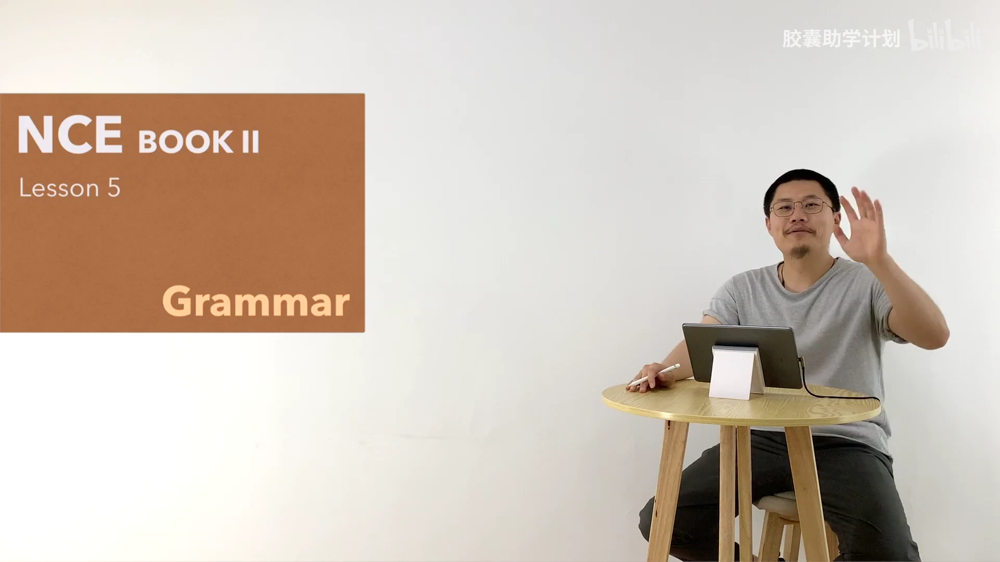

文字识别：胶囊助学计划 / NCE / BOOKI"I / Lesson 5 / Grammar

### 画面 00:00:02

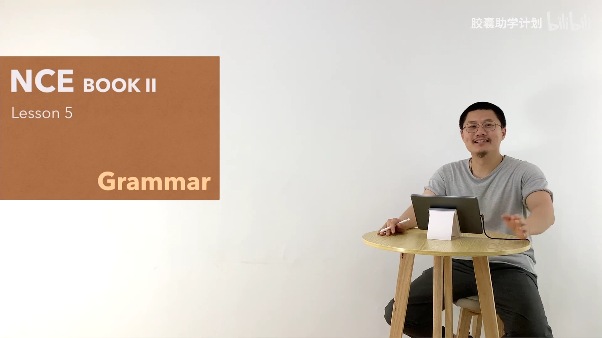

文字识别：胶囊助学计划 / NCE / BOOKII / Lesson 5 / Grammar

### 画面 00:00:05

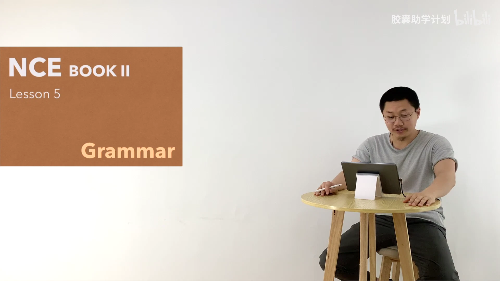

文字识别：胶囊助学计划 / NCE / BOOKII / Lesson 5 / Grammar

### 画面 00:00:08

文字识别：胶囊助学计划

### 画面 00:00:10

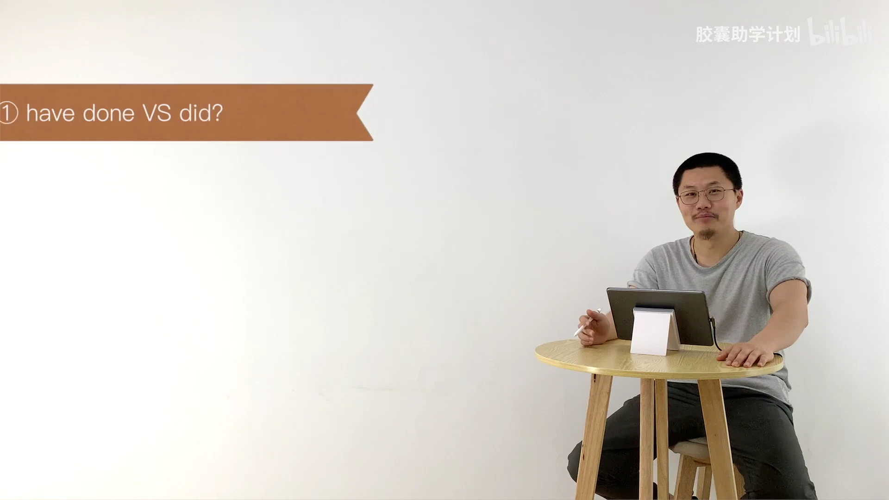

文字识别：胶囊助学计划 / ① have done VS did?

### 画面 00:00:12

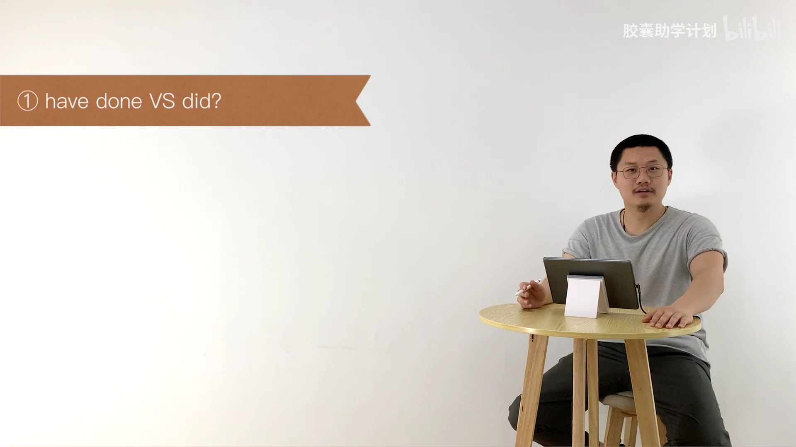

文字识别：胶囊助学计划 / ① have done VS did?

### 画面 00:00:19

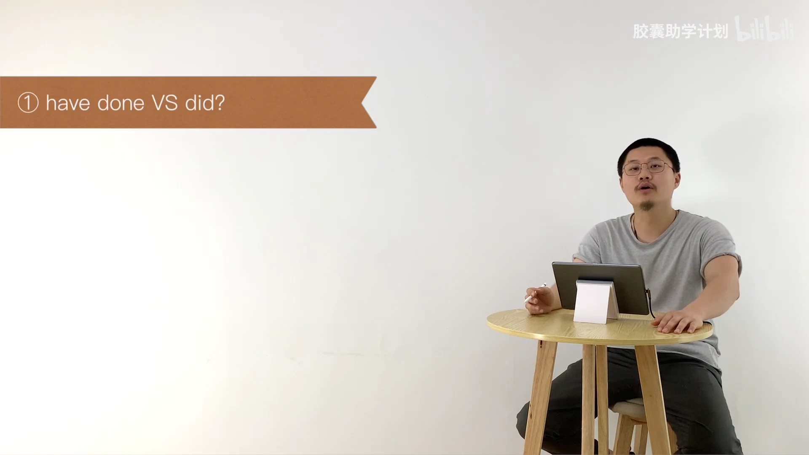

文字识别：胶囊助学计划 / ① have done VS did?

### 画面 00:00:22

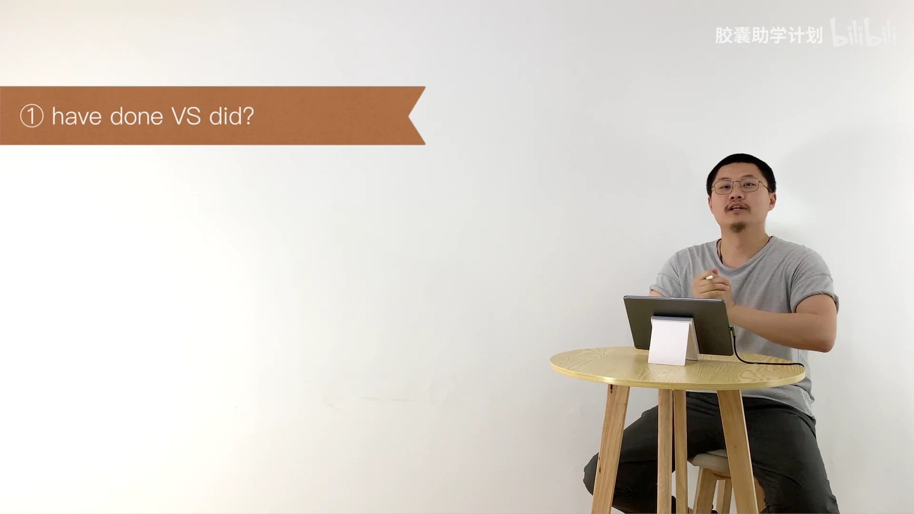

文字识别：胶囊助学计划 / ① have done VS did?

### 画面 00:00:25

文字识别：胶囊助学计划bil出

### 画面 00:00:29

文字识别：胶囊助学计划

## 00:00:30–00:01:00

好，那上来呢，我们先以非常快的速度一起去过一遍一般过去时的关键知识点。首先，它的用法叫做描述发生在过去的动作或者是状态。那我们新一实际上六十七课到七十八课也学过了，对吧？发生在过去的动作或者状态，这很重要时间点。其次呢，它的结构有两个，一个是 did，由 do does 变过来的；一个是 was were，是由 am is are 变

### 画面 00:00:31

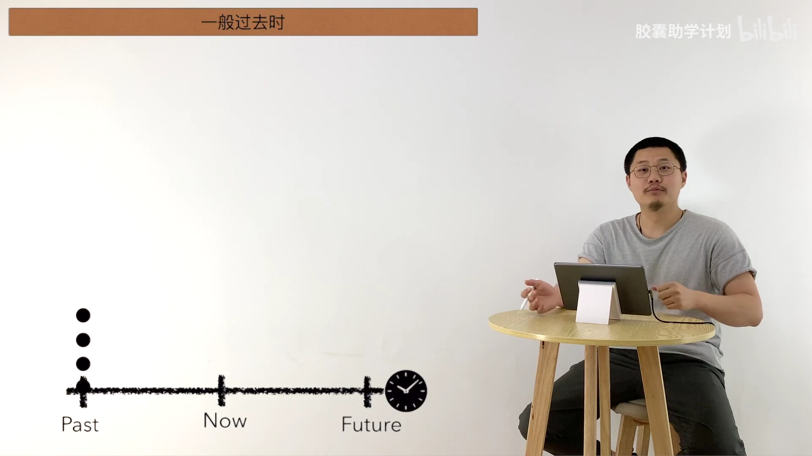

文字识别：一般过去时 / 胶囊助学计划 / Now / Past / Future

### 画面 00:00:34

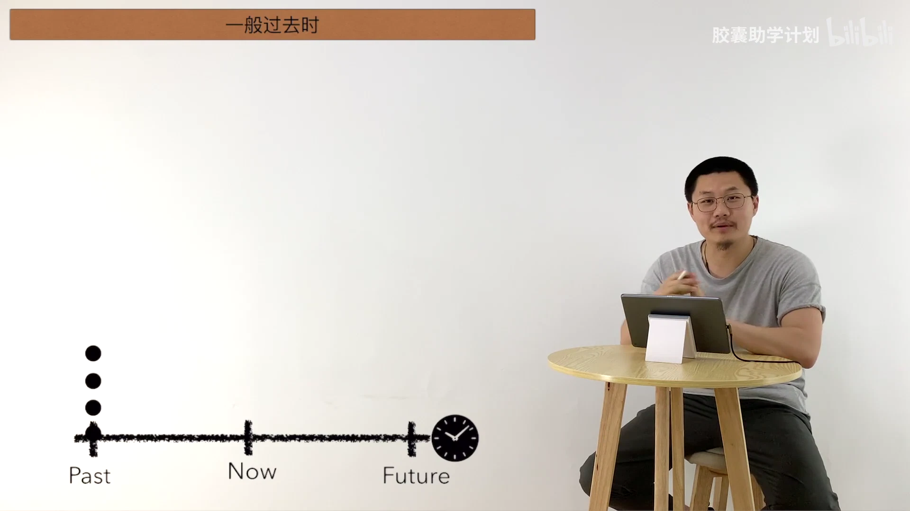

文字识别：一般过去时 / 胶囊助学计划 / Now / Past / Future

### 画面 00:00:37

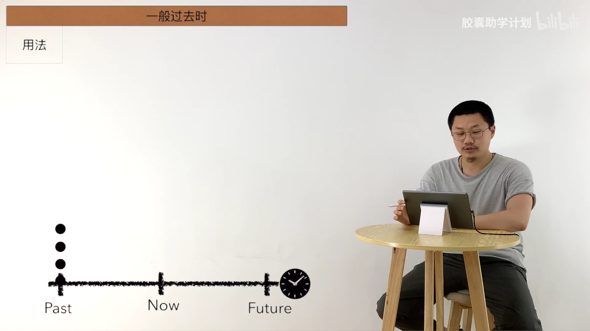

文字识别：一般过去时 / 胶囊助学计划 / 用法 / Now / Past / Future

### 画面 00:00:39

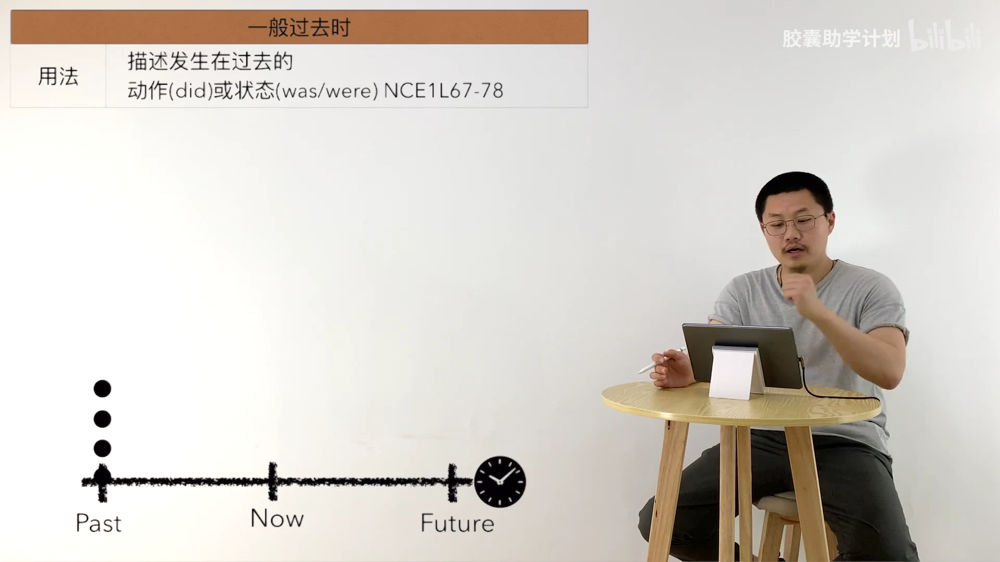

文字识别：般过去时 / 胶囊助学计划 / 描述发生在过去的 / 用法 / 动作(did)或状态(was/were) NCE1L67-78 / Now / Past / Future

### 画面 00:00:44

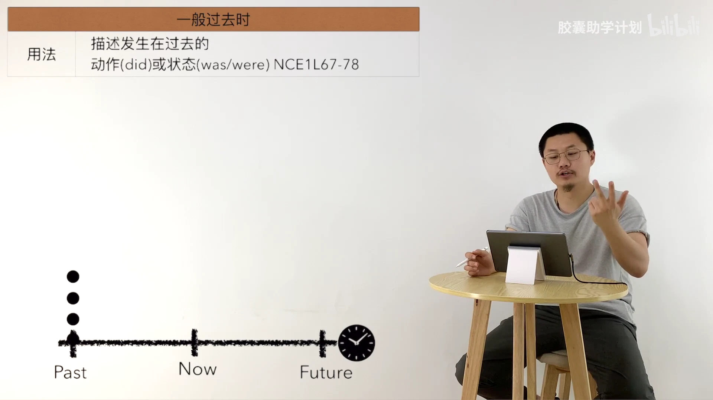

文字识别：般过去时 / 胶囊助学计划 / 描述发生在过去的 / 用法 / 动作(did)或状态(was/were) NCE1L67-78 / Now / Past / Future

### 画面 00:00:47

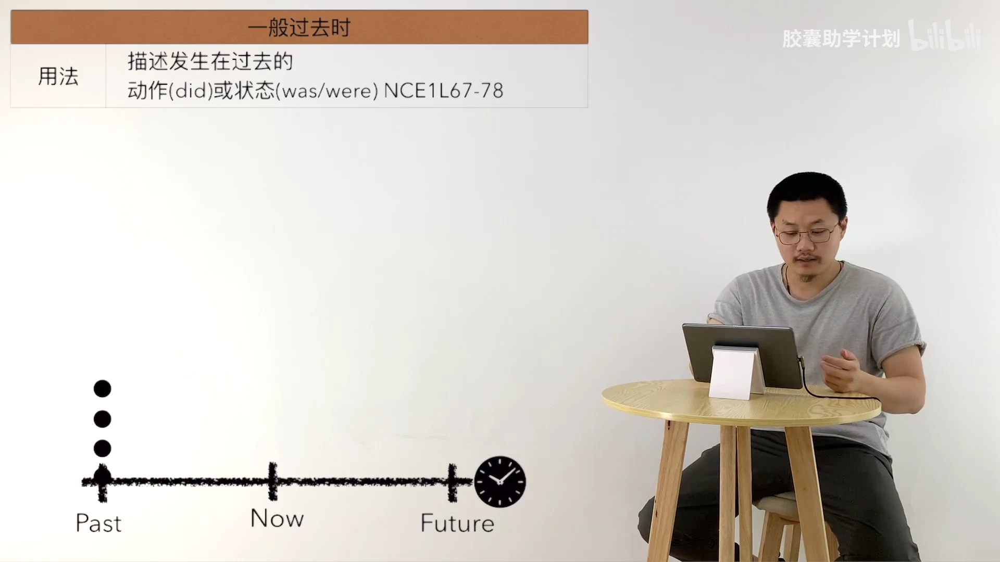

文字识别：般过去时 / 胶囊助学计划 / 描述发生在过去的 / 用法 / 动作(did)或状态(was/were) NCE1L67-78 / Now / Past / Future

### 画面 00:00:49

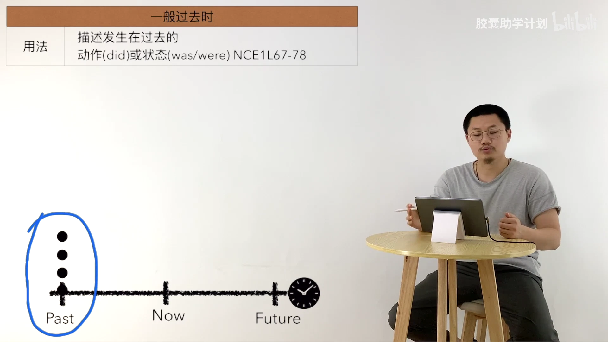

文字识别：般过去时 / 胶囊助学计划 / 描述发生在过去的 / 用法 / 动作(did)或状态(was/were) NCE1L67-78 / Past / Now / Future

### 画面 00:00:51

文字识别：般过去时 / 胶囊助学计划 / 描述发生在过去的 / 用法 / 动作(did)或状态(was/were) NCE1L67-78 / Now / Past / Future

### 画面 00:00:53

文字识别：般过去时 / 胶囊助学计划 / 描述发生在过去的 / 用法 / 动作(did)或状态(was/were) NCE1L67-78 / 结构 / did / was/were / v.ed / (过去式) / Now / Past / Future

### 画面 00:00:56

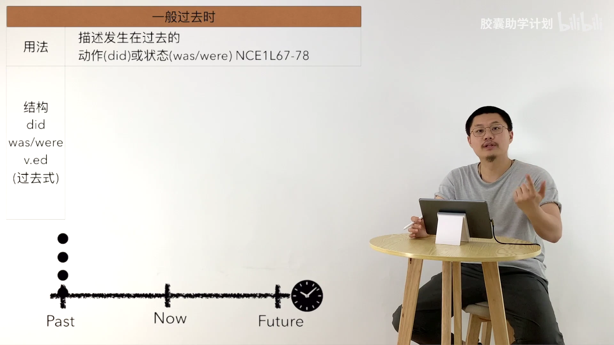

文字识别：般过去时 / 胶囊助学计划 / 描述发生在过去的 / 用法 / 动作(did)或状态(was/were) NCE1L67-78 / 结构 / did / was/were / v.ed / (过去式) / Past / Now / Future

## 00:01:00–00:01:30

过来的，对吧？一个表动作，did；一个表状态，was were。其次呢，动词过去式有很多的规则变化和不规则变化，这些呃变化的方式、变化的规则，我们在之前的《新概念一册》六十七课到七十八课也有去进行过讲解。接下来它的肯定句，我们看两句话。第一个，Tom watched TV last night。注意watch一定要加ed，因为是发生在过去的事情。以

### 画面 00:01:00

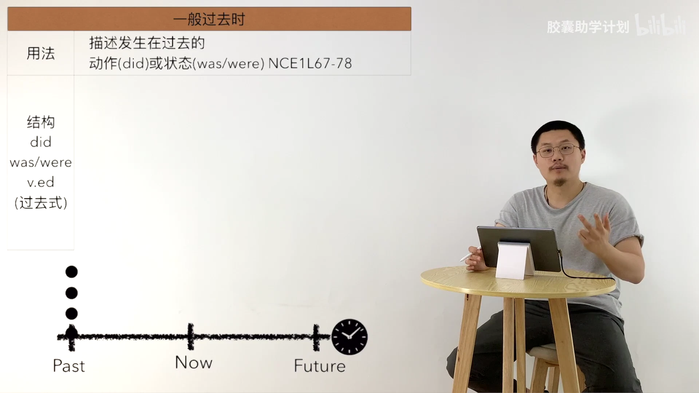

文字识别：般过去时 / 胶囊助学计划 / 描述发生在过去的 / 用法 / 动作(did)或状态(was/were) NCE1L67-78 / 结构 / did / was/were / v.ed / (过去式) / Past / Now / Future

### 画面 00:01:10

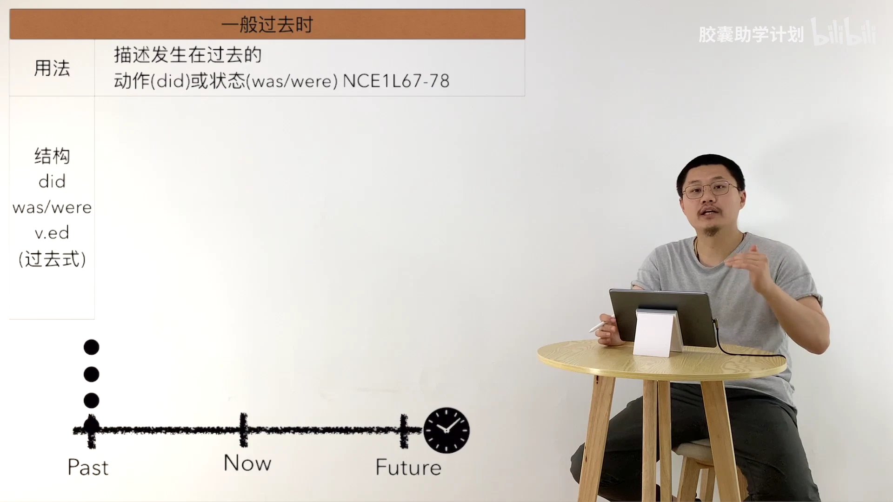

文字识别：般过去时 / 胶囊助学计划 / 描述发生在过去的 / 用法 / 动作(did)或状态(was/were) NCE1L67-78 / 结构 / did / was/were / v.ed / (过去式) / Past / Now / Future

### 画面 00:01:12

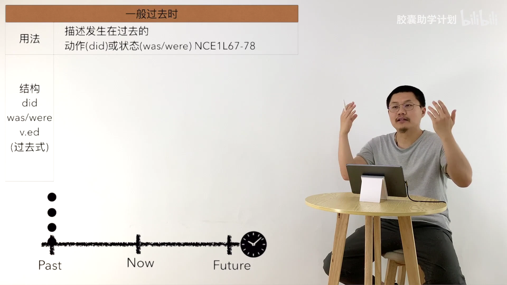

文字识别：般过去时 / 胶囊助学计划 / 描述发生在过去的 / 用法 / 动作(did)或状态(was/were) NCE1L67-78 / 结构 / did / was/were / v.ed / (过去式) / Past / Now / Future

### 画面 00:01:14

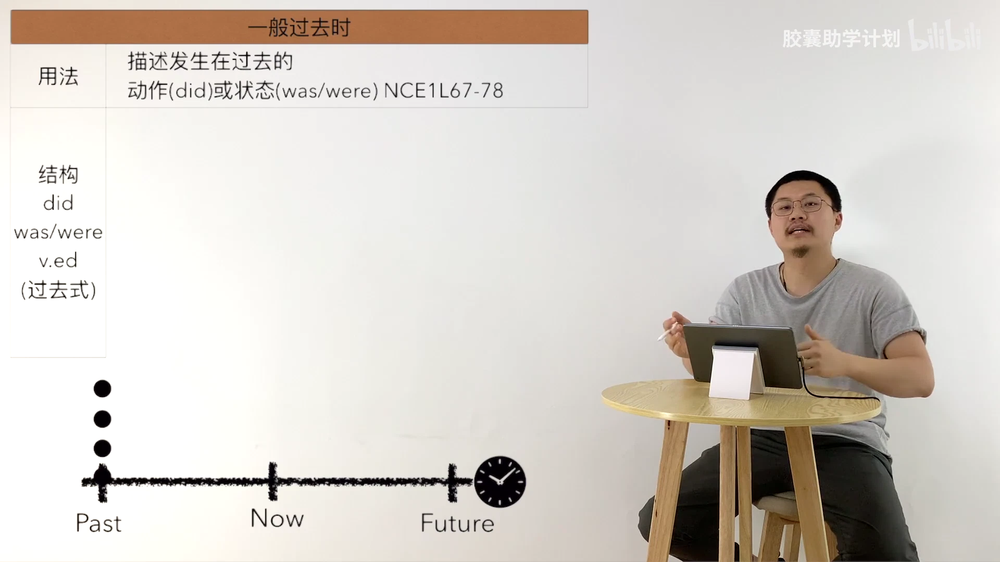

文字识别：般过去时 / 胶囊助学计划 / 描述发生在过去的 / 用法 / 动作(did)或状态(was/were) NCE1L67-78 / 结构 / did / was/were / v.ed / (过去式) / Past / Now / Future

### 画面 00:01:17

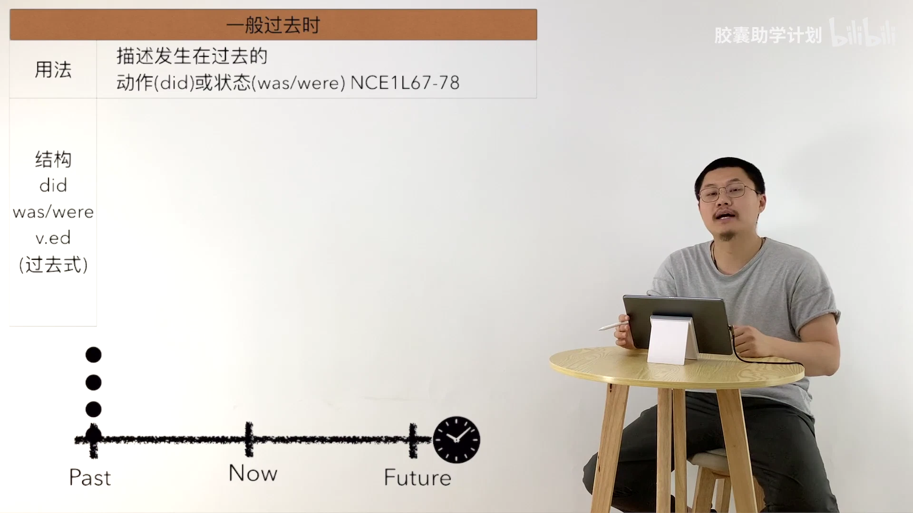

文字识别：般过去时 / 胶囊助学计划 / 描述发生在过去的 / 用法 / 动作(did)或状态(was/were) NCE1L67-78 / 结构 / did / was/were / v.ed / (过去式) / Now / Past / Future

### 画面 00:01:22

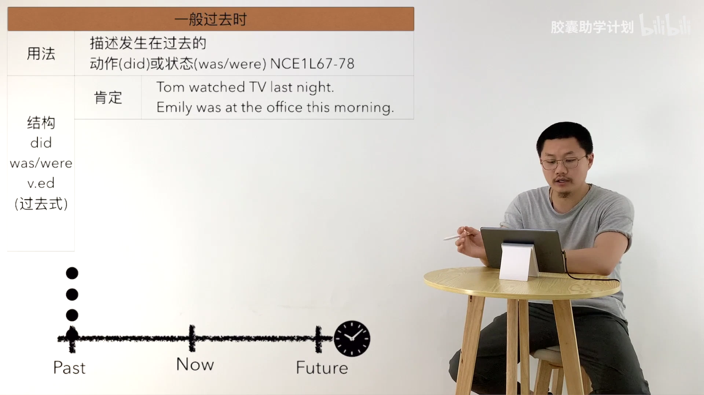

文字识别：般过去时 / 胶囊助学计划 / 描述发生在过去的 / 用法 / 动作(did)或状态(was/were)NCE1L67-78 / Tom watched TV last night. / 肯定 / Emily was at the office this morning. / 结构 / did / was/were / v.ed / (过去式) / Now / Past / Future

### 画面 00:01:24

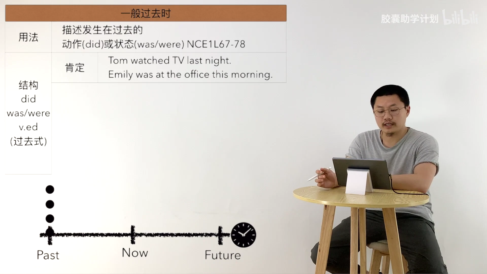

文字识别：般过去时 / 胶囊助学计划 / 描述发生在过去的 / 用法 / 动作(did)或状态(was/were) NCE1L67-78 / Tom watched TV last night. / 肯定 / Emily was at the office this morning. / 结构 / did / was/were / v.ed / (过去式) / Now / Past / Future

### 画面 00:01:26

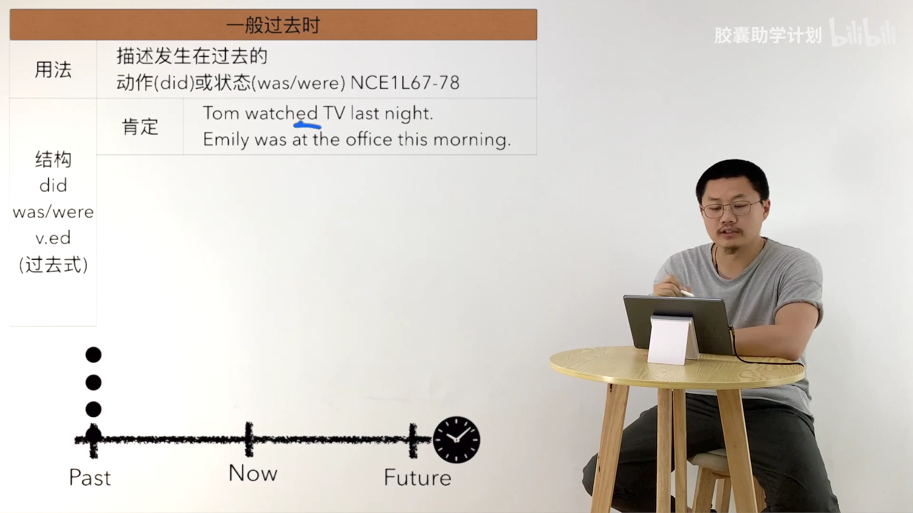

文字识别：般过去时 / 胶囊助学计划 / 描述发生在过去的 / 用法 / 动作(did)或状态(was/were) NCE1L67-78 / Tom watched TV last night. / 肯定 / Emily was at the office this morning. / 结构 / did / was/were / v.ed / (过去式) / Now / Past / Future

## 00:01:30–00:02:00

及 Emily was at the office this morning. 今儿早上 Emily 在办公室。注意 was 表示的是过去的一个状态。那它变否定句呢？首先 Tom didn't watch TV last night. 注意一个小点，watched 一定要换回原形。那 did 后面加 not 并不是非常困难的一件事情，但是一一定要记住 watch 的要换回 watch。OK。其次呢，那 was

### 画面 00:01:38

文字识别：般过去时 / 胶囊助学计划 / 描述发生在过去的 / 用法 / 动作(did)或状态(was/were)NCE1L67-78 / Tom watched TV last night. / 肯定 / Emily was at the office this morning. / 结构 / did / was/were / v.ed / (过去式) / Now / Past / Future

### 画面 00:01:45

文字识别：般过去时 / 胶囊助学计划 / 描述发生在过去的 / 用法 / 动作(did)或状态(was/were)NCE1L67-78 / Tom watched TV last night. / 肯定 / Emily was at the office this morning. / 结构 / Tom didn't watch TV last night. / did / 否定 / Emily wasn't at the office this morning. / was/were / v.ed / (过去式) / Now / Past / Future

### 画面 00:01:48

文字识别：般过去时 / 胶囊助学计划 / 描述发生在过去的 / 用法 / 动作(did)或状态(was/were)NCE1L67-78 / Tom watched TV last night. / 肯定 / Emily was at the office this morning. / 结构 / Tom didn't watch TV last night. / did / 否定 / Emily wasn't at the office this morning. / was/were / v.ed / (过去式) / Now / Past / Future

### 画面 00:01:51

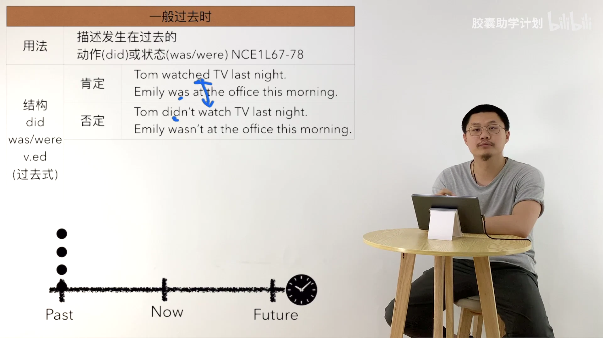

文字识别：般过去时 / 胶囊助学计划 / 描述发生在过去的 / 用法 / 动作(did)或状态(was/were)NCE1L67-78 / Tom watched TV last night. / 肯定 / Emily was at the office this morning. / 结构 / Tom didn't watch TV last night. / did / 否定 / Emily wasn't at the office this morning. / was/were / v.ed / (过去式) / Now / Past / Future

## 00:02:00–00:02:30

后边直接加wasn't就可以了。一般疑问句呢，did提前，was提前，这个没有太多变化。那注意一个小点，就是watch还是要换回原形的，不要用它的过去式了。Okay.那它有一个小的难点，第一，否定句和疑问句一定要记住用动词的原形。其次呢，肯定句当中动词加ed这个过去式，分规则的和不规则的变化，这个各位没有很好很好的办

### 画面 00:02:00

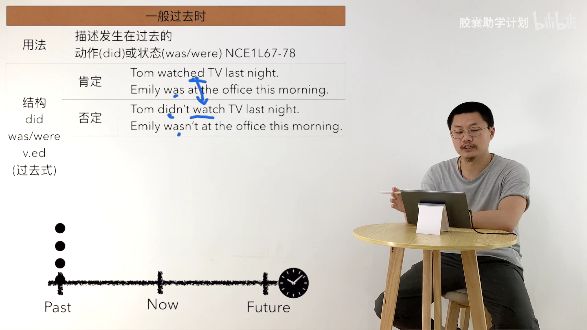

文字识别：般过去时 / 胶囊助学计划 / 描述发生在过去的 / 用法 / 动作(did)或状态(was/were)NCE1L67-78 / Tom watched TV last night. / 肯定 / Emily was at the office this morning. / 结构 / Tom didn't watch TV last night. / did / 否定 / Emily wasn't at the office this morning. / was/were / v.ed / (过去式) / Now / Past / Future

### 画面 00:02:05

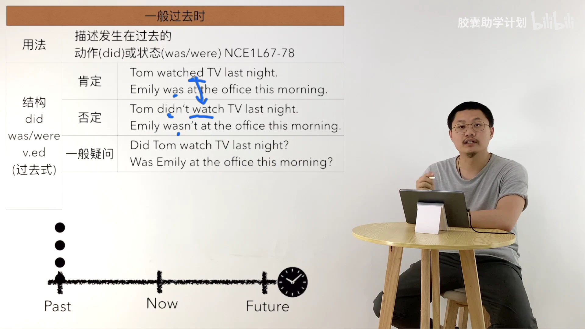

文字识别：般过去时 / 胶囊助学计划 / 描述发生在过去的 / 用法 / 动作(did)或状态(was/were)NCE1L67-78 / Tom watched TV last night. / 肯定 / Emily was at the office this morning. / 结构 / Tom didn't watch TV last night. / did / 否定 / Emily wasn't at the office this morning. / was/were / Did Tom watch TV last night? / v.ed / 一般疑问 / Was Emily at the office this morning? / (过去式) / Now / Past / Future

### 画面 00:02:10

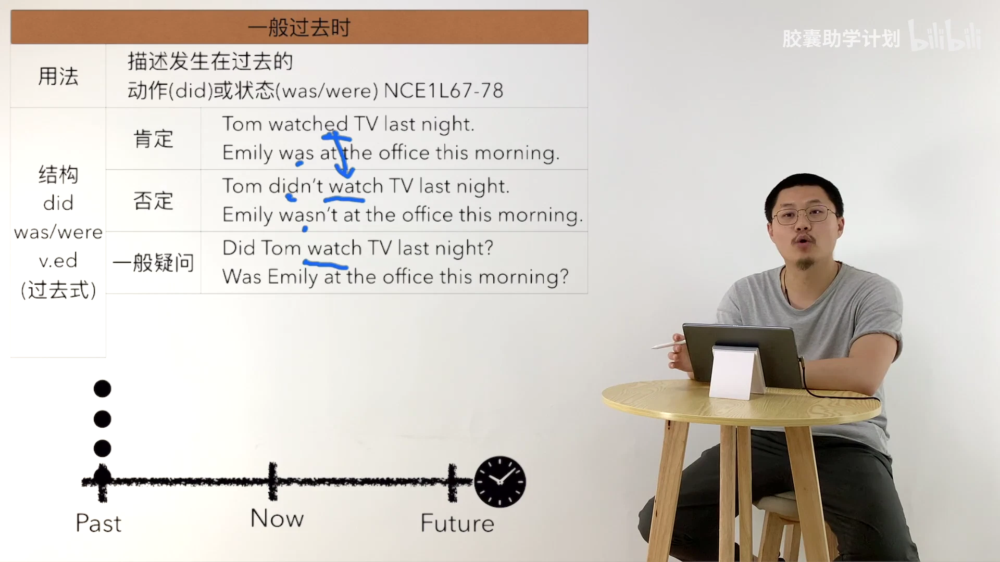

文字识别：般过去时 / 胶囊助学计划 / 描述发生在过去的 / 用法 / 动作(did)或状态(was/were)NCE1L67-78 / Tom watched TV last night. / 肯定 / Emily was at the office this morning. / 结构 / Tom didn't watch TV last night. / did / 否定 / Emily wasn't at the office this morning. / was/were / Did Tom watch TV last night? / v.ed / 一般疑问 / Was Emily at the office this morning? / (过去式) / Now / Past / Future

### 画面 00:02:17

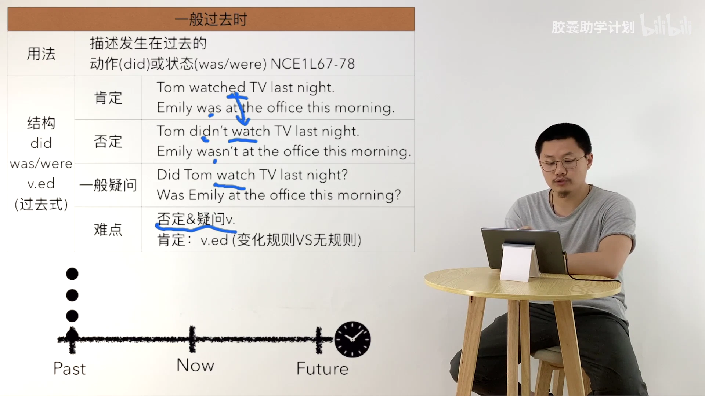

文字识别：般过去时 / 胶囊助学计划 / 描述发生在过去的 / 用法 / 动作(did)或状态(was/were) NCE1L67-78 / Tom watched TV last night. / 肯定 / Emily was at the office this morning. / 结构 / Tom didn't watch TV last night. / did / 否定 / Emily wasn't at the office this morning. / was/were / Did Tom watch TV last night? / v.ed / 一般疑问 / Was Emily at the office this morning? / (过去式) / 否定＆疑问v. / 难点 / 肯定：v.ed(变化规则VS无规则) / Now / Past / Future

### 画面 00:02:20

文字识别：一般过去时 / 胶囊助学计划 / 描述发生在过去的 / 用法 / 动作(did)或状态(was/were)NCE1L67-78 / Tom watched TV last night. / 肯定 / Emily was at the office this morning. / 结构 / Tom didn't watch TV last night. / did / 否定 / Emily wasn't at the office this morning. / was/were / Did Tom watch TV last night? / v.ed / 一般疑问 / Was Emily at the office this morning? / (过去式) / 否定＆疑问v. / 难点 / 肯定：v.ed(变化规则VS无规则) / Now / Past / Future

### 画面 00:02:23

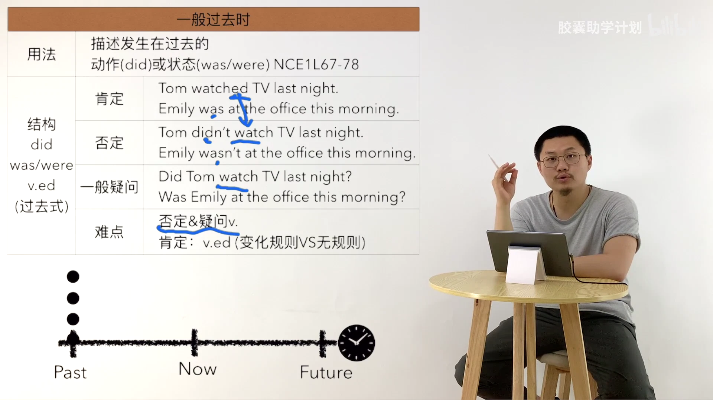

文字识别：一般过去时 / 胶囊助学计划 / 描述发生在过去的 / 用法 / 动作(did)或状态(was/were)NCE1L67-78 / Tom watched TV last night. / 肯定 / Emily was at the office this morning. / 结构 / Tom didn't watch TV last night. / did / 否定 / Emily wasn't at the office this morning. / was/were / Did Tom watch TV last night? / v.ed / 一般疑问 / Was Emily at the office this morning? / (过去式) / 否定＆疑问v. / 难点 / 肯定：v.ed(变化规则VS无规则) / Now / Past / Future

### 画面 00:02:25

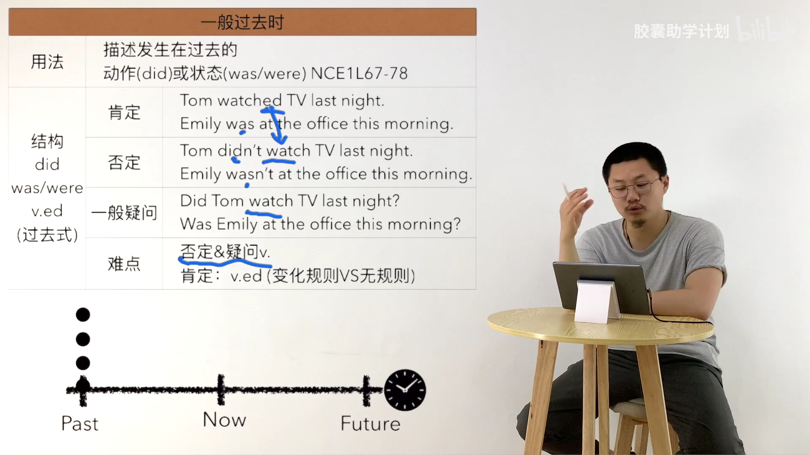

文字识别：般过去时 / 胶囊助学计划 / 描述发生在过去的 / 用法 / 动作(did)或状态(was/were) NCE1L67-78 / Tom watched TV last night. / 肯定 / Emily was at the office this morning. / 结构 / Tom didn't watch TV last night. / did / 否定 / Emily wasn't at the office this morning. / was/were / Did Tom watch TV last night? / v.ed / 一般疑问 / Was Emily at the office this morning? / (过去式) / 否定＆疑问v. / 难点 / 肯定：v.ed(变化规则VS无规则) / Now / Past / Future

## 00:02:30–00:03:00

法，或者换一句话来说，更好或者说比较好的办法就是不停的输入，不停的输入啊。您只要坚持去学，比如说像 buy 变过去式变 bought 这些东西，您见多了，自然而然也就把它记住了。OK，好，这是关于一般过去时的。那现在完成时呢？我们在第四课有刚刚讲过，今天还是以非常快的速度带着大带着大家去过一遍。它的用法一叫言之过去意在当下，过去发生的一件事

### 画面 00:02:43

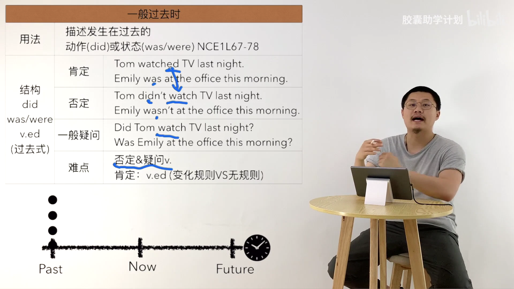

文字识别：般过去时 / 胶囊助学计划 / 描述发生在过去的 / 用法 / 动作(did)或状态(was/were) NCE1L67-78 / Tom watched TV last night. / 肯定 / Emily was at the office this morning. / 结构 / Tom didn't watch TV last night. / did / 否定 / Emily wasn't at the office this morning. / was/were / Did Tom watch TV last night? / v.ed / 一般疑问 / Was Emily at the office this morning? / (过去式) / 否定＆疑问v. / 难点 / 肯定：v.ed(变化规则VS无规则) / Now / Past / Future

### 画面 00:02:45

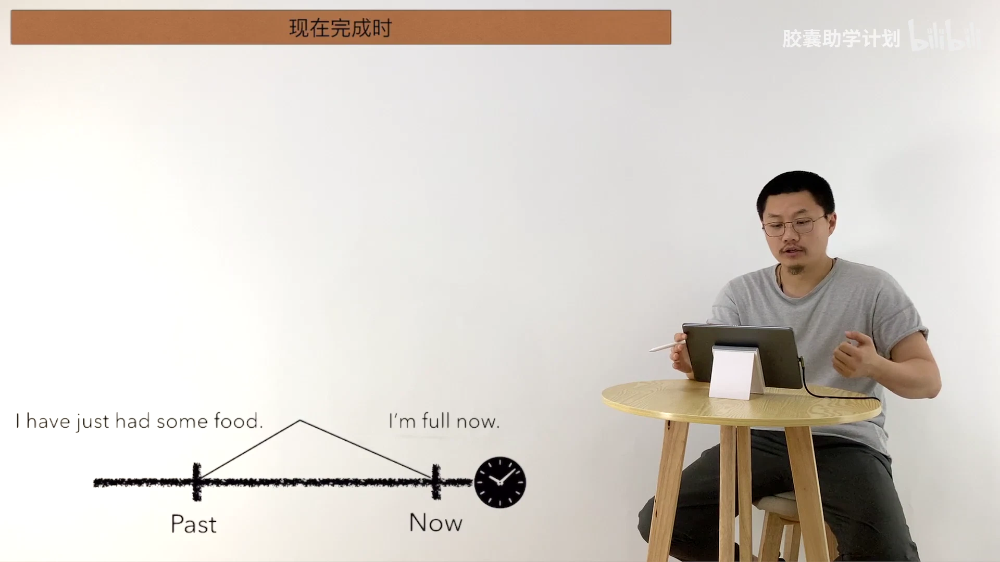

文字识别：现在完成时 / 胶囊助学计划 / I have just had some food. / I'm full now. / Past / Now

### 画面 00:02:47

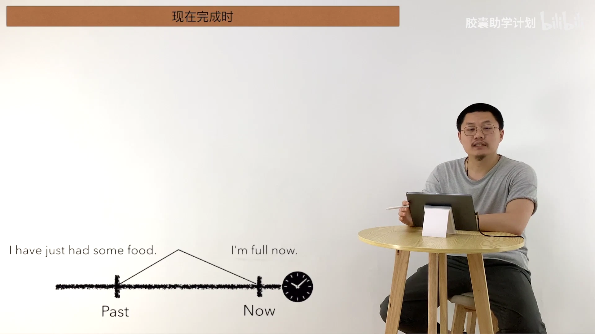

文字识别：现在完成时 / 胶囊助学计划 / I have just had some food. / I'm full now. / Past / Now

### 画面 00:02:51

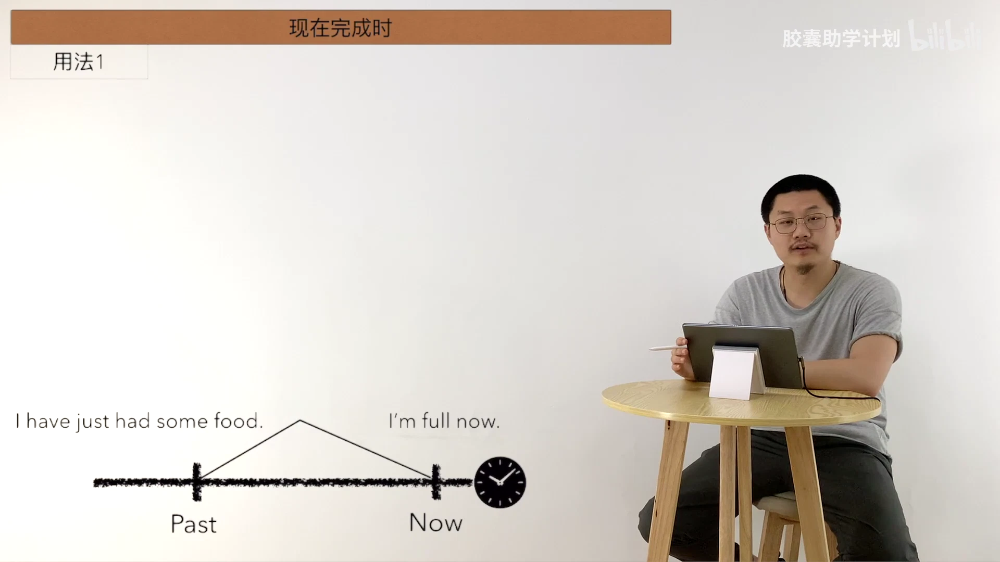

文字识别：现在完成时 / 胶囊助学计划 / 用法1 / I have just had some food. / I'm full now. / Past / Now

### 画面 00:02:55

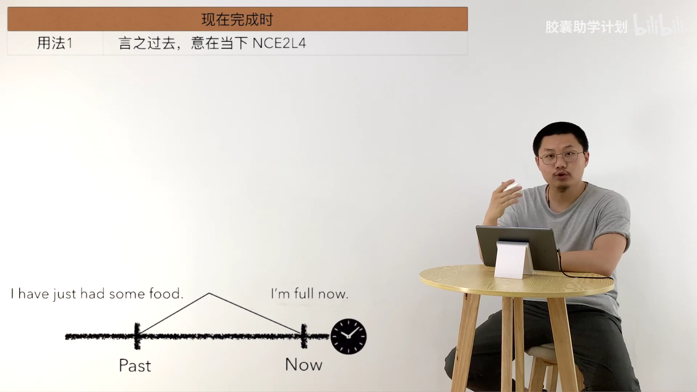

文字识别：现在完成时 / 胶囊助学计划 / 用法1 / 言之过去，意在当下 NCE2L4 / I have just had some food. / I'm full now. / Past / Now

## 00:03:00–00:03:30

情对当下产生了一个影响。当说话人选择用现在完成时的时候，他往往想告诉各位的就是过去与现在产生了什么之间的因果关系，对吧？好，接下来它的结构呢，简单来说就是 have 加，但它也是动词后边要加上 e d。注意，但是这个地方我们管它不叫过去式了，管它叫过去分词，也可以直接用 but 这个单词去替代。

### 画面 00:03:20

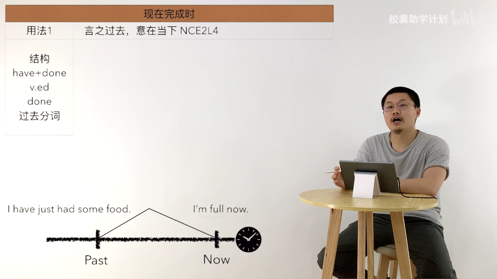

文字识别：现在完成时 / 胶囊助学计划 / 用法1 / 言之过去，意在当下 NCE2L4 / 结构 / have+done / v.ed / done / 过去分词 / I have just had some food. / I'm full now. / Past / Now

### 画面 00:03:27

文字识别：现在完成时 / 胶囊助学计划 / 用法1 / 言之过去，意在当下 NCE2L4 / 结构 / have+done / v.ed / done / 过去分词 / I have just had some food. / I'm full now. / Past / Now

## 00:03:30–00:04:00

接下来呢？肯定，比如说，我现在问你一句话是 Do you want to have dinner？你想吃晚饭吗？你给了一句话说 I have just had some dinner。现在完成时 have 加 but，那它的潜台词对当下的影响是不用说出来的，叫做 I'm full now。我现在饱了。I don't want to eat dinner。I don't want to have dinner right now。我现在不想再吃晚饭了。OK，过去的事情发生在过去，对

### 画面 00:03:30

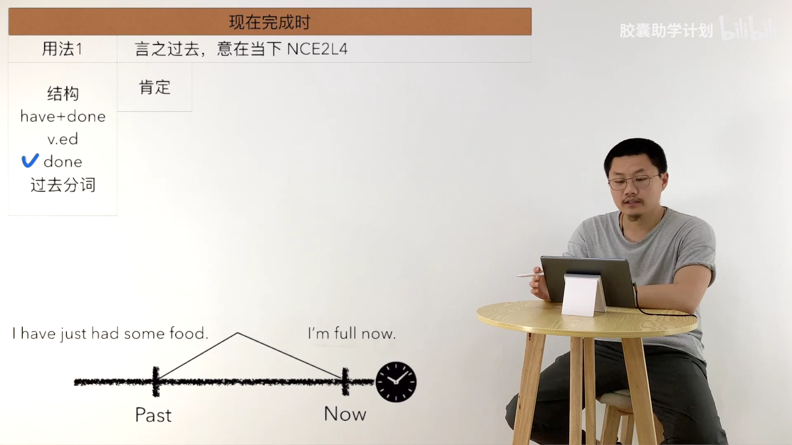

文字识别：现在完成时 / 胶囊助学计划 / 用法1 / 言之过去，意在当下 NCE2L4 / 肯定 / 结构 / have+done / v.ed / done / 过去分词 / I have just had some food. / I'm full now. / Past / Now

### 画面 00:03:35

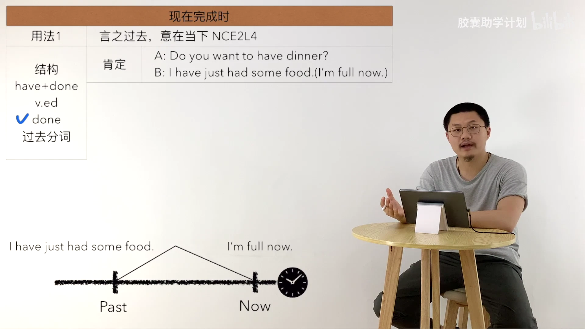

文字识别：现在完成时 / 胶囊助学计划 / 用法1 / 言之过去，意在当下 NCE2L4 / A: Do you want to have dinner? / 肯定 / 结构 / B: I have just had some food.('m full now.) / have+done / v.ed / done / 过去分词 / I have just had some food. / I'm full now. / Past / Now

### 画面 00:03:42

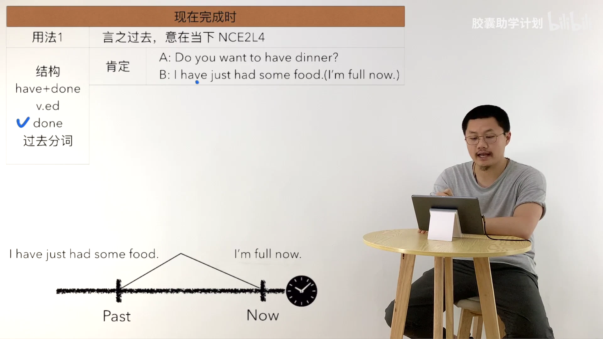

文字识别：现在完成时 / 胶囊助学计划 / 用法1 / 言之过去，意在当下 NCE2L4 / A: Do you want to have dinner? / 肯定 / 结构 / B: I have just had some food.(l'm full now.) / have+done / v.ed / done / 过去分词 / I have just had some food. / I'm full now. / Past / Now

### 画面 00:03:46

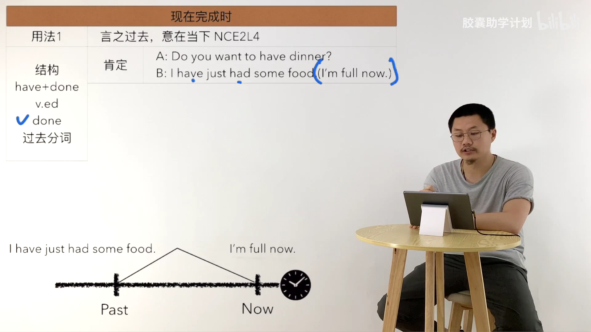

文字识别：现在完成时 / 胶囊助学计划 / 用法1 / 言之过去，意在当下 NCE2L4 / A: Do you want to have dinner? / 肯定 / 结构 / B: I have just had some food(I'm full now.) / have+done / v.ed / done / 过去分词 / I have just had some food. / I'm full now. / Past / Now

### 画面 00:03:58

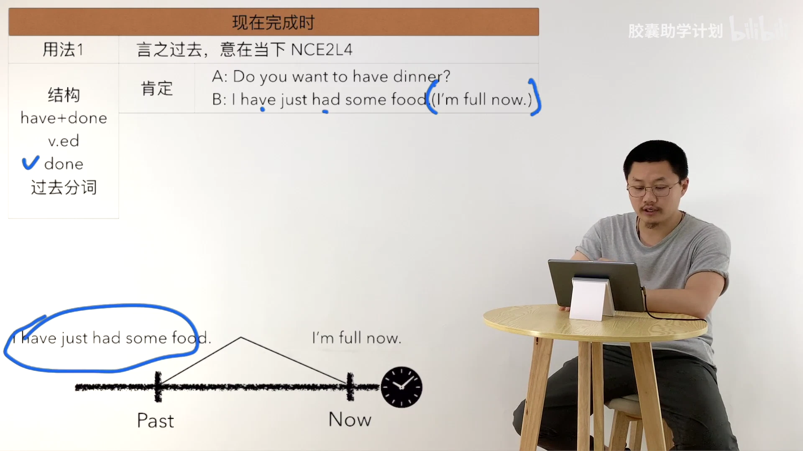

文字识别：现在完成时 / 胶囊助学计划 / 用法1 / 言之过去，意在当下 NCE2L4 / A: Do you want to have dinner? / 肯定 / 结构 / B: I have just had some food(I'm full now.) / have+done / v.ed / done / 过去分词 / Mave just had some fodd. / I'm full now. / Past / Now

## 00:04:00–00:04:30

现在产生了影响。现在完成时。那接下来呢？它的否定句也比较的简单，直接是在 have 或 has 的后面加 not。那是用 have 还是用 has？由主语决定。主语如果是第三人称并且是单数，那您就要用 has 了，对吧？除此以外，非三单的情况全用 have。那它的一般疑问句呢？Have has 提到句首，剩下不用进行任何

### 画面 00:04:00

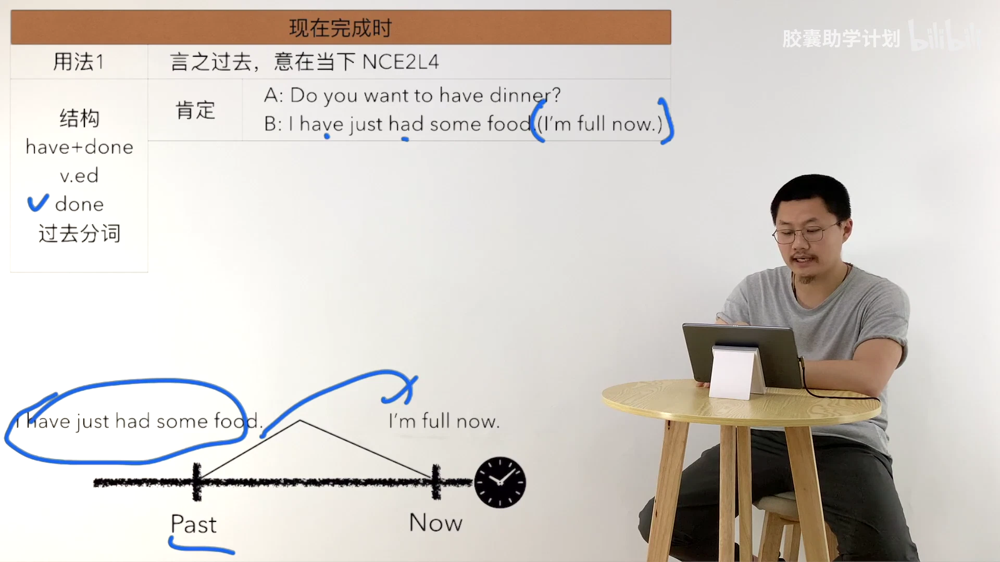

文字识别：现在完成时 / 胶囊助学计划 / 用法1 / 言之过去，意在当下 NCE2L4 / A: Do you want to have dinner? / 肯定 / 结构 / B: I have just had some food(I'm full now.) / have+done / v.ed / done / 过去分词 / Mave just had some foo / I'm full now. / Past / Now

### 画面 00:04:03

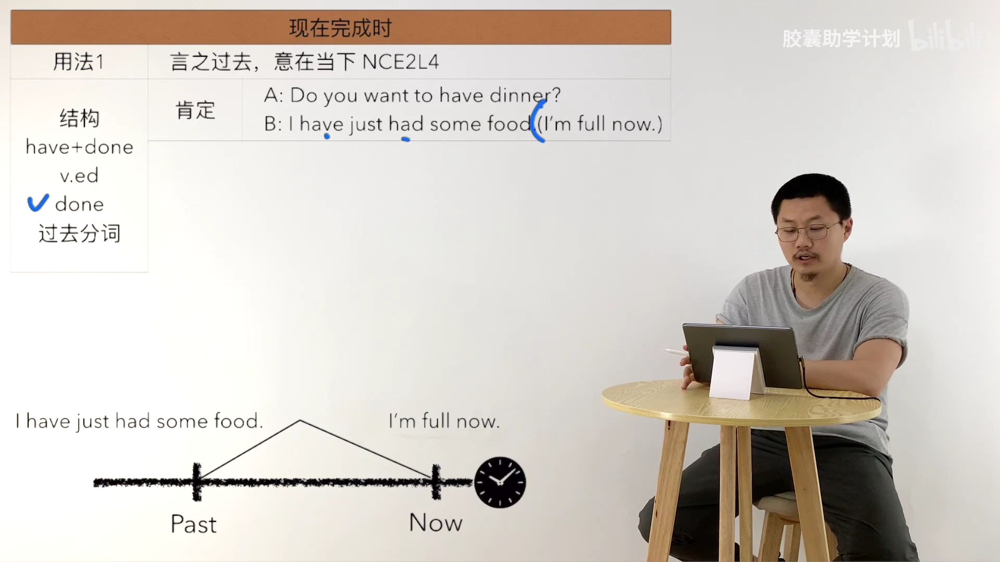

文字识别：现在完成时 / 胶囊助学计划 / 用法1 / 言之过去，意在当下 NCE2L4 / A: Do you want to have dinner? / 肯定 / 结构 / B: I have just had some food(I'm full now.) / have+done / v.ed / done / 过去分词 / I have just had some food. / I'm full now. / Past / Now

### 画面 00:04:08

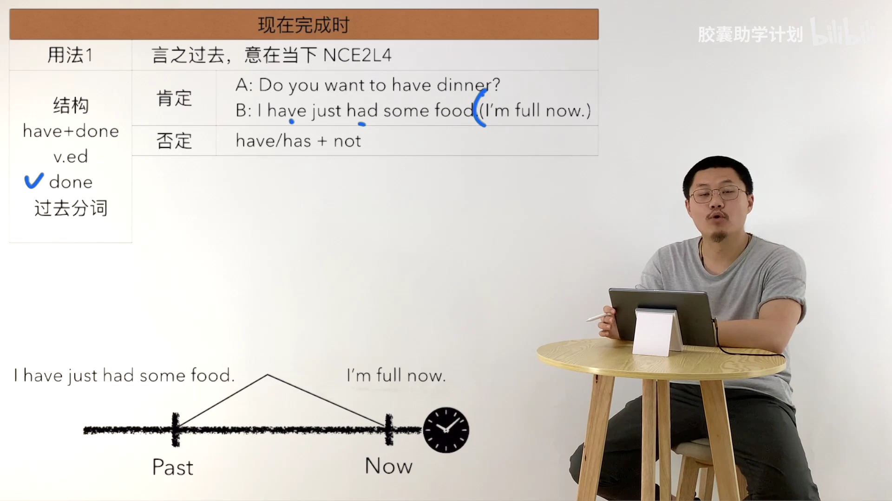

文字识别：现在完成时 / 胶囊助学计划 / 用法1 / 言之过去，意在当下 NCE2L4 / A: Do you want to have dinner? / 肯定 / 结构 / B: I have just had some food(I'm full now.) / have+done / 否定 / have/has + not / v.ed / done / 过去分词 / I have just had some food. / I'm full now. / Past / Now

### 画面 00:04:15

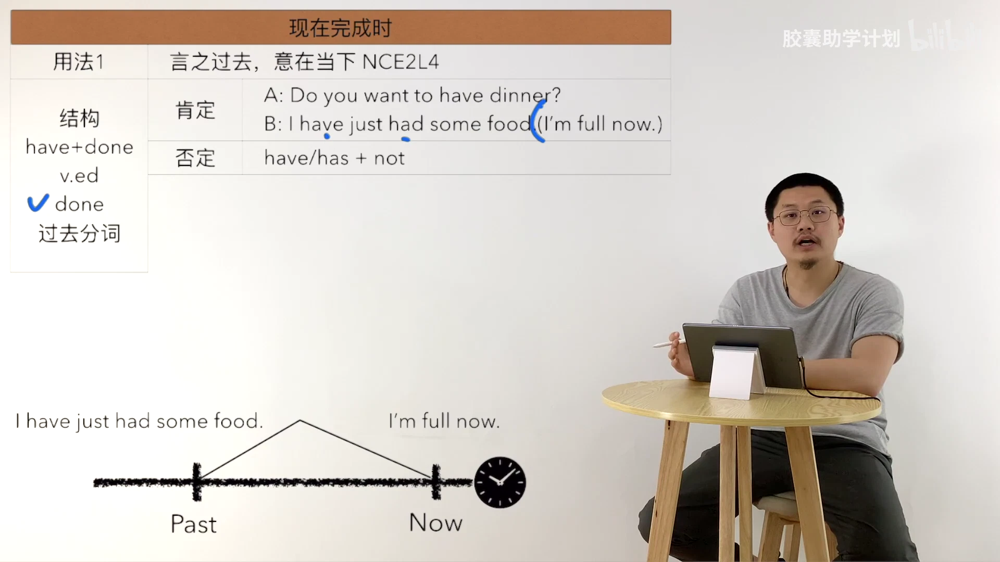

文字识别：现在完成时 / 胶囊助学计划 / 用法1 / 言之过去，意在当下 NCE2L4 / A: Do you want to have dinner? / 肯定 / 结构 / B: I have just had some food(I'm full now.) / have+done / 否定 / have/has + not / v.ed / done / 过去分词 / I have just had some food. / I'm full now. / Past / Now

### 画面 00:04:25

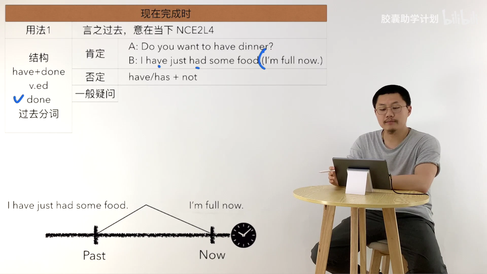

文字识别：现在完成时 / 胶囊助学计划 / 用法1 / 言之过去，意在当下 NCE2L4 / A: Do you want to have dinner? / 肯定 / 结构 / B: I have just had some food(I'm full now.) / have+done / 否定 / have/has + not / v.ed / 一般疑问 / done / 过去分词 / I have just had some food. / I'm full now. / Past / Now

## 00:04:30–00:05:00

的改变，注意，但不要换回原形。再然后呢，它的难点就是 have done 和 did 实际上是有一些对比的，以及动词的过去分词有很多规则以及不规则的变化。这个我们怎么记下来呢？和动词的过去式是一样的，就是多看多见就可以了。好，那接下来我们对比一下在用法一这个状态之下，二者的异同。好，首先我们其实上一节课刚刚用过了

### 画面 00:04:36

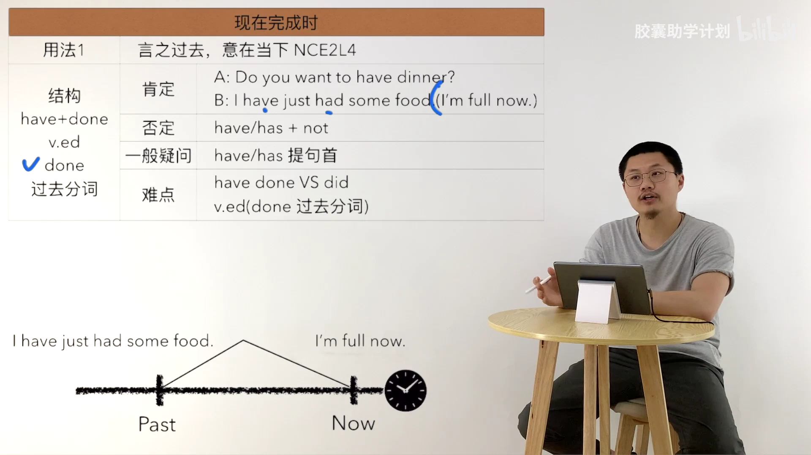

文字识别：现在完成时 / 胶囊助学计划 / 用法1 / 言之过去，意在当下 NCE2L4 / A: Do you want to have dinner? / 肯定 / 结构 / B: I have just had some food(I'm full now.) / have+done / 否定 / have/has + not / v.ed / 一般疑问 / have/has 提句首 / done / have done VS did / 过去分词 / 难点 / v.ed(done 过去分词) / I have just had some food. / I'm full now. / Past / Now

### 画面 00:04:41

文字识别：现在完成时 / 胶囊助学计划 / 用法1 / 言之过去，意在当下 NCE2L4 / A: Do you want to have dinner? / 肯定 / 结构 / B: I have just had some food(I'm full now.) / have+done / 否定 / have/has + not / v.ed / 一般疑问 / have/has 提句首 / done / have done VS did / 过去分词 / 难点 / v.ed(done 过去分词) / I have just had some food. / I'm full now. / Past / Now

### 画面 00:04:50

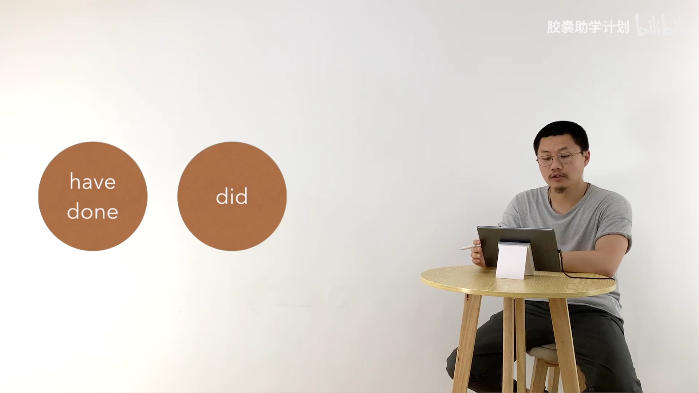

文字识别：胶囊助学计划 / have / did / done

### 画面 00:04:56

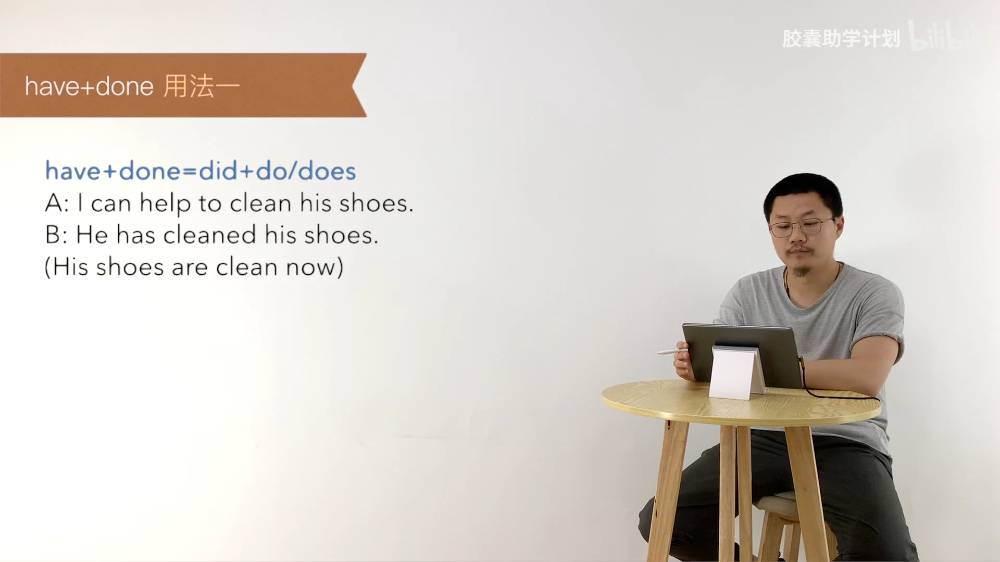

文字识别：胶囊助学计划 / have+done 用法一 / have+done=did+do/does / A: I can help to clean his shoes. / B: He has cleaned his shoes. / (His shoes are clean now)

## 00:05:00–00:05:30

这个 P P T，对吧？这个 PowerPoint，我们拿过来直接看。说 I can help to clean his shoes。我能帮忙去清洗他的鞋。然后 B 说了一句话，说他已经清洗了他的鞋了。注意他的潜台词就是他的鞋现在是干净的。于是您还用不用帮忙呢？就不用帮忙了。所以我们当时说给了一个规则，说 have done 呢，其实几乎就等同于 did 加 do does。原因是什么呢？您想一下，说他已

### 画面 00:05:02

文字识别：胶囊助学计划 / have+done 用法一 / have+done=did+do/does / A: I can help to clean his shoes. / B: He has cleaned his shoes. / (His shoes are clean now)

### 画面 00:05:05

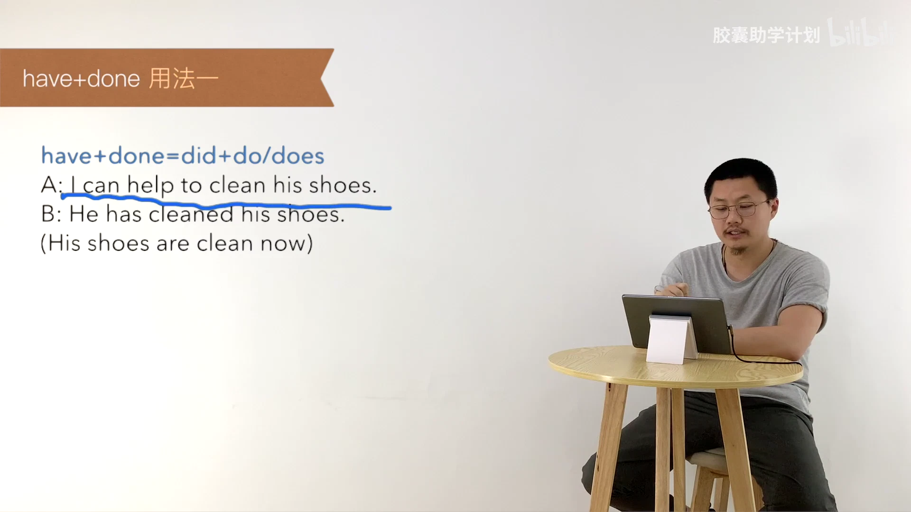

文字识别：胶囊助学计划 / have+done / 用法一 / have+done=did+do/does / A: Lcan help to clean / his / shoes. / B: He / has / cleaned his / shoes. / (His / shoes / are / clean now)

### 画面 00:05:10

文字识别：胶囊助学计划 / have+done / 用法一 / have+done=did+do/does / A: Lcan help to / clean / his / shoes. / B: He / has / cleaned / his / shoes. / (His / shoes / are / clean now)

### 画面 00:05:14

文字识别：胶囊助学计划 / have+done / 用法一 / have+done=did+do/does / A: Lcan help / to / clean / his / shoes. / B: He / has / cleaned / his / shoes. / (His / shoes / are / clean now)

### 画面 00:05:16

文字识别：胶囊助学计划 / have+done 用法一 / have+done=did+do/does / A: I can help to clean his shoes. / B: He has cleaned his shoes. / (His shoes are clean now)

### 画面 00:05:24

文字识别：胶囊助学计划 / have+done / 用法一 / have+done=did+do/does / A: I can help to clean his / shoes. / B: He / has / cleaned his / shoes. / (His / shoes / are clean now)

## 00:05:30–00:06:00

经清洗了他的鞋了，这句话的意思和底下这两句话是不是一样的？他之前一般过去时把鞋弄干净了，现在他的鞋是干净的，所以您不用再帮他清洗了。只不过这样说好像比较的多，所以我们大多数情况下可以不这么说。那这是英式的一个用法，在美式用法当中呢，我们甚至可以直接用 did 去进行一个替代。原因很简单，就像刚才说的，我说他在二十分钟

### 画面 00:05:30

文字识别：胶囊助学计划 / have+done 用法一 / have+done=did+do/does / A: I can help to clean his / shoes. / B: He has cleaned his shoes. / (His / shoes are clean now) / He cleaned his shoes, and now his / shoes are clean.

### 画面 00:05:33

文字识别：胶囊助学计划 / have+done 用法一 / have+done=did+do/does / A: I can help to clean his  / shoes. / B: He has cleaned his shoes. / (His / shoes are clean now) / He cleaned his shoes, and now his / shoes are clean.

### 画面 00:05:38

文字识别：胶囊助学计划 / have+done 用法一 / have+done=did+do/does / A: I can help to clean his shoes. / B: He has cleaned his shoes.) / (His shoes are clean now) / He cleaned his shoes, and now his / shoes are clean.

### 画面 00:05:47

文字识别：胶囊助学计划 / have+done 用法一 / have+done=did+do/does / A: I can help to clean his s / shoes. / B: He has cleaned his shoes. / (His shoes are clean now) / He cleaned his shoes, and now his / shoes are clean.

### 画面 00:05:49

文字识别：胶囊助学计划 / have+done用法一 / 名称：现在完成时NCE1L83-L88 / 含义：过去的事情对现在产生了影响 / (言之过去，意在当下) / 结构：肯定句have/has+done / 1. have+done=did+do/does

### 画面 00:05:53

文字识别：胶囊助学计划 / have+done用法一 / 名称：现在完成时NCE1L83-L88 / 含义：过去的事情对现在产生了影响 / (言之过去，意在当下) / 结构：肯定句have/has+done / 1. have+done=did+do/does / 2.have+done≈did

## 00:06:00–00:06:30

之前，他或者半小时之前刚把鞋清理干净，把鞋已经擦干净了。那现在大多数情况下，我们会下意识的默认为他的鞋是干净的，所以您就不用再清洗了。所以我们说它约等于 did，并且在美语当中啊，美式英语当中，大多数情况下我们是不是很愿意用 have 加蛋的，更多的是直接用一般过去时。只是在英式英语当中，用 have 蛋会稍微

### 画面 00:06:00

文字识别：胶囊助学计划 / have+done用法一 / 名称：现在完成时NCE1L83-L88 / 含义：过去的事情对现在产生了影响 / (言之过去，意在当下) / 结构：肯定句have/has+done / 1. have+done=did+do/does / 2. have+done≈did

### 画面 00:06:15

文字识别：胶囊助学计划 / have+done用法一 / 名称：现在完成时NCE1L83-L88 / 含义：过去的事情对现在产生了影响 / (言之过去，意在当下) / 结构：肯定句have/has+done / 1. have+done=did+do/does / 2.have+done≈did

### 画面 00:06:19

文字识别：胶囊助学计划 / have+done用法一 / 名称：现在完成时NCE1L83-L88 / 含义：过去的事情对现在产生了影响 / (言之过去，意在当下) / 结构：肯定句have/has+done / 1. have+done=did+do/does / 2. have+done≈did

### 画面 00:06:26

文字识别：胶囊助学计划 / have+done用法一 / 名称：现在完成时NCE1L83-L88 / 含义：过去的事情对现在产生了影响 / (言之过去，意在当下) / 结构：肯定句have/has+done / 1. have+done=did+do/does / 2. have+done≈did

## 00:06:30–00:07:00

多那么一点点。OK，好，那接下来现在完成时的第二个用法，一个动作 that，或者是状态 been。那 been 就是 am is are was were 的过去分词，从过去持续或重复到现在。我们在新概念二册第四课刚刚学过，它的结构和刚才是没有什么区别的。我们看一句肯定句，I have lived in Beijing

### 画面 00:06:31

文字识别：胶囊助学计划 / have+done用法一 / 名称：现在完成时NCE1L83-L88 / 含义：过去的事情对现在产生了影响 / (言之过去，意在当下) / 结构：肯定句have/has+done / 1. have+done=did+do/does / 2.have+done≈did

### 画面 00:06:33

文字识别：现在完成时 / 胶囊助学计划 / I have lived in Beijing for 10 years/since 2012. / Past / Now

### 画面 00:06:35

文字识别：现在完成时 / 胶囊助学计划 / 一个动作done或者状态been / 用法2 / 从过去持续或重复到现在NCE2L4 / I have lived in Beijing for 10 years/since 2012. / Past / Now

### 画面 00:06:39

文字识别：现在完成时 / 胶囊助学计划 / 一个动作done或者状态been / 用法2 / 从过去持续或重复到现在NCE2L4 / I have lived in Beijing for 10 years/since 2012. / Past / Now

### 画面 00:06:51

文字识别：现在完成时 / 胶囊助学计划 / 一个动作done或者状态been / 用法2 / 从过去持续或重复到现在NCE2L4 / 结构 / have+done / v.ed / done / 过去分词 / I have lived in Beijing for 10 years/since 2012. / Past / Now

### 画面 00:06:55

文字识别：现在完成时 / 胶囊助学计划 / 一个动作done或者状态been / 用法2 / 从过去持续或重复到现在NCE2L4 / I have lived in Beijing for 10 years/since 2012. / 肯定 / I have been here for 6 years. / 结构 / have+done / v.ed / done / 过去分词 / I have lived in Beijing for 10 years/since 2012. / Past / Now

### 画面 00:06:58

文字识别：现在完成时 / 胶囊助学计划 / 一个动作done或者状态been / 用法2 / 从过去持续或重复到现在NCE2L4 / Lhave lived in Beijing for 10 years/since 2012. / 肯定 / I have been here for 6 years. / 结构 / have+done / v.ed / done / 过去分词 / I have lived in Beijing for 10 years/since 2012. / Past / Now

## 00:07:00–00:07:30

for ten years,或者是 since 2012. For跟since是经常与这个呃用法相连的，因为它们后面都可以加一个时间段，对吧？那我可以说I have been here for six years.我在这儿已经六年了。它的否定句呢，have has后边加not，跟刚才没有任何区别。它的一般疑问句把have has提到句首，跟刚才也没有任何的区别。注意有一个小的特殊疑问句，为什么呢？因为how long

### 画面 00:07:01

文字识别：现在完成时 / 胶囊助学计划 / 一个动作done或者状态been / 用法2 / 从过去持续或重复到现在NCE2L4 / Lhave lived in Beijing for 10 vears/since 2012. / 肯定 / I have been here for 6 years. / 结构 / have+done / v.ed / done / 过去分词 / I have lived in Beijing for 10 years/since 2012. / Past / Now

### 画面 00:07:04

文字识别：现在完成时 / 胶囊助学计划 / 一个动作done或者状态been / 用法2 / 从过去持续或重复到现在NCE2L4 / Lhave lived in Beijing for10 vears/since 2012. / 肯定 / I have been here for 6 years. / 结构 / have+done / v.ed / done / 过去分词 / I have lived in Beijing for 10 years/since 2012. / Past / Now

### 画面 00:07:06

文字识别：现在完成时 / 胶囊助学计划 / 一个动作done或者状态been / 用法2 / 从过去持续或重复到现在NCE2L4 / Lhave lived in Beijing for10 vears since / 2012. / 肯定 / I have been here for 6 years. / 结构 / have+done / v.ed / done / 过去分词 / I have lived in Beijing for 10 years/since 2012. / Past / Now

### 画面 00:07:10

文字识别：现在完成时 / 胶囊助学计划 / 一个动作done或者状态been / 用法2 / 从过去持续或重复到现在NCE2L4 / Lhave lived in Beijing for 10 vears since / 2012. / 肯定 / I have been here for 6 years. / 结构 / have+done / v.ed / done / 过去分词 / I have lived in Beijing for 10 years/since 2012. / Past / Now

### 画面 00:07:17

文字识别：现在完成时 / 胶囊助学计划 / 一个动作done或者状态been / 用法2 / 从过去持续或重复到现在NCE2L4 / Lhave lived in Beijing for 10 vears since / 2012. / 肯定 / I have been here for 6 years. / 结构 / 否定 / have/has + not / have+done / v.ed / done / 过去分词 / I have lived in Beijing for 10 years/since 2012. / Past / Now

### 画面 00:07:26

文字识别：现在完成时 / 胶囊助学计划 / 一个动作done或者状态been / 用法2 / 从过去持续或重复到现在NCE2L4 / Lhave lived in Beijing for10 vears since / 2012. / 肯定 / I have been here for 6 years. / 结构 / 否定 / have/has + not / have+done / 一般疑问 / have/has 提句首 / v.ed / 特殊疑问 / done / 过去分词 / I have lived in Beijing for 10 years/since 2012. / Past / Now

### 画面 00:07:29

文字识别：现在完成时 / 胶囊助学计划 / 一个动作done或者状态been / 用法2 / 从过去持续或重复到现在NCE2L4 / Lhave lived in Beijing for 10 vears since 2012. / 肯定 / I have been here for 6 years. / 结构 / 否定 / have/has + not / have+done / 一般疑问 / have/has 提句首 / v.ed / 特殊疑问 / How long have you lived in Beijing? / done / 过去分词 / I have lived in Beijing for 10 years/since 2012. / Past / Now

## 00:07:30–00:08:00

Often is for ten years,或者是 since two thousand and twelve,这样去进行提问的。问持续了多长时间了？比如说，How long have you lived in Beijing?你在北京住了多长时间了呢？从过去持续到现在，人现在一定还是住在北京的。不要忘了这句话，对吧？我们再看一下，I have lived in Beijing.从过去持续到了现在。OK，好，接下来它的小难点呢，

### 画面 00:07:31

文字识别：现在完成时 / 胶囊助学计划 / 一个动作done或者状态been / 用法2 / 从过去持续或重复到现在NCE2L4 / Lhave lived in Beijing for 10 vears since / 2012. / 肯定 / I have been here for 6 years. / 结构 / 否定 / have/has + not / have+done / 一般疑问 / have/has 提句首 / v.ed / 特殊疑问 / How lonohave you lived in Beijing? / done / 过去分词 / I have lived in Beijing for 10 years/since 2012. / Past / Now

### 画面 00:07:33

文字识别：现在完成时 / 胶囊助学计划 / 一个动作done或者状态been / 用法2 / 从过去持续或重复到现在NCE2LA / Lhave lived in Beiji for10 veesince / 2012. / 肯定 / I have been here for 6 years. / 结构 / 否定 / have/has + not / have+done / 一般疑问 / have/has 提句首 / v.ed / 特殊疑问 / How longhave you lived in Beijing? / done / 过去分词 / I have lived in Beijing for 10 years/since 2012. / Past / Now

### 画面 00:07:42

文字识别：现在完成时 / 胶囊助学计划 / 一个动作done或者状态been / 用法2 / 从过去持续或重复到现在NCE2LA / Lhave lived in Beiin for 10 veas since / 2012. / 肯定 / I have been here for 6 years. / 结构 / 否定 / have/has + not / have+done / 一般疑问 / have/has 提句首 / v.ed / 特殊疑问 / How longhave you lived in Beijing? / done / 过去分词 / I have lived in Beijing for 10 years/since 2012. / Past / Now

### 画面 00:07:44

文字识别：现在完成时 / 胶囊助学计划 / 一个动作done或者状态been / 用法2 / 从过去持续或重复到现在NCE2L4 / Lhave lived in Beijing for 10 vears/since 2012. / 肯定 / I have been here for 6 years. / 结构 / 否定 / have/has + not / have+done / 一般疑问 / have/has 提句首 / v.ed / 特殊疑问 / How long have you lived in Beijing? / done / 过去分词 / I have lived in Beijing for 10 years/since 2012. / Past / Now

### 画面 00:07:53

文字识别：现在完成时 / 胶囊助学计划 / 一个动作done或者状态been / 用法2 / 从过去持续或重复到现在NCE2L4 / Lhave lived in Beijing for 10 years/since 2012. / 肯定 / I have been here for 6 years. / 结构 / 否定 / have/has + not / have+done / 一般疑问 / have/has 提句首 / v.ed / 特殊疑问 / How long have you lived in Beijing? / done / 过去分词 / I have lived in Beijing for 10 years/since 2012. / Past / Now

### 画面 00:07:55

文字识别：现在完成时 / 胶囊助学计划 / 一个动作done或者状态been / 用法2 / 从过去持续或重复到现在NCE2L4 / Lhave lived in Beijing for 10 years/since 2012. / 肯定 / I have been here for 6 years. / 结构 / 否定 / have/has + not / have+done / — / 一般疑问 / have/has 提句首 / v.ed / 特殊疑问 / How long have you lived in Beijing? / done / 过去分词 / I have lived in Beijing for 10 years/since 2012. / Past / Now

### 画面 00:07:57

文字识别：现在完成时 / 胶囊助学计划 / 一个动作done或者状态been / 用法2 / 从过去持续或重复到现在NCE2L4 / Lhave lived in Beijing for 10 years/since 2012. / 肯定 / I have been here for 6 years. / 结构 / 否定 / have/has + not / have+done / 一般疑问 / have/has 提句首 / v.ed / 特殊疑问 / How long have you lived in Beijing? / done / 过去分词 / I have lived in Beijing for 10 years/since 2012. / Past / Now

## 00:08:00–00:08:30

第一个是 have lived 和 lived，也还是现在完成时与一般过去时的小的对比。其次呢，注意一个小点，这个时候的动词往往是可以持续的，如果不能持续呢，那就不能用在这个里面。再然后呢，最后一个点跟刚才没有任何区别，动词一定要记住它是现在啊过去分词，还有规则变化和不规则变化。接下来我们再对比一下，在用法二从

### 画面 00:08:01

文字识别：现在完成时 / 胶囊助学计划 / 一个动作done或者状态been / 用法2 / 从过去持续或重复到现在NCE2L4 / Lhave lived in Beijing for 10 years/since 2012. / 肯定 / I have been here for 6 years. / 结构 / 否定 / have/has + not / have+done / 一般疑问 / have/has 提句首 / v.ed / 特殊疑问 / How long have you lived in Beijing? / done / 过去分词 / have lived VS lived? / 难点 / v.可持续 / v.ed (done 过去分词) / I have lived in Beijing for 10 years/since 2012. / Past / Now

### 画面 00:08:04

文字识别：现在完成时 / 胶囊助学计划 / 一个动作done或者状态been / 用法2 / 从过去持续或重复到现在NCE2L4 / Lhave lived in Beijing for 10 years/since 2012. / 肯定 / I have been here for 6 years. / 结构 / 否定 / have/has + not / have+done / 一般疑问 / have/has 提句首 / v.ed / 特殊疑问 / How long have you lived in Beijing? / done / 过去分词 / have lived VS lived? / 难点 / v.可持续 / v.ed (done 过去分词) / I have lived in Beijing for 10 years/since 2012. / Past / Now

### 画面 00:08:16

文字识别：现在完成时 / 胶囊助学计划 / 一个动作done或者状态been / 用法2 / 从过去持续或重复到现在NCE2L4 / Lhave lived in Beijing for 10 years/since 2012. / 肯定 / I have been here for 6 years. / 结构 / 否定 / have/has + not / have+done / 一般疑问 / have/has 提句首 / v.ed / 特殊疑问 / How long have you lived in Beijing? / done / 过去分词 / have lived VS lived? / 难点 / v.可持续 / v.ed (done过去分词) / I have lived in Beijing for 10 years/since 2012. / Past / Now

### 画面 00:08:18

文字识别：现在完成时 / 胶囊助学计划 / 一个动作done或者状态been / 用法2 / 从过去持续或重复到现在NCE2L4 / Lhave lived in Beijing for 10 vears/since 2012. / 肯定 / I have been here for 6 years. / 结构 / 否定 / have/has + not / have+done / 一般疑问 / have/has 提句首 / v.ed / 特殊疑问 / How long have you lived in Beijing? / done / 过去分词 / have lived VS lived? / 难点 / v.可持续 / v.ed (done过去分词) / I have lived in Beijing for 10 years/since 2012. / Past / Now

### 画面 00:08:24

文字识别：现在完成时 / 胶囊助学计划 / 一个动作done或者状态been / 用法2 / 从过去持续或重复到现在NCE2L4 / Lhave lived in Beijing for 10 years/since 2012. / 肯定 / I have been here for 6 years. / 结构 / 否定 / have/has + not / have+done / 一般疑问 / have/has 提句首 / v.ed / 特殊疑问 / How long have you lived in Beijing? / done / 过去分词 / have lived VS lived? / 难点 / v.可持续 / v.ed (done过去分词) / I have lived in Beijing for 10 years/since 2012. / Past / Now

### 画面 00:08:26

文字识别：胶囊助学计划 / have / did / done

## 00:08:30–00:09:00

过去重复或持续到现在这个用法之下，have done与did的区别，其实一张图就很好的能解释清楚了。如果是have lived in Beijing，就是现在还住在北京；如果说lived in Beijing，叫做曾在北京住过十年。如果您汉语语感足够的好，我说出这句汉语，您应该已经明白它的意思了，也就是我们这个图阐释表示的这样的一个状态。

### 画面 00:08:35

文字识别：胶囊助学计划 / I have lived in Beijing for 10 years. / I lived in Beijing for 10 years. / I have lived in Beijing for 10 years. / I lived in Beijing for 10 years. / Past A / Past B / Now

### 画面 00:08:42

文字识别：胶囊助学计划 / I have lived in Beijing for 10 years. / I lived in Beijing for 10 years. / I have lived in Beijing for 10 years. / I lived in Beijing for 10 years. / Past A / Past B / Now

### 画面 00:08:46

文字识别：胶囊助学计划 / I have lived in Beijing for 10 years. / I lived in Beijing for 10 years. / I have lived in Beijing for 10 years. / I lived in Beijing for 10 years. / Past A / Past B / Now

### 画面 00:08:56

文字识别：胶囊助学计划 / I have lived in Beijing for 10 years. / I lived in Beijing for 10 years. / I have lived in Beijing for 10 years. / Ilived in Beijing for 10 / Past A / Past B / Now

## 00:09:00–00:09:30

我们不知道他何时开始，不知道他何时不在北京住了。我们唯一知道的信息就是，在他开始住在北京到他离开北京这段时间是十年。OK，好，那接下来呢，我们看一点电影的match啊，很多电影的一个小的片段，尝试去看其中的have加蛋表示从过去持续到现在的用法来了。

### 画面 00:09:06

文字识别：胶囊助学计划 / I have lived in Beijing for 10 years. / I lived in Beijing for 10 years. / I have lived in Beijing for 10 years. / Ilived in Beijing for 10 / Past A / Past B / Now

### 画面 00:09:09

文字识别：胶囊助学计划 / I have lived in Beijing for 10 years. / I lived in Beijing for 10 years. / I have lived in Beijing for 10 years. / Ilived in Beijing for 1p / Past A / Past B / Now

### 画面 00:09:14

文字识别：过去重复或持续到现在 / 胶囊助学计划 / movie mashup

### 画面 00:09:22

文字识别：过去重复或持续到现在 / 胶囊助学计划 / movie mashup

### 画面 00:09:26

文字识别：过去重复或持续到现在 / 胶囊助学计划 / movie mashup

### 画面 00:09:28

文字识别：过去重复或持续到现在 / 胶囊助学计划 / movie mashup

## 00:09:30–00:10:00

Don't you like it? I haven't played with dolls since I was eight. I haven't talked to her in over a month. I haven't seen her in two months. She's disappeared. I have had a very long day. So how long have you guys been partners? About four years. What are you talking about? We've been partners for almost five years. It hasn't been that long. Oh yes, it has. Five years this November. Wow, that's longer than any relationship

### 画面 00:09:30

文字识别：过去重复或持续到现在 / 胶囊助学计划 / movie mashup

### 画面 00:09:32

文字识别：过去重复或持续到现在 / 胶囊助学计划 / Don't you like it? / movie mashup

### 画面 00:09:34

文字识别：过去重复或持续到现在 / 胶囊助学计划 / I haven't played / with dolls since I was  / eight. / movie mashup

### 画面 00:09:36

文字识别：过去重复或持续到现在 / 胶囊助学计划 / movie mashup

### 画面 00:09:38

文字识别：过去重复或持续到现在 / 胶囊助学计划 / I haven't talked to her in over / a month. / movie mashup

### 画面 00:09:40

文字识别：过去重复或持续到现在 / 胶囊助学计划 / I haven't scen her in / two months. / movie mashup

### 画面 00:09:42

文字识别：过去重复或持续到现在 / 胶囊助学计划 / movie mashup

### 画面 00:09:44

文字识别：过去重复或持续到现在 / 胶囊助学计划 / She's disappeared. / movie mashup

### 画面 00:09:46

文字识别：过去重复或持续到现在 / 胶囊助学计划 / Peter, I've had a very long day. / movie mashup

### 画面 00:09:48

文字识别：过去重复或持续到现在 / 胶囊助学计划 / movie mashup

### 画面 00:09:50

文字识别：过去重复或持续到现在 / 胶囊助学计划 / Executive Producer / Mark Roberts / Uh... about four years. / movie mashup

### 画面 00:09:52

文字识别：过去重复或持续到现在 / 胶囊助学计划 / Executive Producer / Don Foster / What are you talking about? / movie mashup

### 画面 00:09:54

文字识别：过去重复或持续到现在 / 胶囊助学计划 / Executive Producer / Don Foster / We've been /  partners for / almost five years. / movie mashup

### 画面 00:09:56

文字识别：过去重复或持续到现在 / 胶囊助学计划 / Oh, yes, it has. Five years this / November. / movie mashup

### 画面 00:09:58

文字识别：过去重复或持续到现在 / 胶囊助学计划 / Executive Producer / Jamès Burrows / Oh, yes, it has. Five years this / November. / movie mashup

## 00:10:00–00:10:30

I've ever had. It hasn't been easy, trust me. This has worked here for ten years. She has cooked and cleaned and made up your bed and sewn buttons on your shirts. This is not just a job for her. She adores you. We've been best friends since we were seven. Looks nothing can change that.好，那这个视频当中出现的大多数是 have 加 done 的第二个用法，从过去重复或持续到现在。OK，那

### 画面 00:10:00

文字识别：过去重复或持续到现在 / 胶囊助学计划 / Wow, that's longer than any / relationship I've ever had. / movie mashup

### 画面 00:10:02

文字识别：过去重复或持续到现在 / 胶囊助学计划 / It hasn't been easy, trust me. / movie mashup

### 画面 00:10:04

文字识别：过去重复或持续到现在 / 胶囊助学计划 / Odessa has worked here / for ten years. / movie mashup

### 画面 00:10:06

文字识别：过去重复或持续到现在 / 胶囊助学计划 / Odessa has worked here / for ten years. / movie mashup

### 画面 00:10:08

文字识别：过去重复或持续到现在 / 胶囊助学计划 / She has cooked and cleaned / and made up your bed / movie mashup

### 画面 00:10:11

文字识别：过去重复或持续到现在 / 胶囊助学计划 / and sewn buttons on your shirts. / movie mashup

### 画面 00:10:13

文字识别：过去重复或持续到现在 / 胶囊助学计划 / This is not just a job for her. / She adores you. / movie mashup

### 画面 00:10:15

文字识别：过去重复或持续到现在 / 胶囊助学计划 / movie mashup

### 画面 00:10:17

文字识别：过去重复或持续到现在 / 胶囊助学计划 / We've been best friends since / were seven, Lux. Nothing / can / change that. / movie mashup

### 画面 00:10:20

文字识别：过去重复或持续到现在 / 胶囊助学计划 / movie mashup

### 画面 00:10:29

文字识别：胶囊助学计划 / Repetition drill / 训练目标： / 听力口语 / 练习包含have done VS did的句子

## 00:10:30–00:11:00

接下来我们做一些小的听力口语练习，包含了 have done 和 did。啊，我们要做的事情很简单。我们先来看第一个，我问您一句话，说 When did you have breakfast？然后再给一个时间点，叫 ten minutes ago。您尝试帮我通过这两个线索造出来两句话。第一句话叫做 I've already had breakfast。我已经吃过早餐了。下一句话叫 I had it ten minutes ago。我十分钟之前吃的。注意，第

### 画面 00:10:34

文字识别：胶囊助学计划 / Repetition drill / 训练目标： / 听力口语 / 练习包含have done VS did的句子

### 画面 00:10:36

文字识别：胶囊助学计划 / Repetition drill / 1 T: When did you have breakfast?

### 画面 00:10:44

文字识别：胶囊助学计划 / Repetition drill / 1 T: When did you have breakfast? / Ten minutes ago.

## 00:11:00–00:11:30

一句是现在完成时，第二句是一般过去时。好了，那我们开始了。When did he leave? This morning. 那你就想说他已经走了，他今天早上走的，对吧？He's already left. He left this morning. 接下来我要加快速度了啊！来了。When did they go? A few minutes

### 画面 00:11:00

文字识别：胶囊助学计划 / Repetition drill / 1 T: When did you have breakfast? / Ten minutes ago. / S: I've already had breakfast. I had it ten / minutes ago.

### 画面 00:11:05

文字识别：胶囊助学计划 / Repetition drill

## 00:11:30–00:12:00

ago. They've already gone. They went a few minutes ago. When did you read this book? 注意原型 read last week. I've already read this book. I read it last week. 过去式，过去过去式，过去分词均读的是 read. Continue. When did she write those postcards?

### 画面 00:11:30

文字识别：胶囊助学计划 / Repetition drill / 3 T: When did they go? / A few minutes / s ago. / S: They've already gone. They went a few / minutes ago.

### 画面 00:11:37

文字识别：胶囊助学计划 / Repetition drill / 4 T: When did you read this book?

### 画面 00:11:47

文字识别：胶囊助学计划 / Repetition drill / 4T: When did you read this book? / Last week. / S: I've already read this book.I read it last / week.

### 画面 00:11:53

文字识别：胶囊助学计划 / Repetition drill / 4 T: When did you read this book? / Last week. / S: I've already read this book.I read it last / week.

### 画面 00:11:55

文字识别：胶囊助学计划 / Repetition drill

## 00:12:00–00:12:30

last night. Ah, she's already written those postcards. She wrote them last night. When did they do their homework? This afternoon. They've already done their homework. They did it this afternoon. When did you take your holiday? Last August. I've already taken my holiday. I took

### 画面 00:12:03

文字识别：胶囊助学计划 / Repetition drill / 5 T: When did she write those postcards? / Last night. / S: She's already written those postcards. / She wrote them last night.

### 画面 00:12:10

文字识别：胶囊助学计划 / Repetition drill / 6 T: When did they do their homework?

### 画面 00:12:15

文字识别：胶囊助学计划 / Repetition drill / 6 T: When did they do their homework? / This afternoon. / S: They've already done their homework. / They did it this afternoon.

### 画面 00:12:21

文字识别：胶囊助学计划 / Repetition drill / 7 T: When did you take your holiday?

## 00:12:30–00:13:00

it last August. When did she make the beds? A short time ago. She's already made the beds. She made them a short time ago. When did he send the letter? Yesterday. He's already sent the letter. He sent it yesterday. When did you spend your money?

### 画面 00:12:39

文字识别：胶囊助学计划 / Repetition drill / 8 T: When did she make the beds? / A short time ago. / S: She's already made the beds. She made / them a short time ago.

### 画面 00:12:45

文字识别：胶囊助学计划 / Repetition drill

### 画面 00:12:52

文字识别：胶囊助学计划 / Repetition drill / 9 T: When did he send the letter? / Yesterday. / S: He's already sent the letter. He sent it / yesterday.

### 画面 00:12:55

文字识别：胶囊助学计划 / Repetition drill / 9 T: When did he send the letter? / Yesterday. / S: He's already sent the letter. He sent it / yesterday.

### 画面 00:12:57

文字识别：胶囊助学计划 / Repetition drill / 10 T: When did you spend your money?

## 00:13:00–00:13:30

This morning. I've already spent my money. I spent it this morning. Very good. 下一个 pattern drill. 这是我们的写作口语练习，练习包含了 have done 和 did 的句子。好，老习惯，我们先来一起看一下. Has the train left? 火车已经离开了吗？注意 the train left. The train left. 这是接下来可以替换的一部分，对吧？Yes. It's just left. 注意为什么我把 it has. 注意这

### 画面 00:13:07

文字识别：胶囊助学计划 / Pattern drill / 训练目标： / 写作口语 / 练习包含have done VS did的句子

### 画面 00:13:10

文字识别：胶囊助学计划 / Pattern drill / 训练目标： / 写作口语 / 练习包含have done VS did的句子

### 画面 00:13:14

文字识别：胶囊助学计划 / Pattern drill / 训练目标： / 写作口语 / 练习包含have done VS did的句子

### 画面 00:13:16

文字识别：胶囊助学计划 / Pattern drill / 1 T: the train left / S1: Has the train left? / S2: Yes, it's just left. It left a minute ago. / John arrived / the taxi come / the play begun / the noise stopped / the men returned

## 00:13:30–00:14:00

儿的 p s 是 has 啊，也标上了呢？因为你注意，如果是 the man 的话，那就是 they've have just returned，而不能用 it has 了，对不对？注意人称和 have has 的变化啊。说他刚刚离开了，it left a minute ago。他一分钟之前离开的，一般过去时，现在完成时，现在完成时。各位要做的事情是把底下往上面

### 画面 00:13:36

文字识别：胶囊助学计划 / Pattern drill / 1 T: the train left / S1: Has the train left? / S2: Yes, it's just left. It left a minute ago. / John arrived / the taxi come / the play begun / the noise stopped / the men returned

### 画面 00:13:41

文字识别：胶囊助学计划 / Pattern drill / 1 T: the train left / S1: Has the train left? / S2: Yes, i's just left. It left a minute ago. / John / arrived / the taxi come / the play begun / the noise stopped / the men returned

## 00:14:00–00:14:30

去替代。我带着大家替代一个，比如说 the man，在这个地方，那我们也不能用 has 了，实际上，对吧？Have the man returned?这帮人回来了吗？Yes, they have just returned.他们刚刚回来。They returned a minute ago.他们一分钟之前回来的。下一个。Have you ever driven a Mercedes? Okay,说你以前开过梅赛德斯

### 画面 00:14:11

文字识别：胶囊助学计划 / Pattern drill / 1 T: the train left / S1: Has the train left? / S2: Yes, it's just left. It left a minute ago. / John arrived / the taxi come / the play begun / the noise stopped / the men returned

### 画面 00:14:22

文字识别：胶囊助学计划 / Pattern drill / 2 T: driven a Mercedes -last week / S1: Have you ever driven a Mercedes? / S2: Yes, I drove one last week. / climbed a mountain/tall tree-last year / won a prize/race -at school a year ago / had an accident/exciting holiday -in 1996 / read a Russian play/novel -two years ago

## 00:14:30–00:15:00

吗？梅赛德斯 Benz, OK. 说 Yes, I drove one last week. 说是啊，我上周就刚开过一辆。一般过去时，现在完成时。各位要做的事情就是把时间带入到 last week 当中，然后把前面的动作带入到 driven and drove 当中去。但是注意，这是过去分词，这是过去式。OK. 下一道题，Go abroad, 出

### 画面 00:14:52

文字识别：胶囊助学计划 / Pattern drill / 2 T: driven a Mercedes -last week / S1: Have you ever driven a Mercedes? / S2: Yes, I drove one last week. / climbed a mountain/tall tree-last year / won a prize/race -at school a year ago / had an accident/exciting holiday -in 1996 / read a Russian play/novel -two years ago

### 画面 00:14:57

文字识别：胶囊助学计划 / Pattern drill / 3T:go abroad / S1: He's gone abroad. / S2: Really? He went abroad last year too, didn't he? / buy a new car / take the maths exam / paint his house / build a new garage / sell some pigeons / start a new firm / write a book / give her a necklace

## 00:15:00–00:15:30

国。我们之前学过了。He's gone abroad.注意，P.S.是is还是has呢？Has，have加单。Really？真的吗？He went abroad last year too.他去年也出国了呀。Didn't he？Right？对吧？一般过去时，现在完成时。各位要做的事情是把这些短语带进去做写作加口语上的练习。但是要注意一个点，上面是过去分词，底下是

### 画面 00:15:27

文字识别：胶囊助学计划 / Pattern drill / 3T:go abroad / S1: He's gone abroad. / S2: Really? He went abroad last year too, didn't he? / buy a new car / take the maths exam / paint his house / build a new garage / sell some pigeons / start a new firm / write a book / give her a necklace

## 00:15:30–00:16:00

过去式，最后一个 How long have you been here？一看就是现在完成时的第二个用法，说你在这儿待多长时间了？I've been here for six months。我在这儿已经待了六个月了。时间，时间替代 six months。Have you？I have been。只是一些人称和主语上的变化。OK，那我在这儿已经待了六个月了，从

### 画面 00:15:31

文字识别：胶囊助学计划 / Pattern drill / 4T： / you-six months / S1：How long / have you been here? / S2: I've been here for six months. / she-a year / this cheese-weeks / he-two weeks / these oranges-days. / they-five months / that horse-hours / John-ten minutes / this money-two days / Alice-a long time / those ruins-years

## 00:16:00–00:16:30

过去持续重复到现在。OK，不多说了。那本课的 recap 其实又是复习了一遍 have 加但与 did，与第三课、第四课的核心知识点是保持一致的。不过我们再给它巩固一遍罢了。OK，那我们看一下本期的家庭作业。第一个 pattern drill 专栏当中各位可以找到。其次四乘四四道题，每道题代入四个，写完了之后一定要张开嘴去读。这些

### 画面 00:16:01

文字识别：胶囊助学计划 / Pattern drill / 4T: you-six months / S1：How long / have you been here? / S2: I've been here for six months. / she-a year / this cheese-weeks / he-two weeks / these oranges-days. / they-five months / that horse-hours / John-ten minutes / this money-two days / Alice-a long time / those ruins-years

### 画面 00:16:03

文字识别：胶囊助学计划 / Recap / Patterns / ＆ / have done VS did / Grammar

### 画面 00:16:05

文字识别：胶囊助学计划 / Recap / Patterns / ＆ / have done VS did / Grammar

### 画面 00:16:07

文字识别：胶囊助学计划 / Recap / Patterns / ＆ / have done VS did / Grammar

### 画面 00:16:10

文字识别：胶囊助学计划 / Recap / Patterns / ＆ / have done VS did / Grammar

### 画面 00:16:15

文字识别：胶囊助学计划

### 画面 00:16:18

文字识别：胶囊助学计划 / 1. / Pattern Drill 写&朗读 / 专栏 / 4×4

### 画面 00:16:20

文字识别：胶囊助学计划 / 1. / Pattern Drill写&朗读 / 专栏 / 4×4

### 画面 00:16:25

文字识别：胶囊助学计划 / Pattern Drill 写&朗读 / 1. / 专栏 / 4×4 / M

## 00:16:30–00:17:00

是口语句型。为什么让各位写？是保证各位能初期啊自己能把它保证对的带进去。等各位特别特别熟的时候，直接口语练就行了。OK，好，下一个尝试回忆，给自己讲一遍今天的核心语法，这个非常的重要，比我们一遍一遍看视频，有的时候效果要好很多。它是基于很多心理学的理论的啊，以及我们教育学的理论的，会提升大家的吸收效率。其次呢，最后就是尝试翻阅红

### 画面 00:16:30

文字识别：胶囊助学计划 / 1.f / Pattern Drill 写&朗读 / 专栏 / 4×4

### 画面 00:16:35

文字识别：胶囊助学计划 / 1. / Pattern Drill 写&朗读 / 专栏 / 4×4

### 画面 00:16:40

文字识别：胶囊助学计划 / 1.f / Pattern Drill 写&朗读 / 专栏 / 4×4

### 画面 00:16:42

文字识别：胶囊助学计划 / Pattern Drill写&朗读 / 专栏 / 4X4 / 尝试回忆并给自己讲解一 / 遍今天的核心语法 / Study-Test / Learning Pyramid

### 画面 00:16:44

文字识别：胶囊助学计划 / Pattern Drill写&朗读 / 专栏 / 4×4 / 尝试回忆并给自己讲解一 / 遍今天的核心语法 / Study-Test / Learning Pyramid

### 画面 00:16:46

文字识别：胶囊助学计划 / Pattern Drill写&朗读 / 专栏 / 4X4 / 尝试回忆并给自己讲解一 / 遍今天的核心语法 / Study-Test / Learning Pyramid

### 画面 00:16:50

文字识别：胶囊助学计划 / Pattern Drill写&朗读 / 专栏 / 4X4 / 尝试回忆并给自己讲解一 / 遍今天的核心语法 / Study-Test / Learning Pyramid

### 画面 00:16:55

文字识别：胶囊助学计划 / Pattern Drill写&朗读 / 专栏 / 4X4 / 尝试回忆并给自己讲解一 / 遍今天的核心语法 / Study-Test / Learning Pyramid

### 画面 00:16:57

文字识别：胶囊助学计划 / 1. / Pattern Drill写&朗读 / 专栏 / 4×4 / 尝试回忆并给自己讲解一 / 遍今天的核心语法 / Study-Test / Learning Pyramid / 尝试翻阅红皮书（中级） / 通过目录或索引(Index) / 查找到本课语法

## 00:17:00–00:17:30

皮书中级，在开篇当中让大家已经去买过了，然后呢进行目录和索引上的查询，找到本课的语法，最好再去做一下它右侧的练习。OK，那以上呢就是本期课程的全部内容了。如果大家喜欢我们的课程，欢迎大家呃关注订阅，一键三连支持，并分享给那些需要的朋友们。See you next time.

### 画面 00:17:00

文字识别：胶囊助学计划 / Pattern Drill写&朗读 / 1. / 专栏 / 4×4 / 尝试回忆并给自己讲解一 / 遍今天的核心语法 / Study-Test / Learning Pyramid / 尝试翻阅红皮书（中级） / 通过目录或索引(Index) / 查找到本课语法

### 画面 00:17:05

文字识别：胶囊助学计划 / Pattern Drill写&朗读 / 专栏 / 4×4 / 尝试回忆并给自己讲解一 / 遍今天的核心语法 / Study-Test / Learning Pyramid / 尝试翻阅红皮书（中级） / 通过目录或索引(Index) / 查找到本课语法

### 画面 00:17:09

文字识别：胶囊助学计划 / Pattern Drill写&朗读 / 专栏 / 4×4 / 尝试回忆并给自己讲解一 / 遍今天的核心语法 / Study-Test / Learning Pyramid / 尝试翻阅红皮书（中级） / 通过目录或索引(Index) / 查找到本课语法

### 画面 00:17:11

文字识别：胶囊助学计划

### 画面 00:17:13

文字识别：胶囊助学计划

### 画面 00:17:19

文字识别：胶囊助学计划

### 画面 00:17:24

### 画面 00:17:26

文字识别：CAPSULEACADEMY / 胶囊助学计划 / 『 / 小红书 / Lecturer / □ / Leo / OE

### 画面 00:17:29

文字识别：CAPSULEACADEMY / 胶囊助学计划 / 『 / 小红书 / Editor / OE

## 00:17:30–00:17:36

### 画面 00:17:32

文字识别：CAPSULEACADEMY / 胶囊助学计划 / 『 / 小红书 / Creator / Leo & Berlin / OE

### 画面 00:17:34

文字识别：bilibili / 胶囊助学计划 / 胶囊助学计划 / 小红书 / 只势识

### 画面 00:17:36

文字识别：bilibili / 胶囊助学计划

