# L005 文章

快速机器解析：语音为单模型转写，未进行独立交叉校对或人工复核；画面每秒采样并按变化选帧，短时文字和标记可能遗漏。截图时间约有 1 秒误差。图片有损压缩；遇到疑点请按时间查看 Google Drive 原视频。

## 00:00:00–00:00:30

Hello everyone, welcome to Capsule Academy. This is Leo. Today we're going to learn New Concept English Book Two Lesson Five Story. Hope you're going to enjoy it.好，上来呢，那我们先一起直接看进入文章来说，Mr. James Scott has a garage in Silbury.好了，注意一下它的时态，一般现在时陈述一个客观事实，就是说

### 画面 00:00:00

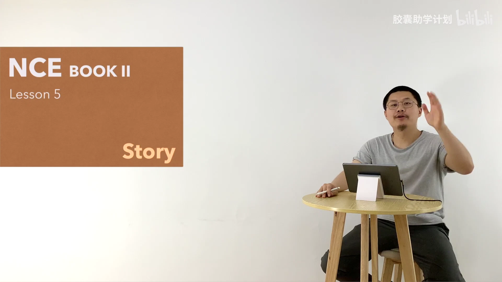

文字识别：胶囊助学计划 / NCE / BOOKⅡI / Lesson 5 / Story

### 画面 00:00:02

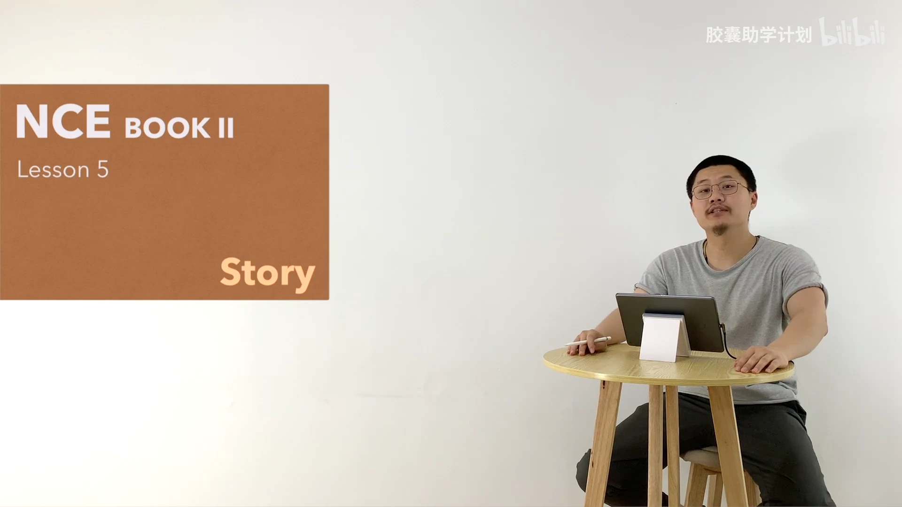

文字识别：胶囊助学计划 / NCE / BOOKⅡI / Lesson 5 / Story

### 画面 00:00:05

文字识别：胶囊助学计划 / NCE / BOOKII / Lesson 5 / Story

### 画面 00:00:09

文字识别：胶囊助学计划bilbl / •

### 画面 00:00:13

### 画面 00:00:15

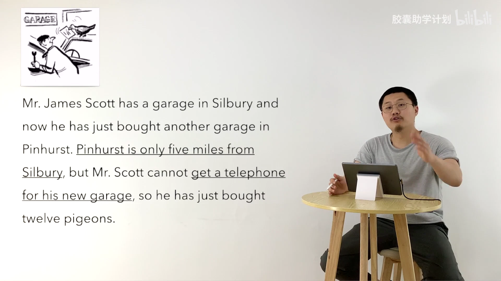

文字识别：GARAGE / 胶囊助学计划 / Mr. James Scott has a garage in Silbury and / now he has just bought another garage in / Pinhurst. Pinhurst is only five miles from / Silbury, but Mr. Scott cannot get a telephone / for his new garage, so he has just bought / twelve pigeons.

### 画面 00:00:18

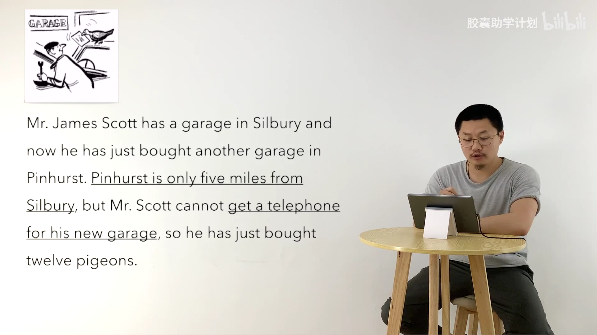

文字识别：GARAGE / 胶囊助学计划 / Mr. James Scott has a garage in Silbury and / now he has just bought another garage in / Pinhurst. Pinhurst is only five miles from / Silbury, but Mr. Scott cannot get a telephone / for his new garage, so he has just bought / twelve pigeons.

### 画面 00:00:21

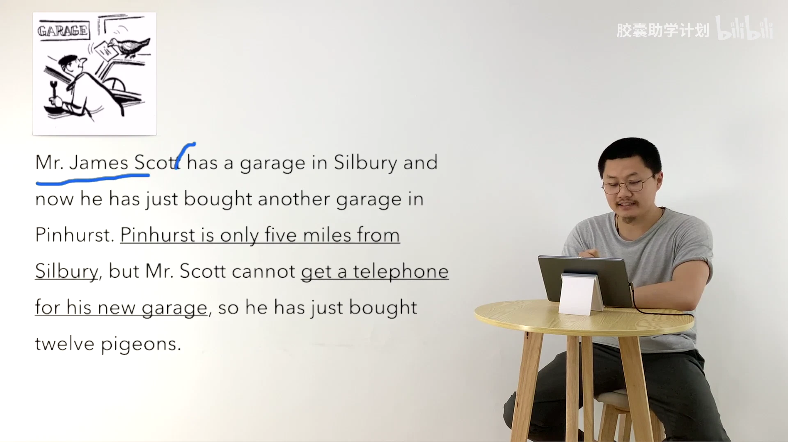

文字识别：GARAGE / 胶囊助学计划 / Mr. James Scot has a garage in Silbury and / now he has just bought another garage in / Pinhurst. Pinhurst is only five miles from / Silbury, but Mr. Scott cannot get a telephone / for his new garage, so he has just bought / twelve pigeons.

### 画面 00:00:23

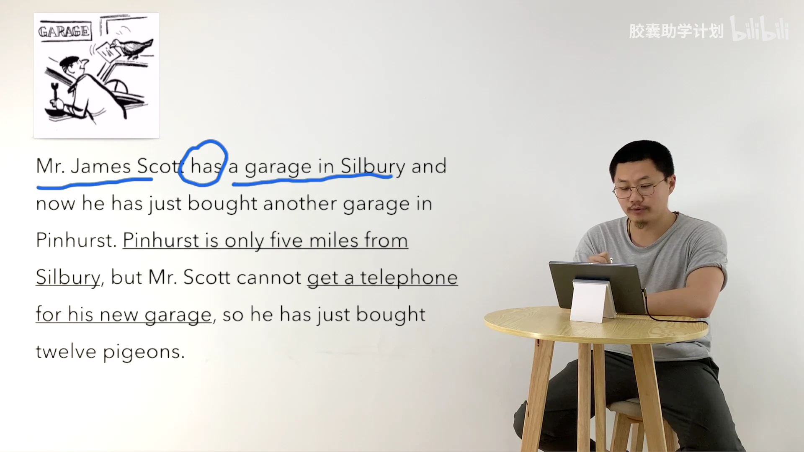

文字识别：GARAGE / 胶囊助学计划 / Mr. James Scot hasa garage in Silbury and / now he has just bought another garage in / Pinhurst. Pinhurst is only five miles from / Silbury, but Mr. Scott cannot get a telephone / for his new garage, so he has just bought / twelve pigeons.

### 画面 00:00:26

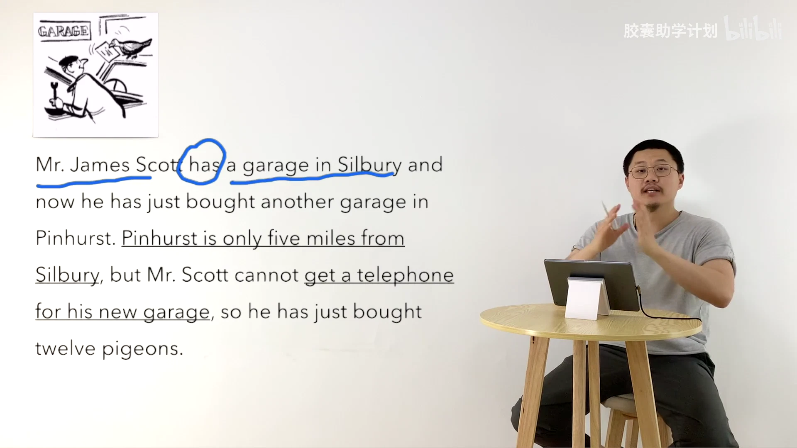

文字识别：GARAGE / 胶囊助学计划 / Mr. James Scot has a garage in Silbury and / now he has just bought another garage in / Pinhurst. Pinhurst is only five miles from / Silbury, but Mr. Scott cannot get a telephone / for his new garage, so he has just bought / twelve pigeons.

## 00:00:30–00:01:00

James Scott先生有一个这个这个这个汽车修理厂在Silveri这个地方。那garage其实有另一个意思就是车库，对吧？And now，然后现在呢，he has just bought他刚刚买了另一个garage in Pinhurst。注意一个小点，第一句话陈述客观事实用一般现在时，然后作者也就是亚历山大立刻换

### 画面 00:00:34

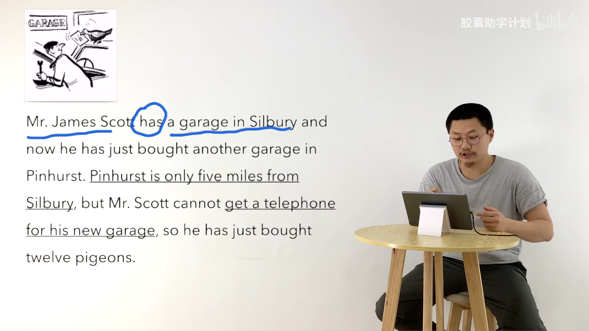

文字识别：GARAGE / 胶囊助学计划 / Mr. James Scot hasa garage in Silbury and / now he has just bought another garage in / Pinhurst. Pinhurst is only five miles from / Silbury, but Mr. Scott cannot get a telephone / for his new garage, so he has just bought / twelve pigeons.

### 画面 00:00:36

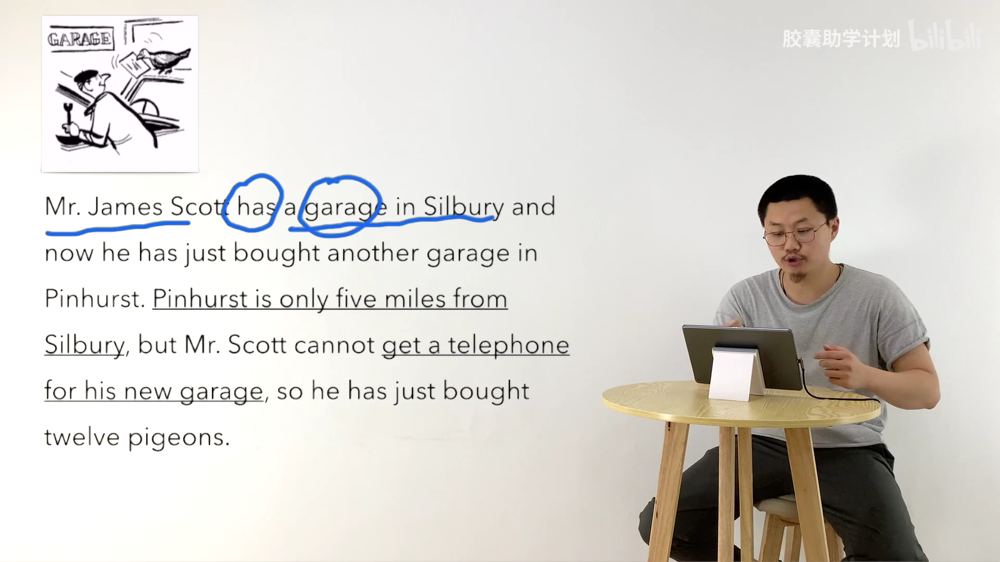

文字识别：GARAGE / 胶囊助学计划 / Mr. James Scot hasa garag in Silbury and / now he has just bought another garage in / Pinhurst. Pinhurst is only five miles from / Silbury, but Mr. Scott cannot get a telephone / for his new garage, so he has just bought / twelve pigeons.

### 画面 00:00:43

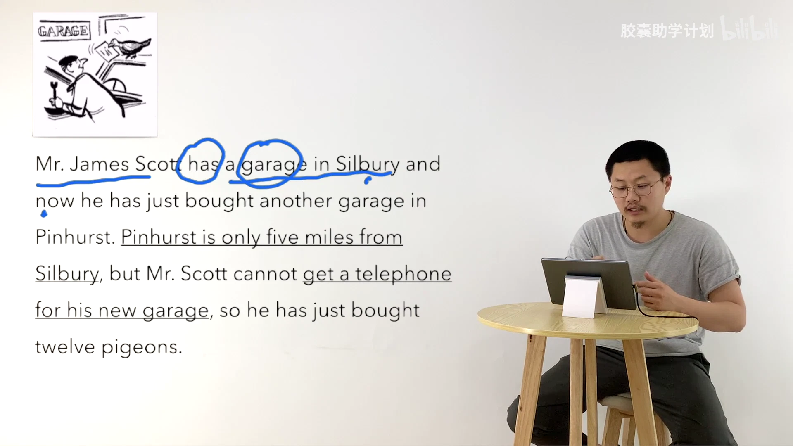

文字识别：GARAGE / 胶囊助学计划 / Mr. James Scot hasa garage in Silbury and / now he has just bought another garage in / Pinhurst. Pinhurst is only five miles from / Silbury, but Mr. Scott cannot get a telephone / for his new garage, so he has just bought / twelve pigeons.

### 画面 00:00:45

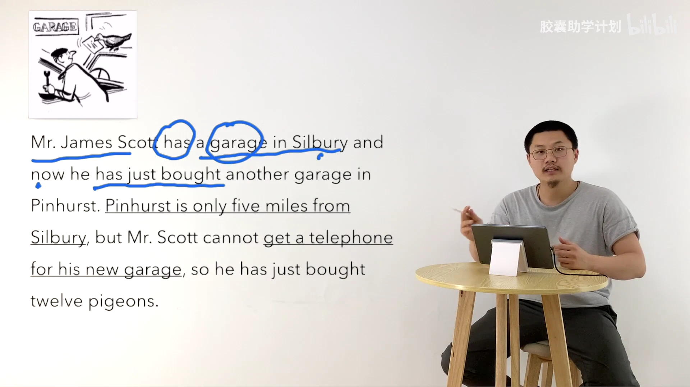

文字识别：GARAGE / 胶囊助学计划 / Mr. James Scot hasa garage in Silbury and / now he has just bought another garage in / Pinhurst. Pinhurst is only five miles from / Silbury, but Mr. Scott cannot get a telephone / for his new garage, so he has just bought / twelve pigeons.

### 画面 00:00:48

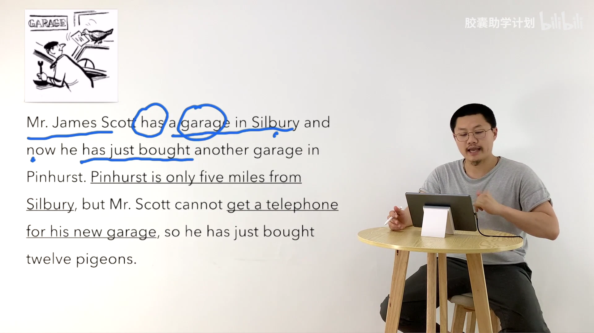

文字识别：GARAGE / 胶囊助学计划 / Mr. James Scot hasa garage in Silbury and / now he has just bought another garage in / Pinhurst. Pinhurst is only five miles from / Silbury, but Mr. Scott cannot get a telephone / for his new garage, so he has just bought / twelve pigeons.

### 画面 00:00:52

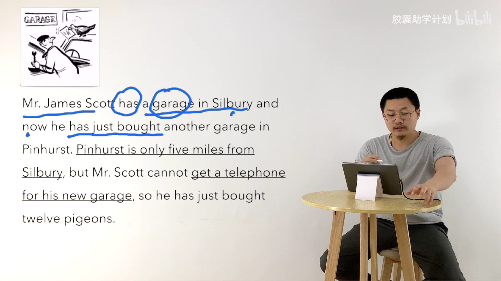

文字识别：GARAGE / 胶囊助学计划 / Mr. James Scot hasagarage in Silbury and / now he has just bought another garage in / Pinhurst. Pinhurst is only five miles from / Silbury, but Mr. Scott cannot get a telephone / for his new garage, so he has just bought / twelve pigeons.

### 画面 00:00:56

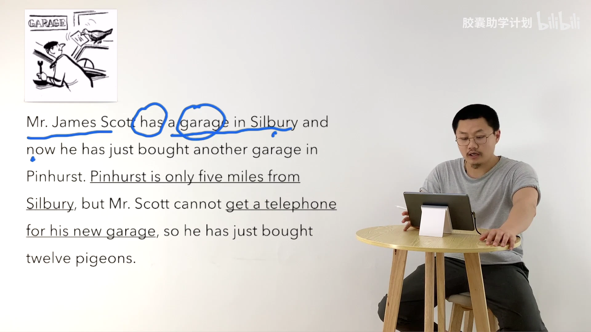

文字识别：GARAGE / 胶囊助学计划 / Mr. James Scot hasa garage in Silbury and / now he has just bought another garage in / Pinhurst. Pinhurst is only five miles from / Silbury, but Mr. Scott cannot get a telephone / for his new garage, so he has just bought / twelve pigeons.

### 画面 00:00:58

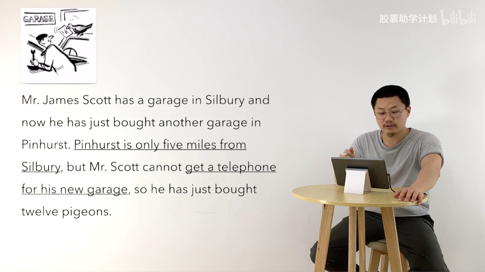

文字识别：GARAGE / 胶囊助学计划 / Mr. James Scott has a garage in Silbury and / now he has just bought another garage in / Pinhurst. Pinhurst is only five miles from / Silbury, but Mr. Scott cannot get a telephone / for his new garage, so he has just bought / twelve pigeons.

## 00:01:00–00:01:30

了一个时态，说他刚刚买了另一个车库。Has just bought，想表达什么呀？过去买的对现在产生了影响。于是我们猜测也能猜测出来，接下来整篇文章一定是针对于这个新买的车库在进行一个讨论，对吧？过去对现在产生了影响，而绝对不可能说他刚刚

### 画面 00:01:01

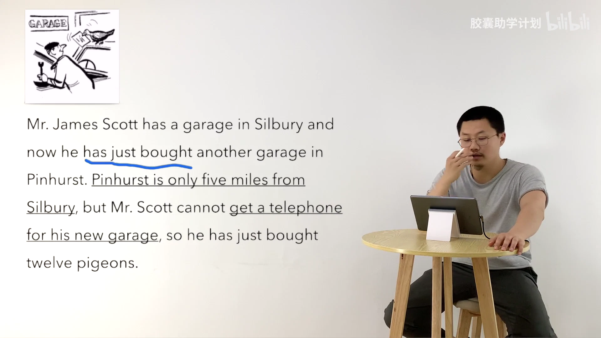

文字识别：GARAGE / 胶囊助学计划 / Mr. James Scott has a garage in Silbury and / now he has just bought another garage in / Pinhurst. Pinhurst is only five miles from / Silbury, but Mr. Scott cannot get a telephone / for his new garage, so he has just bought / twelve pigeons.

### 画面 00:01:14

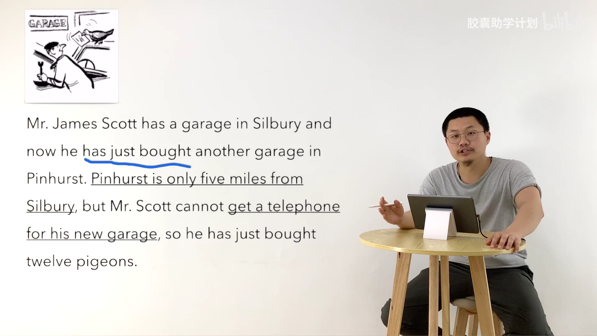

文字识别：GARAGE / 胶囊助学计划 / Mr. James Scott has a garage in Silbury and / now he has just bought another garage in / Pinhurst. Pinhurst is only five miles from / Silbury, but Mr. Scott cannot get a telephone / for his new garage, so he has just bought / twelve pigeons.

### 画面 00:01:16

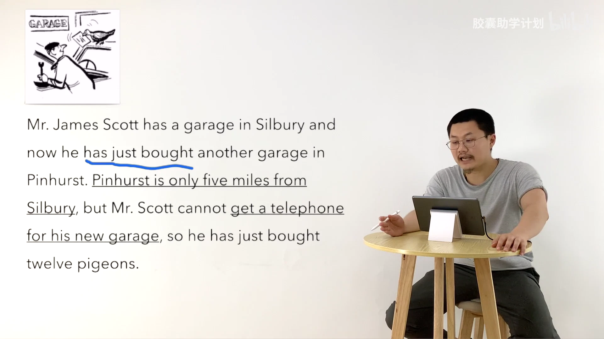

文字识别：GARAGE / 胶囊助学计划 / Mr. James Scott has a garage in Silbury and / now he has just bought another garage in / Pinhurst. Pinhurst is only five miles from / Silbury, but Mr. Scott cannot get a telephone / for his new garage, so he has just bought / twelve pigeons.

### 画面 00:01:27

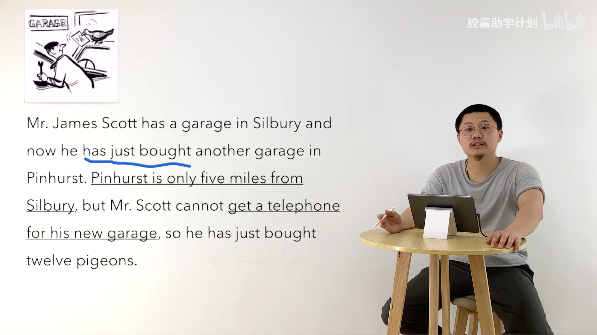

文字识别：GARAGE / 胶囊助学计划 / Mr. James Scott has a garage in Silbury and / now he has just bought another garage in / Pinhurst. Pinhurst is only five miles from / Silbury, but Mr. Scott cannot get a telephone / for his new garage, so he has just bought / twelve pigeons.

## 00:01:30–00:02:00

买了另一个车啊，这个汽汽车修理厂对吧？在 Pinhurst 这个地方。然后呢，昨天晚上他们一块儿去撸串儿喝啤酒了，然后特别的开心啊！绝对不应该是这么聊天的。我们看一下是不是这个逻辑啊？说 Pinhurst 这个地方 is only five miles，说仅仅只有五英里的距离 from Silbury。你看，他立刻就开始给你去讲关于 Pinhurst 的事儿，对吧？那注意这句话用的还是一般现在时，陈述客观事实。

### 画面 00:01:32

文字识别：GARAGE / 胶囊助学计划 / Mr. James Scott has a garage in Silbury and / now he has just bought another garage in / Pinhurst. Pinhurst is only five miles from / Silbury, but Mr. Scott cannot get a telephone / for his new garage, so he has just bought / twelve pigeons.

### 画面 00:01:41

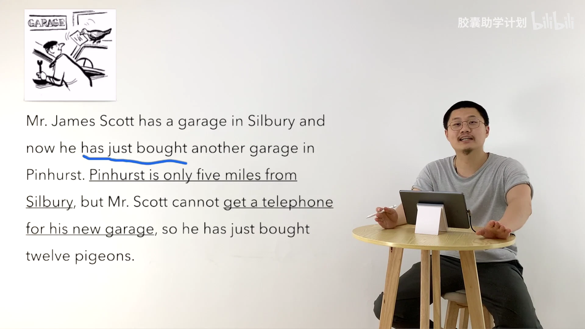

文字识别：GARAGE / 胶囊助学计划 / Mr. James Scott has a garage in Silbury and / now he has just bought another garage in / Pinhurst. Pinhurst is only five miles from / Silbury, but Mr. Scott cannot get a telephone / for his new garage, so he has just bought / twelve pigeons.

### 画面 00:01:43

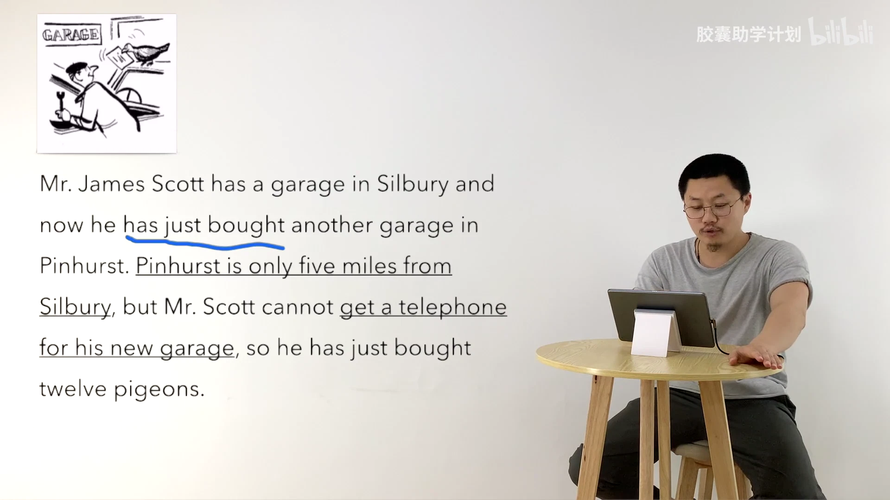

文字识别：GARAGE / 胶囊助学计划 / Mr. James Scott has a garage in Silbury and / now he has just bought another garage in / Pinhurst. Pinhurst is only five miles from / Silbury, but Mr. Scott cannot get a telephone / for his new garage, so he has just bought / twelve pigeons.

### 画面 00:01:50

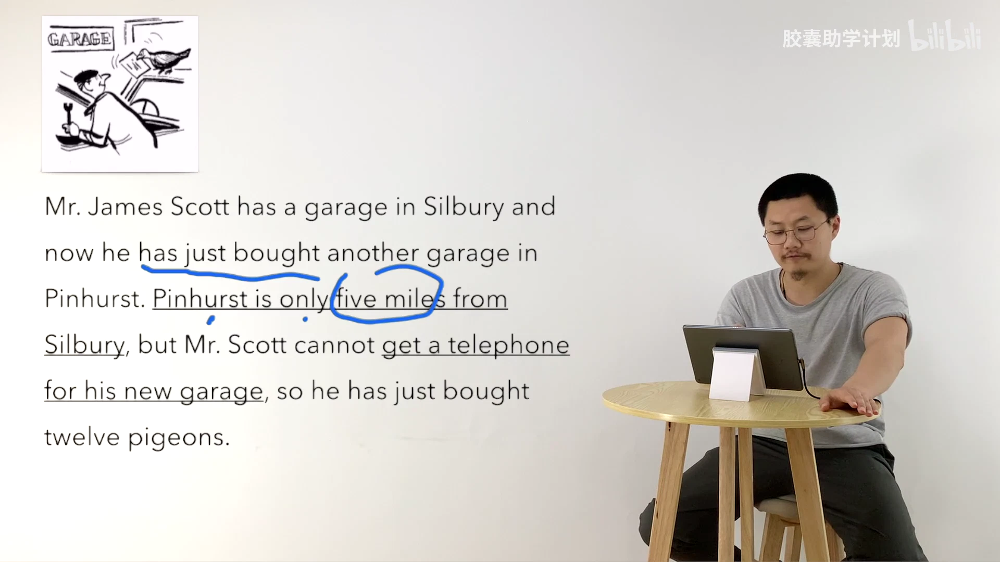

文字识别：GARAGE / 胶囊助学计划 / Mr. James Scott has a garage in Silbury and / now he has just bought another garage in / Pinhurst. Pinhurst is onlyfive miles from / Silbury, but Mr. Scott cannot get a telephone / for his new garage, so he has just bought / twelve pigeons.

### 画面 00:01:59

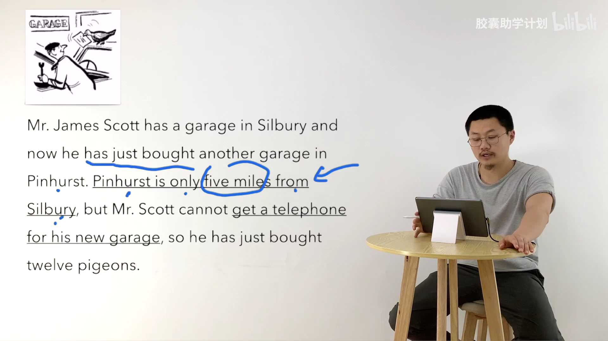

文字识别：GARAGE / 胶囊助学计划 / Mr. James Scott has a garage in Silbury and / now he has just bought another garage in / Pinhurst. Pinhurst is onlyfive miles from / • / Silbury, but Mr. Scott cannot get a telephone / for his new garage, so he has just bought / twelve pigeons.

## 00:02:00–00:02:30

这两个Pinhurst的这个地方陈述客观事实，Pinhurst这个地方和Silbury的距离是什么样子的，对吧？好，接下来他说，但是呢，Mr. Scott cannot没有办法，cannot就是can't get a telephone获得万金油动词出现了，get这个单词我们以后会不停的见到它，口语当中、写作当中还真的特别的常见，大多数情况下它最常见

### 画面 00:02:13

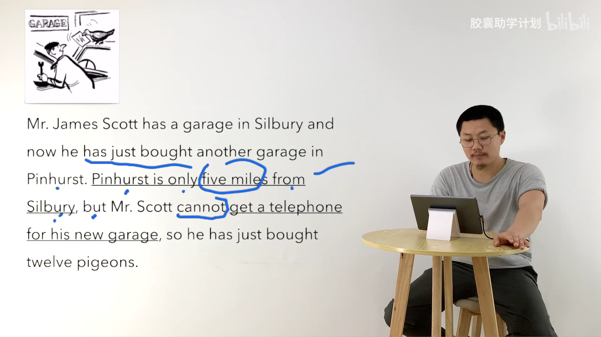

文字识别：GARAGE / 胶囊助学计划 / Mr. James Scott has a garage in Silbury and / now he has just bought another garage in / Pinhurst. Pinhurst is onlyfive miles from / Silbury, but Mr. Scott cannotget a telephone / for his new garage, so he has just bought / twelve pigeons.

### 画面 00:02:21

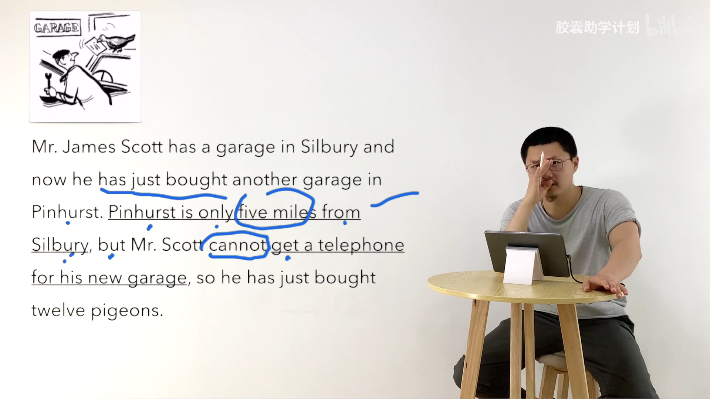

文字识别：GARAGE / 胶囊助学计划 / Mr. James Scott has a garage in Silbury and / now he has just bought another garage in / Pinhurst. Pinhurst is onlyfive miles from / Silbury, but Mr. Scot cannotget a telephone / for his new garage, so he has just bought / twelve pigeons.

## 00:02:30–00:03:00

的几个意思，一个叫做获得，一个叫做变得，对吧？一个叫做拥有，但其实大概的意思是不变的。那你放到文章当中去看怎么舒服，对吧？他没有办法弄到一个 telephone，没有办法弄到一个电话，给什么呢？His new garage，给他新的这个汽车修理厂啊，这个小的车库，没有办法做到这个点。注意 get 在这儿，你我刚才为什么用了弄，

### 画面 00:02:39

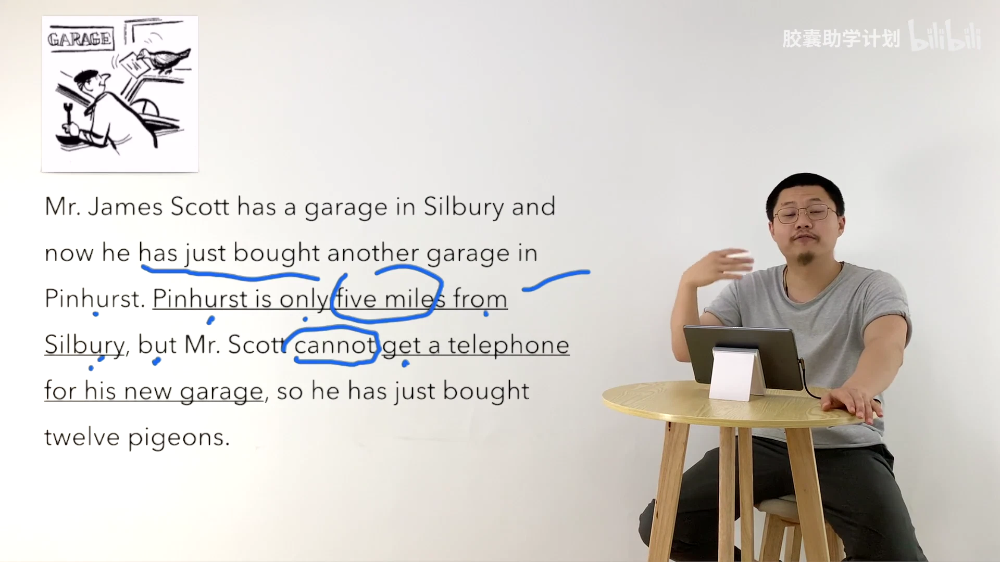

文字识别：GARAGE / 胶囊助学计划 / Mr. James Scott has a garage in Silbury and / now he has just bought another garage in / Pinhurst. Pinhurst is onlyfive miles from / Silbury, but Mr. Scot cannotget a telephone / for his new garage, so he has just bought / twelve pigeons.

### 画面 00:02:50

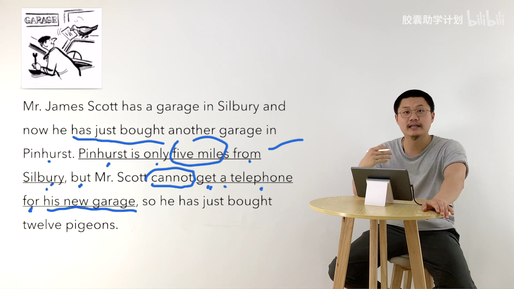

文字识别：GARAGE / 胶囊助学计划 / Mr. James Scott has a garage in Silbury and / now he has just bought another garage in / Pinhurst. Pinhurst is onlyfive miles from / Silbury, but Mr. Scott cannotget a telephone / for his new garage, so he has just bought / twelve pigeons.

### 画面 00:02:54

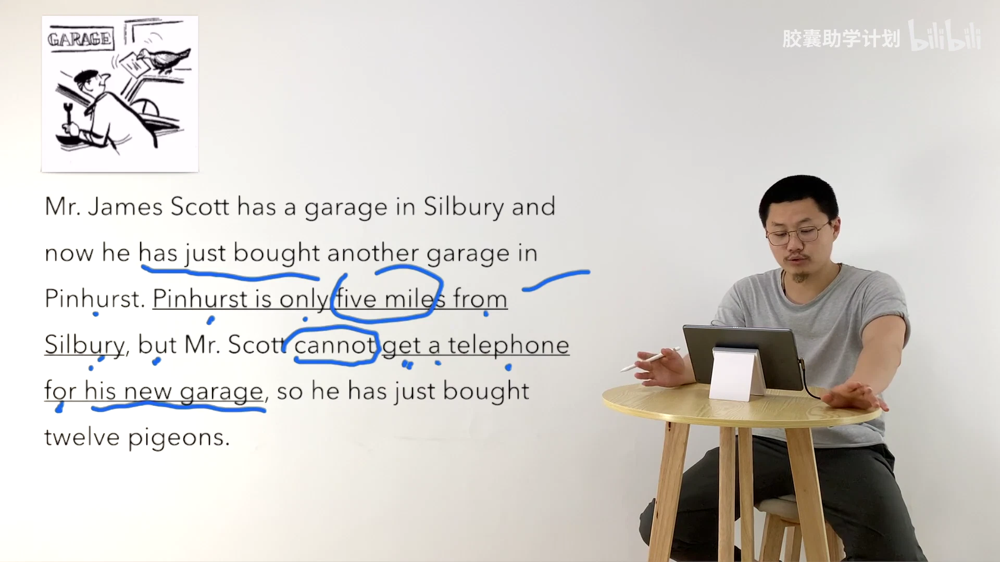

文字识别：GARAGE / 胶囊助学计划 / 出 / Mr. James Scott has a garage in Silbury and / now he has just bought another garage in / Pinhurst. Pinhurst is onlyfive miles from / Silbury, but Mr. Scott cannotget a telephone / for his new garage, so he has just bought / twelve pigeons.

### 画面 00:02:58

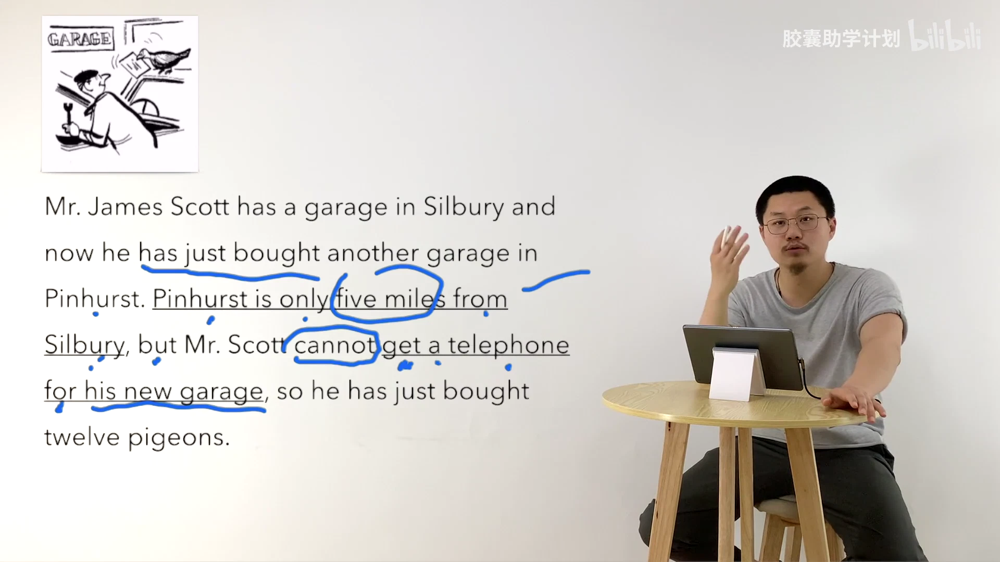

文字识别：GARAGE / 胶囊助学计划 / 出山 / Mr. James Scott has a garage in Silbury and / now he has just bought another garage in / Pinhurst. Pinhurst is onlyfive miles from / Silbury, but Mr. Scott cannotget a telephone / for his new garage, so he has just bought / twelve pigeons.

## 00:03:00–00:03:30

对吧？这是北方方言。我们可以说买获得，当然这个也可以是找别人，比如说要。它的方式是很多的，怎么理解都可以。如果你只翻译成买呢，那是其中一个方式。所以 get 这个单词它的表达范围是非常广的啊。他没有办法得到这样一个电话。So 所以呢，He has just bought.他又刚刚买了 twelve pigeons.又刚刚买了十二个鸽子。

### 画面 00:03:01

文字识别：GARAGE / 胶囊助学计划 / Mr. James Scott has a garage in Silbury and / now he has just bought another garage in / Pinhurst. Pinhurst is onlyfive miles from / Silbury, but Mr. Scott cannotget a telephone / for his new garage, so he has just bought / twelve pigeons.

### 画面 00:03:23

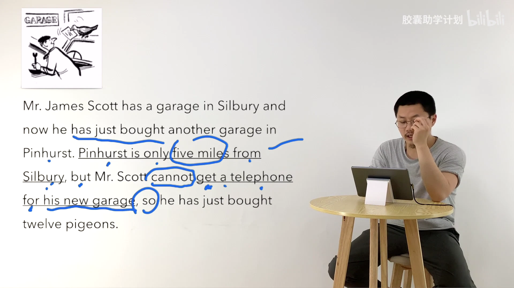

文字识别：GARAGE / 胶囊助学计划 / Mr. James Scott has a garage in Silbury and / now he has just bought another garage in / Pinhurst. Pinhurst is onlyfive miles from / Silbury, but Mr. Scott cannotget a telephone / for his new garagg, so he has just bought / twelve pigeons.

### 画面 00:03:25

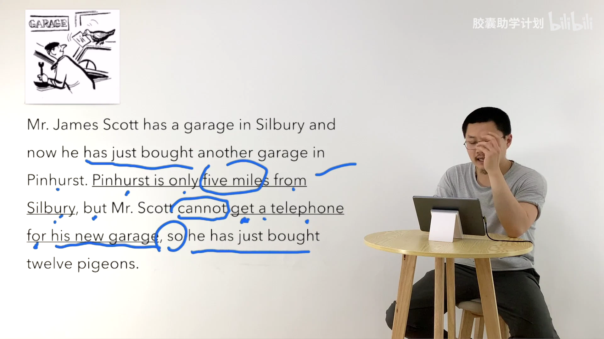

文字识别：GARAGE / 胶囊助学计划 / Mr. James Scott has a garage in Silbury and / now he has just bought another garage in / Pinhurst. Pinhurst is onlyfive miles from / Silbury, but Mr. Scott cannot / get a telephone / for his new garagg, so he has just bought / twelve pigeons.

### 画面 00:03:28

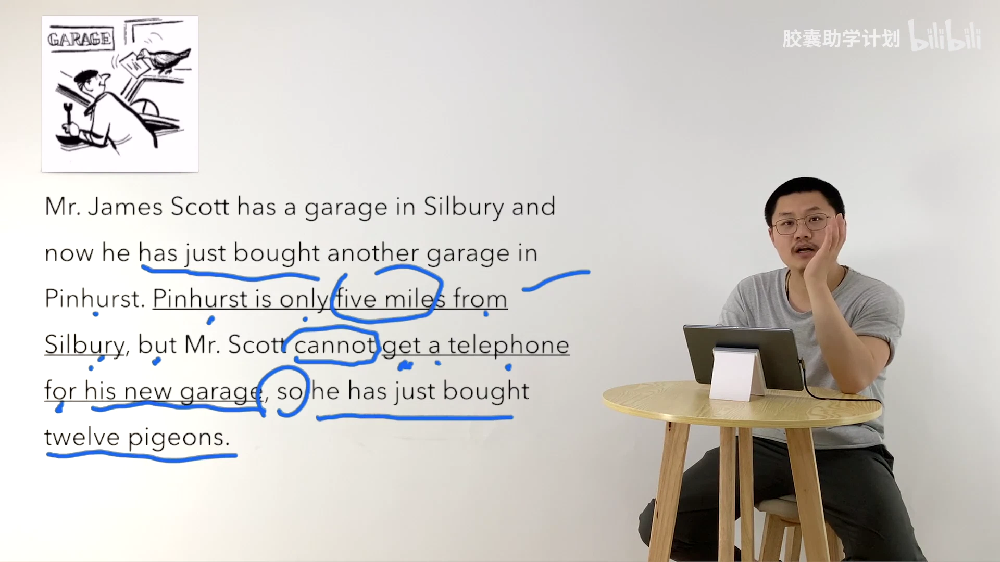

文字识别：Biibili / GARAGE / 胶囊助学计划 / Mr. James Scott has a garage in Silbury and / now he has just bought another garage in / Pinhurst. Pinhurst is onlyfive miles from / Silbury, but Mr. Scottcannot / get a telephone / for his new garagg, sohe has just bought / twelve pigeons.

## 00:03:30–00:04:00

你注意啊，我们在 he has just bought another garage 的时候，说他刚刚买了十二个车库的，呃，买了这个另一个车库的时候，在 Pinhurst。从第二行一直到这里，基本上他都在说 Pinhurst 和这个车库的事情。接下来他又说他又刚刚买了十二个鸽子。那接下来的文章一定是和这个鸽子有关系了。我们看一下是不

### 画面 00:03:33

文字识别：Bilbli / GARAGE / 胶囊助学计划 / Mr. James Scott has a garage in Silbury and / now he has just bought another garage in / Pinhurst. Pinhurst is onlyfive miles from / Silbury, but Mr. Scott cannotget a telephone / for his new garage, so he has just bought / twelve pigeons.

### 画面 00:03:35

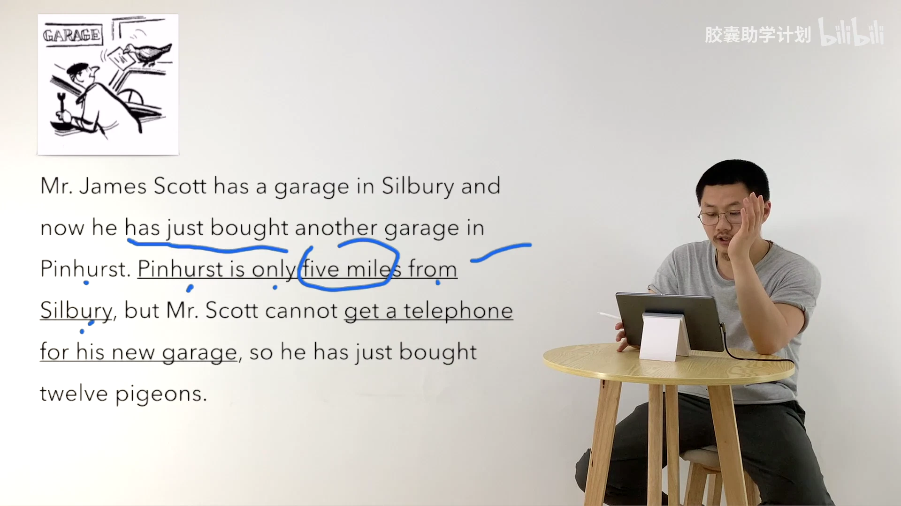

文字识别：胶囊助学计划bil出 / GARAGE / Mr. James Scott has a garage in Silbury and / now he has just bought another garage in / Pinhurst. Pinhurst is onlyfive miles from / Silbury, but Mr. Scott cannot get a telephone / for his new garage, so he has just bought / twelve pigeons.

### 画面 00:03:39

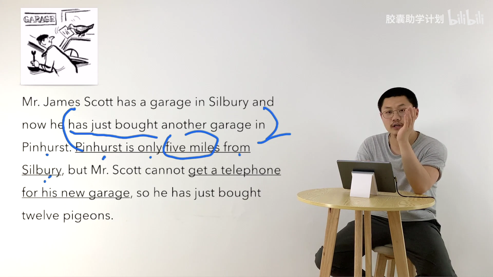

文字识别：胶囊助学计划bi出b出 / GARAGE / Mr. James Scott has a garage in Silbury and / now he has just bought another garage in / Pinhurst. Rinhurst is onlyfive miles from / Silbury, but Mr. Scott cannot get a telephone / for his new garage, so he has just bought / twelve pigeons.

### 画面 00:03:45

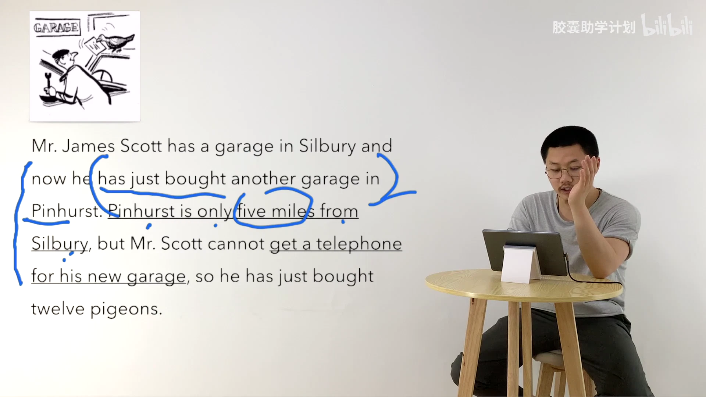

文字识别：胶囊助学计划bil出 / GARAGE / Mr. James Scott has a garage in Silbury and / now he has just bought another garage in / Pinhurst.Pinhurst is onlyfive miles from / Silbury, but Mr. Scott cannot get a telephone / for his new garage, so he has just bought / twelve pigeons.

### 画面 00:03:47

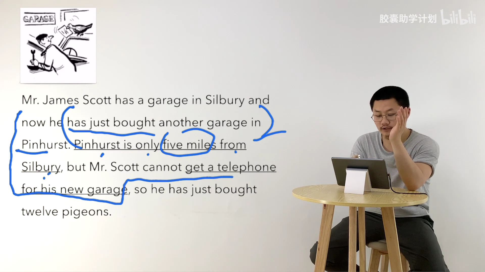

文字识别：bilbili / GARAGE / 胶囊助学计划 / Mr. James Scott has a garage in Silbury and / now he has just bought another garage in / Pinhurst.Pinhurst is onlyfive miles from / Silbury, but Mr. Scott cannot get a telephone / for his new garag, so he has just bought / twelve pigeons.

### 画面 00:03:49

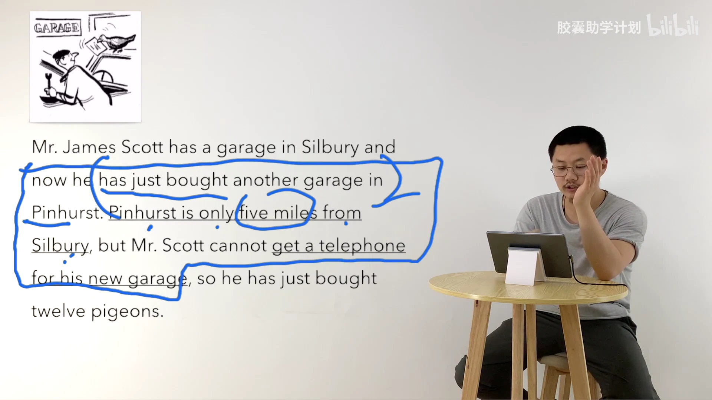

文字识别：Bibili / GARAGE / 胶囊助学计划 / Mr. James Scott has a garage in Silbury and / now he has just bought another garage in / Pinhurst.Pinhurst is onlyfive miles from / Silbury,k / but Mr. Scott cannot get a telephone / for his new garag, so he has just bought / twelve / pigeons.

### 画面 00:03:53

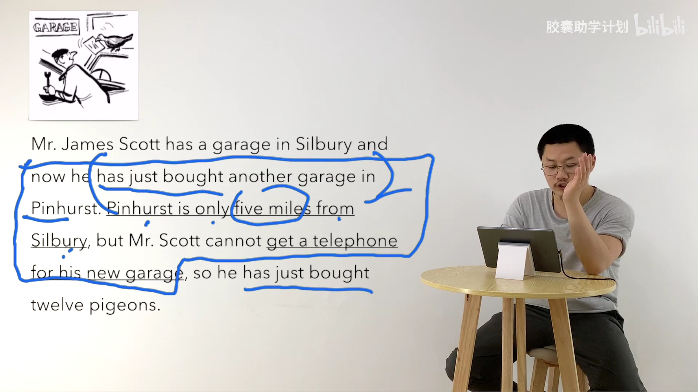

文字识别：bibili / GARAGE / 胶囊助学计划 / Mr. James Scott has a garage in Silbury and / now he has just bought another garage in / Pinhurst.Pinhurst is onlyfive miles from / Silbury, / but Mr. Scott cannot / get a telephone / for his new garage, so he has just bought / twelve / pigeons.

### 画面 00:03:55

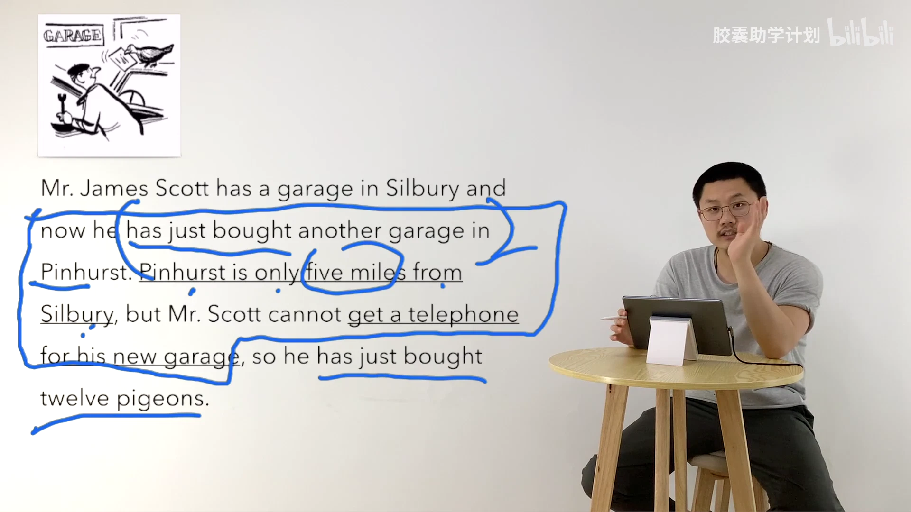

文字识别：Bibili / GARAGE / 胶囊助学计划 / Mr. James Scott has a garage in Silbury and / now he has just bought another garage in / Pinhurst.Pinhurst is onlyfive miles from / Silbury,k / but Mr. Scott cannot / get a telephone / for his new garag, so he has just bought / twelve / pigeons.

### 画面 00:03:57

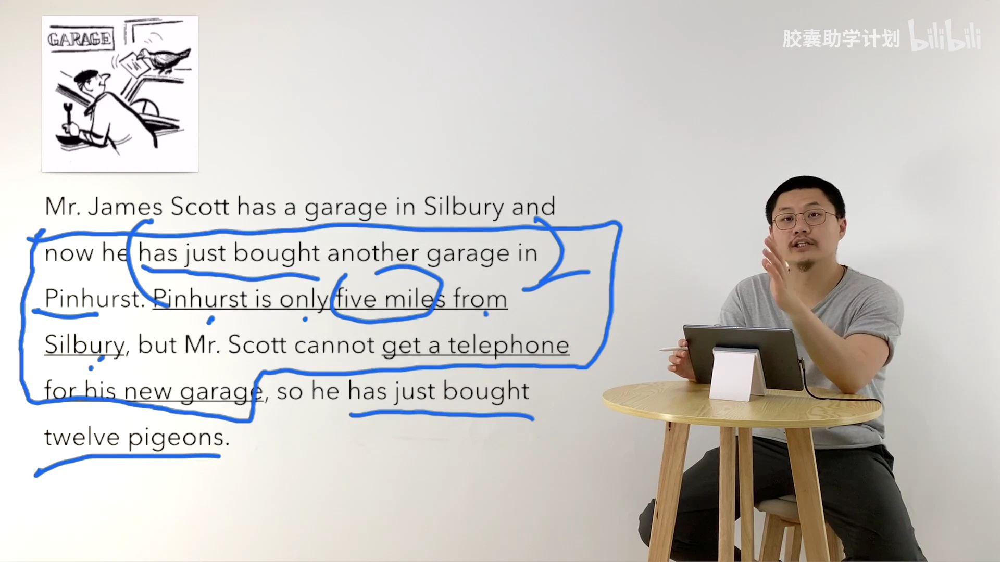

文字识别：biltbili / GARAGE / 胶囊助学计划 / Mr. James Scott has a garage in Silbury and / now he has just bought another garage in / Pinhurst. Pinhurst is onlyfive miles from / Silbury, but Mr. Scott cannot get a telephone / for his new garag, so he has just bought / twelve / pigeons.

## 00:04:00–00:04:30

是这样的。Yesterday，昨天，注意 yesterday 一出来就是一般过去时了，时态又转化了。A pigeon carried the first message，携带着第一个消息 from Silveray from Pinhurst to Silveray，从 A 到 B，从一个地方到了另一个地方。你看是不是接下来又开始聊鸽子了？The bird 说这个鸟啊，covered the distance。我们在讲单词的时候讲到了，

### 画面 00:04:00

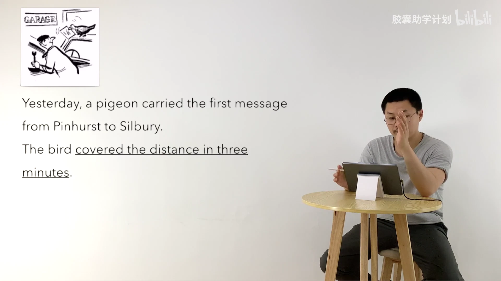

文字识别：胶囊助学计划bilb出 / GARAGE / Yesterday, a pigeon carried the first message / from Pinhurst to Silbury. / The bird covered the distance in three / minutes.

### 画面 00:04:03

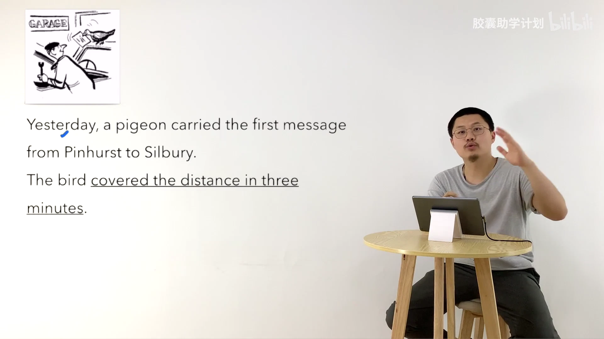

文字识别：GARAGE / 胶囊助学计划 / Yesterday, a pigeon carried the first message / from Pinhurst to Silbury. / The bird covered the distance in three / minutes.

### 画面 00:04:11

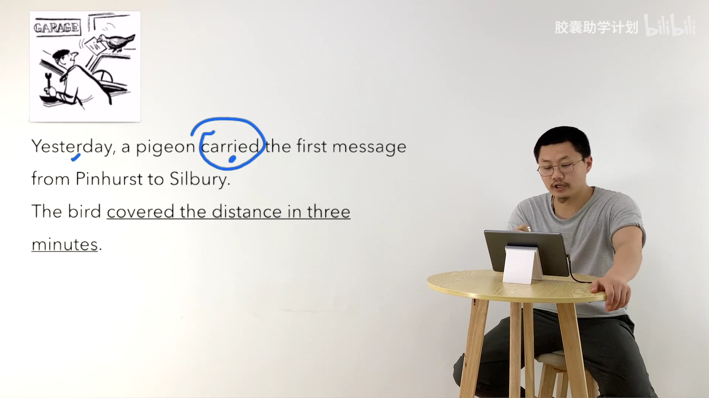

文字识别：Bilbile / GARAGE / 胶囊助学计划 / Yesterday, a pigeon / Carriedthe first message / from Pinhurst to Silbury. / The bird covered the distance in three / minutes.

### 画面 00:04:13

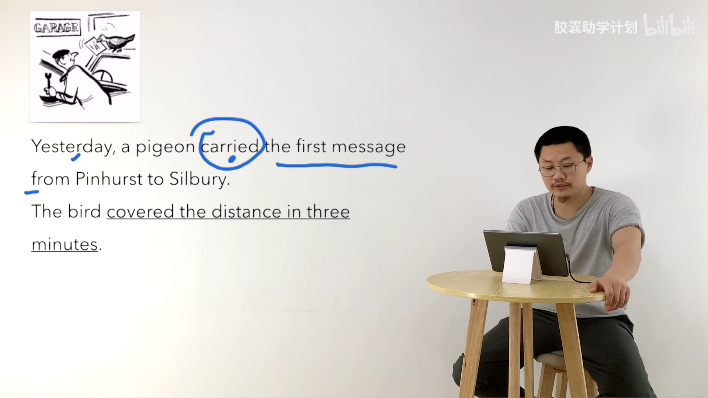

文字识别：Bibl / GARAGE / 胶囊助学计划 / Yesterday, a pigeon / Carried the first message / from Pinhurst to Silbury. / The bird covered the distance in three / minutes.

### 画面 00:04:15

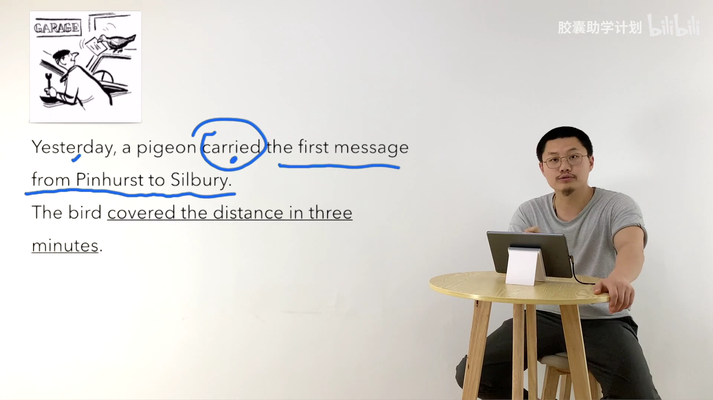

文字识别：GARAGE / 胶囊助学计划 / Yesterday, a pigeon / Carriedthe first message / from Pinhurst to Silbury. / The bird covered the distance in three / minutes.

### 画面 00:04:25

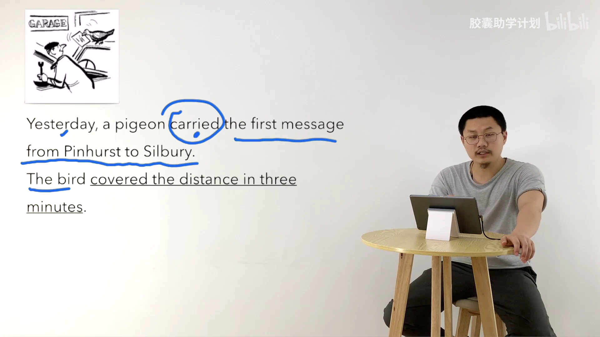

文字识别：Bilil / GARAGE / 胶囊助学计划 / Yesterday, a pigeon / Carriedthe first message / from Pinhurst to S / Silbury. / The bird / covered the distance in three / minutes.

## 00:04:30–00:05:00

叫做飞跃跨越这段距离 in three minutes，在三分钟的时间内跨越了这段距离五英里嘛，也不是说远也远，说近也近，对吧？好，注意这一段是不是都是在讲跟鸽子相关的事情，对吧？He has just bought twelve pigeons。过去的事情对现在产生了影响，对吧？接下来 up to now，这个小的短语或者说习惯用法经常跟现在时、现在完成时连用，

### 画面 00:04:31

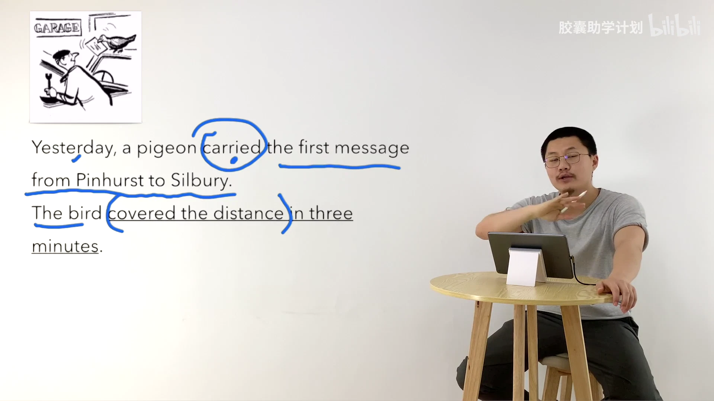

文字识别：Bilibil / GARAGE / 胶囊助学计划 / Yesterday, a pigeon / Earriedthe first message / from Pinhurst to S / Silbury. / covered the distance in three / The bird / minutes.

### 画面 00:04:35

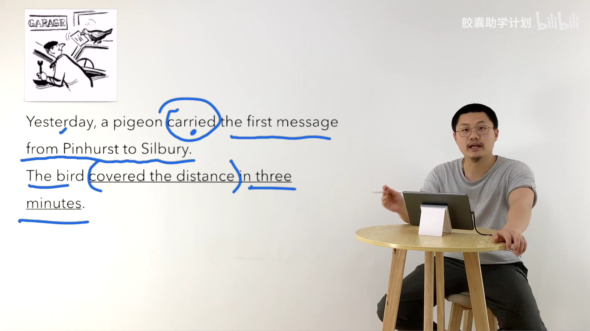

文字识别：GARAGE / 胶囊助学计划 / Yesterday, a pigeon / Carriedthe first message / from Pinhurst to / Silbury. / covered the distance n three / The bird / minutes.

### 画面 00:04:37

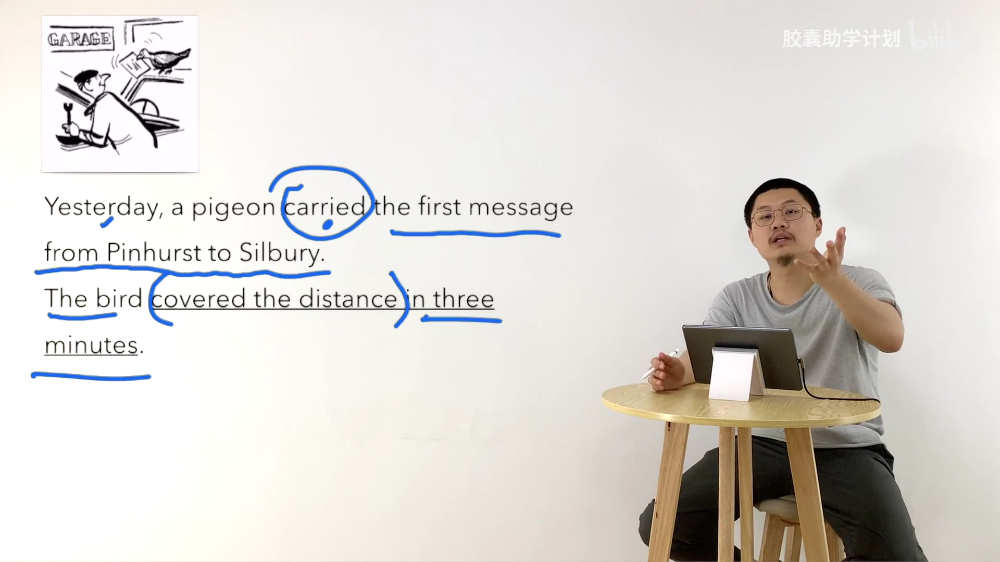

文字识别：GARAGE / 胶囊助学计划 / Yesterday, a pigeon / Carriedthe first message / from Pinhurst to / Silbury. / covered the distance in three / The bird / minutes.

### 画面 00:04:40

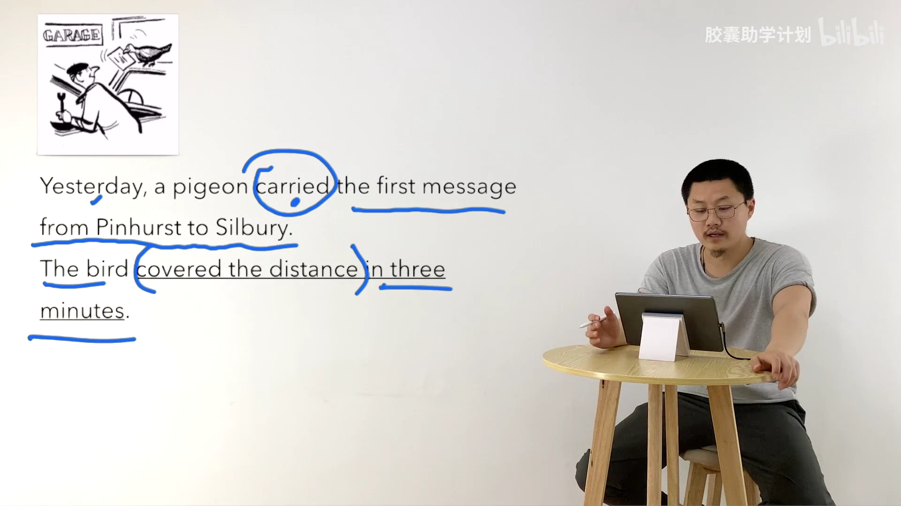

文字识别：GARAGE / 胶囊助学计划 / Yesterday, a pigeon / Carriedthe / e first message / from Pinhurst to / Silbury. / covered the distance in three / The bird / minutes.

### 画面 00:04:42

文字识别：GARAGE / 胶囊助学计划 / Yesterday, a pigeon / Carriedthe / first message / from Pinhurst to / Silbury. / The bird / Covered the distance in three / minutes.

### 画面 00:04:44

文字识别：GARAGE / 胶囊助学计划 / Yesterday, a pigeon / Carriedthe / first message / from Pinhurst to / Silbury. / The bird / covered the / distancen three / minutes.

### 画面 00:04:50

文字识别：GARAGE / 胶囊助学计划 / Yesterday, a pigeon / Carriedthe / first message / from Pinhurst to / Silbury. / distance n three / The bird / covered the / minutes.

### 画面 00:04:52

文字识别：GARAGE / 胶囊助学计划 / Up to now, Mr. Scott has sent a great many / requests for spare parts and other urgent / messages from one garage to the other. / In this way, he has begun his own private / telephone service.

## 00:05:00–00:05:30

它表示的是截止到目前为止。截止到目前为止，Mr. Scott has sent已经发送出了a great many。还记不记得a large number of，a lot of，它们都是很像的，表达的就是大量的、许多。他已经发送了许多的requests，许多的要求和请求。For要什么呢？Spare

### 画面 00:05:07

文字识别：GARAGE / 胶囊助学计划 / Up to now, Mr. Scothas sent a great many / requests for spare parts and other urgent / messages from one garage to the other. / In this way, he has begun his own private / telephone service.

### 画面 00:05:10

文字识别：GARAGE / 胶囊助学计划 / Up to now, Mr. Scotthas sent a great many / requests for spare parts and other urgent / messages from one garage to the other. / In this way, he has begun his own private / telephone service.

### 画面 00:05:13

文字识别：GARAGE / 胶囊助学计划 / Up to now, Mr. Scotthas sent a great many / requests for spare parts and other urgent / messages from one garage to the other. / In this way, he has begun his own private / telephone service.

### 画面 00:05:28

文字识别：GARAGE / 胶囊助学计划 / Up to now, Mr. Scotthas sent a great many / requestsfor spare parts and other urgent / messages from one garage to the other. / In this way, he has begun his own private / telephone service.

## 00:05:30–00:06:00

要的是汽车的那些备件，以及other urgent messages，以及其他的一些紧急的，新学过的urgent messages信息消息from one garage to the other，从一个到另一个，一个汽车修理厂到另一个小的修理厂，对吧？好，in this way，用这样的一种方式呢，he has began，他已经开始了his own private telephone service，他已

### 画面 00:05:33

文字识别：GARAGE / 胶囊助学计划 / Up to now, Mr. Scotthas sent a great many / requestsfor spare parts and other urgent / messages from one garage to the other. / In this way, he has begun his own private / telephone service.

### 画面 00:05:35

文字识别：GARAGE / 胶囊助学计划 / Up to now, Mr. Scotthas sent a great many / requestsfor spare parts and other urgent / messages from one garage to the other. / In this way, he has begun his own private / telephone service.

### 画面 00:05:57

文字识别：GARAGE / 胶囊助学计划 / Up to now, Mr. Scotthas sent a great many / requestsfor spare parts and other urgent / messages from one garage to the other. / In this way, he has begun his own private / telephone service.

### 画面 00:05:59

文字识别：GARAGE / 胶囊助学计划 / Up to now, Mr. Scotthas sent a great many / requestsfor spare parts and other urgent /  from one garage to the other. / messages / In this way, he has begun his own private / telephone service.

## 00:06:00–00:06:30

经开始了他自己的private私人的第一个学的，对吧？Telephone service电话服务或者说电话的这个业务，也就其实不是带电话的，是带引号的telephone啊。他是用鸽子去给他送这些消息，在两个这个修理汽车修理这个小店的这个中间去进行传递信息。OK，好，那接下来呢，我们看一下本文的一些习惯用法。我们用这

### 画面 00:06:12

文字识别：GARAGE / 胶囊助学计划 / Up to now, Mr. Scotthas sent a great many / requestsfor spare parts and other urgent / messages from one garage to the other. / In this way, he has begun his own private / telephone service.

### 画面 00:06:24

文字识别：GARAGE / 胶囊助学计划 / Up to now, Mr. Scotthas sent a great many / requestsfor spare parts and other urgent /  from one garage to the other. / messages / In this way, he has begun his own private / telephone service.

### 画面 00:06:26

文字识别：胶囊助学计划 / 习惯用法造句 / A is 5 miles from B / get sth. for sb. / cover the distance in st. / up to now / a great many / send / a request for sth. / in this way

### 画面 00:06:28

文字识别：胶囊助学计划 / 习惯用法造句 / A is 5 miles from B / get sth. for sb. / cover the / distance in st. / up to now / a great many / send / a request for sth. / in this way

## 00:06:30–00:07:00

些习惯用法，接下来带着各位去造句。造句指南来了。第一个，A is five miles from B. 从A到B这个之间有多少英里？我还专门去查了一下，北京与上海直线距离。注意啊，这个是鸟，如果走直线飞过去的距离，不是咱们开车的距离啊。Six hundred and sixty-two miles. 我们往里带一下，北京A，上海B，把五

### 画面 00:06:30

文字识别：胶囊助学计划 / 出 / 习惯用法造句 / A is 5 miles from B / get sth. for sb. / cover the / distance in st. / up to now / a great many / send / a request for sth. / in this way

### 画面 00:06:32

文字识别：Bitbii / 习惯用法造句指南 / 网：v.+v.变化 / 胶囊助学计划 / 四句型转换 / +方式/地点/时间 / 其他习惯用法 / 其他单词 / 原文摘抄+变 / A is 5 miles from B

### 画面 00:06:34

文字识别：Bilbil / 习惯用法造句指南 / 网：v.+v.变化 / 胶囊助学计划 / 四句型转换 / +方式/地点/时间 / 其他习惯用法 / 其他单词 / 原文摘抄+变 / A is 5 miles from B

### 画面 00:06:36

文字识别：Bilbl / 网：v.+v.变化 / 胶囊助学计划 / 习惯用法造句指南 / 四句型转换 / +方式/地点/时间 / 其他习惯用法 / 其他单词 / 原文摘抄+变 / A is 5 miles from B

### 画面 00:06:40

文字识别：Bilbil / 习惯用法造句指南 / 网：v.+v.变化 / 胶囊助学计划 / 四句型转换 / +方式/地点/时间 / 其他习惯用法 / 其他单词 / 原文摘抄+变 / A is 5 miles from B

### 画面 00:06:43

文字识别：网：v.+v.变化 / 胶囊助学计划 / 习惯用法造句指南 / 四句型转换 / +方式/地点/时间 / 其他习惯用法 / 其他单词 / 原文摘抄+变 / A is 5 miles from B / Beijing is 662 miles from Shanghai.

### 画面 00:06:45

文字识别：Bilbi / 网：v.+v.变化 / 胶囊助学计划 / 习惯用法造句指南 / 四句型转换 / +方式/地点/时间 / 其他习惯用法 / 其他单词 / 原文摘抄+变 / A is 5 miles from B / Beijing is 662 miles from Shanghai.

### 画面 00:06:51

文字识别：网：v.+v.变化 / 胶囊助学计划 / 习惯用法造句指南 / 四句型转换 / +方式/地点/时间 / 其他习惯用法 / 其他单词 / 原文摘抄+变 / A is 5 miles from B / Beijing is 662 miles from Shanghai.

### 画面 00:06:55

文字识别：Biltbil / 网：v.+v.变化 / 胶囊助学计划 / 习惯用法造句指南 / 四句型转换 / +方式/地点/时间 / 其他习惯用法 / 其他单词 / 原文摘抄+变 / A is 5 miles from B / Beijing is 662 miles from Shanghai.

### 画面 00:06:57

文字识别：网：v.+v.变化 / 胶囊助学计划 / 习惯用法造句指南 / 四句型转换 / +方式/地点/时间 / 其他习惯用法 / 其他单词 / 原文摘抄+变 / A is 5 miles from B / Beijing is 662 miles from Shanghai.

### 画面 00:06:59

文字识别：bibil / 网：v.+v.变化 / 胶囊助学计划 / 习惯用法造句指南 / 四句型转换 / +方式/地点/时间 / 其他习惯用法 / 其他单词 / 原文摘抄+变 / A is 5 miles from / Beijing is 662 miles from Shanghai.

## 00:07:00–00:07:30

换成了六六二，剩下不变，看到了吧？哎，那变一般疑问句，is提前就可以了，并不是非常的难。然后接下来我想对six hundred and sixty two miles提问，应该用谁呢？我还是卖个关子，各位自己想一下。OK，下一个视频我们就会揭晓答案。Continue，接下来我们一起看一下《沉默的羔羊》这个电影当中出现了这样一句话，就是A is five miles from B。当然，他把five换成

### 画面 00:07:01

文字识别：Bilbil / 习惯用法造句指南 / 网：v.+v.变化 / 胶囊助学计划 / 四句型转换 / +方式/地点/时间 / 其他习惯用法 / 其他单词 / 原文摘抄+变 / Ais / 5miles from / 大 / Beijing is 662 miles from Shanghai.

### 画面 00:07:05

文字识别：Bilbil / 网：v.+v.变化 / 胶囊助学计划 / 习惯用法造句指南 / 四句型转换 / +方式/地点/时间 / 其他习惯用法 / 其他单词 / 原文摘抄+变 / Ais / 5miles from / Beijing is 662 miles / from / Shanghai. / Is Beijing / 662 miles / from / Shanghai?

### 画面 00:07:07

文字识别：网：v.+v.变化 / 胶囊助学计划 / 习惯用法造句指南 / 四句型转换 / +方式/地点/时间 / 其他习惯用法 / 其他单词 / 原文摘抄+变 / A is 5 miles from B / Beijing is 662 miles from Shanghai. / Is Beijing 662 miles from Shanghai?

### 画面 00:07:09

文字识别：习惯用法造句指南 / 网：v.+v.变化 / 胶囊助学计划 / 四句型转换 / +方式/地点/时间 / 其他习惯用法 / 其他单词 / 原文摘抄+变 / A is 5 miles from B / Beijing is 662 miles from Shanghai. / Is Beijing 662 miles from Shanghai?

### 画面 00:07:11

文字识别：网：v.+v.变化 / 胶囊助学计划 / 习惯用法造句指南 / 四句型转换 / +方式/地点/时间 / 其他习惯用法 / 其他单词 / 原文摘抄+变 / A is 5 miles from B / Beijing is 662 miles from Shanghai. / Is Beijing 662 miles from Shanghai?

### 画面 00:07:15

文字识别：网：v.+v.变化 / 胶囊助学计划 / 习惯用法造句指南 / 四句型转换 / +方式/地点/时间 / 其他习惯用法 / 其他单词 / 原文摘抄+变 / A is 5 miles from B / Beijing is 662 miles from Shanghai. / Is Beijing 662 miles from Shanghai?

### 画面 00:07:19

文字识别：A is 5 miles from B / 胶囊助学计划 / 沉默的羔羊 / The Silence of / the Lambs / (1991)

### 画面 00:07:21

文字识别：A is 5 miles from B / 胶囊助学计划 / 沉默的羔羊 / The Silence of / the Lambs / (1991)

### 画面 00:07:25

文字识别：A is 5 miles from B / JBiltbili / 胶囊助学计划 / 沉默的羔羊 / The Silence of / the Lambs / (1991)

## 00:07:30–00:08:00

了另外一个数字。我们一起看一下。 Well, Chicago is only four hundred miles from here. I'll be there in. No, no, no, Starling. There's not enough time. We wanted for murder, not kidnapping. 好，他说芝加哥从这里要距离 four hundred miles. Okay, there we go. 接下来下一个习惯用法叫 get something for somebody，获得某件东西给某人。你可以指的是买，可以指的是要。这个

### 画面 00:07:33

文字识别：A is 5 miles from B / Bilbil / 胶囊助学计划 / 沉默的羔羊 / The Silence of / 收件人叫詹米·甘姆 / the Lambs / The addressee was a Jame Gumb / (1991)

### 画面 00:07:35

文字识别：A is 5 miles from B / Bilbil / 胶囊助学计划 / 沉默的羔羊 / The Silence of / 收件人叫詹米·甘姆 / the Lambs / The addressee was a Jame Gumb. / (1991)

### 画面 00:07:37

文字识别：A is 5 miles from B / Bilbl / 胶囊助学计划 / 沉默的羔羊 / The Silence of / 芝加哥离这里只有四百哩我很快. / the Lambs / Chicago is only 400 miles from here. I'll be there in. / (1991)

### 画面 00:07:39

文字识别：A is 5 miles from B / 胶囊助学计划 / 沉默的羔羊 / The Silence of / the Lambs / (1991)

### 画面 00:07:41

文字识别：A is 5 miles from B / 胶囊助学计划 / Bilbi / 沉默的羔羊 / The Silence of / the Lambs / (1991)

### 画面 00:07:43

文字识别：A is 5 miles from B / Bilbl / 胶囊助学计划 / 沉默的羔羊 / The Silence of / 我们要控告他谋杀不是绑架 / the Lambs / We want him for murder, not kidnapping. / (1991)

### 画面 00:07:45

文字识别：A is 5 miles from B / Bilbil / 胶囊助学计划 / 沉默的羔羊 / The Silence of / the Lambs / (1991)

### 画面 00:07:50

文字识别：bilbli / 习惯用法造句指南 / 网：v.+v.变化 / 胶囊助学计划 / 四句型转换 / +方式/地点/时间 / 其他习惯用法 / 其他单词 / 原文摘抄+变 / get sth. for sb.

### 画面 00:07:52

文字识别：Bilbili / 网：v.+v.变化 / 胶囊助学计划 / 习惯用法造句指南 / 四句型转换 / +方式/地点/时间 / 其他习惯用法 / 其他单词 / 原文摘抄+变 / get sth. for sb.

### 画面 00:07:55

文字识别：bilbl / 习惯用法造句指南 / 网：v.+v.变化 / 胶囊助学计划 / 四句型转换 / +方式/地点/时间 / 其他习惯用法 / 其他单词 / 原文摘抄+变 / get sth. for sb. / •

### 画面 00:07:59

文字识别：习惯用法造句指南 / 网：v.+v.变化 / 胶囊助学计划 / 四句型转换 / +方式/地点/时间 / 其他习惯用法 / 其他单词 / 原文摘抄+变 / get sth. for sb. / •

## 00:08:00–00:08:30

获得的方式是不确定的。比如说，我们接下来配合六一二三四五六，你看啊，动词有了，宾语有了，我们造句子还缺的是最关键的两个东西，主语和动词的变化，对吧？那我们现在来一句叫 I can get that for you。主语好找，我现在动词的变化没用时态，用了一个小的情态助动词 can 加在前面去了，叫我能帮你获得这个东西啊。那一般疑问句 Can you get that for me？你能帮我拿一下这个

### 画面 00:08:04

文字识别：网：v.+v.变化 / 胶囊助学计划 / 习惯用法造句指南 / 四句型转换 / +方式/地点/时间 / 其他习惯用法 / 其他单词 / 原文摘抄+变 / get sth. for sb. / • / 6123456

### 画面 00:08:07

文字识别：习惯用法造句指南 / 网：v.+v.变化 / 胶囊助学计划 / 四句型转换 / +方式/地点/时间 / 其他习惯用法 / 其他单词 / 原文摘抄+变 / sth.for sb. / 6123456

### 画面 00:08:09

文字识别：Biltbil / 习惯用法造句指南 / 网：v.+v.变化 / 胶囊助学计划 / 四句型转换 / +方式/地点/时间 / 其他习惯用法 / 其他单词 / 原文摘抄+变 / sth.for sb. / 6123456

### 画面 00:08:13

文字识别：习惯用法造句指南 / 网：V.FV.变化 / 胶囊助学计划 / BiliBil / 四句型转换 / +方式/地点/时间 / 其他习惯用法 / 其他单词 / 原文摘抄+变 / sth. for sb. / • / 6123456

### 画面 00:08:15

文字识别：习惯用法造句指南 / 网：V.FV.变化 / 胶囊助学计划 / BiltBi / 四句型转换 / +方式/地点/时间 / 其他习惯用法 / 其他单词 / 原文摘抄+变 / sth. for sb. / 6123456 / I can get that for you.

### 画面 00:08:19

文字识别：网：V.FV.变化 / Bilbill / 习惯用法造句指南 / 胶囊助学计划 / 四句型转换 / +方式/地点/时间 / 其他习惯用法 / 其他单词 / 原文摘抄+变 / sth. for sb. / 6123456 / I can get that for you.

### 画面 00:08:24

文字识别：网：V.FV.变化 / Bilbil / 习惯用法造句指南 / 胶囊助学计划 / 四句型转换 / +方式/地点/时间 / 其他习惯用法 / 其他单词 / 原文摘抄+变 / sth. for sb. / • / 6123456 / I can get that for you.

### 画面 00:08:27

文字识别：习惯用法造句指南 / 网：V.FV.变化 / 胶囊助学计划 / Bilbil / 四句型转换 / +方式/地点/时间 / 其他习惯用法 / 其他单词 / 原文摘抄+变 / sth.for sb. / 6123456 / I can get that for you. / Can you get that for me?

### 画面 00:08:29

文字识别：网：V.FV.变化 / 胶囊助学计划 / Biltbil / 习惯用法造句指南 / 四句型转换 / +方式/地点/时间 / 其他习惯用法 / 其他单词 / 原文摘抄+变 / sth.for sb. / 6123456 / I can get that for you. / Can you get that for me?

## 00:08:30–00:09:00

东西吗？你能帮我把这东西弄过来吗？Okay,那否定句I can't get that for you.没办法为你得到这个东西。再来一个关键的特殊疑问句叫做Why can't you get that for me？这也是我们特殊疑问句的一个特殊形式，否定的特殊疑问句叫你为什么不能把这个东西给我弄到手呢？Okay,玩一个。接下来我们看一下《肖申克救赎》当中用到的Get it for you, get something for somebody.注意听，

### 画面 00:08:34

文字识别：网：V.FV.变化 / 胶囊助学计划 / Bibil / 习惯用法造句指南 / 四句型转换 / +方式/地点/时间 / 其他习惯用法 / 其他单词 / 原文摘抄+变 / sth.for sb. / 6123456 / I can get that for you. / Can you get that for me? / I can't get that for you.

### 画面 00:08:39

文字识别：网：V.FV.变化 / 胶囊助学计划 / 习惯用法造句指南 / 四句型转换 / +方式/地点/时间 / 其他习惯用法 / 其他单词 / 原文摘抄+变 / sth.for sb. / 6123456 / I can get that for you. / Can you get that for me? / I can't get that for you. / Why can't you get that for me?

### 画面 00:08:41

文字识别：网：V.FV.变化 / 胶囊助学计划 / 习惯用法造句指南 / 四句型转换 / +方式/地点/时间 / 其他习惯用法 / 其他单词 / 原文摘抄+变 / sth.for sb. / • / 6123456 / I can get that for you. / Can you get that for me? / I can't get that for you. / Why can't you get that for me?

### 画面 00:08:44

文字识别：网：V.FV.变化 / 胶囊助学计划 / 习惯用法造句指南 / 四句型转换 / +方式/地点/时间 / 其他习惯用法 / 其他单词 / 原文摘抄+变 / sth.for sb. / • / 6123456 / I can get that for you. / Can you get that for me? / I can't get that for you. / Why can't you get that for me?

### 画面 00:08:49

文字识别：习惯用法造句指南 / 网：V.FV.变化 / 胶囊助学计划 / 四句型转换 / +方式/地点/时间 / 其他习惯用法 / 其他单词 / 原文摘抄+变 / sth.for sb. / • / 6123456 / I can get that for you. / Can you get that for me? / I can't get that for you. / Why can't you get that for me?

### 画面 00:08:53

文字识别：get sth. for sb. / Bilbil / 胶囊助学计划 / 2 / 肖申克的救赎 / The Shawshank / Redemption / (1994)

## 00:09:00–00:09:30

There must be a con like me in every prison in America. I'm the guy who can get it for you. I'm the guy who can get it for you, 对吧？我能帮你弄到这个东西。好，接下来. Cover the distance in. 注意后边加了一个叫做 sometime as t点 sometime用一些时间。比如说原文给的是 the bird covered the distance in three minutes. 注意 bird是不是可以换，主语

### 画面 00:09:01

文字识别：get sth.for sb. / BilBil / 胶囊助学计划 / 肖申克的救赎 / 美国各监狱少不了我这种人 / The Shawshank / There must be a con like me in every prison in America. / Redemptior / (1994)

### 画面 00:09:03

文字识别：get sth. for sb. / BiliBil / 胶囊助学计划 / 肖申克的救赎 / 美国各监狱少不了我这种人 / The Shawshank / There must be a con like me in every prison in America. / Redemptior / (1994)

### 画面 00:09:05

文字识别：get sth. for sb. / Bilibil / 胶囊助学计划 / 肖申克的救赎 / 我什么都弄得到 / The Shawshank / I'm the guy who can get it for you. / Redemptior / (1994)

### 画面 00:09:07

文字识别：get sth. for sb. / Bilbil / 胶囊助学计划 / 肖申克的救赎 / The Shawshank / Redemption / (1994)

### 画面 00:09:13

文字识别：习惯用法造句指南 / 网：v.+v.变化 / 胶囊助学计划 / 四句型转换 / +方式/地点/时间 / 其他习惯用法 / 其他单词 / 原文摘抄+变 / cover the distance in st.

### 画面 00:09:15

文字识别：网：v.+v.变化 / 胶囊助学计划 / BiliBil / 习惯用法造句指南 / 四句型转换 / +方式/地点/时间 / 其他习惯用法 / 其他单词 / 原文摘抄+变 / cover the distance in st.

### 画面 00:09:17

文字识别：习惯用法造句指南 / 网：v.+v.变化 / 胶囊助学计划 / BilBil / 四句型转换 / +方式/地点/时间 / 其他习惯用法 / 其他单词 / 原文摘抄+变 / cover the distance in st.

### 画面 00:09:19

文字识别：习惯用法造句指南 / 网：v.+v.变化 / 胶囊助学计划 / 四句型转换 / +方式/地点/时间 / 其他习惯用法 / 其他单词 / 原文摘抄+变 / cover the distance in st.

### 画面 00:09:24

文字识别：网：v.+v.变化 / 胶囊助学计划 / 习惯用法造句指南 / 四句型转换 / +方式/地点/时间 / 其他习惯用法 / 其他单词 / 原文摘抄+变 / cover the distance in st. / [Story]: The bird covered the distance in three minutes.

### 画面 00:09:29

文字识别：习惯用法造句指南 / 网：v.+v.变化 / 胶囊助学计划 / 四句型转换 / +方式/地点/时间 / 其他习惯用法 / 其他单词 / 原文摘抄+变 / cover the distance in st. / [Story]: The bird covered the distance in three minutes.

## 00:09:30–00:10:00

可以换。时态您先不用换了，时间你是不是可以去进行改变？OK，四句型你是不是可以去改一些啊？比如说Did the bird cover the distance in three minutes？是可以的吧？然后我想问一个问题，如果我要对the bird提问怎么办？特殊疑问句长成什么样子？您如果把这句话造成了What did cover the distance in three minutes？如果变成了这句

### 画面 00:09:31

文字识别：网：v.+v.变化 / 胶囊助学计划 / 习惯用法造句指南 / 四句型转换 / +方式/地点/时间 / 其他习惯用法 / 其他单词 / 原文摘抄+变 / cover the distance in st. / [Story]: The bird covered the distance in three minutes.

### 画面 00:09:34

文字识别：习惯用法造句指南 / 网：v.+v.变化 / 胶囊助学计划 / 四句型转换 / +方式/地点/时间 / 其他习惯用法 / 其他单词 / 原文摘抄+变 / cover the distance in st. / [Story]: The bird covered the distance / in three minutes

### 画面 00:09:38

文字识别：习惯用法造句指南 / 网：v.+v.变化 / 胶囊助学计划 / 四句型转换 / +方式/地点/时间 / 其他习惯用法 / 其他单词 / 原文摘抄+变 / cover the distance in st. / [Story]: The bird / Lcovered the distance / in three minutes

### 画面 00:09:40

文字识别：习惯用法造句指南 / 网：v.+v.变化 / 胶囊助学计划 / 四句型转换 / +方式/地点/时间 / 其他习惯用法 / 其他单词 / 原文摘抄+变 / cover the distance in st. / [Story]: The bird covered the distance in three minutes / Did the bird covered the distance in three minutes?

### 画面 00:09:42

文字识别：网：v.+v.变化 / 胶囊助学计划 / 习惯用法造句指南 / 四句型转换 / +方式/地点/时间 / 其他习惯用法 / 其他单词 / 原文摘抄+变 / cover the distance in st. / [Story]: The birdcovered the distancein three minutes / Did the bird covered the distance in three minutes?

### 画面 00:09:44

文字识别：网：v.+v.变化 / 胶囊助学计划 / 习惯用法造句指南 / 四句型转换 / +方式/地点/时间 / 其他习惯用法 / 其他单词 / 原文摘抄+变 / cover the distance in st. / [Story]: The bird covered the distancein three minutes / Did the bird covered the distance in three minutes?

### 画面 00:09:48

文字识别：网：v.+v.变化 / 胶囊助学计划 / 习惯用法造句指南 / 四句型转换 / +方式/地点/时间 / 其他习惯用法 / 其他单词 / 原文摘抄+变 / cover the distance in st. / [Story]: The birdcovered the distancein three minutes / Did the birdcovered the distance in three minutes?

### 画面 00:09:50

文字识别：网：v.+v.变化 / 胶囊助学计划 / 习惯用法造句指南 / 四句型转换 / +方式/地点/时间 / 其他习惯用法 / 其他单词 / 原文摘抄+变 / cover the distance in st. / [Story]: The bird covered the distancein three minutes / Did the bird covered the distance in three minutes?

### 画面 00:09:52

文字识别：习惯用法造句指南 / 网：v.+v.变化 / 胶囊助学计划 / 四句型转换 / +方式/地点/时间 / 其他习惯用法 / 其他单词 / 原文摘抄+变 / cover the distance in st. / [Story]: The bird covered the distance in three minutes / Did the bird covered the distance in three minutes?

### 画面 00:09:54

文字识别：习惯用法造句指南 / 网：v.+v.变化 / 胶囊助学计划 / 四句型转换 / +方式/地点/时间 / 其他习惯用法 / 其他单词 / 原文摘抄+变 / cover the distance in st. / [Story]: The bird covered the distance in three minutes / Did the birdcoveree the distance in three minutes?

### 画面 00:09:59

文字识别：习惯用法造句指南 / 网：v.+v.变化 / 胶囊助学计划 / 四句型转换 / +方式/地点/时间 / 其他习惯用法 / 其他单词 / 原文摘抄+变 / cover the distance in st. / [Story]: The bird covered the distance in three minutes / Did the bird covered the distance in three minutes?

## 00:10:00–00:10:30

话，那就不行了。为什么呢？注意对主语提问，不要变一般疑问句，直接替代主语。其次，这地方有一个小的笔误，注意这一定要换回原形啊！稍有不慎，你就用了加 e d 的这个形式了。OK，好，接下来 up to now，我们刚才讲到了，它往往是跟现在完成时连用的，对不对？比如说，我们造一句话叫 I have sent a great

### 画面 00:10:01

文字识别：习惯用法造句指南 / 网：v.+v.变化 / 胶囊助学计划 / 四句型转换 / +方式/地点/时间 / 其他习惯用法 / 其他单词 / 原文摘抄+变 / cover the distance in st. / [Story]: The bird covered the distancein three minutes / Did the bird covered the distance in three minutes?

### 画面 00:10:03

文字识别：习惯用法造句指南 / 网：v.+v.变化 / 胶囊助学计划 / 四句型转换 / +方式/地点/时间 / 其他习惯用法 / 其他单词 / 原文摘抄+变 / cover the distance in st. / [Story]: The bird covered the distance in three minutes. / Did the bird covered the distance in three minutes?

### 画面 00:10:05

文字识别：网：v.+v.变化 / 胶囊助学计划 / BilBil / 习惯用法造句指南 / 四句型转换 / +方式/地点/时间 / 其他习惯用法 / 其他单词 / 原文摘抄+变 / cover the distance in st. / [Story]:The biro covered the distance in three minutes. / Did the bird covered the distance in three minutes?

### 画面 00:10:09

文字识别：网：v.+v.变化 / 胶囊助学计划 / BiliBi / 习惯用法造句指南 / 四句型转换 / +方式/地点/时间 / 其他习惯用法 / 其他单词 / 原文摘抄+变 / cover the distance in st. / [Story]:The biro covered the distance in three minutes. / Did the bird covered the distance in three minutes?

### 画面 00:10:12

文字识别：网：v.+v.变化 / 胶囊助学计划 / 习惯用法造句指南 / 四句型转换 / +方式/地点/时间 / 其他习惯用法 / 其他单词 / 原文摘抄+变 / cover the distance in st. / [Story]:The biroc / covered the distance in three minutes. / Did the bird cover / the distance in three minutes?

### 画面 00:10:14

文字识别：网：v.+v.变化 / 胶囊助学计划 / 习惯用法造句指南 / 四句型转换 / +方式/地点/时间 / 其他习惯用法 / 其他单词 / 原文摘抄+变 / cover the distance in st. / [Story]:The biro / covered the distance in three minutes. / Did the bird cover / the distance in three minutes?

### 画面 00:10:19

文字识别：Biltbili / 习惯用法造句指南 / 网：v.+v.变化 / 胶囊助学计划 / 四句型转换 / +方式/地点/时间 / 其他习惯用法 / 其他单词 / 原文摘抄+变 / up to now

### 画面 00:10:21

文字识别：Biltbil / 习惯用法造句指南 / 网：v.+v.变化 / 胶囊助学计划 / 四句型转换 / +方式/地点/时间 / 其他习惯用法 / 其他单词 / 原文摘抄+变 / up to now

### 画面 00:10:24

文字识别：习惯用法造句指南 / 网：v.+v.变化 / 胶囊助学计划 / BilBil / 四句型转换 / +方式/地点/时间 / 其他习惯用法 / 其他单词 / 原文摘抄+变 / up to now / have+done

### 画面 00:10:26

文字识别：网：v.+v.变化 / 胶囊助学计划 / 习惯用法造句指南 / 四句型转换 / +方式/地点/时间 / 其他习惯用法 / 其他单词 / 原文摘抄+变 / up to now / have+done / I have sent a great number of postcards to / him up to now.

### 画面 00:10:29

文字识别：Biltbil / 网：v.+v.变化 / 胶囊助学计划 / 习惯用法造句指南 / 四句型转换 / +方式/地点/时间 / 其他习惯用法 / 其他单词 / 原文摘抄+变 / up to now / have+done / I have sent a great number of postcards to / him up to now.

## 00:10:30–00:11:00

number of postcards to him.你看，我们把两个习惯用法放到一起了。第一个叫a great number of，今天学的是a great many，对吧？其次呢，send something to somebody。再然后呢，up to now，今天新学的。要整理每一课的习惯用法，放在一个本子当中去，一旦造句就可以用了。所以在这个地方，我们习惯用法实际上是结合了其他的习惯用法，肯定具

### 画面 00:10:31

文字识别：网：v.+v.变化 / 胶囊助学计划 / Bilbl / 习惯用法造句指南 / 四句型转换 / +方式/地点/时间 / 其他习惯用法 / 其他单词 / 原文摘抄+变 / up to now / have+done / I have sent a great number of postcards to / him up to now.

### 画面 00:10:33

文字识别：习惯用法造句指南 / 网：v.+v.变化 / 胶囊助学计划 / 四句型转换 / +方式/地点/时间 / 其他习惯用法 / 其他单词 / 原文摘抄+变 / up to now / have+done / I have sent a great number of postcards to / him up to now.

### 画面 00:10:35

文字识别：习惯用法造句指南 / 网：v.+v.变化 / 胶囊助学计划 / 四句型转换 / +方式/地点/时间 / 其他习惯用法 / 其他单词 / 原文摘抄+变 / up to now / have+done / I have sent a great number of postcards to / him up to now.

### 画面 00:10:37

文字识别：习惯用法造句指南 / 网：v.+v.变化 / 胶囊助学计划 / 四句型转换 / +方式/地点/时间 / 其他习惯用法 / 其他单词 / 原文摘抄+变 / up to now / have+done / I have sent a great number of postcards to / him up to now.

### 画面 00:10:39

文字识别：习惯用法造句指南 / 网：v.+v.变化 / 胶囊助学计划 / 四句型转换 / +方式/地点/时间 / 其他习惯用法 / 其他单词 / 原文摘抄+变 / up to now / have+done / I have sent a great number of postcards to / him up to now.

### 画面 00:10:44

文字识别：习惯用法造句指南 / 网：v.+v.变化 / 胶囊助学计划 / 四句型转换 / +方式/地点/时间 / 其他习惯用法 / 其他单词 / 原文摘抄+变 / up to now / have+done / I have sent a great number of postcards to / him up to now.

### 画面 00:10:46

文字识别：习惯用法造句指南 / 网：v.+v.变化 / 胶囊助学计划 / 四句型转换 / +方式/地点/时间 / 其他习惯用法 / 其他单词 / 原文摘抄+变 / up to now / have+done / I have sent a great number of postcards to / him up to now.

### 画面 00:10:48

文字识别：习惯用法造句指南 / 网：v.+v.变化 / 胶囊助学计划 / 四句型转换 / +方式/地点/时间 / 其他习惯用法 / 其他单词 / 原文摘抄+变 / up to now / have+done / I have sent a great number of postcards to / him up to now.

### 画面 00:10:50

文字识别：习惯用法造句指南 / 网：v.+v.变化 / 胶囊助学计划 / 四句型转换 / +方式/地点/时间 / 其他习惯用法 / 其他单词 / 原文摘抄+变 / up to now / have+done / I have sent a great number of postcards to / him up to now.

### 画面 00:10:54

文字识别：习惯用法造句指南 / 网：v.+v.变化 / 胶囊助学计划 / 四句型转换 / +方式/地点/时间 / 其他习惯用法 / 其他单词 / 原文摘抄+变 / up to now / have+done / I have sent a great number of postcards to / him up to now.

### 画面 00:10:57

文字识别：习惯用法造句指南 / 网：v.+v.变化 / 胶囊助学计划 / 四句型转换 / +方式/地点/时间 / 其他习惯用法 / 其他单词 / 原文摘抄+变 / up to now / have+done / I have sent a great number of postcards to / him up to now.

### 画面 00:10:59

文字识别：习惯用法造句指南 / 网：v.+v.变化 / 胶囊助学计划 / 四句型转换 / +方式/地点/时间 / 其他习惯用法 / 其他单词 / 原文摘抄+变 / up to now / have+done / I have sent a great number of postcards to / him up to now.

## 00:11:00–00:11:30

有了四句型转化，我不挨个带着各位做了，好吧？接下来 a great many，各位注意要加可数名词的复数，其实跟刚才我们学的那个 a lot of 啊是一样的。Last night we said a great many things。注意，我先加了个时间，对吧？那你想一下，a great many 加可数名词复数，它合起来其实还是一个名词。

### 画面 00:11:02

文字识别：习惯用法造句指南 / 网：v.+v.变化 / 胶囊助学计划 / 四句型转换 / +方式/地点/时间 / 其他习惯用法 / 其他单词 / 原文摘抄+变 / up to now / have+done / I have sent a great number of postcards to / him up to now.

### 画面 00:11:04

文字识别：习惯用法造句指南 / 网：v.+v.变化 / 胶囊助学计划 / 四句型转换 / +方式/地点/时间 / 其他习惯用法 / 其他单词 / 原文摘抄+变 / a great many+可数名词复数

### 画面 00:11:06

文字识别：习惯用法造句指南 / 网：v.+v.变化 / 胶囊助学计划 / 四句型转换 / +方式/地点/时间 / 其他习惯用法 / 其他单词 / 原文摘抄+变 / a great many+可数名词复数

### 画面 00:11:09

文字识别：习惯用法造句指南 / 网：v.+v.变化 / 胶囊助学计划 / 四句型转换 / +方式/地点/时间 / 其他习惯用法 / 其他单词 / 原文摘抄+变 / a great many+可数名词复数

### 画面 00:11:14

文字识别：习惯用法造句指南 / 网：v.+v.变化 / 胶囊助学计划 / 四句型转换 / +方式/地点/时间 / 其他习惯用法 / 其他单词 / 原文摘抄+变 / a great many+可数名词复数

### 画面 00:11:16

文字识别：Bilbili / 网：v.+v.变化 / 胶囊助学计划 / 习惯用法造句指南 / 四句型转换 / +方式/地点/时间 / 其他习惯用法 / 其他单词 / 原文摘抄+变 / a great many+可数名词复数 / Last night, we said a great many things.

### 画面 00:11:18

文字识别：习惯用法造句指南 / 网：v.+v.变化 / 胶囊助学计划 / 四句型转换 / +方式/地点/时间 / 其他习惯用法 / 其他单词 / 原文摘抄+变 / a great many+可数名词复数 / Last night, we said a great many things.

### 画面 00:11:20

文字识别：习惯用法造句指南 / 网：v.+v.变化 / 胶囊助学计划 / 四句型转换 / +方式/地点/时间 / 其他习惯用法 / 其他单词 / 原文摘抄+变 / a great many+可数名词复数 / Last night, we said a great many things.

### 画面 00:11:22

文字识别：网：v.+v.变化 / 胶囊助学计划 / 习惯用法造句指南 / 四句型转换 / +方式/地点/时间 / 其他习惯用法 / 其他单词 / 原文摘抄+变 / a great many+可数名词复数 / Last night, we said a great many things.

### 画面 00:11:24

文字识别：网：v.+v.变化 / 胶囊助学计划 / 习惯用法造句指南 / 四句型转换 / +方式/地点/时间 / 其他习惯用法 / 其他单词 / 原文摘抄+变 / great many+可数名词复数 / a / Last night, we said a great many things.

### 画面 00:11:26

文字识别：网：v.+v.变化 / 胶囊助学计划 / 习惯用法造句指南 / 四句型转换 / +方式/地点/时间 / 其他习惯用法 / 其他单词 / 原文摘抄+变 / great many+可数名词复数 / a / Last night, we said a great many things.

### 画面 00:11:29

文字识别：习惯用法造句指南 / 网：v.+v.变化 / 胶囊助学计划 / Bilbil / 四句型转换 / +方式/地点/时间 / 其他习惯用法 / 其他单词 / 原文摘抄+变 / great many+可数名词复数 / a / Last night, we said a great many things.

## 00:11:30–00:12:00

名词在六一二三四五六当中，我们能做什么呢？能做主语，能做宾语，对吧？那如果您做了宾语，比如说像我这儿 a great many things 做了宾语，六一二三四五六当中做了三，你是不是要自己去想一下一和二？那 said say things 说了一些事情， say 大家学过吧，对吧？你想一下，我现在就教各位的是思路，而不是这句话本身啊，我是怎么把这句话想出来的啊？其实这句话是电影当中的一句话，一会儿我们就会看到啊。

### 画面 00:11:32

文字识别：习惯用法造句指南 / 网：v.+v.变化 / 胶囊助学计划 / 四句型转换 / +方式/地点/时间 / 其他习惯用法 / 其他单词 / 原文摘抄+变 / great many+可数名词复数 / a / Last night, we said a great many things.

### 画面 00:11:34

文字识别：习惯用法造句指南 / 网：v.+v.变化 / 胶囊助学计划 / 四句型转换 / +方式/地点/时间 / 其他习惯用法 / 其他单词 / 原文摘抄+变 / great many+可数名词复数 / a / Last night, we said a great many things.

### 画面 00:11:39

文字识别：习惯用法造句指南 / 网：v.+v.变化 / 胶囊助学计划 / 四句型转换 / +方式/地点/时间 / 其他习惯用法 / 其他单词 / 原文摘抄+变 / great many+可数名词复数 / a / Last night, we said a great many things.

### 画面 00:11:44

文字识别：习惯用法造句指南 / 网：v.+v.变化 / 胶囊助学计划 / 四句型转换 / +方式/地点/时间 / 其他习惯用法 / 其他单词 / 原文摘抄+变 / great many+可数名词复数 / a / Last night, we said a great many things.

### 画面 00:11:46

文字识别：习惯用法造句指南 / 网：v.+v.变化 / 胶囊助学计划 / 四句型转换 / +方式/地点/时间 / 其他习惯用法 / 其他单词 / 原文摘抄+变 / great many+可数名词复数 / a / Last night, we said a great many things.

### 画面 00:11:49

文字识别：网：v.+v.变化 / 胶囊助学计划 / 习惯用法造句指南 / 四句型转换 / +方式/地点/时间 / 其他习惯用法 / 其他单词 / 原文摘抄+变 / great many+可数名词复数 / a / Last night, we said a great many things.

### 画面 00:11:51

文字识别：习惯用法造句指南 / 网：v.+v.变化 / 胶囊助学计划 / 四句型转换 / +方式/地点/时间 / 其他习惯用法 / 其他单词 / 原文摘抄+变 / great many+可数名词复数 / a / Last night, we said a great many things. / •

### 画面 00:11:54

文字识别：习惯用法造句指南 / 网：v.+v.变化 / 胶囊助学计划 / 四句型转换 / +方式/地点/时间 / 其他习惯用法 / 其他单词 / M / 原文摘抄+变 / great many+可数名词复数 / a / Last night, we said a great many things.

### 画面 00:11:59

文字识别：习惯用法造句指南 / 网：v.+v.变化 / 胶囊助学计划 / 四句型转换 / +方式/地点/时间 / 其他习惯用法 / 其他单词 / 原文摘抄+变 / great many+可数名词复数 / a / Last night, we said a great many things.

## 00:12:00–00:12:30

然后呢，last night加了时间，那动词必须要有变化，就不能用say了，就要用said，对不对？接下来肯定句给各位了，四句型转化。Did you say a great many things last night？你昨天晚上是不是说了好多话呀？然后我对这里边很多东西都能进行提问，那一堆特殊疑问词，特殊疑问句就出来了。对，you是不是用who？A great many things是不是用what？对吧？对，last night是不是用when？这地方

### 画面 00:12:01

文字识别：习惯用法造句指南 / 网：v.+v.变化 / 胶囊助学计划 / 四句型转换 / +方式/地点/时间 / 其他习惯用法 / 其他单词 / 原文摘抄+变 / great many+可数名词复数 / a / Last night, we said a great many things.

### 画面 00:12:03

文字识别：网：v+v.变化 / 胶囊助学计划 / 习惯用法造句指南 / 四句型转换 / +方式/地点/时间 / 其他习惯用法 / 其他单词 / 原文摘抄+变 / great many+可数名词复数 / a / Last night, we said a great many t / things.

### 画面 00:12:05

文字识别：网：v+v.变化 / 胶囊助学计划 / BiltBil / 习惯用法造句指南 / 四句型转换 / +方式/地点/时间 / 其他习惯用法 / 其他单词 / 原文摘抄+变 / great many+可数名词复数 / a / Last night, we said a great many things.

### 画面 00:12:08

文字识别：习惯用法造句指南 / 网：v.+v.变化 / 胶囊助学计划 / 四句型转换 / +方式/地点/时间 / 其他习惯用法 / 其他单词 / 原文摘抄+变 / great many+可数名词复数 / a / Last night, we said a great many things.

### 画面 00:12:10

文字识别：习惯用法造句指南 / 网：v.+v.变化 / 胶囊助学计划 / 四句型转换 / +方式/地点/时间 / 其他习惯用法 / 其他单词 / 原文摘抄+变 / great many+可数名词复数 / a / Last night, we said / a great many / things. / Did you say a great many things / last night?

### 画面 00:12:12

文字识别：习惯用法造句指南 / 网：v.+v.变化 / 胶囊助学计划 / 四句型转换 / +方式/地点/时间 / 其他习惯用法 / 其他单词 / 原文摘抄+变 / a great many+可数名词复数 / Last night, we said a great many / things. / Did you say a great many things / last night?

### 画面 00:12:14

文字识别：网：v.+v.变化 / 胶囊助学计划 / 习惯用法造句指南 / 四句型转换 / +方式/地点/时间 / 其他习惯用法 / 其他单词 / 原文摘抄+变 / a great many+可数名词复数 / Last night, we said a great many / things. / Did you say a great many things / last night?

### 画面 00:12:17

文字识别：网：v.+v.变化 / 胶囊助学计划 / 习惯用法造句指南 / 四句型转换 / +方式/地点/时间 / 其他习惯用法 / 其他单词 / 原文摘抄+变 / a great many+可数名词复数 / Last night, we said a great many / things. / Did you say a great many things / last night?

### 画面 00:12:19

文字识别：Bilbil / 网：v.+v.变化 / 胶囊助学计划 / 习惯用法造句指南 / 四句型转换 / +方式/地点/时间 / 其他习惯用法 / 其他单词 / 原文摘抄+变 / a great many+可数名词复数 / Last night, we said a great many / things. / Did you say a great many things / last night?

### 画面 00:12:21

文字识别：Bilbil / 网：v.+v.变化 / 胶囊助学计划 / 习惯用法造句指南 / 四句型转换 / +方式/地点/时间 / 其他习惯用法 / 其他单词 / 原文摘抄+变 / a great many+可数名词复数 / Last night, we said a great many / things. / Did / you say a great many things / last night? / W

### 画面 00:12:24

文字识别：习惯用法造句指南 / 网：v.+v.变化 / 胶囊助学计划 / 四句型转换 / +方式/地点/时间 / 其他习惯用法 / 其他单词 / 原文摘抄+变 / a great many+可数名词复数 / Last night, we said / d a great many / things. / Did / yous /  say a great many things / last night? / Who

### 画面 00:12:26

文字识别：习惯用法造句指南 / 网：v.+v.变化 / 胶囊助学计划 / 四句型转换 / +方式/地点/时间 / 其他习惯用法 / 其他单词 / 原文摘抄+变 / a great many+可数名词复数 / Last night,v / we said / d a great many / things. / Did / yous /  say a great many things / last night? / When / Who

### 画面 00:12:28

文字识别：BilLil / 网：v.+v.变化 / 胶囊助学计划 / 习惯用法造句指南 / 四句型转换 / +方式/地点/时间 / 其他习惯用法 / 其他单词 / 原文摘抄+变 / a great many+可数名词复数 / Last night,v / we / said /  a great many / things. / Did / yous /  say a great many things / last night? / Wherl / Who / Whe

## 00:12:30–00:13:00

有一个小的疑问，对 you 提问的时候，答案到底长成什么样子？我在上一个视频和今天这个视频当中已经连续说过好几次了。对主语提问怎么样来着？您自己想一下。好，接下来我们看一下《凯撒·布兰卡》这个电影当中还用到的 a great many. Sorry, didn't know what has happened to you last night. Last night we said a great many things. You said I was to do the thinking for both of us. Well, I've done a lot of it since then, and all adds up to one

### 画面 00:12:30

文字识别：BilBil / 习惯用法造句指南 / 网：v.+v.变化 / 胶囊助学计划 / 四句型转换 / +方式/地点/时间 / 其他习惯用法 / 其他单词 / 原文摘抄+变 / a great many+可数名词复数 / Last night,v / we / said / a great many / things. / Did / you / say a great many things / last night? / When / Who / When

### 画面 00:12:33

文字识别：Biltbili / 网：v.+v.变化 / 胶囊助学计划 / 习惯用法造句指南 / 四句型转换 / +方式/地点/时间 / 其他习惯用法 / 其他单词 / 原文摘抄+变 / a great many+可数名词复数 / Last night, we  / said / d a great many / things. / Did you say a great many things / last night? / Wher / Who / When

### 画面 00:12:35

文字识别：Bilbil / 网：v.+v.变化 / 胶囊助学计划 / 习惯用法造句指南 / 四句型转换 / +方式/地点/时间 / 其他习惯用法 / 其他单词 / 原文摘抄+变 / a great many+可数名词复数 / Last night, we s / said / d a great many / things. / Did you say a great many things / last night? / Wher / When / Wh

### 画面 00:12:39

文字识别：Bilibil / 网：v.+v.变化 / 胶囊助学计划 / 习惯用法造句指南 / 四句型转换 / +方式/地点/时间 / 其他习惯用法 / 其他单词 / 原文摘抄+变 / a great many+可数名词复数 / Last night, we  / said / d a great many / things. / Did you say a great many things / last night? / When / Wh / When

### 画面 00:12:43

文字识别：BilBil / 网：v.+v.变化 / 胶囊助学计划 / 习惯用法造句指南 / 四句型转换 / +方式/地点/时间 / 其他习惯用法 / 其他单词 / 原文摘抄+变 / a great many+可数名词复数 / Last nightwe said / d a great many / things. / Did you say a great many things / last night? / When / Wh / When

### 画面 00:12:45

文字识别：Bibil / 习惯用法造句指南 / 网：v.+v.变化 / 胶囊助学计划 / 四句型转换 / +方式/地点/时间 / 其他习惯用法 / 其他单词 / 原文摘抄+变 / a great many+可数名词复数 / Last nightwe said / d a great many / things. / Did you say a great many things / last night? / Wher / Who / When

### 画面 00:12:47

文字识别：a great many / 胶囊助学计划bli / 卡萨布兰卡 / Casablanca / (1942)

### 画面 00:12:52

文字识别：Bilbli / a great many / 胶囊助学计划 / 卡萨布兰卡 / 不怎么回事？昨晚你说 / Casablanca / (1942) / No. What has happened? Last night you said.

### 画面 00:12:54

文字识别：a great many / 胶囊助学计划 / 卡萨布兰卡 / 昨晚我们说了很多 / Casablanca / (1942) / Last night we said a great many things.

### 画面 00:12:56

文字识别：a great many / 胶囊助学计划 / 卡萨布兰卡 / 你说我要为我俩考虑 / Casablanca / (1942) / You said I was to do the thinking for us.

### 画面 00:12:58

文字识别：a great many / 胶囊助学计划 / Bilbi / 卡萨布兰卡 / 从那时候起我想了很多 想来想去只有一个结论 / Casablanca / (1942) / I've done a lot of it since then. It adds up to one thing:

## 00:13:00–00:13:30

thing. You're getting on that plane with Victor where you belong. Do not. Now you've got to listen to me. Okay. Last night we said a great many things. 昨晚我们说了很多很多的事情啊. A great many things 加了 s 名词的可数可数名词的复数. Okay. 好，下一个习惯用法叫 send a request for something，叫做发送出一个请求要某个东西。我们直接来了. I send a request

### 画面 00:13:00

文字识别：Bibli / a great many / 胶囊助学计划 / 卡萨布兰卡 / 从那时候起我想了很多 想来想去只有一个结论 / Casablanca / (1942) / I've done a lot of it since then. It adds up to one thing:

### 画面 00:13:02

文字识别：Bilbili / a great many / 胶囊助学计划 / 卡萨布兰卡 / 你和维克多上那架飞机你是属于他的 / Casablanca / (1942) / You're getting on that plane with Victor where you belong.

### 画面 00:13:04

文字识别：a great many / 胶囊助学计划 / BiBili / 卡萨布兰卡 / 现在 你非听我说不可 / Casablanca / (1942) / Now, you've got to listen to me.

### 画面 00:13:06

文字识别：a great many / 胶囊助学计划 / Bilbili / 卡萨布兰卡 / Casablanca / (1942)

### 画面 00:13:15

文字识别：a great many / 胶囊助学计划 / C / 卡萨布兰卡 / Casablanca / (1942)

### 画面 00:13:20

文字识别：习惯用法造句指南 / 网：v.+v.变化 / 胶囊助学计划 / 四句型转换 / +方式/地点/时间 / 其他习惯用法 / 其他单词 / 原文摘抄+变 / send a request for sth.

### 画面 00:13:22

文字识别：习惯用法造句指南 / 网：v.+v.变化 / 胶囊助学计划 / 四句型转换 / +方式/地点/时间 / 其他习惯用法 / 其他单词 / 原文摘抄+变 / send a request for sth.

### 画面 00:13:24

文字识别：网：v.+v.变化 / 胶囊助学计划 / 习惯用法造句指南 / 四句型转换 / +方式/地点/时间 / 其他习惯用法 / 其他单词 / 原文摘抄+变 / send a request for sth.

### 画面 00:13:26

文字识别：习惯用法造句指南 / 网：v.+v.变化 / 胶囊助学计划 / 四句型转换 / +方式/地点/时间 / 其他习惯用法 / 其他单词 / 原文摘抄+变 / send a request / for sth.

### 画面 00:13:29

文字识别：Bilbi / 网：v.+v.变化 / 胶囊助学计划 / 习惯用法造句指南 / 四句型转换 / +方式/地点/时间 / 其他习惯用法 / 其他单词 / 原文摘抄+变 / send a request / for sth. / I sent a request for some paper 10 days ago.

## 00:13:30–00:14:00

for some paper ten days ago.还是直接给各位了一个结果。我们想一下它是怎么来的。缺主语，随便拽一个。动词一定要记住要有变化。刚学了一般过去时，咱就用一般过去时。For something不是太困难的事儿，您随便找一个名词往里替代就行了。你说 some apples 也可以说 some paper 也可以。时间呢，我自己随便加了一个。这些小的零件咱们都是有的，无非就是把它组合一下，肯定就有了。四句中转化

### 画面 00:13:32

文字识别：BilBi / 网：v.+v.变化 / 胶囊助学计划 / 习惯用法造句指南 / 四句型转换 / +方式/地点/时间 / 其他习惯用法 / 其他单词 / 原文摘抄+变 / send a request / for sth. / I sent a request for some paper 10 days ago.

### 画面 00:13:34

文字识别：网：v.+v.变化 / 胶囊助学计划 / 习惯用法造句指南 / 四句型转换 / +方式/地点/时间 / 其他习惯用法 / 其他单词 / 原文摘抄+变 / send a request / for sth. / I sent a request for some paper 10 days ago.

### 画面 00:13:37

文字识别：网：v.+v.变化 / 胶囊助学计划 / 习惯用法造句指南 / 四句型转换 / +方式/地点/时间 / 其他习惯用法 / 其他单词 / 原文摘抄+变 / send a request / for sth. / sent a request for some paper 10 days ago.

### 画面 00:13:39

文字识别：网：v.+v.变化 / 胶囊助学计划 / BilBi / 习惯用法造句指南 / 四句型转换 / +方式/地点/时间 / 其他习惯用法 / 其他单词 / 原文摘抄+变 / send a request / for sth. / sent a request for some paper 10 days ago.

### 画面 00:13:42

文字识别：习惯用法造句指南 / 网：v.+v.变化 / 胶囊助学计划 / 四句型转换 / +方式/地点/时间 / 其他习惯用法 / 其他单词 / 原文摘抄+变 / send a request / for sth. / sent a request for some paper 10 days ago.

### 画面 00:13:44

文字识别：习惯用法造句指南 / 网：v.+v.变化 / 胶囊助学计划 / 四句型转换 / +方式/地点/时间 / 其他习惯用法 / 其他单词 / 原文摘抄+变 / send a request for sth. / sent a request for some paper 10 days ago.

### 画面 00:13:46

文字识别：BiltBil / 习惯用法造句指南 / 网：v.+v.变化 / 胶囊助学计划 / 四句型转换 / +方式/地点/时间 / 其他习惯用法 / 其他单词 / 原文摘抄+变 / for sth. / send a request / sent a request forsome paper 10 days ago.

### 画面 00:13:49

文字识别：Bilbil / 习惯用法造句指南 / 网：v.+v.变化 / 胶囊助学计划 / 四句型转换 / +方式/地点/时间 / 其他习惯用法 / 其他单词 / 原文摘抄+变 / for sth. / send a request / sent a request forsome paper 10 days ago.

### 画面 00:13:54

文字识别：Bilbil / 网：v.+v.变化 / 胶囊助学计划 / 习惯用法造句指南 / 四句型转换 / +方式/地点/时间 / 其他习惯用法 / 其他单词 / 原文摘抄+变 / for sth. / send a request / sent a request forsome paper 10 days ago.

### 画面 00:13:59

文字识别：习惯用法造句指南 / 网：v.+v.变化 / 胶囊助学计划 / 四句型转换 / +方式/地点/时间 / 其他习惯用法 / 其他单词 / 原文摘抄+变 / tfor sth. / send a request / sent a request forsome paper 10 days ago.

## 00:14:00–00:14:30

有一些事情要各位自己去做了。In this way，用这样一种方式，用这样一种方式，您想一下，它在六一二三四五六当中像是哪一个部分，或者说它不能做哪个部分吧？我们先想一下，造一个句子要有主语，in this way没法做主语，它也不是动词，动词变化也不行，它也不是宾语，别的咱不管它是不是四五六了。那换一句话来说，只有in this way，我一二三随便造，用这样一种方

### 画面 00:14:01

文字识别：习惯用法造句指南 / 网：v.+v.变化 / 胶囊助学计划 / 四句型转换 / +方式/地点/时间 / 其他习惯用法 / 其他单词 / 原文摘抄+变 / in this way

### 画面 00:14:04

文字识别：Bili / 习惯用法造句指南 / 网：v.+v.变化 / 胶囊助学计划 / 四句型转换 / +方式/地点/时间 / 其他习惯用法 / 其他单词 / 原文摘抄+变 / in this way

### 画面 00:14:09

文字识别：网：v.+v.变化 / 胶囊助学计划 / 习惯用法造句指南 / 四句型转换 / +方式/地点/时间 / 其他习惯用法 / 其他单词 / 原文摘抄+变 / in this way

### 画面 00:14:14

文字识别：Bilbili / 习惯用法造句指南 / 网：v.+v.变化 / 胶囊助学计划 / 四句型转换 / +方式/地点/时间 / 其他习惯用法 / 其他单词 / 原文摘抄+变 / in this way

### 画面 00:14:19

文字识别：习惯用法造句指南 / 网：v.+v.变化 / 胶囊助学计划 / 四句型转换 / +方式/地点/时间 / 其他习惯用法 / 其他单词 / 原文摘抄+变 / in this way

### 画面 00:14:24

文字识别：习惯用法造句指南 / 网：v.+v.变化 / 胶囊助学计划 / 四句型转换 / +方式/地点/时间 / 其他习惯用法 / 其他单词 / 原文摘抄+变 / in this way

### 画面 00:14:29

文字识别：习惯用法造句指南 / 网：v.+v.变化 / 胶囊助学计划 / 四句型转换 / +方式/地点/时间 / 其他习惯用法 / 其他单词 / 原文摘抄+变 / in this way

## 00:14:30–00:15:00

式，然后干了一个某人干了一件事情。比如说，我现在造了一句话叫 In this way, I always have a good seat in the theater. 注意，have a good seat，新一第一啊，新二第一课学的，对吧？好，have a very good seat，我有一个非常好的座位。那为什么 in this way 前面加了啥点儿，后边加了啥点儿？我是想告诉各位的是，用这样一种方式，我总是能在话这个剧院当中有一个非常好的座位。那必然好奇的事情是，用

### 画面 00:14:34

文字识别：习惯用法造句指南 / 网：v.+v.变化 / 胶囊助学计划 / 四句型转换 / +方式/地点/时间 / 其他习惯用法 / 其他单词 / 原文摘抄+变 / in this way

### 画面 00:14:37

文字识别：网：v.+v.变化 / 胶囊助学计划 / 习惯用法造句指南 / 四句型转换 / +方式/地点/时间 / 其他习惯用法 / 其他单词 / 原文摘抄+变 / in this way / ... In this way, ….. / I always have a good seat in the theatre.

### 画面 00:14:39

文字识别：网：v.+v.变化 / 胶囊助学计划 / 习惯用法造句指南 / 四句型转换 / +方式/地点/时间 / 其他习惯用法 / 其他单词 / 原文摘抄+变 / in this way / ... In this way, ... / I always have a good seat in the theatre.

### 画面 00:14:41

文字识别：网：v.+v.变化 / 胶囊助学计划 / 习惯用法造句指南 / 四句型转换 / +方式/地点/时间 / 其他习惯用法 / 其他单词 / 原文摘抄+变 / in this way / ... In this way, ... / I always have a good seat in the theatre.

### 画面 00:14:44

文字识别：习惯用法造句指南 / 网：v.+v.变化 / 胶囊助学计划 / 四句型转换 / +方式/地点/时间 / 其他习惯用法 / 其他单词 / 原文摘抄+变 / in this way / ... In this way, ... / I always have a good seat in the theatre.

### 画面 00:14:49

文字识别：习惯用法造句指南 / 网：v.+v.变化 / 胶囊助学计划 / 四句型转换 / +方式/地点/时间 / 其他习惯用法 / 其他单词 / 原文摘抄+变 / in this way / ... In this way, ….. / I always have a good seat in the theatre.

### 画面 00:14:54

文字识别：Bibl / 网：v.+v.变化 / 胶囊助学计划 / 习惯用法造句指南 / 四句型转换 / +方式/地点/时间 / 其他习惯用法 / 其他单词 / 原文摘抄+变 / in this way / ... In this way, ... / I always have a good seat in the theatre.

### 画面 00:14:59

文字识别：习惯用法造句指南 / 网：v.+v.变化 / 胶囊助学计划 / 四句型转换 / +方式/地点/时间 / 其他习惯用法 / 其他单词 / 原文摘抄+变 / in this way / ... In this way, ... / I always have a good seat in the theatre.

## 00:15:00–00:15:30

什么样一种方式？你前面肯定是有内容的，对不对？所以它实际上是一种总结。你想一下，咱们学的这个课文，它前面也是这样去说的，对吧？最后一句话才说的是 In this way, he has began his own telephone service. 那前面全说的是用哪种方式？OK，好了，那 recap 本课的重点就是这些习惯用法出现在原文当中的。各位回去要造句。我们看一下家庭

### 画面 00:15:04

文字识别：网：v.+v.变化 / 胶囊助学计划 / 习惯用法造句指南 / 四句型转换 / +方式/地点/时间 / 其他习惯用法 / 其他单词 / 原文摘抄+变 / in this way / ... In this way, ... / I always have a good seat in the theatre.

### 画面 00:15:09

文字识别：习惯用法造句指南 / 网：v.+v.变化 / 胶囊助学计划 / 四句型转换 / +方式/地点/时间 / 其他习惯用法 / 其他单词 / 原文摘抄+变 / in this way / ... In this way, ... / I always have a good seat in the theatre.

### 画面 00:15:14

文字识别：习惯用法造句指南 / 网：v.+v.变化 / 胶囊助学计划 / 四句型转换 / +方式/地点/时间 / 其他习惯用法 / 其他单词 / 原文摘抄+变 / in this way / ... In this way, ... / I always have a good seat in the theatre.

### 画面 00:15:19

文字识别：习惯用法造句指南 / 网：v.+v.变化 / 胶囊助学计划 / 四句型转换 / +方式/地点/时间 / 其他习惯用法 / 其他单词 / 原文摘抄+变 / in this way / ... In this way, ….. / I always have a good seat in the theatre.

### 画面 00:15:21

文字识别：胶囊助学计划 / Recap / Ais 5 miles from B / get sth. for sb. / cover the distance in st. / Expression / a great many / send a request for sth. / up to now / in this way

### 画面 00:15:23

文字识别：胶囊助学计划 / Recap / A is 5 miles from B / get sth. for sb. / cover the distance in st. / Expression / a great many / send a request for sth. / up to now / in this way

### 画面 00:15:25

文字识别：bilbil / 胶囊助学计划 / Recap / A is 5 miles from B / get sth.for sb. / cover the distance in st. / Expression / a great many / send a request for sth. / up to now / in this way

### 画面 00:15:27

文字识别：bilbili / 胶囊助学计划 / Recap / A is 5 miles from B / get sth. for sb. / cover the distance in st. / Expression / a great many / send a request for sth. / up to now / in this way

### 画面 00:15:29

文字识别：胶囊助学计划b出b出

## 00:15:30–00:16:00

庭作业。第一，习惯用法要造句，或者说对话都可以，一定要配合指南，不要自己去瞎造。每个习惯用法造五个句子，最偷懒的方式，一个肯定句，一个否定句，一个一般疑问句，再来两个特殊疑问句，埋活。其次，文章一定要跟读至熟读成诵，原因是第一，我们文章每课都有很多单词，您反复读单词，慢慢的就

### 画面 00:15:31

文字识别：Bibl / 胶囊助学计划 / 1. / 习惯用法造句/对话 / 【习惯用法造句指南】 / 每个5句

### 画面 00:15:33

文字识别：Bilbilt / 胶囊助学计划 / 1. / 习惯用法造句/对话 / 【习惯用法造句指南】 / 每个5句

### 画面 00:15:35

文字识别：Bibii / 胶囊助学计划 / 1. / 习惯用法造句/对话 / 【习惯用法造句指南】 / 每个5句

### 画面 00:15:37

文字识别：Bitbii / 胶囊助学计划 / 1. / 习惯用法造句/对话 / 【习惯用法造句指南】 / 每个5句

### 画面 00:15:39

文字识别：Bilibili / 胶囊助学计划 / 1. / 习惯用法造句/对话 / 【习惯用法造句指南】 / 每个5句

### 画面 00:15:42

文字识别：Biltblt / 胶囊助学计划 / 1. / 习惯用法造句/对话 / 【习惯用法造句指南】 / 每个5句

### 画面 00:15:44

文字识别：bibii / 胶囊助学计划 / 1. / 习惯用法造句/对话 / 【习惯用法造句指南】 / 每个5句

### 画面 00:15:49

文字识别：bilbl / 胶囊助学计划 / 1. / 习惯用法造句/对话 / 【习惯用法造句指南】 / 每个5句 / 文章跟读至熟读成诵 / 内化单词+语法+习惯用法 / 听力+口语+写作练习

### 画面 00:15:54

文字识别：Bibii / 胶囊助学计划 / 1. / 习惯用法造句/对话 / 【习惯用法造句指南】 / 每个5句 / 文章跟读至熟读成诵 / 内化单词+语法+习惯用法 / 听力+口语+写作练习

### 画面 00:15:56

文字识别：BliBii / 胶囊助学计划 / 1. / 习惯用法造句/对话 / 【习惯用法造句指南】 / 每个5句 / 文章跟读至熟读成诵 / 内化单词+语法+习惯用法 / 听力+口语+写作练习

### 画面 00:15:59

文字识别：Bibili / 胶囊助学计划 / 1. / 习惯用法造句/对话 / 【习惯用法造句指南】 / 每个5句 / 文章跟读至熟读成诵 / 内化单词+语法+习惯用法 / 听力+口语+写作练习

## 00:16:00–00:16:30

内化掉了。本课的语法，本课的习惯用法，都可以通过反复读文章把它记住。其次呢，接下来我们非常重要的，也是我们本课程非常有特点的听力、口语、写作练习，都基于您文章必须要非常非常熟才能往下做，否则没有办法。OK，那以上呢就是本期视频的全部内容了。如果大家喜欢我们的课程，欢迎大家关注、订阅、一键三连支持，并分享给那些需要的朋友们。See

### 画面 00:16:02

文字识别：Bilbili / 胶囊助学计划 / 1. / 习惯用法造句/对话 / 【习惯用法造句指南】 / 每个5句 / 文章跟读至熟读成诵 / 内化单词+语法+习惯用法 / 听力+口语+写作练习

### 画面 00:16:04

文字识别：Bilibili / 胶囊助学计划 / 习惯用法造句/对话 / 【习惯用法造句指南】 / 每个5句 / 文章跟读至熟读成诵 / 内化单词+语法+习惯用法 / 听力+口语+写作练习

### 画面 00:16:07

文字识别：Bilbili / 胶囊助学计划 / 习惯用法造句/对话 / 【习惯用法造句指南】 / 每个5句 / 文章跟读至熟读成诵 / 内化单词+语法+习惯用法 / 听力+口语+写作练习

### 画面 00:16:09

文字识别：Bilbii / 胶囊助学计划 / 习惯用法造句/对话 / 【习惯用法造句指南】 / 每个5句 / 文章跟读至熟读成诵 / 内化单词+语法+习惯用法 / 听力+口语+写作练习

### 画面 00:16:14

文字识别：Bitbili / 胶囊助学计划 / 习惯用法造句/对话 / 【习惯用法造句指南】 / 每个5句 / 文章跟读至熟读成诵 / 内化单词+语法+习惯用法 / 听力+口语+写作练习

### 画面 00:16:17

文字识别：Bilibili / 胶囊助学计划 / 习惯用法造句/对话 / 【习惯用法造句指南】 / 每个5句 / 文章跟读至熟读成诵 / 内化单词+语法+习惯用法 / 听力+口语+写作练习

### 画面 00:16:19

文字识别：bitbil / 胶囊助学计划 / 1. / 习惯用法造句/对话 / 【习惯用法造句指南】 / 每个5句 / 文章跟读至熟读成诵 / 内化单词+语法+习惯用法 / 听力+口语+写作练习

### 画面 00:16:21

文字识别：Bibii / 胶囊助学计划

## 00:16:30–00:16:43

you next time.

### 画面 00:16:31

### 画面 00:16:33

文字识别：CAPSULEACADEMY / 胶囊助学计划 / 小红书 / Lecturer / □ / Leo / OE

### 画面 00:16:36

文字识别：CAPSULEACADEMY / 胶囊助学计划 / 『 / 小红书 / Editor / OE

### 画面 00:16:39

文字识别：CAPSULEACADEMY / 胶囊助学计划 / 小红书 / Creator / □ / Leo & Berlin / OE

### 画面 00:16:41

文字识别：bilibili / 胶囊助学计划

### 画面 00:16:43

文字识别：bilibili / 胶囊助学计划

