# L005 听说读写复述练习

快速机器解析：语音为单模型转写，未进行独立交叉校对或人工复核；画面每秒采样并按变化选帧，短时文字和标记可能遗漏。截图时间约有 1 秒误差。图片有损压缩；遇到疑点请按时间查看 Google Drive 原视频。

## 00:00:00–00:00:30

Hello everyone, welcome to Capsule Academy. This is Liu. Today we're going to learn New Concept English Book Two, Lesson Five Practices. 那注意，进行接下练习的唯一前提就是文章一定要跟读至熟读成诵，否则请勿开始。 Hope you gonna enjoy it. 好，那上来呢，我们先看第一个练习，Comprehension，老练习了，听懂一般疑问句和特

### 画面 00:00:00

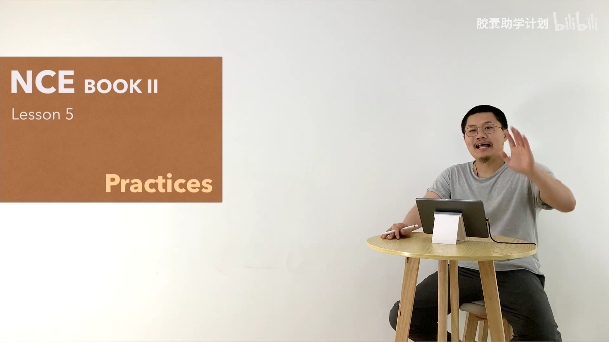

文字识别：biltbili / 胶囊助学计划 / NCE / BOOKII / Lesson 5 / Practices

### 画面 00:00:02

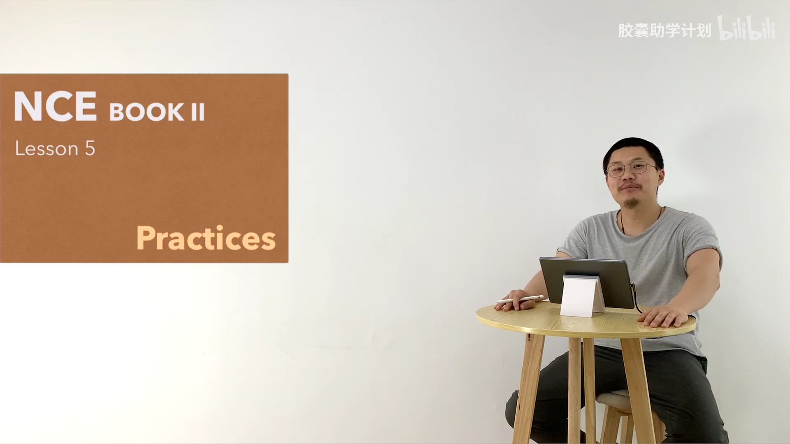

文字识别：Bilbili / 胶囊助学计划 / NCE / BOOKII / Lesson 5 / Practices

### 画面 00:00:04

文字识别：Bilbili / 胶囊助学计划 / NCE / BOOKI"I / Lesson 5 / Practices

### 画面 00:00:06

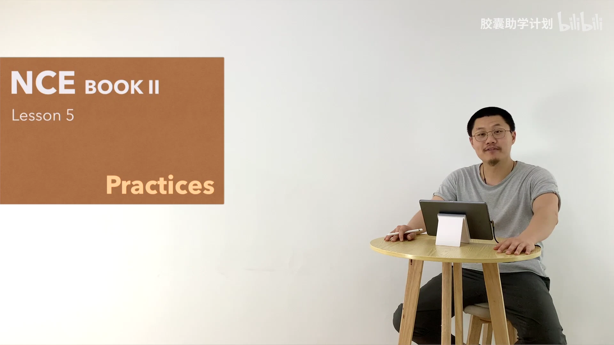

文字识别：biibili / 胶囊助学计划 / NCE / BOOK II / Lesson 5 / Practices

### 画面 00:00:08

文字识别：bilibili / 胶囊助学计划 / 进行如下练习唯一前提 / 文章跟读至熟读成诵 / 否则请勿开始

### 画面 00:00:17

文字识别：Bilbli / 胶囊助学计划 / 进行如下练习唯一前提 / 文章跟读至熟读成诵 / 否则请勿开始

### 画面 00:00:19

文字识别：胶囊助学计划bili / • / •

### 画面 00:00:23

### 画面 00:00:25

文字识别：bilbili / 胶囊助学计划 / Comprehension / 训练目标： / 听懂一般疑问句＆特殊疑问句

## 00:00:30–00:01:00

殊疑问句。各位还是眼睛看着课本，我完全闭上，仅靠听力去回答我的问题。第一个，Who has a garage in Silbury？答案，Mr. James Scott has a garage in Silbury。当然，您可以直接给我，Mr. James Scott。Next one，Where has he just bought another？In

### 画面 00:00:30

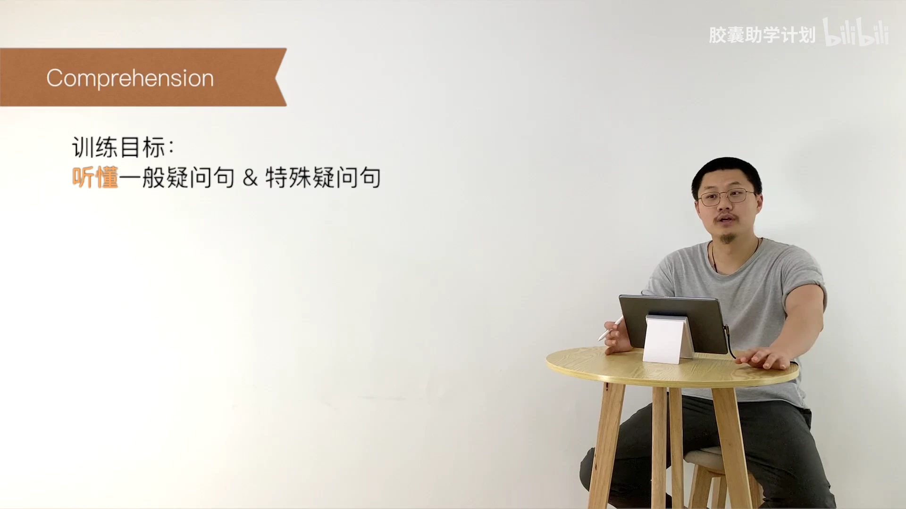

文字识别：bilbili / 胶囊助学计划 / Comprehension / 训练目标： / 听懂一般疑问句＆特殊疑问句

### 画面 00:00:33

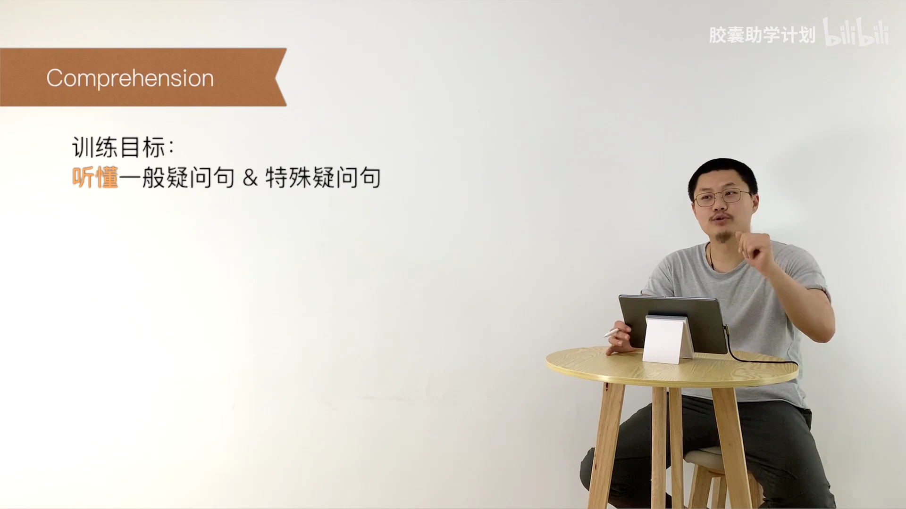

文字识别：Bilbili / 胶囊助学计划 / Comprehension / 训练目标： / 听懂一般疑问句＆特殊疑问句

### 画面 00:00:36

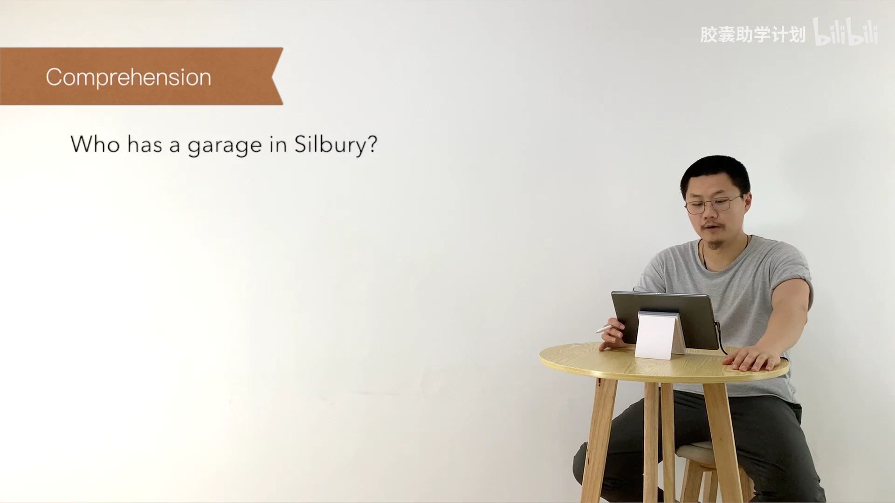

文字识别：Bilibili / 胶囊助学计划 / Comprehension / Who has a garage in Silbury?

## 00:01:00–00:01:30

far is Pinhurst from Silbury?来，各位可以睁开眼看一下这个特殊疑问句。How far?有多远？我们在上一个视频当中刚刚让各位去想了一下，问距离应该用什么？本课就给出了答案，叫做How far? OK.好，那答案five miles.好，继续，眼睛闭上或者看文章。下一个题。Can Mr. Scott get a telephone for his

### 画面 00:01:04

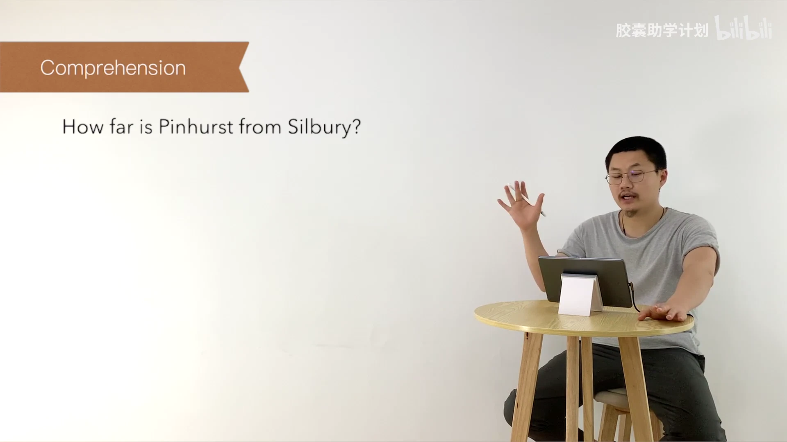

文字识别：Bilbili / 胶囊助学计划 / Comprehension / How far is Pinhurst from Silbury?

### 画面 00:01:07

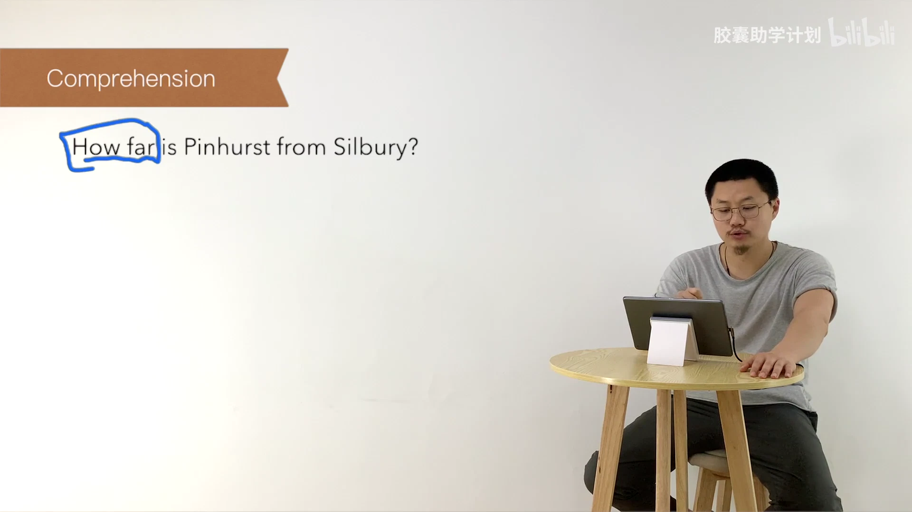

文字识别：BiltBil / 胶囊助学计划 / Comprehension / How far / is Pinhurst from Silbury?

### 画面 00:01:10

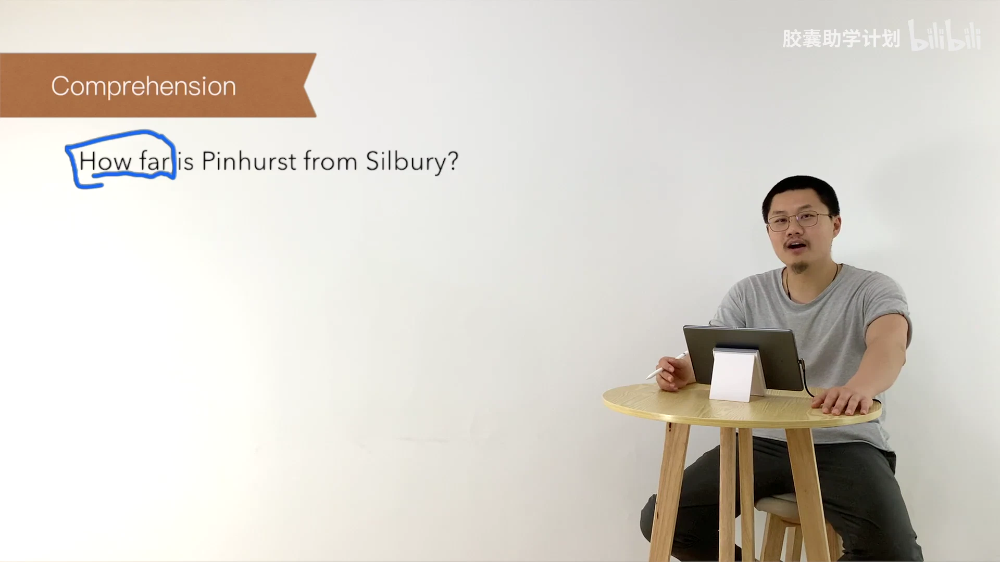

文字识别：Bilbili / 胶囊助学计划 / Comprehension / How fari / is Pinhurst from Silbury?

### 画面 00:01:18

文字识别：Bilbili / 胶囊助学计划 / Comprehension / How fari / is Pinhurst from Silbury?

### 画面 00:01:24

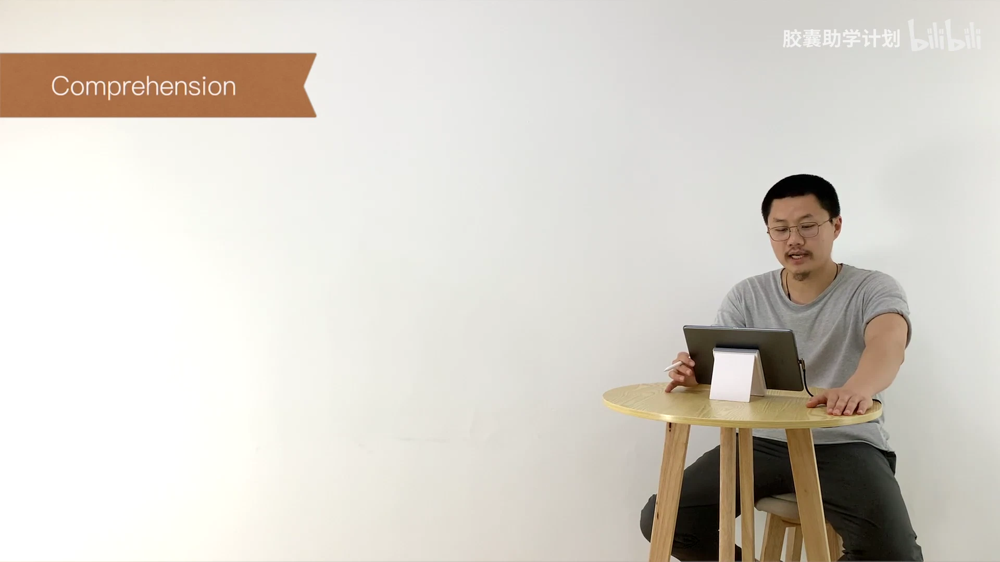

文字识别：Bilbil / 胶囊助学计划 / Comprehension

### 画面 00:01:28

文字识别：Bilbil / 胶囊助学计划 / Comprehension / Can Mr. Scott get a telephone for his new garage?

## 00:01:30–00:02:00

new garage. No, he can't. Next one is that why he's just bought some pigeons. Yes, it is. Next one, how many has he bought? Twelve. What happened yesterday? A pigeon carried the first message.

### 画面 00:01:31

文字识别：Bilbil / 胶囊助学计划 / Comprehension / Can Mr. Scott get a telephone for his new garage?

### 画面 00:01:38

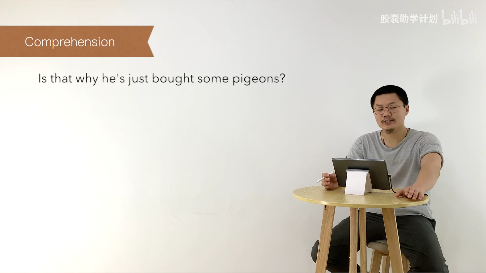

文字识别：胶囊助学计划 / Comprehension / Is that why he's just bought some pigeons?

### 画面 00:01:51

文字识别：Bitbil / 胶囊助学计划 / Comprehension

### 画面 00:01:56

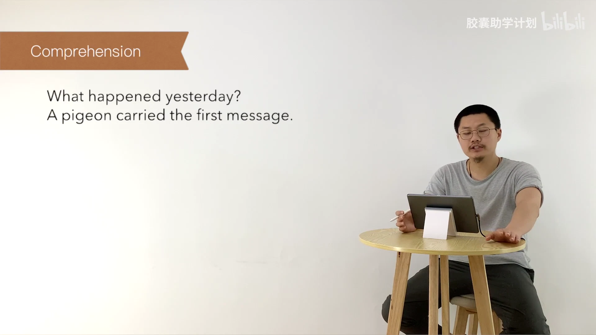

文字识别：Bitbili / 胶囊助学计划 / Comprehension / What happened yesterday? / A pigeon carried the first message.

## 00:02:00–00:02:30

Did the bird cover the distance in two hours or three minutes? Ah, three minutes. Next one. Has Mr. Scott sent many messages from one garage to the other? Yes, he has. Next one. What has he sent requests for?

### 画面 00:02:00

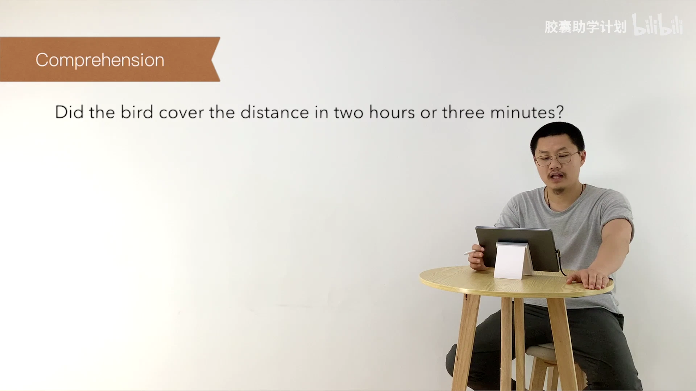

文字识别：b出b出 / 胶囊助学计划 / Comprehension / Did the bird cover the distance in two hours or three minutes?

### 画面 00:02:04

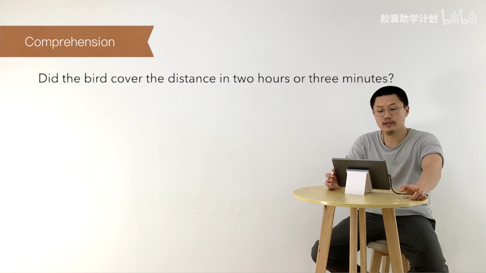

文字识别：b出b出 / 胶囊助学计划 / Comprehension / Did the bird cover the distance in two hours or three minutes?

### 画面 00:02:06

文字识别：Bilbl / 胶囊助学计划 / Comprehension / Did the bird cover the distance in two hours or three minutes?

### 画面 00:02:10

文字识别：Bilibili / 胶囊助学计划 / Comprehension / Has Mr. Scott sent many messages from one / garage to the other?

### 画面 00:02:15

文字识别：胶囊助学计划 / Comprehension / Has Mr. Scott sent many messages from one / garage to the other?

### 画面 00:02:20

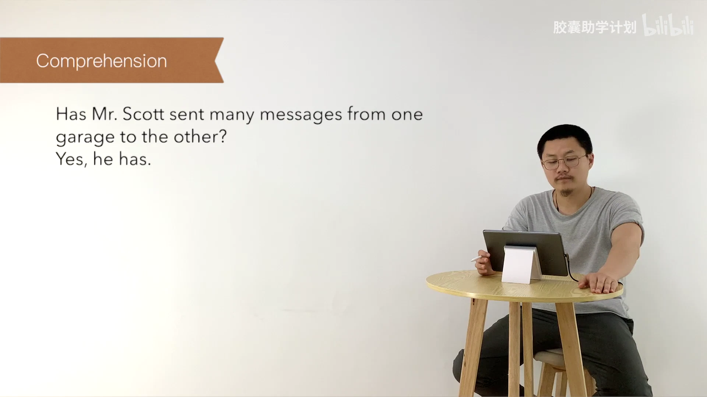

文字识别：胶囊助学计划 / Comprehension / Has Mr. Scott sent many messages from one / garage to the other? / Yes, he has.

### 画面 00:02:24

文字识别：bilbili / 胶囊助学计划 / Comprehension / What has he sent requests for?

## 00:02:30–00:03:00

spare parts. Do pigeons take all his messages now? Yes, they do. Next one. What kind of messages do they carry? For spare parts and other urgent messages, 对吧？ There you go. 下一个 asking questions. 训练目标是我们能自己说出来一般疑问句和特殊疑问句。这个时候各位可

### 画面 00:02:36

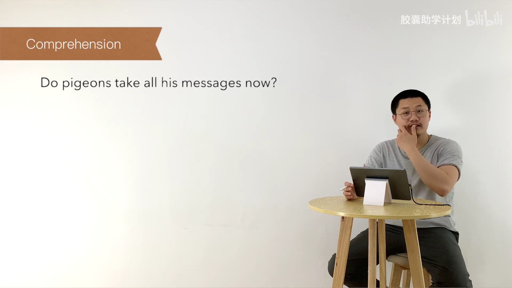

文字识别：Bibil / 胶囊助学计划 / Comprehension / Do pigeons take al his messages now?

### 画面 00:02:42

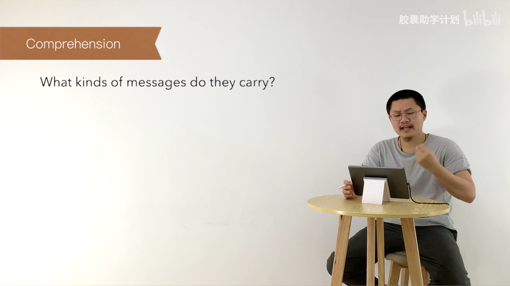

文字识别：Bilibili / 胶囊助学计划 / Comprehension / What kinds of messages do they carry?

### 画面 00:02:48

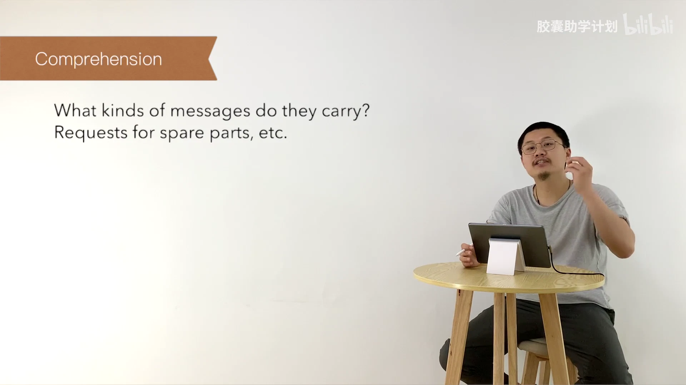

文字识别：Bilbil / 胶囊助学计划 / Comprehension / What kinds of messages do they carry? / Requests for spare parts, etc.

### 画面 00:02:52

文字识别：Biltbili / 胶囊助学计划 / Asking questions / 训练目标： / 会说一般疑问句＆特殊疑问句

## 00:03:00–00:03:30

以看屏幕了。来，第一个做一个示范，ask me if不用管，就是其实它的意思叫问我是否啊。然后 James Scott has a garage in Silbury，一般现在时，does提前，不要忘了把has换回原形。Does James Scott have a garage in Silbury？好，who对主语提问，对主语提问怎么办？Who has a garage in Silbury？不管一般疑问句了，

### 画面 00:03:00

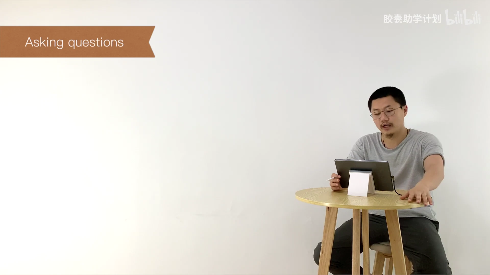

文字识别：胶囊助学计划 / Asking questions

### 画面 00:03:02

文字识别：胶囊助学计划 / Asking questions / T: Ask me if James Scott has a garage in Silbury.

### 画面 00:03:05

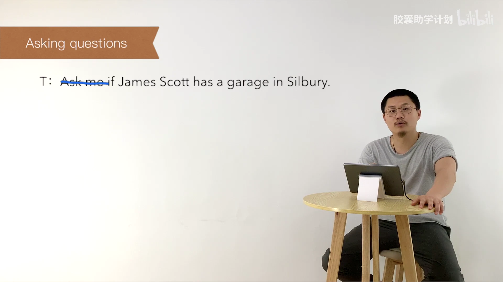

文字识别：Bilbl / 胶囊助学计划 / Asking / questions / T: Ask meif James Scott has a garage in Silbury.

### 画面 00:03:09

文字识别：bilbili / 胶囊助学计划 / Asking / questions / T：Ask meif / James /  Scott has a garage in Silbury.

### 画面 00:03:21

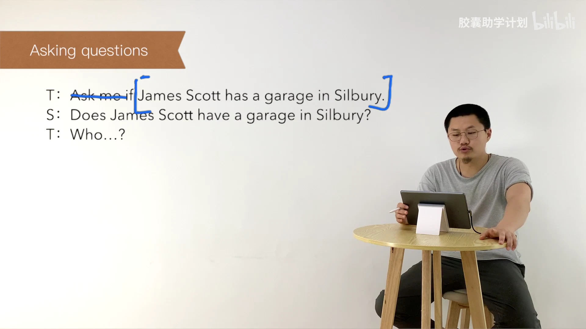

文字识别：胶囊助学计划 / Asking / questions / T: / : Ask meif / James / Scott / has a garage / in. / Silbury. / S: / Does James / Scott / have a garage i / in / Silbury? / T: Who...?

## 00:03:30–00:04:00

直接找肯定句去，对吧？来，第一个我们说过了，我们看一下第二个。注意，撇 s 是 has，所以 has 提前就行了。What 是对 another garage 提问啊？我们在这儿不给所有的答案，只告诉各位思路，回去各位要自己写的。Is 提前，Where 是对 in Penhurst 提问。Penhurst is five miles from Silbury. Is 提前，How far 现在就知道了，对 five

### 画面 00:03:30

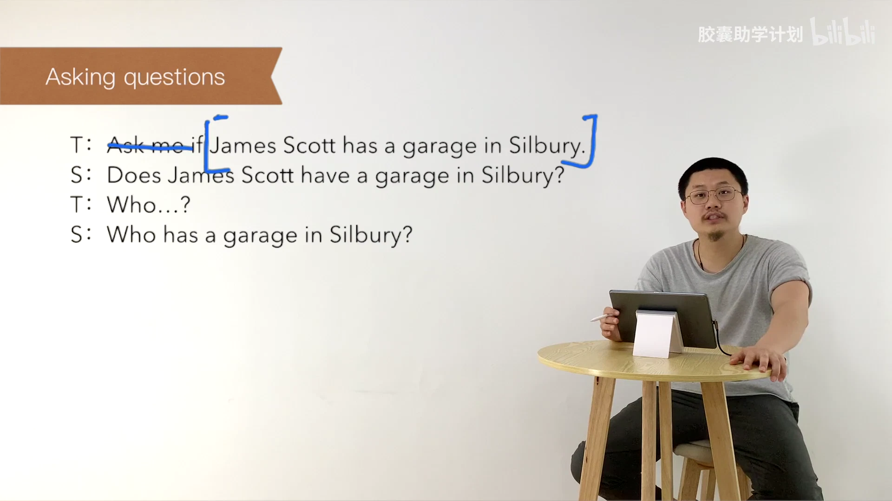

文字识别：胶囊助学计划 / Asking / questions / T：Ask meif / James / Scott / t has a garage i / in. / Silbury. / S: / Does James / Scott / have a garage i / in / Silbury? / T: / Who...? / S：Who /  has a garage in Silbury?

### 画面 00:03:32

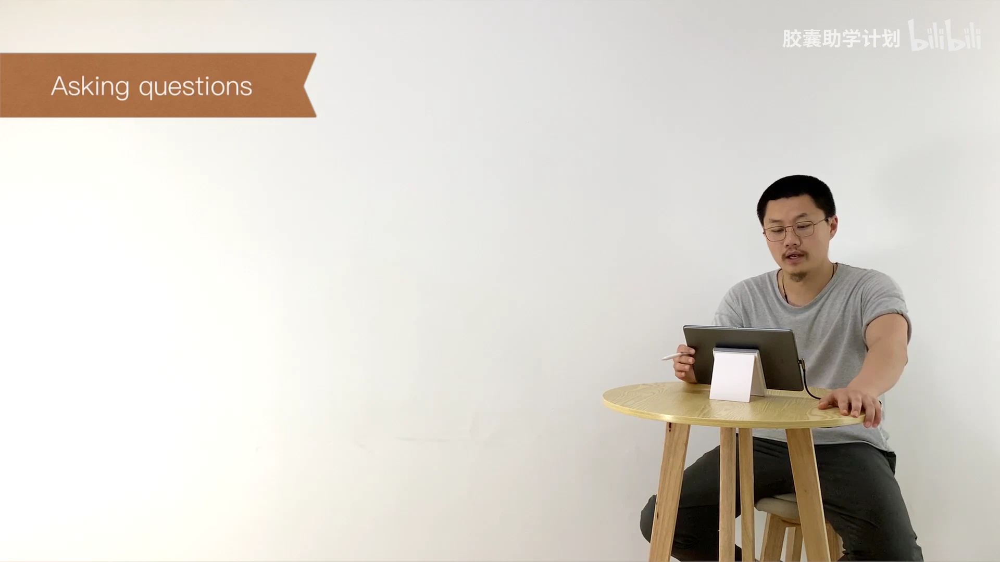

文字识别：BiliBil / 胶囊助学计划 / Asking questions

### 画面 00:03:34

文字识别：胶囊助学计划 / Asking / questions / 1 James Scott has a garage in Silbury. (Who) / 2 He's just bought another garage. (What)

### 画面 00:03:38

文字识别：胶囊助学计划 / Asking / questions / 1lames / Scott / has / a garage in S / Silbury. (Who) / '2 He's just / bought / another garage. (What)

### 画面 00:03:40

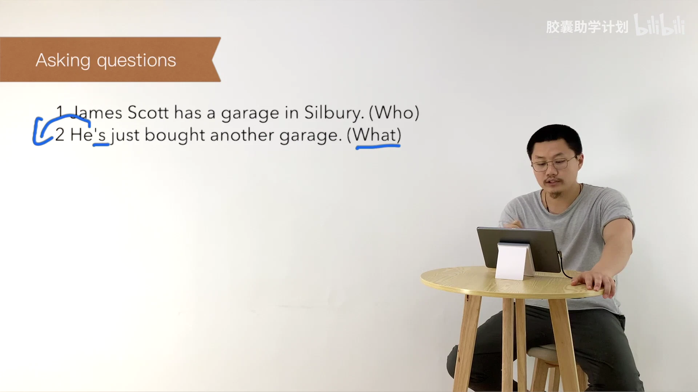

文字识别：胶囊助学计划 / Asking / questions / 1lames / Scott / has / a garage in S / Silbury. (Who) / [2 He's just t / bought / anotherg / garage.(What)

### 画面 00:03:42

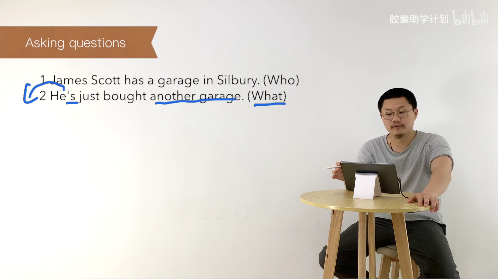

文字识别：胶囊助学计划 / Asking / questions / [2 He's just / 1lames / Scott / has / a / a garage in S / Silbury.( / (Who) / bought / another garage. (What)

### 画面 00:03:47

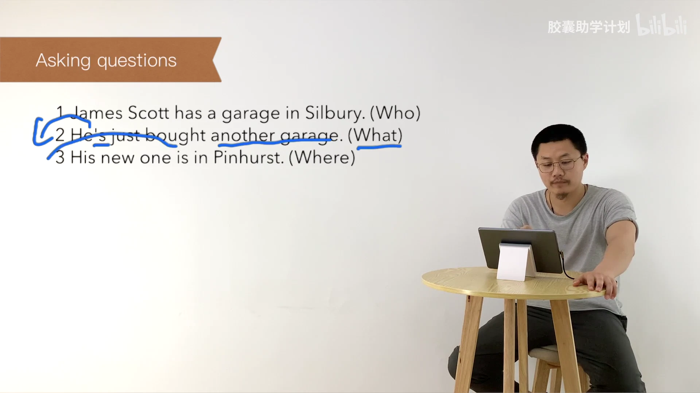

文字识别：胶囊助学计划 / Asking / questions / 1lames / Scott / has / a garage in / Silbury. / (Who) / C2 Hes just ought / a / another garage.(What) / 3His / new / one / is in / Pinhurst. / (Where)

### 画面 00:03:50

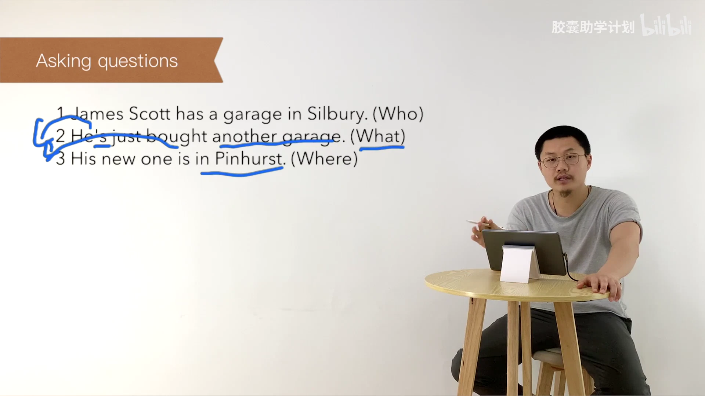

文字识别：胶囊助学计划 / Asking / questions / 1lames / Scott / has / a /  garage i / in / Silbury. / (Who) / 2Hes justbought / another garage. / . (What) / 3 / His / new / one / is in / Pinhurst. / (Where)

### 画面 00:03:56

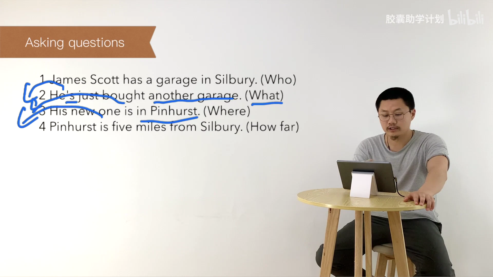

文字识别：胶囊助学计划 / Asking / questions / 1lames / Scott / has / a garage in / Silbury. / (Who) / a / h2Hes just bought / another garage. (What) / His newone / is in / Pinhurst. / (Where) / 4 Pinhurst is / five / miles from / Silbury. / (How / / far)

## 00:04:00–00:04:30

miles 提问了。Next one, he's just bought has 提前。How many 对 twelve 提问。同时注意一个事情，这我们在新概念一册就教过了。How many 要带着 pigeons 一起提前。OK, they carry messages. 注意这是什么时态？跟原文的时态稍有不同啊。这是一般现在时，所以应该是 do 或 does 提前，对吧？那您想

### 画面 00:04:00

文字识别：胶囊助学计划 / Asking / questions / 1lames / Scott / has / garage in / Silbury. / (Who) / 2 Hesjustbought / a / another garage. (What) / His newone / S / in / Pinhurst. / (Where) / 4 Pinhurst is / five / miles from / Silbury. / (How / 1 far)

### 画面 00:04:02

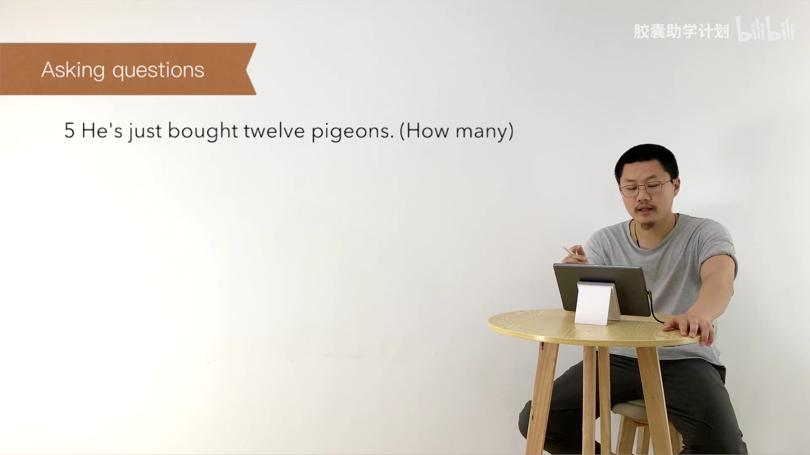

文字识别：胶囊助学计划 / Asking / questions / 5 He's just bought twelve pigeons. (How many)

### 画面 00:04:05

文字识别：胶囊助学计划 / Asking / questions / 5 He's just bought twelve pigeons. (How many)

### 画面 00:04:09

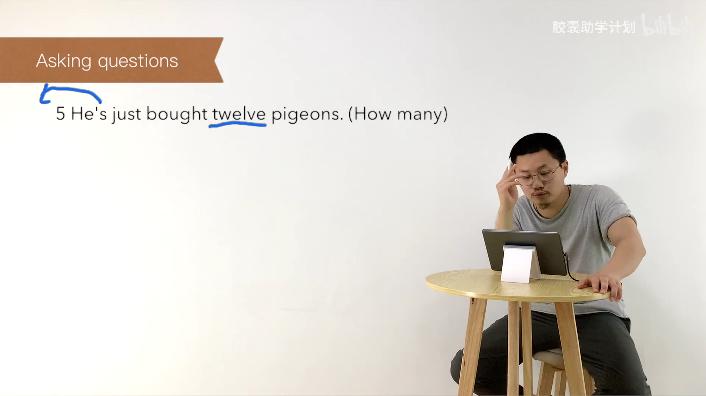

文字识别：胶囊助学计划 / Asking / questions / 5 He's just bought twelve /  pigeons. (How many)

### 画面 00:04:12

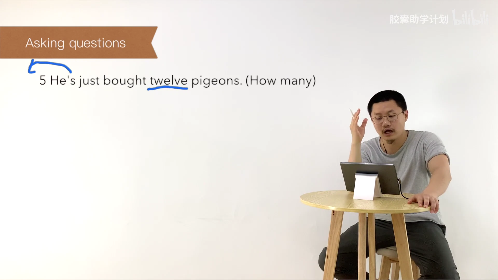

文字识别：胶囊助学计划 / Asking / questions / 5 He's just bought twelve /  pigeons.(How many)

### 画面 00:04:17

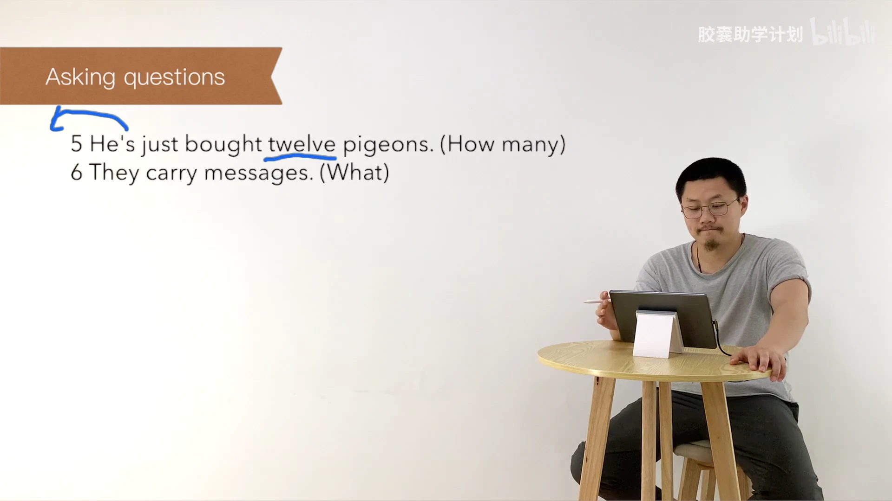

文字识别：胶囊助学计划 / Asking / questions / 5 He's just / bought twelve / pigeons. (How many) / 6 / They / carry / messages. (What)

### 画面 00:04:21

文字识别：Bilbi / 胶囊助学计划 / Asking / questions / 5 He's just / bought twelve / pigeons. (How many) / They / 6 / carry / messages. (What)

## 00:04:30–00:05:00

一下是do还是does呢？Messages what？呃，Pigeon carried the first message to Silbury yesterday.注意一般过去时did的提前，动词换回原形。When对yesterday提问，What对the first message提问。当然了，我想问一下，What能不能对a pigeon提问？也能吧。只不过对主语提问怎么样来着？

### 画面 00:04:34

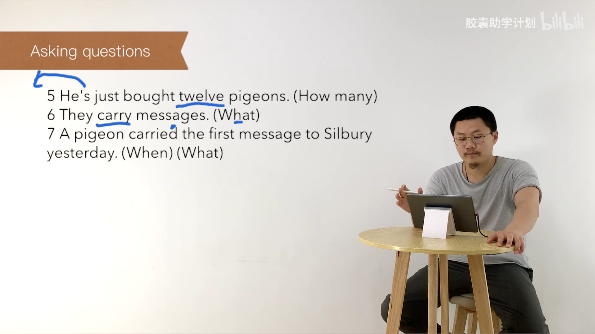

文字识别：胶囊助学计划 / Asking / questions / 5 He's just I / bought twelve / pigeons. (How many) / They / 6 / carry / messages.(What) / first message to Silbury / 7A / pigeon carried / the / yesterday. / (When) (What)

### 画面 00:04:47

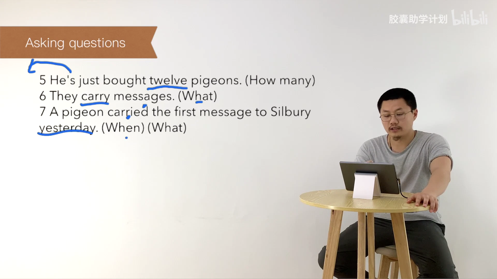

文字识别：胶囊助学计划 / Asking / questions / 5 He's just / bought twelve / pigeons. (How many) / 6 / They / carry / messages. / . (What) / 7A / pigeon / carried / the / first / message to / Silbury / yesterday. / (When)(What)

### 画面 00:04:49

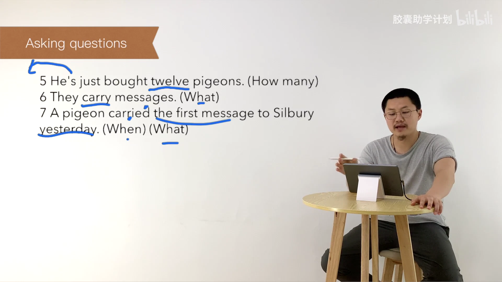

文字识别：Biltbili / 胶囊助学计划 / Asking / questions / 5 He's just / bought twelve / pigeons. (How many) / 6 / They / carry / messages. / . (What) / 7A / pigeon / carried / the / first / message to / Silbury / yesterday. / (When)(What)

### 画面 00:04:51

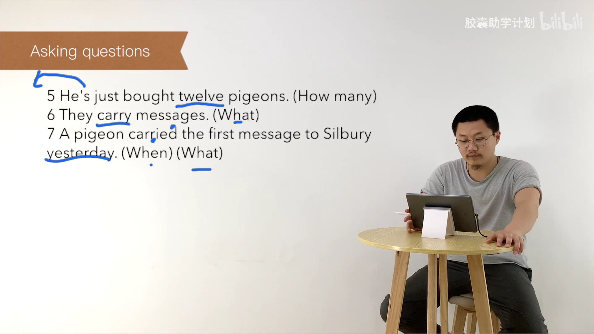

文字识别：Bilbi / 胶囊助学计划 / Asking / questions / 5 He's just / bought twelve / pigeons.(How many) / 6 / They / carry / messages.( / . (What) / 7A / pigeon / carried / the / first / message to / Silbury / yesterday. / (When)(What)

### 画面 00:04:53

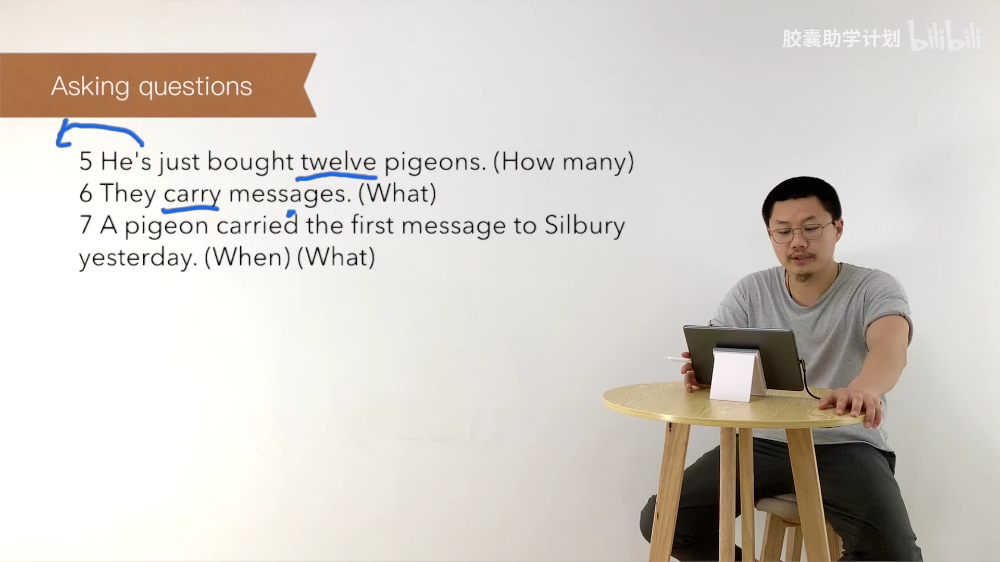

文字识别：胶囊助学计划 / 出 / Asking / questions / 5 He's just / bought twelve / pigeons. (How many) / 6 / They / carry / messages. (What) / 7A / pigeon carried / the / first / message to Silbury / yesterday. / (When) (What)

### 画面 00:04:56

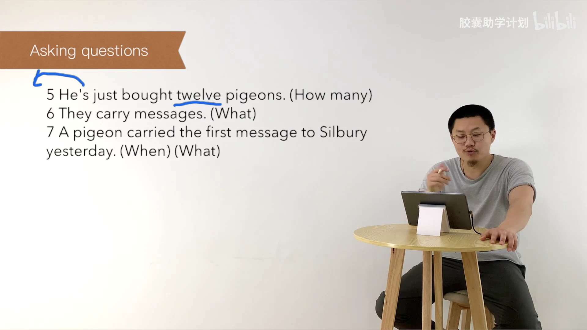

文字识别：胶囊助学计划 / Asking / questions / 5 He's just bought twelve / pigeons.(How many) / 6 / They / carry / messages. (What) / 7 A pigeon carried / the / first r /  message to Silbury / yesterday. / .(When)(What)

### 画面 00:04:58

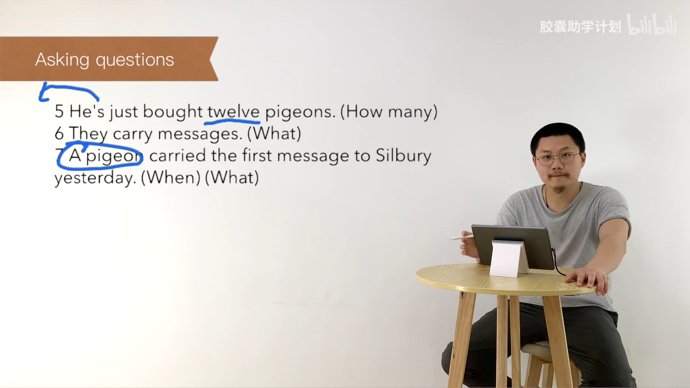

文字识别：胶囊助学计划 / Asking / questions / 5 He's just bought twelve / pigeons.(How many) / 6 / They / carry / messages. (What) / Apigeod / carried / the / first / message to Silbury / yesterday. / (When) (What)

## 00:05:00–00:05:30

It took three minutes. Did提前took换回原形。How long多长时间？对，three minutes提问。OK，接下来tell the story练习的是我们口语复述能力。这个完全取决于各位原文有没有熟读成诵，对吧？我给大家上课做一个示范，下课自己各位一定要去练。来了，

### 画面 00:05:04

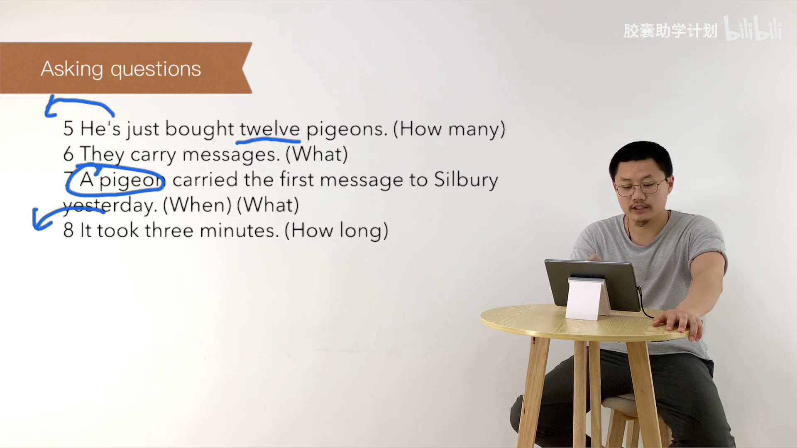

文字识别：胶囊助学计划 / Asking / questions / 5 He's just bought twelve /  pigeons. (How many) / 6 / They carry / messages. (What) / Apigeod / carried / the / first r /  message to Silbury / yosterday. / (When) (What) / 8 It took / three / : minutes.(How long)

### 画面 00:05:08

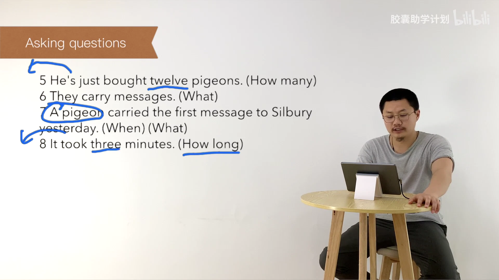

文字识别：胶囊助学计划 / Asking / questions / 5 He's just k /  bought twelve / pigeons.(How many) / 6 / They / carry / messages. (What) / Apigeod / carried / the / first r /  message to Silbury / yesterday. / (When)(What) / 8 It took / three / : minutes.(How long)

### 画面 00:05:11

文字识别：Biltbili / 胶囊助学计划 / Tell the story / 训练目标： / 口语复述能力

### 画面 00:05:15

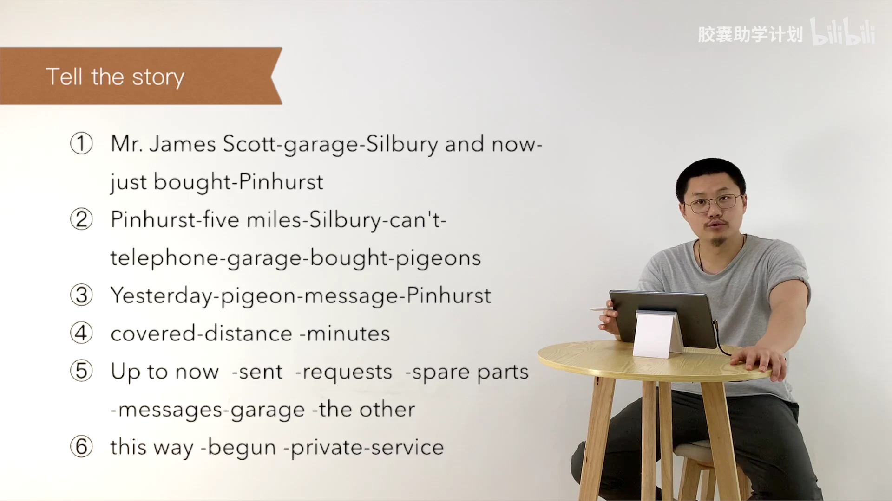

文字识别：胶囊助学计划 / Tell the story / Mr. James Scott-garage-Silbury and now- / just bought-Pinhurst / Pinhurst-five miles-Silbury-can't- / telephone-garage-bought-pigeons / Yesterday-pigeon-message-Pinhurst / covered-distance -minutes / 5 / Up to now -sent -requests -spare parts / -messages-garage -the other / this way -begun -private-service

### 画面 00:05:17

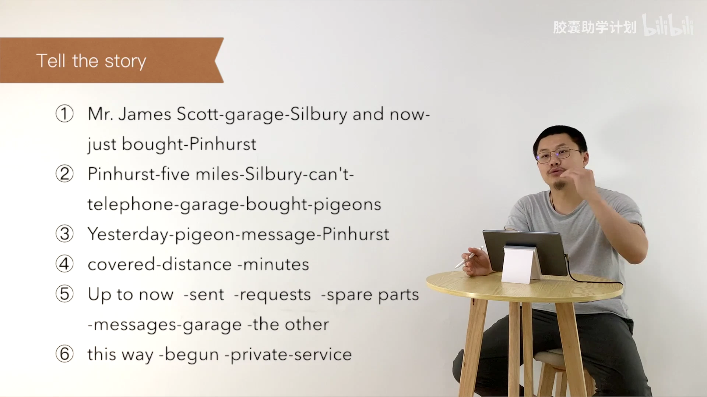

文字识别：胶囊助学计划 / Tell the story / Mr. James Scott-garage-Silbury and now- / just bought-Pinhurst / Pinhurst-five miles-Silbury-can't- / telephone-garage-bought-pigeons / Yesterday-pigeon-message-Pinhurst / covered-distance -minutes / Up to now -sent -requests -spare parts / -messages-garage -the other / this way -begun -private-service

### 画面 00:05:26

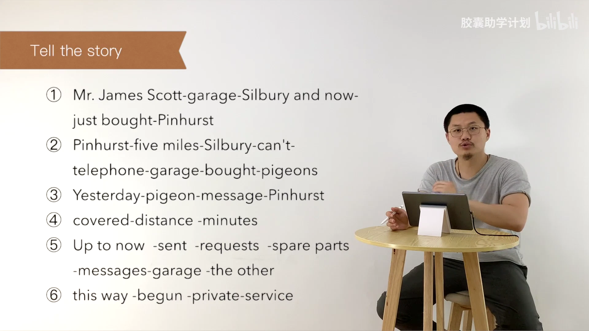

文字识别：胶囊助学计划 / Tell the story / Mr. James Scott-garage-Silbury and now- / just bought-Pinhurst / Pinhurst-five miles-Silbury-can't- / telephone-garage-bought-pigeons / Yesterday-pigeon-message-Pinhurst / covered-distance -minutes / Up to now -sent -requests -spare parts / -messages-garage -the other / this way -begun -private-service

### 画面 00:05:28

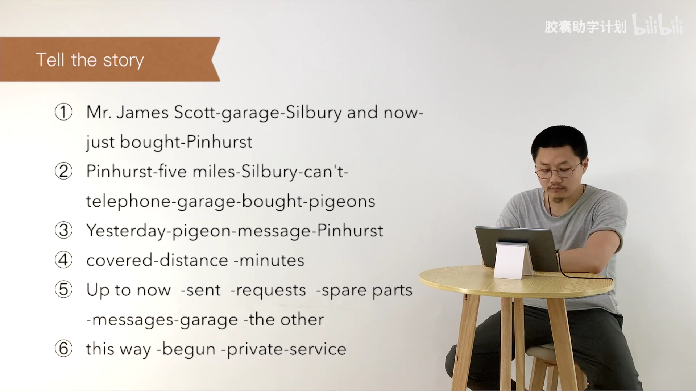

文字识别：胶囊助学计划 / Tell the story / Mr. James Scott-garage-Silbury and now- / just bought-Pinhurst / Pinhurst-five miles-Silbury-can't- / telephone-garage-bought-pigeons / Yesterday-pigeon-message-Pinhurst / covered-distance -minutes / Up to now -sent -requests -spare parts / -messages-garage -the other / this way -begun -private-service

## 00:05:30–00:06:00

Mr. James Godd has a garage in Silbury, and now he has just bought another one in Pinhurst. Pinhurst is only five miles from Silbury, but he cannot get a telephone for his new garage, so he has just bought twelve pigeons. Yesterday, a pigeon carried the first message to Pinhurst, and the bird covered the distance in three minutes. Up to now, he has sent a

### 画面 00:05:58

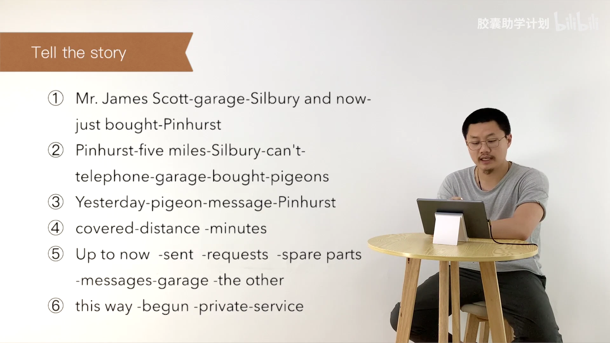

文字识别：胶囊助学计划 / Tell the story / Mr. James Scott-garage-Silbury and now- / just bought-Pinhurst / Pinhurst-five miles-Silbury-can't- / telephone-garage-bought-pigeons / Yesterday-pigeon-message-Pinhurst / covered-distance -minutes / 5 / Up to now -sent -requests -spare parts / -messages-garage -the other / this way -begun -private-service

## 00:06:00–00:06:30

great many requests for spare parts and other urgent messages from one garage to the other. In this way, he has begun his own private telephone service. 上课视频当中，我给大家做一个示范，下课各位自己去做口语复述，看着这些关键词。其次呢，summary writing，所谓叫摘要写作，练习的是我们写作的复述能力，对吧？大家如果将来写邮件，这些都是为了将

### 画面 00:06:19

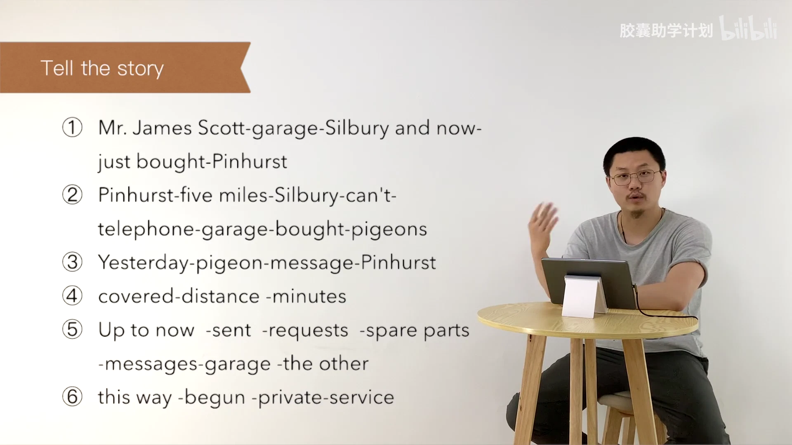

文字识别：胶囊助学计划 / Tell the story / Mr. James Scott-garage-Silbury and now- / just bought-Pinhurst / Pinhurst-five miles-Silbury-can't- / telephone-garage-bought-pigeons / Yesterday-pigeon-message-Pinhurst / covered-distance -minutes / 5 / Up to now -sent -requests -spare parts / -messages-garage -the other / this way -begun -private-service

### 画面 00:06:21

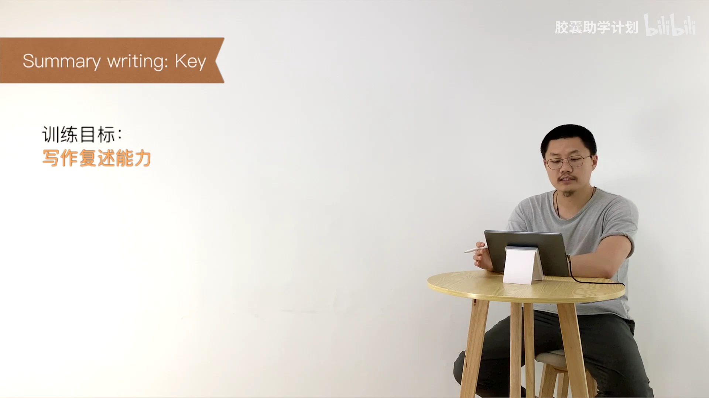

文字识别：Bilbili / 胶囊助学计划 / Summary writing: Key / 训练目标： / 写作复述能力

### 画面 00:06:25

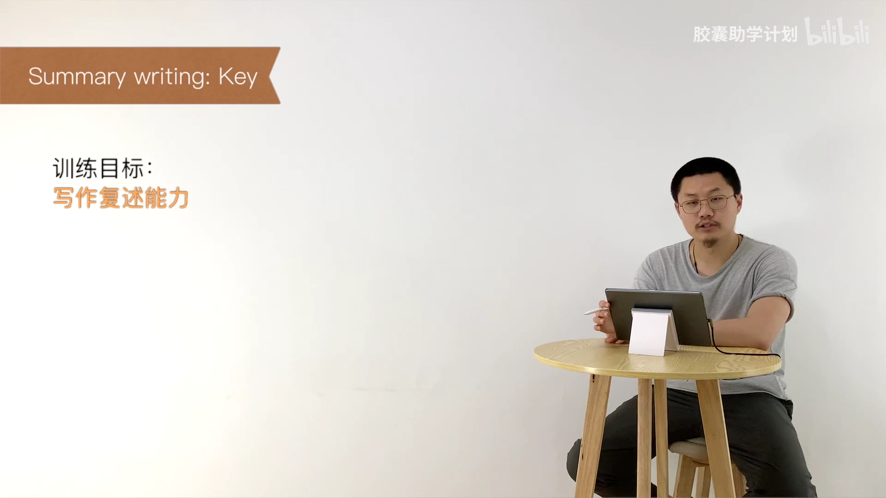

文字识别：Bilbil / 胶囊助学计划 / Summary writing: Key / 训练目标： / 写作复述能力

### 画面 00:06:28

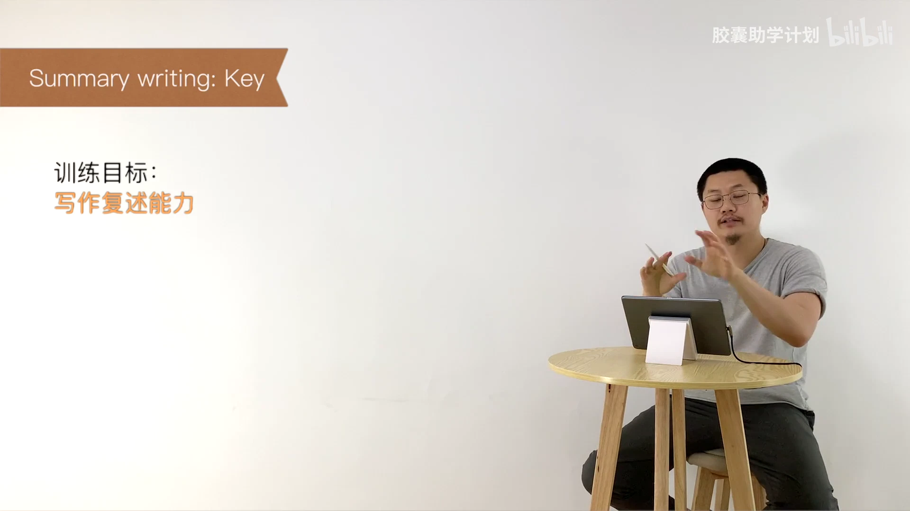

文字识别：Bilbil / 胶囊助学计划 / Summary writing: Key / 训练目标： / 写作复述能力

## 00:06:30–00:07:00

来做这些事情做准备的。好，在这儿只提供答案和进行过多的讲解了。各位从我们的文章的下方找到摘要写作，一道题一道题的去写下来，然后对一下答案就可以了。OK，好，完全自由的对话，这个是目前也许我们做不到的，但是我们每次还是看一下，尤其是在上一个视频当中，我刚讲到说以后呢，我们可以先用汉语去尝试着说一下，汉语说溜了，慢慢随着我们单词、语法、习惯

### 画面 00:06:32

文字识别：胶囊助学计划 / Summary writing: Key / Mr. Scott has opened his second garage in / Pinhurst. His first garage is in Silbury. Silbury / is five miles away. Mr. Scott cannot get a / telephone for his new garage. He has / bought twelve pigeons. They carry messages / from one garage to the other in three / minutes.

### 画面 00:06:44

文字识别：BilBi / 胶囊助学计划 / Topics for discussion / 训练目标： / 完全自由的对话

### 画面 00:06:50

文字识别：胶囊助学计划 / Topics for discussion / What do you have to do to get a telephone / in your country? / Have you had any wrong numbers on the / phone lately? What else can go wrong when / you use the phone? / What other ways of sending messages are / there?

## 00:07:00–00:07:30

用法越积累越多，我们就可以试着用语言哎支离破碎的去表达一下，越表达就会越流利了。第一个题说，What do you have to do to get a telephone in your country?在你的国家，你不得不去做一些什么事情去得到一个电话？那中国还是很简单的，基本上花钱就可以了，对吧？那您想一下，在不同的国家，也许是不太一样的呢，对不对？下一个题说，Have you had any wrong numbers on the

### 画面 00:07:20

文字识别：胶囊助学计划 / Topics for discussion / What do you have to do to get a telephone / in your country? / Have you had any wrong numbers on the / 2 / phone lately? What else can go wrong when / you use the phone? / What other ways of sending messages are / there?

## 00:07:30–00:08:00

phone lately? 最近有没有给您打错的电话呢？也许是有的。What else can go wrong? 还有什么其他的事情可能会出问题吗？Go wrong, 出问题。当你使用电话的时候，比如说不小心摁出去了一个什么东西，对吧？比如说我们前两天看新闻，说有一个人把密码当做付款的钱给人家打过去了，是吧？买了一个什么可乐，付了六十多万还是六万块钱，是吧？很有意思。说 What other

### 画面 00:07:50

文字识别：胶囊助学计划 / Topics for discussion / What do you have to do to get a telephone / in your country? / Have you had any wrong numbers on the / phone lately? What else can go wrong when / you use the phone? / What other ways of sending messages are / there?

## 00:08:00–00:08:30

ways of spending messages of sending messages are there? 还有什么其他发送消息的方式吗？啊，比如说我们当年什么鸡毛信啊等等这些对吧？发挥您的聪明才智，自己去想一想。比如说 email 啊，尝试可以去思考一下。 OK，那不多说，我们看一下本课的家庭作业。 Ask me if 各位一定要记住，先写肯定句不用写了，您把一般疑问句、特殊疑问

### 画面 00:08:10

文字识别：胶囊助学计划 / Topics for discussion / What do you have to do to get a telephone / in your country? / Have you had any wrong numbers on the / phone lately? What else can go wrong when / you use the phone? / What other ways of sending messages are / there?

### 画面 00:08:18

文字识别：胶囊助学计划 / bilL

### 画面 00:08:20

文字识别：胶囊助学计划blb山 / 1. / Ask me if写&朗读

### 画面 00:08:24

文字识别：胶囊助学计划bl出 / 1. / Ask me if写&朗读

### 画面 00:08:26

文字识别：胶囊助学计划b出b出 / 1.Ask me if写&朗读

## 00:08:30–00:09:00

句都写完了之后，确保是对的，然后再进行一个大声的朗读。接下来摘要写作，您还是要先写，然后再去对答案。最后呢，Tell the story文章非常熟了之后，进行口语复述，看看关键词。最后，各位可以在我们的专栏当中找到这些练习的文本材料。那以上呢就是本期视频的全部内容了。如果大家喜欢我们的课程，欢迎大家关注、订阅、一键三连支持，并

### 画面 00:08:30

文字识别：Biibili / 胶囊助学计划 / 1. / Ask me if写&朗读

### 画面 00:08:34

文字识别：Bilbili / 胶囊助学计划 / 1.Ask me if写&朗读

### 画面 00:08:36

文字识别：Bilbil / 胶囊助学计划 / 1.Ask me if写&朗读 / 2. / 摘要写作写&答案

### 画面 00:08:39

文字识别：Bilibli / 胶囊助学计划 / 宁 / 1.Ask me if写&朗读 / 摘要写作写&答案 / 3.Tell the story 口语复述

### 画面 00:08:41

文字识别：胶囊助学计划b出b出 / 1.Ask me if写&朗读 / 摘要写作写&答案 / 3.Tell the story 口语复述

### 画面 00:08:45

文字识别：Bilbili / 胶囊助学计划 / 1.Ask me if写&朗读 / 摘要写作写&答案 / 3.Tell the story 口语复述 / 4. / 专栏

### 画面 00:08:48

文字识别：胶囊助学计划bilbl / 1.Ask me if写&朗读 / 摘要写作写&答案 / 3.Tell the story 口语复述 / 专栏 / 4.

### 画面 00:08:50

文字识别：bilbili / 胶囊助学计划 / 1.Ask me if写&朗读 / 摘要写作写&答案 / 3.Tell the story 口语复述 / 专栏 / 4.

### 画面 00:08:52

文字识别：胶囊助学计划b出b出

### 画面 00:08:54

文字识别：胶囊助学计划b出b出

## 00:09:00–00:09:16

分享给那些需要的朋友们。See you next time.

### 画面 00:09:03

文字识别：￥

### 画面 00:09:05

文字识别：CAPSULEACADEMY / 胶囊助学计划 / 小红书 / Lecturer / Leo / OE

### 画面 00:09:08

文字识别：CAPSULEACADEMY / 胶囊助学计划 / 『 / 小红书 / grapher / Berlin / OE

### 画面 00:09:11

文字识别：CAPSULEACADEMY / 胶囊助学计划 / 小红书 / Creatnr / Leo & Berlin

### 画面 00:09:14

文字识别：bilibili / 胶囊助学计划

### 画面 00:09:15

文字识别：bilibili / 胶囊助学计划

