# L006 语法 + 单词

快速机器解析：语音为单模型转写，未进行独立交叉校对或人工复核；画面每秒采样并按变化选帧，短时文字和标记可能遗漏。截图时间约有 1 秒误差。图片有损压缩；遇到疑点请按时间查看 Google Drive 原视频。

## 00:00:00–00:00:30

Hello everyone, welcome to Capsule Academy. This is Leo. Today we are going to learn New Concept English Book Two, Lesson Six, Grammar and Words. 老习惯，进入正式课程之前，我们先看三个问题。第一，如何表达零用钱？第二，如何使用 a, an, the some 和 any 这样几个小的单词？最后一个问题，为什么要学习同义词？带着这三个问题，Hope you guys enjoy it.

### 画面 00:00:00

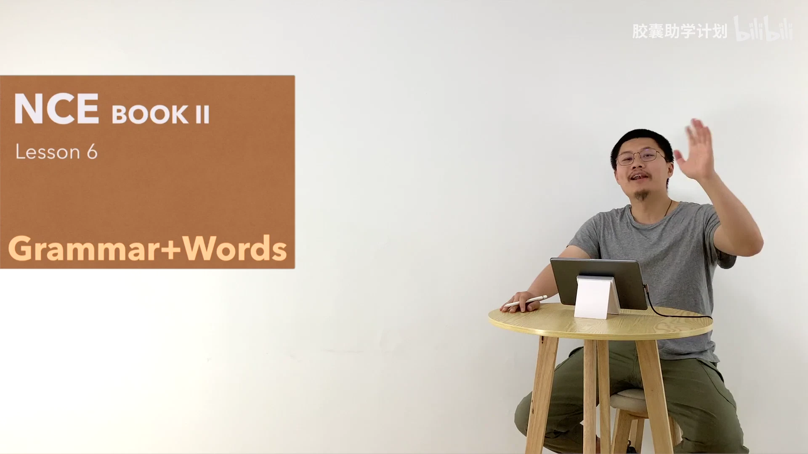

文字识别：胶囊助学计划 / NCE / BOOKII / Lesson 6 / Grammar+Words

### 画面 00:00:02

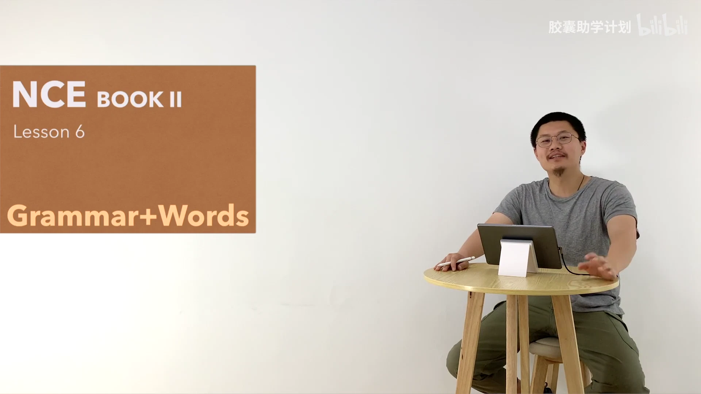

文字识别：胶囊助学计划 / NCE / BOOKII / Lesson 6 / Grammar+Words

### 画面 00:00:04

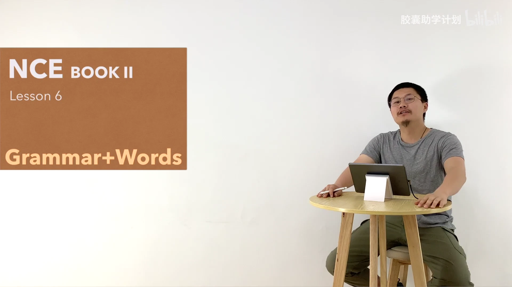

文字识别：胶囊助学计划 / NCE / BOOKII / Lesson 6 / Grammar+Words

### 画面 00:00:06

文字识别：胶囊助学计划 / NCE / BOOKII / Lesson 6 / Grammar+Words

### 画面 00:00:08

文字识别：胶囊助学计划 / NCE / BOOKII / Lesson 6 / Grammar+Words

### 画面 00:00:10

文字识别：胶囊助学计划

### 画面 00:00:12

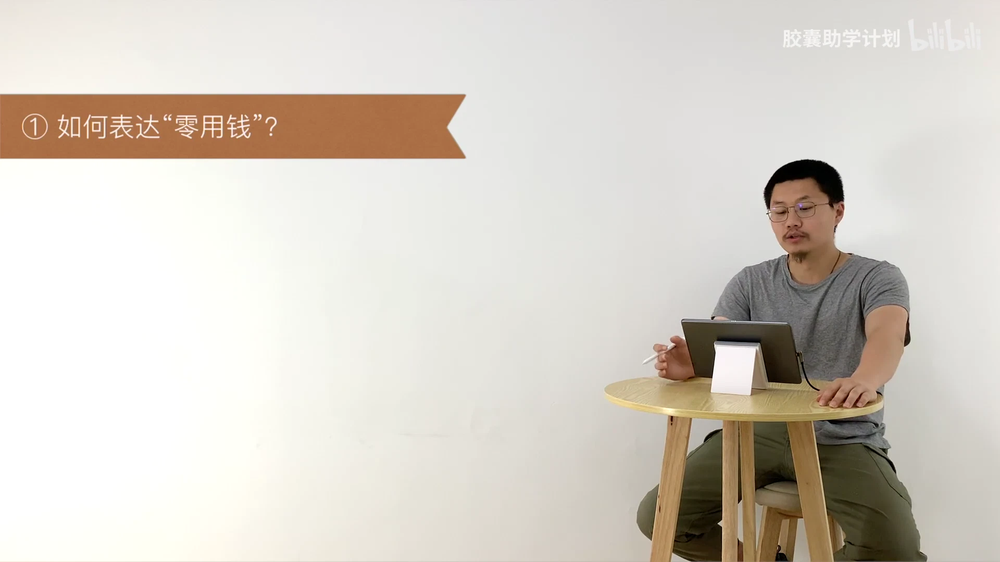

文字识别：胶囊助学计划 / ①如何表达“零用钱”？

### 画面 00:00:14

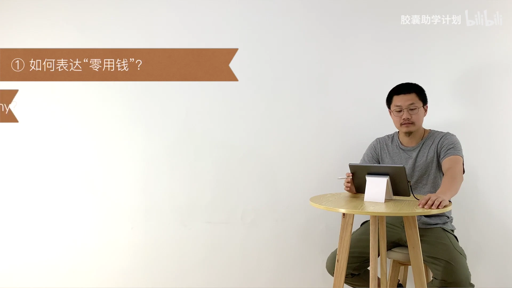

文字识别：胶囊助学计划 / ①如何表达“零用钱”？ / ny

### 画面 00:00:16

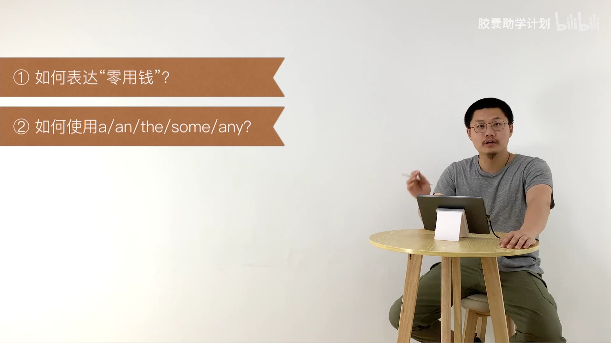

文字识别：胶囊助学计划 / ①如何表达“零用钱”？ / 如何使用a/an/the/some/any?

### 画面 00:00:20

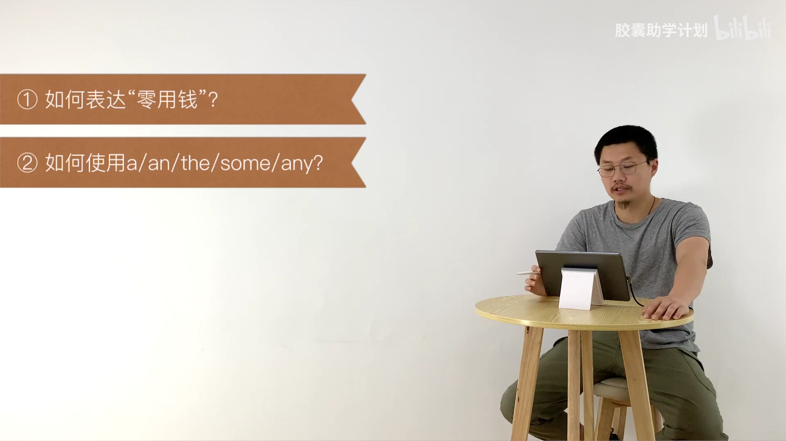

文字识别：胶囊助学计划 / ①如何表达“零用钱”？ / 如何使用a/an/the/some/any?

### 画面 00:00:22

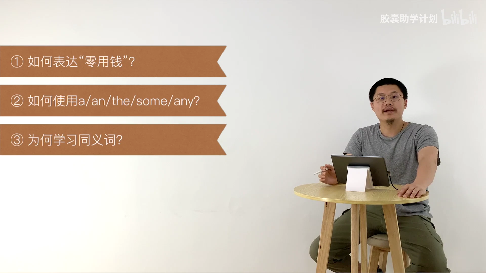

文字识别：胶囊助学计划 / ①如何表达“零用钱”？ / 如何使用a/an/the/some/any? / 为何学习同义词?

### 画面 00:00:25

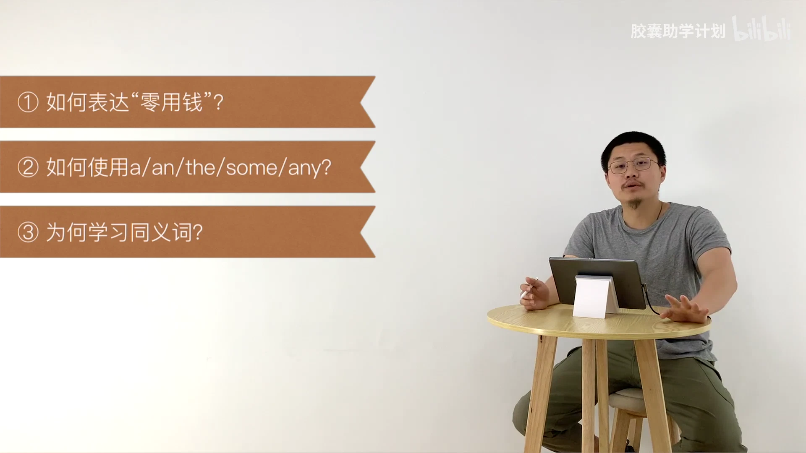

文字识别：胶囊助学计划 / ①如何表达“零用钱”？ / 如何使用a/an/the/some/any? / 为何学习同义词?

### 画面 00:00:27

文字识别：胶囊助学计划bilbi / •

## 00:00:30–00:01:00

好，那我们上来先看第一个小的单词，我们看音标，先跟我一起读一下 beggar，beggar，beggar。注意，这儿我们可能会加一个小的儿化音，因为有字母 r。 I repeat after me， OK？ Beggar。好，首先我们注意它是一个名词，名词想去造句的时候，我们想一下它在六一二三四五六当中往往处于什么样的一个位置，

### 画面 00:00:31

文字识别：胶囊助学计划

### 画面 00:00:33

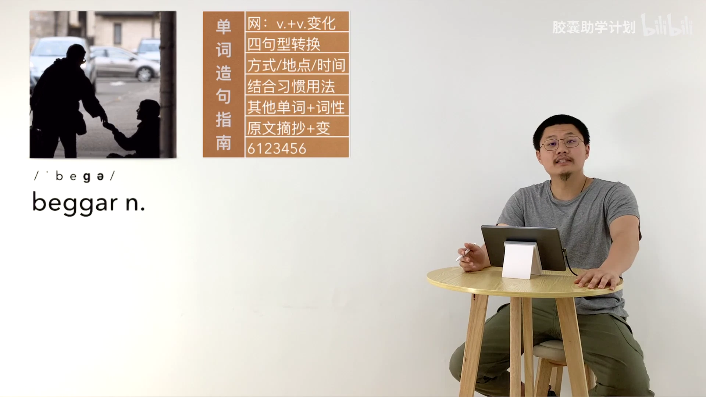

文字识别：单词造句指南 / 网：v.+v.变化 / 胶囊助学计划 / 四句型转换 / 方式/地点/时间 / 结合习惯用法 / 其他单词+词性 / 原文摘抄+变 / 6123456 / /bega/ / beggar n.

### 画面 00:00:35

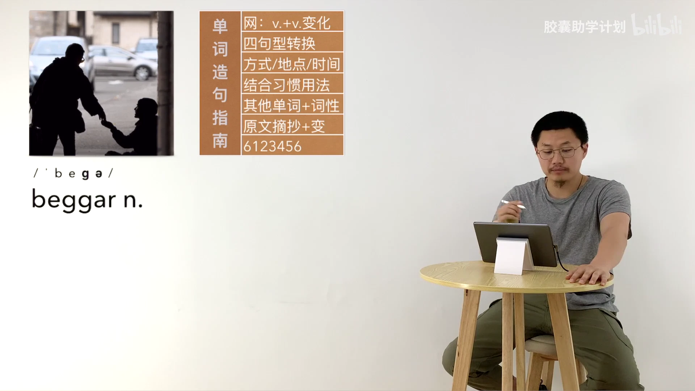

文字识别：单词造句指南 / 网：v.+v.变化 / 胶囊助学计划 / 四句型转换 / 方式/地点/时间 / 结合习惯用法 / 其他单词+词性 / 原文摘抄+变 / 6123456 / bega/ / beggar n.

### 画面 00:00:38

文字识别：单词造句指南 / 网：v.+v.变化 / 胶囊助学计划 / 四句型转换 / 方式/地点/时间 / 结合习惯用法 / 其他单词+词性 / 原文摘抄+变 / 6123456 / ·bega/ / beggar n.

### 画面 00:00:40

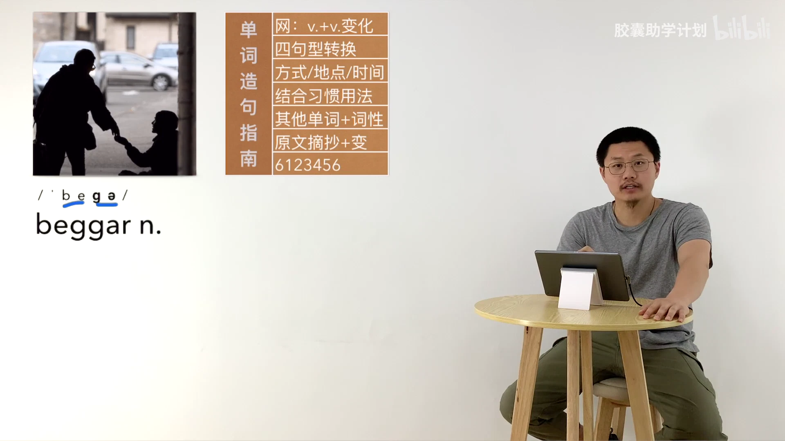

文字识别：单词造句指南 / 网：v.+v.变化 / 胶囊助学计划 / 四句型转换 / 方式/地点/时间 / 结合习惯用法 / 其他单词+词性 / 原文摘抄+变 / 6123456 / /bega/ / beggar n.

### 画面 00:00:43

文字识别：单词造句指南 / 网：v.+v.变化 / 胶囊助学计划 / 四句型转换 / 方式/地点/时间 / 结合习惯用法 / 其他单词+词性 / 原文摘抄+变 / 6123456 / /bega/ / beggar n. / •

### 画面 00:00:45

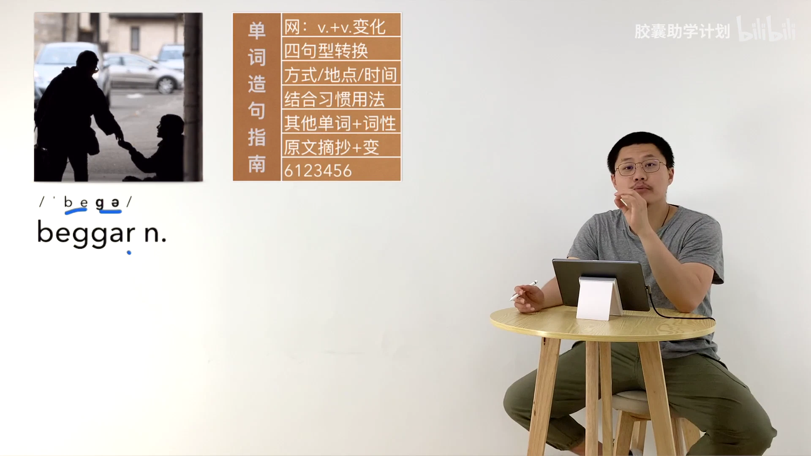

文字识别：单词造句指南 / 网：v.+v.变化 / 胶囊助学计划 / 四句型转换 / 方式/地点/时间 / 结合习惯用法 / 其他单词+词性 / 原文摘抄+变 / 6123456 / /bega/ / beggar n. / •

### 画面 00:00:48

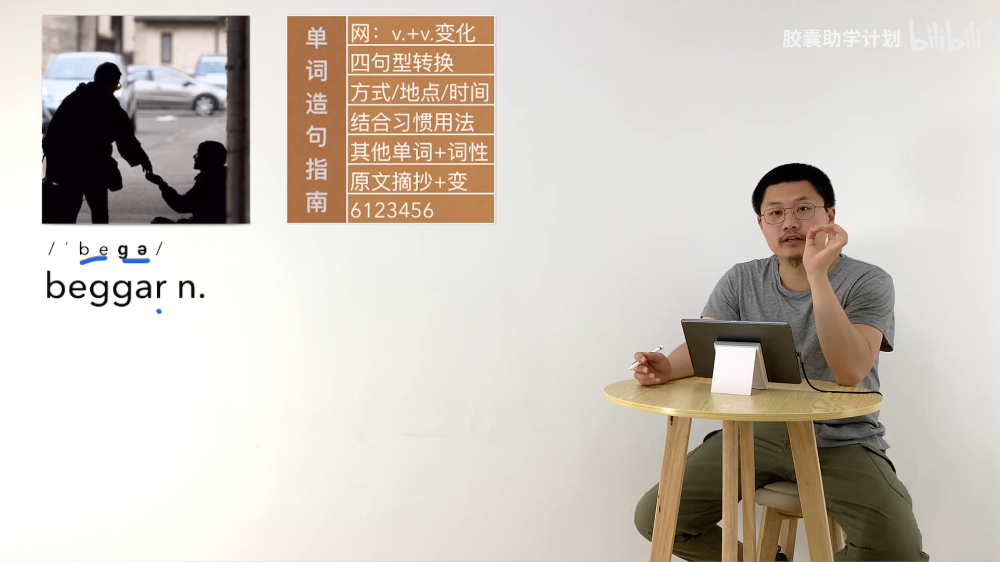

文字识别：单词造句指南 / 网：v.+v.变化 / 胶囊助学计划 / 四句型转换 / 方式/地点/时间 / 结合习惯用法 / 其他单词+词性 / 原文摘抄+变 / 6123456 / /bega/ / beggar n. / •

### 画面 00:00:50

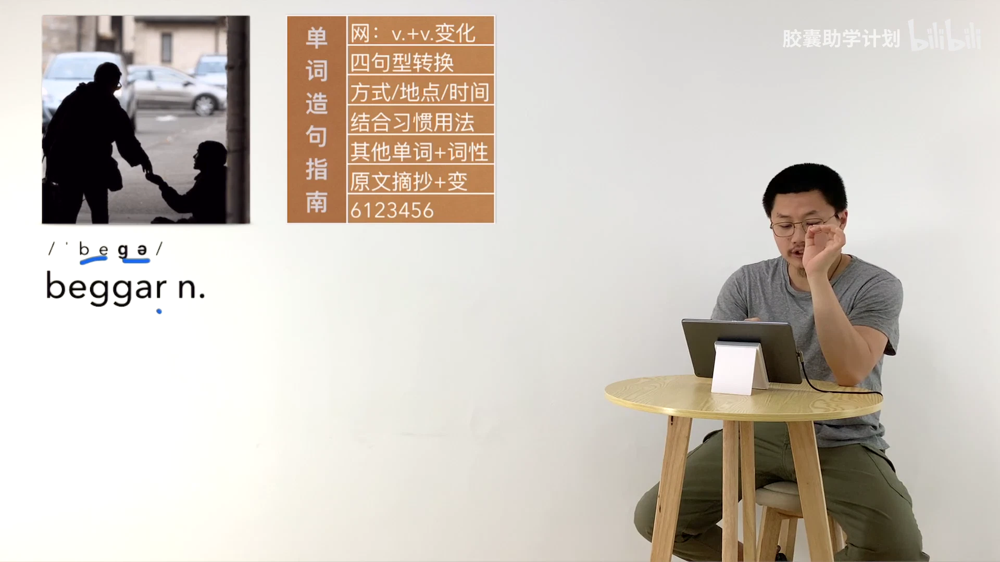

文字识别：单词造句指南 / 网：v.+v.变化 / 胶囊助学计划 / 四句型转换 / 方式/地点/时间 / 结合习惯用法 / 其他单词+词性 / 原文摘抄+变 / 6123456 / /bega/ / beggar n. / •

### 画面 00:00:53

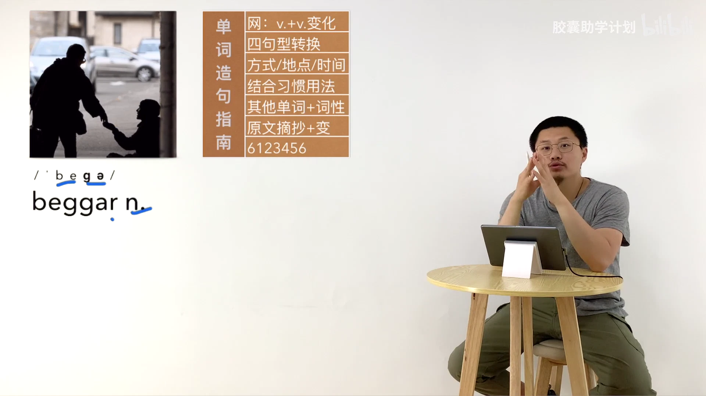

文字识别：单词造句指南 / 网：v.+v.变化 / 胶囊助学计划 / 四句型转换 / 方式/地点/时间 / 结合习惯用法 / 其他单词+词性 / 原文摘抄+变 / 6123456 / /bega/ / beggar n. / •

### 画面 00:00:55

文字识别：单词造句指南 / 网：v.+v.变化 / 胶囊助学计划 / 四句型转换 / 方式/地点/时间 / 结合习惯用法 / 其他单词+词性 / 原文摘抄+变 / 6123456 / /bega/ / beggarn / •

### 画面 00:00:57

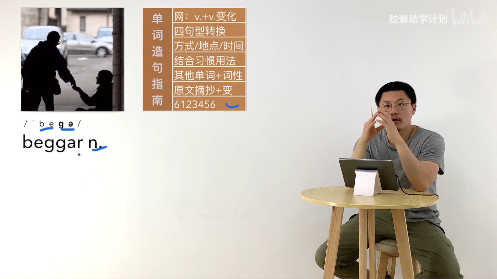

文字识别：单词造句指南 / 网：v.+v.变化 / 胶囊助学计划 / 四句型转换 / 方式/地点/时间 / 结合习惯用法 / 其他单词+词性 / 原文摘抄+变 / 6123456 / /bega/ / beggar n / •

## 00:01:00–00:01:30

比如说，它的意思叫乞丐。最常见的意思就是最常见可以放置的位置，应该是我们的主语和宾语的位置，也就是一和三的位置，对吧？OK，好，那我们接下来呢，想另一个思路，就是结合其他的习惯用法。在之前的视频当中，已经让各位开始每节课跟着去整理每一课的习惯用法了，对吧？这些习惯用法是能帮助我们去造句的，不管是在写

### 画面 00:01:00

文字识别：单词造句指南 / 网：v.+v.变化 / 胶囊助学计划 / 四句型转换 / 方式/地点/时间 / 结合习惯用法 / 其他单词+词性 / 原文摘抄+变 / 6123456 / /bega/ / beggar n.

### 画面 00:01:05

文字识别：单词造句指南 / 网：v.+v.变化 / 四句型转换 / 方式/地点/时间 / 结合习惯用法 / 其他单词+词性 / 原文摘抄+变 / 6123456 / /bega/ / beggar n. / •

### 画面 00:01:10

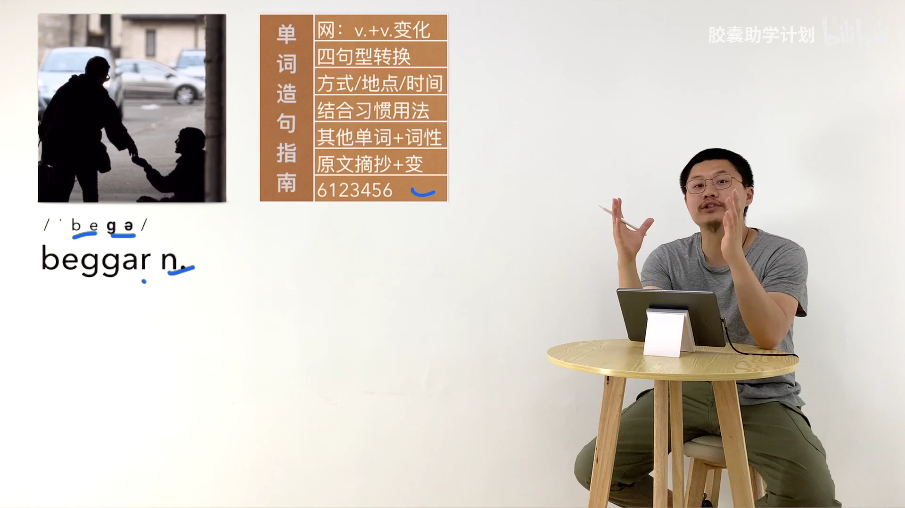

文字识别：单词造句指南 / 网：v.+v.变化 / 胶囊助学计划 / 四句型转换 / 方式/地点/时间 / 结合习惯用法 / 其他单词+词性 / 原文摘抄+变 / 6123456 / /bega/ / beggar n. / •

### 画面 00:01:14

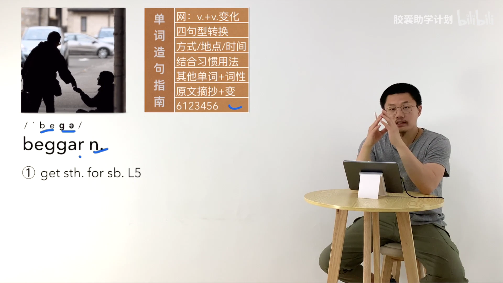

文字识别：单词造句指南 / 网：v.+v.变化 / 胶囊助学计划 / 四句型转换 / 方式/地点/时间 / 结合习惯用法 / 其他单词+词性 / 原文摘抄+变 / 6123456 / /bega/ / beggar n. / • / get sth. for sb. L5

### 画面 00:01:16

文字识别：单词造句指南 / 网：v.+v.变化 / 胶囊助学计划 / 四句型转换 / 方式/地点/时间 / 结合习惯用法 / 其他单词+词性 / 原文摘抄+变 / 6123456 / /bega/ / beggar n. / • / ① / get sth. for sb. L5

### 画面 00:01:18

文字识别：单词造句指南 / 网：v.+v.变化 / 胶囊助学计划 / 四句型转换 / 方式/地点/时间 / 结合习惯用法 / 其他单词+词性 / 原文摘抄+变 / 6123456 / /bega/ / beggar n. / • / get sth. for sb. L5

### 画面 00:01:20

文字识别：单词造句指南 / 网：v.+v.变化 / 胶囊助学计划 / 四句型转换 / 方式/地点/时间 / 结合习惯用法 / 其他单词+词性 / 原文摘抄+变 / 6123456 / /bega/ / beggar n. / • / 1 / get sth. for sb. L5

### 画面 00:01:23

文字识别：单词造句指南 / 网：v.+v.变化 / 胶囊助学计划 / 四句型转换 / 方式/地点/时间 / 结合习惯用法 / 其他单词+词性 / 原文摘抄+变 / 6123456 / /bega/ / beggar n. / • / 1 / get sth. for sb. L5

### 画面 00:01:25

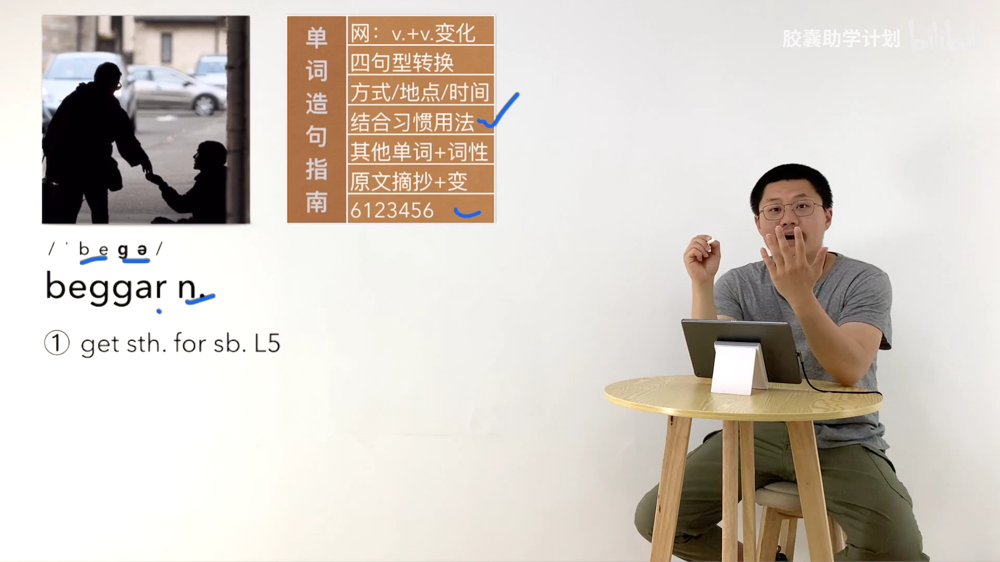

文字识别：单词造句指南 / 网：v.+v.变化 / 胶囊助学计划 / 四句型转换 / 方式/地点/时间 / 结合习惯用法 / 其他单词+词性 / 原文摘抄+变 / 6123456 / /bega/ / beggar n. / • / get sth. for sb. L5

## 00:01:30–00:02:00

作当中、口语当中，对吧？也帮助我们在听力和阅读当中去听懂、读懂对方说的话或者写的文字。那第五课我们学过一个东西叫 get something for somebody，对吧？为某人买了某些东西，或者说得到了、弄到了某些东西。那我们就可以造一个句子叫做 Can we get some food for the beggar? Can we get some food for the beggar? We can get some food for the beggar. We can get some food

### 画面 00:01:30

文字识别：单词造句指南 / 网：v.+v.变化 / 胶囊助学计划 / 四句型转换 / 方式/地点/时间 / 结合习惯用法 / 其他单词+词性 / 原文摘抄+变 / 6123456 / /bega/ / beggar n. / • / 1 / get sth. for sb. L5

### 画面 00:01:35

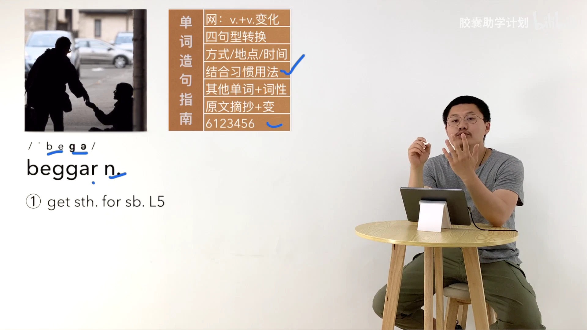

文字识别：单词造句指南 / 网：v.+v.变化 / 胶囊助学计划 / 四句型转换 / 方式/地点/时间 / 结合习惯用法 / 其他单词+词性 / 原文摘抄+变 / 6123456 / /bega/ / beggar n. / • / 1 / get sth.for sb.L5

### 画面 00:01:40

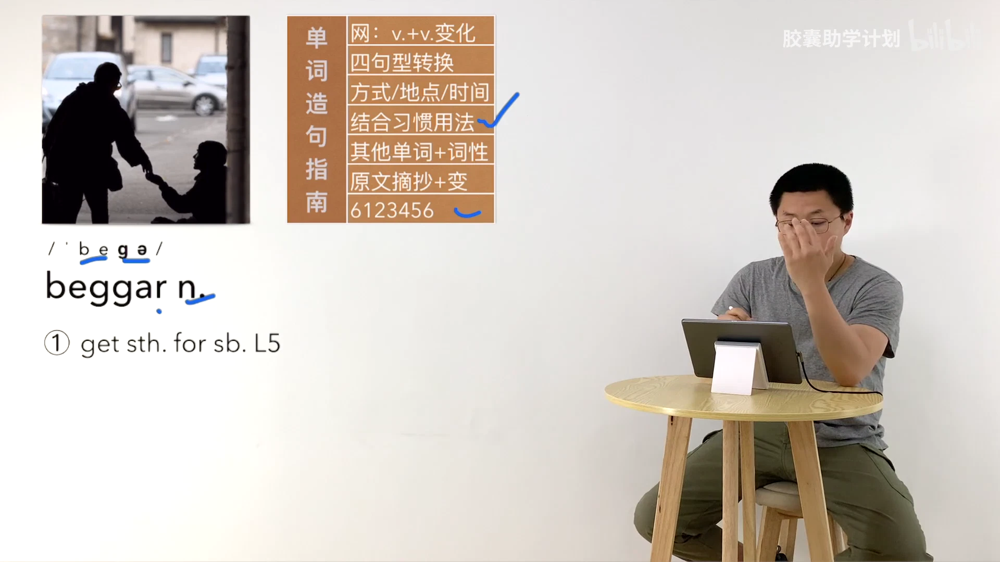

文字识别：单词造句指南 / 网：v.+v.变化 / 胶囊助学计划 / 四句型转换 / 方式/地点/时间 / 结合习惯用法 / 其他单词+词性 / 原文摘抄+变 / 6123456 / /bega/ / beggar n. / ① / get sth. for sb. L5

### 画面 00:01:42

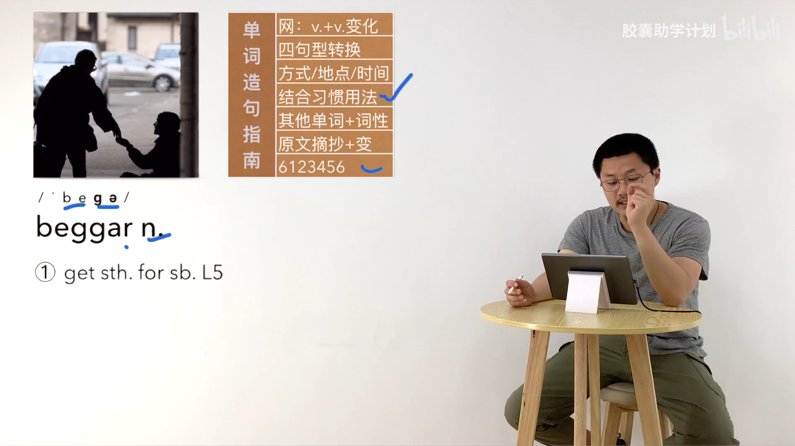

文字识别：单词造句指南 / 网：v.+v.变化 / 胶囊助学计划 / 四句型转换 / 方式/地点/时间 / 结合习惯用法 / 其他单词+词性 / 原文摘抄+变 / 6123456 / /bega/ / beggar n. / • / 1 / get sth.for sb.L5

### 画面 00:01:45

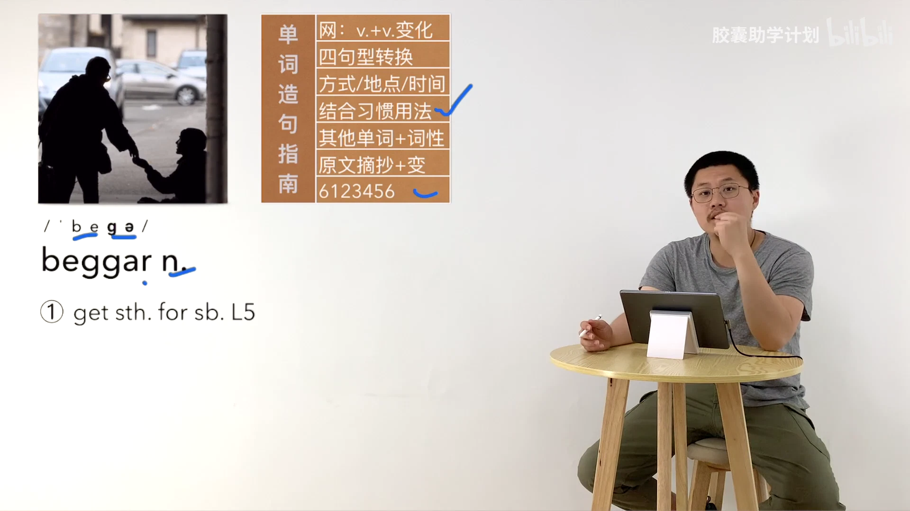

文字识别：单词造句指南 / 网：v.+v.变化 / 胶囊助学计划 / 四句型转换 / 方式/地点/时间 / 结合习惯用法 / 其他单词+词性 / 原文摘抄+变 / 6123456 / /bega/ / beggar n. / • / get sth.for sb.L5 / D

### 画面 00:01:49

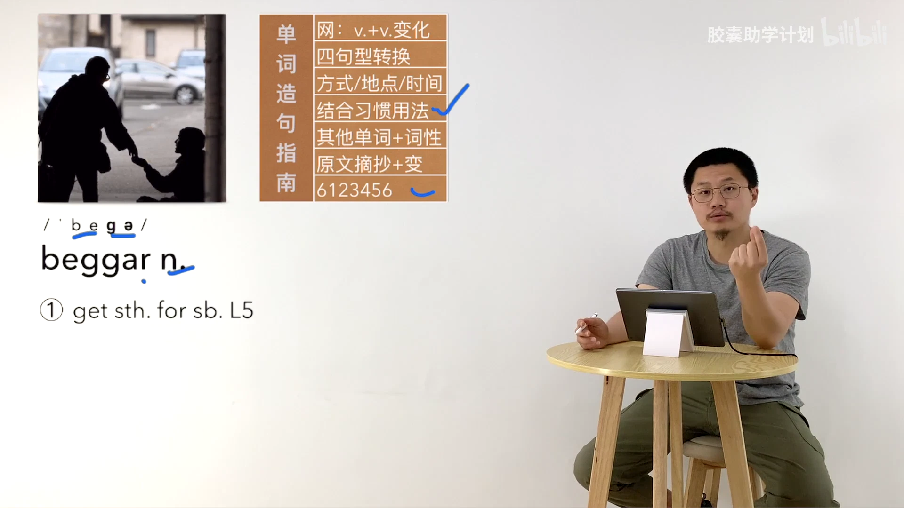

文字识别：单词造句指南 / 网：v.+v.变化 / 胶囊助学计划 / 四句型转换 / 方式/地点/时间 / 结合习惯用法 / 其他单词+词性 / 原文摘抄+变 / 6123456 / /bega/ / beggar n. / • / get sth. for sb. L5

### 画面 00:01:51

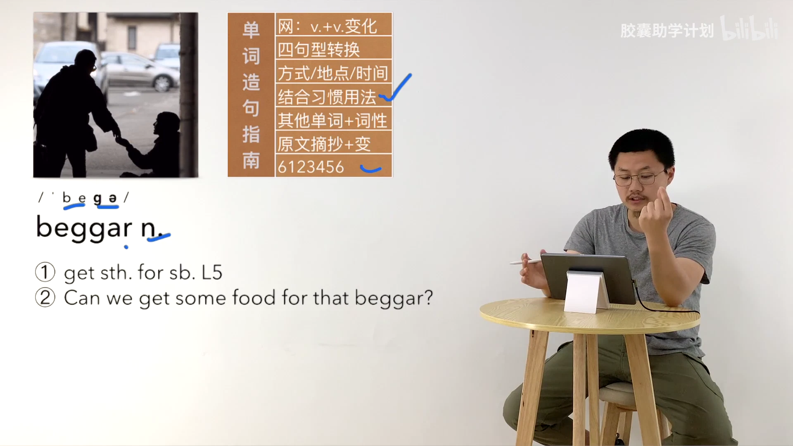

文字识别：单词造句指南 / 网：v.+v.变化 / 胶囊助学计划 / 四句型转换 / 方式/地点/时间 / 结合习惯用法 / 其他单词+词性 / 原文摘抄+变 / 6123456 / /bega/ / beggar n. / • / 1 / get sth.for sb.L5 /  Can we get some food for that beggar? / 2

### 画面 00:01:53

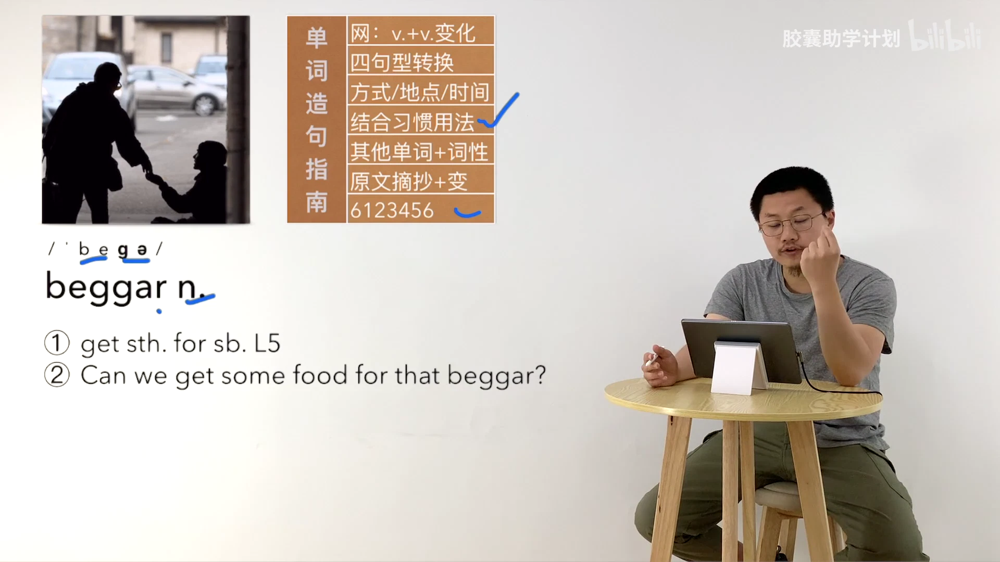

文字识别：单词造句指南 / 网：v.+v.变化 / 胶囊助学计划 / 四句型转换 / 方式/地点/时间 / 结合习惯用法 / 其他单词+词性 / 原文摘抄+变 / 6123456 / /bega/ / beggar n. / • / 1 / get sth.for sb.L5 /  Can we get some food for that beggar? / 2

### 画面 00:01:55

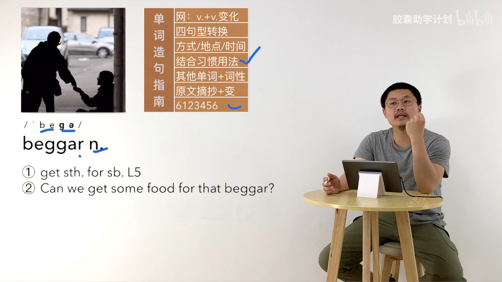

文字识别：单词造句指南 / 网：v.+v.变化 / 胶囊助学计划 / 四句型转换 / 方式/地点/时间 / 结合习惯用法 / 其他单词+词性 / 原文摘抄+变 / 6123456 / /bega/ / beggar n. / • / ① / get sth.for sb.L5 /  Can we get some food for that beggar? / 2

### 画面 00:01:58

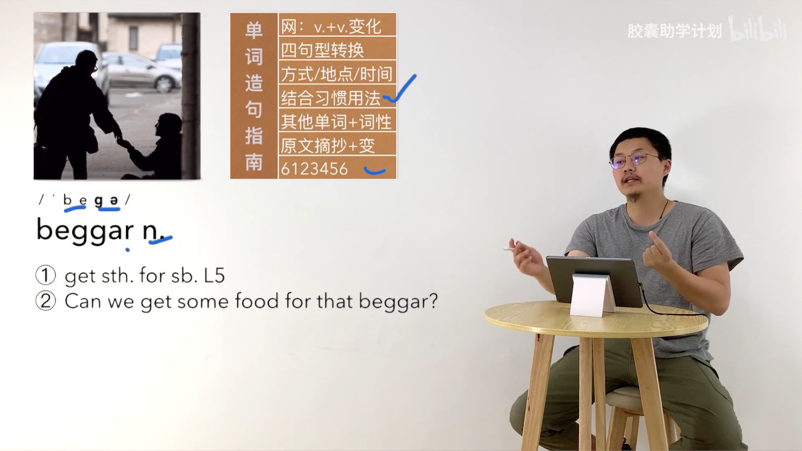

文字识别：单词造句指南 / 网：v.+v.变化 / 胶囊助学计划 / 四句型转换 / 方式/地点/时间 / 结合习惯用法 / 其他单词+词性 / 原文摘抄+变 / 6123456 / /bega/ / beggar n. / ① / get sth.for sb.L5 /  Can we get some food for that beggar? / 2

## 00:02:00–00:02:30

食物吗？He is hungry.他非常的饿了。OK，接下来我们在第四课文章的结尾还学到了一个习惯用法，叫做find加something一个名词再加一个形容词，就是觉得某件事情或某个东西啊是什么样子的，认为某件事情是什么样子的。OK，那我们可以造一个句子叫做I find that beggar interesting.哎，我觉得那个

### 画面 00:02:00

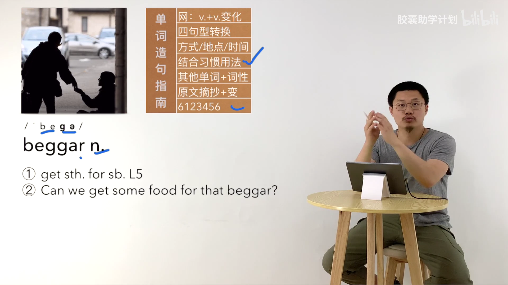

文字识别：单词造句指南 / 网：v.+v.变化 / 胶囊助学计划 / 四句型转换 / 方式/地点/时间 / 结合习惯用法 / 其他单词+词性 / 原文摘抄+变 / 6123456 / /bega/ / beggar n. / • / get sth.for sb.L5 /  Can we get some food for that beggar? / 2

### 画面 00:02:02

文字识别：单词造句指南 / 网：v.+v.变化 / 胶囊助学计划 / 四句型转换 / 方式/地点/时间 / 结合习惯用法 / 其他单词+词性 / 原文摘抄+变 / 6123456 / /bega/ / beggar n. / • / 1 / get sth.for sb.L5 /  Can we get some food for that beggar? / 2）

### 画面 00:02:04

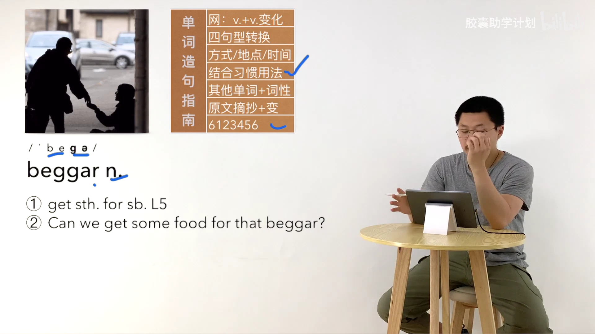

文字识别：单词造句指南 / 网：v.+v.变化 / 胶囊助学计划 / 四句型转换 / 方式/地点/时间 / 结合习惯用法 / 其他单词+词性 / 原文摘抄+变 / 6123456 / /bega/ / beggar n. / ① / get sth.for sb.L5 /  Can we get some food for that beggar? / 2

### 画面 00:02:06

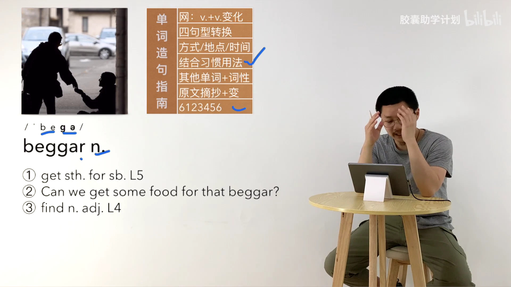

文字识别：单词造句指南 / 网：v.+v.变化 / 胶囊助学计划 / 四句型转换 / 方式/地点/时间 / 结合习惯用法 / 其他单词+词性 / 原文摘抄+变 / 6123456 / /bega/ / beggar n. / get sth.for sb. L5 / Can we get some food for that beggar? / 2 / find n. adj. L4

### 画面 00:02:08

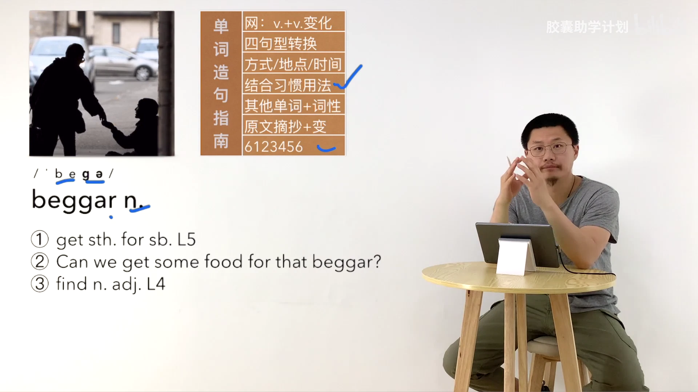

文字识别：单词造句指南 / 网：v.+v.变化 / 胶囊助学计划 / 四句型转换 / 方式/地点/时间 / 结合习惯用法 / 其他单词+词性 / 原文摘抄+变 / 6123456 / /bega/ / beggar n. / • / get sth. for sb.L5 / Can we get some food for that beggar? / 2 / find n. adj. L4

### 画面 00:02:10

文字识别：单词造句指南 / 网：v.+v.变化 / 四句型转换 / 方式/地点/时间 / 结合习惯用法 / 其他单词+词性 / 原文摘抄+变 / 6123456 / /bega/ / beggar n. / • / ① / get sth.for sb.L5 / Can we get some food for that beggar? / 2 / find n.adj. L4

### 画面 00:02:15

文字识别：单词造句指南 / 网：v.+v.变化 / 胶囊助学计划 / 四句型转换 / 方式/地点/时间 / 结合习惯用法 / 其他单词+词性 / 原文摘抄+变 / 6123456 / /bega/ / beggar n. / • / get sth.for sb.L5 / Can we get some food for that beggar? / 2 / find n. adj. L4

### 画面 00:02:20

文字识别：单词造句指南 / 网：v.+v.变化 / 胶囊助学计划 / 四句型转换 / 方式/地点/时间 / 结合习惯用法 / 其他单词+词性 / 原文摘抄+变 / 6123456 / /bega/ / beggar n. / • / ①get sth.for sb.L5 /  Can we get some food for that beggar? / 2 / find n. adj. L4

### 画面 00:02:24

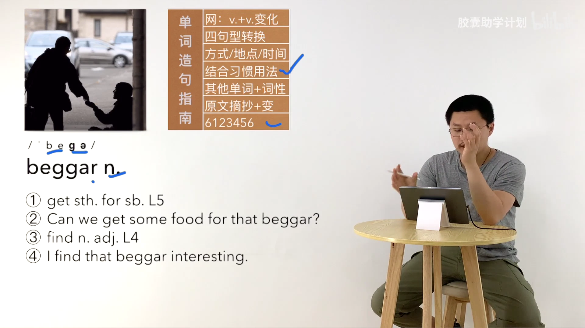

文字识别：单词造句指南 / 网：v.+v.变化 / 胶囊助学计划 / 四句型转换 / 方式/地点/时间 / 结合习惯用法 / 其他单词+词性 / 原文摘抄+变 / 6123456 / /bega/ / beggar n. / • / ①get sth.for sb.L5 / Can we get some food for that beggar? / 2 / find n.adj. L4 / 3 / ④I find that beggar interesting.

### 画面 00:02:26

文字识别：单词造句指南 / 网：v.+v.变化 / 胶囊助学计划 / 四句型转换 / 方式/地点/时间 / 结合习惯用法 / 其他单词+词性 / 原文摘抄+变 / 6123456 / /bega/ / beggar n. / • / ① / get sth. for sb.L5 / Can we get some food for that beggar? / find n.adj. L4 / ④I find that beggar interesting.

### 画面 00:02:29

文字识别：单词造句指南 / 网：v.+v.变化 / 四句型转换 / 方式/地点/时间 / 结合习惯用法 / 其他单词+词性 / 原文摘抄+变 / 6123456 / /bega/ / beggar n. / ① / get sth.for sb.L5 / Can we get some food for that beggar? / 2 / find n.adj. L4 /  I find that beggar interesting. / 4）

## 00:02:30–00:03:00

乞丐吧还挺有意思的。I find that beggar interesting.那我接下来肯定句有了，我们是不是就可以进行四句型转化了？Do you find that beggar interesting? Why do you find that beggar interesting? Okay,你为什么觉得那个乞丐很有意思呢？Okay, very good.好，这是我们在这个地方造句运用到的一些小指南。Okay,下一个单词跟我读一下。这个单词我们在新一学过很多次了。

### 画面 00:02:31

文字识别：单词造句指南 / 网：v.+v.变化 / 四句型转换 / 方式/地点/时间 / 结合习惯用法 / 其他单词+词性 / 原文摘抄+变 / 6123456 / /bega/ / beggar n / • / ①get sth.for sb.L5 / Can we get some food for that beggar? / 2 / find n. adj. L4 /  I find that beggar interesting. / 4

### 画面 00:02:33

文字识别：单词造句指南 / 网：v.+v.变化 / 胶囊助学计划 / 四句型转换 / 方式/地点/时间 / 结合习惯用法 / 其他单词+词性 / 原文摘抄+变 / 6123456 / /bega/ / beggar n / • / get sth.for sb.L5 / Can we get some food for that beggar? / find n. adj. L4 /  I find that beggar interesting. / 4）

### 画面 00:02:35

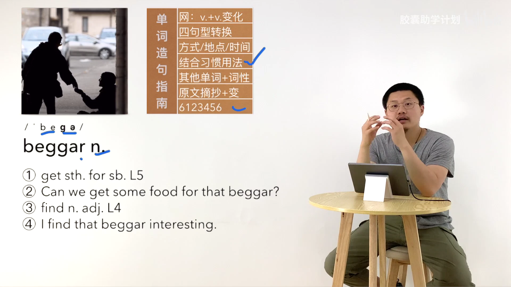

文字识别：单词造句指南 / 网：v.+v.变化 / 四句型转换 / 方式/地点/时间 / 结合习惯用法 / 其他单词+词性 / 原文摘抄+变 / 6123456 / /bega/ / beggar n. / ①get sth.for sb. L5 / Can we get some food for that beggar? / find n. adj. L4 /  I find that beggar interesting. / 4）

### 画面 00:02:37

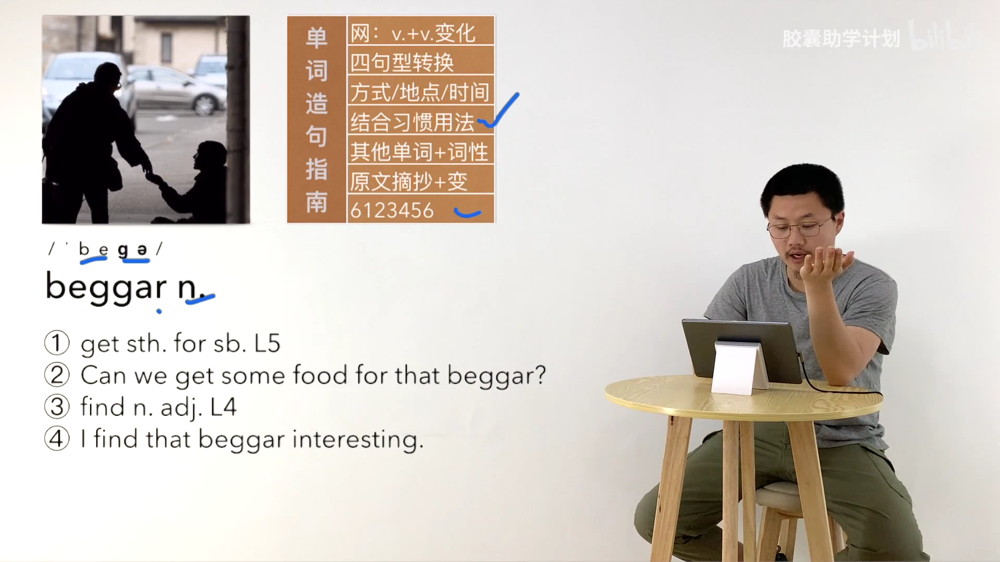

文字识别：单词造句指南 / 网：v.+v.变化 / 胶囊助学计划 / 四句型转换 / 方式/地点/时间 / 结合习惯用法 / 其他单词+词性 / 原文摘抄+变 / 6123456 / /bega/ / beggar n. / • / ① / get sth. for sb.L5 / Can we get some food for that beggar? / find n. adj. L4 /  I find that beggar interesting.

### 画面 00:02:39

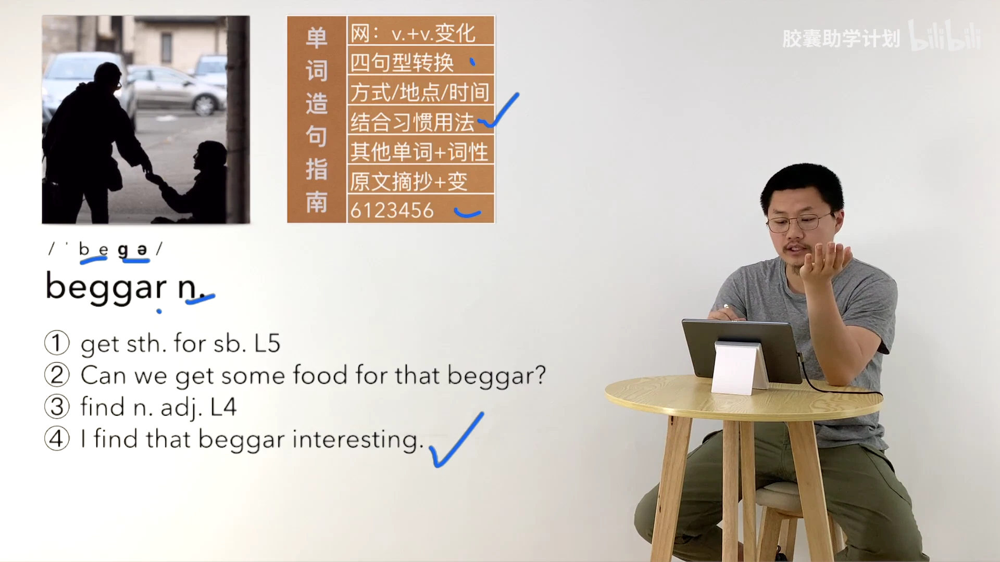

文字识别：单词造句指南 / 网：v.+v.变化 / 胶囊助学计划 / 四句型转换 / 方式/地点/时间 / 结合习惯用法 / 其他单词+词性 / 原文摘抄+变 / 6123456 / /bega/ / beggar n. / • / ① / get sth.for sb.L5 / Can we get some food for that beggar? / find n.adj. L4 /  I find that beggar interesting. / 4）

### 画面 00:02:41

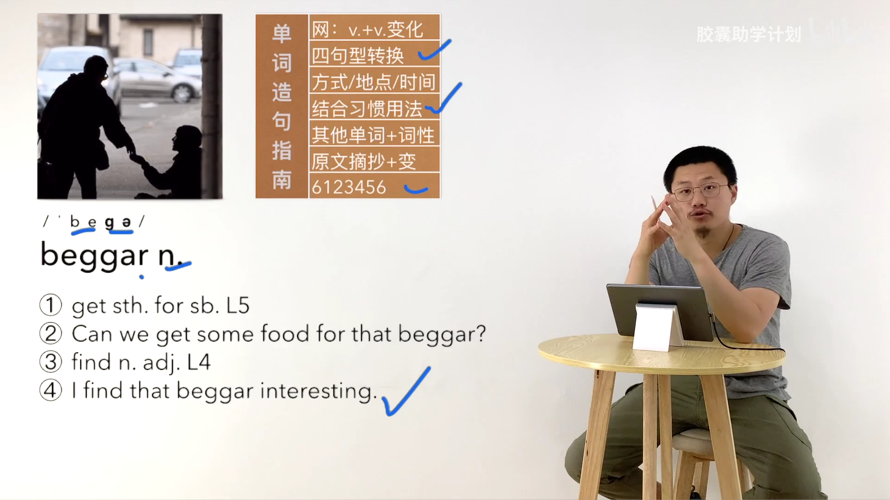

文字识别：单词造句指南 / 网：v.+v.变化 / 胶囊助学计划 / 四句型转换 / 方式/地点/时间 / 结合习惯用法 / 其他单词+词性 / 原文摘抄+变 / 6123456 / /bega/ / beggar n. / ①get sth.for sb.L5 / Can we get some food for that beggar? / 2 / find n.adj. L4 /  I find that beggar interesting. / 4

### 画面 00:02:45

文字识别：单词造句指南 / 网：v.+v.变化 / 四句型转换 / 方式/地点/时间 / 结合习惯用法 / 其他单词+词性 / 原文摘抄+变 / 6123456 / /bega/ / beggar n. / ①get sth.for sb.L5 / Can we get some food for that beggar? / 2 / find n.adj. L4 /  I find that beggar interesting.

### 画面 00:02:50

文字识别：单词造句指南 / 网：v.+v.变化 / 四句型转换 / 方式/地点/时间 / 结合习惯用法 / 其他单词+词性 / 原文摘抄+变 / 6123456 / /bega/ / beggar n. / get sth.for sb.L5 / Can we get some food for that beggar? / find n. adj. L4 /  I find that beggar interesting. / 4

### 画面 00:02:52

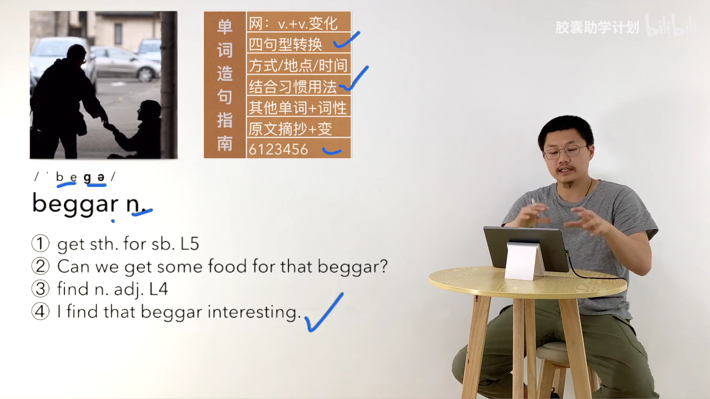

文字识别：单词造句指南 / 网：v.+v.变化 / 胶囊助学计划 / 四句型转换 / 方式/地点/时间 / 结合习惯用法 / 其他单词+词性 / 原文摘抄+变 / 6123456 / /bega/ / beggar n. / ① / get sth.for sb.L5 / Can we get some food for that beggar? / find n.adj. L4 / 3 /  I find that beggar interesting. / 4）

### 画面 00:02:55

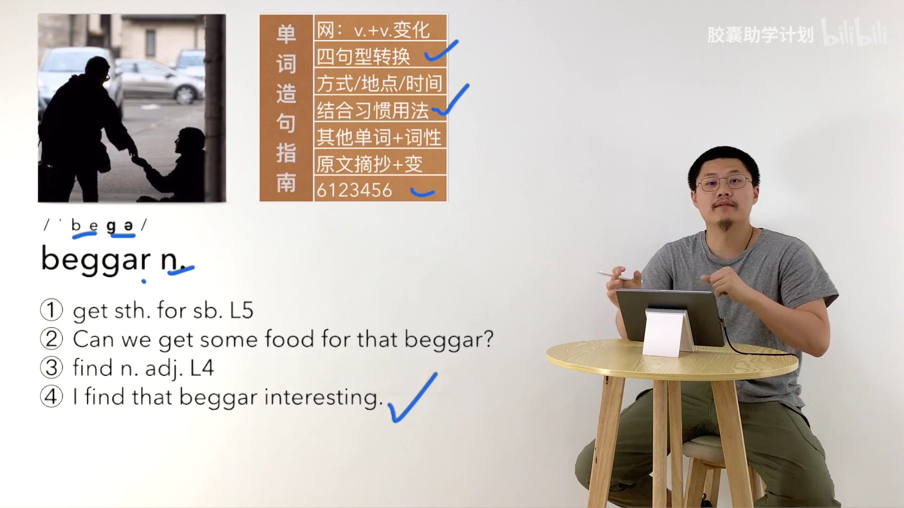

文字识别：单词造句指南 / 网：v.+v.变化 / 胶囊助学计划 / 四句型转换 / 方式/地点/时间 / 结合习惯用法 / 其他单词+词性 / 原文摘抄+变 / 6123456 / /bega/ / beggar n. / ①get sth.for sb.L5 / Can we get some food for that beggar? / 2 / find n.adj. L4 / 3 / ④ I find that beggar interesting.

### 画面 00:02:57

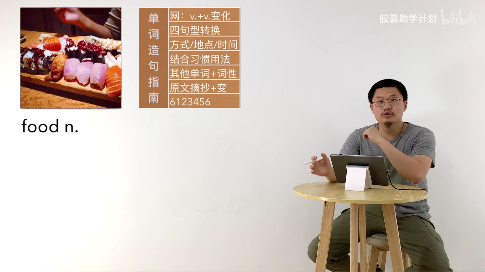

文字识别：单词造句指南 / 网：v.+v.变化 / 胶囊助学计划 / 四句型转换 / 方式/地点/时间 / 结合习惯用法 / 其他单词+词性 / 原文摘抄+变 / 6123456 / food n.

### 画面 00:02:59

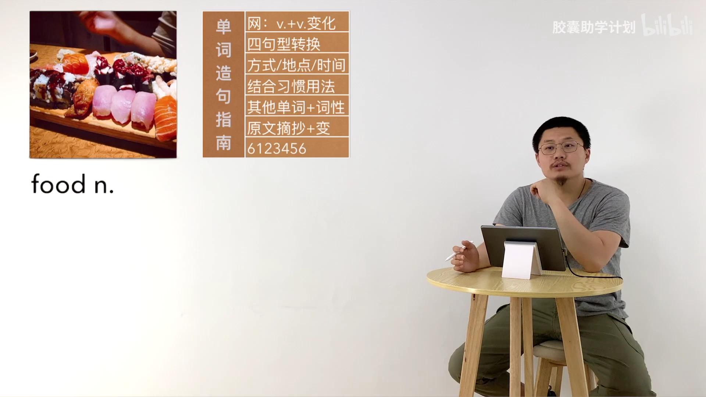

文字识别：单词造句指南 / 网：v.+v.变化 / 胶囊助学计划 / 四句型转换 / 方式/地点/时间 / 结合习惯用法 / 其他单词+词性 / 原文摘抄+变 / 6123456 / food n.

## 00:03:00–00:03:30

读一下 food food 食物的意思。好，名词我们自然而然要找的是动词，那动词必然会有一个问题，叫怎么找？我先说各位不要怎么找，各位记住这个事儿啊，您不要自己在汉语当中去想说食物，然后说想到了一个汉语当中的动词，然后开始拿手机字典或者说上网去查这个动词对应的

### 画面 00:03:01

文字识别：单词造句指南 / 网：v.+v.变化 / 胶囊助学计划 / 四句型转换 / 方式/地点/时间 / 结合习惯用法 / 其他单词+词性 / 原文摘抄+变 / 6123456 / food n.

### 画面 00:03:03

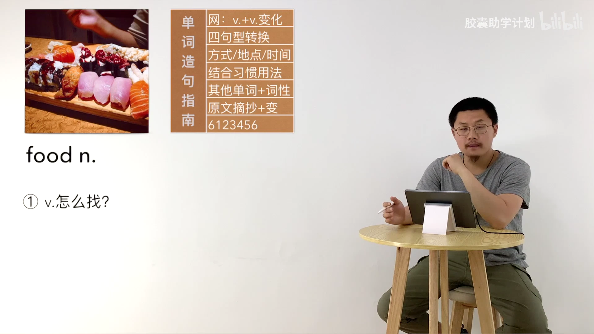

文字识别：单词造句指南 / 网：v.+v.变化 / 胶囊助学计划 / 四句型转换 / 方式/地点/时间 / 结合习惯用法 / 其他单词+词性 / 原文摘抄+变 / 6123456 / food n. / v.怎么找?

### 画面 00:03:05

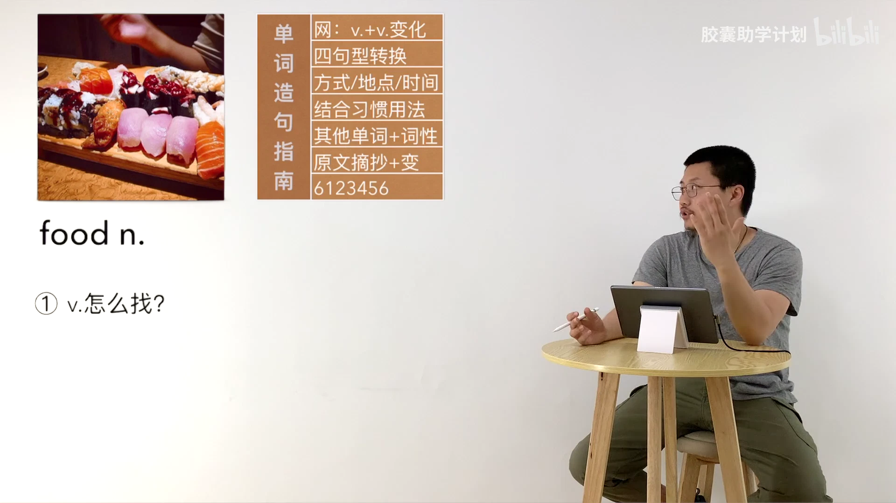

文字识别：单词造句指南 / 网：v.+v.变化 / 胶囊助学计划 / 四句型转换 / 方式/地点/时间 / 结合习惯用法 / 其他单词+词性 / 原文摘抄+变 / 6123456 / food n. / v.怎么找?

### 画面 00:03:07

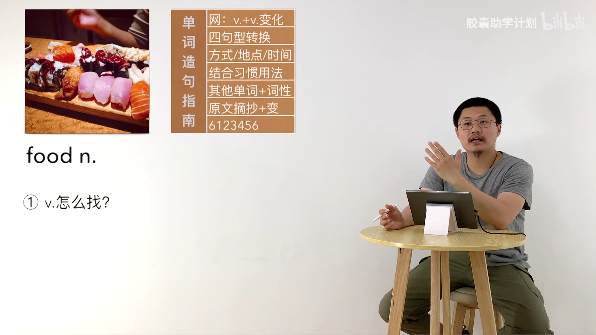

文字识别：单词造句指南 / 网：v.+v.变化 / 胶囊助学计划 / 四句型转换 / 方式/地点/时间 / 结合习惯用法 / 其他单词+词性 / 原文摘抄+变 / 6123456 / food n. / v.怎么找?

### 画面 00:03:10

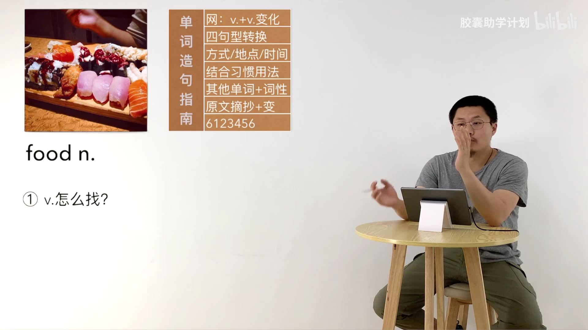

文字识别：单词造句指南 / 网：v.+v.变化 / 胶囊助学计划 / 四句型转换 / 方式/地点/时间 / 结合习惯用法 / 其他单词+词性 / 原文摘抄+变 / 6123456 / food n. / v.怎么找?

### 画面 00:03:12

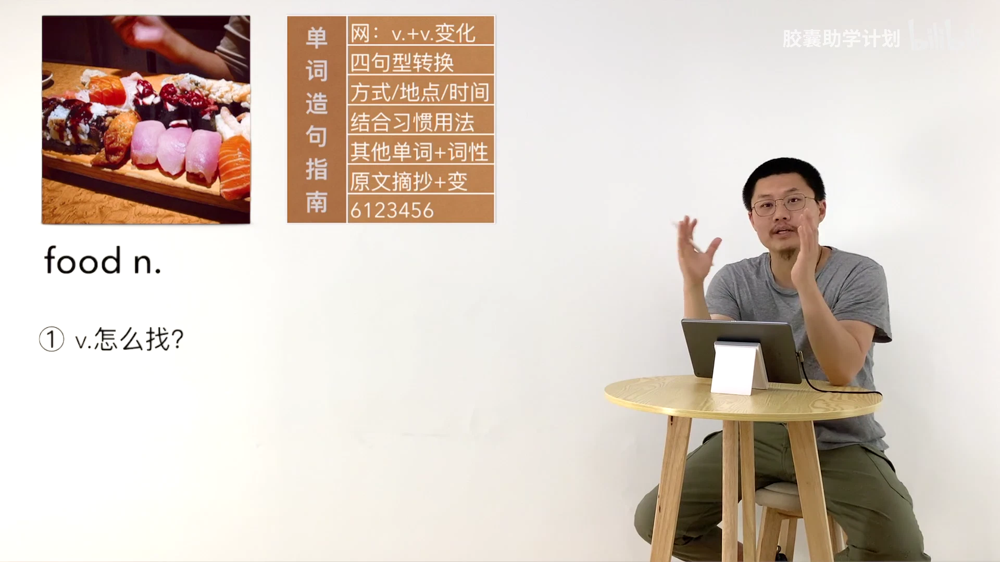

文字识别：单词造句指南 / 网：v.+v.变化 / 胶囊助学计划 / 四句型转换 / 方式/地点/时间 / 结合习惯用法 / 其他单词+词性 / 原文摘抄+变 / 6123456 / food n. / v.怎么找?

### 画面 00:03:15

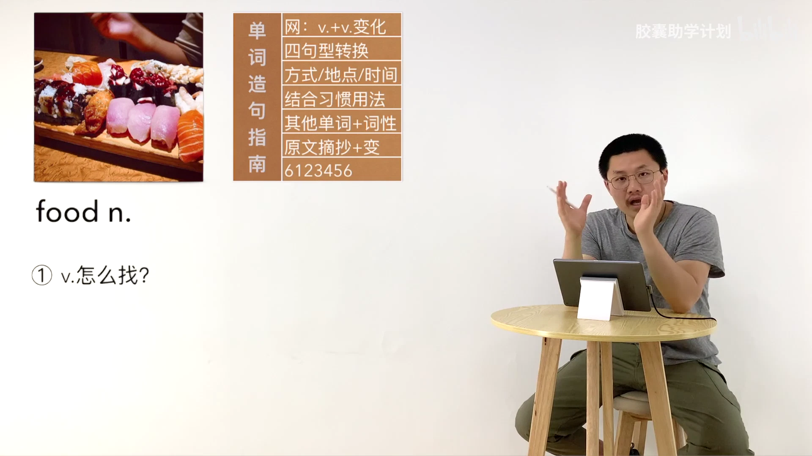

文字识别：单词造句指南 / 网：v.+v.变化 / 胶囊助学计划 / 四句型转换 / 方式/地点/时间 / 结合习惯用法 / 其他单词+词性 / 原文摘抄+变 / 6123456 / food n. / v.怎么找?

### 画面 00:03:18

文字识别：单词造句指南 / 网：v.+v.变化 / 胶囊助学计划 / 四句型转换 / 方式/地点/时间 / 结合习惯用法 / 其他单词+词性 / 原文摘抄+变 / 6123456 / food n. / v.怎么找?

### 画面 00:03:20

文字识别：单词造句指南 / 网：v.+v.变化 / 胶囊助学计划 / 四句型转换 / 方式/地点/时间 / 结合习惯用法 / 其他单词+词性 / 原文摘抄+变 / 6123456 / food n. / v.怎么找?

### 画面 00:03:25

文字识别：单词造句指南 / 网：v.+v.变化 / 四句型转换 / 方式/地点/时间 / 结合习惯用法 / 其他单词+词性 / 原文摘抄+变 / 6123456 / food n. / v.怎么找?

## 00:03:30–00:04:00

英文长成什么样子，然后拿它去造句。这样不是说不行，是初期来说错误率非常的高，因为汉语的动词和英文的动词可能不是一一对应的。于是呢，您觉得汉语这句话一点问题没有，但是你把这句汉语的动词变成了英文对应的那个动词了之后，再带进去，往往可能是错的。我举一个非常简单的例子，比如说 make 这个单词，

### 画面 00:03:30

文字识别：单词造句指南 / 网：v.+v.变化 / 胶囊助学计划 / 四句型转换 / 方式/地点/时间 / 结合习惯用法 / 其他单词+词性 / 原文摘抄+变 / 6123456 / food n. / v.怎么找?

### 画面 00:03:33

文字识别：单词造句指南 / 网：v.+v.变化 / 胶囊助学计划 / 四句型转换 / 方式/地点/时间 / 结合习惯用法 / 其他单词+词性 / 原文摘抄+变 / 6123456 / food n. / v.怎么找?

### 画面 00:03:35

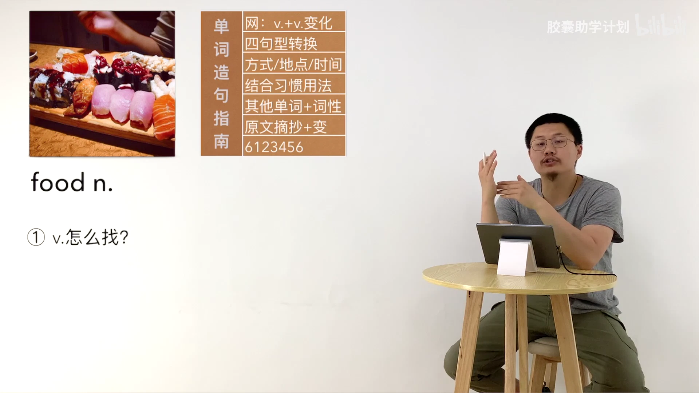

文字识别：单词造句指南 / 网：v.+v.变化 / 胶囊助学计划 / 四句型转换 / 方式/地点/时间 / 结合习惯用法 / 其他单词+词性 / 原文摘抄+变 / 6123456 / food n. / v.怎么找?

### 画面 00:03:40

文字识别：单词造句指南 / 网：v.+v.变化 / 胶囊助学计划 / 四句型转换 / 方式/地点/时间 / 结合习惯用法 / 其他单词+词性 / 原文摘抄+变 / 6123456 / food n. / v.怎么找?

### 画面 00:03:45

文字识别：单词造句指南 / 网：v.+v.变化 / 胶囊助学计划 / 四句型转换 / 方式/地点/时间 / 结合习惯用法 / 其他单词+词性 / 原文摘抄+变 / 6123456 / food n. / v.怎么找?

### 画面 00:03:47

文字识别：单词造句指南 / 网：v.+v.变化 / 胶囊助学计划 / 四句型转换 / 方式/地点/时间 / 结合习惯用法 / 其他单词+词性 / 原文摘抄+变 / 6123456 / food n. / v.怎么找?

### 画面 00:03:50

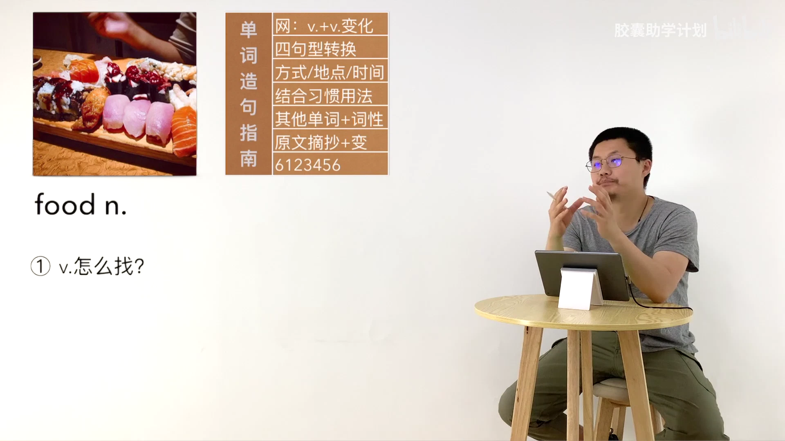

文字识别：单词造句指南 / 网：v.+v.变化 / 胶囊助学计划 / 四句型转换 / 方式/地点/时间 / 结合习惯用法 / 其他单词+词性 / 原文摘抄+变 / 6123456 / food n. / v.怎么找?

### 画面 00:03:52

文字识别：单词造句指南 / 网：v.+v.变化 / 胶囊助学计划 / 四句型转换 / 方式/地点/时间 / 结合习惯用法 / 其他单词+词性 / 原文摘抄+变 / 6123456 / food n. / v.怎么找?

### 画面 00:03:55

文字识别：单词造句指南 / 网：v.+v.变化 / 胶囊助学计划 / 四句型转换 / 方式/地点/时间 / 结合习惯用法 / 其他单词+词性 / 原文摘抄+变 / 6123456 / food n. / v.怎么找?

## 00:04:00–00:04:30

它的意思叫做做啊。比如说我们新一，我没有记错的话，应该是三十九课学过这个单词，叫做 make，叫做做啊。当然，它也可以说是制作的意思。那你说做家庭作业，你说 make my homework，这个老外基本上听起来就会非常的懵了，因为他们习惯说的是 do my homework，而不是 make，对吧？所以这是我们经常容易犯的一个错误。好，那回到这个地方，我们应该如何去找呢？各位老生常谈，往

### 画面 00:04:00

文字识别：单词造句指南 / 网：v.+v.变化 / 胶囊助学计划 / 四句型转换 / 方式/地点/时间 / 结合习惯用法 / 其他单词+词性 / 原文摘抄+变 / 6123456 / food n. / v.怎么找?

### 画面 00:04:03

文字识别：单词造句指南 / 网：v.+v.变化 / 胶囊助学计划 / 四句型转换 / 方式/地点/时间 / 结合习惯用法 / 其他单词+词性 / 原文摘抄+变 / 6123456 / food n. / v.怎么找?

### 画面 00:04:05

文字识别：单词造句指南 / 网：v.+v.变化 / 胶囊助学计划 / 四句型转换 / 方式/地点/时间 / 结合习惯用法 / 其他单词+词性 / 原文摘抄+变 / 6123456 / food n. / v.怎么找?

### 画面 00:04:08

文字识别：单词造句指南 / 网：v.+v.变化 / 胶囊助学计划 / 四句型转换 / 方式/地点/时间 / 结合习惯用法 / 其他单词+词性 / 原文摘抄+变 / 6123456 / food n. / v.怎么找?

### 画面 00:04:10

文字识别：单词造句指南 / 网：v.+v.变化 / 胶囊助学计划 / 四句型转换 / 方式/地点/时间 / 结合习惯用法 / 其他单词+词性 / 原文摘抄+变 / 6123456 / food n. / v.怎么找?

### 画面 00:04:15

文字识别：单词造句指南 / 网：v.+v.变化 / 四句型转换 / 方式/地点/时间 / 结合习惯用法 / 其他单词+词性 / 原文摘抄+变 / 6123456 / food n. / v.怎么找?

### 画面 00:04:18

文字识别：单词造句指南 / 网：v.+v.变化 / 胶囊助学计划 / 四句型转换 / 方式/地点/时间 / 结合习惯用法 / 其他单词+词性 / 原文摘抄+变 / 6123456 / food n. / v.怎么找?

### 画面 00:04:20

文字识别：单词造句指南 / 网：v.+v.变化 / 胶囊助学计划 / 四句型转换 / 方式/地点/时间 / 结合习惯用法 / 其他单词+词性 / 原文摘抄+变 / 6123456 / food n. / v.怎么找?

### 画面 00:04:23

文字识别：单词造句指南 / 网：v.+v.变化 / 胶囊助学计划 / 四句型转换 / 方式/地点/时间 / 结合习惯用法 / 其他单词+词性 / 原文摘抄+变 / 6123456 / food n. / v.怎么找?

### 画面 00:04:25

文字识别：单词造句指南 / 网：v.+v.变化 / 四句型转换 / 方式/地点/时间 / 结合习惯用法 / 其他单词+词性 / 原文摘抄+变 / 6123456 / food n. / v.怎么找?

### 画面 00:04:27

文字识别：单词造句指南 / 网：v.+v.变化 / 胶囊助学计划 / 四句型转换 / 方式/地点/时间 / 结合习惯用法 / 其他单词+词性 / 原文摘抄+变 / 6123456 / food n. / v.怎么找?

## 00:04:30–00:05:00

前翻就找我们之前学过的那些单词和习惯用法，是有动词的部分就往前去找就可以了。OK，好，比如说我们之前学到了叫做 spoiled，第一课我们就学到了叫做 the cook spoiled the food at the soup，对吧？厨子毁了这个汤，那我们就可以把这个毁了拿过来说 he spoiled all the food，他毁了所有的食物，肯定句有了四句型转化，did he

### 画面 00:04:30

文字识别：单词造句指南 / 网：v.+v.变化 / 胶囊助学计划 / 四句型转换 / 方式/地点/时间 / 结合习惯用法 / 其他单词+词性 / 原文摘抄+变 / 6123456 / food n. / v.怎么找?

### 画面 00:04:33

文字识别：单词造句指南 / 网：v.+v.变化 / 胶囊助学计划 / 四句型转换 / 方式/地点/时间 / 结合习惯用法 / 其他单词+词性 / 原文摘抄+变 / 6123456 / food n. / v.怎么找?

### 画面 00:04:35

文字识别：单词造句指南 / 网：v.+v.变化 / 胶囊助学计划 / 四句型转换 / 方式/地点/时间 / 结合习惯用法 / 其他单词+词性 / 原文摘抄+变 / 6123456 / food n. / v.怎么找?

### 画面 00:04:37

文字识别：单词造句指南 / 网：v.+v.变化 / 胶囊助学计划 / 四句型转换 / 方式/地点/时间 / 结合习惯用法 / 其他单词+词性 / 原文摘抄+变 / 6123456 / food n. / v.怎么找?

### 画面 00:04:40

文字识别：单词造句指南 / 网：v.+v.变化 / 胶囊助学计划 / 四句型转换 / 方式/地点/时间 / 结合习惯用法 / 其他单词+词性 / 原文摘抄+变 / 6123456 / food n. / v.怎么找? / He spoilt all the food.

### 画面 00:04:42

文字识别：单词造句指南 / 网：v.+v.变化 / 胶囊助学计划 / 四句型转换 / 方式/地点/时间 / 结合习惯用法 / 其他单词+词性 / 原文摘抄+变 / 6123456 / food n. / v.怎么找? / He spoilt all the food.

### 画面 00:04:44

文字识别：单词造句指南 / 网：v.+v.变化 / 四句型转换 / 方式/地点/时间 / 结合习惯用法 / 其他单词+词性 / 原文摘抄+变 / 6123456 / food n. / v.怎么找? / He spoilt all the food.

### 画面 00:04:46

文字识别：单词造句指南 / 网：v.+v.变化 / 胶囊助学计划 / 四句型转换 / 方式/地点/时间 / 结合习惯用法 / 其他单词+词性 / 原文摘抄+变 / 6123456 / food n. / v.怎么找? / He spoilt all the food.

### 画面 00:04:50

文字识别：单词造句指南 / 网：v.+v.变化 / 胶囊助学计划 / 四句型转换 / 方式/地点/时间 / 结合习惯用法 / 其他单词+词性 / 原文摘抄+变 / 6123456 / food n. / v.怎么找? / He spoilt all the food.

### 画面 00:04:55

文字识别：单词造句指南 / 网：v.+v.变化 / 胶囊助学计划 / 四句型转换 / 方式/地点/时间 / 结合习惯用法 / 其他单词+词性 / 原文摘抄+变 / 6123456 / food n. / v.怎么找? / He spoilt all the food.

### 画面 00:04:57

文字识别：单词造句指南 / 网：v.+v.变化 / 胶囊助学计划 / 四句型转换 / 方式/地点/时间 / 结合习惯用法 / 其他单词+词性 / 原文摘抄+变 / 6123456 / food n. / v.怎么找? / He spoilt all the food.

### 画面 00:04:59

文字识别：单词造句指南 / 网：v.+v.变化 / 胶囊助学计划 / 四句型转换 / 方式/地点/时间 / 结合习惯用法 / 其他单词+词性 / 原文摘抄+变 / 6123456 / food n. / v.怎么找? / He spoilt all the food. / Did he spoil all the food?

## 00:05:00–00:05:30

all the food？各位注意要把它换回原形。第三课我们重点讲了这个一般过去时的知识点。接下来我们还可以造一个肯一特殊疑问句，How did he spoil all the food？他是如何把所有这些食物都给毁了的，对吧？来一个，比如说做糊了。Next one, overcooked. OK, next one，下一个单词，pocket。pocket，看一下音标，pocket，pocket，它是一个名词，

### 画面 00:05:01

文字识别：单词造句指南 / 网：v.+v.变化 / 胶囊助学计划 / 四句型转换 / 方式/地点/时间 / 结合习惯用法 / 其他单词+词性 / 原文摘抄+变 / 6123456 / food n. / v.怎么找? / He spoilt all the food. / Did he spoil all the food?

### 画面 00:05:03

文字识别：单词造句指南 / 网：v.+v.变化 / 胶囊助学计划 / 四句型转换 / 方式/地点/时间 / 结合习惯用法 / 其他单词+词性 / 原文摘抄+变 / 6123456 / food n. / v.怎么找? / He spoilt all the food. / Did he spoil all the food?

### 画面 00:05:05

文字识别：单词造句指南 / 网：v.+v.变化 / 四句型转换 / 方式/地点/时间 / 结合习惯用法 / 其他单词+词性 / 原文摘抄+变 / 6123456 / food n. / v.怎么找? / He spoilt all the food. / Did he spoilall the food?

### 画面 00:05:07

文字识别：单词造句指南 / 网：v.+v.变化 / 胶囊助学计划 / 四句型转换 / 方式/地点/时间 / 结合习惯用法 / 其他单词+词性 / 原文摘抄+变 / 6123456 / food n. / v.怎么找? / He spoilt all the food. / Did he spoilall the food?

### 画面 00:05:09

文字识别：单词造句指南 / 网：v.+v.变化 / 胶囊助学计划 / 四句型转换 / 方式/地点/时间 / 结合习惯用法 / 其他单词+词性 / 原文摘抄+变 / 6123456 / food n. / v.怎么找? / He spoilt all the food. / Did he spoil all the food? / How did he spoil all the food?

### 画面 00:05:11

文字识别：单词造句指南 / 网：v.+v.变化 / 四句型转换 / 方式/地点/时间 / 结合习惯用法 / 其他单词+词性 / 原文摘抄+变 / 6123456 / food n. / v.怎么找? / He spoilt all the food. / Did he spoil all the food? / How did he spoil all the food?

### 画面 00:05:14

文字识别：单词造句指南 / 网：v.+v.变化 / 胶囊助学计划 / 四句型转换 / 方式/地点/时间 / 结合习惯用法 / 其他单词+词性 / 原文摘抄+变 / 6123456 / food n. / v.怎么找? / He spoilt all the food. / Did he spoil all the food? / How did he spoil all the food?

### 画面 00:05:16

文字识别：单词造句指南 / 网：v.+v.变化 / 胶囊助学计划 / 四句型转换 / 方式/地点/时间 / 结合习惯用法 / 其他单词+词性 / 原文摘抄+变 / 6123456 / food n. / v.怎么找? / He spoilt all the food. / Did he spoil all the food? / How did he spoil all the food?

### 画面 00:05:18

文字识别：单词造句指南 / 网：v.+v.变化 / 胶囊助学计划 / 四句型转换 / 方式/地点/时间 / 结合习惯用法 / 其他单词+词性 / 原文摘抄+变 / 6123456 / food n. / v.怎么找? / He spoilt all the food. / Did he spoil all the food? / How did he spoil all the food?

### 画面 00:05:20

文字识别：单词造句指南 / 网：v.+v.变化 / 胶囊助学计划 / 四句型转换 / 方式/地点/时间 / 结合习惯用法 / 其他单词+词性 / 原文摘抄+变 / 6123456 / /ppkIt/ / pocket n.

### 画面 00:05:22

文字识别：单词造句指南 / 网：v.+v.变化 / 胶囊助学计划 / 四句型转换 / 方式/地点/时间 / 结合习惯用法 / 其他单词+词性 / 原文摘抄+变 / 6123456 / /ppkIt/ / pocket n.

### 画面 00:05:25

文字识别：单词造句指南 / 网：v.+v.变化 / 胶囊助学计划 / 四句型转换 / 方式/地点/时间 / 结合习惯用法 / 其他单词+词性 / 原文摘抄+变 / 6123456 / /pokIt/ / pocket n.

### 画面 00:05:28

文字识别：单词造句指南 / 网：v.+v.变化 / 胶囊助学计划 / 四句型转换 / 方式/地点/时间 / 结合习惯用法 / 其他单词+词性 / 原文摘抄+变 / 6123456 / /pokit/ / pocket n.

## 00:05:30–00:06:00

还是我们立刻要想六一二三四五六，它能放的位置一三五，这是最常见的。一作为一个主语，我的口袋怎么怎么样了？三作为一个宾语啊，什么什么东西啊？比如说破坏了我的口袋，OK，那我这是随口一说啊。五呢作为一个地点，比如说钱在我的口袋里，这个在口袋里 in my pocket 就变成了一个地点，这是我们造句要用到的。那我先给大家一句话，用一个非常简单新

### 画面 00:05:31

文字识别：单词造句指南 / 网：v.+v.变化 / 胶囊助学计划 / 四句型转换 / 方式/地点/时间 / 结合习惯用法 / 其他单词+词性 / 原文摘抄+变 / 6123456 / /pokIt/ / pocket n. / ①6123456

### 画面 00:05:33

文字识别：单词造句指南 / 网：v.+v.变化 / 胶囊助学计划 / 四句型转换 / 方式/地点/时间 / 结合习惯用法 / 其他单词+词性 / 原文摘抄+变 / 6123456 / /pokIt/ / pocket n. / ①6123456

### 画面 00:05:35

文字识别：单词造句指南 / 网：v.+v.变化 / 四句型转换 / 方式/地点/时间 / 结合习惯用法 / 其他单词+词性 / 原文摘抄+变 / 6123456 / /pokIt/ / pocket n. / ①6123456

### 画面 00:05:40

文字识别：单词造句指南 / 网：v.+v.变化 / 四句型转换 / 方式/地点/时间 / 结合习惯用法 / 其他单词+词性 / 原文摘抄+变 / 6123456 / /pokIt/ / pocket n. / ①6123456

### 画面 00:05:42

文字识别：单词造句指南 / 网：v.+v.变化 / 胶囊助学计划 / 四句型转换 / 方式/地点/时间 / 结合习惯用法 / 其他单词+词性 / 原文摘抄+变 / 6123456 / /pokIt/ / pocket n. / ①6123456

### 画面 00:05:45

文字识别：单词造句指南 / 网：v.+v.变化 / 胶囊助学计划 / 四句型转换 / 方式/地点/时间 / 结合习惯用法 / 其他单词+词性 / 原文摘抄+变 / 6123456 / /pokit/ / pocket n. / ①6123456

### 画面 00:05:49

文字识别：单词造句指南 / 网：v.+v.变化 / 胶囊助学计划 / 四句型转换 / 方式/地点/时间 / 结合习惯用法 / 其他单词+词性 / 原文摘抄+变 / 6123456 / /pokIt/ / pocket n. / ①6123456

### 画面 00:05:51

文字识别：单词造句指南 / 网：v.+v.变化 / 胶囊助学计划 / 四句型转换 / 方式/地点/时间 / 结合习惯用法 / 其他单词+词性 / 原文摘抄+变 / 6123456 / /pokIt/ / pocket n. / ①6123456

### 画面 00:05:54

文字识别：单词造句指南 / 网：v.+v.变化 / 胶囊助学计划 / 四句型转换 / 方式/地点/时间 / 结合习惯用法 / 其他单词+词性 / 原文摘抄+变 / 6123456 / /pokit/ / pocket n. / ①6123456

### 画面 00:05:56

文字识别：单词造句指南 / 网：v.+v.变化 / 胶囊助学计划 / 四句型转换 / 方式/地点/时间 / 结合习惯用法 / 其他单词+词性 / 原文摘抄+变 / 6123456 / /pokIt/ / pocket n. / ①6123456

### 画面 00:05:59

文字识别：单词造句指南 / 网：v.+v.变化 / 胶囊助学计划 / 四句型转换 / 方式/地点/时间 / 结合习惯用法 / 其他单词+词性 / 原文摘抄+变 / 6123456 / /pokIt/ / pocket n. / ①6123456 / There is some money in my pocket.

## 00:06:00–00:06:30

一二十五课学过的句型 there be 句型，叫做 there is some money in my pocket。说哎，Mom， can you give me some money？啊，你能给我一些钱吗？然后你就说 OK， there is some money in my pocket。 Take it yourself，自己去拿吧。哎，我的口袋当中有一些钱，自己去拿吧。 There is some money in my pocket。肯定具有了。您自己下课要做的事情是什么呢？四句型转换，还有一个 next one。接下来我还可以再来一句，叫做 the

### 画面 00:06:01

文字识别：单词造句指南 / 网：v.+v.变化 / 胶囊助学计划 / 四句型转换 / 方式/地点/时间 / 结合习惯用法 / 其他单词+词性 / 原文摘抄+变 / 6123456 / /pokIt/ / pocket n. / ①6123456 / There is some money in my pocket.

### 画面 00:06:05

文字识别：单词造句指南 / 网：v.+v.变化 / 胶囊助学计划 / 四句型转换 / 方式/地点/时间 / 结合习惯用法 / 其他单词+词性 / 原文摘抄+变 / 6123456 / /pokit/ / pocket n. / ①6123456 / There is some money in my pocket.

### 画面 00:06:07

文字识别：单词造句指南 / 网：v.+v.变化 / 胶囊助学计划 / 四句型转换 / 方式/地点/时间 / 结合习惯用法 / 其他单词+词性 / 原文摘抄+变 / 6123456 / /pokIt/ / pocket n. / ①6123456 / There is some money in my pocket.

### 画面 00:06:10

文字识别：单词造句指南 / 网：v.+v.变化 / 胶囊助学计划 / 四句型转换 / 方式/地点/时间 / 结合习惯用法 / 其他单词+词性 / 原文摘抄+变 / 6123456 / /pokit/ / pocket n. / ①6123456 / There is some money in my pocket.

### 画面 00:06:15

文字识别：单词造句指南 / 网：v.+v.变化 / 胶囊助学计划 / 四句型转换 / 方式/地点/时间 / 结合习惯用法 / 其他单词+词性 / 原文摘抄+变 / 6123456 / /pokIt/ / pocket n. / ①6123456 / There is some money in my pocket.

### 画面 00:06:20

文字识别：单词造句指南 / 网：v.+v.变化 / 胶囊助学计划 / 四句型转换 / 方式/地点/时间 / 结合习惯用法 / 其他单词+词性 / 原文摘抄+变 / 6123456 / /pokIt/ / pocket n. / ①6123456 / There is some money in my pocket.

### 画面 00:06:25

文字识别：单词造句指南 / 网：v.+v.变化 / 胶囊助学计划 / 四句型转换 / 方式/地点/时间 / 结合习惯用法 / 其他单词+词性 / 原文摘抄+变 / 6123456 / /pokIt/ / pocket n. / ①6123456 / There is some money in my pocket.

### 画面 00:06:28

文字识别：单词造句指南 / 网：v.+v.变化 / 胶囊助学计划 / 四句型转换 / 方式/地点/时间 / 结合习惯用法 / 其他单词+词性 / 原文摘抄+变 / 6123456 / /pokIt/ / pocket n. / ①6123456 / There is some money in my pocket. / The money is in my pocket.

## 00:06:30–00:07:00

money is in my pocket. 钱在我的口袋当中，肯定句有了。 Where is the money? 是不是就是由这句话变出来的呢？自己去想一下，词性转换。当然，我也可以把它去当成主语，叫做 My pocket is too small. 说我的这个包，我的这个口袋啊太小了。 Very good. 那接下来给大家补充一个非常简单的小的知识点，两个单词放在一起叫做

### 画面 00:06:30

文字识别：单词造句指南 / 网：v.+v.变化 / 四句型转换 / 方式/地点/时间 / 结合习惯用法 / 其他单词+词性 / 原文摘抄+变 / 6123456 / /pokit/ / pocket n. / ①6123456 / There is some money in my pocket. / The money is in my pocket.

### 画面 00:06:33

文字识别：单词造句指南 / 网：v.+v.变化 / 胶囊助学计划 / 四句型转换 / 方式/地点/时间 / 结合习惯用法 / 其他单词+词性 / 原文摘抄+变 / 6123456 / /pokit/ / pocket n. / ①6123456 / There is some money in my pocket. / The money is in my pocket.

### 画面 00:06:35

文字识别：单词造句指南 / 网：v.+v.变化 / 胶囊助学计划 / 四句型转换 / 方式/地点/时间 / 结合习惯用法 / 其他单词+词性 / 原文摘抄+变 / 6123456 / /pokIt/ / pocket n. / ①6123456 / There is some money in my pocket. / The money is in my pocket.

### 画面 00:06:40

文字识别：单词造句指南 / 网：v.+v.变化 / 胶囊助学计划 / 四句型转换 / 方式/地点/时间 / 结合习惯用法 / 其他单词+词性 / 原文摘抄+变 / 6123456 / /pokit/ / pocket n. / ①6123456 / There is some money in my pocket. / The money is in my pocket.

### 画面 00:06:43

文字识别：单词造句指南 / 网：v.+v.变化 / 胶囊助学计划 / 四句型转换 / 方式/地点/时间 / 结合习惯用法 / 其他单词+词性 / 原文摘抄+变 / 6123456 / /pokIt/ / pocket n. / ①6123456 / There is some money in my pocket. / The money is in my pocket. / My pocket is too small. / 4

### 画面 00:06:45

文字识别：单词造句指南 / 网：v.+v.变化 / 四句型转换 / 方式/地点/时间 / 结合习惯用法 / 其他单词+词性 / 原文摘抄+变 / 6123456 / /pokIt/ / pocket n. / ①6123456 / There is some money in my pocket. / The money is in my pocket. / My pocket is too small. / 4

### 画面 00:06:47

文字识别：单词造句指南 / 网：v.+v.变化 / 胶囊助学计划 / 四句型转换 / 方式/地点/时间 / 结合习惯用法 / 其他单词+词性 / 原文摘抄+变 / 6123456 / /pokIt/ / pocket n. / ①6123456 / There is some money in my pocket. / The money is in my pocket. / My pocket is too small. / 4

### 画面 00:06:50

文字识别：单词造句指南 / 网：v.+v.变化 / 胶囊助学计划 / 四句型转换 / 方式/地点/时间 / 结合习惯用法 / 其他单词+词性 / 原文摘抄+变 / 6123456 / /PokIt/ / pocket n. / ①6123456 / There is some money in my pocket. / The money is in my pocket. / My pocket is too small. / 4

### 画面 00:06:52

文字识别：单词造句指南 / 网：v.+v.变化 / 胶囊助学计划 / 四句型转换 / 方式/地点/时间 / 结合习惯用法 / 其他单词+词性 / 原文摘抄+变 / 6123456 / /pokIt/ / pocket n. / ①6123456 / There is some money in my pocket. / The money is in my pocket. / My pocket is too small. / 4

### 画面 00:06:55

文字识别：单词造句指南 / 网：v.+v.变化 / 胶囊助学计划 / 四句型转换 / 方式/地点/时间 / 结合习惯用法 / 其他单词+词性 / 原文摘抄+变 / 6123456 / /pokIt/ / pocket n. / ①6123456 / There is some money in my pocket. / The money is in my pocket. / My pocket is too small. / 4 / pocket money / 5

### 画面 00:06:57

文字识别：单词造句指南 / 网：v.+v.变化 / 胶囊助学计划 / 四句型转换 / 方式/地点/时间 / 结合习惯用法 / 其他单词+词性 / 原文摘抄+变 / 6123456 / /pokit/ / pocket n. / ①6123456 / There is some money in my pocket. / The money is in my pocket. / My pocket is too small. / pocket money / 5

## 00:07:00–00:07:30

pocket money 是什么意思呢？叫做零花钱、零用钱，小孩的这个零花钱或零用钱。 OK，接下来呢，我们看一个电影，电影片段当中就出现了这样一句话，叫做 What happened to your pocket money？好，你这个零花钱呢去哪儿了？来一个，接下来我们一起听一下。 You got money to pay for these beers？ I don't. I'm a kid. I don't have any money on me. Where's your pocket money？ I spent that on condoms. What？

### 画面 00:07:00

文字识别：单词造句指南 / 网：v.+v.变化 / 四句型转换 / 方式/地点/时间 / 结合习惯用法 / 其他单词+词性 / 原文摘抄+变 / 6123456 / /pokit/ / pocket n. / ①6123456 / There is some money in my pocket. / The money is in my pocket. / My pocket is too small. / pocket money / 5

### 画面 00:07:05

文字识别：单词造句指南 / 网：v.+v.变化 / 胶囊助学计划 / 四句型转换 / 方式/地点/时间 / 结合习惯用法 / 其他单词+词性 / 原文摘抄+变 / 6123456 / /pokIt/ / pocket n. / ①6123456 / There is some money in my pocket. / The money is in my pocket. / My pocket is too small. / pocket money / 5

### 画面 00:07:08

文字识别：pocket money / 胶囊助学计划 / 再次出发之纽约遇见你 / Begin Again / (2013)

### 画面 00:07:13

文字识别：pocket money / 再次出发之纽约遇见你 / Begin Again / (2013)

### 画面 00:07:20

文字识别：pocket money / 胶囊助学计划 / 再次出发之纽约遇见你 / Begin Again / (2013)

### 画面 00:07:22

文字识别：pocket money / 胶囊助学计划 / 再次出发之纽约遇见你 / Begin Again / (2013)

### 画面 00:07:24

文字识别：pocket money / 胶囊助学计划 / 再次出发之纽约遇见你 / 我没有..我是小孩 / Begin Again / Idon't L..I'makid. / (2013)

### 画面 00:07:26

文字识别：pocket money / 胶囊助学计划 / 再次出发之纽约遇见你 / 我一分钱都没有 / Begin Again / I don't have any money on me. / (2013)

### 画面 00:07:28

文字识别：pocket money / 胶囊助学计划 / 再次出发之纽约遇见你 / 用来买安全套了 / Begin Again / I spent that on condoms. / (2013)

## 00:07:30–00:08:00

no, no, no, no. Too much information. Okay, pocket money,零花钱. Very good. 下一个单词我们一起读一下，叫做 call。在新一当中我们见过无数数、无数次这个单词了，叫做 call me. Okay, 就给我打电话，记得。好，call 就是给某人打电话。那在今天这个地方呢，call 出现了一个新的意思，比如说它是去别人家拜访。

### 画面 00:07:30

文字识别：pocket money / 胶囊助学计划 / 再次出发之纽约遇见你 / 什么 / Begin Again / What? / (2013)

### 画面 00:07:32

文字识别：pocket money / 胶囊助学计划 / 再次出发之纽约遇见你 / 不不不信息量太大了 / Begin Again / No, no, no, no, no. Too much information. / (2013)

### 画面 00:07:34

文字识别：pocket money / 胶囊助学计划 / 再次出发之纽约遇见你 / 不不不信息量太大了 / Begin Again / No, no, no, no, no. Too much information / (2013)

### 画面 00:07:36

文字识别：pocket money / 胶囊助学计划 / 再次出发之纽约遇见你 / Begin Again / (2013)

### 画面 00:07:38

文字识别：pocket money / 胶囊助学计划 / 再次出发之纽约遇见你 / Begin Again / (2013)

### 画面 00:07:40

文字识别：pocket money / 胶囊助学计划 / 再次出发之纽约遇见你 / Begin Again / (2013)

### 画面 00:07:42

文字识别：单词造句指南 / 网：v.+v.变化 / 胶囊助学计划 / 四句型转换 / 方式/地点/时间 / 结合习惯用法 / 其他单词+词性 / 原文摘抄+变 / 6123456 / calli / V.

### 画面 00:07:44

文字识别：单词造句指南 / 网：v.+v.变化 / 胶囊助学计划 / 四句型转换 / 方式/地点/时间 / 结合习惯用法 / 其他单词+词性 / 原文摘抄+变 / 6123456 / call v.

### 画面 00:07:46

文字识别：单词造句指南 / 网：v.+v.变化 / 胶囊助学计划 / 四句型转换 / 方式/地点/时间 / 结合习惯用法 / 其他单词+词性 / 原文摘抄+变 / 6123456 / call v.

### 画面 00:07:49

文字识别：单词造句指南 / 网：v.+v.变化 / 胶囊助学计划 / 四句型转换 / 方式/地点/时间 / 结合习惯用法 / 其他单词+词性 / 原文摘抄+变 / 6123456 / call v.

### 画面 00:07:51

文字识别：单词造句指南 / 网：v.+v.变化 / 胶囊助学计划 / 四句型转换 / 方式/地点/时间 / 结合习惯用法 / 其他单词+词性 / 原文摘抄+变 / 6123456 / call v.

### 画面 00:07:55

文字识别：单词造句指南 / 网：v.+v.变化 / 胶囊助学计划 / 四句型转换 / 方式/地点/时间 / 结合习惯用法 / 其他单词+词性 / 原文摘抄+变 / 6123456 / call v.

## 00:08:00–00:08:30

OK？那这样的一个小的短语在文章当中出现了，我们看一下，叫做 call at。在 Webster、韦伯斯特字典当中给了这样一个解释，叫做 stop at a place briefly，在某地短暂的停留一下，它几乎就可以理解为是 visit 这个单词的同义词了。那这个地方我们打了一个问号，想问大家的就是，既然我已经学会了 visit，那而 call at

### 画面 00:08:00

文字识别：单词造句指南 / 网：v.+v.变化 / 胶囊助学计划 / 四句型转换 / 方式/地点/时间 / 结合习惯用法 / 其他单词+词性 / 原文摘抄+变 / 6123456 / call v. / ① call at: to stop at (a place) briefly VS visit ?

### 画面 00:08:02

文字识别：单词造句指南 / 网：v.+v.变化 / 胶囊助学计划 / 四句型转换 / 方式/地点/时间 / 结合习惯用法 / 其他单词+词性 / 原文摘抄+变 / 6123456 / call v. / ① call at: to stop at (a place) briefly VS visit ?

### 画面 00:08:05

文字识别：单词造句指南 / 网：v.+v.变化 / 胶囊助学计划 / 四句型转换 / 方式/地点/时间 / 结合习惯用法 / 其他单词+词性 / 原文摘抄+变 / 6123456 / call v. / ①call at: to stop at (a place) briefly VS visit ?

### 画面 00:08:08

文字识别：单词造句指南 / 网：v.+v.变化 / 胶囊助学计划 / 四句型转换 / 方式/地点/时间 / 结合习惯用法 / 其他单词+词性 / 原文摘抄+变 / 6123456 / call v. / ①call at:to stop at (a place) briefly VS visit ?

### 画面 00:08:10

文字识别：单词造句指南 / 网：v.+v.变化 / 胶囊助学计划 / 四句型转换 / 方式/地点/时间 / 结合习惯用法 / 其他单词+词性 / 原文摘抄+变 / 6123456 / call v. / ①callat:to stop at (a place) briefly / VS / visit

### 画面 00:08:12

文字识别：单词造句指南 / 网：v.+v.变化 / 四句型转换 / 方式/地点/时间 / 结合习惯用法 / 其他单词+词性 / 原文摘抄+变 / 6123456 / call v. / ①callat:to stop at (a place) briefly / VS / visit

### 画面 00:08:15

文字识别：单词造句指南 / 网：v.+v.变化 / 四句型转换 / 方式/地点/时间 / 结合习惯用法 / 其他单词+词性 / 原文摘抄+变 / 6123456 / call v. / ①callat:to stop at (a place) briefly / VS visit

### 画面 00:08:18

文字识别：单词造句指南 / 网：v.+v.变化 / 胶囊助学计划 / 四句型转换 / 方式/地点/时间 / 结合习惯用法 / 其他单词+词性 / 原文摘抄+变 / 6123456 / call v. / ①callat: to stop at (a place) briefly / VSvisit

### 画面 00:08:20

文字识别：单词造句指南 / 网：v.+v.变化 / 胶囊助学计划 / 四句型转换 / 方式/地点/时间 / 结合习惯用法 / 其他单词+词性 / 原文摘抄+变 / 6123456 / call v. / ①call at: to stop at (a place) briefly / VSvisit?

### 画面 00:08:25

文字识别：单词造句指南 / 网：v.+v.变化 / 胶囊助学计划 / 四句型转换 / 方式/地点/时间 / 结合习惯用法 / 其他单词+词性 / 原文摘抄+变 / 6123456 / call v. / ①callat:to stop at (a place) briefly / VSvisit?

### 画面 00:08:27

文字识别：单词造句指南 / 网：v.+v.变化 / 胶囊助学计划 / 四句型转换 / 方式/地点/时间 / 结合习惯用法 / 其他单词+词性 / 原文摘抄+变 / 6123456 / call v. / ①callat:to stop at (a place) briefly / VSvisit?

## 00:08:30–00:09:00

和 visit 的意思又是同义词，我为什么还要花时间去学习 call at 呢？这个理由各位可以这么去理解就行了。你想说一件事情，比如说我现在想说这个知识点学习同义词非常的重要啊，它你相信我，它特别的重要，非常的重要，杠杠重要，对吧？然后我说来说去都是重要，这个叫没文化是吧？或者说你这个东西呢，文似看山不喜平，你给我的所有词藻表达重要的时候，都是用的重要二字，

### 画面 00:08:30

文字识别：单词造句指南 / 网：v.+v.变化 / 四句型转换 / 方式/地点/时间 / 结合习惯用法 / 其他单词+词性 / 原文摘抄+变 / 6123456 / call v. / ①call at: to stop at (a place) briefly / VSvisit?

### 画面 00:08:35

文字识别：单词造句指南 / 网：v.+v.变化 / 胶囊助学计划 / 四句型转换 / 方式/地点/时间 / 结合习惯用法 / 其他单词+词性 / 原文摘抄+变 / 6123456 / call v. / ①callat:to stop at (a place) briefly) / VS visit?

### 画面 00:08:40

文字识别：单词造句指南 / 网：v.+v.变化 / 胶囊助学计划 / 四句型转换 / 方式/地点/时间 / 结合习惯用法 / 其他单词+词性 / 原文摘抄+变 / 6123456 / call v. / ①callat:to stop at (a place) briefly / VSvisit?

### 画面 00:08:42

文字识别：单词造句指南 / 网：v.+v.变化 / 胶囊助学计划 / 四句型转换 / 方式/地点/时间 / 结合习惯用法 / 其他单词+词性 / 原文摘抄+变 / 6123456 / call v. / ①call at: to stop at (a place) briefly / VSvisit?

### 画面 00:08:45

文字识别：单词造句指南 / 网：v.+v.变化 / 胶囊助学计划 / 四句型转换 / 方式/地点/时间 / 结合习惯用法 / 其他单词+词性 / 原文摘抄+变 / 6123456 / call v. / ①callat:to stop at (a place) briefly / VSvisit?

### 画面 00:08:50

文字识别：单词造句指南 / 网：v.+v.变化 / 胶囊 / 计划 / 四句型转换 / 方式/地点/时间 / 结合习惯用法 / 其他单词+词性 / 原文摘抄+变 / 6123456 / call v. / ①call at: to stop at (a place) briefly / VSvisit?

### 画面 00:08:55

文字识别：单词造句指南 / 网：v.+v.变化 / 四句型转换 / 方式/地点/时间 / 结合习惯用法 / 其他单词+词性 / 原文摘抄+变 / 6123456 / call v. / ①call at:to stop at (a place) briefly / VS visit?

## 00:09:00–00:09:30

而没有别的词、其他的词汇了。我在看你说这个东西，就是意思懂不懂呢？懂，但是不好。如果你能再换一些更多的词去表达“重要”，或者说你能换更多的词去表达“visit”这样的词义，你的文章或者说你说话的时候，哎，就会显得更加的有意思，显得不会那么的重复。一篇文章用了三五十个“visit”，对吧？

### 画面 00:09:00

文字识别：单词造句指南 / 网：v.+v.变化 / 四句型转换 / 方式/地点/时间 / 结合习惯用法 / 其他单词+词性 / 原文摘抄+变 / 6123456 / call v. / ①call at:to stop at (a place) briefly / VSvisit?

### 画面 00:09:03

文字识别：单词造句指南 / 网：v.+v.变化 / 胶囊助学计划 / 四句型转换 / 方式/地点/时间 / 结合习惯用法 / 其他单词+词性 / 原文摘抄+变 / 6123456 / call v. / ①call at: to stop at (a place) briefly / VSvisit?

### 画面 00:09:05

文字识别：单词造句指南 / 网：v.+v.变化 / 胶囊助学计划 / 四句型转换 / 方式/地点/时间 / 结合习惯用法 / 其他单词+词性 / 原文摘抄+变 / 6123456 / call v. / ①call at: to stop at (a place) briefly / VSvisit?

### 画面 00:09:10

文字识别：单词造句指南 / 网：v.+v.变化 / 胶囊助学计划 / 四句型转换 / 方式/地点/时间 / 结合习惯用法 / 其他单词+词性 / 原文摘抄+变 / 6123456 / call v. / ①call at: to stop at (a place) briefly / VSvisit?

### 画面 00:09:15

文字识别：单词造句指南 / 网：v.+v.变化 / 胶囊助学计划 / 四句型转换 / 方式/地点/时间 / 结合习惯用法 / 其他单词+词性 / 原文摘抄+变 / 6123456 / call v. / ①call at: to stop at (a place) briefly / VSvisit?

### 画面 00:09:20

文字识别：单词造句指南 / 网：v.+v.变化 / 胶囊助学计划 / 四句型转换 / 方式/地点/时间 / 结合习惯用法 / 其他单词+词性 / 原文摘抄+变 / 6123456 / call v. / ①call at:to stop at (a place) briefly / VSvisit?

### 画面 00:09:23

文字识别：单词造句指南 / 网：v.+v.变化 / 胶囊助学计划 / 四句型转换 / 方式/地点/时间 / 结合习惯用法 / 其他单词+词性 / 原文摘抄+变 / 6123456 / call v. / ①callat: to stop at (a place) briefly / VSvisit?

### 画面 00:09:25

文字识别：单词造句指南 / 网：v.+v.变化 / 胶囊助学计划 / 四句型转换 / 方式/地点/时间 / 结合习惯用法 / 其他单词+词性 / 原文摘抄+变 / 6123456 / call v. / ①call at: to stop at (a place) briefly / VSvisit?

### 画面 00:09:29

文字识别：单词造句指南 / 网：v.+v.变化 / 胶囊助学计划 / 四句型转换 / 方式/地点/时间 / 结合习惯用法 / 其他单词+词性 / 原文摘抄+变 / 6123456 / call v. / ①callat: to stop at (a place) briefly) / VSvisit?

## 00:09:30–00:10:00

不会有这样的感觉出现，所以这是我们为什么要学习同义词一个非常重要的知识点啊原因。OK，那接下来我们既然知道它什么意思了，这个对于我们造句呢可能不是那么简单。我们回顾一下原文摘抄加变的这个思路，直接放入文章，把文章当中的一句话拉出来，叫做 He calls at every house in the street once a month. 他拜访这条街上的每一个房子，一个

### 画面 00:09:31

文字识别：单词造句指南 / 网：v.+v.变化 / 胶囊助学计划 / 四句型转换 / 方式/地点/时间 / 结合习惯用法 / 其他单词+词性 / 原文摘抄+变 / 6123456 / call v. / ①call at:to stop at (a place) briefly / VSvisit?

### 画面 00:09:35

文字识别：单词造句指南 / 网：v.+v.变化 / 胶囊助学计划 / 四句型转换 / 方式/地点/时间 / 结合习惯用法 / 其他单词+词性 / 原文摘抄+变 / 6123456 / call v. / ①call at: to stop at (a place) briefly / VSvisit?

### 画面 00:09:38

文字识别：单词造句指南 / 网：v.+v.变化 / 胶囊助学计划 / 四句型转换 / 方式/地点/时间 / 结合习惯用法 / 其他单词+词性 / 原文摘抄+变 / 6123456 / call v. / call at:to stop at (a place) brieflyVS visit? / [Story].4te calls at every house ih the street / once a month.

### 画面 00:09:40

文字识别：单词造句指南 / 网：v.+v.变化 / 胶囊助学计划 / 四句型转换 / 方式/地点/时间 / 结合习惯用法 / 其他单词+词性 / 原文摘抄+变 / 6123456 / call v. / call at:to stop at (a place) briefly / yVS visit? / 7 / [Story].4te calls at every house ih the street / once a month.

### 画面 00:09:42

文字识别：单词造句指南 / 网：v.+v.变化 / 胶囊助学计划 / 四句型转换 / 方式/地点/时间 / 结合习惯用法 / 其他单词+词性 / 原文摘抄+变 / 6123456 / call v. / call at: to stop at (a place) briefly VS visit ? / 1 / [Story]: He calls at every house in the street / once a month.

### 画面 00:09:44

文字识别：单词造句指南 / 网：v.+v.变化 / 胶囊助学计划 / 四句型转换 / 方式/地点/时间 / 结合习惯用法 / 其他单词+词性 / 原文摘抄+变 / 6123456 / call v. / ① call at: to stop at (a place) briefly VS visit ? / [Story]: He calls at every house in the street / 2 / once a month.

### 画面 00:09:46

文字识别：单词造句指南 / 网：v.+v.变化 / 胶囊助学计划 / 四句型转换 / 方式/地点/时间 / 结合习惯用法 / 其他单词+词性 / 原文摘抄+变 / 6123456 / call v. / ① call at: to stop at (a place) briefly VS visit ? / [Story]: He calls at every house in the street / 2 / once a month.

### 画面 00:09:49

文字识别：单词造句指南 / 网：v.+v.变化 / 四句型转换 / 方式/地点/时间 / 结合习惯用法 / 其他单词+词性 / 原文摘抄+变 / 6123456 / call v. / ①call at: to stop at (a place) briefly VS visit? / [Story]: He calls at every house in the street / once a month.

### 画面 00:09:51

文字识别：单词造句指南 / 网：v.+v.变化 / 四句型转换 / 方式/地点/时间 / 结合习惯用法 / 其他单词+词性 / 原文摘抄+变 / 6123456 / call v. / ①call at: to stop at (a place) briefly VS visit? / [Story]: He calls at every house in the street / once a month.

### 画面 00:09:55

文字识别：单词造句指南 / 网：v.+v.变化 / 胶囊助学计划 / 四句型转换 / 方式/地点/时间 / 结合习惯用法 / 其他单词+词性 / 原文摘抄+变 / 6123456 / call v. / ① call at: to stop at (a place) briefly VS visit ? / [Story]: He calls at every house in the street / 2 / once a month.

### 画面 00:09:57

文字识别：单词造句指南 / 网：v.+v.变化 / 胶囊助学计划 / 四句型转换 / 方式/地点/时间 / 结合习惯用法 / 其他单词+词性 / 原文摘抄+变 / 6123456 / call v. / ①call at: to stop at (a place) briefly VS visit ? / [Story]: He calls at every house in the street / once a month.

### 画面 00:09:59

文字识别：单词造句指南 / 网：v.+v.变化 / 胶囊助学计划 / 四句型转换 / 方式/地点/时间 / 结合习惯用法 / 其他单词+词性 / 原文摘抄+变 / 6123456 / call v. / ①call at: to stop at (a_place) briefly VS visit? / [Story]: He calls atevery house in the street / once a month.

## 00:10:00–00:10:30

月一次，call set visits. Okay,这是一个生活习惯，一般现在时，肯定句有了，一般疑问句就出来了。Does往前一提，calls变回call，他是每个月都去拜访一次吗？接下来我想对he或者是once a month提问的时候，once a month我提到了一个小点，它叫做一个月一次，这是频率，它不是时间，它是频率，所以对

### 画面 00:10:01

文字识别：单词造句指南 / 网：v.+v.变化 / 胶囊助学计划 / 四句型转换 / 方式/地点/时间 / 结合习惯用法 / 其他单词+词性 / 原文摘抄+变 / 6123456 / call v. / ①call at: to stop at (a_place) briefly VS visit? / [Story]: He calls atevery house in the street / Qnce a month.

### 画面 00:10:05

文字识别：单词造句指南 / 网：v.+v.变化 / 胶囊助学计划 / 四句型转换 / 方式/地点/时间 / 结合习惯用法 / 其他单词+词性 / 原文摘抄+变 / 6123456 / call v. / ①call at: to stop at (a_place) briefly VS visit ? / [Story]: He calls atevery house in the street / Qnce a month

### 画面 00:10:07

文字识别：单词造句指南 / 网：v.+v.变化 / 胶囊助学计划 / 四句型转换 / 方式/地点/时间 / 结合习惯用法 / 其他单词+词性 / 原文摘抄+变 / 6123456 / call v. / ①call at: to stop at (a_place) briefly VS visit? / [Story]: He calls atevery house in the street / Qnce a month / Does he call at every house in the street / once a month?

### 画面 00:10:09

文字识别：单词造句指南 / 网：v.+v.变化 / 胶囊助学计划 / 四句型转换 / 方式/地点/时间 / 结合习惯用法 / 其他单词+词性 / 原文摘抄+变 / 6123456 / call v. / ①call at: to stop at (a_place) briefly VS visit? / [Story]: He calls atevery house in the street / Cnce a month. / Does he call at every house in the street / once a month?

### 画面 00:10:11

文字识别：单词造句指南 / 网：v.+v.变化 / 四句型转换 / 方式/地点/时间 / 结合习惯用法 / 其他单词+词性 / 原文摘抄+变 / 6123456 / call v. / ①call at: to stop at (a_place) briefly VS visit? / [Story]: He calls atevery house in the street / Qnce a monthl / Does he call at every house in the street / once a month?

### 画面 00:10:13

文字识别：单词造句指南 / 网：v.+v.变化 / 胶囊助学计划 / 四句型转换 / 方式/地点/时间 / 结合习惯用法 / 其他单词+词性 / 原文摘抄+变 / 6123456 / call v. / ①call at: to stop at (a_place) briefly VS visit? / [Story]: He calls atevery house in the street / Qnce amonth. / Does he call at every house in the street / once a month?

### 画面 00:10:15

文字识别：单词造句指南 / 网：v.+v.变化 / 四句型转换 / 方式/地点/时间 / 结合习惯用法 / 其他单词+词性 / 原文摘抄+变 / 6123456 / call v. / ①call at: to stop at (a_place) briefly VS visit? / [Story]: He calls atevery house in the street / Qnce amonth. / Does he call at every house in the street / once a month?

### 画面 00:10:17

文字识别：单词造句指南 / 网：v.+v.变化 / 胶囊助学计划 / 四句型转换 / 方式/地点/时间 / 结合习惯用法 / 其他单词+词性 / 原文摘抄+变 / 6123456 / call v. / ①call at: to stop at (a_place) briefly VS visit ? / [Story]: He calls atevery house in the street / Qnce a month. / Does he call at every house in the street / once a month?

### 画面 00:10:19

文字识别：单词造句指南 / 网：v.+v.变化 / 胶囊助学计划 / 四句型转换 / 方式/地点/时间 / 结合习惯用法 / 其他单词+词性 / 原文摘抄+变 / 6123456 / call v. / ①call at: to stop at (a_place) briefly VS visit? / [Story]: He calls atevery house in the street / 2 / Qnce a month. / Does he call at every house in the street / once a month?

### 画面 00:10:21

文字识别：单词造句指南 / 网：v.+v.变化 / 胶囊助学计划 / 四句型转换 / 方式/地点/时间 / 结合习惯用法 / 其他单词+词性 / 原文摘抄+变 / 6123456 / call v. / ①call at: to stop at (a_place) briefly VS visit? / [Story]: He calls atevery house in the street / 2 / Qnce a month. / Does he call at every house in the street / once a month?

### 画面 00:10:23

文字识别：单词造句指南 / 网：v.+v.变化 / 胶囊助学计划 / 四句型转换 / 方式/地点/时间 / 结合习惯用法 / 其他单词+词性 / 原文摘抄+变 / 6123456 / call v. / ①call at: to stop at (a_place) briefly VS visit? / [Story]: He calls atevery house in the street / 2 / Qnce a month. / Does he call at every house in the street / once a month?

### 画面 00:10:25

文字识别：单词造句指南 / 网：v.+v.变化 / 学计划 / 四句型转换 / 方式/地点/时间 / 结合习惯用法 / 其他单词+词性 / 原文摘抄+变 / 6123456 / call v. / ①call at: to stop at (a_place) briefly VS visit? / [Story]: He calls atevery house in the street / Cnce a month. / Does he call at every house in the street / once a month?

## 00:10:30–00:11:00

它提问应该用谁？How often,对不对？好，接下来我想对 he 去提问，这个是各位很容易忘的点，你可能就说出来了，叫做 Who does call at every house？布拉布拉布拉，不对，为什么？He 是主语，对主语提问，直接替代主语，不变一般疑问句，所以这句话叫做 Who calls at every house in the street once a month？Very

### 画面 00:10:30

文字识别：单词造句指南 / 网：v.+v.变化 / 胶囊助学计划 / 四句型转换 / 方式/地点/时间 / 结合习惯用法 / 其他单词+词性 / 原文摘抄+变 / 6123456 / call v. / ①call at: to stop at (a_place) briefly VS visit? / [Story]: He calls atevery house in the street / Qnce a month / Does he call at every house in the street / once a month?

### 画面 00:10:35

文字识别：单词造句指南 / 网：v.+v.变化 / 胶囊 / 学计划 / 四句型转换 / 方式/地点/时间 / 结合习惯用法 / 其他单词+词性 / 原文摘抄+变 / 6123456 / call v. / ①call at: to stop at (a_place) briefly VS visit? / [Story]: He calls atevery house in the street / Qnce amonth. / Does he call at every house in the street / once a month?

### 画面 00:10:37

文字识别：单词造句指南 / 网：v.+v.变化 / 胶囊助学计划 / 四句型转换 / 方式/地点/时间 / 结合习惯用法 / 其他单词+词性 / 原文摘抄+变 / 6123456 / call v. / ①call at: to stop at (a_place) briefly VS visit? / [Story]: He calls atevery house in the street / Qnce a month. / Does he call at every house in the street / once a month?

### 画面 00:10:40

文字识别：单词造句指南 / 网：v.+v.变化 / 胶囊助学计划 / 四句型转换 / 方式/地点/时间 / 结合习惯用法 / 其他单词+词性 / 原文摘抄+变 / 6123456 / call v. / ①call at: to stop at (a_place) briefly VS visit? / [Story]: He calls atevery house in the street / Qnce a month. / Does he call at every house in the street / once a month?

### 画面 00:10:45

文字识别：单词造句指南 / 网：v.+v.变化 / 胶囊助学计划 / 四句型转换 / 方式/地点/时间 / 结合习惯用法 / 其他单词+词性 / 原文摘抄+变 / 6123456 / call v. / ①call at: to stop at (a_place) briefly VS visit? / [Story]: He calls atevery house in the street / 2 / Qnce amonth. / Does he call at every house in the street / once a month?

### 画面 00:10:48

文字识别：单词造句指南 / 网：v.+v.变化 / 胶囊助学计划 / 四句型转换 / 方式/地点/时间 / 结合习惯用法 / 其他单词+词性 / 原文摘抄+变 / 6123456 / call v. / ①call at: to stop at (a_place) briefly VS visit ? / [Story]: He calls atevery house in the street / 2 / Qnce anonth. / Does he call at every house in the street / once a month?

### 画面 00:10:50

文字识别：单词造句指南 / 网：v.+v.变化 / 四句型转换 / 方式/地点/时间 / 结合习惯用法 / 其他单词+词性 / 原文摘抄+变 / 6123456 / call v. / ①call at: to stop at (a_place) briefly VS visit ? / [Story]: He calls atevery house in the street / Qnce anonth. / Does he call at every house in the street / once a month?

### 画面 00:10:55

文字识别：单词造句指南 / 网：v.+v.变化 / 四句型转换 / 方式/地点/时间 / 结合习惯用法 / 其他单词+词性 / 原文摘抄+变 / 6123456 / call v. / ①call at: to stop at (a_place) briefly VS visit ? / [Story]: He call atevery house in the street / Qnce anonth. / Does he call at every house in the street / once a month?

### 画面 00:10:59

文字识别：单词造句指南 / 网：v.+v.变化 / 四句型转换 / 方式/地点/时间 / 结合习惯用法 / 其他单词+词性 / 原文摘抄+变 / 6123456 / call v. / ①call at: to stop at (aplace) briefly VS visit ? / [Story]: He calls atevery house in the street / Qnce anonth. / Does he call at every house in the street / once a month?

## 00:11:00–00:11:30

Very good.好，那刚才我们讲到了 who, how often.当然了，还可以再来一个特殊疑问词，叫做 why. Why 几乎是永远可以用的，叫做为什么。接下来呢，我们看一下本课出现的一些小的知识点。这个知识点其实还挺简单的，我们在新一二十五课就已经学习过了。好，如果大家有点印象呢，还不错；如果没印象呢，我带着大家迅速回顾一遍。首先三个单词 a, and the，这是

### 画面 00:11:01

文字识别：单词造句指南 / 网：v.+v.变化 / 胶囊助学计划 / 四句型转换 / 方式/地点/时间 / 结合习惯用法 / 其他单词+词性 / 原文摘抄+变 / 6123456 / call v. / ①call at: to stop at (a_place) briefly VS visit ? / [Story]:He call atevery house in the street / 2 / Cnce ahonth. / Does he call at every house in the street / once a month? / who/how often/why

### 画面 00:11:03

文字识别：单词造句指南 / 网：v.+v.变化 / 胶囊助学计划 / 四句型转换 / 方式/地点/时间 / 结合习惯用法 / 其他单词+词性 / 原文摘抄+变 / 6123456 / call v. / ①call at: to stop at (a_place) briefly VS visit ? / [Story]: He calls atevery house in the street / once a honth. / Does he call at every house in the street / once a month? / who/how often/why

### 画面 00:11:05

文字识别：单词造句指南 / 网：v.+v.变化 / 胶囊助学计划 / 四句型转换 / 方式/地点/时间 / 结合习惯用法 / 其他单词+词性 / 原文摘抄+变 / 6123456 / call v. / ①call at: to stop at (aplace) briefly VS visit ? / [Story]:He calls atevery house in the street / 2 / Qnceanonth. / Does he call at every house in the street / once a month? / who/how often / why

### 画面 00:11:07

文字识别：单词造句指南 / 网：v.+v.变化 / 胶囊助学计划 / 四句型转换 / 方式/地点/时间 / 结合习惯用法 / 其他单词+词性 / 原文摘抄+变 / 6123456 / call v. / ①call at: to stop at (a_place) briefly VS visit ? / [Story]:He calls atevery house in the street / 2 / Cnce anonth. / Does he call at every house in the street / once a month? / who/how often / why

### 画面 00:11:09

文字识别：单词造句指南 / 网：v.+v.变化 / 胶囊助学计划 / 四句型转换 / 方式/地点/时间 / 结合习惯用法 / 其他单词+词性 / 原文摘抄+变 / 6123456 / call v. / ①call at: to stop at (a_place) briefly VS visit ? / [Story]:He call atevery house in the street / Qnce anonth. / Does he call at every house in the street / once a month? / who/how often / why

### 画面 00:11:11

文字识别：胶囊助学计划山 / a/an/the / some/any

### 画面 00:11:13

文字识别：胶囊助学计划 / a/an/the / some/any

### 画面 00:11:15

文字识别：胶囊助学计划 / a/an/the / some/any

### 画面 00:11:20

文字识别：胶囊助学计划 / a/an/the / some/any

### 画面 00:11:26

文字识别：胶囊助学计划 / a/an/the / some/any

### 画面 00:11:28

文字识别：胶囊助学计划 / a/an/the / some/any

## 00:11:30–00:12:00

我们放在一组一组去讲的。接下来是 some 和 any 要放在一组去讲。首先呢，各位要知道这五个单词它都是和名词连在一起的。首先这个点各位要记住。其次各位要去想名词在六一二三四五六当中它能放在什么位置。Morning in the morning in the morning。首先名词可以放在六的位置。名词当然可以做主语了。名词能不能

### 画面 00:11:30

文字识别：胶囊助学计划 / a/an/the / some/any

### 画面 00:11:33

文字识别：胶囊助学计划 / a/an/the / some/any

### 画面 00:11:36

文字识别：胶囊助学计划 / a/an/the/some/any + n. / 6时间 / 1主 / 2谓 / 3宾 / 4方式 / 5地点 / 6时间 / When? / Who? / action / Who? / How? / Where? / When? / Which? / (v.+v.变化) / Which? / What? / What?

### 画面 00:11:40

文字识别：胶囊助学计划 / Van/the/some/any / + n. / 6时间 / 1主 / 2谓 / 3宾 / 4方式 / 5地点 / 6时间 / When? / Who? / action / Who? / How? / Where? / When? / Which? / (v.+v.变化) / Which? / What? / What?

### 画面 00:11:43

文字识别：胶囊助学计划 / /an/the/some/any / + n. / 6时间 / 1主 / 2谓 / 3宾 / 4方式 / 5地点 / 6时间 / When? / Who? / action / Who? / How? / Where? / When? / Which? / (v.+v.变化) / Which? / What? / What?

### 画面 00:11:52

文字识别：胶囊助学计划 / Van/the/some/any / + n. / 6时间 / 1主 / 2谓 / 3宾 / 4方式 / 5地点 / 6时间 / When? / Who? / action / Who? / How? / Where? / When? / Which? / (v.+v.变化) / Which? / What? / What?

### 画面 00:11:58

文字识别：bilbil / 胶囊助学计划 / Van/the/some/any / 十 / n. / 6时间 / 1主 / 2谓 / 3宾 / 4方式 / 5地点 / 6时间 / When? / Who? / action / Who? / How? / Where? / When? / Which? / (v.+v.变化) / Which? / What? / What?

## 00:12:00–00:12:30

做谓语？看一下，谓语叫做动词加动词变化，合起来理解为是谓语，那不能。宾语当然能了，我喜欢你，对吧？我我爱吃苹果，苹果就是宾语。方式往往是一个副词，而不会用一个名词，所以不行。地点是可以的，比如说 in my pocket，这个 in my pocket 合起来是一个短语，当中就会有名词，对吧？那当然了，when 也可以加上

### 画面 00:12:06

文字识别：Bilbili / 胶囊助学计划 / Van/the/some/any / + n. / 6时间 / 1主 / 2调 / 3宾 / 4方式 / 5地点 / 6时间 / When? / Who? / action / Who? / How? / Where? / When? / Which? / (v.+v.变化) / Which? / What? / What?

### 画面 00:12:14

文字识别：Bilbl / 胶囊助学计划 / Van/the/some/any / + n. / 6时间 / 1主 / 2调 / 3宾 / 4方式 / 5地点 / 6时间 / When? / Who? / action / Who? / How? / Where? / When? / Which? / (v.+v.变化) / Which? / ad / What? / What?

### 画面 00:12:17

文字识别：胶囊助学计划 / Van/the/some/any / + n. / 6时间 / 1主 / 2调 / 3宾 / 4方式 / 5地点 / 6时间 / When? / Who? / action / Who? / How? / Where? / When? / alv / Which? / (v.+v.变化) / Which? / What? / What?

### 画面 00:12:19

文字识别：胶囊助学计划 / Van/the/some/any / + n. / 6时间 / 1主 / 2调 / 3宾 / 4方式 / 5地点 / 6时间 / When? / Who? / action / Who? / How? / Where? / When? / alv / Which? / (v.+v.变化) / Which? / What? / What?

### 画面 00:12:21

文字识别：胶囊助学计划 / Van/the/some/any / n. / 6时间 / 1主 / 2谓 / 3宾 / 4方式 / 5地点 / 6时间 / When? / Who? / action / Who? / How? / Where? / When? / alv / Which? / (v.+v.变化) / Which? / What? / What?

## 00:12:30–00:13:00

这个这个啊，when也可以是用名词去替代的。刚才我们说了，对吧？最前和最后，那各位又想到a and the和some any是放在名词前面的一个小的知识点，所以它就是一个相对来说不是那么重要的一个知识点。OK，好，接下来我们以最快的速度去一起复习一下。首先，a和an，各位要注意一个小点，他们在用法上有一点点小的区别，放在单数可数名词，比如说一

### 画面 00:12:37

文字识别：胶囊助学计划 / Van/the/some/any / n. / 6时间 / 1主 / 2调 / 3宾 / 4方式 / 5地点 / 6时间 / When? / Who? / action / Who? / How? / Where? / When? / alv / Which? / (v.+v.变化) / Which? / What? / What?

### 画面 00:12:42

文字识别：胶囊助学计划 / Van/the/some/any / + n. / 6时间 / 1主 / 2谓 / 3宾 / 4方式 / 5地点 / 6时间 / When? / Who? / action / Who? / How? / Where? / When? / alv / Which? / (v.+v.变化) / Which? / What? / What?

### 画面 00:12:47

文字识别：胶囊助学计划 / a/an/the / 香

### 画面 00:12:49

文字识别：胶囊助学计划 / a/an/the

### 画面 00:12:54

文字识别：胶囊助学计划 / a/an/the / a pen / an apple / There is a pen on the table. / The pen is Leo's.

## 00:13:00–00:13:30

支笔，单数对吧？并且它得是可数的，叫做 a pen，或者是 an apple。怎么去区分二者什么时候用 a，什么时用 an 呢？各位注意啊，不要看首字母，要看首音标。它的首音标是 p，它的首音标是 a。如果首音标是辅音音标，那就要用 a；如果首音标是元音音标，

### 画面 00:13:13

文字识别：胶囊助学计划 / a/an/the / aAen / an apple / There is a pen on the table. / The pen is Leo's.

### 画面 00:13:18

文字识别：胶囊助学计划 / a/an/the / /PI / a Aen / an apple / The pen is Leo's.

### 画面 00:13:21

文字识别：胶囊助学计划 / a/an/the / /PI / a Aen / an apple / [æl / There is a pen on the table. / The pen is Leo's.

### 画面 00:13:23

文字识别：胶囊助学计划 / a/an/the / /PI / 'There is a pen on the table. / The pen is Leo's.

## 00:13:30–00:14:00

那就应该用 a。如果各位现在还不知道什么叫音标，不知道什么是元音音标或辅音音标，一去要一定要去看一下我们的音标课程。OK，接下来那 a an 和 the 的区别是什么呢？我们看底下这两句话，说 There is a pen on the table。说有一根笔在桌子上，有这么一根笔。说这根笔啊是 Leo's，是 Leo 的。这就是我们

### 画面 00:13:30

文字识别：胶囊助学计划 / a/an/the / IPI / 'There is a pen on the table. / The pen is Leo's.

### 画面 00:13:42

文字识别：胶囊助学计划 / a/an/the / /PI / a Aen / an apple / al / 'There is a pen on the table. / The pen is Leo's.

### 画面 00:13:47

文字识别：BilBl / 胶囊助学计划 / a/an/the / /PI / a Aen / an apple / æe / There is a pen on the table. / The pen is Leo's.

### 画面 00:13:49

文字识别：胶囊助学计划b出b出 / a/an/the / aAen / an &pple / There is a pen on the table. / The pen is Leo's.

### 画面 00:13:54

文字识别：胶囊助学计划 / a/an/the / a pen / an apple / 'There is a pen on the table. / The pen is Leo's.

## 00:14:00–00:14:30

提到的叫做特指和泛指。说有这么一根笔，泛泛而言，不说具体哪一根笔，就是有这么一根笔，那叫做泛指。泛泛而言就用 a 或者和 an 好一点。如果你特指，我第一次提到了这根笔，第二次再提这根笔的时候，就不是随意的一根笔了，是特指刚才我提到的这根笔，那就叫做特指。于是你就要用 the pen is lost。玩一个，刚才在这儿我讲了两个知识

### 画面 00:14:01

文字识别：胶囊助学计划 / a/an/the / a pen / an apple / 'There is a pen on the table. / The pen is Leo's.

### 画面 00:14:13

文字识别：胶囊助学计划 / a/an/the / a pen / an apple / 'There is a pen on the table. / The pen is Leo's.

### 画面 00:14:22

文字识别：胶囊助学计划 / a/an/the / a pen / an apple / 'There is a pen on the table. / The pen is Leo's.

## 00:14:30–00:15:00

点，第一何时用 a 或 an，第二何时用 a an 或 the，玩一个。接下来呢，我们看一个小的电影片段啊，《功夫熊猫》，大家也许都看过，它里面有这样两句台词，我觉得太完美了。第一句话叫 I'm not a big fat panda, I'm the big fat panda。玩一个，这地方注意一个小点，首先这个单词的发音，我们不去重点强调它的时候，

### 画面 00:14:30

文字识别：a/an/the / a pen / an apple / 'There is a pen on the table. / The pen is Leo's.

### 画面 00:14:38

文字识别：I'm not a big fat panda. / 胶囊助学计划 / I'm the big fat panda. / 功夫熊猫 / 胶囊助学计划 / Kung Fu Panda / (2008)

### 画面 00:14:40

文字识别：I'm not a big fat panda. / 胶囊助学计划 / I'm the big fat panda. / 功夫熊猫 / Kung Fu Panda / 胶囊助学计划 / (2008)

### 画面 00:14:42

文字识别：I'm not a big fat panda. / 胶囊助学计划 / I'm the big fat panda. / 功夫熊猫 / 胶囊助学计划 / Kung Fu Panda / (2008)

### 画面 00:14:44

文字识别：I'm not a big fat panda. / 胶囊助学计划 / I'm the big fat panda. / 功夫熊猫 / 胶囊助学计划 / Kung Fu Panda / (2008)

### 画面 00:14:46

文字识别：I'm not a big fat panda. / 胶囊助学计划 / I'm the big fat panda. / 功夫熊猫 / Kung Fu Panda / 胶囊助学计划 / (2008)

### 画面 00:14:48

文字识别：I'm not a big fat panda. / I'm the big fat panda. / 功夫熊猫 / 胶囊助学计划 / Kung Fu Panda / (2008)

### 画面 00:14:50

文字识别：I'm not a big fat panda. / I'm the big fat panda. / 功夫熊猫 / 胶囊助学计划 / Kung Fu Panda / (2008)

### 画面 00:14:53

文字识别：I'm not a big fat panda. / I'm the big fat panda. / 功夫熊猫 / Kung Fu Panda / 胶囊助学计划 / (2008)

### 画面 00:14:55

文字识别：I'm not a big fat panda. / 胶囊助学计划 / I'm the big fat panda. / 功夫熊猫 / 胶囊助学计划 / Kung Fu Panda / (2008)

### 画面 00:14:57

文字识别：I'm not a big fat panda. / 胶囊助学计划 / I'm the big fat panda. / 功夫熊猫 / 胶囊助学计划 / Kung Fu Panda / (2008)

### 画面 00:14:59

文字识别：I'm not a big fat panda. / 胶囊助学计划 / I'm the big fat panda. / 功夫熊猫 / 胶囊助学计划 / Kung Fu Panda / (2008)

## 00:15:00–00:15:30

in the morning叫做 a in the the或者the in the morning都可以。如果你想去重点强调一下它的读音，就变成了the and the big fat panda。看一下这两句话，说我不是随便的一个又大又胖的熊猫，我就是那一个独一无二的这一个又大又胖的熊猫，就是我就是kung fu panda，我就是功夫熊猫。OK，

### 画面 00:15:01

文字识别：I'm not a big fat panda. / 胶囊助学计划 / I'm the big fat panda. / 功夫熊猫 / 胶囊助学计划 / Kung Fu Panda / (2008)

### 画面 00:15:05

文字识别：I'm not a big fat panda. / 胶囊助学计划 / I'm the big fat panda. / 功夫熊猫 / 胶囊助学计划 / Kung Fu Panda / (2008)

### 画面 00:15:08

文字识别：I'm not a big fat panda. / I'm the big fat panda. / 功夫熊猫 / 胶囊助学计划 / Kung Fu Panda / (2008)

### 画面 00:15:10

文字识别：I'm not a big fat panda. / 胶囊助学计划 / I'm the big fat panda. / 功夫熊猫 / 胶囊助学计划 / Kung Fu Panda / (2008)

### 画面 00:15:13

文字识别：I'm not a big fat panda. / 胶囊助学计划 / I'm the big fat panda. / 功夫熊猫 / Kung Fu Panda / 胶囊助学计划 / (2008)

### 画面 00:15:15

文字识别：I'm not a big fat panda. / 胶囊助学计划 / I'm the big fat panda. / 功夫熊猫 / 胶囊助学计划 / Kung Fu Panda / (2008)

### 画面 00:15:17

文字识别：I'm not a big fat panda. / 胶囊助学计划 / I'm the big fat panda. / 功夫熊猫 / 胶囊助学计划 / Kung Fu Panda / (2008)

### 画面 00:15:20

文字识别：I'm not a big fat panda. / 胶囊助学计划 / I'm the big fat panda. / - / 功夫熊猫 / 胶囊助学计划 / Kung Fu Panda / (2008)

### 画面 00:15:23

文字识别：I'm not a big fat panda. / 胶囊助学计划 / I'm the big fat panda. / 功夫熊猫 / Kung Fu Panda / 胶囊助学计划 / (2008)

### 画面 00:15:25

文字识别：I'm not a big fat panda. / I'm the big fat panda. / 功夫熊猫 / Kung Fu Panda / 胶囊助学计划 / (2008)

## 00:15:30–00:16:00

那接下来我们一起看一下这个知识点。 You can't defeat me. You, you're just a big fat panda. I'm not a big fat panda. I'm the big fat panda. 那一个，我就是独一无二的那一个，我不是随便的一

### 画面 00:15:30

文字识别：I'm not a big fat panda. / I'm the big fat panda. / 功夫熊猫 / 胶囊助学计划 / Kung Fu Panda / (2008)

### 画面 00:15:32

文字识别：I'm not a big fat panda. / 胶囊助学计划 / I'm the big fat panda. / 功夫熊猫 / 胶囊助学计划 / Kung Fu Panda / (2008)

### 画面 00:15:34

文字识别：I'm not a big fat panda. / 胶囊助学计划 / I'm the big fat panda. / 功夫熊猫 / Kung Fu Panda / 打不赢我的 / 胶囊助学计划 / canit defeat me. / (2008)

### 画面 00:15:36

文字识别：I'm not a big fat panda. / I'm the big fat panda. / 功夫熊猫 / 胶囊助学计划 / Kung Fu Panda / (2008)

### 画面 00:15:38

文字识别：I'm not a big fat panda. / I'm the big fat panda. / 功夫熊猫 / 胶囊助学计划 / Kung Fu Panda / (2008)

### 画面 00:15:40

文字识别：I'm not a big fat panda. / I'm the big fat panda. / 功夫熊猫 / 胶囊助学计划 / Kung Fu Panda / (2008)

### 画面 00:15:42

文字识别：I'm not a big fat panda. / I'm the big fat panda. / 功夫熊猫 / Kung Fu Panda / 你只不过是 / 胶囊助学计划 / You you're justa big. / (2008)

### 画面 00:15:44

文字识别：I'm not a big fat panda. / I'm the big fat panda. / 功夫熊猫 / Kung Fu Panda / 你只不过是 / 胶囊助学计划 / You.you're justa big. / (2008)

### 画面 00:15:46

文字识别：I'm not a big fat panda. / I'm the big fat panda. / 功夫熊猫 / 只又大又胖的熊猫 / 胶囊助学计划 / Kung Fu Panda / fat panda! / (2008)

### 画面 00:15:48

文字识别：I'm not a big fat panda. / I'm the big fat panda. / 功夫熊猫 / 胶囊助学计划 / Kung Fu Panda / (2008)

### 画面 00:15:50

文字识别：I'm not a big fat panda. / I'm the big fat panda. / 功夫熊猫 / Kung Fu Panda / 我不是普通的胖熊猫 / 胶囊助学计划 / Im not a big fat panda. / (2008)

### 画面 00:15:52

文字识别：I'm not a big fat panda. / I'm the big fat panda. / 功夫熊猫 / Kung Fu Panda / 我乃独一无二大胖的熊猫 / 胶囊助学计划 / Dm the big fat panda. / (2008)

### 画面 00:15:54

文字识别：I'm not a big fat panda. / I'm the big fat panda. / 功夫熊猫 / 胶囊助学计划 / Kung Fu Panda / (2008)

### 画面 00:15:56

文字识别：I'm not a big fat panda. / I'm the big fat panda. / 功夫熊猫 / 胶囊助学计划 / Kung Fu Panda / (2008)

### 画面 00:15:58

文字识别：I'm not a big fat panda. / I'm the big fat panda. / 功夫熊猫 / 胶囊助学计划 / Kung Fu Panda / (2008)

## 00:16:00–00:16:30

个，OK，那一个。接下来呢，我们看一下 some 和 any。 some 和 any 因为它的用法太多了，但是我们至少知道一个点就行了。叫 some 一般来说偏用在肯定句当中，而 any 偏用在否定句当中。但是如果各位学过新一的话，或者以前学过任何一本在新二之前的英语教材，那你都会知道说 any 有的时候也会用在肯定句当中， some 有的时候也会用在一般疑问句或特殊疑问句当中。这

### 画面 00:16:00

文字识别：I'm not a big fat panda. / I'm the big fat panda. / 功夫熊猫 / 胶囊助学计划 / Kung Fu Panda / (2008)

### 画面 00:16:02

文字识别：胶囊助学计划 / some/any / some偏肯 / any1 / 偏否

### 画面 00:16:06

文字识别：胶囊助学计划 / some/any / some偏肯 / any偏否

## 00:16:30–00:17:00

个呢我们见到一次具体去说就好了。OK，好，接下来我们看一下关于语法的 pattern drill 写作口语练习，它包含的是 a and some 和 any 的句子。OK，第一个 a bottle of ink 一瓶墨水 in the desk 叫在桌子里，这不重要，后边这两句话是最重要的，叫做 I need some ink。注意 ink 墨水它是不可数名词，说我需要一些墨水，在这个地方带的啊。

### 画面 00:16:34

文字识别：胶囊助学计划 / Pattern drill / 训练目标： / 写作口语 / 练习包含a/an/the/some/any的句子

### 画面 00:16:37

文字识别：Pattern drill / 训练目标： / 写作口语 / 练习包含a/an/the/some/any的句子

### 画面 00:16:42

文字识别：胶囊助学计划 / Pattern drill / 1 T: a bottle of ink-in the desk / S1: Ineed some ink. / S2: There's a bottle of ink in the desk. / a bottle of milk/beer - in the fridge / a pot of glue/paint - in the cupboard / a bag of sugar/flour - on the table / a can of petrol/oil - in the garage

### 画面 00:16:46

文字识别：胶囊助学计划 / Pattern drill / 1 T: a bottle of ink-in the desk / S1: Ineed some ink. / S2: There's a bottle of ink in the desk. / a bottle of milk/beer - in the fridge / a pot of glue/paint - in the cupboard / a bag of sugar/flour - on the table / a can of petrol/oil - in the garage

## 00:17:00–00:17:30

然后第二 B 句型说 There is a bottle of ink. 有这么一瓶墨水 in the desk 在桌子里面。各位接下来右面这一些都是地点，替换的是 in the desk，而左面这一些都是物品，替换的是 a bottle of ink。还有一个，这是第一题。第二题， tea， s 一说 You drink a lot of tea. I must say 你喝了好多的茶呀，我必须

### 画面 00:17:16

文字识别：胶囊助学计划 / Pattern drill / 1 T: a bottle of ink-in the desk / S1:Ineed some ink. / S2: There's a bottle of ink in the desk. / a bottle of milk/beer - in the fridge / opot of glue/paint - in the cupboard / a bag of sugar/flour - on the table / a can of petrol/oil - in the garage

### 画面 00:17:22

文字识别：胶囊助学计划 / Pattern drill / 2T:tea / S1: You drink a lot of tea, I must say! / S2: I couldn't live without tea. Ilt's my / favourite drink. / milk, beer, whisky, water, coffee, / soda, mineral water, iced coff e, / orange juice, tomato juice, Coca-Cola.

## 00:17:30–00:18:00

说，S二说，I couldn't live without tea.啊，这句话把tea换成you，就是土味情话。I couldn't live without you.没有你，我活不下去。那没有tea就没有茶，我活不下去啊！Is my favorite drink?是我最喜欢的饮料啊，饮品drink在这是一个名词，各位可以理解为是饮品。好，那很简单，各位要做的就是把底下所有这些动词往上去填。所以各位能意识

### 画面 00:17:52

文字识别：胶囊助学计划 / Pattern drill / 2T:tea / S1: You drink a lot of tea, I must say! / S2: I couldn't live without tea. Ilt's my / favourite drink. / milk, beer, whisky, water, coffee, / soda, mineral water, iced coff e, / orange juice, tomato juice, Coca-Cola.

## 00:18:00–00:18:30

到，这个是我们 pattern 唯有的一个，可以理解为是某一个角度的极端了。只换一个单词，到最后各位记住的其实并不是这个单词，而是说，哎，我我还真说你喝咖啡喝挺多的，你抽烟抽挺多的。然后呢，你说，哎，我不抽烟或者说不喝咖啡啊，活不下去啊，是我最喜欢的饮品。 OK, good. 最后练习的实际上是没有加黄标重的那些句型。这是我们第二题，第三题。

### 画面 00:18:11

文字识别：胶囊助学计划 / Pattern drill / 2T:tea / S1: You drink a lot of tea, I must say! / S2: I couldn't live without tea. Ilt's my / favourite drink. / milk, beer, whisky, water, coffee, / soda, mineral water, iced coff e, / orange juice, tomato juice, Coca-Cola.

### 画面 00:18:15

文字识别：胶囊助学计划 / Pattern drill / 2T:tea / S1: You drink a lot of tea, I must say! / S2: I couldn't live without tea. Ilt's my / favourite drink. / milk, beer, whisky, water, coffee, / soda, mineral water, iced coff e, / orange juice, tomato juice, Coca-Cola.

### 画面 00:18:22

文字识别：胶囊助学计划 / Pattern drill / 2T:tea / S1: You drink a lot of tea, I must say! / S2:I couldn't live without tea. Ilt's my / favourite drink. / milk, beer, whisky, water, coffee, / soda, mineral water, iced coff e, / orange juice, tomato juice, Coca-Cola.

### 画面 00:18:25

文字识别：胶囊助学计划 / Pattern drill / 2T:tea / S1: You drink a lot of tea, I must say! / S2: I couldn't live without tea. It's my / favourite drink. / milk, beer, whisky, water, coffee, / soda, mineral water, iced coff e, / orange juice, tomato juice, Coca-Cola.

### 画面 00:18:28

文字识别：胶囊助学计划 / Pattern drill / 3 T: car - nice radio / S1: I like that car. It has a nice radio. / S2: I like the radio, but not the car! / house-big garden village-old church / room-fine view / hotel-good restaurant / flower-nice smell / coat-wide collar / park-big lake / man-friendly dog

## 00:18:30–00:19:00

I like that car. 我喜欢那辆车。It has a nice radio. 它有一个很好的这个音响播放台。Okay, it has a一个。注意，I like the radio. 我喜欢我喜欢这个。注意上面是不是提到了radio的事儿了？泛指，接下来就变成the了，就特指。我喜欢这个radio，但是not the car，但是不是这辆车。第一次提a an，当然你也

### 画面 00:18:30

文字识别：胶囊助学计划 / Pattern drill / 3 T: car - nice radio / S1: I like that car. It has a nice radio. / S2: I like the radio, but not the car! / house-big garden / village-old church / room-fine view / hotel-good restaurant / flower-nice smell / coat-wide collar / park-big lake / man-friendly dog

### 画面 00:18:43

文字识别：胶囊助学计划 / Pattern drill / 3 T: car - nice radio / S1: I like that car. It has a nice radio. / S2: I like the radio, but not the car! / house-big garden / village-old church / room-fine view / hotel-good restaurant / flower-nice smell / Coat-wide collar / park-big lake / man-friendly dog

### 画面 00:18:45

文字识别：胶囊助学计划 / Pattern drill / 3 T: car- nice radio / S1: I like that car. It has a nice radio. / S2: I like the radio, but not the car! / house-big garden village-old church / room-fine view / hotel-good restaurant / flower-nice smell / coat-wide collar / park-big lake / man-friendly dog

## 00:19:00–00:19:30

可以用 this 或者是 that 那一辆这一辆，对吧？第二次再提就变成了我不喜欢 the radio，但是啊，我喜欢这个 the radio，但是不喜欢这个 the car。来一个，各位要做的事情就是把这些带到 S 一 S 二当中去。来一个，接下来第四题，Get me a cup，will you？好，给我拿个杯子， right？ Will you？ Will you get it？ Okay，它的全称就是 Will

### 画面 00:19:15

文字识别：胶囊助学计划 / Pattern drill / 3 T: car - nice radio / S1: I like that car. It has a nice radio. / S2:I like the radio, but not the car! / house-big garden v / village-old church / room-fine view / hotel-good restaurant / flower-nice smell / coat-wide collar / park-big lake / man-friendly dog

### 画面 00:19:19

文字识别：胶囊助学计划 / Pattern drill / 4T:a cup-over there / S1: Get me a cup, will you? / S2: The cup over there? / S1: It doesn't matter-just get me a cup! / a vase/a plate - near the window / a tin of meat/a box - on the shelf / a hat/an umbrella - in the bedroom / a comb/a glass - in the bathroom

## 00:19:30–00:20:00

you get it for me?啊, get something for someone.你愿意帮我去拿一下吗?The cup over there, S二就说了说哎，是那边那个杯子吗？特指了，对吧？我本来说的是给我拿一个就行了，你说的是那个吗？你看他的回答，所以用的是the. It doesn't matter,没关系，无所谓。Just get me a cup,就给我随便拿一个就行了。你看汉语是这么聊天的，给我拿个杯子呗，这个拿个杯子呗。第一次

### 画面 00:19:49

文字识别：胶囊助学计划 / Pattern drill / 4 T: a cup-over there / S1: Get me a cup, will you? / S2: The cup over there? / S1: It doesn't matter-just get me a cup! / a vase/a plate - near the window / a tin of meat/a box - on the shelf / a hat/an umbrella - in the bedroom / a comb/a glass - in the bathroom

### 画面 00:19:58

文字识别：胶囊助学计划 / Pattern drill / 4T: a cup-over there / S1: Get me a cup, will you? / S2: The cup over there? / S1: It doesn't matter-just get me a cup! / a vase/a plate - near the window / a tin of meat/a box - on the shelf / a hat/an umbrella - in the bedroom / a comb/a glass - in the bathroom

## 00:20:00–00:20:30

提泛指 a，说是那个杯子吗？The，说无所谓，随便拿一个就行。A， very good。好，那如何表达零用钱？Pocket money，如何使用 a and some money？各位要自己去回顾一下，为什么要学习同义词？让你的文章显得更加的不是那么的文盲，对吧？全用 visit 不好，让它变得更好。再来一个 closet， very good。接下

### 画面 00:20:09

文字识别：胶囊助学计划 / ①如何表达“零用钱”？ / 如何使用a/an/the/some/any? / 为何学习同义词?

### 画面 00:20:11

文字识别：胶囊助学计划 / ①如何表达“零用钱”？ / 如何使用a/an/the/some/any? / 为何学习同义词?

### 画面 00:20:16

文字识别：胶囊助学计划 / ①如何表达“零用钱”？ / 如何使用a/an/the/some/any? / 为何学习同义词?

### 画面 00:20:29

文字识别：胶囊助学计划 / Recap / Words / pocket money / Expression / call / at=visit / Patterns / a/an/the / ＆ / some/any / Grammar

## 00:20:30–00:21:00

呢？那 pocket money，刚才我们讲到了 call at 等于 visit，也是为什么一定要各位去学习同义词。When does Samany 是本课的一个关键的语法点。作业：第一，单词造句对话，一定要去看着单词造句指南对话，而不是自己去随意对话，否则各位这课不就白学了吗？学的是什么？学的不就是单词造句指南这些东西吗？每个句子每个单词造

### 画面 00:20:31

文字识别：Bibil / 胶囊助学计划 / Recap / Words / pocket money / Expression / call / at=visit / Patterns / a/an/the / some/any / Grammar

### 画面 00:20:33

文字识别：BiBl / 胶囊助学计划 / Recap / Words / pocket money / Expression / call / at=visit / Patterns / a/an/the / & / some/any / Grammar

### 画面 00:20:35

文字识别：胶囊助学计划 / Recap / Words / pocket money / Expression / call at=visit / Patterns / a/an/the / ＆ / some/any / Grammar

### 画面 00:20:37

文字识别：胶囊助学计划 / Recap / Words / pocket money / Expression / call / at=visit / Patterns / a/an/the / some/any / Grammar

### 画面 00:20:39

文字识别：胶囊助学计划 / Recap / Words / pocket money / Expression / call / at=visit / Patterns / a/an/the / some/any / Grammar

### 画面 00:20:41

文字识别：胶囊助学计划 / Recap / Words / pocket money / Expression / call / at=visit / Patterns / a/an/the / ＆ / some/any / Grammar

### 画面 00:20:43

文字识别：胶囊助学计划

### 画面 00:20:45

文字识别：Bilbili / 胶囊助学计划 / 单词造句/对话 / 1. / 【单词造句指南】 / 每个5句

### 画面 00:20:47

文字识别：胶囊助学计划 / 单词造句/对话 / 1. / 【单词造句指南】 / 每个5句

### 画面 00:20:49

文字识别：胶囊助学计划 / 单词造句/对话 / 1. / 【单词造句指南】 / 每个5句

### 画面 00:20:51

文字识别：胶囊助学计划 / 单词造句/对话 / 1. / 【单词造句指南】 / 每个5句

### 画面 00:20:53

文字识别：胶囊助学计划 / 单词造句/对话 / 【单词造句指南】 / 每个5句

### 画面 00:20:55

文字识别：胶囊助学计划 / 单词造句/对话 / 1. / 【单词造句指南】 / 每个5句

### 画面 00:20:59

文字识别：胶囊助学计划 / 单词造句/对话 / 1. / 【单词造句指南】 / 每个5句

## 00:21:00–00:21:30

五句话，反复听电影片段，直到能听出关键的这些短语和句子。我们做一个小的听力练习。第三个 pattern 之有，各位要先写，再去朗读。写保证的是准确性，朗读是保证我们将来有一天能张开嘴。OK，那专栏当中有各位四乘四四个题，每个题写四个就可以了。你愿意多写，当然我是鼓励你的。好，第四个尝试回忆，给自己讲

### 画面 00:21:01

文字识别：Bibili / 胶囊助学计划 / 单词造句/对话 / 【单词造句指南】 / 每个5句 / 反复听电影片段，直到能 / 听出关键短语/句子

### 画面 00:21:04

文字识别：Biibil / 胶囊助学计划 / 单词造句/对话 / 【单词造句指南】 / 每个5句 / 反复听电影片段，直到能 / 听出关键短语/句子

### 画面 00:21:06

文字识别：Bilbli / 胶囊助学计划 / 单词造句/对话 / 【单词造句指南】 / 每个5句 / 2.反复听电影片段，直到能 / 听出关键短语/句子

### 画面 00:21:08

文字识别：Bibil / 胶囊助学计划 / 单词造句/对话 / 【单词造句指南】 / 每个5句 / 2.反复听电影片段，直到能 / 听出关键短语/句子 / 3.Pattern Drill 写&朗读 / 专栏 / 4×4

### 画面 00:21:10

文字识别：胶囊助学计划 / 单词造句/对话 / 【单词造句指南】 / 每个5句 / 2.反复听电影片段，直到能 / 听出关键短语/句子 / 3. Pattern Drill 写&朗读 / 专栏 / 4×4

### 画面 00:21:12

文字识别：胶囊助学计划 / 单词造句/对话 / 【单词造句指南】 / 每个5句 / 2.反复听电影片段，直到能 / 听出关键短语/句子 / 3. Pattern Drill 写&朗读 / 专栏 / 4×4

### 画面 00:21:15

文字识别：胶囊助学计划 / 单词造句/对话 / 【单词造句指南】 / 每个5句 / 2.反复听电影片段，直到能 / 听出关键短语/句子 / 3.Pattern Drill 写&朗读 / 专栏 / 4X4

### 画面 00:21:17

文字识别：胶囊助学计划 / 单词造句/对话 / 【单词造句指南】 / 每个5句 / 2.反复听电影片段，直到能 / 听出关键短语/句子 / 3.Pattern Drill 写&朗读 / 专栏 / 4X4

### 画面 00:21:20

文字识别：胶囊助学计划 / 单词造句/对话 / 【单词造句指南】 / 每个5句 / 2.反复听电影片段，直到能 / 听出关键短语/句子 / 3.Pattern Drill 写&朗读 / 专栏 / 4X4

### 画面 00:21:23

文字识别：胶囊助学计划 / 单词造句/对话 / 【单词造句指南】 / 每个5句 / 2.反复听电影片段，直到能 / 听出关键短语/句子 / 3.Pattern Drill 写&朗读 / 专栏 / 4X4

### 画面 00:21:25

文字识别：胶囊助学计划 / 单词造句/对话 / 【单词造句指南】 / 每个5句 / 2.反复听电影片段，直到能 / 听出关键短语/句子 / 3. Pattern Drill 写&朗读 / 专栏 / 4×4

### 画面 00:21:27

文字识别：胶囊助学计划

### 画面 00:21:29

文字识别：胶囊助学计划 / 尝试回忆并给自己讲解一. / 4. / 遍今天的核心语法 / Study-Test / Learning Pyramid

## 00:21:30–00:22:00

解一遍今天的核心知识点。原因在 learning pyramid 和 study test 当中，我们都有讲过。第五个，尝试去翻阅这个红皮书。红皮书在我们的开篇当中有讲过。哎，通过目录或索引查到本课的语法。目录索引如何去用？看新概念一册的开篇当中去找。那以上呢就是本期视频的全部内容了。如果大家喜欢我们的课程，欢迎大家关注、订阅、一键三连，并分享给那些需要的朋友们。See you next time.

### 画面 00:21:31

文字识别：胶囊助学计划 / 尝试回忆并给自己讲解一. / 遍今天的核心语法 / Study-Test / Learning Pyramid

### 画面 00:21:35

文字识别：胶囊助学计划 / 4. / 尝试回忆并给自己讲解一. / 遍今天的核心语法 / Study-Test / Learning Pyramid

### 画面 00:21:37

文字识别：胶囊助学计划 / 尝试回忆并给自己讲解一. / 4. / 遍今天的核心语法 / Study-Test / Learning Pyramid / 5.尝试翻阅红皮书（中级）通 / 过目录或索引（Index）查 / 找到本课语法

### 画面 00:21:40

文字识别：胶囊助学计划 / 4. / 尝试回忆并给自己讲解一. / 遍今天的核心语法 / Study-Test / Learning Pyramid / 5.尝试翻阅红皮书（中级）通 / 过目录或索引（Index）查 / 找到本课语法

### 画面 00:21:45

文字识别：4. / 尝试回忆并给自己讲解一. / 遍今天的核心语法 / Study-Test / Learning Pyramid / 5.尝试翻阅红皮书（中级）通 / 过目录或索引（Index）查 / 找到本课语法

### 画面 00:21:48

文字识别：胶囊助学计划 / 4. / 尝试回忆并给自己讲解一. / 遍今天的核心语法 / Study-Test / Learning Pyramid / 5.尝试翻阅红皮书（中级）通 / 过目录或索引（Index）查 / 找到本课语法

### 画面 00:21:50

文字识别：胶囊助学计划

### 画面 00:21:52

文字识别：胶囊助学计划

### 画面 00:21:59

## 00:22:00–00:22:12

### 画面 00:22:01

文字识别：CAPSULEACADEMY / 胶囊助学计划 / 小红书 / Lecturer / □ / Leo / OE

### 画面 00:22:04

文字识别：CAPSULEACADEMY / 胶囊助学计划 / 『 / 小红书 / grapher / Berlin / OE

### 画面 00:22:07

文字识别：CAPSULEACADEMY / 胶囊助学计划 / 『 / 小红书 / Creatnr / □ / Leo & Berlin / OE

### 画面 00:22:10

文字识别：bilibili / 胶囊助学计划

### 画面 00:22:11

文字识别：bilibili / 胶囊助学计划

