# L006 文章

快速机器解析：语音为单模型转写，未进行独立交叉校对或人工复核；画面每秒采样并按变化选帧，短时文字和标记可能遗漏。截图时间约有 1 秒误差。图片有损压缩；遇到疑点请按时间查看 Google Drive 原视频。

## 00:00:00–00:00:30

Hello everyone, welcome to Capsule Academy. This is Leo. Today we are going to learn New Concept English Book Two, Lesson Six, Story and Expressions. 好习惯，进入正式课程之前，我们先看一下三个问题：第一，如何用英文去表达倒立；第二，如何表达作为回报；第三，如何表达搬去某地。带着这三个问题，Hope you really enjoy it. 好，那

### 画面 00:00:00

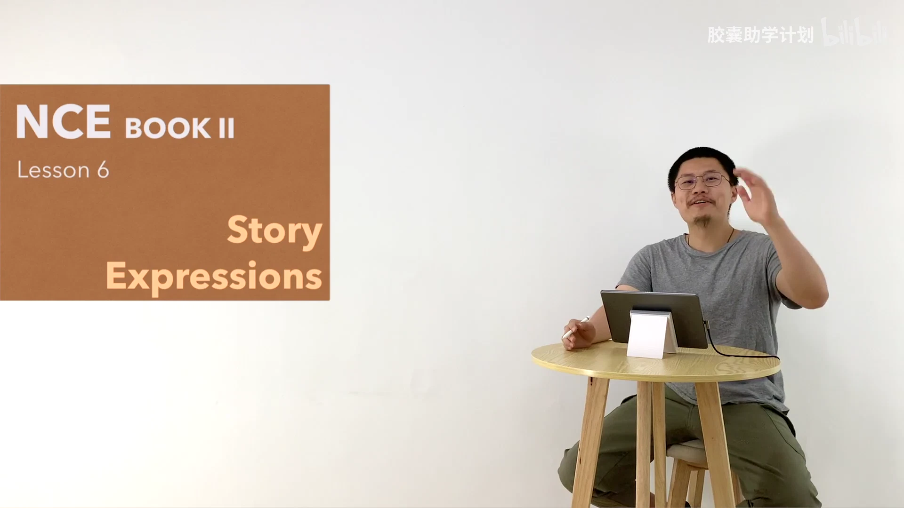

文字识别：胶囊助学计划 / NCE / BOOKI"I / Lesson 6 / Story / Expressions

### 画面 00:00:02

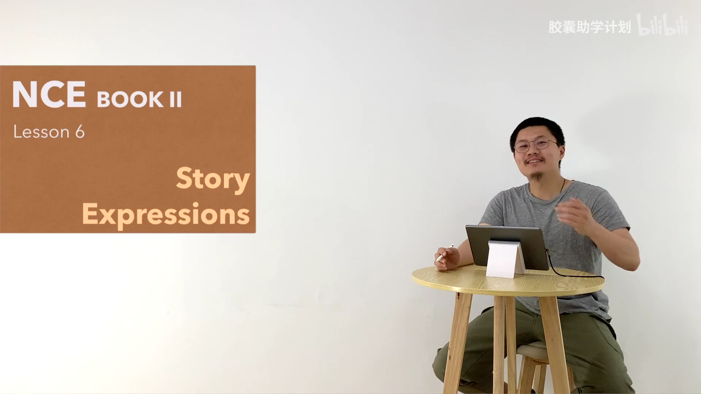

文字识别：胶囊助学计划 / NCE / BOOKII / Lesson 6 / Story / Expressions

### 画面 00:00:05

文字识别：胶囊助学计划 / NCE / BOOKII / Lesson 6 / Story / Expressions

### 画面 00:00:09

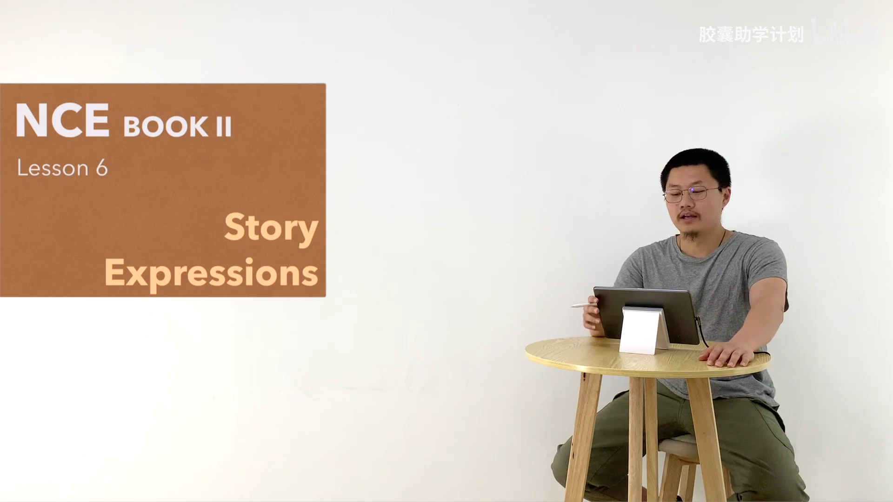

文字识别：胶囊助学计划 / NCE / BOOKII / Lesson 6 / Story / Expressions

### 画面 00:00:11

文字识别：胶囊助学计划

### 画面 00:00:13

文字识别：胶囊助学计划 / ①如何表达“倒立”？

### 画面 00:00:15

文字识别：胶囊助学计划 / ①如何表达“倒立”？

### 画面 00:00:17

文字识别：胶囊助学计划 / ①如何表达“倒立”？ / 如何表达“作为回报”

### 画面 00:00:19

文字识别：胶囊助学计划 / ①如何表达“倒立”？ / 如何表达“作为回报” / 如何表达“搬去某地”？

### 画面 00:00:21

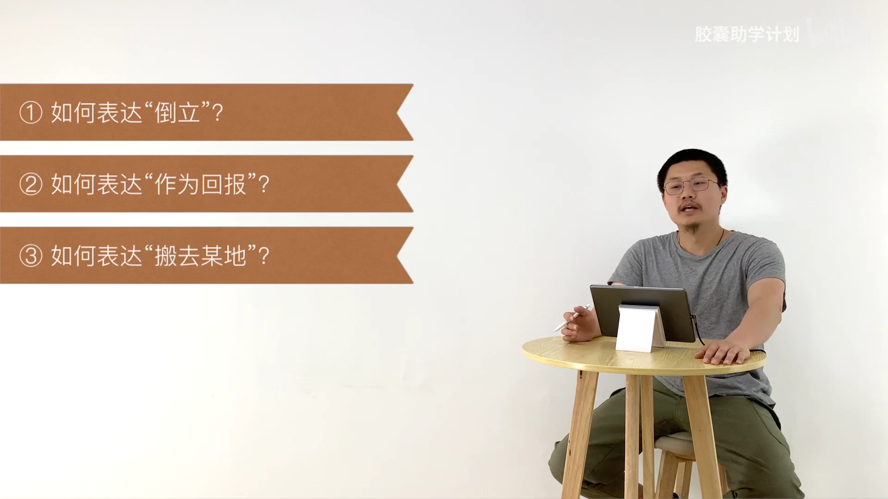

文字识别：胶囊助学计划 / ①如何表达“倒立”？ / 如何表达“作为回报' / 如何表达“搬去某地”?

### 画面 00:00:23

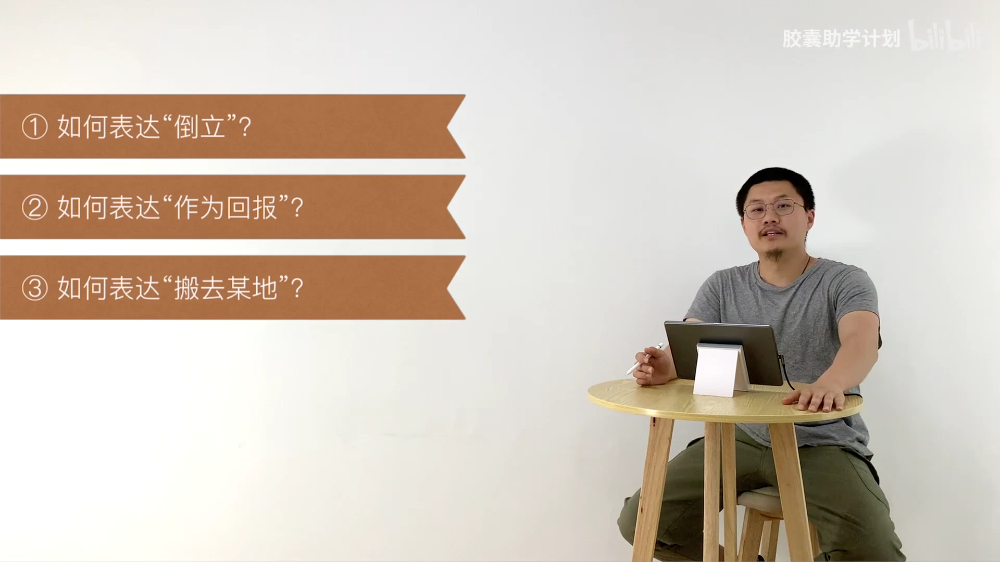

文字识别：胶囊助学计划 / ①如何表达“倒立”？ / 如何表达“作为回报' / 如何表达“搬去某地”?

### 画面 00:00:25

文字识别：胶囊助学计划 bilbl

### 画面 00:00:28

文字识别：胶囊助学计划

## 00:00:30–00:01:00

我们直接进入文章。我们看第一句话，说 I have just moved to a house in Bridge Street. 首先 have just moved，这是我们之前学过的，刚刚学过的叫做现在完成时。我刚刚搬到了。好， moved to a house in Bridge Street. Move to 加上一个地点，叫表达搬到去某个地方。我搬到了在大桥街的一

### 画面 00:00:30

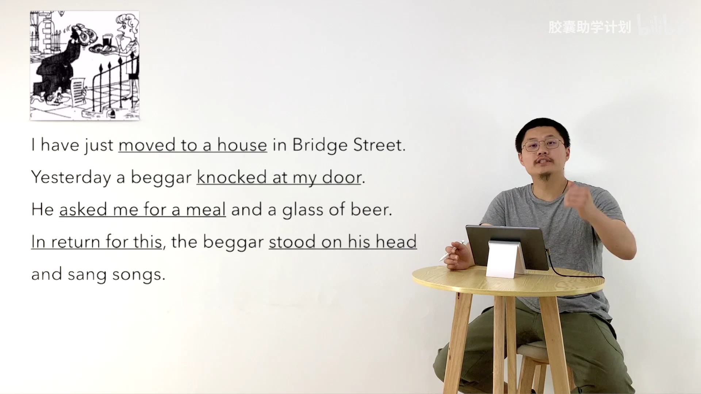

文字识别：胶囊助学计划 / I have just moved to a house in Bridge Street. / Yesterday a beggar knocked at my door. / He asked me for a meal and a glass of beer. / In return for this, the beggar stood on his head / and sang songs.

### 画面 00:00:32

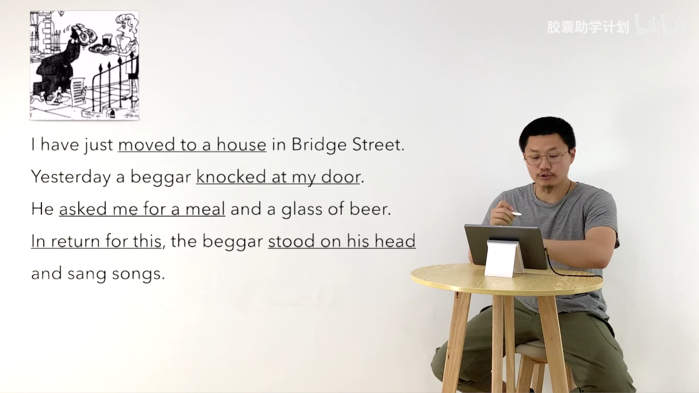

文字识别：胶囊助学计划 / I have just moved to a house in Bridge Street. / Yesterday a beggar knocked at my door. / He asked me for a meal and a glass of beer. / In return for this, the beggar stood on his head / and sang songs.

### 画面 00:00:40

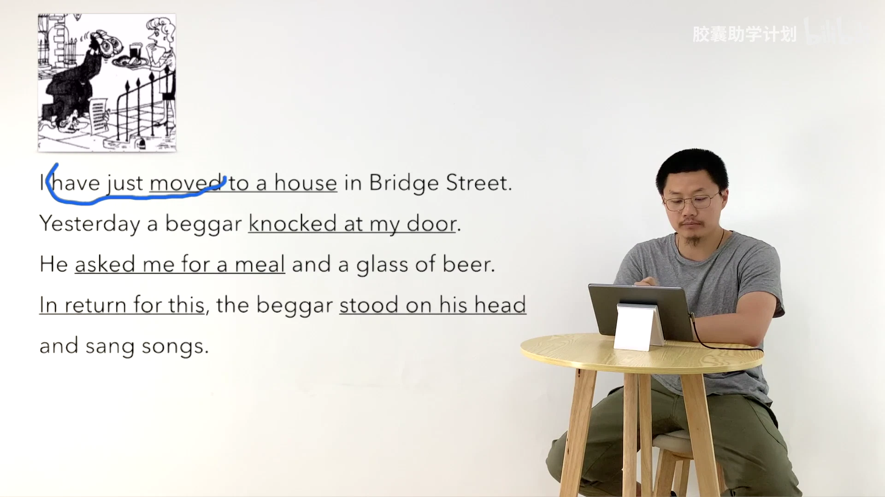

文字识别：胶囊助学计划 / Ihave just moved to a house in Bridge Street. / Yesterday a beggar knocked at my door. / He asked me for a meal and a glass of beer. / In return for this, the beggar stood on his head / and sang songs.

### 画面 00:00:42

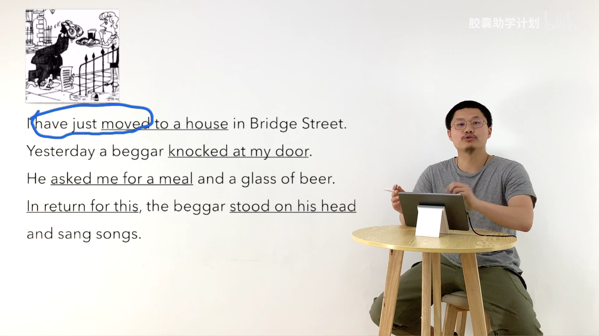

文字识别：胶囊助学计划 / Ihave just moved to a house in Bridge Street. / Yesterday a beggar knocked at my door. / He asked me for a meal and a glass of beer. / In return for this, the beggar stood on his head / and sang songs.

### 画面 00:00:45

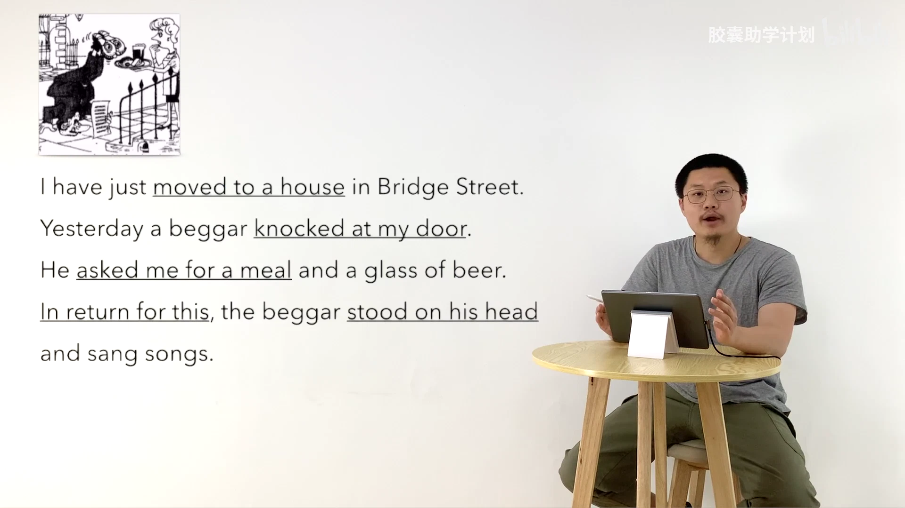

文字识别：胶囊助学计划 / I have just moved to a house in Bridge Street. / Yesterday a beggar knocked at my door. / He asked me for a meal and a glass of beer. / In return for this, the beggar stood on his head / and sang songs.

## 00:01:00–00:01:30

个房子里面，刚刚搬过去的。那你想一下啊，现在完成时搬家一定是发生在过去，对现在的影响是什么？一定是我接下来讲搬到这个新房子当中发生的一些事情，而不会跟你说，哎，要不明天咱俩开车出去玩一圈？这个逻辑是不通的，对吧？一定是讲跟这个房子相关的事情。我们看一下是不是这样的。Yesterday, 好注意这个单词一出来，接下来可能是

### 画面 00:01:03

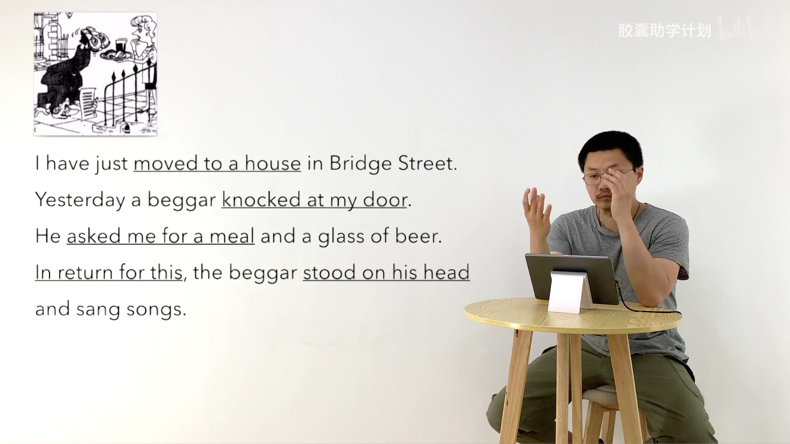

文字识别：胶囊助学计划 / I have just moved to a house in Bridge Street. / Yesterday a beggar knocked at my door. / He asked me for a meal and a glass of beer. / In return for this, the beggar stood on his head / and sang songs.

### 画面 00:01:26

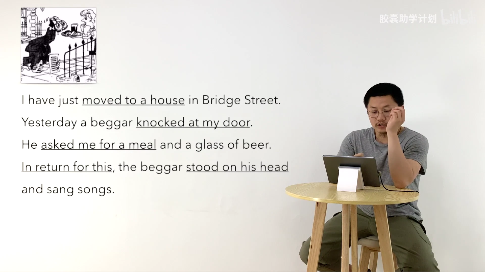

文字识别：胶囊助学计划 / I have just moved to a house in Bridge Street. / Yesterday a beggar knocked at my door. / He asked me for a meal and a glass of beer. / In return for this, the beggar stood on his head / and sang songs.

## 00:01:30–00:02:00

是跟过去相关的时态了，比如说一般过去时。A beggar knocked at my door.好了，注意，一个乞丐啊敲了我们家的门啊，敲了敲我们家的门。那注意 knock at my door，这叫做敲门。一般过去时，昨天发生了这么一件事情。He asked me for a meal，还是一般过去时？Ask somebody for something，叫做找某人

### 画面 00:01:48

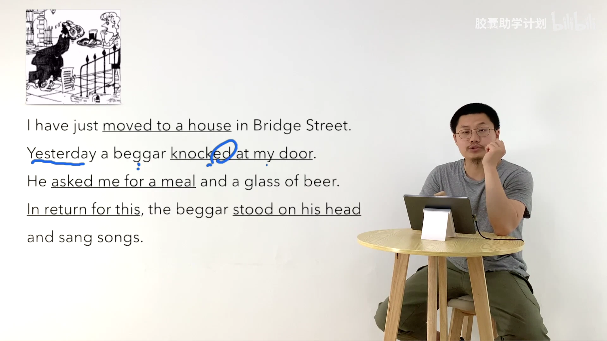

文字识别：胶囊助学计划 / I have just moved to a house in Bridge Street. / Yesterday a beggar knockedat my door. / He asked me for a meal and a glass of beer. / In return for this, the beggar stood on his head / and sang songs.

## 00:02:00–00:02:30

要某物，他找我要了一顿饭，还有什么呢？A glass of beer，还有一哎一玻璃杯的啤酒，还挺有生活情趣啊！不光要饭，还要酒。In return for this，这是一个小的短语，叫做作为这件事情的回报。各位应该有印象，return这个单词叫做返回、往返、回来。那in return for就作为一个

### 画面 00:02:06

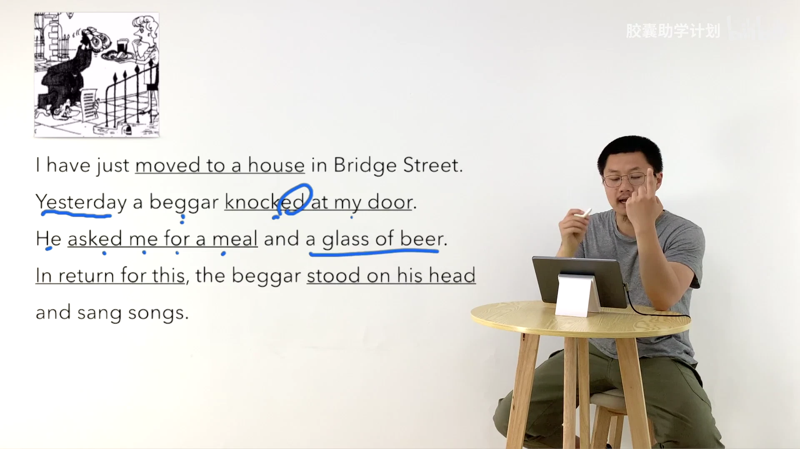

文字识别：胶囊助学计划 / I have just moved to a house in Bridge Street. / Yesterday a beggar knockeDat my door. / He asked me for a meal and a glass of beer. / In return for this, the beggar stood on his head / and sang songs.

### 画面 00:02:09

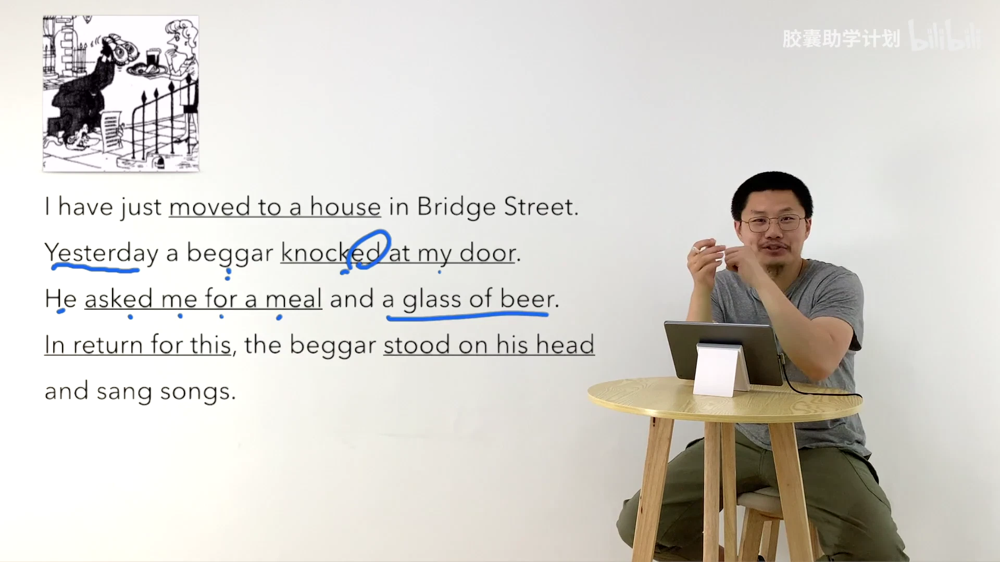

文字识别：胶囊助学计划 / I have just moved to a house in Bridge Street. / Yesterday a beggar knockedat my door. / He asked me for a meal and a glass of beer. / In return for this, the beggar stood on his head / and sang songs.

### 画面 00:02:11

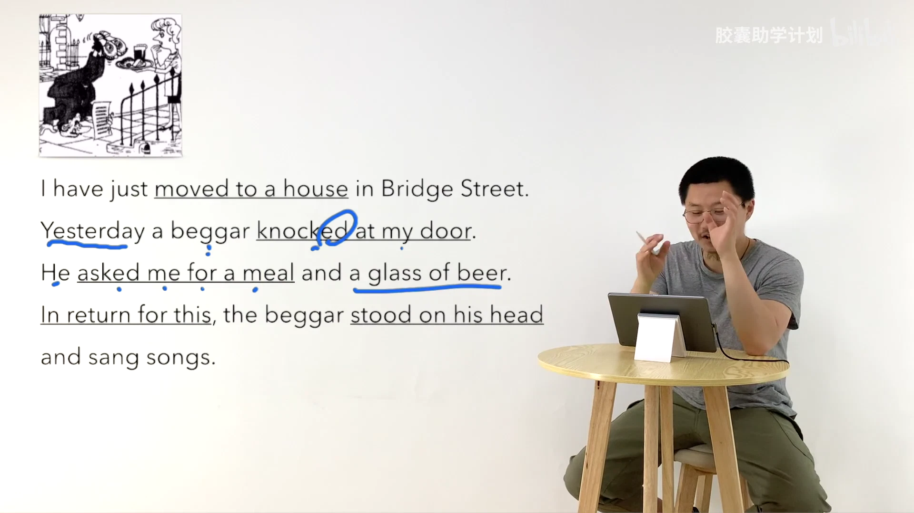

文字识别：胶囊助学计划 / I have just moved to a house in Bridge Street. / Yesterday a beggar knockedat my door. / He asked me for a meal and a glass of beer. / In return for this, the beggar stood on his head / and sang songs.

### 画面 00:02:18

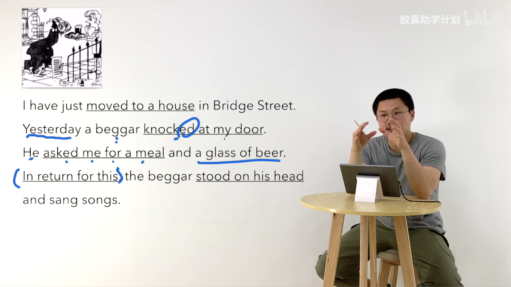

文字识别：胶囊助学计划 / I have just moved to a house in Bridge Street. / Yesterday a beggar knockedat my door. / He asked me for a meal and a glass of beer. / In return for this) the beggar stood on his head / and sang songs.

### 画面 00:02:25

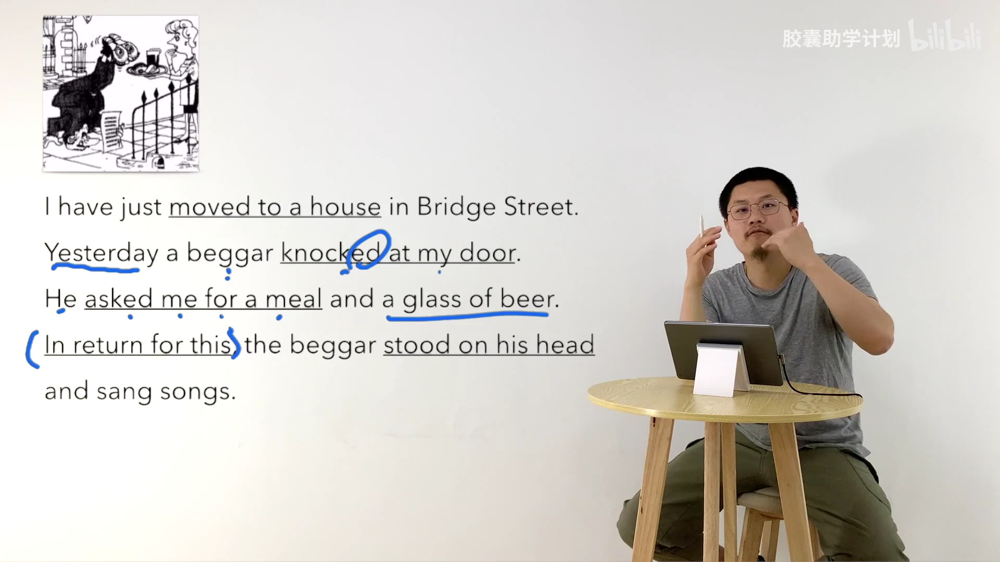

文字识别：胶囊助学计划 / I have just moved to a house in Bridge Street. / Yesterday a beggar knocked at my door. / He asked me for a meal and a glass of beer. / In return for this the beggar stood on his head / and sang songs.

## 00:02:30–00:03:00

回报，对什么事情的回报呢？This this指的是 he asked me for a meal and a glass of beer，作为做这件事情的一个回报。The beggar，这个乞丐呀，stood on his head。你看 stood叫做站 on his head，字面的意思叫在他的头上，站在他自己的头上。这个是高难度操作，是吧？它实际上指的是图中的这句话。

### 画面 00:02:38

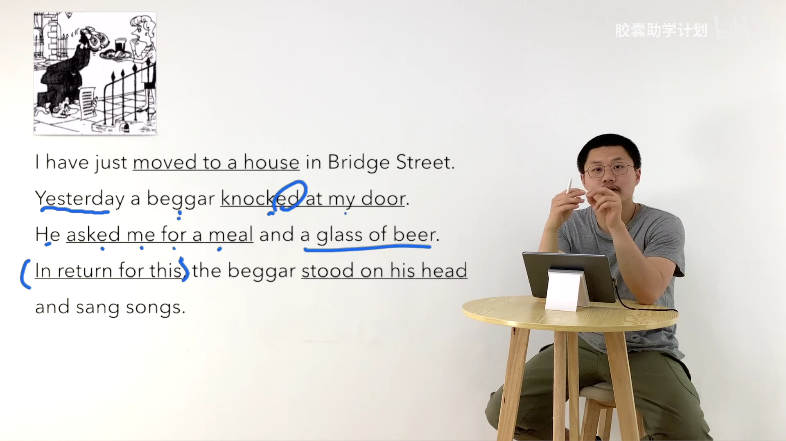

文字识别：胶囊助学计划 / I have just moved to a house in Bridge Street. / Yesterday a beggar knockeDat my door. / He asked me for a meal and a glass of beer. / In return for this the beggar stood on his head / and sang songs.

### 画面 00:02:46

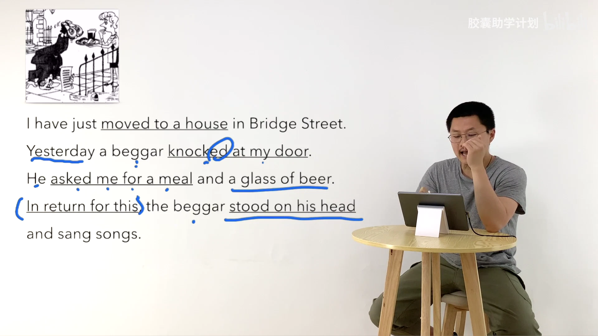

文字识别：胶囊助学计划 / I have just moved to a house in Bridge Street. / Yesterday a beggar knockeDat my door. / He asked me for a meal and a glass of beer. / In return for this the beggar stood on his head / and sang songs.

### 画面 00:02:52

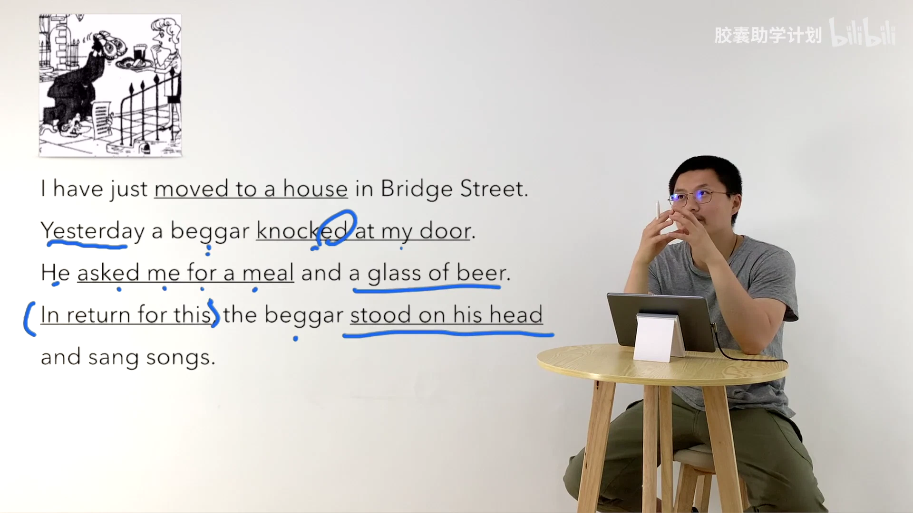

文字识别：胶囊助学计划 / I have just moved to a house in Bridge Street. / Yesterday a beggar knockedat my door. / He asked me for a meal and a glass of beer. / (In return for this)the beggar stood on his head / and sang songs.

### 画面 00:02:56

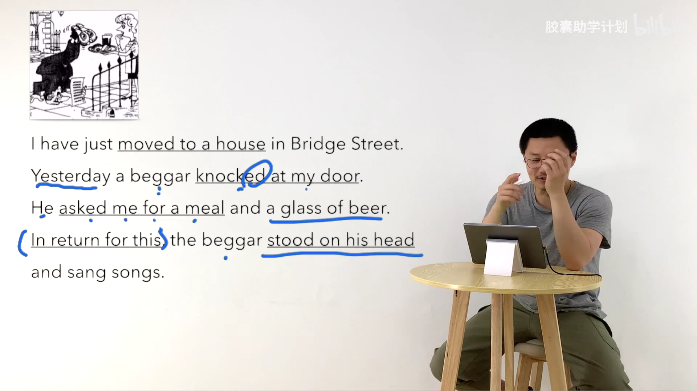

文字识别：胶囊助学计划 / I have just moved to a house in Bridge Street. / Yesterday a beggar knockedat my door. / He asked me for a meal and a glass of beer. /  In return for this) the beggar stood on his head / and sang songs.

### 画面 00:02:58

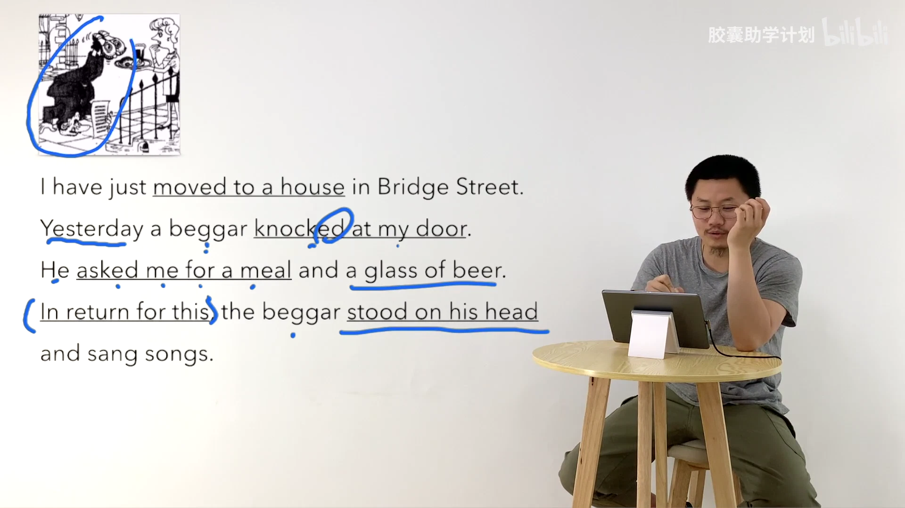

文字识别：胶囊助学计划 / I have just moved to a house in Bridge Street. / Yesterday a beggar knockeDat my door. / He asked me for a meal and a glass of beer. /  In return for this the beggar stood on his head / and sang songs.

## 00:03:00–00:03:30

OK，他是倒立了，OK，倒立了，用他的头站了起来，and sang songs，然后开始唱歌，这是卖艺，对吧？就是说，哎，你给了我一顿免费的饭，我不只要张手要，我还要给你一些回馈，那就是倒立，stood on his head and sang songs，都是一般过去时，对吧？目前我们看到两个时态了，continue，I gave him a meal，我给了他一顿饭，gave

### 画面 00:03:01

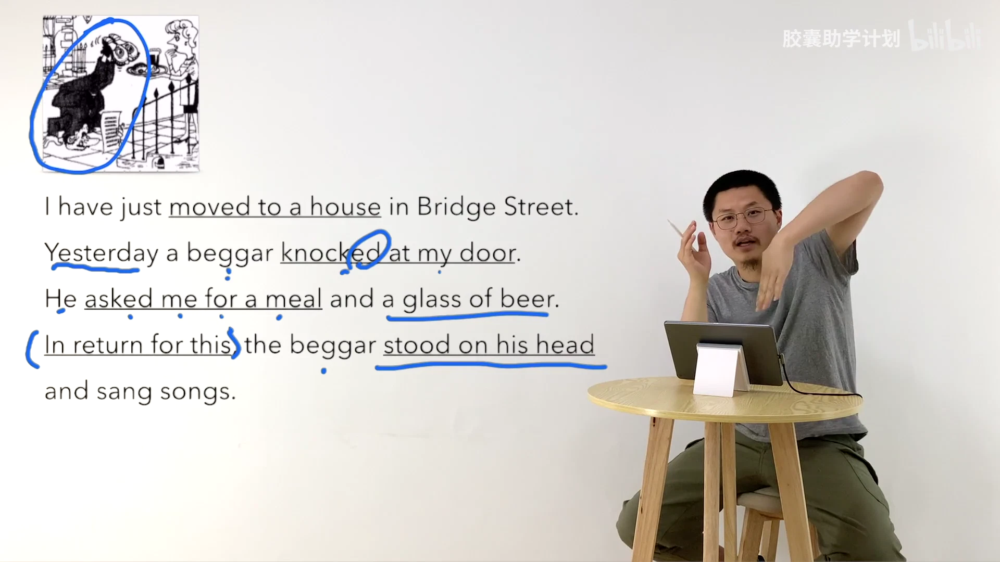

文字识别：胶囊助学计划 / I have just moved to a house in Bridge Street. / Yesterday a beggar knockedat my door. / He asked me for a meal and a glass of beer. /  In return for this)the beggar stood on his head / and sang songs.

### 画面 00:03:07

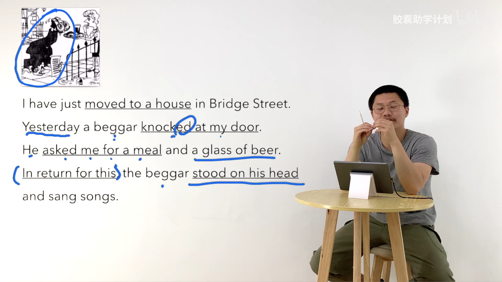

文字识别：胶囊助学计划 / I have just moved to a house in Bridge Street. / Yesterday a beggar knockeDat my door. / He asked me for a meal and a glass of beer. / In return for this the beggar stood on his head / and sang songs.

### 画面 00:03:12

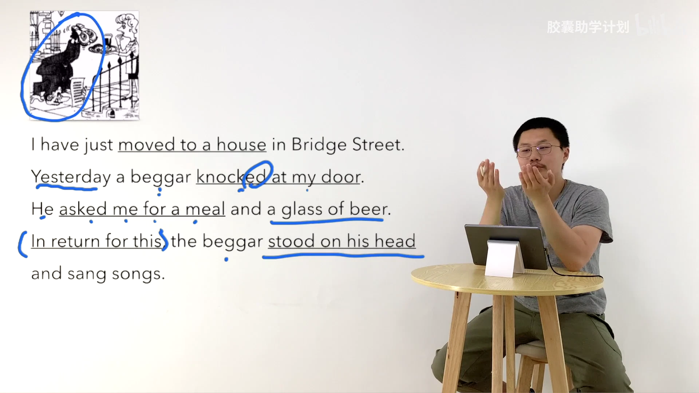

文字识别：胶囊助学计划 / I have just moved to a house in Bridge Street. / Yesterday a beggar knockedat my door. / He asked me for a meal and a glass of beer. / In return for this the beggar stood on his head / and sang songs.

### 画面 00:03:17

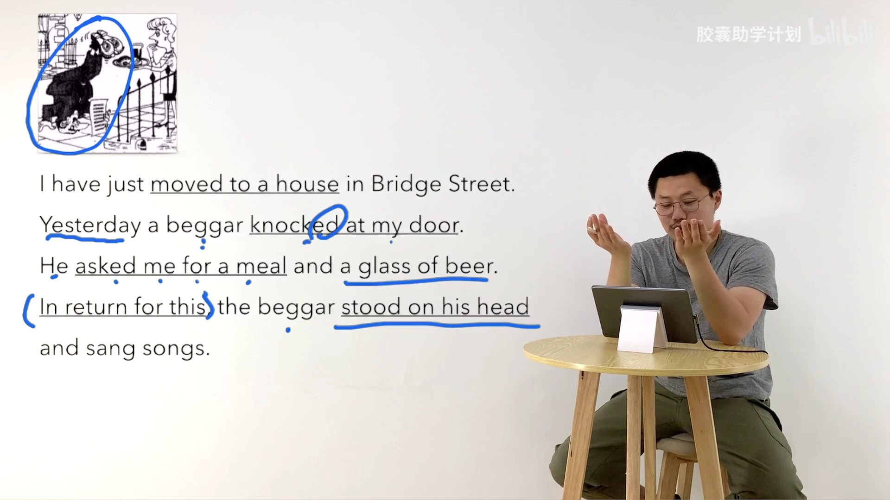

文字识别：胶囊助学计划 / I have just moved to a house in Bridge Street. / Yesterday a beggar knockedat my door. / He asked me for a meal and a glass of beer. /  In return for this)the beggar stood on his head / and sang songs.

### 画面 00:03:21

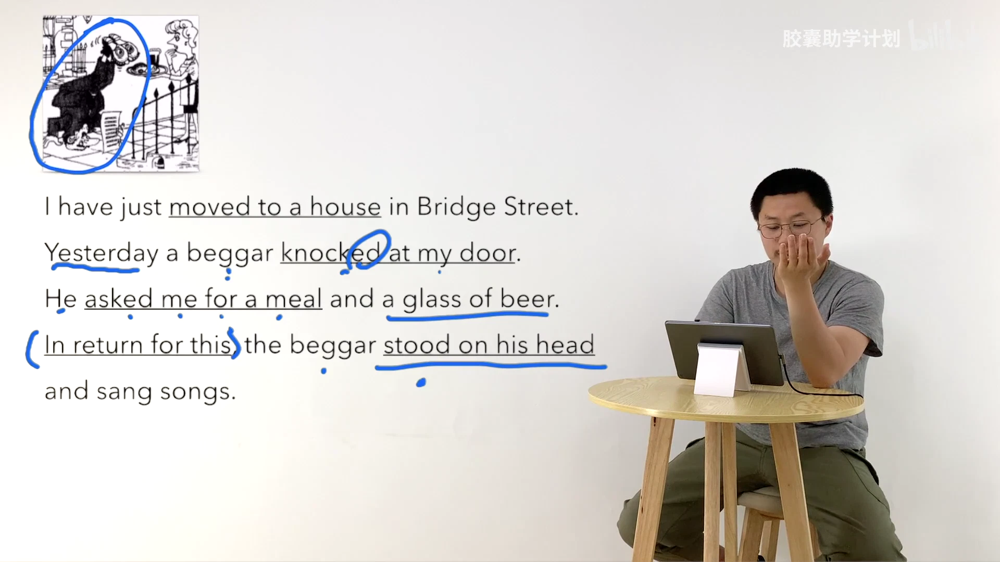

文字识别：胶囊助学计划 / I have just moved to a house in Bridge Street. / Yesterday a beggar knockeDat my door. / He asked me for a meal and a glass of beer. / In return for this) the beggar stood on his head / and sang songs.

### 画面 00:03:24

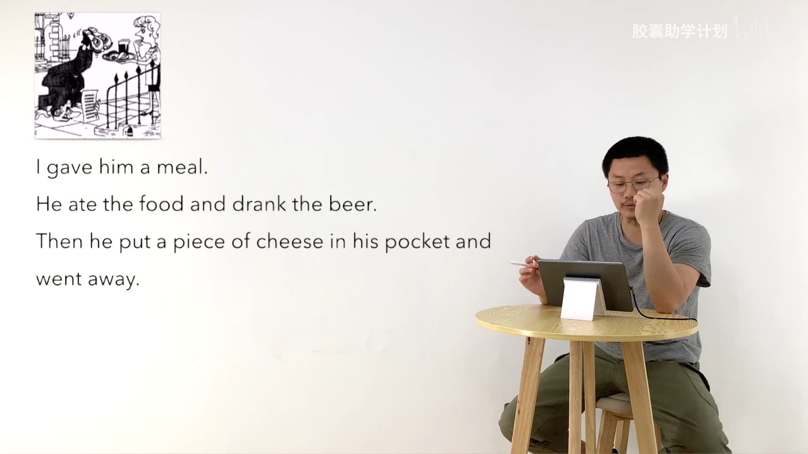

文字识别：胶囊助学计划 / I gave him a meal. / He ate the food and drank the beer. / Then he put a piece of cheese in his pocket and / went away.

## 00:03:30–00:04:00

一般过去时 he ate the food 啊吃了这个食物 and drank the beer 然后喝了这杯酒还是一般过去时表示昨天发生的事情 then 然后 he put a piece of cheese in his pocket 他把这一片儿奶酪放到了 his pocket 放在他的口袋当中 and went away 然后走开了这地方有一个小点就是 put 这个单词到底是不是动词啊到底是不是原形

### 画面 00:03:45

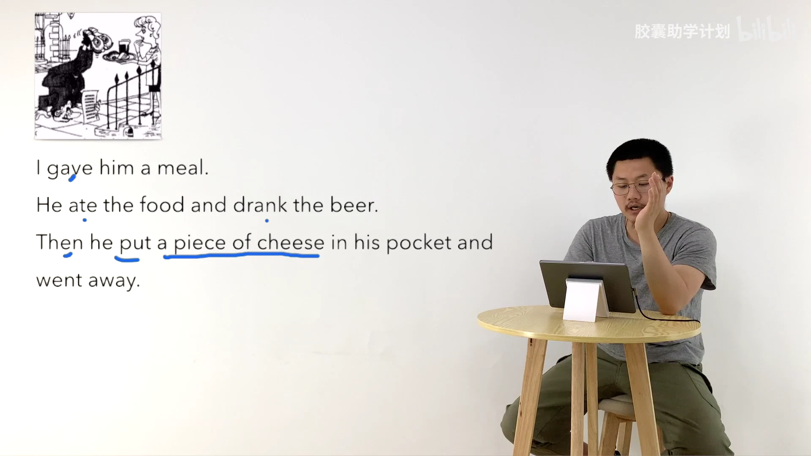

文字识别：胶囊助学计划 / I gaye him a meal. / He ate the food and drank the beer. / • / Then he put a piece of cheese in his pocket and / went away.

### 画面 00:03:47

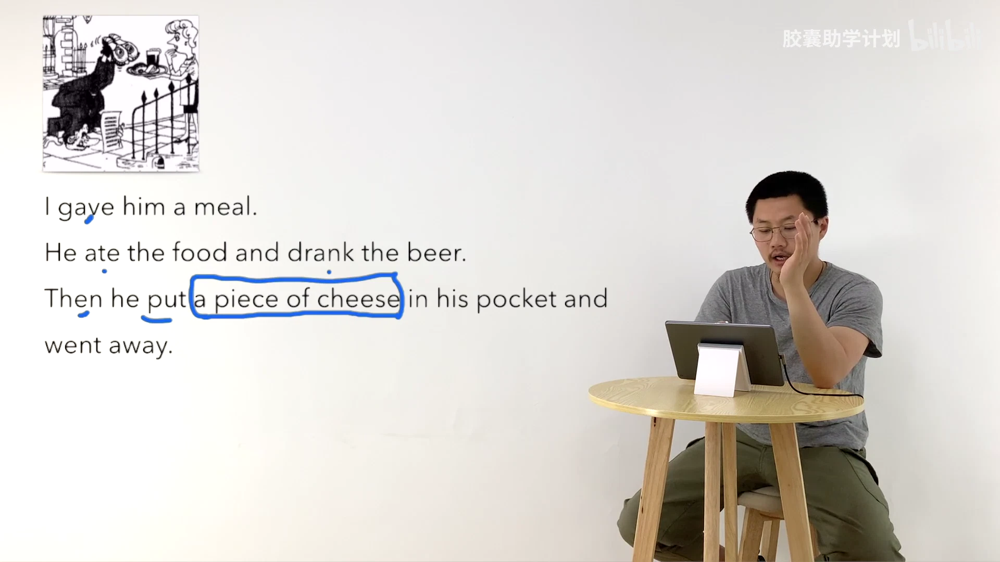

文字识别：胶囊助学计划 / I gaye him a meal. / He ate the food and drank the beer. / • / Then he put / ta piece of cheese / jin his pocket and / went away.

### 画面 00:03:49

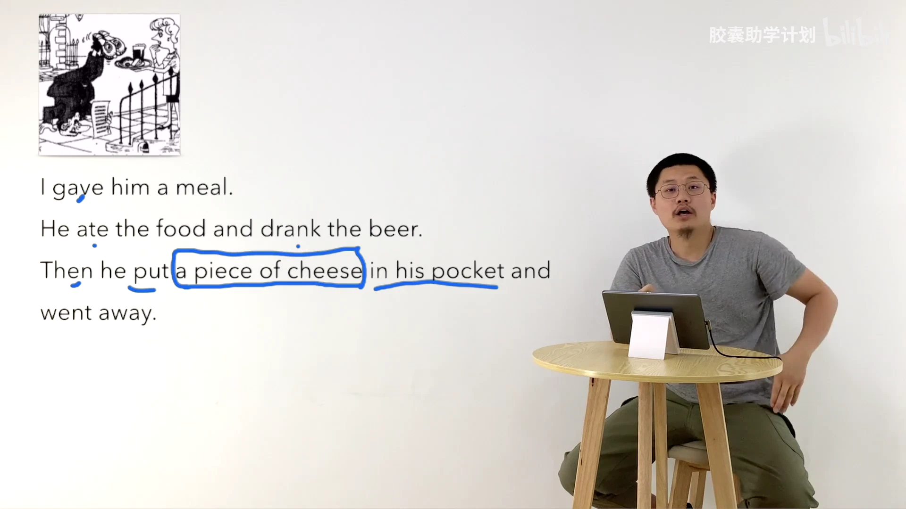

文字识别：胶囊助学计划 / I gaye him a meal. / He ate the food and drank the beer. / • / Then he put / ta piece of cheese / in his pocket and / went away.

### 画面 00:03:52

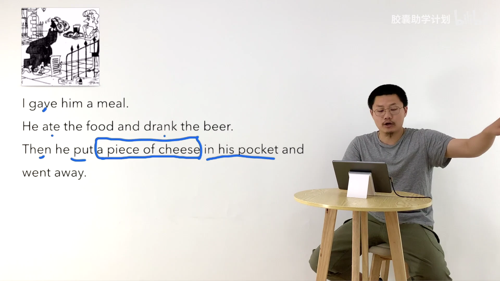

文字识别：胶囊助学计划 / I gaye him a meal. / He ate the food and drank the beer. / • / Then he put a piece of cheese in his pocket and / went away.

### 画面 00:03:56

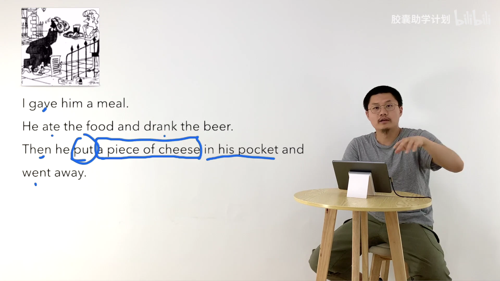

文字识别：胶囊助学计划 / I gaye him a meal. / He ate the food and drank the beer. / • / Then he / put / a piece of cheesein his pocket and / went away.

### 画面 00:03:58

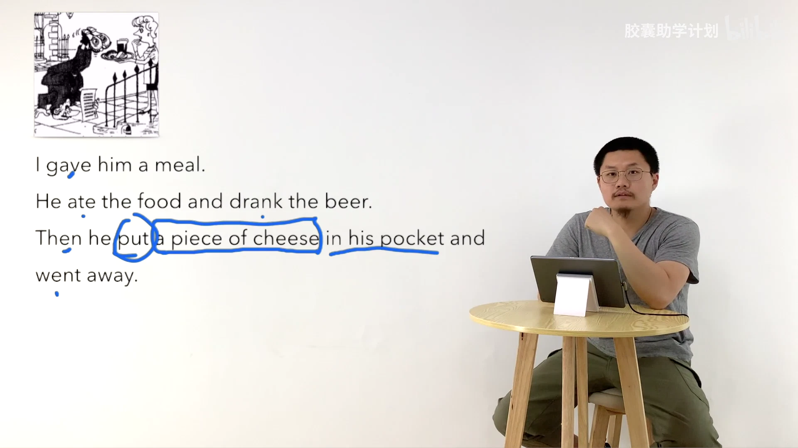

文字识别：胶囊助学计划 / I gaye him a meal. / He ate the food and drank the beer. / • / Then he / a piece of cheese in his pocket and / put / went away.

## 00:04:00–00:04:30

啊？不是，它是动词啊，到底是不是原形？它不是原形，它是动词的过去式。注意，它全是在说过去发生的事情啊。他过去把这个，昨天把这个一片奶酪，一片起司放到了他的口袋当中，然后走开了。Continue later，稍后呢？A neighbor told me about him。一个邻居告诉了我关于他的事情。

### 画面 00:04:12

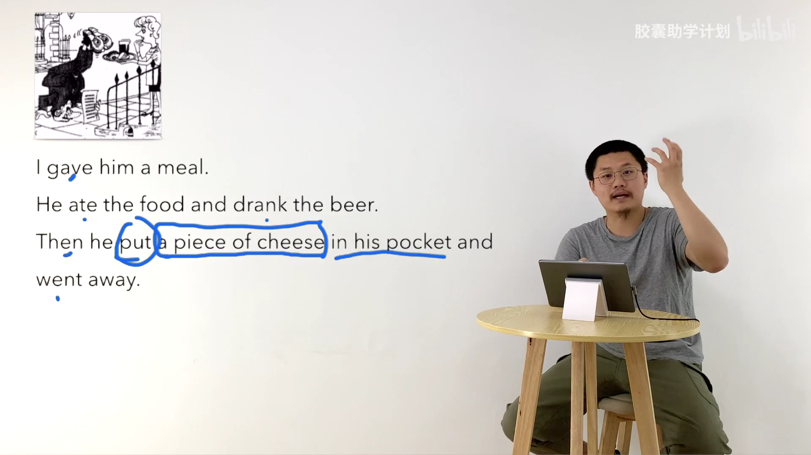

文字识别：胶囊助学计划 / I gaye him a meal. / He ate the food and drank the beer. / • / Then he / a piece of cheese / ein his pocket and / put / went away.

### 画面 00:04:19

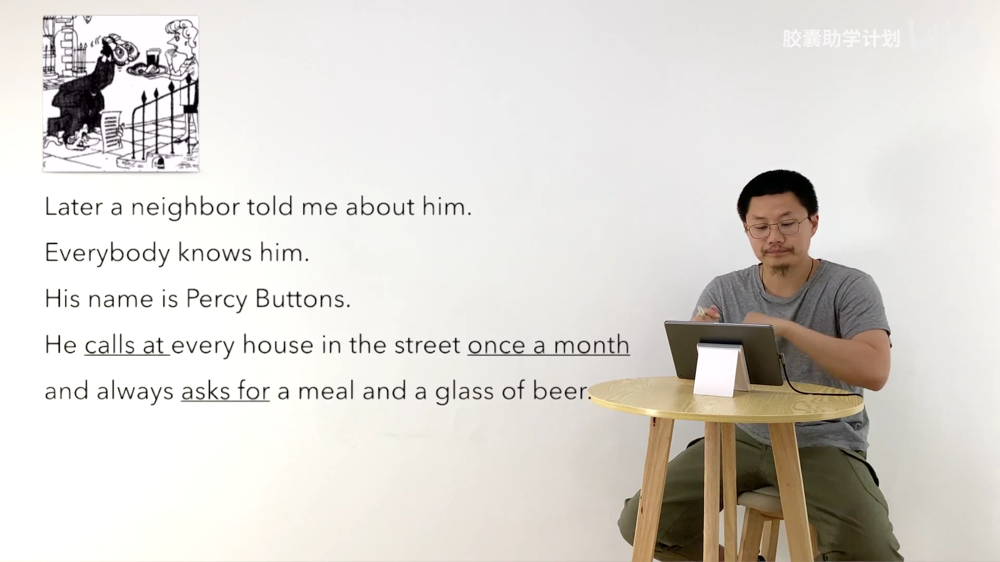

文字识别：胶囊助学计划 / Later a neighbor told me about him. / Everybody knows him. / His name is Percy Buttons. / He calls at every house in the street once a month / and always asks for a meal and a glass of beer.

### 画面 00:04:23

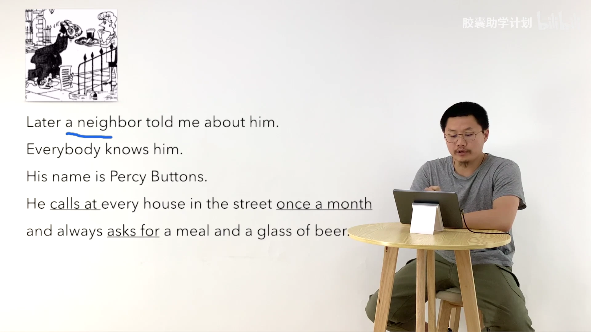

文字识别：胶囊助学计划 / Later a neighbor told me about him. / Everybody knows him. / His name is Percy Buttons. / He calls at every house in the street once a month / and always asks for a meal and a glass of beer.

### 画面 00:04:25

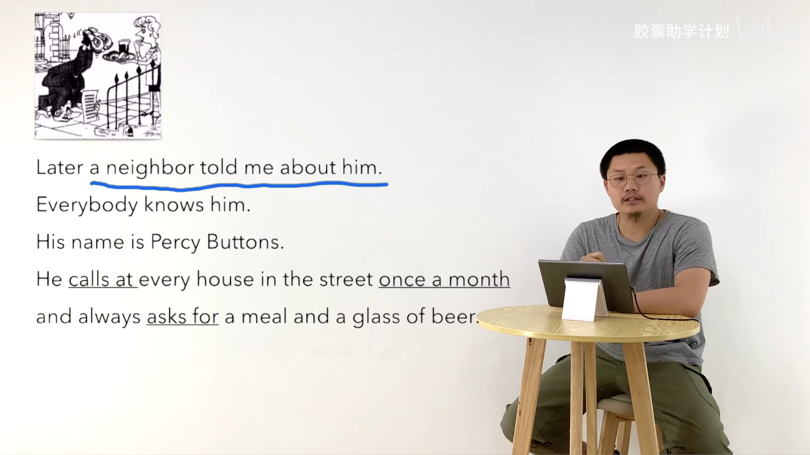

文字识别：胶囊助学计划 / Later a neighbor told me about him. / Everybody knows him. / His name is Percy Buttons. / He calls at every house in the street once a month / and always asks for a meal and a glass of beer.

## 00:04:30–00:05:00

Everybody knows him. Everybody knows him.每个人都认识他。注意时态又切换了，从一般过去时切换成了一般现在时。为什么呢？因为现在在陈述客观事实，说每个人呢都认识他。然后一个，His name is Percy Buttons.说他的名字叫 Percy Buttons。陈述客观事实还是一般现在时，对吧？He calls at.注意主

### 画面 00:04:37

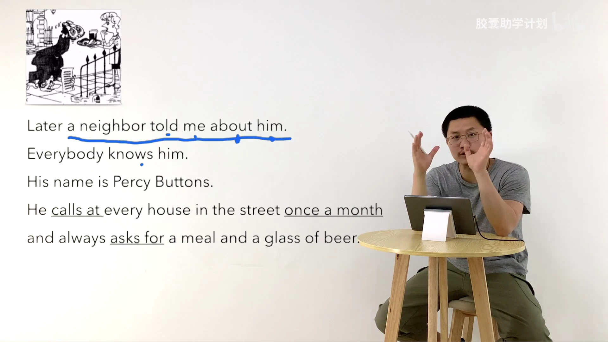

文字识别：胶囊助学计划 / Later a neighbor told me about him. / Everybody knows him. / His name is Percy Buttons. / He calls at every house in the street once a month / and always asks for a meal and a glass of beer.

### 画面 00:04:52

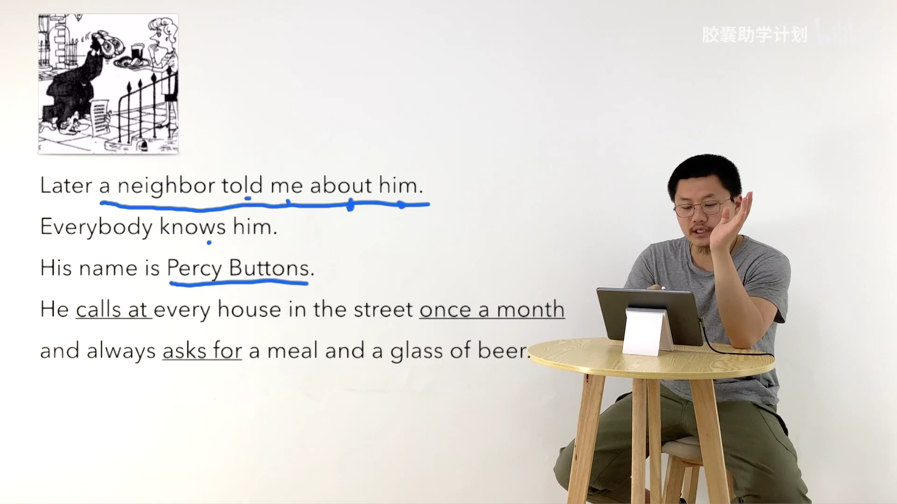

文字识别：胶囊助学计划 / Later a neighbor told me about him. / Everybody knows him. / His name is Percy Buttons. / He calls at every house in the street once a month / and always asks for a meal and a glass of beer.

## 00:05:00–00:05:30

语是第三人称单数，于是后面用的是calls at。跟这个地方各位注意一下，它虽然叫everybody，叫每一个人，但这个单词认为它是第三人称单数，所以后边用的是knows，而不是认为它是个复数。虽然在汉语当中每一个人好像是一群人，指的是复数，但在英文当中认为这个单词是一个单数。OK，说他呀拜访就是visits every

### 画面 00:05:00

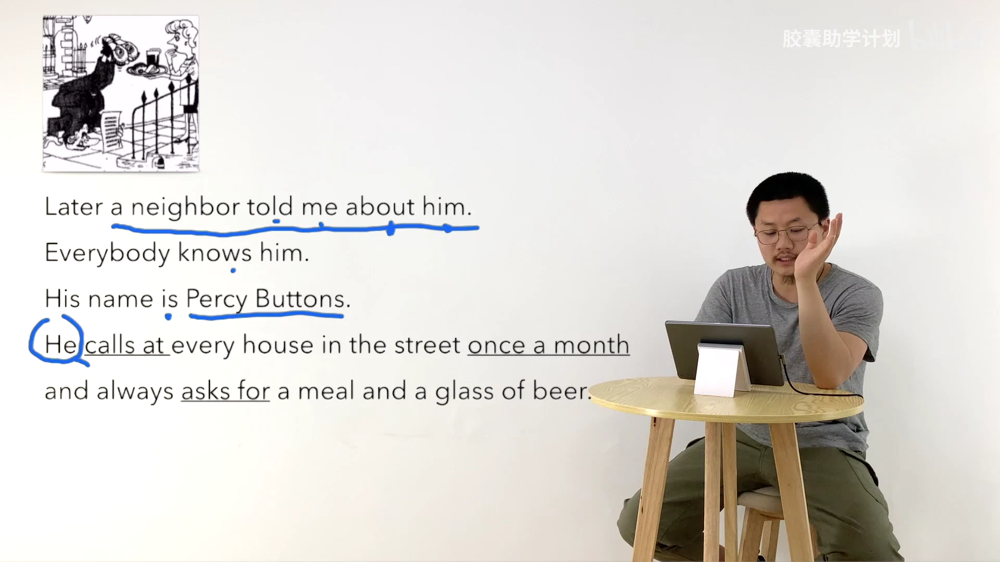

文字识别：胶囊助学计划 / Later a neighbor told me about him. / Everybody knows him. / His name is Percy Buttons. / He calls at every house in the street once a month / and always asks for a meal and a glass of beer.

### 画面 00:05:06

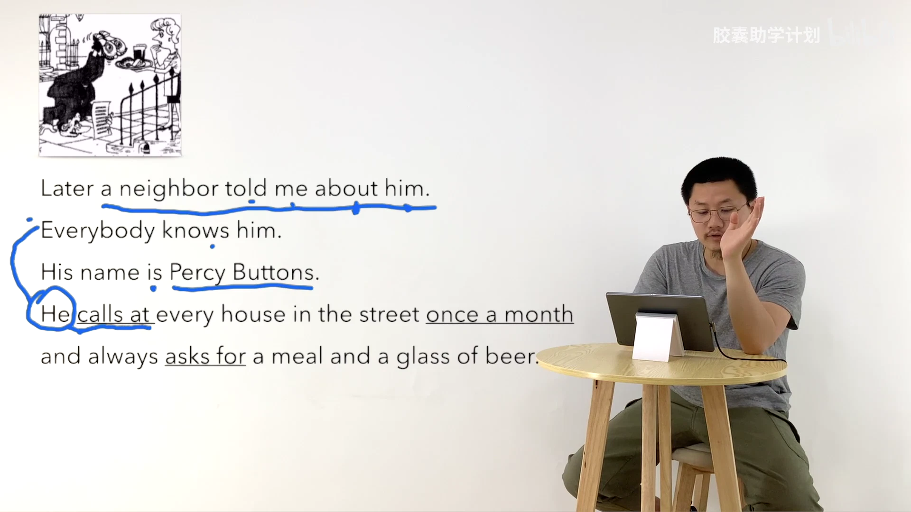

文字识别：胶囊助学计划 / Later a neighbor told me about him. / Everybody knows him. / His name is Percy Buttons. / He / calls at every house in the street once a month / and always asks for a meal and a glass of beer.

## 00:05:30–00:06:00

house in the street. 说这个街上的每一间，每一个屋子啊，每每每一家 once a month 叫一个月一次。那一会儿我们就可以去那他造一下句。我想说一年一次怎么办呢？ Once a year. 来触类旁通，举一反三。 And 然后怎么样呢？ Always 总是 asks for 一般现在时第三人称单数总是要 ask for

### 画面 00:05:30

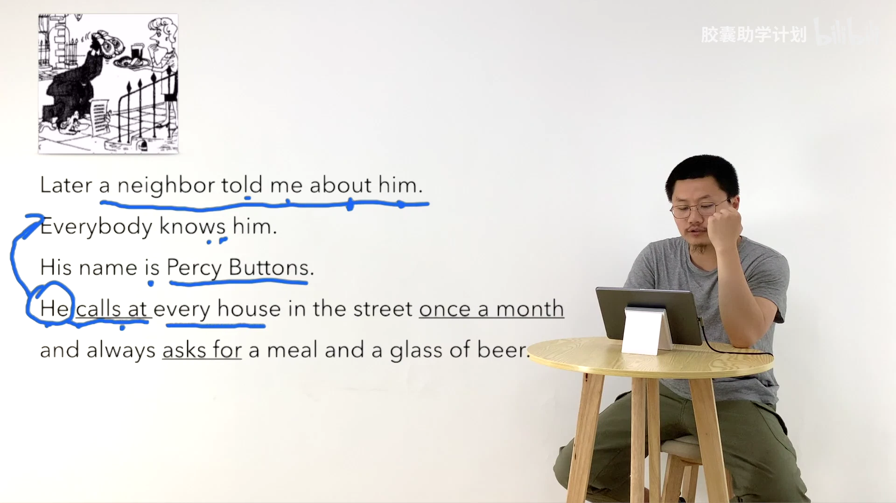

文字识别：胶囊助学计划 / Later a neighbor told me about him. / TEverybody knows him. / His name is Percy Buttons. / He / calls at every house in the street once a month / and always asks for a meal and a glass of beer.

### 画面 00:05:33

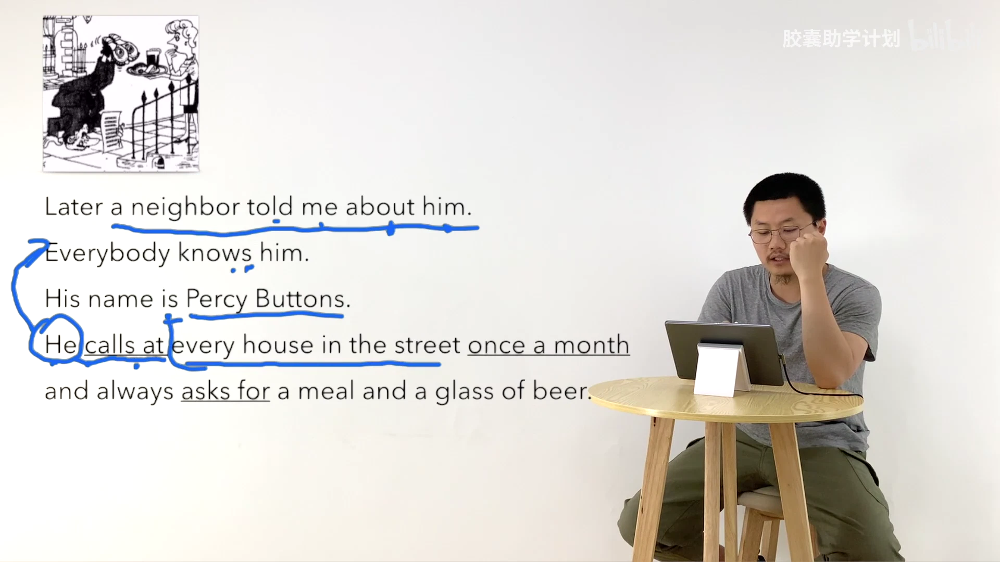

文字识别：胶囊助学计划 / Later a neighbor told me about him. / Everybody knows him. / His name is Percy Buttons. / He / and always asks for a meal and a glass of beer.

### 画面 00:05:42

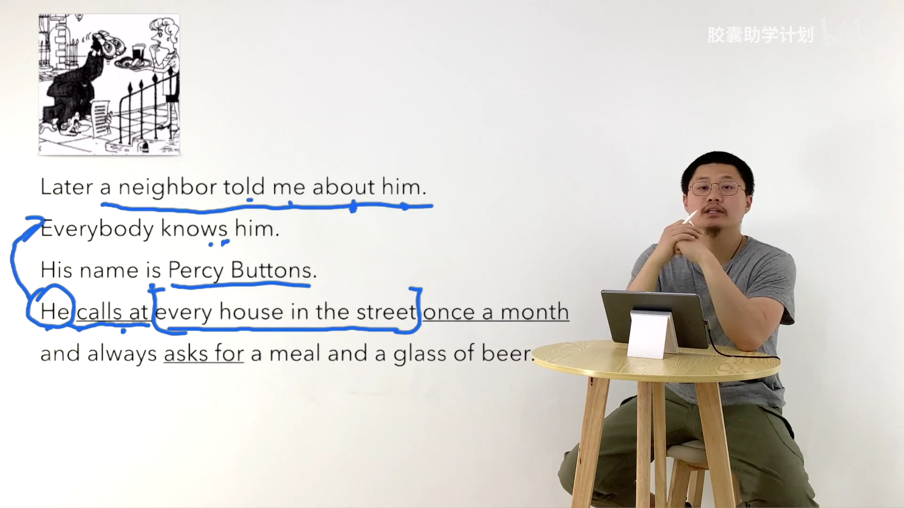

文字识别：胶囊助学计划 / Later a neighbor told me about him. / TEverybody knows him. / His name is Percy Buttons. / calls at every house in the street once a month / He / and always asks for a meal and a glass of beer.

### 画面 00:05:55

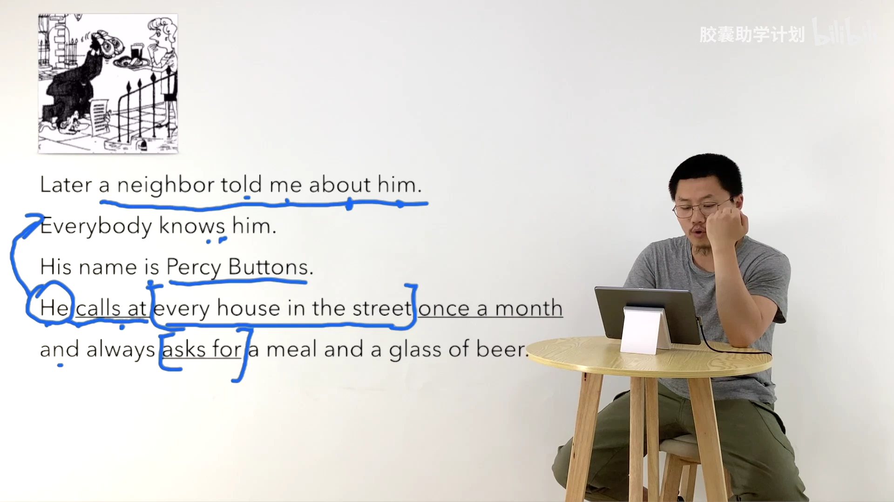

文字识别：胶囊助学计划 / Later a neighbor told me about him. / Everybody / knows him. / His name is Percy Buttons. / calls at every house in the street once a month / He / and alwaysasks fora meal and a glass of beer.

## 00:06:00–00:06:30

和 ask somebody for something 意思几乎是一样的，只不过一个是直接说要一些东西，另一个是找谁要了一些东西。要了一顿饭和 a glass of beer，要了一瓶啤，啊，要了一玻璃杯的啤酒。那一个，那接下来呢？这是我们本课从文章当中摘出来的一些习惯用法。习惯用法最重要的事情一定是要去拿它造句了。那我们就一个一个来。第一个

### 画面 00:06:12

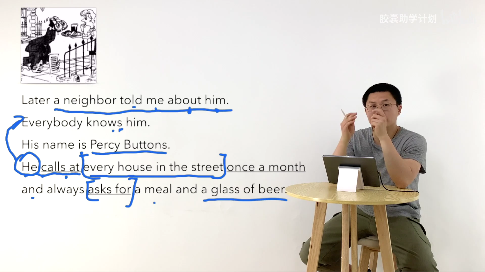

文字识别：胶囊助学计划 / Later a neighbor told me about him. / Everybody / knows him. / His name is Percy Buttons. / He / and always asks fora meal and a glass of beer.

### 画面 00:06:15

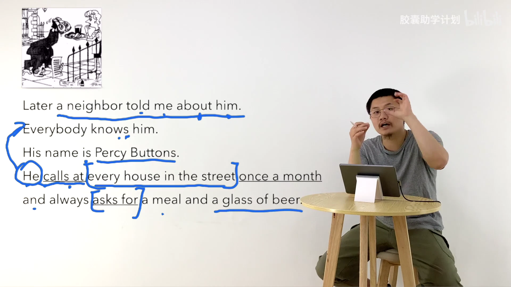

文字识别：胶囊助学计划 / Later a neighbor told me about him. / Everybody / knows him. / His name is Percy Buttons. / He / and always / sasks fora meal and a glass of beer.

### 画面 00:06:18

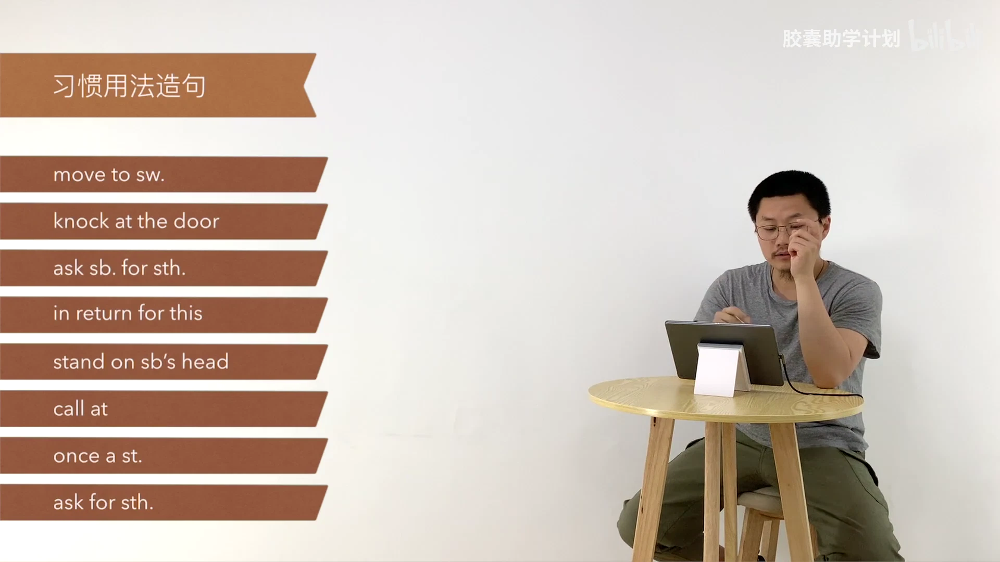

文字识别：胶囊助学计划 / 习惯用法造句 / move to sw. / knock at the door / ask sb.for sth. / in return for this / stand on sb's head / call at / once a st. / ask for sth.

### 画面 00:06:20

文字识别：胶囊助学计划 / 习惯用法造句 / move to sw. / knock at the door / ask sb.for sth. / in return for this / stand on sb's head / call at / once a st. / ask for sth.

### 画面 00:06:22

文字识别：胶囊助学计划 / 习惯用法造句 / move to sw. / knock at the door / ask sb.for sth. / in return for this / stand on sb's head / call at / once a st. / ask for sth.

### 画面 00:06:24

文字识别：胶囊助学计划 / 习惯用法造句 / move to sw. / knock at the door / ask sb.for sth. / in return for this / stand on sb's head / call at / once a st. / ask for sth.

### 画面 00:06:26

文字识别：胶囊助学计划 / 习惯用法造句 / move to sw. / knock at the door / ask sb.for sth. / in return for this / stand on sb's head / call at / once a st. / ask for sth.

### 画面 00:06:28

文字识别：网：v.+v.变化 / 习惯用法造句指南 / 胶囊助学计划 / 四句型转换 / 方式/地点/时间 / 其他习惯用法 / 其他单词+词性 / 原文摘抄+变 / 6123456 / move to sw.

## 00:06:30–00:07:00

叫 move to somewhere, S W 点叫 somewhere, 叫某地，叫做搬到某地。那我们来一些动词加动词变化，所谓往的横向变化，就是时态之间进行一些切换。比如说，He always moves to Hainan every winter. 一般现在时讲的是他的生活习惯。然后呢，我把它变成一般过去时，叫做 He moved to Hainan last winter. 上一个冬

### 画面 00:06:30

文字识别：网：v.+v.变化 / 习惯用法造句指南 / 胶囊助学计划 / 四句型转换 / 方式/地点/时间 / 其他习惯用法 / 其他单词+词性 / 原文摘抄+变 / 6123456 / move to sw.

### 画面 00:06:35

文字识别：网：v.+v.变化 / 习惯用法造句指南 / 胶囊助学计划 / 四句型转换 / 方式/地点/时间 / 其他习惯用法 / 其他单词+词性 / 原文摘抄+变 / 6123456 / move to sw.

### 画面 00:06:37

文字识别：网：v.+v.变化 / 习惯用法造句指南 / 胶囊助学计划 / 四句型转换 / 方式/地点/时间 / 其他习惯用法 / 其他单词+词性 / 原文摘抄+变 / 6123456 / move to sw. / do/does: He always moves to Hainan every winter.

### 画面 00:06:39

文字识别：网：v.+v.变化 / 习惯用法造句指南 / 胶囊助学计划 / 四句型转换 / 方式/地点/时间 / 其他习惯用法 / 其他单词+词性 / 原文摘抄+变 / 6123456 / move to sw. / do/does: He always moves to Hainan every winter.

### 画面 00:06:41

文字识别：网：v.+v.变化 / 习惯用法造句指南 / 胶囊助学计划 / 四句型转换 / 方式/地点/时间 / 其他习惯用法 / 其他单词+词性 / 原文摘抄+变 / 6123456 / move to sw. / do/does: He always moves to Hainan every winter.

### 画面 00:06:44

文字识别：网：v.+v.变化 / 习惯用法造句指南 / 胶囊助学计划 / 四句型转换 / 方式/地点/时间 / 其他习惯用法 / 其他单词+词性 / 原文摘抄+变 / 6123456 / move to sw. / do/does: He always moves to Hainan every winter.

### 画面 00:06:46

文字识别：网：v.+v.变化 / 习惯用法造句指南 / 胶囊助学计划 / 四句型转换 / 方式/地点/时间 / 其他习惯用法 / 其他单词+词性 / 原文摘抄+变 / 6123456 / move to sw. / do/does: He always moves to Hainan every winter.

### 画面 00:06:48

文字识别：网：v.+v.变化 / 习惯用法造句指南 / 胶囊助学计划 / 四句型转换 / 方式/地点/时间 / 其他习惯用法 / 其他单词+词性 / 原文摘抄+变 / 6123456 / move to sw. / do/does: He always moves to Hainan every winter.

### 画面 00:06:50

文字识别：网：v.+v.变化 / 习惯用法造句指南 / 胶囊助学计划 / 四句型转换 / 方式/地点/时间 / 其他习惯用法 / 其他单词+词性 / 原文摘抄+变 / 6123456 / move to sw. / do/does: He always moves to Hainan every winter.

### 画面 00:06:52

文字识别：网：v.+v.变化 / 习惯用法造句指南 / 胶囊助学计划 / 四句型转换 / 方式/地点/时间 / 其他习惯用法 / 其他单词+词性 / 原文摘抄+变 / 6123456 / move to sw. / do/does: He always moves to Hainan every winter.

### 画面 00:06:54

文字识别：网：v.+v.变化 / 习惯用法造句指南 / 胶囊助学计划 / 四句型转换 / 方式/地点/时间 / 其他习惯用法 / 其他单词+词性 / 原文摘抄+变 / 6123456 / move to sw. / do/does: He always moves to Hainan every winter. / did: He moved to Hainan last winter.

### 画面 00:06:56

文字识别：网：v.+v.变化 / 习惯用法造句指南 / 胶囊助学计划 / 四句型转换 / 方式/地点/时间 / 其他习惯用法 / 其他单词+词性 / 原文摘抄+变 / 6123456 / move to sw. / do/does: He always moves to Hainan every winter. / did: He moved to Hainan last winter.

### 画面 00:06:58

文字识别：网：v.+v.变化 / 习惯用法造句指南 / 胶囊助学计划 / 四句型转换 / 方式/地点/时间 / 其他习惯用法 / 其他单词+词性 / 原文摘抄+变 / 6123456 / move to sw. / do/does: He always moves to Hainan every winter. / did: He moved to Hainan last winter.

## 00:07:00–00:07:30

天，他这么哎搬到了海南。再然后呢，我再来一个have加d，表示的是现在完成时，说他刚刚搬到海南去了。跟我们本课的第一句话是不是非常像啊？He has just moved to a new house in Bray Street.我只不过把它做了一点点的改变，变成了moved to Hainan. Okay,那接下来呢，我们还可以用am is are表doing，这是我们第二课学过的am is are加doing，表示的是将来的

### 画面 00:07:00

文字识别：网：v.+v.变化 / 习惯用法造句指南 / 胶囊助学计划 / 四句型转换 / 方式/地点/时间 / 其他习惯用法 / 其他单词+词性 / 原文摘抄+变 / 6123456 / move to sw. / do/does: He always moves to Hainan every winter. / did: He moved to Hainan last winter.

### 画面 00:07:02

文字识别：网：v.+v.变化 / 习惯用法造句指南 / 胶囊助学计划 / 四句型转换 / 方式/地点/时间 / 其他习惯用法 / 其他单词+词性 / 原文摘抄+变 / 6123456 / move to sw. / do/does: He always moves to Hainan every winter. / did: He moved to Hainan last winter.

### 画面 00:07:04

文字识别：网：v.+v.变化 / 习惯用法造句指南 / 胶囊助学计划 / 四句型转换 / 方式/地点/时间 / 其他习惯用法 / 其他单词+词性 / 原文摘抄+变 / 6123456 / move to sw. / do/does: He always moves to Hainan every winter. / did: He moved to Hainan last winter. / have done: He has just moved to Hainan.

### 画面 00:07:06

文字识别：网：v.+v.变化 / 习惯用法造句指南 / 胶囊助学计划 / 四句型转换 / 方式/地点/时间 / 其他习惯用法 / 其他单词+词性 / 原文摘抄+变 / 6123456 / move to sw. / do/does: He always moves to Hainan every winter. / did: He moved to Hainan last winter. / have done: He has just moved to Hainan.

### 画面 00:07:10

文字识别：网：v.+v.变化 / 习惯用法造句指南 / 胶囊助学计划 / 四句型转换 / 方式/地点/时间 / 其他习惯用法 / 其他单词+词性 / 原文摘抄+变 / 6123456 / move to sw. / do/does: He always moves to Hainan every winter. / did: He moved to Hainan last winter. / have done: He has just moved to Hainan.

### 画面 00:07:13

文字识别：网：v.+v.变化 / 习惯用法造句指南 / 胶囊助学计划 / 四句型转换 / 方式/地点/时间 / 其他习惯用法 / 其他单词+词性 / 原文摘抄+变 / 6123456 / move to sw. / do/does: He always moves to Hainan every winter. / did: He moved to Hainan last winter. / have done: He has just moved to Hainan.

### 画面 00:07:15

文字识别：网：v.+v.变化 / 习惯用法造句指南 / 胶囊助学计划 / 四句型转换 / 方式/地点/时间 / 其他习惯用法 / 其他单词+词性 / 原文摘抄+变 / 6123456 / move to sw. / do/does: He always moves to Hainan every winter. / did: He moved to Hainan last winter. / have done: He has just moved to Hainan.

### 画面 00:07:18

文字识别：网：v.+v.变化 / 习惯用法造句指南 / 胶囊助学计划 / 四句型转换 / 方式/地点/时间 / 其他习惯用法 / 其他单词+词性 / 原文摘抄+变 / 6123456 / move to sw. / do/does: He always moves to Hainan every winter. / did: He moved to Hainan last winter. / have done: He has just moved to Hainan.

### 画面 00:07:20

文字识别：网：v.+v.变化 / 习惯用法造句指南 / 胶囊助学计划 / 四句型转换 / 方式/地点/时间 / 其他习惯用法 / 其他单词+词性 / 原文摘抄+变 / 6123456 / move to sw. / do/does: He always moves to Hainan every winter. / did: He moved to Hainan last winter. / have done: He has just moved to Hainan.

### 画面 00:07:22

文字识别：网：v.+v.变化 / 习惯用法造句指南 / 胶囊助学计划 / 四句型转换 / 方式/地点/时间 / 其他习惯用法 / 其他单词+词性 / 原文摘抄+变 / 6123456 / move to sw. / do/does: He always moves to Hainan every winter. / did: He moved to Hainan last winter. / have done: He has just moved to Hainan. / am/is/are doing: He is moving to Hainan next month

### 画面 00:07:24

文字识别：网：v.+v.变化 / 习惯用法造句指南 / 胶囊助学计划 / 四句型转换 / 方式/地点/时间 / 其他习惯用法 / 其他单词+词性 / 原文摘抄+变 / 6123456 / move to sw. / do/does: He always moves to Hainan every winter. / did: He moved to Hainan last winter. / have done: He has just moved to Hainan. / am/is/are doing: He is moving to Hainan next month

### 画面 00:07:26

文字识别：网：v.+v.变化 / 习惯用法造句指南 / 胶囊助学计划 / 四句型转换 / 方式/地点/时间 / 其他习惯用法 / 其他单词+词性 / 原文摘抄+变 / 6123456 / move to sw. / do/does: He always moves to Hainan every winter. / did: He moved to Hainan last winter. / have done: He has just moved to Hainan. / am/is/are doing: He is moving to Hainan next month

## 00:07:30–00:08:00

计划和打算，比如说 He is moving to Hainan next month. 下周下个月呀，他要搬去海南了。 Is 加 moving，再加上将来的时间和 be going to do 的含义几乎是保持一致的。当然，我们在语法单项的这个视频当中也有给大家专门去讲过。 Continue，下一个哦。那我们实际上回来啊，再看一遍这四句话。我们现在做了动词加动词变化的

### 画面 00:07:30

文字识别：网：v.+v.变化 / 习惯用法造句指南 / 胶囊助学计划 / 四句型转换 / 方式/地点/时间 / 其他习惯用法 / 其他单词+词性 / 原文摘抄+变 / 6123456 / move to sw. / do/does: He always moves to Hainan every winter. / did: He moved to Hainan last winter. / have done: He has just moved to Hainan. / am/is/are doing: He is moving to Hainan next month

### 画面 00:07:33

文字识别：网：v.+v.变化 / 习惯用法造句指南 / 胶囊助学计划 / 四句型转换 / 方式/地点/时间 / 其他习惯用法 / 其他单词+词性 / 原文摘抄+变 / 6123456 / move to sw. / do/does: He always moves to Hainan every winter. / did: He moved to Hainan last winter. / have done: He has just moved to Hainan. / am/is/are doing: He is moving to Hainan next month

### 画面 00:07:35

文字识别：网：v.+v.变化 / 习惯用法造句指南 / 胶囊助学计划 / 四句型转换 / 方式/地点/时间 / 其他习惯用法 / 其他单词+词性 / 原文摘抄+变 / 6123456 / move to sw. / do/does: He always moves to Hainan every winter. / did: He moved to Hainan last winter. / have done: He has just moved to Hainan. / am/is/are doing: He is moving to Hainan next month

### 画面 00:07:37

文字识别：网：v.+v.变化 / 习惯用法造句指南 / 胶囊助学计划 / 四句型转换 / 方式/地点/时间 / 其他习惯用法 / 其他单词+词性 / 原文摘抄+变 / 6123456 / move to sw. / do/does: He always moves to Hainan every winter. / did: He moved to Hainan last winter. / have done: He has just moved to Hainan. / am/is/are doing: He is moving to Hainan next month

### 画面 00:07:39

文字识别：网：v.+v.变化 / 习惯用法造句指南 / 胶囊助学计划 / 四句型转换 / 方式/地点/时间 / 其他习惯用法 / 其他单词+词性 / 原文摘抄+变 / 6123456 / move to sw. / do/does: He always moves to Hainan every winter. / did: He moved to Hainan last winter. / have done: He has just moved to Hainan. / am/is/are doing: He is moving to Hainan next month

### 画面 00:07:41

文字识别：网：v.+v.变化 / 习惯用法造句指南 / 胶囊助学计划 / 四句型转换 / 方式/地点/时间 / 其他习惯用法 / 其他单词+词性 / 原文摘抄+变 / 6123456 / move to sw. / do/does: He always moves to Hainan every winter. / did: He moved to Hainan last winter. / have done: He has just moved to Hainan. / am/is/are doing: He is moving to Hainan next month

### 画面 00:07:43

文字识别：网：v.+v.变化 / 习惯用法造句指南 / 胶囊助学计划 / 四句型转换 / 方式/地点/时间 / 其他习惯用法 / 其他单词+词性 / 原文摘抄+变 / 6123456 / move to sw. / do/does: He always moves to Hainan every winter. / did: He moved to Hainan last winter. / have done: He has just moved to Hainan. / am/is/are doing: He is moving to Hainan next month

### 画面 00:07:45

文字识别：网：v.+v.变化 / 习惯用法造句指南 / 胶囊助学计划 / 四句型转换 / 方式/地点/时间 / 其他习惯用法 / 其他单词+词性 / 原文摘抄+变 / 6123456 / move to sw. / do/does: He always moves to Hainan every winter. / did: He moved to Hainan last winter. / have done: He has just moved to Hainan. / am/is/are doing: He is moving to Hainan next month

### 画面 00:07:50

文字识别：网：v.+v.变化 / 习惯用法造句指南 / 胶囊助学计划 / 四句型转换 / 方式/地点/时间 / 其他习惯用法 / 其他单词+词性 / 原文摘抄+变 / 6123456 / move to sw. / do/does: He always moves to Hainan every winter. / did: He moved to Hainan last winter. / have done: He has just moved to Hainan. / am/is/are doing: He is moving to Hainan next month

### 画面 00:07:52

文字识别：网：v.+v.变化 / 习惯用法造句指南 / 胶囊助学计划 / 四句型转换 / 方式/地点/时间 / 其他习惯用法 / 其他单词+词性 / 原文摘抄+变 / 6123456 / knock at the door

### 画面 00:07:54

文字识别：习惯用法造句指南 / 网：v.+v.变化 / 胶囊助学计划 / 四句型转换 / 方式/地点/时间 / 其他习惯用法 / 其他单词+词性 / 原文摘抄+变 / 6123456 / knock at the door

### 画面 00:07:56

文字识别：网：v.+v.变化 / 习惯用法造句指南 / 胶囊助学计划 / 四句型转换 / 方式/地点/时间 / 其他习惯用法 / 其他单词+词性 / 原文摘抄+变 / 6123456 / move to sw. / do/does: He always moves to Hainan every winter. / did: He moved to Hainan last winter. / have done: He has just moved to Hainan. / am/is/are doing: He is moving to Hainan next month

### 画面 00:07:58

文字识别：网：v.+v.变化 / 习惯用法造句指南 / 胶囊助学计划 / 四句型转换 / 方式/地点/时间 / 其他习惯用法 / 其他单词+词性 / 原文摘抄+变 / 6123456 / move to sw. / do/does: He always moves to Hainan every winter. / did: He moved to Hainan last winter. / have done: He has just moved to Hainan. / am/is/are doing: He is moving to Hainan next month

## 00:08:00–00:08:30

横向改变，如果你再把这四句肯定句做一个四句型的纵向改变，所谓叫四句型的转化，否定句、一般疑问句和各种特殊疑问句。您想一下，这四个肯定句，我们好像很轻松，四五二十二十多句话就造出来了。我们用 move to somewhere，对吧？OK，接下来 knock at the door，叫做敲门。我们拿它去造句，来了一句话叫 someone is knocking at the door。这要注意一个小

### 画面 00:08:00

文字识别：网：v.+v.变化 / 习惯用法造句指南 / 胶囊助学计划 / 四句型转换 / 方式/地点/时间 / 其他习惯用法 / 其他单词+词性 / 原文摘抄+变 / 6123456 / move to sw. / do/does: He always moves to Hainan every winter. / did: He moved to Hainan last winter. / have done: He has just moved to Hainan. / am/is/are doing: He is moving to Hainan next month

### 画面 00:08:02

文字识别：网：v.+v.变化 / 习惯用法造句指南 / 胶囊助学计划 / 四句型转换 / 方式/地点/时间 / 其他习惯用法 / 其他单词+词性 / 原文摘抄+变 / 6123456 / move to sw. / do/does: He always moves to Hainan every winter. / did: He moved to Hainan last winter. / have done: He has just moved to Hainan. / am/is/are doing: He is moving to Hainan next month

### 画面 00:08:04

文字识别：网：v.+v.变化 / 习惯用法造句指南 / 胶囊助学计划 / 四句型转换 / 方式/地点/时间 / 其他习惯用法 / 其他单词+词性 / 原文摘抄+变 / 6123456 / move to sw. / do/does: He always moves to Hainan every winter. / did: He moved to Hainan last winter. / have done: He has just moved to Hainan. / am/is/are doing: He is moving to Hainan next month

### 画面 00:08:06

文字识别：网：v.+v.变化 / 习惯用法造句指南 / 胶囊助学计划 / 四句型转换 / 方式/地点/时间 / 其他习惯用法 / 其他单词+词性 / 原文摘抄+变 / 6123456 / move to sw. / do/does: He always moves to Hainan every winter. / did: He moved to Hainan last winter. / have done: He has just moved to Hainan. / am/is/are doing: He is moving to Hainan next month

### 画面 00:08:09

文字识别：网：v.+v.变化 / 习惯用法造句指南 / 胶囊助学计划 / 四句型转换 / 方式/地点/时间 / 其他习惯用法 / 其他单词+词性 / 原文摘抄+变 / 6123456 / move to sw. / do/does: He always moves to Hainan every winter. / did: He moved to Hainan last winter. / have done: He has just moved to Hainan. / am/is/are doing: He is moving to Hainan next month)

### 画面 00:08:11

文字识别：网：v.+v.变化 / 习惯用法造句指南 / 胶囊助学计划 / 四句型转换 / 方式/地点/时间 / 其他习惯用法 / 其他单词+词性 / 原文摘抄+变 / 6123456 / move to sw. / do/does: He always moves to Hainan every winter. / did: He moved to Hainan last winter. / have done: He has just moved to Hainan. / am/is/are doing: He is moving to Hainan next month

### 画面 00:08:13

文字识别：网：v.+v.变化 / 习惯用法造句指南 / 胶囊助学计划 / 四句型转换 / 方式/地点/时间 / 其他习惯用法 / 其他单词+词性 / 原文摘抄+变 / 6123456 / move to sw. / do/does: He always moves to Hainan every winter. / did: He moved to Hainan last winter. / have done: He has just moved to Hainan. / am/is/are doing: He is moving to Hainan next month

### 画面 00:08:15

文字识别：网：v.+v.变化 / 习惯用法造句指南 / 胶囊助学计划 / 四句型转换 / 方式/地点/时间 / 其他习惯用法 / 其他单词+词性 / 原文摘抄+变 / 6123456 / move to sw. / do/does: He always moves to Hainan every winter. / did: He moved to Hainan last winter. / have done: He has just moved to Hainan. / am/is/are doing: He is moving to Hainan next month

### 画面 00:08:19

文字识别：网：v.+v.变化 / 习惯用法造句指南 / 胶囊助学计划 / 四句型转换 / 方式/地点/时间 / 其他习惯用法 / 其他单词+词性 / 原文摘抄+变 / 6123456 / move to sw. / do/does: He always moves to Hainan every winter. / did: He moved to Hainan last winter. / have done: He has just moved to Hainan. / am/is/are doing: He is moving to Hainan next month

### 画面 00:08:21

文字识别：网：v.+v.变化 / 习惯用法造句指南 / 胶囊助学计划 / 四句型转换 / 方式/地点/时间 / 其他习惯用法 / 其他单词+词性 / 原文摘抄+变 / 6123456 / knock at the door

### 画面 00:08:23

文字识别：网：v.+v.变化 / 习惯用法造句指南 / 胶囊助学计划 / 四句型转换 / 方式/地点/时间 / 其他习惯用法 / 其他单词+词性 / 原文摘抄+变 / 6123456 / knock at the door

### 画面 00:08:25

文字识别：网：v.+v.变化 / 习惯用法造句指南 / 胶囊助学计划 / 四句型转换 / 方式/地点/时间 / 其他习惯用法 / 其他单词+词性 / 原文摘抄+变 / 6123456 / knock at the door / Someone is knocking at the door.

### 画面 00:08:29

文字识别：网：v.+v.变化 / 习惯用法造句指南 / 胶囊助学计划 / 四句型转换 / 方式/地点/时间 / 其他习惯用法 / 其他单词+词性 / 原文摘抄+变 / 6123456 / knock at the door / Someone is knocking at the door.

## 00:08:30–00:09:00

的事情。我们实际上只加了两个东西。第一个叫做主语，随便来了一个someone。第二，加了一个动词加动词的变化，也就是时态，说某人正在敲门，但别的地方几乎完全没变。注意六一二三四五六，肯定句出来了，四句型转化，一般疑问句is提前，再来一个叫做对主语提问，直接替代主语，Who is knocking at the door? Again,敲门。

### 画面 00:08:32

文字识别：网：v.+v.变化 / 习惯用法造句指南 / 胶囊助学计划 / 四句型转换 / 方式/地点/时间 / 其他习惯用法 / 其他单词+词性 / 原文摘抄+变 / 6123456 / knock at the door / Someone is knocking at the door.

### 画面 00:08:34

文字识别：网：v.+v.变化 / 习惯用法造句指南 / 胶囊助学计划 / 四句型转换 / 方式/地点/时间 / 其他习惯用法 / 其他单词+词性 / 原文摘抄+变 / 6123456 / knock at the door / Someoneis knocking at the door.

### 画面 00:08:37

文字识别：网：v.+v.变化 / 习惯用法造句指南 / 胶囊助学计划 / 四句型转换 / 方式/地点/时间 / 其他习惯用法 / 其他单词+词性 / 原文摘抄+变 / 6123456 / knock at the door / Someoneis knocking at the door.

### 画面 00:08:39

文字识别：网：v.+v.变化 / 习惯用法造句指南 / 胶囊助学计划 / 四句型转换 / 方式/地点/时间 / 其他习惯用法 / 其他单词+词性 / 原文摘抄+变 / 6123456 / knock at the door / Someoneis knocking at the door.

### 画面 00:08:43

文字识别：网：v.+v.变化 / 习惯用法造句指南 / 胶囊助学计划 / 四句型转换 / 方式/地点/时间 / 其他习惯用法 / 其他单词+词性 / 原文摘抄+变 / 6123456 / knock at the door / Someoneis knocking at the door.

### 画面 00:08:45

文字识别：网：v.+v.变化 / 习惯用法造句指南 / 胶囊助学计划 / 四句型转换 / 方式/地点/时间 / 其他习惯用法 / 其他单词+词性 / 原文摘抄+变 / 6123456 / knock at the door / Someoneis knocking at the door.

### 画面 00:08:47

文字识别：习惯用法造句指南 / 网：v.+v.变化 / 胶囊助学计划 / 四句型转换 / 方式/地点/时间 / 其他习惯用法 / 其他单词+词性 / 原文摘抄+变 / 6123456 / knock at the door / Someoneis knocking at the door.

### 画面 00:08:49

文字识别：网：v.+v.变化 / 习惯用法造句指南 / 胶囊助学计划 / 四句型转换 / 方式/地点/时间 / 其他习惯用法 / 其他单词+词性 / 原文摘抄+变 / 6123456 / knock at the door / Someoneis knocking at the door. / Is someone knocking at the door?

### 画面 00:08:51

文字识别：网：v.+v.变化 / 习惯用法造句指南 / 胶囊助学计划 / 四句型转换 / 方式/地点/时间 / 其他习惯用法 / 其他单词+词性 / 原文摘抄+变 / 6123456 / knock at the door / Someoneis knocking at the door. / Is someone knocking at the door? / Who is knocking at the door?

### 画面 00:08:54

文字识别：习惯用法造句指南 / 网：v.+v.变化 / 胶囊助学计划 / 四句型转换 / 方式/地点/时间 / 其他习惯用法 / 其他单词+词性 / 原文摘抄+变 / 6123456 / knock at the door / Someoneis knocking at the door. / Is someone knocking at the door? / Who is knocking at the door?

### 画面 00:08:56

文字识别：网：v.+v.变化 / 习惯用法造句指南 / 胶囊助学计划 / 四句型转换 / 方式/地点/时间 / 其他习惯用法 / 其他单词+词性 / 原文摘抄+变 / 6123456 / knock at the door / Someoneis knocking at the door. / Is someone knocking at the door? / Who is knocking at the door?

### 画面 00:08:59

文字识别：网：v.+v.变化 / 习惯用法造句指南 / 胶囊助学计划 / 四句型转换 / 方式/地点/时间 / 其他习惯用法 / 其他单词+词性 / 原文摘抄+变 / 6123456 / ask sb.for sth.

## 00:09:00–00:09:30

下一个，ask somebody for something叫做找某人要某物。我们想一下，某人好说，某物好说，主语好说，无非就是选一下动词加动词的变化，造一个肯定句出来，然后再来点四形性转化。当然了，您愿意的话，可以再加点方式、地点和时间。这事儿是发生在昨天还是前天？发生在什么地点？以什么样的方式去找我要的？啊，这是您自己随便去添加的。

### 画面 00:09:01

文字识别：网：v.+v.变化 / 习惯用法造句指南 / 胶囊助学计划 / 四句型转换 / 方式/地点/时间 / 其他习惯用法 / 其他单词+词性 / 原文摘抄+变 / 6123456 / ask sb.for sth.

### 画面 00:09:04

文字识别：网：v.+v.变化 / 习惯用法造句指南 / 胶囊助学计划 / 四句型转换 / 方式/地点/时间 / 其他习惯用法 / 其他单词+词性 / 原文摘抄+变 / 6123456 / ask sb.for sth.

### 画面 00:09:07

文字识别：网：v.+v.变化 / 习惯用法造句指南 / 胶囊助学计划 / 四句型转换 / 方式/地点/时间 / 其他习惯用法 / 其他单词+词性 / 原文摘抄+变 / 6123456 / ask sb.for sth.

### 画面 00:09:09

文字识别：网：v.+v.变化 / 习惯用法造句指南 / 胶囊助学计划 / 四句型转换 / 方式/地点/时间 / 其他习惯用法 / 其他单词+词性 / 原文摘抄+变 / 6123456 / ask sb.for sth.

### 画面 00:09:11

文字识别：习惯用法造句指南 / 网：v.+v.变化 / 胶囊助学计划 / 四句型转换 / 方式/地点/时间 / 其他习惯用法 / 其他单词+词性 / 原文摘抄+变 / 6123456 / ask sb.for sth.

### 画面 00:09:13

文字识别：网：v.+v.变化 / 习惯用法造句指南 / 胶囊助学计划 / 四句型转换 / 方式/地点/时间 / 其他习惯用法 / 其他单词+词性 / 原文摘抄+变 / 6123456 / ask sb.for sth.

### 画面 00:09:15

文字识别：网：v.+v.变化 / 习惯用法造句指南 / 胶囊助学计划 / 四句型转换 / 方式/地点/时间 / 其他习惯用法 / 其他单词+词性 / 原文摘抄+变 / 6123456 / ask sb.for sth.

### 画面 00:09:18

文字识别：网：v.+v.变化 / 习惯用法造句指南 / 胶囊助学计划 / 四句型转换 / 方式/地点/时间 / 其他习惯用法 / 其他单词+词性 / 原文摘抄+变 / 6123456 / ask sb.for sth.

### 画面 00:09:20

文字识别：网：v.+v.变化 / 习惯用法造句指南 / 胶囊助学计划 / 四句型转换 / 方式/地点/时间 / 其他习惯用法 / 其他单词+词性 / 原文摘抄+变 / 6123456 / ask sb.for sth.

### 画面 00:09:24

文字识别：网：v.+v.变化 / BilBil / 习惯用法造句指南 / 胶囊助学计划 / 四句型转换 / 方式/地点/时间 / 其他习惯用法 / 其他单词+词性 / 原文摘抄+变 / 6123456 / ask sb.for sth.

### 画面 00:09:27

文字识别：网：v.+v.变化 / 习惯用法造句指南 / 胶囊助学计划 / 四句型转换 / 方式/地点/时间 / 其他习惯用法 / 其他单词+词性 / 原文摘抄+变 / 6123456 / ask sb.for sth.

### 画面 00:09:29

文字识别：习惯用法造句指南 / 网：v.+v.变化 / 胶囊助学计划 / 四句型转换 / 方式/地点/时间 / 其他习惯用法 / 其他单词+词性 / 原文摘抄+变 / 6123456 / ask sb.for sth.

## 00:09:30–00:10:00

好，比如说新概念，我们配合着新概念一册一百一十七课学过的这样一句话，我们把它连在一起，叫 When I was young，当我还很小的时候，I always asked my mom for pocket money。我总是找我的母亲要零用钱。Ask my mom for something，找妈妈要零用钱。好，我们也可以来一句话，叫 I have just asked my mom for some food。我

### 画面 00:09:31

文字识别：网：v.+v.变化 / 习惯用法造句指南 / 胶囊助学计划 / 四句型转换 / 方式/地点/时间 / 其他习惯用法 / 其他单词+词性 / 原文摘抄+变 / 6123456 / ask sb.for sth. / L1117

### 画面 00:09:34

文字识别：网：v.+v.变化 / 习惯用法造句指南 / 胶囊助学计划 / 四句型转换 / 方式/地点/时间 / 其他习惯用法 / 其他单词+词性 / 原文摘抄+变 / 6123456 / ask sb.for sth. / L1117

### 画面 00:09:36

文字识别：习惯用法造句指南 / 网：v.+v.变化 / 胶囊助学计划 / 四句型转换 / 方式/地点/时间 / 其他习惯用法 / 其他单词+词性 / 原文摘抄+变 / 6123456 / ask sb. for sth. / L1117 / When I was young, I always asked my mom / for pocket money.

### 画面 00:09:39

文字识别：网：v.+v.变化 / 习惯用法造句指南 / 胶囊助学计划 / 四句型转换 / 方式/地点/时间 / 其他习惯用法 / 其他单词+词性 / 原文摘抄+变 / 6123456 / ask sb. for sth. / L1117 / When I was young, I always asked my mom / for pocket money.

### 画面 00:09:42

文字识别：网：v.+v.变化 / 习惯用法造句指南 / 胶囊助学计划 / 四句型转换 / 方式/地点/时间 / 其他习惯用法 / 其他单词+词性 / 原文摘抄+变 / 6123456 / ask sb. for sth. / L1117 / When I was young, I always asked my mom / for pocket money.

### 画面 00:09:44

文字识别：习惯用法造句指南 / 网：v.+v.变化 / 胶囊助学计划 / 四句型转换 / 方式/地点/时间 / 其他习惯用法 / 其他单词+词性 / 原文摘抄+变 / 6123456 / ask sb.for sth. / L1117 / When I was young, I always asked my mom / for pocket money.

### 画面 00:09:46

文字识别：网：v.+v.变化 / 习惯用法造句指南 / 胶囊助学计划 / 四句型转换 / 方式/地点/时间 / 其他习惯用法 / 其他单词+词性 / 原文摘抄+变 / 6123456 / ask sb. for sth. / L1117 / When I was young, I always asked my mom / for pocket money.

### 画面 00:09:49

文字识别：网：v.+v.变化 / 习惯用法造句指南 / 胶囊助学计划 / 四句型转换 / 方式/地点/时间 / 其他习惯用法 / 其他单词+词性 / 原文摘抄+变 / 6123456 / ask sb. for sth. / L1117 / When I was young, I always asked my mom / for pocket money.

### 画面 00:09:51

文字识别：网：v.+v.变化 / 习惯用法造句指南 / 胶囊助学计划 / 四句型转换 / 方式/地点/时间 / 其他习惯用法 / 其他单词+词性 / 原文摘抄+变 / 6123456 / ask sb. for sth. / L1117 / When I was young, I always asked my mom / for pocket money.

### 画面 00:09:54

文字识别：习惯用法造句指南 / 网：v.+v.变化 / 胶囊助学计划 / 四句型转换 / 方式/地点/时间 / 其他习惯用法 / 其他单词+词性 / 原文摘抄+变 / 6123456 / ask sb. for sth. / L1117 / When I was young, I always asked my mom / for pocket money. / I have just asked my brother for some food.

### 画面 00:09:56

文字识别：习惯用法造句指南 / 网：v.+v.变化 / 胶囊助学计划 / 四句型转换 / 方式/地点/时间 / 其他习惯用法 / 其他单词+词性 / 原文摘抄+变 / 6123456 / ask sb.for sth. / L1117 / When I was young, I always asked my mom / for pocket money. / I have just asked my brother for some food.

### 画面 00:09:59

文字识别：习惯用法造句指南 / 网：v.+v.变化 / 胶囊助学计划 / 四句型转换 / 方式/地点/时间 / 其他习惯用法 / 其他单词+词性 / 原文摘抄+变 / 6123456 / ask sb.for sth. / L1117 / When I was young, I always asked my mom / for pocket money. / I have just asked my brother for some food.

## 00:10:00–00:10:30

刚刚找我的 my brother 啊，刚刚找我兄弟要了一些食物. Ask somebody for something. 各位要做的事情就是把我们之前学过的单词、语法、习惯用法，把它添加进去. OK. 下一个. In return for this, 对这件事情作为一个回报，那你想一下，它在六一二三四五六当中，它不做主语，不做谓语，不做宾语，它其实就是表达

### 画面 00:10:02

文字识别：习惯用法造句指南 / 网：v.+v.变化 / 胶囊助学计划 / 四句型转换 / 方式/地点/时间 / 其他习惯用法 / 其他单词+词性 / 原文摘抄+变 / 6123456 / ask sb.for sth. / L1117 / When I was young, I always asked my mom / for pocket money. / I have just asked my brother for some food.

### 画面 00:10:04

文字识别：习惯用法造句指南 / 网：v.+v.变化 / 胶囊助学计划 / 四句型转换 / 方式/地点/时间 / 其他习惯用法 / 其他单词+词性 / 原文摘抄+变 / 6123456 / ask sb.for sth. / L1117 / When I was young, I always asked my mom / for pocket money. / I have just asked my brother for some food.

### 画面 00:10:06

文字识别：习惯用法造句指南 / 网：v.+v.变化 / 胶囊助学计划 / 四句型转换 / 方式/地点/时间 / 其他习惯用法 / 其他单词+词性 / 原文摘抄+变 / 6123456 / ask sb.for sth. / L1117 / When I was young, I always asked my mom / for pocket money. / I have just asked my brother for some food.

### 画面 00:10:08

文字识别：习惯用法造句指南 / 网：v.+v.变化 / 胶囊助学计划 / 四句型转换 / 方式/地点/时间 / 其他习惯用法 / 其他单词+词性 / 原文摘抄+变 / 6123456 / ask sb.for sth. / L1117 / When I was young, I always asked my mom / for pocket money. / I have just asked my brother for some food.

### 画面 00:10:10

文字识别：网：v.+v.变化 / 习惯用法造句指南 / 胶囊助学计划 / 四句型转换 / 方式/地点/时间 / 其他习惯用法 / 其他单词+词性 / 原文摘抄+变 / 6123456 / ask sb. for sth. / L1117 / When I was young, I always asked my mom / for pocket money. / I have justasked my brother for some food.

### 画面 00:10:12

文字识别：网：v.+v.变化 / 习惯用法造句指南 / 胶囊助学计划 / 四句型转换 / 方式/地点/时间 / 其他习惯用法 / 其他单词+词性 / 原文摘抄+变 / 6123456 / ask sb.for sth. / L1117 / When I was young, I always asked my mom / for pocket money. / I have justasked my brother for some food.

### 画面 00:10:14

文字识别：习惯用法造句指南 / 网：v.+v.变化 / 胶囊助学计划 / 四句型转换 / 方式/地点/时间 / 其他习惯用法 / 其他单词+词性 / 原文摘抄+变 / 6123456 / ask sb.for sth. / L1117 / When I was young, I always asked my mom / for pocket money. / I have just asked my brother for some food,

### 画面 00:10:16

文字识别：习惯用法造句指南 / 网：v.+v.变化 / 胶囊助学计划 / 四句型转换 / 方式/地点/时间 / 其他习惯用法 / 其他单词+词性 / 原文摘抄+变 / 6123456 / in return for this

### 画面 00:10:18

文字识别：习惯用法造句指南 / 网：v.+v.变化 / 胶囊助学计划 / 四句型转换 / 方式/地点/时间 / 其他习惯用法 / 其他单词+词性 / 原文摘抄+变 / 6123456 / in return for this

### 画面 00:10:20

文字识别：网：v.+v.变化 / 习惯用法造句指南 / 胶囊助学计划 / 四句型转换 / 方式/地点/时间 / 其他习惯用法 / 其他单词+词性 / 原文摘抄+变 / 6123456 / in return for this

### 画面 00:10:24

文字识别：网：v.+v.变化 / 习惯用法造句指南 / 胶囊助学计划 / 四句型转换 / 方式/地点/时间 / 其他习惯用法 / 其他单词+词性 / 原文摘抄+变 / 6123456 / in return for this

### 画面 00:10:29

文字识别：网：v.+v.变化 / 习惯用法造句指南 / 胶囊助学计划 / 四句型转换 / 方式/地点/时间 / 其他习惯用法 / 其他单词+词性 / 原文摘抄+变 / 6123456 / in return for this

## 00:10:30–00:11:00

一个，它甚至不是时间、方式、地点，它就是一个类似于语言上，我们不用给它，比如不不用去想它到底做什么结构，它就是一个含义叫对这件事情作为一个回报，然后你要造一句话，那其实你结合前面的习惯用法，我们前六课学到的习惯用法往里去拽，很容易就做出来。比如说，In return for this, I made that decision. 作为对这件事情的回报，我做出了那个决定。

### 画面 00:10:34

文字识别：习惯用法造句指南 / 网：v.+v.变化 / 胶囊助学计划 / 四句型转换 / 方式/地点/时间 / 其他习惯用法 / 其他单词+词性 / 原文摘抄+变 / 6123456 / in return for this

### 画面 00:10:39

文字识别：网：v.+v.变化 / 习惯用法造句指南 / 胶囊助学计划 / 四句型转换 / 方式/地点/时间 / 其他习惯用法 / 其他单词+词性 / 原文摘抄+变 / 6123456 / in return for this

### 画面 00:10:44

文字识别：网：v.+v.变化 / 习惯用法造句指南 / 胶囊助学计划 / 四句型转换 / 方式/地点/时间 / 其他习惯用法 / 其他单词+词性 / 原文摘抄+变 / 6123456 / in return for this

### 画面 00:10:46

文字识别：习惯用法造句指南 / 网：v.+v.变化 / 胶囊助学计划 / 四句型转换 / 方式/地点/时间 / 其他习惯用法 / 其他单词+词性 / 原文摘抄+变 / 6123456 / in return for this

### 画面 00:10:48

文字识别：网：v.+v.变化 / 习惯用法造句指南 / 胶囊助学计划 / 四句型转换 / 方式/地点/时间 / 其他习惯用法 / 其他单词+词性 / 原文摘抄+变 / 6123456 / in return for this

### 画面 00:10:50

文字识别：网：v.+v.变化 / 习惯用法造句指南 / 胶囊助学计划 / 四句型转换 / 方式/地点/时间 / 其他习惯用法 / 其他单词+词性 / 原文摘抄+变 / 6123456 / in return for this / In return for this, I made that decision.

### 画面 00:10:52

文字识别：网：v.+v.变化 / 习惯用法造句指南 / 胶囊助学计划 / 四句型转换 / 方式/地点/时间 / 其他习惯用法 / 其他单词+词性 / 原文摘抄+变 / 6123456 / in return for this / In return for this, I made that decision.

### 画面 00:10:54

文字识别：网：v.+v.变化 / 习惯用法造句指南 / 胶囊助学计划 / 四句型转换 / 方式/地点/时间 / 其他习惯用法 / 其他单词+词性 / 原文摘抄+变 / 6123456 / in return for this / In return for this, I made that decision.

### 画面 00:10:57

文字识别：习惯用法造句指南 / 网：v.+v.变化 / 胶囊助学计划 / 四句型转换 / 方式/地点/时间 / 其他习惯用法 / 其他单词+词性 / 原文摘抄+变 / 6123456 / in return for this / In return for this, I made that decision.

### 画面 00:10:59

文字识别：网：v.+v.变化 / 习惯用法造句指南 / 胶囊助学计划 / 四句型转换 / 方式/地点/时间 / 其他习惯用法 / 其他单词+词性 / 原文摘抄+变 / 6123456 / in return for this / In return for this, I made that decision.

## 00:11:00–00:11:30

但是你看这句话本身，我们只看这句话，并不能很清楚的明白你对什么事情回报，做出了什么样的决定。但是随着我们语言越学越多，你就可以把他做了什么事情描述出来，我做了什么决定的具体内容描述出来，对吧？这句话起到一个你可以理解为是承前启后的作用，对吧？前面说的是他做了什么事儿，后面要

### 画面 00:11:01

文字识别：网：v.+v.变化 / 习惯用法造句指南 / 胶囊助学计划 / 四句型转换 / 方式/地点/时间 / 其他习惯用法 / 其他单词+词性 / 原文摘抄+变 / 6123456 / in return for this / In return for this, I made that decision.

### 画面 00:11:03

文字识别：网：v.+v.变化 / 习惯用法造句指南 / 胶囊助学计划 / 四句型转换 / 方式/地点/时间 / 其他习惯用法 / 其他单词+词性 / 原文摘抄+变 / 6123456 / in return for this / In return for this, I made that decision.

### 画面 00:11:05

文字识别：网：v.+v.变化 / 习惯用法造句指南 / 胶囊助学计划 / 四句型转换 / 方式/地点/时间 / 其他习惯用法 / 其他单词+词性 / 原文摘抄+变 / 6123456 / in return for this / In return for this, I made that decision.

### 画面 00:11:07

文字识别：网：v.+v.变化 / 习惯用法造句指南 / 胶囊助学计划 / 四句型转换 / 方式/地点/时间 / 其他习惯用法 / 其他单词+词性 / 原文摘抄+变 / 6123456 / in return for this / In return for this, I made that decision.

### 画面 00:11:09

文字识别：网：v.+v.变化 / 习惯用法造句指南 / 胶囊助学计划 / 四句型转换 / 方式/地点/时间 / 其他习惯用法 / 其他单词+词性 / 原文摘抄+变 / 6123456 / in return for this / In return for this, I made that decision.

### 画面 00:11:14

文字识别：网：v.+v.变化 / 习惯用法造句指南 / 胶囊助学计划 / 四句型转换 / 方式/地点/时间 / 其他习惯用法 / 其他单词+词性 / 原文摘抄+变 / 6123456 / in return for this / In return for this, I made that decision.

### 画面 00:11:17

文字识别：网：v.+v.变化 / 习惯用法造句指南 / 胶囊助学计划 / 四句型转换 / 方式/地点/时间 / 其他习惯用法 / 其他单词+词性 / 原文摘抄+变 / 6123456 / in return for this / In return for this, I made that decision.

### 画面 00:11:19

文字识别：网：v.+v.变化 / 习惯用法造句指南 / 胶囊助学计划 / 四句型转换 / 方式/地点/时间 / 其他习惯用法 / 其他单词+词性 / 原文摘抄+变 / 6123456 / in return for this / In return for this, I made that decision.

### 画面 00:11:22

文字识别：网：v.+v.变化 / 习惯用法造句指南 / 胶囊助学计划 / 四句型转换 / 方式/地点/时间 / 其他习惯用法 / 其他单词+词性 / 原文摘抄+变 / 6123456 / in return for this / In return for this, I made that decision.

### 画面 00:11:24

文字识别：网：v.+v.变化 / 习惯用法造句指南 / 胶囊助学计划 / 四句型转换 / 方式/地点/时间 / 其他习惯用法 / 其他单词+词性 / 原文摘抄+变 / 6123456 / in return for this / In return for this, I made that decision.

### 画面 00:11:28

文字识别：网：v.+v.变化 / 习惯用法造句指南 / 胶囊助学计划 / 四句型转换 / 方式/地点/时间 / 其他习惯用法 / 其他单词+词性 / 原文摘抄+变 / 6123456 / in return for this / In return for this, I made that decision.

## 00:11:30–00:12:00

说的是我做了一个什么决定？OK，接下来那我也可以说我给了一点小的细节。我做了什么决定呢？叫做I'm going to give him some money every year.我打算接下来啊，每年都会给他一些钱。这就是我做的决定。那In return for this，的this指的是对这作为回报。我们接下来呢？哎，比如说The farmer gave us some food in return for our work.我们就把this换成了our

### 画面 00:11:30

文字识别：网：v.+v.变化 / 习惯用法造句指南 / 胶囊助学计划 / 四句型转换 / 方式/地点/时间 / 其他习惯用法 / 其他单词+词性 / 原文摘抄+变 / 6123456 / in return for this / In return for this, I made that decision.

### 画面 00:11:32

文字识别：网：v.+v.变化 / 习惯用法造句指南 / 胶囊助学计划 / 四句型转换 / 方式/地点/时间 / 其他习惯用法 / 其他单词+词性 / 原文摘抄+变 / 6123456 / in return for this / In return for this, I made that decision. / I am going to give him some money every year.

### 画面 00:11:34

文字识别：网：v.+v.变化 / 习惯用法造句指南 / 胶囊助学计划 / 四句型转换 / 方式/地点/时间 / 其他习惯用法 / 其他单词+词性 / 原文摘抄+变 / 6123456 / in return for this / In return for this, I made that decision. / I am going to give him some money every year.

### 画面 00:11:38

文字识别：网：v.+v.变化 / 习惯用法造句指南 / 胶囊助学计划 / 四句型转换 / 方式/地点/时间 / 其他习惯用法 / 其他单词+词性 / 原文摘抄+变 / 6123456 / in return for this / In return for this, I made that decision. / I am going to give him some money every year.

### 画面 00:11:40

文字识别：网：v.+v.变化 / 习惯用法造句指南 / 胶囊助学计划 / 四句型转换 / 方式/地点/时间 / 其他习惯用法 / 其他单词+词性 / 原文摘抄+变 / 6123456 / in return for this / In return for this, I made that decision. / I am going to give him some money every year.

### 画面 00:11:44

文字识别：网：v.+v.变化 / 习惯用法造句指南 / 胶囊助学计划 / 四句型转换 / 方式/地点/时间 / 其他习惯用法 / 其他单词+词性 / 原文摘抄+变 / 6123456 / in return for this / In return for this, I made that decision. / I am going to give him some money every year.

### 画面 00:11:49

文字识别：网：v.+v.变化 / 习惯用法造句指南 / 胶囊助学计划 / 四句型转换 / 方式/地点/时间 / 其他习惯用法 / 其他单词+词性 / 原文摘抄+变 / 6123456 / in return for this / In return for this, I made that decision. / I am going to give him some money every year.

### 画面 00:11:51

文字识别：网：v.+v.变化 / 习惯用法造句指南 / 胶囊助学计划 / 四句型转换 / 方式/地点/时间 / 其他习惯用法 / 其他单词+词性 / 原文摘抄+变 / 6123456 / in return for this / In return for this, I made that decision. / I am going to give him some money every year. / The farmer gave us food in return for our work.

### 画面 00:11:54

文字识别：网：v.+v.变化 / 习惯用法造句指南 / 胶囊助学计划 / 四句型转换 / 方式/地点/时间 / 其他习惯用法 / 其他单词+词性 / 原文摘抄+变 / 6123456 / in return for this / In return for this, I made that decision. / I am going to give him some money every year. / The farmer gave us food in return for our work.

### 画面 00:11:56

文字识别：网：v.+v.变化 / 习惯用法造句指南 / 胶囊助学计划 / 四句型转换 / 方式/地点/时间 / 其他习惯用法 / 其他单词+词性 / 原文摘抄+变 / 6123456 / in return for this / In return for this, I made that decision. / I am going to give him some money every year. / The farmer gave us foodin return for our work.

### 画面 00:11:58

文字识别：网：v.+v.变化 / 习惯用法造句指南 / 胶囊助学计划 / 四句型转换 / 方式/地点/时间 / 其他习惯用法 / 其他单词+词性 / 原文摘抄+变 / 6123456 / in return for this / In return for this, I made that decision. / I am going to give him some money every year. / The farmer gave us foodin return for our work.

## 00:12:00–00:12:30

work，作为对我们工作上的一些回报。这个老农啊，给了我们一些食物，我们帮他种地了，对吧？或者我们帮他打扫这个，比如说清理野草了。然后呢，这个老农给了我们一些回报，回报的是我们的工作，给了我们一些食物，作为对我们工作上的回报。我们把 this 就改成了 our work，我们的工作。

### 画面 00:12:00

文字识别：网：v.+v.变化 / 习惯用法造句指南 / 胶囊助学计划 / 四句型转换 / 方式/地点/时间 / 其他习惯用法 / 其他单词+词性 / 原文摘抄+变 / 6123456 / in return for this / In return for this, I made that decision. / I am going to give him some money every year. / The farmer gave us foodin return for our work.

### 画面 00:12:02

文字识别：网：v.+v.变化 / 习惯用法造句指南 / 胶囊助学计划 / 四句型转换 / 方式/地点/时间 / 其他习惯用法 / 其他单词+词性 / 原文摘抄+变 / 6123456 / in return for this / In return for this, I made that decision. / I am going to give him some money every year. / The farmer gave us foodin return for our work.

### 画面 00:12:04

文字识别：网：v.+v.变化 / 习惯用法造句指南 / 胶囊助学计划 / 四句型转换 / 方式/地点/时间 / 其他习惯用法 / 其他单词+词性 / 原文摘抄+变 / 6123456 / in return for this / In return for this, I made that decision. / I am going to give him some money every year. / The farmer gave us foodin return for our work.

### 画面 00:12:06

文字识别：网：v.+v.变化 / 习惯用法造句指南 / 胶囊助学计划 / 四句型转换 / 方式/地点/时间 / 其他习惯用法 / 其他单词+词性 / 原文摘抄+变 / 6123456 / in return for this / In return for this, I made that decision. / I am going to give him some money every year. / Thefarmey / gave us foodin return for our work.

### 画面 00:12:08

文字识别：网：v.+v.变化 / 习惯用法造句指南 / 胶囊助学计划 / 四句型转换 / 方式/地点/时间 / 其他习惯用法 / 其他单词+词性 / 原文摘抄+变 / 6123456 / in return for this / In return for this, I made that decision. / I am going to give him some money every year. / Thefarmergave us food in return for our work.

### 画面 00:12:10

文字识别：网：v.+v.变化 / 习惯用法造句指南 / 胶囊助学计划 / 四句型转换 / 方式/地点/时间 / 其他习惯用法 / 其他单词+词性 / 原文摘抄+变 / 6123456 / in return for this / In return for this, I made that decision. / I am going to give him some money every year. / Thefarmer / gave us foodin return for our work.

### 画面 00:12:13

文字识别：网：v.+v.变化 / 习惯用法造句指南 / 胶囊助学计划 / 四句型转换 / 方式/地点/时间 / 其他习惯用法 / 其他单词+词性 / 原文摘抄+变 / 6123456 / in return for this / In return for this, I made that decision. / I am going to give him some money every year. / The farmergave us foodin return for our work.

### 画面 00:12:15

文字识别：网：v.+v.变化 / 习惯用法造句指南 / 胶囊助学计划 / 四句型转换 / 方式/地点/时间 / 其他习惯用法 / 其他单词+词性 / 原文摘抄+变 / 6123456 / in return for this / In return for this, I made that decision. / I am going to give him some money every year. / Thefarmer gave us foodin return for our work.

### 画面 00:12:17

文字识别：网：v.+v.变化 / 习惯用法造句指南 / 胶囊助学计划 / 四句型转换 / 方式/地点/时间 / 其他习惯用法 / 其他单词+词性 / 原文摘抄+变 / 6123456 / in return for this / In return for this, I made that decision. / I am going to give him some money every year. / Thefarmey / gave us foodin return for our work.

### 画面 00:12:19

文字识别：网：v.+v.变化 / 习惯用法造句指南 / 胶囊助学计划 / 四句型转换 / 方式/地点/时间 / 其他习惯用法 / 其他单词+词性 / 原文摘抄+变 / 6123456 / in return for this / In return for this, I made that decision. / I am going to give him some money every year. / Thefarmey / gave us foodin return for our work.

### 画面 00:12:21

文字识别：网：v.+v.变化 / 习惯用法造句指南 / 胶囊助学计划 / 四句型转换 / 方式/地点/时间 / 其他习惯用法 / 其他单词+词性 / 原文摘抄+变 / 6123456 / in return for this / In return for this, I made that decision. / I am going to give him some money every year. / The farmergave us foodin return for our work.

### 画面 00:12:24

文字识别：网：v.+v.变化 / 习惯用法造句指南 / 胶囊助学计划 / 四句型转换 / 方式/地点/时间 / 其他习惯用法 / 其他单词+词性 / 原文摘抄+变 / 6123456 / in return for this / In return for this, I made that decision. / I am going to give him some money every year. / Thefarmergave us food in return for our work.

### 画面 00:12:26

文字识别：网：v.+v.变化 / 习惯用法造句指南 / 胶囊助学计划 / 四句型转换 / 方式/地点/时间 / 其他习惯用法 / 其他单词+词性 / 原文摘抄+变 / 6123456 / in return for / this / In return for this, I made that decision. / I am going to give him some money every year. / Thefarmey / gave us foodin return for our work.

### 画面 00:12:28

文字识别：网：v.+v.变化 / 习惯用法造句指南 / 胶囊助学计划 / 四句型转换 / 方式/地点/时间 / 其他习惯用法 / 其他单词+词性 / 原文摘抄+变 / 6123456 / in return for / this / In return for this, I made that decision. / I am going to give him some money eyery / Thefarmey / gave us foodin return for our work

## 00:12:30–00:13:00

接下来我们在电影当中会看到这样一句话叫做In return for your services.那service是不是叫做服务或业务？我们在呃拿这个鸽子啊，运送运送当电话去使用那一刻，我没记错的话，这应该是第四课，是不是？我们是不是学了这个东西叫做In return for your呃service？那个service叫做服务电My own private telephone service.各位还记得吧？拿鸽子去当

### 画面 00:12:30

文字识别：in return for your services / 胶囊助学计划 / 天降奇兵 / The League of / Extraordinary / Gentlemen / (2003)

### 画面 00:12:35

文字识别：in return for your services / 胶囊助学计划 / 天降奇兵 / The League ot / Extraordinary / Gentlemen / (2003)

### 画面 00:12:42

文字识别：in return for your services / 胶囊助学计划 / 天降奇兵 / The League of / Extraordinary / Gentlemen / (2003)

## 00:13:00–00:13:30

电话业务的那一刻，我们学过了 service 叫做服务。那 in return for your service 的意思叫做作为对你服务的，或者说对你这样服务的一个回报。我们看一下这个小的电影片段。 I'm ashamed to say that Her Majesty's government is willing to offer you amnesty in return for your services. You want to go home?

### 画面 00:13:02

文字识别：in return for your services / 胶囊助学计划 / 天降奇兵 / The League of / Extraordinary / Gentlemen / (2003)

### 画面 00:13:05

文字识别：in return for your services / 胶囊助学计划 / 天降奇兵 / The League o / Extraordinary / Gentlemen / (2003)

### 画面 00:13:12

文字识别：in return for your services / 胶囊助学计划 / 天降奇兵 / The League o / Extraordinary / 很遗憾的是女王陛下. / Gentlemen / Now, I'm ashamed to say that Her Majesty's government.. / (2003)

### 画面 00:13:14

文字识别：in return for your services / 胶囊助学计划 / 天降奇兵 / The League of / Extraordinary / 很遗憾的是女王陛下… / Gentlemen / Now, I'm ashamed to say that Her Majesty's government. / (2003)

### 画面 00:13:16

文字识别：in return for your services / 胶囊助学计划 / 天降奇兵 / The League of / Extraordinary / 决定给予你特赦待遇. / Gentlemen / .is willing to offer you amnesty.. / (2003)

### 画面 00:13:18

文字识别：in return for your services / 胶囊助学计划 / 天降奇兵 / The League ot / Extraordinary / 决定给予你特赦待遇.. / Gentlemen / ..is wiling to offer you amnesty.. / (2003)

### 画面 00:13:20

文字识别：in return for your services / 胶囊助学计划 / 天降奇兵 / The League of / Extraordinary / 只要你报效国家 / Gentlemen / .in return for your services. / (2003)

### 画面 00:13:22

文字识别：in return for your services / 胶囊助学计划 / 天降奇兵 / The League ot / Extraordinary / 只要你报效国家 / Gentlemen / .in return for your services. / (2003)

### 画面 00:13:24

文字识别：in return for your services / 胶囊助学计划 / 天降奇兵 / The League of / Extraordinary / Gentlemen / (2003)

### 画面 00:13:26

文字识别：in return for your services / 胶囊助学计划 / 天降奇兵 / The League of / Extraordinary / 你想回家吗？ / Gentlemen / Do you want to go home? / (2003)

### 画面 00:13:28

文字识别：in return for your services / 胶囊助学计划 / 天降奇兵 / The League of / Extraordinary / 家？ / Gentlemen / Home? / (2003)

## 00:13:30–00:14:00

Okay, ah, as a reward for your service, the queen decided to give you a pardon. Okay, continue. Stand on somebody's head,站在某人的头上，不是，就是俩字儿叫倒立。Okay,那我们造一句话说，Look, he's standing on his head.瞧，他正在倒立。肯定句有了，一般疑问句，特殊疑问句，是不是随便来了，是吧？比如说，Why is he standing on his head?为什么要现在倒立啊？

### 画面 00:13:30

文字识别：in return for your services / 胶囊助学计划 / 天降奇兵 / The League of / Extraordinary / Gentlemen / (2003)

### 画面 00:13:37

文字识别：网：v.+v.变化 / 习惯用法造句指南 / 胶囊助学计划 / 四句型转换 / 方式/地点/时间 / 其他习惯用法 / 其他单词+词性 / 原文摘抄+变 / 6123456 / stand on sb's head

### 画面 00:13:39

文字识别：网：v.+v.变化 / 习惯用法造句指南 / 胶囊助学计划 / 四句型转换 / 方式/地点/时间 / 其他习惯用法 / 其他单词+词性 / 原文摘抄+变 / 6123456 / stand on sb's head

### 画面 00:13:42

文字识别：网：v.+v.变化 / 习惯用法造句指南 / 胶囊助学计划 / 四句型转换 / 方式/地点/时间 / 其他习惯用法 / 其他单词+词性 / 原文摘抄+变 / 6123456 / stand on sb's head

### 画面 00:13:44

文字识别：网：v.+v.变化 / 习惯用法造句指南 / 胶囊助学计划 / 四句型转换 / 方式/地点/时间 / 其他习惯用法 / 其他单词+词性 / 原文摘抄+变 / 6123456 / stand on sb's head / Look, he is standing on his head.

### 画面 00:13:46

文字识别：网：v.+v.变化 / 胶囊助学计划 / 习惯用法造句指南 / 四句型转换 / 方式/地点/时间 / 其他习惯用法 / 其他单词+词性 / 原文摘抄+变 / 6123456 / stand on sb's head / Look, he is standing on his head.

### 画面 00:13:48

文字识别：网：v.+v.变化 / 习惯用法造句指南 / 胶囊助学计划 / 四句型转换 / 方式/地点/时间 / 其他习惯用法 / 其他单词+词性 / 原文摘抄+变 / 6123456 / stand on sb's head / Look, he is standing on his head.

### 画面 00:13:50

文字识别：网：v.+v.变化 / 习惯用法造句指南 / 胶囊助学计划 / 四句型转换 / 方式/地点/时间 / 其他习惯用法 / 其他单词+词性 / 原文摘抄+变 / 6123456 / stand on sb's head / Look, he is standing on his head.

### 画面 00:13:53

文字识别：习惯用法造句指南 / 网：v.+v.变化 / 胶囊助学计划 / 四句型转换 / 方式/地点/时间 / 其他习惯用法 / 其他单词+词性 / 原文摘抄+变 / 6123456 / stand on sb's head / Look, he is standing on his head.

### 画面 00:13:55

文字识别：网：v.+v.变化 / 习惯用法造句指南 / 胶囊助学计划 / 四句型转换 / 方式/地点/时间 / 其他习惯用法 / 其他单词+词性 / 原文摘抄+变 / 6123456 / stand on sb's head / Look, he is standing on his head. / Why is standing on his head?

### 画面 00:13:57

文字识别：网：v.+v.变化 / 习惯用法造句指南 / 胶囊助学计划 / 四句型转换 / 方式/地点/时间 / 其他习惯用法 / 其他单词+词性 / 原文摘抄+变 / 6123456 / stand on sb's head / Look, he is standing on his head. / Why is standing on his head?

### 画面 00:13:59

文字识别：网：v.+v.变化 / 习惯用法造句指南 / 胶囊助学计划 / 四句型转换 / 方式/地点/时间 / 其他习惯用法 / 其他单词+词性 / 原文摘抄+变 / 6123456 / stand on sb's head / Look, he is standing on his head. / Why is standing on his head?

## 00:14:00–00:14:30

个，next one，call at，拜访跟visit差不多，对吧？原文给出的是 he calls at every house in the street once a month。我们叫原文摘抄再加变，这句肯定句给各位了，各位回去下课要做的事情是，这两件事情，第一，你能不能把它变成一个一般过去时，或者是现在完成时，或者是现在

### 画面 00:14:01

文字识别：网：v.+v.变化 / 习惯用法造句指南 / 胶囊助学计划 / 四句型转换 / 方式/地点/时间 / 其他习惯用法 / 其他单词+词性 / 原文摘抄+变 / 6123456 / call at

### 画面 00:14:03

文字识别：网：v.+v.变化 / 习惯用法造句指南 / 胶囊助学计划 / 四句型转换 / 方式/地点/时间 / 其他习惯用法 / 其他单词+词性 / 原文摘抄+变 / 6123456 / call at

### 画面 00:14:05

文字识别：网：v.+v.变化 / 习惯用法造句指南 / 胶囊助学计划 / 四句型转换 / 方式/地点/时间 / 其他习惯用法 / 其他单词+词性 / 原文摘抄+变 / 6123456 / callat

### 画面 00:14:07

文字识别：网：v.+v.变化 / 习惯用法造句指南 / 胶囊助学计划 / 四句型转换 / 方式/地点/时间 / 其他习惯用法 / 其他单词+词性 / 原文摘抄+变 / 6123456 / call at / [Story]: He calls at every house in the street / once a month.

### 画面 00:14:09

文字识别：网：v.+v.变化 / 习惯用法造句指南 / 胶囊助学计划 / 四句型转换 / 方式/地点/时间 / 其他习惯用法 / 其他单词+词性 / 原文摘抄+变 / 6123456 / call at / [Story]: He calls at every house in the street / once a month.

### 画面 00:14:11

文字识别：网：v.+v.变化 / 习惯用法造句指南 / 胶囊助学计划 / 四句型转换 / 方式/地点/时间 / 其他习惯用法 / 其他单词+词性 / 原文摘抄+变 / 6123456 / call at / [Story]: He calls at every house in the street / once a month.

### 画面 00:14:13

文字识别：网：v.+v.变化 / 习惯用法造句指南 / 胶囊助学计划 / 四句型转换 / 方式/地点/时间 / 其他习惯用法 / 其他单词+词性 / 原文摘抄+变 / 6123456 / call at / [Story]: He calls at every house in the street / once a month.

### 画面 00:14:15

文字识别：网：v.+v.变化 / 习惯用法造句指南 / 胶囊助学计划 / 四句型转换 / 方式/地点/时间 / 其他习惯用法 / 其他单词+词性 / 原文摘抄+变 / 6123456 / call at / [Story]: He calls at every house in the street / once a month.

### 画面 00:14:20

文字识别：习惯用法造句指南 / 网：v.+v.变化 / 胶囊助学计划 / 四包型转换 / 方式/地点/时间 / 其他习惯用法 / 其他单词+词性 / 原文摘抄+变 / 6123456 / call at / [Story]: He calls at every house in the street / once a month.

### 画面 00:14:22

文字识别：网：v.+v.变化 / 习惯用法造句指南 / 胶囊助学计划 / 四包型转换 / 方式/地点/时间 / 其他习惯用法 / 其他单词+词性 / 原文摘抄+变 / 6123456 / call at / [Story]: He calls at every house in the street / once a month.

### 画面 00:14:24

文字识别：网：v.+v.变化 / 习惯用法造句指南 / 胶囊助学计划 / 四句型转换 / 方式/地点/时间 / 其他习惯用法 / 其他单词+词性 / 原文摘抄+变 / 6123456 / call at / [Story]: He calls at every house in the street / once a month.

### 画面 00:14:26

文字识别：习惯用法造句指南 / 网：v.+v.变化 / 胶囊助学计划 / 四包型转换 / 方式/地点/时间 / 其他习惯用法 / 其他单词+词性 / 原文摘抄+变 / 6123456 / call at / [Story]: He calls at every house in the street / once a month.

## 00:14:30–00:15:00

进行时表将来，对吧？比如说他刚刚拜访了我们家，或者说他去昨天拜访了我们家，或者说他要去拜访我们家，没问题吧？这是横向的改变，所谓动词加动词变化的改变。那四句型的改变就是您把它往下去深挖，变成一般疑问句、特殊疑问句、否定句。比如说我现在想对 he 提问，应该用 who 直接替代 who calls at every house in the street once a month。哎，对。接下

### 画面 00:14:30

文字识别：习惯用法造句指南 / 网：v.+v.变化 / 胶囊助学计划 / 四句型转换 / 方式/地点/时间 / 其他习惯用法 / 其他单词+词性 / 原文摘抄+变 / 6123456 / callat / [Story]: He calls at every house in the street / once a month.

### 画面 00:14:35

文字识别：网：v.+v.变化 / BiB / 习惯用法造句指南 / 胶囊助学计划 / 四包型转换 / 方式/地点/时间 / 其他习惯用法 / 其他单词+词性 / 原文摘抄+变 / 6123456 / call at / [Story]: He calls at every house in the street / once a month.

### 画面 00:14:39

文字识别：网：v.+v.变化 / 习惯用法造句指南 / 胶囊助学计划 / 四包型转换 / 方式/地点/时间 / 其他习惯用法 / 其他单词+词性 / 原文摘抄+变 / 6123456 / call at / [Story]: He calls at every house in the street / once a month.

### 画面 00:14:41

文字识别：网：v.+v.变化 / 习惯用法造句指南 / 胶囊助学计划 / 四包型转换 / 方式/地点/时间 / 其他习惯用法 / 其他单词+词性 / 原文摘抄+变 / 6123456 / call at / [Story]: He calls at every house in the street / once a month.

### 画面 00:14:43

文字识别：网：v.+v.变化 / 习惯用法造句指南 / 胶囊助学计划 / 四包型转换 / 方式/地点/时间 / 其他习惯用法 / 其他单词+词性 / 原文摘抄+变 / 6123456 / call at / [Story]: He calls at every house in the street / once a month.

### 画面 00:14:45

文字识别：网：v.+v.变化 / 习惯用法造句指南 / 胶囊助学计划 / 四句型转换 / 方式/地点/时间 / 其他习惯用法 / 其他单词+词性 / 原文摘抄+变 / 6123456 / call at / [Story]: He calls at every house in the street / once a month.

### 画面 00:14:47

文字识别：习惯用法造句指南 / 网：v.+v.变化 / 胶囊助学计划 / 四句型转换 / 方式/地点/时间 / 其他习惯用法 / 其他单词+词性 / 原文摘抄+变 / 6123456 / call at / [Story]: He calls at every house in the street / once a month.

### 画面 00:14:50

文字识别：习惯用法造句指南 / 网：V.+V.变化 / 胶囊助学计划 / 四包型转换 / 方式/地点/时间 / 其他习惯用法 / 其他单词+词性 / 原文摘抄+变 / 6123456 / callat / [StoryHe / calls at every house in the street / once a month.

### 画面 00:14:52

文字识别：网：v.+v.变化 / 习惯用法造句指南 / 胶囊助学计划 / 四句型转换 / 方式/地点/时间 / 其他习惯用法 / 其他单词+词性 / 原文摘抄+变 / 6123456 / Who / call at / [Story]He / calls at every house in the street / once a month.

### 画面 00:14:54

文字识别：习惯用法造句指南 / 网：v.+v.变化 / 胶囊助学计划 / 四包型转换 / 方式/地点/时间 / 其他习惯用法 / 其他单词+词性 / 原文摘抄+变 / 6123456 / Who / call at / [Story]He / calls at every house in the street / once a month.

### 画面 00:14:56

文字识别：习惯用法造句指南 / 网：V.+v.变化 / 胶囊助学计划 / 四包型转换 / 方式/地点/时间 / 其他习惯用法 / 其他单词+词性 / 原文摘抄+变 / 6123456 / Who / call at / [StoryHe / calls at every house in the street / once a month.

### 画面 00:14:59

文字识别：网：v.+v.变化 / 习惯用法造句指南 / 胶囊助学计划 / 四句型转换 / 方式/地点/时间 / 其他习惯用法 / 其他单词+词性 / 原文摘抄+变 / 6123456 / once a st.

## 00:15:00–00:15:30

来，once a month，我们把它总结成了叫做 once a sometime，叫做某些时间。比如说 once a year，叫做一年一次。这是个时间。各位在六一二三四五六当中，它只占到了六。你要自己去造出来个一二三四五。比如说，my brother sends a postcard to me. Send something to somebody，我们之前学过的习惯用法。我的兄弟啊，一年一次会给我寄

### 画面 00:15:01

文字识别：习惯用法造句指南 / 网：v.+v.变化 / 胶囊助学计划 / 四句型转换 / 方式/地点/时间 / 其他习惯用法 / 其他单词+词性 / 原文摘抄+变 / 6123456 / once a st.

### 画面 00:15:03

文字识别：网：v.+v.变化 / 习惯用法造句指南 / 胶囊助学计划 / 四句型转换 / 方式/地点/时间 / 其他习惯用法 / 其他单词+词性 / 原文摘抄+变 / 6123456 / once a st.

### 画面 00:15:05

文字识别：网：v.+v.变化 / 习惯用法造句指南 / 胶囊助学计划 / 四句型转换 / 方式/地点/时间 / 其他习惯用法 / 其他单词+词性 / 原文摘抄+变 / 6123456 / once a st.

### 画面 00:15:08

文字识别：网：v.+v.变化 / 习惯用法造句指南 / 胶囊助学计划 / 四句型转换 / 方式/地点/时间 / 其他习惯用法 / 其他单词+词性 / 原文摘抄+变 / 6123456 / once a st. / Once a year, my brother sends a postcard to me.

### 画面 00:15:10

文字识别：网：v.+v.变化 / 习惯用法造句指南 / 胶囊助学计划 / 四句型转换 / 方式/地点/时间 / 其他习惯用法 / 其他单词+词性 / 原文摘抄+变 / 6123456 / once a st. / Once a year, my brother sends a postcard to me.

### 画面 00:15:12

文字识别：网：v.+v.变化 / 习惯用法造句指南 / 胶囊助学计划 / 四句型转换 / 方式/地点/时间 / 其他习惯用法 / 其他单词+词性 / 原文摘抄+变 / 6123456 / once a st. / Once a year / my brother sends a postcard to me.

### 画面 00:15:15

文字识别：习惯用法造句指南 / 网：v.+v.变化 / 胶囊助学计划 / 四句型转换 / 方式/地点/时间 / 其他习惯用法 / 其他单词+词性 / 原文摘抄+变 / 23456 / once a st. / Once a year / my brother sends a postcard to me.

### 画面 00:15:17

文字识别：网：v.+v.变化 / 习惯用法造句指南 / 胶囊助学计划 / 四句型转换 / 方式/地点/时间 / 其他习惯用法 / 其他单词+词性 / 原文摘抄+变 / 2345 / once a st. / Once a year / myk /  brother sends a postcard to me.

### 画面 00:15:20

文字识别：网：v.+v.变化 / 习惯用法造句指南 / 胶囊助学计划 / 四句型转换 / 方式/地点/时间 / 其他习惯用法 / 其他单词+词性 / 原文摘抄+变 / 2345 / 6 / once a st. / Once a year / myl /  brother sends a postcard to me.

### 画面 00:15:24

文字识别：网：v.+v.变化 / 习惯用法造句指南 / 胶囊助学计划 / 四句型转换 / 方式/地点/时间 / 其他习惯用法 / 其他单词+词性 / 原文摘抄+变 / 12345 / 6 / once a st. / Once a year / my / brother sends a postcard to me.

### 画面 00:15:26

文字识别：网：v.+v.变化 / 习惯用法造句指南 / 胶囊助学计划 / 四句型转换 / 方式/地点/时间 / 其他习惯用法 / 其他单词+词性 / 原文摘抄+变 / 12345 / 6 / once a st. / Once a year / my / brother sends a postcard to me.

### 画面 00:15:28

文字识别：网：v.+v.变化 / 习惯用法造句指南 / 胶囊助学计划 / 四句型转换 / 方式/地点/时间 / 其他习惯用法 / 其他单词+词性 / 原文摘抄+变 / 2345 / 6 / once a st. / Once a year / my / brother sends a postcard to me.

## 00:15:30–00:16:00

一次明信片，肯定句有了，变一般疑问句，再变特殊疑问句，这个事情就简单多了。 How often does your brother send you a postcard? 接下来我们在电影当中看到会看到这样一些台词，叫 Once a year, he sent flowers to someone with his Visa card. 来了，注意 What? I just went over Swagger's financials again.

### 画面 00:15:30

文字识别：网：v.+v.变化 / 习惯用法造句指南 / 胶囊助学计划 / 四句型转换 / 方式/地点/时间 / 其他习惯用法 / 其他单词+词性 / 原文摘抄+变 / 2345 / 6 / once a st. / Once a year / my /  brother sends a postcard to me.

### 画面 00:15:33

文字识别：网：v.+v.变化 / 习惯用法造句指南 / 胶囊助学计划 / 四句型转换 / 方式/地点/时间 / 其他习惯用法 / 其他单词+词性 / 原文摘抄+变 / 12345 / 6 / once a st. / Once a year / my / brother sends a postcard to me. / Does / your brother send / you a postcard / once a year?

### 画面 00:15:35

文字识别：网：v.+v.变化 / 习惯用法造句指南 / 胶囊助学计划 / 四句型转换 / 方式/地点/时间 / 其他习惯用法 / 其他单词+词性 / 原文摘抄+变 / 61 / 12345 / 6 / once a st. / Once a year / my / brother sends a postcard to me. / Does / youm brother send / you a postcard / once a year? / How often does your /  brother send you a postcard?

### 画面 00:15:37

文字识别：网：v.+v.变化 / 习惯用法造句指南 / 胶囊助学计划 / 四句型转换 / 方式/地点/时间 / 其他习惯用法 / 其他单词+词性 / 原文摘抄+变 / 12345 / 61 / 6 / once a st. / Once a year / my / brother sends a postcard to me. / Does / you brother send / you a postcard / once a year? / How / often does your /  brother send you a postcard?

### 画面 00:15:40

文字识别：网：v.+v.变化 / 习惯用法造句指南 / 胶囊助学计划 / 四句型转换 / 方式/地点/时间 / 其他习惯用法 / 其他单词+词性 / 原文摘抄+变 / 12345 / 6 / once a st. / Once a year / my / brother sends a postcard to me. / Does / your brother send / you a postcard / once a year? / How often does your brother send you a postcard?

### 画面 00:15:42

文字识别：网：v.+v.变化 / 习惯用法造句指南 / 四句型转换 / 方式/地点/时间 / 其他习惯用法 / 其他单词+词性 / 原文摘抄+变 / 6123456 / once a st. / Once a year, my brother sends a postcard to me. / Does your brother send you a postcard once a year? / How often does your brother send you a postcard?

### 画面 00:15:44

文字识别：Once a year, / he sent flowers to someone with / his Visa card. / 生死狙击 / Shooter / (2007)

### 画面 00:15:53

文字识别：Once a year, / 胶囊助学计划 / he sent flowers to someone with / his Visa card. / 生死狙击 / Shooter / (2007)

### 画面 00:15:55

文字识别：Once a year, / 胶囊助学计划 / he sent flowers to someone with / his Visa card. / 生死狙击 / Shooter / (2007)

### 画面 00:15:57

文字识别：Once a year, / 胶囊助学计划 / he sent flowers to someone with / his Visa card. / 我刚才又查了一遍史瓦格的财务记 / 绿 / Ijust went over Swangers frsrcials again. / 生死狙击 / Shooter / (2007)

### 画面 00:15:59

文字识别：Once a year, / Bitbli / 胶囊助学计划 / he sent flowers to someone with / his Visa card. / 生死狙击 / Shooter / (2007)

## 00:16:00–00:16:30

Once a year, he sent flowers to someone with his visa card. Okay,一年一次，他会用他自己的银行卡去送一些花给某人。There you go.好，接下来 ask for something叫做要索要某物，索取某物。我们直接来一句话叫 Can I ask for some water? 我能要一些水吗？想一下这句话怎么来的？这句话直接给出

### 画面 00:16:01

文字识别：Once a year, / 胶囊助学计划 / he sent flowers to someone with / his Visa card. / 一年一次他用信用卡付帐给一个人送花 / Once a year, he sent flowers to someoe with his Visa card. / 生死狙击 / Shooter / (2007)

### 画面 00:16:03

文字识别：Once a year, / 胶囊助学计划 / he sent flowers to someone with / his Visa card. / 一年一次他用信用卡付帐给一个人送花 / Once a year, he sent flowers to someone with his Visa card. / 生死狙击 / Shooter / (2007)

### 画面 00:16:05

文字识别：Once a year, / 胶囊助学计划 / he sent flowers to someone with / his Visa card. / 一年一次他用信用卡付帐给一个人送花 / Once a year, he sent flowers to someone with his Visa card. / 生死狙击 / Shooter / (2007)

### 画面 00:16:12

文字识别：Once a year, / 胶囊助学计划 / he sent flowers to someone with / his Visa card. / 一年一次他用信用卡付帐给一个人送花 / Once a year, he sent flowers to someone with his Visa card. / 生死狙击 / Shooter / (2007)

### 画面 00:16:14

文字识别：网：v.+v.变化 / 习惯用法造句指南 / 胶囊助学计划 / 四句型转换 / 方式/地点/时间 / 其他习惯用法 / 其他单词+词性 / 原文摘抄+变 / 6123456 / ask for sth.

### 画面 00:16:16

文字识别：习惯用法造句指南 / 网：v.+v.变化 / 胶囊助学计划 / 四句型转换 / 方式/地点/时间 / 其他习惯用法 / 其他单词+词性 / 原文摘抄+变 / 6123456 / ask for sth.

### 画面 00:16:18

文字识别：网：v.+v.变化 / 习惯用法造句指南 / 胶囊助学计划 / 四句型转换 / 方式/地点/时间 / 其他习惯用法 / 其他单词+词性 / 原文摘抄+变 / 6123456 / ask for sth.

### 画面 00:16:20

文字识别：网：v.+v.变化 / 习惯用法造句指南 / 胶囊 / 四句型转换 / 方式/地点/时间 / 其他习惯用法 / 其他单词+词性 / 原文摘抄+变 / 6123456 / ask for sth.

### 画面 00:16:22

文字识别：网：v.+v.变化 / 习惯用法造句指南 / 胶囊助学计划 / 四句型转换 / 方式/地点/时间 / 其他习惯用法 / 其他单词+词性 / 原文摘抄+变 / 6123456 / ask for sth. / Can I ask for some water?

### 画面 00:16:25

文字识别：网：v.+v.变化 / 习惯用法造句指南 / 胶囊助学计划 / 四句型转换 / 方式/地点/时间 / 其他习惯用法 / 其他单词+词性 / 原文摘抄+变 / 6123456 / ask for sth. / Can I ask for some water?

### 画面 00:16:28

文字识别：网：v.+v.变化 / 习惯用法造句指南 / 胶囊助学计划 / 四句型转换 / 方式/地点/时间 / 其他习惯用法 / 其他单词+词性 / 原文摘抄+变 / 6123456 / ask for sth. / Can I ask for some water?

## 00:16:30–00:17:00

### 画面 00:16:30

文字识别：网：v.+v.变化 / 习惯用法造句指南 / 胶囊助学计划 / 四句型转换 / 方式/地点/时间 / 其他习惯用法 / 其他单词+词性 / 原文摘抄+变 / 6123456 / ask for sth. / Can I ask for some water?

### 画面 00:16:35

文字识别：网：v.+v.变化 / 胶囊助学计划 / 习惯用法造句指南 / 四句型转换 / 方式/地点/时间 / 其他习惯用法 / 其他单词+词性 / 原文摘抄+变 / 6123456 / ask for sth. / Can I ask for some water?

### 画面 00:16:40

文字识别：网：v.+v.变化 / 胶囊助学计划 / 习惯用法造句指南 / 四句型转换 / 方式/地点/时间 / 其他习惯用法 / 其他单词+词性 / 原文摘抄+变 / 6123456 / ask for sth. / Can I ask for some water?

### 画面 00:16:42

文字识别：网：v.+v.变化 / 习惯用法造句指南 / 胶囊助学计划 / 四句型转换 / 方式/地点/时间 / 其他习惯用法 / 其他单词+词性 / 原文摘抄+变 / 6123456 / ask for sth. / Can I ask for some water?

### 画面 00:16:44

文字识别：网：v.+v.变化 / 习惯用法造句指南 / 胶囊助学计划 / 四句型转换 / 方式/地点/时间 / 其他习惯用法 / 其他单词+词性 / 原文摘抄+变 / 6123456 / ask for sth. / Can I ask for some water? / Don't give him more pocket money.

### 画面 00:16:46

文字识别：网：v.+v.变化 / 习惯用法造句指南 / 胶囊助学计划 / 四句型转换 / 方式/地点/时间 / 其他习惯用法 / 其他单词+词性 / 原文摘抄+变 / 6123456 / ask for sth. / Can I ask for some water? / Don't give him more pocket money.

### 画面 00:16:50

文字识别：网：v.+v.变化 / 胶囊助学计划 / 习惯用法造句指南 / 四句型转换 / 方式/地点/时间 / 其他习惯用法 / 其他单词+词性 / 原文摘抄+变 / 6123456 / ask for sth. / Can I ask for some water? / Don't give him more pocket money.

### 画面 00:16:52

文字识别：网：v.+v.变化 / 习惯用法造句指南 / 胶囊助学计划 / 四句型转换 / 方式/地点/时间 / 其他习惯用法 / 其他单词+词性 / 原文摘抄+变 / 6123456 / ask for sth. / Can I ask for some water? / Don't give him more pocket money. / He's just asked for some from me.

### 画面 00:16:54

文字识别：网：v.+v.变化 / 习惯用法造句指南 / 胶囊助学计划 / 四句型转换 / 方式/地点/时间 / 其他习惯用法 / 其他单词+词性 / 原文摘抄+变 / 6123456 / ask for sth. / Can I ask for some water? / Don't give him more pocket money. / He's just asked for some from me.

### 画面 00:16:56

文字识别：网：v.+v.变化 / 习惯用法造句指南 / 胶囊助学计划 / 四句型转换 / 方式/地点/时间 / 其他习惯用法 / 其他单词+词性 / 原文摘抄+变 / 6123456 / ask for sth. / Can I ask for some water? / Don't give him more pocket money. / He's just asked for some from me.

### 画面 00:16:58

文字识别：网：v.+v.变化 / 习惯用法造句指南 / 胶囊助学计划 / 四句型转换 / 方式/地点/时间 / 其他习惯用法 / 其他单词+词性 / 原文摘抄+变 / 6123456 / ask for sth. / Can I ask for some water? / Don't give him more poçket money. / He's just asked for some from me.

## 00:17:00–00:17:30

刚要了一些, ask for some money. Okay,好各位要做的事情就是选一个时态。你看我选的是现在完成时，对吧？你可以选成一般过去时嘛。他昨天找我要了一些啊，或者说我准备要他，准备去要一些。Okay,然后呢，你自己可以，我只造出来了肯定句，你可以再去做一些四句型转化嘛，对吧？玩一个。接下来我们看一个小电影片段，《肖申克的救赎》，它既出现了ask for something，

### 画面 00:17:00

文字识别：网：v.+v.变化 / 习惯用法造句指南 / 胶囊助学计划 / 四句型转换 / 方式/地点/时间 / 其他习惯用法 / 其他单词+词性 / 原文摘抄+变 / 6123456 / ask for sth. / Can I ask for some water? / Don't give him more pocket money. / He's just asked for somefrom me.

### 画面 00:17:03

文字识别：网：v.+v.变化 / 习惯用法造句指南 / 胶囊助学计划 / 四句型转换 / 方式/地点/时间 / 其他习惯用法 / 其他单词+词性 / 原文摘抄+变 / 6123456 / ask for sth. / Can I ask for some water? / Don't give him more pocket money. / He's just asked for somefrom me.

### 画面 00:17:05

文字识别：网：v.+v.变化 / 习惯用法造句指南 / 胶囊助学计划 / 四句型转换 / 方式/地点/时间 / 其他习惯用法 / 其他单词+词性 / 原文摘抄+变 / 6123456 / ask for sth. / Can I ask for some water? / Don't give him more pocket money / He's just asked for somefrom me.

### 画面 00:17:07

文字识别：习惯用法造句指南 / 网：v.+v.变化 / 胶囊助学计划 / 四句型转换 / 方式/地点/时间 / 其他习惯用法 / 其他单词+词性 / 原文摘抄+变 / 6123456 / ask for sth. / Can I ask for some water? / Don't give him more pocket money / He's just asked for somefrom me.

### 画面 00:17:09

文字识别：网：v.+v.变化 / 习惯用法造句指南 / 胶囊助学计划 / 四句型转换 / 方式/地点/时间 / 其他习惯用法 / 其他单词+词性 / 原文摘抄+变 / 6123456 / ask for sth. / Can I ask for some water? / Dor't givo him more  / e pocket money / He's just asked for somefrom me.

### 画面 00:17:11

文字识别：网：v.+v.变化 / 习惯用法造句指南 / 胶囊助学计划 / 四句型转换 / 方式/地点/时间 / 其他习惯用法 / 其他单词+词性 / 原文摘抄+变 / 6123456 / ask for sth. / Can I ask for some water? / Don't give him more pocket money / He's just asked for somefrom me.

### 画面 00:17:15

文字识别：网：v.+v.变化 / 习惯用法造句指南 / 胶囊助学计划 / 四句型转换 / 方式/地点/时间 / 其他习惯用法 / 其他单词+词性 / 原文摘抄+变 / 6123456 / ask for sth. / Can I ask for some water? / Don't give him more pocket money. / He's just asked for somefrom me.

### 画面 00:17:18

文字识别：习惯用法造句指南 / 网：v.+v.变化 / 胶囊助学计划 / 四句型转换 / 方式/地点/时间 / 其他习惯用法 / 其他单词+词性 / 原文摘抄+变 / 6123456 / ask for sth. / Can I ask for some water? / Don't give him more pocket money / He's just asked for somefrom me.

### 画面 00:17:20

文字识别：网：v.+v.变化 / 习惯用法造句指南 / 胶囊 / 计划 / 四句型转换 / 方式/地点/时间 / 其他习惯用法 / 其他单词+词性 / 原文摘抄+变 / 6123456 / ask for sth. / Can I ask for some water? / Don't give him more poçket money. / He's just asked for somefrom me.

### 画面 00:17:22

文字识别：网：v.+v.变化 / 习惯用法造句指南 / 胶囊助学计划 / 四句型转换 / 方式/地点/时间 / 其他习惯用法 / 其他单词+词性 / 原文摘抄+变 / 6123456 / ask for sth. / Can I ask for some water? / Don't give him more pocket money. / He's just asked for somefrom me.

### 画面 00:17:24

文字识别：ask for sth. / 胶囊助学计划 / ask sb.for sth. / 肖申克的救赎 / The Shawshank Redemption / (1994)

## 00:17:30–00:18:00

又出现了 ask somebody for something. 各位注意力要集中了. How about expanding the library? Get some new books in there. Gonna ask for something. Ask for a pool table. Right. How do you expect to do that? I'm getting new books in here, Mr. Dufray, if you please. Ask the warden for funds. I will ask the warden for funds. 啊，我找他要钱是吧？找监狱长要钱。好，那 recap 复习一下，这就是我

### 画面 00:17:35

文字识别：ask for sth. / 胶囊助学计划 / ask sb. for sth. / 肖申克的救赎 / 比如扩建图书馆 采购新书 / The Shawshank Redemption / How about expanding the library. Get some new books. / (1994)

### 画面 00:17:37

文字识别：ask for sth. / 胶囊助学计划 / ask sb.for sth. / 肖申克的救赎 / 比如扩建图书馆 采购新书 / The Shawshank Redemption / How about expanding the library. Get some new books. / (1994)

### 画面 00:17:39

文字识别：ask for sth. / ask sb.for sth. / 肖申克的救赎 / 真要有可能的话不如买个台球桌了 / The Shawshank Redemption / If you ask for something, ask for a pool table. / (1994)

### 画面 00:17:41

文字识别：ask for sth. / ask sb. for sth. / 肖申克的救赎 / The Shawshank Redemption / (1994)

### 画面 00:17:43

文字识别：ask for sth. / ask sb. for sth. / 肖申克的救赎 / 你想怎么弄我是问. / The Shawshank Redemption / How do you expect to do that? I mean.. / (1994)

### 画面 00:17:45

文字识别：ask for sth. / ask sb. for sth. / 肖申克的救赎 / The Shawshank Redemption / (1994)

### 画面 00:17:47

文字识别：ask for sth. / ask sb.for sth. / 肖申克的救赎 / "杜佛兰先生"想怎样购买新书 / The Shawshank Redemption / get new books in here, "Mr. Dufresne, if you please. / (1994)

### 画面 00:17:49

文字识别：ask for sth. / ask sb.for sth. / 肖申克的救赎 / 我准备找典狱长要钱 / The Shawshank Redemption / I'll ask the warden for funds. / (1994)

### 画面 00:17:51

文字识别：ask for sth. / ask sb.for sth. / 肖申克的救赎 / The Shawshank Redemption / (1994)

### 画面 00:17:53

文字识别：ask for sth. / ask sb.for sth. / 肖申克的救赎 / The Shawshank Redemption / (1994)

### 画面 00:17:56

文字识别：ask for sth. / 胶囊助学计划 / ask sb.for sth. / 肖申克的救赎 / The Shawshank Redemption / (1994)

### 画面 00:17:58

文字识别：胶囊助学计划 / Recap / move to sw. / knock at the door / ask sb.for sth. / stand on sb's head / Expression / call at / in return for this / once a st. / ask for sth.

## 00:18:00–00:18:30

们本课非常重要的一些习惯用法。能，如果我们去把它们通过造句和朗读的方式，深深的把它学会，会帮助我们听说读写极大程度上的提高我们听说读写上面表达的复杂性。OK，好的，我们看一下本课的家庭作业，各位要做的事情，老习惯，习惯用法造句，一定要利用我们的习惯用法造句指南去造句，而不要自己去造句。如果您自己去造句，错

### 画面 00:18:00

文字识别：Recap / 胶囊助学计划 / move to sw. / knock at the door / ask sb.for sth. / stand on sb's head / Expression / call at / in return for this / once a st. / ask for sth.

### 画面 00:18:02

文字识别：胶囊助学计划 / Recap / move to sw. / knock at the door / ask sb.for sth. / stand on sb's head / Expression / call at / in return for this / once a st. / ask for sth.

### 画面 00:18:04

文字识别：胶囊助学计划 / Recap / move to sw. / knock at the door / ask sb.for sth. / stand on sb's head / Expression / call at / in return for this / once a st. / ask for sth.

### 画面 00:18:06

文字识别：胶囊助学计划 / Recap / move to sw. / knock at the door / ask sb.for sth. / stand on sb's head / Expression / call at / in return for this / once a st. / ask for sth.

### 画面 00:18:08

文字识别：胶囊助学计划 / Recap / move to sw. / knock at the door / ask sb.for sth. / stand on sb's head / Expression / call at / in return for this / once a st. / ask for sth.

### 画面 00:18:10

文字识别：胶囊助学计划 / Recap / move to sw. / knock at the door / ask sb.for sth. / stand on sb's head / Expression / call at / in return for this / once a st. / ask for sth.

### 画面 00:18:12

文字识别：胶囊助学计划 / Recap / move to sw. / knock at the door / ask sb.for sth. / stand on sb's head / Expression / call at / in return for this / once a st. / ask for sth.

### 画面 00:18:14

文字识别：胶囊助学计划 / Recap / move to sw. / knock at the door / ask sb.for sth. / stand on sb's head / Expression / call at / in return for this / once a st. / ask for sth.

### 画面 00:18:16

文字识别：胶囊助学计划 / Recap / move to sw. / knock at the door / ask sb.for sth. / stand on sb's head / Expression / call at / in return for this / once a st. / ask for sth.

### 画面 00:18:18

文字识别：胶囊助学计划

### 画面 00:18:20

文字识别：胶囊助学计划 / 1. / 习惯用法造句/对话 / 【习惯用法造句指南】 / 每个5句

### 画面 00:18:23

文字识别：胶囊助学计划 / 1. / 习惯用法造句/对话 / 【习惯用法造句指南】 / 每个5句

### 画面 00:18:25

文字识别：胶囊助学计划 / 1. / 习惯用法造句/对话 / 【习惯用法造句指南】 / 每个5句

### 画面 00:18:27

文字识别：胶囊助学计划 / 1. / 习惯用法造句/对话 / 【习惯用法造句指南】 / 每个5句

## 00:18:30–00:19:00

误率是非常非常高的。但你用这个指南去造句，错误率会非常非常的低。OK，那每个习惯用法造五句话，老习惯文章一定要跟读至熟读成诵的地步，它能帮助我们去内化单词、语法和本课的习惯用法，一举三得啊！文章如何跟读？新概念一册的开篇，我们仔仔细细的解释过。接下来呢，只有当各位把文章跟读熟读成诵的时候，我们才

### 画面 00:18:30

文字识别：胶囊助学计划 / 1. / 习惯用法造句/对话 / 【习惯用法造句指南】 / 每个5句

### 画面 00:18:32

文字识别：胶囊助学计划 / 1. / 习惯用法造句/对话 / 【习惯用法造句指南】 / 每个5句

### 画面 00:18:34

文字识别：胶囊助学计划 / 1. / 习惯用法造句/对话 / 【习惯用法造句指南】 / 每个5句

### 画面 00:18:36

文字识别：胶囊助学计划 / 1. / 习惯用法造句/对话 / 【习惯用法造句指南】 / 每个5句

### 画面 00:18:38

文字识别：胶囊助学计划 / 1. / 习惯用法造句/对话 / 【习惯用法造句指南】 / 每个5句 / 文章跟读至熟读成诵 / 内化单词+语法+习惯用法 / 听力+口语+写作练习

### 画面 00:18:40

文字识别：胶囊助学计划 / 习惯用法造句/对话 / 【习惯用法造句指南】 / 每个5句 / 文章跟读至熟读成诵 / 内化单词+语法+习惯用法 / 听力+口语+写作练习

### 画面 00:18:42

文字识别：胶囊助学计划 / 1. / 习惯用法造句/对话 / 【习惯用法造句指南】 / 每个5句 / 文章跟读至熟读成诵 / 内化单词+语法+习惯用法 / 听力+口语+写作练习

### 画面 00:18:44

文字识别：胶囊助学计划 / 1. / 习惯用法造句/对话 / 【习惯用法造句指南】 / 每个5句 / 文章跟读至熟读成诵 / 内化单词+语法+习惯用法 / 听力+口语+写作练习

### 画面 00:18:46

文字识别：胶囊助学计划 / 1. / 习惯用法造句/对话 / 【习惯用法造句指南】 / 每个5句 / 文章跟读至熟读成诵 / 内化单词+语法+习惯用法 / 听力+口语+写作练习

### 画面 00:18:48

文字识别：胶囊助学计划 / 习惯用法造句/对话 / 【习惯用法造句指南】 / 每个5句 / 文章跟读至熟读成诵 / 内化单词+语法+习惯用法 / 听力+口语+写作练习

### 画面 00:18:50

文字识别：胶囊助学计划 / 习惯用法造句/对话 / 【习惯用法造句指南】 / 每个5句 / 文章跟读至熟读成诵 / 内化单词+语法+习惯用法 / 听力+口语+写作练习

### 画面 00:18:54

文字识别：胶囊助学计划 / 1. / 习惯用法造句/对话 / 【习惯用法造句指南】 / 每个5句 / 文章跟读至熟读成诵 / 内化单词+语法+习惯用法 / 听力+口语+写作练习

### 画面 00:18:56

文字识别：胶囊助学计划 / 1. / 习惯用法造句/对话 / 【习惯用法造句指南】 / 每个5句 / 文章跟读至熟读成诵 / 内化单词+语法+习惯用法 / 听力+口语+写作练习

### 画面 00:18:58

文字识别：胶囊助学计划 / 1. / 习惯用法造句/对话 / 【习惯用法造句指南】 / 每个5句 / 文章跟读至熟读成诵 / 内化单词+语法+习惯用法 / 听力+口语+写作练习

## 00:19:00–00:19:27

能去进行下一个视频当中的听力、口语和写作的练习。OK，那以上呢就是本期视频的全部内容了。大家如果喜欢我们的课程，欢迎大家关注、订阅、一键三连，并分享给那些需要的朋友们。See you next time.

### 画面 00:19:00

文字识别：胶囊助学计划 / 1. / 习惯用法造句/对话 / 【习惯用法造句指南】 / 每个5句 / 文章跟读至熟读成诵 / 内化单词+语法+习惯用法 / 听力+口语+写作练习

### 画面 00:19:02

文字识别：胶囊助学计划 / 习惯用法造句/对话 / 【习惯用法造句指南】 / 每个5句 / 文章跟读至熟读成诵 / 内化单词+语法+习惯用法 / 听力+口语+写作练习

### 画面 00:19:04

文字识别：胶囊助学计划 / 习惯用法造句/对话 / 1. / 【习惯用法造句指南】 / 每个5句 / 文章跟读至熟读成诵 / 内化单词+语法+习惯用法 / 听力+口语+写作练习

### 画面 00:19:06

文字识别：胶囊助学计划

### 画面 00:19:15

### 画面 00:19:17

文字识别：CAPSULEACADEMY / 胶囊助学计划 / 『 / 小红书 / Lecturer / Leo / OE

### 画面 00:19:20

文字识别：CAPSULEACADEMY / 胶囊助学计划 / 『 / 小红书 / □ / 口 / Editor / OE

### 画面 00:19:23

文字识别：CAPSULEACADEMY / 胶囊助学计划 / 『 / 小红书 / Creator / 回 / Leo & Berlin / OE

### 画面 00:19:25

文字识别：bilibili / 胶囊助学计划 / 胶囊助学计划 / 小红书 / OE

### 画面 00:19:27

文字识别：bilibili / 胶囊助学计划

