# L006 听说读写复述练习

快速机器解析：语音为单模型转写，未进行独立交叉校对或人工复核；画面每秒采样并按变化选帧，短时文字和标记可能遗漏。截图时间约有 1 秒误差。图片有损压缩；遇到疑点请按时间查看 Google Drive 原视频。

## 00:00:00–00:00:30

Hello everyone, welcome to Capsule Academy. This is Leo. Today we're going to learn new concept English Book Two Lesson Six Practices. 那各位要注意，进行如下练习的唯一前提就是文章一定要跟读至熟读成诵，否则请勿开始。 Hope you gonna enjoy it. 好，那我们上来先看第一题 comprehension 练习的目标叫做我们能听懂一般疑问句和

### 画面 00:00:00

文字识别：胶囊助学计划 / NCE / BOOKI"I / Lesson 6 / Practices

### 画面 00:00:04

文字识别：胶囊助学计划 / NCE / BOOKII / Lesson 6 / Practices

### 画面 00:00:06

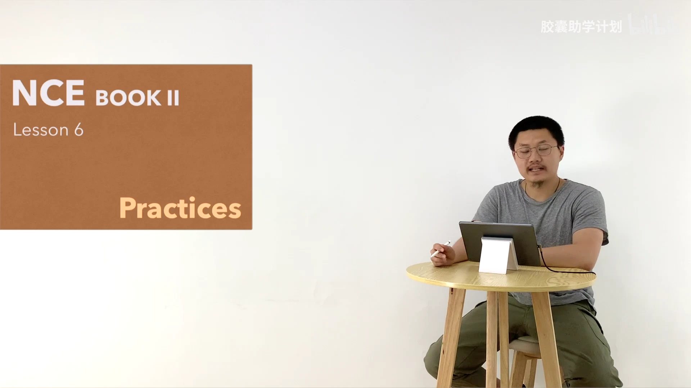

文字识别：胶囊助学计划 / NCE / BOOKII / Lesson 6 / Practices

### 画面 00:00:08

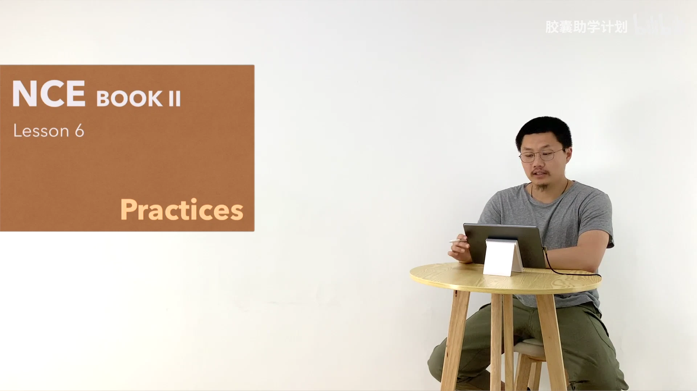

文字识别：胶囊助学计划 / NCE / BOOKI"I / Lesson 6 / Practices

### 画面 00:00:10

文字识别：胶囊助学计划 / 进行如下练习唯一前提 / 文章跟读至熟读成诵 / 否则请勿开始

### 画面 00:00:14

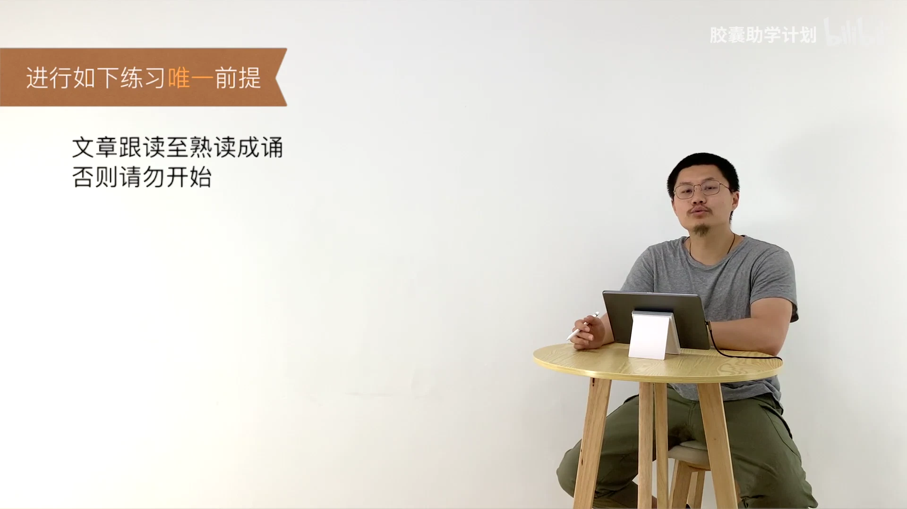

文字识别：胶囊助学计划 / 进行如下练习唯一前提 / 文章跟读至熟读成诵 / 否则请勿开始

### 画面 00:00:17

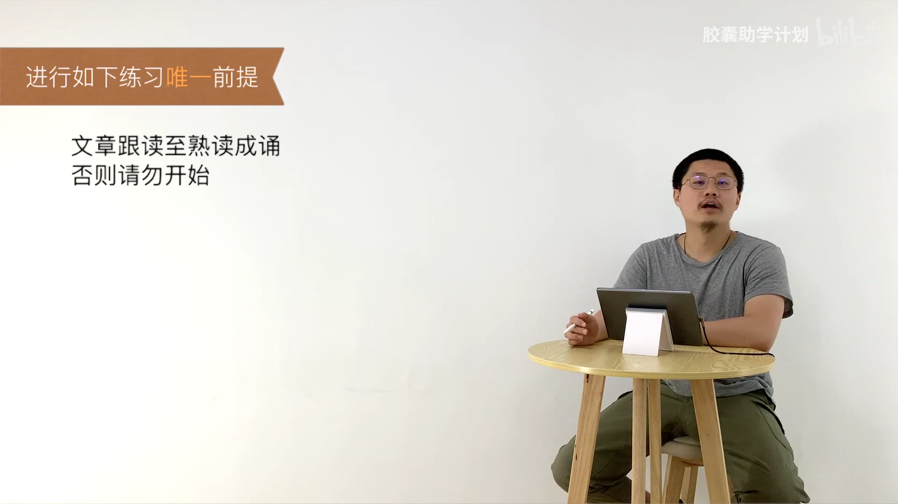

文字识别：胶囊助学计划 / 进行如下练习唯一前提 / 文章跟读至熟读成诵 / 否则请勿开始

### 画面 00:00:19

文字识别：胶囊助学计划bll / •

### 画面 00:00:23

### 画面 00:00:25

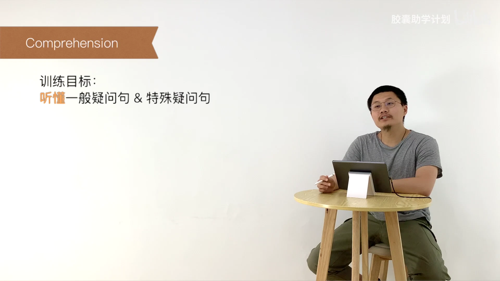

文字识别：胶囊助学计划 / Comprehension / 训练目标： / 听懂一般疑问句＆特殊疑问句

### 画面 00:00:27

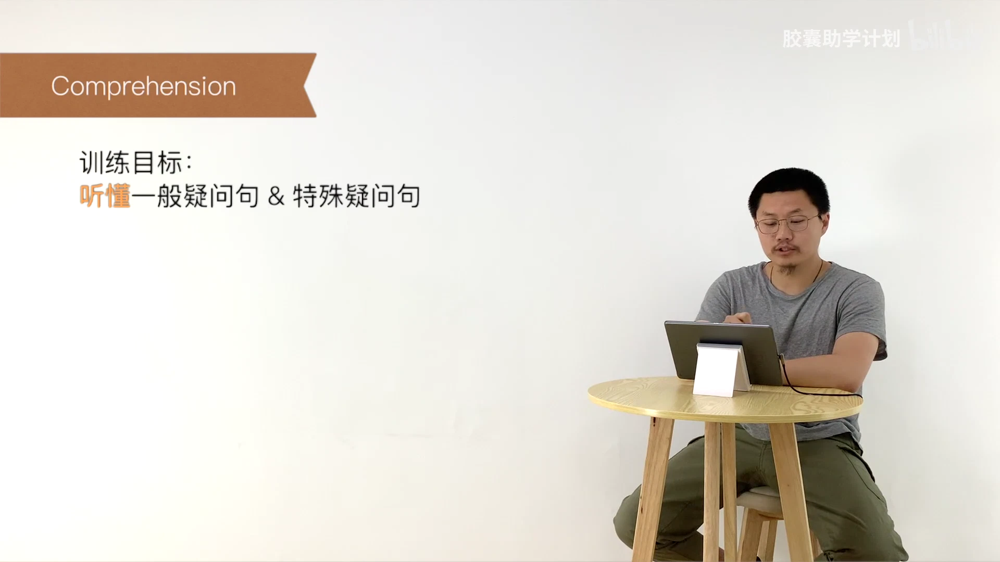

文字识别：胶囊助学计划 / Comprehension / 训练目标： / 听懂一般疑问句＆特殊疑问句

### 画面 00:00:29

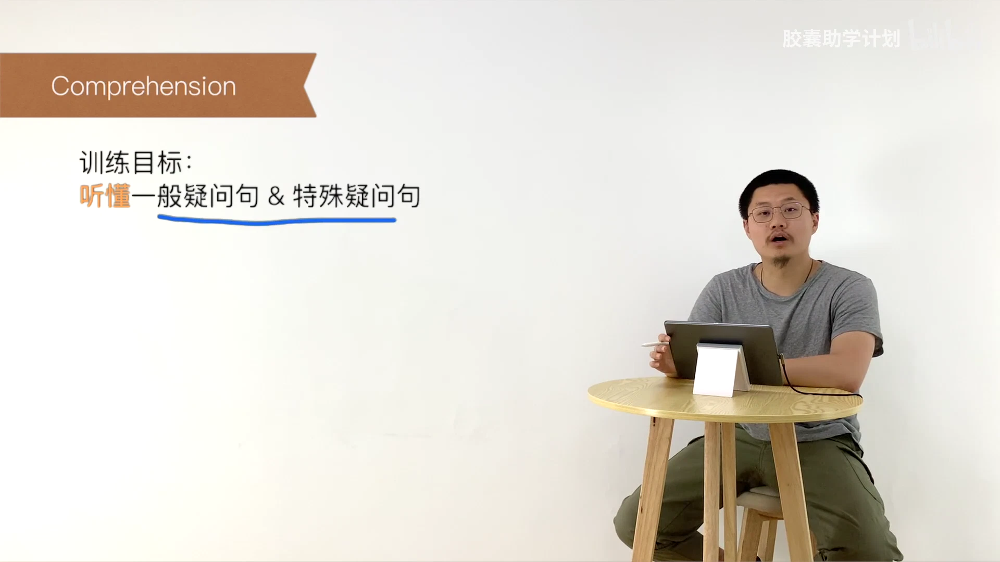

文字识别：胶囊助学计划 / Comprehension / 训练目标： / 听懂一般疑问句＆特殊疑问句

## 00:00:30–00:01:00

特殊疑问句。各各位接下来要做的事情是眼睛离开屏幕，对吧？听我的问题去回答。当然，您也可以眼睛去看着文章找答案。来了，Where have you just moved to? 那 you 现在就指的是作者啊，你就是作者了。To a house in Bridge Street. Next one. Is yours the only house in the street? 你的房子是这个

### 画面 00:00:32

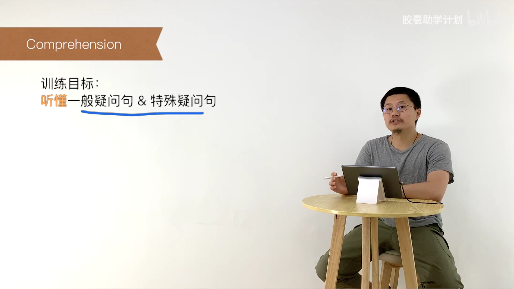

文字识别：胶囊助学计划 / Comprehension / 训练目标： / 听懂一般疑问句＆特殊疑问句

### 画面 00:00:34

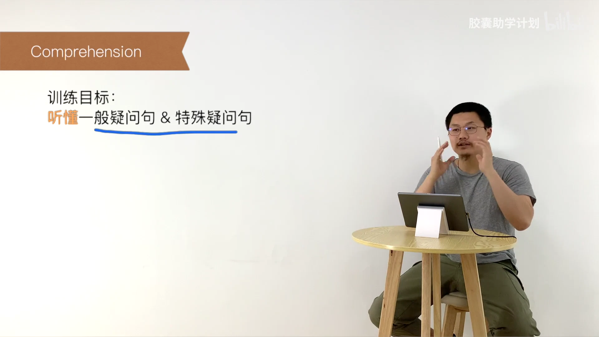

文字识别：胶囊助学计划 / Comprehension / 训练目标： / 听懂一般疑问句＆特殊疑问句

### 画面 00:00:39

文字识别：胶囊助学计划 / Comprehension / 训练目标： / 听懂一般疑问句＆特殊疑问句

### 画面 00:00:41

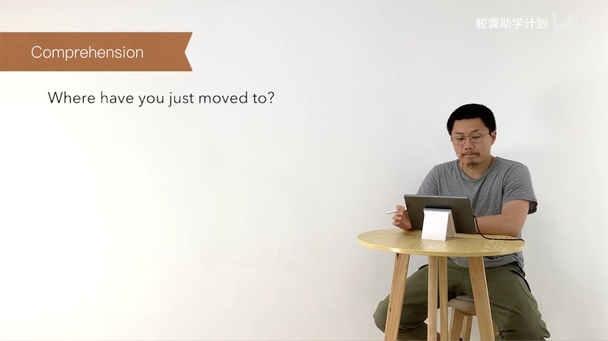

文字识别：胶囊助学计划 / Comprehension / Where have you just moved to?

### 画面 00:00:51

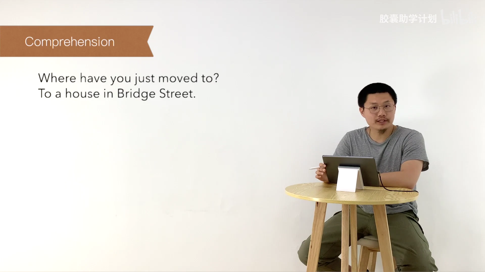

文字识别：胶囊助学计划 / Comprehension / Where have you just moved to? / To a house in Bridge Street.

### 画面 00:00:54

文字识别：胶囊助学计划 / Comprehension / Is yours the only house in the street?

## 00:01:00–00:01:30

house, this street? The only house? Come on, come on. No, it isn't. Next one. What happened yesterday? A beggar knocked at my door. There you go. Continue. What did he ask you for? A meal and a glass of beer. Next one. Did he pay

### 画面 00:01:14

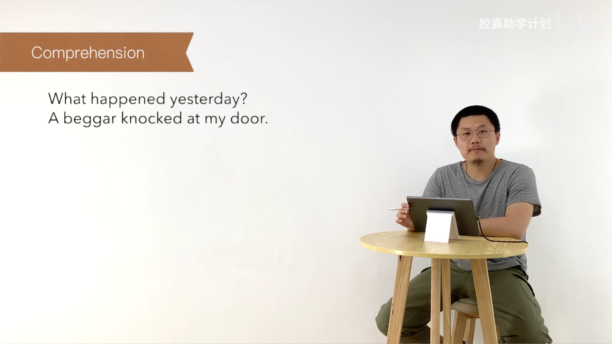

文字识别：胶囊助学计划 / Comprehension / What happened yesterday? / A beggar knocked at my door.

## 00:01:30–00:02:00

you for the meal? No, he didn't. He didn't pay me any money, right? Next one, he didn't pay you for the beer either, did he? No, he didn't. Next one, what did he do in return for this? He stood on his head and sang songs. He ate the food and drank the beer.

### 画面 00:01:33

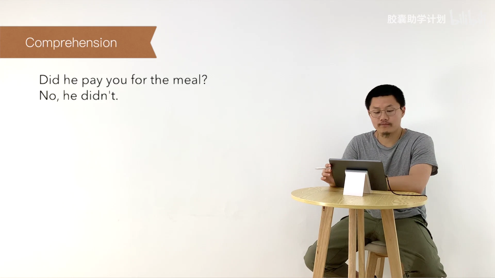

文字识别：胶囊助学计划 / Comprehension / Did he pay you for the meal? / No, he didn't.

### 画面 00:01:52

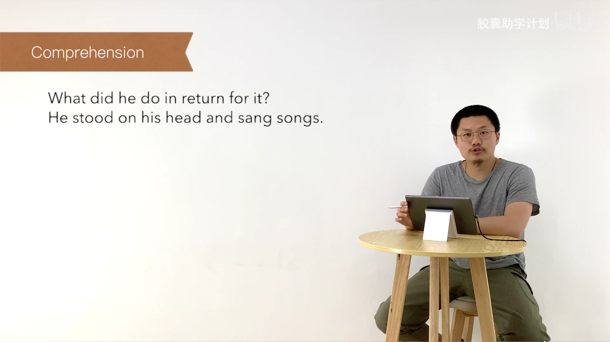

文字识别：胶囊助学计划 / Comprehension / What did he do in return for it? / He stood on his head and sang songs.

### 画面 00:01:57

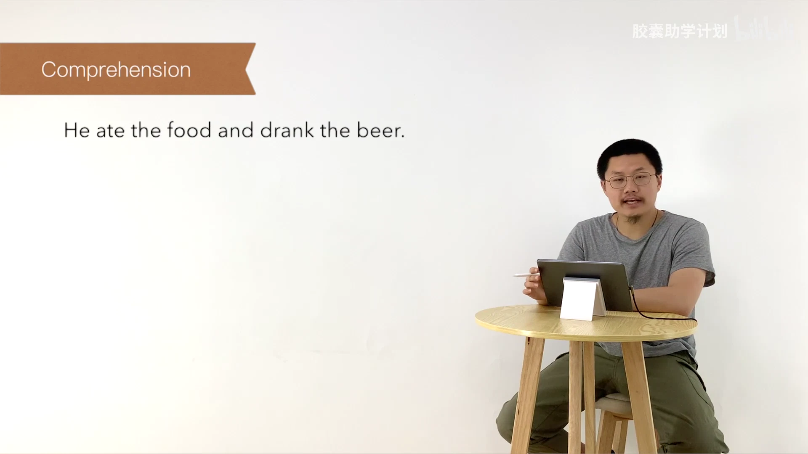

文字识别：胶囊助学计划 / Comprehension / He ate the food and drank the beer.

## 00:02:00–00:02:30

What did he do? That that就是然后. Then he put a piece of cheese in his pocket. Next one, who told you about him later? A neighbor did. Next one, is he well known in Bridge Street? Yes, he is. What's he called?

### 画面 00:02:02

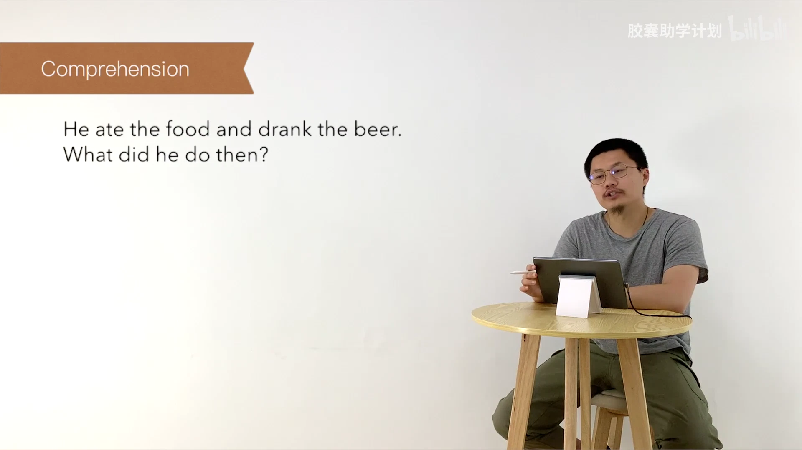

文字识别：胶囊助学计划 / Comprehension / He ate the food and drank the beer. / What did he do then?

### 画面 00:02:06

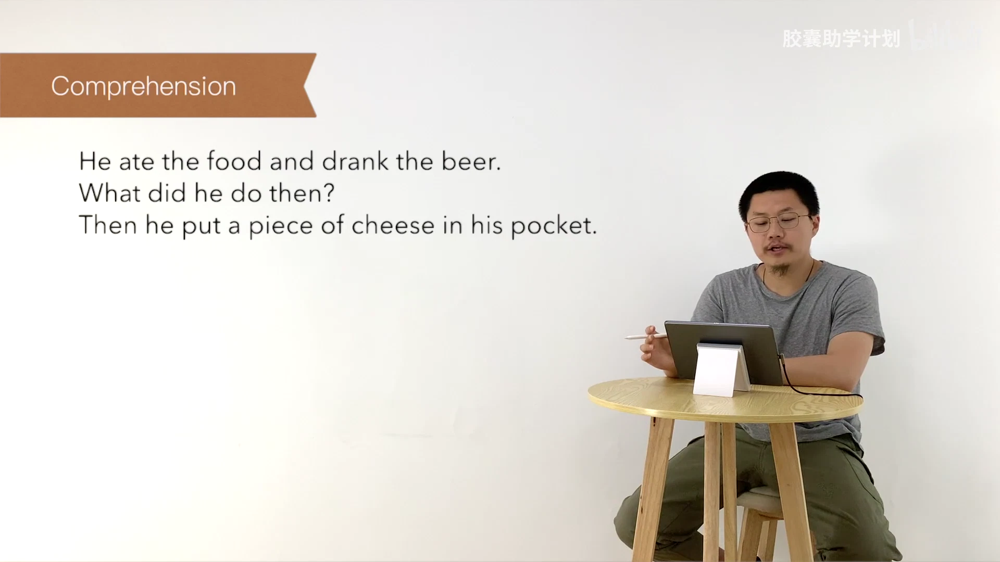

文字识别：胶囊助学计划 / Comprehension / He ate the food and drank the beer. / What did he do then? / Then he put a piece of cheese in his pocket.

### 画面 00:02:11

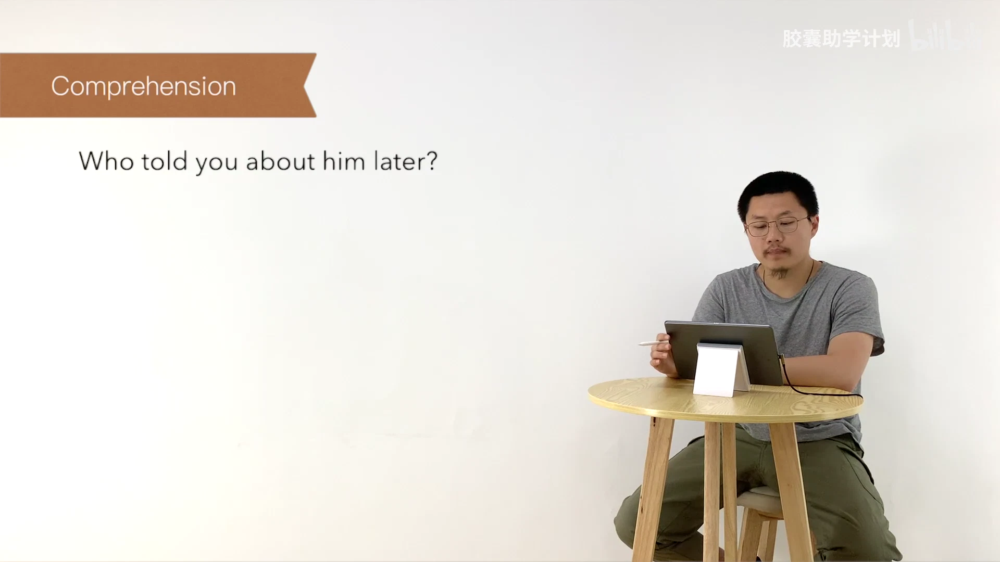

文字识别：胶囊助学计划 / Comprehension / Who told you about him later?

## 00:02:30–00:03:00

Percy Buttons. 好，注意可以抬头看一下。 What's he called? 其实就是 What's his name? 啊，好，继续闭眼或者说看书。 Next one, has he called on you before? 好，不好意思，各位还得抬头啊。我们看一下这个地方， called on 跟 visit 跟 call at 同义词，我就不解释了啊。来了， No, he hasn't. Next one, how

### 画面 00:02:32

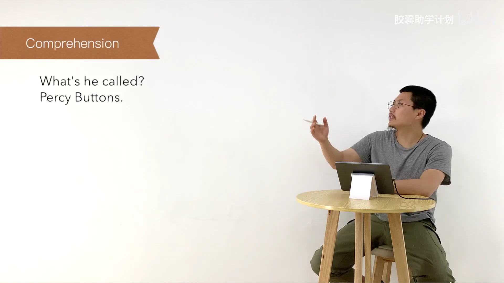

文字识别：胶囊助学计划 / Comprehension / What's he called? / Percy Buttons.

### 画面 00:02:34

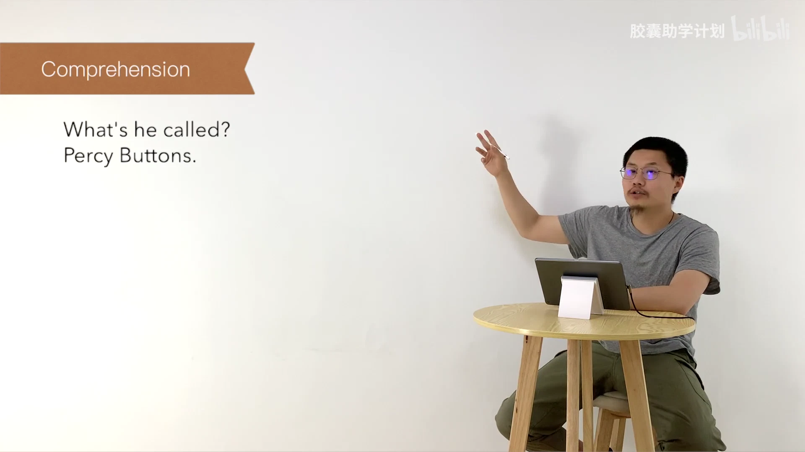

文字识别：胶囊助学计划 / Comprehension / What's he called? / Percy Buttons.

### 画面 00:02:36

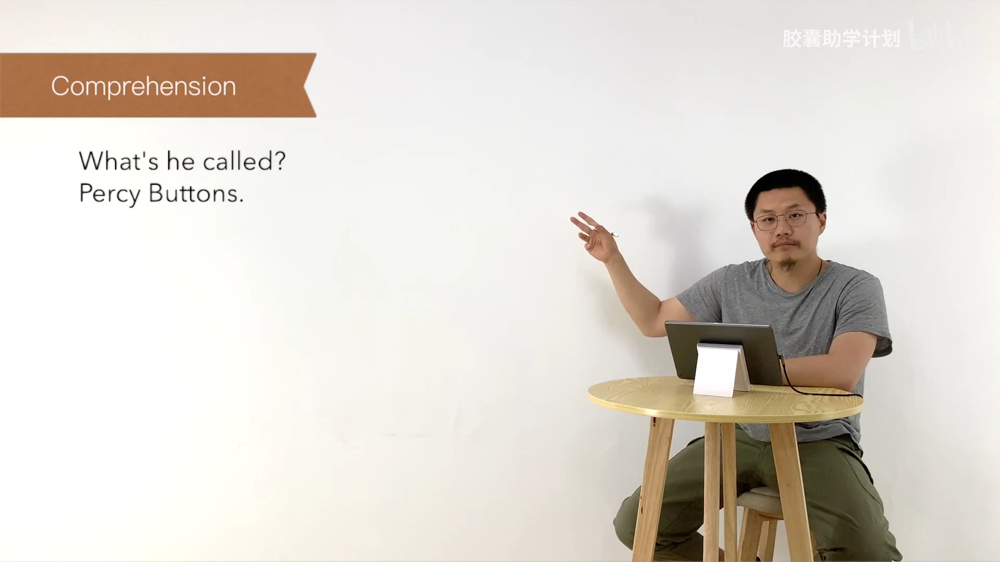

文字识别：胶囊助学计划 / Comprehension / What's he called? / Percy Buttons.

### 画面 00:02:41

文字识别：胶囊助学计划 / Comprehension / Has he called on you before?

### 画面 00:02:45

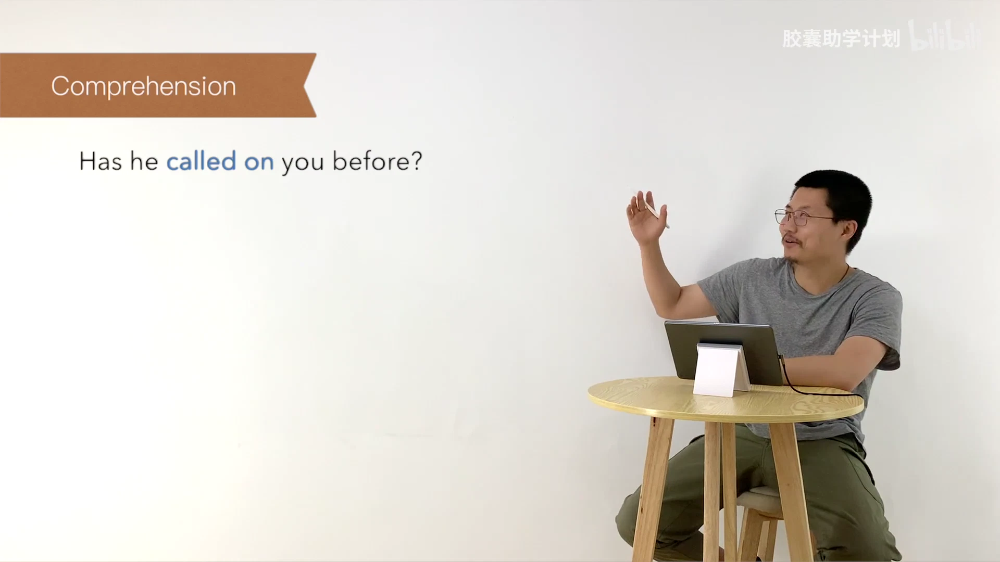

文字识别：胶囊助学计划 / Comprehension / Has he called on you before?

### 画面 00:02:48

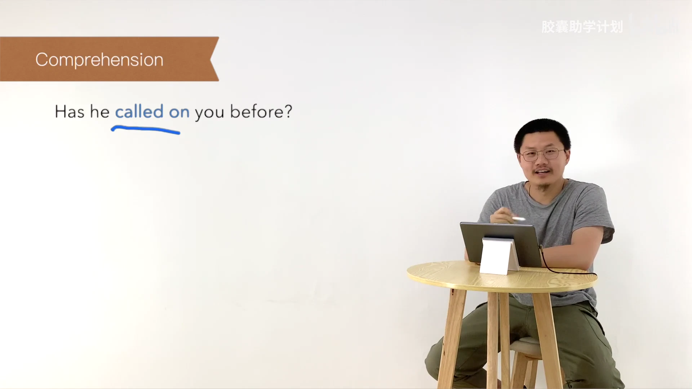

文字识别：胶囊助学计划 / Comprehension / Has he called on you before?

### 画面 00:02:50

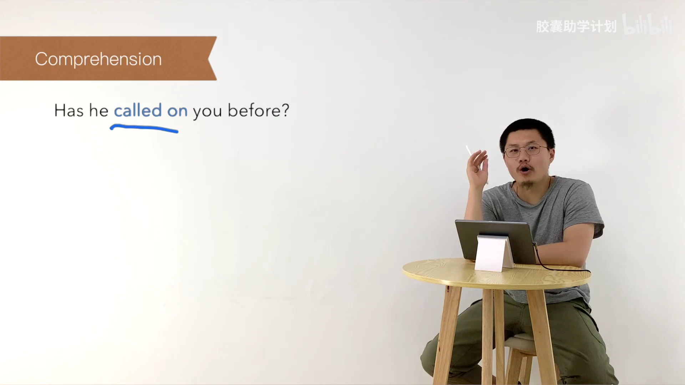

文字识别：胶囊助学计划 / Comprehension / Has he called on you before?

### 画面 00:02:54

文字识别：胶囊助学计划 / Comprehension / Has he called on you before?

### 画面 00:02:58

文字识别：胶囊助学计划 / Comprehension

## 00:03:00–00:03:30

often does he call on the house in Bray Street? Once a month.好，下一道题能会说一般疑问句和特殊疑问句。哎，典型的四句型转化，这是我们单词造句和习惯用法造句的基础，对吧？来了，Ask me if不重要。I've just moved to a house in Bray Street.现在完成时have提前。Have you just moved to a house

### 画面 00:03:08

文字识别：胶囊助学计划 / Asking questions / 训练目标： / 会说一般疑问句＆特殊疑问句

### 画面 00:03:10

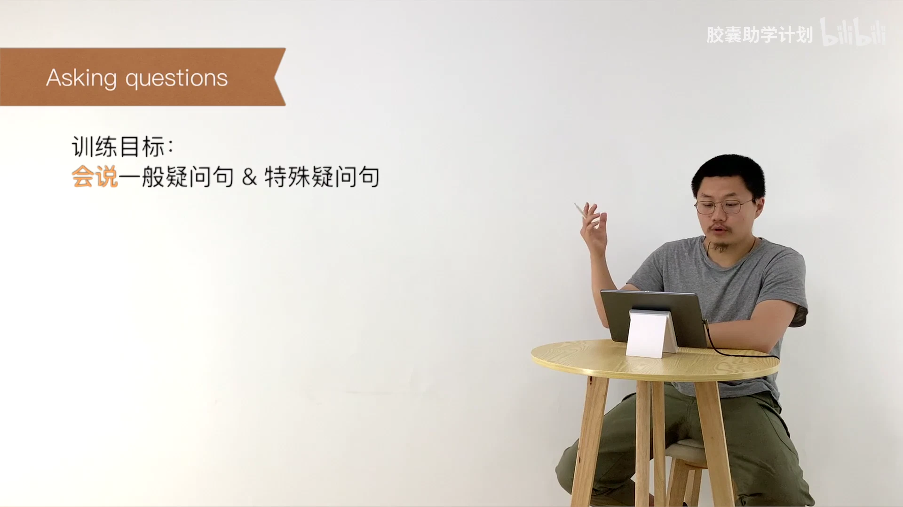

文字识别：胶囊助学计划 / Asking questions / 训练目标： / 会说一般疑问句＆特殊疑问句

### 画面 00:03:13

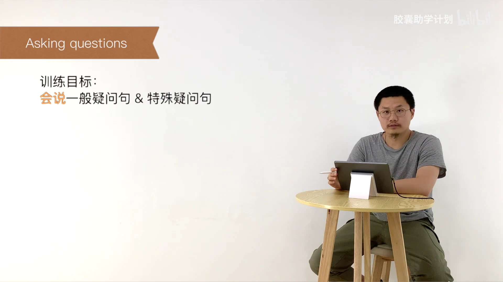

文字识别：胶囊助学计划 / Asking questions / 训练目标： / 会说一般疑问句＆特殊疑问句

### 画面 00:03:17

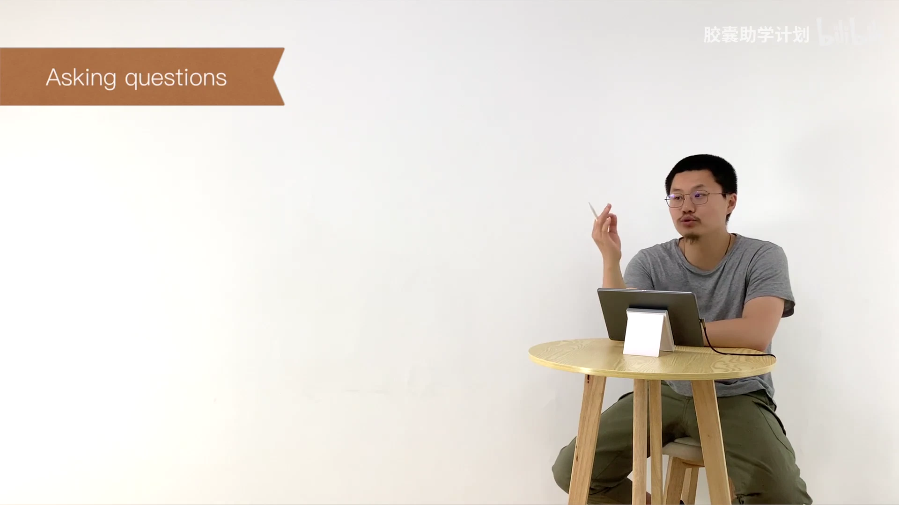

文字识别：胶囊助学计划 / Asking questions

### 画面 00:03:20

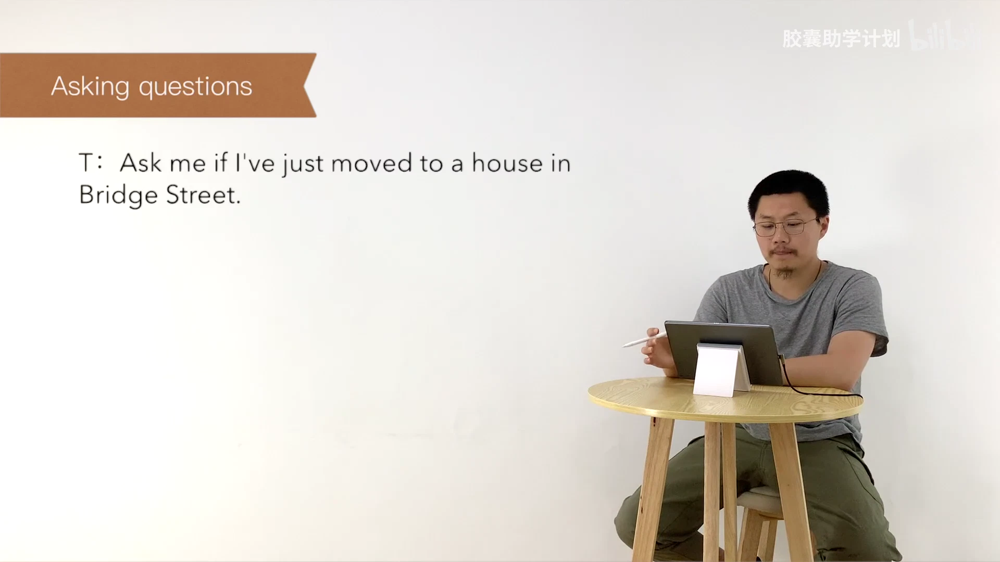

文字识别：胶囊助学计划 / Asking questions / T: Ask me if l've just moved to a house in / Bridge Street.

### 画面 00:03:24

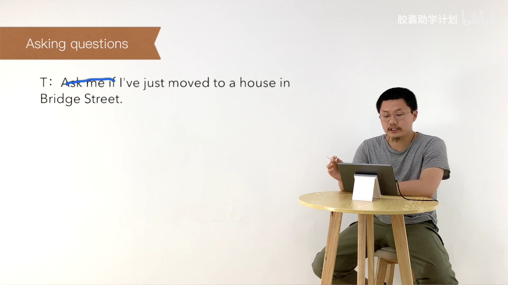

文字识别：胶囊助学计划 / Asking questions / T: Ask meTf I've just moved to a house in / Bridge Street.

## 00:03:30–00:04:00

in Bridge Street? 好 Where 对 In Bridge Street 提问大桥街，于是变成了 Where have you just moved to? 你刚刚搬到了什么地方啊？那 Where 应该是全句了啊，A house in Bridge Street. Where have you just moved to? 你刚刚搬到了什么地方？OK，那接下来我们看第一题 Who Where？刚才我们讲过，不管它 Who 对主语提问，直接替代主语。第二个 A beggar

### 画面 00:03:32

文字识别：胶囊助学计划 / Asking questions / T: Ask meTf I've just moved to a house in / BridgeS / Street. / S: Have you just moved to a house in / Bridge Street? / T:Where...?

### 画面 00:03:34

文字识别：胶囊助学计划 / Asking / questions / T: Ask meTf I've just moved to a house in / Bridge / Street. / S: Have you just moved to a house in / Bridae Street? / T:Where...?

### 画面 00:03:43

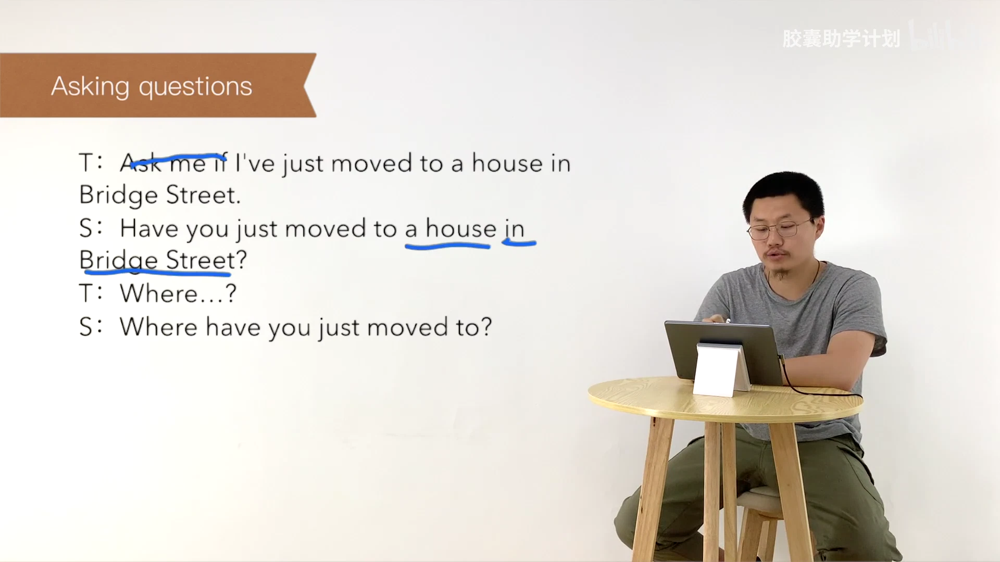

文字识别：胶囊助学计划 / Asking questions / T: Ask me Tf I've just moved to a house in / Bridge S / Street. / S: Have you just moved to a house in / Bridae Street? / T:Where...? / S: Where have you just moved to?

### 画面 00:03:47

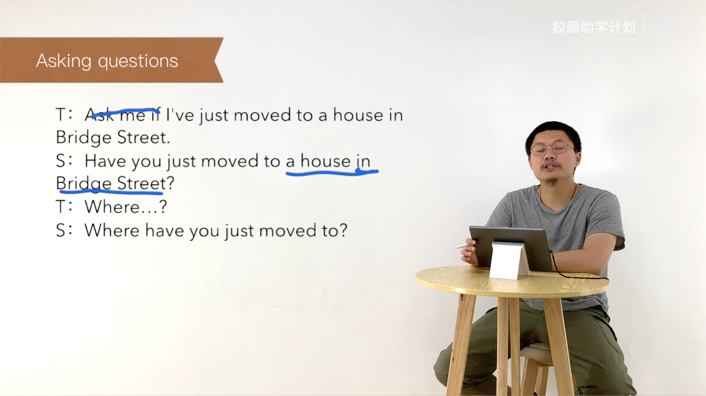

文字识别：胶囊助学计划 / Asking questions / T: Ask meTf I've just moved to a house in / Bridge Street. / S: Have you just moved to a house in / Bridae Street? / T:Where...? / S: Where have you just moved to?

### 画面 00:03:50

文字识别：胶囊助学计划 / Asking questions

### 画面 00:03:54

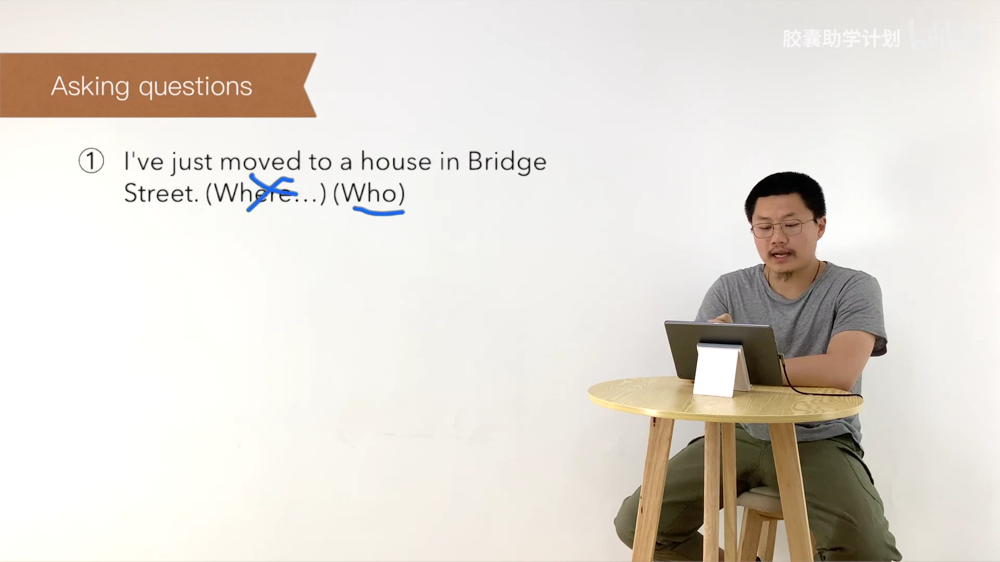

文字识别：胶囊助学计划 / Asking / questions / I've just moved to a house in Bridge / Street. / (WheE..) (Who)

### 画面 00:03:56

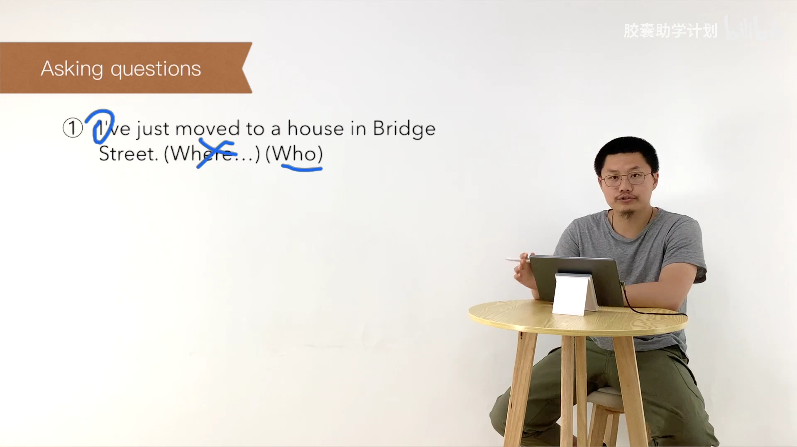

文字识别：胶囊助学计划 / Asking / questions / ve just n / moved to a house in E / Bridge / Street. / (WheE..) (Who)

## 00:04:00–00:04:30

knocked at my door yesterday. 一般过去时, did的提前, 动词换回原形。 Who对主语提问, 直接替代主语。 When对yesterday提问, 还是要变一般疑问句的。 下一题, He wanted a meal and some beer. Wanted一般过去时, did的提前。 What那对a meal and some beer提问, 答案是What did he want? 对吧? OK. 接下来, He stood

### 画面 00:04:04

文字识别：胶囊助学计划 / Asking / questions / e just n / moved to a house in E / Bridge / (WheE..) (Who) / Street. / A beggar / knocked / d at my / door yesterday. / (Who) (When)

### 画面 00:04:08

文字识别：胶囊助学计划 / Asking / questions / Ovej / just / moved to a house in / Bridge / (Whee. / Street. / ..) (Who) / Abeggar / knocked / at my / door yesterday. / (Who) (When) / •

### 画面 00:04:10

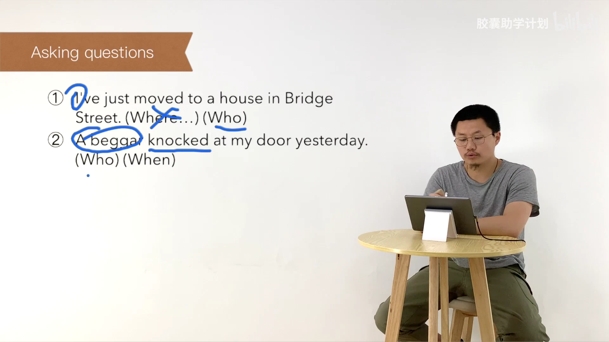

文字识别：胶囊助学计划 / Asking / questions / ve j /  just / moved to a house in / Bridge / Street. / (Where.. / .) (Who) / Abegga / knocked / at my / door yesterday. / (Who) (When) / •

### 画面 00:04:13

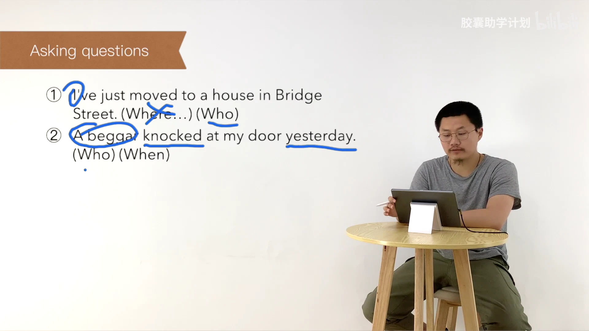

文字识别：胶囊助学计划 / Asking / questions / Ove j /  just / moved to a house in / Bridge / Street. / (Where.. / ..) (Who) / Abegga / knocked / at my / door yesterday. / (Who) (When) / •

### 画面 00:04:19

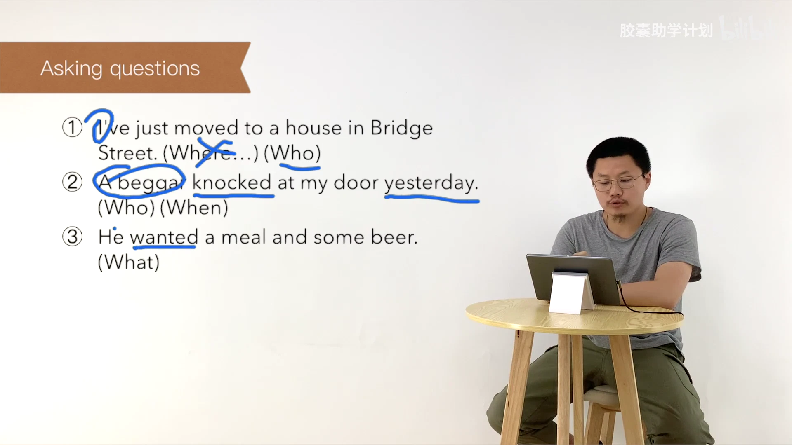

文字识别：胶囊助学计划 / Asking / questions / Street. Where..) (Who) / Abegga / knocked at my  / door yesterday. / (Who)(When) / He / wanted a meal and some beer. / (What)

### 画面 00:04:23

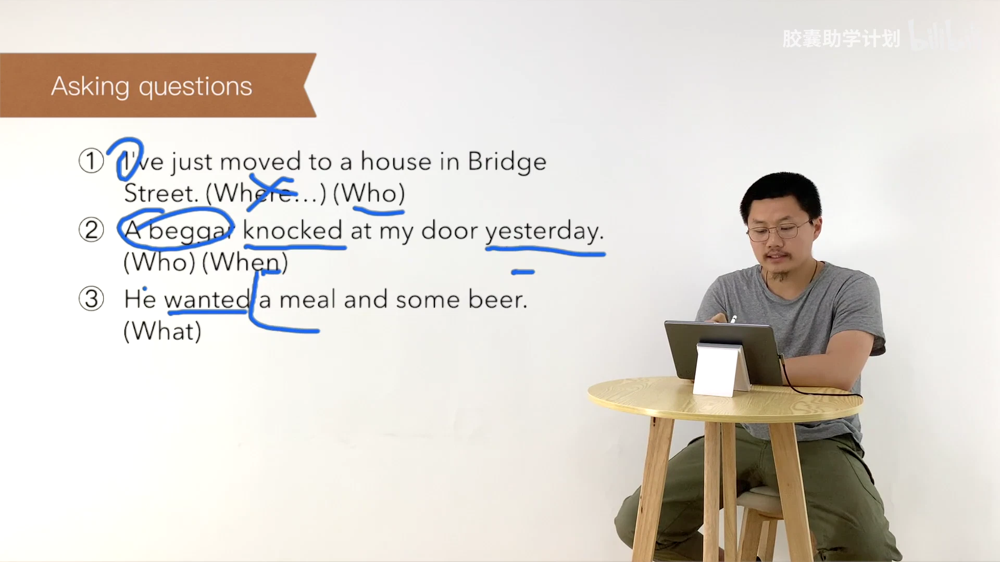

文字识别：胶囊助学计划 / Asking / questions / Bridge / Street. Whee...) (Who) / Abegga / knocked  / at my / door yesterday. / (Who) (When) / He / wanteda meal and some beer. / (What)

### 画面 00:04:25

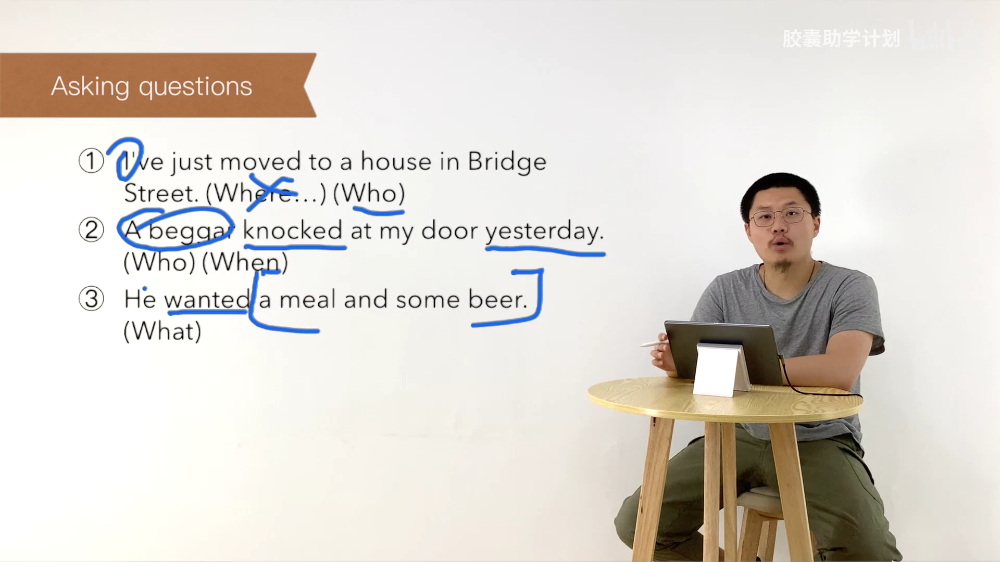

文字识别：胶囊 / Asking / questions / Street. Where..) (Who) / Abegga / knocked / at my / door yesterday. / (Who) (When) / He / wanteda meal and some beer. / (What)

## 00:04:30–00:05:00

on his head and sang songs. Stood did的提前，注意what点儿点儿点儿do，直接的标准答案就是what did he do？您不需要管句子的内容，就是what did he do？他做了什么事情？Okay，下一题I gave him a meal，一般过去时did的提前，动词换回原形，what是对a meal提问。Okay，下一题he put a piece of cheese in his pocket。

### 画面 00:04:32

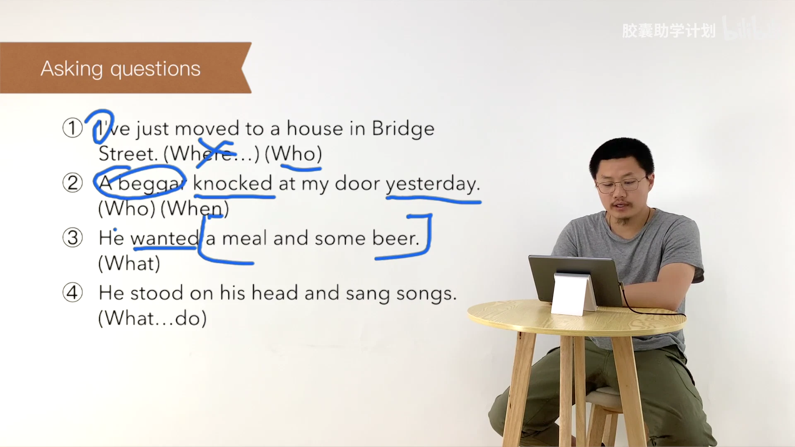

文字识别：胶囊助学计划 / Asking questions / Street. Where...) Who) / Abegga / knocked at my door yesterday. / (Who) (When) / Hey /  wanteda meal and some beer. / (What) / He stood on his head and sang songs. / (What...do)

### 画面 00:04:35

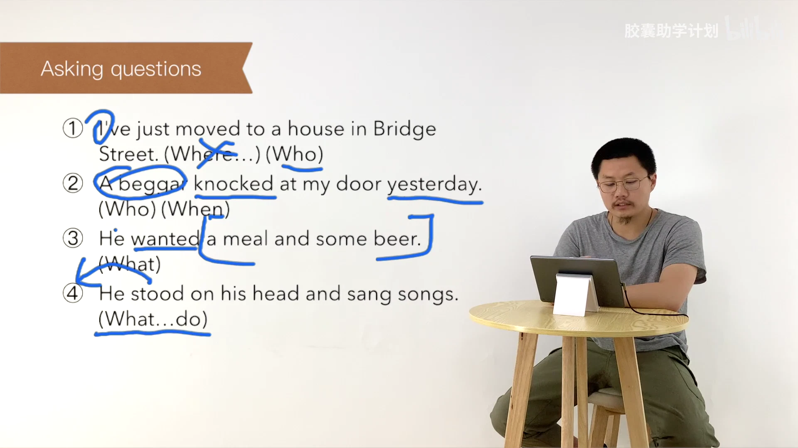

文字识别：胶囊助学计划 / Asking / questions / Street. (Where..) (Who) / Abegga / knocked at my door yesterday. / (Who) (When) / He / wanteda meal and some beer. / L(What) / stood on his head and sang songs. / He / (What...do)

### 画面 00:04:38

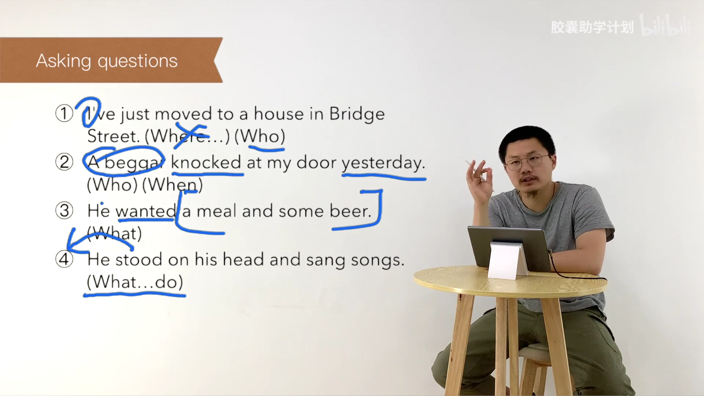

文字识别：胶囊助学计划 / Asking / questions / Street. (WhefE...) (Who) / Abegga / knocked at my door yesterday. / (Who) (When) / He / wanteda meal and some beer. / L (What) / stood on his head and sang songs. / He / (What...do)

### 画面 00:04:46

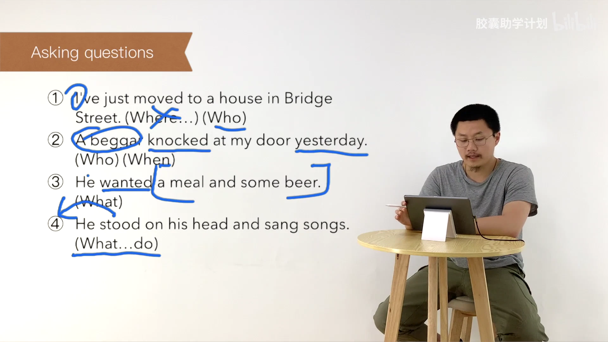

文字识别：胶囊助学计划 / Asking / questions / Street. (Where..) (Who) / Abegga / knocked at my door yesterday. / (Who) (When) / He / wanteda meal and some beer. / L(What) / stood on his head and sang songs. / He / (What...do)

### 画面 00:04:49

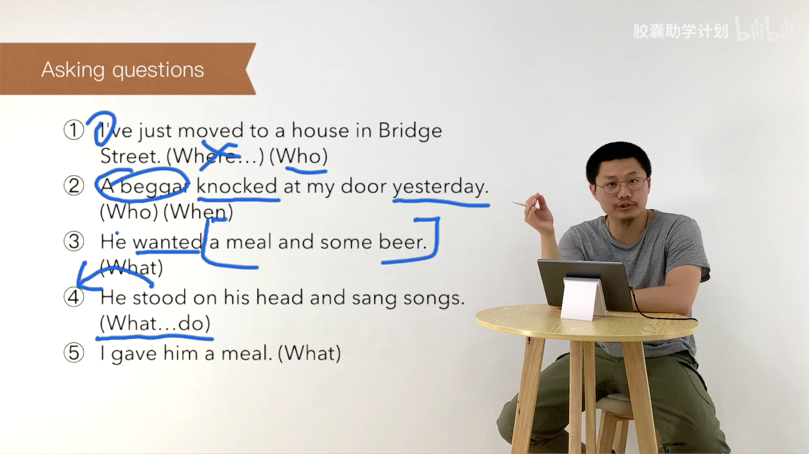

文字识别：胶囊助学计划 / Asking questions / Street. Where..) Who) / Abegga / knocked at my door yesterday. / (Who) (When) / He wanteda meal and some beer. / L (What) /  stood on his head and sang songs. / He / (What...do) / I gave him a meal. (What)

### 画面 00:04:55

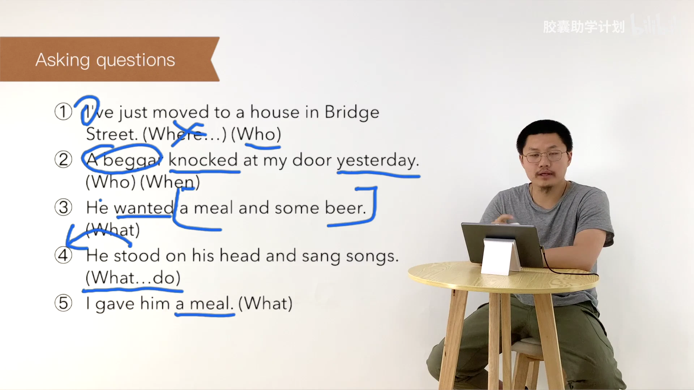

文字识别：胶囊助学计划 / Asking questions / Street. Where...) Who) / Abegga / knocked at my door yesterday. / (Who) (When) / Hey / wanteda meal and some beer. / L (What) / stood on his head and sang songs. / He / (What...do) / Igave / e him a meal. (What)

### 画面 00:04:57

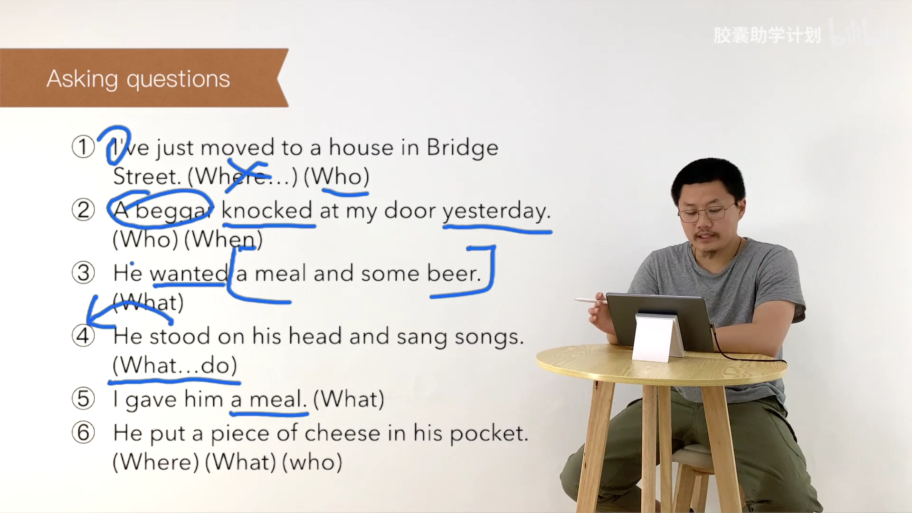

文字识别：胶囊助学计划 / Asking questions / Street. WhefE...) Who) / Abegga k / knocked at my door yesterday. / (Who) (When) / He wanteda meal and some beer. / L (What) / ④He stood on his head and sang songs. / (What...do) / I gave him a meal.(What) / He put a piece of cheese in his pocket. / 6 / (Where)(What) (who)

## 00:05:00–00:05:30

pocket. 讲文章的时候，我提到了 put 是动词的过去式，所以 D 的提前换回原形，原形跟过去式长相一样，都是 put. Where 对 in his pocket 提问，What 对 a piece of cheese 提问，Who 对主语提问，直接替代主语，不要变一般疑问句了。答案是 Who put a piece of cheese in his pocket?

### 画面 00:05:03

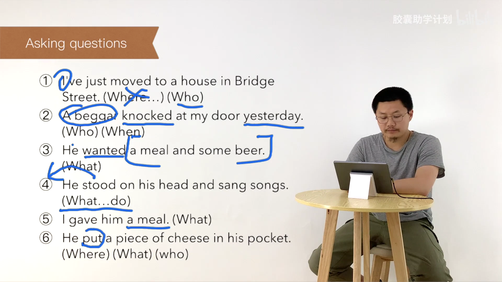

文字识别：胶囊助学计划 / Asking questions / Street. WheFE...) Who) / Abegga / knocked at my door yesterday. / (Who) (When) / He wanteda meal and some beer. / L (What) / He stood on his head and sang songs. / (What...do) / I gave him a meal. (What) / He puta piece of cheese in his pocket. / 6 / (Where)(What) (who)

### 画面 00:05:06

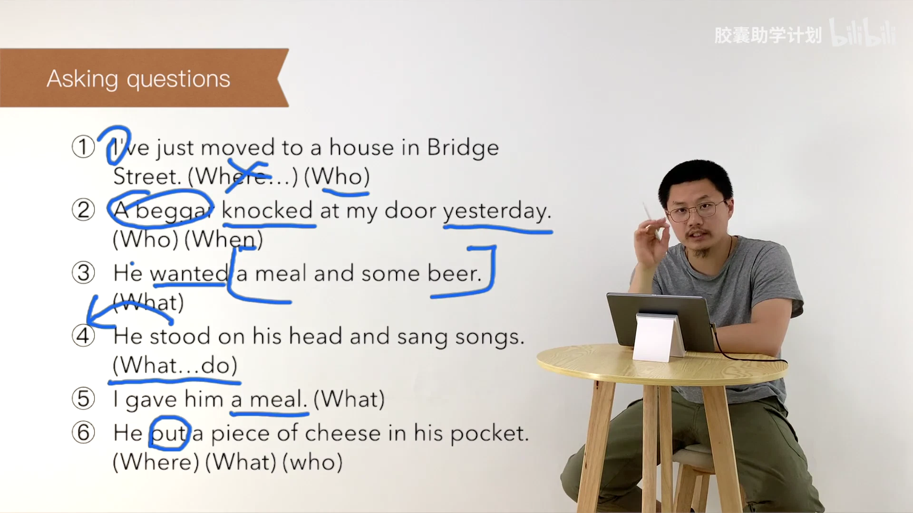

文字识别：胶囊助学计划 / Asking questions / Street. (WherE..) (Who) / Abegga / knocked at my door yesterday. / (Who) (When) / He wanteda meal and some beer. / (What) / He stood on his head and sang songs. / (What...do) / I gave him a meal.(What) / 6 / He / buta piece of cheese in his pocket. / (Where) (What) (who)

### 画面 00:05:13

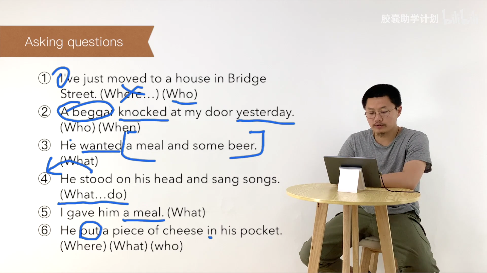

文字识别：胶囊助学计划 / Asking questions / Street. (WheE.) (Who) / Abegga / knocked at my door yesterday. / (Who) (When) / He wanteda meal and some beer. / L (What) / ④He stood on his head and sang songs. / (What...do) / I gave him a meal. (What) / b / 6 / He / buta piece of cheese in his pocket. / (Where) (What) (who)

### 画面 00:05:15

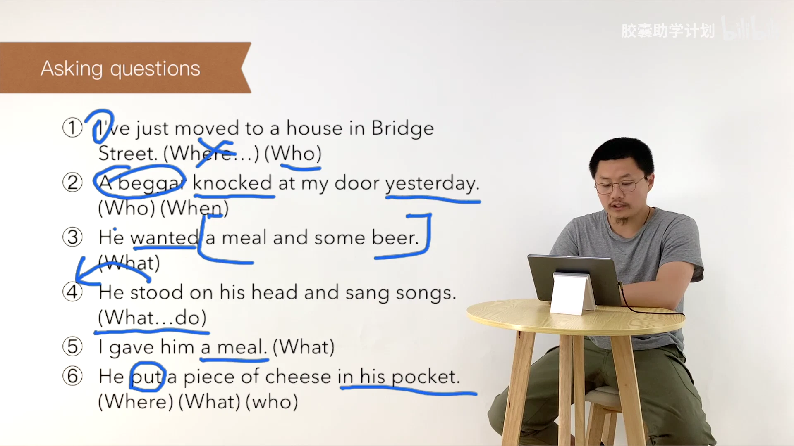

文字识别：胶囊助学计划 / Asking questions / Street. WheE...) Who) / Abegga / knocked at my door yesterday. / (Who) (When) / He wanteda meal and some beer. / L (What) / He stood on his head and sang songs. / (What...do) / I gave him a meal.(What) / 6 / He / puta piece of cheese in his pocket. / (Where) (What) (who)

### 画面 00:05:19

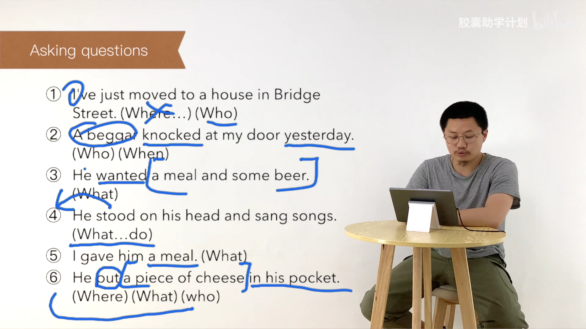

文字识别：胶囊助学计划 / Asking questions / Street. (WheE..) (Who) / Abegga / knocked at my door yesterday. / (Who) (When) / He wanteda meal and some beer. / L (What) / He stood on his head and sang songs. / (What...do) / I gave him a meal. (What) / 6 / He / puta piece of cheesein his pocket. / (Where)(What) (who)

### 画面 00:05:21

文字识别：胶囊助学计划 / Asking questions / Street. (WhefE..) (Who) / Abegga / knocked at my door yesterday. / (Who) (When) / He wanteda meal and some beer. / L (What) / He stood on his head and sang songs. / (What...do) / I gave him a meal. (What) / He / puta piece of cheese in his pocket. / (Where)(What) (who)

### 画面 00:05:28

文字识别：胶囊助学计划 / Asking questions / Street. WhefE...) Who) / Abegga / knocked at my door yesterday. / (Who) (When) / He wanteda meal and some beer. / L(What) / He stood on his head and sang songs. / (What...do) / I gave him a meal.(What) / puta piece of cheesein his pocket. / He / (Where)(What) (who)

## 00:05:30–00:06:00

下一道题，Tell the story.这是我们的口语复述能力。上课我只做演示，各位文章读到非常熟了之后，下课自己去判断。注意这个地方练我们口语练的不是准确性，练的是流利性。OK，准确性不用那么好，流利性一定要稍微好一点。所以一定要熟读成诵再来做这道题。我只做一个演示。

### 画面 00:05:30

文字识别：胶囊助学计划 / Tell the story / 训练目标： / 口语复述能力

### 画面 00:05:35

文字识别：胶囊助学计划 / Tell the story / ① just moved - Bridge Street /  Yesterday - beggar knocked - door / asked - meal - beer / 3 / In return - stood - sang / 4 / ate food- drank - beer / 5 / Then - piece of cheese - pocket-away / Later - neighbour - about him / Everybody - him - name - Percy Buttons / 8 / 9 / ) calls - house - street once a - and - asks - / meal - glass of beer

### 画面 00:05:38

文字识别：胶囊助学计划 / Tell the story / ① /  just moved - Bridge Street / Yesterday - beggar knocked - door / asked - meal - beer /  In return - stood - sang / ate food - drank - beer / Then - piece of cheese - pocket-away / Later - neighbour - about him / Everybody - him - name - Percy Buttons / 8 / 9 /  calls - house - street once a - and - asks - / meal - glass of beer

### 画面 00:05:43

文字识别：胶囊助学计划 / Tell the story / ① just moved - Bridge Street / ② Yesterday - beggar knocked - door / asked - meal - beer /  In return - stood - sang / 4 / ate food - drank - beer / 5 / Then - piece of cheese - pocket-away / Later - neighbour- about him / Everybody - him - name - Percy Buttons / 8 / 9 /  calls - house - street once a - and - asks - / meal - glass of beer

### 画面 00:05:58

文字识别：胶囊助学计划 / Tell the story / ① just moved - Bridge Street /  Yesterday - beggar knocked - door /  asked - meal - beer / 3 / In return - stood - sang / 4 / ate food - drank - beer / 5 / Then - piece of cheese - pocket-away / Later - neighbour - about him / Everybody - him - name - Percy Buttons / 8 / 9 /  calls - house - street once a - and - asks - / meal - glass of beer

## 00:06:00–00:06:30

I have just moved to a house in Bridge Street. Yesterday, a beggar knocked at my door and he asked for a meal and a glass of beer. In return for this, I stood on my head. He stood on his head and some songs. He ate the food and drank the beer. Then he put a piece of cheese in his pocket and went away. Later, a neighbor told me about him. Everybody knows him. His name is Percy Butters. He calls at every house in the street

### 画面 00:06:02

文字识别：胶囊助学计划 / Tell the story / 1 / just moved - Bridge Street / 'Yesterday - beggar knocked - door / asked- meal - beer /  In return - stood - sang / ate food - drank - beer / 5 / Then - piece of cheese - pocket-away / Later - neighbour - about him / Everybody - him - name - Percy Buttons / 8 / 9 /  calls - house - street once a - and - asks - / meal - glass of beer

### 画面 00:06:04

文字识别：胶囊助学计划 / Tell the story / just moved - Bridge Street / Yesterday begs / aoor / asked - meal - beer / In return - stood - sang / ate food - drank - beer / 5 / Then - piece of cheese - pocket-away / Later - neighbour - about him / Everybody - him - name - Percy Buttons / 8 / 9 / calls - house - street once a - and - asks - / meal - glass of beer

### 画面 00:06:06

文字识别：胶囊助学计划 / Tell the story / ① / just moved - Bridge Street / )Yesterday- beggar knocked - door / asked - meal - beer / 3 /  In return - stood - sang / 4） / ate food - drank - beer / 5 / Then - piece of cheese - pocket-away / Later- neighbour - about him / Everybody - him - name - Percy Buttons / 8 / 9 /  calls - house - street once a - and - asks - / meal - glass of beer

### 画面 00:06:08

文字识别：胶囊助学计划 / Tell the story / ① / just moved - Bridge Street / ② Yesterday - beggar knocked - door / ③ asked - meal - beer / In return - stood - sang / ate food - drank - beer / 5 / Then - piece of cheese - pocket-away / Later - neighbour - about him / Everybody - him - name - Percy Buttons / 8 / 9 / calls - house - street once a - and - asks - / meal - glass of beer

### 画面 00:06:15

文字识别：胶囊助学计划 / Tell the story / 1 /  just moved - Bridge Street /  Yesterday - beggar knocked - door / ③ asked- meal - beer / In return - stood - sang / 5 /  ate food - drank- beer / Then - piece of cheese - pocket-away / 6 / Later - neighbour - about him / Everybody - him - name - Percy Buttons / 8 /  calls - house - street once a - and - asks - / 9 / meal - glass of beer

### 画面 00:06:23

文字识别：胶囊助学计划 / Tell the story / 1 / just moved - Bridge Street / ② Yesterday - beggar knocked - door / ③ asked -meal- beer / In return - stood - sang /  ate food - drank - beer / 5 / Then - piece of cheese - pocket-away / Later - neighbour - about him / Everybody - him - name - Percy Buttons / calls - house - street once a - and - asks - / 9 / meal - glass of beer

### 画面 00:06:29

文字识别：胶囊助学计划 / Tell the story / just moved - Bridge Street /  Yesterday - beggar knocked - door / ③ asked- meal - beer / In return - stood - sang / ate food - drank- beer / 5 / Then - piece of cheese - pocket-away / Later - neighbour - about him / Everybody - him - name - Percy Buttons / 9 /  calls - house - street once a - and - asks - / meal - glass of beer

## 00:06:30–00:07:00

once a month, and always asks for a meal and a glass of beer. There you go. 好，各位如果还是那句话，你回去把我刚才复述的这个东西和原文仔细的去对比，绝对有的地方是不一样的。我并没有把这篇文章背下来，但是任何一个人只要你文章非常熟悉了啊，包括你文章不熟悉，只要你英文非常好了，只要能听懂刚才我这句话所理解出来的故事和原文的故事没有任何差别。 OK, there

### 画面 00:06:39

文字识别：胶囊助学计划 / Tell the story / ① /  just moved - Bridge Street /  Yesterday - beggar knocked - door / ③ asked - meal - beer / In return - stood - sang / ate food - drank- beer / Then - piece of cheese - pocket-away / Later - neighbour - about him / Everybody - him - name - Percy Buttons / 9 /  calls - house - street once a - and - asks - / meal - glass of beer

## 00:07:00–00:07:30

有一个。那最后呢，我们要看一下这个 summary writing 啊，那它的答案在这个地方。练习的是我们写作的复述能力。我们只提供答案，练习是直接在我们的这个文章课文的下边就有的，我们就不多做解释了。好，这是我们的答案，各位可以去截图啊。好，接下来最后的最后， topic for discussion，完全自由的对话。这也许我们目前做不到，但是我们做所有练习最终的目的就是

### 画面 00:07:00

文字识别：胶囊助学计划 / Summary writing: Key / 训练目标： / 写作复述能力

### 画面 00:07:15

文字识别：胶囊助学计划 / Summary writing: Key / The writer has just moved to a house in / Bridge Street. A beggar knocked at her door / yesterday. He sang songs. The writer gave / him a meal and a glass of beer in return for / this. The beggar's name is Percy Buttons. He / calls at every house in the street once a / month.

### 画面 00:07:20

文字识别：胶囊助学计划 / Topics for discussion / 训练目标： / 完全自由的对话

### 画面 00:07:23

文字识别：胶囊助学计划 / Topics for discussion / 训练目标： / 完全自由的对话

### 画面 00:07:25

文字识别：胶囊助学计划 / Topics for discussion / 训练目标： / 完全自由的对话

## 00:07:30–00:08:00

这一道题，叫做完全自由的对话。说 Do you think this story is true? 你认为这个故事是真的吗？ Why? Why not? 为什么是真的？为什么不是真的？ OK，下一个说 How did people pay for things long ago? 人们在很久以前是如何购物的？如何去买东西的呢？ Before we had money. 注意，在我们有钱之前，人们是如何去购买东西的呢？第三

### 画面 00:07:31

文字识别：胶囊助学计划 / Topics for discussion / Do you think this story is true? Why/Why / not? / How did people pay for things long ago, / 2 / before we had money? / Imagine you are very I / hungry, but have / 3 / no money for a meal. What would you / do?

### 画面 00:07:35

文字识别：胶囊助学计划 / Topics for discussion / Do you think this story is true? Why/Why / not? / How did people pay for things long ago, / 2 / before we /  had money? / 3 / Imagine you are very  / hungry, but have / no money for a meal. What would you / do?

### 画面 00:07:38

文字识别：胶囊助学计划 / Topics for discussion / Do you think this story is true? Why/Why / not? / How did people pay for things long ago, / before we / had money? / 3 / Imagine you are very / hungry, but have / no money for a meal. What would you / do?

### 画面 00:07:43

文字识别：胶囊助学计划 / Topics for discussion / Do you think this story is true? Why/Why / not? / How did people pay for things long ago, / before we / had r / I money? / 3 / Imagine you a / are very / hungry, but have / for a meal. What would you / no money f / do?

### 画面 00:07:52

文字识别：胶囊助学计划 / Topics for discussion / Do you think this s /  story is true? Why/Why / not? / How did people pay for things long ago, / before we had money? / 3 / Imagine / you / are / very / hungry, k / but have / money / for a meal. / 1. What would / you / no / do?

### 画面 00:07:57

文字识别：胶囊助学计划 / Topics for discussion / Do you think this  / story is true? Why/Why / not? / How did people pay for things long ago, / before we had / money? / 3 / Imagine / you / are / very / hungry, / but have / money / for a meal. What would / you / no / do?

## 00:08:00–00:08:30

个说，You imagine you are very hungry, but have no money for a meal. What would you do? 现在假想一下，你非常的饿，但是你又没有买食物的钱，你怎么办？啊，尽量别偷别抢，对吧？我们去找人要呗。怎么能把这顿饭要来？很有意思。OK，我自己就去做过这样的事情，很有意思。最终要来了。OK，好，那这三个话题就是我们去用英文去可以进行一些表达啊，单词用我们学过的单

### 画面 00:08:00

文字识别：胶囊助学计划 / Topics for discussion / Do you think this s /  story is true? Why/Why / not? / How did people pay for things long ago, / before we had money? / Imagine / you / are / very / hungry, / but have / money / for a meal. What would / you / noI / do?

### 画面 00:08:09

文字识别：胶囊助学计划 / Topics for discussion / Do you think this story is true? Why/Why / not? / How did people pay for things long ago, / before we had money? / Imagine / you / are very / hungry, / but have / money / for a meal. What would / you / noI / do?

### 画面 00:08:18

文字识别：胶囊助学计划 / Topics for discussion / Do you think this s /  story is true? Why/Why / not? / How did people pay for things long ago, / before we had money? / Imagine / you / are / very / hungry, / but have / money / for a meal. What would / you / no / do?

### 画面 00:08:28

文字识别：胶囊助学计划 / Topics for discussion / Do you think this s /  story is true? Why/Why / not? / How did people pay for things long ago, / before we had money? / Imagine / you / are very / hungry, / but have / money / for a meal. What would / you / noI / do?

## 00:08:30–00:09:00

词、语法和习惯用法，以及语音、语调、语速去描述出来。但是前提是，如果您现在做不到，你不妨先用汉语给自己尝试着总结，去说一说。这个对我们的语言提升也是有帮助的，它是能帮助我们提升英文的，这是很神奇的事情。OK，好，那我们看一下家庭作业。第一，ask me if这道题，你要先写下来，一定要先写，然后同时必须还要大声的

### 画面 00:08:31

文字识别：胶囊助学计划 / Topics for discussion / Do you think this story is true? Why/Why / not? / How did people pay for things long ago, / before we had money? / Imagine / you / are / very / hungry, / but have / money / for a meal. What would / you / noI / do?

### 画面 00:08:37

文字识别：胶囊助学计划 / Topics for discussion / Do you think this s / ; story is true? Why/Why / not? / How did people pay for things long ago, / before we had money? / Imagine / you / are / very / hungry, / but have / money / for a meal. What would / you / noI / do?

### 画面 00:08:41

文字识别：胶囊助学计划 / Topics for discussion / Do you think this s /  story is true? Why/Why / not? / How did people pay for things long ago, / before we had money? / Imagine / you / are / : very / hungry, / but have / money / for a meal. What would / you / noI / do?

### 画面 00:08:50

文字识别：胶囊助学计划

### 画面 00:08:52

文字识别：胶囊助学计划 / 1.Ask me if写&朗读

### 画面 00:08:55

文字识别：胶囊助学计划 / 1.Ask me if写&朗读

## 00:09:00–00:09:30

去朗读你写出来的这个答案。OK，接下来摘要写作，各位还是先写，然后在我们这儿对答案。然后呢，tell the story 口语复述，我上课只是做了一个示范，各位下课自己还要再去自己去磕磕绊绊的把它呃这个复述出来。最后呢，各位可以在我们的专栏当中找到这些对应的练习。以上就是本期视频的全部内容了。如果大家喜欢我们的课程呢，欢迎大家关注、订阅、一键三

### 画面 00:09:00

文字识别：胶囊助学计划 / 1.Ask me if写&朗读

### 画面 00:09:02

文字识别：胶囊助学计划 / 1.Ask me if写&朗读 / 2. / 摘要写作写&答案

### 画面 00:09:05

文字识别：胶囊助学计划 / 1.Ask me if写&朗读 / 2. / 摘要写作写&答案

### 画面 00:09:07

文字识别：胶囊助学计划 / 宁 / 1.Ask me if写&朗读 / 摘要写作写&答案 / 3.Tell the story 口语复述

### 画面 00:09:10

文字识别：胶囊助学计划 / 1.Ask me if写&朗读 / 摘要写作写&答案 / 3.Tell the story 口语复述

### 画面 00:09:15

文字识别：胶囊助学计划 / 1.Ask me if写&朗读 / 摘要写作写&答案 / 3.Tell the story 口语复述

### 画面 00:09:19

文字识别：胶囊助学计划 / 1.Ask me if写&朗读 / 摘要写作写&答案 / 3.Tell the story 口语复述 / 专栏 / 4.

### 画面 00:09:21

文字识别：胶囊助学计划 / 1.Ask me if写&朗读 / 摘要写作写&答案 / 3.Tell the story 口语复述 / 专栏 / 4.

### 画面 00:09:23

文字识别：胶囊助学计划

### 画面 00:09:25

文字识别：胶囊助学计划

### 画面 00:09:29

文字识别：胶囊助学计划

## 00:09:30–00:09:47

连，啊，并支持我们，分享给那些需要的朋友们。See you next time.

### 画面 00:09:32

文字识别：胶囊助学计划

### 画面 00:09:35

### 画面 00:09:37

文字识别：CAPSULEACADEMY / 胶囊助学计划 / 小红书 / Lecturer / Leo / OE

### 画面 00:09:40

文字识别：CAPSULEACADEMY / 胶囊助学计划 / 『 / 小红书 / Edita. / OE

### 画面 00:09:43

文字识别：CAPSULEACADEMY / 胶囊助学计划 / 『 / 小红书 / Creator / Leo & Berlin / OE

### 画面 00:09:45

文字识别：bilibili / 胶囊助学计划 / APSULEACA / 胶囊助学计划 / 小红书 / 品 / OE

### 画面 00:09:47

文字识别：bilibili / 胶囊助学计划

