# L007 单词

快速机器解析：语音为单模型转写，未进行独立交叉校对或人工复核；画面每秒采样并按变化选帧，短时文字和标记可能遗漏。截图时间约有 1 秒误差。图片有损压缩；遇到疑点请按时间查看 Google Drive 原视频。

## 00:00:00–00:00:30

Hello everyone, welcome to Capsule Academy. This is Leo. Today we're going to learn new concept in English book two, lesson seven. Words or拼音呢? Enjoy it.好，那我们上来先看第一个单词，跟我一起读一下，来叫做 detective detective，三个音节，注意重音在第二个音节上，第二个音节往上提一点，叫 detective，

### 画面 00:00:00

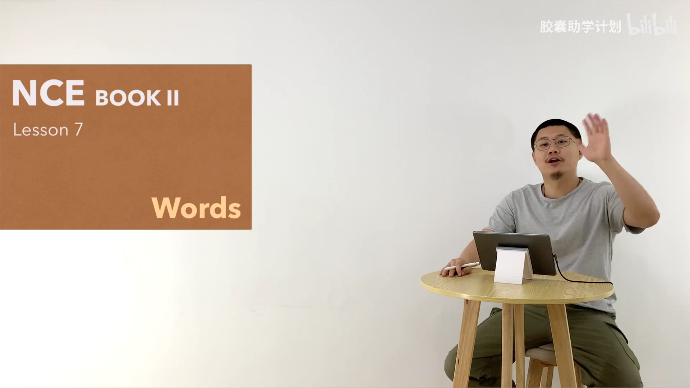

文字识别：胶囊助学计划 / NCE / BOOKI"I / Lesson 7 / Words

### 画面 00:00:02

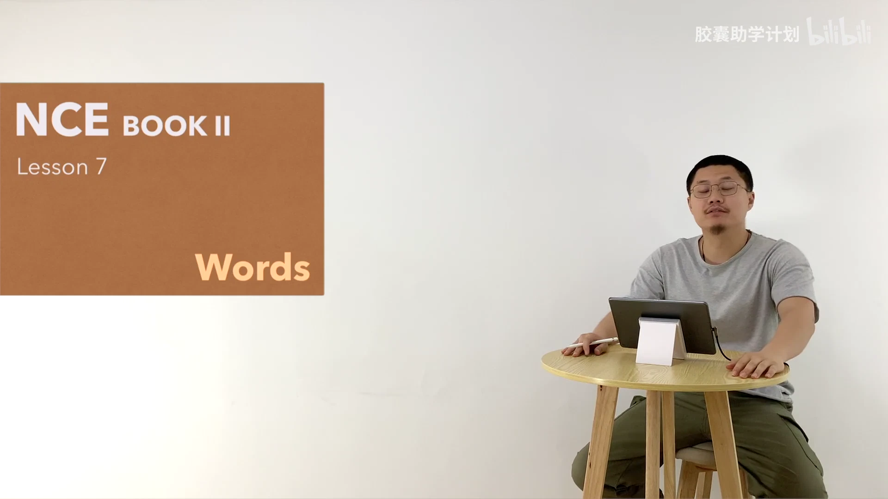

文字识别：胶囊助学计划 / NCE / BOOKII / Lesson 7 / Words

### 画面 00:00:05

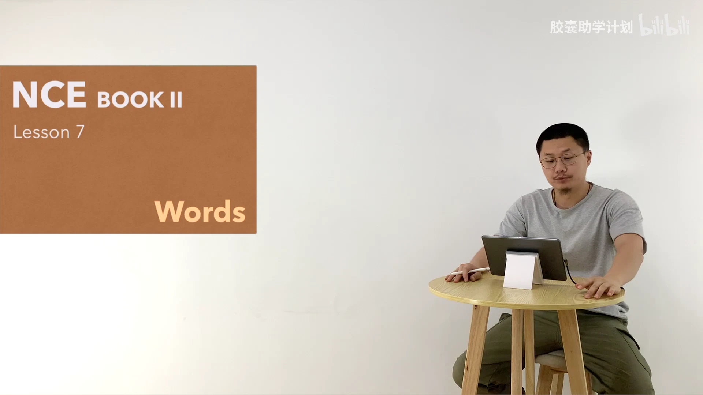

文字识别：胶囊助学计划 / NCE / BOOKI"I / Lesson 7 / Words

### 画面 00:00:09

文字识别：胶囊助学计划bill / •

### 画面 00:00:13

### 画面 00:00:15

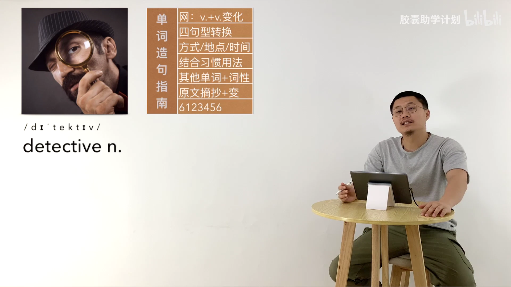

文字识别：单词造句指南 / 网：v.+v.变化 / 胶囊助学计划 / 四句型转换 / 方式/地点/时间 / 结合习惯用法 / 其他单词+词性 / 原文摘抄+变 / 6123456 / /dr'tektIv/ / detective n.

### 画面 00:00:17

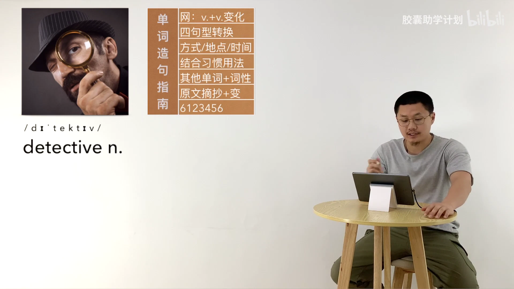

文字识别：单词造句指南 / 网：v.+v.变化 / 胶囊助学计划 / 四句型转换 / 方式/地点/时间 / 结合习惯用法 / 其他单词+词性 / 原文摘抄+变 / 6123456 / /dr'tektIv/ / detective n.

### 画面 00:00:19

文字识别：单词造句指南 / 网：v.+v.变化 / 胶囊助学计划 / 四句型转换 / 方式/地点/时间 / 结合习惯用法 / 其他单词+词性 / 原文摘抄+变 / 6123456 / /dr'tektIv/ / detective n.

### 画面 00:00:21

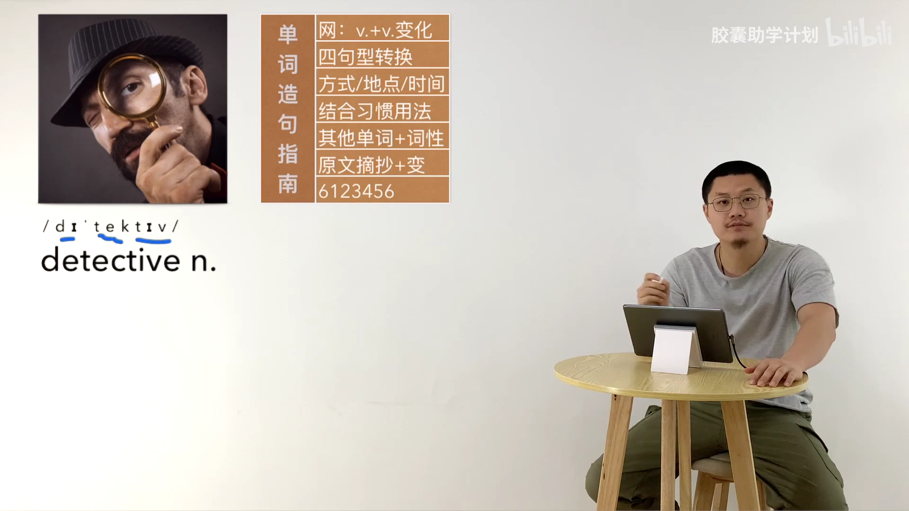

文字识别：单词造句指南 / 网：v.+v.变化 / 胶囊助学计划 / 四句型转换 / 方式/地点/时间 / 结合习惯用法 / 其他单词+词性 / 原文摘抄+变 / 6123456 / /dI'tektIv/ / detective n.

### 画面 00:00:23

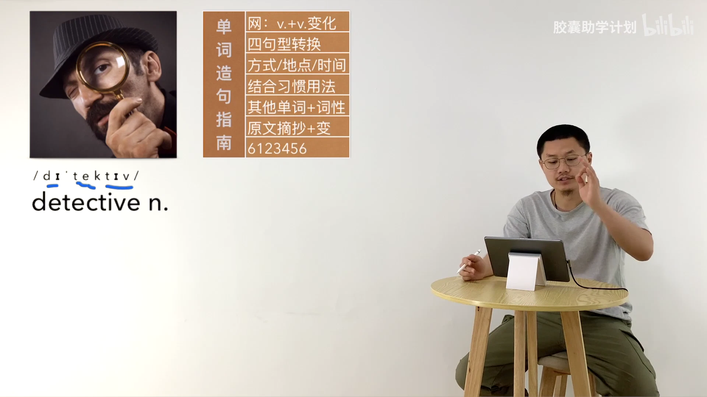

文字识别：单词造句指南 / 网：v.+v.变化 / 胶囊助学计划 / 四句型转换 / 方式/地点/时间 / 结合习惯用法 / 其他单词+词性 / 原文摘抄+变 / 6123456 / /di'tektIv/ / detective n.

### 画面 00:00:25

文字识别：单词造句指南 / 网：v.+v.变化 / 胶囊助学计划 / 四句型转换 / 方式/地点/时间 / 结合习惯用法 / 其他单词+词性 / 原文摘抄+变 / 6123456 / /dI'tektIv/ / detective n.

### 画面 00:00:27

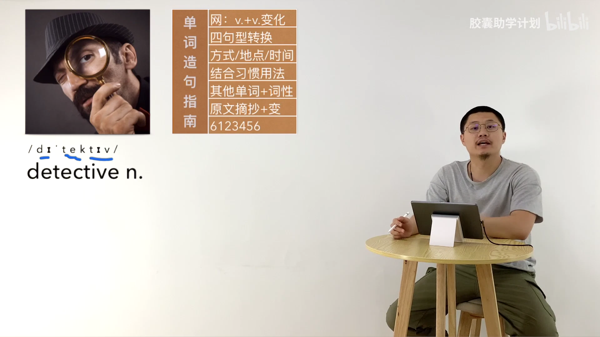

文字识别：单词造句指南 / 网：v.+v.变化 / 胶囊助学计划 / 四句型转换 / 方式/地点/时间 / 结合习惯用法 / 其他单词+词性 / 原文摘抄+变 / 6123456 / /di'tektIv/ / detective n.

## 00:00:30–00:01:00

侦探的意思。好，那它是一个名词。我们单词造句肯定是要找其他的词性的，对吧？因为一个句子当中至少要有一个动词。那我们接下来呢，再结合其他的习惯用法，给大家做一些小的类比啊。比如说，一 go to the theater。我们第一课学过，叫做去剧院，对吧？那我们就可以把它和 detective 连起来，再加上时态。比如说 last week the detective went to

### 画面 00:00:30

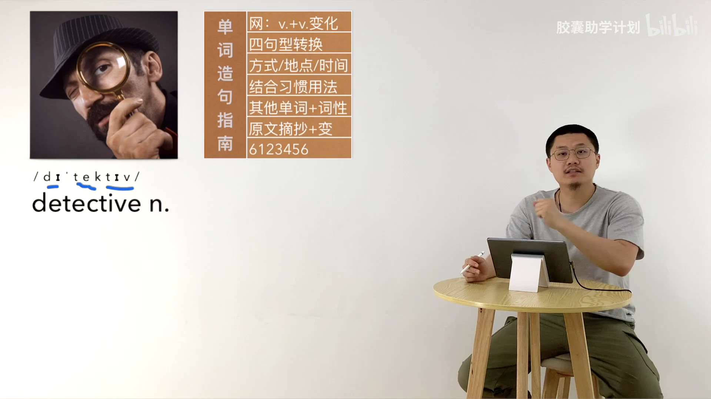

文字识别：单词造句指南 / 网：v.+v.变化 / 胶囊助学计划 / 四句型转换 / 方式/地点/时间 / 结合习惯用法 / 其他单词+词性 / 原文摘抄+变 / 6123456 / /di'tektIv/ / detective n.

### 画面 00:00:32

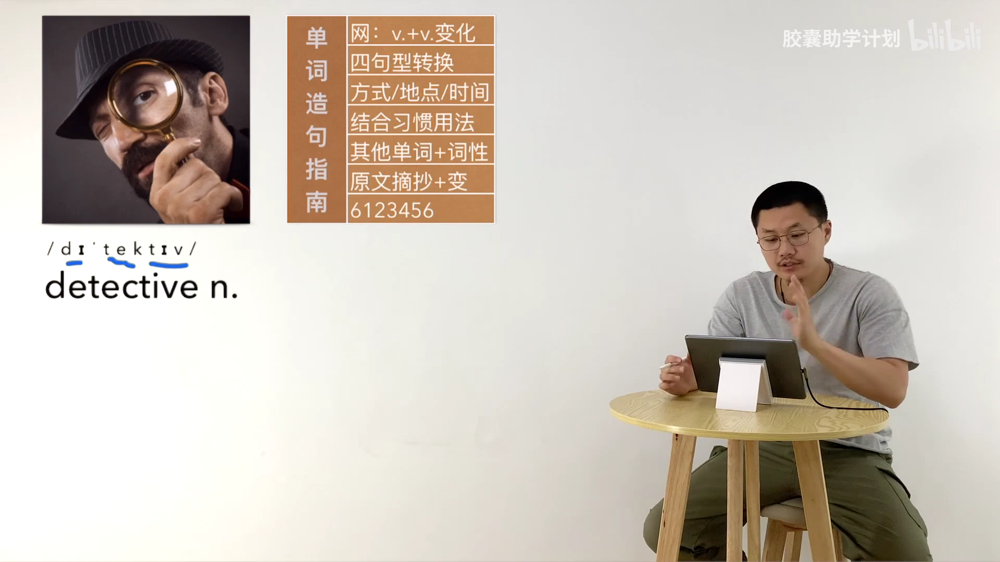

文字识别：单词造句指南 / 网：v.+v.变化 / 胶囊助学计划 / 四句型转换 / 方式/地点/时间 / 结合习惯用法 / 其他单词+词性 / 原文摘抄+变 / 6123456 / /dI'tektIv/ / ン / detective n.

### 画面 00:00:34

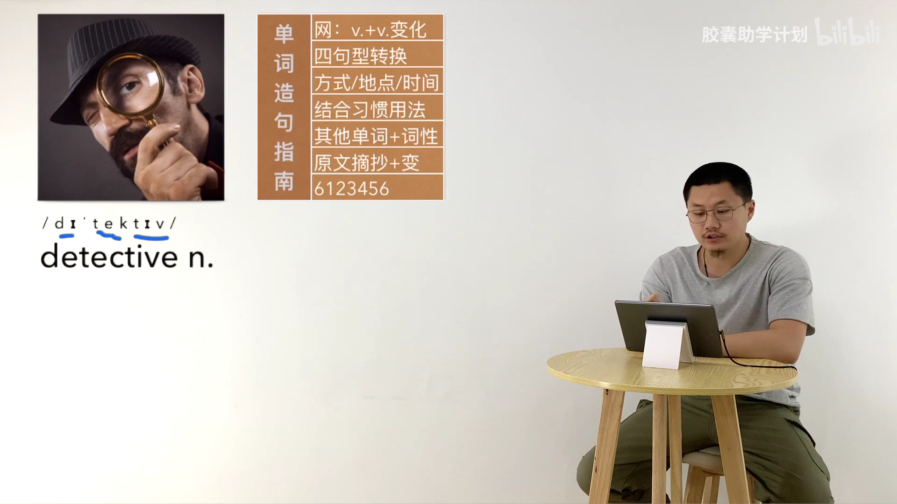

文字识别：单词造句指南 / 网：v.+v.变化 / 胶囊助学计划 / 四句型转换 / 方式/地点/时间 / 结合习惯用法 / 其他单词+词性 / 原文摘抄+变 / 6123456 / /dr'tektIv/ / detective n.

### 画面 00:00:36

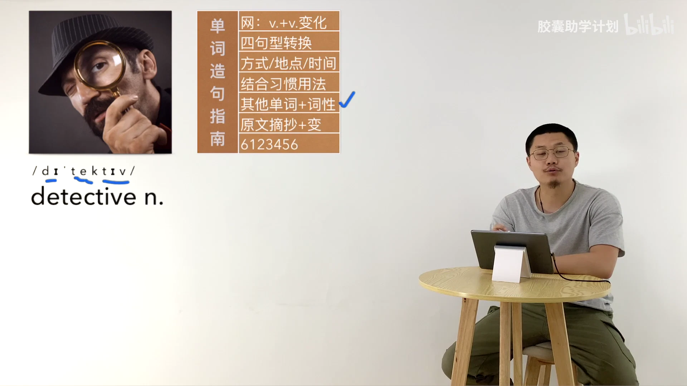

文字识别：单词造句指南 / 网：v.+v.变化 / 胶囊助学计划 / 四句型转换 / 方式/地点/时间 / 结合习惯用法 / 其他单词+词性 / 原文摘抄+变 / 6123456 / /dr'tektIv/ / detective n.

### 画面 00:00:39

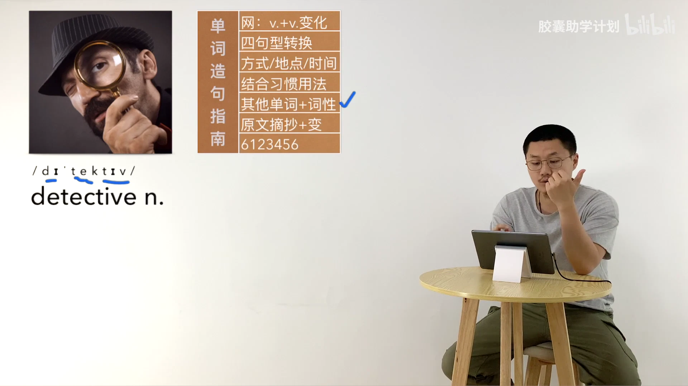

文字识别：单词造句指南 / 网：v.+v.变化 / 胶囊助学计划 / 四句型转换 / 方式/地点/时间 / 结合习惯用法 / 其他单词+词性 / 原文摘抄+变 / 6123456 / /dr'tektIv/ / detective n.

### 画面 00:00:41

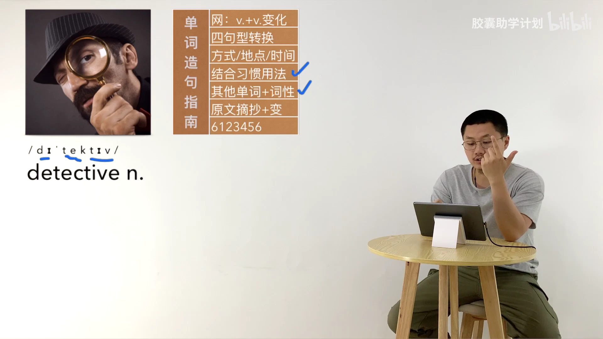

文字识别：单词造句指南 / 网：v.+v.变化 / 胶囊助学计划 / 四句型转换 / 方式/地点/时间 / 结合习惯用法 / 其他单词+词性 / 原文摘抄+变 / 6123456 / /di'tektIv/ / detective n.

### 画面 00:00:43

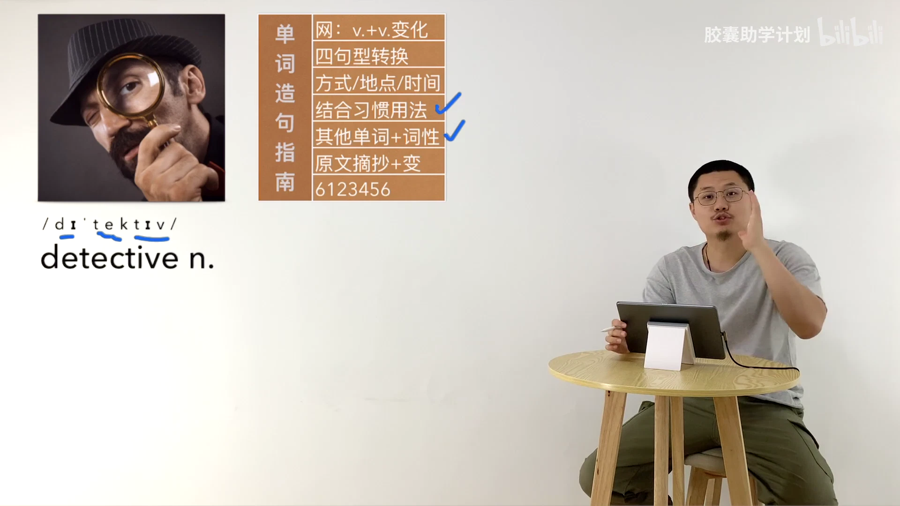

文字识别：单词造句指南 / 网：v.+v.变化 / 胶囊助学计划 / 四句型转换 / 方式/地点/时间 / 结合习惯用法 / 其他单词+词性 / 原文摘抄+变 / 6123456 / /dI'tektIv/ / detective n.

### 画面 00:00:45

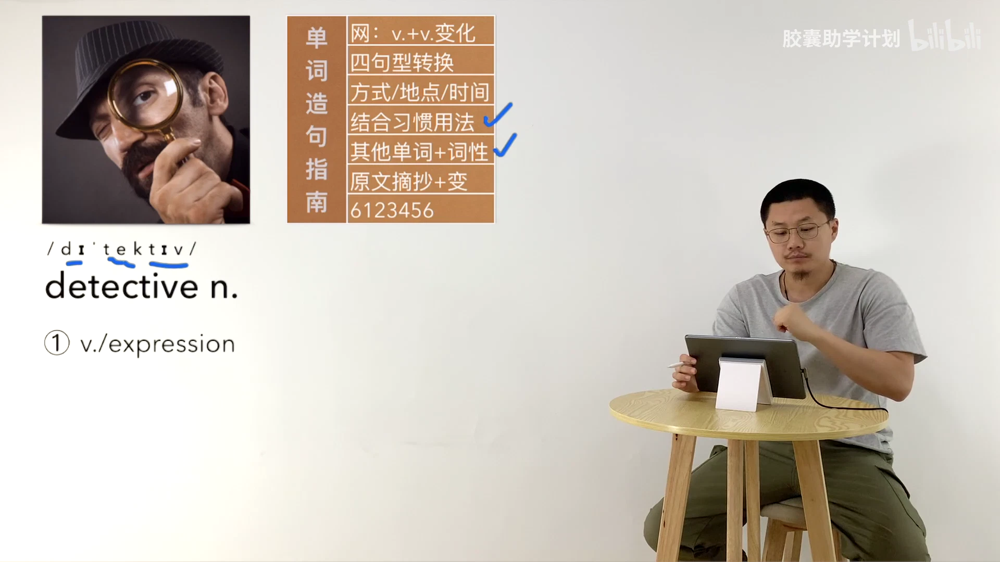

文字识别：单词造句指南 / 网：v.+v.变化 / 胶囊助学计划 / 四句型转换 / 方式/地点/时间 / 结合习惯用法 / 其他单词+词性 / 原文摘抄+变 / 6123456 / /dI'tektIv/ / detective n. / v./expression / 1

### 画面 00:00:47

文字识别：单词造句指南 / 网：v.+v.变化 / 胶囊助学计划 / 四句型转换 / 方式/地点/时间 / 结合习惯用法 / 其他单词+词性 / 原文摘抄+变 / 6123456 / /dI'tektIv/ / detective n. / v./expression / 1 / go to the theatre L1 / 2

### 画面 00:00:49

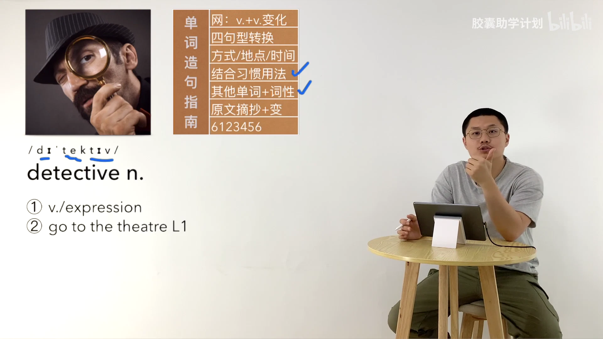

文字识别：单词造句指南 / 网：v.+v.变化 / 胶囊助学计划 / 四句型转换 / 方式/地点/时间 / 结合习惯用法 / 其他单词+词性 / 原文摘抄+变 / 6123456 / /dI'tektIv/ / detective n. / v./expression / 1 / go to the theatre L1 / 2

### 画面 00:00:51

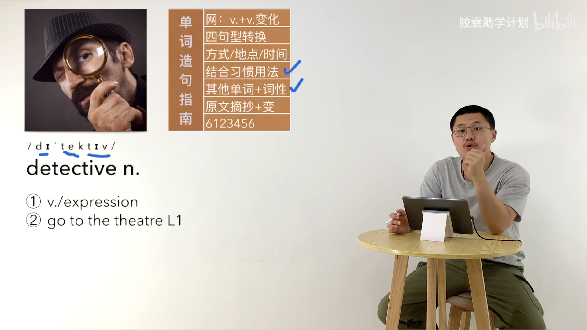

文字识别：单词造句指南 / 网：v.+v.变化 / 胶囊助学计划 / 四句型转换 / 方式/地点/时间 / 结合习惯用法 / 其他单词+词性 / 原文摘抄+变 / 6123456 / /dI'tektIv/ / detective n. / 1 / v./expression / go to the theatre L1 / 2

### 画面 00:00:55

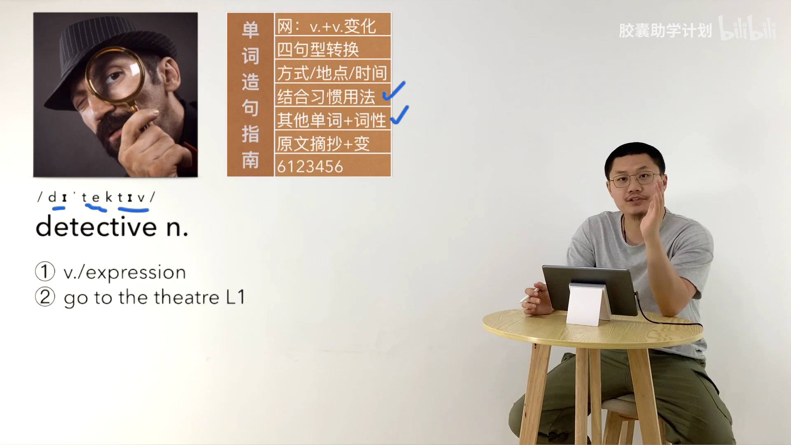

文字识别：单词造句指南 / 网：v.+v.变化 / 胶囊助学计划 / 四句型转换 / 方式/地点/时间 / 结合习惯用法 / 其他单词+词性 / 原文摘抄+变 / 6123456 / /dI'tektIv/ / detective n. / 1 / v./expression / go to the theatre L1 / 2

## 00:01:00–00:01:30

the theater.接下来呢，第二课我们又说过 have breakfast 表示吃早饭，那我们也可以说他吃早饭。第三课我们学过说每天都想一些什么事情，那我们就可以造一个句子说 the detective think about it every day，每天都在想这件事情，对吧？好，我们也可以说 work for somebody，我们可以说 the detective work for a very big company，说他为一个 works for a very big company，说他为这个一个大公司工作，

### 画面 00:01:00

文字识别：单词造句指南 / 网：v.+v.变化 / 胶囊助学计划 / 四句型转换 / 方式/地点/时间 / 结合习惯用法 / 其他单词+词性 / 原文摘抄+变 / 6123456 / /dI'tektIv/ / detective n. / 1 / v./expression / go to the theatre L1 / 2

### 画面 00:01:02

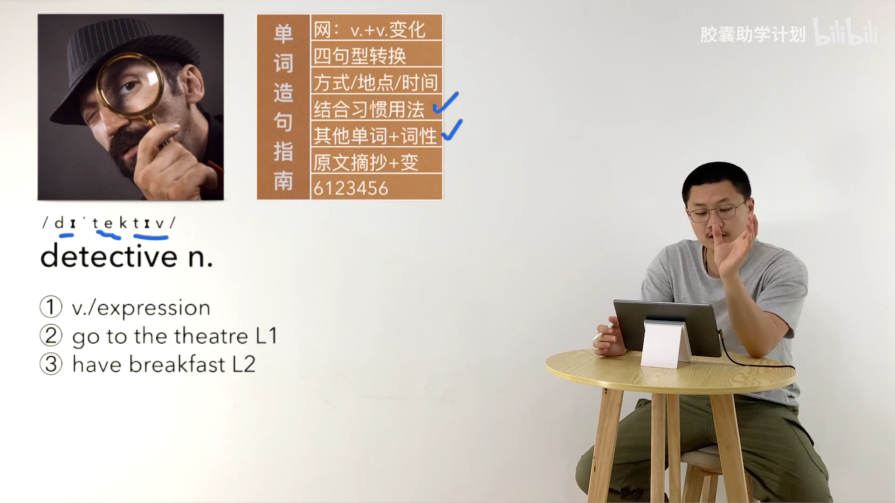

文字识别：单词造句指南 / 网：v.+v.变化 / 胶囊助学计划 / 四句型转换 / 方式/地点/时间 / 结合习惯用法 / 其他单词+词性 / 原文摘抄+变 / 6123456 / /dI'tektIv/ / detective n. / 1 / v./expression / 2 / go to the theatre L1 / have breakfast L2 / 3

### 画面 00:01:05

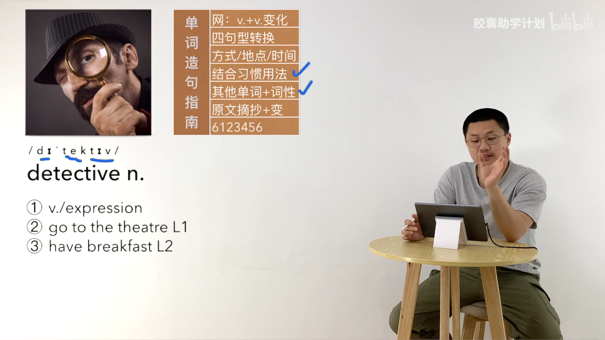

文字识别：单词造句指南 / 网：v.+v.变化 / 胶囊助学计划 / 四句型转换 / 方式/地点/时间 / 结合习惯用法 / 其他单词+词性 / 原文摘抄+变 / 6123456 / /dI'tektIv/ / detective n. / 1 / v./expression / 2 / go to the theatre L1 / have breakfast L2 / 3

### 画面 00:01:07

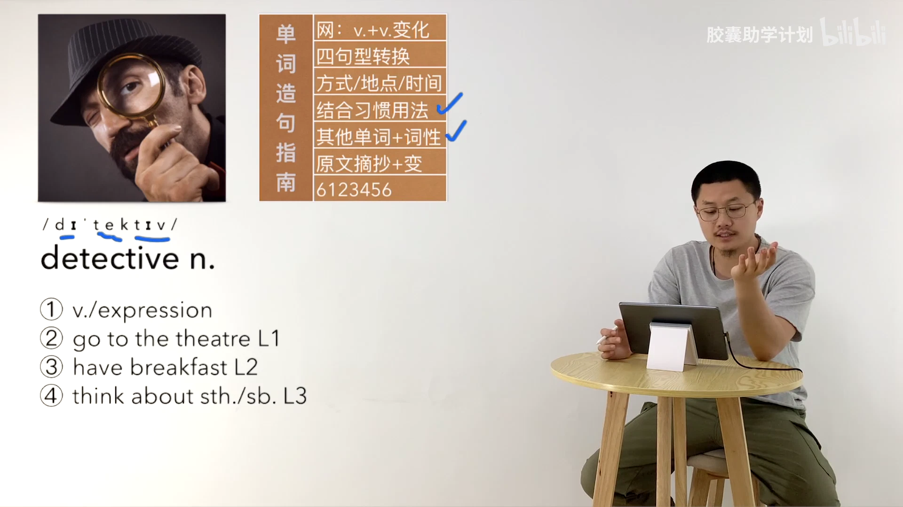

文字识别：单词造句指南 / 网：v.+v.变化 / 胶囊助学计划 / 四句型转换 / 方式/地点/时间 / 结合习惯用法 / 其他单词+词性 / 原文摘抄+变 / 6123456 / /dI'tektIv/ / detective n. / 1 / v./expression / 2 / go to the theatre L1 / have breakfast L2 / think about sth./sb. L3

### 画面 00:01:10

文字识别：单词造句指南 / 网：v.+v.变化 / 胶囊助学计划 / 四句型转换 / 方式/地点/时间 / 结合习惯用法 / 其他单词+词性 / 原文摘抄+变 / 6123456 / /dI'tektIv/ / detective n. / 1 / v./expression / go to the theatre L1 / 2 / have breakfast L2 / think about sth./sb. L3

### 画面 00:01:14

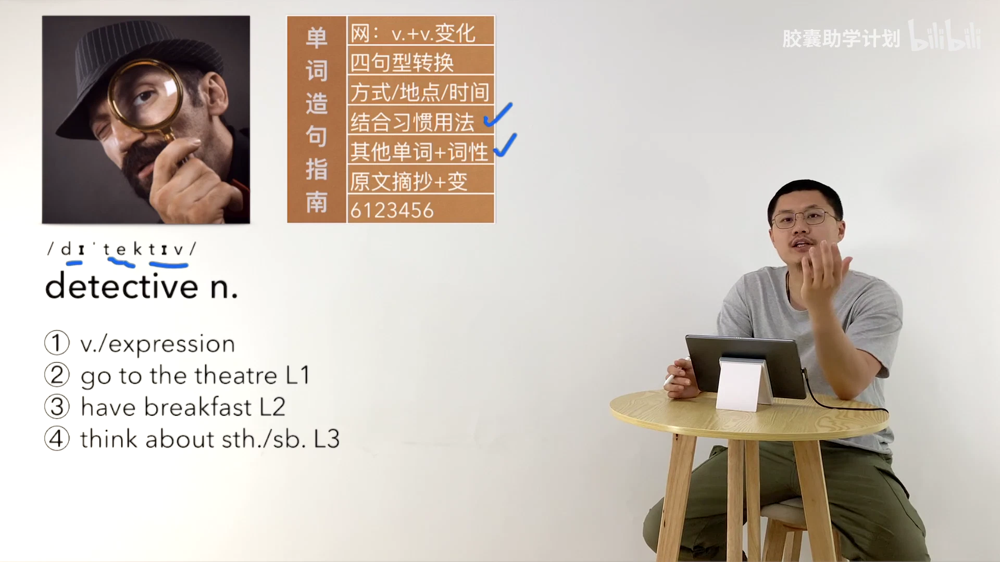

文字识别：单词造句指南 / 网：v.+v.变化 / 胶囊助学计划 / 四句型转换 / 方式/地点/时间 / 结合习惯用法 / 其他单词+词性 / 原文摘抄+变 / 6123456 / /dI'tektIv/ / detective n. / 1 / v./expression / 2 / go to the theatre L1 / have breakfast L2 / think about sth./sb. L3

### 画面 00:01:16

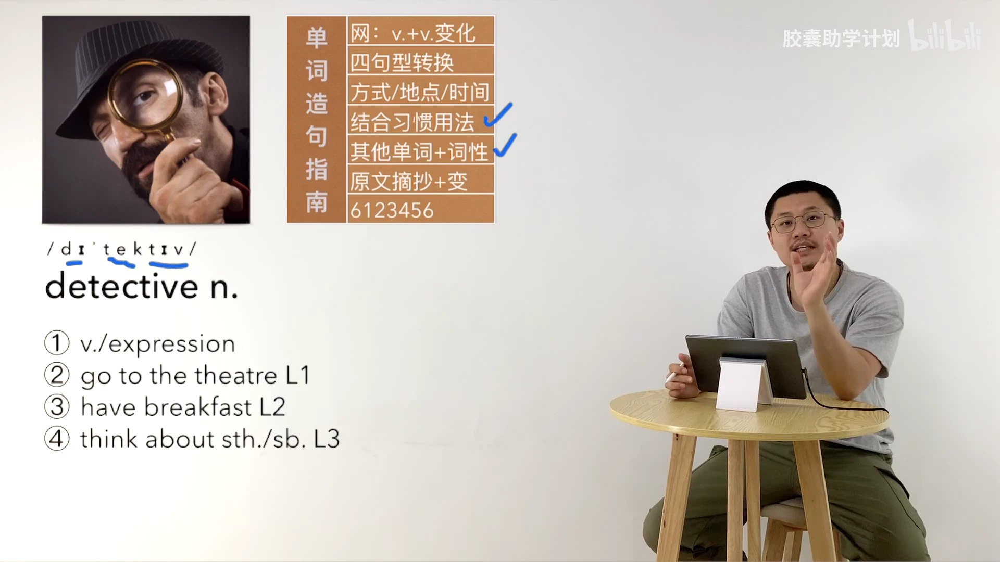

文字识别：单词造句指南 / 网：v.+v.变化 / 胶囊助学计划 / 四句型转换 / 方式/地点/时间 / 结合习惯用法 / 其他单词+词性 / 原文摘抄+变 / 6123456 / /dI'tektIv/ / detective n. / 1 / v./expression / 2 / go to the theatre L1 / have breakfast L2 / think about sth./sb. L3

### 画面 00:01:19

文字识别：单词造句指南 / 网：v.+v.变化 / 胶囊助学计划 / 四句型转换 / 方式/地点/时间 / 结合习惯用法 / 其他单词+词性 / 原文摘抄+变 / 6123456 / /di'tektIv/ / detective n. / 1 / v./expression / 2 / go to the theatre L1 / have breakfast L2 / think about sth./sb. L3 / work for sb. L4 / 5

### 画面 00:01:21

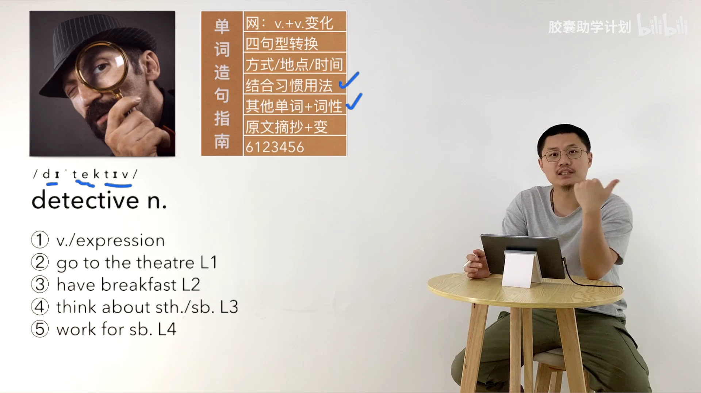

文字识别：单词造句指南 / 网：v.+v.变化 / 胶囊助学计划 / 四句型转换 / 方式/地点/时间 / 结合习惯用法 / 其他单词+词性 / 原文摘抄+变 / 6123456 / /di'tektIv/ / detective n. / 1 / v./expression / 2 / go to the theatre L1 / have breakfast L2 / think about sth./sb. L3 / work for sb. L4 / 5

### 画面 00:01:23

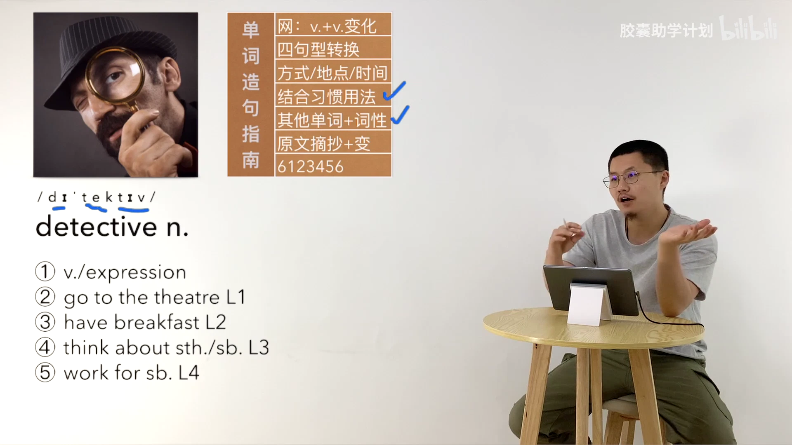

文字识别：单词造句指南 / 网：v.+v.变化 / 胶囊助学计划 / 四句型转换 / 方式/地点/时间 / 结合习惯用法 / 其他单词+词性 / 原文摘抄+变 / 6123456 / /di'tektIv/ / detective n. / 1 / v./expression / 2 / go to the theatre L1 / have breakfast L2 / think about sth./sb. L3 / work for sb. L4

### 画面 00:01:25

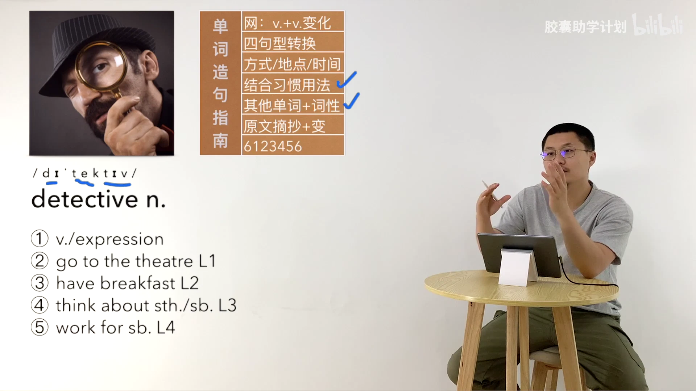

文字识别：单词造句指南 / 网：v.+v.变化 / 胶囊助学计划 / 四句型转换 / 方式/地点/时间 / 结合习惯用法 / 其他单词+词性 / 原文摘抄+变 / 6123456 / /dI'tektIv/ / detective n. / ①v./expression / 2 / go to the theatre L1 / have breakfast L2 / think about sth./sb. L3 / work for sb. L4 / 5

## 00:01:30–00:02:00

这是我们第四课学过的习惯用法。然后呢，第五课学过一个习惯用法叫 get something for somebody，给某人拿某拿某个东西，对吧？比如说我们可以说 I can get some coffee for the detective，我能给这些侦探，我给能给这个侦探拿一杯咖啡，拿一些咖啡，对吧？最后一个 knock at the door，我们可以说 yesterday a detective knocked at my door，昨天敲了我的门。那各位可以注意到，

### 画面 00:01:30

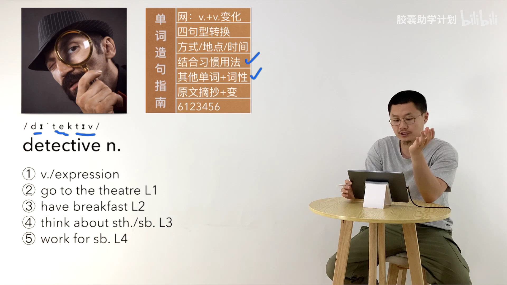

文字识别：单词造句指南 / 网：v.+v.变化 / 胶囊助学计划 / 四句型转换 / 方式/地点/时间 / 结合习惯用法 / 其他单词+词性 / 原文摘抄+变 / 6123456 / /di'tektIv/ / detective n. / 1 / v./expression / 2 / go to the theatre L1 / have breakfast L2 / think about sth./sb. L3 / work for sb. L4

### 画面 00:01:34

文字识别：单词造句指南 / 网：v.+v.变化 / 胶囊助学计划 / 四句型转换 / 方式/地点/时间 / 结合习惯用法 / 其他单词+词性 / 原文摘抄+变 / 6123456 / /dI'tektiv/ / detective n. / 1 / v./expression / 2 / go to the theatre L1 / have breakfast L2 / 3 / think about sth./sb. L3 / work for sb. L4 / 6 / get sth. for sb. L5

### 画面 00:01:36

文字识别：单词造句指南 / 网：v.+v.变化 / 胶囊助学计划 / 四句型转换 / 方式/地点/时间 / 结合习惯用法 / 其他单词+词性 / 原文摘抄+变 / 6123456 / /dI'tektIv/ / detective n. / ①v./expression / 2 / go to the theatre L1 / have breakfast L2 / 3 / think about sth./sb. L3 / work for sb. L4 / 6 / get sth. for sb. L5

### 画面 00:01:39

文字识别：单词造句指南 / 网：v.+v.变化 / 胶囊助学计划 / 四句型转换 / 方式/地点/时间 / 结合习惯用法 / 其他单词+词性 / 原文摘抄+变 / 6123456 / /dI'tektIv/ / detective n. / ①v./expression / 2 / go to the theatre L1 / have breakfast L2 / 3 / think about sth./sb. L3 / work for sb. L4 / 6 / get sth. for sb. L5

### 画面 00:01:41

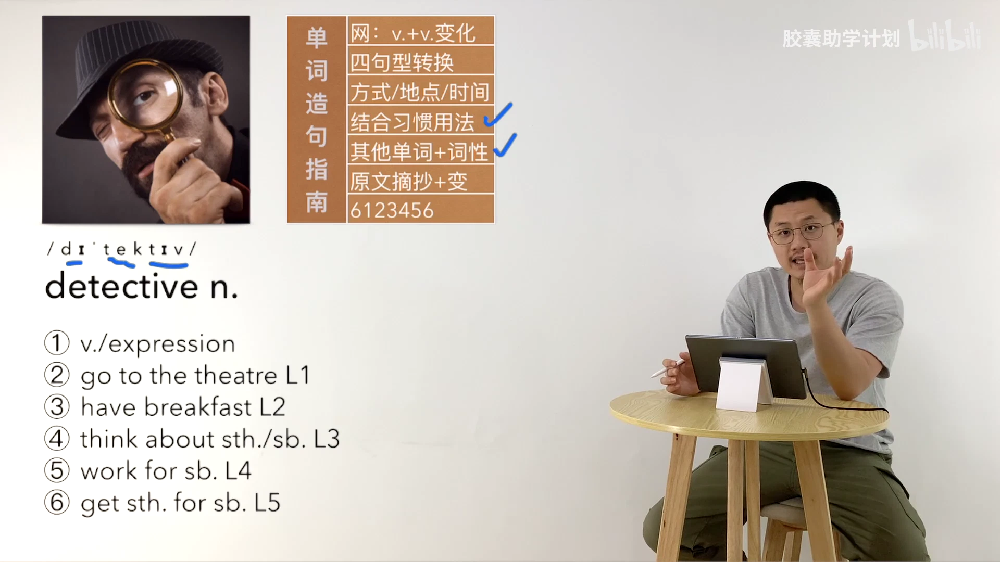

文字识别：单词造句指南 / 网：v.+v.变化 / 胶囊助学计划 / 四句型转换 / 方式/地点/时间 / 结合习惯用法 / 其他单词+词性 / 原文摘抄+变 / 6123456 / /di'tektIv/ / detective n. / ①v./expression / 2 / go to the theatre L1 / have breakfast L2 / think about sth./sb. L3 / work for sb. L4 / 6 / get sth. for sb. L5

### 画面 00:01:44

文字识别：单词造句指南 / 网：v.+v.变化 / 胶囊助学计划 / 四句型转换 / 方式/地点/时间 / 结合习惯用法 / 其他单词+词性 / 原文摘抄+变 / 6123456 / /dI'tektiv/ / detective n. / ①v./expression / 2 / go to the theatre L1 / have breakfast L2 / think about sth./sb. L3 / work for sb. L4 / 6 / get sth. for sb. L5

### 画面 00:01:46

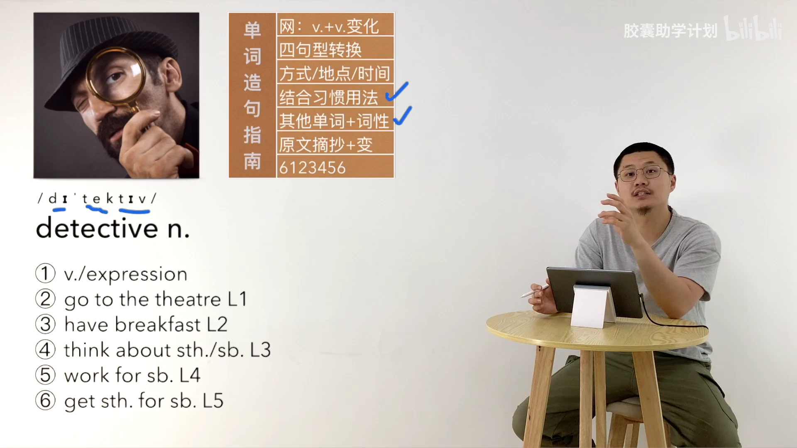

文字识别：单词造句指南 / 网：v.+v.变化 / 胶囊助学计划 / 四句型转换 / 方式/地点/时间 / 结合习惯用法 / 其他单词+词性 / 原文摘抄+变 / 6123456 / /dI'tektIv/ / detective n. / ①v./expression / 2 / go to the theatre L1 / have breakfast L2 / 3 / think about sth./sb. L3 / work for sb. L4 / 6 / get sth. for sb. L5

### 画面 00:01:49

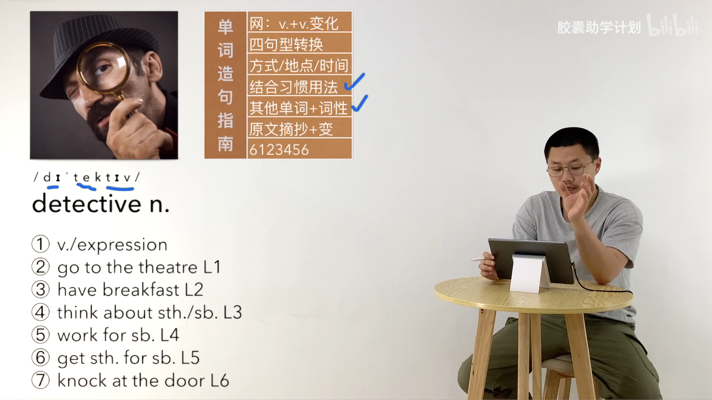

文字识别：单词造句指南 / 网：v.+v.变化 / 胶囊助学计划 / 四句型转换 / 方式/地点/时间 / 结合习惯用法 / 其他单词+词性 / 原文摘抄+变 / 6123456 / /di'tektiv/ / detective n. / ①v./expression / 2 / go to the theatre L1 / have breakfast L2 / 3 / think about sth./sb. L3 / work for sb. L4 / 6 / get sth. for sb. L5 / knock at the door L6

### 画面 00:01:51

文字识别：单词造句指南 / 网：v.+v.变化 / 胶囊助学计划 / 四句型转换 / 方式/地点/时间 / 结合习惯用法 / 其他单词+词性 / 原文摘抄+变 / 6123456 / /dI'tektIv/ / detective n. / ①v./expression / 2 / go to the theatre L1 / have breakfast L2 / 3 / think about sth./sb. L3 / work for sb. L4 / 6 / get sth. for sb. L5 / knock at the door L6

### 画面 00:01:55

文字识别：单词造句指南 / 网：v.+v.变化 / 胶囊助学计划 / 四句型转换 / 方式/地点/时间 / 结合习惯用法 / 其他单词+词性 / 原文摘抄+变 / 6123456 / /di'tektiv/ / detective n. / ①v./expression / 2 / go to the theatre L1 / have breakfast L2 / 3 / think about sth./sb. L3 / work for sb. L4 / get sth. for sb. L5 / 6 / knock at the door L6

### 画面 00:01:59

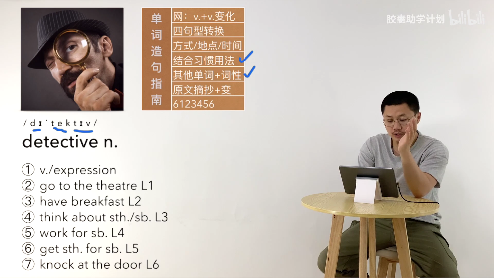

文字识别：单词造句指南 / 网：v.+v.变化 / 胶囊助学计划 / 四句型转换 / 方式/地点/时间 / 结合习惯用法 / 其他单词+词性 / 原文摘抄+变 / 6123456 / /dI'tektiv/ / detective n. / ①v./expression / 2 / go to the theatre L1 / have breakfast L2 / 3 / think about sth./sb. L3 / work for sb. L4 / get sth. for sb. L5 / 6 / knock at the door L6

## 00:02:00–00:02:30

我在这个地方后面都给大家标上了，它是第几课出现的习惯用法。之前给大家留过一个家庭作业，就是让大家去把每一课的习惯用法都给它整理出来，以后我们造句的时候用得到，对吧？单词造句指南结合习惯用法去造句，肯定句造出来了，您再做一些四句型的转化。您想一下，这儿就已经有六个肯定句了，做一下四句型的转化，肯定句、否定句、一般疑问句和各种特殊疑问句。我们至少接下来六再乘

### 画面 00:02:01

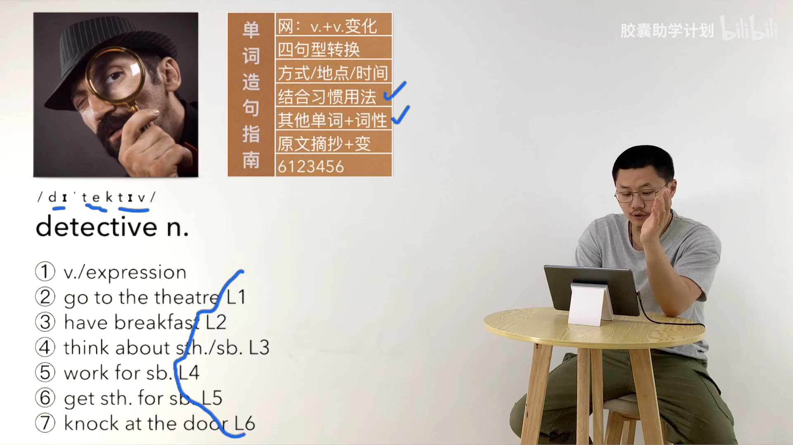

文字识别：单词造句指南 / 网：v.+v.变化 / 胶囊助学计划 / 四句型转换 / 方式/地点/时间 / 结合习惯用法 / 其他单词+词性 / 原文摘抄+变 / 6123456 / /dI'tektIv/ / detective n. / 1 / v./expression / 2 / go to the theatreL1 / have breakfas L2 / think about sh./sb. L3 / work for sb.L4 / 6 / get sth.for sb L5 / knock at the door L6

### 画面 00:02:03

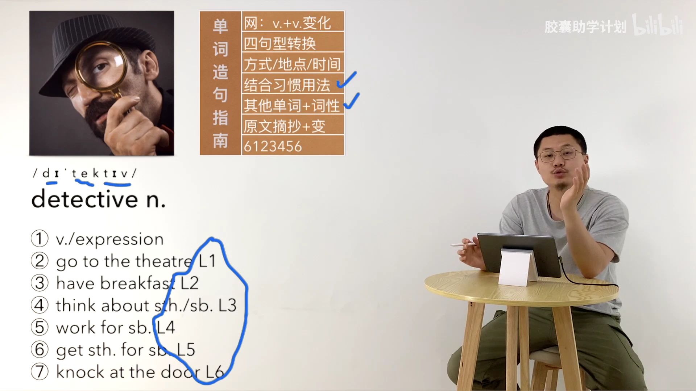

文字识别：单词造句指南 / 网：v.+v.变化 / 胶囊助学计划 / 四句型转换 / 方式/地点/时间 / 结合习惯用法 / 其他单词+词性 / 原文摘抄+变 / 6123456 / /dI'tektIv/ / detective n. / 1 / v./expression / 2 / go to the theatre / L1 / have breakfas L2 / think about sh./sb. L3 / work for sb.L4 / get sth. for sbL5 / 6 / knock at the door L6

### 画面 00:02:05

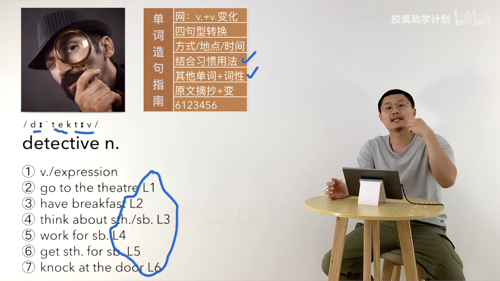

文字识别：单词造句指南 / 网：v.+v.变化 / 胶囊助学计划 / 四句型转换 / 方式/地点/时间 / 结合习惯用法 / 其他单词+词性 / 原文摘抄+变 / 6123456 / /dI'tektIv/ / detective n. / ①v./expression / 2 / go to the theatre / L1 / have breakfas L2 / think about sh./sb. L3 / work for sb.L4 / get sth.for sbL5 / 6 / knock at the door L6

### 画面 00:02:08

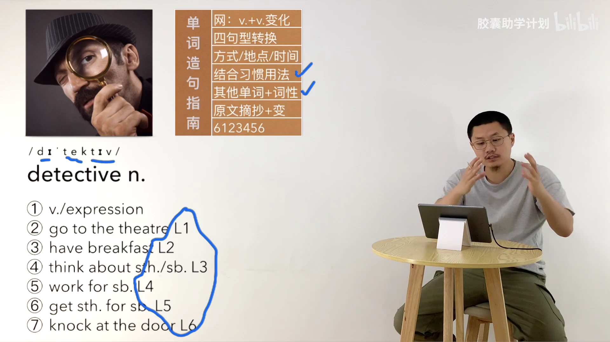

文字识别：单词造句指南 / 网：v.+v.变化 / 胶囊助学计划 / 四句型转换 / 方式/地点/时间 / 结合习惯用法 / 其他单词+词性 / 原文摘抄+变 / 6123456 / /dI'tektIv/ / detective n. / v./expression / 2 / go to the theatre / L1 / have breakfas L2 / think about s/h./sb. L3 / work for sb.L4 / get sth. for sbL5 / 6 / knock at the door L6

### 画面 00:02:10

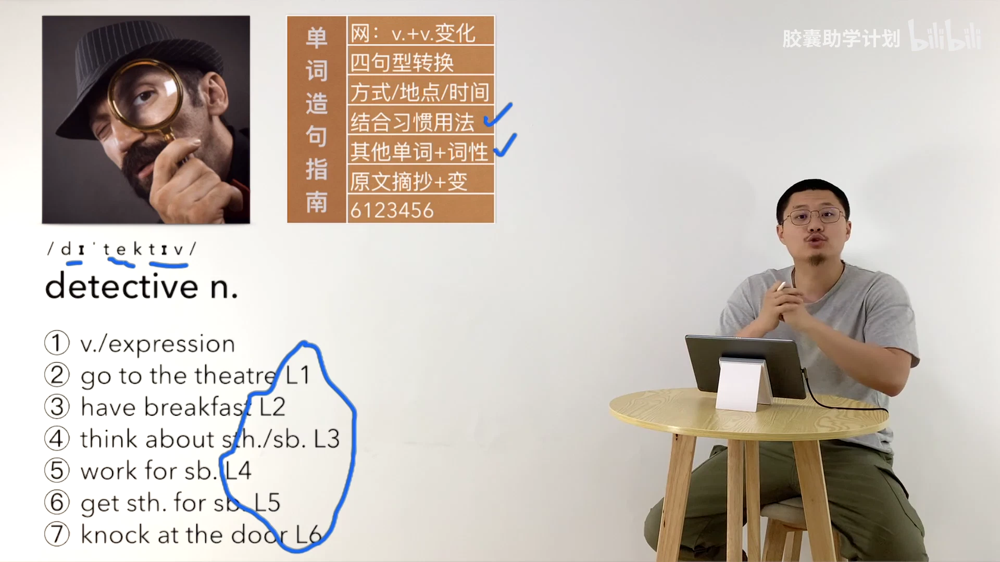

文字识别：单词造句指南 / 网：v.+v.变化 / 胶囊助学计划 / 四句型转换 / 方式/地点/时间 / 结合习惯用法 / 其他单词+词性 / 原文摘抄+变 / 6123456 / /dI'tektIv/ / detective n. / v./expression / 2 / go to the theatre / L1 / have breakfasL2 / 3 / think about sh./sb. L3 / work for sb.L4 / get sth.for sbL5 / 6 / knock at the door L6

### 画面 00:02:13

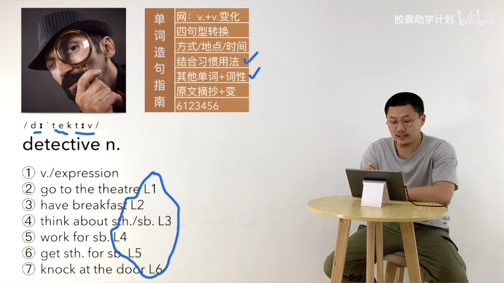

文字识别：单词造句指南 / 网：v.+v.变化 / 胶囊助学计划 / 四句型转换 / 方式/地点/时间 / 结合习惯用法 / 其他单词+词性 / 原文摘抄+变 / 6123456 / /dI'tektIv/ / detective n. / ① / v./expression / 2 / go to the theatre / L1 / have breakfasL2 / think about sh./sb. L3 / work for sb.L4 / 6 / get sth.for sbL5 / knock at the door L6

### 画面 00:02:15

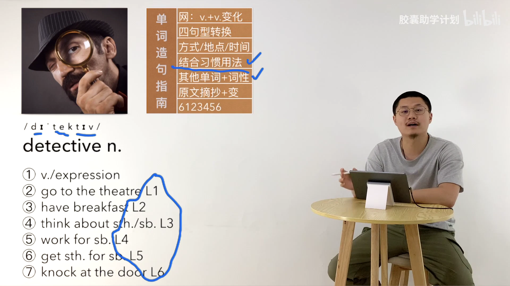

文字识别：单词造句指南 / 网：v.+v.变化 / 胶囊助学计划 / 四句型转换 / 方式/地点/时间 / 结合习惯用法 / 其他单词+词性 / 原文摘抄+变 / 6123456 / /dI'tektIv/ / detective n. / 1 / v./expression / 2 / go to the theatre / L1 / have breakfasL2 / think about sh./sb. L3 / work for sb.L4 / get sth.for sb L5 / 6 / knock at the door L6

### 画面 00:02:18

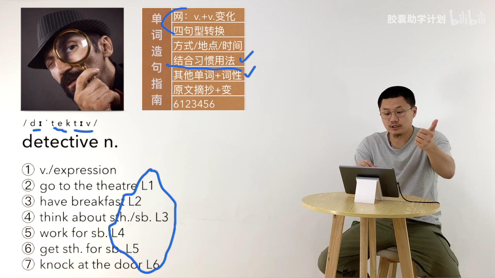

文字识别：单词造句指南 / 网：v.+v.变化 / 胶囊助学计划 / 四句型转换 / 方式/地点/时间 / 结合习惯用法 / 其他单词+词性 / 原文摘抄+变 / 6123456 / /dI'tektIv/ / detective n. / 1 / v./expression / 2 / go to the theatre / L1 / have breakfasL2 / think about s/h./sb. L3 / work for sb.L4 / get sth.for sb L5 / 6 / knock at the door L6

### 画面 00:02:20

文字识别：单词造句指南 / 网：v.+v.变化 / 胶囊助学计划 / 四句型转换 / 方式/地点/时间 / 结合习惯用法 / 其他单词+词性 / 原文摘抄+变 / 6123456 / /dI'tektIv/ / detective n. / 1 / v./expression / 2 / go to the theatreL1 / have breakfas L2 / think about sh./sb. L3 / work for sb.L4 / get sth.for sb L5 / 6 / knock at the door L6

### 画面 00:02:22

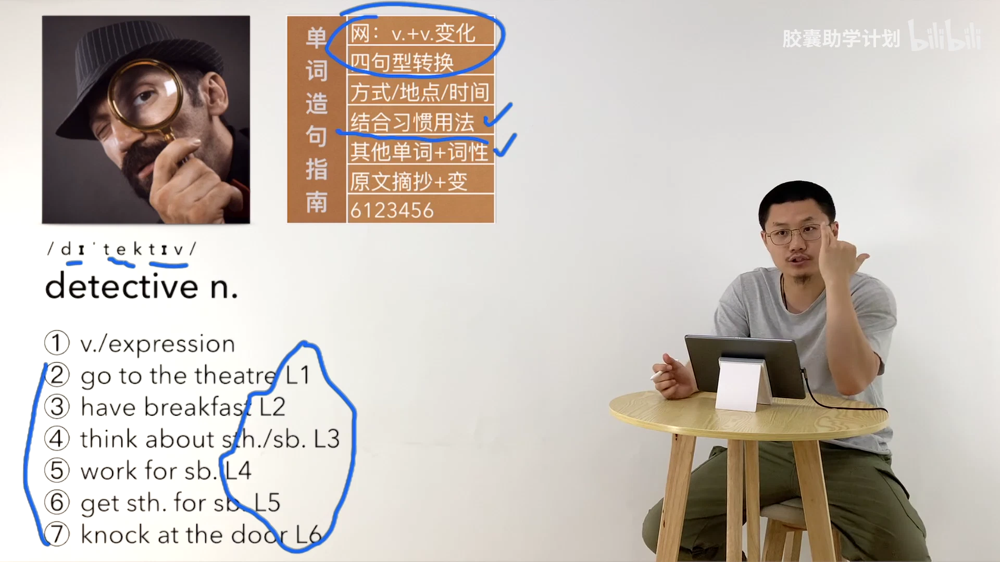

文字识别：单词造句指南 / 网：v.+v.变化 / 胶囊助学计划 / 四句型转换 / 方式/地点/时间 / 结合习惯用法 / 其他单词+词性 / 原文摘抄+变 / 6123456 / /dI'tektIv/ / detective n. / v./expression / 2 / go to the theatre / L1 / have breakfas L2 / think about s/h./sb. L3 / work for sb.L4 / 6 / get sth. for sbL5 / knock at the door L6

### 画面 00:02:25

文字识别：单词造句指南 / 网：v.+v.变化 / 胶囊助学计划 / 四句型转换 / 方式/地点/时间 / 结合习惯用法 / 其他单词+词性 / 原文摘抄+变 / 6123456 / /dI'tektIv/ / detective n. / 1 / v./expression / 2 / go to the theatre / L1 / have breakfas L2 / think about s/h./sb. L3 / work for sb.L4 / 6 / get sth. for sbL5 / knock at the door L6

## 00:02:30–00:03:00

个四，四六就二十四句话。拿 detective，您至少能造出来二十六句话了，对吧？OK，这是我们说造句的一个思路啊。下一个单词跟我一起读，叫做 airport。好，airport 这个单词实际上是两个单词组成的，第一是 air，第二是 port。air 空气，空中，对吧？然后这个 port 指的是港口，空港啊，又叫飞机场。OK，那我们还是结合习惯用法。第三课的 think about

### 画面 00:02:30

文字识别：单词造句指南 / 网：v.+v.变化 / 胶囊助学计划 / 四句型转换 / 方式/地点/时间 / 结合习惯用法 / 其他单词+词性 / 原文摘抄+变 / 6123456 / /dI'tektIv/ / detective n. / 1 / v./expression / 2 / go to the theatre / L1 / have breakfas L2 / think about s/h./sb. L3 / work for sb.L4 / 6 / get sth. for sbL5 / knock at the door L6

### 画面 00:02:33

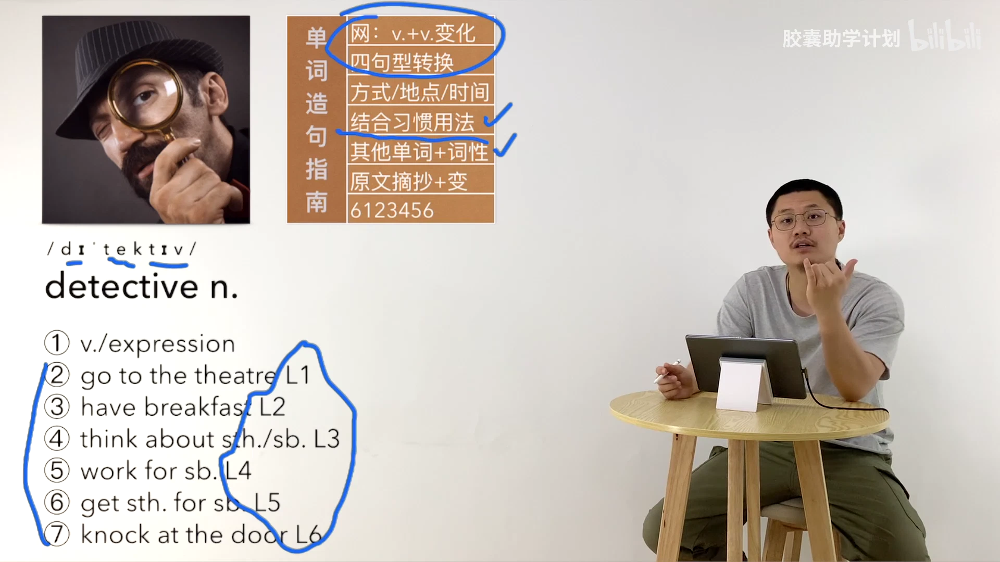

文字识别：单词造句指南 / 网：v.+v.变化 / 胶囊助学计划 / 四句型转换 / 方式/地点/时间 / 结合习惯用法 / 其他单词+词性 / 原文摘抄+变 / 6123456 / /dI'tektIv/ / detective n. / ① / v./expression / 2 / go to the theatre / L1 / have breakfas L2 / think about s/h./sb. L3 / work for sb.L4 / 6 / get sth. for sbL5 / knock at the door L6

### 画面 00:02:35

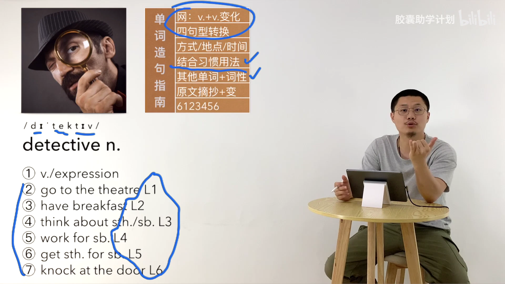

文字识别：单词造句指南 / 网：v.+v.变化 / 胶囊助学计划 / 四句型转换 / 方式/地点/时间 / 结合习惯用法 / 其他单词+词性 / 原文摘抄+变 / 6123456 / /dI'tektIv/ / detective n. / 1 / v./expression / 2 / go to the theatreL1 / have breakfas L2 / think about s/h./sb. L3 / work for sb.L4 / 6 / get sth. for sbL5 / knock at the door L6

### 画面 00:02:37

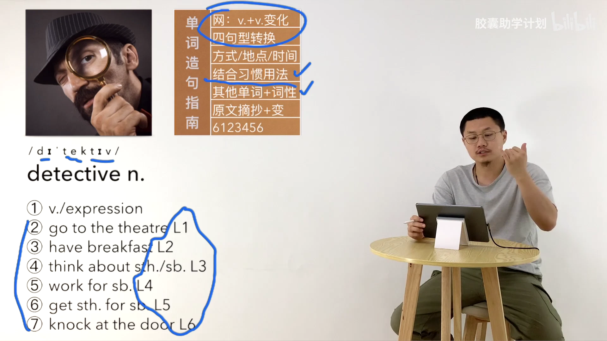

文字识别：单词造句指南 / 网：v.+v.变化 / 胶囊助学计划 / 四句型转换 / 方式/地点/时间 / 结合习惯用法 / 其他单词+词性 / 原文摘抄+变 / 6123456 / /dI'tektIv/ / detective n. / v./expression / 2 / go to the theatre / L1 / have breakfas L2 / think about s/h./sb. L3 / work for sb.L4 / 6 / get sth.for sbL5 / knock at the door L6

### 画面 00:02:39

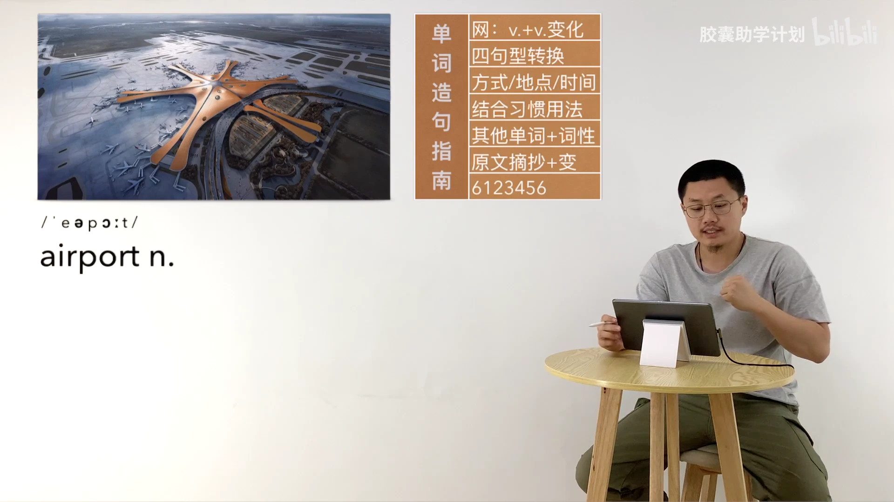

文字识别：单词造句指南 / 网：v.+v.变化 / 胶囊助学计划 / 四句型转换 / 方式/地点/时间 / 结合习惯用法 / 其他单词+词性 / 原文摘抄+变 / 6123456 / /'eapoit/ / airport n.

### 画面 00:02:41

文字识别：单词造句指南 / 网：v.+v.变化 / 胶囊助学计划 / 四句型转换 / 方式/地点/时间 / 结合习惯用法 / 其他单词+词性 / 原文摘抄+变 / 6123456 / /'eapo:t/ / airport n.

### 画面 00:02:43

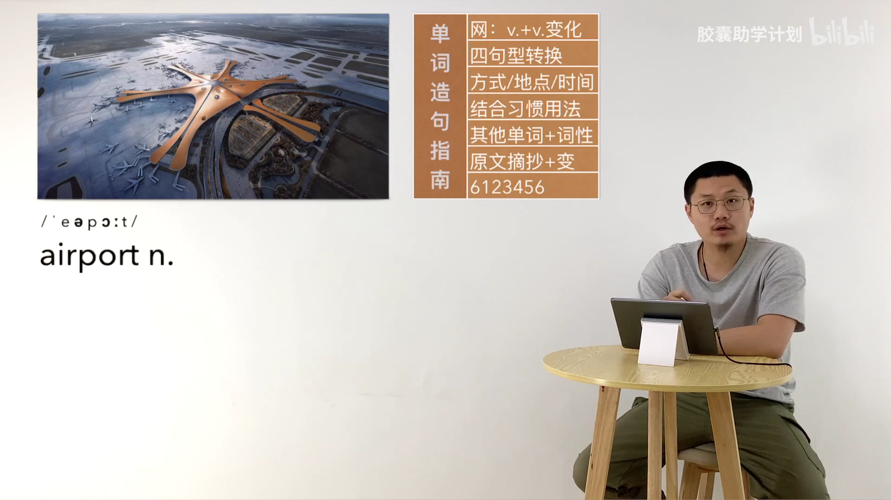

文字识别：单词造句指南 / 网：v.+v.变化 / 胶囊助学计划 / 四句型转换 / 方式/地点/时间 / 结合习惯用法 / 其他单词+词性 / 原文摘抄+变 / 6123456 / /'eapoit/ / airport n.

### 画面 00:02:45

文字识别：单词造句指南 / 网：v.+v.变化 / 胶囊助学计划 / biL / 四句型转换 / 方式/地点/时间 / 结合习惯用法 / 其他单词+词性 / 原文摘抄+变 / 6123456 / /'eapoit/ / airport n.

### 画面 00:02:48

文字识别：单词造句指南 / 网：v.+v.变化 / 胶囊助学计划 / 四句型转换 / 方式/地点/时间 / 结合习惯用法 / 其他单词+词性 / 原文摘抄+变 / 6123456 / /'eapoit/ / airport n.

### 画面 00:02:50

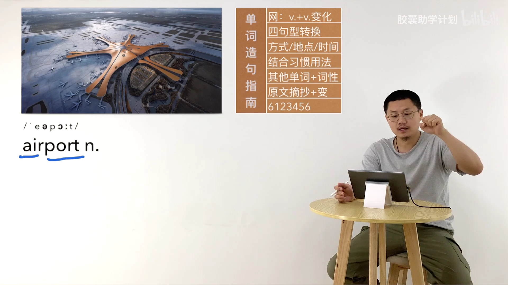

文字识别：单词造句指南 / 网：v.+v.变化 / 胶囊助学计划 / 四句型转换 / 方式/地点/时间 / 结合习惯用法 / 其他单词+词性 / 原文摘抄+变 / 6123456 / /'eapoit/ / airport n.

### 画面 00:02:52

文字识别：单词造句指南 / 网：v.+v.变化 / 胶囊助学计划 / 四句型转换 / 方式/地点/时间 / 结合习惯用法 / 其他单词+词性 / 原文摘抄+变 / 6123456 / /'eapoit/ / airport n.

### 画面 00:02:54

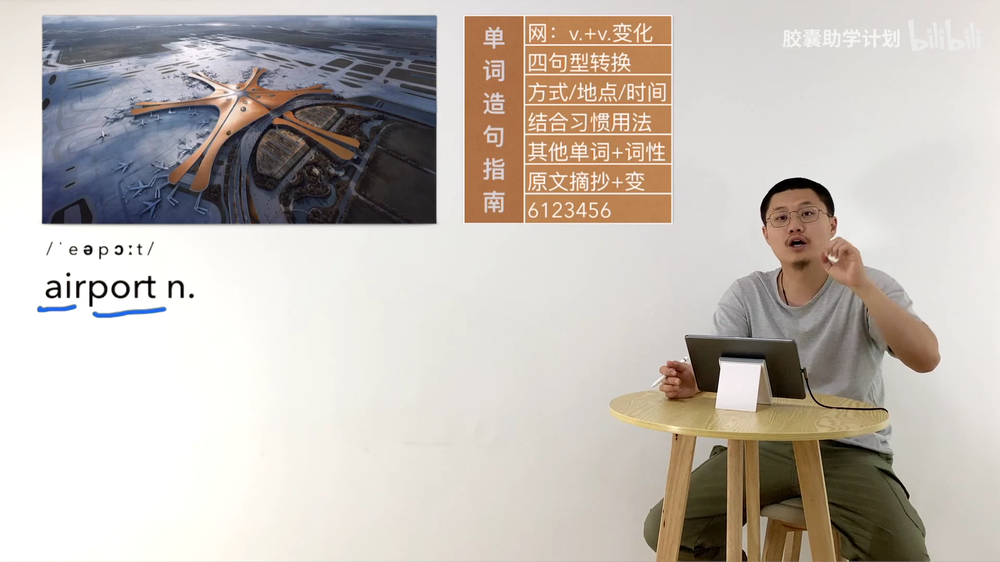

文字识别：单词造句指南 / 网：v.+v.变化 / 胶囊助学计划 / 四句型转换 / 方式/地点/时间 / 结合习惯用法 / 其他单词+词性 / 原文摘抄+变 / 6123456 / /'eapoit/ / airport n.

### 画面 00:02:56

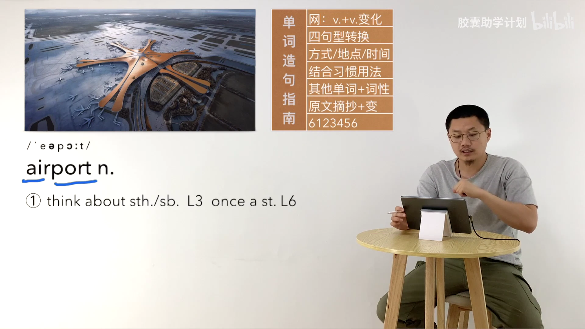

文字识别：单词造句指南 / 网：v.+v.变化 / 胶囊助学计划 / 四句型转换 / 方式/地点/时间 / 结合习惯用法 / 其他单词+词性 / 原文摘抄+变 / 6123456 / /eapo:t/ / airport n. / think about sth./sb. L3 once a st. L6

### 画面 00:02:58

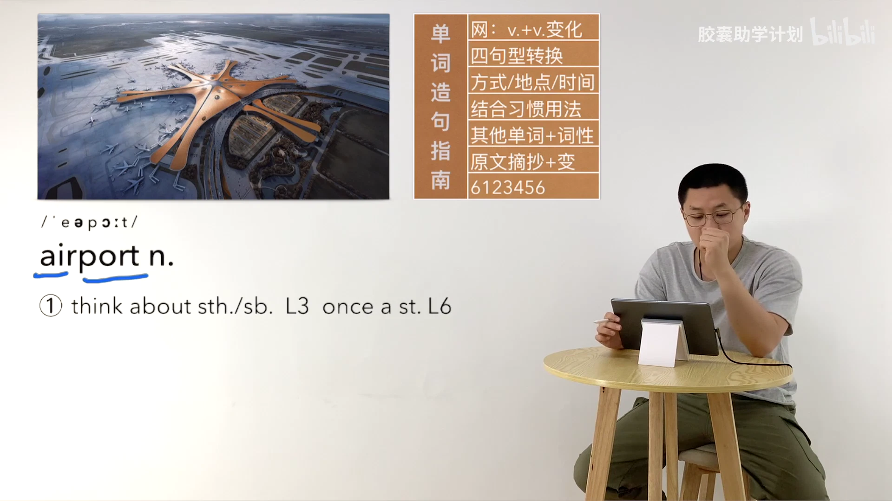

文字识别：单词造句指南 / 网：v.+v.变化 / 胶囊助学计划 / 四句型转换 / 方式/地点/时间 / 结合习惯用法 / 其他单词+词性 / 原文摘抄+变 / 6123456 / /eapo:t/ / airport n. / think about sth./sb. L3 once a st. L6

## 00:03:00–00:03:30

something 和第六课的 once a year, once a month, 一年一次或一个月一次。比如说，那这是大型机场对吧？叫 I think about Beijing Daxing International Airport, 大兴国际机场. Almost once a week, 几乎是一周想一次啊，一直想去那个地方参观一下。之前在新西兰就知道这个地方啊，到现在来到北京还是没有时间，但总想去参观一下，就可以这样说，叫 I think about Beijing Daxing International Airport

### 画面 00:03:00

文字识别：单词造句指南 / 网：v.+v.变化 / 胶囊助学计划 / 四句型转换 / 方式/地点/时间 / 结合习惯用法 / 其他单词+词性 / 原文摘抄+变 / 6123456 / /eapo:t/ / airport n. / think about sth./sb. L3 once a st. L6

### 画面 00:03:03

文字识别：单词造句指南 / 网：v.+v.变化 / 胶囊助学计划 / 四句型转换 / 方式/地点/时间 / 结合习惯用法 / 其他单词+词性 / 原文摘抄+变 / 6123456 / /eapo:t/ / airport n. / think about sth./sb. L3 once a st. L6

### 画面 00:03:05

文字识别：单词造句指南 / 网：v.+v.变化 / 胶囊助学计划 / 四句型转换 / 方式/地点/时间 / 结合习惯用法 / 其他单词+词性 / 原文摘抄+变 / 6123456 / /'eapo:t/ / airport n. / think about sth./sb. L3 once a st. L6 /  I think about Beijing Daxing International Airport / almost once a week.

### 画面 00:03:07

文字识别：单词造句指南 / 网：v.+v.变化 / 胶囊助学计划 / 四句型转换 / 方式/地点/时间 / 结合习惯用法 / 其他单词+词性 / 原文摘抄+变 / 6123456 / /'eapo:t/ / airport n. / think about sth./sb. L3 once a st. L6 / I think about Beijing Daxing International Airport / almost once a week.

### 画面 00:03:10

文字识别：单词造句指南 / 网：v.+v.变化 / 胶囊助学计划 / 四句型转换 / 方式/地点/时间 / 结合习惯用法 / 其他单词+词性 / 原文摘抄+变 / 6123456 / /'eapo:t/ / airport n. / think about sth./sb. L3 once a st. L6 / I think about Beijing Daxing International Airport / almost once a week.

### 画面 00:03:14

文字识别：单词造句指南 / 网：v.+v.变化 / 胶囊助学计划 / 四句型转换 / 方式/地点/时间 / 结合习惯用法 / 其他单词+词性 / 原文摘抄+变 / 6123456 / /'eapo:t/ / airport n. / think about sth./sb. L3 once a st. L6 / I think about Beijing Daxing International Airport / almost once a week.

### 画面 00:03:16

文字识别：单词造句指南 / 网：v.+v.变化 / 胶囊助学计划 / 四句型转换 / 方式/地点/时间 / 结合习惯用法 / 其他单词+词性 / 原文摘抄+变 / 6123456 / /'eapo:t/ / airport n. / think about sth./sb. L3 once a st. L6 / I think about Beijing Daxing International Airport / almost once a week.

### 画面 00:03:18

文字识别：单词造句指南 / 网：v.+v.变化 / 胶囊助学计划 / 四句型转换 / 方式/地点/时间 / 结合习惯用法 / 其他单词+词性 / 原文摘抄+变 / 6123456 / /'eapoit/ / airport n. / think about sth./sb. L3 once a st. L6 / I think about Beijing Daxing International Airport / almost once a week.

### 画面 00:03:20

文字识别：单词造句指南 / 网：v.+v.变化 / 胶囊助学计划 / 四句型转换 / 方式/地点/时间 / 结合习惯用法 / 其他单词+词性 / 原文摘抄+变 / 6123456 / /'eapo:t/ / airport n. / think about sth./sb. L3 once a st. L6 / I think about Beijing Daxing International Airport / almost once a week.

### 画面 00:03:22

文字识别：单词造句指南 / 网：v.+v.变化 / 胶囊助学计划 / 四句型转换 / 方式/地点/时间 / 结合习惯用法 / 其他单词+词性 / 原文摘抄+变 / 6123456 / /'eapo:t/ / airport n. / think about sth./sb. L3 once a st. L6 /  I think about Beijing Daxing International Airport / almost once a week.

### 画面 00:03:25

文字识别：单词造句指南 / 网：v.+v.变化 / 胶囊助学计划 / 四句型转换 / 方式/地点/时间 / 结合习惯用法 / 其他单词+词性 / 原文摘抄+变 / 6123456 / /'eapo:t/ / airport n. / think about sth./sb. L3 once a st. L6 / I think about Beijing Daxing International Airport / almost once a week.

### 画面 00:03:28

文字识别：单词造句指南 / 网：v.+v.变化 / 胶囊助学计划 / 四句型转换 / 方式/地点/时间 / 结合习惯用法 / 其他单词+词性 / 原文摘抄+变 / 6123456 / /'eapo:t/ / airport n. / think about sth./sb. L3 once a st. L6 / I think about Beijing Daxing International Airport / almost once a week.

## 00:03:30–00:04:00

Airport almost once a week.肯定句出来了，是不是各种否定句、一般疑问句？各位可以自己去做了四句型转换，对吧？好，接下来那我就可以问说，Why do you think about that airport once a week?你为什么总去想它呢？对，那我们就来说一个find名词加形容词，第四课学到的叫I find this airport very cool.那我觉得这个机场看起来特别的帅，对吧？你看它

### 画面 00:03:30

文字识别：单词造句指南 / 网：v.+v.变化 / 胶囊助学计划 / 四句型转换 / 方式/地点/时间 / 结合习惯用法 / 其他单词+词性 / 原文摘抄+变 / 6123456 / /'eapo:t/ / airport n. / think about sth./sb. L3 once a st. L6 /  I think about Beijing Daxing International Airport / almost once a week.

### 画面 00:03:33

文字识别：单词造句指南 / 网：v.+v.变化 / 胶囊助学计划 / 四句型转换 / 方式/地点/时间 / 结合习惯用法 / 其他单词+词性 / 原文摘抄+变 / 6123456 / /'eapo:t/ / airport n. / think about sth./sb. L3 once a st. L6 /  I think about Beijing Daxing International Airport / almost once a week.

### 画面 00:03:35

文字识别：单词造句指南 / 网：v.+v.变化 / 胶囊助学计划 / 四句型转换 / 方式/地点/时间 / 结合习惯用法 / 其他单词+词性 / 原文摘抄+变 / 6123456 / /'eapo:t/ / airport n. / think about sth./sb. L3 once a st. L6 /  I think about Beijing Daxing International Airport / almost once a week.

### 画面 00:03:37

文字识别：单词造句指南 / 网：v.+v.变化 / 胶囊助学计划 / 四句型转换 / 方式/地点/时间 / 结合习惯用法 / 其他单词+词性 / 原文摘抄+变 / 6123456 / /'eapo:t/ / airport n. / think about sth./sb. L3 once a st. L6 /  I think about Beijing Daxing International Airport / almost once a week.

### 画面 00:03:39

文字识别：单词造句指南 / 网：v.+v.变化 / 胶囊助学计划 / 四句型转换 / 方式/地点/时间 / 结合习惯用法 / 其他单词+词性 / 原文摘抄+变 / 6123456 / /'eapo:t/ / airport n. / think about sth./sb. L3 once a st. L6 / I think about Beijing Daxing International Airport / almost once a week.

### 画面 00:03:41

文字识别：单词造句指南 / 网：v.+v.变化 / 胶囊助学计划 / 四句型转换 / 方式/地点/时间 / 结合习惯用法 / 其他单词+词性 / 原文摘抄+变 / 6123456 / /'eapoit/ / airport n. / think about sth./sb. L3 once a st. L6 / ) I think about Beijing Daxing International Airport / almost once a week. / ③ Why do you think about that airport?

### 画面 00:03:43

文字识别：单词造句指南 / 网：v.+v.变化 / 胶囊助学计划 / 四句型转换 / 方式/地点/时间 / 结合习惯用法 / 其他单词+词性 / 原文摘抄+变 / 6123456 / /'eapoit/ / airport n. / think about sth./sb. L3 once a st. L6 / ) I think about Beijing Daxing International Airport / almost once a week. / ③ Why do you think about that airport?

### 画面 00:03:45

文字识别：单词造句指南 / 网：v.+v.变化 / 胶囊助学计划 / 四句型转换 / 方式/地点/时间 / 结合习惯用法 / 其他单词+词性 / 原文摘抄+变 / 6123456 / /'eapoit/ / airport n. / think about sth./sb. L3 once a st. L6 /  I think about Beijing Daxing International Airport, / almost once a week. / ③ Why do you think about that airport?

### 画面 00:03:48

文字识别：单词造句指南 / 网：v.+v.变化 / 胶囊助学计划 / 四句型转换 / 方式/地点/时间 / 结合习惯用法 / 其他单词+词性 / 原文摘抄+变 / 6123456 / /'eapoit/ / airport n. / think about sth./sb. L3 once a st. L6 / ) I think about Beijing Daxing International Airport / almost once a week. / Why do you think about that airport? / find n. adj. L4

### 画面 00:03:50

文字识别：单词造句指南 / 网：v.+v.变化 / 胶囊助学计划 / 四句型转换 / 方式/地点/时间 / 结合习惯用法 / 其他单词+词性 / 原文摘抄+变 / 6123456 / /'eapoit/ / airport n. / think about sth./sb. L3 once a st. L6 / ) I think about Beijing Daxing International Airport / almost once a week. / Why do you think about that airport? / find n. adj. L4

### 画面 00:03:53

文字识别：单词造句指南 / 网：v.+v.变化 / 胶囊助学计划 / 四句型转换 / 方式/地点/时间 / 结合习惯用法 / 其他单词+词性 / 原文摘抄+变 / 6123456 / /'eapoit/ / airport n. / think about sth./sb. L3 once a st. L6 / I think about Beijing Daxing International Airport / almost once a week. / Why do you think about that airport? / find n. adj. L4 /  I find this airport very cool. / 5

### 画面 00:03:55

文字识别：单词造句指南 / 网：v.+v.变化 / 胶囊助学计划 / 四句型转换 / 方式/地点/时间 / 结合习惯用法 / 其他单词+词性 / 原文摘抄+变 / 6123456 / /'eapoit/ / airport n. / think about sth./sb. L3 once a st. L6 /  I think about Beijing Daxing International Airport / 2 / almost once a week. / Why do you think about that airport? / find n. adj. L4 / ) I find this airport very cool. / 5

### 画面 00:03:57

文字识别：单词造句指南 / 网：v.+v.变化 / 胶囊助学计划 / 四句型转换 / 方式/地点/时间 / 结合习惯用法 / 其他单词+词性 / 原文摘抄+变 / 6123456 / /'eapoit/ / airport n. / think about sth./sb. L3 once a st. L6 /  I think about Beijing Daxing International Airport / 2 / almost once a week. / Why do you think about that airport? / find n. adj. L4 / ) I find this airport very cool. / 5

### 画面 00:03:59

文字识别：单词造句指南 / 网：v.+v.变化 / 胶囊助学计划 / 四句型转换 / 方式/地点/时间 / 结合习惯用法 / 其他单词+词性 / 原文摘抄+变 / 6123456 / /'eapoit/ / airport n. / think about sth./sb. L3 once a st. L6 /  I think about Beijing Daxing International Airport / 2 / almost once a week. / Why do you think about that airport? / find n. adj. L4 / ) I find this airport very cool. / 5

## 00:04:00–00:04:30

造型也很有意思，像一个海星一样啊，看起来很酷。所以，那 I find the airport very cool. That's why I think about it almost once a week. Okay, 然后一个下一个单词，跟我一起读，叫做 expect。注意不读 expect，要把它浊化变成 b。啊，这个我们在音标课程当中给大家录制的这些视频当中有进行非常详细的讲解。好，expect

### 画面 00:04:01

文字识别：单词造句指南 / 网：v.+v.变化 / 胶囊助学计划 / 四句型转换 / 方式/地点/时间 / 结合习惯用法 / 其他单词+词性 / 原文摘抄+变 / 6123456 / /'eapoit/ / airport n. / think about sth./sb. L3 once a st. L6 /  I think about Beijing Daxing International Airport / 2 / almost once a week. / Why do you think about that airport? / find n. adj. L4 /  I find this airport very cool. / 5

### 画面 00:04:04

文字识别：单词造句指南 / 网：v.+v.变化 / 胶囊助学计划 / 四句型转换 / 方式/地点/时间 / 结合习惯用法 / 其他单词+词性 / 原文摘抄+变 / 6123456 / /'eapoit/ / airport n. / think about sth./sb. L3 once a st. L6 /  I think about Beijing Daxing International Airport / 2 / almost once a week. / Why do you think about that airport? / find n. adj. L4 /  I find this airport very cool. / 5

### 画面 00:04:06

文字识别：单词造句指南 / 网：v.+v.变化 / 胶囊助学计划 / 四句型转换 / 方式/地点/时间 / 结合习惯用法 / 其他单词+词性 / 原文摘抄+变 / 6123456 / /'eapoit/ / airport n. / think about sth./sb. L3 once a st. L6 /  I think about Beijing Daxing International Airport / almost once a week. / Why do you think about that airport? / find n. adj. L4 /  I find this airport very cool. / 5

### 画面 00:04:08

文字识别：单词造句指南 / 网：v.+v.变化 / 胶囊助学计划 / 四句型转换 / 方式/地点/时间 / 结合习惯用法 / 其他单词+词性 / 原文摘抄+变 / 6123456 / /'eapoit/ / airport n. / think about sth./sb. L3 once a st. L6 / ) I think about Beijing Daxing International Airport / almost once a week. / Why do you think about that airport? / find n. adj. L4 /  I find this airport very cool. / 5

### 画面 00:04:10

文字识别：单词造句指南 / 网：v.+v.变化 / 胶囊助学计划 / 四句型转换 / 方式/地点/时间 / 结合习惯用法 / 其他单词+词性 / 原文摘抄+变 / 6123456 / /'eapoit/ / airport n. / think about sth./sb. L3 once a st. L6 /  I think about Beijing Daxing International Airport / 2 / almost once a week. / Why do you think about that airport? / find n. adj. L4 / ) I find this airport very cool. / 5

### 画面 00:04:12

文字识别：单词造句指南 / 网：v.+v.变化 / 胶囊助学计划 / 四句型转换 / 方式/地点/时间 / 结合习惯用法 / 其他单词+词性 / 原文摘抄+变 / 6123456 / /'eapoit/ / airport n. / think about sth./sb. L3 once a st. L6 /  I think about Beijing Daxing International Airport / 2 / almost once a week. / Why do you think about that airport? / find n. adj. L4 / ) I find this airport very cool. / 5

### 画面 00:04:14

文字识别：单词造句指南 / 网：v.+v.变化 / 胶囊助学计划 / 四句型转换 / 方式/地点/时间 / 结合习惯用法 / 其他单词+词性 / 原文摘抄+变 / 6123456 / /ik'spekt/ / expect v.

### 画面 00:04:16

文字识别：单词造句指南 / 网：v.+v.变化 / 胶囊助学计划 / 四句型转换 / 方式/地点/时间 / 结合习惯用法 / 其他单词+词性 / 原文摘抄+变 / 6123456 / /ik'spekt/ / expect v.

### 画面 00:04:20

文字识别：单词造句指南 / 网：v.+v.变化 / 胶囊助学计划 / 四句型转换 / 方式/地点/时间 / 结合习惯用法 / 其他单词+词性 / 原文摘抄+变 / 6123456 / /ik'spekt/ / expect v.

### 画面 00:04:22

文字识别：单词造句指南 / 网：v.+v.变化 / 胶囊助学计划 / 四句型转换 / 方式/地点/时间 / 结合习惯用法 / 其他单词+词性 / 原文摘抄+变 / 6123456 / /ik'spekt/ / expect v.

### 画面 00:04:24

文字识别：单词造句指南 / 网：v.+v.变化 / 胶囊助学计划 / 四句型转换 / 方式/地点/时间 / 结合习惯用法 / 其他单词+词性 / 原文摘抄+变 / 6123456 / /ik'spekt/ / expect v.

### 画面 00:04:26

文字识别：单词造句指南 / 网：v.+v.变化 / 胶囊助学计划 / 四句型转换 / 方式/地点/时间 / 结合习惯用法 / 其他单词+词性 / 原文摘抄+变 / 6123456 / /ik'spekt/ / expect v.

### 画面 00:04:29

文字识别：单词造句指南 / 网：v.+v.变化 / 胶囊助学计划 / 四句型转换 / 方式/地点/时间 / 结合习惯用法 / 其他单词+词性 / 原文摘抄+变 / 6123456 / /ik'spekt/ / expect v.

## 00:04:30–00:05:00

它有两个意思，一个是期待，一个是等待。等待这个含义是我们今天想重点给大家提的，非常像我们之前学过的一个短语叫wait for，叫等，对吧？好，那我们原文给了一句话叫做They were expecting a valuable parcel，说他们正在等一个很贵重的包裹。这两个单词一会儿我们就学到啊，肯定句给大家了。我们现在进行的是原文摘抄再加变，变其实

### 画面 00:04:31

文字识别：单词造句指南 / 网：v.+v.变化 / 胶囊助学计划 / 四句型转换 / 方式/地点/时间 / 结合习惯用法 / 其他单词+词性 / 原文摘抄+变 / 6123456 / /ik'spekt/ / expect v.

### 画面 00:04:35

文字识别：单词造句指南 / 网：v.+v.变化 / 胶囊助学计划 / 四句型转换 / 方式/地点/时间 / 结合习惯用法 / 其他单词+词性 / 原文摘抄+变 / 6123456 / /ik'spekt/ / expect v.

### 画面 00:04:40

文字识别：单词造句指南 / 网：v.+v.变化 / 胶囊助学计划 / 四句型转换 / 方式/地点/时间 / 结合习惯用法 / 其他单词+词性 / 原文摘抄+变 / 6123456 / /ik'spekt/ / expect v.

### 画面 00:04:43

文字识别：单词造句指南 / 网：v.+v.变化 / 胶囊助学计划 / 四句型转换 / 方式/地点/时间 / 结合习惯用法 / 其他单词+词性 / 原文摘抄+变 / 6123456 / /ik'spekt/ / expect v. / ① [Story]: They were expecting a valuable parcel.

### 画面 00:04:45

文字识别：单词造句指南 / 网：v.+v.变化 / 胶囊助学计划 / 四句型转换 / 方式/地点/时间 / 结合习惯用法 / 其他单词+词性 / 原文摘抄+变 / 6123456 / /ik'spekt/ / expect v. / ① [Story]: They were expecting a valuable parcel.

### 画面 00:04:50

文字识别：单词造句指南 / 网：v.+v.变化 / 胶囊助学计划 / 四句型转换 / 方式/地点/时间 / 结合习惯用法 / 其他单词+词性 / 原文摘抄+变 / 6123456 / /ik'spekt/ / expect v. / ① [Story]: They were expecting a valuable parcel.

### 画面 00:04:52

文字识别：单词造句指南 / 网：v.+v.变化 / 胶囊助学计划 / 四句型转换 / 方式/地点/时间 / 结合习惯用法 / 其他单词+词性 / 原文摘抄+变 / 6123456 / /ik'spekt/ / expect v. / ① [Story]: They were expecting a valuable parcel.

### 画面 00:04:54

文字识别：单词造句指南 / 网：v.+v.变化 / 胶囊助学计划 / 四句型转换 / 方式/地点/时间 / 结合习惯用法 / 其他单词+词性 / 原文摘抄+变 / 6123456 / /ik'spekt/ / expect v. / ① [Story]: They were expecting a valuable parcel.

### 画面 00:04:56

文字识别：单词造句指南 / 网：v.+v.变化 / 胶囊助学计划 / 四句型转换 / 方式/地点/时间 / 结合习惯用法 / 其他单词+词性 / 原文摘抄+变 / 6123456 / /ik'spekt/ / expect v. / ① [Story]: They were expecting a valuable parcel.

### 画面 00:04:59

文字识别：单词造句指南 / 网：v.+v.变化 / 胶囊助学计划 / 四句型转换 / 方式/地点/时间 / 结合习惯用法 / 其他单词+词性 / 原文摘抄+变 / 6123456 / /ik'spekt/ / expect v. / ① [Story]: They were expecting a valuable parcel.

## 00:05:00–00:05:30

就是四句型转化，把它变成一般疑问句。Were they expecting a valuable parcel？好，那我们还可以再问一下，说 Why were they expecting a valuable parcel？也可以问 What were they expecting？他们正在等什么呢？Very good，这是我们造句的思路啊。再跟我读一遍这个单词，expect，千万注意不读spect，OK？好，那接下来我们看一个电影片

### 画面 00:05:01

文字识别：单词造句指南 / 网：v.+v.变化 / 胶囊助学计划 / 四句型转换 / 方式/地点/时间 / 结合习惯用法 / 其他单词+词性 / 原文摘抄+变 / 6123456 / /ik'spekt/ / expect v. / ① [Story]: They were expecting a valuable parcel.

### 画面 00:05:03

文字识别：单词造句指南 / 网：v.+v.变化 / 胶囊助学计划 / 四句型转换 / 方式/地点/时间 / 结合习惯用法 / 其他单词+词性 / 原文摘抄+变 / 6123456 / /ik'spekt/ / expect v. / [Story]: They were expecting a valuable parcel. / Were / they expecting a valuable parcet?

### 画面 00:05:05

文字识别：单词造句指南 / 网：v.+v.变化 / 胶囊助学计划 / 四句型转换 / 方式/地点/时间 / 结合习惯用法 / 其他单词+词性 / 原文摘抄+变 / 6123456 / /ik'spekt/ / expect v. / [Story]: They were expecting a valuable parcel. / Were they expecting a valuable parcel?

### 画面 00:05:08

文字识别：单词造句指南 / 网：v.+v.变化 / 胶囊助学计划 / 四句型转换 / 方式/地点/时间 / 结合习惯用法 / 其他单词+词性 / 原文摘抄+变 / 6123456 / /Ik'spekt/ / expect v. / [Story]: They were expecting a valuable parcel. / Were /  they expecting a valuable parcet? / Why were they expecting a valuable parcel? / 3

### 画面 00:05:10

文字识别：单词造句指南 / 网：v.+v.变化 / 胶囊助学计划 / 四句型转换 / 方式/地点/时间 / 结合习惯用法 / 其他单词+词性 / 原文摘抄+变 / 6123456 / /Ik'spekt/ / expect v. / [Story]: They were expecting a valuable parcel. / Were they expecting a valuable parcel? / Why were they expecting a valuable parcel? / 3

### 画面 00:05:13

文字识别：单词造句指南 / 网：v.+v.变化 / 胶囊助学计划 / 四句型转换 / 方式/地点/时间 / 结合习惯用法 / 其他单词+词性 / 原文摘抄+变 / 6123456 / /Ik'spekt/ / expect v. / [Story]: They were expecting a valuable parcel. / Were they expecting a valuable parcel? / Why were they expecting a valuable parcel? / 3

### 画面 00:05:15

文字识别：单词造句指南 / 网：v.+v.变化 / 胶囊助学计划 / 四句型转换 / 方式/地点/时间 / 结合习惯用法 / 其他单词+词性 / 原文摘抄+变 / 6123456 / /Ik'spekt/ / expect v. / [Story]: They were expecting a valuable parcel. / Were they expecting a valuable parcel? / Why were they expecting a valuable parcel? / 3

### 画面 00:05:20

文字识别：单词造句指南 / 网：v.+v.变化 / 胶囊助学计划 / 四句型转换 / 方式/地点/时间 / 结合习惯用法 / 其他单词+词性 / 原文摘抄+变 / 6123456 / /Ik'spekt/ / expect v. / [Story]: They were expecting a valuable parcel. / 1 / Were /  they expecting a valuable parcel? / Why were they expecting a valuable parcel? / 3

### 画面 00:05:25

文字识别：单词造句指南 / 网：v.+v.变化 / 胶囊助学计划 / 四句型转换 / 方式/地点/时间 / 结合习惯用法 / 其他单词+词性 / 原文摘抄+变 / 6123456 / /Ik'spekt/ / expect v. / [Story]: They were expecting a valuable parcel. / Were / e they expecting a valuable parcet? / Why were they expecting a valuable parcel? / 3

### 画面 00:05:27

文字识别：You were expecting… / 胶囊助学计划 / 怪物史瑞克 / Shrek / (2001)

### 画面 00:05:29

文字识别：You were expecting.. / 胶囊助学计划 / 怪物史瑞克 / Shrek / (2001)

## 00:05:30–00:06:00

段，里面就用到了叫做 you were expecting 你正在等什么什么 you you're an ogre oh you were expecting Prince Charming well yes actually oh no this is all wrong

### 画面 00:05:36

文字识别：You were expecting. / 胶囊助学计划 / 怪物史瑞克 / Shrek / (2001)

### 画面 00:05:38

文字识别：You were expecting…. / 胶囊助学计划 / 怪物史瑞克 / Shrek / (2001)

### 画面 00:05:40

文字识别：You were expecting… / 胶囊助学计划 / 怪物史瑞克 / Shrek / (2001)

### 画面 00:05:42

文字识别：You were expecting…. / 胶囊助学计划 / 怪物史瑞克 / Shrek / (2001)

### 画面 00:05:44

文字识别：You were expecting…. / 胶囊助学计划 / 怪物史瑞克 / Shrek / (2001)

### 画面 00:05:46

文字识别：You were expecting….. / 胶囊助学计划 / 怪物史瑞克 / 你...你是个妖怪 / Shrek / You.You're aanogre. / (2001)

### 画面 00:05:48

文字识别：You were expecting…. / 胶囊助学计划 / 怪物史瑞克 / 你以为我是个白马王子吗 / Shrek / Oh, you were expecting Prince Charming. / (2001)

### 画面 00:05:50

文字识别：You were expecting…. / 胶囊助学计划 / 怪物史瑞克 / 你以为我是个白马王子吗 / Shrek / Oh, you were expecting Prince Charming. / (2001)

### 画面 00:05:52

文字识别：You were expecting…. / 胶囊助学计划 / 你以为我是个白马王子吗 / 怪物史瑞克 / Shrek / Oh, you were expecting Prince Charming. / (2001)

### 画面 00:05:54

文字识别：You were expecting… / 胶囊助学计划 / 怪物史瑞克 / 是啊 老实说. / Shrek / Well, yes, actually. / (2001)

### 画面 00:05:56

文字识别：You were expecting. / 胶囊助学计划 / 怪物史瑞克 / Shrek / (2001)

### 画面 00:05:58

文字识别：You were expecting… / 胶囊助学计划 / 怪物史瑞克 / 不这完全不对 / Shrek / Oh, no. This is all wrong. / (2001)

## 00:06:00–00:06:30

Ah, you were expecting Prince Charming. Ah,你正在等白马王子吗？Okay, Prince Charming.好，那接下来呢，我们再看两个单词。第一个单词 valuable, valuable.第二个单词 diamond, diamond.好，diamond的意思指的是钻石。那 valuable指的是宝贵的啊，很贵重的钻石。比如说泰坦尼克号当中出现的Rose戴的那个海洋之心，我们就可以管它叫做

### 画面 00:06:00

文字识别：You were expecting… / 胶囊助学计划 / 怪物史瑞克 / Shrek / (2001)

### 画面 00:06:05

文字识别：You were expecting… / 胶囊助学计划 / 怪物史瑞克 / Shrek / (2001)

### 画面 00:06:07

文字识别：单词造句指南 / 网：v.+v.变化 / 胶囊助学计划 / 四句型转换 / 方式/地点/时间 / 结合习惯用法 / 其他单词+词性 / 原文摘抄+变 / 6123456 / /væljuabal/ / /'dalamand/ / valuable adj. diamond n.

### 画面 00:06:09

文字识别：胶囊助学计划bil出 / 单词造句指南 / 网：v.+v.变化 / 四句型转换 / 方式/地点/时间 / 结合习惯用法 / 其他单词+词性 / 原文摘抄+变 / 6123456 / /væljuabal/ / /'dalamand/ / valuable adj. diamond n.

### 画面 00:06:11

文字识别：单词造句指南 / 网：v.+v.变化 / 胶囊助学计划 / bilibii / 四句型转换 / 方式/地点/时间 / 结合习惯用法 / 其他单词+词性 / 原文摘抄+变 / 6123456 / /væljuabal/ / /'daiamand/ / valuable adj. diamond n.

### 画面 00:06:14

文字识别：单词造句指南 / 网：v.+v.变化 / 胶囊助学计划 / bibi / 四句型转换 / 方式/地点/时间 / 结合习惯用法 / 其他单词+词性 / 原文摘抄+变 / 6123456 / /væljuabal/ / /'daiamand/ / valuable adj. diamond n.

### 画面 00:06:16

文字识别：单词造句指南 / 网：v.+v.变化 / 胶囊助学计划 / Biltbili / 四句型转换 / 方式/地点/时间 / 结合习惯用法 / 其他单词+词性 / 原文摘抄+变 / 6123456 / /'væljuabal/ / /'dalamand/ / valuable adj. diamond n.

### 画面 00:06:18

文字识别：单词造句指南 / 网：v.+v.变化 / 胶囊助学计划 / Bibi / 四句型转换 / 方式/地点/时间 / 结合习惯用法 / 其他单词+词性 / 原文摘抄+变 / 6123456 / /'væljuabal/ / /'dalamand/ / valuable adj. diamond n.

### 画面 00:06:20

文字识别：单词造句指南 / 网：v.+v.变化 / 胶囊助学计划 / Bilibila / 四句型转换 / 方式/地点/时间 / 结合习惯用法 / 其他单词+词性 / 原文摘抄+变 / 6123456 / /væljuabal/ / /'dalamand/ / valuable adj. o / diamond n.

### 画面 00:06:23

文字识别：单词造句指南 / 网：v.+v.变化 / 胶囊助学计划 / Bilbili / 四句型转换 / 方式/地点/时间 / 结合习惯用法 / 其他单词+词性 / 原文摘抄+变 / 6123456 / /veljuabal/ / /'dalamand/ / valuable adj. diamond n.

### 画面 00:06:25

文字识别：单词造句指南 / 网：v.+v.变化 / 胶囊助学计划 / Bilbili / 四句型转换 / 方式/地点/时间 / 结合习惯用法 / 其他单词+词性 / 原文摘抄+变 / 6123456 / /veljuabal/ / /'daiamand/ / valuable adj. diamond n.

### 画面 00:06:27

文字识别：单词造句指南 / 网：v.+v.变化 / 胶囊助学计划 / Bilbl / 四句型转换 / 方式/地点/时间 / 结合习惯用法 / 其他单词+词性 / 原文摘抄+变 / 6123456 / /væljuabal/ / /'dalamand/ / valuable adj. diamond n.

### 画面 00:06:29

文字识别：单词造句指南 / 网：v.+v.变化 / 胶囊助学计划 / Bilbili / 四句型转换 / 方式/地点/时间 / 结合习惯用法 / 其他单词+词性 / 原文摘抄+变 / 6123456 / /væljuabal/ / /'daiamand/ / valuable adj. diamond n.

## 00:06:30–00:07:00

valuable diamond. Very good. 形容词加名词放在一起也很容易造句，对吧？Valuable diamond. 那我们用一个 receive something from somebody 这样一个习惯用法啊，结合其他习惯用法，我们放在一起去造句。比如说 Rose 啊啊，这个 Rose 就是她对吧？女主啊， received this valuable diamond from Carol. Okay, 它来自于谁对吧？收到了这个宝贵的这个呃钻石啊，

### 画面 00:06:31

文字识别：单词造句指南 / 网：v.+v.变化 / 胶囊助学计划 / Biibli / 四句型转换 / 方式/地点/时间 / 结合习惯用法 / 其他单词+词性 / 原文摘抄+变 / 6123456 / /væljuabal/ / /'daiamand/ / valuable adj. diamond n.

### 画面 00:06:33

文字识别：单词造句指南 / 网：v.+v.变化 / 胶囊助学计划 / Bilbli / 四句型转换 / 方式/地点/时间 / 结合习惯用法 / 其他单词+词性 / 原文摘抄+变 / 6123456 / /væljuabal/ / /'daiamand/ / valuable adj. diamond n.

### 画面 00:06:35

文字识别：单词造句指南 / 网：v.+v.变化 / 胶囊助学计划 / Bibii / 四句型转换 / 方式/地点/时间 / 结合习惯用法 / 其他单词+词性 / 原文摘抄+变 / 6123456 / /væljuabal/ / /'daiamand/ / valuable adj. c / diamond / dn.

### 画面 00:06:37

文字识别：单词造句指南 / 网：v.+v.变化 / 胶囊助学计划 / Bitbli / 四句型转换 / 方式/地点/时间 / 结合习惯用法 / 其他单词+词性 / 原文摘抄+变 / 6123456 / /'væljuabal/ / /'dalamand/ / valuable adj. o / diamond n. / receive sth. from sb.

### 画面 00:06:39

文字识别：单词造句指南 / 网：v.+v.变化 / 胶囊助学计划 / bilbil / 四句型转换 / 方式/地点/时间 / 结合习惯用法 / 其他单词+词性 / 原文摘抄+变 / 6123456 / /'væljuabal/ / /'daiamand/ / valuable adj. o / diamond n. / receive sth. from sb.

### 画面 00:06:41

文字识别：单词造句指南 / 网：v.+v.变化 / 胶囊助学计划 / Biibili / 四句型转换 / 方式/地点/时间 / 结合习惯用法 / 其他单词+词性 / 原文摘抄+变 / 6123456 / /'væljuabal/ / /'daiamand/ / valuable adj. c / diamond / dn. / receive sth. from sb.

### 画面 00:06:43

文字识别：单词造句指南 / 网：v.+v.变化 / 胶囊助学计划 / bibii / 四句型转换 / 方式/地点/时间 / 结合习惯用法 / 其他单词+词性 / 原文摘抄+变 / 6123456 / /'væljuabal/ / /'dalamand/ / valuable adj. diamond n. / receive sth. from sb. / Ross received this valuable diamond from Carl.

### 画面 00:06:45

文字识别：单词造句指南 / 网：v.+v.变化 / 胶囊助学计划 / blbli / 四句型转换 / 方式/地点/时间 / 结合习惯用法 / 其他单词+词性 / 原文摘抄+变 / 6123456 / /væljuabal/ / /'daiamand/ / valuable adj. o / diamond n. / receive sth.from sb. / Ross received this valuable diamond from Carl.

### 画面 00:06:47

文字识别：单词造句指南 / 网：v.+v.变化 / 胶囊助学计划 / bilbil / 四句型转换 / 方式/地点/时间 / 结合习惯用法 / 其他单词+词性 / 原文摘抄+变 / 6123456 / /væljuabal/ / /'daiamand/ / valuable adj. o / diamond n. / receive sth. from sb. / Ross received this valuable diamond from Carl.

### 画面 00:06:49

文字识别：单词造句指南 / 网：v.+v.变化 / 胶囊助学计划 / bilbi / 四句型转换 / 方式/地点/时间 / 结合习惯用法 / 其他单词+词性 / 原文摘抄+变 / 6123456 / /væljuabal/ / /'daiamand/ / valuable adj.  / diamond n. / receive sth. from sb. / 1 / Ross received this valuable diamond from Carl.

### 画面 00:06:51

文字识别：单词造句指南 / 网：v.+v.变化 / 胶囊助学计划 / bilbii / 四句型转换 / 方式/地点/时间 / 结合习惯用法 / 其他单词+词性 / 原文摘抄+变 / 6123456 / /væljuabal/ / /'daiamand/ / valuable adj. o / diamond n. / receive sth. from sb. / Ross received this valuable diamond from Carl.

### 画面 00:06:53

文字识别：单词造句指南 / 网：v.+v.变化 / 胶囊助学计划 / Bifbili / 四句型转换 / 方式/地点/时间 / 结合习惯用法 / 其他单词+词性 / 原文摘抄+变 / 6123456 / /væljuabal/ / /'daiamand/ / valuable adj. c / diamond n. / receive sth. from sb. / Ross received this valuable diamond from Carl.

### 画面 00:06:55

文字识别：单词造句指南 / 网：v.+v.变化 / 胶囊助学计划 / Blbli / 四句型转换 / 方式/地点/时间 / 结合习惯用法 / 其他单词+词性 / 原文摘抄+变 / 6123456 / /væljuabal/ / /'daiamand/ / valuable adj. o / diamond n. / receive sth.from sb. / Ross received this valuable diamond from Carl.

### 画面 00:06:57

文字识别：单词造句指南 / 网：v.+v.变化 / 胶囊助学计划 / Bitbii / 四句型转换 / 方式/地点/时间 / 结合习惯用法 / 其他单词+词性 / 原文摘抄+变 / 6123456 / /væljuabal/ / /'daiamand/ / valuable adj. c / diamond n. / receive sth.from sb. / Ross received this valuable diamond from Carl.

### 画面 00:06:59

文字识别：单词造句指南 / 网：v.+v.变化 / 胶囊助学计划 / Bilbii / 四句型转换 / 方式/地点/时间 / 结合习惯用法 / 其他单词+词性 / 原文摘抄+变 / 6123456 / /væljuabal/ / /'daiamand/ / valuable adj. c / diamond n. / receive sth. from sb. / Ross received this valuable diamond from Carl.

## 00:07:00–00:07:30

啊，这个珠宝来自于谁谁谁？那我们可以说 Did Rose receive this valuable diamond from Carl? Okay, one more. 那我们当然了，我们可以对 Rose 提问，可以对 this valuable diamond 提问，也可以对 Carl 提问，对吧？那接下来各位要去想的事情是，我如果对 Rose 进行提问的时候，它是主语，要怎么样来着？如果是 who，直接替代它，叫做 Who received this valuable

### 画面 00:07:01

文字识别：单词造句指南 / 网：v.+v.变化 / 胶囊助学计划 / Bilbil / 四句型转换 / 方式/地点/时间 / 结合习惯用法 / 其他单词+词性 / 原文摘抄+变 / 6123456 / /væljuabal/ / /'daiamand/ / valuable adj. o / diamond n. / receive sth. from sb. / 1 / Ross received this valuable diamond from Carl.

### 画面 00:07:03

文字识别：单词造句指南 / 网：v.+v.变化 / 胶囊助学计划bll / 四句型转换 / 方式/地点/时间 / 结合习惯用法 / 其他单词+词性 / 原文摘抄+变 / 6123456 / /væljuabal/ / /'daiamand/ / valuable adj. diamond n. / receive sth. from sb. / 1 / Ross received this valuable diamond from Carl. / Did Ross receive this valuable diamond from Carl?

### 画面 00:07:05

文字识别：单词造句指南 / 网：v.+v.变化 / 胶囊助学计划bl出 / 四句型转换 / 方式/地点/时间 / 结合习惯用法 / 其他单词+词性 / 原文摘抄+变 / 6123456 / /væljuabal/ / /'daiamand/ / valuable adj. diamond n. / receive sth.from sb. / 1 / Ross received this valuable diamond from Carl. / Did Ross receive this valuable diamond from Carl?

### 画面 00:07:07

文字识别：单词造句指南 / 网：v.+v.变化 / 胶囊助学计划 / bitbili / 四句型转换 / 方式/地点/时间 / 结合习惯用法 / 其他单词+词性 / 原文摘抄+变 / 6123456 / /væljuabal/ / /'daiamand/ / valuable adj. diamond n. / receive sth. from sb. / 1 / Ross received this valuable diamond from Carl. / Did Ross receive this valuable diamond from Carl?

### 画面 00:07:10

文字识别：单词造句指南 / 网：v.+v.变化 / 胶囊助学计划 / bib / 四句型转换 / 方式/地点/时间 / 结合习惯用法 / 其他单词+词性 / 原文摘抄+变 / 6123456 / /væljuabal/ / /'daiamand/ / valuable adj. diamond n. / receive sth.from sb. / 1 / Ross received this valuable diamond from Carl. / Did Ross receive this valuable diamond from Carl?

### 画面 00:07:12

文字识别：单词造句指南 / 网：v.+v.变化 / 胶囊助学计划 / Bibii / 四句型转换 / 方式/地点/时间 / 结合习惯用法 / 其他单词+词性 / 原文摘抄+变 / 6123456 / /væljuabal/ / /'daiamand/ / valuable adj. diamond n. / receive sth. from sb. / 1 / Ross received this valuable diamond from Carl. / Did Ross receive this valuable diamond from Carl?

### 画面 00:07:14

文字识别：单词造句指南 / 网：v.+v.变化 / 胶囊助学计划 / 四句型转换 / 方式/地点/时间 / 结合习惯用法 / 其他单词+词性 / 原文摘抄+变 / 6123456 / /væljuabal/ / /'daiamand/ / valuable adj. o / diamond n. / receive sth.from sb. / 1 / Ross received this valuable diamond from Carl. / Did Ross receive this valuable diamond from Carl?

### 画面 00:07:16

文字识别：单词造句指南 / 网：v.+v.变化 / 胶囊助学计划 / 四句型转换 / 方式/地点/时间 / 结合习惯用法 / 其他单词+词性 / 原文摘抄+变 / 6123456 / /væljuabal/ / /'daiamand/ / valuable adj. c / diamond n. / receive sth. from sb. / 1 / Ross received this valuable diamond from CarL. / Did Ross receive this valuable diamond fromCarl?

### 画面 00:07:20

文字识别：单词造句指南 / 网：v.+v.变化 / 胶囊助学计划 / 四句型转换 / 方式/地点/时间 / 结合习惯用法 / 其他单词+词性 / 原文摘抄+变 / 6123456 / /væljuabal/ / /'daiamand/ / valuable adj.  / diamond n. / receive sth. from sb. / 1 / Ross received this valuable diamond from CarL. / Did Ross receive this valuable diamond fromCarl?

### 画面 00:07:22

文字识别：单词造句指南 / 网：v.+v.变化 / 胶囊助学计划 / 四句型转换 / 方式/地点/时间 / 结合习惯用法 / 其他单词+词性 / 原文摘抄+变 / 6123456 / /væljuabal/ / /'daiamand/ / valuable adj. c / diamond n. / receive sth. from sb. / 1 / Ross received this valuable diamond from CarL. / Did Ross receive this valuable diamond from / Carl?

### 画面 00:07:25

文字识别：单词造句指南 / 网：v.+v.变化 / 胶囊助学计划 / 四句型转换 / 方式/地点/时间 / 结合习惯用法 / 其他单词+词性 / 原文摘抄+变 / 6123456 / /væljuabal/ / / 'daiamand/ / valuable adj.  / diamond n. / receive sth. from sb. / 1 / Ross received this valuable diamond from CarL. / Did Ross receive this valuable diamond from / Carl?

### 画面 00:07:27

文字识别：单词造句指南 / 网：v.+v.变化 / 胶囊助学计划 / 四句型转换 / 方式/地点/时间 / 结合习惯用法 / 其他单词+词性 / 原文摘抄+变 / 6123456 / /væljuabal/ / /'daiamand/ / valuable adj. c / diamond n. / receive sth. from sb. / 1 / Ross received this valuable diamond from Carl. / Did Ross receive this valuable diamond from / Carl?

## 00:07:30–00:08:00

parcel from Carol? Okay, very good.一定要记住啊，不变一般疑问句了。好，接下来下一个单词，跟我读 parcel, parcel.好，注意这有一个字母r，我们可以加个软化音 parcel, parcel, parcel.包裹的意思。Okay.好，那我们拿它造句，还是结合第六课的习惯用法啊。今天我这一课大多数让各位单词造句的时候，都是在重点强调结合之前学过的习惯

### 画面 00:07:30

文字识别：单词造句指南 / 网：v.+v.变化 / 胶囊助学计划 / 四句型转换 / 方式/地点/时间 / 结合习惯用法 / 其他单词+词性 / 原文摘抄+变 / 6123456 / /væljuabal/ / /'daiamand/ / valuable adj. c / diamond n. / receive sth. from sb. / 1 / Ross received this valuable diamond from CarL. / Did Ross receive this valuable diamond fromCarl?

### 画面 00:07:32

文字识别：单词造句指南 / 网：v.+v.变化 / 胶囊助学计划 / 四句型转换 / 方式/地点/时间 / 结合习惯用法 / 其他单词+词性 / 原文摘抄+变 / 6123456 / /væljuabal/ / /'daiamand/ / valuable adj. c / diamond n. / receive sth. from sb. / 1 / Ross received this valuable diamond from CarL. / Did Ross receive this valuable diamond fromCarl?

### 画面 00:07:35

文字识别：单词造句指南 / 网：v.+v.变化 / 胶囊助学计划 / 四句型转换 / 方式/地点/时间 / 结合习惯用法 / 其他单词+词性 / 原文摘抄+变 / 6123456 / /paisal/ / parcel n.

### 画面 00:07:37

文字识别：单词造句指南 / 网：v.+v.变化 / 胶囊助学计划 / 四句型转换 / 方式/地点/时间 / 结合习惯用法 / 其他单词+词性 / 原文摘抄+变 / 6123456 / /paisal/ / parcel n.

### 画面 00:07:40

文字识别：单词造句指南 / 网：v.+v.变化 / 胶囊助学计划 / 四句型转换 / 方式/地点/时间 / 结合习惯用法 / 其他单词+词性 / 原文摘抄+变 / 6123456 / /pa:sal/ / parcel / n.

### 画面 00:07:42

文字识别：单词造句指南 / 网：v.+v.变化 / 胶囊助学计划 / 四句型转换 / 方式/地点/时间 / 结合习惯用法 / 其他单词+词性 / - / 原文摘抄+变 / 6123456 / /pa:sal/ / parcel / n. / •

### 画面 00:07:45

文字识别：单词造句指南 / 网：v.+v.变化 / 胶囊助学计划 / 四句型转换 / 方式/地点/时间 / 结合习惯用法 / 其他单词+词性 / 原文摘抄+变 / 6123456 / /pa:sal/ / parcel / n.

### 画面 00:07:47

文字识别：单词造句指南 / 网：v.+v.变化 / 胶囊助学计划 / 四句型转换 / 方式/地点/时间 / 结合习惯用法 / 其他单词+词性 / 原文摘抄+变 / 6123456 / /pa:sal/ / parcel / n.

### 画面 00:07:49

文字识别：单词造句指南 / 网：v.+v.变化 / 胶囊助学计划 / 四句型转换 / 方式/地点/时间 / 结合习惯用法 / 其他单词+词性 / - / 原文摘抄+变 / 6123456 / /pa:sal/ / parcel / n. / ask for sth. L6

### 画面 00:07:51

文字识别：单词造句指南 / 网：v.+v.变化 / 胶囊助学计划 / 四句型转换 / 方式/地点/时间 / 结合习惯用法 / 其他单词+词性 / 原文摘抄+变 / 6123456 / /pa:sal/ / parcel / n. / • / ask for sth. L6

### 画面 00:07:55

文字识别：单词造句指南 / 网：v.+v.变化 / 胶囊助学计划 / 四句型转换 / 方式/地点/时间 / 结合习惯用法 / 其他单词+词性 / 原文摘抄+变 / 6123456 / /pa:sal/ / parcel / n. / ask for sth. L6

## 00:08:00–00:08:30

用法啊，好叫找某人要某物，对吧？啊，但是这没有某人啊，直接说 ask for something 就是直接要某物。比如说 he asked for，他要了一些什么呢？ Some parcels, parcels this morning。他今儿早上要了一些包裹。肯定句给各位了，四句型转化，各位课下直接可以去做了，对吧？ OK，我们提供的是思路啊，而不是让各位把这些句子去把它背下来。 OK，那我们对主语提问，

### 画面 00:08:00

文字识别：单词造句指南 / 网：v.+v.变化 / 胶囊助学计划 / 四句型转换 / 方式/地点/时间 / 结合习惯用法 / 其他单词+词性 / - / 原文摘抄+变 / 6123456 / /pa:sal/ / parcel / n. / ask for sth. L6

### 画面 00:08:02

文字识别：单词造句指南 / 网：v.+v.变化 / 胶囊助学计划 / BilBil / 四句型转换 / 方式/地点/时间 / 结合习惯用法 / 其他单词+词性 / - / 原文摘抄+变 / 6123456 / /pa:sal/ / parcel / n. / ask for sth. L6

### 画面 00:08:05

文字识别：单词造句指南 / 网：v.+v.变化 / 胶囊助学计划 / Bilbili / 四句型转换 / 方式/地点/时间 / 结合习惯用法 / 其他单词+词性 / 原文摘抄+变 / 6123456 / /pa:sal/ / parcel / n. / ask for sth. L6

### 画面 00:08:07

文字识别：单词造句指南 / 网：v.+v.变化 / 胶囊助学计划 / Bilibilt / 四句型转换 / 方式/地点/时间 / 结合习惯用法 / 其他单词+词性 / 原文摘抄+变 / 6123456 / /pa:sal/ / parcel / n. / ask for sth. L6

### 画面 00:08:09

文字识别：单词造句指南 / 网：v.+v.变化 / 胶囊助学计划 / BilBil / 四句型转换 / 方式/地点/时间 / 结合习惯用法 / 其他单词+词性 / - / 原文摘抄+变 / 6123456 / /pa:sal/ / parcel / n. / ask for sth. L6 / He asked for some parcels this morning.

### 画面 00:08:11

文字识别：单词造句指南 / 网：v.+v.变化 / 胶囊助学计划 / Bitbilt / 四句型转换 / 方式/地点/时间 / 结合习惯用法 / 其他单词+词性 / 原文摘抄+变 / 6123456 / /pa:sal/ / parcel / n. / ask for sth. L6 / He asked for some parcels this morning.

### 画面 00:08:15

文字识别：单词造句指南 / 网：v.+v.变化 / 胶囊助学计划 / BiliBil / 四句型转换 / 方式/地点/时间 / 结合习惯用法 / 其他单词+词性 / 原文摘抄+变 / 6123456 / /pa:sal/ / parcel / n. / ask for sth. L6 / He asked for some parcels this morning.

### 画面 00:08:18

文字识别：单词造句指南 / 网：v.+v.变化 / 胶囊助学计划 / Bilbi / 四句型转换 / 方式/地点/时间 / 结合习惯用法 / 其他单词+词性 / 原文摘抄+变 / 6123456 / /pa:sal/ / parcel / n. / ask for sth. L6 / He asked for some parcels this morning.

### 画面 00:08:20

文字识别：单词造句指南 / 网：v.+v.变化 / 胶囊助学计划 / Bilbii / 四句型转换 / 方式/地点/时间 / 结合习惯用法 / 其他单词+词性 / 原文摘抄+变 / 6123456 / /pa:sal/ / parcel / n. / ask for sth. L6 / He asked for some parcels this morning.

### 画面 00:08:23

文字识别：单词造句指南 / 网：v.+v.变化 / 胶囊助学计划 / Bilbl / 四句型转换 / 方式/地点/时间 / 结合习惯用法 / 其他单词+词性 / 原文摘抄+变 / 6123456 / /pa:sal/ / parcel / n. / ask for sth. L6 / He asked for some parcels this morning.

### 画面 00:08:25

文字识别：单词造句指南 / 网：v.+v.变化 / 胶囊助学计划 / bilbil / 四句型转换 / 方式/地点/时间 / 结合习惯用法 / 其他单词+词性 / 原文摘抄+变 / 6123456 / /pa:sal/ / parcel / n. / ask for sth. L6 / He asked for some parcels this morning.

### 画面 00:08:28

文字识别：单词造句指南 / 网：v.+v.变化 / 胶囊助学计划 / BiltBil / 四句型转换 / 方式/地点/时间 / 结合习惯用法 / 其他单词+词性 / - / 原文摘抄+变 / 6123456 / /paisal/ / parcel / n. / ask for sth. L6 / He asked for some parcels this morning. / Who asked for some parcels this morning? / 3

## 00:08:30–00:09:00

直接说Who asked for some parcels this morning?今儿早上谁要的一些包裹，我给忘了。Who? Very good.对主语提问啊。接下来一个动词，还是同理不读steal，一定要把它浊化变成the steal steal. Very good.好，它的过去式呢，读stole，过去分词呢，stolen. Okay,接下来我们造句，比如说He stole

### 画面 00:08:30

文字识别：单词造句指南 / 网：v.+v.变化 / 胶囊助学计划 / Bilbil / 四句型转换 / 方式/地点/时间 / 结合习惯用法 / 其他单词+词性 / 原文摘抄+变 / 6123456 / /pa:sal/ / parcel / n. / ask for sth. L6 / asked for some parcels this morning. / He / Who asked for some parcels this morning?

### 画面 00:08:33

文字识别：单词造句指南 / 网：v.+v.变化 / 胶囊助学计划 / Bibl / 四句型转换 / 方式/地点/时间 / 结合习惯用法 / 其他单词+词性 / 原文摘抄+变 / 6123456 / /pa:sal/ / parcel / n. / ask for sth. L6 / 1 / asked for some parcels this morning. / He / Who asked for some parcels this morning?

### 画面 00:08:35

文字识别：单词造句指南 / 网：v.+v.变化 / 胶囊助学计划 / BiBl / 四句型转换 / 方式/地点/时间 / 结合习惯用法 / 其他单词+词性 / - / 原文摘抄+变 / 6123456 / /pa:sal/ / parcel / n. / ask for sth. L6 / 1 / asked for some parcels this morning. / He / Who asked for some parcels this morning?

### 画面 00:08:37

文字识别：单词造句指南 / 网：v.+v.变化 / 胶囊助学计划 / Bibl / 四句型转换 / 方式/地点/时间 / 结合习惯用法 / 其他单词+词性 / 原文摘抄+变 / 6123456 / /sti:l/ /staul/ /'staulan/ / steal-stole-stolen V.

### 画面 00:08:39

文字识别：单词造句指南 / 网：v.+v.变化 / 胶囊助学计划 / Bilbil / 四句型转换 / 方式/地点/时间 / 结合习惯用法 / 其他单词+词性 / 原文摘抄+变 / 6123456 / /sti:l/ /staul/ /'staulan/ / steal-stole-stolen V.

### 画面 00:08:41

文字识别：单词造句指南 / 网：v.+v.变化 / 胶囊助学计划 / BilBili / 四句型转换 / 方式/地点/时间 / 结合习惯用法 / 其他单词+词性 / 原文摘抄+变 / 6123456 / /sti:l/ /staul/ /'staulan/ / steal-stole-stolen v.

### 画面 00:08:45

文字识别：单词造句指南 / 网：v.+v.变化 / 胶囊助学计划 / Bilbi / 四句型转换 / 方式/地点/时间 / 结合习惯用法 / 其他单词+词性 / 原文摘抄+变 / 6123456 / /sti:l/ /staul/ /'staulan/ / steal-stole-stolen v.

### 画面 00:08:47

文字识别：单词造句指南 / 网：v.+v.变化 / 胶囊助学计划 / 四句型转换 / 方式/地点/时间 / 结合习惯用法 / 其他单词+词性 / 原文摘抄+变 / 6123456 / /sti:l//staul//'staulan/ / steal-stole-stolen v.

### 画面 00:08:49

文字识别：单词造句指南 / 网：v.+v.变化 / 胶囊助学计划 / 四句型转换 / 方式/地点/时间 / 结合习惯用法 / 其他单词+词性 / 原文摘抄+变 / 6123456 / /sti:l/ /staul/ /'staulan/ / steal-stole-stolen v.

### 画面 00:08:51

文字识别：单词造句指南 / 网：v.+v.变化 / 胶囊助学计划 / 四句型转换 / 方式/地点/时间 / 结合习惯用法 / 其他单词+词性 / 原文摘抄+变 / 6123456 / /sti:l/ /staul/ /'staulan/ / steal-stole-stolen v.

### 画面 00:08:54

文字识别：单词造句指南 / 网：v.+v.变化 / 胶囊助学计划 / 四句型转换 / 方式/地点/时间 / 结合习惯用法 / 其他单词+词性 / 原文摘抄+变 / 6123456 / /sti:l/ /staul/ /'staulan/ / steal-stole-stolen v.

### 画面 00:08:56

文字识别：单词造句指南 / 网：v.+v.变化 / 胶囊助学计划 / 四句型转换 / 方式/地点/时间 / 结合习惯用法 / 其他单词+词性 / 原文摘抄+变 / 6123456 / /sti:l/ /staul/ /'staulan/ / steal-stole-stolen v.

### 画面 00:08:58

文字识别：单词造句指南 / 网：v.+v.变化 / 胶囊助学计划 / 四句型转换 / 方式/地点/时间 / 结合习惯用法 / 其他单词+词性 / 原文摘抄+变 / 6123456 / /sti:l/ /staul/ /'staulan/ / steal-stole-stolen v. / ① He stole that valuable diamond.

## 00:09:00–00:09:30

that valuable diamond. 各位要想的其实是要动词造句是比较简单的。从六一二三四五六的角度来说，最核心的其实就是二，就是这个动词，对吧？句子当中必须有动词。你动词有了，主语随便找一个，宾语随便找一个，这个句子就出来了。至于他偷的是什么，谁偷的什么，这都是不是那么重要的，您都可以随便替换的，对吧？时态要选好啊。所谓动词加动词的变化，好，是他正

### 画面 00:09:00

文字识别：单词造句指南 / 网：v.+v.变化 / 胶囊助学计划 / 四句型转换 / 方式/地点/时间 / 结合习惯用法 / 其他单词+词性 / 原文摘抄+变 / 6123456 / /sti:l/ /staul/ /'staulan/ / steal-stole-stolen v. / ① He stole that valuable diamond.

### 画面 00:09:05

文字识别：单词造句指南 / 网：v.+v.变化 / 胶囊助学计划 / 四句型转换 / 方式/地点/时间 / 结合习惯用法 / 其他单词+词性 / 原文摘抄+变 / 6123456 / /sti:l/ /staul//'staulan/ / steal-stole-stolen V. / ① He stole that valuable diamond.

### 画面 00:09:07

文字识别：单词造句指南 / 网：v.+v.变化 / 胶囊助学计划 / 四句型转换 / 方式/地点/时间 / 结合习惯用法 / 其他单词+词性 / 原文摘抄+变 / 6123456 / /sti:l/ /staul//'staulan/ / steal-stole-stolen v. / ① He stole that valuable diamond.

### 画面 00:09:10

文字识别：单词造句指南 / 网：v.+v.变化 / 胶囊助学计划 / 四句型转换 / 方式/地点/时间 / 结合习惯用法 / 其他单词+词性 / 原文摘抄+变 / 6123456 / /sti:l/ /staul//'staulan/ / steal-stole-stolen v. / ① He stole that valuable diamond.

### 画面 00:09:13

文字识别：单词造句指南 / 网：v.+v.变化 / 胶囊助学计划 / 四句型转换 / 方式/地点/时间 / 结合习惯用法 / 其他单词+词性 / 原文摘抄+变 / 6123456 / /sti:l//staul//'staulan/ / steal-stole-stolen v. / ① He stole that valuable diamond.

### 画面 00:09:15

文字识别：单词造句指南 / 网：v.+v.变化 / 胶囊助学计划 / 四句型转换 / 方式/地点/时间 / 结合习惯用法 / 其他单词+词性 / 原文摘抄+变 / 6123456 / /sti:l/ /staul/ /'staulan/ / steal-stole-stolen v. / ① Ha stole that valuable diamond.

### 画面 00:09:17

文字识别：单词造句指南 / 网：v.+v.变化 / 胶囊助学计划 / 四句型转换 / 方式/地点/时间 / 结合习惯用法 / 其他单词+词性 / 原文摘抄+变 / 6123456 / /sti:l/ /staul/ /'staulan/ / steal-stole-stolen v. / stolethat valuable diamond.

### 画面 00:09:19

文字识别：单词造句指南 / 网：v.+v.变化 / 胶囊助学计划 / 四句型转换 / 方式/地点/时间 / 结合习惯用法 / 其他单词+词性 / 原文摘抄+变 / 6123456 / /sti:l/ /staul/ /'staulan/ / steal-stole-stolen v. / stolethat valuable diamond.

### 画面 00:09:21

文字识别：单词造句指南 / 网：v.+v.变化 / 胶囊助学计划 / 四句型转换 / 方式/地点/时间 / 结合习惯用法 / 其他单词+词性 / 原文摘抄+变 / 6123456 / /sti:l/ /staul/ /'staulan/ / steal-stole-stolen V. / ① He stole that valuable diamond.

### 画面 00:09:24

文字识别：单词造句指南 / 网：v.+v.变化 / 胶囊助学计划 / 四句型转换 / 方式/地点/时间 / 结合习惯用法 / 其他单词+词性 / 原文摘抄+变 / 6123456 / /sti:l/ /staul//'staulan/ / steal-stole-stolen V. / ① He stole that valuable diamond.

### 画面 00:09:26

文字识别：单词造句指南 / 网：v.+v.变化 / 胶囊助学计划 / 四句型转换 / 方式/地点/时间 / 结合习惯用法 / 其他单词+词性 / 原文摘抄+变 / 6123456 / /sti:l/ /staul/ /'staulan/ / steal-stole-stolen v. / ① He stole that valuable diamond.

### 画面 00:09:29

文字识别：单词造句指南 / 网：v.+v.变化 / 胶囊助学计划 / 四句型转换 / 方式/地点/时间 / 结合习惯用法 / 其他单词+词性 / 原文摘抄+变 / 6123456 / /sti:l/ /staul/ /'staulan/ / steal-stole-stolen V. / ① He stole that valuable diamond.

## 00:09:30–00:10:00

在偷，已经偷了，还是偷过？时态要选好。肯定句给各位了，接下来的一般疑问句，比如说 Did he steal that valuable 呃 diamond？ OK，肯一般疑问句出来了，那随之各种特殊疑问句也就出来了，比如说 How did he steal that valuable diamond？他是如何把那个贵重的钻石给偷到手的呢？Very good。接下来下一个单词跟我们一起读 main main 叫做主要的，它是个

### 画面 00:09:31

文字识别：单词造句指南 / 网：v.+v.变化 / 胶囊助学计划 / 四句型转换 / 方式/地点/时间 / 结合习惯用法 / 其他单词+词性 / 原文摘抄+变 / 6123456 / /sti:l/ /staul/ /'staulan/ / steal-stole-stolen v. / ① He stole that valuable diamond.

### 画面 00:09:35

文字识别：单词造句指南 / 网：v.+v.变化 / 胶囊助学计划 / 四句型转换 / 方式/地点/时间 / 结合习惯用法 / 其他单词+词性 / 原文摘抄+变 / 6123456 / /sti:l/ /staul/ /'staulan/ / steal-stole-stolen v. / ① He stole that valuable diamond. / Did he steal that valuable diamond?

### 画面 00:09:40

文字识别：单词造句指南 / 网：v.+v.变化 / 胶囊助学计划 / 四句型转换 / 方式/地点/时间 / 结合习惯用法 / 其他单词+词性 / 原文摘抄+变 / 6123456 / /sti:l/ /staul/ /'staulan/ / steal-stole-stolen v. / ① He stole that valuable diamond. / Did he steal that valuable diamond?

### 画面 00:09:43

文字识别：单词造句指南 / 网：v.+v.变化 / 胶囊助学计划 / 四句型转换 / 方式/地点/时间 / 结合习惯用法 / 其他单词+词性 / 原文摘抄+变 / 6123456 / /sti:l/ /staul/ /'staulan/ / steal-stole-stolen V. / ① He stole that valuable diamond. / Did he steal that valuable diamond?

### 画面 00:09:45

文字识别：单词造句指南 / 网：v.+v.变化 / 胶囊助学计划 / 四句型转换 / 方式/地点/时间 / 结合习惯用法 / 其他单词+词性 / 原文摘抄+变 / 6123456 / /sti:l/ /staul/ /'staulan/ / steal-stole-stolen V. / ① He stole that valuable diamond. /  Did he steal that valuable diamond? / How did he steal that valuable diamond?

### 画面 00:09:50

文字识别：单词造句指南 / 网：v.+v.变化 / 胶囊助学计划 / 四句型转换 / 方式/地点/时间 / 结合习惯用法 / 其他单词+词性 / 原文摘抄+变 / 6123456 / /sti:l/ /staul//'staulan/ / steal-stole-stolen v. / ① He stole that valuable diamond. /  Did he steal that valuable diamond? / How did he steal that valuable diamond?

### 画面 00:09:53

文字识别：单词造句指南 / 网：v.+v.变化 / 胶囊助学计划 / BiD / 四句型转换 / 方式/地点/时间 / 结合习惯用法 / 其他单词+词性 / 原文摘抄+变 / 6123456 / /mein/ / main adj. + n.

### 画面 00:09:55

文字识别：单词造句指南 / 网：v.+v.变化 / 胶囊助学计划 / Biltbil / 四句型转换 / 方式/地点/时间 / 结合习惯用法 / 其他单词+词性 / 原文摘抄+变 / 6123456 / /mein/ / main adj. + n.

### 画面 00:09:59

文字识别：单词造句指南 / 网：v.+v.变化 / 胶囊助学计划 / Bilbil / 四句型转换 / 方式/地点/时间 / 结合习惯用法 / 其他单词+词性 / 原文摘抄+变 / 6123456 / /mein/ / main adj. + n.

## 00:10:00–00:10:30

形容词，我们就要配合名词了。比如说 main building 指的是主建筑物或者说主楼，我们汉语当中经常说的主楼。我们再结合第六课的 call at 类似于 visit，不知道各位还记不记得讲 beggar 那一课的啊，说他每每每个月都会去呃这个这条街上的每一家里去拜访一下，要一些食物，对吧？OK，好，那我们就可以造一个句子说 This is the main building of UOA,

### 画面 00:10:01

文字识别：单词造句指南 / 网：v.+v.变化 / 胶囊助学计划 / Biib / 四句型转换 / 方式/地点/时间 / 结合习惯用法 / 其他单词+词性 / 原文摘抄+变 / 6123456 / /mein/ / main adj. + n.

### 画面 00:10:03

文字识别：单词造句指南 / 网：v.+v.变化 / 胶囊助学计划 / BilBi / 四句型转换 / 方式/地点/时间 / 结合习惯用法 / 其他单词+词性 / 原文摘抄+变 / 6123456 / /mein/ / main adj. + n. / main building + call at L6

### 画面 00:10:05

文字识别：单词造句指南 / 网：v.+v.变化 / 胶囊助学计划 / BilBi / 四句型转换 / 方式/地点/时间 / 结合习惯用法 / 其他单词+词性 / 原文摘抄+变 / 6123456 / /mein/ / main adj. + n. / main building + call at L6

### 画面 00:10:10

文字识别：单词造句指南 / 网：v.+v.变化 / 胶囊助学计划 / BiliD / 四句型转换 / 方式/地点/时间 / 结合习惯用法 / 其他单词+词性 / 原文摘抄+变 / 6123456 / /mein/ / main adj. + n. / main building + call at L6

### 画面 00:10:13

文字识别：单词造句指南 / 网：v.+v.变化 / 胶囊助学计划 / Bilbi / 四句型转换 / 方式/地点/时间 / 结合习惯用法 / 其他单词+词性 / 原文摘抄+变 / 6123456 / /mein/ / main adj. + n. / main building + call at L6

### 画面 00:10:15

文字识别：单词造句指南 / 网：v.+v.变化 / 胶囊助学计划 / 四句型转换 / 方式/地点/时间 / 结合习惯用法 / 其他单词+词性 / 原文摘抄+变 / 6123456 / /mein/ / main adj. + n. / main building + call at L6

### 画面 00:10:18

文字识别：单词造句指南 / 网：v.+v.变化 / 胶囊助学计划 / 四句型转换 / 方式/地点/时间 / 结合习惯用法 / 其他单词+词性 / 原文摘抄+变 / 6123456 / /mein/ / main adj. + n. / main building + call at L6

### 画面 00:10:20

文字识别：单词造句指南 / 网：v.+v.变化 / 胶囊助学计划 / 四句型转换 / 方式/地点/时间 / 结合习惯用法 / 其他单词+词性 / 原文摘抄+变 / 6123456 / /mein/ / main adj. + n. / main building + call at L6

### 画面 00:10:25

文字识别：单词造句指南 / 网：v.+v.变化 / 胶囊助学计划 / 四句型转换 / 方式/地点/时间 / 结合习惯用法 / 其他单词+词性 / 原文摘抄+变 / 6123456 / /mein/ / main adj. + n. / main building + call at L6 / This is the main building of UOA.

### 画面 00:10:28

文字识别：单词造句指南 / 网：v.+v.变化 / 胶囊助学计划 / 四句型转换 / 方式/地点/时间 / 结合习惯用法 / 其他单词+词性 / 原文摘抄+变 / 6123456 / /mein/ / main adj. + n. / main building + call at L6 / This is the main building of UOA.

## 00:10:30–00:11:00

啊，Oxford of University,啊，University of Auckland,奥大是吧？我的研究生母校啊，说这个是奥大的主建筑楼啊，唯一能拿得出手、看的像比较好看的商商这个商科的楼哈。那接下来我就可以造一个句子叫做I called at为什么用的是一般过去时？因为我现在人已经在北京了，不在奥大了，对吧？好，所以它是我过去做的事情。At the main building of UOA once a month.

### 画面 00:10:30

文字识别：单词造句指南 / 网：v.+v.变化 / 胶囊助学计划 / Bilbil / 四句型转换 / 方式/地点/时间 / 结合习惯用法 / 其他单词+词性 / 原文摘抄+变 / 6123456 / /mein/ / main adj. + n. / main building + call at L6 / This is the main building of UOA.

### 画面 00:10:32

文字识别：单词造句指南 / 网：v.+v.变化 / 胶囊助学计划 / Bilibil / 四句型转换 / 方式/地点/时间 / 结合习惯用法 / 其他单词+词性 / 原文摘抄+变 / 6123456 / /mein/ / main adj. + n. / main building + call at L6 / This is the main building of UOA.

### 画面 00:10:35

文字识别：单词造句指南 / 网：v.+v.变化 / 胶囊助学计划 / Bilbl / 四句型转换 / 方式/地点/时间 / 结合习惯用法 / 其他单词+词性 / 原文摘抄+变 / 6123456 / /mein/ / main adj. + n. / main building + call at L6 / This is the main building of UOA.

### 画面 00:10:38

文字识别：单词造句指南 / 网：v.+v.变化 / 胶囊助学计划 / Biltbil / 四句型转换 / 方式/地点/时间 / 结合习惯用法 / 其他单词+词性 / 原文摘抄+变 / 6123456 / /mein/ / main adj. + n. / main building + call at L6 / This is the main building of UOA.

### 画面 00:10:40

文字识别：单词造句指南 / 网：v.+v.变化 / 胶囊助学计划 / 四句型转换 / 方式/地点/时间 / 结合习惯用法 / 其他单词+词性 / 原文摘抄+变 / 6123456 / /mein/ / main adj. + n. / main building + call at L6 / This is the main building of UOA.

### 画面 00:10:43

文字识别：单词造句指南 / 网：v.+v.变化 / 胶囊助学计划 / 四句型转换 / 方式/地点/时间 / 结合习惯用法 / 其他单词+词性 / 原文摘抄+变 / 6123456 / /mein/ / main adj. + n. / main building + call at L6 / This is the main building of UOA.

### 画面 00:10:45

文字识别：单词造句指南 / 网：v.+v.变化 / 胶囊助学计划 / Bilbil / 四句型转换 / 方式/地点/时间 / 结合习惯用法 / 其他单词+词性 / 原文摘抄+变 / 6123456 / /mein/ / main adj. + n. / main building+ call at L6 / This is the main building of UOA. / ③ I called at the main building of UOA / 3 / once a month.

### 画面 00:10:49

文字识别：单词造句指南 / 网：v.+v.变化 / 胶囊助学计划bll / 四句型转换 / 方式/地点/时间 / 结合习惯用法 / 其他单词+词性 / 原文摘抄+变 / 6123456 / /mein/ / main adj. + n. / main building + call at L6 / This is the main building of UOA. / ③ I called at the main building of UOA / 3 / once a month.

### 画面 00:10:51

文字识别：单词造句指南 / 网：v.+v.变化 / 胶囊助学计划 / 四句型转换 / 方式/地点/时间 / 结合习惯用法 / 其他单词+词性 / 原文摘抄+变 / 6123456 / /mein/ / main adj. + n. / main building+ call at L6 / This is the main building of UOA. / ③ I called at the main building of UOA / 3 / once a month.

### 画面 00:10:53

文字识别：单词造句指南 / 网：v.+v.变化 / 胶囊助学计划 / 四句型转换 / 方式/地点/时间 / 结合习惯用法 / 其他单词+词性 / 原文摘抄+变 / 6123456 / /mein/ / main adj. + n. / main building + call at L6 / This is the main building of UOA. /  I called at the main building of UOA / 3 / once a month.

### 画面 00:10:55

文字识别：单词造句指南 / 网：v.+v.变化 / 胶囊助学计划 / Bibl / 四句型转换 / 方式/地点/时间 / 结合习惯用法 / 其他单词+词性 / 原文摘抄+变 / 6123456 / /mein/ / main adj. + n. / main building + call at L6 / This is the main building of UOA. / ③ I called at the main building of UOA / 3 / once a month.

### 画面 00:10:57

文字识别：单词造句指南 / 网：v.+v.变化 / 胶囊助学计划 / 四句型转换 / 方式/地点/时间 / 结合习惯用法 / 其他单词+词性 / 原文摘抄+变 / 6123456 / /mein/ / main adj. + n. / main building + call at L6 / This is the main building of UOA. / I called at the main building of UOA / 3 / once a month.

### 画面 00:10:59

文字识别：单词造句指南 / 网：v.+v.变化 / 胶囊助学计划 / Bilbi / 四句型转换 / 方式/地点/时间 / 结合习惯用法 / 其他单词+词性 / 原文摘抄+变 / 6123456 / /mein/ / main adj. + n. / main building + call at L6 / This is the main building of UOA. / I called at the main building of UOA / 3 / once a month

## 00:11:00–00:11:30

好，你注意 once a month.第六课 beggar 那一课我们学的，对吧？乞丐那一课，一个月一次。呃，我都得去一趟。OK，好。那 main street 就是什么呢？叫做主干道。哎，这个地方其实重点想跟各位提的就是，既然它是一个形容词，你后面就要找一个名词配合着它去造句。OK，好。下一个单词，跟我读 airfield。你看，刚才我们学了 airport，

### 画面 00:11:01

文字识别：单词造句指南 / 网：v.+v.变化 / 胶囊助学计划 / 四句型转换 / 方式/地点/时间 / 结合习惯用法 / 其他单词+词性 / 原文摘抄+变 / 6123456 / /mein/ / main adj. + n. / main building + call at L6 / This is the main building of UOA. / I called at the main building of UOA / 3 / once a month

### 画面 00:11:04

文字识别：单词造句指南 / 网：v.+v.变化 / 胶囊助学计划 / 四句型转换 / 方式/地点/时间 / 结合习惯用法 / 其他单词+词性 / 原文摘抄+变 / 6123456 / /mein/ / main adj. + n. / main building + call at L6 / This is the main building of UOA. / I called at the main building of UOA / 3 / once a month

### 画面 00:11:06

文字识别：单词造句指南 / 网：v.+v.变化 / 胶囊助学计划 / Biltbil / 四句型转换 / 方式/地点/时间 / 结合习惯用法 / 其他单词+词性 / 原文摘抄+变 / 6123456 / /mein/ / main adj. + n. / main building + call at L6 / This is the main building of UOA. / I called at the main building of UOA / 3 / once a month

### 画面 00:11:08

文字识别：单词造句指南 / 网：v.+v.变化 / 胶囊助学计划 / Bilbil / 四句型转换 / 方式/地点/时间 / 结合习惯用法 / 其他单词+词性 / 原文摘抄+变 / 6123456 / /mein/ / main adj. + n. / main building + call at L6 / This is the main building of UOA. / I called at the main building of UOA / 3 / once a month / main street

### 画面 00:11:10

文字识别：单词造句指南 / 网：v.+v.变化 / 胶囊助学计划bi出 / 四句型转换 / 方式/地点/时间 / 结合习惯用法 / 其他单词+词性 / 原文摘抄+变 / 6123456 / /mein/ / main adj. + n. / main building + call at L6 / This is the main building of UOA. / I called at the main building of UOA / 3 / once a month / main street

### 画面 00:11:12

文字识别：单词造句指南 / 网：v.+v.变化 / 胶囊助学计划 / 四句型转换 / 方式/地点/时间 / 结合习惯用法 / 其他单词+词性 / 原文摘抄+变 / 6123456 / /mein/ / main adj. + n. / main building + call at L6 / This is the main building of UOA. / I called at the main building of UOA / 3 / once a month / main street

### 画面 00:11:15

文字识别：单词造句指南 / 网：v.+v.变化 / 胶囊助学计划 / 四句型转换 / 方式/地点/时间 / 结合习惯用法 / 其他单词+词性 / 原文摘抄+变 / 6123456 / /mein/ / main adj. + n. / main building + call at L6 / This is the main building of UOA. / I called at the main building of UOA / 3 / once a month / main street

### 画面 00:11:17

文字识别：单词造句指南 / 网：v.+v.变化 / 胶囊助学计划 / 四句型转换 / 方式/地点/时间 / 结合习惯用法 / 其他单词+词性 / 原文摘抄+变 / 6123456 / /m / main adj / + n. / main building + call at L6 / This is the main building of UOA. / I called at the main building of UOA / once a month / main street

### 画面 00:11:19

文字识别：单词造句指南 / 网：v.+v.变化 / 胶囊助学计划 / 四句型转换 / 方式/地点/时间 / 结合习惯用法 / 其他单词+词性 / 原文摘抄+变 / 6123456 / /m / main adj / +\n. / main building + call at L6 / This is the main building of UOA. / I called at the main building of UOA / once a month / main street

### 画面 00:11:21

文字识别：单词造句指南 / 网：v.+v.变化 / 胶囊助学计划 / 四句型转换 / 方式/地点/时间 / 结合习惯用法 / 其他单词+词性 / 原文摘抄+变 / 6123456 / /me / main adj / +\n. / main building + call at L6 / This is the main building of UOA. / I called at the main building of UOA / once a month / main street

### 画面 00:11:23

文字识别：单词造句指南 / 网：v.+v.变化 / 胶囊助学计划 / 四句型转换 / 方式/地点/时间 / 结合习惯用法 / 其他单词+词性 / 原文摘抄+变 / 6123456 / /'eafi :ld/ / airfield n.

### 画面 00:11:25

文字识别：单词造句指南 / 网：v.+v.变化 / 胶囊助学计划 / 四句型转换 / 方式/地点/时间 / 结合习惯用法 / 其他单词+词性 / 原文摘抄+变 / 6123456 / /'eafi :ld / / airfield n.

### 画面 00:11:28

文字识别：单词造句指南 / 网：v.+v.变化 / 胶囊助学计划 / 四句型转换 / 方式/地点/时间 / 结合习惯用法 / 其他单词+词性 / 原文摘抄+变 / 6123456 / /'eafi :ld/ / airfield / dn.

## 00:11:30–00:12:00

air加port。那现在的air加field, field指的是田地的意思。那airfield是什么呢？指的是我们这些飞机起落的场地。OK，好，那我们有一个小的短语叫做on the airfield，在这个飞机起落的这个场地上。OK，那我们结合第一课turn around造一个句子试一下，比如说he turned around，他转了头，and然后怎么样呢？Found his girlfriend

### 画面 00:11:30

文字识别：单词造句指南 / 网：v.+v.变化 / 胶囊助学计划 / 四句型转换 / 方式/地点/时间 / 结合习惯用法 / 其他单词+词性 / 原文摘抄+变 / 6123456 / /'eafi :ld/ / airfield / dn.

### 画面 00:11:34

文字识别：单词造句指南 / 网：v.+v.变化 / 胶囊助学计划 / 四句型转换 / 方式/地点/时间 / 结合习惯用法 / 其他单词+词性 / 原文摘抄+变 / 6123456 / /'eafi :ld/ / airfield / d n.

### 画面 00:11:36

文字识别：单词造句指南 / 网：v.+v.变化 / 胶囊助学计划 / 四句型转换 / 方式/地点/时间 / 结合习惯用法 / 其他单词+词性 / 原文摘抄+变 / 6123456 / /'eafi :ld/ / airfield / dn.

### 画面 00:11:39

文字识别：单词造句指南 / 网：v.+v.变化 / 胶囊助学计划 / 四句型转换 / 方式/地点/时间 / 结合习惯用法 / 其他单词+词性 / 原文摘抄+变 / 6123456 / /'eafi :ld/ / airfield / n.

### 画面 00:11:41

文字识别：单词造句指南 / 网：v.+v.变化 / 胶囊助学计划 / 四句型转换 / 方式/地点/时间 / 结合习惯用法 / 其他单词+词性 / 原文摘抄+变 / 6123456 / /'eafi :ld/ / airfield /  n.

### 画面 00:11:43

文字识别：单词造句指南 / 网：v.+v.变化 / 胶囊助学计划 / 四句型转换 / 方式/地点/时间 / 结合习惯用法 / 其他单词+词性 / 原文摘抄+变 / 6123456 / /'eafi :ld/ / airfield / dn. / ① on the airfield

### 画面 00:11:45

文字识别：单词造句指南 / 网：v.+v.变化 / 胶囊助学计划 / 四句型转换 / 方式/地点/时间 / 结合习惯用法 / 其他单词+词性 / 原文摘抄+变 / 6123456 / /'eafi :ld/ / airfield / dn. / ① on the airfield

### 画面 00:11:48

文字识别：单词造句指南 / 网：v.+v.变化 / 胶囊助学计划 / 四句型转换 / 方式/地点/时间 / 结合习惯用法 / 其他单词+词性 / 原文摘抄+变 / 6123456 / /'eafi :ld/ / airfield / dn. / ① on the airfield

### 画面 00:11:50

文字识别：单词造句指南 / 网：v.+v.变化 / 胶囊助学计划 / 四句型转换 / 方式/地点/时间 / 结合习惯用法 / 其他单词+词性 / 原文摘抄+变 / 6123456 / /'eafi :ld/ / airfield / dn. / ① on the airfield / turn round L1

### 画面 00:11:53

文字识别：单词造句指南 / 网：v.+v.变化 / 胶囊助学计划 / 四句型转换 / 方式/地点/时间 / 结合习惯用法 / 其他单词+词性 / 原文摘抄+变 / 6123456 / /'eafi : ld/ / airfield n. / ① on the airfield / turn round L1 / He turned round and found his girlfriend / on the airfield.

### 画面 00:11:55

文字识别：单词造句指南 / 网：v.+v.变化 / 胶囊助学计划 / 四句型转换 / 方式/地点/时间 / 结合习惯用法 / 其他单词+词性 / 原文摘抄+变 / 6123456 / /'eafi :ld/ / airfield n. / ① on the airfield / turn round L1 / He turned round and found his girlfriend / on the airfield.

## 00:12:00–00:12:30

on the airfield. 发现他女朋友在这个飞机的这个起落这个这个地地地面上，对吧？在这个地方待着，起落坪啊，起落停机坪这个地方啊，在这个地方待着。OK，那肯定句出来了，四句型转化，各位课下自己去做好吧。下一个单词跟我读，guard guard。好，注意它是个名词，我们直接给大家一个短语叫做 keep guard，叫做守卫在某个地方，叫做 keep guard。比如说，我们造一句

### 画面 00:12:00

文字识别：单词造句指南 / 网：v.+v.变化 / 胶囊助学计划 / 四句型转换 / 方式/地点/时间 / 结合习惯用法 / 其他单词+词性 / 原文摘抄+变 / 6123456 / /'eafi :ld/ / airfield n. / ① on the airfield / turn round L1 / He turned round and found his girlfriend / on the airfield.

### 画面 00:12:03

文字识别：单词造句指南 / 网：v.+v.变化 / 胶囊助学计划 / 四句型转换 / 方式/地点/时间 / 结合习惯用法 / 其他单词+词性 / 原文摘抄+变 / 6123456 / /'eafi :ld/ / airfield n. / ①on the airfield / turn round L1 / He turned round and found his girlfriend / on the airfield.

### 画面 00:12:05

文字识别：单词造句指南 / 网：v.+v.变化 / 胶囊助学计划 / 四句型转换 / 方式/地点/时间 / 结合习惯用法 / 其他单词+词性 / 原文摘抄+变 / 6123456 / /'eafi :ld/ / airfield n. / ① on the airfield / turn round L1 / He turned round and found his girlfriend / on the airfield.

### 画面 00:12:10

文字识别：单词造句指南 / 网：v.+v.变化 / 胶囊助学计划 / 四句型转换 / 方式/地点/时间 / 结合习惯用法 / 其他单词+词性 / 原文摘抄+变 / 6123456 / /'eafi:ld/ / airfield n. / ① on the airfield / turn round L1 / He turned round and found his girlfriend / on the airfield.

### 画面 00:12:14

文字识别：单词造句指南 / 网：v.+v.变化 / 胶囊助学计划 / 四句型转换 / 方式/地点/时间 / 结合习惯用法 / 其他单词+词性 / 原文摘抄+变 / 6123456 / /'eafi :ld/ / airfield n. / ① on the airfield / turn round L1 / He turned round and found his girlfriend / on the airfield.

### 画面 00:12:16

文字识别：单词造句指南 / 网：v.+v.变化 / 胶囊助学计划 / 四句型转换 / 方式/地点/时间 / 结合习惯用法 / 其他单词+词性 / 原文摘抄+变 / 6123456 / /'eafi : ld / / airfield n. / ① on the airfield / turn round L1 / He turned round and found his girlfriend / on the airfield.

### 画面 00:12:18

文字识别：单词造句指南 / 网：v.+v.变化 / 胶囊助学计划 / 四句型转换 / 方式/地点/时间 / 结合习惯用法 / 其他单词+词性 / 原文摘抄+变 / 6123456 / /ga:d/ / guard n.

### 画面 00:12:20

文字识别：单词造句指南 / 网：v.+v.变化 / 胶囊助学计划 / 四句型转换 / 方式/地点/时间 / 结合习惯用法 / 其他单词+词性 / 原文摘抄+变 / 6123456 / /ga:d/ / guard n.

### 画面 00:12:23

文字识别：单词造句指南 / 网：v.+v.变化 / 胶囊助学计划 / 四句型转换 / 方式/地点/时间 / 结合习惯用法 / 其他单词+词性 / 原文摘抄+变 / 6123456 / /ga:d/ / guard / n. / ① keep guard

### 画面 00:12:25

文字识别：单词造句指南 / 网：v.+v.变化 / 胶囊助学计划 / 四句型转换 / 方式/地点/时间 / 结合习惯用法 / 其他单词+词性 / 原文摘抄+变 / 6123456 / /ga:d/ / guard / dn. / ① keep guard

## 00:12:30–00:13:00

话，说看图造句，说he is keeping guard，他正在站岗守卫at the door，在门旁边。肯定句给大家给出来了。比如说，我现在想造一个，谁正在门旁边站岗呢？对主语提问直接替代，who is keeping guard at the door？Very good。好，那body guard是什么呢？body是身体，对吧？body。那body guard指的是保镖啊，这是一个小的单词。那两个单词其实我们都学过，放

### 画面 00:12:30

文字识别：单词造句指南 / 网：v.+v.变化 / 胶囊助学计划 / 四句型转换 / 方式/地点/时间 / 结合习惯用法 / 其他单词+词性 / 原文摘抄+变 / 6123456 / /ga:d/ / guard n. / ①keep guard / He is keeping guard at the door.

### 画面 00:12:32

文字识别：单词造句指南 / 网：v.+v.变化 / 胶囊助学计划 / 四句型转换 / 方式/地点/时间 / 结合习惯用法 / 其他单词+词性 / 原文摘抄+变 / 6123456 / g / guard / n. / ①keep guard / He is keeping guard at the door.

### 画面 00:12:34

文字识别：单词造句指南 / 网：v.+v.变化 / 胶囊助学计划 / 四句型转换 / 方式/地点/时间 / 结合习惯用法 / 其他单词+词性 / 原文摘抄+变 / 6123456 / g / guard / n. / ①keep guard / He is keeping guard at the door.

### 画面 00:12:36

文字识别：单词造句指南 / 网：v.+v.变化 / 胶囊助学计划 / 四句型转换 / 方式/地点/时间 / 结合习惯用法 / 其他单词+词性 / 原文摘抄+变 / 6123456 / /g / guard / n. / ①keep guard / He is keeping guard at the door.

### 画面 00:12:38

文字识别：单词造句指南 / 网：v.+v.变化 / 胶囊助学计划 / 四句型转换 / 方式/地点/时间 / 结合习惯用法 / 其他单词+词性 / 原文摘抄+变 / 6123456 / g / guard / n. / 1 / keep guard / He is keeping guard / at the door.

### 画面 00:12:40

文字识别：单词造句指南 / 网：v.+v.变化 / 胶囊助学计划 / 四句型转换 / 方式/地点/时间 / 结合习惯用法 / 其他单词+词性 / 原文摘抄+变 / 6123456 / g / guard / n. / ① keep guard / He is keeping guard / at the door.

### 画面 00:12:45

文字识别：单词造句指南 / 网：v.+v.变化 / 胶囊助学计划 / 四句型转换 / 方式/地点/时间 / 结合习惯用法 / 其他单词+词性 / 原文摘抄+变 / 6123456 / g / guard / n. / 1 / keep guard / He is keeping guard / at the door.

### 画面 00:12:50

文字识别：单词造句指南 / 网：v.+v.变化 / 胶囊助学计划 / 四句型转换 / 方式/地点/时间 / 结合习惯用法 / 其他单词+词性 / 原文摘抄+变 / 6123456 / g / guard / n. / 1 / keep guard / He is keeping guard / at the door. / body9 / 3 / guard

### 画面 00:12:53

文字识别：单词造句指南 / 网：v.+v.变化 / 胶囊助学计划 / 四句型转换 / 方式/地点/时间 / 结合习惯用法 / 其他单词+词性 / 原文摘抄+变 / 6123456 / g / guard / n. / ① / )keep guard / He is keeping guard / at the door. / 3 / body guard

### 画面 00:12:55

文字识别：单词造句指南 / 网：v.+v.变化 / 胶囊助学计划 / 四句型转换 / 方式/地点/时间 / 结合习惯用法 / 其他单词+词性 / 原文摘抄+变 / 6123456 / g / guard / n. / 1 / keep guard / He is keeping guard / at the door. / body guard / 3

### 画面 00:12:57

文字识别：单词造句指南 / 网：v.+v.变化 / 胶囊助学计划 / 四句型转换 / 方式/地点/时间 / 结合习惯用法 / 其他单词+词性 / 原文摘抄+变 / 6123456 / g / guard / n. / 1 / keep guard / He is keeping guard / at the door. / body9 / 3 / guard

### 画面 00:12:59

文字识别：单词造句指南 / 网：v.+v.变化 / 胶囊助学计划 / bilbil / 四句型转换 / 方式/地点/时间 / 结合习惯用法 / 其他单词+词性 / 原文摘抄+变 / 6123456 / g / guard / n. / 1 / keep guard / He is keeping guard / at the door. / body / guard

## 00:13:00–00:13:30

在一起跟大家直接哎组成了一个新的词组叫做保镖。接下来呢，我们看一个小的电影，电影当中出现了叫做 keep guard，守卫在这个地方啊。 OK。 I wanna meet Angie. You'll be there later, man. Look, look, I need you to stay out here. Keep guard, okay? It's really important. Watch my back, okay? Thanks. All right. Just be yourself. I'll keep guard. Okay, keep guard. 啊，我守在这里。你看这个场景也非常的好

### 画面 00:13:01

文字识别：单词造句指南 / 网：v.+v.变化 / 胶囊助学计划 / Bilbli / 四句型转换 / 方式/地点/时间 / 结合习惯用法 / 其他单词+词性 / 原文摘抄+变 / 6123456 / a / guard / n. / ① / keep guard / He is keeping guard / at the door. / body / guard

### 画面 00:13:03

文字识别：单词造句指南 / 网：v.+v.变化 / 胶囊助学计划 / bilibili / 四句型转换 / 方式/地点/时间 / 结合习惯用法 / 其他单词+词性 / 原文摘抄+变 / 6123456 / g / guard / n. / 1 / keep guard / He is keeping guard / at the door. / body / guard

### 画面 00:13:05

文字识别：单词造句指南 / 网：v.+v.变化 / 胶囊助学计划 / Bilbili / 四句型转换 / 方式/地点/时间 / 结合习惯用法 / 其他单词+词性 / 原文摘抄+变 / 6123456 / g / guard / n. / 1 / keep9 / guard / He is keeping guard / at the door. / body / guard

### 画面 00:13:07

文字识别：keep guard /  Bilibili / 胶囊助学计划 / 菠萝快车 / Pineapple Express / (2008)

### 画面 00:13:09

文字识别：keep guard / biltbili / 胶囊助学计划 / 菠萝快车 / Pineapple Express / (2008)

### 画面 00:13:12

文字识别：keep guard / 胶囊助学计划 bl出 / 菠萝快车 / Pineapple Express / (2008)

### 画面 00:13:14

文字识别：keep guard / Bitbli / 胶囊助学计划 / 菠萝快车 / 我想见安吉-以后会见面的，听我说 / Pineapple Express / (2008) / - I wanna meet Anqie. - You'll meet her later, man. Look.

### 画面 00:13:16

文字识别：keep guard / bilibili / 胶囊助学计划 / 菠萝快车 / 我需要你守在这儿，帮忙望风，好吗？ / Pineapple Express / (2008) / Look, I need you to stay out here. Keep guard, okay?

### 画面 00:13:18

文字识别：keep guard / Bilibli / 胶囊助学计划 / 菠萝快车 / 我需要你守在这儿，帮忙望风，好吗？ / Pineapple Express / (2008) / Look, I need you to stay out here. Keep guard, okay?

### 画面 00:13:20

文字识别：keep guard / Bilbili / 胶囊助学计划 / 菠萝快车 / 这很重要，帮我盯好了-好吧 / Pineapple Express / (2008) / - It's important. Watch my back.- Okay.

### 画面 00:13:22

文字识别：keep guard / Bilbili / 胶囊助学计划 / 菠萝快车 / 多谢了-别客气，去展现你的本色吧 / Pineapple Express / (2008) / - Thanks. -All right. Just be yourself.

### 画面 00:13:24

文字识别：keep guard / bilbli / 胶囊助学计划 / 菠萝快车 / 我来守卫 / Pineapple Express / (2008) / I'll keep guard.

### 画面 00:13:26

文字识别：keep guard / 胶囊助学计划 bl出 / 菠萝快车 / Pineapple Express / (2008)

### 画面 00:13:28

文字识别：keep guard / 胶囊助学计划 / 菠萝快车 / Pineapple Express / (2008)

## 00:13:30–00:14:00

啊，我不进去了，I'll keep guard at the door，我在门口这儿帮你看着。所谓咱们汉语，好，来，接下来下一个单词，跟我一起读，precious，precious，后面也是同样要浊化，叫做stone，precious指的是珍贵的、宝贵的，那stone指的是石头啊。不知道大家看没看过这个电影叫《复仇者联盟》，对吧？里边最大的那个反派叫做灭灭霸，是吧？

### 画面 00:13:37

文字识别：单词造句指南 / 网：v.+v.变化 / 胶囊助学计划 / 四句型转换 / 方式/地点/时间 / 结合习惯用法 / 其他单词+词性 / 原文摘抄+变 / 6123456 / /pre∫as / / /staun/ / precious adj. / stone n.

### 画面 00:13:39

文字识别：单词造句指南 / 网：v.+v.变化 / 胶囊助学计划 / 四句型转换 / 方式/地点/时间 / 结合习惯用法 / 其他单词+词性 / 原文摘抄+变 / 6123456 / /pre∫as / / /staun/ / precious adj. / stone n.

### 画面 00:13:41

文字识别：单词造句指南 / 网：v.+v.变化 / 胶囊助学计划 / 四句型转换 / 方式/地点/时间 / 结合习惯用法 / 其他单词+词性 / 原文摘抄+变 / 6123456 / /'pre∫as/ / /staun/ / precious adj. / stone n.

### 画面 00:13:45

文字识别：单词造句指南 / 网：v.+v.变化 / 胶囊助学计划 / 四句型转换 / 方式/地点/时间 / 结合习惯用法 / 其他单词+词性 / 原文摘抄+变 / 6123456 / /prelas / / /staun/ / precious adj. / stone n.

### 画面 00:13:48

文字识别：单词造句指南 / 网：v.+v.变化 / 胶囊助学计划 / 四句型转换 / 方式/地点/时间 / 结合习惯用法 / 其他单词+词性 / 原文摘抄+变 / 6123456 / /prelas / / /staun/ / precious adj. / stone n.

### 画面 00:13:50

文字识别：单词造句指南 / 网：v.+v.变化 / 胶囊助学计划 / 四句型转换 / 方式/地点/时间 / 结合习惯用法 / 其他单词+词性 / 原文摘抄+变 / 6123456 / /prelas / / /staun/ / precious adj. / stone n.

### 画面 00:13:53

文字识别：单词造句指南 / 网：v.+v.变化 / 胶囊助学计划 / 四句型转换 / 方式/地点/时间 / 结合习惯用法 / 其他单词+词性 / 原文摘抄+变 / 6123456 / /'prelas / / /staun/ / precious adj. / stone n.

### 画面 00:13:55

文字识别：单词造句指南 / 网：v.+v.变化 / 胶囊助学计划 / 四句型转换 / 方式/地点/时间 / 结合习惯用法 / 其他单词+词性 / 原文摘抄+变 / 6123456 / /prelas / / /staun/ / s adj. / precious / stone n.

### 画面 00:13:59

文字识别：单词造句指南 / 网：v.+v.变化 / 胶囊助学计划 / 四句型转换 / 方式/地点/时间 / 结合习惯用法 / 其他单词+词性 / 原文摘抄+变 / 6123456 / /prelas / / /staun/ / s adj. / precious / stone n.

## 00:14:00–00:14:30

我们管他叫。然后他现在手上的这些石头啊，集齐了打响指，对吧？叫做 precious stone。那我们就可以看图造一句话。In this way啊，配合，比如说 in this way，用这样的一种方式，he got all the precious stones。他获得了所有这些珍贵的石头或者这些宝石啊，这些石头啊，stone 更主要是石头的意思。OK，好，那用什么样的一种方式呢？你就得去看电

### 画面 00:14:01

文字识别：单词造句指南 / 网：v.+v.变化 / 胶囊助学计划 / 四句型转换 / 方式/地点/时间 / 结合习惯用法 / 其他单词+词性 / 原文摘抄+变 / 6123456 / /prefas / / /staun/ / s adj. / precious / stone n.

### 画面 00:14:03

文字识别：单词造句指南 / 网：v.+v.变化 / 胶囊助学计划 / 四句型转换 / 方式/地点/时间 / 结合习惯用法 / 其他单词+词性 / 原文摘抄+变 / 6123456 / /prelas / / /staun/ / precious adj. / stone n.

### 画面 00:14:05

文字识别：单词造句指南 / 网：v.+v.变化 / 胶囊助学计划 / 四句型转换 / 方式/地点/时间 / 结合习惯用法 / 其他单词+词性 / 原文摘抄+变 / 6123456 / /prelas / / /staun/ / precious adj. / stone n.

### 画面 00:14:09

文字识别：单词造句指南 / 网：v.+v.变化 / 胶囊助学计划 / 四句型转换 / 方式/地点/时间 / 结合习惯用法 / 其他单词+词性 / 原文摘抄+变 / 6123456 / prelas/ / /staun/ / adj. / precious / stone n.

### 画面 00:14:11

文字识别：单词造句指南 / 网：v.+v.变化 / 胶囊助学计划 / 四句型转换 / 方式/地点/时间 / 结合习惯用法 / 其他单词+词性 / 原文摘抄+变 / 6123456 / /prelas / / /staun/ / precious adj. / stone n. / ① in this way L5

### 画面 00:14:13

文字识别：单词造句指南 / 网：v.+v.变化 / 胶囊助学计划 / 四句型转换 / 方式/地点/时间 / 结合习惯用法 / 其他单词+词性 / 原文摘抄+变 / 6123456 / /prelas / / /staun/ / precious adj. / stone n. / ① in this way L5 / ② In this way, he got all the precious stones.

### 画面 00:14:15

文字识别：单词造句指南 / 网：v.+v.变化 / 胶囊助学计划 / 四句型转换 / 方式/地点/时间 / 结合习惯用法 / 其他单词+词性 / 原文摘抄+变 / 6123456 / /prelas/ / /staun/ / precious adj. / stone n. / ① in this way L5 / ② In this way, he got all the precious stones.

### 画面 00:14:20

文字识别：单词造句指南 / 网：v.+v.变化 / 胶囊助学计划 / 四句型转换 / 方式/地点/时间 / 结合习惯用法 / 其他单词+词性 / 原文摘抄+变 / 6123456 / /prelas / / /staun/ / precious adj. / stone n. / ① in this way L5 / ② In this way, he got all the precious stones.

### 画面 00:14:25

文字识别：单词造句指南 / 网：v.+v.变化 / 胶囊助学计划 / 四句型转换 / 方式/地点/时间 / 结合习惯用法 / 其他单词+词性 / 原文摘抄+变 / 6123456 / /pre∫as/ / /staun/ / precious adj. / stone n. / ① in this way L5 / ② In this way, he got all the precious stones.

### 画面 00:14:28

文字识别：单词造句指南 / 网：v.+v.变化 / 胶囊助学计划 / 四句型转换 / 方式/地点/时间 / 结合习惯用法 / 其他单词+词性 / 原文摘抄+变 / 6123456 / /prelas/ / /staun/ / precious adj. / stone n. / ① in this way L5 / In this way, he got all the precious stones.

## 00:14:30–00:15:00

影才能知道了。OK，好，那我还可以提问说，How did he get all the precious stones？他是如何获得了所有这些珍贵的这些宝贵的石头的呢？还是要看电影才能解决了。OK，那句子其实从这句话变到下面这句话，只是做了一个简单的四句型转换。接下来最后一个单词，跟我们一起读，sand， sand，沙子的意思啊，沙子的意思。

### 画面 00:14:30

文字识别：单词造句指南 / 网：v.+v.变化 / 胶囊助学计划 / 四句型转换 / 方式/地点/时间 / 结合习惯用法 / 其他单词+词性 / 原文摘抄+变 / 6123456 / /pre∫as/ / /staun/ / precious adj. / stone n. / ① in this way L5 / In this way, he got allthe precious stones.

### 画面 00:14:32

文字识别：单词造句指南 / 网：v.+v.变化 / 胶囊助学计划 / 四句型转换 / 方式/地点/时间 / 结合习惯用法 / 其他单词+词性 / 原文摘抄+变 / 6123456 / / prelas / / /staun/ / precious adj. / stone n. / ① in this way L5 / In this way, he got all the precious stones. / How did he get all the precious stones?

### 画面 00:14:34

文字识别：单词造句指南 / 网：v.+v.变化 / 胶囊助学计划 / 四句型转换 / 方式/地点/时间 / 结合习惯用法 / 其他单词+词性 / 原文摘抄+变 / 6123456 / / prelas / / /staun/ / precious adj. / stone n. / ① in this way L5 / In this way, he got all the precious stones. / How did he get all the precious stones?

### 画面 00:14:36

文字识别：单词造句指南 / 网：v.+v.变化 / 胶囊助学计划 / 四句型转换 / 方式/地点/时间 / 结合习惯用法 / 其他单词+词性 / 原文摘抄+变 / 6123456 / / prelas / / /staun/ / precious adj. / stone n. / ① in this way L5 / In this way, he got all the precious stones. / How did he get all the precious stones?

### 画面 00:14:40

文字识别：单词造句指南 / 网：v.+v.变化 / 胶囊助学计划 / 四句型转换 / 方式/地点/时间 / 结合习惯用法 / 其他单词+词性 / 原文摘抄+变 / 6123456 / /prelas / / /staun/ / precious adj. / stone n. / ① in this way L5 / In this way, he got all the precious stones. / How did he get all the precious stones?

### 画面 00:14:44

文字识别：单词造句指南 / 网：v.+v.变化 / 胶囊助学计划 / 四句型转换 / 方式/地点/时间 / 结合习惯用法 / 其他单词+词性 / 原文摘抄+变 / 6123456 / / prelas / / /staun/ / precious adj. / stone n. / ① in this way L5 / In this way, he got all the precious stones. / How did he get all the precious stones?

### 画面 00:14:46

文字识别：单词造句指南 / 网：v.+v.变化 / 胶囊助学计划 / Bibil / 四句型转换 / 方式/地点/时间 / 结合习惯用法 / 其他单词+词性 / 原文摘抄+变 / 6123456 / / prelas / / /staun/ / precious adj. / stone n. / ① in this way L5 / In this way, he got all the precious stones. / How did he get all the precious stones?

### 画面 00:14:48

文字识别：单词造句指南 / 网：v.+v.变化 / 胶囊助学计划 / 四句型转换 / 方式/地点/时间 / 结合习惯用法 / 其他单词+词性 / 原文摘抄+变 / 6123456 / / prelas / / /staun/ / precious adj. / stone n. / ① in this way L5 / In this way, he got all the precious stones. / How did he get all the precious stones?

### 画面 00:14:50

文字识别：单词造句指南 / 网：v.+v.变化 / 胶囊助学计划 / Bilbil / 四句型转换 / 方式/地点/时间 / 结合习惯用法 / 其他单词+词性 / 原文摘抄+变 / 6123456 / / prelas / / /staun/ / precious adj. / stone n. / ① in this way L5 / In this way, he got all the precious stones. / How did he get all the precious stones?

### 画面 00:14:52

文字识别：单词造句指南 / 网：v.+v.变化 / 胶囊助学计划 / bilbii / 四句型转换 / 方式/地点/时间 / 结合习惯用法 / 其他单词+词性 / 原文摘抄+变 / 6123456 / /send/ / sand n.

### 画面 00:14:54

文字识别：单词造句指南 / 网：v.+v.变化 / 胶囊助学计划 / bilbil / 四句型转换 / 方式/地点/时间 / 结合习惯用法 / 其他单词+词性 / 原文摘抄+变 / 6123456 / /send/ / sand n.

### 画面 00:14:56

文字识别：单词造句指南 / 网：v.+v.变化 / 胶囊助学计划 / bilibli / 四句型转换 / 方式/地点/时间 / 结合习惯用法 / 其他单词+词性 / 原文摘抄+变 / 6123456 / /send/ / sand n.

### 画面 00:14:58

文字识别：单词造句指南 / 网：v.+v.变化 / 胶囊助学计划 / Bilbili / 四句型转换 / 方式/地点/时间 / 结合习惯用法 / 其他单词+词性 / 原文摘抄+变 / 6123456 / /send/ / sand n.

## 00:15:00–00:15:30

注意说 in return for my help，各位还记不记得我们在 beggar 那一课，乞丐那一课学过叫做 in return for this，对于这件事的回报，这件事指的是我给他了一些食物，对吧？然后他开始倒立唱歌，那我们就可以说说 in return for my help，作为对我帮忙的一个回馈，怎么样呢？ He sent some sand to me. Sent something to somebody，之前学过

### 画面 00:15:00

文字识别：单词造句指南 / 网：v.+v.变化 / 胶囊助学计划bib业 / 四句型转换 / 方式/地点/时间 / 结合习惯用法 / 其他单词+词性 / 原文摘抄+变 / 6123456 / /sæend/ / sand n. / ① In return for my help, she sent some sand to me.

### 画面 00:15:02

文字识别：单词造句指南 / 网：v.+v.变化 / 胶囊助学计划 / Bibl / 四句型转换 / 方式/地点/时间 / 结合习惯用法 / 其他单词+词性 / 原文摘抄+变 / 6123456 / /sæend/ / sand n. / ① In return for my help, she sent some sand to me.

### 画面 00:15:04

文字识别：单词造句指南 / 网：v.+v.变化 / 胶囊助学计划 / Bilbl / 四句型转换 / 方式/地点/时间 / 结合习惯用法 / 其他单词+词性 / 原文摘抄+变 / 6123456 / /sæend/ / sand n. / ① In return for my help, she sent some sand to me.

### 画面 00:15:06

文字识别：单词造句指南 / 网：v.+v.变化 / 胶囊助学计划 / 四句型转换 / 方式/地点/时间 / 结合习惯用法 / 其他单词+词性 / 原文摘抄+变 / 6123456 / /sæend/ / sand n. / ① In return for my help, she sent some sand to me.

### 画面 00:15:10

文字识别：单词造句指南 / 网：v.+v.变化 / 胶囊助学计划 / 四句型转换 / 方式/地点/时间 / 结合习惯用法 / 其他单词+词性 / 原文摘抄+变 / 6123456 / /sæend/ / sand n. / ① In return for my help, she sent some sand to me.

### 画面 00:15:15

文字识别：单词造句指南 / 网：v.+v.变化 / 胶囊助学计划 / 四句型转换 / 方式/地点/时间 / 结合习惯用法 / 其他单词+词性 / 原文摘抄+变 / 6123456 / /sæend/ / sand n. / ① In return for my help, she sent some sand to me.

### 画面 00:15:18

文字识别：单词造句指南 / 网：v.+v.变化 / 胶囊助学计划 / 四句型转换 / 方式/地点/时间 / 结合习惯用法 / 其他单词+词性 / 原文摘抄+变 / 6123456 / /sand/ / sand n. / ① In return for my help, she sent some sand to me.

### 画面 00:15:20

文字识别：单词造句指南 / 网：v.+v.变化 / 胶囊助学计划 / 四句型转换 / 方式/地点/时间 / 结合习惯用法 / 其他单词+词性 / 原文摘抄+变 / 6123456 / /sæend/ / sand n. / ① In return for my help, she sent some sand to me.

### 画面 00:15:24

文字识别：单词造句指南 / 网：v.+v.变化 / 胶囊助学计划 / 四句型转换 / 方式/地点/时间 / 结合习惯用法 / 其他单词+词性 / 原文摘抄+变 / 6123456 / /sæend/ / sand n. / ① In return for my help, / she sent some sand to me.

### 画面 00:15:26

文字识别：单词造句指南 / 网：v.+v.变化 / 胶囊助学计划出 / 四句型转换 / 方式/地点/时间 / 结合习惯用法 / 其他单词+词性 / 原文摘抄+变 / 6123456 / /sand/ / sand n. / ① In return for my help, / she sent some sand to me.

### 画面 00:15:28

文字识别：单词造句指南 / 网：v.+v.变化 / 胶囊助学计划bilD / 四句型转换 / 方式/地点/时间 / 结合习惯用法 / 其他单词+词性 / 原文摘抄+变 / 6123456 / /sand/ / sand n. / ① In return for my help, / she sent some sand to me.

## 00:15:30–00:16:00

的习惯用法。他给我邮寄了一点沙子。那当然了，可能不是普通的沙子。这个沙子可能是，比如说很美丽、很漂亮的一些，对吧？比如说会有固定颜色的一些沙子啊。我们就没有再往下去想了。这个各位靠想象力把它补齐一下。好，肯定句给各位了，又可以进行四句型转换，对吧？比如说 Why did he send some sand to you? 为什么？Any sand to you? 他为什么要给你寄一些沙子呢？

### 画面 00:15:30

文字识别：单词造句指南 / 网：v.+v.变化 / 胶囊助学计划 / biibi / 四句型转换 / 方式/地点/时间 / 结合习惯用法 / 其他单词+词性 / 原文摘抄+变 / 6123456 / /sand/ / sand n. / ① In return for my help, / she sent some sand to me.

### 画面 00:15:32

文字识别：单词造句指南 / 网：v.+v.变化 / 胶囊助学计划 / 四句型转换 / 方式/地点/时间 / 结合习惯用法 / 其他单词+词性 / 原文摘抄+变 / 6123456 / /sænd/ / sand n. / ① In return for my help, / she sent some sand to me.

### 画面 00:15:35

文字识别：单词造句指南 / 网：v.+v.变化 / 胶囊助学计划 / 四句型转换 / 方式/地点/时间 / 结合习惯用法 / 其他单词+词性 / 原文摘抄+变 / 6123456 / /sænd/ / sand n. / ① In return for my help, / she sent some sand to me.

### 画面 00:15:39

文字识别：单词造句指南 / 网：v.+v.变化 / 胶囊助学计划 / 四句型转换 / 方式/地点/时间 / 结合习惯用法 / 其他单词+词性 / 原文摘抄+变 / 6123456 / /sand/ / sand n. / ① In return for my help, / she sent some sand to me.

### 画面 00:15:41

文字识别：单词造句指南 / 网：v.+v.变化 / 胶囊助学计划 / 四句型转换 / 方式/地点/时间 / 结合习惯用法 / 其他单词+词性 / 原文摘抄+变 / 6123456 / /sand/ / sand n. / ① In return for my help, / she sent some sand to me.

### 画面 00:15:43

文字识别：单词造句指南 / 网：v.+v.变化 / 胶囊助学计划 / 四句型转换 / 方式/地点/时间 / 结合习惯用法 / 其他单词+词性 / 原文摘抄+变 / 6123456 / /sænd/ / sand n. / ① In return for my help, / she sent some sand to me.

### 画面 00:15:45

文字识别：单词造句指南 / 网：v.+v.变化 / 胶囊助学计划 / 四句型转换 / 方式/地点/时间 / 结合习惯用法 / 其他单词+词性 / 原文摘抄+变 / 6123456 / /sand/ / sand n. / ① In return for my help, / she sent some sand to me.

### 画面 00:15:49

文字识别：单词造句指南 / 网：v.+v.变化 / 胶囊助学计划 / 四句型转换 / 方式/地点/时间 / 结合习惯用法 / 其他单词+词性 / 原文摘抄+变 / 6123456 / /sænd/ / sand n. /  In return for my help, / she sent some sand to me.

### 画面 00:15:51

文字识别：单词造句指南 / 网：v.+v.变化 / 胶囊助学计划 / 四句型转换 / 方式/地点/时间 / 结合习惯用法 / 其他单词+词性 / 原文摘抄+变 / 6123456 / /send/ / sand n. / ① In return for my help, / she sent some sand to me.

### 画面 00:15:55

文字识别：单词造句指南 / 网：v.+v.变化 / 胶囊助学计划 / 四句型转换 / 方式/地点/时间 / 结合习惯用法 / 其他单词+词性 / 原文摘抄+变 / 6123456 / /send/ / sand n. / ① In return for my help, / she sent some sand to me.

## 00:16:00–00:16:30

Okay, very good.好，那本课呢，除了本课所有的单词以外，还有一个小的习惯用法叫做 keep guard。我们在文章当中也会再次见到，叫做守卫、保卫在某个地方啊，站岗或者说看守。Okay，好，那看一下本课的家庭作业。第一，还是老习惯，单词造句或者对话，不要凭自己的想象力去造，错误率很容易很高。各位就用我这个单词

### 画面 00:16:00

文字识别：单词造句指南 / 网：v.+v.变化 / 胶囊助学计划 / 四句型转换 / 方式/地点/时间 / 结合习惯用法 / 其他单词+词性 / 原文摘抄+变 / 6123456 / /sænd/ / sand n. / ① In return for my help, / she sent some sand to me.

### 画面 00:16:02

文字识别：胶囊助学计划 / Recap / Words / Expression / keep guard

### 画面 00:16:04

文字识别：胶囊助学计划 / Recap / Words / Expression / keep guard

### 画面 00:16:06

文字识别：胶囊助学计划 / Recap / Words / Expression / keep guard

### 画面 00:16:08

文字识别：胶囊助学计划 / Recap / Words / Expression / keep guard

### 画面 00:16:10

文字识别：胶囊助学计划 / Recap / Words / Expression / keep guard

### 画面 00:16:12

文字识别：bilbil / 胶囊助学计划 / Recap / Words / Expression / keep guard

### 画面 00:16:14

文字识别：Bilbili / 胶囊助学计划 / Recap / Words / Expression / keep guard

### 画面 00:16:16

文字识别：bilibil / 胶囊助学计划 / Recap / Words / Expression / keep guard

### 画面 00:16:18

文字识别：胶囊助学计划bii

### 画面 00:16:20

文字识别：bibli / 胶囊助学计划 / 单词造句/对话 / 1. / 【单词造句指南】 / 每个5句

### 画面 00:16:23

文字识别：biltbili / 胶囊助学计划 / 单词造句/对话 / 1. / 【单词造句指南】 / 每个5句

### 画面 00:16:25

文字识别：bilbili / 胶囊助学计划 / 单词造句/对话 / 1. / 【单词造句指南】 / 每个5句

### 画面 00:16:27

文字识别：胶囊助学计划 / 单词造句/对话 / 1. / 【单词造句指南】 / 每个5句

### 画面 00:16:29

文字识别：胶囊助学计划 / 单词造句/对话 / 【单词造句指南】 / 每个5句

## 00:16:30–00:17:00

造句指南去拿它造句，正确率会非常的高啊！每个单词五句话，我都说。接下来呢，各位可以去反复听我们这个文章当中啊，这个视频当中出现那些电影片段，直到你能听出来那些关键的短语或者句子。比如说，我想 keep guard，那你就关键要听 keep guard，别的听不懂不用焦虑，无所谓啊，我们慢慢来。好，那以上呢就是本期视频的全部内容了。如果大家喜欢我们的视频，欢迎大家关注啊，订阅，一

### 画面 00:16:31

文字识别：胶囊助学计划 / 单词造句/对话 / 1. / 【单词造句指南】 / 每个5句

### 画面 00:16:34

文字识别：胶囊助学计划 / 单词造句/对话 / 1. / 【单词造句指南】 / 每个5句

### 画面 00:16:36

文字识别：Bilbili / 胶囊助学计划 / 单词造句/对话 / 【单词造句指南】 / 每个5句 / 反复听电影片段，直到能 / 听出关键短语/句子

### 画面 00:16:40

文字识别：Bilbl / 胶囊助学计划 / 单词造句/对话 / 【单词造句指南】 / 每个5句 / 反复听电影片段，直到能 / 听出关键短语/句子

### 画面 00:16:43

文字识别：BiB / 胶囊助学计划 / 单词造句/对话 / 【单词造句指南】 / 每个5句 / 反复听电影片段，直到能 / 听出关键短语/句子

### 画面 00:16:45

文字识别：Bilbil / 胶囊助学计划 / 单词造白/对话 / 【单词造句指南】 / 每个5句 / 反复听电影片段，直到能 / 听出关键短语/句子

### 画面 00:16:48

文字识别：胶囊助学计划 / 单词造白/对话 / 【单词造句指南】 / 每个5句 / 反复听电影片段，直到能 / 听出关键短语/句子

### 画面 00:16:50

文字识别：胶囊助学计划 / 单词造句/对话 / 【单词造句指南】 / 每个5句 / 反复听电影片段，直到能 / 听出关键短语/句子

### 画面 00:16:52

文字识别：胶囊助学计划

### 画面 00:16:54

文字识别：BiBi / 胶囊助学计划

### 画面 00:16:58

文字识别：Bilibil / 胶囊助学计划

## 00:17:00–00:17:17

键三连支持，并分享给那些需要的朋友。See you next time.

### 画面 00:17:04

文字识别：￥

### 画面 00:17:06

文字识别：CAPSULEACADEMY / 胶囊助学计划 / 『 / 小红书 / Lecturer / Leo / OE

### 画面 00:17:09

文字识别：CAPSULEACADEMY / 胶囊助学计划 / 『 / 小红书 / Berlin / OE

### 画面 00:17:12

文字识别：CAPSULEACADEMY / 胶囊助学计划 / 小红书 / Creator / Leo & Berlin / OE

### 画面 00:17:14

文字识别：胶囊助学计划 / CAPSULEACADEMY / 胶囊助学计划 / 小红书 / OE

### 画面 00:17:16

文字识别：bilibili / 胶囊助学计划

