# L007 文章

快速机器解析：语音为单模型转写，未进行独立交叉校对或人工复核；画面每秒采样并按变化选帧，短时文字和标记可能遗漏。截图时间约有 1 秒误差。图片有损压缩；遇到疑点请按时间查看 Google Drive 原视频。

## 00:00:00–00:00:30

Hello everyone, welcome to Capsule Academy. This is Leo. Today we are going to learn New Concept English Book Two Lesson Seven Story. Hope you guys enjoyed.好，那我们上来呢，先一起看一下原文啊。说 the plane was late. 飞机晚点了。Was 这个单词一出来，就告诉你这个事儿发生在过去，而不是将来，对吧？会

### 画面 00:00:00

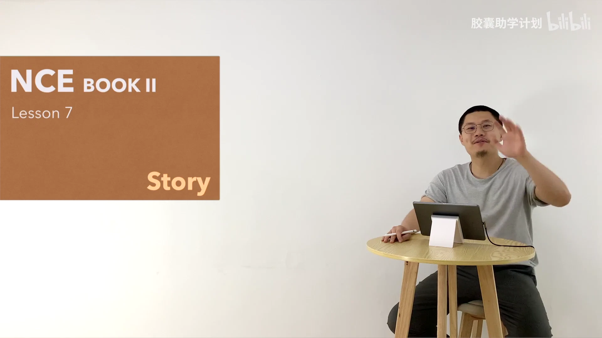

文字识别：Biibili / 胶囊助学计划 / NCE / BOOKI"I / Lesson 7 / Story

### 画面 00:00:04

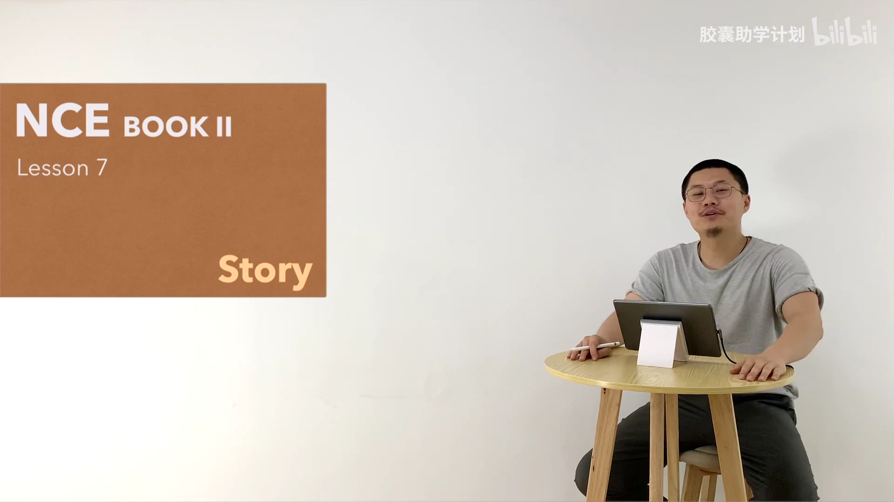

文字识别：biibli / 胶囊助学计划 / NCE / BOOKⅡI / Lesson 7 / Story

### 画面 00:00:06

文字识别：Bilbli / 胶囊助学计划 / NCE / BOOKII / Lesson 7 / Story

### 画面 00:00:09

文字识别：胶囊助学计划bll / •

### 画面 00:00:13

文字识别：胶囊助学计划

### 画面 00:00:15

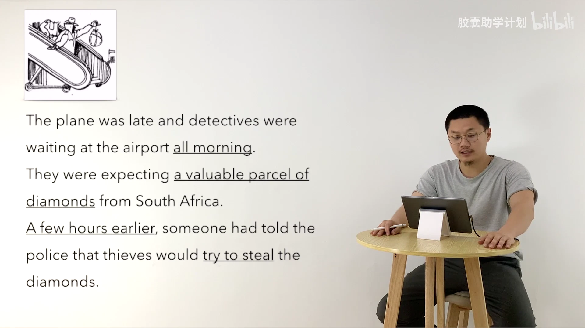

文字识别：胶囊助学计划 鼎b出 / The plane was late and detectives were / waiting at the airport all morning. / They were expecting a valuable parcel of / diamonds from South Africa. / A few hours earlier, someone had told the / police that thieves would try to steal the / diamonds.

### 画面 00:00:17

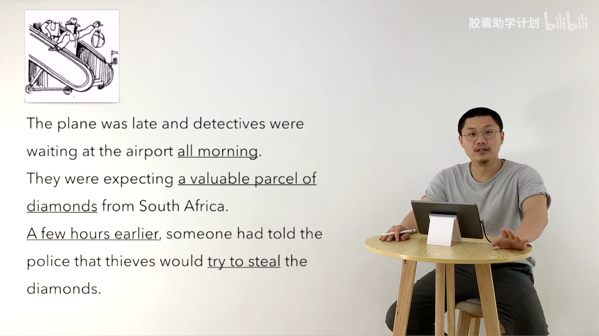

文字识别：胶囊助学计划bilb出 / The plane was late and detectives were / waiting at the airport all morning. / They were expecting a valuable parcel of / diamonds from South Africa. / A few hours earlier, someone had told the / police that thieves would try to steal the / diamonds.

### 画面 00:00:20

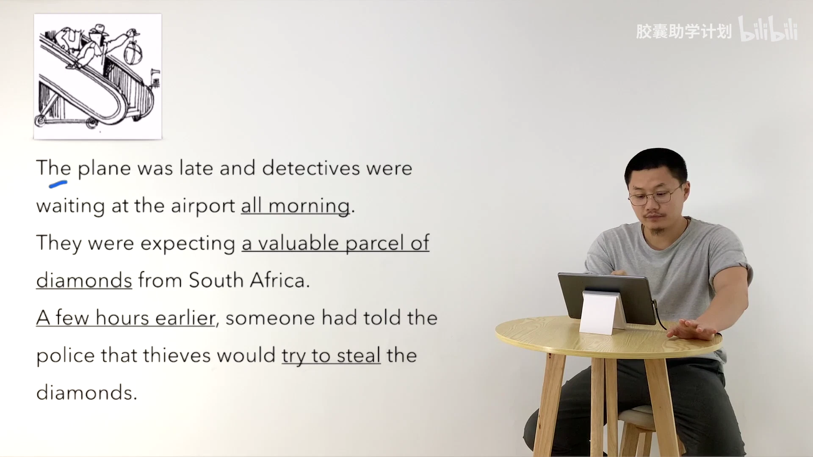

文字识别：胶囊助学计划bilb出 / The plane was late and detectives were / waiting at the airport all morning. / They were expecting a valuable parcel of / diamonds from South Africa. / A few hours earlier, someone had told the / police that thieves would try to steal the / diamonds.

### 画面 00:00:22

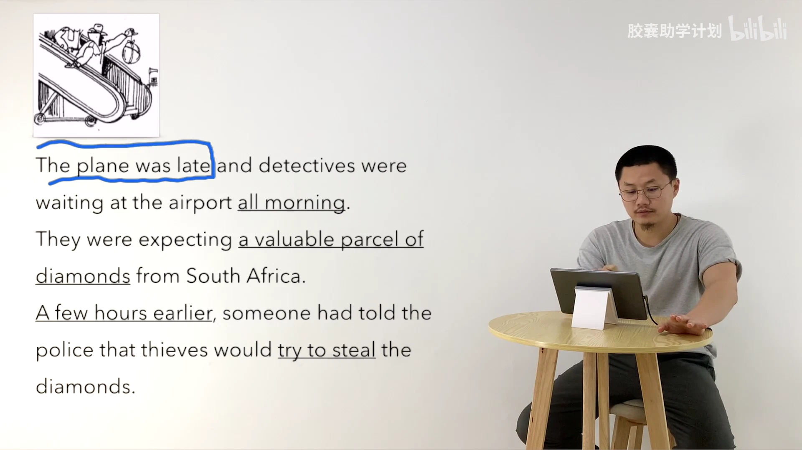

文字识别：胶囊助学计划lb出 / The plane was lateand detectives were / waiting at the airport all morning. / They were expecting a valuable parcel of / diamonds from South Africa. / A few hours earlier, someone had told the / police that thieves would try to steal the / diamonds.

### 画面 00:00:28

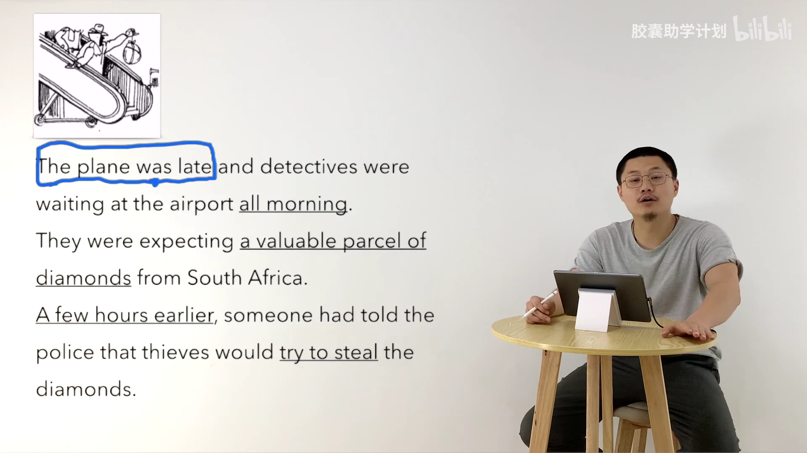

文字识别：胶囊助学计划bilb出 / The plane was late and detectives were / waiting at the airport all morning. / They were expecting a valuable parcel of / diamonds from South Africa. / A few hours earlier, someone had told the / police that thieves would try to steal the / diamonds.

## 00:00:30–00:01:00

晚点，将晚点。And detectives, 好，侦探们 were waiting，正在等，在什么地方呢？At the airport，在机场。All morning，整个早晨。那我想说，整个下午就是 all afternoon，整个晚上 all evening。Okay，好，整整个月一一整个月怎么说啊？各位应该就会了，对吧？They were

### 画面 00:00:30

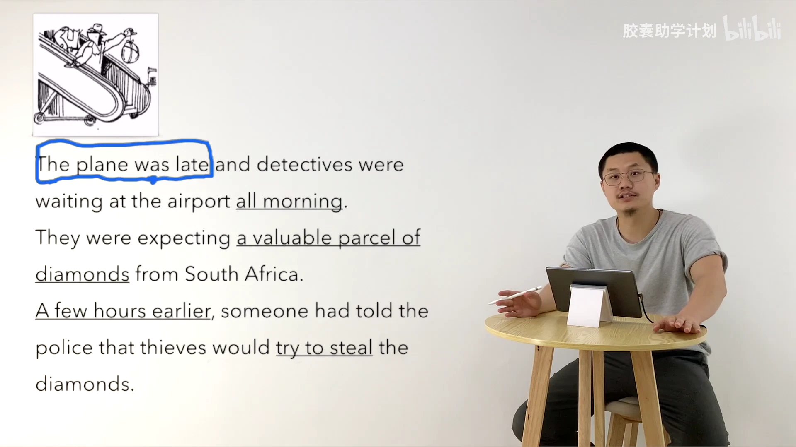

文字识别：胶囊助学计划出b出 / The plane was late and detectives were / waiting at the airport all morning. / They were expecting a valuable parcel of / diamonds from South Africa. / A few hours earlier, someone had told the / police that thieves would try to steal the / diamonds.

### 画面 00:00:32

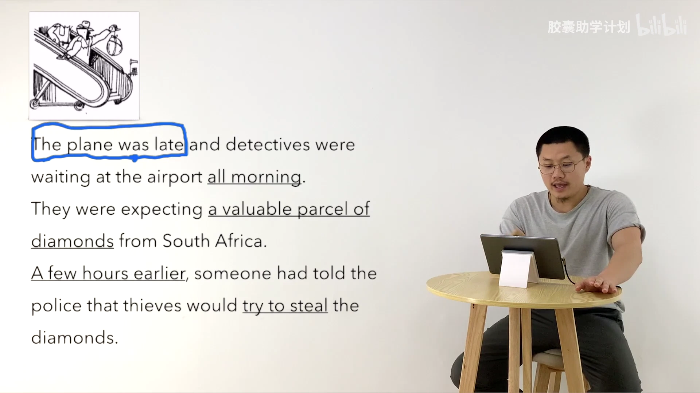

文字识别：胶囊助学计划 / fhe plane was late and detectives were / waiting at the airport all morning. / They were expecting a valuable parcel of / diamonds from South Africa. / A few hours earlier, someone had told the / police that thieves would try to steal the / diamonds.

### 画面 00:00:44

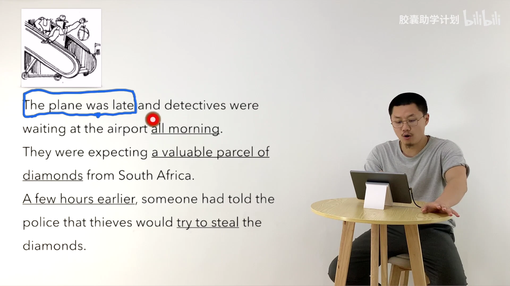

文字识别：胶囊助学计划bilb出 / The plane was late and detectives were / waiting at the airport all morning. / They were expecting a valuable parcel of / diamonds from South Africa. / A few hours earlier, someone had told the / police that thieves would try to steal the / diamonds.

### 画面 00:00:48

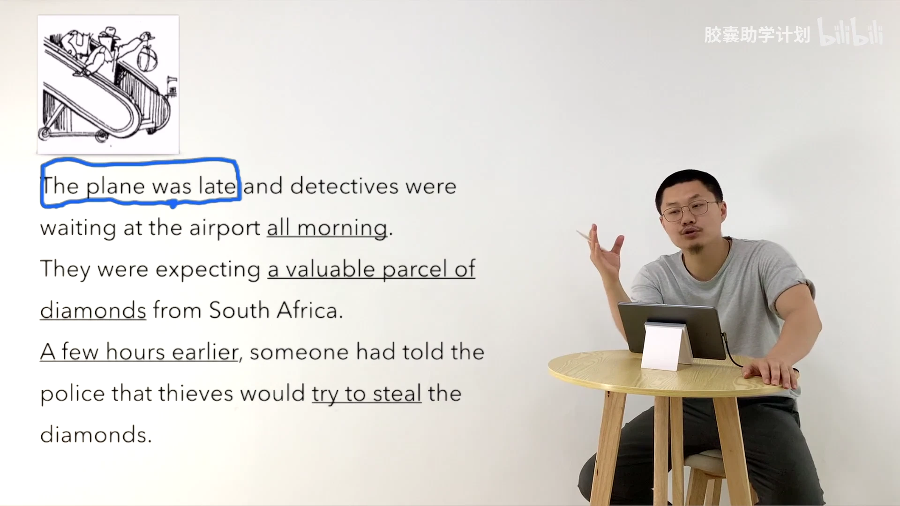

文字识别：胶囊助学计划 / The plane was late / eand detectives were / waiting at the airport all morning. / They were expecting a valuable parcel of / diamonds from South Africa. / A few hours earlier, someone had told the / police that thieves would try to steal the / diamonds.

## 00:01:00–00:01:30

They

### 画面 00:01:08

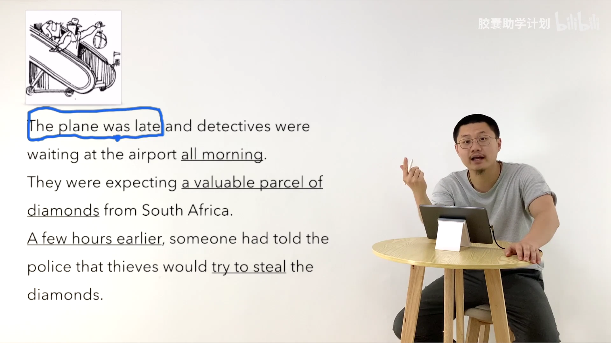

文字识别：胶囊助学计划 / The plane was late and detectives were / waiting at the airport all morning. / They were expecting a valuable parcel of / diamonds from South Africa. / A few hours earlier, someone had told the / police that thieves would try to steal the / diamonds.

### 画面 00:01:12

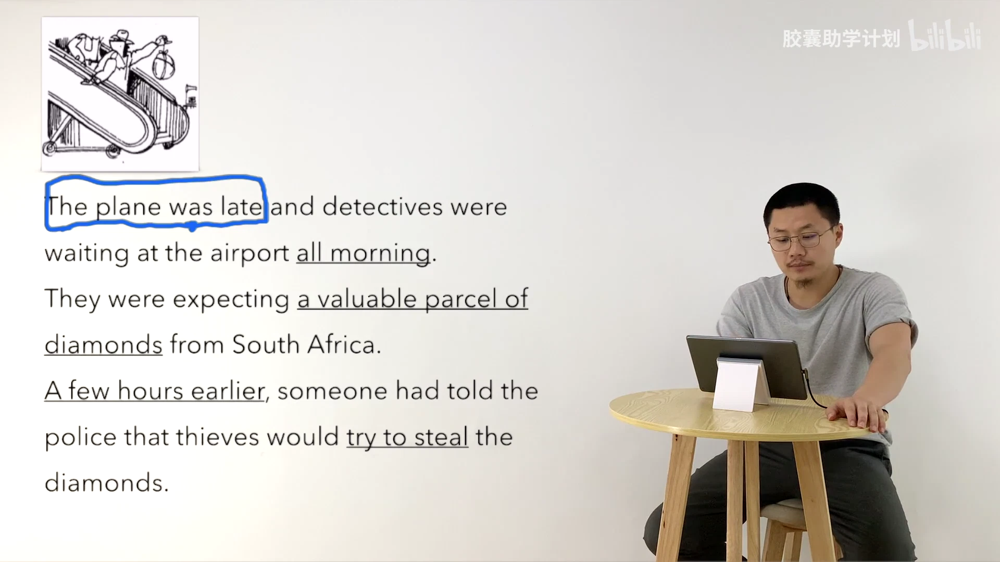

文字识别：胶囊助学计划biib出 / The plane was late and detectives were / waiting at the airport all morning. / They were expecting a valuable parcel of / diamonds from South Africa. / A few hours earlier, someone had told the / police that thieves would try to steal the / diamonds.

### 画面 00:01:27

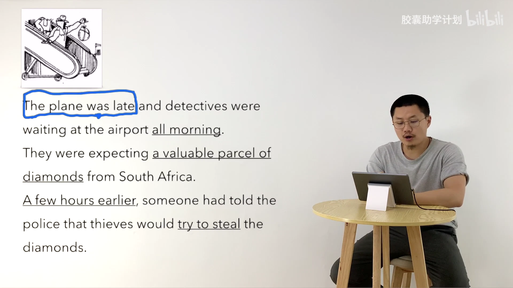

文字识别：胶囊助学计划b鼎b出 / fhe plane was late and detectives were / waiting at the airport all morning. / They were expecting a valuable parcel of / diamonds from South Africa. / A few hours earlier, someone had told the / police that thieves would try to steal the / diamonds.

## 00:01:30–00:02:00

什么东西呢？一个特别贵重的包裹，diamonds，钻石啊，一包很贵重的钻石。他们正在等的是这个东西，from South Africa，来自于南非啊，南非盛产这个是吧？钻石。A few hours earlier，好，我们先看它的字面，a few一些hours小时，earlier更早的一些时候，earlier较早，earlier比较级更早。那a few hours earlier就

### 画面 00:01:57

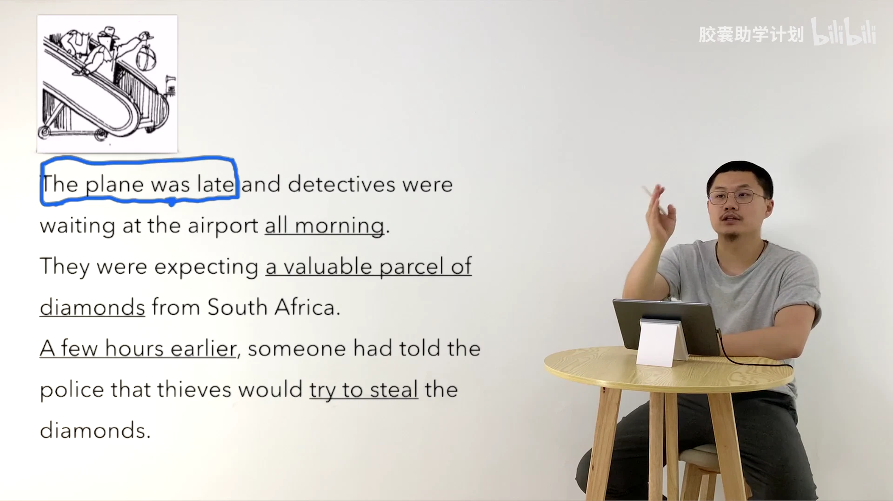

文字识别：胶囊助学计划b鼎b出 / The plane was late / eand detectives were / waiting at the airport all morning. / They were expecting a valuable parcel of / diamonds from South Africa. / A few hours earlier, someone had told the / police that thieves would try to steal the / diamonds.

## 00:02:00–00:02:30

是更早的一些时候啊，几个小时前啊，其实就是这个意思，就是类似于 a few hours ago，几乎是一样的意思啊。那它一出现，接下来你几乎用的都是跟过去相关的时态了。 Okay, someone 说有人呢，有这么一个人，我们不知道是谁。 Had told 已经告诉了 the police，已经告诉了这个警察这样的一件事情。我们先不管后面那个事情，

### 画面 00:02:13

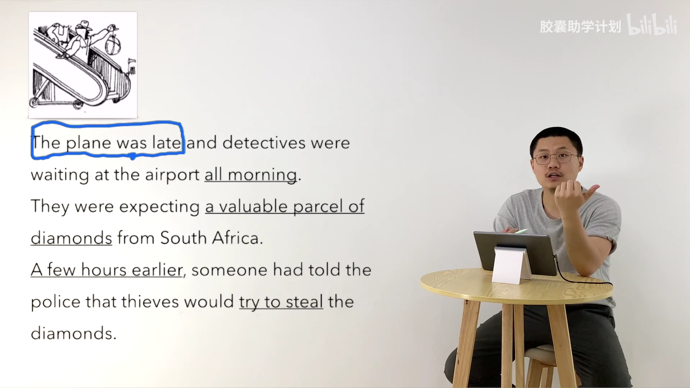

文字识别：胶囊助学计划b出b出 / he plane was lateand detectives were / waiting at the airport all morning. / They were expecting a valuable parcel of / diamonds from South Africa. / A few hours earlier, someone had told the / police that thieves would try to steal the / diamonds.

### 画面 00:02:15

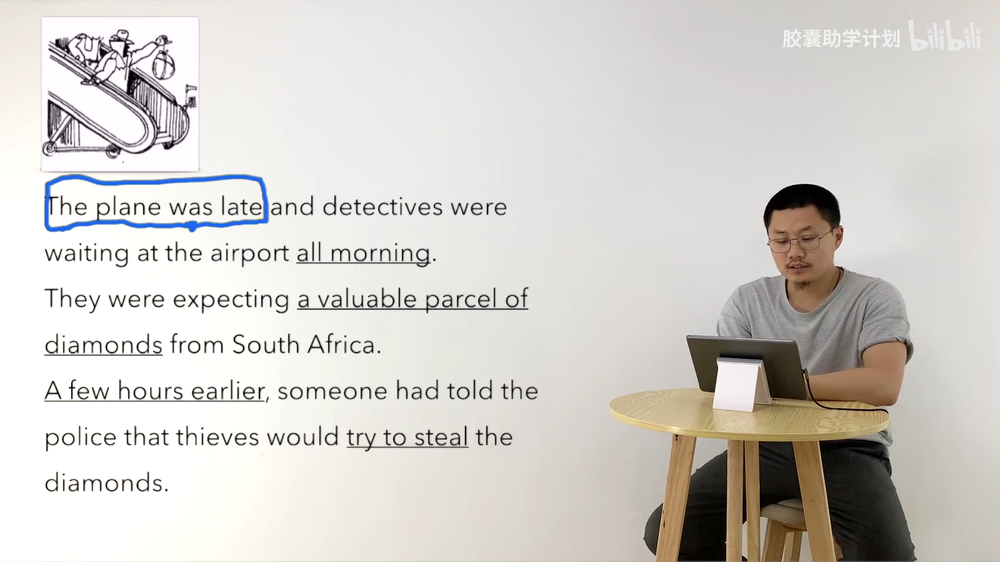

文字识别：胶囊助学计划b出b出 / The plane was late and detectives were / waiting at the airport all morning. / They were expecting a valuable parcel of / diamonds from South Africa. / A few hours earlier, someone had told the / police that thieves would try to steal the / diamonds.

## 00:02:30–00:03:00

这个 had 加 told，新一我们学过，新二还没学到，叫做过去完成时。您已经学过的叫现在完成时，对吧？OK，had 加 that 说已经告诉了这个警察这样一件事情，什么事情呢？后面这件事情是 the thieves，贼呀还不止一个，would 将 try to steal 将尝试着去偷，注意 try to

### 画面 00:02:33

文字识别：胶囊助学计划bi出b出 / The plane was late and detectives were / waiting at the airport all morning. / They were expecting a valuable parcel of / diamonds from South Africa. / A few hours earlier, someone had told the / police that thieves would try to steal the / diamonds.

### 画面 00:02:35

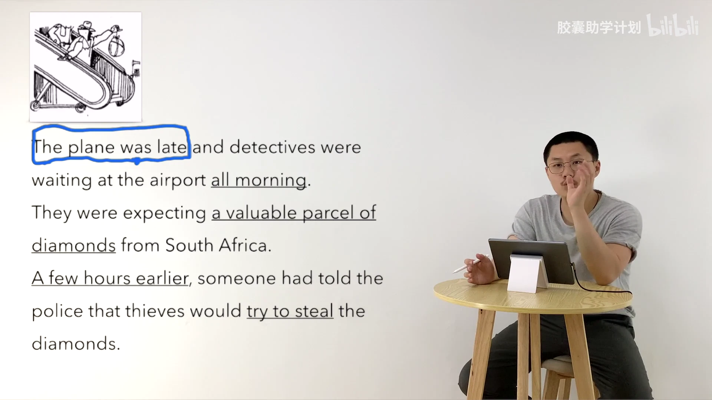

文字识别：胶囊助学计划bib出 / The plane was late and detectives were / waiting at the airport all morning. / They were expecting a valuable parcel of / diamonds from South Africa. / A few hours earlier, someone had told the / police that thieves would try to steal the / diamonds.

### 画面 00:02:38

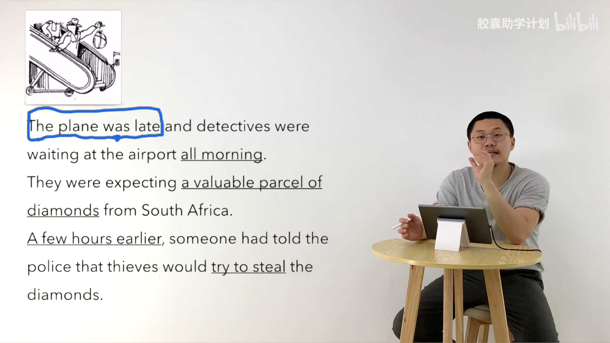

文字识别：胶囊助学计划bil出 / The plane was late / eand detectives were / waiting at the airport all morning. / They were expecting a valuable parcel of / diamonds from South Africa. / A few hours earlier, someone had told the / police that thieves would try to steal the / diamonds.

### 画面 00:02:40

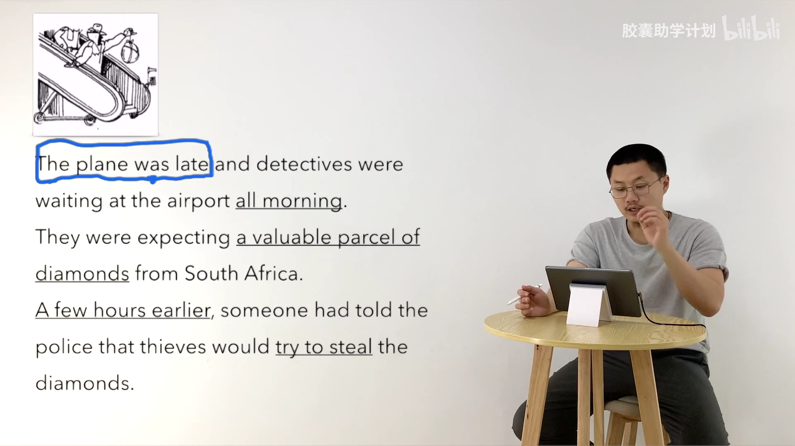

文字识别：胶囊助学计划blb出 / The plane was late and detectives were / waiting at the airport all morning. / They were expecting a valuable parcel of / diamonds from South Africa. / A few hours earlier, someone had told the / police that thieves would try to steal the / diamonds.

## 00:03:00–00:03:30

do尝试去做某事儿，将尝试去偷 the diamonds这些钻石。下一个 continue when the plane arrived当什么什么的时候，对吧？不是特殊疑问词啊。当飞机到达的时候，some of the detectives说一些侦探，some of the detectives跟some detectives几乎是一个意思，一些侦探were waiting

### 画面 00:03:08

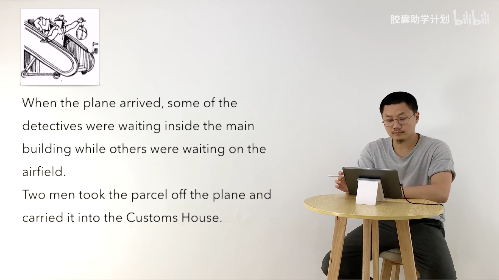

文字识别：胶囊助学计划bilb出 / When the plane arrived, some of the / detectives were waiting inside the main / building while others were waiting on the / airfield. / Two men took the parcel off the plane and / carried it into the Customs House.

### 画面 00:03:10

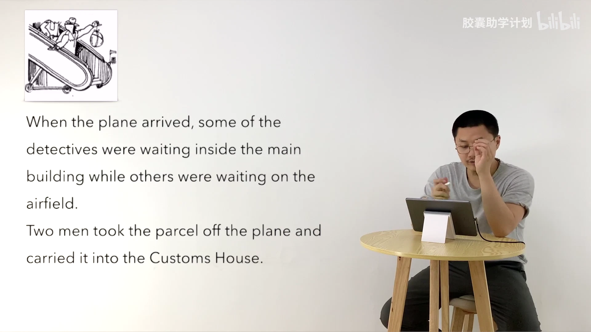

文字识别：胶囊助学计划bi鼎b出 / When the plane arrived, some of the / detectives were waiting inside the main / building while others were waiting on the / airfield. / Two men took the parcel off the plane and / carried it into the Customs House.

## 00:03:30–00:04:00

还是正在等。你看were waiting，正在等inside the main building. Inside, outside, outside叫外面。你记得吗？我们学过那个单词叫It was dark outside.我没有记错的话，是我们第二课学的，对吧？外面很黑。那现在inside就是在里面，在什么里面呢？The main building，在主建筑物当中等着。While，哎，与此同时呢，我们说了有两个翻译方式，一个叫当，一个叫与什么什么同时，

### 画面 00:03:40

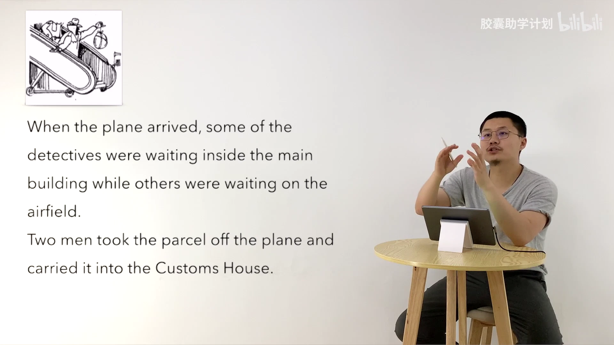

文字识别：胶囊助学计划b出b出 / When the plane arrived, some of the / detectives were waiting inside the main / building while others were waiting on the / airfield. / Two men took the parcel off the plane and / carried it into the Customs House.

## 00:04:00–00:04:30

对吧？与此同时呢，others那others指的就是other detectives啊，其他的一些侦探were waiting，也正在等，在什么地方等呢？On the airfield，正在这个飞机的这个起落坪啊，停机坪上等。Two men，两个人took the parcel off the plane，拿了这个包裹。Off，新概念一册三十五课我们就学过一个小的介词叫离开，对吧？比如说

### 画面 00:04:10

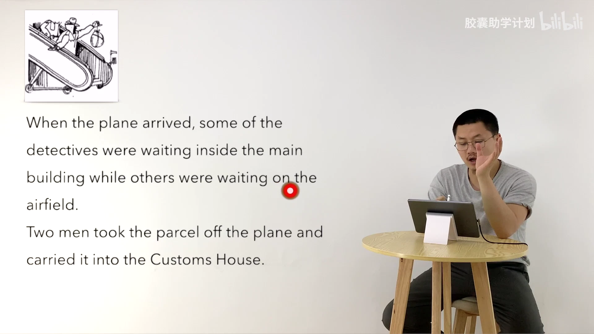

文字识别：胶囊助学计划b出b出 / When the plane arrived, some of the / detectives were waiting inside the main / building while others were waiting on the / airfield. / Two men took the parcel off the plane and / carried it into the Customs House.

## 00:04:30–00:05:00

get off the bus，叫做下车，对吧？离开。那 jump off the wall，叫做跳下墙，离开这个墙。那 off the plane，就是离开这个飞机，拿着包裹下了飞机。And然后呢，carried it，携带着它。Carry这个单词指的是携带，对吧？携带着这个包裹，走进了什么里面呢？Into一个小的介词，进入了the customs house。新一十五课就学过customs，叫做海

### 画面 00:04:40

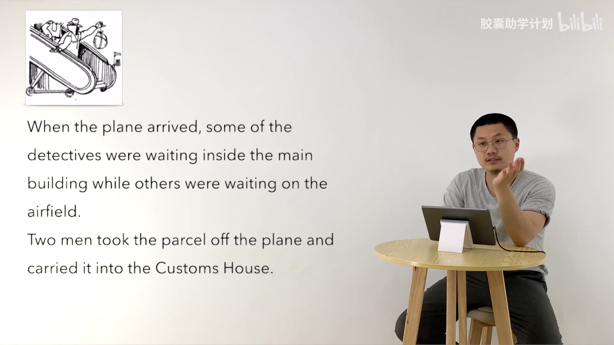

文字识别：胶囊助学计划bilb出 / When the plane arrived, some of the / detectives were waiting inside the main / building while others were waiting on the / airfield. / Two men took the parcel off the plane and / carried it into the Customs House.

### 画面 00:04:46

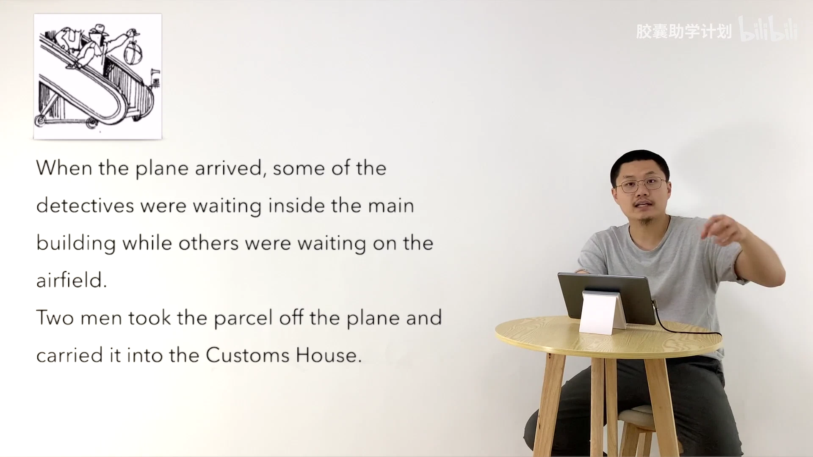

文字识别：胶囊助学计划 / When the plane arrived, some of the / detectives were waiting inside the main / building while others were waiting on the / airfield. / Two men took the parcel off the plane and / carried it into the Customs House.

## 00:05:00–00:05:30

那 customs house 注意 C 大写 H 大写。你基本理解为它是一个专有名词啊。 customs house 在这就可以理解为是海关办公室。 OK，官方办公室。 While 当 two detectives were keeping guard，当两个侦探正 keeping guard 讲单词我们讲过了守卫啊保卫 keep guard 站岗 at the door 在门站岗的时候 two others 那

### 画面 00:05:00

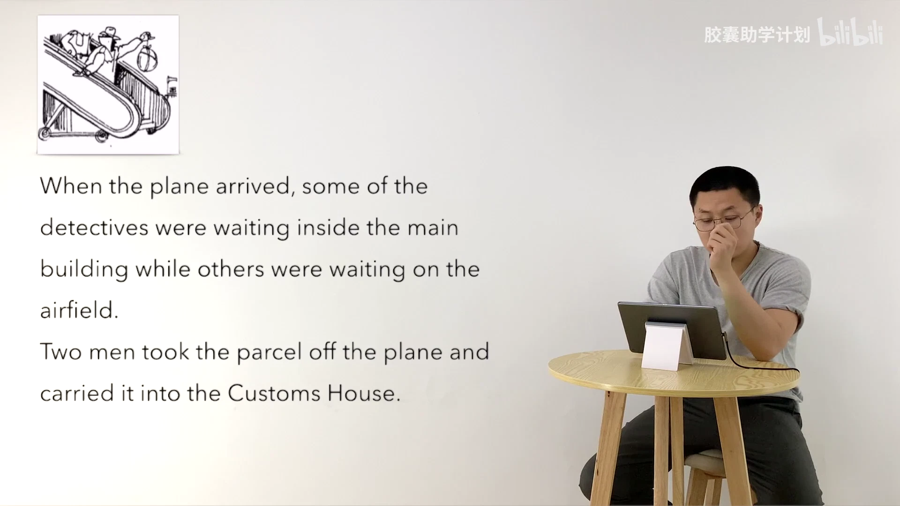

文字识别：胶囊助学计划bilb出 / When the plane arrived, some of the / detectives were waiting inside the main / building while others were waiting on the / airfield. / Two men took the parcel off the plane and / carried it into the Customs House.

### 画面 00:05:13

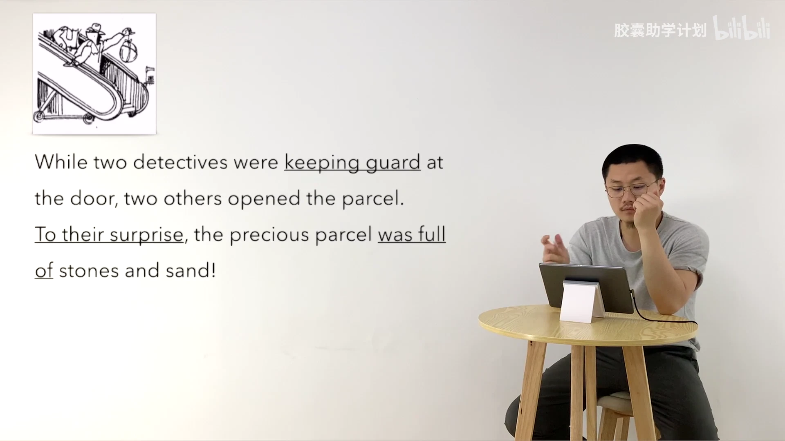

文字识别：胶囊助学计划blb出 / While two detectives were keeping guard at / the door, two others opened the parcel. / To their surprise, the precious parcel was full / of stones and sand!

## 00:05:30–00:06:00

two others就等同于 two other detectives,对吧？其他的两个侦探 opened the parcel,打开了这个包裹. To their surprise,这是一个常用的习惯用法,叫 to somebody's surprise,令某人感到很意外的事情。注意这儿不是 to they或者 them,用的是 their,叫他们的啊。令他们感到很奇怪、很惊讶的事情是什么呢？

### 画面 00:05:43

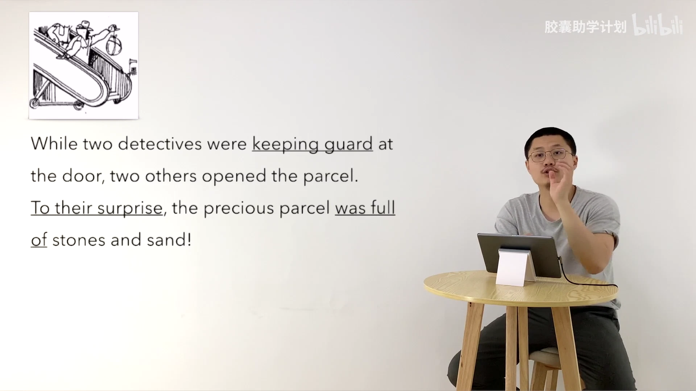

文字识别：胶囊助学计划blb出 / While two detectives were keeping guard at / the door, two others opened the parcel. / To their surprise, the precious parcel was full / of stones and sand!

## 00:06:00–00:06:30

The precious parcel,这个非常宝贵的包裹呀，was full of.注意be full of这个was可以用amazed，也可以用worths, worth. Okay,充满了stones and sand,充满了石头块和沙子。注意一个小点，这儿的stone加了s，告诉你它是可数。这儿的sand没有加s，肯定不可能是一粒沙子嘛，对吧？那它是可

### 画面 00:06:04

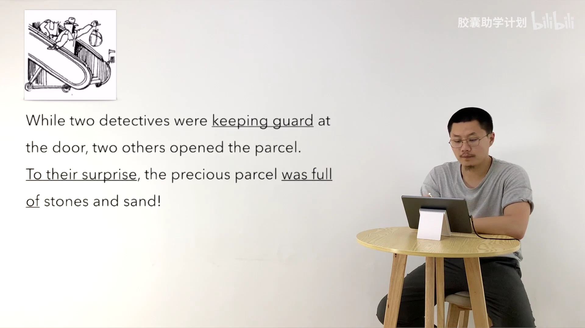

文字识别：胶囊助学计划 / While two detectives were keeping guard at / the door, two others opened the parcel. / To their surprise, the precious parcel was full / of stones and sand!

### 画面 00:06:29

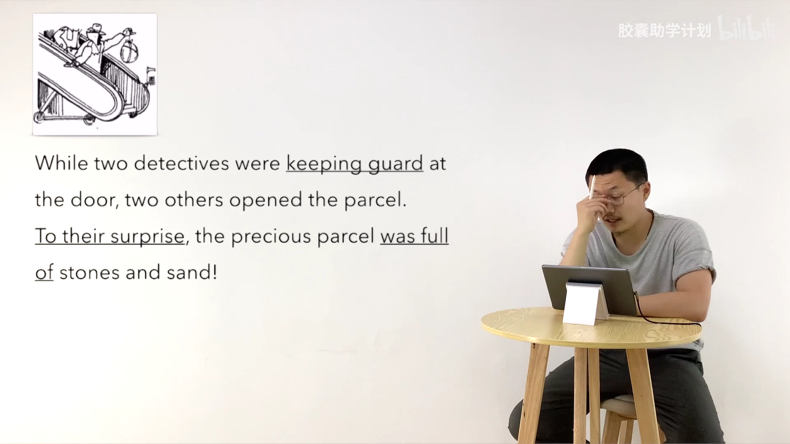

文字识别：胶囊助学计划 / While two detectives were keeping guard at / the door, two others opened the parcel. / To their surprise, the precious parcel was full / of stones and sand!

## 00:06:30–00:07:00

数不可数呢？不可数。OK，好，那我们看一下本课的习惯用法。我们接下来要拿这些习惯用法带着各位去造一些小的句子来了。首先，all morning，整个早晨。我们刚才讲到了，你可以说 all night 或者 all day，一整天的时间，all night，一整个晚上的时间。OK，后面的这个时间你可以自己做一些小的改变。我们造一个句子，比如说 I think about you

### 画面 00:06:32

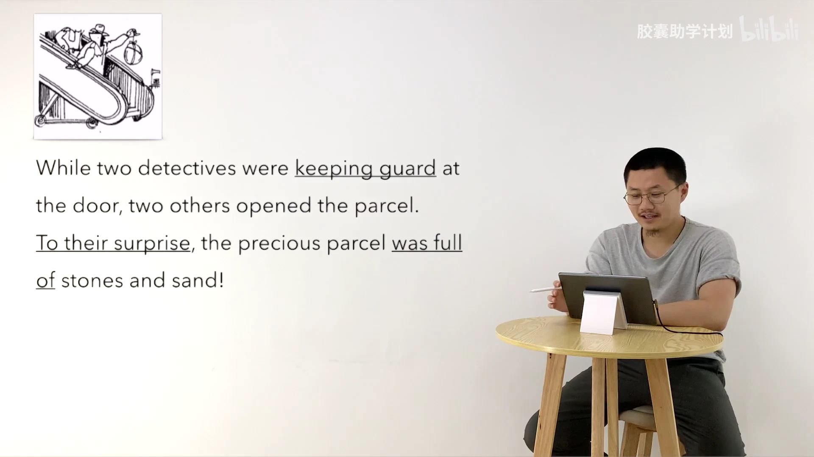

文字识别：胶囊助学计划 / While two detectives were keeping guard at / the door, two others opened the parcel. / To their surprise, the precious parcel was full / of stones and sand!

### 画面 00:06:34

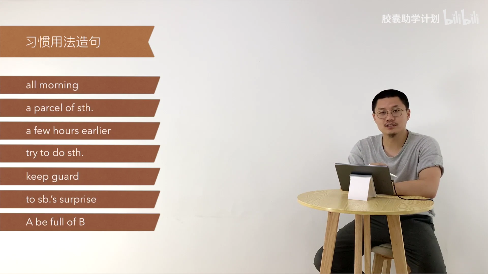

文字识别：Bilbili / 胶囊助学计划 / 习惯用法造句 / all morning / a parcel of sth. / a few hours earlier / try to do sth. / keep guard / to sb.'s surprise / A be full of B

### 画面 00:06:36

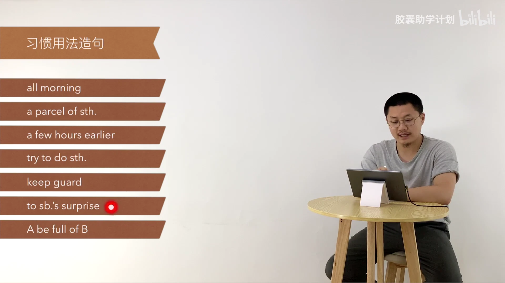

文字识别：Bilbili / 胶囊助学计划 / 习惯用法造句 / all morning / a parcel of sth. / afew I / hours earlier / try to do sth. / keep guard / to sb.'s surprise / A be full of B

### 画面 00:06:38

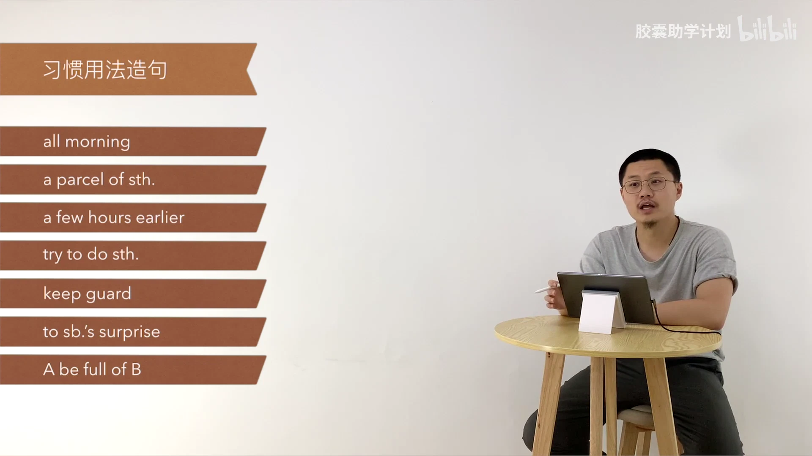

文字识别：biibil / 胶囊助学计划 / 习惯用法造句 / all morning / a parcel of sth. / a few hours earlier / try to do sth. / keep guard / to sb.'s surprise / A be full of B

### 画面 00:06:40

文字识别：习惯用法造句指南 / 网：v.+v.变化 / 胶囊助学计划 / bilbli / 四句型转换 / 方式/地点/时间 / 其他习惯用法 / 其他单词+词性 / 原文摘抄+变 / 6123456 / all morning

### 画面 00:06:42

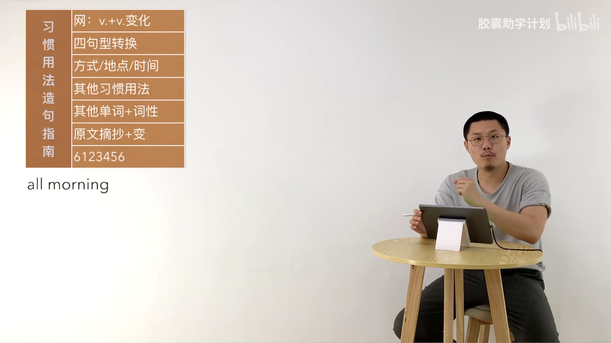

文字识别：网：v.+v.变化 / 胶囊助学计划 / Bilbili / 习惯用法造句指南 / 四句型转换 / 方式/地点/时间 / 其他习惯用法 / 其他单词+词性 / 原文摘抄+变 / 6123456 / all morning

### 画面 00:06:44

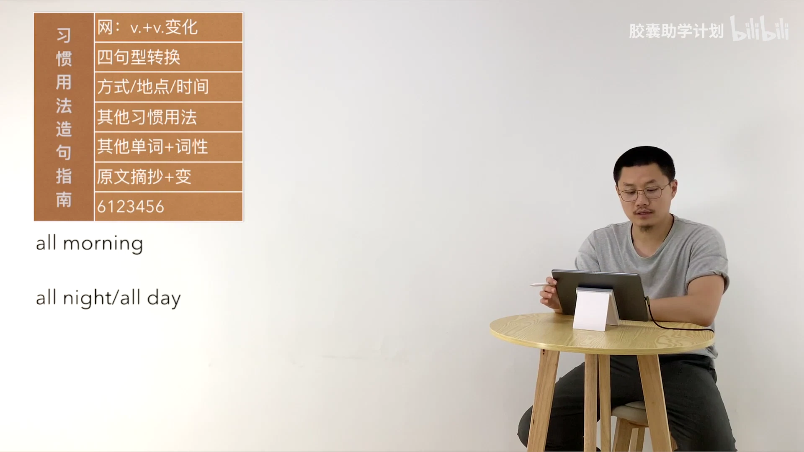

文字识别：网：v.+v.变化 / 胶囊助学计划 / Blbili / 习惯用法造句指南 / 四句型转换 / 方式/地点/时间 / 其他习惯用法 / 其他单词+词性 / 原文摘抄+变 / 6123456 / all morning / all night/all day

### 画面 00:06:46

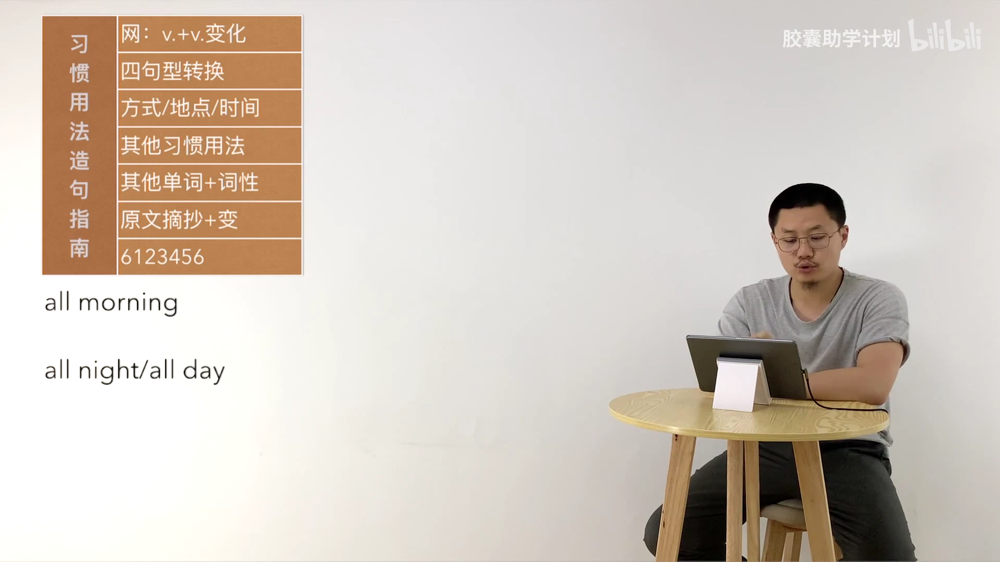

文字识别：网：v.+v.变化 / 胶囊助学计划 / Bilibli / 习惯用法造句指南 / 四句型转换 / 方式/地点/时间 / 其他习惯用法 / 其他单词+词性 / 原文摘抄+变 / 6123456 / all morning / all night/all day

### 画面 00:06:48

文字识别：Bilbili / 网：v.+v.变化 / 胶囊助学计划 / 习惯用法造句指南 / 四句型转换 / 方式/地点/时间 / 其他习惯用法 / 其他单词+词性 / 原文摘抄+变 / 6123456 / all morning / all night/all day

### 画面 00:06:50

文字识别：习惯用法造句指南 / 网：v.+v.变化 / 胶囊助学计划 / Bilibili / 四句型转换 / 方式/地点/时间 / 其他习惯用法 / 其他单词+词性 / 原文摘抄+变 / 6123456 / all morning / all night/all day

### 画面 00:06:53

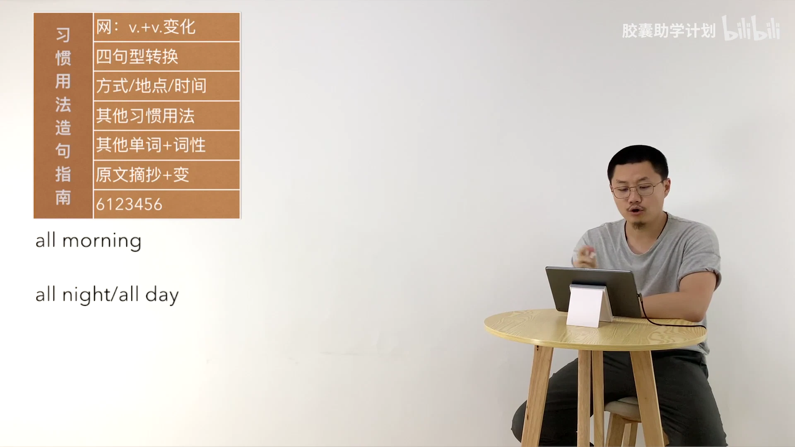

文字识别：bilbii / 网：v.+v.变化 / 胶囊助学计划 / 习惯用法造句指南 / 四句型转换 / 方式/地点/时间 / 其他习惯用法 / 其他单词+词性 / 原文摘抄+变 / 6123456 / all morning / all night/all day

### 画面 00:06:55

文字识别：网：v.+v.变化 / 胶囊助学计划 / Bilbili / 习惯用法造句指南 / 四句型转换 / 方式/地点/时间 / 其他习惯用法 / 其他单词+词性 / 原文摘抄+变 / 6123456 / all morning / all night/all day

### 画面 00:06:57

文字识别：Biltbili / 网：v.+v.变化 / 胶囊助学计划 / 习惯用法造句指南 / 四句型转换 / 方式/地点/时间 / 其他习惯用法 / 其他单词+词性 / 原文摘抄+变 / 6123456 / all morning / all night/all day / I think about you all night.

### 画面 00:06:59

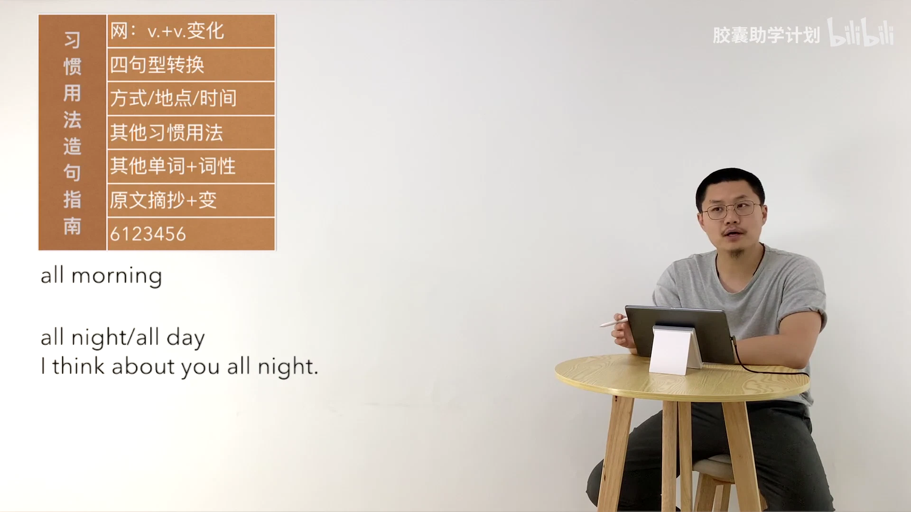

文字识别：bilibili / 网：v.+v.变化 / 胶囊助学计划 / 习惯用法造句指南 / 四句型转换 / 方式/地点/时间 / 其他习惯用法 / 其他单词+词性 / 原文摘抄+变 / 6123456 / all morning / all night/all day / I think about you all night.

## 00:07:00–00:07:30

all night. 啊，辗转反侧，那《诗经》里边的那句话 I think about you all night. 我整晚都在想你啊，夜不能寐。 OK，那肯定句给你了，你接下来可以做什么事情？你想一下就知道了，对吧？ OK， a parcel of something，一包裹的某个东西。那 a parcel of diamonds，我们不说别的东西，我们

### 画面 00:07:01

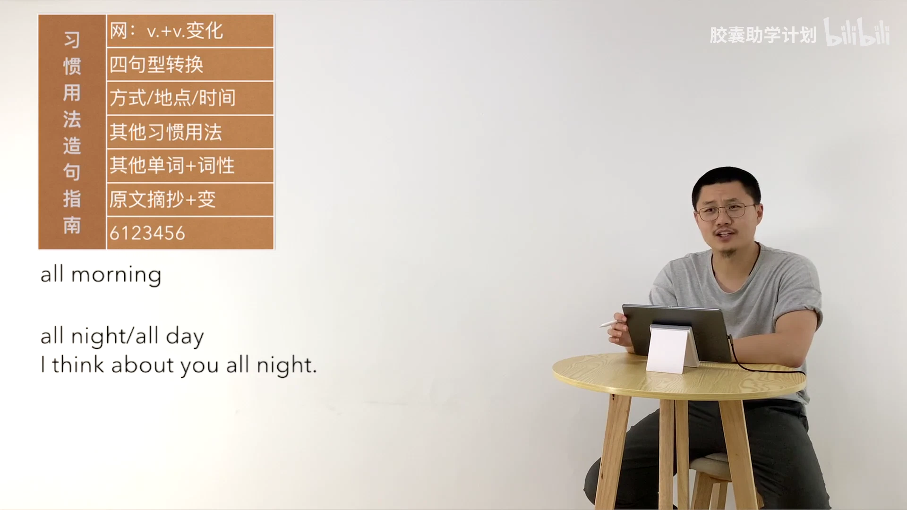

文字识别：Bilibili / 网：v.+v.变化 / 胶囊助学计划 / 习惯用法造句指南 / 四句型转换 / 方式/地点/时间 / 其他习惯用法 / 其他单词+词性 / 原文摘抄+变 / 6123456 / all morning / all night/all day / I think about you all night.

### 画面 00:07:03

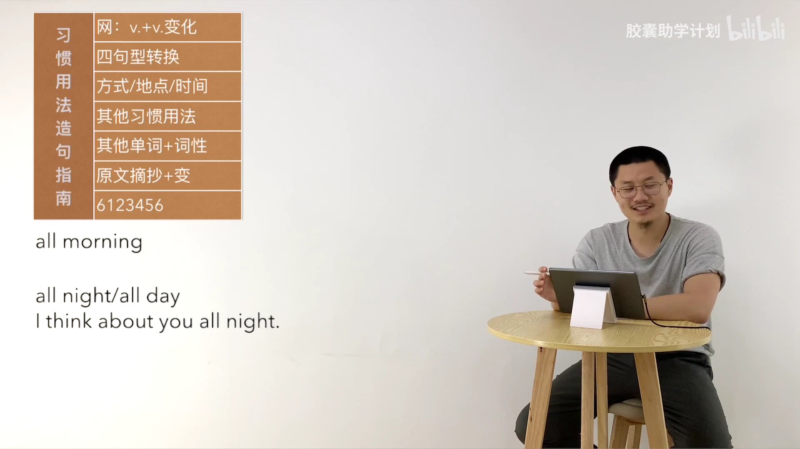

文字识别：bilibili / 网：v.+v.变化 / 胶囊助学计划 / 习惯用法造句指南 / 四句型转换 / 方式/地点/时间 / 其他习惯用法 / 其他单词+词性 / 原文摘抄+变 / 6123456 / all morning / all night/all day / I think about you all night.

### 画面 00:07:05

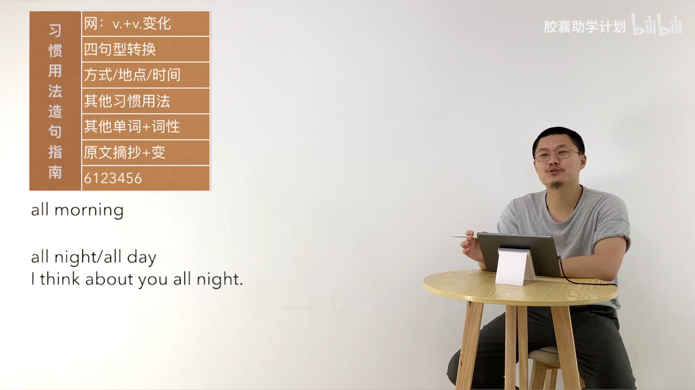

文字识别：blibili / 网：v.+v.变化 / 胶囊助学计划 / 习惯用法造句指南 / 四句型转换 / 方式/地点/时间 / 其他习惯用法 / 其他单词+词性 / 原文摘抄+变 / 6123456 / all morning / all night/all day / I think about you all night.

### 画面 00:07:09

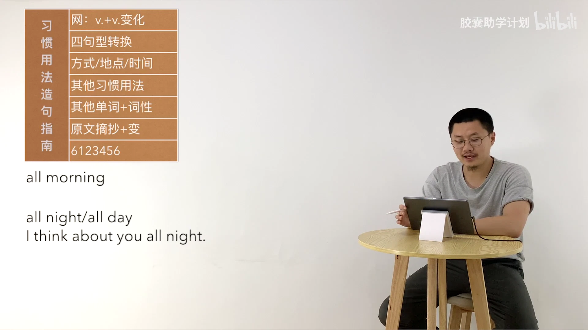

文字识别：Bilbili / 网：v.+v.变化 / 胶囊助学计划 / 习惯用法造句指南 / 四句型转换 / 方式/地点/时间 / 其他习惯用法 / 其他单词+词性 / 原文摘抄+变 / 6123456 / all morning / all night/all day / I think about you all night.

### 画面 00:07:11

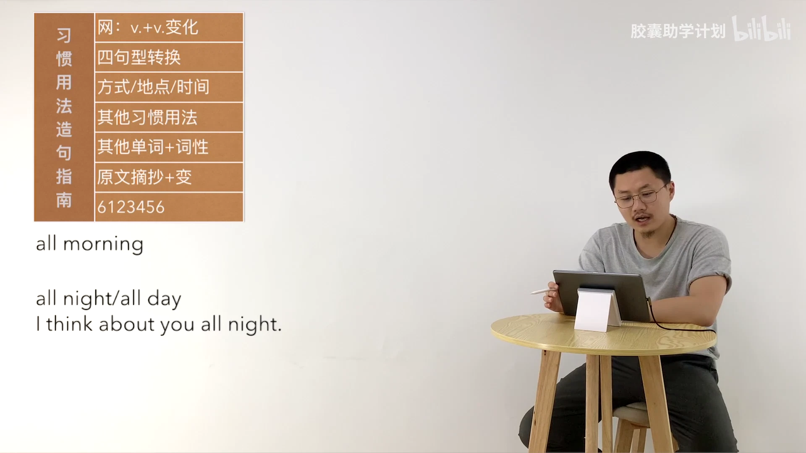

文字识别：Bilbili / 网：v.+v.变化 / 胶囊助学计划 / 习惯用法造句指南 / 四句型转换 / 方式/地点/时间 / 其他习惯用法 / 其他单词+词性 / 原文摘抄+变 / 6123456 / all morning / all night/all day / I think about you all night.

### 画面 00:07:15

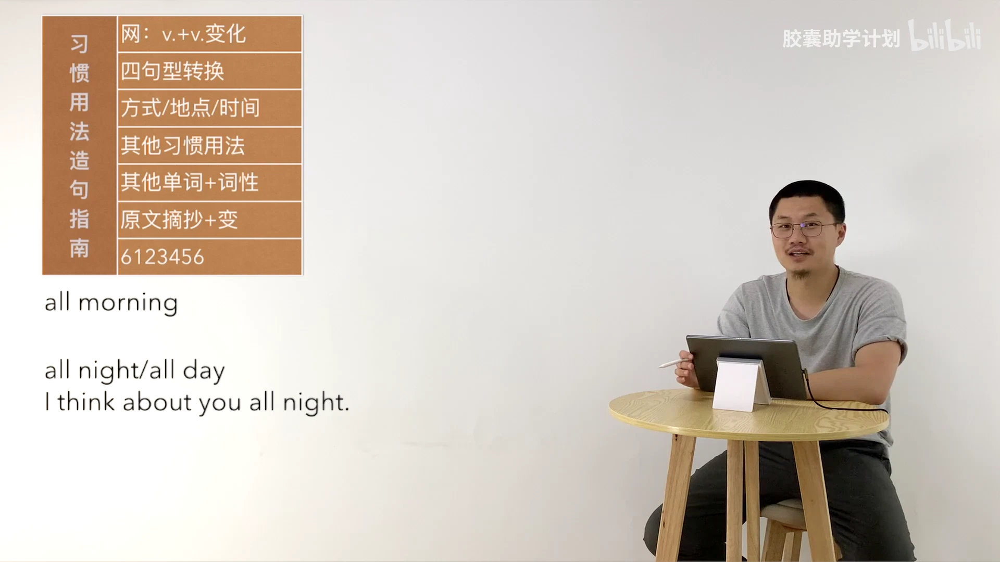

文字识别：biibili / 网：v.+v.变化 / 胶囊助学计划 / 习惯用法造句指南 / 四句型转换 / 方式/地点/时间 / 其他习惯用法 / 其他单词+词性 / 原文摘抄+变 / 6123456 / all morning / all night/all day / I think about you all night.

### 画面 00:07:17

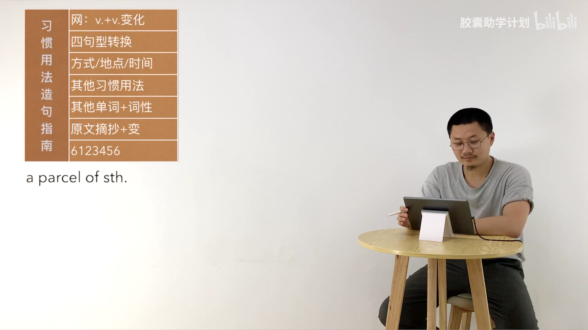

文字识别：习惯用法造句指南 / 网：v.+v.变化 / 胶囊助学计划 / bilibili / 四句型转换 / 方式/地点/时间 / 其他习惯用法 / 其他单词+词性 / 原文摘抄+变 / 6123456 / a parcel of sth.

### 画面 00:07:19

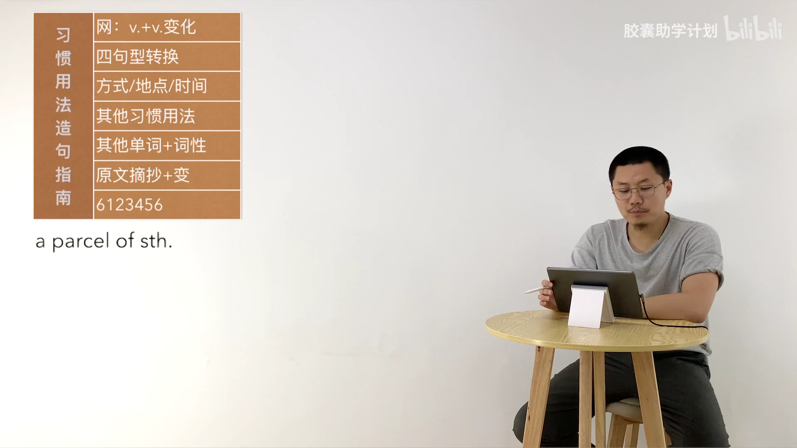

文字识别：习惯用法造句指南 / 网：v.+v.变化 / 胶囊助学计划 / Bilbili / 四句型转换 / 方式/地点/时间 / 其他习惯用法 / 其他单词+词性 / 原文摘抄+变 / 6123456 / a parcel of sth.

### 画面 00:07:21

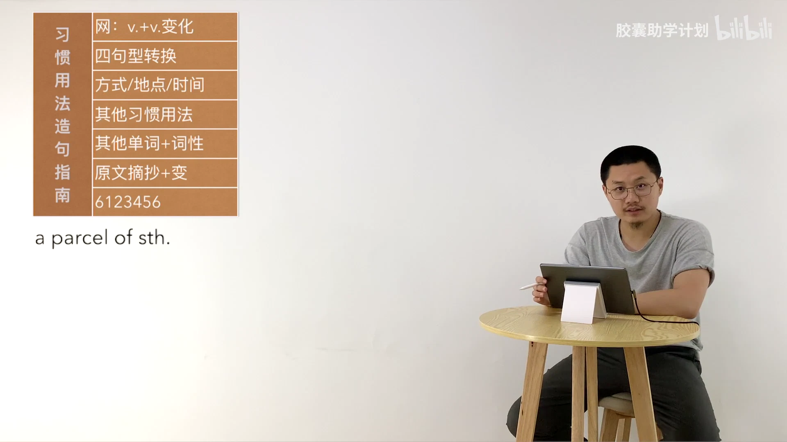

文字识别：网：v.+v.变化 / 胶囊助学计划 / Bilbili / 习惯用法造句指南 / 四句型转换 / 方式/地点/时间 / 其他习惯用法 / 其他单词+词性 / 原文摘抄+变 / 6123456 / a parcel of sth.

### 画面 00:07:24

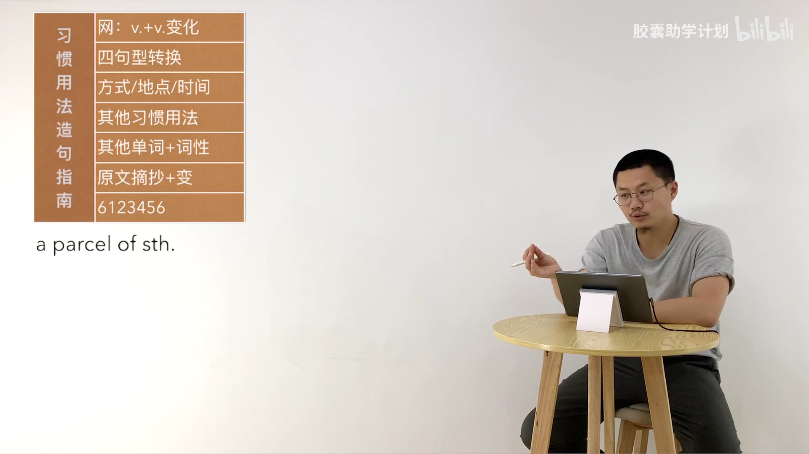

文字识别：网：v.+v.变化 / 胶囊助学计划 / bilbli / 习惯用法造句指南 / 四句型转换 / 方式/地点/时间 / 其他习惯用法 / 其他单词+词性 / 原文摘抄+变 / 6123456 / a parcel of sth.

### 画面 00:07:26

文字识别：网：v.+v.变化 / 胶囊助学计划 / bilibli / 习惯用法造句指南 / 四句型转换 / 方式/地点/时间 / 其他习惯用法 / 其他单词+词性 / 原文摘抄+变 / 6123456 / a parcel of sth. / a parcel of diamonds + v.

### 画面 00:07:28

文字识别：bilibili / 网：v.+v.变化 / 胶囊助学计划 / 习惯用法造句指南 / 四句型转换 / 方式/地点/时间 / 其他习惯用法 / 其他单词+词性 / 原文摘抄+变 / 6123456 / a parcel of sth. / a parcel of diamonds + v.

## 00:07:30–00:08:00

就说这课的钻石吧。Oh, parts of diamonds. You要找动词，对不对？找动词和其实习惯用法有很多，也是包含动词的习惯用法。动词的习惯用法或者所有习惯用法以及其他的单词，对于各位来说最常用的方式就是往前翻，不要自己去查电脑，想一个句话，然后往往下去呃查电脑或者查字典找单词，很容易错。就找我们之前学过的啊，把我们之前学过的先

### 画面 00:07:30

文字识别：bilibili / 网：v.+v.变化 / 胶囊助学计划 / 习惯用法造句指南 / 四句型转换 / 方式/地点/时间 / 其他习惯用法 / 其他单词+词性 / 原文摘抄+变 / 6123456 / a parcel of sth. / a parcel of diamonds + v.

### 画面 00:07:35

文字识别：网：v.+v.变化 / 胶囊助学计划 / bilbli / 习惯用法造句指南 / 四句型转换 / 方式/地点/时间 / 其他习惯用法 / 其他单词+词性 / 原文摘抄+变 / 6123456 / a parcel of sth. / a parcel of diamonds + v.

### 画面 00:07:40

文字识别：biibili / 网：v.+v.变化 / 胶囊助学计划 / 习惯用法造句指南 / 四句型转换 / 方式/地点/时间 / 其他习惯用法 / 其他单词+词性 / 原文摘抄+变 / 6123456 / a parcel of sth. / a parcel of diamonds + v.

### 画面 00:07:42

文字识别：Bilbili / 网：v.+v.变化 / 胶囊助学计划 / 习惯用法造句指南 / 四句型转换 / 方式/地点/时间 / 其他习惯用法 / 其他单词+词性 / 原文摘抄+变 / 6123456 / a parcel of sth. / a parcel of diamonds + v.

### 画面 00:07:44

文字识别：blibili / 网：v.+v.变化 / 胶囊助学计划 / 习惯用法造句指南 / 四句型转换 / 方式/地点/时间 / 其他习惯用法 / 其他单词+词性 / 原文摘抄+变 / 6123456 / a parcel of sth. / a parcel of diamonds + v.

### 画面 00:07:46

文字识别：网：v.+v.变化 / 胶囊助学计划 / Bilbili / 习惯用法造句指南 / 四句型转换 / 方式/地点/时间 / 其他习惯用法 / 其他单词+词性 / 原文摘抄+变 / 6123456 / a parcel of sth. / a parcel of diamonds + v.

### 画面 00:07:48

文字识别：网：v.+v.变化 / 习惯用法造句指南 / 胶囊助学计划 / 四句型转换 / 方式/地点/时间 / 其他习惯用法 / 其他单词+词性 / 原文摘抄+变 / 6123456 / a parcel of sth. / a parcel of diamonds + v.

### 画面 00:07:50

文字识别：网：v.+v.变化 / 习惯用法造句指南 / 胶囊助学计划 / 四句型转换 / 方式/地点/时间 / 其他习惯用法 / 其他单词+词性 / 原文摘抄+变 / 6123456 / a parcel of sth. / a parcel of diamonds + v.

### 画面 00:07:52

文字识别：网：v.+v.变化 / 习惯用法造句指南 / 胶囊助学计划 / 四句型转换 / 方式/地点/时间 / 其他习惯用法 / 其他单词+词性 / 原文摘抄+变 / 6123456 / a parcel of sth. / a parcel of diamonds + v.

### 画面 00:07:55

文字识别：网：v.+v.变化 / 习惯用法造句指南 / 胶囊助学计划 / 四句型转换 / 方式/地点/时间 / 其他习惯用法 / 其他单词+词性 / 原文摘抄+变 / 6123456 / a parcel of sth. / a parcel of diamonds + v.

### 画面 00:07:57

文字识别：习惯用法造句指南 / 网：v.+v.变化 / 胶囊助学计划 / 四句型转换 / 方式/地点/时间 / 其他习惯用法 / 其他单词+词性 / 原文摘抄+变 / 6123456 / a parcel of sth. / a parcel of diamonds + v.

### 画面 00:07:59

文字识别：网：v.+v.变化 / 胶囊助学计划 / blbl / 习惯用法造句指南 / 四句型转换 / 方式/地点/时间 / 其他习惯用法 / 其他单词+词性 / 原文摘抄+变 / 6123456 / a parcel of sth. / a parcel of diamonds + v. / He sent a request for a parcel of diamonds. L5

## 00:08:00–00:08:30

扎实一下。比如说，send a request for something，叫做发送一个请求要某个东西。比如说，he sent a request for a parcel of diamonds，他发送了一个请求要一小包裹的钻石。第五课我们学的习惯用法，肯定就给你了。四形形转化，各位下课自己去做。接下来，a few hours earlier，几小时前，时间给各位了。六一二三四五六当中的六给各

### 画面 00:08:01

文字识别：网：v.+v.变化 / 胶囊助学计划 / bilbii / 习惯用法造句指南 / 四句型转换 / 方式/地点/时间 / 其他习惯用法 / 其他单词+词性 / 原文摘抄+变 / 6123456 / a parcel of sth. / a parcel of diamonds + v. / He sent a request for a parcel of diamonds. L5

### 画面 00:08:04

文字识别：网：v.+v.变化 / 胶囊助学计划 / bilbii / 习惯用法造句指南 / 四句型转换 / 方式/地点/时间 / 其他习惯用法 / 其他单词+词性 / 原文摘抄+变 / 6123456 / a parcel of sth. / a parcel of diamonds + v. / He sent a request for a parcel of diamonds. L5

### 画面 00:08:09

文字识别：bilbii / 网：v.+v.变化 / 胶囊助学计划 / 习惯用法造句指南 / 四句型转换 / 方式/地点/时间 / 其他习惯用法 / 其他单词+词性 / 原文摘抄+变 / 6123456 / a parcel of sth. / a parcel of diamonds + v. / He sent a request for a parcel of diamonds. L5

### 画面 00:08:14

文字识别：Bilbili / 网：v.+v.变化 / 胶囊助学计划 / 习惯用法造句指南 / 四句型转换 / 方式/地点/时间 / 其他习惯用法 / 其他单词+词性 / 原文摘抄+变 / 6123456 / a parcel of sth. / a parcel of diamonds + v. / He sent a request for a parcel of diamonds. L5

### 画面 00:08:17

文字识别：bilbli / 网：v.+v.变化 / 胶囊助学计划 / 习惯用法造句指南 / 四句型转换 / 方式/地点/时间 / 其他习惯用法 / 其他单词+词性 / 原文摘抄+变 / 6123456 / a parcel of sth. / a parcel of diamonds + v. / He sent a request for a parcel of diamonds. L5

### 画面 00:08:19

文字识别：网：v.+v.变化 / 胶囊助学计划 / biltbli / 习惯用法造句指南 / 四句型转换 / 方式/地点/时间 / 其他习惯用法 / 其他单词+词性 / 原文摘抄+变 / 6123456 / a parcel of sth. / a parcel of diamonds + v. / He sent a request for a parcel of diamonds. L5

### 画面 00:08:21

文字识别：网：v.+v.变化 / 胶囊助学计划 / Bilbili / 习惯用法造句指南 / 四句型转换 / 方式/地点/时间 / 其他习惯用法 / 其他单词+词性 / 原文摘抄+变 / 6123456 / A few hours earlier

### 画面 00:08:24

文字识别：网：v.+v.变化 / 胶囊助学计划 / Bilibli / 习惯用法造句指南 / 四句型转换 / 方式/地点/时间 / 其他习惯用法 / 其他单词+词性 / 原文摘抄+变 / 6123456 / A few hours earlier

### 画面 00:08:26

文字识别：网：v.+v.变化 / 胶囊助学计划 / bilbli / 习惯用法造句指南 / 四句型转换 / 方式/地点/时间 / 其他习惯用法 / 其他单词+词性 / 原文摘抄+变 / 6123456 / A few hours earlier / ask sb.for sth. L6

### 画面 00:08:29

文字识别：网：v.+v.变化 / 胶囊助学计划 / bilbili / 习惯用法造句指南 / 四句型转换 / 方式/地点/时间 / 其他习惯用法 / 其他单词+词性 / 原文摘抄+变 / 6123456 / A few hours earlier / ask sb.for sth. L6

## 00:08:30–00:09:00

位了，那一二三一你随便找，三你随便找，二你随便找。那先来个习惯用法吧，结合个其他的习惯用法。第六课，ask somebody for something，找某人要某物。我们就造了一个句子，叫做 he，这个各位也能找对吧？不费劲。asked his wife somebody，你随便找，爱找谁要找谁要，对吧？For要了什么呢？Some pocket money，找要了一些零花钱，是吧？所有的工

### 画面 00:08:31

文字识别：bilibli / 网：v.+v.变化 / 胶囊助学计划 / 习惯用法造句指南 / 四句型转换 / 方式/地点/时间 / 其他习惯用法 / 其他单词+词性 / 原文摘抄+变 / 6123456 / A few hours earlier / ask sb.for sth. L6

### 画面 00:08:34

文字识别：biibili / 网：v.+v.变化 / 胶囊助学计划 / 习惯用法造句指南 / 四句型转换 / 方式/地点/时间 / 其他习惯用法 / 其他单词+词性 / 原文摘抄+变 / 6123456 / A few hours earlier / ask sb.for sth. L6

### 画面 00:08:37

文字识别：Bilbili / 网：v.+v.变化 / 胶囊助学计划 / 习惯用法造句指南 / 四句型转换 / 方式/地点/时间 / 其他习惯用法 / 其他单词+词性 / 原文摘抄+变 / 6123456 / A few hours earlier / ask sb.for sth. L6

### 画面 00:08:39

文字识别：bilibili / 网：v.+v.变化 / 胶囊助学计划 / 习惯用法造句指南 / 四句型转换 / 方式/地点/时间 / 其他习惯用法 / 其他单词+词性 / 原文摘抄+变 / 6123456 / A few hours earlier / ask sb.for sth. L6

### 画面 00:08:42

文字识别：bilibili / 网：v.+v.变化 / 胶囊助学计划 / 习惯用法造句指南 / 四句型转换 / 方式/地点/时间 / 其他习惯用法 / 其他单词+词性 / 原文摘抄+变 / 6123456 / A few hours earlier / ask sb.for sth. L6

### 画面 00:08:44

文字识别：网：v.+v.变化 / 胶囊助学计划 / Bibli / 习惯用法造句指南 / 四句型转换 / 方式/地点/时间 / 其他习惯用法 / 其他单词+词性 / 原文摘抄+变 / 6123456 / A few hours earlier / ask sb.for sth. L6

### 画面 00:08:46

文字识别：胶囊助学计划bill / 网：v.+v.变化 / 习惯用法造句指南 / 四句型转换 / 方式/地点/时间 / 其他习惯用法 / 其他单词+词性 / 原文摘抄+变 / 6123456 / A few hours earlier / ask sb.for sth. L6 / He asked his wife for some pocket money a / few hours earlier.

### 画面 00:08:49

文字识别：胶囊助学计划bilbl / 网：v.+v.变化 / 习惯用法造句指南 / 四句型转换 / 方式/地点/时间 / 其他习惯用法 / 其他单词+词性 / 原文摘抄+变 / 6123456 / A few hours earlier / ask sb.for sth. L6 / He asked his wife for some pocket money a / few hours earlier.

### 画面 00:08:54

文字识别：胶囊助学计划bil出 / 网：v.+v.变化 / 习惯用法造句指南 / 四句型转换 / 方式/地点/时间 / 其他习惯用法 / 其他单词+词性 / 原文摘抄+变 / 6123456 / A few hours earlier / ask sb.for sth. L6 / He asked his wife for some pocket money a / few hours earlier.

### 画面 00:08:59

文字识别：胶囊助学计划bi出 / 网：v.+v.变化 / 习惯用法造句指南 / 四句型转换 / 方式/地点/时间 / 其他习惯用法 / 其他单词+词性 / 原文摘抄+变 / 6123456 / A few hours earlier / ask sb.for sth. L6 / He asked his wife for some pocket money a / few hours earlier.

## 00:09:00–00:09:30

资都上交了，找老婆要了点零花钱，pocket money。之前我们学的，a few hours earlier，几小时前，肯定句给各位了。一般疑问句，我们张开嘴带着大家造一下，比如说，Did he ask his wife for some pocket money a few hours earlier? There you go. 然后各种特殊疑问词往上去加，对吧？各位就可以造句了。Continue. 我们接下来看一个非非常有名的

### 画面 00:09:04

文字识别：biibli / 网：v.+v.变化 / 胶囊助学计划 / 习惯用法造句指南 / 四句型转换 / 方式/地点/时间 / 其他习惯用法 / 其他单词+词性 / 原文摘抄+变 / 6123456 / A few hours earlier / ask sb.for sth. L6 / He asked his wife for some pocket money a / few hours earlier.

### 画面 00:09:09

文字识别：网：v.+v.变化 / 胶囊助学计划 / Bitbili / 习惯用法造句指南 / 四句型转换 / 方式/地点/时间 / 其他习惯用法 / 其他单词+词性 / 原文摘抄+变 / 6123456 / A few hours earlier / ask sb.for sth. L6 / He asked his wife for some pocket money a / few hours earlier.

### 画面 00:09:11

文字识别：网：v.+v.变化 / 习惯用法造句指南 / 胶囊助学计划 / 四句型转换 / 方式/地点/时间 / 其他习惯用法 / 其他单词+词性 / 原文摘抄+变 / 6123456 / A few hours earlier / ask sb. for sth. L6 / He asked his wife for some pocket money a / few hours earlier.

### 画面 00:09:14

文字识别：习惯用法造句指南 / 网：v.+v.变化 / 胶囊助学计划 / 四句型转换 / 方式/地点/时间 / 其他习惯用法 / 其他单词+词性 / 原文摘抄+变 / 6123456 / A few hours earlier / ask sb.for sth. L6 / He asked his wife for some pocket money a / few hours earlier.

### 画面 00:09:17

文字识别：习惯用法造句指南 / 网：v.+v.变化 / 胶囊助学计划 / 四句型转换 / 方式/地点/时间 / 其他习惯用法 / 其他单词+词性 / 原文摘抄+变 / 6123456 / A few hours earlier / ask sb. for sth. L6 / He asked his wife for some pocket money a / few hours earlier.

### 画面 00:09:19

文字识别：习惯用法造句指南 / 网：v.+v.变化 / 胶囊助学计划 / 四句型转换 / 方式/地点/时间 / 其他习惯用法 / 其他单词+词性 / 原文摘抄+变 / 6123456 / A few hours earlier / ask sb.for sth. L6 / He asked his wife for some pocket money a / few hours earlier.

### 画面 00:09:21

文字识别：网：v.+v.变化 / 胶囊助学计划 / 习惯用法造句指南 / 四句型转换 / 方式/地点/时间 / 其他习惯用法 / 其他单词+词性 / 原文摘抄+变 / 6123456 / A few hours earlier / ask sb.for sth. L6 / He asked his wife for some pocket money a / few hours earlier.

### 画面 00:09:23

文字识别：刘bilbii / 网：v.+v.变化 / 胶囊助学计划 / 习惯用法造句指南 / 四句型转换 / 方式/地点/时间 / 其他习惯用法 / 其他单词+词性 / 原文摘抄+变 / 6123456 / A few hours earlier / ask sb.for sth. L6 / He asked his wife for some pocket money a / few hours earlier.

### 画面 00:09:25

文字识别：胶囊助学计划bilbl / 网：v.+v.变化 / 习惯用法造句指南 / 四句型转换 / 方式/地点/时间 / 其他习惯用法 / 其他单词+词性 / 原文摘抄+变 / 6123456 / A few hours earlier / ask sb.for sth. L6 / He asked his wife for some pocket money a / few hours earlier.

### 画面 00:09:27

文字识别：A few hours earlier / 刘bibii / 胶囊助学计划 / when / 十二怒汉 / 12Angry Men / MGMHD / (1957)

## 00:09:30–00:10:00

电影，虽然它有点老了啊。一九五七年《十二怒汉》这个电影当中的片段，它就出现了 few hours earlier 和 when 当什么什么的时候。 Lock door. Stop. What's the time? Uh, exactly forty-one seconds. Here's what I think happened. The old man heard the fight between the boy and his father a few hours earlier. Then when he's lying in his

### 画面 00:09:30

文字识别：A few hours earlier / 胶囊助学计划 / when / 十二怒汉 / 12Angry Men / MGMHD / (1957)

### 画面 00:09:40

文字识别：A few hours earlier / 胶囊助学计划bilb出 / when / 十二怒汉 / 12Angry Men / (1957)

### 画面 00:09:42

文字识别：A few hours earlier / 胶囊助学计划bilb出 / when / 十二怒汉 / 12Angry Men / MGMP / (1957)

### 画面 00:09:44

文字识别：A few hours earlier / 胶囊助学计划 / when / 十二怒汉 / 12Angry Men / MGMHD / (1957)

### 画面 00:09:46

文字识别：A few hours earlier / 胶囊助学计划 / when / 十二怒汉 / 一开锁打开门停一好 / 12 Angry Men / MGMHD / Lock. Door. Stop.-Right. / (1957)

### 画面 00:09:48

文字识别：A few hours earlier / bilbli / 胶囊助学计划 / when / 十二怒汉 / -开锁打开门停一好 / 12 Angry Men / WGMHD / Lock. Door.Stop.-Right. / (1957)

### 画面 00:09:50

文字识别：A few hours earlier / bilbili / 胶囊助学计划 / when / 十二怒汉 / 一时间是多少？一四十一秒整 / 12Angry Men / MGWTHD / -What's the time?-Exactly.41 seconds. / (1957)

### 画面 00:09:52

文字识别：A few hours earlier / 胶囊助学计划blil / when / 十二怒汉 / 一时间是多少？一四十一秒整 / 12Angry Men / MGMIHD / What's the time?-Exactly..41 seconds. / (1957)

### 画面 00:09:54

文字识别：A few hours earlier / 胶囊助学计划bi出 / when / 十二怒汉 / 我想这才是真正的事实 / 12Angry Men / MGMIHD / This is what I think happened. / (1957)

### 画面 00:09:56

文字识别：A few hours earlier / 胶囊助学计划bibi / when / 十二怒汉 / 案发数小时前老人听到了争吵声 / 12Angry Men / MGMHD / The old man heard the fight a few hours earlier. / (1957)

### 画面 00:09:58

文字识别：A few hours earlier / 胶囊助学计划b出出 / when / 十二怒汉 / 案发数小时前老人听到了争吵声 / 12Angry Men / MGMHD / The old man heard the fight a few hours earlier. / (1957)

## 00:10:00–00:10:30

bed, he heard a body hit the floor in the boy's apartment. Heard the woman scream from across the street. Got to his front door as fast as he could. Heard somebody racing down the stairs and assumed it was the boy. I think that's possible. Assume. Okay, when good, a few hours earlier,几小时前. Continue. Try to do something.你看, try to do something. Try本身就是个动词.六二三四五六当中的二已经给你确定了,主语你自己随便再确定一下就行了,对

### 画面 00:10:00

文字识别：A few hours earlier / Bilbil / 胶囊助学计划 / when / 十二怒汉 / 后来他躺在床上听到有人倒在地上的声音 / 12 Angry Men / IGMHD / When he's in bed, he heard the body hit the floor / (1957)

### 画面 00:10:02

文字识别：A few hours earlier / 胶囊助学计划bl出 / when / 十二怒汉 / 他听到了尖叫声 / 12Angry Men / MGMHD / heard the woman scream, / (1957)

### 画面 00:10:04

文字识别：A few hours earlier / 胶囊助学计划bib出 / when / 十二怒汉 / 拼了老命地跑到大门口 / 12Angry Men / MGMHD / got to his front door as fast as he could / (1957)

### 画面 00:10:06

文字识别：A few hours earlier / 刘biibi / 胶囊助学计划 / when / 十二怒汉 / 他听到了脚步声以为是那个孩子 / 12Angry Men / MIGMHD / heard somebody running and assumed it was the boy. / (1957)

### 画面 00:10:08

文字识别：A few hours earlier / 胶囊助学计划b出出 / when / 十二怒汉 / -我想那是有可能的-那都是他的推测 / 12Angry Men / MIGMHD / -I think that's possible.-Assumed? / (1957)

### 画面 00:10:10

文字识别：A few hours earlier / 胶囊助学计划bib出 / when / 十二怒汉 / 一我想那是有可能的一那都是他的推测 / 12Angry Men / (1957)

### 画面 00:10:12

文字识别：A few hours earlier / 胶囊助学计划bl出 / when / 十二怒汉 / 12Angry Men / MGMHD / (1957)

### 画面 00:10:14

文字识别：A few hours earlier / Bilbili / 胶囊助学计划 / when / 十二怒汉 / 12Angry Men / MGMHD / (1957)

### 画面 00:10:17

文字识别：A few hours earlier / 胶囊助学计划bilb出 / when / 十二怒汉 / 12Angry Men / MGMHD / (1957)

### 画面 00:10:19

文字识别：网：v.+v.变化 / 胶囊助学计划 / Bilbli / 习惯用法造句指南 / 四句型转换 / 方式/地点/时间 / 其他习惯用法 / 其他单词+词性 / 原文摘抄+变 / 6123456 / try to do sth.

### 画面 00:10:21

文字识别：习惯用法造句指南 / 网：v.+v.变化 / 胶囊助学计划 / biltbli / 四句型转换 / 方式/地点/时间 / 其他习惯用法 / 其他单词+词性 / 原文摘抄+变 / 6123456 / try to do sth.

### 画面 00:10:23

文字识别：习惯用法造句指南 / 网：v.+v.变化 / 胶囊助学计划 / Biltbli / 四句型转换 / 方式/地点/时间 / 其他习惯用法 / 其他单词+词性 / 原文摘抄+变 / 6123456 / try to do sth.

### 画面 00:10:25

文字识别：网：v.+v.变化 / 胶囊助学计划 / Blbili / 习惯用法造句指南 / 四句型转换 / 方式/地点/时间 / 其他习惯用法 / 其他单词+词性 / 原文摘抄+变 / 6123456 / try to do sth.

### 画面 00:10:28

文字识别：网：v.+v.变化 / 胶囊助学计划 / bilibili / 习惯用法造句指南 / 四句型转换 / 方式/地点/时间 / 其他习惯用法 / 其他单词+词性 / 原文摘抄+变 / 6123456 / try to do sth.

## 00:10:30–00:11:00

吧？那 to do something, do something, 就还是一个小的短语啊。比如说尝试着去做一个事情，这个事情你之前学了那么多，随便往里加嘛，对吧？比如说 I tried to pay attention. 我当时啊尝试着去注意啊，集中注意力。But I couldn't bear it. 但是我没法忍受这件事情啊，没法集中注意力，因为我忍受不了这件事情。OK，第一课我们学的 pay attention 和 couldn't bear it，对吧？我们就配合着

### 画面 00:10:30

文字识别：网：v.+v.变化 / 胶囊助学计划 / Bilbili / 习惯用法造句指南 / 四句型转换 / 方式/地点/时间 / 其他习惯用法 / 其他单词+词性 / 原文摘抄+变 / 6123456 / try to do sth.

### 画面 00:10:33

文字识别：Bilbili / 网：v.+v.变化 / 胶囊助学计划 / 习惯用法造句指南 / 四句型转换 / 方式/地点/时间 / 其他习惯用法 / 其他单词+词性 / 原文摘抄+变 / 6123456 / try to do sth.

### 画面 00:10:35

文字识别：Bilbili / 习惯用法造句指南 / 网：v.+v.变化 / 胶囊助学计划 / 四句型转换 / 方式/地点/时间 / 其他习惯用法 / 其他单词+词性 / 原文摘抄+变 / 6123456 / try to do sth.

### 画面 00:10:37

文字识别：Blbili / 网：v.+v.变化 / 胶囊助学计划 / 习惯用法造句指南 / 四句型转换 / 方式/地点/时间 / 其他习惯用法 / 其他单词+词性 / 原文摘抄+变 / 6123456 / try to do sth.

### 画面 00:10:39

文字识别：网：v.+v.变化 / 胶囊助学计划 / Bilibili / 习惯用法造句指南 / 四句型转换 / 方式/地点/时间 / 其他习惯用法 / 其他单词+词性 / 原文摘抄+变 / 6123456 / try to do sth.

### 画面 00:10:41

文字识别：网：v.+v.变化 / 胶囊助学计划 / biltbli / 习惯用法造句指南 / 四句型转换 / 方式/地点/时间 / 其他习惯用法 / 其他单词+词性 / 原文摘抄+变 / 6123456 / try to do sth. / I tried to pay attention, but I couldn't bear it. L1

### 画面 00:10:44

文字识别：网：v.+v.变化 / 胶囊助学计划 / Biltbili / 习惯用法造句指南 / 四句型转换 / 方式/地点/时间 / 其他习惯用法 / 其他单词+词性 / 原文摘抄+变 / 6123456 / try to do sth. / I tried to pay attention, but I couldn't bear it. L1

### 画面 00:10:47

文字识别：网：v.+v.变化 / 胶囊助学计划 / Bibli / 习惯用法造句指南 / 四句型转换 / 方式/地点/时间 / 其他习惯用法 / 其他单词+词性 / 原文摘抄+变 / 6123456 / try to do sth. / I tried to pay attention, but I couldn't bear it. L1

### 画面 00:10:49

文字识别：网：v.+v.变化 / 胶囊助学计划 / bibili / 习惯用法造句指南 / 四句型转换 / 方式/地点/时间 / 其他习惯用法 / 其他单词+词性 / 原文摘抄+变 / 6123456 / try to do sth. / I tried to pay attention, but I couldn't bear it. L1

### 画面 00:10:52

文字识别：Bilbili / 网：v.+v.变化 / 胶囊助学计划 / 习惯用法造句指南 / 四句型转换 / 方式/地点/时间 / 其他习惯用法 / 其他单词+词性 / 原文摘抄+变 / 6123456 / try to do sth. / I tried to pay attention, but I couldn't bear it. L1

### 画面 00:10:54

文字识别：bilbli / 网：v.+v.变化 / 胶囊助学计划 / 习惯用法造句指南 / 四句型转换 / 方式/地点/时间 / 其他习惯用法 / 其他单词+词性 / 原文摘抄+变 / 6123456 / try to do sth. / I tried to pay attention, but I couldn't bear it. L1

### 画面 00:10:59

文字识别：网：v.+v.变化 / 胶囊助学计划 / bilibili / 习惯用法造句指南 / 四句型转换 / 方式/地点/时间 / 其他习惯用法 / 其他单词+词性 / 原文摘抄+变 / 6123456 / try to do sth. / I tried to pay attention, but I couldn't bear it. L1

## 00:11:00–00:11:30

这个习惯用法，又找了之前的习惯用法，把两个习惯用法连到一起，造了一个句子出来。Continuing, keep guard,守卫。这个我们之前已经造过句子了啊。我们再随便造一个，比如说He kept guard at the door for two hours last night.我为什么造了一个这么长的呢？就是想让各位对last night提个问呢？对，for two hours提个问呢？对，at the door提个问呢？Where？对吧？How long？啊，对吧？When？

### 画面 00:11:01

文字识别：网：v.+v.变化 / 胶囊助学计划 / Bilbili / 习惯用法造句指南 / 四句型转换 / 方式/地点/时间 / 其他习惯用法 / 其他单词+词性 / 原文摘抄+变 / 6123456 / try to do sth. / I tried to pay attention, but I couldn't bear it. L1

### 画面 00:11:04

文字识别：bilbili / 网：v.+v.变化 / 胶囊助学计划 / 习惯用法造句指南 / 四句型转换 / 方式/地点/时间 / 其他习惯用法 / 其他单词+词性 / 原文摘抄+变 / 6123456 / try to do sth. / I tried to pay attention, but I couldn't bear it. L1

### 画面 00:11:07

文字识别：网：v.+v.变化 / 胶囊助学计划 / Bilbili / 习惯用法造句指南 / 四句型转换 / 方式/地点/时间 / 其他习惯用法 / 其他单词+词性 / 原文摘抄+变 / 6123456 / keep guard

### 画面 00:11:09

文字识别：网：v.+v.变化 / 胶囊助学计划 / bilibli / 习惯用法造句指南 / 四句型转换 / 方式/地点/时间 / 其他习惯用法 / 其他单词+词性 / 原文摘抄+变 / 6123456 / keep guard

### 画面 00:11:11

文字识别：网：v.+v.变化 / 胶囊助学计划 / Bilbili / 习惯用法造句指南 / 四句型转换 / 方式/地点/时间 / 其他习惯用法 / 其他单词+词性 / 原文摘抄+变 / 6123456 / keep guard / He kept guard at the door for 2 hours last night.

### 画面 00:11:14

文字识别：网：v.+v.变化 / 胶囊助学计划 / bilbli / 习惯用法造句指南 / 四句型转换 / 方式/地点/时间 / 其他习惯用法 / 其他单词+词性 / 原文摘抄+变 / 6123456 / keep guard / He kept guard at the door for 2 hours last night.

### 画面 00:11:19

文字识别：网：v.+v.变化 / 胶囊助学计划 / Biltbli / 习惯用法造句指南 / 四句型转换 / 方式/地点/时间 / 其他习惯用法 / 其他单词+词性 / 原文摘抄+变 / 6123456 / keep guard / He kept guard at the door for 2 hours last night.

### 画面 00:11:23

文字识别：网：v.+v.变化 / 胶囊助学计划 / Bilbli / 习惯用法造句指南 / 四句型转换 / 方式/地点/时间 / 其他习惯用法 / 其他单词+词性 / 原文摘抄+变 / 6123456 / keep guard / He kept guard at the door for 2 hours last night.

### 画面 00:11:25

文字识别：网：v.+v.变化 / 胶囊助学计划 / biibili / 习惯用法造句指南 / 四句型转换 / 方式/地点/时间 / 其他习惯用法 / 其他单词+词性 / 原文摘抄+变 / 6123456 / keep guard / He kept guard at the door for 2 hours last night.

### 画面 00:11:28

文字识别：网：v.+v.变化 / 胶囊助学计划 / biibili / 习惯用法造句指南 / 四句型转换 / 方式/地点/时间 / 其他习惯用法 / 其他单词+词性 / 原文摘抄+变 / 6123456 / keep guard / He kept guard at the door for 2 hours last night.

## 00:11:30–00:12:00

Ah,都可以进行提问，包括我对he去提问用谁用who变不变一般疑问句不变，对主语提问，对吧？Okay, to somebody's surprise,令某人感到很惊讶的是，比如说to my surprise, he didn't get angry at all.注意get angry第一课学了吧？我们无非就是把这一课的to my surprise和第一课的其他习惯用法做了一下链接。Okay,接下

### 画面 00:11:30

文字识别：网：v.+v.变化 / 胶囊助学计划 / biltbili / 习惯用法造句指南 / 四句型转换 / 方式/地点/时间 / 其他习惯用法 / 其他单词+词性 / 原文摘抄+变 / 6123456 / keep guard / He kept guard at the door for 2 hours last night.

### 画面 00:11:34

文字识别：网：v.+v.变化 / 胶囊助学计划 / Bilbii / 习惯用法造句指南 / 四句型转换 / 方式/地点/时间 / 其他习惯用法 / 其他单词+词性 / 原文摘抄+变 / 6123456 / keep guard / He kept guard at the door for 2 hours last night.

### 画面 00:11:37

文字识别：biibili / 网：v.+v.变化 / 胶囊助学计划 / 习惯用法造句指南 / 四句型转换 / 方式/地点/时间 / 其他习惯用法 / 其他单词+词性 / 原文摘抄+变 / 6123456 / keep guard / He kept guard at the door for 2 hours last night.

### 画面 00:11:39

文字识别：网：v.+v.变化 / 胶囊助学计划 / Bilbli / 习惯用法造句指南 / 四句型转换 / 方式/地点/时间 / 其他习惯用法 / 其他单词+词性 / 原文摘抄+变 / 6123456 / to sb's surprise

### 画面 00:11:41

文字识别：Bilbili / 网：v.+v.变化 / 胶囊助学计划 / 习惯用法造句指南 / 四句型转换 / 方式/地点/时间 / 其他习惯用法 / 其他单词+词性 / 原文摘抄+变 / 6123456 / to sb's surprise

### 画面 00:11:43

文字识别：bilibili / 网：v.+v.变化 / 胶囊助学计划 / 习惯用法造句指南 / 四句型转换 / 方式/地点/时间 / 其他习惯用法 / 其他单词+词性 / 原文摘抄+变 / 6123456 / to sb's surprise / To my surprise, he didn't get angry at all. L1

### 画面 00:11:45

文字识别：bilibili / 网：v.+v.变化 / 胶囊助学计划 / 习惯用法造句指南 / 四句型转换 / 方式/地点/时间 / 其他习惯用法 / 其他单词+词性 / 原文摘抄+变 / 6123456 / to sb's surprise / To my surprise, he didn't get angry at all. L1

### 画面 00:11:48

文字识别：网：v.+v.变化 / 胶囊助学计划 / bibli / 习惯用法造句指南 / 四句型转换 / 方式/地点/时间 / 其他习惯用法 / 其他单词+词性 / 原文摘抄+变 / 6123456 / to sb's surprise / To my surprise, he didn't get angry at all. L1

### 画面 00:11:50

文字识别：bilbli / 网：v.+v.变化 / 胶囊助学计划 / 习惯用法造句指南 / 四句型转换 / 方式/地点/时间 / 其他习惯用法 / 其他单词+词性 / 原文摘抄+变 / 6123456 / to sb's surprise / To my surprise, he didn't get angry at all. L1

### 画面 00:11:53

文字识别：bilibili / 网：v.+v.变化 / 胶囊助学计划 / 习惯用法造句指南 / 四句型转换 / 方式/地点/时间 / 其他习惯用法 / 其他单词+词性 / 原文摘抄+变 / 6123456 / to sb's surprise / To my surprise, he didn't get angry at all. L1

### 画面 00:11:55

文字识别：网：v.+v.变化 / 胶囊助学计划 / biibli / 习惯用法造句指南 / 四句型转换 / 方式/地点/时间 / 其他习惯用法 / 其他单词+词性 / 原文摘抄+变 / 6123456 / to sb's surprise / To my surprise, he didn't get angry at all. L1

### 画面 00:11:57

文字识别：网：v.+v.变化 / 胶囊助学计划 / biibili / 习惯用法造句指南 / 四句型转换 / 方式/地点/时间 / 其他习惯用法 / 其他单词+词性 / 原文摘抄+变 / 6123456 / to sb.'s surprise / To my surprise, he didn't get angry at all. L1

### 画面 00:11:59

文字识别：bilibili / 网：v.+v.变化 / 胶囊助学计划 / 习惯用法造句指南 / 四句型转换 / 方式/地点/时间 / 其他习惯用法 / 其他单词+词性 / 原文摘抄+变 / 6123456 / to sb.'s surprise / To my surprise, he didn't get angry at all. L1 / To their surprise, I moved to Beijing in 2012. L6

## 00:12:00–00:12:30

来 to their surprise应该是to my parents' surprise啊，令我父母感到很惊讶的是，I moved to Beijing in 2012.我二零一二年搬去北京了，是吧？没回老家秦皇岛啊。Moved to Beijing，第六课学的吧？啊，I moved to a house in Bray Street，啊，再review，continue，A be full of B，注意A指的是六月二三四五六里边的，一主语啊，一个D一一个东西或者一个地方，

### 画面 00:12:04

文字识别：网：v.+v.变化 / 胶囊助学计划 / Biibili / 习惯用法造句指南 / 四句型转换 / 方式/地点/时间 / 其他习惯用法 / 其他单词+词性 / 原文摘抄+变 / 6123456 / to sb.'s surprise / To my surprise, he didn't get angry at all. L1 / To their surprise, I moved to Beijing in 2012. L6

### 画面 00:12:07

文字识别：网：v.+v.变化 / 胶囊助学计划 / Biibili / 习惯用法造句指南 / 四句型转换 / 方式/地点/时间 / 其他习惯用法 / 其他单词+词性 / 原文摘抄+变 / 6123456 / to sb.'s surprise / To my surprise, he didn't get angry at all. L1 / To their surprise, I moved to Beijing in 2012. L6

### 画面 00:12:09

文字识别：网：v.+v.变化 / 胶囊助学计划 / bilbli / 习惯用法造句指南 / 四句型转换 / 方式/地点/时间 / 其他习惯用法 / 其他单词+词性 / 原文摘抄+变 / 6123456 / to sb.'s surprise / To my surprise, he didn't get angry at all. L1 / To their surprise, I moved to Beijing in 2012. L6

### 画面 00:12:13

文字识别：网：v.+v.变化 / 胶囊助学计划 / Bibili / 习惯用法造句指南 / 四句型转换 / 方式/地点/时间 / 其他习惯用法 / 其他单词+词性 / 原文摘抄+变 / 6123456 / to sb.'s surprise / To my surprise, he didn't get angry at all. L1 / To their surprise, I moved to Beijing in 2012. L6

### 画面 00:12:15

文字识别：网：v.+v.变化 / 胶囊助学计划 / biibili / 习惯用法造句指南 / 四句型转换 / 方式/地点/时间 / 其他习惯用法 / 其他单词+词性 / 原文摘抄+变 / 6123456 / to sb.'s surprise / To my surprise, he didn't get angry at all. L1 / To their surprise, I moved to Beijing in 2012. L6

### 画面 00:12:19

文字识别：网：v.+v.变化 / 胶囊助学计划 / biibili / 习惯用法造句指南 / 四句型转换 / 方式/地点/时间 / 其他习惯用法 / 其他单词+词性 / 原文摘抄+变 / 6123456 / to sb.'s surprise / To my surprise, he didn't get angry at all. L1 / To their surprise, I moved to Beijing in 2012. L6

### 画面 00:12:21

文字识别：网：v.+v.变化 / 胶囊助学计划 / Bilibli / 习惯用法造句指南 / 四句型转换 / 方式/地点/时间 / 其他习惯用法 / 其他单词+词性 / 原文摘抄+变 / 6123456 / A be fullof B

### 画面 00:12:24

文字识别：Bilbili / 网：v.+v.变化 / 胶囊助学计划 / 习惯用法造句指南 / 四句型转换 / 方式/地点/时间 / 其他习惯用法 / 其他单词+词性 / 原文摘抄+变 / 6123456 / A be full of B

### 画面 00:12:27

文字识别：网：v.+v.变化 / 胶囊助学计划 / bilbli / 习惯用法造句指南 / 四句型转换 / 方式/地点/时间 / 其他习惯用法 / 其他单词+词性 / 原文摘抄+变 / 6123456 / A be full of B

### 画面 00:12:29

文字识别：网：v.+v.变化 / 胶囊助学计划 / Bitbli / 习惯用法造句指南 / 四句型转换 / 方式/地点/时间 / 其他习惯用法 / 其他单词+词性 / 原文摘抄+变 / 6123456 / A be full of B

## 00:12:30–00:13:00

随便是什么都行。B注意，如果是 is 二，你陈述的就是客观事实；如果是 was were，那就表示的是这是曾经的事情，对吧？比如说，我说我这个屋里啊，现在全是椅子，那我就说 my house is full of chairs，对吧？然后呢，这个椅子啊被搬，昨天被搬走了。我就想说呀，这个屋子呀之前全是椅子，嗯，根本下不去脚，对吧？当仓库去

### 画面 00:12:31

文字识别：网：v.+v.变化 / 胶囊助学计划 / Bilbili / 习惯用法造句指南 / 四句型转换 / 方式/地点/时间 / 其他习惯用法 / 其他单词+词性 / 原文摘抄+变 / 6123456 / A be full of B

### 画面 00:12:33

文字识别：网：v.+v.变化 / 胶囊助学计划 / Bilibili / 习惯用法造句指南 / 四句型转换 / 方式/地点/时间 / 其他习惯用法 / 其他单词+词性 / 原文摘抄+变 / 6123456 / A be full of B

### 画面 00:12:35

文字识别：网：v.+v.变化 / 习惯用法造句指南 / 胶囊助学计划 / 四句型转换 / 方式/地点/时间 / 其他习惯用法 / 其他单词+词性 / 原文摘抄+变 / 6123456 / A be full of B

### 画面 00:12:37

文字识别：网：v.+v.变化 / 习惯用法造句指南 / 胶囊助学计划 / 四句型转换 / 方式/地点/时间 / 其他习惯用法 / 其他单词+词性 / 原文摘抄+变 / 6123456 / A be full of B

### 画面 00:12:39

文字识别：网：v.+v.变化 / 胶囊助学计划 / bilbli / 习惯用法造句指南 / 四句型转换 / 方式/地点/时间 / 其他习惯用法 / 其他单词+词性 / 原文摘抄+变 / 6123456 / A be full of B

### 画面 00:12:41

文字识别：Bilbili / 网：v.+v.变化 / 胶囊助学计划 / 习惯用法造句指南 / 四句型转换 / 方式/地点/时间 / 其他习惯用法 / 其他单词+词性 / 原文摘抄+变 / 6123456 / A be full of B

### 画面 00:12:43

文字识别：习惯用法造句指南 / 网：v.+v.变化 / 胶囊助学计划 / Bibili / 四句型转换 / 方式/地点/时间 / 其他习惯用法 / 其他单词+词性 / 原文摘抄+变 / 6123456 / A be full of B

### 画面 00:12:45

文字识别：网：v.+v.变化 / 胶囊助学计划 / bilibli / 习惯用法造句指南 / 四句型转换 / 方式/地点/时间 / 其他习惯用法 / 其他单词+词性 / 原文摘抄+变 / 6123456 / A be fullof B

### 画面 00:12:49

文字识别：网：v.+v.变化 / 胶囊助学计划 / Bilbili / 习惯用法造句指南 / 四句型转换 / 方式/地点/时间 / 其他习惯用法 / 其他单词+词性 / 原文摘抄+变 / 6123456 / A be fullof B

### 画面 00:12:52

文字识别：网：v.+v.变化 / 胶囊助学计划 / biibli / 习惯用法造句指南 / 四句型转换 / 方式/地点/时间 / 其他习惯用法 / 其他单词+词性 / 原文摘抄+变 / 6123456 / A be full of B

### 画面 00:12:54

文字识别：网：v.+v.变化 / 胶囊助学计划 / Bilbili / 习惯用法造句指南 / 四句型转换 / 方式/地点/时间 / 其他习惯用法 / 其他单词+词性 / 原文摘抄+变 / 6123456 / A be full of B

### 画面 00:12:57

文字识别：网：v.+v.变化 / 胶囊助学计划 / bilibli / 习惯用法造句指南 / 四句型转换 / 方式/地点/时间 / 其他习惯用法 / 其他单词+词性 / 原文摘抄+变 / 6123456 / A be full of B

### 画面 00:12:59

文字识别：网：v.+v.变化 / 胶囊助学计划 / Bilibli / 习惯用法造句指南 / 四句型转换 / 方式/地点/时间 / 其他习惯用法 / 其他单词+词性 / 原文摘抄+变 / 6123456 / A be full of B

## 00:13:00–00:13:30

用的，那我就说 the house was full of chairs. Okay, 那我们造一个肯定句，说 the house is full of people. 肯定句出来了一般疑问句 is the house full of people? 再来一个 why is the house full of people? They are having a party now. 他们现在正在 party 呢，正在聚会呢，对吧？Very good. 我们接下来呢看一个小的电影片段，片段当中出现了叫做 you are full of

### 画面 00:13:04

文字识别：网：v.+v.变化 / 胶囊助学计划 / Biibli / 习惯用法造句指南 / 四句型转换 / 方式/地点/时间 / 其他习惯用法 / 其他单词+词性 / 原文摘抄+变 / 6123456 / A be full of B

### 画面 00:13:06

文字识别：网：v.+v.变化 / 胶囊助学计划 / bilibli / 习惯用法造句指南 / 四句型转换 / 方式/地点/时间 / 其他习惯用法 / 其他单词+词性 / 原文摘抄+变 / 6123456 / A be full of B / The house is full of people.

### 画面 00:13:08

文字识别：biibili / 网：v.+v.变化 / 胶囊助学计划 / 习惯用法造句指南 / 四句型转换 / 方式/地点/时间 / 其他习惯用法 / 其他单词+词性 / 原文摘抄+变 / 6123456 / A be full of B / The house is full of people.

### 画面 00:13:10

文字识别：biibili / 网：v.+v.变化 / 胶囊助学计划 / 习惯用法造句指南 / 四句型转换 / 方式/地点/时间 / 其他习惯用法 / 其他单词+词性 / 原文摘抄+变 / 6123456 / A be full of B / The house is full of people. / Is the house full of people?

### 画面 00:13:13

文字识别：Bilbili / 网：v.+v.变化 / 胶囊助学计划 / 习惯用法造句指南 / 四句型转换 / 方式/地点/时间 / 其他习惯用法 / 其他单词+词性 / 原文摘抄+变 / 6123456 / A be full of B / The house is full of people. / Is the house full of people? / Why is the house full of people?

### 画面 00:13:15

文字识别：bilbili / 网：v.+v.变化 / 胶囊助学计划 / 习惯用法造句指南 / 四句型转换 / 方式/地点/时间 / 其他习惯用法 / 其他单词+词性 / 原文摘抄+变 / 6123456 / A be full of B / The house is full of people. / Is the house full of people? / Why is the house full of people?

### 画面 00:13:17

文字识别：bilibili / 网：v.+v.变化 / 胶囊助学计划 / 习惯用法造句指南 / 四句型转换 / 方式/地点/时间 / 其他习惯用法 / 其他单词+词性 / 原文摘抄+变 / 6123456 / A be full of B / The house is full of people. / Is the house full of people? / Why is the house full of people? / They are having a party now.

### 画面 00:13:19

文字识别：刘bilbi / 网：v.+v.变化 / 胶囊助学计划 / 习惯用法造句指南 / 四句型转换 / 方式/地点/时间 / 其他习惯用法 / 其他单词+词性 / 原文摘抄+变 / 6123456 / A be full of B / The house is full of people. / Is the house full of people? / Why is the house full of people? / They are having a party now.

### 画面 00:13:22

文字识别：网：v.+v.变化 / 胶囊助学计划 / bilbli / 习惯用法造句指南 / 四句型转换 / 方式/地点/时间 / 其他习惯用法 / 其他单词+词性 / 原文摘抄+变 / 6123456 / A be full of B / The house is full of people. / Is the house full of people? / Why is the house full of people? / They are having a party now.

### 画面 00:13:24

文字识别：You're full of surprises. / 胶囊助学计划bl出 / 指环王1：护戒使者 / The Lord of the / Fellowship oftheR / ng / (2001)

## 00:13:30–00:14:00

surprises. 啊，你这个人呐，身上充满了让人感觉到很惊奇的点。啊， OK，来一个。 I think there's more to this moment than meets the eye. Israel, you are full of surprises, Mr. Bagins. You are full of surprises. 啊，你总是让

### 画面 00:13:33

文字识别：You're full of surprises. / bilbii / 胶囊助学计划 / 指环王1：护戒使者 / The Lord of the / Rin / Fellowship of the Rng / (2001)

### 画面 00:13:37

文字识别：You're full of surprises. / 胶囊助学计划 / 指环王1：护戒使者 / The Lord of the / 这个霍比特人还有很多不为人知的能耐 / Fellowship oftheR / ng / I think there's more to this Hobbit than meets the eye. / (2001)

### 画面 00:13:39

文字识别：You're full of surprises. / 胶囊助学计划 / 指环王1：护戒使者 / The Lord of the / 这个霍比特人还有很多不为人知的能耐 / Fellowship of theR / ng / I think there's more to this Hobbit than meets the eye. / (2001)

### 画面 00:13:41

文字识别：You're full of surprises. / bilbii / 胶囊助学计划 / 指环王1：护戒使者 / The Lord of the / 这个霍比特人还有很多不为人知的能耐 / Fellowshipofthe R / ng / I think there's more to this Hobbit than meets the eye / (2001)

### 画面 00:13:43

文字识别：You're full of surprises. / 胶囊助学计划bilb出 / 指环王1：护戒使者 / The Lord of the / Fellowship oL theR / ng / (2001)

### 画面 00:13:45

文字识别：You're full of surprises. / 胶囊助学计划b出出 / 指环王1：护戒使者 / The Lord of the / Fellowship ofthe R / ng / (2001)

### 画面 00:13:47

文字识别：You're full of surprises. / Bilbi / 胶囊助学计划 / 指环王1：护戒使者 / The Lord ofthe / FellowshipoftheR / ng / (2001)

### 画面 00:13:49

文字识别：You're full of surprises. / 胶囊助学计划b出出 / 指环王1：护戒使者 / The Lord of the / Fellowship of theR / ng / (2001)

### 画面 00:13:51

文字识别：You're full of surprises. / 胶囊助学计划bl出 / 指环王1：护戒使者 / The Lord of the / Fellowship of theR / ng / (2001)

### 画面 00:13:53

文字识别：You're full of surprises. / bilbii / 胶囊助学计划 / 指环王1：护戒使者 / The Lord ofthe / Rin / 你总是让人大吃一惊巴金斯先生 / FellowshipoftheR / ng / You are full of surprises, Master Baggins. / (2001)

### 画面 00:13:56

文字识别：You're full of surprises. / biltbill / 胶囊助学计划 / 指环王1：护戒使者 / The Lord of the / Fellowshipetihe Rng / 你总是让人大吃一惊巴金斯先生 / You are full of surprises, Master Baggins. / (2001)

### 画面 00:13:59

文字识别：You're full of surprises. / Biibili / 胶囊助学计划 / 指环王1：护戒使者 / The Lord of the / Fellowship of the Rng / 你总是让人大吃一惊巴金斯先生 / You are full of surprises, Master Baggins. / (2001)

## 00:14:00–00:14:30

right? Its literal meaning, ah, its literal meaning is you are always full of surprises and surprises. That's one. Next, we have learned so many common expressions. I introduce a very fun way to practice. Of course, it means more homework. It's called making up stories. I made up a story for myself. It's not perfect, but you should focus on how I make it up. For example, I want to tell you a story. I want to tell you a story. I want to tell you a story. I want to tell you a story. I want to tell you a story. I want to tell you a story. I want to tell you a

### 画面 00:14:07

文字识别：胶囊助学计划bill / 编故事

### 画面 00:14:10

文字识别：胶囊助学计划bi出 / 编故事

### 画面 00:14:13

文字识别：胶囊助学计划 / 编故事

### 画面 00:14:17

文字识别：胶囊助学计划bi出 / 编故事 / I want to tell you a story.

### 画面 00:14:19

文字识别：胶囊助学计划bii / 编故事 / I want to tellyou a story.

### 画面 00:14:25

文字识别：胶囊助学计划bi出 / 编故事 / I want to tellyou a story.

### 画面 00:14:27

文字识别：blbili / 胶囊助学计划 / 编故事 / I want to tell you a story. / A few hours earlier, I received a parcel from my friend, Leo. / To my surprise, the parcel was full of diamonds.

## 00:14:30–00:15:00

几个小时之前，各位看我加重的这些啊，I received a parcel from my friend Lee. 我收到了一个包裹，来自于我的好朋友 Lee. To my surprise, 令我感到非常惊讶的是，the parcel was full of diamonds. 说这个包裹当中啊，充满了钻石啊。你看，before of to somebody surprise parcel diamonds，对吧？I tried to pay attention to the diamonds all morning. 一整个早晨，我都

### 画面 00:14:30

文字识别：bilbili / 胶囊助学计划 / 编故事 / I want to tell you a story. / A few hours earlier, I received a parcel from my friend, Leo. / To my surprise, the parcel was full of diamonds.

### 画面 00:14:34

文字识别：biibili / 胶囊助学计划 / 编故事 / I want to tell you a story. / A few hours earlier, I received a parcel from my friend, Leo. / To my surprise, the parcel was full of diamonds.

### 画面 00:14:40

文字识别：bilbli / 胶囊助学计划 / 编故事 / I want to tell you a story. / A few hours earlier, I received a parcel from my friend, Leo. / To my surprise, the parcel was full of diamonds.

### 画面 00:14:46

文字识别：bilibili / 胶囊助学计划 / 编故事 / I want to tell you a story. / A few hours earlier, I received a parcel from my friend, Leo. / To my surprise, the parcel was full of diamonds.

### 画面 00:14:49

文字识别：blbil / 胶囊助学计划 / 编故事 / I want to tell you a story. / A few hours earlier, I received a parcel from my friend, Leo. / To my surprise, the parcel was full of diamonds.

### 画面 00:14:54

文字识别：bilbili / 胶囊助学计划 / 编故事 / I want to tell you a story. / A few hours earlier, I received a parcel from my friend, Leo. / To my surprise, the parcel was full of diamonds. / I tried to pay attention to the diamonds all morning while / the detectives were keeping guard at the door.

## 00:15:00–00:15:30

尝试着对这些 diamonds 去保持一个注意力啊，想研究研究，看一看它到底是不是真的。Well,与此同时，the detectives were keeping guard at the door.说这些，我雇了一些侦探，对吧？他们在门口那儿看着大门啊，别让人冲进来给他抢走。But但是呢，there was a young man and a young woman talking loudly upstairs.但是有一对年轻的男女恋人呢，在楼上在大声的说

### 画面 00:15:00

文字识别：bilibili / 胶囊助学计划 / 编故事 / I want to tell you a story. / A few hours earlier, I received a parcel from my friend, Leo. / To my surprise, the parcel was full of diamonds. / I tried to pay attention to the diamonds all morning while / the detectives were keeping guard at the door.

### 画面 00:15:02

文字识别：胶囊助学计划 / 编故事 / I want to tell you a story. / A few hours earlier, I received a parcel from my friend, Leo. / To my surprise, the parcel was full of diamonds. / I tried to pay attention to the diamonds all morning while / the detectives were keeping guard at the door.

### 画面 00:15:07

文字识别：bilbili / 胶囊助学计划 / 编故事 / I want to tell you a story. / A few hours earlier, I received a parcel from my friend, Leo. / To my surprise, the parcel was full of diamonds. / I tried to pay attention to the diamonds all morning while / the detectives were keeping guard at the door.

### 画面 00:15:15

文字识别：biibili / 胶囊助学计划 / 编故事 / I want to tell you a story. / A few hours earlier, I received a parcel from my friend, Leo. / To my surprise, the parcel was full of diamonds. / I tried to pay attention to the diamonds all morning while / the detectives were keeping guard at the door.

### 画面 00:15:18

文字识别：胶囊助学计划 / 编故事 / I want to tell you a story. / A few hours earlier, I received a parcel from my friend, Leo. / To my surprise, the parcel was full of diamonds. / I tried to pay attention to the o / diamonds all morning while / the detectives were keeping guard at the door.

### 画面 00:15:20

文字识别：bilbili / 胶囊助学计划 / 编故事 / I want to tell you a story. / A few hours earlier, I received a parcel from my friend, Leo. / To my surprise, the parcel was full of diamonds. / I tried to pay attention to the diamonds all morning while / the detectives were keeping guard at the door. / But, there was a young man and a young woman talking / loudly upstairs...

### 画面 00:15:26

文字识别：bibili / 胶囊助学计划 / 编故事 / I want to tell you a story. / A few hours earlier, I received a parcel from my friend, Leo. / To my surprise, the parcel was full of diamonds. / I tried to pay attention to the diamonds all morning while / the detectives were keeping guard at the door. / But, there was a young man and a young woman talking / loudly upstairs...

### 画面 00:15:28

文字识别：胶囊助学计划 / 编故事 / I want to tell you a story. / A few hours earlier, I received a parcel from my friend, Leo. / To my surprise, the parcel was full of diamonds. / I tried to pay attention to the diamonds all morning while / the detectives were keeping guard at the door. / But, there was a young man and a young woman talking / loudly upstairs...

## 00:15:30–00:16:00

话，然后就点点点，是吧？不用再往下写了，您不用非得写一个完整的故事。各位看一下我这个编故事啊，你不用你说它好吗？我觉得不好，就那么回事儿了，对吧？我们给自己看的，但这是我们去把之前学过的语法呀、单词啊、习惯用法呀，变成自己的一个很好的方式。原来都是在课本当中，你没去用过，你现在学了这么多单词、语法、习惯用法，你试着把它揉在一个故事当中，哪

### 画面 00:15:34

文字识别：bilbili / 胶囊助学计划 / 编故事 / I want to tell you a story. / A few hours earlier, I received a parcel from my friend, Leo. / To my surprise, the parcel was full of diamonds. / I tried to pay attention to the diamonds all morning while / the detectives were keeping guard at the door. / But, there was a young man and a young woman talking / loudly upstairs...

### 画面 00:15:36

文字识别：胶囊助学计划 / 编故事 / I want to tell you a story. / A few hours earlier, I received a parcel from my friend, Leo. / To my surprise, the parcel was full of diamonds. / I tried to pay attention to the diamonds all morning while / the detectives were keeping guard at the door. / But, there was a young man and a young woman talking / loudly upstairs...

### 画面 00:15:40

文字识别：bibl / 胶囊助学计划 / 编故事 / I want to tell you a story. / A few hours earlier, I received a parcel from my friend, Leo. / To my surprise, the parcel was full of diamonds. / I tried to pay attention to the diamonds all morning while / the detectives were keeping guard at the door. / But, there was a young man and a young woman talking / loudly upstairs...

## 00:16:00–00:16:30

怕你这个故事啊逻辑性不强，对吧？然后呢，讲的也不是特别好，但是你只要用上，你相信我，你自己用上一次，它的效果远远比你听我课说听十遍这一页儿效果还要好啊。OK，那不多说了，那我们看一下 expression，这是我们本课学到的，家庭作业必然有它的事儿。第一个习惯用法造句啊，呃，每个习惯用法五句话啊，要配合习惯用法指南。接下来呢，文章

### 画面 00:16:10

文字识别：bilbili / 胶囊助学计划 / 编故事 / I want to tell you a story. / A few hours earlier, I received a parcel from my friend, Leo. / To my surprise, the parcel was full of diamonds. / I tried to pay attention to the diamonds all morning while / the detectives were keeping guard at the door. / But, there was a young man and a young woman talking / loudly upstairs...

### 画面 00:16:15

文字识别：bilbl / 胶囊助学计划 / 编故事 / I want to tell you a story. / A few hours earlier, I received a parcel from my friend, Leo. / To my surprise, the parcel was full of diamonds. / I tried to pay attention to the diamonds all morning while / the detectives were keeping guard at the door. / But, there was a young man and a young woman talking / loudly upstairs...

### 画面 00:16:17

文字识别：bilbili / 胶囊助学计划 / Recap / all morning / a parcel of sth. / Afew / hours earlier / Expression / keep guard / to sb's surprise / try to do sth. / Abe full of B

### 画面 00:16:19

文字识别：biibili / 胶囊助学计划 / Recap / all morning / a parcel of sth. / Afew / hours earlier / Expression / keep guard / to sb's surprise / try to do sth. / Abe full of B

### 画面 00:16:21

文字识别：胶囊助学计划blb出 / 1. / 习惯用法造句/对话 / 【习惯用法造句指南】 / 每个5句

### 画面 00:16:23

文字识别：bilbili / 胶囊助学计划 / 1. / 习惯用法造句/对话 / 【习惯用法造句指南】 / 每个5句

### 画面 00:16:25

文字识别：bilbili / 胶囊助学计划 / 1. / 习惯用法造句/对话 / 【习惯用法造句指南】 / 每个5句

### 画面 00:16:28

文字识别：胶囊助学计划bilb出 / 1. / 习惯用法造句/对话 / 【习惯用法造句指南】 / 每个5句 / 文章跟读至熟读成诵 / 内化单词+语法+习惯用法 / 听力+口语+写作练习.

## 00:16:30–00:17:00

跟读至熟读成诵，还能帮助我们内化啊，帮助我们内化单词、语法和习惯用法。本课出现的啊，您甚至可以不用专门花时间去背单词，文章读熟了，单词你必定记下来了。OK，那接下来下一个视频当中的练习也取决于文章，各位是否能熟读成诵，对吧？最后呢，各位要去编一个故事，编三十到五十句话，这三十到五十句话当中，尽量都

### 画面 00:16:30

文字识别：biibili / 胶囊助学计划 / 1. / 习惯用法造句/对话 / 【习惯用法造句指南】 / 每个5句 / 文章跟读至熟读成诵 / 内化单词+语法+习惯用法 / 听力+口语+写作练习.

### 画面 00:16:32

文字识别：biibili / 胶囊助学计划 / 1. / 习惯用法造句/对话 / 【习惯用法造句指南】 / 每个5句 / 文章跟读至熟读成诵 / 内化单词+语法+习惯用法 / 听力+口语+写作练习.

### 画面 00:16:34

文字识别：biibili / 胶囊助学计划 / 1. / 习惯用法造句/对话 / 【习惯用法造句指南】 / 每个5句 / 文章跟读至熟读成诵 / 内化单词+语法+习惯用法 / 听力+口语+写作练习.

### 画面 00:16:39

文字识别：bilbli / 胶囊助学计划 / 1. / 习惯用法造句/对话 / 【习惯用法造句指南】 / 每个5句 / 文章跟读至熟读成诵 / 内化单词+语法+习惯用法 / 听力+口语+写作练习.

### 画面 00:16:44

文字识别：Bilbili / 胶囊助学计划 / 习惯用法造句/对话 / 【习惯用法造句指南】 / 每个5句 / 文章跟读至熟读成诵 / 内化单词+语法+习惯用法 / 听力+口语+写作练习.

### 画面 00:16:48

文字识别：bilibili / 胶囊助学计划 / 1. / 习惯用法造句/对话 / 【习惯用法造句指南】 / 每个5句 / 文章跟读至熟读成诵 / 内化单词+语法+习惯用法 / 听力+口语+写作练习.

### 画面 00:16:50

文字识别：bilbili / 胶囊助学计划 / 1. / 习惯用法造句/对话 / 【习惯用法造句指南】 / 每个5句 / 文章跟读至熟读成诵 / 内化单词+语法+习惯用法 / 听力+口语+写作练习.

### 画面 00:16:52

文字识别：bilbili / 胶囊助学计划 / 1. / 习惯用法造句/对话 / 【习惯用法造句指南】 / 每个5句 / 文章跟读至熟读成诵 / 内化单词+语法+习惯用法 / 听力+口语+写作练习. / 编故事（30-50句话） / 3.

### 画面 00:16:54

文字识别：bilbii / 胶囊助学计划 / 1. / 习惯用法造句/对话 / 【习惯用法造句指南】 / 每个5句 / 文章跟读至熟读成诵 / 内化单词+语法+习惯用法 / 听力+口语+写作练习. / 编故事（30-50句话） / 3.

### 画面 00:16:58

文字识别：胶囊助学计划 / 1. / 习惯用法造句/对话 / 【习惯用法造句指南】 / 每个5句 / 文章跟读至熟读成诵 / 内化单词+语法+习惯用法 / 听力+口语+写作练习. / 编故事（30-50句话）

## 00:17:00–00:17:29

用我们前七课学到的单词、语法和习惯用法。OK，那以上呢就是我们本期视频的全部内容了。如果大家喜欢我们的课程，欢迎大家关注、订阅、一键三连，分享给那些需要的朋友来支持我们。See you next time.

### 画面 00:17:00

文字识别：胶囊助学计划 / 1. / 习惯用法造句/对话 / 【习惯用法造句指南】 / 每个5句 / 文章跟读至熟读成诵 / 内化单词+语法+习惯用法 / 听力+口语+写作练习. / 编故事（30-50句话） / 3.

### 画面 00:17:04

文字识别：Bilbili / 胶囊助学计划 / 1. / 习惯用法造句/对话 / 【习惯用法造句指南】 / 每个5句 / 文章跟读至熟读成诵 / 内化单词+语法+习惯用法 / 听力+口语+写作练习. / 编故事（30-50句话） / 3.

### 画面 00:17:06

文字识别：胶囊助学计划bi出

### 画面 00:17:09

文字识别：胶囊助学计划blb出 / 不

### 画面 00:17:17

### 画面 00:17:19

文字识别：CAPSULEACADEMY / 胶囊助学计划 / 小红书 / Lecturer / □ / Leo / OE

### 画面 00:17:22

文字识别：CAPSULEACADEMY / 胶囊助学计划 / 小红书 / □ / 口 / Editor / OE

### 画面 00:17:25

文字识别：CAPSULEACADEMY / 胶囊助学计划 / 小红书 / Creator / □ / Leo & Berlin / OE

### 画面 00:17:27

文字识别：bilibili / 胶囊助学计划 / 胶囊助学计划 / 小红书 / OE

### 画面 00:17:29

文字识别：bilibili / 胶囊助学计划

