# L007 听说读写复述练习

快速机器解析：语音为单模型转写，未进行独立交叉校对或人工复核；画面每秒采样并按变化选帧，短时文字和标记可能遗漏。截图时间约有 1 秒误差。图片有损压缩；遇到疑点请按时间查看 Google Drive 原视频。

## 00:00:00–00:00:30

Hello everyone, welcome to Capsule Academy. This is Leo. Today we are going to learn New Concept English Book Two, Lesson Seven Practices. 那注意，进行如下练习的唯一前提就是文章一定要跟读至熟读成诵，否则请勿开始。 Hope you gonna enjoy it. 好，那我们先看第一个练习，Comprehension，听懂一般疑问句和特殊疑问句，并且能做简短的回答。

### 画面 00:00:00

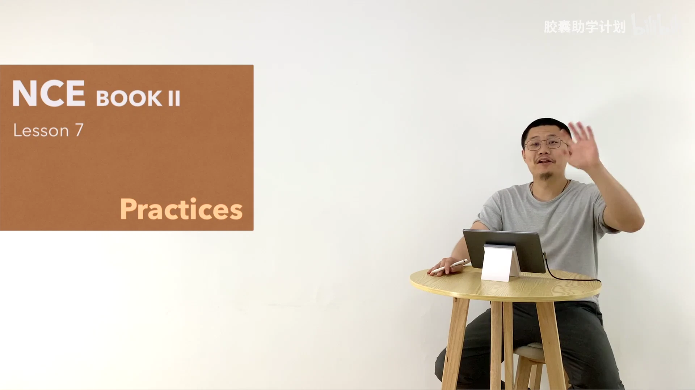

文字识别：胶囊助学计划 / NCE / BOOKII / Lesson 7 / Practices

### 画面 00:00:05

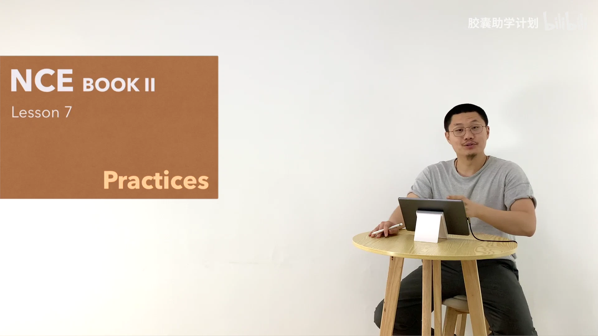

文字识别：胶囊助学计划 / NCE / BOOKI"I / Lesson 7 / Practices

### 画面 00:00:08

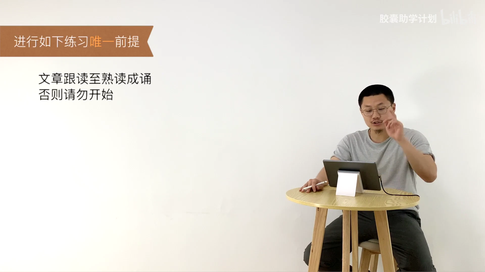

文字识别：胶囊助学计划 / 进行如下练习唯一前提 / 文章跟读至熟读成诵 / 否则请勿开始

### 画面 00:00:15

文字识别：胶囊助学计划 / 进行如下练习唯一前提 / 文章跟读至熟读成诵 / 否则请勿开始

### 画面 00:00:17

文字识别：胶囊助学计划bll / •

### 画面 00:00:21

文字识别：胶囊助学计划

### 画面 00:00:23

文字识别：胶囊助学计划 / Comprehension / 训练目标： / 听懂一般疑问句＆特殊疑问句

### 画面 00:00:26

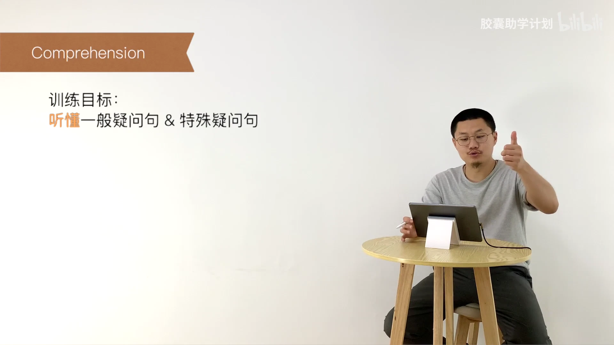

文字识别：胶囊助学计划 / Comprehension / 训练目标： / 听懂一般疑问句＆特殊疑问句

## 00:00:30–00:01:00

基于的是文章。各位闭上眼，要么眼睛可以看着文章，没问题。来了，第一题，Was the plane early or late? 答案 late. Next one, Who was waiting at the airport? Some detectives. Next one, How long were they there? All morning.

### 画面 00:00:35

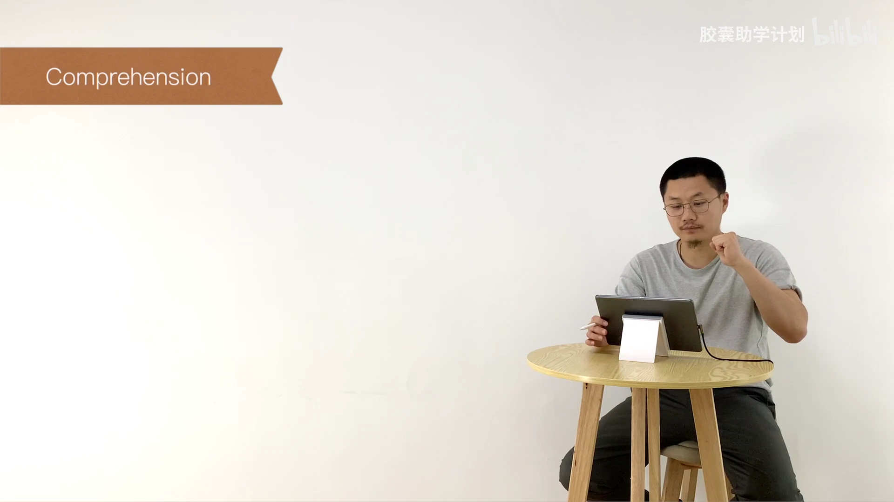

文字识别：胶囊助学计划 / Comprehension

### 画面 00:00:38

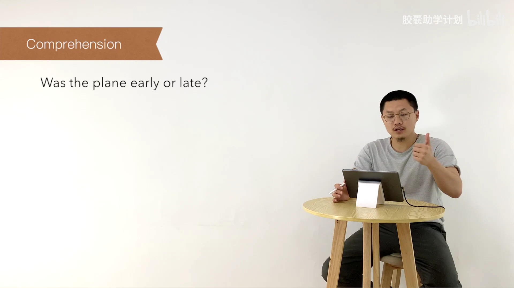

文字识别：胶囊助学计划 / Comprehension / Was the plane early or late?

### 画面 00:00:40

文字识别：胶囊助学计划 / Comprehension / Was the plane early or late?

### 画面 00:00:44

文字识别：胶囊助学计划 / Comprehension / Who was waiting at the airport?

### 画面 00:00:46

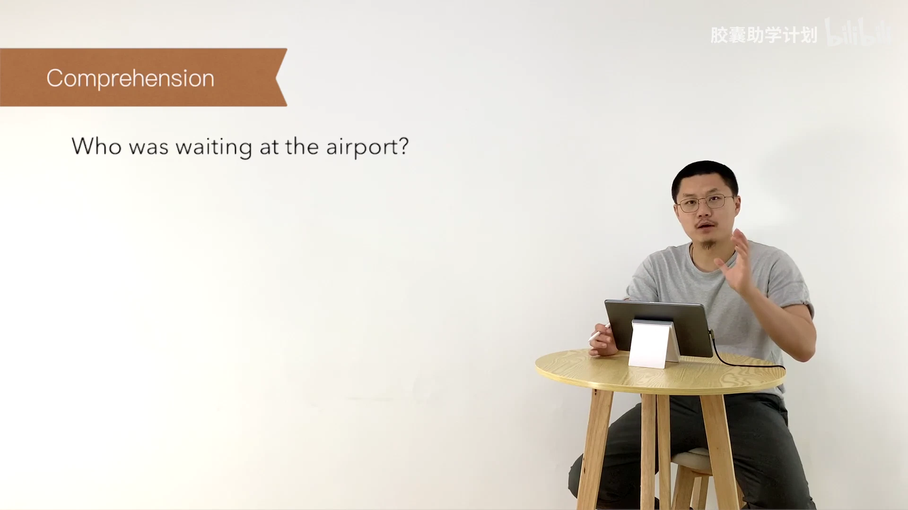

文字识别：胶囊助学计划 / Comprehension / Who was waiting at the airport?

### 画面 00:00:48

文字识别：胶囊助学计划 / Comprehension / Who was waiting at the airport? / Some detectives.

### 画面 00:00:56

文字识别：胶囊助学计划 / Comprehension / How long were they there?

## 00:01:00–00:01:30

Next one, were they expecting a parcel? Answer: Yes, they were. Next one, was the parcel full of money or diamonds? Which one? Answer: Diamonds. Continue. Where was it from? Answer: South Africa.有没有from不重要啊。

### 画面 00:01:00

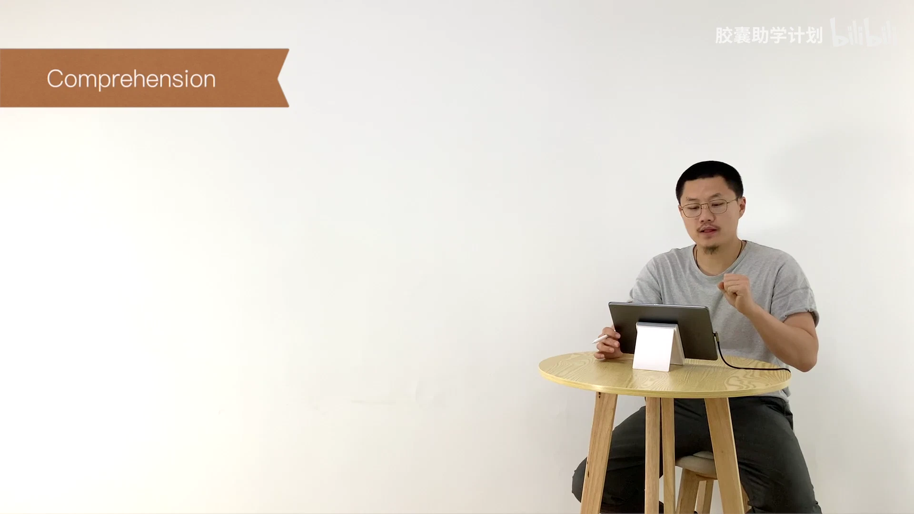

文字识别：胶囊助学计划 / Comprehension

### 画面 00:01:13

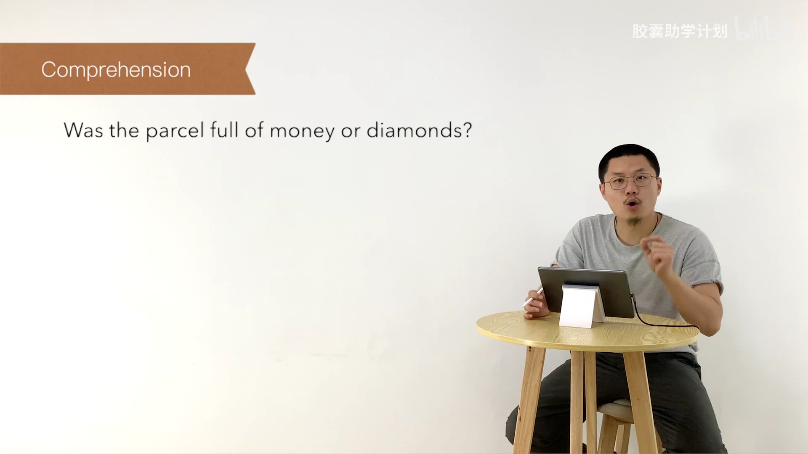

文字识别：胶囊助学计划 / Comprehension / Was the parcel full of money or diamonds?

### 画面 00:01:16

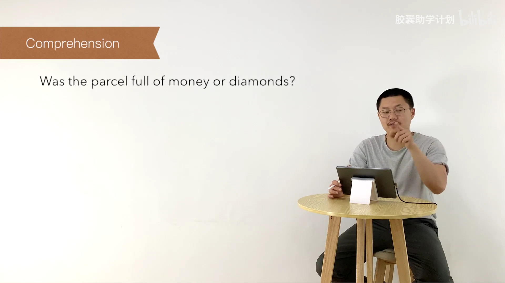

文字识别：胶囊助学计划 / Comprehension / Was the parcel full of money or diamonds?

### 画面 00:01:21

文字识别：胶囊助学计划 / Comprehension / Where was it from?

### 画面 00:01:29

文字识别：胶囊助学计划 / Comprehension / Where was it from? / From South Africa.

## 00:01:30–00:02:00

Next one. Did they think some thieves would try to steal the diamonds? Yes, they did. Why did they think this? They为什么这样认为呢？哪认为什么样呢？就是 some thieves would try to steal the diamonds. Okay. Someone had told the police. Continue. Were some detectives waiting inside the main building?

### 画面 00:01:31

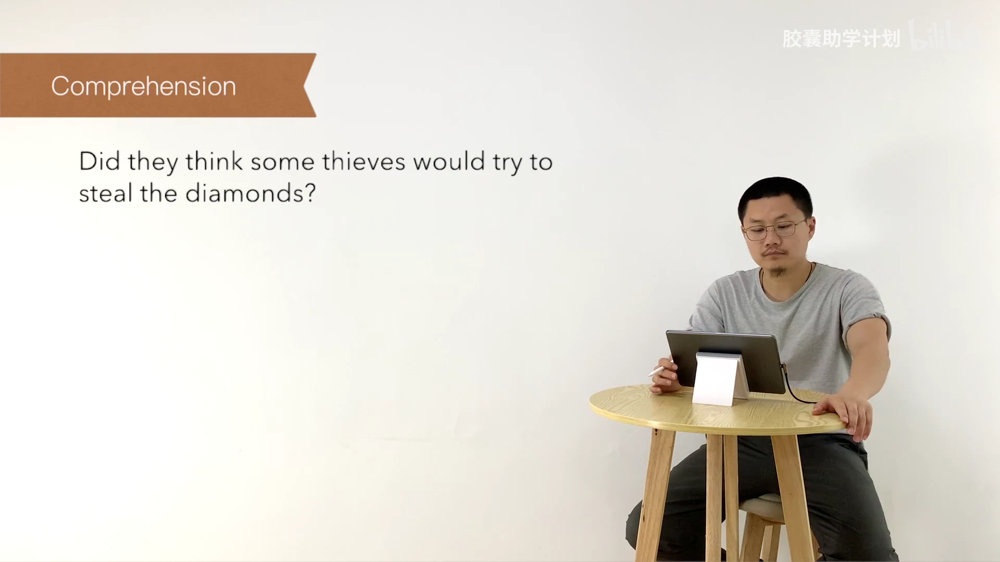

文字识别：胶囊助学计划 / Comprehension / Did they think some thieves would try to / steal the diamonds?

### 画面 00:01:35

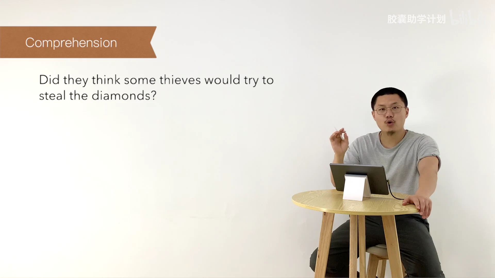

文字识别：胶囊助学计划 / Comprehension / Did they think some thieves would try to / steal the diamonds?

### 画面 00:01:39

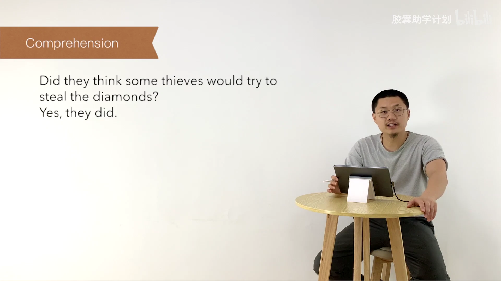

文字识别：胶囊助学计划 / Comprehension / Did they think some thieves would try to / steal the diamonds? / Yes, they did.

### 画面 00:01:41

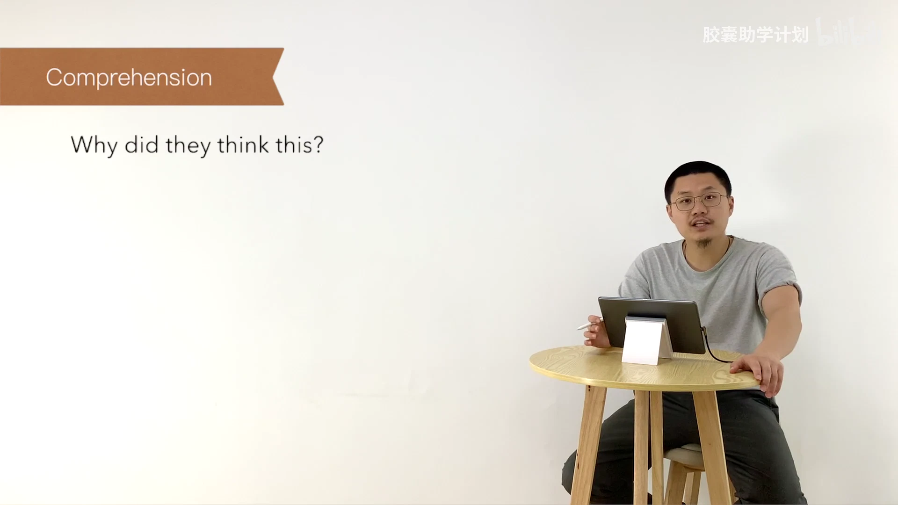

文字识别：胶囊助学计划 / Comprehension / Why did they think this?

### 画面 00:01:45

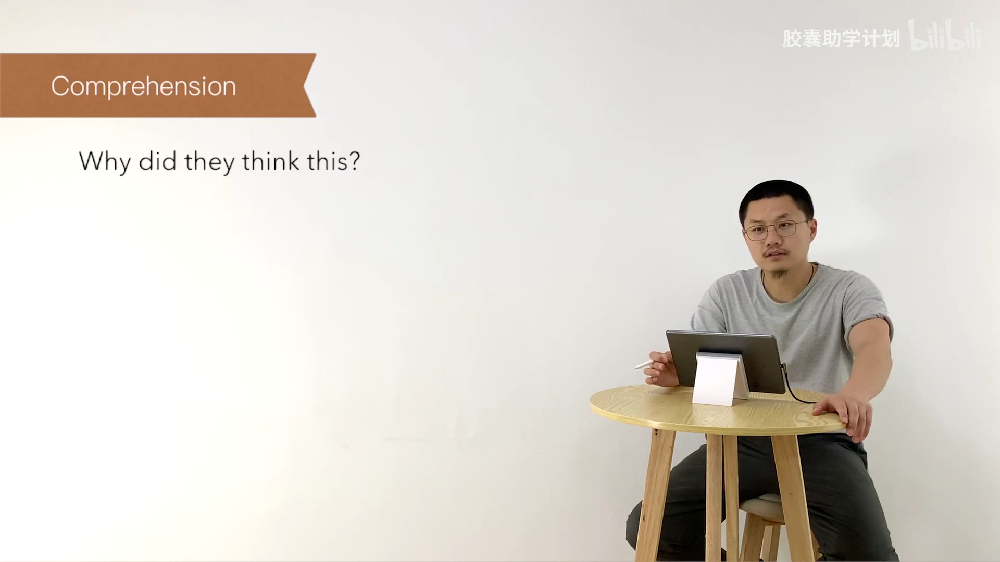

文字识别：胶囊助学计划 / Comprehension / Why did they think this?

### 画面 00:01:51

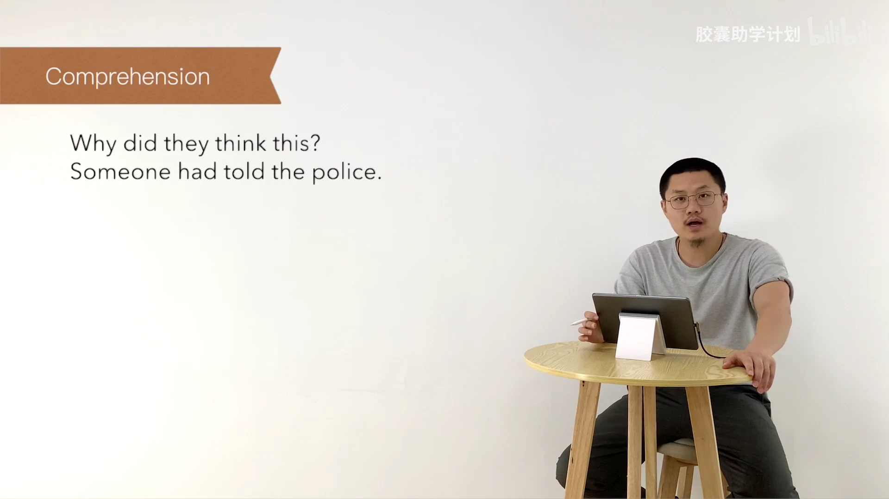

文字识别：胶囊助学计划 / Comprehension / Why did they think this? / Someone had told the police.

### 画面 00:01:54

文字识别：胶囊助学计划 / Comprehension / Were some detectives waiting inside the / main building?

## 00:02:00–00:02:30

Yes, they were. Continue. Where were other detectives waiting? On the airfield. Continue. Who took the parcel off the plane? Two men did. Ah, two men took the parcel off the plane. Continue. Where did they carry it? Into the customs office.

### 画面 00:02:17

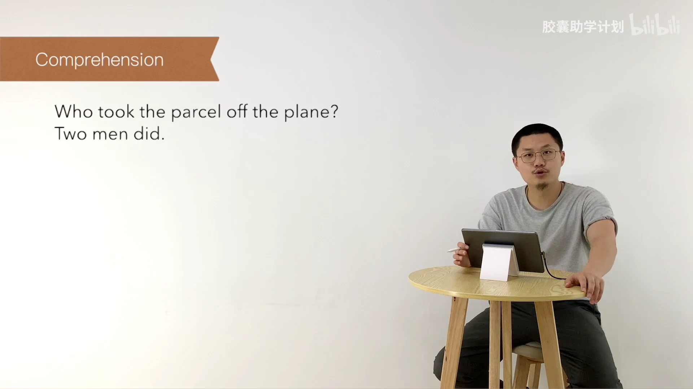

文字识别：胶囊助学计划 / Comprehension / Who took the parcel off the plane? / Two men did.

### 画面 00:02:27

文字识别：胶囊助学计划 / Comprehension / Where did they carry it? / Into the Customs House.

## 00:02:30–00:03:00

Continue. Who was keeping guard at the door? Two detectives. Continue. Who opened the parcel? Two other detectives. 好，接下来下一题，asking questions，会说出来一般疑问句和特殊疑问句，练的我们是 accuracy，啊，口语听力的准确性来了。我们先看第一个例子，Ask

### 画面 00:02:35

文字识别：胶囊助学计划 / Comprehension / Who was keeping guard at the door? / Two detectives were.

### 画面 00:02:45

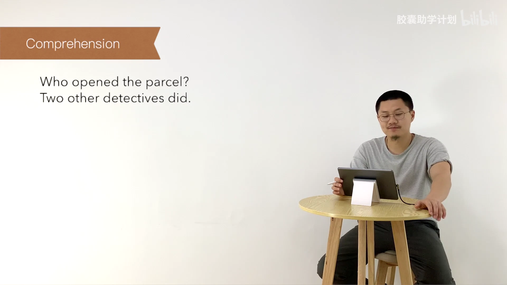

文字识别：胶囊助学计划 / Comprehension / Who opened the parcel? / Two other detectives did. / 2

### 画面 00:02:47

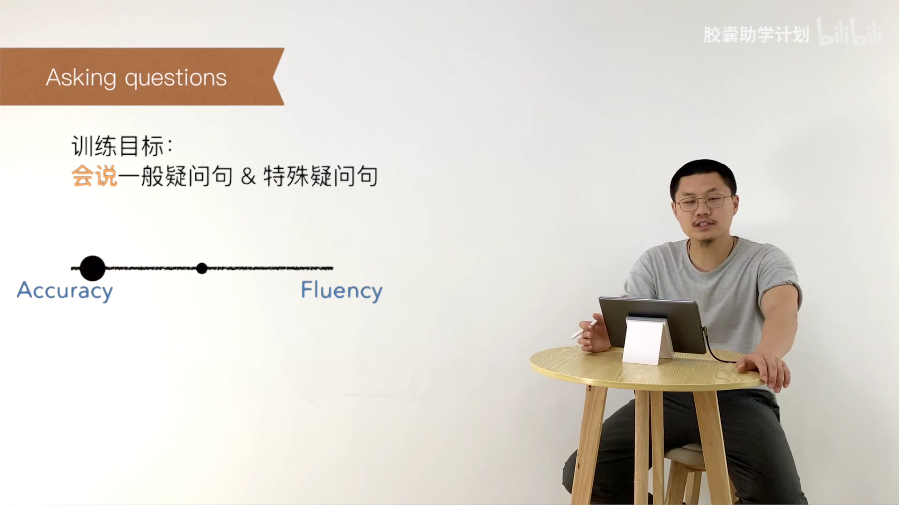

文字识别：胶囊助学计划 / Asking questions / 训练目标： / 会说一般疑问句＆特殊疑问句 / Accuracy / Fluency

### 画面 00:02:52

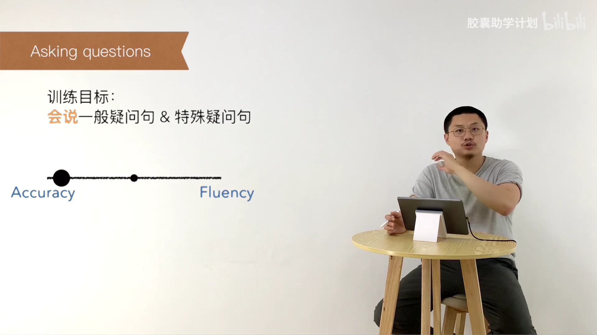

文字识别：胶囊助学计划 / Asking questions / 训练目标： / 会说一般疑问句＆特殊疑问句 / Accuracy / Fluency

### 画面 00:02:54

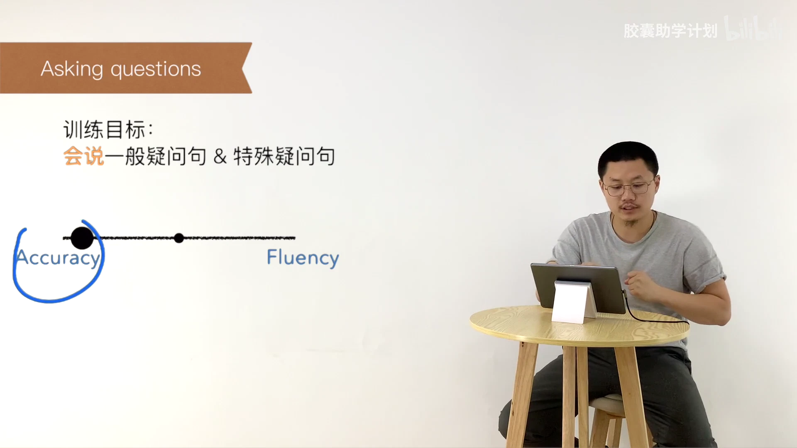

文字识别：胶囊助学计划 / Asking questions / 训练目标： / 会说一般疑问句＆特殊疑问句 / Accuracy / Fluency

### 画面 00:02:56

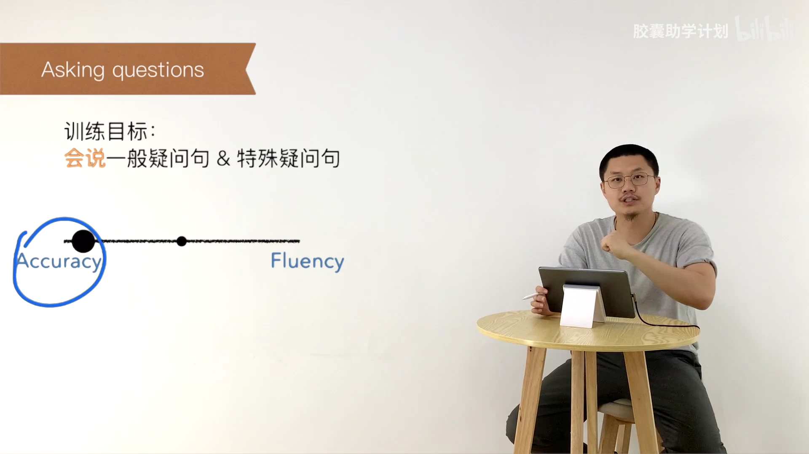

文字识别：胶囊助学计划 / Asking questions / 训练目标： / 会说一般疑问句＆特殊疑问句 / Accuracy / Fluency

### 画面 00:02:58

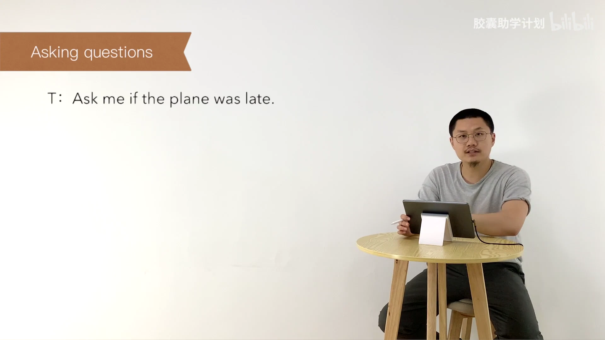

文字识别：胶囊助学计划 / Asking questions / T: Ask me if the plane was late.

## 00:03:00–00:03:30

me if the plan was late. 接下来你要做的事情变一般疑问句, was提前, was the plan late? 好, what一定是对the plan提问, 不用变特一般疑问句了, 直接替代主语. What was late? 什么晚点了, 或者什么迟到了? OK, 那迟到一般就是who了, 对不对? OK, 好, 那我们看啊, Detectives were waiting at the airport. 过去进行时, were提前就可以了. Where对at the

### 画面 00:03:00

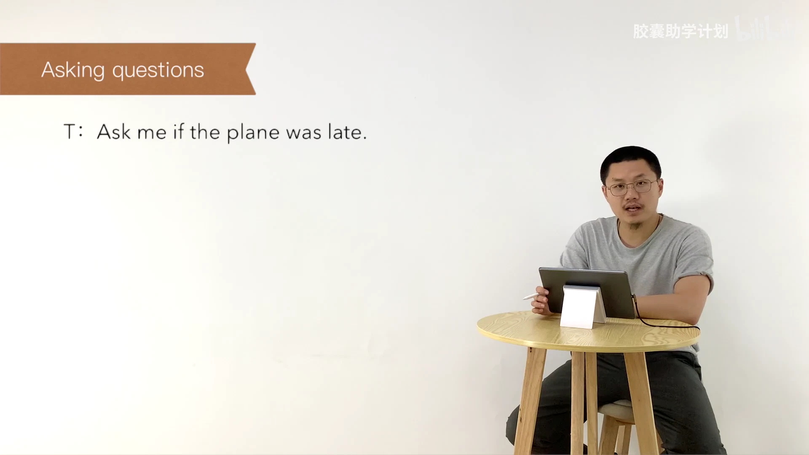

文字识别：胶囊助学计划 / Asking questions / T: Ask me if the plane was late.

### 画面 00:03:09

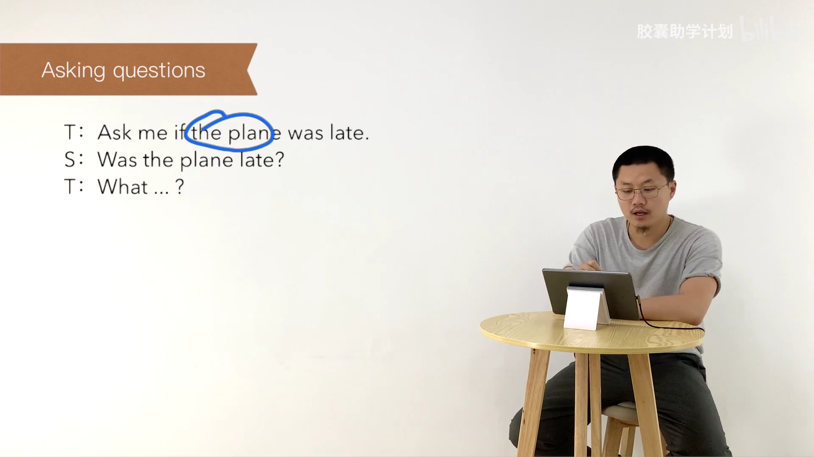

文字识别：胶囊助学计划 / Asking questions / T: Ask me if the plane was late. / S: Was the plane late? / T: What ..?

### 画面 00:03:11

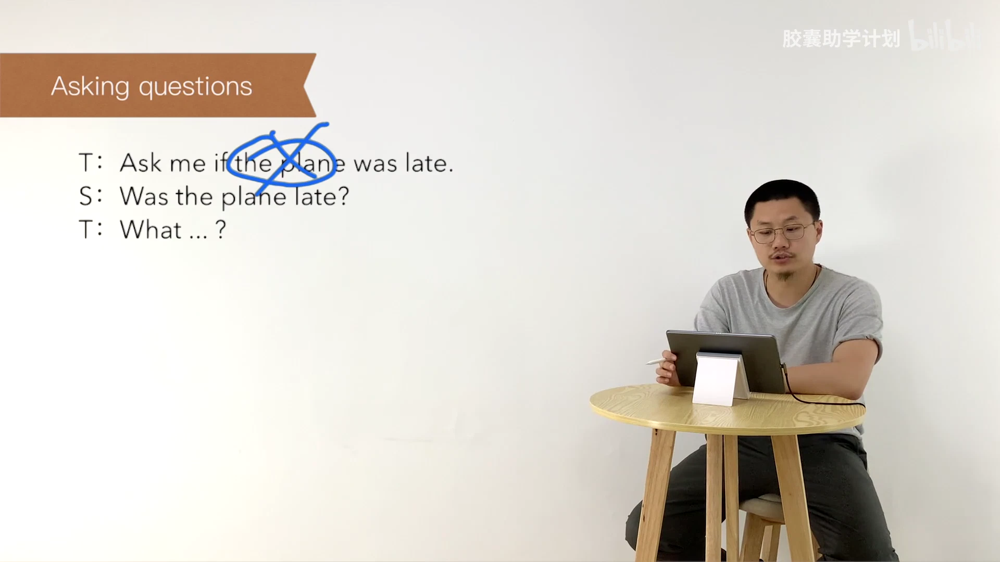

文字识别：胶囊助学计划 / Asking questions / T: Ask me if the / Aane was late. / S: Was the plane late? / T: What .?

### 画面 00:03:20

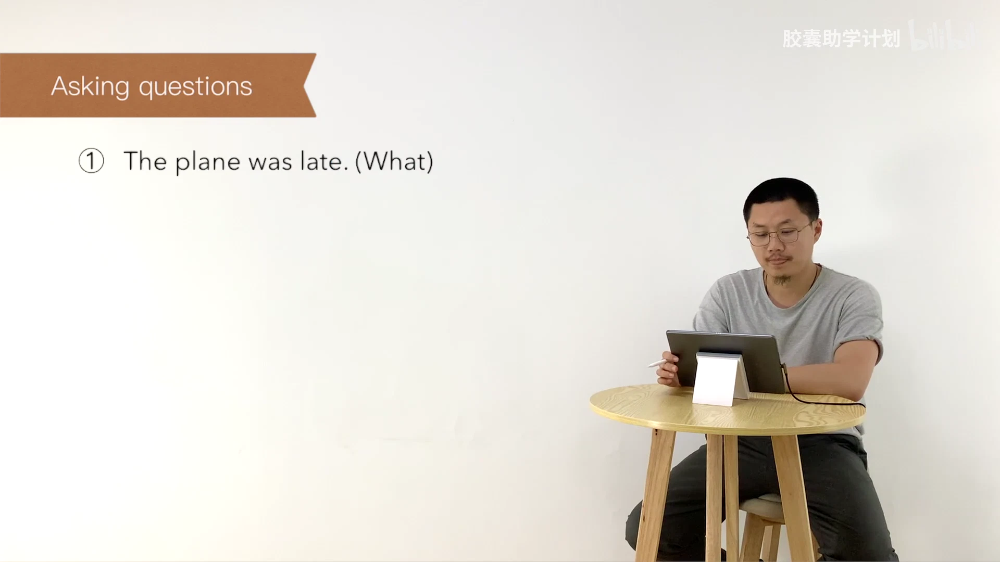

文字识别：胶囊助学计划 / Asking questions / The plane was late. (What) / 1

### 画面 00:03:26

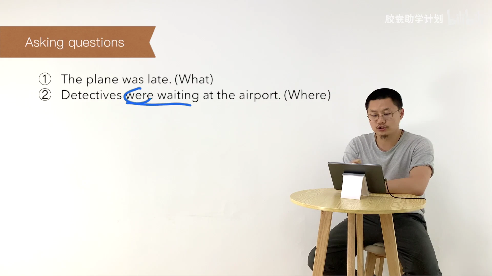

文字识别：胶囊助学计划 / Asking / questions / The plane was late. (What) / DetectivesWere / waiting / at the airport. (Where)

### 画面 00:03:28

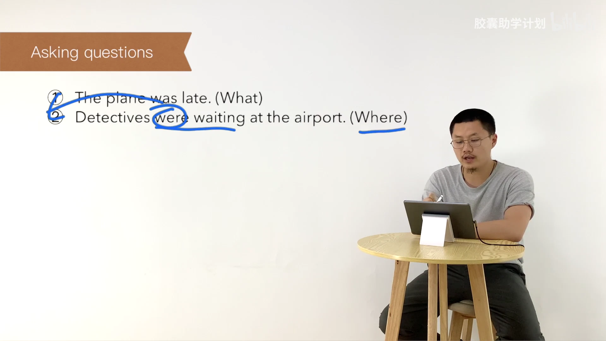

文字识别：胶囊助学计划 / Asking / questions / plane was / late.(What) / Detectives / were / waiting / at the / airport.(Where)

## 00:03:30–00:04:00

airport提问，对吧？Continue，我们这不说答案，只说思路。各位课下要去把它写下来，进行口语朗读啊。They were waiting all morning. Were提前，How long一定是对all morning进行提问的。Continue，They were expecting a parcel.还是were expecting were提前，What是对a parcel提问的。所以答案就是What were they expecting？跟What were they

### 画面 00:03:30

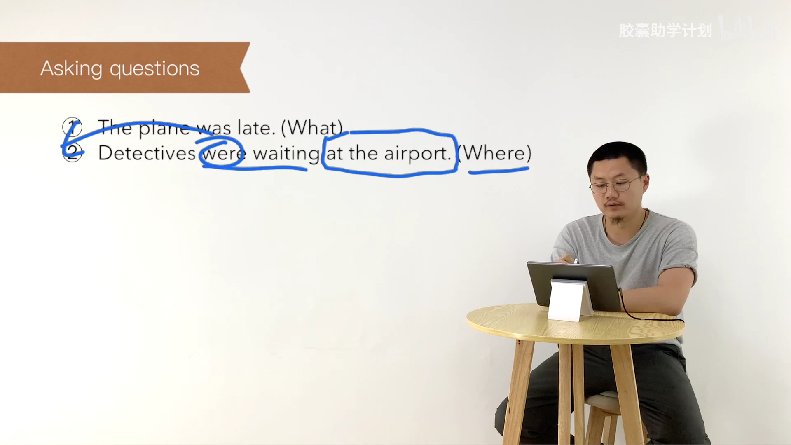

文字识别：胶囊助学计划 / Asking / questions / plane was / late. / (What) / Detectives / were / waiting / at the / airport. / (Where)

### 画面 00:03:36

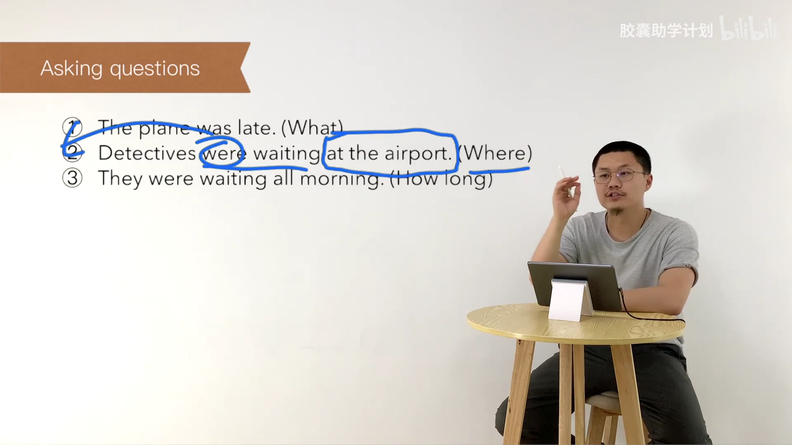

文字识别：胶囊助学计划 / Asking / questions / plane was / late. / (What) / Detectives / were / waiting / at the / airport. / (Where) / They / were / waiting / all / morning.(How Tong)

### 画面 00:03:40

文字识别：胶囊助学计划 / Asking / questions / plame / was / late. / (What) / Detectives / were / waiting / at the / airport. / (Where) / 3 / They / were / waiting / all / morning.(How Tong)

### 画面 00:03:42

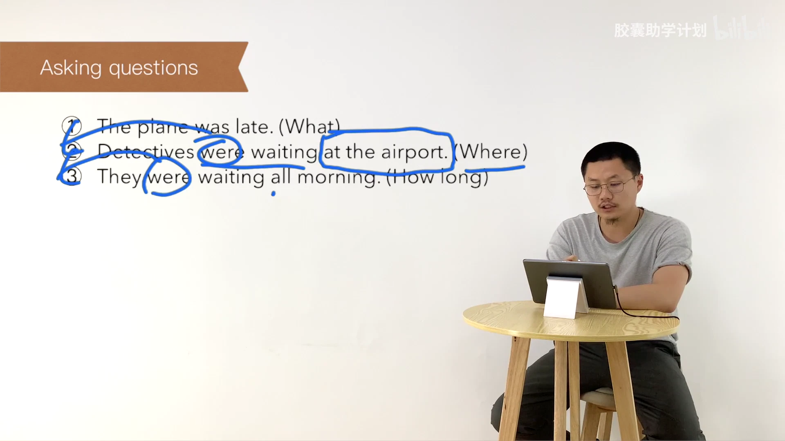

文字识别：胶囊助学计划 / Asking / questions / plane was / late. / (What) / Detectives / were / waiting / at the / airport. / (Where) / 3 / They / were / waiting / all / morning. (How Tong)

### 画面 00:03:44

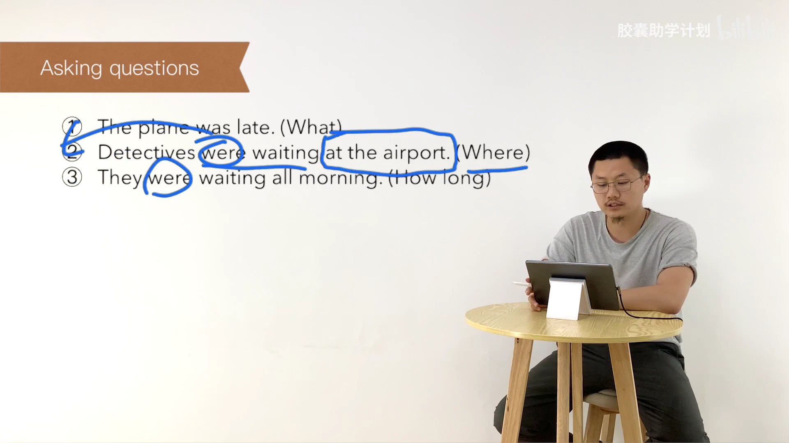

文字识别：胶囊助学计划 / Asking / questions / plane was / late. / (What) / Detectives / were / waiting / at the / airport. / (Where) / They / were / waiting / all / morning. (How Tong)

### 画面 00:03:46

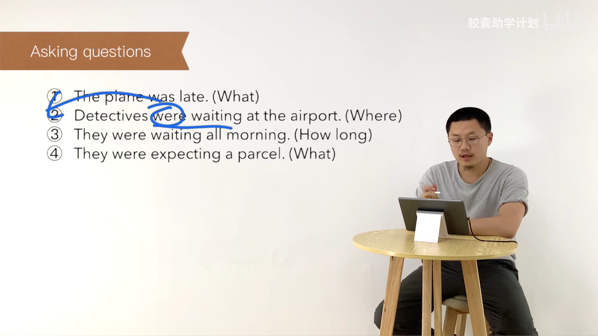

文字识别：胶囊助学计划 / Asking / questions /  plane was late. (What) / Detectives / were / waiting / at the / airport. /  (Where) / They / were / waiting / all morning. / (How / long) / They / were / expecting / a parcel. (What)

### 画面 00:03:51

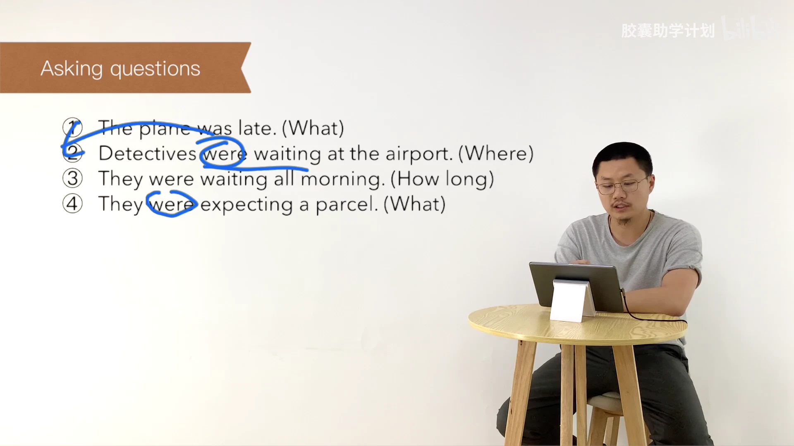

文字识别：胶囊助学计划 / Asking / questions / plane was / late.(What) / Detectives / were / waiting / at the / airport. / (Where) / They / were / waiting / all morning. / (How / long) / They / were / expecting / a parcel. (What)

### 画面 00:03:55

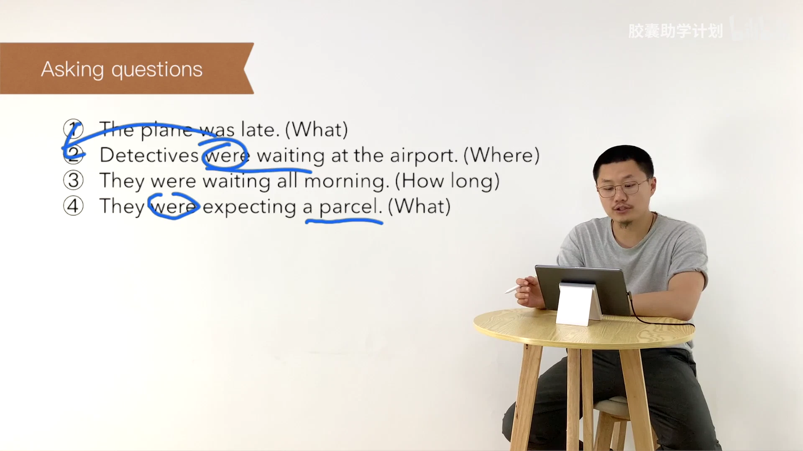

文字识别：胶囊助学计划 / Asking / questions / piane was / late.(What) / Detectives / were / waiting / at the / airport. / (Where) / They / were / waiting / all morning. / (How / long) / They / weree / expecting / a parcel. (What)

## 00:04:00–00:04:30

waiting一码事儿。Continue, it was from South Africa. Was提前Where? Where from? Where就是对South Africa提问，所以答案叫Where was it from?啊，它这个包裹来自于什么地方？Okay,接下来Tell the story.我们叫口语复述能力，对吧？注意，更多练的是我们的fluency，而不是accuracy。更多练的是我们口语的流利性，

### 画面 00:04:06

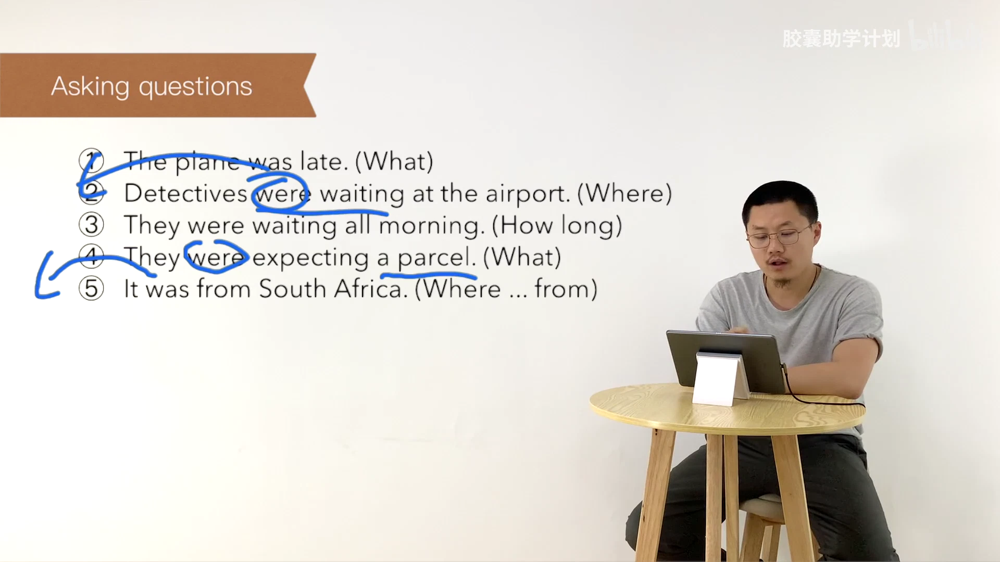

文字识别：胶囊助学计划 / Asking / questions /  piane was /  late.(What) / Detectives / were / waiting / at the / airport. /  (Where) / 3 / They / were / waiting / all morning. / (How / long) / ④ They / were / expecting / a parcel.(What) / 5 / It was / from / South /  Africa.(Where .from)

### 画面 00:04:10

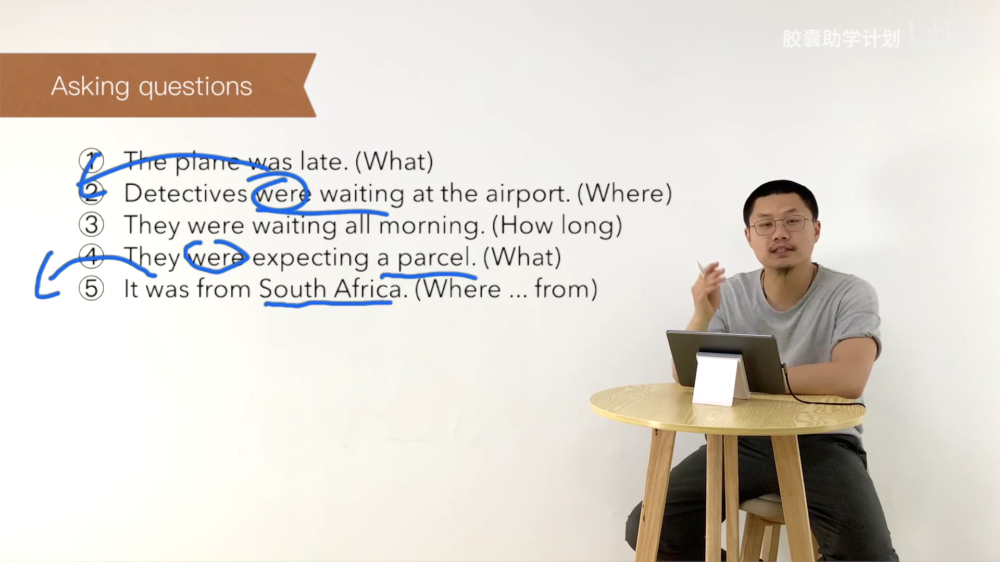

文字识别：胶囊助学计划 / Asking / questions / The plane was late. (What) / Detectives / were / waiting / at the / airport. / (Where) / 3 / They / were / waiting / all morning. / (How / long) / They / were / expecting / a parcel. (What) / 5 / It was / from / South Africa. (Where ..from)

### 画面 00:04:12

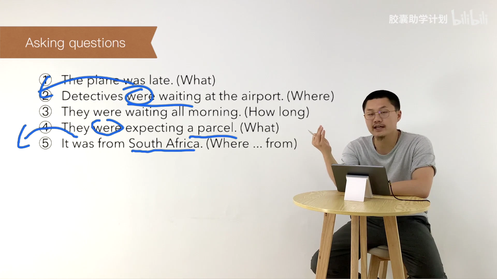

文字识别：胶囊助学计划 / Asking / questions / Hre /  plane was / s late.(What) / Detectives / were / waiting / at the / airport. / (Where) / 3 / They / were / waiting / all morning. / (How / long) / ④ They / were / expecting / a parcel. (What) / 5 / It was / from / South Africa.(Where .. from)

### 画面 00:04:15

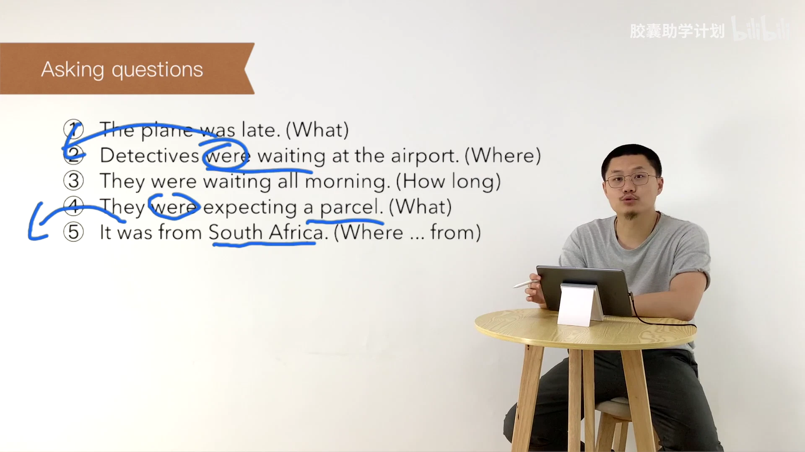

文字识别：胶囊助学计划 / Asking / questions /  plane was / s late.(What) / Hre / Detectives / were / waiting / at the / airport. / (Where) / 3 / They / were / waiting / all morning. / (How / long) / ④ They / were / expecting / a parcel.(What) / 5 / It was / from / South Africa.(Where ..from)

### 画面 00:04:17

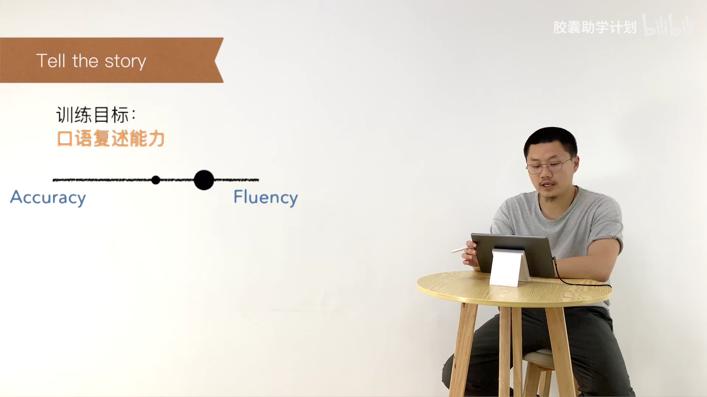

文字识别：胶囊助学计划 / Tell the story / 训练目标： / 口语复述能力 / Accuracy / Fluency

### 画面 00:04:24

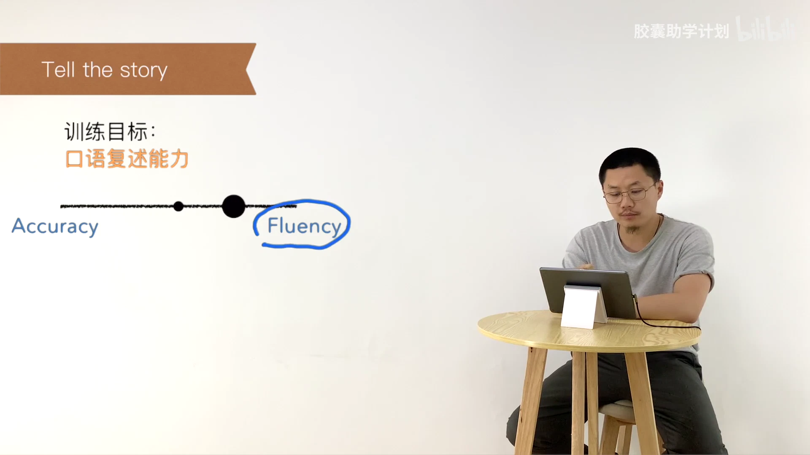

文字识别：胶囊助学计划 / Tell the story / 训练目标： / 口语复述能力 / Accuracy / Fluency

## 00:04:30–00:05:00

而不是准确性，意味着您可以不那么准确，但是要流利啊！所以文章一定要跟读至熟读成诵。我上课还是只给大家做一个示范啊，呃，一定不是完美的，因为我不是在背诵文章，对吧？我练的更多是流利性。来了，The plane was late, and some detectives were waiting on the air at the airport. They were expecting a valuable parcel from South Africa. A few hours earlier, someone had

### 画面 00:04:30

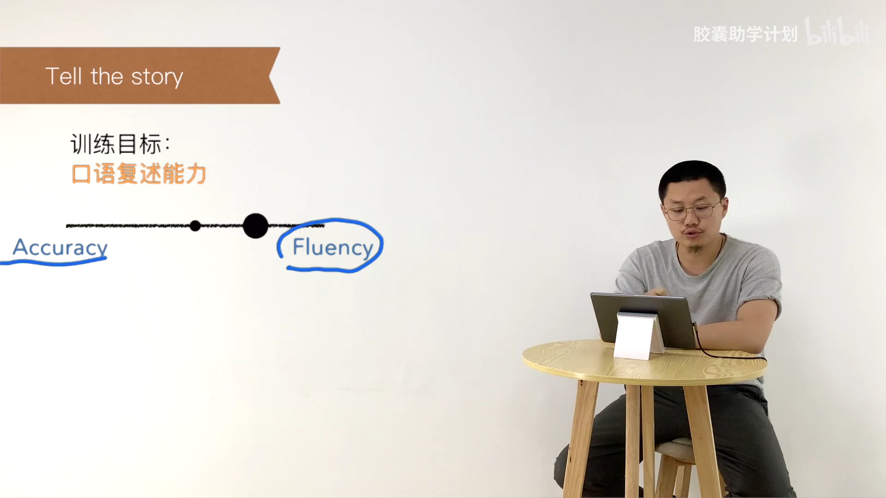

文字识别：胶囊助学计划 / Tell the story / 训练目标： / 口语复述能力 / Accuracy / Fluency

### 画面 00:04:33

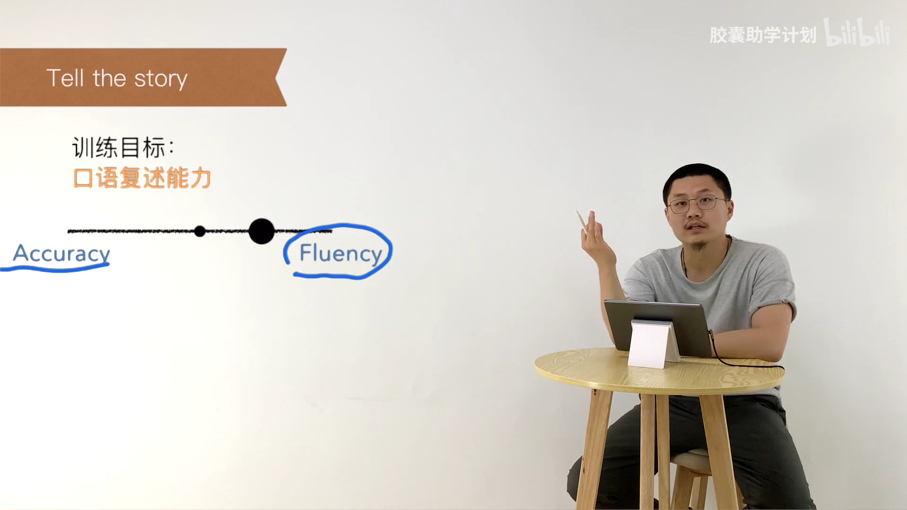

文字识别：胶囊助学计划 / Tell the story / 训练目标： / □语复述能力 / Accuracy / Fluency

### 画面 00:04:37

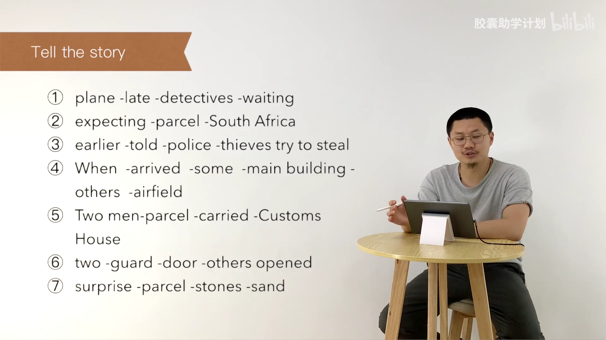

文字识别：胶囊助学计划 / Tell the story / ① /  plane -late -detectives -waiting / expecting -parcel -South Africa / earlier -told -police -thieves try to steal / When -arrived -some -main building - / others -airfield / Two men-parcel -carried -Customs / House / two -guard -door -others opened / surprise -parcel -stones -sand

### 画面 00:04:48

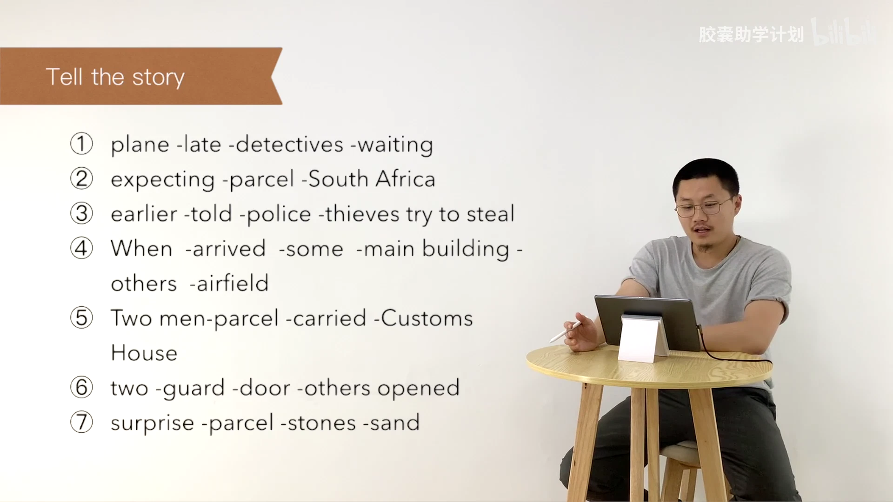

文字识别：胶囊助学计划 / Tell the story / ① /  plane -late -detectives -waiting / expecting -parcel -South Africa / earlier -told -police -thieves try to steal / When -arrived -some -main building - / others -airfield / Two men-parcel -carried -Customs / House / two -guard -door -others opened / surprise -parcel -stones -sand

### 画面 00:04:51

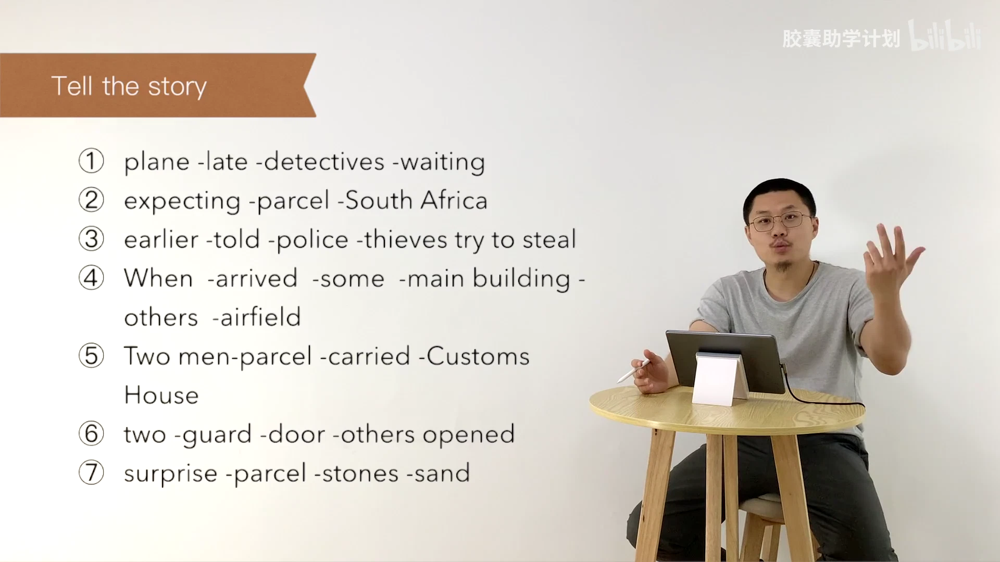

文字识别：胶囊助学计划 / Tell the story / ① / ) plane -late -detectives -waiting / expecting -parcel -South Africa / earlier -told -police -thieves try to steal / When -arrived -some -main building - / others -airfield / Two men-parcel -carried -Customs / House / two -guard -door -others opened / surprise -parcel -stones -sand

## 00:05:00–00:05:30

told the planes that the thieves would try to steal the diamonds. When the plane arrived, some detectives were waiting inside the main building while others were, ah, waiting on the airfield. Two men took the parcel off the plane and carried it into the customs house. Two men were, two detectives were keeping guard at the door while two others opened the parcel. To their surprise, the parcel was full of stones and sand.

### 画面 00:05:07

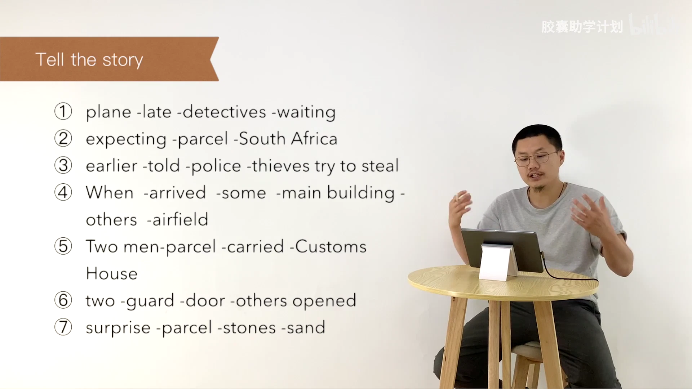

文字识别：胶囊助学计划 / Tell the story / ① /  plane -late -detectives -waiting / expecting -parcel -South Africa / earlier -told -police -thieves try to steal / When -arrived -some -main building - / others -airfield / Two men-parcel -carried -Customs / House / two -guard -door -others opened / surprise -parcel -stones -sand

## 00:05:30–00:06:00

Okay,好，这个就是各位课下要做的任务，看着这些关键词去做口语复述，尝试回顾这篇文章。您不用过分的关心，说哎呀，我这个地方好像跟原文不太一样了，没事儿，只要大概你把这个故事用这些语言描述下来，这个任务就完成了。OK，好，接下来summary writing写作复述的答案在这个地方，也就是我们汉汉呃，我们文章底下有一个叫摘要写作的练习的

### 画面 00:05:37

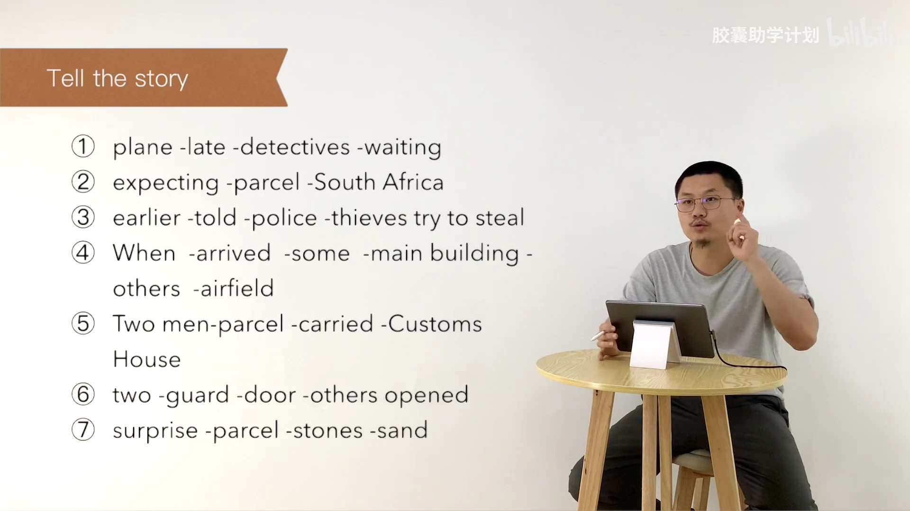

文字识别：胶囊助学计划 / Tell the story / ① /  plane -late -detectives -waiting / expecting -parcel -South Africa / 2 / earlier -told -police -thieves try to steal / When -arrived -some -main building - / others -airfield / Two men-parcel -carried -Customs / House / two -guard -door -others opened / surprise -parcel -stones -sand

### 画面 00:05:50

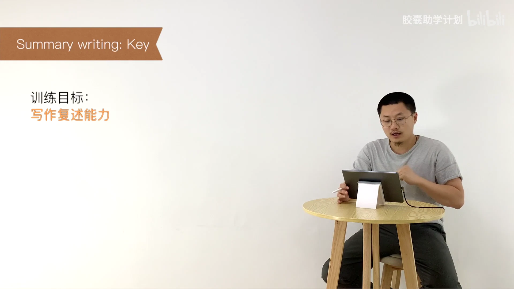

文字识别：胶囊助学计划 / Summary writing: Key / 训练目标： / 写作复述能力

### 画面 00:05:52

文字识别：胶囊助学计划 / Summary writing: Key / 训练目标： / 写作复述能力

### 画面 00:05:54

文字识别：胶囊助学计划 / Summary writing: Key / Detectives were waiting at the airport all / morning. They were expecting a valuable / parel of diamonds from South Africa. Two / men took the parcel into the Customs House / after the arrival of the plane. Two detectives / opened it. The parcel was full of stones and / sand.

## 00:06:00–00:06:30

答案，OK。好，完全自由的对话，这个是我们现在也许做不了的，但我们每期都要看一下，他让我们讨论什么样的话题。第一个，Can you describe what happens when someone goes through customs? 当某个人过海关的时候会发生什么事情呢？您能尝试描述一下吗？OK，你就先拿汉语给自己描述一下。OK，接下来说，How we how can we keep our valuables safe from thieves? 啊，我们如何

### 画面 00:06:03

文字识别：胶囊助学计划 / Topics for discussion / 训练目标： / 完全自由的对话

### 画面 00:06:06

文字识别：胶囊助学计划 / Topics for discussion / Can you describe what happens when / someone goes through Customs? / How can we keep our valuables safe / from thieves? / There is a saving 'Diamonds are a girl's / best friend.' What do you think it means?

### 画面 00:06:16

文字识别：胶囊助学计划 / Topics for discussion / Can you describe what happens when / someone goes through Customs? / How can we keep our valuables safe / from thieves? / There is a saving 'Diamonds are a girl's / best friend.' What do you think it means?

### 画面 00:06:26

文字识别：胶囊助学计划 / Topics for discussion / Can you describe what happens when / someone goes through Customs? / How can we keep our valuables safe / frorothieves? / There is a saving 'Diamonds are a girl's / 3 / best friend.' What do you think it means?

## 00:06:30–00:07:00

precious things, this, this let them away from these thieves, ah, let the thieves steal not, ah, this thing, ah, from small to big, parents are always teaching us, right? We can try to say it ourselves. Still, first use Chinese to say Chinese, first say this content to him fluently, then later we will turn these contents into English. OK, next say there is a saying, there is a saying, pay attention to saying saying, ah, this place should be why, saying, ah, should be S A Y.

### 画面 00:06:37

文字识别：胶囊助学计划 / Topics for discussion / Can you describe what happens when / someone goes through Customs? / How can we keep our valuables safe / from thieves? / There is a saving 'Diamonds are a girl's / best friend.' What do you think it means?

### 画面 00:06:42

文字识别：胶囊助学计划 / Topics for discussion / Can you describe what happens when / someone goes through Customs? / How can we keep our valuables safe / from thieves? / There is a saving 'Diamonds are a girl's / best friend.' What do you think it means?

### 画面 00:06:50

文字识别：Bilibili / 胶囊助学计划 / Topics for discussion / Can you describe what happens when / someone goes through Customs? / How can we keep our valuables safe / from thieves? / There is a saving 'Diamonds are a girl's / best friend.' What do you think it means?

### 画面 00:06:53

文字识别：胶囊助学计划 / Topics for discussion / Can you describe what happens when / someone goes through Customs? / How can we keep our valuables safe / from thieves? / There is a saving 'Diamonds are a girl's / best friend.' What do you think it means?

## 00:07:00–00:07:30

应该是s a y i n g, okay.说有这么一个说法叫做Diamonds are girls' best friend.说钻石啊是女孩们最好的朋友，是吧？说What do you think it means?说你认为这句话是什么意思呢？那您就自己去发挥了，对吧？那你看这个很轻松，就一个四百字的小论文出来了，对吧？小作文就出来了。Okay,那各位不用把它搞得那么长，你可以就来个三三五十句话，对吧？一

### 画面 00:07:08

文字识别：胶囊助学计划 / Topics for discussion / Can you describe what happens when / someone goes through Customs? / How can we keep our valuables safe / from thieves? / There is a saying 'Diamonds are a girl's / best friend.' What do you think it means?

### 画面 00:07:18

文字识别：胶囊助学计划 / Topics for discussion / Can you describe what happens when / someone goes through Customs? / How can we keep our valuables safe / from thieves? / There is a saying 'Diamonds are a girl's / best friend.' What do you think it means?

### 画面 00:07:22

文字识别：胶囊助学计划 / Topics for discussion / Can you describe what happens when / someone goes through Customs? / How can we keep our valuables safe / from thieves? / There is a saying 'Diamonds are a girl's / best friend.' What do you think it means?

### 画面 00:07:25

文字识别：胶囊助学计划 / Topics for discussion / Can you describe what happens when / someone goes through Customs? / How can we keep our valuables safe / from thieves? / There is a saying 'Diamonds are a girl's / best friend.' What do you think it means?

### 画面 00:07:27

文字识别：胶囊助学计划 / Topics for discussion / Can you describe what happens when / someone goes through Customs? / How can we keep our valuables safe / from thieves? / There is a saying 'Diamonds are a girl's / best friend.' What do you think it means?

## 00:07:30–00:08:00

二百字儿啊，发一个微博的长度对吧？然后呢，把它先放在这个地方，看里面有哪些东西呢？我是可以翻译成英文的，哪些东西以我现在的水平没法翻译成英文？往后去学的时候呢，我们会学更多的单词、语法和习惯用法。您在不停的回来看这个东西，哎，说今天我新学了一个习惯用法，完全就可以用来表达这个。那你原来你就能意识到自己进步了，对不

### 画面 00:07:50

文字识别：bilibli / 胶囊助学计划 / Topics for discussion / Can you describe what happens when / someone goes through Customs? / How can we keep our valuables safe / from thieves? / There is a saying 'Diamonds are a girl's / best friend.' What do you think it means?

## 00:08:00–00:08:30

对？OK，那我们看一下本课的家庭作业。首先，ask me if，不要忘了一定要先写再朗读，因为它练的是我们的准确性。写比说是更加具有准确的。比如说，当我把 did 提前的时候，后边的动词有没有换回原形呢？你说的时候，很可能自己意识不到变或没变。你写的时候是很容易意识到的，对吧？所以一定要先写，写完一定要去张嘴再朗读，

### 画面 00:08:00

文字识别：胶囊助学计划 / Topics for discussion / Can you describe what happens when / someone goes through Customs? / How can we keep our valuables safe / from thieves? / There is a saying 'Diamonds are a girl's / best friend.' What do you think it means?

### 画面 00:08:02

文字识别：胶囊助学计划

### 画面 00:08:04

文字识别：胶囊助学计划 / 1.Ask me if写&朗读

### 画面 00:08:06

文字识别：胶囊助学计划 / 1.Ask me if写&朗读

### 画面 00:08:08

文字识别：胶囊助学计划 / 1.Ask me if写&朗读

### 画面 00:08:10

文字识别：胶囊助学计划 / 1.Ask me if写&朗读

### 画面 00:08:12

文字识别：Biibili / 胶囊助学计划 / 1.Ask me if写&朗读

### 画面 00:08:14

文字识别：胶囊助学计划 bib出 / 1.Ask me if写&朗读

### 画面 00:08:19

文字识别：Bilbili / 胶囊助学计划 / 1.Ask me if写&朗读

### 画面 00:08:24

文字识别：胶囊助学计划blb出 / 1.Ask me if写&朗读

### 画面 00:08:26

文字识别：胶囊助学计划 / 1.A / Ask meif写&朗读

### 画面 00:08:29

文字识别：胶囊助学计划 / 1.Ask me if写&朗读

## 00:08:30–00:09:00

因为它毕竟是最后是口语的一个练习。OK，摘要写作去进行写，配合答案，我们在专栏当中也可以，在本视频当中也有答案。接下来呢，tell the story进行口语复述，前提是各位文章已经熟读成诵了，那么自然而然你一定能把这篇文章给它tell the story口语复述一遍是没有问题的。啊，专栏当中可以找到这个所有这个视频当中的练习

### 画面 00:08:31

文字识别：胶囊助学计划 / 1.Ask me if写&朗读

### 画面 00:08:34

文字识别：胶囊助学计划bilbl / 1.Ask me if写&朗读 / 2. / 摘要写作写&答案

### 画面 00:08:36

文字识别：胶囊助学计划 / 1.Ask me if写&朗读 / 2. / 摘要写作写&答案

### 画面 00:08:38

文字识别：胶囊助学计划 / 1.Ask me if写&朗读 / 2. / 摘要写作写&答案

### 画面 00:08:40

文字识别：胶囊助学计划 / 1.Ask me if写&朗读 / 2. / 摘要写作写&答案

### 画面 00:08:42

文字识别：胶囊助学计划 / 1.Ask me if写&朗读 / 摘要写作写&答案 / 3.Tell the story 口语复述

### 画面 00:08:44

文字识别：胶囊助学计划 / 1.Ask me if写&朗读 / 摘要写作写&答案 / 3.Tell the story 口语复述

### 画面 00:08:46

文字识别：Biibili / 胶囊助学计划 / 1.Ask me if写&朗读 / 摘要写作写&答案 / 3.Tell the story 口语复述

### 画面 00:08:49

文字识别：bilibili / 胶囊助学计划 / 1.Ask me if写&朗读 / 摘要写作写&答案 / 3.Tell the story 口语复述

### 画面 00:08:52

文字识别：胶囊助学计划 / 1.Ask me if写&朗读 / 摘要写作写&答案 / 3.Tell the story 口语复述

### 画面 00:08:54

文字识别：胶囊助学计划 / 1.Ask me if写&朗读 / 摘要写作写&答案 / 3.Tell the story 口语复述 / 专栏 / 4.

### 画面 00:08:56

文字识别：胶囊助学计划 / 1.Ask me if写&朗读 / 摘要写作写&答案 / 3.Tell the story 口语复述 / 专栏 / 4.

### 画面 00:08:59

文字识别：biltbli / 胶囊助学计划 / 1.Ask me if写&朗读 / 摘要写作写&答案 / 3.Tell the story 口语复述 / 专栏 / 4.

## 00:09:00–00:09:27

啊，以及他们的答案。OK，好，那以上呢就是本期视频的全部内容了。如果大家喜欢我们的课程，欢迎大家关注、订阅、一键三连支持，并分享给那些需要的朋友们。See you next time.

### 画面 00:09:02

文字识别：胶囊助学计划 / 1.Ask me if写&朗读 / 摘要写作写&答案 / 3.Tell the story 口语复述 / 专栏 / 4.

### 画面 00:09:04

文字识别：胶囊助学计划 / 不

### 画面 00:09:07

文字识别：胶囊助学计划 / 不

### 画面 00:09:09

文字识别：胶囊助学计划 / 不

### 画面 00:09:15

文字识别：CAPSULEACADEMY / 胶囊助学计划 / 小红书

### 画面 00:09:17

文字识别：CAPSULEACADEMY / 胶囊助学计划 / 小红书 / cturer / Leo

### 画面 00:09:23

文字识别：CAPSULEACADEMY / 胶囊助学计划 / 小红书 / Creator / □ / Leo & Berlin / OE

### 画面 00:09:25

文字识别：bilibili / 胶囊助学计划

### 画面 00:09:26

文字识别：bilibili / 胶囊助学计划

