# L008 单词

快速机器解析：语音为单模型转写，未进行独立交叉校对或人工复核；画面每秒采样并按变化选帧，短时文字和标记可能遗漏。截图时间约有 1 秒误差。图片有损压缩；遇到疑点请按时间查看 Google Drive 原视频。

## 00:00:00–00:00:30

Hello everyone, welcome to Capsule Academy. This is Leo. The day we're going to learn the Concept English Book Two Lesson Eight Words. 老习惯进入正式课程之前，我们先看三个问题：第一，如何表达参加比赛；第二，如何表达很酷；第三，如何表达游泳池。带着这三个问题，Hope you gonna enjoy it. 好，那我们上来呢，先看第一个小的单词啊，它的音

### 画面 00:00:00

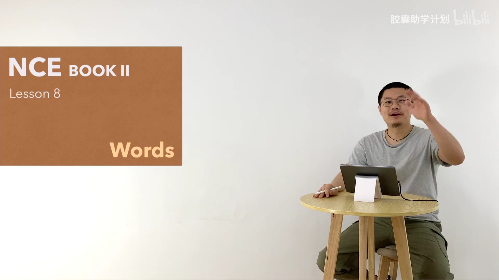

文字识别：胶囊助学计划 / NCE / BOOKI"I / Lesson 8 / Words

### 画面 00:00:02

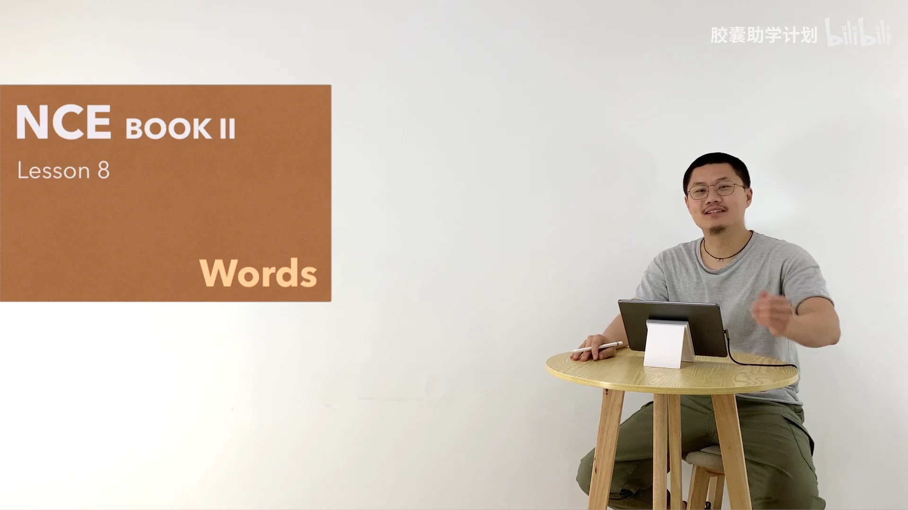

文字识别：胶囊助学计划 / NCE / BOOKII / Lesson 8 / Words

### 画面 00:00:05

文字识别：胶囊助学计划 / NCE / BOOKII / Lesson 8 / Words

### 画面 00:00:07

文字识别：胶囊助学计划 / NCE / BOOKII / Lesson 8 / Words

### 画面 00:00:09

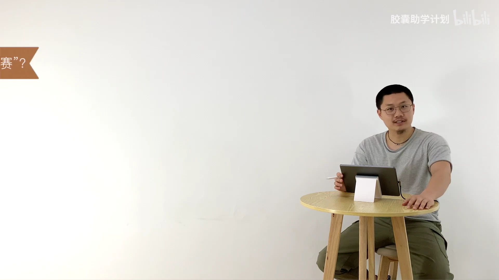

文字识别：胶囊助学计划 / 赛”？

### 画面 00:00:11

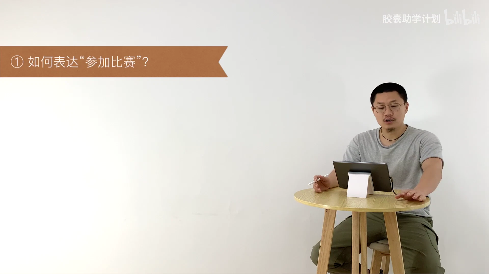

文字识别：胶囊助学计划 / ①如何表达“参加比赛”？

### 画面 00:00:13

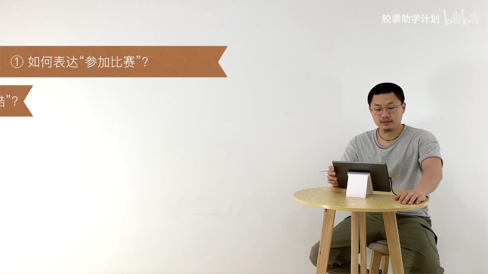

文字识别：胶囊助学计划 / ①如何表达“参加比赛”？

### 画面 00:00:15

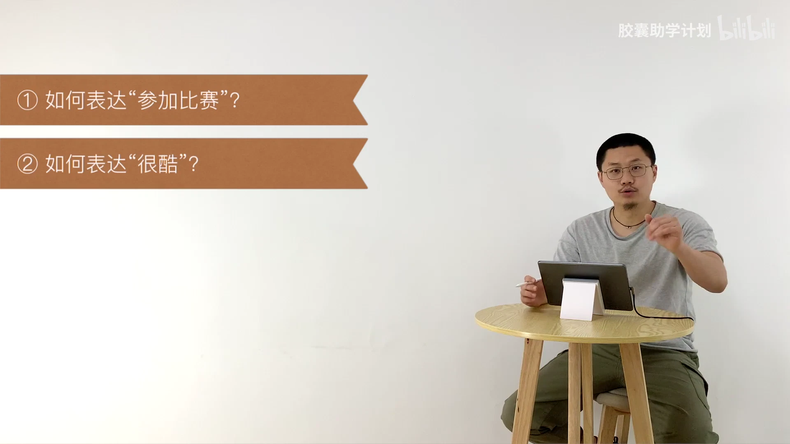

文字识别：胶囊助学计划 / ①如何表达“参加比赛”? / 如何表达“很酷”

### 画面 00:00:17

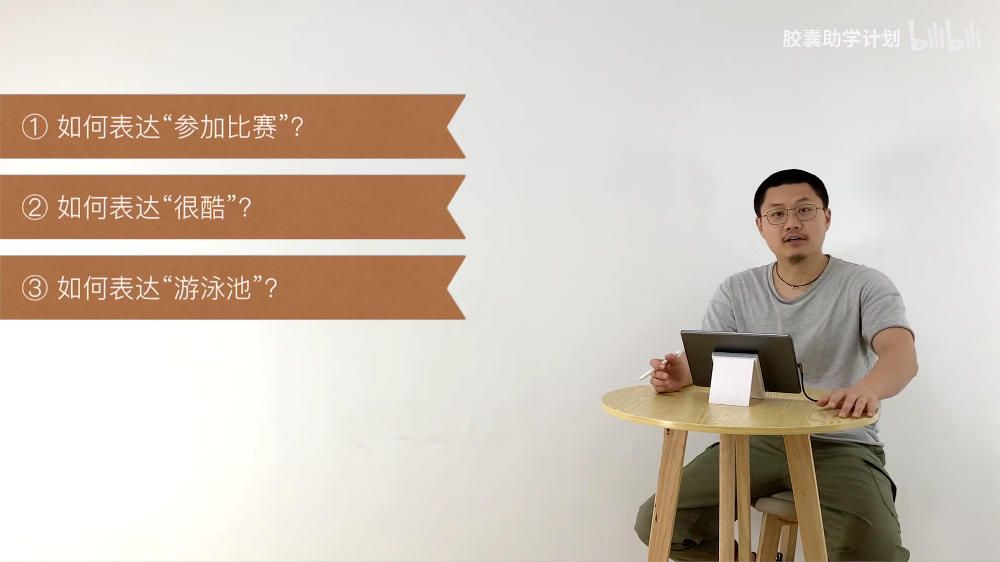

文字识别：胶囊助学计划 / ①如何表达“参加比赛”？ / 如何表达“很酷” / 如何表达“游泳池”?

### 画面 00:00:20

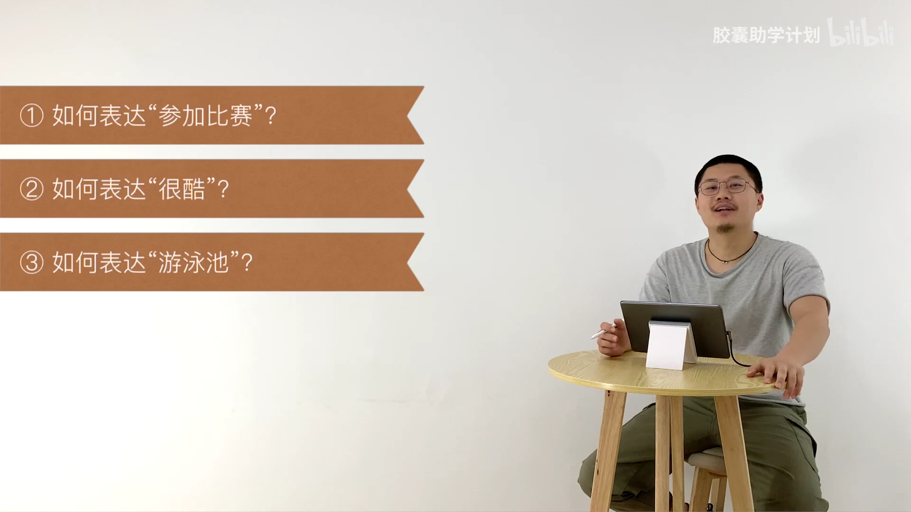

文字识别：胶囊助学计划 / ①如何表达“参加比赛”？ / 如何表达“很酷” / 如何表达“游泳池”?

### 画面 00:00:22

文字识别：胶囊助学计划 bilbl

### 画面 00:00:25

文字识别：胶囊助学计划

### 画面 00:00:27

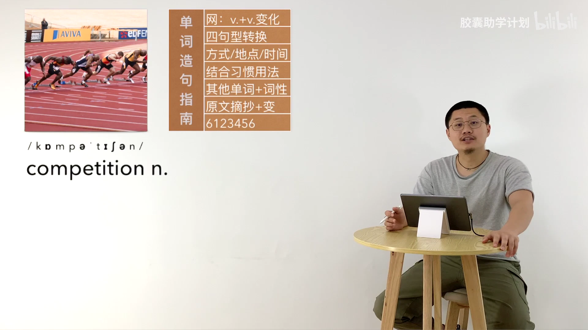

文字识别：单词造句指南 / 网：v.+v.变化 / 胶囊助学计划 / AVIVA / eDFEl / 四句型转换 / 方式/地点/时间 / 结合习惯用法 / 其他单词+词性 / 原文摘抄+变 / 6123456 / /kpmpa'ti∫an/ / competition n.

### 画面 00:00:29

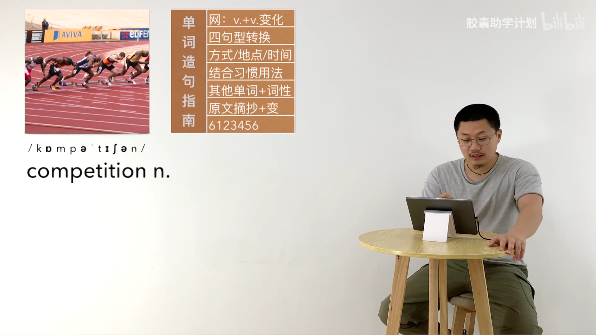

文字识别：单词造句指南 / 网：v.+v.变化 / 胶囊助学计划 / AVIVA / &eDFEl / 四句型转换 / 方式/地点/时间 / 结合习惯用法 / 其他单词+词性 / 原文摘抄+变 / 6123456 / /kpmpa'ti∫an/ / competition n.

## 00:00:30–00:01:00

节比较的多，看似也很长啊。我们先一起给它分一下音节，哎，我们一个音节一个音节带着大家读一下，来，competition，然后注意重音的位置，对吧？在第三个音节上，叫做competition，competition，competition。OK，Are you good？那你注意啊，它的名字叫比赛或竞赛，但是它是一个名词在英文当中，所以至少我们知道在造句的时候，

### 画面 00:00:31

文字识别：单词造句指南 / 网：v.+v.变化 / 胶囊助学计划 / AVIVA / xeDFEr / 四句型转换 / 方式/地点/时间 / 结合习惯用法 / 其他单词+词性 / 原文摘抄+变 / 6123456 / /kpmpa'ti ∫an/ / competition n.

### 画面 00:00:33

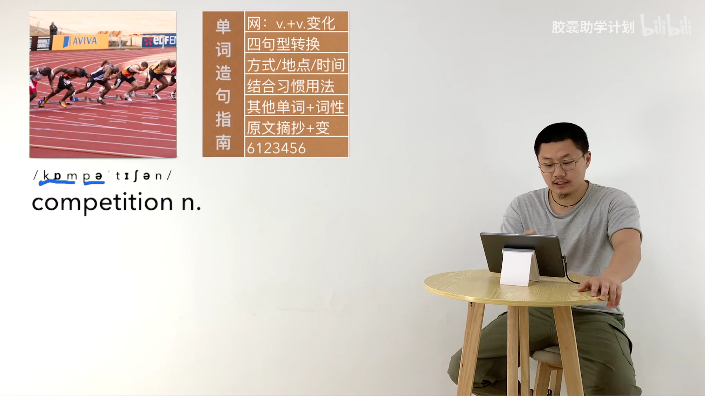

文字识别：单词造句指南 / 网：v.+v.变化 / 胶囊助学计划 / AVIVA / XeDFEl / 四句型转换 / 方式/地点/时间 / 结合习惯用法 / 其他单词+词性 / 原文摘抄+变 / 6123456 / /kpmpa'tifan/ / competition n.

### 画面 00:00:35

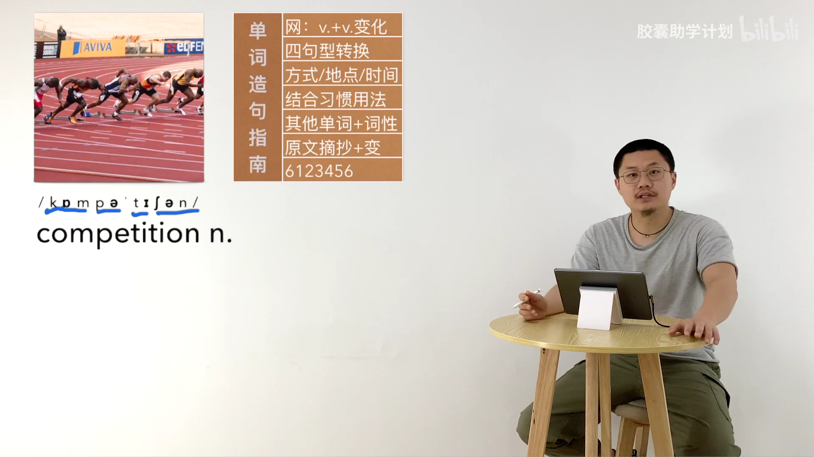

文字识别：单词造句指南 / 网：v.+v.变化 / 胶囊助学计划 / AVIVA / xeDFEl / 四句型转换 / 方式/地点/时间 / 结合习惯用法 / 其他单词+词性 / 原文摘抄+变 / 6123456 / /kpmpa'tifan/ / competition n.

### 画面 00:00:38

文字识别：单词造句指南 / 网：v.+v.变化 / 胶囊助学计划 / AVIVA / XeDFEl / 四句型转换 / 方式/地点/时间 / 结合习惯用法 / 其他单词+词性 / 原文摘抄+变 / 6123456 / /kpmpa'tifan/ / competition n.

### 画面 00:00:40

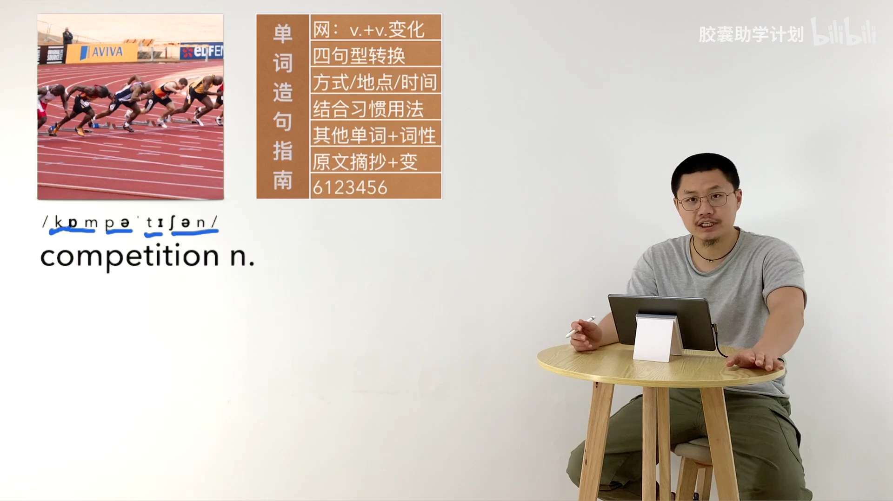

文字识别：单词造句指南 / 网：v.+v.变化 / 胶囊助学计划 / AVIVA / BerFEl / 四句型转换 / 方式/地点/时间 / 结合习惯用法 / 其他单词+词性 / 原文摘抄+变 / 6123456 / /kpmpa'tifan/ / competition n.

### 画面 00:00:42

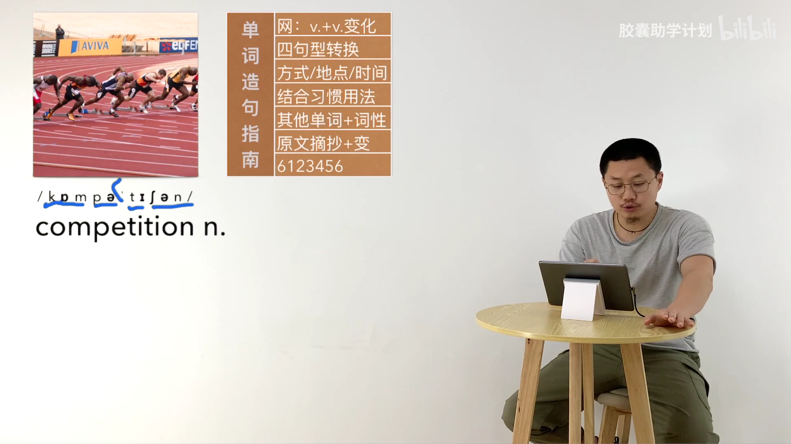

文字识别：单词造句指南 / 网：v.+v.变化 / 胶囊助学计划 / AVIVA / BerFEl / 四句型转换 / 方式/地点/时间 / 结合习惯用法 / 其他单词+词性 / 原文摘抄+变 / 6123456 / /kpm / pa / tifan/ / competition n.

### 画面 00:00:44

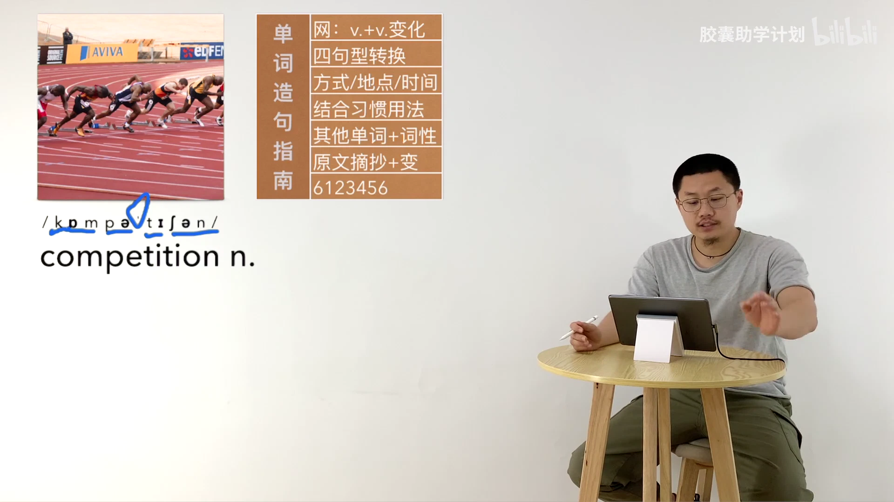

文字识别：单词造句指南 / 网：v.+v.变化 / 胶囊助学计划 / AVIVA / KepFEl / 四句型转换 / 方式/地点/时间 / 结合习惯用法 / 其他单词+词性 / 原文摘抄+变 / 6123456 / /kpm / pavtifan/ / competition n.

### 画面 00:00:46

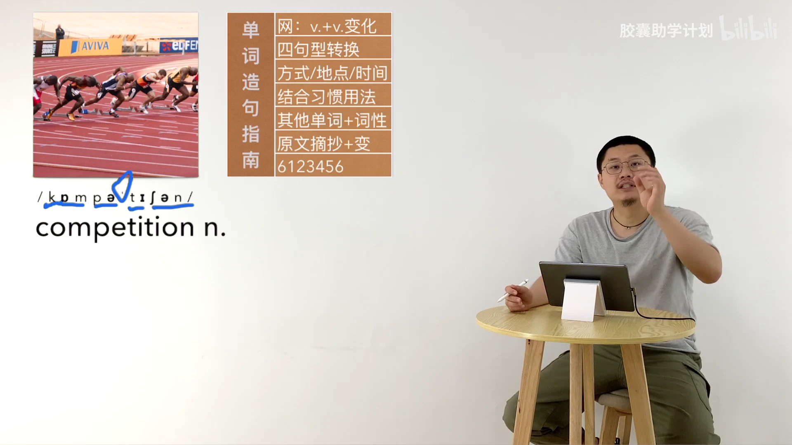

文字识别：单词造句指南 / 网：v.+v.变化 / 胶囊助学计划 / AVIVA / RerFEl / 四句型转换 / 方式/地点/时间 / 结合习惯用法 / 其他单词+词性 / 原文摘抄+变 / 6123456 / pavti fan/ / /kpm / competition n.

### 画面 00:00:49

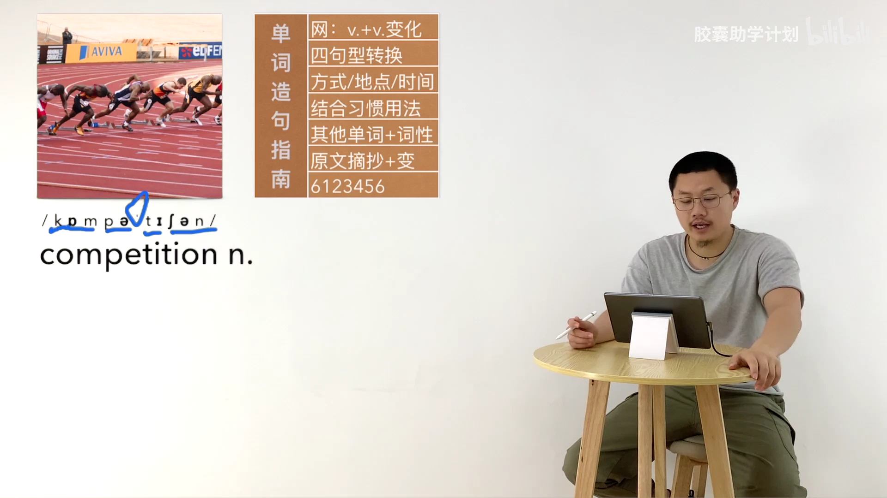

文字识别：单词造句指南 / 网：v.+v.变化 / 胶囊助学计划 / AVIVA / BerFEl / 四句型转换 / 方式/地点/时间 / 结合习惯用法 / 其他单词+词性 / 原文摘抄+变 / 6123456 / pavti fan/ / /kpm / competition n.

### 画面 00:00:51

文字识别：单词造句指南 / 网：v.+v.变化 / 胶囊助学计划 / AVIVA / &erFEl / 四句型转换 / 方式/地点/时间 / 结合习惯用法 / 其他单词+词性 / 原文摘抄+变 / 6123456 / paVtifan/ / /kpm / competition n.

### 画面 00:00:54

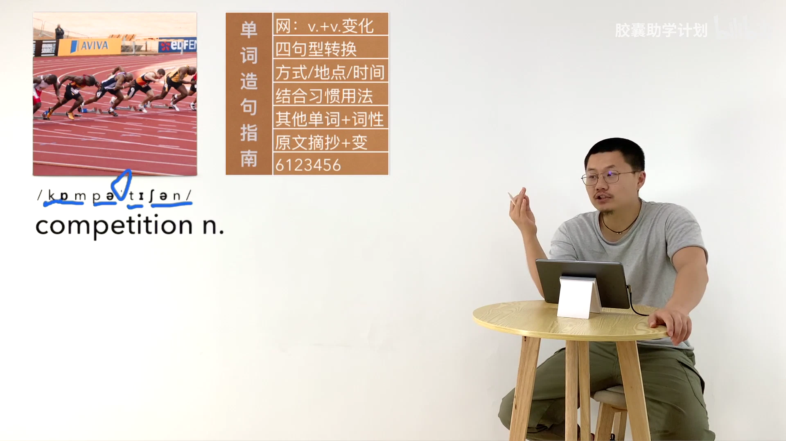

文字识别：单词造句指南 / 网：v.+v.变化 / 胶囊助学计划 / AVIVA / BerFEl / 四句型转换 / 方式/地点/时间 / 结合习惯用法 / 其他单词+词性 / 原文摘抄+变 / 6123456 / paVtifan/ / /kpm / competition n.

### 画面 00:00:56

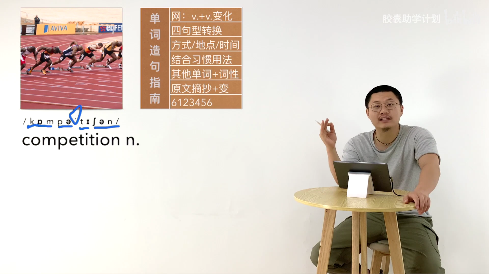

文字识别：单词造句指南 / 网：v.+v.变化 / 胶囊助学计划 / AVIVA / 8epFEl / 四句型转换 / 方式/地点/时间 / 结合习惯用法 / 其他单词+词性 / 原文摘抄+变 / 6123456 / /kpm / pavtifan/ / competition n.

### 画面 00:00:59

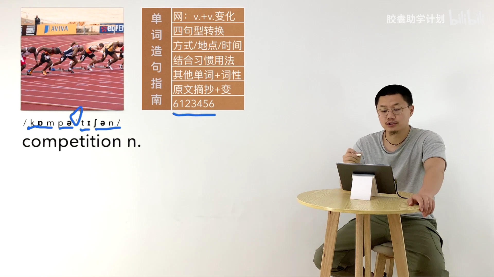

文字识别：单词造句指南 / 网：v.+v.变化 / 胶囊助学计划 / AVIVA / aerFEl / 四句型转换 / 方式/地点/时间 / 结合习惯用法 / 其他单词+词性 / 原文摘抄+变 / 6123456 / paVtifan/ / /kpm / competition n.

## 00:01:00–00:01:30

六一二三四五六当中，它没办法做二，对吧？谓语，也就是说动词加动词的变化，也就意味着我们还要再找一些动词，对不对？哎，这个是大家一定要注意的一个点啊。OK，那比如说，我接下来结合了一个第六第四课我们学过的习习惯用法，叫 find something 再加一个形容词，对吧？觉得某物怎么怎么样？比如说，I find that competition very interesting, but I don't now。说我

### 画面 00:01:01

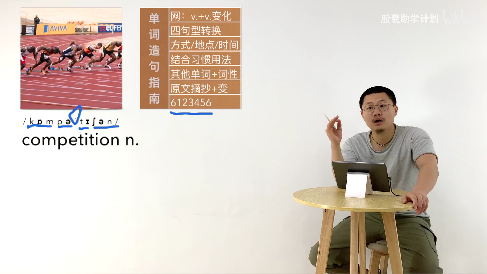

文字识别：单词造句指南 / 网：v.+v.变化 / 胶囊助学计划 / AVIVA / SeoFEl / 四句型转换 / 方式/地点/时间 / 结合习惯用法 / 其他单词+词性 / 原文摘抄+变 / 6123456 / paVtifan/ / /kpm / competition n.

### 画面 00:01:05

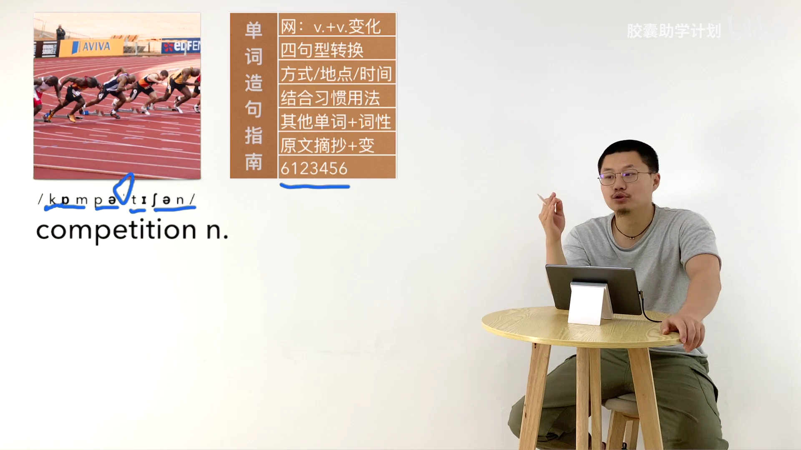

文字识别：单词造句指南 / 网：v.+v.变化 / 胶囊助学计划 / AVIVA / xeDFEl / 四句型转换 / 方式/地点/时间 / 结合习惯用法 / 其他单词+词性 / 原文摘抄+变 / 6123456 / pavti fan/ / /kpm / competition n.

### 画面 00:01:09

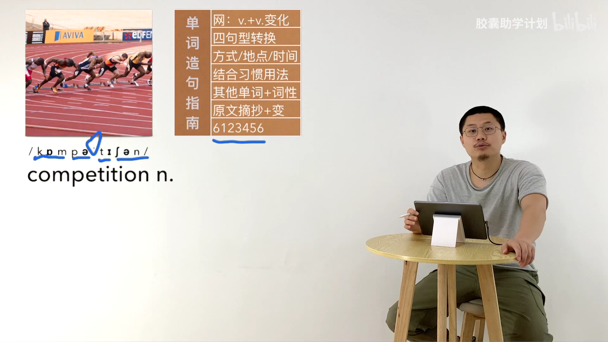

文字识别：单词造句指南 / 网：v.+v.变化 / 胶囊助学计划 / AVIVA / erFEl / 四句型转换 / 方式/地点/时间 / 结合习惯用法 / 其他单词+词性 / 原文摘抄+变 / 6123456 / pavti fan/ / /kpm / competition n.

### 画面 00:01:11

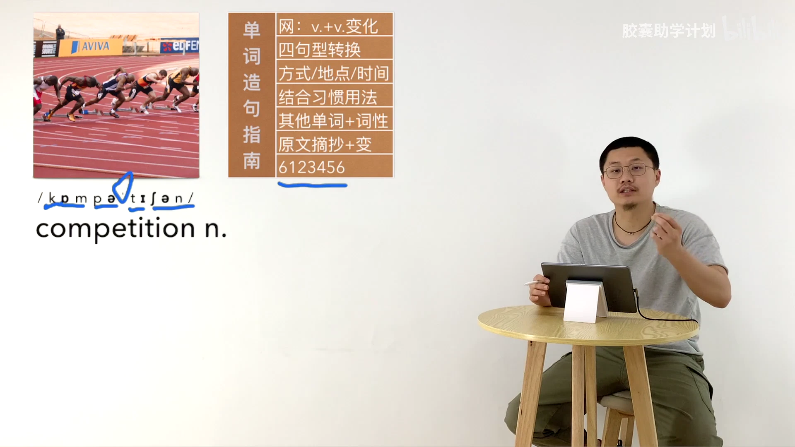

文字识别：单词造句指南 / 网：v.+v.变化 / 胶囊助学计划 / AVIVA / SeDFE / 四句型转换 / 方式/地点/时间 / 结合习惯用法 / 其他单词+词性 / 原文摘抄+变 / 6123456 / /kpm / pavtifan/ / competition n.

### 画面 00:01:13

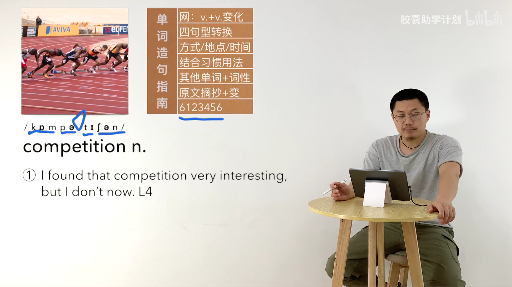

文字识别：单词造句指南 / 网：v.+v.变化 / 胶囊助学计划 / AVIVA / 8eDFEl / 四句型转换 / 方式/地点/时间 / 结合习惯用法 / 其他单词+词性 / 原文摘抄+变 / 6123456 / paVti fan/ / /kpm / competition n. / ① I found that competition very interesting, / butI don't now.L4

### 画面 00:01:15

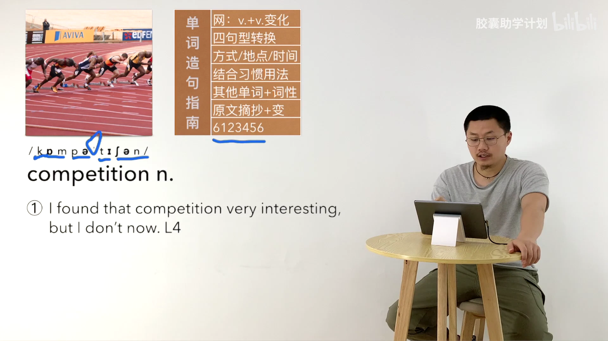

文字识别：单词造句指南 / 网：v.+v.变化 / 胶囊助学计划 / AVIVA / KepFEl / 四句型转换 / 方式/地点/时间 / 结合习惯用法 / 其他单词+词性 / 原文摘抄+变 / 6123456 / paVt fan/ / /kpm / competition n. / ① I found that competition very interesting, / butI don't now.L4

### 画面 00:01:17

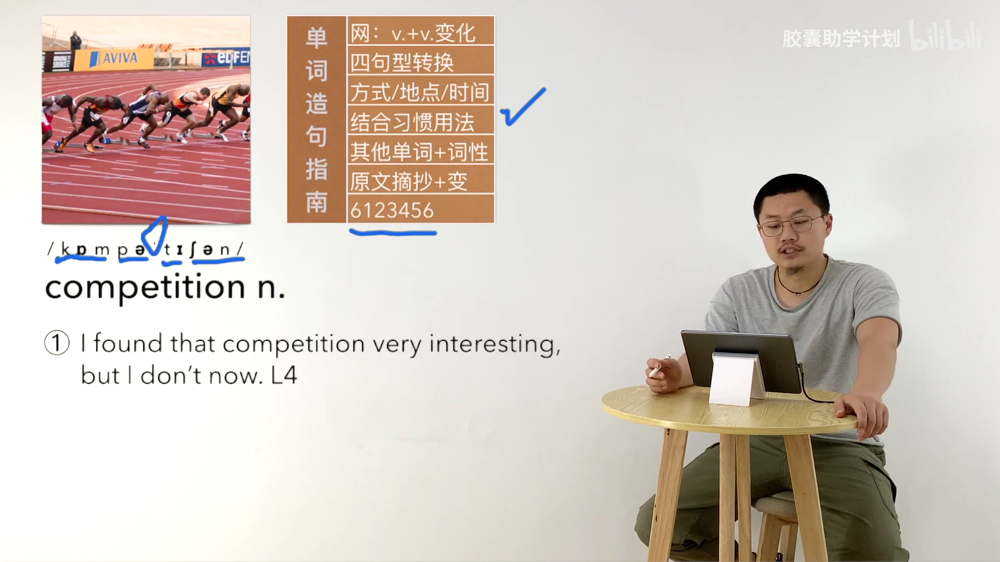

文字识别：单词造句指南 / 网：v.+v.变化 / 胶囊助学计划 / AVIVA / KeDFEl / 四句型转换 / 方式/地点/时间 / 结合习惯用法 / 其他单词+词性 / 原文摘抄+变 / 6123456 / paVti fan/ / /kpm / competition n. / ① I found that competition very interesting, / butI don't now.L4

### 画面 00:01:20

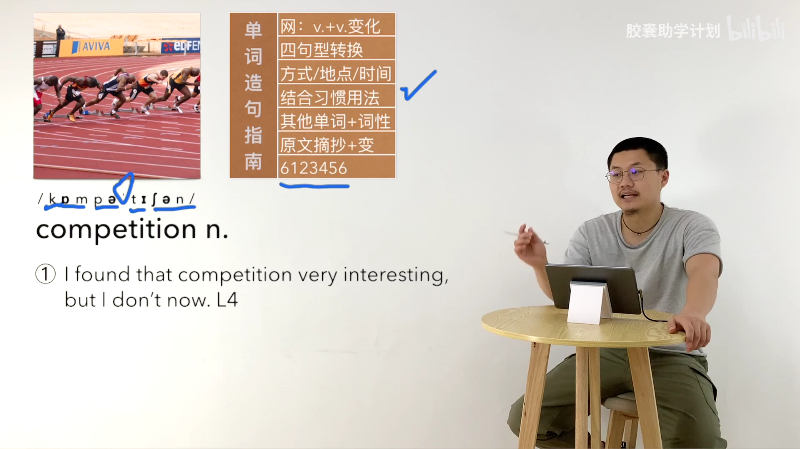

文字识别：单词造句指南 / 网：v.+v.变化 / 胶囊助学计划 / AVIVA / KeDFEl / 四句型转换 / 方式/地点/时间 / 结合习惯用法 / 其他单词+词性 / 原文摘抄+变 / 6123456 / /kpm / pavti fan/ / competition n. / ① I found that competition very interesting, / butI don't now.L4

### 画面 00:01:25

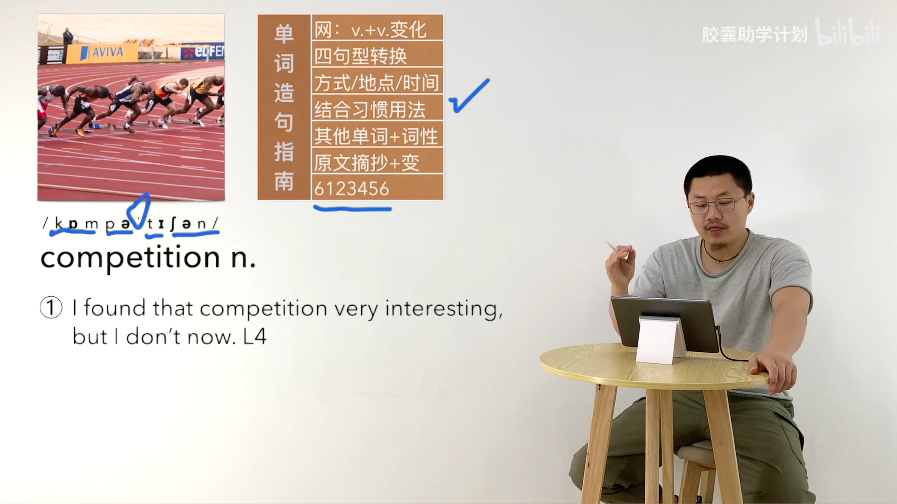

文字识别：单词造句指南 / 网：v.+v.变化 / 胶囊助学计划 / AVIVA / 8eDFEl / 四句型转换 / 方式/地点/时间 / 结合习惯用法 / 其他单词+词性 / 原文摘抄+变 / 6123456 / paVtifan/ / /kpm / competition n. / ① I found that competition very interesting, / butI don't now.L4

## 00:01:30–00:02:00

曾经啊，为什么翻译成曾经呢？因为是found，对吧？一般过去时这个时态。说我曾经啊，觉得这个比赛特别的有意思，但我现在不这样认为了。也就是说，我们实际上是结合了之前学过的习惯用法。那其实也是词性嘛，因为found就本身就是个动词，对吧？好，接着往下走。那enter the competition，给大家补充一个叫做参加比赛，叫做enter，进入的意思啊。好，

### 画面 00:01:31

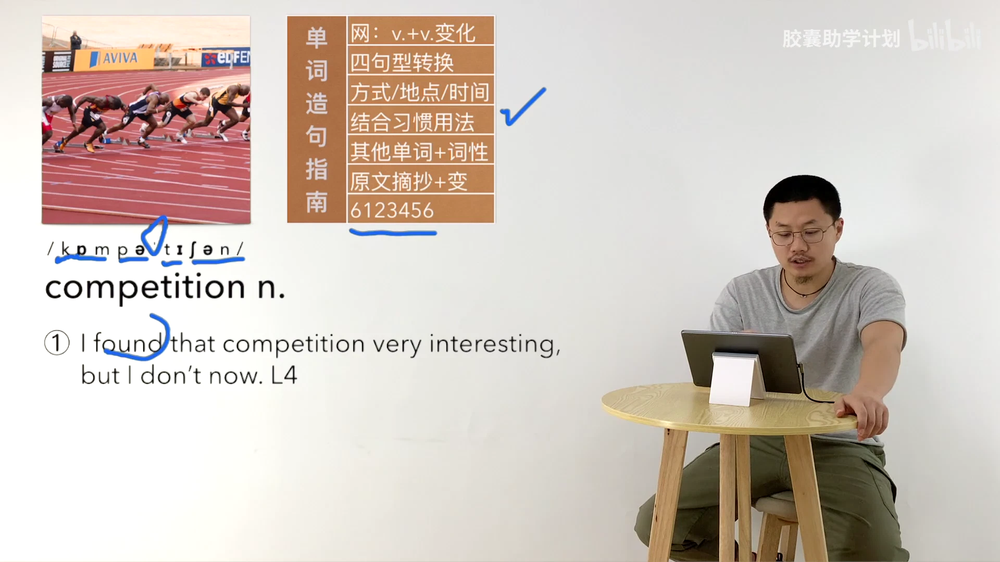

文字识别：单词造句指南 / 网：v.+v.变化 / 胶囊助学计划 / AVIVA / KeDFEl / 四句型转换 / 方式/地点/时间 / 结合习惯用法 / 其他单词+词性 / 原文摘抄+变 / 6123456 / paVti fan/ / /kpm / competition n. / ① I foundthat competition very interesting, / butI don't now.L4

### 画面 00:01:33

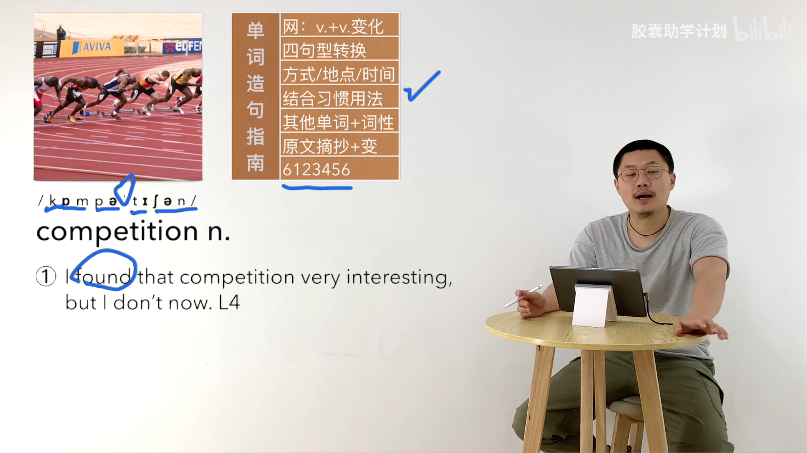

文字识别：单词造句指南 / 网：v.+v.变化 / 胶囊助学计划 / AVIVA / XeDFEl / 四句型转换 / 方式/地点/时间 / 结合习惯用法 / 其他单词+词性 / 原文摘抄+变 / 6123456 / paVti san/ / /kpm / competition n. / Ifoundthat competition very interesting, / butI don't now.L4

### 画面 00:01:35

文字识别：单词造句指南 / 网：v.+v.变化 / 胶囊助学计划 / AVIVA / XeDFEI / 四句型转换 / 方式/地点/时间 / 结合习惯用法 / 其他单词+词性 / 原文摘抄+变 / 6123456 / /kpm / paVtifan/ / competition n. / |found that competition very interesting, / butI don't now.L4

### 画面 00:01:40

文字识别：单词造句指南 / 网：v.+v.变化 / 胶囊助学计划 / AVIVA / XeDFEl / 四句型转换 / 方式/地点/时间 / 结合习惯用法 / 其他单词+词性 / 原文摘抄+变 / 6123456 / paVti fan/ / /kpm / competition n. / Ifoundthat competition very interesting, / but I don't now.L4

### 画面 00:01:44

文字识别：单词造句指南 / 网：v.+v.变化 / 胶囊助学计划 / AVIVA / 8eDFEl / 四句型转换 / 方式/地点/时间 / 结合习惯用法 / 其他单词+词性 / 原文摘抄+变 / 6123456 / paVtifan/ / /kpm / competition n. / Ifoundthat competition very interesting, / but I don't now.L4

### 画面 00:01:46

文字识别：单词造句指南 / 网：v.+v.变化 / 胶囊助学计划 / AVIVA / xeDFE / 四句型转换 / 方式/地点/时间 / 结合习惯用法 / 其他单词+词性 / 原文摘抄+变 / 6123456 / pavtifan/ / /kpm / competition n. / Ifoundthat competition very interesting, / but I don't now.L4

### 画面 00:01:49

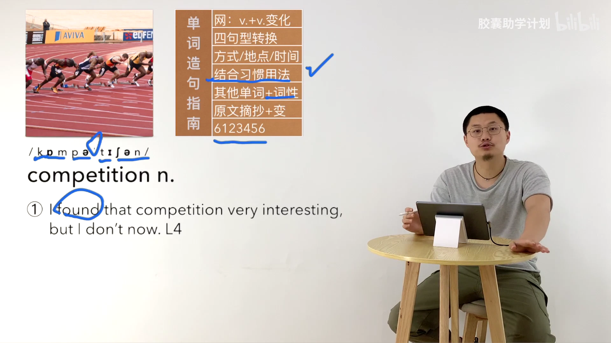

文字识别：单词造句指南 / 网：v.+v.变化 / 胶囊助学计划 / AVIVA / KeDFEI / 四句型转换 / 方式/地点/时间 / 结合习惯用法 / 其他单词+词性 / 原文摘抄+变 / 6123456 / paVtifan/ / /kpm / competition n. / |foundthat competition very interesting, / butI don't now.L4

### 画面 00:01:51

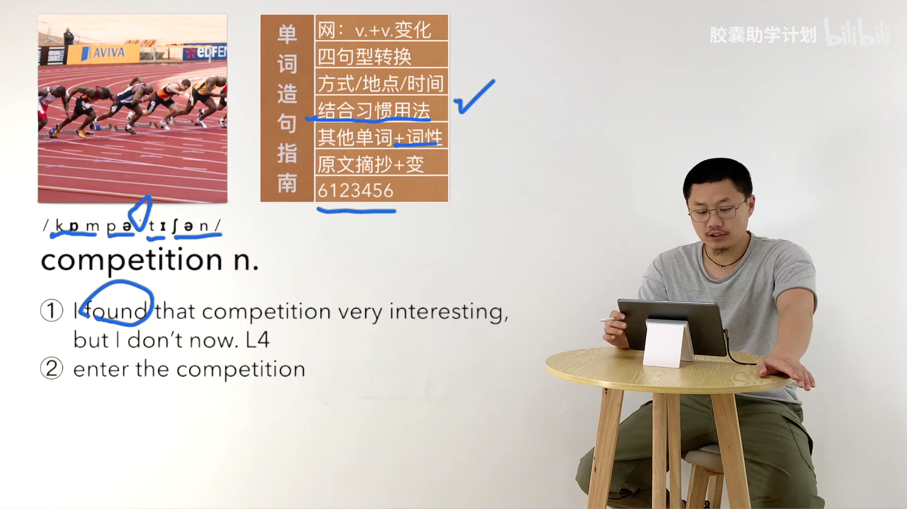

文字识别：单词造句指南 / 网：v.+v.变化 / 胶囊助学计划 / AVIVA / 8eDFEl / 四句型转换 / 方式/地点/时间 / 结合习惯用法 / 其他单词+词性 / 原文摘抄+变 / 6123456 / paVtifan/ / /kpm / competition n. / Ifoundthat competition very interesting, / but I don't now.L4 / enter the competition

### 画面 00:01:54

文字识别：单词造句指南 / 网：v.+v.变化 / 胶囊助学计划 / AVIVA / 8eDFEl / 四句型转换 / 方式/地点/时间 / 结合习惯用法 / 其他单词+词性 / 原文摘抄+变 / 6123456 / paVtifan/ / /kpm / competition n. / Ifoundthat competition very interesting, / butI don't now.L4 / enter the competition

### 画面 00:01:56

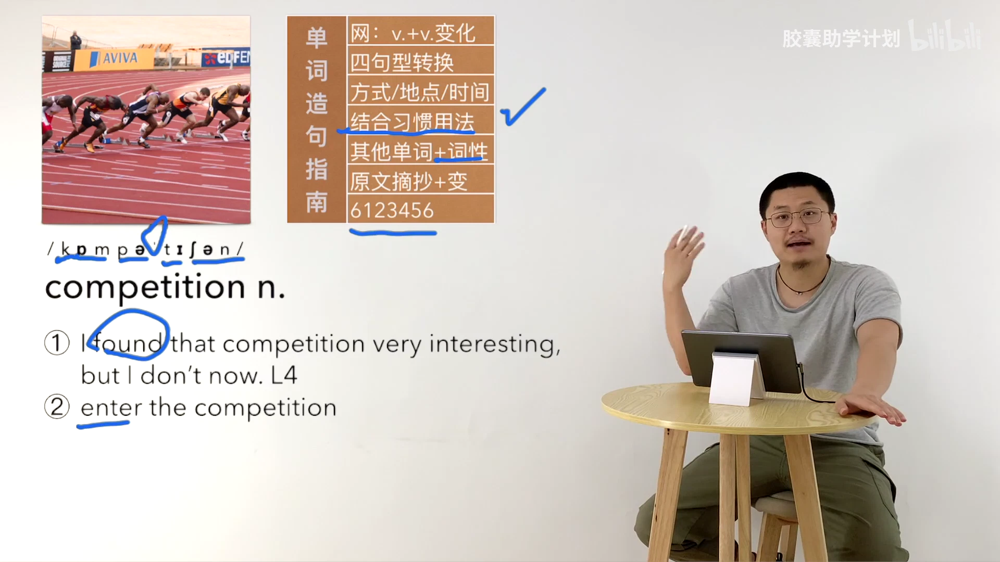

文字识别：单词造句指南 / 网：v.+v.变化 / 胶囊助学计划 / AVIVA / XeDFEl / 四句型转换 / 方式/地点/时间 / 结合习惯用法 / 其他单词+词性 / 原文摘抄+变 / 6123456 / pavti fan/ / /kpm / competition n. / |4oundthat competition very interesting, / butI don't now.L4 / enter the competition

## 00:02:00–00:02:30

好，比如说我们造一个很简单的句子叫做 I entered the competition。注意是一般过去时，我参加了这个比赛。然后肯定句有了。接下来我们刚才其实做的是网上的横向变化，对吧？我们选择了一个时态造了一个肯定句啊，没有说我我准备去，比如 I'm going to enter the competition，对吧？我们选择的是一般过去时。横向选择完了之后，纵向继续改变，叫做 Did you enter the competition？你当时参加这个比赛了吗？以

### 画面 00:02:00

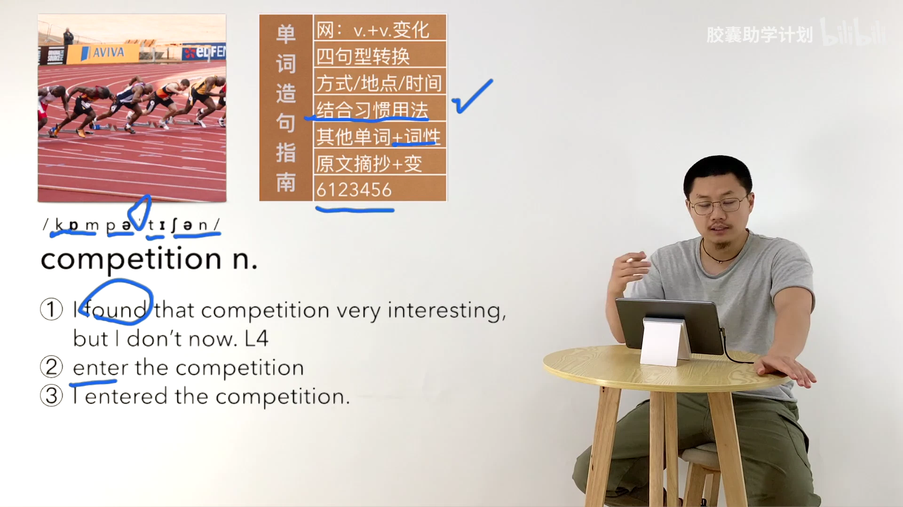

文字识别：单词造句指南 / 网：v.+v.变化 / 胶囊助学计划 / AVIVA / XeoFEl / 四句型转换 / 方式/地点/时间 / 结合习惯用法 / 其他单词+词性 / 原文摘抄+变 / 6123456 / pavtifan/ / /kpm / competition n. / |4oundthat competition very interesting, / butI don't now.L4 / enter the competition / Tentered the competition.

### 画面 00:02:03

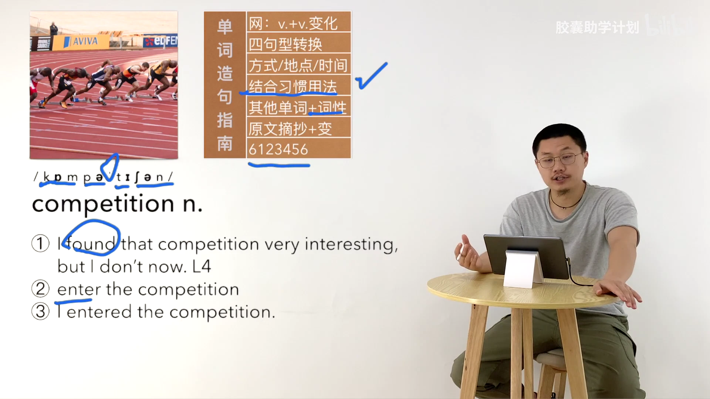

文字识别：单词造句指南 / 网：v.+v.变化 / 胶囊助学计划 / AVIVA / XeoFEl / 四句型转换 / 方式/地点/时间 / 结合习惯用法 / 其他单词+词性 / 原文摘抄+变 / 6123456 / pavtifan/ / /kpm / competition n. / Ifoundthat competition very interesting, / but I don't now.L4 / enter the competition / Tentered the competition.

### 画面 00:02:05

文字识别：单词造句指南 / 网：v.+v.变化 / 胶囊助学计划 / AVIVA / XepFEl / 四句型转换 / 方式/地点/时间 / 结合习惯用法 / 其他单词+词性 / 原文摘抄+变 / 6123456 / pavtifan/ / /kpm / competition n. / |foundthat competition very interesting, / but I don't now.L4 / enter the competition / Tentered the competition.

### 画面 00:02:08

文字识别：单词造句指南 / 网：v.+v.变化 / 胶囊助学计划 / AVIVA / XeDFEl / 四句型转换 / 方式/地点/时间 / 结合习惯用法 / 其他单词+词性 / 原文摘抄+变 / 6123456 / pavti fan/ / /kpm / competition n. / Ifoundthat competition very interesting, / but I don't now.L4 / enter the competition / Tentered the competition.

### 画面 00:02:10

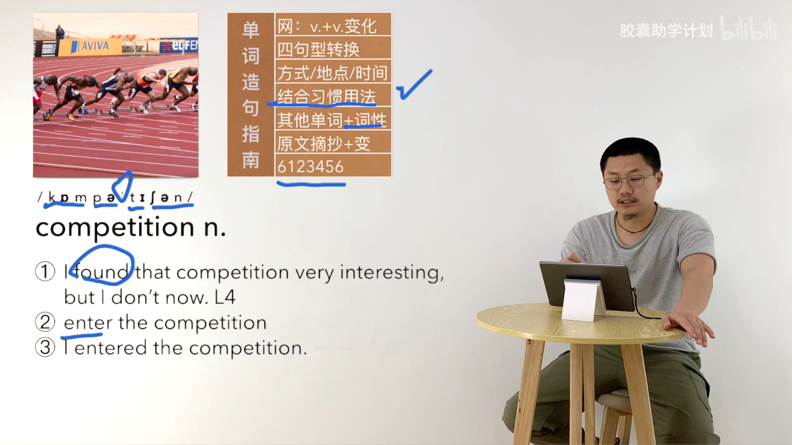

文字识别：单词造句指南 / 网：v.+v.变化 / 胶囊助学计划 / AVIVA / XeqFEl / 四句型转换 / 方式/地点/时间 / 结合习惯用法 / 其他单词+词性 / 原文摘抄+变 / 6123456 / /kpm / pavtifan/ / competition n. / I4ound that competition very interesting, / but I don't now.L4 / enter the competition / Tentered the competition.

### 画面 00:02:15

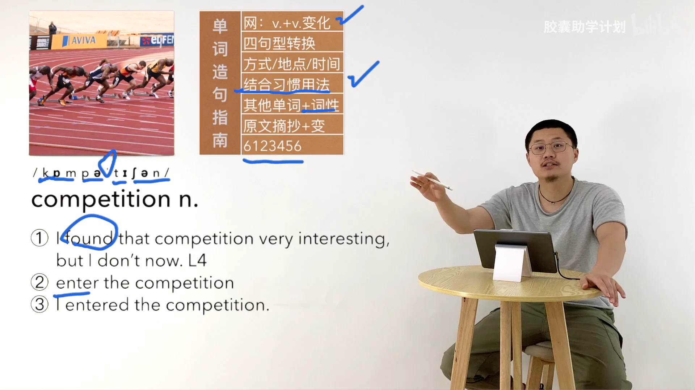

文字识别：单词造句指南 / 网：v.+v.变化 / 胶囊助学计划 / AVIVA / 8eqFEl / 四句型转换 / 方式/地点/时间 / 结合习惯用法 / 其他单词+词性 / 原文摘抄+变 / 6123456 / pavtifan/ / /kpm / competition n. / |found that competition very interesting, / but I don't now.L4 / enter the competition / Tentered the competition.

### 画面 00:02:20

文字识别：单词造句指南 / 网：v.+v.变化 / 胶囊助学计划 / AVIVA / 8eDFEl / 四句型转换 / 方式/地点/时间 / 结合习惯用法 / 其他单词+词性 / 原文摘抄+变 / 6123456 / paVti fan/ / /kpm / competition n. / |foundthat competition very interesting, / but I don't now.L4 / enter the competition / Tentered the competition.

### 画面 00:02:25

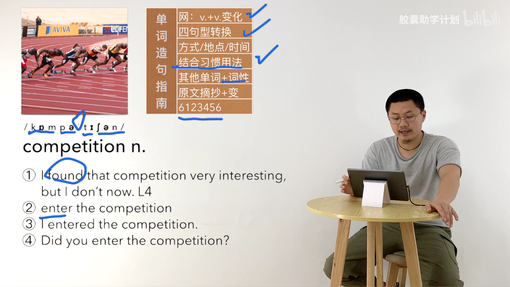

文字识别：单词造句指南 / 网：v.+v.变化 / 胶囊助学计划 / AVIVA / SepFEl / 四句型转换 / 方式/地点/时间 / 结合习惯用法 / 其他单词+词性 / 原文摘抄+变 / 6123456 / pavtifan/ / /kpm / competition n. / |found that competition very interesting, / but I don't now.L4 / enter the competition / Tentered the competition. / Did you enter the competition?

### 画面 00:02:27

文字识别：单词造句指南 / 网：v.+v.变化 / 胶囊助学计划 / AVIVA / SepFEl / 四句型转换 / 方式/地点/时间 / 结合习惯用法 / 其他单词+词性 / 原文摘抄+变 / 6123456 / /kpm / paVtifan/ / competition n. / |found that competition very interesting, / but I don't now.L4 / enter the competition / Tentered the competition. / Did you enter the competition?

## 00:02:30–00:03:00

及 How did you enter the competition? 哎，你是怎么参加这个比赛的？我怎么没去成？ OK，好，那其实还有一个挺常用的动词叫做 like，比如说 I like that competition，我喜欢那个比赛。 I don't like that competition。 Do you like that competition? Why do you like that competition? 或者是 Why don't you like that competition? 它的思路都是非常简单的肯定句，然后以及四句型的转换，对吧？好， continue，下一个单词跟我读

### 画面 00:02:30

文字识别：单词造句指南 / 网：v.+v.变化 / 胶囊助学计划 / AVIVA / xeDFEl / 四句型转换 / 方式/地点/时间 / 结合习惯用法 / 其他单词+词性 / 原文摘抄+变 / 6123456 / /kpm / paVti fan/ / competition n. / |found that competition very interesting, / butI don't now.L4 / enter the competition / Tentered the competition. / Did you enter the competition? / How did you enter the competition?

### 画面 00:02:33

文字识别：单词造句指南 / 网：v.+v.变化 / 胶囊助学计划 / AVIVA / xeDFEl / 四句型转换 / 方式/地点/时间 / 结合习惯用法 / 其他单词+词性 / 原文摘抄+变 / 6123456 / / kompaVtifan/ / competition n. / |found that competition very interesting, / butI don't now. L4 / enter the competition / Tentered the competition. / Did you enter the competition? / How did you enter the competition? / 5

### 画面 00:02:35

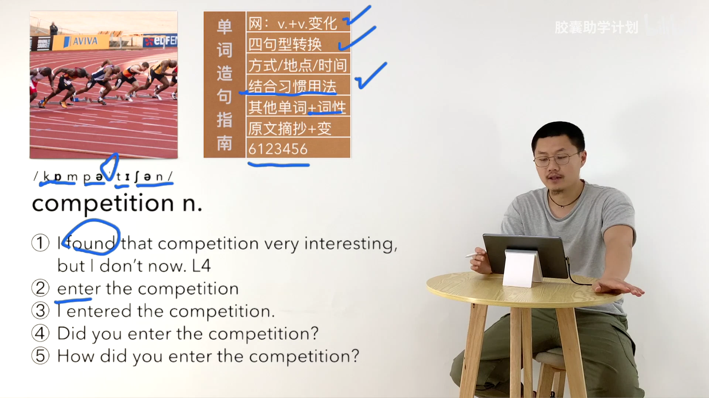

文字识别：单词造句指南 / 网：v.+v.变化 / 胶囊助学计划 / AVIVA / xegFE / 四句型转换 / 方式/地点/时间 / 结合习惯用法 / 其他单词+词性 / 原文摘抄+变 / 6123456 / pavtifan/ / /kpm / competition n. / |4oundthat competition very interesting, / butI don't now. L4 / enter the competition / Tentered the competition. / Did you enter the competition? / How did you enter the competition?

### 画面 00:02:37

文字识别：单词造句指南 / 网：v.+v.变化 / 胶囊助学计划 / AVIVA / xepFEl / 四句型转换 / 方式/地点/时间 / 结合习惯用法 / 其他单词+词性 / 原文摘抄+变 / 6123456 / paVtifan/ / /kpm / competition n. / |found that competition very interesting, / butI don't now.L4 / enter the competition / Tentered the competition. / Did you enter the competition? / How did you enter the competition? / like+competition

### 画面 00:02:39

文字识别：单词造句指南 / 网：v.+v.变化 / 胶囊助学计划 / AVIVA / xeDFEl / 四句型转换 / 方式/地点/时间 / 结合习惯用法 / 其他单词+词性 / 原文摘抄+变 / 6123456 / /kpm / pavtifan/ / competition n. / |found that competition very interesting, / butI don't now.L4 / enter the competition / Tentered the competition. / Did you enter the competition? / How did you enter the competition? / like+competition

### 画面 00:02:41

文字识别：单词造句指南 / 网：v.+v.变化 / 胶囊助学计划 / AVIVA / xeDFEl / 四句型转换 / 方式/地点/时间 / 结合习惯用法 / 其他单词+词性 / 原文摘抄+变 / 6123456 / pavtifan/ / /kpm / competition n. / |found that competition very interesting, / but I don't now.L4 / enter the competition / Tentered the competition. / Did you enter the competition? / How did you enter the competition? / like+competition

### 画面 00:02:45

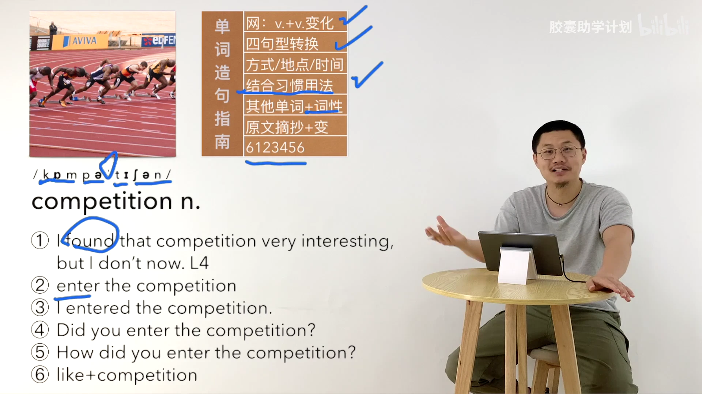

文字识别：单词造句指南 / 网：v.+v.变化 / 胶囊助学计划 / AVIVA / &eDFEl / 四句型转换 / 方式/地点/时间 / 结合习惯用法 / 其他单词+词性 / 原文摘抄+变 / 6123456 / /kpm / patifan/ / competition n. / |found that competition very interesting, / butI don't now.L4 / enter the competition / Tentered the competition. / Did you enter the competition? / How did you enter the competition? / like+competition

### 画面 00:02:50

文字识别：单词造句指南 / 网：v.+v.变化 / 胶囊助学计划 / AVIVA / aseDFEl / 四句型转换 / 方式/地点/时间 / 结合习惯用法 / 其他单词+词性 / 原文摘抄+变 / 6123456 / /kpm / paVtifan/ / competition n. / |found that competition very interesting, / but I don't now.L4 / enter the competition / Tentered the competition. / Did you enter the competition? / How did you enter the competition? / like+competition

### 画面 00:02:53

文字识别：单词造句指南 / 网：v.+v.变化 / 胶囊助学计划 / AVIVA / &eDFEl / 四句型转换 / 方式/地点/时间 / 结合习惯用法 / 其他单词+词性 / 原文摘抄+变 / 6123456 / pavtifan/ / /kpm / competition n. / |foundthat competition very interesting, / but I don't now. L4 / enter the competition / Tentered the competition. / Did you enter the competition? / How did you enter the competition? / like+competition

### 画面 00:02:55

文字识别：单词造句指南 / 网：v.+v.变化 / 胶囊助学计划 / AVIVA / xegFEl / 四句型转换 / 方式/地点/时间 / 结合习惯用法 / 其他单词+词性 / 原文摘抄+变 / 6123456 / paVtifan/ / /kpm / competition n. / |found that competition very interesting, / but I don't now.L4 / enter the competition / Tentered the competition. / Did you enter the competition? / How did you enter the competition? / like+competition

### 画面 00:02:57

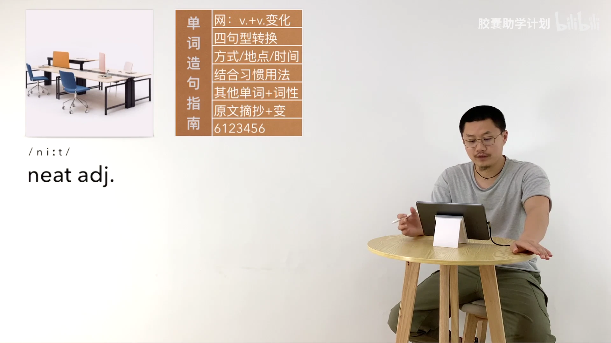

文字识别：单词造句指南 / 网：v.+v.变化 / 胶囊助学计划 / 四句型转换 / 方式/地点/时间 / 结合习惯用法 / 其他单词+词性 / 原文摘抄+变 / 6123456 / /ni:t/ / neat adj.

### 画面 00:02:59

文字识别：单词造句指南 / 网：v.+v.变化 / 胶囊助学计划 / 四句型转换 / 方式/地点/时间 / 结合习惯用法 / 其他单词+词性 / 原文摘抄+变 / 6123456 / /ni:t/ / neat adj.

## 00:03:00–00:03:30

need，need哦，它指的是整齐的、整洁的啊，有点类似 clean，我们新一就学过，但不完全一样，对吧？clean 更多指的是干净，而 neat 更多的偏向的点指的是就像这个图中一样，对吧？这个办公桌非常的整齐整洁，OK，那整洁其实也有干净的意思在里面了，OK，那它是一个形容词，我们要单词造句的话要找词性，要找名词，对吧？好，

### 画面 00:03:01

文字识别：单词造句指南 / 网：v.+v.变化 / 胶囊助学计划 / 四句型转换 / 方式/地点/时间 / 结合习惯用法 / 其他单词+词性 / 原文摘抄+变 / 6123456 / /ni:t/ / neat adj.

### 画面 00:03:05

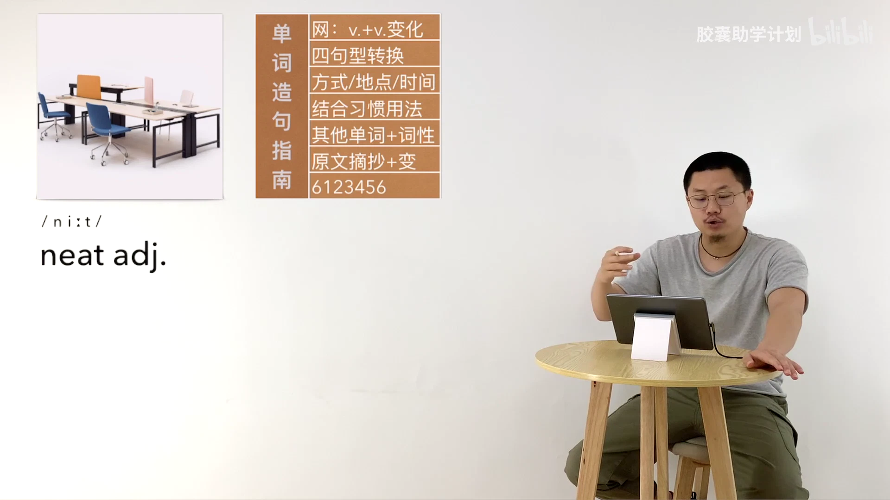

文字识别：单词造句指南 / 网：v.+v.变化 / 胶囊助学计划 / 四句型转换 / 方式/地点/时间 / 结合习惯用法 / 其他单词+词性 / 原文摘抄+变 / 6123456 / /ni:t/ / neat adj.

### 画面 00:03:08

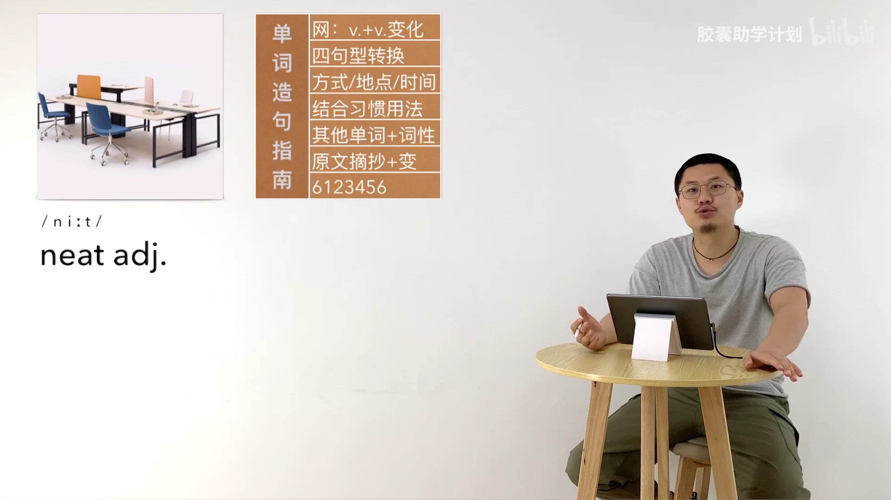

文字识别：单词造句指南 / 网：v.+v.变化 / 胶囊助学计划 / 四句型转换 / 方式/地点/时间 / 结合习惯用法 / 其他单词+词性 / 原文摘抄+变 / 6123456 / /ni:t/ / neat adj.

### 画面 00:03:10

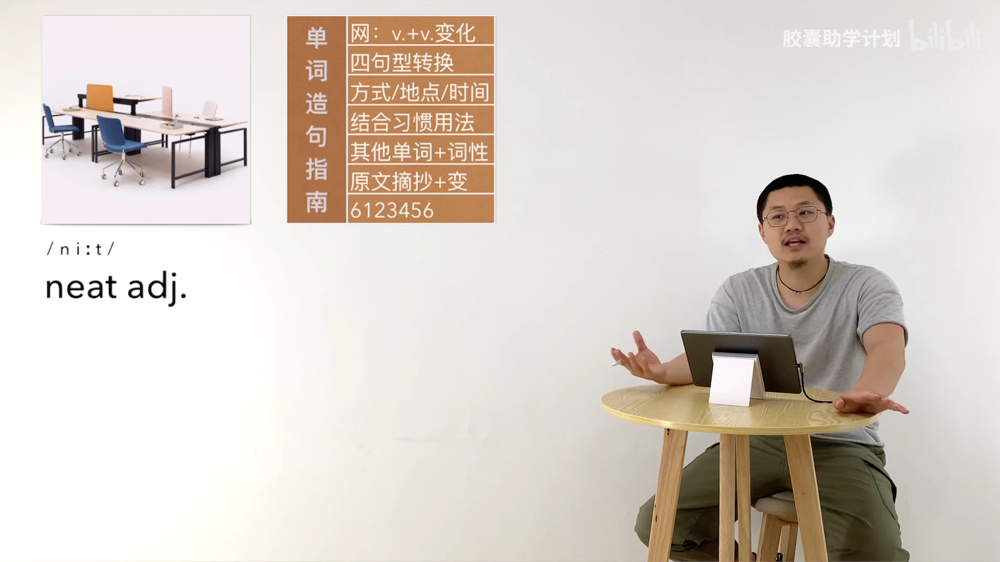

文字识别：单词造句指南 / 网：v.+v.变化 / 胶囊助学计划 / 四句型转换 / 方式/地点/时间 / 结合习惯用法 / 其他单词+词性 / 原文摘抄+变 / 6123456 / /ni:t/ / neat adj.

### 画面 00:03:15

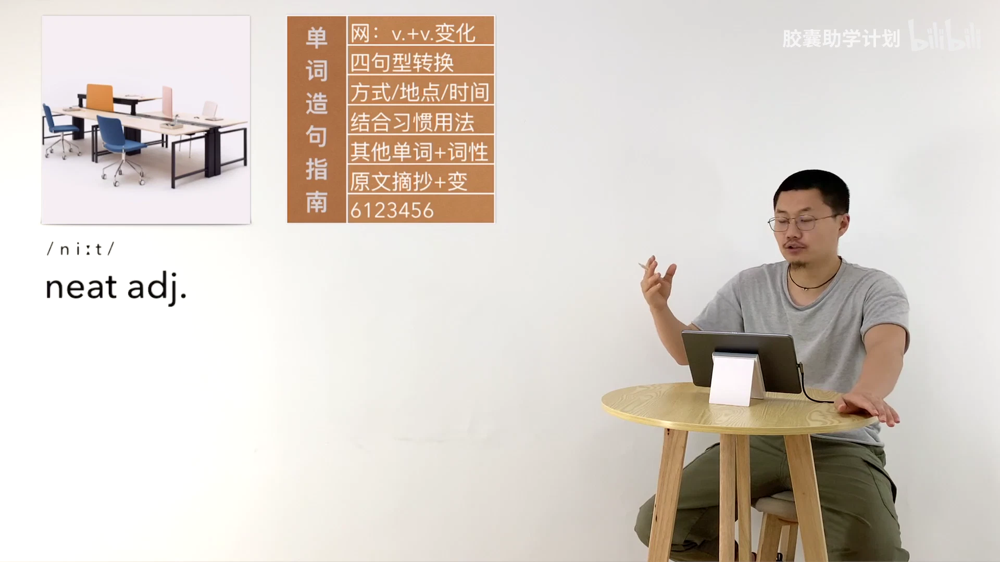

文字识别：单词造句指南 / 网：v.+v.变化 / 胶囊助学计划 / 四句型转换 / 方式/地点/时间 / 结合习惯用法 / 其他单词+词性 / 原文摘抄+变 / 6123456 / /ni:t/ / neat adj.

### 画面 00:03:22

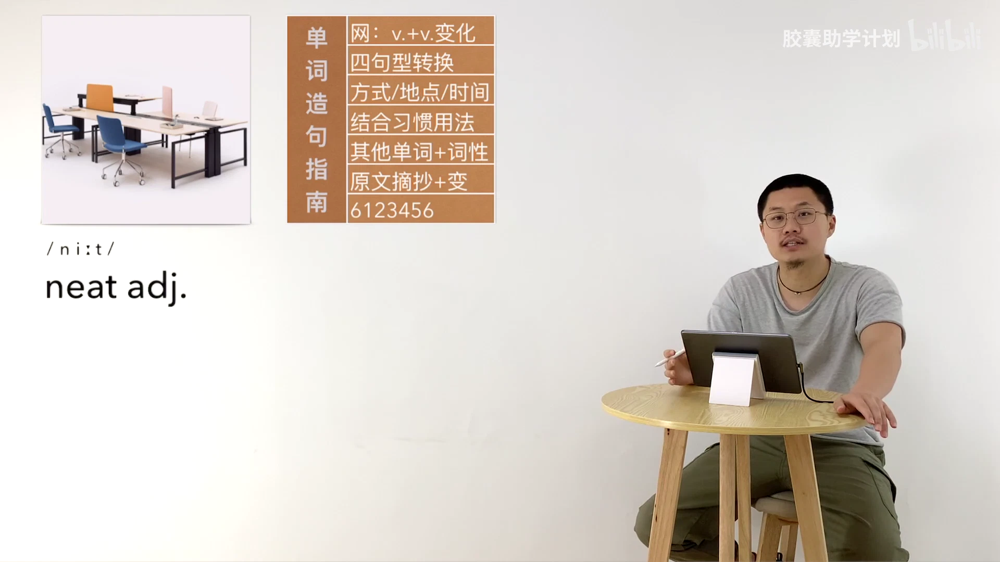

文字识别：单词造句指南 / 网：v.+v.变化 / 胶囊助学计划 / 四句型转换 / 方式/地点/时间 / 结合习惯用法 / 其他单词+词性 / 原文摘抄+变 / 6123456 / /ni:t/ / neat adj.

### 画面 00:03:25

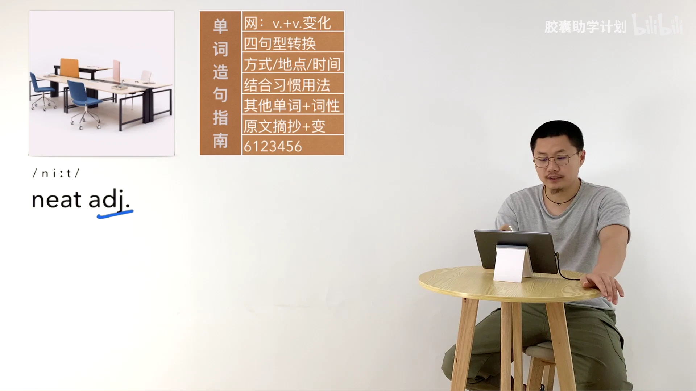

文字识别：单词造句指南 / 网：v.+v.变化 / 胶囊助学计划 / 四句型转换 / 方式/地点/时间 / 结合习惯用法 / 其他单词+词性 / 原文摘抄+变 / 6123456 / /ni:t/ / neat adj.

### 画面 00:03:29

文字识别：单词造句指南 / 网：v.+v.变化 / 胶囊助学计划 / 四句型转换 / 方式/地点/时间 / 结合习惯用法 / 其他单词+词性 / 原文摘抄+变 / 6123456 / /ni:t/ / n. / neat adj.

## 00:03:30–00:04:00

OK。那比如说，Her house is always neat and clean. 那当然我们在这儿没有说把它连上一个名词，我们用的是一个新概念一册第一课就学过叫 This is my handbag。我们把 This 换成了 her house，对吧？然后 handbag 换成了 neat and clean，把名词换成了一个形容词，非常简单的一个句型啊。她的房子总是非常的干净整齐，对吧？OK，肯定句有了，你变一般疑问

### 画面 00:03:31

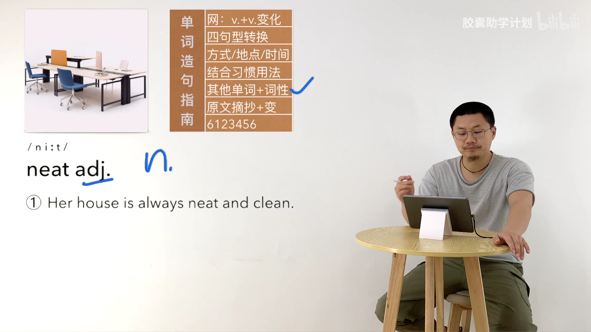

文字识别：单词造句指南 / 网：v.+v.变化 / 胶囊助学计划 / 四句型转换 / 方式/地点/时间 / 结合习惯用法 / 其他单词+词性 / 原文摘抄+变 / 6123456 / /ni:t/ / n. / neat adj. /  Her house is always neat and clean.

### 画面 00:03:35

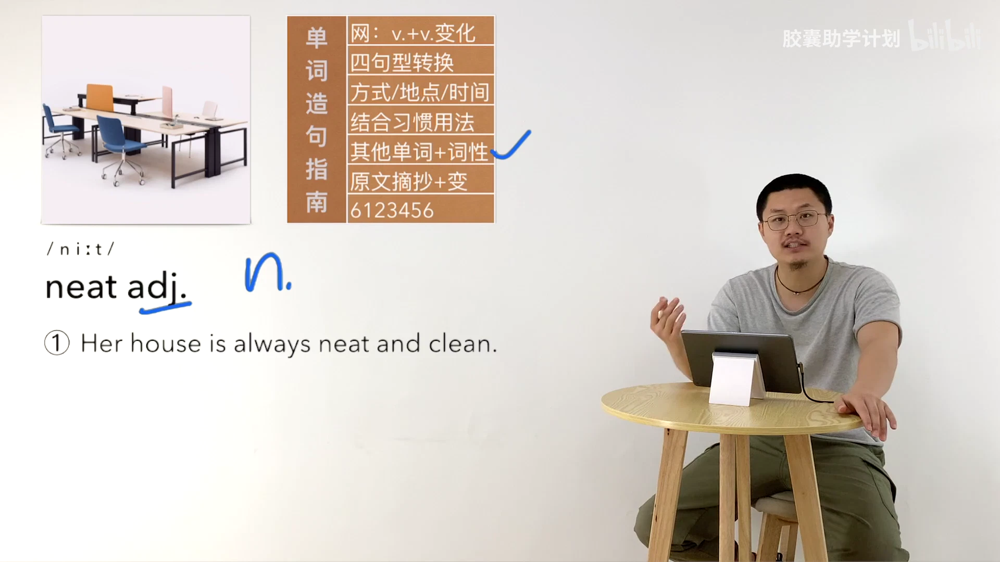

文字识别：单词造句指南 / 网：v.+v.变化 / 胶囊助学计划 / 四句型转换 / 方式/地点/时间 / 结合习惯用法 / 其他单词+词性 / 原文摘抄+变 / 6123456 / /ni:t/ / n. / neat adj. /  Her house is always neat and clean.

### 画面 00:03:38

文字识别：单词造句指南 / 网：v.+v.变化 / 胶囊助学计划 / 四句型转换 / 方式/地点/时间 / 结合习惯用法 / 其他单词+词性 / 原文摘抄+变 / 6123456 / /ni:t/ / n. / ád / neat /  Her house is always neat and clean.

### 画面 00:03:41

文字识别：单词造句指南 / 网：v.+v.变化 / 胶囊助学计划 / 四句型转换 / 方式/地点/时间 / 结合习惯用法 / 其他单词+词性 / 原文摘抄+变 / 6123456 / /ni:t/ / n. / neat / ad. / ) Her house is always neat and clean.

### 画面 00:03:44

文字识别：单词造句指南 / 网：v.+v.变化 / 胶囊助学计划 / 四句型转换 / 方式/地点/时间 / 结合习惯用法 / 其他单词+词性 / 原文摘抄+变 / 6123456 / /ni:t/ / n. / ádi / neat / Her house is always neat and clean.

### 画面 00:03:47

文字识别：单词造句指南 / 网：v.+v.变化 / 胶囊助学计划 / 四句型转换 / 方式/地点/时间 / 结合习惯用法 / 其他单词+词性 / 原文摘抄+变 / 6123456 / /ni:t/ / n. / ádi / neat / Her house is always neat and clean.

### 画面 00:03:49

文字识别：单词造句指南 / 网：v.+v.变化 / 胶囊助学计划 / 四句型转换 / 方式/地点/时间 / 结合习惯用法 / 其他单词+词性 / 原文摘抄+变 / 6123456 / /ni:t/ / n. / ád / neat / Her house is always neat and clean.

### 画面 00:03:51

文字识别：单词造句指南 / 网：v.+v.变化 / 胶囊助学计划 / 四句型转换 / 方式/地点/时间 / 结合习惯用法 / 其他单词+词性 / 原文摘抄+变 / 6123456 / /ni:t/ / n. / ádi / neat / Her house is always neat and clean.

### 画面 00:03:53

文字识别：单词造句指南 / 网：v.+v.变化 / 胶囊助学计划 / 四句型转换 / 方式/地点/时间 / 结合习惯用法 / 其他单词+词性 / 原文摘抄+变 / 6123456 / /ni:t/ / n. / neat / ad. / Her house is always neat and clean.

### 画面 00:03:55

文字识别：单词造句指南 / 网：v.+v.变化 / 胶囊助学计划 / 四句型转换 / 方式/地点/时间 / 结合习惯用法 / 其他单词+词性 / 原文摘抄+变 / 6123456 / /ni:t/ / n. / neat / ad. / Her house is always neat and clean.

### 画面 00:03:58

文字识别：单词造句指南 / 网：v.+v.变化 / 胶囊助学计划 / 四句型转换 / 方式/地点/时间 / 结合习惯用法 / 其他单词+词性 / 原文摘抄+变 / 6123456 / /ni:t/ / n. / neat / ad. / Her house is always neat and clean.

## 00:04:00–00:04:30

句，各位课下自己去做啊。Is提前，我们也可以再换一个词，比如说 He always looks very neat and tidy. 注意，这实际上呢跟 always 也有点小关系。我们没记错的话，第二课带着各位学过这个时态，对吧？Okay，那他总是看呃看呃学过这个 always 这个单词的用法啊，不是这个时态了。说他总是看起来非常的干净整洁啊， neat and tidy. 那我们新一学过 untidy，

### 画面 00:04:00

文字识别：单词造句指南 / 网：v.+v.变化 / 胶囊助学计划 / 四句型转换 / 方式/地点/时间 / 结合习惯用法 / 其他单词+词性 / 原文摘抄+变 / 6123456 / /ni:t/ / n. / neat / ad. / Her house is always neat and clean.

### 画面 00:04:02

文字识别：单词造句指南 / 网：v.+v.变化 / 胶囊助学计划 / 四句型转换 / 方式/地点/时间 / 结合习惯用法 / 其他单词+词性 / 原文摘抄+变 / 6123456 / /ni:t/ / n. / neat / ad. / Her house is always neat and clean. / He always looks very neat and tidy.

### 画面 00:04:05

文字识别：单词造句指南 / 网：v.+v.变化 / 胶囊助学计划 / 四句型转换 / 方式/地点/时间 / 结合习惯用法 / 其他单词+词性 / 原文摘抄+变 / 6123456 / /ni:t/ / n. / adi / neat / Her house is always neat and clean. / He always looks very neat and tidy.

### 画面 00:04:10

文字识别：单词造句指南 / 网：v.+v.变化 / 胶囊助学计划 / 四句型转换 / 方式/地点/时间 / 结合习惯用法 / 其他单词+词性 / 原文摘抄+变 / 6123456 / /ni:t/ / n. / ádi. / neat / Her house isalway neat and  / clean. / He always / looks very neat and tidy.

### 画面 00:04:12

文字识别：单词造句指南 / 网：v.+v.变化 / 胶囊助学计划 / 四句型转换 / 方式/地点/时间 / 结合习惯用法 / 其他单词+词性 / 原文摘抄+变 / 6123456 / /ni:t/ / n. / ádi / neat / Her house isalway neat and / clean. / He / always / looks very neat and tidy.

### 画面 00:04:15

文字识别：单词造句指南 / 网：v.+v.变化 / 胶囊助学计划 / 四句型转换 / 方式/地点/时间 / 结合习惯用法 / 其他单词+词性 / 原文摘抄+变 / 6123456 / /ni:t/ / n. / ádi / neat / Her house isalway neat and / clean. / He / always / looks very neat and / tidy.

### 画面 00:04:20

文字识别：单词造句指南 / 网：v.+v.变化 / 胶囊助学计划 / 四句型转换 / 方式/地点/时间 / 结合习惯用法 / 其他单词+词性 / 原文摘抄+变 / 6123456 / /ni:t/ / n. / neat / ad. / Her house isalways neat and / clean. / He / alway / looks very neat and tidy.

### 画面 00:04:25

文字识别：单词造句指南 / 网：v.+v.变化 / 胶囊助学计划 / 四句型转换 / 方式/地点/时间 / 结合习惯用法 / 其他单词+词性 / 原文摘抄+变 / 6123456 / /ni:t/ / n. / ádi / neat / Her house isalway neat and / clean. / He / always / looks very neat and tidy.

### 画面 00:04:28

文字识别：单词造句指南 / 网：v.+v.变化 / 胶囊助学计划 / 四句型转换 / 方式/地点/时间 / 结合习惯用法 / 其他单词+词性 / 原文摘抄+变 / 6123456 / /ni:t/ / n. / neat / ad. / Her house isalway neat and / clean. / He / always / looks very neat and / tidy.

## 00:04:30–00:05:00

untidy. We know un, not tidy, right? Un, negative. Tidy, actually, they are synonyms. Okay, neat and tidy. He looks always very neat and tidy. Why does he look always very neat and uh uh? Why does he always look very neat and tidy? Why does he always look very neat and tidy? Why does he always look very neat and tidy? Why does he always look very neat and tidy?

### 画面 00:04:30

文字识别：单词造句指南 / 网：v.+v.变化 / 胶囊助学计划 / 四句型转换 / 方式/地点/时间 / 结合习惯用法 / 其他单词+词性 / 原文摘抄+变 / 6123456 / /ni:t/ / n. / ád / neat / Her house isalway neat and / clean. / He / always / looks very neat and / tidy.

### 画面 00:04:35

文字识别：单词造句指南 / 网：v.+v.变化 / 胶囊助学计划 / 四句型转换 / 方式/地点/时间 / 结合习惯用法 / 其他单词+词性 / 原文摘抄+变 / 6123456 / /ni:t/ / n. / ád / neat / Her house isalway neat and / clean. / He / always / looks very neat and / tidy.

### 画面 00:04:40

文字识别：单词造句指南 / 网：v.+v.变化 / 胶囊助学计划 / 四句型转换 / 方式/地点/时间 / 结合习惯用法 / 其他单词+词性 / 原文摘抄+变 / 6123456 / /ni:t/ / n. / ád / neat / Her house is alway neat and / clean. / He / always / looks very neat and / tidy.

### 画面 00:04:45

文字识别：单词造句指南 / 网：v.+v.变化 / 胶囊助学计划 / 四句型转换 / 方式/地点/时间 / 结合习惯用法 / 其他单词+词性 / 原文摘抄+变 / 6123456 / /ni:t/ / n. / neat / ad / Her house isalwayr / neat and / clean. / He / always / looks very neat and / tidy.

### 画面 00:04:50

文字识别：单词造句指南 / 网：v.+v.变化 / 胶囊助学计划 / 四句型转换 / 方式/地点/时间 / 结合习惯用法 / 其他单词+词性 / 原文摘抄+变 / 6123456 / /ni:t/ / n. / ád / neat / Her house isalway neat and / clean. / He / alway / looks very neat and / tidy.

### 画面 00:04:59

文字识别：单词造句指南 / 网：v.+v.变化 / 胶囊助学计划 / 四句型转换 / 方式/地点/时间 / 结合习惯用法 / 其他单词+词性 / 原文摘抄+变 / 6123456 / /ni:t/ / n. / neat / ad. / Her house isalway neat and / clean. / He / always / looks very neat and / tidy.

## 00:05:00–00:05:30

neat? And I want to ask the subject directly. Replace the subject with who always looks very neat and tidy, right? There you go. Okay, let me add a small usage. Ah, this we are in New Zealand, especially when we go to the gym, or when you go outside to meet some young people, right? When we talk together, you say that's cool. Ah, that's cool. Ah, this this thing sounds pretty good, right? It's pretty cool, pretty good. You can also have a similar expression, which is neat. But here, it doesn't mean clean and

### 画面 00:05:01

文字识别：单词造句指南 / 网：v.+v.变化 / 胶囊助学计划 / 四句型转换 / 方式/地点/时间 / 结合习惯用法 / 其他单词+词性 / 原文摘抄+变 / 6123456 / /ni:t/ / n. / neat / ad. / Her house isalway neat and / clean. / He / always / looks very neat and / tidy.

### 画面 00:05:03

文字识别：单词造句指南 / 网：v.+v.变化 / 胶囊助学计划 / 四句型转换 / 方式/地点/时间 / 结合习惯用法 / 其他单词+词性 / 原文摘抄+变 / 6123456 / /ni:t/ / n. / ád / neat / house isalwavs / neat and / clean. / Elway / looks very neat  / and / tidy.

### 画面 00:05:05

文字识别：单词造句指南 / 网：v.+v.变化 / 胶囊助学计划 / 四句型转换 / 方式/地点/时间 / 结合习惯用法 / 其他单词+词性 / 原文摘抄+变 / 6123456 / /ni:t/ / n. / neat / ad. / house isalwavs / neat and / clean. / 双 / Elway / looks very neat and / tidy.

### 画面 00:05:10

文字识别：单词造句指南 / 网：v.+v.变化 / 胶囊助学计划 / 四句型转换 / 方式/地点/时间 / 结合习惯用法 / 其他单词+词性 / 原文摘抄+变 / 6123456 / /ni:t/ / n. / neat / ad. / house isalwavs / neat / and / clean. / Elway / looks / very neat / and / tidy. / That's neat/cool.

### 画面 00:05:12

文字识别：单词造句指南 / 网：v.+v.变化 / 胶囊助学计划 / 四句型转换 / 方式/地点/时间 / 结合习惯用法 / 其他单词+词性 / 原文摘抄+变 / 6123456 / /ni:t/ / n. / neat / ad. / house isalwavs / neat and / clean. / Elway / looks / very neat / and / tidy. / That's neat/cool.

### 画面 00:05:14

文字识别：单词造句指南 / 网：v.+v.变化 / 胶囊助学计划 / 四句型转换 / 方式/地点/时间 / 结合习惯用法 / 其他单词+词性 / 原文摘抄+变 / 6123456 / /ni:t/ / n. / neat / ad. / house isalwavs / neat and / clean. / Elway / looks / very neat / and / tidy. / That's neat/cool.

### 画面 00:05:16

文字识别：单词造句指南 / 网：v.+v.变化 / 胶囊助学计划 / 四句型转换 / 方式/地点/时间 / 结合习惯用法 / 其他单词+词性 / 原文摘抄+变 / 6123456 / /ni:t/ / n. / neat / ad. / house isalwavs / neat and / clean. / lway / looks / very neat / and / tidy. / That's neat/cool.

### 画面 00:05:19

文字识别：单词造句指南 / 网：v.+v.变化 / 胶囊助学计划 / 四句型转换 / 方式/地点/时间 / 结合习惯用法 / 其他单词+词性 / 原文摘抄+变 / 6123456 / /ni:t/ / n. / ád / neat / house isalwavs / neat and / clean. / lway / looks / very neat / and / tidy. / That's neat/cool.

### 画面 00:05:22

文字识别：单词造句指南 / 网：v.+v.变化 / 胶囊助学计划 / 四句型转换 / 方式/地点/时间 / 结合习惯用法 / 其他单词+词性 / 原文摘抄+变 / 6123456 / /ni:t/ / n. / neat / ad. / house isalwavs / neat and / clean. / 双lway / looks / very neat / and / tidy. / That's neat/cool.

### 画面 00:05:25

文字识别：单词造句指南 / 网：v.+v.变化 / 胶囊助学计划 / 四句型转换 / 方式/地点/时间 / 结合习惯用法 / 其他单词+词性 / 原文摘抄+变 / 6123456 / /ni:t/ / n. / ád / neat / house isalwavs / neat / and / clean. / 双 / Elway / looks / very neat / and / tidy. / That's neat/cool.

### 画面 00:05:28

文字识别：单词造句指南 / 网：v.+v.变化 / 胶囊助学计划 / 四句型转换 / 方式/地点/时间 / 结合习惯用法 / 其他单词+词性 / 原文摘抄+变 / 6123456 / /ni:t/ / n. / ád / neat / house isalwavs / neat / and / clean. / lway / looks / very / neat / and / tidy. / That's neat/cool.

## 00:05:30–00:06:00

neat，但在这儿它就不比较干净整洁了，就类似于 that's cool，啊 that's neat，啊嗯还不错呀，你觉得这事儿还挺听起来挺有意思的，还不错， that's neat，还挺 cool的，OK？好，那接下来呢，我们在变形金刚这个视频当中给大家摘了一段，但是它这个地方的汉语翻译，它翻译成了那很恐怖啊，其实并不是，它是一个讽刺的说法，那好恐怖啊，啊不是这个意思，其实就是嗯这事儿还挺酷的，听起来，OK？那我们一起看一下啊。 I can't be any

### 画面 00:05:30

文字识别：单词造句指南 / 网：v.+v.变化 / 胶囊助学计划 / 四句型转换 / 方式/地点/时间 / 结合习惯用法 / 其他单词+词性 / 原文摘抄+变 / 6123456 / /ni:t/ / n. / ád. / neat / house isalwavs / neat / and / clean. / Elway / looks / very / neat / and / tidy. / That's neat/cool.

### 画面 00:05:32

文字识别：单词造句指南 / 网：v.+v.变化 / 胶囊助学计划 / 四句型转换 / 方式/地点/时间 / 结合习惯用法 / 其他单词+词性 / 原文摘抄+变 / 6123456 / /ni:t/ / n. / ád / neat / house isalwavs / neat / and / clean. / lway / looks / very / neat / and / tidy. / That's neat/cool.

### 画面 00:05:35

文字识别：单词造句指南 / 网：v.+v.变化 / 胶囊助学计划 / 四句型转换 / 方式/地点/时间 / 结合习惯用法 / 其他单词+词性 / 原文摘抄+变 / 6123456 / /ni:t/ / n. / ádi / neat / house isalwavs / neat / and / clean. / lway / looks / very / neat / and / tidy. / That's neat/cool.

### 画面 00:05:41

文字识别：单词造句指南 / 网：v.+v.变化 / 胶囊助学计划 / 四句型转换 / 方式/地点/时间 / 结合习惯用法 / 其他单词+词性 / 原文摘抄+变 / 6123456 / /ni:t/ / n. / neat / ad. / house isalwavs / neat / and / clean. / lway / looks / very / neat / and / tidy. / That's neat/cool.

### 画面 00:05:43

文字识别：That's neat. / 胶囊助学计划 / QLICE / 变形金刚 / Transformens / (2007)

### 画面 00:05:46

文字识别：That's neat. / 胶囊助学计划 / OLICE / 变形金刚 / Transformers / (2007)

### 画面 00:05:52

文字识别：That's neat. / 胶囊助学计划 / QLICE / 变形金刚 / Transformers / (2007)

### 画面 00:05:55

文字识别：That's neat. / 胶囊助学计划 / QLICE / 变形金刚 / Transformens / (2007)

### 画面 00:05:58

文字识别：That's neat. / 胶囊助学计划 / OLICE / 变形金刚 / Transformens / (2007)

## 00:06:00–00:06:30

clearer on how crystal clear I am being. It just stood up, just stood up. Wow, it's really neat. Okay, chiefy, time to fill her up. And no drippy drippy. What are you rolling? Whip it, scoop balls. Little wowy sauce. Okay, that's really neat. You注意啊，他不相信他嘛。他说他的那个机器人直接就站起来了。这个警察认为他嗑药了，是吧？然后警察讽刺他说，Oh, that's

### 画面 00:06:00

文字识别：That's neat. / 胶囊助学计划 / 我当时非常清醒简直"清澈见底" / 变形金刚 / Look, I can't be any clearer than how crystal clear I am being. / Transformens / (2007)

### 画面 00:06:02

文字识别：That's neat. / 胶囊助学计划 / 变形金刚 / Transformers / (2007)

### 画面 00:06:04

文字识别：That's neat. / 胶囊助学计划 / -他就那么站起来了-站了起来 / 变形金刚 / —It just stood up.-lt just stood up. / Transformens / (2007)

### 画面 00:06:06

文字识别：That's neat. / 胶囊助学计划 / 变形金刚 / Transformers / (2007)

### 画面 00:06:08

文字识别：That's neat. / 胶囊助学计划 / 哇..好恐怖哦 / 变形金刚 / Wow. That's really neat. / Transformers / (2007)

### 画面 00:06:10

文字识别：That's neat. / 胶囊助学计划 / 好吧这个拿去 / 变形金刚 / Okay, chiefie. / Transformens / (2007)

### 画面 00:06:12

文字识别：That's neat. / 胶囊助学计划 / 把这个灌满别滴的到处都是 / 变形金刚 / Time to fill her up. And no drippy-drippy. / Transformers / (2007)

### 画面 00:06:14

文字识别：That's neat. / 胶囊助学计划 / 变形金刚 / Transformens / (2007)

### 画面 00:06:16

文字识别：That's neat. / 胶囊助学计划 / 氧化亚氮巴比妥盐还是少许大麻？ / 变形金刚 / Whippets? Goofballs? A little wowie sauce with the boys? / Transformens / (2007)

### 画面 00:06:18

文字识别：That's neat. / 胶囊助学计划 / 氧化亚氮巴比妥盐还是少许大麻？ / 变形金刚 / Whippets? Goofballs? A little wowie sauce with the boys? / Transformens / (2007)

### 画面 00:06:20

文字识别：That's neat. / 胶囊助学计划 / 变形金刚 / Transformers / (2007)

### 画面 00:06:22

文字识别：That's neat. / 胶囊助学计划 / 变形金刚 / Transformers / (2007)

### 画面 00:06:27

文字识别：That's neat. / 胶囊助学计划 / 变形金刚 / Transformers / (2007)

### 画面 00:06:29

文字识别：That's neat. / 胶囊助学计划 / 变形金刚 / Transformers / (2007)

## 00:06:30–00:07:00

really cool,是吧？That's really neat.啊，各位要想这个场景，它不是翻译成好恐怖啊。OK，好，接着往下走，下一个单词跟我一起读，叫path。注意T H字母组合是吧？在这个地方要咬舌。Path, very good.那指的是这种小径啊，这种小路。OK, path.那我们把之前学到的单词形容词跟它放起来就行了，叫做neat path，一个非常干净整洁

### 画面 00:06:33

文字识别：That's neat. / 胶囊助学计划 / 变形金刚 / Transformers / (2007)

### 画面 00:06:37

文字识别：单词造句指南 / 网：v.+v.变化 / 胶囊助学计划 / 四句型转换 / 方式/地点/时间 / 结合习惯用法 / 其他单词+词性 / 原文摘抄+变 / 6123456 / /pa:0/ / path n.

### 画面 00:06:39

文字识别：单词造句指南 / 网：v.+v.变化 / 胶囊助学计划 / 四句型转换 / 方式/地点/时间 / 结合习惯用法 / 其他单词+词性 / 原文摘抄+变 / 6123456 / /pa:0/ / path n.

### 画面 00:06:41

文字识别：单词造句指南 / 网：v.+v.变化 / 胶囊助学计划 / 四句型转换 / 方式/地点/时间 / 结合习惯用法 / 其他单词+词性 / 原文摘抄+变 / 6123456 / /pa:0/ / path n.

### 画面 00:06:44

文字识别：单词造句指南 / 网：v.+v.变化 / 胶囊助学计划 / 四句型转换 / 方式/地点/时间 / 结合习惯用法 / 其他单词+词性 / 原文摘抄+变 / 6123456 / /pa:θ/ / path n.

### 画面 00:06:46

文字识别：单词造句指南 / 网：v.+v.变化 / 胶囊助学计划 / 四句型转换 / 方式/地点/时间 / 结合习惯用法 / 其他单词+词性 / 原文摘抄+变 / 6123456 / /pa:θ/ / path n.

### 画面 00:06:48

文字识别：单词造句指南 / 网：v.+v.变化 / 胶囊助学计划 / 四句型转换 / 方式/地点/时间 / 结合习惯用法 / 其他单词+词性 / 原文摘抄+变 / 6123456 / /pa:θ/ / path n.

### 画面 00:06:50

文字识别：单词造句指南 / 网：v.+v.变化 / 胶囊助学计划 / 四句型转换 / 方式/地点/时间 / 结合习惯用法 / 其他单词+词性 / 原文摘抄+变 / 6123456 / /pa:θ/ / path n.

### 画面 00:06:53

文字识别：单词造句指南 / 网：v.+v.变化 / 胶囊助学计划 / 四句型转换 / 方式/地点/时间 / 结合习惯用法 / 其他单词+词性 / 原文摘抄+变 / 6123456 / /pa:θ/ / path n. / neat path / 1

### 画面 00:06:55

文字识别：单词造句指南 / 网：v.+v.变化 / 胶囊助学计划 / 四句型转换 / 方式/地点/时间 / 结合习惯用法 / 其他单词+词性 / 原文摘抄+变 / 6123456 / /pa:θ/ / path n. / 1 / neat path

## 00:07:00–00:07:30

的一条小路，对吧？小径啊，very neat path. 那原文呢给了我们一句话，叫做 He has made neat path. Okay, 他已经自己做呃自己铺了一些。我们还有应该说啊，铺了一些特别干净整洁的小道啊。 Okay, 那我们把它做一些横向的变化。所谓纵向变化就是四句型转换，对吧？横向变化就是换个时态。比如说，我们把现在完成时给它换成

### 画面 00:07:03

文字识别：单词造句指南 / 网：v.+v.变化 / 胶囊助学计划 / 四句型转换 / 方式/地点/时间 / 结合习惯用法 / 其他单词+词性 / 原文摘抄+变 / 6123456 / /pa:θ/ / path n. / 1 / neat path

### 画面 00:07:05

文字识别：单词造句指南 / 网：v.+v.变化 / 胶囊助学计划 / 四句型转换 / 方式/地点/时间 / 结合习惯用法 / 其他单词+词性 / 原文摘抄+变 / 6123456 / /pa:θ/ / path n. / neat path / [Story]: He has made neat paths.

### 画面 00:07:11

文字识别：单词造句指南 / 网：v.+v.变化 / 胶囊助学计划 / 四句型转换 / 方式/地点/时间 / 结合习惯用法 / 其他单词+词性 / 原文摘抄+变 / 6123456 / /pa:θ/ / path n. / neat path / 1 / [Story]: He has made neat paths.

### 画面 00:07:15

文字识别：单词造句指南 / 网：v.+v.变化 / 胶囊助学计划 / 四句型转换 / 方式/地点/时间 / 结合习惯用法 / 其他单词+词性 / 原文摘抄+变 / 6123456 / /pa:θ/ / path n. / neat path / [Story]: He has made neat paths.

### 画面 00:07:20

文字识别：单词造句指南 / 网：v.+v.变化 / 胶囊助学计划 / 四句型转换 / 方式/地点/时间 / 结合习惯用法 / 其他单词+词性 / 原文摘抄+变 / 6123456 / /pa:θ/ / path n. / neat path / 1 / [Story]: He has made neat paths. / He made a neat path last month.

### 画面 00:07:27

文字识别：单词造句指南 / 网：v.+v.变化 / 胶囊助学计划 / 四句型转换 / 方式/地点/时间 / 结合习惯用法 / 其他单词+词性 / 原文摘抄+变 / 6123456 / /pa:θ/ / path n. / neat path / 1 / [Story]: He has made neat paths. / He made a neat path last month.

### 画面 00:07:29

文字识别：单词造句指南 / 网：v.+v.变化 / 胶囊助学计划 / 四句型转换 / 方式/地点/时间 / 结合习惯用法 / 其他单词+词性 / 原文摘抄+变 / 6123456 / /pa:θ/ / path n. / neat path / 1 / [Story]: He has mad neat paths. / He made a neat path last month.

## 00:07:30–00:08:00

一般过去时，叫做 He made a neat path last month. 啊，上个月他自己铺了一条干净整洁的小路，肯定句有了，那你就做一般疑问句，叫做 Did he make a neat path last month？这个就是我们说的纵向变化，对吧？在时态、这个谓语结构啊、动词及动词变化二保持不变的基基础之上，做一些纵向的四句型转化啊。OK，那接下来呢，我们

### 画面 00:07:31

文字识别：单词造句指南 / 网：v.+v.变化 / 胶囊助学计划 / 四句型转换 / 方式/地点/时间 / 结合习惯用法 / 其他单词+词性 / 原文摘抄+变 / 6123456 / /pa:θ/ / path n. / neat path / 7 / [Story]: He has mad neat paths. / He made a neat path last month.

### 画面 00:07:35

文字识别：单词造句指南 / 网：v.+v.变化 / 胶囊助学计划 / 四句型转换 / 方式/地点/时间 / 结合习惯用法 / 其他单词+词性 / 原文摘抄+变 / 6123456 / /pa:θ/ / path n. / neat path / 1 / [Story]: He has mad: neat paths. / He made a neat path last month.

### 画面 00:07:42

文字识别：单词造句指南 / 网：v.+v.变化 / 胶囊助学计划 / 四句型转换 / 方式/地点/时间 / 结合习惯用法 / 其他单词+词性 / 原文摘抄+变 / 6123456 / /pa:θ/ / path n. / neat path / 1 / [Story]: He has mad neat paths. / He made a neat path last month. / Did he make a neat path last month?

### 画面 00:07:45

文字识别：单词造句指南 / 网：v.+v.变化 / 胶囊助学计划 / 四句型转换 / 方式/地点/时间 / 结合习惯用法 / 其他单词+词性 / 原文摘抄+变 / 6123456 / /pa:θ/ / path n. / neat path / 1 / [Story]: He has mad neat paths. / He made a neat path last month. / Did he make a neat path last month?

### 画面 00:07:49

文字识别：单词造句指南 / 网：v.+v.变化 / 胶囊助学计划 / 四句型转换 / 方式/地点/时间 / 结合习惯用法 / 其他单词+词性 / 原文摘抄+变 / 6123456 / /pa:θ/ / path n. / neat path / [Story]: He has mad neat paths. / He made a neat path last month. / Did he make a neat path last month?

### 画面 00:07:51

文字识别：单词造句指南 / 网：v.+v.变化 / 胶囊助学计划 / 四句型转换 / 方式/地点/时间 / 结合习惯用法 / 其他单词+词性 / 原文摘抄+变 / 6123456 / /pa:θ/ / path n. / neat path / 1 / [Story]: He has mad neat paths. / He made a neat path last month. / Did he make a neat path last month?

### 画面 00:07:53

文字识别：单词造句指南 / 网：v.+v.变化 / 胶囊助学计划 / 四句型转换 / 方式/地点/时间 / 结合习惯用法 / 其他单词+词性 / 原文摘抄+变 / 6123456 / /pa:θ/ / path n. / neat path / 1 / [Story]: He has madneat paths. / He made a neat path last month. / Did he make a neat path last month?

### 画面 00:07:55

文字识别：单词造句指南 / 网：v.+v.变化 / 胶囊助学计划 / 四句型转换 / 方式/地点/时间 / 结合习惯用法 / 其他单词+词性 / 原文摘抄+变 / 6123456 / /pa:θ/ / path n. / neat path / 1 / [Story]: He has mad neat paths. / He made a neat path last month. / Did he make a neat path last month?

### 画面 00:07:58

文字识别：make the path / 胶囊助学计划 / 爱丽丝梦游仙境 / 自从我掉进那兔子洞开始 / Alice in Wonderland / From the moment I fell down that rabbit hole, / (2010)

## 00:08:00–00:08:30

看一个小的电影片段，当中出现了叫做make the path啊，就是我要为我的未来开辟一条路。它不是指的物理意义上地上铺的那条路，指的是我为我自己的未来走出来一条路。也可以用make the path啊，各位，我们一起看一下。The moment I fell down that rabbit hole, I've been told what I must do and who I must be. I've been shrunk, stretched, scratched, and stuffed into a teapot. I've been accused of being Alice and of not being Alice, but this is my

### 画面 00:08:19

文字识别：make the path / 胶囊助学计划 / 爱丽丝梦游仙境 / 自从我掉进那兔子洞开始 / Alice in Wonderland / From the moment I fell down that rabbit hole, / (2010)

### 画面 00:08:21

文字识别：make the path / 胶囊助学计划 / 爱丽丝梦游仙境 / 我就一直任人摆布 / Alice in Wonderland / I have been told what I must do and who I must be. / (2010)

### 画面 00:08:23

文字识别：make the path / 胶囊助学计划 / 爱丽丝梦游仙境 / 我被缩小被变大被抓伤还被关进茶壶 / Alice in Wonderland / I've been shrunk, stretched, scratched and stuffed into a teapot. / (2010)

### 画面 00:08:25

文字识别：make the path / 胶囊助学计划 / 爱丽丝梦游仙境 / 我被缩小被变大被抓伤还被关进茶壶 / Alice in Wonderland / I've been shrunk, stretched, scratched and stuffed into a teapot. / (2010)

### 画面 00:08:27

文字识别：make the path / 胶囊助学计划 / 爱丽丝梦游仙境 / 我是不是爱丽丝都被人责难可这是我的梦 / Alice in Wonderland / I've been accused of being Alice and of not being Alice, but this is my dream. / (2010)

### 画面 00:08:29

文字识别：make the path / 胶囊助学计划 / 爱丽丝梦游仙境 / 我是不是爱丽丝都被人责难可这是我的梦 / Alice in Wonderland / I've been accused of being Alice and of not being Alice, but this is my dream. / (2010)

## 00:08:30–00:09:00

dream. I'll decide where it goes from here. If you diverge from the path, I make the path.啊，各位可以理解为这是女主的觉醒，对吧？你结合她前面那些文字，她说如果你 diverge from the path，如果你从这个道路上离开的话，那怎么办呢？她说那我为我自己

### 画面 00:08:31

文字识别：make the path / 胶囊助学计划 / 爱丽丝梦游仙境 / 从现在开始我说了算 / Alice in Wonderland / I'll decide where it goes from here! / (2010)

### 画面 00:08:33

文字识别：make the path / 胶囊助学计划 / 爱丽丝梦游仙境 / 要是你偏离了道路… / Alice in Wonderland / If you diverge from the path. / (2010)

### 画面 00:08:35

文字识别：make the path / 胶囊助学计划 / 爱丽丝梦游仙境 / 我会开出一条路来 / Alice in Wonderland / I make the path! / (2010)

### 画面 00:08:37

文字识别：make the path / 胶囊助学计划 / 爱丽丝梦游仙境 / Alice in Wonderland / (2010)

### 画面 00:08:39

文字识别：make the path / 胶囊助学计划 / 爱丽丝梦游仙境 / Alice in Wonderland / (2010)

### 画面 00:08:41

文字识别：make the path / 胶囊助学计划 / 爱丽丝梦游仙境 / Alice in Wonderland / (2010)

### 画面 00:08:43

文字识别：make the path / 胶囊助学计划 / 爱丽丝梦游仙境 / Alice in Wonderland / (2010)

### 画面 00:08:45

文字识别：make the path / 胶囊助学计划 / 爱丽丝梦游仙境 / Alice in Wonderland / (2010)

### 画面 00:08:47

文字识别：make the path / 胶囊助学计划 / 爱丽丝梦游仙境 / Alice in Wonderland / (2010)

### 画面 00:08:49

文字识别：make the path / 胶囊助学计划 / 爱丽丝梦游仙境 / Alice in Wonderland / (2010)

### 画面 00:08:51

文字识别：make the path / 胶囊助学计划 / 爱丽丝梦游仙境 / Alice in Wonderland / (2010)

## 00:09:00–00:09:30

的未来 make the path，我自己走出一条路来。” OK，下一个下一个单词跟我一起读，叫做 wooden，啊，看一下音标 wooden wooden。 OK，好，那他注意是形容词，表示的是木质的。哎，这个单词还挺好造句的，因为你找名词比较好找，比如说 wooden chair，啊，木质的椅子； bridge 桥； spoon 勺子； door 这个门，对吧？这都很好找。形容词加名词这个短语就

### 画面 00:09:01

文字识别：make the path / 胶囊助学计划 / 爱丽丝梦游仙境 / Alice in Wonderland / (2010)

### 画面 00:09:04

文字识别：单词造句指南 / 网：v.+v.变化 / 胶囊助学计划 / 四句型转换 / 方式/地点/时间 / 结合习惯用法 / 其他单词+词性 / 原文摘抄+变 / 6123456 / /wudan/ / wooden adj.

### 画面 00:09:06

文字识别：单词造句指南 / 网：v.+v.变化 / 胶囊助学计划 / 四句型转换 / 方式/地点/时间 / 结合习惯用法 / 其他单词+词性 / 原文摘抄+变 / 6123456 / /wudan/ / wooden adj.

### 画面 00:09:09

文字识别：单词造句指南 / 网：v.+v.变化 / 胶囊助学计划 / 四句型转换 / 方式/地点/时间 / 结合习惯用法 / 其他单词+词性 / 原文摘抄+变 / 6123456 / /wudan/ / wooden adj.

### 画面 00:09:14

文字识别：单词造句指南 / 网：v.+v.变化 / 胶囊助学计划 / 四句型转换 / 方式/地点/时间 / 结合习惯用法 / 其他单词+词性 / 原文摘抄+变 / 6123456 / /wudan/ / wooden adi.

### 画面 00:09:17

文字识别：单词造句指南 / 网：v.+v.变化 / 胶囊助学计划 / 四句型转换 / 方式/地点/时间 / 结合习惯用法 / 其他单词+词性 / 原文摘抄+变 / 6123456 / /wudan/ / wooden adi. f n

### 画面 00:09:20

文字识别：单词造句指南 / 网：v.+v.变化 / 胶囊助学计划 / 四句型转换 / 方式/地点/时间 / 结合习惯用法 / 其他单词+词性 / 原文摘抄+变 / 6123456 / /wudan/ / wooden adi. fn / wooden chair/bridge/spoon/door + v./expression

### 画面 00:09:24

文字识别：单词造句指南 / 网：v.+v.变化 / 胶囊助学计划 / 四句型转换 / 方式/地点/时间 / 结合习惯用法 / 其他单词+词性 / 原文摘抄+变 / 6123456 / /wudan/ / wooden adi. f n / wooden chair/bridge/spoon/door + v./expression

### 画面 00:09:29

文字识别：单词造句指南 / 网：v.+v.变化 / 胶囊助学计划 / 四句型转换 / 方式/地点/时间 / 结合习惯用法 / 其他单词+词性 / 原文摘抄+变 / 6123456 / /wudan/ / woodenadi. fn / wooden chair/bridge/spoon/door + v./expression

## 00:09:30–00:10:00

出来了。注意形容词啊，基本上大多数情况下是依附于名词而存在的。而名词在六一二三四五六当中呢，尤其是像这种 wooden chair 这样的名词，它常用的就是一和三，要么主语，要么宾语。这是我们第一节课就学过的。于是你必须要为了造一个句子，你必须要做的是找一些动词或者习惯用法，所谓的继续找其他词性，或者说结合其他的习惯用法。那我们来了啊，比如说第七课我们刚刚学过的

### 画面 00:09:34

文字识别：单词造句指南 / 网：v.+v.变化 / 胶囊助学计划 / 四句型转换 / 方式/地点/时间 / 结合习惯用法 / 其他单词+词性 / 原文摘抄+变 / 6123456 / /wudan/ / woodenadi. fn / wooden chair/bridge/spoon/door + v./expression

### 画面 00:09:39

文字识别：单词造句指南 / 网：v.+v.变化 / 胶囊助学计划 / 四句型转换 / 方式/地点/时间 / 结合习惯用法 / 其他单词+词性 / 原文摘抄+变 / 6123456 / /wudan/ / woodenadi.fn / wooden chair/bridge/spoon/door + v./expression

### 画面 00:09:41

文字识别：单词造句指南 / 网：v.+v.变化 / 胶囊助学计划 / 四句型转换 / 方式/地点/时间 / 结合习惯用法 / 其他单词+词性 / 原文摘抄+变 / 6123456 / /wudan/ / woodenadi. fn / wooden chair/bridge/spoon/door + v./expression

### 画面 00:09:44

文字识别：单词造句指南 / 网：v.+v.变化 / 胶囊助学计划 / 四句型转换 / 方式/地点/时间 / 结合习惯用法 / 其他单词+词性 / 原文摘抄+变 / 6123456 / /wudan/ / woodenadi. fn / wooden chair/bridge/spoon/door + v./expression

### 画面 00:09:49

文字识别：单词造句指南 / 网：v.+v.变化 / 胶囊助学计划 / 四句型转换 / 方式/地点/时间 / 结合习惯用法 / 其他单词+词性 / 原文摘抄+变 / 6123456 / /wudan/ / woodenadi. fn / wooden chair/bridge/spoon/door + v./expression

### 画面 00:09:51

文字识别：单词造句指南 / 网：v.+v.变化 / 胶囊助学计划 / 四句型转换 / 方式/地点/时间 / 结合习惯用法 / 其他单词+词性 / 原文摘抄+变 / 6123456 / /wudan/ / woodenadi. fn / wooden chair/bridge/spoon/door +v./expression

### 画面 00:09:54

文字识别：单词造句指南 / 网：v.+v.变化 / 胶囊助学计划 / 四句型转换 / 方式/地点/时间 / 结合习惯用法 / 其他单词+词性 / 原文摘抄+变 / 6123456 / /wudan/ / n / woodenadi.f / wooden chair/bridge/spoon/door +v./expression

### 画面 00:09:57

文字识别：单词造句指南 / 网：v.+v.变化 / 胶囊助学计划 / 四句型转换 / 方式/地点/时间 / 结合习惯用法 / 其他单词+词性 / 原文摘抄+变 / 6123456 / /wudan/ / woodenadi.fn / wooden chair/bridge/spoon/door + / v./expression / His house is full of wooden chairs. L

### 画面 00:09:59

文字识别：单词造句指南 / 网：v.+v.变化 / 胶囊助学计划 / 四句型转换 / 方式/地点/时间 / 结合习惯用法 / 其他单词+词性 / 原文摘抄+变 / 6123456 / /wudan/ / wooden adi. fn / wooden chair/bridge/spoon/door + v./expression / His house is full of wooden chairs. L7

## 00:10:00–00:10:30

叫 His house is full of wooden chairs. 啊，说这是个木匠，他的屋子里边全是木质的椅子，自己做的。 A be full of B. 第七课我们学过的，好，接着往下说 He knocked at the wooden door. 这是我们第六课学过 knock at the door，对吧？我们只不过把这个 door 前面加了个 wooden，哎，很好的一个句子就出来了，并且用的是一般过去时。 Continue. 说 She always finds wooden things beautiful.

### 画面 00:10:01

文字识别：单词造句指南 / 网：v.+v.变化 / 胶囊助学计划 / 四句型转换 / 方式/地点/时间 / 结合习惯用法 / 其他单词+词性 / 原文摘抄+变 / 6123456 / /wudan/ / wooden adi. f n / wooden chair/bridge/spoon/door + v./expression / His house is full of wooden chairs. L7

### 画面 00:10:03

文字识别：单词造句指南 / 网：v.+v.变化 / 胶囊助学计划 / 四句型转换 / 方式/地点/时间 / 结合习惯用法 / 其他单词+词性 / 原文摘抄+变 / 6123456 / /wudan/ / wooden adi. f n / wooden chair/bridge/spoon/door + v./expression / His house is full of wooden chairs. L7

### 画面 00:10:05

文字识别：单词造句指南 / 网：v.+v.变化 / 胶囊助学计划 / 四句型转换 / 方式/地点/时间 / 结合习惯用法 / 其他单词+词性 / 原文摘抄+变 / 6123456 / /wudan/ / wooden adi. f n / wooden chair/bridge/spoon/door + v./expression / His house is full of wooden chairs. L7

### 画面 00:10:10

文字识别：单词造句指南 / 网：v.+v.变化 / 胶囊助学计划 / 四句型转换 / 方式/地点/时间 / 结合习惯用法 / 其他单词+词性 / 原文摘抄+变 / 6123456 / /wudan/ / wooden adi. f n / wooden chair/bridge/spoon/door + v./expression / His house is full of wooden chairs. L7

### 画面 00:10:14

文字识别：单词造句指南 / 网：v.+v.变化 / 胶囊助学计划 / 四句型转换 / 方式/地点/时间 / 结合习惯用法 / 其他单词+词性 / 原文摘抄+变 / 6123456 / /wudan/ / wooden adi. f n / wooden chair/bridge/spoon/door + v./expression / His house is full of wooden chairs. L7 / He knocked at the wooden door. L 6

### 画面 00:10:19

文字识别：单词造句指南 / 网：v.+v.变化 / 胶囊助学计划 / 四句型转换 / 方式/地点/时间 / 结合习惯用法 / 其他单词+词性 / 原文摘抄+变 / 6123456 / /wudan/ / wooden adi. f n / wooden chair/bridge/spoon/door + v./expression / His house is full of wooden chairs. L7 / He knocked at the wooden door. L 6 / 3

### 画面 00:10:23

文字识别：单词造句指南 / 网：v.+v.变化 / 胶囊助学计划 / 四句型转换 / 方式/地点/时间 / 结合习惯用法 / 其他单词+词性 / 原文摘抄+变 / 6123456 / /wudan/ / wooden adi. f n / wooden chair/bridge/spoon/door + v./expression / His house is full of wooden chairs. L7 / He knocked at the wooden door. L 6 / 3

### 画面 00:10:25

文字识别：单词造句指南 / 网：v.+v.变化 / 胶囊助学计划 / 四句型转换 / 方式/地点/时间 / 结合习惯用法 / 其他单词+词性 / 原文摘抄+变 / 6123456 / /wudan/ / wooden adi. f n / wooden chair/bridge/spoon/door + v./expression / 1 / His house is full of wooden chairs. L7 / He knocked at the wooden door. L 6 / 3 / ④ She always finds wooden things beautiful. L4

### 画面 00:10:27

文字识别：单词造句指南 / 网：v.+v.变化 / 胶囊助学计划 / 四句型转换 / 方式/地点/时间 / 结合习惯用法 / 其他单词+词性 / 原文摘抄+变 / 6123456 / /wudan/ / wooden adi. f n / wooden chair/bridge/spoon/door + v./expression / His house is full of wooden chairs. L7 / He knocked at the wooden door. L 6 / 3 / ④ She always finds wooden things beautiful. L4

### 画面 00:10:29

文字识别：单词造句指南 / 网：v.+v.变化 / 四句型转换 / 方式/地点/时间 / 结合习惯用法 / 其他单词+词性 / 原文摘抄+变 / 6123456 / /wudan/ / wooden adi. f n / wooden chair/bridge/spoon/door + v./expression / 1 / His house is full of wooden chairs. L7 / He knocked at the wooden door. L 6 / 3 / ④ She always finds wooden things beautiful. L4

## 00:10:30–00:11:00

注意看一下时态，一般现在时说陈述客观事实。他总是觉得木质的物品呢特别的美。第四课学的啊，我们目前用这个用的还挺多的。Find名词形容词这样的一个习惯用法，认为某个东西特别的漂亮美丽，对吧？或者说特别的某个形容词。OK，好，continue继续说。I had breakfast with a wooden spoon.说我啊吃了早饭用的是一个

### 画面 00:10:31

文字识别：单词造句指南 / 网：v.+v.变化 / 胶囊助学计划 / 四句型转换 / 方式/地点/时间 / 结合习惯用法 / 其他单词+词性 / 原文摘抄+变 / 6123456 / /wudan/ / wooden adi. f n / wooden chair/bridge/spoon/door + v./expression / 1 / His house is full of wooden chairs. L7 / He knocked at the wooden door. L 6 / 3 / ④ She always finds wooden things beautiful. L4

### 画面 00:10:33

文字识别：单词造句指南 / 网：v.+v.变化 / 胶囊助学计划 / 四句型转换 / 方式/地点/时间 / 结合习惯用法 / 其他单词+词性 / 原文摘抄+变 / 6123456 / /wudan/ / wooden adi. f n / wooden chair/bridge/spoon/door + v./expression / His house is full of wooden chairs. L7 / He knocked at the wooden door. L 6 / 3 / ④ She always finds wooden things beautiful. L4

### 画面 00:10:35

文字识别：单词造句指南 / 网：v.+v.变化 / 四句型转换 / 方式/地点/时间 / 结合习惯用法 / 其他单词+词性 / 原文摘抄+变 / 6123456 / /wudan/ / wooden adi. f n / wooden chair/bridge/spoon/door + v./expression / His house is full of wooden chairs. L7 / He knocked at the wooden door. L 6 / 3 / ④ She always finds wooden things beautiful. L4

### 画面 00:10:39

文字识别：单词造句指南 / 网：v.+v.变化 / 四句型转换 / 方式/地点/时间 / 结合习惯用法 / 其他单词+词性 / 原文摘抄+变 / 6123456 / /wudan/ / wooden adi. f n / wooden chair/bridge/spoon/door + v./expression / His house is full of wooden chairs. L7 / He knocked at the wooden door. L 6 / 3 / ④ She always finds wooden things beautiful. L4

### 画面 00:10:45

文字识别：单词造句指南 / 网：v.+v.变化 / 胶囊助学计划 / 四句型转换 / 方式/地点/时间 / 结合习惯用法 / 其他单词+词性 / 原文摘抄+变 / 6123456 / /wudan/ / wooden adi. f n / wooden chair/bridge/spoon/door + v./expression / His house is full of wooden chairs. L7 / He knocked at the wooden door. L 6 / 3 / ④ She always finds wooden things beautiful. L4

### 画面 00:10:50

文字识别：单词造句指南 / 网：v.+v.变化 / 胶囊助学计划 / 四句型转换 / 方式/地点/时间 / 结合习惯用法 / 其他单词+词性 / 原文摘抄+变 / 6123456 / /wudan/ / wooden adi. f n / wooden chair/bridge/spoon/door + v./expression / His house is full of wooden chairs. L7 / He knocked at the wooden door. L 6 / 3 / ④ She always finds wooden things beautiful. L4

### 画面 00:10:53

文字识别：单词造句指南 / 网：v.+v.变化 / 胶囊助学计划 / 四句型转换 / 方式/地点/时间 / 结合习惯用法 / 其他单词+词性 / 原文摘抄+变 / 6123456 / /wudan/ / wooden adi. f n / wooden chair/bridge/spoon/door + v./expression / 7 / His house is full of wooden chairs. L7 / He knocked at the wooden door. L 6 / 3 / ④ She always finds wooden things beautiful. L4 / ⑤ I had breakfast with a wooden spoon. L2

### 画面 00:10:55

文字识别：单词造句指南 / 网：v.+v.变化 / 胶囊助学计划 / 四句型转换 / 方式/地点/时间 / 结合习惯用法 / 其他单词+词性 / 原文摘抄+变 / 6123456 / /wudan/ / wooden adi. f n / wooden chair/bridge/spoon/door + v./expression / 1 / His house is full of wooden chairs. L7 / He knocked at the wooden door. L 6 / 3 / ④ She always finds wooden things beautiful. L4 / ⑤ I had breakfast with a wooden spoon. L2

### 画面 00:10:58

文字识别：单词造句指南 / 网：v.+v.变化 / 胶囊助学计划 / 四句型转换 / 方式/地点/时间 / 结合习惯用法 / 其他单词+词性 / 原文摘抄+变 / 6123456 / /wudan/ / wooden adi. f n / wooden chair/bridge/spoon/door + v./expression / His house is full of wooden chairs. L7 / He knocked at the wooden door.L 6 / 3 / ④ She always finds wooden things beautiful. L4 / ⑤ I had breakfast with a wooden spoon. L2

## 00:11:00–00:11:30

wooden spoon，用的是一个木质的勺子。 Okay, very good. Continue. 下一个单词，跟我们一起读，叫做 pool。 pool。 Okay，注意不读 pool，最后舌尖是要上牙龈的。各位听一下两者的区别啊。如果舌尖不舔上牙龈，就是 pool，对吧？ pool，瀑布 pool。 Okay，如果你舌尖舔上，舔上牙龈的话，有一点不同。听一下啊， pool， pool。

### 画面 00:11:00

文字识别：单词造句指南 / 网：v.+v.变化 / 胶囊助学计划 / 四句型转换 / 方式/地点/时间 / 结合习惯用法 / 其他单词+词性 / 原文摘抄+变 / 6123456 / /wudan/ / wooden adi. f n / wooden chair/bridge/spoon/door + v./expression / 1 / His house is full of wooden chairs. L7 / He knocked at the wooden door. L 6 / ④ She always finds wooden things beautiful. L4 / 5I had breakfast with a wooden spoon.L2

### 画面 00:11:04

文字识别：单词造句指南 / 网：v.+v.变化 / 胶囊助学计划 / 四句型转换 / 方式/地点/时间 / 结合习惯用法 / 其他单词+词性 / 原文摘抄+变 / 6123456 / /wudan/ / wooden adi. f n / wooden chair/bridge/spoon/door + v./expression / 1 / His house is full of wooden chairs. L7 / He knocked at the wooden door. L 6 / D She always finds wooden things beautiful. L4 / 4 / 5I had breakfas with a wooden spoon.L2

### 画面 00:11:06

文字识别：单词造句指南 / 网：v.+v.变化 / 胶囊助学计划 / 四句型转换 / 方式/地点/时间 / 结合习惯用法 / 其他单词+词性 / 原文摘抄+变 / 6123456 / /pu:l/ / pool n.

### 画面 00:11:09

文字识别：单词造句指南 / 网：v.+v.变化 / 胶囊助学计划 / 四句型转换 / 方式/地点/时间 / 结合习惯用法 / 其他单词+词性 / 原文摘抄+变 / 6123456 / /pu:l/ / pool n.

### 画面 00:11:14

文字识别：单词造句指南 / 网：v.+v.变化 / 胶囊助学计划 / 四句型转换 / 方式/地点/时间 / 结合习惯用法 / 其他单词+词性 / 原文摘抄+变 / 6123456 / /pu:l/ / pool n.

### 画面 00:11:19

文字识别：单词造句指南 / 网：v.+v.变化 / 胶囊助学计划 / 四句型转换 / 方式/地点/时间 / 结合习惯用法 / 其他单词+词性 / 原文摘抄+变 / 6123456 / /pu:l/ / pool n.

### 画面 00:11:24

文字识别：单词造句指南 / 网：v.+v.变化 / 胶囊助学计划 / 四句型转换 / 方式/地点/时间 / 结合习惯用法 / 其他单词+词性 / 原文摘抄+变 / 6123456 / /pu:l/ / pool n.

### 画面 00:11:29

文字识别：单词造句指南 / 网：v.+v.变化 / 胶囊助学计划 / 四句型转换 / 方式/地点/时间 / 结合习惯用法 / 其他单词+词性 / 原文摘抄+变 / 6123456 / /pu:l/ / pool n.

## 00:11:30–00:12:00

OK, very good.那这个单词啊，直接给大家拓展一个小单词，两个单词您都见过，叫做 swimming pool. Pool 是水池子，那 swimming pool 游泳的水池子，泳池，对吧？Very good.那它合起来其实还是一个名词词组，你依旧要结合其他习惯用法，或者找其他的这些动词，对吧？OK，那我们另一个点呢，要注意就是 swimming pool 在六一二三四五六当中能处于什么位置呢？它可以当

### 画面 00:11:32

文字识别：单词造句指南 / 网：v.+v.变化 / 胶囊助学计划 / 四句型转换 / 方式/地点/时间 / 结合习惯用法 / 其他单词+词性 / 原文摘抄+变 / 6123456 / /pu:l/ / pool n. / swimming pool

### 画面 00:11:34

文字识别：单词造句指南 / 网：v.+v.变化 / 胶囊助学计划 / 四句型转换 / 方式/地点/时间 / 结合习惯用法 / 其他单词+词性 / 原文摘抄+变 / 6123456 / /pu:l/ / pool n. / swimming pool

### 画面 00:11:39

文字识别：单词造句指南 / 网：v.+v.变化 / 胶囊助学计划 / 四句型转换 / 方式/地点/时间 / 结合习惯用法 / 其他单词+词性 / 原文摘抄+变 / 6123456 / /pu:l/ / pool n. / swimming pool

### 画面 00:11:44

文字识别：单词造句指南 / 网：v.+v.变化 / 胶囊助学计划 / 四句型转换 / 方式/地点/时间 / 结合习惯用法 / 其他单词+词性 / 原文摘抄+变 / 6123456 / /pu:l/ / pool n. / swimming pool

### 画面 00:11:48

文字识别：单词造句指南 / 网：v.+v.变化 / 胶囊助学计划 / 四句型转换 / 方式/地点/时间 / 结合习惯用法 / 其他单词+词性 / 原文摘抄+变 / 6123456 / /pu:l/ / pool n. / swimming pool

### 画面 00:11:50

文字识别：单词造句指南 / 网：v.+v.变化 / 胶囊助学计划 / 四句型转换 / 方式/地点/时间 / 结合习惯用法 / 其他单词+词性 / 原文摘抄+变 / 6123456 / /pu:l/ / pool n. / swimming pool

### 画面 00:11:53

文字识别：单词造句指南 / 网：v.+v.变化 / 胶囊助学计划 / 四句型转换 / 方式/地点/时间 / 结合习惯用法 / 其他单词+词性 / 原文摘抄+变 / 6123456 / /pu:l/ / pool n. / swimming pool / 6123456

### 画面 00:11:55

文字识别：单词造句指南 / 网：v.+v.变化 / 胶囊助学计划 / 四句型转换 / 方式/地点/时间 / 结合习惯用法 / 其他单词+词性 / 原文摘抄+变 / 6123456 / /pu:l/ / pool n. / swimming pool / 6123456

### 画面 00:11:57

文字识别：单词造句指南 / 网：v.+v.变化 / 胶囊助学计划 / 四句型转换 / 方式/地点/时间 / 结合习惯用法 / 其他单词+词性 / 原文摘抄+变 / 6123456 / /pu:l/ / pool n. / 1 / swimming / pool / 6123456

### 画面 00:11:59

文字识别：单词造句指南 / 网：v.+v.变化 / 胶囊助学计划 / 四句型转换 / 方式/地点/时间 / 结合习惯用法 / 其他单词+词性 / 原文摘抄+变 / 6123456 / /pu:l/ / pool n. / 1 / swimming / pool / 6123456

## 00:12:00–00:12:30

主语，但是它当主语的时候呢，谓语，也就是说我们所谓的 are 动词加动词变化，往往是被动。这个我们马上就学到，在第十课就学到了。如果它是五呢？比如所谓的地点呢，你可能还要加一个 in in the swimming pool，对吧？OK，那我们造一些句子啊，比如说我们结合第四课 have gone to 去了某地，造一个句子叫做 He has gone to the swimming pool。哎，他去泳池了。Continue

### 画面 00:12:04

文字识别：单词造句指南 / 网：v.+v.变化 / 胶囊助学计划 / 四句型转换 / 方式/地点/时间 / 结合习惯用法 / 其他单词+词性 / 原文摘抄+变 / 6123456 / /pu:l/ / pool n. / 1 / swimming / pool / 6123456

### 画面 00:12:09

文字识别：单词造句指南 / 网：v.+v.变化 / 胶囊助学计划 / 四句型转换 / 方式/地点/时间 / 结合习惯用法 / 其他单词+词性 / 原文摘抄+变 / 6123456 / /pu:l/ / pool n. / 1 / 5wimming / pool / 6123456

### 画面 00:12:12

文字识别：单词造句指南 / 网：v.+v.变化 / 胶囊助学计划 / 四句型转换 / 方式/地点/时间 / 结合习惯用法 / 其他单词+词性 / 原文摘抄+变 / 6123456 / /pu:l/ / pool n. / 1 / swimming / pool / 6123456

### 画面 00:12:14

文字识别：单词造句指南 / 网：v.+v.变化 / 胶囊助学计划 / 四句型转换 / 方式/地点/时间 / 结合习惯用法 / 其他单词+词性 / 原文摘抄+变 / 6123456 / /pu:l/ / pool n. / 1 / swimming / pool / 6123456

### 画面 00:12:17

文字识别：单词造句指南 / 网：v.+v.变化 / 胶囊助学计划 / 四句型转换 / 方式/地点/时间 / 结合习惯用法 / 其他单词+词性 / 原文摘抄+变 / 6123456 / /pu:l/ / pool n. / 1 / Swimming! / pool / 6123456 / He has gone to the swimming pool. L4

### 画面 00:12:19

文字识别：单词造句指南 / 网：v.+v.变化 / 胶囊助学计划 / 四句型转换 / 方式/地点/时间 / 结合习惯用法 / 其他单词+词性 / 原文摘抄+变 / 6123456 / /pu:l/ / pool n. / swimming pool / 1 / 6123456 / He has gone to the swimming pool. L4

### 画面 00:12:22

文字识别：单词造句指南 / 网：v.+v.变化 / 胶囊助学计划 / 四句型转换 / 方式/地点/时间 / 结合习惯用法 / 其他单词+词性 / 原文摘抄+变 / 6123456 / /pu:l/ / pool n. / 1 / swimming pool / 6123456 / He has gone to the swimming pool. L4

### 画面 00:12:24

文字识别：单词造句指南 / 网：v.+v.变化 / 胶囊助学计划 / 四句型转换 / 方式/地点/时间 / 结合习惯用法 / 其他单词+词性 / 原文摘抄+变 / 6123456 / /pu:l/ / pool n. / Swimming pool / 1 / 6123456 / He has gone to the swimming pool. L4

### 画面 00:12:29

文字识别：单词造句指南 / 网：v.+v.变化 / 胶囊助学计划 / 四句型转换 / 方式/地点/时间 / 结合习惯用法 / 其他单词+词性 / 原文摘抄+变 / 6123456 / /pu:l/ / pool n. / 1 / swimming pool / 6123456 / He has gone to the swimming pool. L4 / There are a great many swimming pools in Beijing. L5

## 00:12:30–00:13:00

Say there are a great many swimming pools in Beijing.首先用了一个新一非常简单的句型there be句型啊，这个我认为不是超纲了，对吧？其次a great many我们在第五课就学过了，加复数可数名词表示很多。说北京啊有很多的泳池，也很简单的一个句话，对吧？思路各位重点是要学会。好，接下来我们看一个小电影片段，片段当中出现了两次swimming pool，我们当一个小的听力

### 画面 00:12:32

文字识别：单词造句指南 / 网：v.+v.变化 / 胶囊助学计划 / 四句型转换 / 方式/地点/时间 / 结合习惯用法 / 其他单词+词性 / 原文摘抄+变 / 6123456 / /pu:l/ / pool n. / 1 / swimming pool / 6123456 / He has gone to the swimming pool. L4 / There are a great many swimming pools in Beijing. L5

### 画面 00:12:34

文字识别：单词造句指南 / 网：v.+v.变化 / 胶囊助学计划 / 四句型转换 / 方式/地点/时间 / 结合习惯用法 / 其他单词+词性 / 原文摘抄+变 / 6123456 / /pu:l/ / pool n. / swimming pool / 1 / 6123456 / He has gone to the swimming pool. L4 / There are a great many swimming pools in Beijing. L5

### 画面 00:12:36

文字识别：单词造句指南 / 网：v.+v.变化 / 胶囊助学计划 / 四句型转换 / 方式/地点/时间 / 结合习惯用法 / 其他单词+词性 / 原文摘抄+变 / 6123456 / /pu:l/ / pool n. / 1 / swimming pool / 6123456 / He bas gone to the swimming pool. L4 / (There are a great many swimming pools in Beijing. L5

### 画面 00:12:39

文字识别：单词造句指南 / 网：v.+v.变化 / 胶囊助学计划 / 四句型转换 / 方式/地点/时间 / 结合习惯用法 / 其他单词+词性 / 原文摘抄+变 / 6123456 / /pu:l/ / pool n. / 1 / swimming pool / 6123456 / He bas gone to the swimming pool. L4 / (There are a great many swimming pools in Beijing.L5

### 画面 00:12:41

文字识别：单词造句指南 / 网：v.+v.变化 / 胶囊助学计划 / 四句型转换 / 方式/地点/时间 / 结合习惯用法 / 其他单词+词性 / 原文摘抄+变 / 6123456 / /pu:l/ / pool n. / 1 / swimming pool / 6123456 / He bas gone to the swimming pool. L4 / (There are a great many swimming pools in Beijing.L5

### 画面 00:12:44

文字识别：单词造句指南 / 网：v.+v.变化 / 胶囊助学计划 / 四句型转换 / 方式/地点/时间 / 结合习惯用法 / 其他单词+词性 / 原文摘抄+变 / 6123456 / /pu:l/ / pool n. / 1 / swimming pool / 6123456 / He bas gone to the swimming pool. L4 / (There are a great many swimming pools in Beijing. L5

### 画面 00:12:49

文字识别：单词造句指南 / 网：v.+v.变化 / 胶囊助学计划 / 四句型转换 / 方式/地点/时间 / 结合习惯用法 / 其他单词+词性 / 原文摘抄+变 / 6123456 / /pu:l/ / pool n. / 1 / swimming pool / 6123456 / He bas gone to the swimming pool. L4 / (There are a great many swimming pools in Beijing. L5

### 画面 00:12:51

文字识别：swimming pool / 胶囊助学计划 / 少年派的奇幻漂流 / Life of Pi / (2012)

### 画面 00:12:53

文字识别：swimming pool / 胶囊助学计划 / 少年派的奇幻漂流 / Life of Pi / (2012)

### 画面 00:12:55

文字识别：swimming pool / 胶囊助学计划 / 少年派的奇幻漂流 / Life of Pi / (2012)

## 00:13:00–00:13:30

练习. I assumed your father was a mathematician because of your name. No, far from it. I was named after a swimming pool. There is a swimming pool named Pi. Okay, good. 说There is a swimming pool named Pi. 啊，男主的名字叫Pi啊，也就是我们说那个圆的那个Pi啊。 说There is a swimming pool named Pi. Okay, 也是用的第二句型，对吧？很简单。 Continue. 那Recap，今天我们重点在这个地方学到的第一个小

### 画面 00:13:01

文字识别：swimming pool / 胶囊助学计划 / 看你的名字还以为令尊是数学家 / 少年派的奇幻漂流 / I had assumed your father was a mathematician because of your name. / Life of Pi / (2012)

### 画面 00:13:04

文字识别：swimming pool / 胶囊助学计划 / 差得远了我与一座游泳池同名 / 少年派的奇幻漂流 / Far from it l was named after a swimiming pool. / Life of Pi / (2012)

### 画面 00:13:06

文字识别：swimming pool / 胶囊助学计划 / 差得远了 我与一座游泳池同名 / 少年派的奇幻漂流 / Far from it, I was named aftera swimming pool. / Life of Pi / (2012)

### 画面 00:13:08

文字识别：swimming pool / Bibi / 胶囊助学计划 / 有名叫"派"的游泳池? / 少年派的奇幻漂流 / There is a swimming poolhamed / pP? / Life of Pi / (2012)

### 画面 00:13:13

文字识别：swimming pool / 胶囊助学计划 / 有名叫“派"的游泳池? / 少年派的奇幻漂流 / There is a swimming pool named / Life of Pi / (2012)

### 画面 00:13:24

文字识别：Recap / 胶囊助学计划 / Words / swimming pool / enter the competition / Expression / make a path / That's neat.

### 画面 00:13:26

文字识别：Recap / 胶囊助学计划 / Words / swimming pool / enter the competition / Expression / make a path / That's neat.

### 画面 00:13:29

文字识别：Recap / 胶囊助学计划 / Words / swimming pool / enter the competition / Expression / make a path / That's neat.

## 00:13:30–00:14:00

的词组吧，可以理解为叫做 swimming pool。OK， continuing，然后呢，给大家补了这么几个小的短语啊，其中有两个各位在文章当中可能都会见到啊。那最后这个是我们在我自己在国外生活对吧，意识到的一件事情，叫做口语的一个表达，叫做 that's neat 啊，就是这事儿还挺酷的。That's neat， that's awesome， that's cool 啊，都是一个意思。OK，呃，那我们看一下家庭作业啊，首先老习惯，

### 画面 00:13:32

文字识别：Recap / 胶囊助学计划 / Words / swimming pool / enter the competition / Expression / make a path / That's neat.

### 画面 00:13:34

文字识别：Recap / 胶囊助学计划 / Words / swimming pool / enter the competition / Expression / make a path / That's neat.

### 画面 00:13:36

文字识别：Recap / 胶囊助学计划 / Words / swimming pool / enter the competition / Expression / make a path / That's neat.

### 画面 00:13:39

文字识别：Recap / 胶囊助学计划 / Words / swimming pool / enter the competition / Expression / make a path / That's neat.

### 画面 00:13:42

文字识别：Recap / 胶囊助学计划 / Words / swimming pool / enter the competition / Expression / make a path / That's neat.

### 画面 00:13:44

文字识别：Recap / 胶囊助学计划 / Words / swimming pool / enter the competition / Expression / make a path / That's neat.

### 画面 00:13:47

文字识别：胶囊助学计划 / Recap / Words / swimming pool / enter the competition / Expression / make a path / That's neat.

### 画面 00:13:49

文字识别：胶囊助学计划 / Recap / Words / swimming pool / enter the competition / Expression / make a path / That's neat.

### 画面 00:13:53

文字识别：胶囊助学计划 / Recap / Words / swimming pool / enter the competition / Expression / make a path / That's neat.

### 画面 00:13:55

文字识别：胶囊助学计划 / Recap / Words / swimming pool / enter the competition / Expression / make a path / That's neat.

### 画面 00:13:57

文字识别：胶囊助学计划

### 画面 00:13:59

文字识别：胶囊助学计划 / 单词造句/对话 / 【单词造句指南】 / 每个5句

## 00:14:00–00:14:30

单词要造句或者对话，一定要用我们的单词造句指南。您上课学的就是这个，如果你不用这个自己去造句，那这课不就白学了吗？浪费这个时间对吧？还不如不听课自己去做。OK，好，然后每个单词造五句话，听听听，反复听电影片段，能听出这些关键的短语或者句子。那我教各位一个小的点，你反复听，如果你发现听不还是听不太懂，怎么办呢？你先反复读，

### 画面 00:14:02

文字识别：胶囊助学计划 / 单词造句/对话 / 1. / 【单词造句指南】 / 每个5句

### 画面 00:14:04

文字识别：胶囊助学计划 / 单词造句/对话 / 1. / 【单词造句指南】 / 每个5句

### 画面 00:14:09

文字识别：胶囊助学计划 / 单词造句/对话 / 【单词造句指南】 / 每个5句

### 画面 00:14:12

文字识别：胶囊助学计划 / 单词造句/对话 / 【单词造句指南】 / 每个5句

### 画面 00:14:14

文字识别：胶囊助学计划 / 单词造句/对话 / 1. / 【单词造句指南】 / 每个5句

### 画面 00:14:16

文字识别：胶囊助学计划 / 单词造句/对话 / 【单词造句指南】 / 每个5句 / 反复听电影片段，直到能 / 听出关键短语/句子

### 画面 00:14:18

文字识别：胶囊助学计划 / 单词造句/对话 / 【单词造句指南】 / 每个5句 / 反复听电影片段，直到能 / 听出关键短语/句子

### 画面 00:14:20

文字识别：胶囊助学计划 / 单词造句/对话 / 【单词造句指南】 / 每个5句 / 2.反复听电影片段，直到能 / 听出关键短语/句子

### 画面 00:14:23

文字识别：胶囊助学计划 / 单词造句/对话 / 【单词造句指南】 / 每个5句 / 反复听电影片段，直到能 / 听出关键短语/句子

### 画面 00:14:25

文字识别：胶囊助学计划 / 单词造句/对话 / 【单词造句指南】 / 每个5句 / 2.反复听电影片段，直到能 / 听出关键短语/句子

### 画面 00:14:27

文字识别：胶囊助学计划 / 单词造句/对话 / 【单词造句指南】 / 每个5句 / 2.反复听电影片段，直到能 / 听出关键短语/句子

### 画面 00:14:29

文字识别：单词造句/对话 / 【单词造句指南】 / 每个5句 / 2.反复听电影片段，直到能 / 听出关键短语/句子

## 00:14:30–00:15:00

读的特别流利了这个短语或这个句子，然后你再去听，你会发现你能听懂的可能性就变大了。OK，这个小的技巧教给各位啊。那以上就是我们本期课程的全部内容了。如果大家喜欢我们的课程呢，欢迎大家关注、订阅、一键三连，并分享给那些需要的朋友。See you next time.

### 画面 00:14:33

文字识别：单词造句/对话 / 【单词造句指南】 / 每个5句 / 2.反复听电影片段，直到能 / 听出关键短语/句子

### 画面 00:14:35

文字识别：单词造句/对话 / 【单词造句指南】 / 每个5句 / 2.反复听电影片段，直到能 / 听出关键短语/句子

### 画面 00:14:37

文字识别：单词造句/对话 / 【单词造句指南】 / 每个5句 / 2.反复听电影片段，直到能 / 听出关键短语/句子

### 画面 00:14:39

文字识别：胶囊助学计划 / 单词造句/对话 / 【单词造句指南】 / 每个5句 / 2.反复听电影片段，直到能 / 听出关键短语/句子

### 画面 00:14:41

文字识别：胶囊助学计划

### 画面 00:14:45

文字识别：胶囊助学计划

### 画面 00:14:52

### 画面 00:14:54

文字识别：CAPSULEACADEMY / 胶囊助学计划 / 『 / 小红书 / Lecturer / □ / Leo / OE

### 画面 00:14:57

文字识别：CAPSULEACADEMY / 胶囊助学计划 / 小红书 / Edita. / OE

## 00:15:00–00:15:04

### 画面 00:15:00

文字识别：CAPSULEACADEMY / 胶囊助学计划 / 『 / 小红书 / Creator / □ / Leo & Berlin / OE

### 画面 00:15:02

文字识别：bilibili / 胶囊助学计划 / 胶囊助学计划 / 小红书 / 正 / OE

### 画面 00:15:04

文字识别：bilibili / 胶囊助学计划

