# L008 语法

快速机器解析：语音为单模型转写，未进行独立交叉校对或人工复核；画面每秒采样并按变化选帧，短时文字和标记可能遗漏。截图时间约有 1 秒误差。图片有损压缩；遇到疑点请按时间查看 Google Drive 原视频。

## 00:00:00–00:00:30

Hello everyone, welcome to Capsule Academy. This is Leo. Today we're going to learn the Concept English Book Two Lesson Eight Grammar. Hello, everyone.进入正式课程之前，我们先看一个问题：形容词的比较级和最高级到底构成长什么样子，以及他们如何去使用。Hope you gonna enjoy.好，那我们上来啊，先看一下形容词比较级和最高级，在我们这个语序啊，

### 画面 00:00:00

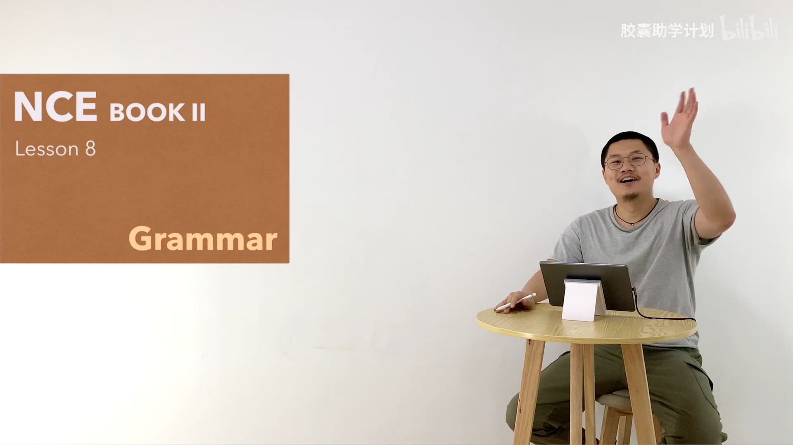

文字识别：胶囊助学计划 / NCE / BOOKI"I / Lesson 8 / Grammar

### 画面 00:00:02

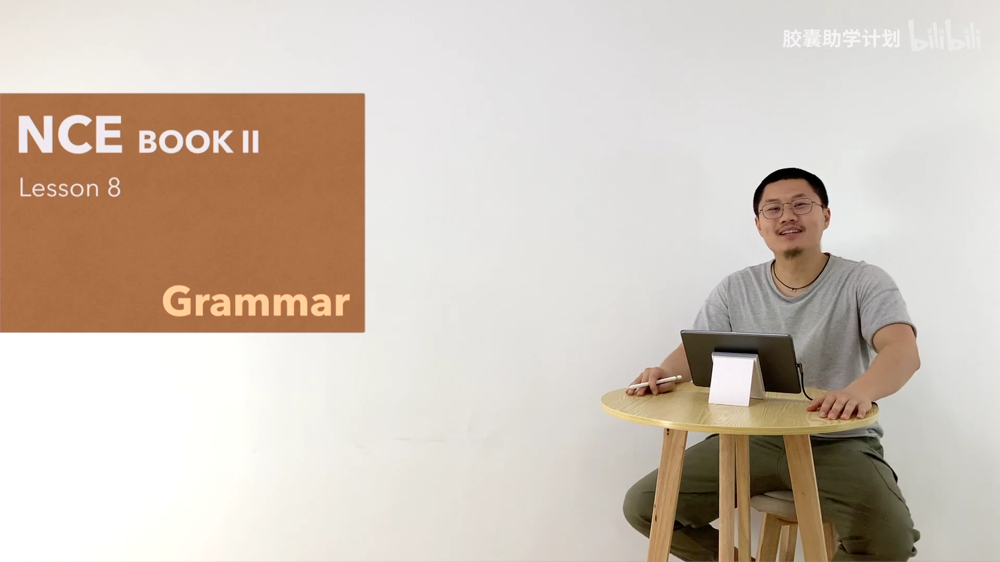

文字识别：胶囊助学计划 / NCE / BOOK I"I / Lesson 8 / Grammar

### 画面 00:00:04

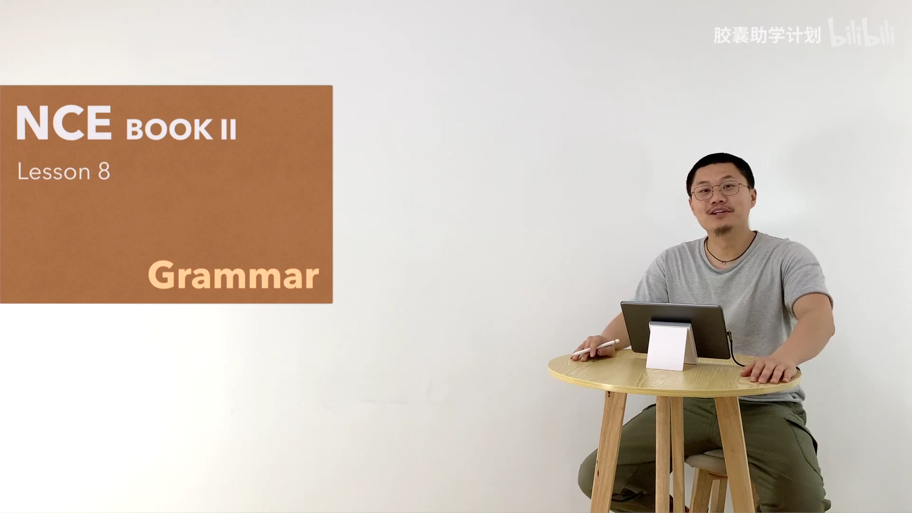

文字识别：胶囊助学计划 / NCE / BOOKII / Lesson 8 / Grammar

### 画面 00:00:06

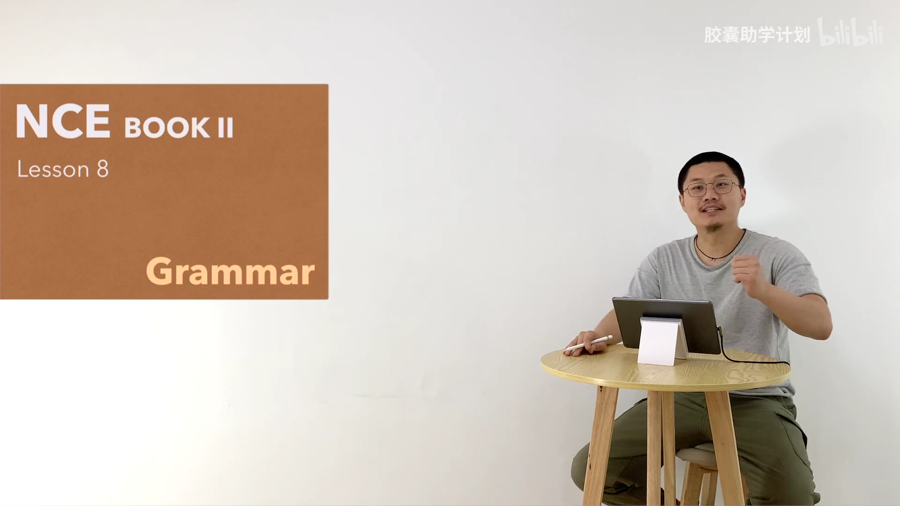

文字识别：胶囊助学计划 / NCE / BOOKI"I / Lesson 8 / Grammar

### 画面 00:00:08

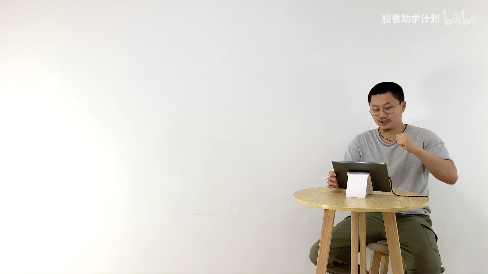

文字识别：胶囊助学计划

### 画面 00:00:10

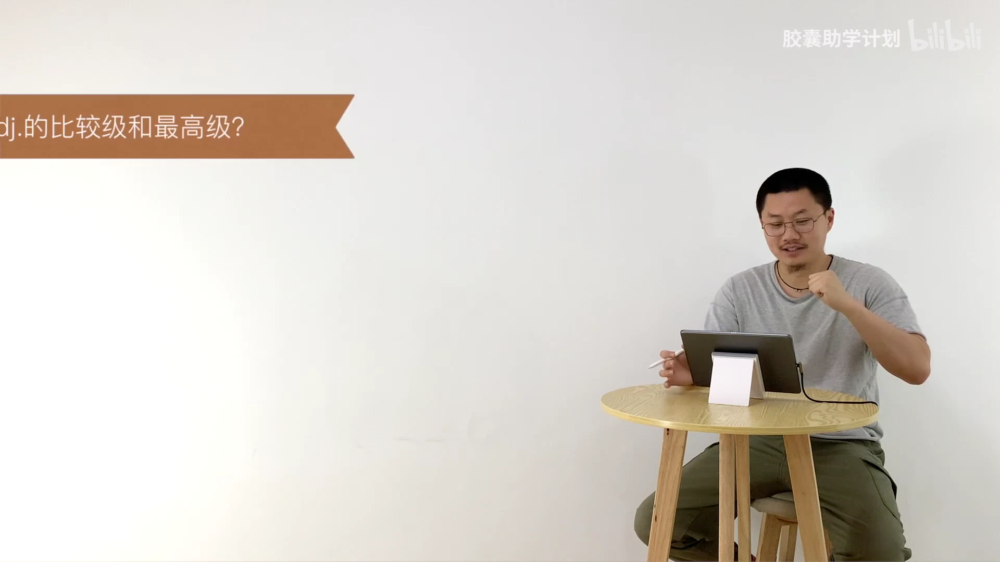

文字识别：胶囊助学计划 / dj的比较级和最高级？

### 画面 00:00:12

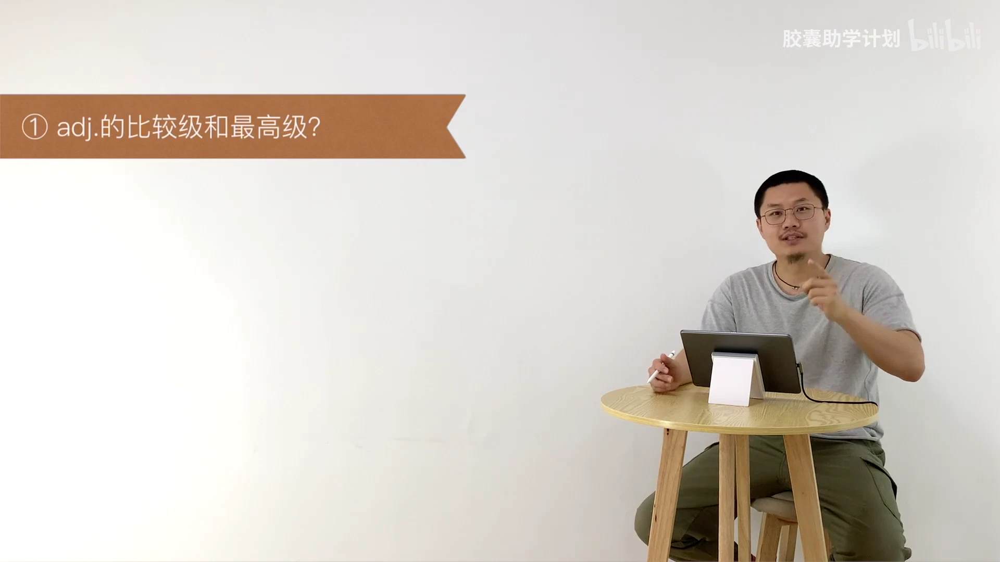

文字识别：胶囊助学计划 / ①adj.的比较级和最高级？

### 画面 00:00:15

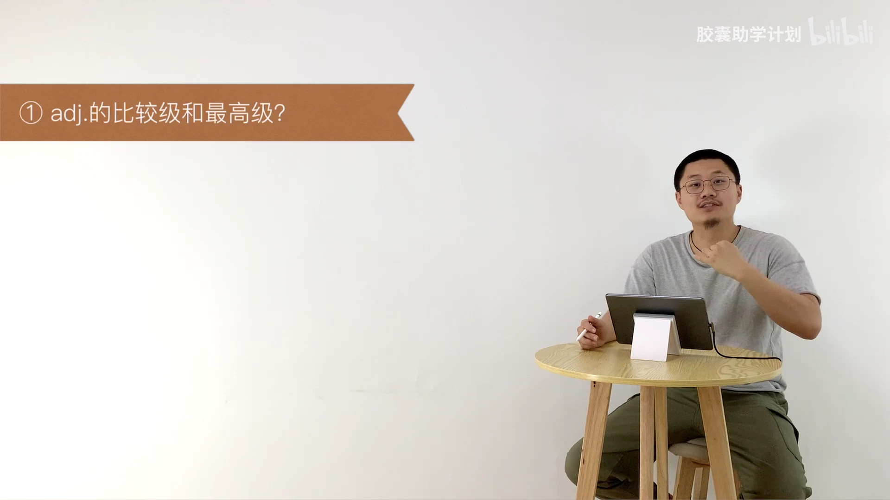

文字识别：胶囊助学计划 / ①adj.的比较级和最高级？

### 画面 00:00:19

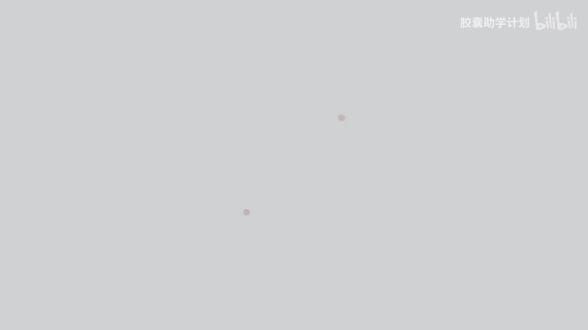

文字识别：胶囊助学计划bil出 / •

### 画面 00:00:23

文字识别：胶囊助学计划

### 画面 00:00:25

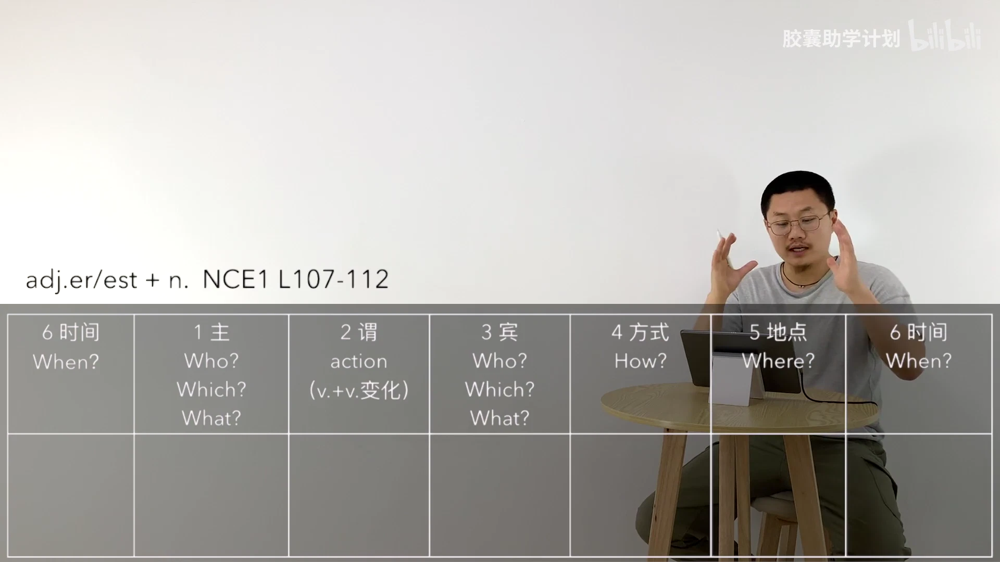

文字识别：胶囊助学计划 / adj.er/est + n. NCE1 L107-112 / 6时间 / 1主 / 2谓 / 3宾 / 4方式 / 5地点 / 6时间 / When? / Who? / action / Who? / How? / Where? / When? / Which? / (v.+v.变化) / Which? / What? / What?

## 00:00:30–00:01:00

第一节课就学过，这个非常重要，一直贯穿到新三，对吧？这个语序当中，它到底在一个什么位置上？首先我们要明白啊，形容词比较级和最高级本身它还是形容词啊。我现在后边加一、二、e s t，有一点基础的同学可能已经知道了，对吧？最简单的形容词后边加一、二，就表示更怎么怎么样；加e s t就表示最怎么怎么样。它不管加一、二还是e s t，它本质上还是形容词，所以呢，它还是要配合名词

### 画面 00:00:30

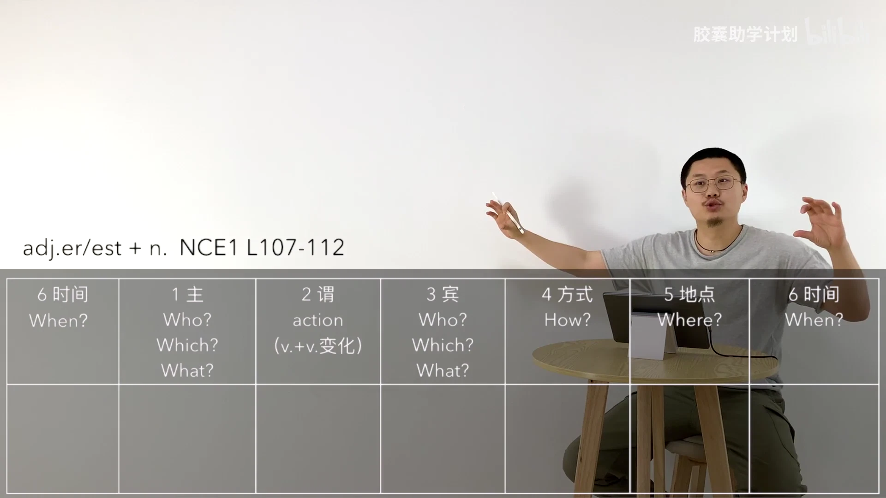

文字识别：胶囊助学计划 / adj.er/est + n. NCE1 L107-112 / 6时间 / 1主 / 2谓 / 3宾 / 4方式 / 5地点 / 6时间 / When? / Who? / action / Who? / How? / Where? / When? / Which? / (v.+v.变化) / Which? / What? / What?

### 画面 00:00:33

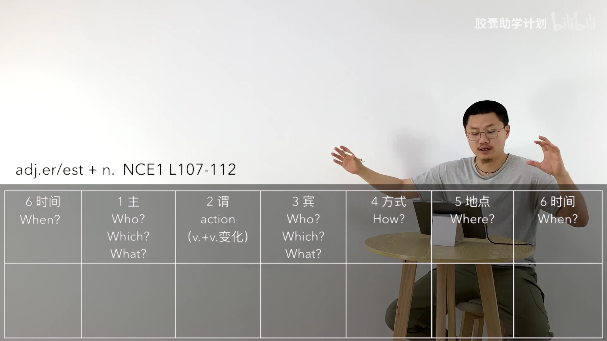

文字识别：胶囊助学计划 / adj.er/est + n. NCE1 L107-112 / 6时间 / 1主 / 2谓 / 3宾 / 4方式 / 5地点 / 6时间 / When? / Who? / action / Who? / How? / Where? / When? / Which? / (v.+v.变化) / Which? / What? / What?

### 画面 00:00:36

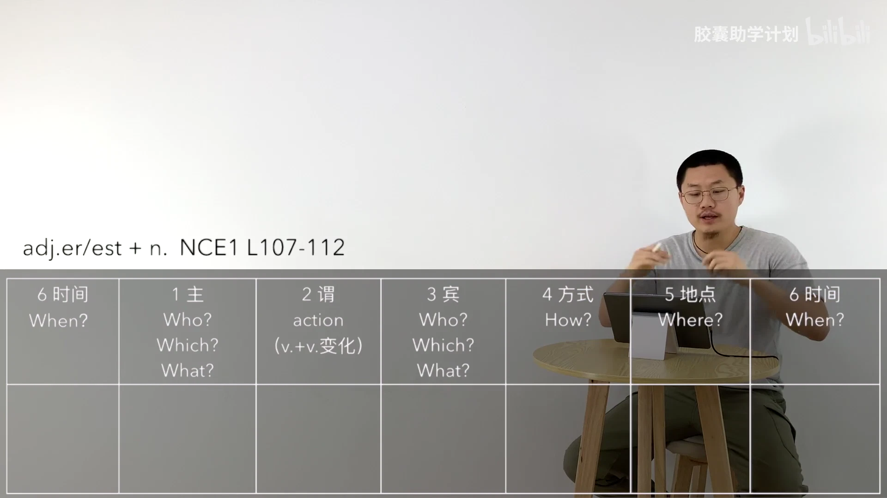

文字识别：胶囊助学计划 / adj.er/est + n. NCE1 L107-112 / 6时间 / 1主 / 2谓 / 3宾 / 4方式 / 5地点 / 6时间 / When? / Who? / action / Who? / How? / Where? / When? / Which? / (v.+v.变化) / Which? / What? / What?

### 画面 00:00:40

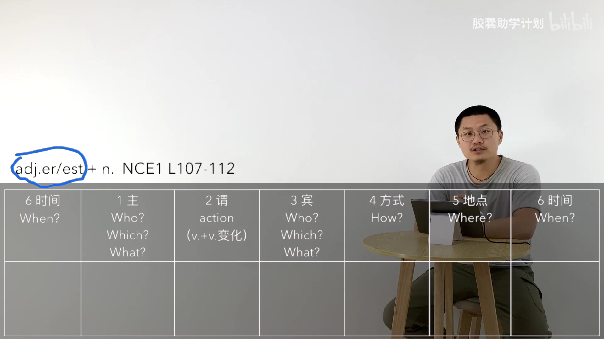

文字识别：胶囊助学计划 / adj.er/est / t+n.NCE1L107-112 / 6时间 / 1主 / 2谓 / 3宾 / 4方式 / 5地点 / 6时间 / When? / Who? / action / Who? / How? / Where? / When? / Which? / (v.+v.变化) / Which? / What? / What?

## 00:01:00–00:01:30

一起去使用的。那这个时候的关键点又回到了名词能放在什么位置上？理论上来说，名词能放在这些位置，都是问题不太大的。OK，那我们在这个地方，因为它有一个形容词，你想一下啊，它更多的地方，注意我说的是更多，不是不可能啊，更多的地方可能是用在一和三，主语和宾语的位置上，并且你想一下啊，它是要配合名词一起出现的，你就知道这个语

### 画面 00:01:07

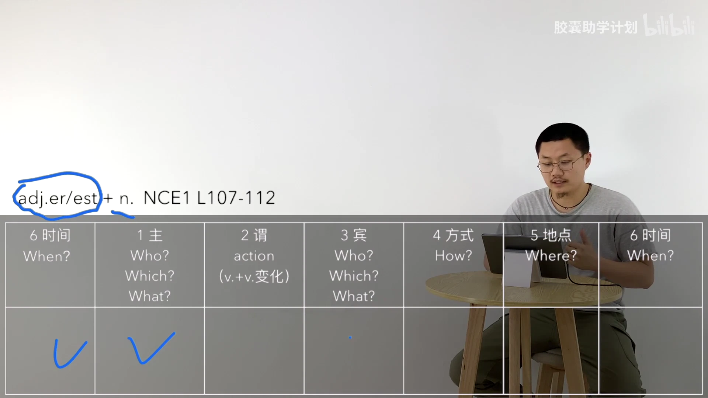

文字识别：胶囊助学计划 / adj.er/est / t)+ n. NCE1 L107-112 / 6时间 / 1主 / 2谓 / 3宾 / 4方式 / 5地点 / 6时间 / When? / Who? / action / Who? / How? / Where? / When? / Which? / (v.+v.变化) / Which? / What? / What?

### 画面 00:01:09

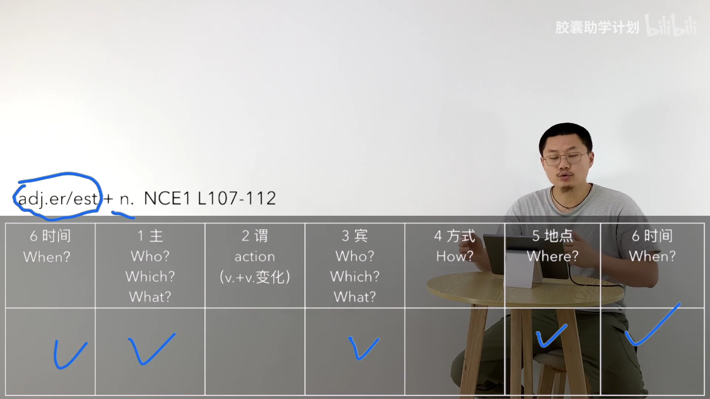

文字识别：胶囊助学计划 / adj.er/est / t)+ n. NCE1 L107-112 / 6时间 / 1主 / 2谓 / 3宾 / 4方式 / 5地点 / 6时间 / When? / Who? / action / Who? / How? / Where? / When? / Which? / (v.+v.变化) / Which? / What? / What?

### 画面 00:01:14

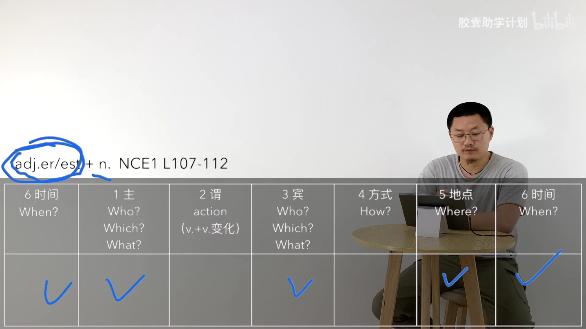

文字识别：胶囊助学计划 / adj.er/esh)+ n. NCE1 L107-112 / 6时间 / 1主 / 2谓 / 3宾 / 4方式 / 5地点 / 6时间 / When? / Who? / action / Who? / How? / Where? / When? / Which? / (v.+v.变化) / Which? / What? / What?

### 画面 00:01:22

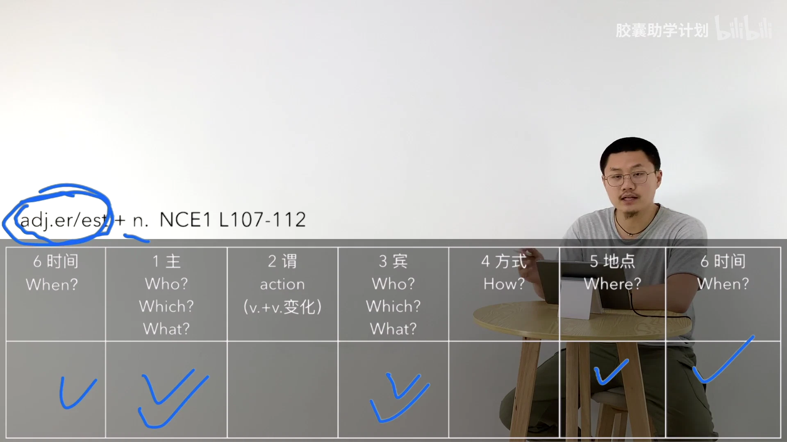

文字识别：胶囊助学计划 / adj.er/esh)+ n. NCE1 L107-112 / 6时间 / 1主 / 2谓 / 3宾 / 4方式 / 5地点 / 6时间 / When? / Who? / action / Who? / How? / Where? / When? / Which? / (v.+v.变化) / Which? / What? / What?

## 00:01:30–00:02:00

法它的重要程度有多么高了。相对于比如说二这个地方，它的重要程度没有那么高啊。那我们也要学嘛，它并且也不是很难。我们在新概念一册一百零七课到一百一十二课曾经有讲过，今天带着大家在整体的过一遍。OK，好，那我们首先先看它的构成啊。我们汉语当中想表达更或者最啊，其实用这两个字儿就可以了，不存在说把美丽的后边再加个er或者est

### 画面 00:01:34

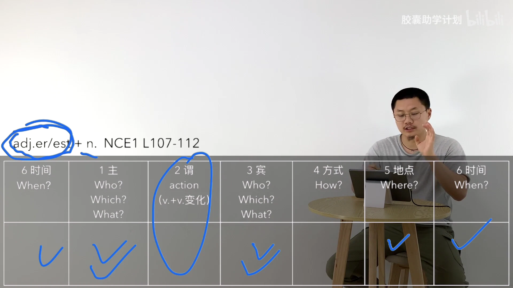

文字识别：胶囊助学计划 / adj.er/esh)+ n. NCE1 L107-112 / 6时间 / 1主 / 2谓 / 3宾 / 4方式 / 5地点 / 6时间 / When? / Who? / action / Who? / How? / Where? / When? / Which? / (v.+v.变化) / Which? / What? / What?

### 画面 00:01:47

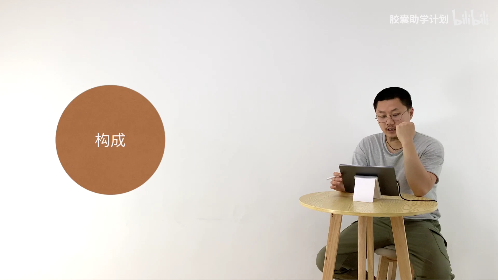

文字识别：胶囊助学计划 / 构成

### 画面 00:01:49

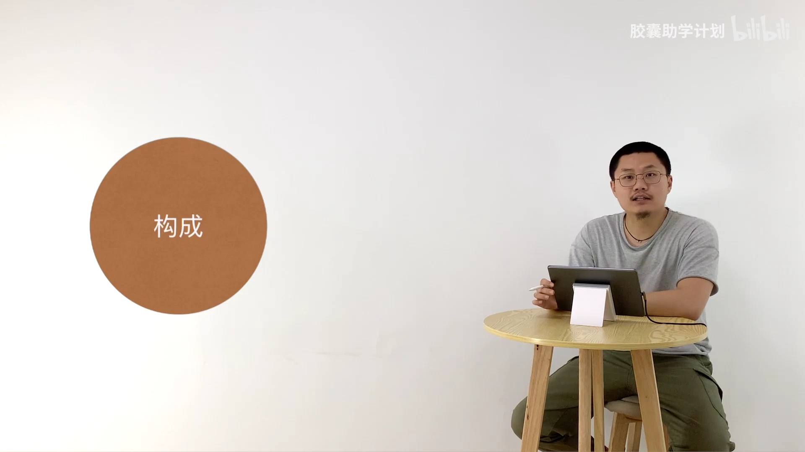

文字识别：胶囊助学计划 / 构成

### 画面 00:01:53

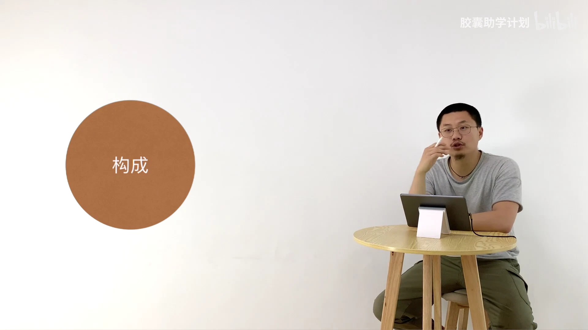

文字识别：胶囊助学计划 / 构成

## 00:02:00–00:02:30

表示最美丽或更美丽。英文不是这个逻辑，英文是什么逻辑呢？如果各位能想到之前我们学动词的 i n g，对吧？这我们在新一都学过动词的 e d，动词的三单的变化，你包括名词的复数变化，你应该有印象了，对吧？英语这门语言是靠在后面加上各种各样的东西来体现它的一些变化。比如说，如果一个形容词是单音节形容词，

### 画面 00:02:03

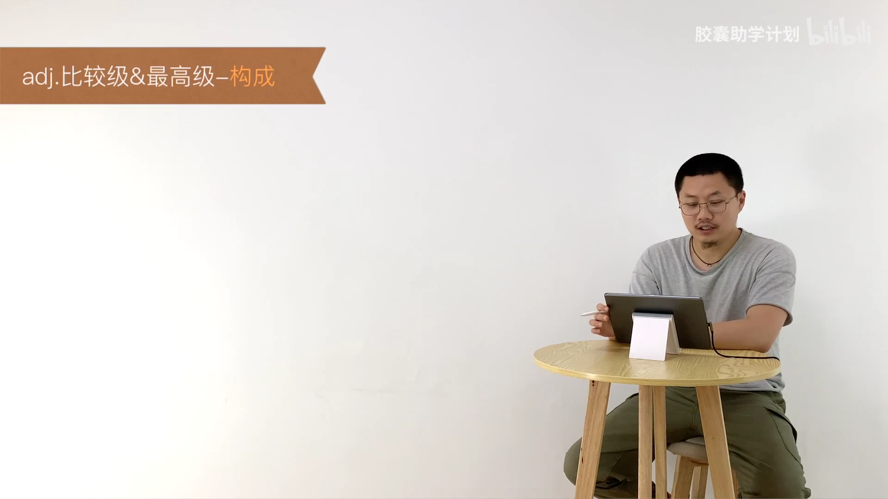

文字识别：胶囊助学计划 / adj.比较级&最高级-构成

### 画面 00:02:05

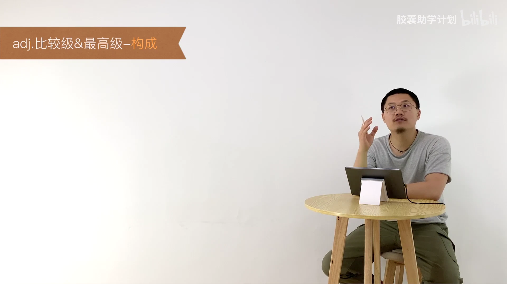

文字识别：胶囊助学计划 / adj.比较级&最高级-构成

### 画面 00:02:09

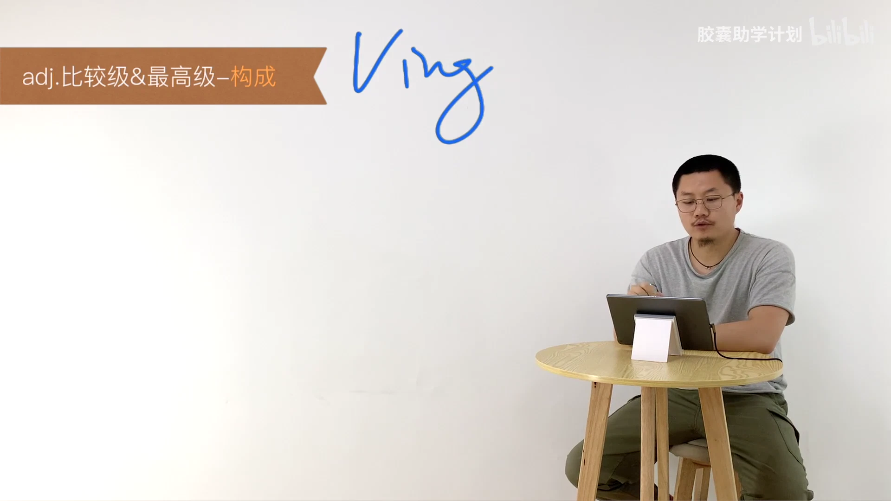

文字识别：胶囊助学计划 / adj.比较级&最高级-构成

### 画面 00:02:11

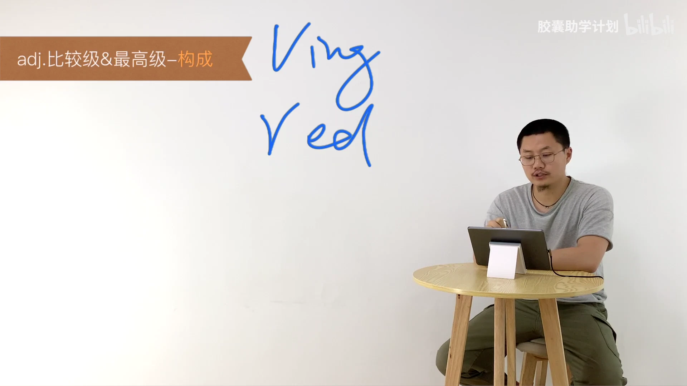

文字识别：胶囊助学计划 / adj.比较级&最高级-构成 / ee

### 画面 00:02:13

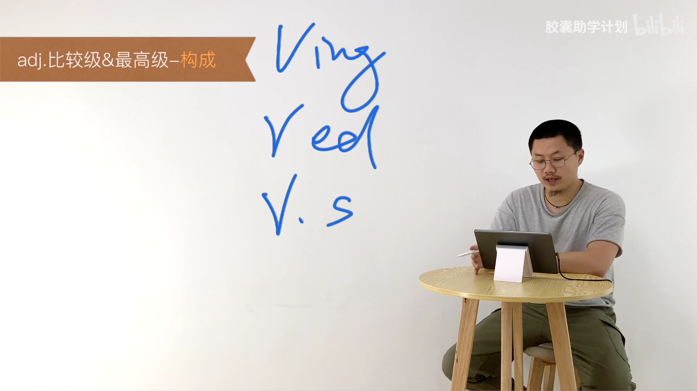

文字识别：胶囊助学计划 / adj.比较级&最高级-构成 / ee / V / S

### 画面 00:02:15

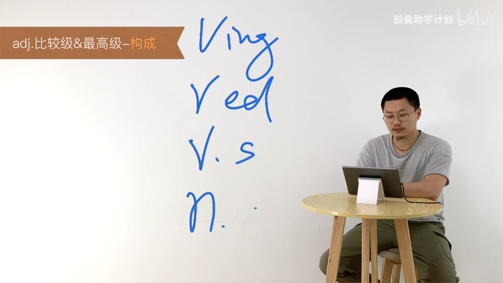

文字识别：胶囊助学计划 / adj.比较级&最高级-构成 / ee / V. / S / N.

### 画面 00:02:17

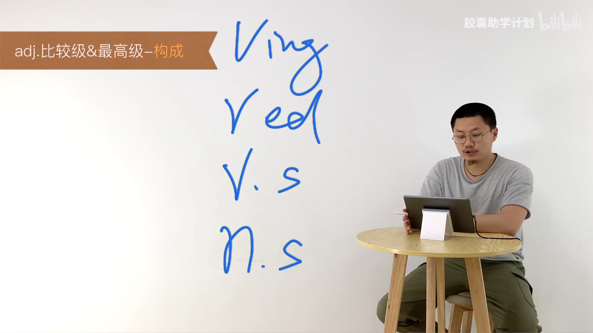

文字识别：胶囊助学计划 / adj.比较级&最高级-构成 / ee / V. / S / N.s

### 画面 00:02:19

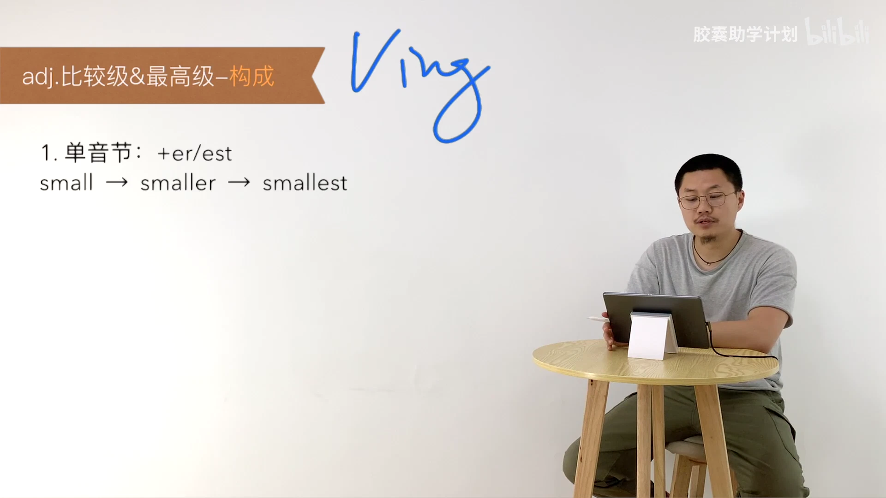

文字识别：胶囊助学计划 / adj.比较级&最高级-构成 / 1.单音节：+er/est / small → smaller → smallest

### 画面 00:02:28

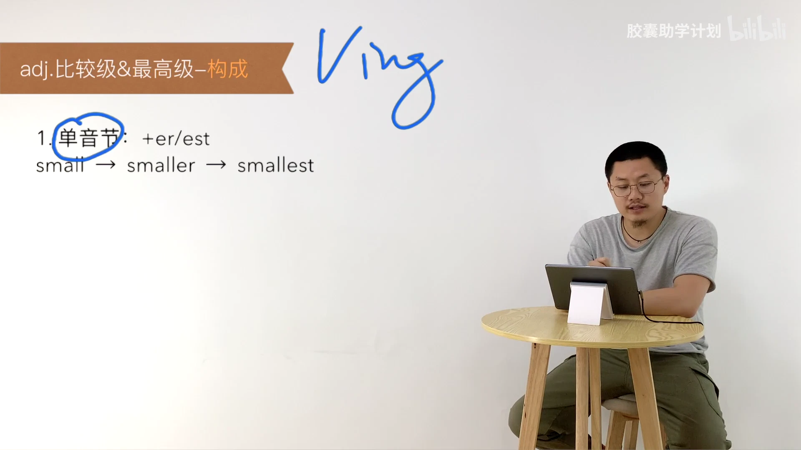

文字识别：胶囊助学计划 / adj.比较级&最高级-构成 / 单音节： / +er/est / small→ smaller → smallest

## 00:02:30–00:03:00

那你在后边加 e r e s t 就可以表示更或最，比如说 e r 就是更， e s t 就是最，比如说 small 叫小，那 smaller 后边加个 e r 呢，就表示的是更小， smallest 就表示的是最小啊。对于各位来说，无非就是记住 e r 和 e s t 就可以了。 OK，好，再往下走，比如说 new 新的， newer 啊， newest 对吧？ old older

### 画面 00:02:37

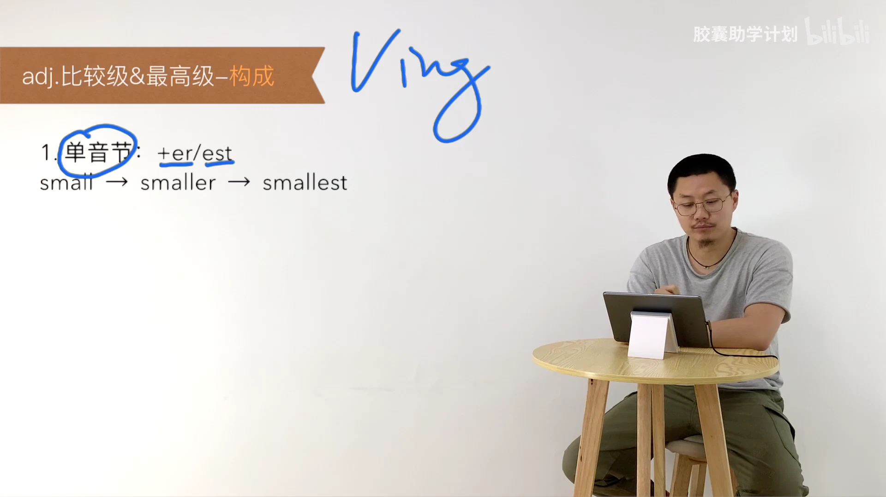

文字识别：胶囊助学计划 / adj.比较级&最高级-构成 / 单音节 / +er/est / small→smaller → smallest

### 画面 00:02:52

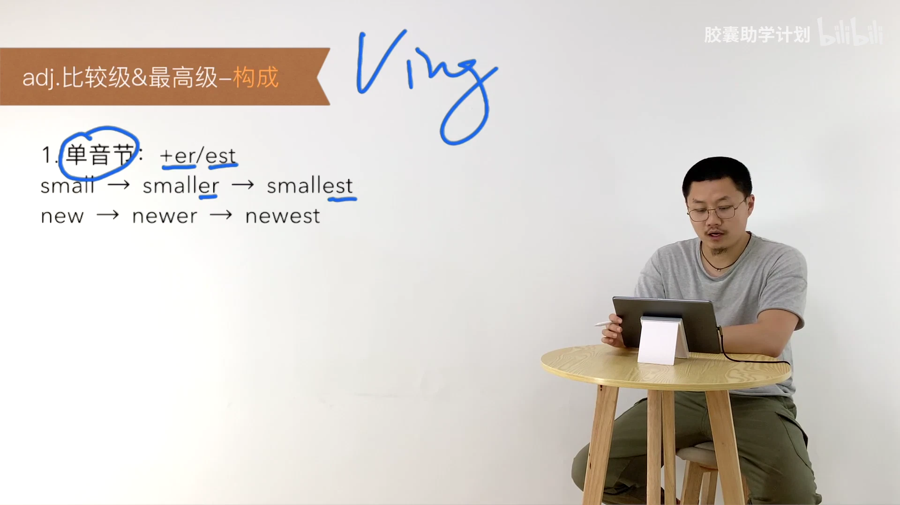

文字识别：胶囊助学计划 / adj.比较级&最高级-构成 / 单音节 / +er/est / smaller → smallest / small→ / new / newer → newest

### 画面 00:02:55

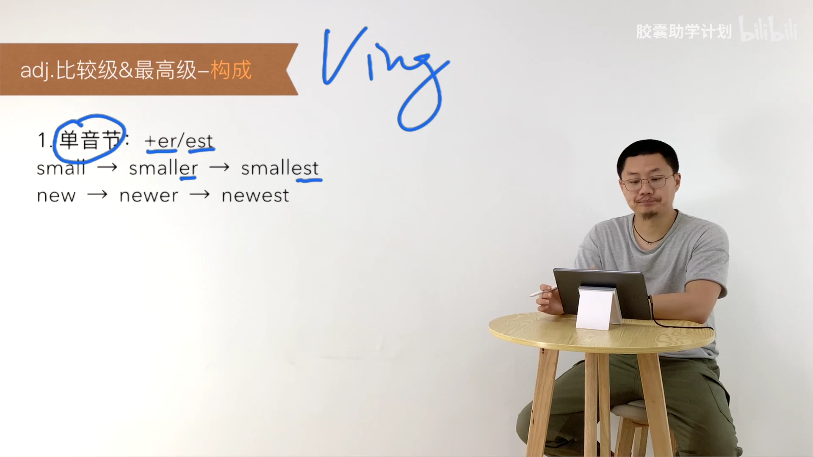

文字识别：胶囊助学计划 / x / adj.比较级&最高级-构成 / 单音节 / +er/est / smaller → smallest / small / new / newer  newest

## 00:03:00–00:03:30

这个地方要注意一个点，我重点强调强调了一下单音节。那我们再一起回顾一下。首先，各位如果现在还没有任何音标知识，一定要去我们的呃音标这个自然拼读法则加音标的这个课程当中去，把三个关于音标的视频仔仔细细的看一遍啊。那个地方我们就讲到了如何去看一个单词有几个音节呢？注意有几个元

### 画面 00:03:02

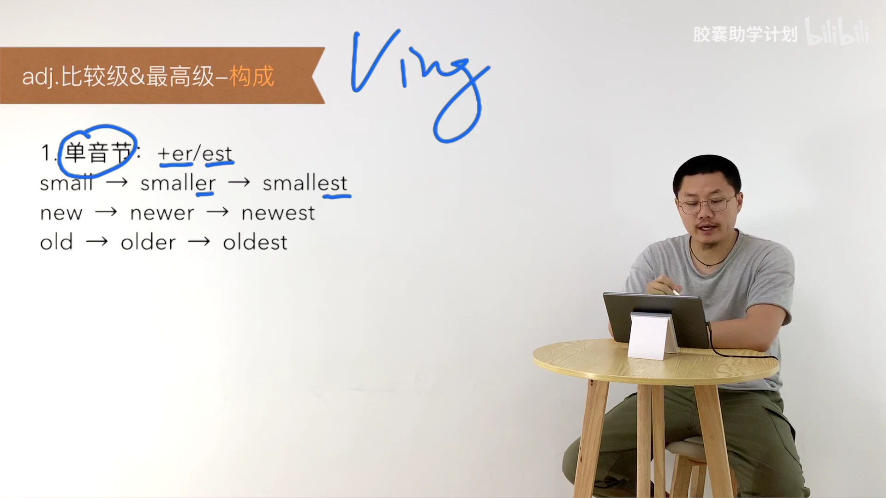

文字识别：胶囊助学计划 / adj.比较级&最高级-构成 / 单音节 / +er/est / smaller → smallest / small→ / new / newer → newest / old → older → oldest

### 画面 00:03:05

文字识别：胶囊助学计划 / adj.比较级&最高级-构成 / 单音节 / +er/est / smaller → smallest / smalf→ / new / newer → newest / old → older → oldest

### 画面 00:03:07

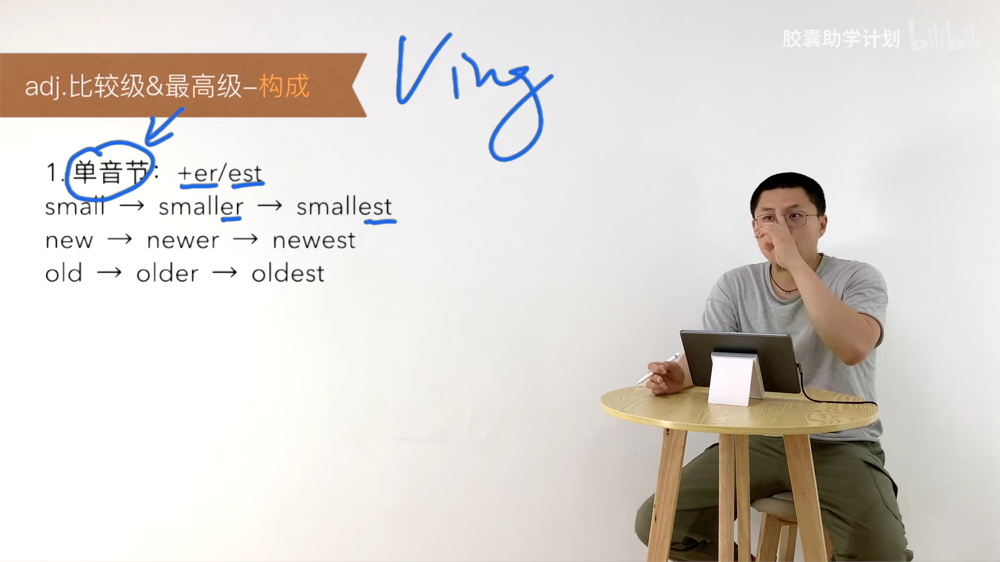

文字识别：胶囊助学计划 / adj.比较级&最高级-构成 / 单音节 / +er/est / smaller → smallest / smalf / new / newer newest / old → older → oldest

### 画面 00:03:10

文字识别：胶囊助学计划 / adj.比较级&最高级-构成 / 单音节 / +er/est / smaller → smallest / smalf / new / → newer → newest / old → older → oldest

### 画面 00:03:13

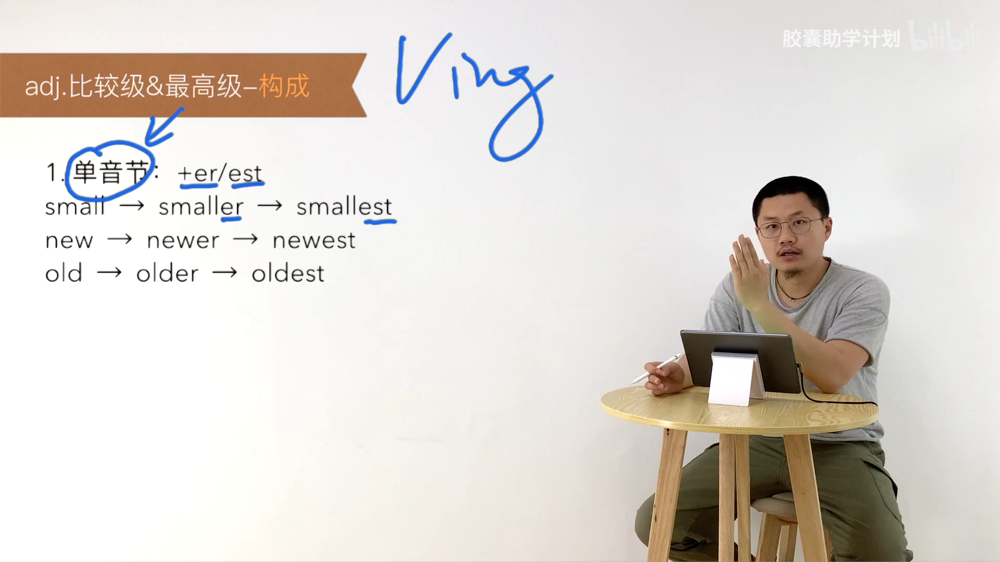

文字识别：胶囊助学计划 / adj.比较级&最高级-构成 / 单音节 / +er/est / smaller → smallest / smalf / new / newer → newest / old → older → oldest

### 画面 00:03:21

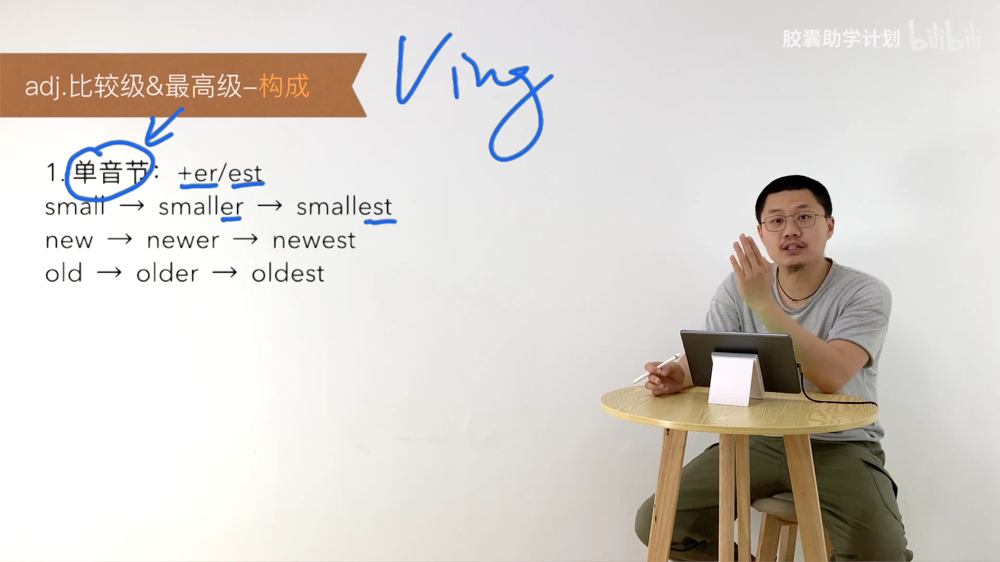

文字识别：胶囊助学计划 / adj.比较级&最高级-构成 / 单音节 / +er/est / smaller → smallest / smalf / new / newer → newest / old → older → oldest

## 00:03:30–00:04:00

音音标不看字母啊？有几个元音音标就有几个音节。那单音节的意思就是它只有一个元音音标，比如说 small 只有一个 o 的这样的一个元音音标，所以它叫做单音节啊。这是我们之前在新一甚至学新一之前就给大家讲过的知识。OK， continue。第二还是单音节，如果它是 e 结尾的，恰好这个 e 不发音，对吧？我们

### 画面 00:03:33

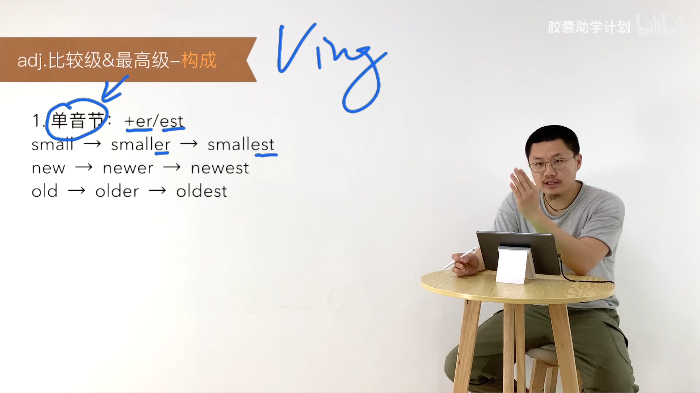

文字识别：胶囊助学计划 / adj.比较级&最高级-构成 / 单音节 / +er/est / smaller → smallest / small> / new / → newer → newest / old → older → oldest

### 画面 00:03:36

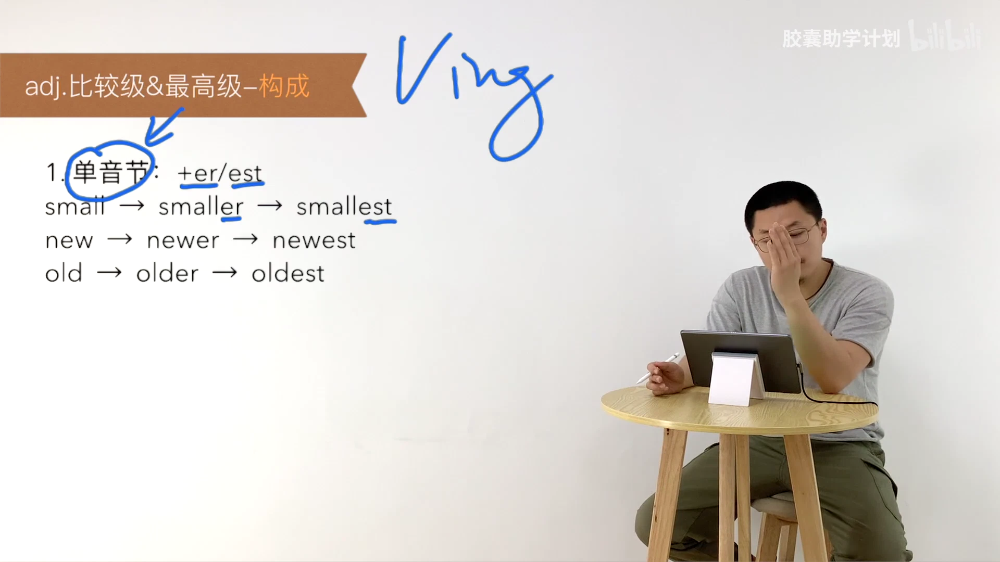

文字识别：胶囊助学计划 / adj.比较级&最高级-构成 / 单音节 / +er/est / smaller → smallest / small → / new / newer  newest / old → older → oldest

### 画面 00:03:40

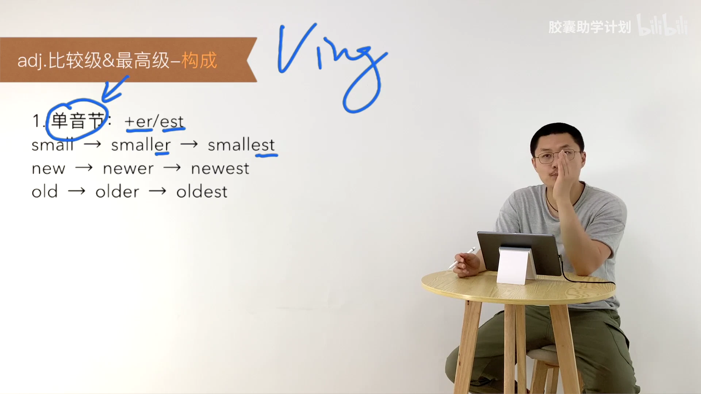

文字识别：胶囊助学计划 / adj.比较级&最高级-构成 / 单音节 / +er/est / smaller → smallest / smaill / new / newer  newest / old → older → oldest

### 画面 00:03:47

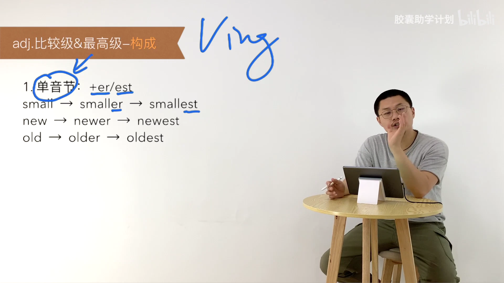

文字识别：胶囊助学计划 / adj.比较级&最高级-构成 / 单音节 / +er/est / smaller → smallest / small→ / new / newer → newest / old → older → oldest

### 画面 00:03:50

文字识别：胶囊助学计划 / adj.比较级&最高级-构成 / 单音节 / +er/est / smaller → smallest / smalf / new / newer → newest / old → older → oldest

### 画面 00:03:52

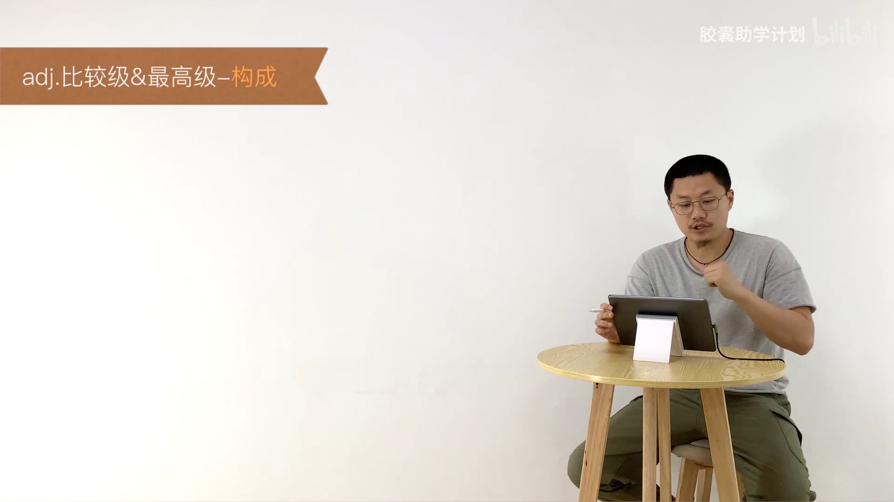

文字识别：胶囊助学计划 / adj.比较级&最高级-构成

### 画面 00:03:54

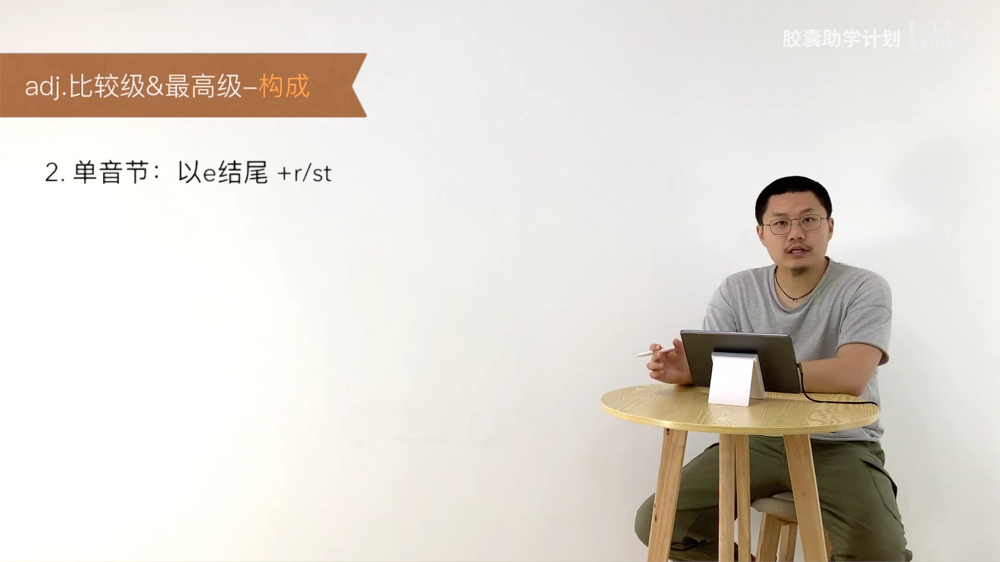

文字识别：胶囊助学计划 / adj.比较级&最高级-构成 / 2.单音节：以e结尾+r/st

### 画面 00:03:57

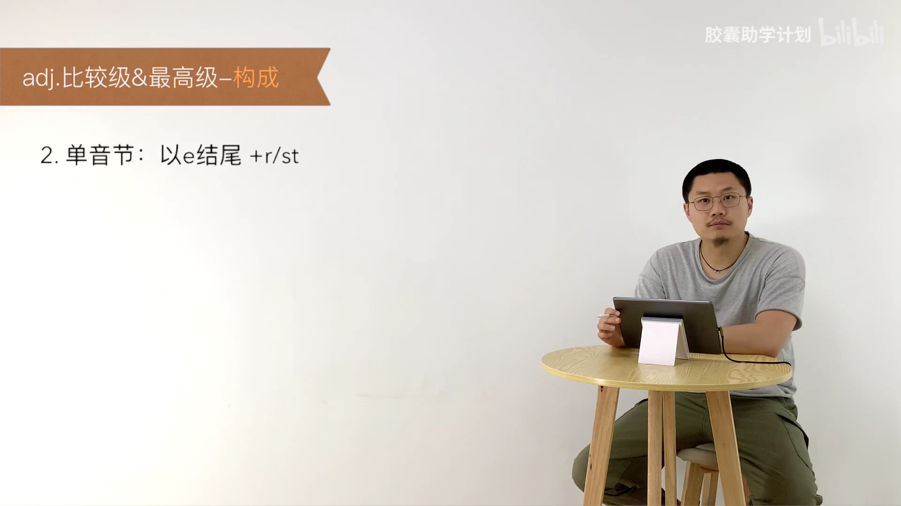

文字识别：胶囊助学计划 / adj.比较级&最高级-构成 / 2.单音节：以e结尾 +r/st

## 00:04:00–00:04:30

加 er 或 st 这一点，各位仔细去想，非常像我们之前学过的，比如说动词加 ing， make，对吧？把它加 ing 的时候， e 不发音，直接去掉，然后加 ing，这个逻辑非常的类似。把 e 去掉，然后加 er，把 e 去掉，然后加 est。当然了，有的人可能理解为的是，你直接加 er 或 st，这两个理解逻辑都可以。我在不同的语法

### 画面 00:04:08

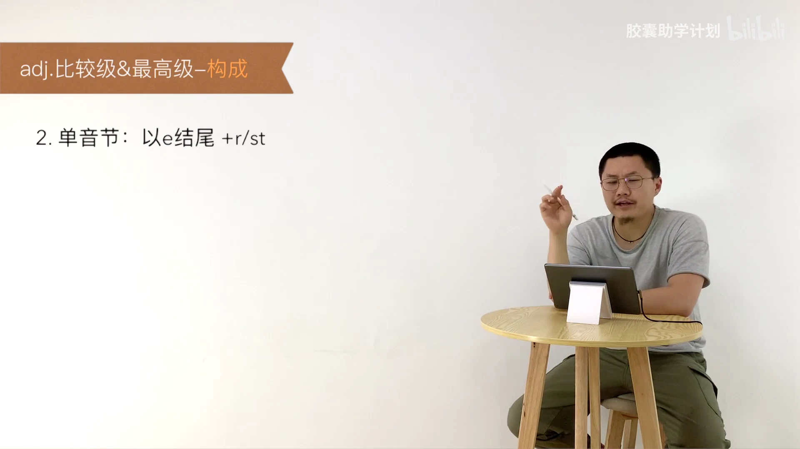

文字识别：胶囊助学计划 / adj.比较级&最高级-构成 / 2.单音节：以e结尾+r/st

### 画面 00:04:10

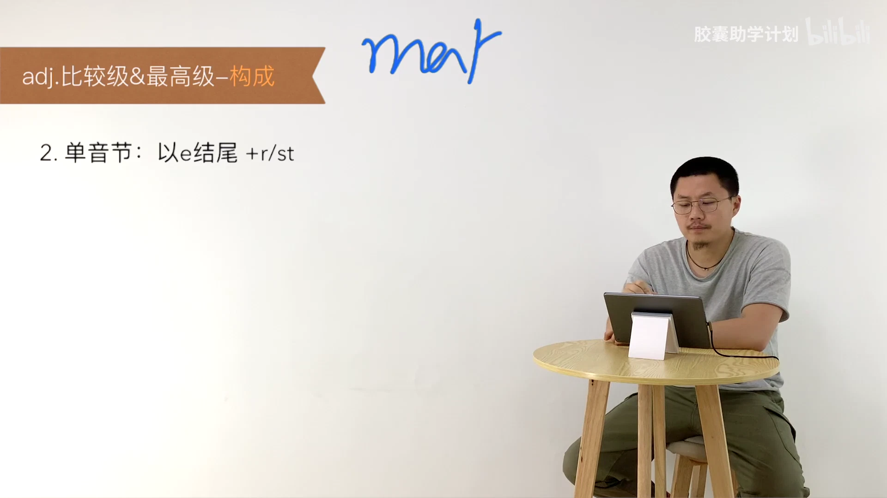

文字识别：mn / 胶囊助学计划 / adj.比较级&最高级-构成 / 2.单音节：以e结尾 +r/st

### 画面 00:04:14

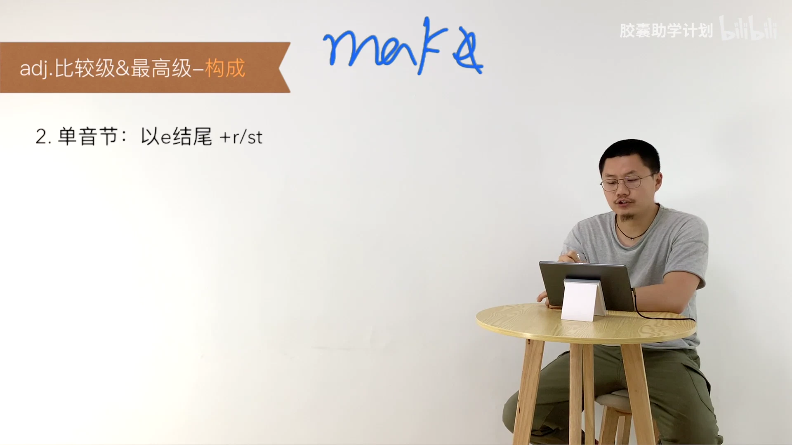

文字识别：maka / 胶囊助学计划 / adj.比较级&最高级-构成 / 2.单音节：以e结尾 +r/st

### 画面 00:04:16

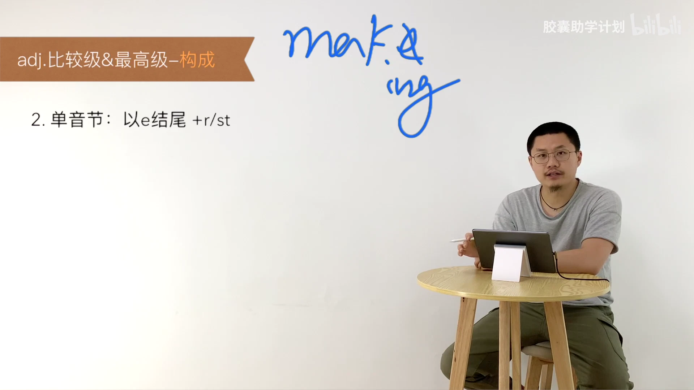

文字识别：mak.a / 胶囊助学计划 / adj.比较级&最高级-构成 / 2.单音节：以e结尾 +r/st

### 画面 00:04:21

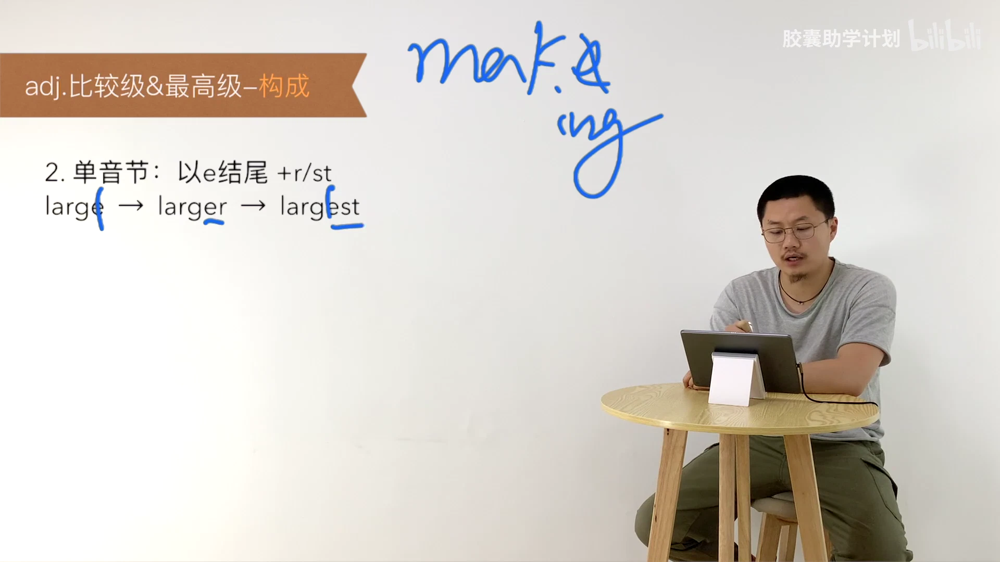

文字识别：maka / 胶囊助学计划 / adj.比较级&最高级-构成 / 2.单音节：以e结尾+r/st / large / →larger → largest

### 画面 00:04:29

文字识别：maka / 胶囊助学计划 / adj.比较级&最高级-构成 / 2.单音节：以e结尾+r/st / large / → larger → largest

## 00:04:30–00:05:00

书当中都见过啊，不用过分的纠结，反正重点就是不用双写 e 了。OK，好，那你比如说 nice 叫很棒，nicer 叫更棒，nicest 叫做最棒的啊。OK，下一个还是单音节，注意啊，前三个都是单音节的。如果它是元音字母加辅音字母结尾的，比如说 big，元音字母加辅音字母，这个我们在讲自然拼读法则的时候，那个视频当中也讲过 a

### 画面 00:04:41

文字识别：maka / 胶囊助学计划 / adj.比较级&最高级-构成 / 2.单音节：以e结尾 +r/st / large / → larger → largest / nice→ / nicer → r / nicest

### 画面 00:04:43

文字识别：胶囊助学计划 / adj.比较级&最高级-构成

### 画面 00:04:46

文字识别：胶囊助学计划 / adj.比较级&最高级-构成 / 3.单音节：元+辅结尾，双写辅音字母，加er,est

### 画面 00:04:50

文字识别：胶囊助学计划 / adj.比较级&最高级-构成 / 3.单音节：元+辅结尾，双写辅音字母，加er,est

### 画面 00:04:59

文字识别：胶囊助学计划 / adj.比较级&最高级-构成 / 3.单音节：元+辅结尾，双写辅音字母，加er,est / big → bigger → biggest / •

## 00:05:00–00:05:30

a e i o u 对吧？包括新概念一册第十五课，我没有记错的话，我们也去讲过这五个字母叫元音字母，而剩下的二十六减五的二十一个字母叫辅音字母。你看，所以它是元音字母加辅音字母结尾的。你双写最后的这个辅音字母，你看 big，哎，双写了 g，然后再加 e r，本质上还是一 r，只不过有一些小的不同的变化。于是更大叫做 bigger，最大叫做

### 画面 00:05:15

文字识别：胶囊助学计划 / adj.比较级&最高级-构成 / 3.单音节：元+辅结尾，双写辅音字母，加er,est / big → bigger → biggest

### 画面 00:05:18

文字识别：胶囊助学计划 / adj.比较级&最高级-构成 / 3.单音节：元+辅结尾， / 双写辅音字母 / 加er,est / big → bigger → biggest

### 画面 00:05:28

文字识别：胶囊助学计划 / adj.比较级&最高级-构成 / 3.单音节：元+辅结尾， / 双写辅音字母 / 加er,est / big → / bigger → biggest

## 00:05:30–00:06:00

biggest, OK. 比如说再来 hot 叫热，那更热叫做 hotter，最热的叫做 hottest. 好，在这个地方我想讲一个点啊，各位这个规则永远存在着很多很多的例外。各位不用过分纠结。所以在这个最后，我会给大家讲一件事儿，叫做好的字典非常的重要，好的词典会帮您标清楚。如果它是形容词，

### 画面 00:05:35

文字识别：胶囊助学计划 / adj.比较级&最高级-构成 / 3.单音节：元+辅结尾， / 双写辅音字母 / 加er,est / big → / bigger → biggest / hot → hotter → hottest

### 画面 00:05:41

文字识别：胶囊助学计划 / adj.比较级&最高级-构成 / 3.单音节 / 元+辅结尾， / 双写辅音字母 / 加er,est / big → / bigger → biggest / hot → hotter → / hottest

### 画面 00:05:43

文字识别：胶囊助学计划 / adj.比较级&最高级-构成 / 3.单音节 / 元+辅结尾， / 双写辅音字母 / 加er,est / big → / bigger→k / biggest / hot → / hotter→ / hottest

### 画面 00:05:45

文字识别：胶囊助学计划 / adj.比较级&最高级-构成 / 3.单音节 / 元+辅结尾， / 双写辅音字母 / 加er,est / big → / bigger → biggest / hot → hotter → / hottest

### 画面 00:05:50

文字识别：胶囊助学计划 / adj.比较级&最高级-构成 / 3.单音节 / 元+辅结尾， / 双写辅音字母 / 加er,est / big → / bigger→ / biggest / hot → hotter → / hottest

## 00:06:00–00:06:30

会帮您标清楚它的比较级长什么样子，最高级长什么样子。当您我举个例子啊，以后见到了和这个规则违背这个规则的一些状态的时候，你就去查字典或者词典就好了。OK，永远相信那些要比这个规则包含的更大，有规则必有例外。OK，continue，比如说 fat 叫胖，那 fatter 叫更胖， fattest 叫做最肥的、最胖的。OK，好，注意接下来要更复杂一

### 画面 00:06:08

文字识别：胶囊助学计划 / adj.比较级&最高级-构成 / 3.单音节 / 元+辅结尾， / 双写辅音字母 / 加er,est / big / → / bigger → biggest / hot → hotter → / hottest

### 画面 00:06:26

文字识别：胶囊助学计划 / adj.比较级&最高级-构成 / 3.单音节 / 元+辅结尾， / 双写辅音字母 / 加er,est / big → / bigger→ / biggest / hot → / > hotter → / hottest / fat → fatter → / fattest

### 画面 00:06:28

文字识别：胶囊助学计划 / adj.比较级&最高级-构成

## 00:06:30–00:07:00

点了，就是双音节。双音节是什么意思？就是有两个元音音标，对吧？有两个元音音标。如果它是双音节，它是辅音字母加 y 结尾的，变 y 为 i 加 e r e s t。你想一下，我们讲曾经名名词的复数的时候，我们当时好像也学过类似的东西，我不知道各位有没有印象啊？我们再来，比如说 pretty，听见了吧？双音节 pretty，OK？那

### 画面 00:06:30

文字识别：胶囊助学计划 / adj.比较级&最高级-构成 / 4.双音节：辅音字母+y结尾的，把y变为i，加er,est

### 画面 00:06:40

文字识别：胶囊助学计划 / adj.比较级&最高级-构成 / 4.双音节：辅音字母+y结尾的，把y变为i，加er,est

### 画面 00:06:43

文字识别：胶囊助学计划 / adj.比较级&最高级-构成 / 4.双音节：辅音字母+y结尾的，把y变为i，加er,est

## 00:07:00–00:07:30

它现在以辅音字母加 y 结尾的，变 y 为 i 加 e r，再变 y 为 i 加 e s t。同理，比如说 easy，很简单，变 y 为 i 加 e r，变 y 为 i 加 e s t。easier 和 easiest, okay.玩一个，但是注意双音节就非常麻烦了。没有，我查阅了很多语法书，没有任何一本语法书能给你一个完全准确的答案，它只能告诉你大概的规则是什么。比如

### 画面 00:07:05

文字识别：胶囊助学计划 / adj.比较级&最高级-构成 / 4.双音节：辅音字母+y结尾的， / 把y变为i，加er,est / pretty→ prettier → prettiest

### 画面 00:07:12

文字识别：胶囊助学计划 / adj.比较级&最高级-构成 / 4.双音节：辅音字母+y结尾的， / 把y变为i，加er,est / pretty→ prettier → prettiest / easy → easier → easiest

### 画面 00:07:21

文字识别：胶囊助学计划 / adj.比较级&最高级-构成 / 4.双音节：辅音字母+y结尾的， / 把y变为i，加er,est / 、 / pretty→ prettier → prettiest / easy → easier → easiest

### 画面 00:07:28

文字识别：胶囊助学计划 / adj.比较级&最高级-构成 / 4.双音节：辅音字母+y结尾的， / 把y变为i，加er,est / , / pretty→ prettier → prettiest / easy → easier → easiest

## 00:07:30–00:08:00

说，我们接下来看一下啊。好，那再来一个例子，比如说 heavy, heavier 和 heaviest。 OK，我们接下来看这个例子了。补充是非常关键的点。第一个，famous，你注意，它虽然也是双音节，但是我们前面加的是 more famous 来比较，作为比较级，加上 the most famous 来表示最高级，而不是用 famous 后边加 e r 或

### 画面 00:07:36

文字识别：胶囊助学计划 / adj.比较级&最高级-构成 / 4.双音节：辅音字母+y结尾的， / 把y变为i，加er,est / pretty→ prettier → prettiest / easy / easier → easiest / heavy / ↓ / heavier → heaviest

### 画面 00:07:45

文字识别：胶囊助学计划 / adj.比较级&最高级-构成 / 4.双音节：辅音字母+y结尾的， / 把y变为i，加er,est / pretty→ prettier → prettiest / easy → easier → easiest / heavy → heavier → heaviest / 补充： / famous →more famous → the most famous

### 画面 00:07:48

文字识别：胶囊助学计划 / adj.比较级&最高级-构成 / 4.双音节：辅音字母+y结尾的， / 把y变为i，加er,est / pretty→ prettier → prettiest / easy → easier → easiest / heavy / heavier → heaviest / 补充： / famous / more / famous → the most famous

### 画面 00:07:51

文字识别：胶囊助学计划 / adj.比较级&最高级-构成 / 4.双音节：辅音字母+y结尾的， / 把y变为i，加er,est / pretty→ prettier → prettiest / easy → easier → easiest / heavy / → heavier → heaviest / 补充： / famous / more / famous → the most famous

### 画面 00:07:54

文字识别：胶囊助学计划 / adj.比较级&最高级-构成 / 4.双音节：辅音字母+y结尾的， / 把y变为i，加er,est / pretty→ prettier → prettiest / easy / → / easier → easiest / heavy / → / heavier → heaviest / 补充： / famous / more / famous → the most famous

### 画面 00:07:58

文字识别：胶囊助学计划 / adj.比较级&最高级-构成 / 4.双音节：辅音字母+y结尾的， / 把y变为i，加er,est / pretty→ prettier → prettiest / easy → / easier → easiest / heavy / → / heavier → heaviest / 补充： / famous / more / famous → the most famous

## 00:08:00–00:08:30

者famous后边加est来表示比较级或最高级。它用的是more，叫做更多和the most叫做最多这两个单词来表示怎么怎么样。比如说更有名或最有名的famous表示的是著名的有名的。OK，好，那你再看最后给大家这个例子，这个例子就更有意思了，叫做clever，叫做聪明的。clever这个单词可以表示cleverer后边加er和cleverest，

### 画面 00:08:02

文字识别：学计划 / adj.比较级&最高级-构成 / 4.双音节：辅音字母+y结尾的， / 把y变为i，加er,est / pretty→ prettier → prettiest / easy / / → easier  easiest / heavy / heavier → heaviest / 补充： / famous / more / famous → the most famous

### 画面 00:08:05

文字识别：胶囊助学计划 / adj.比较级&最高级-构成 / 4.双音节：辅音字母+y结尾的， / 把y变为i，加er,est / pretty→ prettier → prettiest / easy / → / easier → easiest / heavy / → / heavier → heaviest / 补充： / famous / more / famous → the most famous

### 画面 00:08:19

文字识别：胶囊助学计划 / adj.比较级&最高级-构成 / 4.双音节：辅音字母+y结尾的， / 把y变为i，加er,est / pretty→ / prettier / → / prettiest / easy / → / easier → / easiest / heavy / → / heavier / → / heaviest / 补充： / famous / more / famous / → the most famous / clever → / cleverer/more / clever → / cleverest/ the / most clever

### 画面 00:08:21

文字识别：胶囊助学计划 / adj.比较级&最高级-构成 / 4.双音节：辅音字母+y结尾的，把y变为i，加er,est / pretty→ prettier → prettiest / easy → easier → easiest / heavy → heavier → heaviest / 补充： / famous →more famous → the most famous / clever → cleverer/more clever → cleverest/the / most clever

### 画面 00:08:28

文字识别：胶囊助学计划 / adj.比较级&最高级-构成 / 4.双音节：辅音字母+y结尾的，把y变为i，加er,est / pretty→ prettier → prettiest / easy → easier → easiest / heavy → heavier → heaviest / 补充： / famous →more famous → the most famous / clever → cleverer/more clever → cleverest/ the / most clever

## 00:08:30–00:09:00

用 e s t 表示更聪明和最聪明。它也可以说 more clever，更聪明的和 the most clever，叫做最聪明的。它有两种变化形式。所以在这儿我们简单总结一下啊，各位要注意，如果是双音节，它有至少三种情况。第一种情况是 e r e s t，第二种情况是前面加 more 或者

### 画面 00:08:35

文字识别：胶囊助学计划 / adj.比较级&最高级-构成 / 4.双音节：辅音字母+y结尾的，把y变为i，加er,est / pretty→ prettier → prettiest / easy → easier → easiest / heavy → heavier → heaviest / 补充： / famous →more famous → the most famous / clever → cleverer/more clever → cleverest/ the / most clever

### 画面 00:08:38

文字识别：胶囊助学计划 / adj.比较级&最高级-构成 / 4.双音节：辅音字母+y结尾的， / 把y变为i，加er,est / pretty→ prettier → prettiest / easy → easier → easiest / heavy → heavier → heaviest / 补充： / famous →more famous → the most famous / clever → cleverer/more clever → cleverest/ the / most elever

### 画面 00:08:40

文字识别：胶囊助学计划 / adj.比较级&最高级-构成 / 4.双音节：辅音字母+y结尾的， / 把y变为i，加er,est / pretty→ prettier → prettiest / easy → easier → easiest / heavy → heavier → heaviest / 补充： / famous →more famous → the most famous / clever → cleverer/more clever → cleverest/ the / most elever

### 画面 00:08:45

文字识别：胶囊助学计划 / adj.比较级&最高级-构成 / 4.双音节：辅音字母+y结尾的， / 把y变为i，加er,est / pretty→ prettier → prettiest / easy → easier → easiest / heavy → heavier → heaviest / 补充： / famous →more famous → the most famous / clever → cleverer/more clever → cleverest/ the / most elever

### 画面 00:08:47

文字识别：胶囊助学计划 / adj.比较级&最高级-构成 / 4.双音节：辅音字母+y结尾的， / 把y变为i，加er,est / pretty→ prettier → prettiest / easy → easier → easiest / heavy → heavier → heaviest / 补充： / famous →more famous → the most famous / clever → cleverer/more clever → cleverest/ the / most elever

### 画面 00:08:50

文字识别：胶囊助学计划 / adj.比较级&最高级-构成 / 4.双音节：辅音字母+y结尾的， / 把y变为i，加er,est / pretty→ prettier → prettiest / easy → easier → easiest / heavy → heavier → heaviest / 补充： / famous →more famous → the most famous / clever → cleverer/more clever → cleverest/ the / most elever

### 画面 00:08:53

文字识别：胶囊助学计划 / adj.比较级&最高级-构成 / er / 4.双音节：辅音字母+y结尾的， / 把y变为i，加er,est / pretty→ prettier → prettiest / easy → easier → easiest / heavy → heavier → heaviest / 补充： / famous →more famous → the most famous / clever → cleverer/more clever → cleverest/ the / most elever

### 画面 00:08:56

文字识别：胶囊助学计划 / more / adj.比较级&最高级-构成 / er / est / 4.双音节：辅音字母+y结尾的， / 把y变为i，加er,est / pretty→ prettier → prettiest / easy → easier → easiest / heavy → heavier → heaviest / 补充： / famous →more famous → the most famous / clever → cleverer/more clever → cleverest/ the / most elever

### 画面 00:08:58

文字识别：胶囊助学计划 / more / adj.比较级&最高级-构成 / er / est / oe / 4.双音节：辅音字母+y结尾的， / 把y变为i，加er,est / pretty→ prettier → prettiest / easy → easier → easiest / heavy → heavier → heaviest / 补充： / famous →more famous → the most famous / clever → cleverer/more clever → cleverest/ the / most elever

## 00:09:00–00:09:30

most.第三种情况呢是二者皆可。OK。那至于说哪个单词是怎么样的，因为单词太多了，我们没必要在这儿全罗列。比如说现在来随便来一个，呃，双音节对吧？随便来一个双音节。那我们怎么去判断它到底是第一种情况、第二种情况还是第三种情况都可以加呢？各位最方便、最直

### 画面 00:09:00

文字识别：胶囊助学计划 / more / adj.比较级&最高级-构成 / er / tbe most / est / 4.双音节：辅音字母+y结尾的， / 把y变为i，加er,est / pretty→ prettier → prettiest / easy → easier → easiest / heavy → heavier → heaviest / 补充： / famous →more famous → the most famous / clever → cleverer/more clever → cleverest/ the / most elever

### 画面 00:09:04

文字识别：胶囊助学计划 / more / adj.比较级&最高级-构成 / ver / be most / est / 4.双音节：辅音字母+y结尾的， / 把y变为i，加er,est / pretty→ prettier → prettiest / easy / → / easier → easiest / heavy / heavier → heaviest / 补充： / famous →more famous → the most famous / clever → cleverer/more clever → cleverest/ the / most elever

### 画面 00:09:07

文字识别：胶囊助学计划 / more / adj.比较级&最高级-构成 / oer /  most / est / 4.双音节：辅音字母+y结尾的， / 把y变为i，加er,est / pretty→ prettier → prettiest / easy / easier → easiest / heavy / heavier / heaviest / 补充： / famous →more famous → the most famous / clever → cleverer/more clever → cleverest/ the / most elever

### 画面 00:09:24

文字识别：胶囊助学计划 / more / adj.比较级&最高级-构成 / ver / be most / est / 4.双音节：辅音字母+y结尾的， / 把y变为i，加er,est / pretty→ prettier → prettiest / easy / easier → easiest / heavy → / heavier / → heaviest / 补充： / famous →more famous → the most famous / clever → cleverer/more clever → cleverest/ the / most elever

### 画面 00:09:26

文字识别：胶囊助学计划 / more / adj.比较级&最高级-构成 / ver /  most / est / 4.双音节：辅音字母+y结尾的， / 把y变为i，加er,est / pretty→ prettier / r → prettiest / easy / → / easier → easiest / heavy / → / heavier / → / heaviest / 补充： / famous →more famous → the most famous / clever → cleverer/more clever → cleverest/ the / most elever

### 画面 00:09:28

文字识别：胶囊助学计划 / more / adj.比较级&最高级-构成 / ver / te most / est / 4.双音节：辅音字母+y结尾的， / 把y变为i，加er,est / pretty→ prettier / r → prettiest / easy / → / easier → easiest / heavy / heavier / heaviest / 补充： / famous →more famous → the most famous / clever → cleverer/more clever → cleverest/ the / most elever

## 00:09:30–00:10:00

接的方式就是直接查词典，而不是去背这些规则了。但是在这儿，各位要知道存在这样的情况，以后见到别以为我讲错了，对吧？你说老师讲了 clever 后边加 er，对吧？然后这怎么见到一个 more clever 呢？ OK，注意到这点就行了。接下来不规则的这个理应是我们学到新二就已经掌握的，我只是放在这儿带给大家再过一遍。Good, well，好，更好，better，最好，best。坏，

### 画面 00:09:40

文字识别：胶囊助学计划 / more / adj.比较级&最高级-构成 / ver / be most / est / 4.双音节：辅音字母+y结尾的， / 把y变为i，加er,est / pretty→ prettier / r → prettiest / easy / easier → easiest / heavy / ↓ / heavier → heaviest / 补充： / famous →more famous → the most famous / clever → cleverer/more clever → cleverest/ the / most elever

### 画面 00:09:45

文字识别：胶囊助学计划 / adj.比较级&最高级-构成

### 画面 00:09:49

文字识别：胶囊助学计划 / adj.比较级&最高级-构成 / 5.不规则 / good/well → better → best

### 画面 00:09:55

文字识别：胶囊助学计划 / adj.比较级&最高级-构成 / 5.不规则 / good/well → better → best

### 画面 00:09:59

文字识别：胶囊助学计划 / adj.比较级&最高级-构成 / 5.不规则 / good/well → better → best / bad → worse→ worst

## 00:10:00–00:10:30

bad 更坏 worse 最坏的 worst many how much 多 更多哎关键单词就来了叫做 more 和 most 好少 little OK 它更少叫做 less 最少的叫做 least 这里面对各位来说在跟接下来形容词比较级最高级啊密切相连的是这四个单词更多 more 最多

### 画面 00:10:04

文字识别：胶囊助学计划 / adj.比较级&最高级-构成 / 5.不规则 / good/well → better → best / bad / → / worse / worst / much /many / more / most

### 画面 00:10:09

文字识别：胶囊助学计划 / adj.比较级&最高级-构成 / 5.不规则 / good/well → better → best / bad / → / worse / worst / much /many / more / most

### 画面 00:10:18

文字识别：胶囊助学计划 / adj.比较级&最高级-构成 / 5.不规则 / good/well / better → / best / bad / → / worse / worst / much /  /many / more / most / litle → / less / Teast

### 画面 00:10:22

文字识别：胶囊助学计划 / adj.比较级&最高级-构成 / 5.不规则 / good/well / better / best / bad / worse / worst / much / /many / more / most / little / →Tess / Teast

### 画面 00:10:24

文字识别：胶囊助学计划 / adj.比较级&最高级-构成 / 5.不规则 / good/well / better / best / bad / → / worse / worst / much / /many / more / most / little / less / least

### 画面 00:10:28

文字识别：胶囊助学计划 / adj.比较级&最高级-构成 / 5.不规则 / good/well / → / better / best / bad / → / worse / worst / much / /many / more / most / little / less / least

## 00:10:30–00:11:00

most 少 less 更少 less 最少 least 好，那我们接下来看一下它有什么联系。多音节形容词指的是音节数量大于等于三的时候啊，前面加 more 或者 most 表肯定。比如说 beautiful beautiful 三个音节对吧？我说更美就不能 beautiful 后边加一二，应该说的是 more beautiful 最美叫做 the most

### 画面 00:10:30

文字识别：胶囊助学计划 / adj.比较级&最高级-构成 / 5.不规则 / good/well / → / better → / best / bad / → / worse / worst / much / /many / more / most / little / less / least

### 画面 00:10:36

文字识别：胶囊助学计划 / adj.比较级&最高级-构成

### 画面 00:10:39

文字识别：胶囊助学计划 / adj.比较级&最高级-构成 / 6.多音节adj.（大于等于3），前加more, most表肯定。

### 画面 00:10:41

文字识别：胶囊助学计划 / adj.比较级&最高级-构成 / 6.多音节adj.（大于等于3），前加more, most表肯定。

### 画面 00:10:46

文字识别：胶囊助学计划 / adj.比较级&最高级-构成 / 6.多音节adj.（大于等于3），前加more, most表肯定。

## 00:11:00–00:11:30

beautiful。各位可能已经注意到了，在最高级这个地方，我经常在加着一个小的单词 the，这个是英文固定的要求啊，它特指嘛，你已经是最了，肯定是特指了嘛，对吧？OK，再来，比如说 intelligent，哎， more intelligent，更有智慧的、更聪明的和 the most intelligent，对吧？人工智能嘛，这个智能就是 artificial intelligence，对吧？OK， intelligent 是它的形容词。

### 画面 00:11:01

文字识别：胶囊助学计划 / adj.比较级&最高级-构成 / 6.多音节adj.（大于等于3），前加more, most表肯定。 / beautiful / more beautiful / the most beautiful

### 画面 00:11:04

文字识别：胶囊助学计划 / adj.比较级&最高级-构成 / 6.多音节adj.（大于等于3），前加more, most表肯定。 / beautiful / more beautiful / themost beautiful

### 画面 00:11:23

文字识别：胶囊助学计划 / adj.比较级&最高级-构成 / 6.多音节adj.（大于等于3），前加more, most表肯定。 / beautiful / more beautiful / the most beautiful / intelligent / more intelligent / the most intelligent

## 00:11:30–00:12:00

好，注意下一个还是多音节大于等于三，前面加的是less or least，表示的类似于一种否定，它不是完全的否定啊，不是像类似于no啊not那种否定，指的是更少，比如说beautiful是不是叫美啊，less beautiful没那么美，这个地方要注意一个小点，它可能并不指的是丑，指的是没有那个人漂亮，但不代表它就是丑，

### 画面 00:11:30

文字识别：胶囊助学计划 / adj.比较级&最高级-构成

### 画面 00:11:33

文字识别：胶囊助学计划 / adj.比较级&最高级-构成 / 7.多音节adj.（大于等于3），前加less, least表否定

### 画面 00:11:36

文字识别：胶囊助学计划 / adj.比较级&最高级-构成 / 7.多音节adi.（大于等于3），前加less, least表否定

### 画面 00:11:47

文字识别：胶囊助学计划 / adj.比较级&最高级-构成 / 7.多音节adi.（大于等于3），前加less, least表否定 / beautiful

## 00:12:00–00:12:30

各位想一下这个逻辑，对吧？啊，选美冠军、冠军、亚军、季军，冠军就是 beautiful，亚军就是 less beautiful，那季军就是 the least beautiful。那你绝对不可能说选美冠军这三个人是丑的，对不对？注意这个小点啊。接下来 expensive 叫做贵啊，比如说一双筷子卖十万，另一双筷子卖五万，还有一双筷子卖一万，这三双筷子都不便宜，对吧？但是卖五万的那一个就是 less expensive，

### 画面 00:12:03

文字识别：胶囊助学计划 / adj.比较级&最高级-构成 / 7.多音节adi.（大于等于3），前加ess, least表否定 / beautiful / less beautiful

### 画面 00:12:15

文字识别：胶囊助学计划 / adj.比较级&最高级-构成 / 7.多音节adj.（大于等于3），前加ess, least表否定 / beautiful / less beautiful / the least beautiful

### 画面 00:12:21

文字识别：胶囊助学计划 / adj.比较级&最高级-构成 / 7.多音节adi.（大于等于3），前加ess, least表否定 / beautiful / less beautiful / the least beautiful / expensive

## 00:12:30–00:13:00

卖一万的那个就是 the least expensive。我希望大家明白这个点了，OK？那这个呢，就是我们关键上的构成。我们一口气儿讲了七个点，实际上就是带着大家把新概念一册一百零七课到一百一十二课整理了一遍啊。接下来我们说它的用法，用法呢，重点有三个小的公式，我们看一下。主语，各位先不用背啊，各位这个可以暂停去把它抄下来，但暂时不用背，

### 画面 00:12:36

文字识别：胶囊助学计划 / 用法

### 画面 00:12:40

文字识别：胶囊助学计划 / 用法

### 画面 00:12:49

文字识别：胶囊助学计划 / adj.比较级&最高级-用法

### 画面 00:12:52

文字识别：胶囊助学计划 / adj.比较级&最高级-用法 / 1.主语+be+adj.er+than+比较对象(lformal/ me informal)

### 画面 00:12:54

文字识别：胶囊助学计划 / adj.比较级&最高级-用法 / 1.生语+be+adj.er+than+比较对象 (Iformal/ me informal)

## 00:13:00–00:13:30

我们要靠练习把它记下来，而不是靠记忆把它背下来，那就变成数学公式了。主语加上 b b 就是 ms 二，对吧？当然也可以是 was were。形容词加 e r，注意形容词加 e r 只是想提醒你，这是形容词的比较级啊。你说 more 也可以，对吧？Then 叫做比，比的是谁呢？比的是比较对象。这地方有一个很小的知识点，就是 I 和 me。有一些我我至少见过啊，有一

### 画面 00:13:10

文字识别：胶囊助学计划 / adj.比较级&最高级-用法 / 1.主语+be+adj.er+than+比较对象 (Iformal/ me informal)

### 画面 00:13:13

文字识别：胶囊助学计划 / adj.比较级&最高级-用法 / 1.主语+be+adj.er+than+比较对象 (I formal/ me informal)

### 画面 00:13:19

文字识别：胶囊助学计划 / adj.比较级&最高级-用法 / 1.主语+be+adj.er+than / 比较对象（ / (1 formal/ me informal)

### 画面 00:13:22

文字识别：胶囊助学计划 / adj.比较级&最高级-用法 / 1.主语+be+adj.ert / than / 比较对象 / (I formal/ me informal)

### 画面 00:13:29

文字识别：胶囊助学计划 / adj.比较级&最高级-用法 / 1.主语+be+adj.ert / than / 比较对象 / (I formal/ me informal)

## 00:13:30–00:14:00

课程是这样讲的，说你绝对不能用 me，必须用 I，没有这样没有这码事儿是吧？用法当中的 me 是叫做 informal，如果你说 than me 也是对的，只是它不那么正式，而 than I 是比较正式的一种说法，而 than me 是绝对存在的，任何电影当中你都可以见到这样的一件事情。OK，好，那接下来我们去看图造句啊，比如说我先给大家来一句，我们看一下能不能套到这个公式当中去，以及我们能不能读

### 画面 00:13:36

文字识别：胶囊助学计划 / adj.比较级&最高级-用法 / 1.主语+be+adj.ertt / than / 比较对象 / (I formal/ me / informal)

### 画面 00:13:39

文字识别：胶囊助学计划 / adj.比较级&最高级-用法 / 1.主语+be+adj.ertt / than / 比较对象 / (I formal/ me / informal)

### 画面 00:13:45

文字识别：胶囊助学计划 / adj.比较级&最高级-用法 / 1.主语+be+adj.ertt / than / 比较对象 / (I formal/ me / informal)

### 画面 00:13:50

文字识别：胶囊助学计划 / adj.比较级&最高级-用法 / 1.主语+be+adj.ert / than / 比较对象 / (I formal/ me / informal)

### 画面 00:13:52

文字识别：胶囊助学计划 / 1.主语+be+adj.er+than+比较对象 / (I formal / me informal)

### 画面 00:13:55

文字识别：胶囊助学计划b出b鼎 / 1.主语+be+adj.er+than+比较对象 / (I formal / me informal) / ① The left one is smaller than the right one.

## 00:14:00–00:14:30

懂？The left one，主语左面的这一个 is b is 形容词 e 二 smaller 比 than 比谁呢？比较对象 the right one 右边这一个，左面的这一个是更小的，比右边的那个。其实翻译成汉语舒服的语序就是左边比右边小，对吧？Continuing，我们还是啊看 Yao

### 画面 00:14:01

文字识别：胶囊助学计划 / 1.主语+be+adj.er+than+比较对象 / (I formal / me informal) /  The left one is smaller than the right one.

### 画面 00:14:03

文字识别：胶囊助学计划 / ⇒主语+be+adj.er+than+比较对象 / (I formal / me informal) / ) The left one is smaller than the right one.

### 画面 00:14:05

文字识别：胶囊助学计划 / ⇒主语+be+adj.er+than+比较对象 / (I formal / me informal) / ) The left one is smaller than the right one.

### 画面 00:14:07

文字识别：胶囊助学计划 / B出出 / ⇒主语fbe+adj.er+than+比较对象 / (l formal / me informal) / The left one is smaller than the right one.

### 画面 00:14:09

文字识别：胶囊助学计划 / 主语fbe+adi.er+than+比较对象 / (I formal / me informal) / The left one is smaller than the right one.

### 画面 00:14:11

文字识别：胶囊助学计划bi出b出 / ⇒主语fbe+adi.er+than / 比较对象 / (l formal / me informal) / The left one is smaller than the right one.

### 画面 00:14:13

文字识别：胶囊助学计划 / ⇒主语fbe+adi.er+than / 比较对象 / (l formal / me informal) / The left one is smallerthan the right one.

### 画面 00:14:15

文字识别：biibil / 胶囊助学计划 / ⇒主语fbe+adi.er+thand / 比较对象 / (1 formal / me informal) / The left one is smaller thanthe right one.

### 画面 00:14:18

文字识别：Dilibili / 胶囊助学计划 / ⇒主语fbe+adi.er+than / 比较对象 / (I formal / me informal) / The left one is smaller / thanthe right one.

### 画面 00:14:20

文字识别：BilBil / 胶囊助学计划 / ⇒主语fbe+adi.er+than / 比较对象 / (1 formal / me informal) / The left one is smallert / thanhe right one

### 画面 00:14:23

文字识别：胶囊助学计划 / ⇒主语fbe+adi.er+than / 比较对象 / (I formal / me informal) / The left one is smaller / thanthe right one

### 画面 00:14:26

文字识别：胶囊助学计划 / 1.主语+be+adj.er+than+比较对象 / (I formal / me informal)

### 画面 00:14:29

文字识别：胶囊助学计划 / 1.主语+be+adj.er+than+比较对象 / (I formal / me informal) / ①Yao is taller than Jet Li.

## 00:14:30–00:15:00

主语 is taller 更高 than 比谁呢？比的是比较对象叫 Jet Li 啊，李连杰的全啊英文名字 Jet Li。 OK OK continue。比如说啊，我们看这个图，我们说说 the left one 左边这一个 is 又是 be 形容词 prettier than 比的是谁呢？比的是 right one 啊，比的是右边这个，左边这个看上

### 画面 00:14:32

文字识别：胶囊助学计划 / 主语+be+adj.er+than+比较对象 / (I formal / me informal) / ①Yao is taller than Jet Li.

### 画面 00:14:35

文字识别：胶囊助学计划 / 主语+be+adj.erfthan+比较对象 / (I formal / me informal) / ①Yao is taller than Jet Li.

### 画面 00:14:39

文字识别：胶囊助学计划 / 主语+be+adj.erfthan+比较对象 / (I formal / me informal) / ①Yao is taller than Jet Li.

### 画面 00:14:42

文字识别：胶囊助学计划 / 1.主语+be+adj.er+than+比较对象 / (I formal / me informal)

### 画面 00:14:47

文字识别：胶囊助学计划 / 1.主语+be+adj.er+than+比较对象 / (I formal / me informal) /  The left one is prettier than the right one.

### 画面 00:14:51

文字识别：胶囊助学计划 / 1.主语+be+adj.er+than+比较对象 / (I formal / me informal) / The left one is prettier than the right one.

### 画面 00:14:53

文字识别：胶囊助学计划 / 1.主语+be+adj.er+than+比较对象 / (I formal / me informal) / The left one is / brettient / than the right one.

### 画面 00:14:55

文字识别：胶囊助学计划 / 1.主语+be+adj.er+than+比较对象 / (I formal / me informal) / The left one is / brettie) / than the right one.

### 画面 00:14:57

文字识别：胶囊助学计划 / 1.主语+be+adj.er+than+比较对象 / (I formal / me informal) / The left one is / brettie) / thanthe right one.

## 00:15:00–00:15:30

去还挺漂亮的，右边这个看起来就不那么漂亮了啊，搞笑更多一点点，是吧？呃，丑帅丑帅的，是这样的一种感觉。OK，这是我们说的第一个公式。当然了，课下各位靠课上这三个是不够的，课下各位还要去练，这是我们家庭作业之一。听听力，接下来我们看一个小的电影片段，当中出现了这样一句话，叫做 Thanos is more important 更重要 than me，叫比我来了。 Thanos

### 画面 00:15:01

文字识别：胶囊助学计划 / 1.主语+be+adj.er+than+比较对象 / (I formal/ me informal) / The left one is / 6rettie) / than he right one.

### 画面 00:15:05

文字识别：胶囊助学计划 / 1.主语+be+adj.er+than+比较对象 / (I formal/ me informal) / The left one is / brettien / than he right one.

### 画面 00:15:09

文字识别：胶囊助学计划 / 主语+be+adj.er+than+比较对象 / (I formal / me informal) / The left one is / brettien / than he right one.

### 画面 00:15:11

文字识别：胶囊助学计划 / 主语+be+adj.er+than+比较对象 / (1 formal / me informal) / The left one is / 6rettie) / thant / he right / one.

### 画面 00:15:17

文字识别：Zion's more important than me / 胶囊助学计划 / 黑客帝国 / 崔妮蒂 / The Matrix / (1999) / Trinity.

## 00:15:30–00:16:00

Zion's more important than me or you, even Morpheus. Well, there has to be something that we can do. There is. We pull the plug. Okay, Zion's more important than me or you or Morpheus. Very good. Continue. 下一个用法我们看一下啊，主语还是 be，跟刚才没区别，但是这个单词你要注意了，叫做 the 加上

### 画面 00:15:30

文字识别：Zion's more important than me / 胶囊助学计划 / 黑客帝国 / 锡安的重要性远超过我 / The Matrix / (1999) / Zion's more important than me...

### 画面 00:15:32

文字识别：Zion's more important than me / 胶囊助学计划 / 黑客带国 / 或是你 / The Matrix / (1999) / or you....

### 画面 00:15:34

文字识别：Zion's more important than me / 胶囊助学计划 / 黑客帝国 / 甚至是墨菲斯 / Th'e Matrix / (1999) / or even Morpheus.

### 画面 00:15:36

文字识别：Zion's more important than me / 胶囊助学计划 / • / 黑客帝国 / The Matrix / (1999)

### 画面 00:15:38

文字识别：Zion's more important than me / 胶囊助学计划 / 黑客帝国 / The Matrix / (1999)

### 画面 00:15:40

文字识别：Zion's more important than me / 胶囊助学计划 / 黑客帝国 / The Matrix / (1999)

### 画面 00:15:42

文字识别：Zion's more important than me / 胶囊助学计划 / 黑客帝国 / 当然可以拔掉插头 / The Matrix / (1999) / There is. We pull the plug.

### 画面 00:15:49

文字识别：胶囊助学计划 / adj.比较级&最高级-用法

### 画面 00:15:52

文字识别：胶囊助学计划 / adj.比较级&最高级-用法 / 2.主语+be+the+adj.est +n.+范围

### 画面 00:15:54

文字识别：胶囊助学计划 / adj.比较级&最高级-用法 / 主语+be+the+adj.est +n.+范围 / 2.

### 画面 00:15:57

文字识别：胶囊助学计划 / adj.比较级&最高级-用法 / 2.主语+be+the-adj.est +n.+范围

## 00:16:00–00:16:30

形容词最高级，再加一个名词，再加一个范围啊。我们看一下来啊，比如说我爸爸是全世界最酷的人，那你想一下，我们想往这公用这个公式表达出来这句汉语，主语就是我爸爸，那后边 M S R 是谁？ the 永远不变，最酷我给你了，叫做 coolest 名词其实有没有，这时候已经无所谓了，因为你前面主语已经说了 my father 了，对吧？所以这个名词呢可以加个括弧，但是范围是要加上的，

### 画面 00:16:02

文字识别：胶囊助学计划 / adj.比较级&最高级-用法 / 主语+be+the-adj.est +n. / -范围

### 画面 00:16:04

文字识别：胶囊助学计划 / 2.主语+be+the+adj.est +n.+范围

### 画面 00:16:06

文字识别：胶囊助学计划 / 2.主语+be+the+adj.est +n.+范围 / ）我爸爸是全世界最酷（coolest）的人。

### 画面 00:16:10

文字识别：胶囊助学计划 / 2.主语+be+the+adj.est +n.+范围 / 我爸爸是全世界最酷（coolest）的人。

### 画面 00:16:12

文字识别：胶囊助学计划 / 2 / 主语+be+the+adj.est +n.+范围 / 2 / 我爸爸是全世界最酷（coolest）的人。

### 画面 00:16:22

文字识别：胶嚢助学计划 / 主语+be+the+adj.est +n.+范围 / 2 / 我爸爸是全世界最酷（coolest）的人。

### 画面 00:16:29

文字识别：胶囊助学计划 / 主语+be+the+adj.estfn+范围 / 2 / 我爸爸是全世界最酷（coolest）的人。

## 00:16:30–00:17:00

叫做全世界。我们看一下这个英文啊，My father主语is be the coolest guy，the coolest guy in the world in the world，完美契合，对吧？Guy我刚才讲了可以去掉，My father is the coolest in the world，有没有这个Guy？语义都是通顺的。OK，continue，我们再来一句啊，说世上只有妈妈好啊，我们直接来说My mom主

### 画面 00:16:32

文字识别：胶囊助学计划 / 主语+be+the+adj.estfn+范围 / 2 / 我爸爸是全世界最酷（coolest）的人。 / My father is the coolest guy in the world.

### 画面 00:16:34

文字识别：胶囊助学计划 / 主语+be+the+adj.est / fn+范围 / 2 / 我爸爸是全世界最酷 / 吉（coolest）的人。 / My fathe is the coolest guy in the world.

### 画面 00:16:48

文字识别：胶囊助学计划 / 主语+be+the+adj.est / fn+范围 / 2 / 我爸爸是全世界最酷 / 吉（coolest）的人。 / My fathe is the coolest guy in the world.

### 画面 00:16:51

文字识别：胶囊助学计划 / 主语+be+the+adj.est / n+范围 / 2 / 我爸爸是全世界最酷 / 吉（coolest）的人。 / My fathe is the coolest guy in the world.

### 画面 00:16:54

文字识别：胶囊助学计划 / 2.主语+be+the+adj.est +n.+范围

### 画面 00:16:58

文字识别：胶囊助学计划 / 2.主语+be+the+adj.est +n.+范围 / 世上只有妈妈好(kindest)。 /  My mom is the kindest person in the world.

## 00:17:00–00:17:30

语，is be the，不要忘记，一定要加上，是最 kindest，善良 person，人有没有 person 无所谓，OK， in the world，叫做一个范围，continue，再来一个，比如说我的邻居是全世界最好的人，My neighbor，主语，is the nicest guy in the

### 画面 00:17:11

文字识别：胶囊助学计划 / 2.主语+be+the+adj.est +n.+范围 / )世上只有妈妈好(kindest)。 / My mom is the kindest / erson in the world.

### 画面 00:17:17

文字识别：胶囊助学计划 / 2.主语+be+the+adj.est +n.+范围

### 画面 00:17:22

文字识别：胶囊助学计划 / 2.主语+be+the+adj.est +n.+范围 / 我的邻居是全世界最好(nicest)的人。 / My neighbor is the nicest guy in the world.

## 00:17:30–00:18:00

world,完美契合。Okay,好，那接下来我们看一个小的电影片段。片段当中，男士夸女士说，You are the most beautiful girl in the world。啊，你是全世界最美的姑娘。我们接下来看一下。

### 画面 00:17:30

文字识别：胶囊助学计划 / 2.主语+be+the+adj.est +n.+范围 / 我的邻居是全世界最好(nicest)的人。 / My neighbor is the nicest guy in the world.

### 画面 00:17:32

文字识别：You're the most beautiful girl / 胶囊助学计划 / in the world. / 梦之安魂曲 / Requiem fora Dream / (2000)

### 画面 00:17:34

文字识别：You're the most beautiful girl / 胶囊助学计划 / in the world. / 梦之安魂曲 / Requiem fora Pream / (2000)

### 画面 00:17:39

文字识别：You're the most beautiful girl / 胶囊助学计划 / in the world. / 梦之安魂曲 / Requiem fora Dream / (2000)

### 画面 00:17:41

文字识别：You're the most beautiful girl / 胶囊助学计划 / in the world. / 梦之安魂曲 / Requiem fora Dream / (2000)

### 画面 00:17:43

文字识别：You're the most beautiful girl / 胶囊助学计划 / in the world. / 梦之安魂曲 / Requiem fora Pream / (2000)

### 画面 00:17:46

文字识别：You're the most beautiful girl / 胶囊助学计划 / in the world. / 梦之安魂曲 / Requiem fora Pream / (2000)

### 画面 00:17:48

文字识别：You're the most beautiful girl / 胶囊助学计划 / in the world. / 我爱你哈里 / I love you, Harry. / 梦之安魂曲 / Requiem fora Dream / (2000)

### 画面 00:17:50

文字识别：You're the most beautiful girl / 胶囊助学计划 / in the world. / 梦之安魂曲 / Requiem fora Dream / (2000)

### 画面 00:17:52

文字识别：You're the most beautiful girl / 胶囊助学计划 / in the world. / 梦之安魂曲 / Requiem fora Dream / (2000)

### 画面 00:17:54

文字识别：You're the most beautiful girl / 胶囊助学计划 / in the world. / 你让我觉得像个人 / You make me feel like a person. / 梦之安魂曲 / Requiem fora Pream / (2000)

### 画面 00:17:56

文字识别：You're the most beautiful girl / 胶囊助学计划 / in the world. / 梦之安魂曲 / Requiem fora Pream / (2000)

### 画面 00:17:58

文字识别：You're the most beautiful girl / 胶囊助学计划 / in the world. / 像我自己 / Like Im me / 梦之安魂曲 / Requiem fora Dream / (2000)

## 00:18:00–00:18:30

are the most beautiful girl in the world. You are the most beautiful girl in the world.好，我们接下来看它的第三个用法，主语B不变，the不变，形容词最高级

### 画面 00:18:00

文字识别：You're the most beautiful girl / 胶囊助学计划 / in the world. / AT / 像我自己 / Like I'm me. / 梦之安魂曲 / Requiem fora Pream / (2000)

### 画面 00:18:02

文字识别：You're the most beautiful girl / 胶囊助学计划 / in the world. / 让我觉得很美 / and I'm beautiful. / 梦之安魂曲 / Requiem fora Pream / (2000)

### 画面 00:18:04

文字识别：You're the most beautiful girl / 胶囊助学计划 / in the world. / 梦之安魂曲 / Requiem fora Pream / (2000)

### 画面 00:18:06

文字识别：You're the most beautiful girl / 胶囊助学计划 / in the world. / 你本来就很美 / You are beautiful. / 梦之安魂曲 / Requiem fora Pream / (2000)

### 画面 00:18:08

文字识别：You're the most beautiful girl / 胶囊助学计划 / in the world. / 梦之安魂曲 / Requiem fora Pream / (2000)

### 画面 00:18:10

文字识别：You're the most beautiful girl / 胶囊助学计划 / in the world. / 梦之安魂曲 / Requiem fora Dream / (2000)

### 画面 00:18:12

文字识别：You're the most beautiful girl / 胶囊助学计划 / in the world. / 你是世上最美的女人 / You're the most beautiful girl in the world. / 梦之安魂曲 / Requiem fora Dream / (2000)

### 画面 00:18:14

文字识别：You're the most beautiful girl / 胶囊助学计划 / in the world. / 你是世上最美的女人 / You're the most beautiful girl in the world. / 梦之安魂曲 / Requiem fora Pream / (2000)

### 画面 00:18:16

文字识别：You're the most beautiful girl / 胶囊助学计划 / in the world. / 梦之安魂曲 / Requiem fora Pream / (2000)

### 画面 00:18:18

文字识别：You're the most beautiful girl / 胶囊助学计划 / in the world. / 我的梦中情人 / You're my dream. / 梦之安魂曲 / Requiem fora Pream / (2000)

### 画面 00:18:20

文字识别：You're the most beautiful girl / 胶囊助学计划 / in the world. / 我的梦中情人 / You're my dream. / 梦之安魂曲 / Requiem fona Pream / (2000)

### 画面 00:18:23

文字识别：胶囊助学计划 / adj.比较级&最高级-用法

### 画面 00:18:25

文字识别：胶囊助学计划 / adj.比较级&最高级-用法 / 3.主语+be+the+adj.est+n.+l've ever met/seen

## 00:18:30–00:19:00

不变，名词不变。你看前面跟第二个用法没有任何区别。最后刚才说的是范围，比如说我们一直说的是 in the world，或者说 in my class，或者 in my family，现在变成了叫做 I've ever met 或者 I've ever seen。我们在新一首先讲过，我在这儿再简单说一下，叫做我所见过的，我从过去一直到现在所见过的。所以注意这儿用的是个现在完

### 画面 00:18:30

文字识别：胶囊助学计划 / adj.比较级&最高级-用法 / 3.主语+be+the+adj.est+n.+l've ever met/seen

## 00:19:00–00:19:30

成时。第四课我们刚刚讲过，从过去持续到现在，对吧？这其实也是一个范围嘛。就我所见过的，是不是一个范围？各位仔细去想，对吧？那这个世界存在的，是不是第二个范围？我所见过的，往往比这个世界存在的，是不是要范围小一点点？那也是个范围嘛，对吧？好，比如说我们来了啊，说特蕾莎修女是我知道的最善良的人。那主语就是特蕾莎修女，be就是is，the

### 画面 00:19:00

文字识别：胶囊助学计划 / adj.比较级&最高级-用法 / 3.主语+be+the+adj.est+n.+l've ever met/seen

### 画面 00:19:07

文字识别：胶囊助学计划 / adj.比较级&最高级-用法 / 3.主语+be+the+adj.est+n.+l've ever met/seen

### 画面 00:19:10

文字识别：胶囊助学计划 / adj.比较级&最高级-用法 / 3.主语+be+the+adj.est+n.+l've ever met/seen

### 画面 00:19:13

文字识别：胶囊助学计划 / adj.比较级&最高级-用法 / 3.主语+be+the+adj.est+n.+l've ever met/seen

### 画面 00:19:16

文字识别：胶囊助学计划 / adj.比较级&最高级-用法 / 3.主语+be+the+adj.est+n.+l've ever met/seen

### 画面 00:19:18

文字识别：胶囊助学计划 / adj.比较级&最高级-用法 / 3.主语+be+the+adj.est+n.+l've ever met/seen

### 画面 00:19:20

文字识别：胶囊助学计划 / 3.主语+be+the+adj.est+n. / +l've ever met/seen

### 画面 00:19:25

文字识别：胶囊助学计划 / 3.主语+be+the+adj.est+n. / +l've ever met/seen / 特蕾莎修女是我知道最善良的人。

### 画面 00:19:29

文字识别：胶囊助学计划 / 3.主语+be+the+adj.est+n. / +l've evermet/seen / 特蕾莎修女是我知道最善良的人。

## 00:19:30–00:20:00

the不变。善良的，咱们就用kindest。名词有没有都行啊。我们知道克雷莎修女是个人，对吧？诺贝尔和平奖获得者嘛。后面叫我所知道的叫做I've ever。你好像不能用met，你没见过她。I've ever seen，你也没看见过。那应该是知道叫做known，对吧？啊，我们看我这是怎么写的，叫做Mother Teresa is the kindest woman。和第二个用法到目前为止没有任何区别，

### 画面 00:19:35

文字识别：胶囊助学计划 / 3.主语+be+the+adj.est+n / +l've ever met/seen / 特蕾莎修女是我知道最善良的人。

### 画面 00:19:45

文字识别：胶囊助学计划 / 3.主语+be+the+adj.est+n. / +l've ever met/seen / 特蕾莎修女是我知道最善良的人。

### 画面 00:19:51

文字识别：胶囊助学计划 / 3.主语+be+the+adj.est+n. / +l've ever met/seen / 特蕾莎修女是我知道最善良的人。 / Mother Teresa is the kindest woman / I've ever known.

### 画面 00:19:56

文字识别：胶囊助学计划 / 3.主语+be+the+adj.est+n. / +l've ever met/seen / 特蕾莎修女是我知道最善良的人。 / Mother Teresa is the kindest woman / I've ever known.

## 00:20:00–00:20:30

后边的范围不一样了。后边的范围叫做 I've ever known 我所知道的啊，我所知道的所有人当中，特蕾莎修女是最善良的那一个女人。OK，这是一个。那这个 woman 有没有无所谓了啊？OK， continue。比如说，姚明是我见过最高的人。那 Yao Ming is the tallest guy。到红点啊，到 guy 这个单词，目前为止前面所有部分在第二个用法我们都讲过了，重点叫做

### 画面 00:20:02

文字识别：胶囊助学计划 / 3.主语+be+the+adj.est+n. / +l've ever met/seen / 特蕾莎修女是我知道最善良的人。 / Mother Teresa is the kindest woman / I've ever known.

### 画面 00:20:07

文字识别：胶囊助学计划 / 3.主语+be+the+adj.est+n. / +l've ever met/seen / 特蕾莎修女是我知道最善良的人。 / Mother Teresa is the kindest woman / I've ever known.

### 画面 00:20:09

文字识别：胶囊助学计划 / 3.主语+be+the+adj.est+n. / +l've ever met/seen / 特蕾莎修女是我知道最善良的人。 / Mother Teresa is the kindest woman / I've ever known.

### 画面 00:20:12

文字识别：胶囊助学计划 / 3.主语+be+the+adj.est+n. / +l've ever met/seen / 特蕾莎修女是我知道最善良的人。 / Mother Teresa is the kindest woman / I've ever known.

### 画面 00:20:16

文字识别：胶囊助学计划 / 3.主语+be+the+adj.est+n. / +l've ever met/seen

### 画面 00:20:19

文字识别：胶囊助学计划 / 3.主语+be+the+adj.est+n. / +l've ever met/seen / 姚明是我见过最高的人。 / ② Yao Ming is the tallest guy I've ever seen.

### 画面 00:20:23

文字识别：胶囊助学计划 / 3.主语+be+the+adj.est+n. / +l've ever met/seen / 姚明是我见过最高的人。 / ② Yao Ming is the tallest guyOve ever seen.

### 画面 00:20:26

文字识别：胶囊助学计划 / 3.主语+be+the+adj.est+n. / +l've ever met/seen / 姚明是我见过最高的人。 / ② Yao Ming is the taOest guy I've ever seen.

### 画面 00:20:29

文字识别：胶囊助学计划 / 3.主语+be+the+adj.est+n. / +l've ever met/seen / 姚明是我见过最高的人。 / ② Yao Ming is the tallest guy 've ever seen.

## 00:20:30–00:21:00

做后边叫 I've ever seen 我所见过的。OK，好，continue，再来一个，比如说卓别林是我见过最有趣的人啊，Charles Chaplin是吧？曾经非常有名的默剧啊，这个默剧片时代的这个影星，Charles Chaplin is the funniest guy，最有趣的一个人。I've ever seen 我所见过的。当然了，你也可以说 I've ever met，但是你很可能是没见过这个卓别林这个人的，对

### 画面 00:20:33

文字识别：胶囊助学计划 / 3.主语+be+the+adj.est+n. / +l've ever met/seen / 姚明是我见过最高的人。 / ② Yao Ming is the tallest guy I've ever seen.

### 画面 00:20:35

文字识别：胶囊助学计划 / 3.主语+be+the+adj.est+n. / +l've ever met/seen / 卓别林是我见过最有趣的人。

### 画面 00:20:42

文字识别：胶囊助学计划 / 3.主语+be+the+adj.est+n. / +l've ever met/seen / 卓别林是我见过最有趣的人。 / Charles Chaplin is the funniest guy / I've ever seen.

### 画面 00:20:45

文字识别：胶囊助学计划 / 3.主语+be+the+adj.est+n. / +l've ever met/seen / 卓别林是我见过最有趣的人。 / Charles Chaplin is the funniest guy / I've ever seen.

## 00:21:00–00:21:30

吧？那你用 met 见过可能就不好，遇见过对吧？ Seen 是看见过啊，稍有不同。 Okay，那接下来呢，我们看一个小的电影片段，当中出现了说 He is the most beautiful thing I've ever seen。 他是我见过最美好的事物。来了。 There's nothing you need to do. Okay, you didn't do anything wrong. Okay. Isn't he

### 画面 00:21:04

文字识别：胶囊助学计划 / 3.主语+be+the+adj.est+n. / +l've ever met/seen / 卓别林是我见过最有趣的人。 / Charles Chaplin is the funniest guy / I've ever seen.

### 画面 00:21:06

文字识别：He's the most beautiful thing / 胶囊助学计划 / I've ever seen. / 阿甘正传 / Forrest Gump / (1994)

### 画面 00:21:08

文字识别：He's the most beautiful thing / 胶囊助学计划 / I've ever seen. / 阿甘正传 / Forrest Gump / (1994)

### 画面 00:21:10

文字识别：He's the most beautiful thing / 胶囊助学计划 / I've ever seen. / 阿甘正传 / Forrest Gump / (1994)

### 画面 00:21:14

文字识别：He's the most beautiful thing / 胶囊助学计划 / I've ever seen. / 阿甘正传 / Forrest Gump / (1994)

### 画面 00:21:17

文字识别：He's the most beautiful thing / 胶囊助学计划 / I've ever seen. / 阿甘正传 / Forrest Gump / (1994)

### 画面 00:21:19

文字识别：He's the most beautiful thing / 胶囊助学计划 / I've ever seen. / 阿甘正传 / 你不用担心 / Forrest Gump / There's nothing you need to do. / (1994)

### 画面 00:21:21

文字识别：He's the most beautiful thing / 胶囊助学计划 / I've ever seen. / 阿甘正传 / 你没有做错事 / Forrest Gump / You didn't do anything wrong. / (1994)

### 画面 00:21:23

文字识别：He's the most beautiful thing / 胶囊助学计划 / I've ever seen. / 阿甘正传 / Forrest Gump / (1994)

### 画面 00:21:25

文字识别：He's the most beautiful thing / 胶囊助学计划 / I've ever seen. / 阿甘正传 / Forrest Gump / (1994)

### 画面 00:21:27

文字识别：He's the most beautiful thing / 胶囊助学计划 / I've ever seen. / 阿甘正传 / Forrest Gump / (1994)

### 画面 00:21:29

文字识别：He's the most beautiful thing / 胶囊助学计划 / I've ever seen. / 阿甘正传 / 他漂亮吗？ / Forrest Gump / Isn't he beautiful? / (1994)

## 00:21:30–00:22:00

beautiful? He's the most beautiful thing I've ever seen. Okay, he's the most beautiful thing I've ever seen. Very good. 接下来我们做一些小的听力口语训练啊，这个地方呢，各位基本上更多练的是我们的准确性。各位可以在这个地方抬头看着，跟我一起去读就好了。来了， Jane is shorter than Mary.

### 画面 00:21:31

文字识别：He's the most beautiful thing / 胶囊助学计划 / I've ever seen. / 阿甘正传 / Forrest Gump / (1994)

### 画面 00:21:33

文字识别：He's the most beautiful thing / 胶囊助学计划 / I've ever seen. / 阿甘正传 / 他是我见过最漂亮的 / Forrest Gump / He's the most beautiful thing I've ever seen. / (1994)

### 画面 00:21:35

文字识别：He's the most beautiful thing / 胶囊助学计划 / I've ever seen. / 阿甘正传 / Forrest Gump / (1994)

### 画面 00:21:37

文字识别：He's the most beautiful thing / 胶囊助学计划 / I've ever seen. / 中 / 阿甘正传 / Forrest Gump / (1994)

### 画面 00:21:39

文字识别：He's the most beautiful thing / 胶囊助学计划 / I've ever seen. / 阿甘正传 / Forrest Gump / (1994)

### 画面 00:21:41

文字识别：胶囊助学计划 / Repetition drill / 训练目标： / 听力口语 / 练习包含adj.比较级＆ 最高级的句子 / Accuracy / Fluency

### 画面 00:21:43

文字识别：胶囊助学计划 / Repetition drill / 训练目标： / 听力口语 / 练习包含adj.比较级 ＆最高级的句子 / Accuracy / Fluency

### 画面 00:21:46

文字识别：胶囊助学计划 / Repetition drill / 训练目标： / 听力口语 / 练习包含adj.比较级 ＆最高级的句子 / Accuracy / Fluency

### 画面 00:21:48

文字识别：胶囊助学计划 / Repetition drill

### 画面 00:21:50

文字识别：胶囊助学计划 / Repetition drill

### 画面 00:21:53

文字识别：胶囊助学计划 / Repetition drill / 1 T: Jane is shorter than Mary.

### 画面 00:21:56

文字识别：胶囊助学计划 / Repetition drill / 1 T: Jane is shorter than Mary.

## 00:22:00–00:22:30

I don't agree with you.注意agree with somebody叫做同意某人。I don't agree with you，叫我不同意你的说法。I think she's taller. 我认为啊，她更高。Continue. Mary's handwriting is better than Jane's. I don't agree with you. I think it's worse. 我认为更差。Continue. Betty's dress is less expensive

### 画面 00:22:01

文字识别：胶囊助学计划 / Repetition drill / 1 T: Jane is shorter than Mary. / S: I don't agree with you. I think she's taller.

### 画面 00:22:05

文字识别：胶囊助学计划 / Repetition drill / 1 T: Jane is shorter than Mary. / S: I don't agree with you. I think she's taller.

### 画面 00:22:09

文字识别：胶囊助学计划 / Repetition drill / 1 T: Jane is shorter than Mary. / S: I don't agree with you. I think she's taller.

### 画面 00:22:15

文字识别：胶囊助学计划 / Repetition drill / 2 T: Mary's handwriting is better than Jane's.

## 00:22:30–00:23:00

than jeans. I don't agree with you. I think it's more expensive. Continue. Joe is taller than Bill. I don't agree with you. I think he's shorter. Continue. Bill's garden is worse than Joe's. I don't agree with you. I think it's better. Joe's garden is less interesting

### 画面 00:22:32

文字识别：胶囊助学计划 / Repetition drill / 3 T: Betty's dress is less expensive than Jane's. / S: I don't agree with you. I think it's more expensive.

### 画面 00:22:37

文字识别：胶囊助学计划 / Repetition drill / 4 T: Joe is taller than Bill.

### 画面 00:22:51

文字识别：胶囊助学计划 / Repetition drill / 5 T: Bill's garden is worse than Joe's. / S: I don't agree with you.I think it's better.

### 画面 00:22:57

文字识别：胶囊助学计划 / Repetition drill / 6 T: Joe's garden is less interesting than Bill's.

## 00:23:00–00:23:30

than Bill's. I don't agree with you. I think it's more interesting. Bill's garden is smaller than Joe's. I don't agree with you. I think it's larger. Jane's collection of photos is bigger than Betty's. 注意 collection of photos 由后往前翻译叫做照片的集合，照片的合集，对吧？就是

### 画面 00:23:11

文字识别：胶囊助学计划 / Repetition drill / 7 T: Bil's garden is smaller than Joe's. / S: I don't agree with you. I think it's larger.

### 画面 00:23:17

文字识别：胶囊助学计划 / Repetition drill / 8 T: Jane's collection of photos is bigger than Betty's.

## 00:23:30–00:24:00

它的这个收集啊，收集的照片要比它更大更多。I don't agree with you. I think it's smaller. Joe's garden is less beautiful than Bill's. I don't agree with you. I think it's more beautiful. This book is less interesting than that one. Exciting than that one. I don't agree with you. I think it's more exciting.

### 画面 00:23:44

文字识别：胶囊助学计划 / Repetition drill / 9 T: Joe's garden is less beautiful than Bil's. / S: I don't agree with you. Ithink it's more beautiful.

### 画面 00:23:49

文字识别：胶囊助学计划 / Repetition drill / 10 T: This book is less exciting than that one.

## 00:24:00–00:24:30

OK.好，接下来下一个练习 pattern drill. 这是我们写作口语练习练习的，还是形容词比较级最高级的这样一些句子。更多练习的我们是 accuracy 语言的准确性，口语的准确性来了。第一题啊，老习惯，我们只给大家解释两句话的意思，各位自己下课往里去带啊。他说，But Joe's garden, 说他的花园 is larger than Bill's. 这是不是我们的第一个用法，

### 画面 00:24:01

文字识别：胶囊助学计划 / Pattern drill / 训练目标： / 写作口语 / 练习包含adj.比较级＆ 最高级的句子 / Accuracy / Fluency

### 画面 00:24:03

文字识别：胶囊助学计划 / Pattern drill / 训练目标： / 写作口语 / 练习包含adj.比较级＆ 最高级的句子 / Accuracy / Fluency

### 画面 00:24:07

文字识别：胶囊助学计划 / Pattern drill / 训练目标： / 写作口语 / 练习包含adj.比较级 ＆ 最高级的句子 / Accuracy / Fluency

### 画面 00:24:09

文字识别：胶囊助学计划 / Pattern drill / 训练目标： / 写作口语 / 练习包含adj.比较级 ＆最高级的句子 / Accuracy / Fluency

### 画面 00:24:15

文字识别：胶囊助学计划 / Pattern drill / 1 T: Joe and Bill have large gardens. / S1: But Joe's garden is larger than Bill's. / S2: No, Bil's is larger than Joe's. / Joe and Bill have fast/powerful cars. / Jane and Mary have long/dark hair. / Tom and Jane have small/comfortable flats. / Joe and Bill good/expensive watches.

### 画面 00:24:18

文字识别：胶囊助学计划 / Pattern drill / 1 T: Joe and Bill have large gardens. / Os1: But Joe's garden is larger than Bil's. / S2: No, Bil's is larger than Joe's. / Joe and Bill have fast/powerful cars. / Jane and Mary have long/dark hair. / Tom and Jane have small/comfortable flats. / Joe and Bill good/expensive watches.

### 画面 00:24:21

文字识别：胶囊助学计划 / Pattern drill / 1 T: Joe and Bill have large gardens. / S1: But Joe's garden is larger than Bill's. / S2: No, Bil's is larger than Joe's. / Joe and Bill have fast/powerful cars. / Jane and Mary have long/dark hair. / Tom and Jane have small/comfortable flats. / Joe and Bill good/expensive watches.

## 00:24:30–00:25:00

is exactly the same. Joe's garden is bigger than Bill's. No, Bill's is bigger than Joe's. Ah, it's back. He says no, Bill's is bigger than Joe's. Pay attention to the PS. The PS. The PS. The PS. We omit a word. It's called garden. Next question. Which orange do you like? Which orange do you like? Which orange do you like? Which orange do you like? Which orange do you like? Which orange do you like? Which orange do you like? Which orange do you like? Which orange do you like? Which orange do you like? Which orange do you

### 画面 00:24:34

文字识别：胶囊助学计划 / Pattern drill / 1 T: Joe and Bill have large gardens. / S1: But Joe's garden is larger than Bill's. / S2: No, Bil's is larger than Joe's. / Joe and Bill have fast/powerful cars. / Jane and Mary have long/dark hair. / Tom and Jane have small/comfortable flats. / Joe and Bill good/expensive watches.

### 画面 00:24:47

文字识别：胶囊助学计划 / Pattern drill / 1 T: Joe and Bill have large gardens. / S1: But Joe's garden is larger than Bill's. / S2: No, Bil's is larger than Joe's. / Joe and Bill have fast/powerful cars. / Jane and Mary have long/dark hair. / Tom and Jane have small/comfortable flats. / Joe and Bill good/expensive watches.

### 画面 00:24:50

文字识别：胶囊助学计划 / Pattern drill / 2T: ripe orange / S1: Which orange do you like? / S2: I like the riper one. / small glass / soft carpet / old house / pale colour / thick coat / wide bed / large garden / hard mattress

### 画面 00:24:55

文字识别：胶囊助学计划 / Pattern drill / 2T:ripe orange / S1:Which / orange do you like? / S2: Ilike the riper one. / small glass / soft carpet / old house / pale colour / thick coat / wide bed / large garden / hard mattress

## 00:25:00–00:25:30

one. Okay,那这后边注意啊，形容词都要比它都要把它变成比较级，对吧？Continuing, I've got, have got,啊，这是新新学的，叫做有more presents than you have.我有更多的礼物比你有的。Well,他说好吧，口头禅啊，mine就等于my present，是吧？新新学过，are more interesting是更有趣than

### 画面 00:25:06

文字识别：胶囊助学计划 / Pattern drill / 3 T: interesting presents / S1: I've got more presents than you have. / S2: Well, mine are more interesting than yours. / long letters / good-looking friends / pretty dresses / rich relations / useful books / valuable jewels / talented children / ripe apples

### 画面 00:25:09

文字识别：胶囊助学计划 / Pattern drill / 3 T: interesting presents / S1: I've got more presents than you have. / S2: Well, mine are more interesting than yours. / long letters / good-looking friends / pretty dresses / rich relations / useful books / valuable jewels / talented children / ripe apples

## 00:25:30–00:26:00

yours. 应该是两个小孩儿是吧？在这吵架啊！我那好吧，我的呀，玩具要比我的礼物要比你的礼物更有趣啊！各位记得往里带。好，最后一个说 Mary's a very hard worker. 她是一个非常努力的工作者。说是 She's the hardest worker I've ever met. 是不是我们用法的第三个对吧？他是我见过最努力工作的那名

### 画面 00:25:39

文字识别：胶囊助学计划 / Pattern drill / 3 T: interesting presents / S1: I've got more presents than you have. / S2: Well, mine are more interesting than yours. / long letters / good-looking friends / pretty dresses / rich relations / useful books / valuable jewels / talented children / ripe apples

### 画面 00:25:41

文字识别：胶囊助学计划 / Pattern drill / 4T: a hard worker / S1:Mary's a very / hard worker. / S2: Yes, she's the hardest worker I've ever met. / a quick writer an intelligent person / a careful driver a patient listener / a pretty girl an early riser / a fast reader a good cook

### 画面 00:25:53

文字识别：胶囊助学计划 / Pattern drill / 4T: a hard worker / S1:Mary's a very / hard worker. / S2: Yes, she's the hardest worker l've ever met. / a quick writer an intelligent person / ● / a careful driver a patient listener / a pretty girl an early riser / a fast reader a good cook

## 00:26:00–00:26:30

工人，玩一个，做 the hardest worker I've ever met. 当然了，met 你也可以换成别的一些动词，比如说我说这是我做过最疯狂的事情，是不是就是这句话？叫做 This is the craziest thing I've ever done. OK，玩一个，好。 Recap 本课的关键点还真的不少，第一个用法变化规则有七条。各位如果新学的

### 画面 00:26:01

文字识别：胶囊助学计划 / Pattern drill / 4T: a hard worker / S1:Mary's a very / hard worker. / S2: Yes, she's the hardest worker l've ever met. / a quick writer an intelligent person / a careful driver a patient listener / a pretty girl an early riser / a fast reader a good cook

### 画面 00:26:12

文字识别：胶囊助学计划 / Pattern drill / 4T: a hard worker / S1:Mary's a very / hard worker. / S2: Yes, she's the hardest worker l've ever met. / a quick writer an intelligent person / a careful driver a patient listener / a pretty girl an early riser / a fast reader a good cook

### 画面 00:26:16

文字识别：胶囊助学计划 / Pattern drill / 4T: a hard worker / S1:Mary's a very / hard worker. / S2: Yes, she's the hardest worker I've ever met. / a quick writer an intelligent person / a careful driver a patient listener / a pretty girl an early riser / a fast reader a good cook

### 画面 00:26:19

文字识别：胶囊 / 计划 / Pattern drill / 4T: a hard worker / S1:Mary's a very / hard worker. / S2: Yes, she's the hardest worker I've ever met. / a quick writer an intelligent person / a careful driver a patient listener / a pretty girl an early riser / a fast reader a good cook

### 画面 00:26:21

文字识别：胶囊助学计划 / Recap / adj.比较级&最高级变化规则 / 1. 主语+be+the+adj.est+n.+l've ever / Patterns / met/seen / & / Grammar / 2.主语+be+the+adj.est+n.+范围 / 3.主语+be+adj.er+than+比较对象 / (1 formal/ me informal)

### 画面 00:26:23

文字识别：胶囊助学计划 / Recap / adj.比较级&最高级变化规则 / 1. 主语+be+the+adj.est+n.+l've ever / Patterns / met/seen / & / Grammar / 2.主语+be+the+adj.est +n.+范围 / 3.主语+be+adj.er+than+比较对象 / (1 formal/ me informal)

### 画面 00:26:25

文字识别：胶囊助学计划 / Recap / adj.比较级&最高级变化规则 / 1.主语+be+the+adj.est+n.+l'vee / ever / Patterns / met/seen / & / Grammar / 2.主语+be+the+adj.est+n.+范围 / 3.主语+be+adj.er+than+比较对象 / (I formal/ me informal)

### 画面 00:26:28

文字识别：胶囊助学计划 / Recap / adj.比较级&最高级变化规则 / 1. 主语+be+the+adj.est+n.+l've ever / Patterns / met/seen / ＆ / Grammar / 2.主语+be+the+adj.est+n.+范围 / 3.主语+be+adj.er+than+比较对象 / (I formal/ me informal)

## 00:26:30–00:27:00

好呢，其实就是复习一下。其次，三个关键句型，我们在新一当中也带着大家认认真真的练过，今天又练了一遍，希望对大家有所帮助。接下来看一下家庭作业，老生常谈，pattern之友专栏当中可以找到找到四乘四四个练习，每一个做代入四个啊，各位课下写写完了朗读，再然后尝试回忆并给自己讲解一遍今天的核心知识点，尝试翻阅红皮书，

### 画面 00:26:30

文字识别：胶囊助学计划 / Recap / adj.比较级&最高级变化规则 / 1. 主语+be+the+adj.est+n.+l've ever / Patterns / met/seen / & / Grammar / 2.主语+be+the+adj.est+n.+范围 / 3.主语+be+adj.er+than+比较对象 / (I formal/ me informal)

### 画面 00:26:32

文字识别：胶囊助学计划 / Recap / adj.比较级&最高级变化规则 / 1.主语+be+the+adj.est+n.+l'vee / ever / Patterns / met/seen / & / Grammar / 2. 主语+be+the+adj.est +n.+范围 / 3.主语+be+adj.er+than+比较对象 / (I formal/ me informal)

### 画面 00:26:34

文字识别：胶囊助学计划 / Recap / adj.比较级&最高级变化规则 / 1. 主语+be+the+adj.est+n.+l've ever / Patterns / met/seen / ＆ / Grammar / 2.主语+be+the+adj.est+n.+范围 / 3.主语+be+adj.er+than+比较对象 / (I formal/ me informal)

### 画面 00:26:37

文字识别：胶囊助学计划 / Recap / adj.比较级&最高级变化规则 / 1. 主语+be+the+adj.est+n.+l've ever / Patterns / met/seen / ＆ / Grammar / 2.主语+be+the+adj.est+n.+范围 / 3.主语+be+adj.er+than+比较对象 / (I formal/ me informal)

### 画面 00:26:39

文字识别：胶囊助学计划 / Recap / adj.比较级&最高级变化规则 / 1. 主语+be+the+adj.est+n.+l've ever / Patterns / met/seen / & / Grammar / 2. 主语+be+the+adj.est+n.+范围 / 3.主语+be+adj.er+than+比较对象 / (I formal/ me informal)

### 画面 00:26:41

文字识别：胶囊助学计划

### 画面 00:26:43

文字识别：胶囊助学计划 / 1. / Pattern Drill 写&朗读 / 专栏 / 4×4

### 画面 00:26:45

文字识别：胶囊助学计划 / 1. / Pattern Drill写&朗读 / 专栏 / 4×4

### 画面 00:26:47

文字识别：胶囊助学计划 / Pattern Drill 写&朗读 / 1. / 专栏 / 4×4

### 画面 00:26:49

文字识别：胶囊助学计划 / Pattern Drill 写&朗读 / 1. / 专栏 / 4×4

### 画面 00:26:52

文字识别：胶囊助学计划 / Pattern Drill写&朗读 / 专栏 / 4X4 / 尝试回忆并给自己讲解一 / 遍今天的核心语法 / Study-Test / Learning Pyramid

### 画面 00:26:54

文字识别：胶囊助学计划 / Pattern Drill写&朗读 / 专栏 / 4×4 / 尝试回忆并给自己讲解一 / 遍今天的核心语法 / Study-Test / Learning Pyramid

### 画面 00:26:56

文字识别：胶囊助学计划 / Pattern Drill写&朗读 / 专栏 / 4X4 / 尝试回忆并给自己讲解一 / 遍今天的核心语法 / Study-Test / Learning Pyramid

### 画面 00:26:58

文字识别：胶囊助学计划 / Pattern Drill写&朗读 / 1. / 专栏 / 4×4 / 尝试回忆并给自己讲解一 / 遍今天的核心语法 / Study-Test / Learning Pyramid / 尝试翻阅红皮书（中级） / 通过目录或索引(Index) / 查找到本课语法

## 00:27:00–00:27:30

是终极的红皮书啊，在我们新概念二册的开篇那个视频当中有解释过，终极红皮书是什么？最后一个作业，利用接下来的这些关键句型造句，也就是今天我讲形容词的用法，一、二、三去造句。我给各位的建议是三乘十，每一个关键句型一共三个，对吧？每个关键句型造十个句子就OK了，好

### 画面 00:27:00

文字识别：胶囊助学计划 / 1. f / Pattern Drill写&朗读 / 专栏 / 4×4 / 尝试回忆并给自己讲解一 / 遍今天的核心语法 / Study-Test / Learning Pyramid / 尝试翻阅红皮书（中级） / 通过目录或索引(Index) / 查找到本课语法

### 画面 00:27:02

文字识别：胶囊助学计划 / 1. f / Pattern Drill写&朗读 / 专栏 / 4×4 / 尝试回忆并给自己讲解一 / 遍今天的核心语法 / Study-Test / Learning Pyramid / 尝试翻阅红皮书（中级） / 通过目录或索引(Index) / 查找到本课语法

### 画面 00:27:04

文字识别：胶囊助学计划 / 1. f / Pattern Drill写&朗读 / 专栏 / 4×4 / 尝试回忆并给自己讲解一 / 遍今天的核心语法 / Study-Test / Learning Pyramid / 尝试翻阅红皮书（中级） / 通过目录或索引(Index) / 查找到本课语法

### 画面 00:27:07

文字识别：胶囊助学计划 / 1. f / Pattern Drill写&朗读 / 专栏 / 4X4 / 尝试回忆并给自己讲解一 / 遍今天的核心语法 / Study-Test / Learning Pyramid / 尝试翻阅红皮书（中级） / 通过目录或索引(Index) / 查找到本课语法

### 画面 00:27:09

文字识别：胶囊助学计划 / 利用如下关键句型造句 / 4 / 主语+be+the+adj.est+n. / +I've ever met/seen / 主语+be+the+adj.est +n. / +范围 / 主语+be+adj.er+than+比 / 较对象(Iformal/me / informal) / 3×10

### 画面 00:27:11

文字识别：胶囊助学计划 / 利用如下关键句型造句 / 4 / 主语+be+the+adj.est+n. / +I've ever met/seen / 主语+be+the+adj.est +n. / +范围 / 主语+be+adj.er+than+比 / 较对象(Iformal/me / informal) / 3×10

### 画面 00:27:13

文字识别：胶囊助学计划 / 利用如下关键句型造句 / 4 / 主语+be+the+adj.est+n. / +I've ever met/seen / 主语+be+the+adj.est +n. / +范围 / 主语+be+adj.er+than+比 / 较对象(Iformal/me / informal) / 3×10

### 画面 00:27:15

文字识别：胶囊助学计划 / 利用如下关键句型造句 / 主语+be+the+adj.est+n. / +I've ever met/seen / 主语+be+the+adj.est +n. / +范围 / 主语+be+adj.er+than+比 / 较对象(Iformal/me / informal) / 3×10

### 画面 00:27:17

文字识别：胶囊助学计划 / 利用如下关键句型造句 / 主语+be+the+adj.est+n. / +I've ever met/seen / 主语+be+the+adj.est +n. / +范围 / 主语+be+adj.er+than+比 / 较对象(Iformal/me / informal) / 3×10

### 画面 00:27:19

文字识别：胶囊助学计划 / 利用如下关键句型造句 / 主语+be+the+adj.est+n. / +I've ever met/seen / 主语+be+the+adj.est +n. / +范围 / 主语+be+adj.er+than+比 / 较对象(Iformal/me / informal) / 3×10

### 画面 00:27:21

文字识别：胶囊助学计划 / 利用如下关键句型造句 / 主语+be+the+adj.est+n. / +I've ever met/seen / 主语+be+the+adj.est +n. / +范围 / 主语+be+adj.er+than+比 / 较对象(Iformal/me / informal) / 3×10

### 画面 00:27:24

文字识别：胶囊助学计划 / BiliBil / 利用如下关键句型造句 / 4 / 主语+be+the+adj.est+n. / +I've ever met/seen / 主语+be+the+adj.est +n. / +范围 / 主语+be+adj.er+than+比 / 较对象(Iformal/me / informal) / 3×10

### 画面 00:27:26

文字识别：胶囊助学计划 / BilBil / 利用如下关键句型造句 / 4 / 主语+be+the+adj.est+n. / +I've ever met/seen / 主语+be+the+adj.est +n. / +范围 / 主语+be+adj.er+than+比 / 较对象(Iformal/me / informal) / 3×10

### 画面 00:27:28

文字识别：胶囊助学计划 / 4 / 利用如下关键句型造句 / 主语+be+the+adj.est+n. / +I've ever met/seen / 主语+be+the+adj.est +n. / +范围 / 主语+be+adj.er+than+比 / 较对象(Iformal/me / informal) / 3×10

## 00:27:30–00:27:54

吧？好，那以上呢就是本期视频的全部内容了。如果大家喜欢我们的课程，欢迎大家关注、订阅、一键三连，并分享给那些需要的朋友。See you next time.

### 画面 00:27:30

文字识别：胶囊助学计划b

### 画面 00:27:32

文字识别：胶囊助学计划

### 画面 00:27:35

文字识别：胶囊助学计划 / 不

### 画面 00:27:37

文字识别：胶囊助学计划 / 不

### 画面 00:27:39

文字识别：胶囊助学计划 / 9

### 画面 00:27:41

### 画面 00:27:43

文字识别：CAPSULEACADEMY / 胶囊助学计划 / 小红书 / Lecturer / □ / Leo / OE

### 画面 00:27:46

文字识别：CAPSULEACADEMY / 胶囊助学计划 / 小红书 / grapher / Berlin / OE

### 画面 00:27:49

文字识别：CAPSULEACADEMY / 胶囊助学计划 / 小红书 / Creator / Leo & Berlin / OE

### 画面 00:27:52

文字识别：bilibili / 胶囊助学计划

### 画面 00:27:53

文字识别：bilibili / 胶囊助学计划

